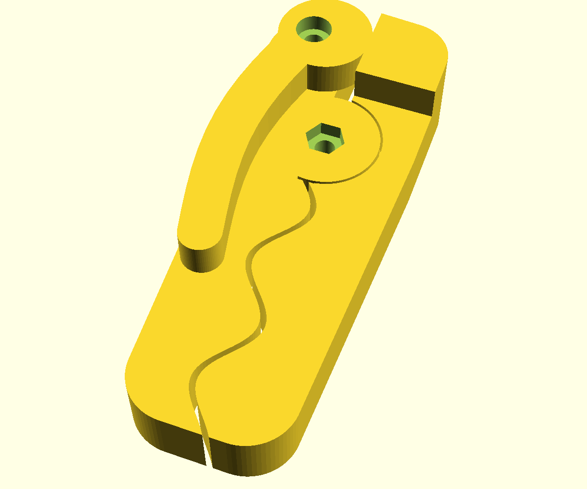

# Зажим с рычагом

Модель сделана по фото напечатанного зажима (2026-10-11). Все размеры
приблизительные: оценены на глаз, без замеров оригинала.



## Детали

| Файл                 | Деталь                                                                                          |
| -------------------- | ----------------------------------------------------------------------------------------------- |
| `jaw_a.stl`          | Губка A: верхняя половина шарнира, ось рычага, гнёзда под гайки M3. Уже перевёрнута для печати. |
| `jaw_b.stl`          | Губка B: нижняя половина шарнира и поднятый упор под кулачок.                                   |
| `lever.stl`          | Рычаг: кольцо-эксцентрик вокруг винта M3 и изогнутая ручка.                                     |
| `bag_clip_plate.3mf` | Все три детали отдельными объектами на столе 180×180. G-code в нём нет.                         |
| `bag_clip.scad`      | Исходник со всеми параметрами.                                                                  |

Размер в сборе около 81×49 мм, толщина губок 10 мм.

## Статус

Прототип по фото: принят как исходник модели, но не напечатан и физически не
проверен. Зазор шарнира, ход рычага, сила прижима и крепёж M3x8/M3x16 ещё
нужно проверить на напечатанной сборке. Печатного `.gcode.3mf` в репозитории
нет; нарезка и запуск печати идут отдельно (#1096) и требуют отдельного явного
одобрения старта.

## Печать

Все детали печатаются плашмя без поддержек. Для проверки размеров подходит PLA
(отметить как прототип). Для рабочих изделий рекомендуется PETG и 4 периметра:
его нужно заправить в принтер и нарезать под него отдельный G-code.
Пробная нарезка (PETG, слой 0,2 мм, 4 периметра, заполнение 25%) дала около
21 г пластика.

## Сборка

- 2 винта M3 и 2 гайки M3, либо латунные вставки M3 (`fastener = "insert"`).
- Шарнир: винт M3x8, головка утоплена снизу губки B, гайка сверху губки A.
- Ось рычага: винт M3x16 через рычаг и губку A, гайка в гнезде снизу губки A.

## Что учтено в конструкции

- Стенка вокруг отверстия рычага не меньше `ring_wall_min` (3 мм), это
  проверяет `assert`. При параметрах по умолчанию она 4,2 мм.
- Резьба в пластике не нарезается: только гайки или латунные вставки.
- Губки у кончиков не уже 10 мм, радиус волны около 4 мм, без острых углов.
- Радиальный зазор шарнира `pivot_clear` 0,4 мм.

## Основные параметры

`body_t` (толщина губок), `clip_len`, `jaw_gap` (зазор между губками),
`wave_amp` и `wave_len` (волна), `cam_ecc` и `cam_squeeze` (сила прижима),
`arm_len` (длина ручки), `hole_d`, `nut_af`, `fastener`.

## Тесты

`tests/test_3d_models.py` проверяет, что STL замкнуты и лежат на столе A1 mini,
размеры деталей в ожидаемых пределах, параметры дают стенку вокруг отверстия
рычага не меньше 3 мм и что 3MF содержит три детали без G-code. Если установлен
OpenSCAD, тесты ещё собирают каждую деталь из `.scad`, сверяют её с STL в
репозитории и проверяют, что слишком тонкая стенка рычага останавливает сборку.

```bash
pytest -q tests/test_3d_models.py
```

## Пересборка

```bash
openscad -D 'part="jaw_a"' -o jaw_a.stl bag_clip.scad
openscad -D 'part="jaw_b"' -o jaw_b.stl bag_clip.scad
openscad -D 'part="lever"' -o lever.stl bag_clip.scad
```

`part` принимает `plate`, `jaw_a`, `jaw_b`, `lever` и `assembly`. Модель
проверена в OpenSCAD 2021.01.
