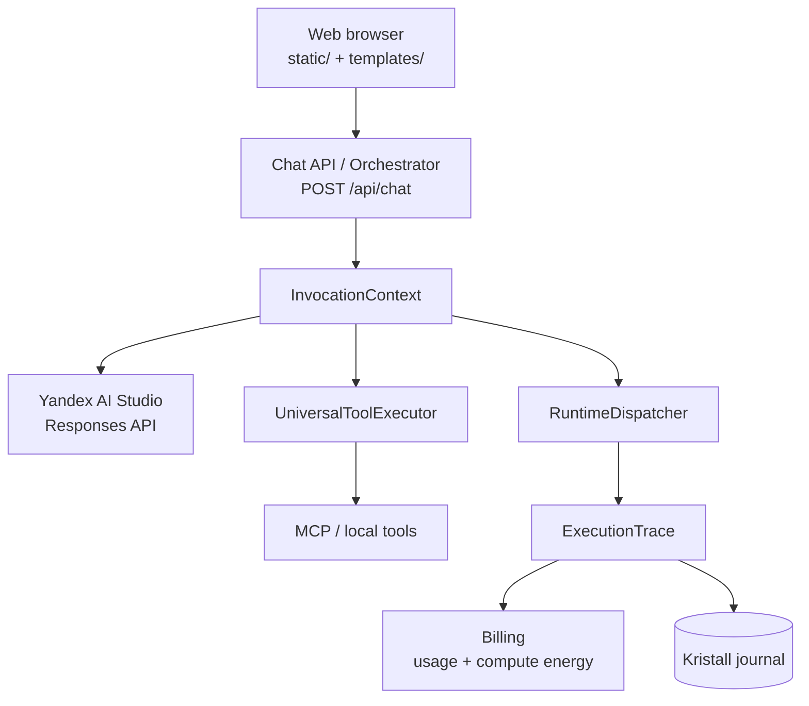

<div align="center">

# Logos

**Self-hosted AI assistant platform around Yandex AI Studio, MCP/local tools, agent orchestration, execution traces and billing, with a web interface.**

<a href="LICENSE"></a>
<a href=".python-version"></a>
<a href="requirements.txt"></a>
<a href="docs/models/yandex-models.md"></a>

[Quick start](#quick-start) ·
[Features](#features) ·
[Architecture](#architecture) ·
[Project structure](#project-structure) ·
[Status](#status-and-roadmap) ·
[Docs](#documentation-map) ·
[Contributing](CONTRIBUTING.md) ·
[Issues](https://github.com/maksimp6/Chat/issues) ·
[Discussions](https://github.com/maksimp6/Chat/discussions)

</div>

---

## Why Logos

Logos is one Flask backend (`app.py`) with a browser interface that puts a model
provider, tools, agents and accounting behind a single
[canonical execution path](docs/architecture/ai-execution-pipeline.md):

- **One traced path.** Provider requests, polling, tool calls, errors, timing,
  continuations and billing share one `InvocationContext` and one `ExecutionTrace`.
- **Tools from anywhere.** MCP and local tools run through the same
  `UniversalToolExecutor`.
- **Accounting built in.** Compute energy from measured CPU time, treasury and
  billing records, internal usage accounting.
- **Runs where you are.** Local machine, Termux on a phone, or a shared deployment,
  all on the native Kristall journal with no SQL server.

The repository is actively evolving. This README separates shipped behavior from
open scope: **Issues** define implementation scope and acceptance criteria;
**docs** define contracts and operating rules; **Discussions** capture questions
and decisions.

## Features

Shipped behavior. Open scope is listed under [Status and roadmap](#status-and-roadmap).

### AI execution

- **Yandex AI Studio Responses API** is the primary provider through the backend
  chat path.
- **Unified tool execution** through `UniversalToolExecutor`, including MCP and
  local tools.
- **Invocation context and execution trace** for provider requests, polling, tool
  calls, errors, timing, continuations and billing correlation.
- **Deterministic trace lifecycle:** snapshots are read-only and finalization is
  idempotent (`ExecutionTrace.make_snapshot()` / `finalize()`); see
  [Execution Trace](docs/architecture/execution_trace.md) and
  [compute energy billing](docs/compute-energy-billing.md).

### Agents and runtime

- **Agent Gateway and RuntimeDispatcher** for runtime-scoped invocations. The
  target architecture is one Python process with managed threads/contexts;
  threads are not a hostile-code security boundary.
- **Logos agent tooling:** headless runner, tools and draft PR output. See
  [Logos GitHub agent](docs/agents/github-agent.md).

### Accounting

- **Compute energy accounting** based on measured CPU time and configured
  watts/price; if no electricity price is configured, the trace remains unpriced.
  See [compute energy billing](docs/compute-energy-billing.md).
- **Treasury and billing records**, internal usage accounting and demo balances.

### Business domains

- **3D Printing Business:** quote calculation, owner-scoped orders and settlement,
  realized P&L, finance/payback tracking and AI-first purchase assessment. See
  [3D printing tools](docs/mcp/printing3d-tools.md).
- **Files, knowledge and Departments** integrations with local Execution Trace
  persistence.

### Storage

- **Native Kristall** for local/Termux and shared deployments, with one writer per
  durable journal. See [the storage contract](docs/database.md).

## Architecture



Secrets are sanitized at the trace/log boundary. Provider requests, continuations
and tool calls retain scoped correlation through `InvocationContext` and
`ExecutionTrace`.

| Component                   | Code                                                       |
| --------------------------- | ---------------------------------------------------------- |
| Chat API (`POST /api/chat`) | `chat/mcp_routes.py`                                       |
| `InvocationContext`         | `invocation/context.py`                                    |
| Yandex AI Studio client     | `yandex_client_modules/`                                   |
| `UniversalToolExecutor`     | `tool_providers/universal_tool_platform.py`                |
| Agent Gateway               | `agent_runtime/gateway.py`                                 |
| `RuntimeDispatcher`         | `runtime/dispatcher.py`                                    |
| `ExecutionTrace`            | `observability/trace_manager.py`                           |
| Trace persistence           | `invocation/manager.py` (native Kristall)                  |
| Billing                     | `economy/billing.py`, `economy/compute_resources.py`       |

Logging and diagnostics are described in
[Execution Trace and system log](docs/backend/logging.md).

### Life of a dialog

Logos is easiest to understand by following one dialog («диалог», a conversation):

1. The page lists the person's dialogs and the available models (`GET /api/conversations`, `GET /api/models`).
2. A new dialog is created for the chosen model (`POST /api/conversations`); opening one reads its history (`GET /api/conversations/<conv_id>/messages`).
3. Each message is one turn (`POST /api/chat`): an invocation with an execution trace, a Yandex AI Studio request, tool calls (local tools, MCP servers, web and file search) when the model asks for them, and a cost posted to the treasury.
4. Everything (messages, settings, traces, costs, memory) is stored in the native Kristall journal.

The full map, with every operation, route, unit and Kristall record, is
[Life of a dialog](docs/architecture/modules.md#life-of-a-dialog).

### Independent modules

Every package, script and tool is an independent unit: no unit imports another one.
What a unit needs from others is a port in its `host.py`, provided by the composition
roots (`app.py` and `composition/`), and each unit's `README.md` lists its public API,
ports and installation. The rules, the wiring and the static checker
(`python3 scripts/check_independence.py --summary`, which prints `TOTAL=0`) are in
[Modules and their independence](docs/architecture/modules.md).

## Quick start

### Prerequisites

- Python 3 with the dependencies from `requirements.txt` (the repository pins
  `3.14` in `.python-version`).
- Git.

### 1. Install

```bash
git clone https://github.com/maksimp6/Chat.git
cd Chat
python3 -m venv venv
source venv/bin/activate
python -m pip install -r requirements.txt
cp .env.example .env
```

### 2. Configure

Copy `.env.example` only for a fresh installation. Replace its placeholders and
remove unused integration examples before starting.

- For local development, set `HOST=127.0.0.1`.
- Set a persistent `LOGOS_PROVIDER_CREDENTIAL_KEY` **before** saving provider
  credentials: with it, keys are encrypted; without it, they are stored
  unencrypted. Keep the same value on every start, because encrypted keys cannot
  be read without it.
- Set `LOGOS_MEMORY_PATH` to the Kristall journal on persistent storage.

### 3. Run

```bash
python app.py
```

Open `http://localhost:8080` when using the template's `PORT=8080`; without
`PORT`, `app.py` defaults to `5000`. `start.sh` is a wrapper that creates `logs/`,
installs `flask`, `requests` and `websockets` if they are missing, and runs
`python3 app.py`.

### 4. Add the provider key

In **Провайдеры** (Providers), save the Yandex API key together with its Project ID.
The current web runtime resolves both from the active database credential;
environment-only `YANDEX_API_KEY` / `YANDEX_PROJECT_ID` values do not configure the
chat. See the [installation guide](docs/setup/installation.md) and
[provider-key lifecycle](docs/provider-key-rotation.md).

### Data storage

Logos stores authoritative runtime data in `kristall.Kristall`; set
`LOGOS_MEMORY_PATH` to its journal on persistent storage. SQL drivers, SQL runtime
adapters and the PostgreSQL CI lane are removed. Existing legacy data is preserved;
deployment and production cutover still require explicit acceptance.

### Phone access

Open the web interface in a browser. The Android application and APK build tooling
were removed on 2026-10-24. The backend can still run in Termux.
Independent device-control launchers are in `scripts/rdc/`; the fallback phone
agent is in `scripts/device/`.
The existing [Redmi 9 runner](docs/setup/redmi9-auto-update.md) updates the
application on `develop` pushes. The independent native updater has been removed.

## Project structure

Top-level directories, grouped by area. Root entry points: `app.py` (Flask
application; what it serves is assembled in `composition/web.py`), `start.sh`,
`requirements*.txt` and `.env.example`.

<details open>
<summary><b>Application core</b></summary>

| Path              | Contents                                                                                       |
| ----------------- | ---------------------------------------------------------------------------------------------- |
| `core/`           | Configuration, environment access, clock, model profiles and Wikifunctions-derived helpers     |
| `chat/`           | Flask routes for chat (`/api/chat`), voice, images, embeddings and classification              |
| `conversations/`  | Conversation ownership and metadata                                                            |
| `sessions/`       | Durable runtime sessions stored as Kristall journal records                                    |
| `invocation/`     | Invocation lifecycle, `InvocationContext`, trace persistence on Kristall, problem responses     |
| `observability/`  | `ExecutionTrace` (per-invocation diagnostics) and the system log                               |
| `runtime/`        | Scoped preview runtime primitives and `RuntimeDispatcher`                                      |
| `identity/`       | Local shared installation; visitor sign-in has been removed                                    |
| `workspace/`      | File routes and project tree                                                                   |

</details>

<details open>
<summary><b>Providers and AI</b></summary>

| Path                     | Contents                                                                                     |
| ------------------------ | -------------------------------------------------------------------------------------------- |
| `yandex_client_modules/` | Yandex AI Studio client: request building, response polling, realtime, image generation     |
| `api/`                   | Yandex request profiles, transport and contract validation                                   |
| `contracts/`             | Machine-readable Yandex API contracts ([`contracts/yandex`](contracts/yandex/README.md))     |
| `provider_accounts/`     | Provider credentials, key rotation, quotas and model discovery                               |
| `cloud/`                 | Provider-neutral cloud abstractions with Cloud.ru and Alice adapters                         |
| `secret_store/`          | Provider-neutral secret resolution boundary and provider credential encryption               |
| `config/`                | Platform YAML, model profiles, pricing snapshot and integrations catalog                     |

</details>

<details open>
<summary><b>Agents</b></summary>

| Path               | Contents                                                                                        |
| ------------------ | ----------------------------------------------------------------------------------------------- |
| `agent_runtime/`   | Provider-agnostic Agent Gateway, Responses tool loop, local tool agent, headless issue runner   |
| `agent_shell/`     | Minimal shell for agent tasks: task store, runner and CLI                                       |
| `agent_context/`   | Deterministic task-context contracts and cache                                                  |
| `agent_memory/`    | GitHub-first shared memory contracts                                                            |
| `agent_retrieval/` | Hybrid deterministic retrieval over cache, shared memory and repository indexes                 |
| `agent_rules/`     | Proposed provider-independent Agent Rules Registry and controller                               |
| `agent_skills/`    | Reusable Agent Skill discovery and runtime helpers                                              |
| `agent_office/`    | Tools that watch the GitHub "agent office": Claude, Codex, Copilot and Logos                    |
| `agents/`          | Placeholder package for Alice Pro agent transports (no modules yet)                             |
| `repository_index/`| Shared contracts for immutable repository indexes                                               |
| `.agents/skills/`  | Canonical repository skill tree (`SKILL.md` per skill)                                          |
| `.codex/`          | Codex defaults and the Cloud.ru management skill                                                |

</details>

<details open>
<summary><b>Storage and economy</b></summary>

| Path             | Contents                                                                                           |
| ---------------- | -------------------------------------------------------------------------------------------------- |
| `kristall/`      | Native durable name/value store on one append-only journal ([contract](docs/database.md))          |
| `memory_engine/` | Synchronous Memory DB with client-owned explicit name/value commits                                |
| `storage/`       | Chat/config repositories backed by Kristall, archiver and generated images                         |
| `economy/`       | Treasury, `ExecutionTrace` billing, pricing registry, budgets and compute resources                |
| `organization/`  | Departments, Government workflows and Partner Relations                                            |
| `project_board/` | Logos Board: SQL-free discussions, incidents, tasks and evidence                                   |

</details>

<details open>
<summary><b>Tools, MCP and devices</b></summary>

| Path              | Contents                                                                                          |
| ----------------- | ------------------------------------------------------------------------------------------------- |
| `mcp_server/`     | MCP server for Logos: protocol, transport, tools and runtime bridge                               |
| `tool_providers/` | Tool registry and `UniversalToolExecutor`; git, filesystem, Termux, system, Wikipedia and more    |
| `plugin_system/`  | Plugin manager, execution and routes; `plugins/` holds an example plugin manifest                 |
| `browser/`        | Browser capability, adapter and orchestration package                                             |
| `remote_runtime/` | SSH runtime and branch-aware application environments                                             |
| `remote_input/`   | Remote input module for integration, not deployed in the root service                             |
| `rdc_connection/` | Server Remote Desktop Commander pairing integration                                               |
| `steel/`          | Deterministic, fail-closed admission decisions for Steel workers                                  |
| `tools/`          | Device tooling: Android control over ADB, RDC device scripts, root helpers                        |

</details>

<details open>
<summary><b>3D printing</b></summary>

| Path               | Contents                                                                                         |
| ------------------ | ------------------------------------------------------------------------------------------------ |
| `printing3d/`      | 3D printing business domain, independent of the host app                                         |
| `forge/`           | Logos host integration for the `printing3d` domain: routes, tools and binding                    |
| `printer_service/` | Bambu A1 mini LAN transport, a disabled fail-closed cloud API boundary and Android backend facade |
| `model_editor/`    | Bounded, local 3D scene editor                                                                   |
| `3d-models/`       | OpenSCAD and STL model sources                                                                   |
| `recovery/`        | Parametric Yandex Drops case model                                                               |

</details>

<details open>
<summary><b>Web interface</b></summary>

| Path         | Contents                                                                                               |
| ------------ | ------------------------------------------------------------------------------------------------------ |
| `static/`    | Web interface JavaScript, CSS, icons and repository-local vendored libraries                           |
| `templates/` | Flask page template (`index.html`)                                                                     |
| `website/`   | Static project website                                                                                 |

</details>

<details open>
<summary><b>Platform, docs and scripts</b></summary>

| Path           | Contents                                                                                             |
| -------------- | ---------------------------------------------------------------------------------------------------- |
| `keel/`        | Keel Platform config management and reconciliation ([architecture](docs/platform/architecture.md))   |
| `docs/`        | Architecture and operating instructions ([index](docs/README.md))                                    |
| `scripts/`     | Developer and diagnostic tools ([scripts guide](scripts/README.md))                                  |
| `datasets/`    | Synthetic Russian Android message samples                                                            |
| `third_party/` | Wikifunctions code reused under Apache-2.0                                                           |
| `.github/`     | Redmi 9 workflows, issue templates and repository agent role definitions                             |

</details>

## Configuration and security

Use `.env` or a deployment secret manager. `.env.example` is the template.

| Variable                              | Purpose                                                                                     |
| ------------------------------------- | ------------------------------------------------------------------------------------------- |
| `HOST`, `PORT`                        | Bind address and port; `app.py` defaults to `127.0.0.1` and `5000`, the template sets `0.0.0.0` and `8080` |
| `LOGOS_MEMORY_PATH`                   | Kristall journal path; use persistent storage                                               |
| `LOGOS_PROVIDER_CREDENTIAL_KEY`       | Encrypts saved provider credentials; keep it stable across restarts                         |
| `LOGOS_OWNER_ID`                      | Identifies new accounting/data records; not a password                                      |
| `LOGOS_MCP_PUBLIC_URL`                | Public base URL of the ChatGPT Apps SDK / MCP endpoint                                       |
| `LOGOS_SSH_TARGETS_JSON`              | Named SSH runtime targets; reference server-side key files, never inline private keys       |
| `LOGOS_CPU_WATTS_PER_CORE`            | Watts per busy core for compute energy accounting (default `15`)                            |
| `LOGOS_ELECTRICITY_PRICE_RUB_PER_KWH` | Electricity price; without it energy is recorded in the trace but not charged               |
| `LOGOS_DONATION_URL`                  | Optional public http/https donations page; unset hides the header button                    |

Never commit:

- Yandex API keys or IAM tokens;
- Cloud.ru credentials or MCP bearer tokens;
- signing keys/passwords;
- user passwords or session secrets.

For security-sensitive reports, follow [SECURITY.md](SECURITY.md). Never use real
provider credentials or browser profiles as test fixtures.

> [!WARNING]
> Logos has no visitor sign-in and its built-in approval, restriction, quota and
> budget gates are disabled. Anyone who can reach the server can use its available
> APIs and tools. See [Current status](#current-status).

## Status and roadmap

### Current status

As of 2026-10-24, Logos runs as a shared local application with no visitor sign-in.
The web interface, MCP, project board and administration APIs accept requests
without cookies, bearer tokens or GitHub login. `LOGOS_OWNER_ID` identifies new
accounting/data records; it is not a password. Without it, a lone existing ledger
is retained as the shared ID, otherwise `default` is used. The selected ID is
persisted. Existing ledgers can be listed with `GET /api/treasury/accounts` and
read with `/api/treasury/account?owner_id=...`. Existing conversations, runtime
sessions, environments and MCP settings are shared across clients.

Built-in tool/agent approval, filesystem/command restriction, quota and budget
gates are disabled. Old `LOGOS_REQUIRE_SHORT_TOKEN`, `LOGOS_UNRESTRICTED` and
generation permission settings do not turn those gates back on. Anyone who can
reach the server can use its available APIs and tools. Provider API keys and SSH
credentials are still needed by the external services themselves.

**Repository automation.** Repository CI acceptance, code-policy and pre-push gates
have been removed. Code tests require a separate owner request and run only inside
GitHub Actions runner; see [AGENTS.md](AGENTS.md). Two workflows remain, both on
the self-hosted `redmi9` runner:

- the [phone server workflow](.github/workflows/redmi9-app-server.yml) deploys on
  every push to `develop` and offers the manual `deploy`, `screenshots`,
  `tools_self_check`, `verify_screenshots`, `rootagent_native_check` and
  `art_generate` actions. Deployment verifies the process and HTTP readiness and
  preserves its backup/rollback behavior;
- the [candidate tool evidence workflow](.github/workflows/redmi9-tool-evidence.yml)
  runs only for the `fix/tools-execution-evidence` branch, on push or manual
  dispatch.

`develop` is the integration branch; `master` remains the owner's personal branch.
Repository code changes do not by themselves prove the installed phone version or
access from a second device.

**Cloud.ru.** The Cloud.ru platform migration is tracked in
[#440](https://github.com/maksimp6/Chat/issues/440). Resource ownership and cutover
acceptance remain separate work in [#869](https://github.com/maksimp6/Chat/issues/869).
Runtime repositories use native Kristall for conversations, configuration,
sessions, invocations, traces and the other prefixes listed in
[the storage contract](docs/database.md). Activation of historical data, Object
Storage backups, durable background workers and production cutover require their
own evidence.

### Experimental or roadmap

Still experimental or roadmap unless the corresponding issue is complete:

- advanced branch-aware preview/runtime isolation;
- cloud and local browsing with Browser Emulator/BrowserShim self-testing;
- per-user provider credentials;
- Government workflows, Partner Relations and Kwork integration;
- richer theme/voice assistance;
- resilient backup/failover providers;
- public release automation.

### Active issues and expected work

Cloud.ru migration is coordinated in [#440](https://github.com/maksimp6/Chat/issues/440);
canonical AI execution and repository layout are tracked in
[#433](https://github.com/maksimp6/Chat/issues/433) and
[#430](https://github.com/maksimp6/Chat/issues/430). Earlier architecture
coordination remains in [#343](https://github.com/maksimp6/Chat/issues/343).
Related scope includes:

| Issue                                                                                              | Scope                                          |
| -------------------------------------------------------------------------------------------------- | ---------------------------------------------- |
| [#350](https://github.com/maksimp6/Chat/issues/350)                                                | Canonical one-process runtime architecture     |
| [#351](https://github.com/maksimp6/Chat/issues/351)                                                | Integration staging and dependency order       |
| [#227](https://github.com/maksimp6/Chat/issues/227), [#223](https://github.com/maksimp6/Chat/issues/223) | Frontend progressive enhancement         |
| [#326](https://github.com/maksimp6/Chat/issues/326), [#238](https://github.com/maksimp6/Chat/issues/238) | MCP/ChatGPT compatibility                |
| [#254](https://github.com/maksimp6/Chat/issues/254), [#256](https://github.com/maksimp6/Chat/issues/256) | Plugin platform and autonomous development |
| [#116](https://github.com/maksimp6/Chat/issues/116)                                                | Conversation agents                            |
| [#104](https://github.com/maksimp6/Chat/issues/104)                                                | Public release                                 |
| [#409](https://github.com/maksimp6/Chat/issues/409)                                                | Cloud/local browsing and self-testing          |

Relevant Discussions include
[Cloud.ru CLI Q&A #406](https://github.com/maksimp6/Chat/discussions/406) and
[repository cleanup #393](https://github.com/maksimp6/Chat/discussions/393). They
document open questions and decisions; they do not by themselves mark a feature
complete.

## Development

Follow the owner's current delivery instruction and [AGENTS.md](AGENTS.md); see
[CONTRIBUTING.md](CONTRIBUTING.md) for change descriptions and evidence and the
[development workflow](docs/development_workflow.md) for details.

- **Branches.** `develop` is the integration branch; `master` is the owner's
  personal branch. Promotion to `master` requires separate authorization.
- **Gates.** There are no mandatory repository CI gates. Removed CI, lint, typing,
  naming and layout gates are not required checks.
- **Tests.** Code tests run only on the owner's separate request, inside a GitHub
  Actions runner. Without a run, report `NOT_RUN`; never imitate a runner
  environment.
- **Settings.** Per [AGENTS.md](AGENTS.md), settings stay at their maximum and no
  application limits are introduced without an owner-specified value (`0` means
  no application limit).
- **Web assets.** Required JavaScript, CSS and icons are repository-local.

### Verification

Only real Redmi 9 checks remain. The offline unit/fixture suites, Chromium
component test and their generic runners have been removed. Run device checks
inside GitHub Actions only when explicitly requested; see
[Redmi 9 checks](docs/architecture/browser-self-testing.md). Recorded results from
removed suites remain historical evidence, not current application PASS.

## Documentation map

The documentation is mostly in Russian. Start with the
[documentation index](docs/README.md).

| Area                 | Documents                                                                                                                                                                                                                                 |
| -------------------- | ----------------------------------------------------------------------------------------------------------------------------------------------------------------------------------------------------------------------------------------- |
| Setup                | [Installation guide](docs/setup/installation.md) · [Provider key rotation](docs/provider-key-rotation.md) · [Scripts guide](scripts/README.md)                                                                                            |
| Architecture         | [Canonical AI execution pipeline](docs/architecture/ai-execution-pipeline.md) · [Integration coordination](docs/architecture/integration-coordination.md) · [Current scope](docs/integration/current-scope.md) · [Runtime Dispatcher policy](docs/runtime/runtime-dispatcher-policy.md) |
| Tracing and billing  | [Execution Trace](docs/architecture/execution_trace.md) · [Execution Trace and system log](docs/backend/logging.md) · [Compute energy billing](docs/compute-energy-billing.md)                                                            |
| Storage              | [Native Kristall storage contract](docs/database.md)                                                                                                                                                                                      |
| API and MCP          | [API documentation](docs/api/API_DOCS.md) · [API contracts](docs/api/contracts.md) · [MCP architecture](docs/mcp/architecture.md) · [MCP tools](docs/mcp/tools.md) · [ChatGPT Apps SDK / MCP](docs/mcp/chatgpt_apps.md)                 |
| Agents               | [Logos runtime agents](docs/agents/overview.md) · [Repository development roles](docs/agents/role-based-agent-office.md) · [Logos GitHub agent](docs/agents/github-agent.md)                                                             |
| 3D printing          | [3D printing tools](docs/mcp/printing3d-tools.md) · [Bambu Lab A1 mini pipeline (draft)](docs/printing3d-a1mini-full-workflow.md)                                                                                                        |
| Phone and operations | [Redmi 9 application server](docs/redmi-app-server.md) · [Redmi 9 runner updates](docs/setup/redmi9-auto-update.md) · [Redmi 9 checks](docs/architecture/browser-self-testing.md) · [Operations and recovery](docs/production-deployment.md) |
| Project              | [Contributing](CONTRIBUTING.md) · [Security policy](SECURITY.md) · [Support](SUPPORT.md) · [Code of Conduct](CODE_OF_CONDUCT.md)                                                                                                         |

## License

Logos is licensed under the MIT License. See [LICENSE](LICENSE).
