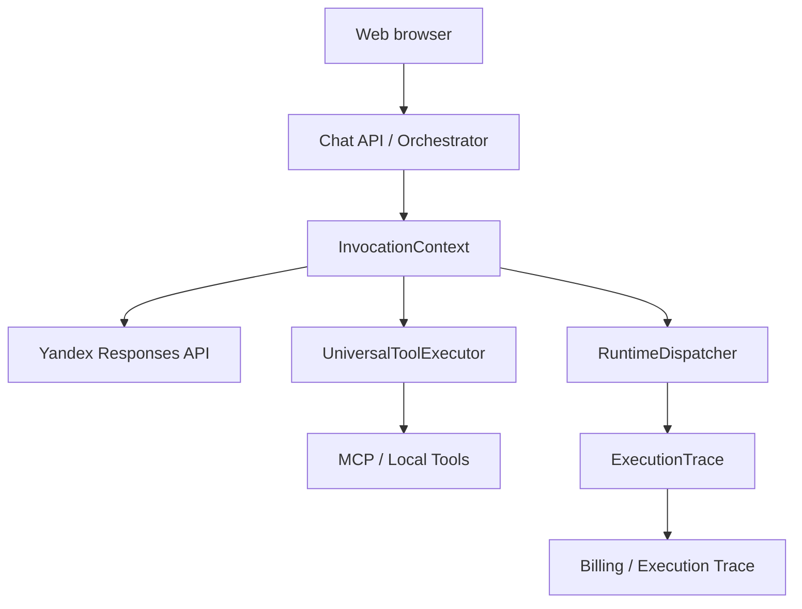

# Logos

Logos — self-hosted AI assistant platform around Yandex AI Studio, MCP/local tools, agent orchestration, execution traces and billing, with a web interface.

The repository is actively evolving. This README separates shipped behavior from open scope: Issues define implementation scope and acceptance criteria; docs define contracts and operating rules; Discussions capture questions and decisions.

## Repository navigation

| Need                                    | Location                                                                                                                    |
| --------------------------------------- | --------------------------------------------------------------------------------------------------------------------------- |
| Run the backend                         | `app.py`, `start.sh`                                                                                                        |
| Web interface                           | `static/`, `templates/`                                                                                                     |
| Tests                                   | `tests/`                                                                                                                    |
| Developer and diagnostic tools          | [scripts guide](scripts/README.md)                                                                                          |
| Architecture and operating instructions | [docs index](docs/README.md)                                                                                                |
| Python package map                      | [layout contract](docs/architecture/repository-layout.md), [remaining root files](docs/architecture/root-file-inventory.md) |
| Logging and diagnostics                 | [Execution Trace and system log](docs/backend/logging.md)                                                                   |

## What is shipped

- **Yandex AI Studio Responses API** as the primary provider through the backend chat path.
- **Unified tool execution** through `UniversalToolExecutor`, including MCP and local tools.
- **Invocation context and execution trace** for provider requests, polling, tool calls, errors, timing, continuations and billing correlation.
- **Deterministic trace lifecycle**: snapshots are read-only and finalization is idempotent; see [execution trace lifecycle](docs/execution-trace-lifecycle.md).
- **Agent Gateway and RuntimeDispatcher** for runtime-scoped invocations. The target architecture is one Python process with managed threads/contexts; threads are not a hostile-code security boundary.
- **Logos agent tooling**: headless runner, tools and draft PR output. See [Logos GitHub agent](docs/agents/github-agent.md).
- **Compute energy accounting** based on measured CPU time and configured watts/price; if no electricity price is configured, the trace remains unpriced. See [compute energy billing](docs/compute-energy-billing.md).
- **Treasury and billing controls**, internal usage accounting and demo balances.
- **3D Printing Business**: quote calculation, owner-scoped orders and settlement, realized P&L, finance/payback tracking and AI-first purchase assessment. See [3D Printing Business](docs/printing3d.md).
- **Files, knowledge and Departments** integrations with local Execution Trace persistence.
- **Native Kristall** for local/Termux and shared deployments, with one writer per durable journal.

## Architecture



Secrets are sanitized at the trace/log boundary. Provider requests, continuations and tool calls retain scoped correlation through `InvocationContext` and `ExecutionTrace`.

## Current status

As of 2026-10-24, Logos runs as a shared local application with no visitor sign-in.
The web interface, MCP, project board and administration APIs accept requests without
cookies, bearer tokens or GitHub login. `LOGOS_OWNER_ID` identifies new accounting/data records; it is not a password.
Without it, a lone existing ledger is retained as the shared ID, otherwise `default`
is used. The selected ID is persisted. Existing ledgers can be listed with
`GET /api/treasury/accounts` and read with `/api/treasury/account?owner_id=...`. Existing conversations, runtime
sessions, environments and MCP settings are shared across clients.

Built-in tool/agent approval, filesystem/command restriction, quota and budget gates
are disabled. Old `LOGOS_REQUIRE_SHORT_TOKEN`, `LOGOS_UNRESTRICTED` and generation
permission settings do not turn those gates back on. Anyone who can reach the server
can use its available APIs and tools. Provider API keys and SSH credentials are still
needed by the external services themselves.

Repository CI acceptance, code-policy and pre-push gates have been removed.
Functional tests remain available for explicit verification. Only the phone application
server workflow remains. Deployment still verifies the running process and HTTP
readiness and preserves its backup/rollback behavior.
`develop` is the integration branch; `master` remains the owner's personal branch.
Repository code changes do not by themselves prove the installed phone version or
access from a second device.

The Cloud.ru platform migration is tracked in [#440](https://github.com/maksimp6/Chat/issues/440). Logos Dev worker is implemented as a separate coding worker; legacy cloudru-rdc.yml and production-deploy.yml remain unchanged. Resource-scoped ownership, replacement decision, and accepted cutover criteria are tracked in [#869](https://github.com/maksimp6/Chat/issues/869). Kristall Wave 1 is shipped; further migration of shared state (sessions, runtime events, conversation metadata) remains roadmap. Object Storage migration, durable background workers, and full production cutover remain separate work.

Still experimental or roadmap unless the corresponding issue is complete:

- advanced branch-aware preview/runtime isolation;
- cloud and local browsing with Browser Emulator/BrowserShim self-testing;
- per-user provider credentials;
- Government workflows, Partner Relations and Kwork integration;
- richer theme/voice assistance;
- resilient backup/failover providers;
- public release automation.

## Quick start

### Prerequisites

- Python: backend CI uses 3.14; Ruff targets 3.12.
- Git.

### Backend

```bash
python3 -m venv venv
source venv/bin/activate
python -m pip install -r requirements.txt
cp .env.example .env
```

Copy `.env.example` only for a fresh installation. Replace its placeholders and remove unused integration examples before starting. For local development, set `HOST=127.0.0.1`. Set a persistent `LOGOS_PROVIDER_CREDENTIAL_KEY` before saving provider credentials: with it, keys are encrypted; without it, they are stored unencrypted. Keep the same value on every start, because encrypted keys cannot be read without it.

Start the backend with `python app.py`. Open `http://localhost:8080` when using the template's `PORT=8080`; without `PORT`, `app.py` defaults to `5000`. In **Провайдеры**, save the Yandex API key together with its Project ID. The current web runtime resolves both from the active database credential; environment-only `YANDEX_API_KEY` / `YANDEX_PROJECT_ID` values do not configure the chat. See the [installation guide](docs/setup/installation.md) and [provider-key lifecycle](docs/provider-key-rotation.md).

Logos stores authoritative runtime data in `kristall.Kristall`; set `LOGOS_MEMORY_PATH` to its journal on persistent storage. SQL drivers, SQL runtime adapters and the PostgreSQL CI lane are removed. Existing legacy data is preserved; deployment and production cutover still require explicit acceptance.

### Phone access

Open the web interface in a browser. The Android application and APK build tooling
were removed on 2026-10-24. The backend can still run in Termux.
Independent device-control launchers are in `scripts/rdc/`; the fallback phone
agent is in `scripts/device/`.
The native [Redmi 9 updater](docs/setup/redmi9-auto-update.md) follows `develop`
independently of the Actions queue and recovers an unhealthy application.

## Configuration and security

Use `.env` or a deployment secret manager. Never commit:

- Yandex API keys or IAM tokens;
- Cloud.ru credentials or MCP bearer tokens;
- signing keys/passwords;
- user passwords or session secrets.

For security-sensitive reports, follow [SECURITY.md](SECURITY.md). Never use real provider credentials or browser profiles as test fixtures.

## Development workflow

The owner can request a direct push to `develop`; routine contributions can still
use branches and pull requests. See [CONTRIBUTING.md](CONTRIBUTING.md).
Functional checks are run explicitly when needed; there are no mandatory CI gates.

## Testing

```bash
python -m compileall -q .
pytest -q
```

For frontend/runtime work, preserve the progressive-enhancement path and BrowserShim/VM tests. Do not introduce Playwright as a runtime dependency. Browser Emulator/self-testing work is tracked in [#409](https://github.com/maksimp6/Chat/issues/409).

## Documentation map

- [Documentation index](docs/README.md)
- [Architecture overview](docs/architecture/overview.md)
- [Integration coordination](docs/architecture/integration-coordination.md)
- [Current scope](docs/integration/current-scope.md)
- [API overview](docs/api/overview.md)
- [MCP overview](docs/mcp/overview.md)
- [3D Printing Business](docs/printing3d.md)
- [Logos runtime agents](docs/agents/overview.md)
- [Repository development roles](docs/agents/role-based-agent-office.md)
- [Runtime Dispatcher policy](docs/runtime/runtime-dispatcher-policy.md)
- [Logos GitHub agent](docs/agents/github-agent.md)
- [Compute energy billing](docs/compute-energy-billing.md)
- [Execution trace lifecycle](docs/execution-trace-lifecycle.md)
- [Provider key rotation](docs/provider-key-rotation.md)
- [Security policy](SECURITY.md)
- [Support](SUPPORT.md)

## Active issues and expected work

Cloud.ru migration is coordinated in [#440](https://github.com/maksimp6/Chat/issues/440); canonical AI execution and repository layout are tracked in [#433](https://github.com/maksimp6/Chat/issues/433) and [#430](https://github.com/maksimp6/Chat/issues/430). Earlier architecture coordination remains in [#343](https://github.com/maksimp6/Chat/issues/343). Related scope includes:

- [#350](https://github.com/maksimp6/Chat/issues/350) — canonical one-process runtime architecture;
- [#351](https://github.com/maksimp6/Chat/issues/351) — integration staging and dependency order;
- [#227](https://github.com/maksimp6/Chat/issues/227) and [#223](https://github.com/maksimp6/Chat/issues/223) — frontend progressive enhancement;
- [#326](https://github.com/maksimp6/Chat/issues/326) and [#238](https://github.com/maksimp6/Chat/issues/238) — MCP/ChatGPT compatibility;
- [#254](https://github.com/maksimp6/Chat/issues/254) and [#256](https://github.com/maksimp6/Chat/issues/256) — plugin platform and autonomous development;
- [#116](https://github.com/maksimp6/Chat/issues/116) — conversation agents;
- [#195](https://github.com/maksimp6/Chat/issues/195) — Android/release safety;
- [#104](https://github.com/maksimp6/Chat/issues/104) — public release;
- [#409](https://github.com/maksimp6/Chat/issues/409) — cloud/local browsing and self-testing.

Relevant Discussions include [Cloud.ru CLI Q&A #406](https://github.com/maksimp6/Chat/discussions/406) and [repository cleanup #393](https://github.com/maksimp6/Chat/discussions/393). They document open questions and decisions; they do not by themselves mark a feature complete.

## License

Logos is licensed under the MIT License. See [LICENSE](LICENSE).
