# Modules and their independence

Logos is built from independent **units**. A unit is a top-level package (`chat`,
`storage`, `web_shell`, …), a top-level module, a file under `scripts/` or `tools/`, or a
script cluster declared in `pyproject.toml` (`[tool.logos.units]`, for example
`tools.knowledge`). **No unit imports another unit.** Units are wired together only by
the **composition roots**: `app.py`, the `composition/` package and the declared
`if __name__ == "__main__":` blocks of command-line tools.

Every unit has a `README.md` with its **Public API**, its **Ports** and how it is
**installed**.

## Rules

1. A unit imports only the standard library, third-party packages (`requirements*.txt`,
   or a `requirements.txt` next to the unit's files) and its own modules. Lazy imports,
   `importlib` strings and embedded `-c` programs count too.
2. What a unit needs from another unit is a **port**: a field of the frozen `Host`
   dataclass in the unit's `host.py` (`scripts/<cluster>_host.py` for a script cluster).
   A composition root provides it. A unit reads its ports only when a function runs,
   never on import.
3. Composition roots only assemble: imports, constants, calls. They hold no logic, and no
   unit imports them.
4. Small pure helpers that several units need are **vendored**: copied into each unit
   (`_vendor/`, `_binding.py`) with a "Vendored from …" header and kept identical to the
   canonical file (`[[tool.logos.vendored]]`).
5. Nothing happens on import: no tool registration, no host binding, no
   `load_dotenv`, no log configuration, no threads.
6. Units log through `logging.getLogger("logos.<unit>…")`; only roots configure logging.
7. Every package declares `__all__`; nobody uses another unit's private names.

## How a unit uses another one

```python
# chat/host.py (generated) -- the ports of the chat unit
@dataclass(frozen=True, kw_only=True)
class Host:
    get_store: Any  # storage.db.get_store
    Config: Any  # core.config.Config
    ...

def get_store(*args, **kwargs):  # a call port keeps its original name
    return current().get_store(*args, **kwargs)

# chat/mcp_routes.py
from chat.host import bound, get_store

store = get_store()  # same call as before
client = bound.Config  # classes, constants and modules are bound.<name>
```

- The host is process-global and built lazily by a factory on first use; before a root
  registers that factory a port raises `HostNotBound`.
- Classes and exceptions are the original objects, so `except bound.KristallError`
  behaves exactly like `except KristallError` did.
- A decorator from another unit (`@traced_operation(...)`) is a late-bound port: the
  original decorator is applied when the function first runs.
- Names that used to be created on import (`chat.mcp_routes.LogosClient`,
  `tool_providers.registry.registry`, …) are created on first use and stay importable
  through a module `__getattr__`.

The binding mechanism is `core/host_binding.py`, vendored into each such unit as
`_binding.py`.

## Composition roots

| Root | Role |
| --- | --- |
| `composition/process.py` | `start()`: loads `core/.env` and configures the system log. |
| `composition/wiring.py` | Generated. One factory per unit maps every port to the object it replaces; `register_all()` loads `core/.env` and registers all of them, `register_units(*names)` registers some units without loading the environment. |
| `composition/web.py` | What the web process serves, in order: the ChatGPT bridge tools, the RDC pairing route, the blueprints, the web shell and the units' own routes; the durable tables storage start-up creates. |
| `composition/tool_sources.py` | Tool categories other units contribute to the shared tool registry, after its own. |
| `composition/application.py` | `initialize()`: the web application as a library, for command-line roots that need its state. |
| `app.py` | `process.start()`, `wiring.register_all()`, `Flask(__name__)`, `web.install(app)`; `python app.py` runs it. |
| `scripts/rotate_*.py`, CLI `__main__` blocks | Register the hosts, then call the unit's `main()`. |

## Adding a dependency between units

1. Use the name in your unit as if it were local, through your host:
   `from <unit>.host import bound, <function>`.
2. Add the field to `Host` with a comment naming its provider (`# storage.db.get_store`),
   plus a call shim for a function.
3. Import the provider in your unit's factory in `composition/wiring.py`.
4. Run `python3 scripts/check_independence.py --summary` and expect `TOTAL=0`.

## Checking

```bash
python3 scripts/check_independence.py --summary    # counters E R S V I L A W D
python3 scripts/check_independence.py --only E     # list one counter's findings
python3 scripts/check_independence.py --mermaid    # regenerate the map below
python3 scripts/check_independence.py --routes     # static route table (rule, methods, endpoint)
python3 scripts/check_independence.py --tool-order # tool categories in registry order
python3 scripts/check_independence.py --entrypoints
python3 scripts/check_independence.py --sync-vendored
```

| Counter | Zero means |
| --- | --- |
| **E** edges | no unit references another one, in any form |
| **R** roots | roots are not imported by units and hold no logic |
| **S** standalone | each unit's imports resolve inside the unit, the standard library and declared third-party packages |
| **V** vendored | every vendored copy is identical to its canonical file and holds no state |
| **I** import effects | no registration, binding, environment loading, logging setup or threads on import |
| **L** logging | units log only through `logos.<unit>` loggers |
| **A** API | every package has `__all__`; nobody uses another unit's private names |
| **W** wiring | hosts have no defaults and are registered by a root; every provider exists; every `bound.<name>` is a port |
| **D** docs | every unit has a README (Public API, Ports, Install) and this map is current |

The check is static and manual; it is not a CI gate. It prints `TOTAL=0`.

## Current map

Units, with no import edges between them; only the composition roots connect them.

```mermaid
flowchart LR
    roots([composition roots])
    agent_context[agent_context]
    agent_memory[agent_memory]
    agent_office[agent_office]
    agent_retrieval[agent_retrieval]
    agent_rules[agent_rules]
    agent_runtime[agent_runtime]
    agent_shell[agent_shell]
    agent_skills[agent_skills]
    agents[agents]
    api[api]
    browser[browser]
    chat[chat]
    cloud[cloud]
    conversations[conversations]
    core[core]
    economy[economy]
    identity[identity]
    invocation[invocation]
    keel[keel]
    kristall[kristall]
    mcp_server[mcp_server]
    memory_engine[memory_engine]
    memory_log_adapter[memory_log_adapter]
    model_editor[model_editor]
    observability[observability]
    organization[organization]
    plugin_system[plugin_system]
    printer_service[printer_service]
    printing3d[printing3d]
    project_board[project_board]
    provider_accounts[provider_accounts]
    rdc_connection[rdc_connection]
    recovery[recovery]
    remote_input[remote_input]
    remote_runtime[remote_runtime]
    repository_index[repository_index]
    runtime[runtime]
    secret_store[secret_store]
    sessions[sessions]
    steel[steel]
    storage[storage]
    tool_providers[tool_providers]
    web_shell[web_shell]
    workspace[workspace]
    yandex_client_modules[yandex_client_modules]
```

<!-- BEGIN GENERATED: unit map (scripts/check_independence.py --mermaid) -->

<!-- END GENERATED: unit map -->
