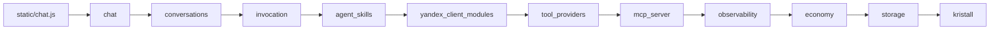

# Modules and their independence

Logos is built from independent **units**. A unit is a top-level package (`chat`,
`storage`, `web_shell`, …), a top-level module, a file under `scripts/` or `tools/`, or a
script cluster declared in `pyproject.toml` (`[tool.logos.units]`, for example
`tools.knowledge`). **No unit imports another unit.** Units are wired together only by
the **composition roots**: `app.py`, the `composition/` package and the declared
`if __name__ == "__main__":` blocks of command-line tools.

Every unit has a `README.md` with its **Public API**, its **Ports** and how it is
**installed**.

## Life of a dialog

What Logos is reads best through one dialog («диалог», a conversation): what the
person does in the browser, which route serves it, which units it passes and what
lands in the Kristall journal. The map below is generated from
[`dialog.toml`](dialog.toml) and checked against the code (every route and backend
function must exist).

<!-- BEGIN GENERATED: life of a dialog (scripts/check_independence.py --write-docs) -->
Logos is a dialog assistant. A person opens the page, picks a model and talks; the model answers through Yandex AI Studio and may call tools (local tools, MCP servers, web and file search) during the turn. Every turn is an invocation with an execution trace and a cost, and everything is stored in the native Kristall journal. Following one dialog through the operations below touches almost every unit.



| # | Operation | UI | HTTP | Backend | Units on the path | Kristall records |
| --- | --- | --- | --- | --- | --- | --- |
| 1 | Open Logos | templates/index.html, static/boot.js | `GET /`<br>`GET /api/version` | `web_shell.shell:index`<br>`web_shell.shell:loaded_version` | [`web_shell`](../../web_shell/README.md) → [`storage`](../../storage/README.md) → [`kristall`](../../kristall/README.md) | the dialog tables are prepared at boot (STORAGE_INITIALIZERS) |
| 2 | List dialogs | static/core.js enhanceCore, static/sidebar.js | `GET /api/conversations` | `chat.mcp_routes:conversations` | [`chat`](../../chat/README.md) → [`economy`](../../economy/README.md) → [`conversations`](../../conversations/README.md) → [`storage`](../../storage/README.md) → [`kristall`](../../kristall/README.md) | chat/conversation/*, installation/shared-owner-id |
| 3 | Choose a model | static/core.js loadModels, static/models.js | `GET /api/models` | `provider_accounts.model_routes:list_models` | [`provider_accounts`](../../provider_accounts/README.md) → [`yandex_client_modules`](../../yandex_client_modules/README.md) → [`secret_store`](../../secret_store/README.md) → [`core`](../../core/README.md) → [`storage`](../../storage/README.md) | the stored provider credential |
| 4 | Create a dialog | static/sidebar.js new chat, static/models.js createConversation | `POST /api/conversations` | `chat.mcp_routes:conversations` | [`chat`](../../chat/README.md) → [`economy`](../../economy/README.md) → [`provider_accounts`](../../provider_accounts/README.md) → [`observability`](../../observability/README.md) → [`conversations`](../../conversations/README.md) → [`storage`](../../storage/README.md) → [`kristall`](../../kristall/README.md) | chat/conversation/&lt;id&gt;, conversation_owner:&lt;id&gt; |
| 5 | Open a dialog and read its history | static/sidebar.js selectConv, static/chat.js loadHistory | `GET /api/conversations/<conv_id>/messages` | `chat.mcp_routes:get_conv_messages` | [`chat`](../../chat/README.md) → [`conversations`](../../conversations/README.md) → [`storage`](../../storage/README.md) → [`kristall`](../../kristall/README.md) | chat/message/&lt;n&gt; |
| 6 | Settings and tools (global, read-only) | static/settings/settings_storage.js, static/settings/settings_modal.js | `GET /api/settings`<br>`GET /api/tools/categories` | `conversations.routes:get_settings`<br>`chat.mcp_routes:list_tool_categories` | [`conversations`](../../conversations/README.md) → [`chat`](../../chat/README.md) → [`yandex_client_modules`](../../yandex_client_modules/README.md) → [`tool_providers`](../../tool_providers/README.md) | — (nothing stored: global maximal settings) |
| 7 | Rename a dialog or change its model | static/sidebar.js saveTitle, static/core.js changeModel | `PATCH /api/conversations/<conv_id>` | `conversations.routes:patch_conversation` | [`conversations`](../../conversations/README.md) → [`provider_accounts`](../../provider_accounts/README.md) → [`storage`](../../storage/README.md) → [`kristall`](../../kristall/README.md) | chat/conversation/&lt;id&gt; |
| 8 | Send a message (the turn) | static/chat.js sendMessage, sendTurn | `POST /api/chat` | `chat.mcp_routes:chat` | [`chat`](../../chat/README.md) → [`conversations`](../../conversations/README.md) → [`invocation`](../../invocation/README.md) → [`sessions`](../../sessions/README.md) → [`observability`](../../observability/README.md) → [`agent_skills`](../../agent_skills/README.md) → [`yandex_client_modules`](../../yandex_client_modules/README.md) → [`provider_accounts`](../../provider_accounts/README.md) → [`secret_store`](../../secret_store/README.md) → [`storage`](../../storage/README.md) → [`kristall`](../../kristall/README.md) | chat/message/&lt;n&gt;, chat/yandex/&lt;id&gt;, runtime_session:&lt;sid&gt;, runtime_invocation:&lt;iid&gt;, quota/* |
| 9 | Tools during the turn | results appear in the reply; MCP servers in static/settings/settings_modal.js | `POST /api/chat`<br>`GET /api/mcp-servers` | `yandex_client_modules.mcp_mixin:YandexMcpMixin.ask_with_mcp`<br>`chat.mcp_routes:handle_mcp_servers` | [`yandex_client_modules`](../../yandex_client_modules/README.md) → [`tool_providers`](../../tool_providers/README.md) → [`mcp_server`](../../mcp_server/README.md) → [`agent_memory`](../../agent_memory/README.md) → [`workspace`](../../workspace/README.md) → [`storage`](../../storage/README.md) → [`kristall`](../../kristall/README.md) | mcp/server/*, global_fact:* |
| 10 | Approve a tool action | static/chat.js renderApprovalCard | `POST /api/mcp/execute-approved` | `chat.mcp_routes:execute_approved` | [`chat`](../../chat/README.md) → [`tool_providers`](../../tool_providers/README.md) → [`economy`](../../economy/README.md) → [`storage`](../../storage/README.md) → [`kristall`](../../kristall/README.md) | chat/message/&lt;n&gt;, treasury/* |
| 11 | Photos, pictures and voice | static/chat.js runImageTurn, static/voice.js | `POST /api/images/generate`<br>`GET /api/images/requests/<request_id>`<br>`POST /api/voice/session`<br>`GET /api/voice/events`<br>`POST /api/voice/text`<br>`POST /api/voice/audio` | `chat.image_routes:generate_image`<br>`chat.voice_routes:create_voice_session` | [`chat`](../../chat/README.md) → [`yandex_client_modules`](../../yandex_client_modules/README.md) → [`provider_accounts`](../../provider_accounts/README.md) → [`storage`](../../storage/README.md) → [`kristall`](../../kristall/README.md) | chat/image_request/&lt;id&gt;/&lt;request&gt;, chat/message/&lt;n&gt; |
| 12 | Trace, cost and treasury of a reply | static/execution_surface.js, static/trace_summary.js, static/model_view.js, static/treasury.js | `GET /api/invocations/<invocation_id>/trace`<br>`GET /api/treasury/account` | `runtime.api:api_get_invocation_trace`<br>`economy.treasury_routes:treasury_account` | [`runtime`](../../runtime/README.md) → [`invocation`](../../invocation/README.md) → [`observability`](../../observability/README.md) → [`economy`](../../economy/README.md) → [`api`](../../api/README.md) → [`storage`](../../storage/README.md) → [`kristall`](../../kristall/README.md) | runtime_invocation:&lt;iid&gt;, treasury/account/&lt;owner&gt;, treasury/ledger/&lt;n&gt; |
| 13 | Global memory used by every dialog | static/memory_panel.js | `GET /api/memory/manage` | `agent_memory.routes:api_memory_panel_data` | [`agent_memory`](../../agent_memory/README.md) → [`storage`](../../storage/README.md) → [`kristall`](../../kristall/README.md) | global_memory_config, global_fact:* |
| 14 | Delete a dialog | static/sidebar.js delete | `DELETE /api/conversations/<conv_id>` | `conversations.routes:remove_conv` | [`conversations`](../../conversations/README.md) → [`storage`](../../storage/README.md) → [`kristall`](../../kristall/README.md) | removes the dialog's chat/* records and conversation_owner:&lt;id&gt; |
| 15 | Read dialogs from outside (MCP) | an MCP client such as ChatGPT: logos_list_conversations, logos_get_conversation_messages | `POST {MCP_PATH}` | `mcp_server.transport:mcp_post`<br>`mcp_server.tools:_conversations`<br>`mcp_server.tools:_conversation_messages` | [`mcp_server`](../../mcp_server/README.md) → [`tool_providers`](../../tool_providers/README.md) → [`economy`](../../economy/README.md) → [`conversations`](../../conversations/README.md) → [`invocation`](../../invocation/README.md) → [`storage`](../../storage/README.md) → [`kristall`](../../kristall/README.md) | chat/conversation/*, chat/message/&lt;n&gt;, runtime_invocation:&lt;iid&gt; |
<!-- END GENERATED: life of a dialog -->

## Rules

1. A unit imports only the standard library, third-party packages (`requirements*.txt`,
   or a `requirements.txt` next to the unit's files) and its own modules. Lazy imports,
   `importlib` strings and embedded `-c` programs count too.
2. What a unit needs from another unit is a **port**: a field of the frozen `Host`
   dataclass in the unit's `host.py` (`scripts/<cluster>_host.py` for a script cluster).
   A composition root provides it. A unit reads its ports only when a function runs,
   never on import.
3. Composition roots only assemble: imports, constants, calls. They hold no logic, and no
   unit imports them.
4. Small pure helpers that several units need are **vendored**: copied into each unit
   (`_vendor/`, `_binding.py`) with a "Vendored from …" header and kept identical to the
   canonical file (`[[tool.logos.vendored]]`).
5. Nothing happens on import: no tool registration, no host binding, no
   `load_dotenv`, no log configuration, no threads.
6. Units log through `logging.getLogger("logos.<unit>…")`; only roots configure logging.
7. Every package declares `__all__`; nobody uses another unit's private names.

## How a unit uses another one

```python
# chat/host.py (generated) -- the ports of the chat unit
@dataclass(frozen=True, kw_only=True)
class Host:
    get_store: Any  # storage.records.get_store
    Config: Any  # core.config.Config
    ...

def get_store(*args, **kwargs):  # a call port keeps its original name
    return current().get_store(*args, **kwargs)

# chat/mcp_routes.py
from chat.host import bound, get_store

store = get_store()  # same call as before
client = bound.Config  # classes, constants and modules are bound.<name>
```

- The host is process-global and built lazily by a factory on first use. A process that
  uses a unit without running a root (a library user, a device launcher, `python -c`)
  gets the default root (`default-root` in `pyproject.toml`, `composition.wiring`)
  registered on first use, so importing a unit and calling it works as it always did;
  `HostNotBound` remains only for a unit copied without the composition roots.
- Classes and exceptions are the original objects, so `except bound.KristallError`
  behaves exactly like `except KristallError` did.
- A decorator from another unit (`@traced_operation(...)`) is a late-bound port: the
  original decorator is applied when the function first runs.
- Names that used to be created on import (`chat.mcp_routes.LogosClient`,
  `tool_providers.registry.registry`, …) are created on first use and stay importable
  through a module `__getattr__`.

The binding mechanism is `core/host_binding.py`, vendored into each such unit as
`_binding.py`.

## Composition roots

| Root | Role |
| --- | --- |
| `composition/process.py` | `start()`: loads `core/.env` and configures the system log. |
| `composition/wiring.py` | Generated from the `Host` field comments (`--write-wiring`). One factory per unit maps every port to the object it replaces; `register_all()` loads `core/.env` and registers all of them, `register_units(*names)` registers some units without loading the environment. |
| `composition/web.py` | What the web process serves, in order: the ChatGPT bridge tools, the RDC pairing route, the blueprints, the web shell and the units' own routes; the durable tables storage start-up creates. |
| `composition/tool_sources.py` | Tool categories other units contribute to the shared tool registry, after its own. |
| `composition/application.py` | `initialize()`: the web application as a library, for command-line roots that need its state. |
| `app.py` | `process.start()`, `wiring.register_all()`, `Flask(__name__)`, `web.install(app)`; `python app.py` runs it. |
| `scripts/rotate_*.py`, CLI `__main__` blocks | Register the hosts, then call the unit's `main()`. |

## Adding a dependency between units

1. Use the name in your unit as if it were local, through your host:
   `from <unit>.host import bound, <function>`.
2. Add the field to `Host` with a comment naming its provider (`# storage.records.get_store`),
   plus a call shim for a function.
3. Regenerate the wiring: `python3 scripts/check_independence.py --write-wiring`.
4. Run `python3 scripts/check_independence.py --summary` and expect `TOTAL=0`.

A new unit host also needs its `_binding.py` copy: add it to the
`core/host_binding.py` entry of `[[tool.logos.vendored]]` and run `--sync-vendored`.

## Checking

```bash
python3 scripts/check_independence.py --summary    # counters E R S V I L A W D
python3 scripts/check_independence.py --only E     # list one counter's findings
python3 scripts/check_independence.py --mermaid    # print the unit map
python3 scripts/check_independence.py --write-docs # regenerate the map and the life of a dialog
python3 scripts/check_independence.py --routes     # static route table (rule, methods, endpoint)
python3 scripts/check_independence.py --tool-order # tool categories in registry order
python3 scripts/check_independence.py --entrypoints
python3 scripts/check_independence.py --sync-vendored
python3 scripts/check_independence.py --write-wiring
```

| Counter | Zero means |
| --- | --- |
| **E** edges | no unit references another one, in any form |
| **R** roots | roots are not imported by units and hold no logic |
| **S** standalone | each unit's imports resolve inside the unit, the standard library and declared third-party packages |
| **V** vendored | every vendored copy is identical to its canonical file and holds no state |
| **I** import effects | no registration, binding, environment loading, logging setup or threads on import |
| **L** logging | units log only through `logos.<unit>` loggers |
| **A** API | every package has `__all__`; nobody uses another unit's private names |
| **W** wiring | hosts have no defaults and are registered by a root; every provider exists; every `bound.<name>` is a port; `composition/wiring.py` is current; no root reads an undefined name |
| **D** docs | every unit has a README (Public API, Ports, Install; Role in a dialog for units on a dialog path), the life of a dialog matches the code and this map is current |

The check is static and manual; it is not a CI gate. It prints `TOTAL=0`.

## Current map

Units, with no import edges between them; only the composition roots connect them.

```mermaid
flowchart LR
    roots([composition roots])
    agent_context[agent_context]
    agent_memory[agent_memory]
    agent_office[agent_office]
    agent_retrieval[agent_retrieval]
    agent_rules[agent_rules]
    agent_runtime[agent_runtime]
    agent_shell[agent_shell]
    agent_skills[agent_skills]
    agents[agents]
    api[api]
    browser[browser]
    chat[chat]
    cloud[cloud]
    conversations[conversations]
    core[core]
    court[court]
    economy[economy]
    identity[identity]
    invocation[invocation]
    keel[keel]
    kristall[kristall]
    mcp_server[mcp_server]
    memory_engine[memory_engine]
    memory_log_adapter[memory_log_adapter]
    model_editor[model_editor]
    observability[observability]
    organization[organization]
    plugin_system[plugin_system]
    printer_service[printer_service]
    printing3d[printing3d]
    project_board[project_board]
    provider_accounts[provider_accounts]
    rdc_connection[rdc_connection]
    recovery[recovery]
    remote_input[remote_input]
    remote_runtime[remote_runtime]
    repository_index[repository_index]
    runtime[runtime]
    secret_store[secret_store]
    sessions[sessions]
    steel[steel]
    storage[storage]
    tool_providers[tool_providers]
    web_shell[web_shell]
    workspace[workspace]
    yandex_client_modules[yandex_client_modules]
```

<!-- BEGIN GENERATED: unit map (scripts/check_independence.py --mermaid) -->

<!-- END GENERATED: unit map -->
