# Modules and their independence

Logos is built from independent **units**: every top-level package, every file under
`scripts/` and `tools/`, and the script clusters declared in `pyproject.toml`
(`[tool.logos.units]`). The target is that no unit imports another one. Units get what
they need from outside through **ports**, and only the **composition roots** (`app.py`
and, as the refactor proceeds, the `composition/` package and declared CLI entry
blocks) wire units together.

## Rules

1. A unit imports only the standard library, the third-party packages from
   `requirements*.txt` and its own modules. Lazy imports, `importlib` strings and
   embedded `-c` programs count too.
2. Composition roots only construct and wire objects; they hold no logic, and no unit
   imports them.
3. A unit declares what it needs in its own `ports.py` (`typing.Protocol`) and receives
   implementations from a root. There is no shared "contracts" package.
4. Tools run on their own: standard library and third-party packages only, or as thin
   roots over app units.
5. Units log through `logging.getLogger("logos.<unit>")`; only roots configure logging.

## Checking

```bash
python3 scripts/check_independence.py --summary    # counters E R S V I L A W D
python3 scripts/check_independence.py --only E     # list cross-unit references
python3 scripts/check_independence.py --mermaid    # regenerate the map below
python3 scripts/check_independence.py --routes     # static route table
python3 scripts/check_independence.py --entrypoints
```

The check is static and manual; it is not a CI gate. The refactor is finished when it
prints `TOTAL=0`.

## Current map

Arrows are cross-unit references (count on the edge) between application units.

```mermaid
flowchart LR
    roots([composition roots])
    agent_context[agent_context]
    agent_memory[agent_memory]
    agent_office[agent_office]
    agent_retrieval[agent_retrieval]
    agent_rules[agent_rules]
    agent_runtime[agent_runtime]
    agent_shell[agent_shell]
    agent_skills[agent_skills]
    agents[agents]
    api[api]
    browser[browser]
    chat[chat]
    cloud[cloud]
    conversations[conversations]
    core[core]
    economy[economy]
    identity[identity]
    invocation[invocation]
    keel[keel]
    kristall[kristall]
    mcp_server[mcp_server]
    memory_engine[memory_engine]
    memory_log_adapter[memory_log_adapter]
    model_editor[model_editor]
    observability[observability]
    organization[organization]
    plugin_system[plugin_system]
    printer_service[printer_service]
    printing3d[printing3d]
    project_board[project_board]
    provider_accounts[provider_accounts]
    rdc_connection[rdc_connection]
    recovery[recovery]
    remote_input[remote_input]
    remote_runtime[remote_runtime]
    repository_index[repository_index]
    runtime[runtime]
    secret_store[secret_store]
    sessions[sessions]
    steel[steel]
    storage[storage]
    tool_providers[tool_providers]
    workspace[workspace]
    yandex_client_modules[yandex_client_modules]
    tool_providers -->|1| cloud
    tool_providers -->|1| model_editor
    tool_providers -->|2| organization
    tool_providers -->|1| printing3d
```

<!-- BEGIN GENERATED: unit map (scripts/check_independence.py --mermaid) -->

<!-- END GENERATED: unit map -->
