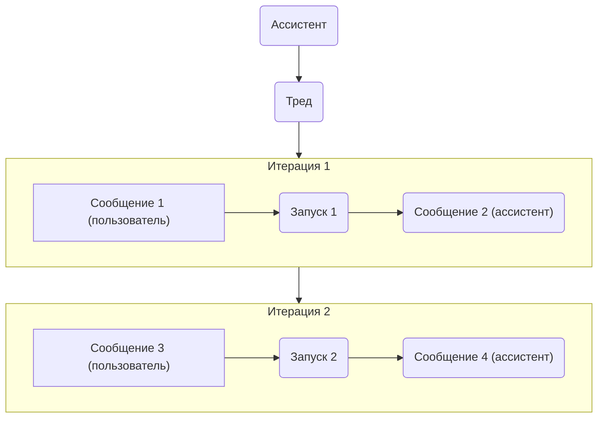
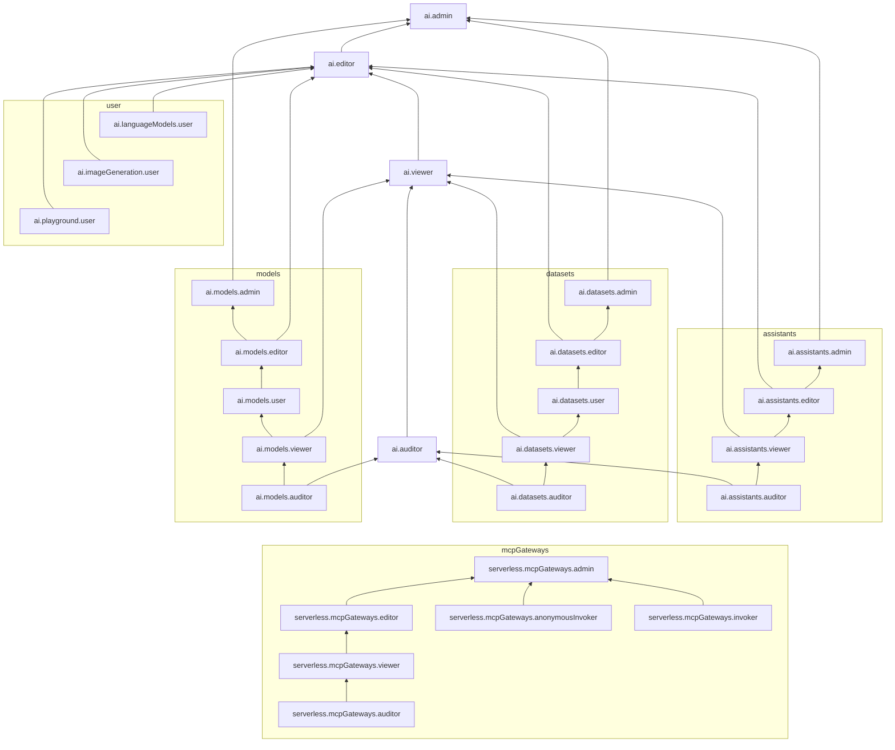

# Документация Yandex AI Studio — одним файлом

Все страницы `ru/ai-studio` из [yandex-cloud/docs](https://github.com/yandex-cloud/docs/tree/fddbac0226d030d57d089b730f92abd02e583df2/ru/ai-studio), ревизия `fddbac0226d030d57d089b730f92abd02e583df2 2026-03-02` — тот же снимок, что и у `contracts/yandex/catalog.json`.
Порядок — по `toc.yaml`, затем страницы вне оглавления. Вставки `` раскрыты,
переменные `{{ ... }}` подставлены из `ru/presets.yaml`, заголовки страниц сдвинуты на уровень.
Иначе текст не менялся. Позже этого снимка в живой документации появились поля, которых
здесь нет (например, `defer_loading` у function- и MCP-инструментов, см. `api/yandex_request_profiles.py` и `docs/mcp/tools.md`).

© YANDEX LLC, 2018 и участники. Лицензия [CC BY 4.0](https://github.com/yandex-cloud/docs/blob/master/LICENSE). Собрано скриптом
`scripts/merge_yandex_ai_studio_docs.py`.

Страниц: 563.

## Содержание

1. [О сервисе Yandex AI Studio](#page-001) — `concepts/index.md`
2. [Начало работы с Model Gallery](#page-002) — `quickstart/yandexgpt.md`
3. [Model Gallery › Обзор](#page-003) — `concepts/generation/index.md`
4. [Model Gallery › Модели базового инстанса](#page-004) — `concepts/generation/models.md`
5. [Model Gallery › Модели выделенного инстанса](#page-005) — `concepts/generation/dedicated-instance.md`
6. [Model Gallery › Пакетная обработка данных](#page-006) — `concepts/generation/batch-processing.md`
7. [Model Gallery › Вызов функций](#page-007) — `concepts/generation/function-call.md`
8. [Model Gallery › Режим рассуждений](#page-008) — `concepts/generation/chain-of-thought.md`
9. [Model Gallery › Форматирование ответов моделей](#page-009) — `concepts/generation/structured-output.md`
10. [Model Gallery › Классификаторы › Поддерживаемые виды классификации](#page-010) — `concepts/classifier/index.md`
11. [Model Gallery › Классификаторы › Доступные модели классификаторов](#page-011) — `concepts/classifier/models.md`
12. [Model Gallery › Эмбеддинги](#page-012) — `concepts/embeddings.md`
13. [Model Gallery › Датасеты](#page-013) — `concepts/resources/dataset.md`
14. [Model Gallery › Дообучение](#page-014) — `concepts/tuning/index.md`
15. [Model Gallery › Токены](#page-015) — `concepts/generation/tokens.md`
16. [Agent Atelier › Обзор AI-агентов](#page-016) — `concepts/agents/index.md`
17. [Agent Atelier › Текстовые агенты](#page-017) — `concepts/agents/text-agents.md`
18. [Agent Atelier › Голосовые агенты](#page-018) — `concepts/agents/realtime.md`
19. [Agent Atelier › Управление контектом диалога](#page-019) — `concepts/agents/conversations-api.md`
20. [Agent Atelier › Code Interpreter](#page-020) — `concepts/agents/tools/code-interpreter.md`
21. [Agent Atelier › AI Assistant API › AI-Ассистенты](#page-021) — `concepts/assistant/index.md`
22. [Agent Atelier › AI Assistant API › Файлы-источники](#page-022) — `concepts/assistant/files.md`
23. [Agent Atelier › AI Assistant API › Поисковые индексы AI Assistant API](#page-023) — `concepts/assistant/search-index.md`
24. [Agent Atelier › AI Assistant API › Инструменты › Обзор](#page-024) — `concepts/assistant/tools/index.md`
25. [Agent Atelier › AI Assistant API › Инструменты › Retrieval](#page-025) — `concepts/assistant/tools/vector-store.md`
26. [Agent Atelier › AI Assistant API › Инструменты › WebSearch](#page-026) — `concepts/assistant/tools/web-search.md`
27. [Agent Atelier › AI Assistant API › Инструменты › Перефразирование запросов](#page-027) — `concepts/assistant/rephraser.md`
28. [AI Search › Обзор AI Search](#page-028) — `concepts/search/index.md`
29. [AI Search › Поисковые индексы Vector Store](#page-029) — `concepts/search/vectorstore.md`
30. [AI Search › Инструмент поиска по файлам](#page-030) — `concepts/agents/tools/filesearch.md`
31. [AI Search › Инструмент поиска в интернете](#page-031) — `concepts/agents/tools/websearch.md`
32. [MCP Hub › Обзор](#page-032) — `concepts/mcp-hub/index.md`
33. [MCP Hub › Шаблоны MCP-серверов](#page-033) — `concepts/mcp-hub/templates.md`
34. [Пошаговые инструкции › Все инструкции](#page-034) — `operations/index.md`
35. [Пошаговые инструкции › Отключить логирование запросов](#page-035) — `operations/disable-logging.md`
36. [Пошаговые инструкции › Получить API-ключ](#page-036) — `operations/get-api-key.md`
37. [Пошаговые инструкции › Model Gallery › Генерация текста › Оценить запрос в токенах](#page-037) — `operations/generation/evaluate-request.md`
38. [Пошаговые инструкции › Model Gallery › Генерация текста › Отправить запрос в синхронном режиме](#page-038) — `operations/generation/create-prompt.md`
39. [Пошаговые инструкции › Model Gallery › Генерация текста › Отправить серию запросов в режиме чата](#page-039) — `operations/generation/create-chat.md`
40. [Пошаговые инструкции › Model Gallery › Генерация текста › Отправить запрос в фоновом режиме](#page-040) — `operations/generation/background-request.md`
41. [Пошаговые инструкции › Model Gallery › Генерация текста › Отправить асинхронный запрос](#page-041) — `operations/generation/async-request.md`
42. [Пошаговые инструкции › Model Gallery › Генерация текста › Вызвать функцию из модели](#page-042) — `operations/generation/function-call.md`
43. [Пошаговые инструкции › Model Gallery › Генерация изображений](#page-043) — `operations/generation/yandexart-request.md`
44. [Пошаговые инструкции › Model Gallery › Мультимодальные модели](#page-044) — `operations/generation/multimodels-request.md`
45. [Пошаговые инструкции › Model Gallery › Пакетная обработка данных](#page-045) — `operations/batch/create.md`
46. [Пошаговые инструкции › Model Gallery › Работа с выделенными инстансами › Создать инстанс](#page-046) — `operations/resources/create-instance.md`
47. [Пошаговые инструкции › Model Gallery › Работа с выделенными инстансами › Получить информацию об инстансе](#page-047) — `operations/resources/get-instance.md`
48. [Пошаговые инструкции › Model Gallery › Работа с выделенными инстансами › Изменить инстанс](#page-048) — `operations/resources/edit-instance.md`
49. [Пошаговые инструкции › Model Gallery › Работа с выделенными инстансами › Клонировать инстанс](#page-049) — `operations/resources/clone-instance.md`
50. [Пошаговые инструкции › Model Gallery › Работа с выделенными инстансами › Остановить и запустить инстанс](#page-050) — `operations/resources/start-stop-instance.md`
51. [Пошаговые инструкции › Model Gallery › Работа с выделенными инстансами › Управлять метками инстанса](#page-051) — `operations/resources/labels-instance.md`
52. [Пошаговые инструкции › Model Gallery › Работа с выделенными инстансами › Отправить запрос к инстансу](#page-052) — `operations/resources/request-instance.md`
53. [Пошаговые инструкции › Model Gallery › Работа с выделенными инстансами › Удалить инстанс](#page-053) — `operations/resources/delete-instance.md`
54. [Пошаговые инструкции › Model Gallery › Классификация › Использовать классификаторы по промпту](#page-054) — `operations/classifier/readymade.md`
55. [Пошаговые инструкции › Model Gallery › Классификация › Использовать дообученные классификаторы](#page-055) — `operations/classifier/additionally-trained.md`
56. [Пошаговые инструкции › Model Gallery › Эмбеддинги › Использовать эмбеддинги в поиске по базе знаний](#page-056) — `operations/embeddings/search.md`
57. [Пошаговые инструкции › Model Gallery › Работа с датасетами › Создать датасет](#page-057) — `operations/resources/create-dataset.md`
58. [Пошаговые инструкции › Model Gallery › Работа с датасетами › Создать датасет для дообучения генерации текста](#page-058) — `operations/resources/create-dataset-gpt.md`
59. [Пошаговые инструкции › Model Gallery › Работа с датасетами › Создать датасет для дообучения классификации текста](#page-059) — `operations/resources/create-dataset-classifier.md`
60. [Пошаговые инструкции › Model Gallery › Работа с датасетами › Удалить датасет](#page-060) — `operations/resources/delete-dataset.md`
61. [Пошаговые инструкции › Model Gallery › Дообучение моделей › Дообучить модель генерации текста](#page-061) — `operations/tuning/create.md`
62. [Пошаговые инструкции › Model Gallery › Дообучение моделей › Дообучить модель классификации текста](#page-062) — `operations/tuning/tune-classifiers.md`
63. [Пошаговые инструкции › Model Gallery › Дообучение моделей › Дообучить модель эмбеддингов](#page-063) — `operations/tuning/create-embeddings.md`
64. [Пошаговые инструкции › Agent Atelier › Создать простого текстового агента](#page-064) — `operations/agents/create-simple-text-agent.md`
65. [Пошаговые инструкции › Agent Atelier › Создать текстового агента с вызовом функции](#page-065) — `operations/agents/create-function-text-agent.md`
66. [Пошаговые инструкции › Agent Atelier › Создать голосового агента с помощью Realtime API](#page-066) — `operations/agents/create-voice-agent.md`
67. [Пошаговые инструкции › Agent Atelier › Выполнить задачу с помощью Code Interpreter](#page-067) — `operations/agents/use-code-interpreter.md`
68. [Пошаговые инструкции › Agent Atelier › Управление контекстом диалога](#page-068) — `operations/agents/manage-context.md`
69. [Пошаговые инструкции › Agent Atelier › AI Assistant API › Создать простого ассистента](#page-069) — `operations/assistant/create.md`
70. [Пошаговые инструкции › Agent Atelier › AI Assistant API › Создать ассистента с инструментом Retrieval](#page-070) — `operations/assistant/create-with-searchindex.md`
71. [Пошаговые инструкции › Agent Atelier › AI Assistant API › Создать ассистента для поиска с указанием метаданных файлов и индексов](#page-071) — `operations/assistant/create-with-labels.md`
72. [Пошаговые инструкции › Agent Atelier › AI Assistant API › Создать ассистента с инструментом WebSearch](#page-072) — `operations/assistant/create-with-websearch.md`
73. [Пошаговые инструкции › Agent Atelier › AI Assistant API › Получить промежуточные результаты генерации ответа](#page-073) — `operations/assistant/request-chunked-response.md`
74. [Пошаговые инструкции › Agent Atelier › AI Assistant API › Перефразировать запросы с помощью модели](#page-074) — `operations/assistant/rephraser.md`
75. [Пошаговые инструкции › AI Search › Создать текстового агента с поиском в интернете](#page-075) — `operations/agents/create-websearch-text-agent.md`
76. [Пошаговые инструкции › AI Search › Создать текстового агента с поиском по файлам](#page-076) — `operations/agents/create-filesearch-text-agent.md`
77. [Пошаговые инструкции › AI Search › Создать агента с поиском по заранее созданным чанкам](#page-077) — `operations/agents/create-prechunked-search-agent.md`
78. [Пошаговые инструкции › AI Search › Работа с поисковым индексом Vector Store](#page-078) — `operations/agents/manage-searchindex.md`
79. [Пошаговые инструкции › MCP Hub › Создать MCP-сервер › Подключить внешний MCP-сервер](#page-079) — `operations/mcp-servers/connect-external.md`
80. [Пошаговые инструкции › MCP Hub › Создать MCP-сервер › Создать MCP-сервер из шаблона](#page-080) — `operations/mcp-servers/create-from-template.md`
81. [Пошаговые инструкции › MCP Hub › Создать MCP-сервер › Создать MCP-сервер с нуля](#page-081) — `operations/mcp-servers/create-brand-new.md`
82. [Пошаговые инструкции › MCP Hub › Посмотреть информацию об MCP-сервере](#page-082) — `operations/mcp-servers/get-server-info.md`
83. [Пошаговые инструкции › MCP Hub › Удалить MCP-сервер](#page-083) — `operations/mcp-servers/delete-server.md`
84. [Переход с AI Assistant API на Responses API](#page-084) — `concepts/agents/assistant-responses-migration.md`
85. [Совместимость с OpenAI](#page-085) — `concepts/openai-compatibility.md`
86. [Справочники API › Обзор](#page-086) — `concepts/api.md`
87. [Справочники API › Аутентификация в API](#page-087) — `api-ref/authentication.md`
88. [Справочники API › OpenAI-совместимые API (англ.) › Chat › Overview](#page-088) — `chat/index.md`
89. [Справочники API › OpenAI-совместимые API (англ.) › Chat › listChatCompletions](#page-089) — `chat/listChatCompletions.md`
90. [Справочники API › OpenAI-совместимые API (англ.) › Chat › createChatCompletion](#page-090) — `chat/createChatCompletion.md`
91. [Справочники API › OpenAI-совместимые API (англ.) › Chat › getChatCompletion](#page-091) — `chat/getChatCompletion.md`
92. [Справочники API › OpenAI-совместимые API (англ.) › Chat › updateChatCompletion](#page-092) — `chat/updateChatCompletion.md`
93. [Справочники API › OpenAI-совместимые API (англ.) › Chat › deleteChatCompletion](#page-093) — `chat/deleteChatCompletion.md`
94. [Справочники API › OpenAI-совместимые API (англ.) › Conversations › Overview](#page-094) — `conversations/index.md`
95. [Справочники API › OpenAI-совместимые API (англ.) › Conversations › createConversationItems](#page-095) — `conversations/createConversationItems.md`
96. [Справочники API › OpenAI-совместимые API (англ.) › Conversations › listConversationItems](#page-096) — `conversations/listConversationItems.md`
97. [Справочники API › OpenAI-совместимые API (англ.) › Conversations › getConversationItem](#page-097) — `conversations/getConversationItem.md`
98. [Справочники API › OpenAI-совместимые API (англ.) › Conversations › deleteConversationItem](#page-098) — `conversations/deleteConversationItem.md`
99. [Справочники API › OpenAI-совместимые API (англ.) › Conversations › createConversation](#page-099) — `conversations/createConversation.md`
100. [Справочники API › OpenAI-совместимые API (англ.) › Conversations › getConversation](#page-100) — `conversations/getConversation.md`
101. [Справочники API › OpenAI-совместимые API (англ.) › Conversations › deleteConversation](#page-101) — `conversations/deleteConversation.md`
102. [Справочники API › OpenAI-совместимые API (англ.) › Conversations › updateConversation](#page-102) — `conversations/updateConversation.md`
103. [Справочники API › OpenAI-совместимые API (англ.) › Embeddings › Overview](#page-103) — `embeddings/index.md`
104. [Справочники API › OpenAI-совместимые API (англ.) › Embeddings › createEmbedding](#page-104) — `embeddings/createEmbedding.md`
105. [Справочники API › OpenAI-совместимые API (англ.) › Files › Overview](#page-105) — `files/index.md`
106. [Справочники API › OpenAI-совместимые API (англ.) › Files › listFiles](#page-106) — `files/listFiles.md`
107. [Справочники API › OpenAI-совместимые API (англ.) › Files › createFile](#page-107) — `files/createFile.md`
108. [Справочники API › OpenAI-совместимые API (англ.) › Files › deleteFile](#page-108) — `files/deleteFile.md`
109. [Справочники API › OpenAI-совместимые API (англ.) › Files › retrieveFile](#page-109) — `files/retrieveFile.md`
110. [Справочники API › OpenAI-совместимые API (англ.) › Files › downloadFile](#page-110) — `files/downloadFile.md`
111. [Справочники API › OpenAI-совместимые API (англ.) › Models › Overview](#page-111) — `models/index.md`
112. [Справочники API › OpenAI-совместимые API (англ.) › Models › listModels](#page-112) — `models/listModels.md`
113. [Справочники API › OpenAI-совместимые API (англ.) › Realtime › Client events › Overview](#page-113) — `clientEvents/index.md`
114. [Справочники API › OpenAI-совместимые API (англ.) › Realtime › Client events › realtime.session.update](#page-114) — `clientEvents/realtimeSessionUpdate.md`
115. [Справочники API › OpenAI-совместимые API (англ.) › Realtime › Client events › realtime.input_audio_buffer.append](#page-115) — `clientEvents/realtimeInputAudioBufferAppend.md`
116. [Справочники API › OpenAI-совместимые API (англ.) › Realtime › Client events › realtime.input_audio_buffer.commit](#page-116) — `clientEvents/realtimeInputAudioBufferCommit.md`
117. [Справочники API › OpenAI-совместимые API (англ.) › Realtime › Client events › realtime.input_audio_buffer.clear](#page-117) — `clientEvents/realtimeInputAudioBufferClear.md`
118. [Справочники API › OpenAI-совместимые API (англ.) › Realtime › Client events › realtime.conversation.item.create](#page-118) — `clientEvents/realtimeConversationItemCreate.md`
119. [Справочники API › OpenAI-совместимые API (англ.) › Realtime › Client events › realtime.conversation.item.retrieve](#page-119) — `clientEvents/realtimeConversationItemRetrieve.md`
120. [Справочники API › OpenAI-совместимые API (англ.) › Realtime › Client events › realtime.conversation.item.truncate](#page-120) — `clientEvents/realtimeConversationItemTruncate.md`
121. [Справочники API › OpenAI-совместимые API (англ.) › Realtime › Client events › realtime.conversation.item.delete](#page-121) — `clientEvents/realtimeConversationItemDelete.md`
122. [Справочники API › OpenAI-совместимые API (англ.) › Realtime › Client events › realtime.response.create](#page-122) — `clientEvents/realtimeResponseCreate.md`
123. [Справочники API › OpenAI-совместимые API (англ.) › Realtime › Client events › realtime.response.cancel](#page-123) — `clientEvents/realtimeResponseCancel.md`
124. [Справочники API › OpenAI-совместимые API (англ.) › Realtime › Client events › realtime.output_audio_buffer.clear](#page-124) — `clientEvents/realtimeOutputAudioBufferClear.md`
125. [Справочники API › OpenAI-совместимые API (англ.) › Realtime › Server events › Overview](#page-125) — `serverEvents/index.md`
126. [Справочники API › OpenAI-совместимые API (англ.) › Realtime › Server events › realtime.server.error](#page-126) — `serverEvents/realtimeServerError.md`
127. [Справочники API › OpenAI-совместимые API (англ.) › Realtime › Server events › realtime.server.session.created](#page-127) — `serverEvents/realtimeServerSessionCreated.md`
128. [Справочники API › OpenAI-совместимые API (англ.) › Realtime › Server events › realtime.server.session.updated](#page-128) — `serverEvents/realtimeServerSessionUpdated.md`
129. [Справочники API › OpenAI-совместимые API (англ.) › Realtime › Server events › realtime.server.conversation.item.added](#page-129) — `serverEvents/realtimeServerConversationItemAdded.md`
130. [Справочники API › OpenAI-совместимые API (англ.) › Realtime › Server events › realtime.server.conversation.item.created](#page-130) — `serverEvents/realtimeServerConversationItemCreated.md`
131. [Справочники API › OpenAI-совместимые API (англ.) › Realtime › Server events › realtime.server.conversation.item.deleted](#page-131) — `serverEvents/realtimeServerConversationItemDeleted.md`
132. [Справочники API › OpenAI-совместимые API (англ.) › Realtime › Server events › realtime.server.conversation.item.done](#page-132) — `serverEvents/realtimeServerConversationItemDone.md`
133. [Справочники API › OpenAI-совместимые API (англ.) › Realtime › Server events › realtime.server.conversation.item.input_audio_transcription.completed](#page-133) — `serverEvents/realtimeServerConversationItemInputAudioTranscriptionCompleted.md`
134. [Справочники API › OpenAI-совместимые API (англ.) › Realtime › Server events › realtime.server.conversation.item.input_audio_transcription.delta](#page-134) — `serverEvents/realtimeServerConversationItemInputAudioTranscriptionDelta.md`
135. [Справочники API › OpenAI-совместимые API (англ.) › Realtime › Server events › realtime.server.conversation.item.input_audio_transcription.failed](#page-135) — `serverEvents/realtimeServerConversationItemInputAudioTranscriptionFailed.md`
136. [Справочники API › OpenAI-совместимые API (англ.) › Realtime › Server events › realtime.server.conversation.item.input_audio_transcription.segment](#page-136) — `serverEvents/realtimeServerConversationItemInputAudioTranscriptionSegment.md`
137. [Справочники API › OpenAI-совместимые API (англ.) › Realtime › Server events › realtime.server.conversation.item.retrieved](#page-137) — `serverEvents/realtimeServerConversationItemRetrieved.md`
138. [Справочники API › OpenAI-совместимые API (англ.) › Realtime › Server events › realtime.server.conversation.item.truncated](#page-138) — `serverEvents/realtimeServerConversationItemTruncated.md`
139. [Справочники API › OpenAI-совместимые API (англ.) › Realtime › Server events › realtime.server.input_audio_buffer.cleared](#page-139) — `serverEvents/realtimeServerInputAudioBufferCleared.md`
140. [Справочники API › OpenAI-совместимые API (англ.) › Realtime › Server events › realtime.server.input_audio_buffer.committed](#page-140) — `serverEvents/realtimeServerInputAudioBufferCommitted.md`
141. [Справочники API › OpenAI-совместимые API (англ.) › Realtime › Server events › realtime.server.input_audio_buffer.dtmf_event_received](#page-141) — `serverEvents/realtimeServerInputAudioBufferDtmfEventReceived.md`
142. [Справочники API › OpenAI-совместимые API (англ.) › Realtime › Server events › realtime.server.input_audio_buffer.speech_started](#page-142) — `serverEvents/realtimeServerInputAudioBufferSpeechStarted.md`
143. [Справочники API › OpenAI-совместимые API (англ.) › Realtime › Server events › realtime.server.input_audio_buffer.speech_stopped](#page-143) — `serverEvents/realtimeServerInputAudioBufferSpeechStopped.md`
144. [Справочники API › OpenAI-совместимые API (англ.) › Realtime › Server events › realtime.server.input_audio_buffer.timeout_triggered](#page-144) — `serverEvents/realtimeServerInputAudioBufferTimeoutTriggered.md`
145. [Справочники API › OpenAI-совместимые API (англ.) › Realtime › Server events › realtime.server.output_audio_buffer.cleared](#page-145) — `serverEvents/realtimeServerOutputAudioBufferCleared.md`
146. [Справочники API › OpenAI-совместимые API (англ.) › Realtime › Server events › realtime.server.output_audio_buffer.started](#page-146) — `serverEvents/realtimeServerOutputAudioBufferStarted.md`
147. [Справочники API › OpenAI-совместимые API (англ.) › Realtime › Server events › realtime.server.output_audio_buffer.stopped](#page-147) — `serverEvents/realtimeServerOutputAudioBufferStopped.md`
148. [Справочники API › OpenAI-совместимые API (англ.) › Realtime › Server events › realtime.server.response.content_part.added](#page-148) — `serverEvents/realtimeServerResponseContentPartAdded.md`
149. [Справочники API › OpenAI-совместимые API (англ.) › Realtime › Server events › realtime.server.response.content_part.done](#page-149) — `serverEvents/realtimeServerResponseContentPartDone.md`
150. [Справочники API › OpenAI-совместимые API (англ.) › Realtime › Server events › realtime.server.response.created](#page-150) — `serverEvents/realtimeServerResponseCreated.md`
151. [Справочники API › OpenAI-совместимые API (англ.) › Realtime › Server events › realtime.server.response.done](#page-151) — `serverEvents/realtimeServerResponseDone.md`
152. [Справочники API › OpenAI-совместимые API (англ.) › Realtime › Server events › realtime.server.response.function_call_arguments.delta](#page-152) — `serverEvents/realtimeServerResponseFunctionCallArgumentsDelta.md`
153. [Справочники API › OpenAI-совместимые API (англ.) › Realtime › Server events › realtime.server.response.function_call_arguments.done](#page-153) — `serverEvents/realtimeServerResponseFunctionCallArgumentsDone.md`
154. [Справочники API › OpenAI-совместимые API (англ.) › Realtime › Server events › realtime.server.response.mcp_call.completed](#page-154) — `serverEvents/realtimeServerResponseMcpCallCompleted.md`
155. [Справочники API › OpenAI-совместимые API (англ.) › Realtime › Server events › realtime.server.response.mcp_call.failed](#page-155) — `serverEvents/realtimeServerResponseMcpCallFailed.md`
156. [Справочники API › OpenAI-совместимые API (англ.) › Realtime › Server events › realtime.server.response.mcp_call.in_progress](#page-156) — `serverEvents/realtimeServerResponseMcpCallInProgress.md`
157. [Справочники API › OpenAI-совместимые API (англ.) › Realtime › Server events › realtime.server.response.mcp_call_arguments.delta](#page-157) — `serverEvents/realtimeServerResponseMcpCallArgumentsDelta.md`
158. [Справочники API › OpenAI-совместимые API (англ.) › Realtime › Server events › realtime.server.response.mcp_call_arguments.done](#page-158) — `serverEvents/realtimeServerResponseMcpCallArgumentsDone.md`
159. [Справочники API › OpenAI-совместимые API (англ.) › Realtime › Server events › realtime.server.response.output_audio.delta](#page-159) — `serverEvents/realtimeServerResponseOutputAudioDelta.md`
160. [Справочники API › OpenAI-совместимые API (англ.) › Realtime › Server events › realtime.server.response.output_audio.done](#page-160) — `serverEvents/realtimeServerResponseOutputAudioDone.md`
161. [Справочники API › OpenAI-совместимые API (англ.) › Realtime › Server events › realtime.server.response.output_audio_transcript.delta](#page-161) — `serverEvents/realtimeServerResponseOutputAudioTranscriptDelta.md`
162. [Справочники API › OpenAI-совместимые API (англ.) › Realtime › Server events › realtime.server.response.output_audio_transcript.done](#page-162) — `serverEvents/realtimeServerResponseOutputAudioTranscriptDone.md`
163. [Справочники API › OpenAI-совместимые API (англ.) › Realtime › Server events › realtime.server.response.output_item.added](#page-163) — `serverEvents/realtimeServerResponseOutputItemAdded.md`
164. [Справочники API › OpenAI-совместимые API (англ.) › Realtime › Server events › realtime.server.response.output_item.done](#page-164) — `serverEvents/realtimeServerResponseOutputItemDone.md`
165. [Справочники API › OpenAI-совместимые API (англ.) › Realtime › Server events › realtime.server.response.output_text.delta](#page-165) — `serverEvents/realtimeServerResponseOutputTextDelta.md`
166. [Справочники API › OpenAI-совместимые API (англ.) › Realtime › Server events › realtime.server.response.output_text.done](#page-166) — `serverEvents/realtimeServerResponseOutputTextDone.md`
167. [Справочники API › OpenAI-совместимые API (англ.) › Realtime › Server events › realtime.server.mcp_list_tools.completed](#page-167) — `serverEvents/realtimeServerMcpListToolsCompleted.md`
168. [Справочники API › OpenAI-совместимые API (англ.) › Realtime › Server events › realtime.server.mcp_list_tools.failed](#page-168) — `serverEvents/realtimeServerMcpListToolsFailed.md`
169. [Справочники API › OpenAI-совместимые API (англ.) › Realtime › Server events › realtime.server.mcp_list_tools.in_progress](#page-169) — `serverEvents/realtimeServerMcpListToolsInProgress.md`
170. [Справочники API › OpenAI-совместимые API (англ.) › Realtime › Server events › realtime.server.rate_limits.updated](#page-170) — `serverEvents/realtimeServerRateLimitsUpdated.md`
171. [Справочники API › OpenAI-совместимые API (англ.) › Responses › Overview](#page-171) — `responses/index.md`
172. [Справочники API › OpenAI-совместимые API (англ.) › Responses › createResponse](#page-172) — `responses/createResponse.md`
173. [Справочники API › OpenAI-совместимые API (англ.) › Responses › getResponse](#page-173) — `responses/getResponse.md`
174. [Справочники API › OpenAI-совместимые API (англ.) › Responses › deleteResponse](#page-174) — `responses/deleteResponse.md`
175. [Справочники API › OpenAI-совместимые API (англ.) › Responses › cancelResponse](#page-175) — `responses/cancelResponse.md`
176. [Справочники API › OpenAI-совместимые API (англ.) › Responses › listInputItems](#page-176) — `responses/listInputItems.md`
177. [Справочники API › OpenAI-совместимые API (англ.) › Vector stores › Overview](#page-177) — `vectorStores/index.md`
178. [Справочники API › OpenAI-совместимые API (англ.) › Vector stores › listVectorStores](#page-178) — `vectorStores/listVectorStores.md`
179. [Справочники API › OpenAI-совместимые API (англ.) › Vector stores › createVectorStore](#page-179) — `vectorStores/createVectorStore.md`
180. [Справочники API › OpenAI-совместимые API (англ.) › Vector stores › getVectorStore](#page-180) — `vectorStores/getVectorStore.md`
181. [Справочники API › OpenAI-совместимые API (англ.) › Vector stores › modifyVectorStore](#page-181) — `vectorStores/modifyVectorStore.md`
182. [Справочники API › OpenAI-совместимые API (англ.) › Vector stores › deleteVectorStore](#page-182) — `vectorStores/deleteVectorStore.md`
183. [Справочники API › OpenAI-совместимые API (англ.) › Vector stores › createVectorStoreFileBatch](#page-183) — `vectorStores/createVectorStoreFileBatch.md`
184. [Справочники API › OpenAI-совместимые API (англ.) › Vector stores › getVectorStoreFileBatch](#page-184) — `vectorStores/getVectorStoreFileBatch.md`
185. [Справочники API › OpenAI-совместимые API (англ.) › Vector stores › listFilesInVectorStoreBatch](#page-185) — `vectorStores/listFilesInVectorStoreBatch.md`
186. [Справочники API › OpenAI-совместимые API (англ.) › Vector stores › listVectorStoreFiles](#page-186) — `vectorStores/listVectorStoreFiles.md`
187. [Справочники API › OpenAI-совместимые API (англ.) › Vector stores › createVectorStoreFile](#page-187) — `vectorStores/createVectorStoreFile.md`
188. [Справочники API › OpenAI-совместимые API (англ.) › Vector stores › getVectorStoreFile](#page-188) — `vectorStores/getVectorStoreFile.md`
189. [Справочники API › OpenAI-совместимые API (англ.) › Vector stores › deleteVectorStoreFile](#page-189) — `vectorStores/deleteVectorStoreFile.md`
190. [Справочники API › OpenAI-совместимые API (англ.) › Vector stores › updateVectorStoreFileAttributes](#page-190) — `vectorStores/updateVectorStoreFileAttributes.md`
191. [Справочники API › OpenAI-совместимые API (англ.) › Vector stores › retrieveVectorStoreFileContent](#page-191) — `vectorStores/retrieveVectorStoreFileContent.md`
192. [Справочники API › OpenAI-совместимые API (англ.) › Vector stores › searchVectorStore](#page-192) — `vectorStores/searchVectorStore.md`
193. [Справочники API › Text Generation API (англ.) › REST › Overview](#page-193) — `text-generation/api-ref/index.md`
194. [Справочники API › Text Generation API (англ.) › REST › Operation › Overview](#page-194) — `text-generation/api-ref/Operation/index.md`
195. [Справочники API › Text Generation API (англ.) › REST › Operation › Get](#page-195) — `text-generation/api-ref/Operation/get.md`
196. [Справочники API › Text Generation API (англ.) › REST › Operation › Cancel](#page-196) — `text-generation/api-ref/Operation/cancel.md`
197. [Справочники API › Text Generation API (англ.) › REST › TextGenerationAsync › Overview](#page-197) — `text-generation/api-ref/TextGenerationAsync/index.md`
198. [Справочники API › Text Generation API (англ.) › REST › TextGenerationAsync › Completion](#page-198) — `text-generation/api-ref/TextGenerationAsync/completion.md`
199. [Справочники API › Text Generation API (англ.) › REST › TextGenerationBatch › Overview](#page-199) — `text-generation/api-ref/TextGenerationBatch/index.md`
200. [Справочники API › Text Generation API (англ.) › REST › TextGenerationBatch › Completion](#page-200) — `text-generation/api-ref/TextGenerationBatch/completion.md`
201. [Справочники API › Text Generation API (англ.) › REST › TextGeneration › Overview](#page-201) — `text-generation/api-ref/TextGeneration/index.md`
202. [Справочники API › Text Generation API (англ.) › REST › TextGeneration › Completion](#page-202) — `text-generation/api-ref/TextGeneration/completion.md`
203. [Справочники API › Text Generation API (англ.) › REST › Tokenizer › Overview](#page-203) — `text-generation/api-ref/Tokenizer/index.md`
204. [Справочники API › Text Generation API (англ.) › REST › Tokenizer › Tokenize](#page-204) — `text-generation/api-ref/Tokenizer/tokenize.md`
205. [Справочники API › Text Generation API (англ.) › REST › Tokenizer › TokenizeCompletion](#page-205) — `text-generation/api-ref/Tokenizer/tokenizeCompletion.md`
206. [Справочники API › Text Generation API (англ.) › gRPC › Overview](#page-206) — `text-generation/api-ref/grpc/index.md`
207. [Справочники API › Text Generation API (англ.) › gRPC › Operation › Overview](#page-207) — `text-generation/api-ref/grpc/Operation/index.md`
208. [Справочники API › Text Generation API (англ.) › gRPC › Operation › Get](#page-208) — `text-generation/api-ref/grpc/Operation/get.md`
209. [Справочники API › Text Generation API (англ.) › gRPC › Operation › Cancel](#page-209) — `text-generation/api-ref/grpc/Operation/cancel.md`
210. [Справочники API › Text Generation API (англ.) › gRPC › TextGenerationAsync › Overview](#page-210) — `text-generation/api-ref/grpc/TextGenerationAsync/index.md`
211. [Справочники API › Text Generation API (англ.) › gRPC › TextGenerationAsync › Completion](#page-211) — `text-generation/api-ref/grpc/TextGenerationAsync/completion.md`
212. [Справочники API › Text Generation API (англ.) › gRPC › TextGenerationBatch › Overview](#page-212) — `text-generation/api-ref/grpc/TextGenerationBatch/index.md`
213. [Справочники API › Text Generation API (англ.) › gRPC › TextGenerationBatch › Completion](#page-213) — `text-generation/api-ref/grpc/TextGenerationBatch/completion.md`
214. [Справочники API › Text Generation API (англ.) › gRPC › TextGeneration › Overview](#page-214) — `text-generation/api-ref/grpc/TextGeneration/index.md`
215. [Справочники API › Text Generation API (англ.) › gRPC › TextGeneration › Completion](#page-215) — `text-generation/api-ref/grpc/TextGeneration/completion.md`
216. [Справочники API › Text Generation API (англ.) › gRPC › Tokenizer › Overview](#page-216) — `text-generation/api-ref/grpc/Tokenizer/index.md`
217. [Справочники API › Text Generation API (англ.) › gRPC › Tokenizer › Tokenize](#page-217) — `text-generation/api-ref/grpc/Tokenizer/tokenize.md`
218. [Справочники API › Text Generation API (англ.) › gRPC › Tokenizer › TokenizeCompletion](#page-218) — `text-generation/api-ref/grpc/Tokenizer/tokenizeCompletion.md`
219. [Справочники API › Image Generation API (англ.) › REST › Overview](#page-219) — `image-generation/api-ref/index.md`
220. [Справочники API › Image Generation API (англ.) › REST › ImageGenerationAsync › Overview](#page-220) — `image-generation/api-ref/ImageGenerationAsync/index.md`
221. [Справочники API › Image Generation API (англ.) › REST › ImageGenerationAsync › Generate](#page-221) — `image-generation/api-ref/ImageGenerationAsync/generate.md`
222. [Справочники API › Image Generation API (англ.) › REST › Operation › Overview](#page-222) — `image-generation/api-ref/Operation/index.md`
223. [Справочники API › Image Generation API (англ.) › REST › Operation › Get](#page-223) — `image-generation/api-ref/Operation/get.md`
224. [Справочники API › Image Generation API (англ.) › REST › Operation › Cancel](#page-224) — `image-generation/api-ref/Operation/cancel.md`
225. [Справочники API › Image Generation API (англ.) › gRPC › Overview](#page-225) — `image-generation/api-ref/grpc/index.md`
226. [Справочники API › Image Generation API (англ.) › gRPC › ImageGenerationAsync › Overview](#page-226) — `image-generation/api-ref/grpc/ImageGenerationAsync/index.md`
227. [Справочники API › Image Generation API (англ.) › gRPC › ImageGenerationAsync › Generate](#page-227) — `image-generation/api-ref/grpc/ImageGenerationAsync/generate.md`
228. [Справочники API › Image Generation API (англ.) › gRPC › Operation › Overview](#page-228) — `image-generation/api-ref/grpc/Operation/index.md`
229. [Справочники API › Image Generation API (англ.) › gRPC › Operation › Get](#page-229) — `image-generation/api-ref/grpc/Operation/get.md`
230. [Справочники API › Image Generation API (англ.) › gRPC › Operation › Cancel](#page-230) — `image-generation/api-ref/grpc/Operation/cancel.md`
231. [Справочники API › Batch Inference API (англ.) › gRPC › Overview](#page-231) — `batch-inference/api-ref/grpc/index.md`
232. [Справочники API › Batch Inference API (англ.) › gRPC › BatchInference › Overview](#page-232) — `batch-inference/api-ref/grpc/BatchInference/index.md`
233. [Справочники API › Batch Inference API (англ.) › gRPC › BatchInference › Describe](#page-233) — `batch-inference/api-ref/grpc/BatchInference/describe.md`
234. [Справочники API › Batch Inference API (англ.) › gRPC › BatchInference › List](#page-234) — `batch-inference/api-ref/grpc/BatchInference/list.md`
235. [Справочники API › Batch Inference API (англ.) › gRPC › BatchInference › Cancel](#page-235) — `batch-inference/api-ref/grpc/BatchInference/cancel.md`
236. [Справочники API › Batch Inference API (англ.) › gRPC › BatchInference › Delete](#page-236) — `batch-inference/api-ref/grpc/BatchInference/delete.md`
237. [Справочники API › Text Classification API (англ.) › REST › Overview](#page-237) — `text-classification/api-ref/index.md`
238. [Справочники API › Text Classification API (англ.) › REST › TextClassification › Overview](#page-238) — `text-classification/api-ref/TextClassification/index.md`
239. [Справочники API › Text Classification API (англ.) › REST › TextClassification › Classify](#page-239) — `text-classification/api-ref/TextClassification/classify.md`
240. [Справочники API › Text Classification API (англ.) › REST › TextClassification › FewShotClassify](#page-240) — `text-classification/api-ref/TextClassification/fewShotClassify.md`
241. [Справочники API › Text Classification API (англ.) › gRPC › Overview](#page-241) — `text-classification/api-ref/grpc/index.md`
242. [Справочники API › Text Classification API (англ.) › gRPC › TextClassification › Overview](#page-242) — `text-classification/api-ref/grpc/TextClassification/index.md`
243. [Справочники API › Text Classification API (англ.) › gRPC › TextClassification › Classify](#page-243) — `text-classification/api-ref/grpc/TextClassification/classify.md`
244. [Справочники API › Text Classification API (англ.) › gRPC › TextClassification › FewShotClassify](#page-244) — `text-classification/api-ref/grpc/TextClassification/fewShotClassify.md`
245. [Справочники API › Embeddings API (англ.) › REST › Overview](#page-245) — `embeddings/api-ref/index.md`
246. [Справочники API › Embeddings API (англ.) › REST › Embeddings › Overview](#page-246) — `embeddings/api-ref/Embeddings/index.md`
247. [Справочники API › Embeddings API (англ.) › REST › Embeddings › TextEmbedding](#page-247) — `embeddings/api-ref/Embeddings/textEmbedding.md`
248. [Справочники API › Embeddings API (англ.) › gRPC › Overview](#page-248) — `embeddings/api-ref/grpc/index.md`
249. [Справочники API › Embeddings API (англ.) › gRPC › Embeddings › Overview](#page-249) — `embeddings/api-ref/grpc/Embeddings/index.md`
250. [Справочники API › Embeddings API (англ.) › gRPC › Embeddings › TextEmbedding](#page-250) — `embeddings/api-ref/grpc/Embeddings/textEmbedding.md`
251. [Справочники API › AI Assistant API (англ.) › REST › Overview](#page-251) — `assistants/api-ref/index.md`
252. [Справочники API › AI Assistant API (англ.) › REST › Assistant › Overview](#page-252) — `assistants/api-ref/Assistant/index.md`
253. [Справочники API › AI Assistant API (англ.) › REST › Assistant › Create](#page-253) — `assistants/api-ref/Assistant/create.md`
254. [Справочники API › AI Assistant API (англ.) › REST › Assistant › Get](#page-254) — `assistants/api-ref/Assistant/get.md`
255. [Справочники API › AI Assistant API (англ.) › REST › Assistant › Update](#page-255) — `assistants/api-ref/Assistant/update.md`
256. [Справочники API › AI Assistant API (англ.) › REST › Assistant › Delete](#page-256) — `assistants/api-ref/Assistant/delete.md`
257. [Справочники API › AI Assistant API (англ.) › REST › Assistant › List](#page-257) — `assistants/api-ref/Assistant/list.md`
258. [Справочники API › AI Assistant API (англ.) › REST › Assistant › ListVersions](#page-258) — `assistants/api-ref/Assistant/listVersions.md`
259. [Справочники API › AI Assistant API (англ.) › REST › Operation › Overview](#page-259) — `assistants/api-ref/Operation/index.md`
260. [Справочники API › AI Assistant API (англ.) › REST › Operation › Get](#page-260) — `assistants/api-ref/Operation/get.md`
261. [Справочники API › AI Assistant API (англ.) › REST › Operation › Cancel](#page-261) — `assistants/api-ref/Operation/cancel.md`
262. [Справочники API › AI Assistant API (англ.) › REST › Runs › Overview](#page-262) — `runs/api-ref/index.md`
263. [Справочники API › AI Assistant API (англ.) › REST › Runs › Run › Overview](#page-263) — `runs/api-ref/Run/index.md`
264. [Справочники API › AI Assistant API (англ.) › REST › Runs › Run › Create](#page-264) — `runs/api-ref/Run/create.md`
265. [Справочники API › AI Assistant API (англ.) › REST › Runs › Run › Listen](#page-265) — `runs/api-ref/Run/listen.md`
266. [Справочники API › AI Assistant API (англ.) › REST › Runs › Run › Get](#page-266) — `runs/api-ref/Run/get.md`
267. [Справочники API › AI Assistant API (англ.) › REST › Runs › Run › GetLastByThread](#page-267) — `runs/api-ref/Run/getLastByThread.md`
268. [Справочники API › AI Assistant API (англ.) › REST › Runs › Run › List](#page-268) — `runs/api-ref/Run/list.md`
269. [Справочники API › AI Assistant API (англ.) › REST › Runs › Run › Submit](#page-269) — `runs/api-ref/Run/submit.md`
270. [Справочники API › AI Assistant API (англ.) › REST › Search Index › Overview](#page-270) — `searchindex/api-ref/index.md`
271. [Справочники API › AI Assistant API (англ.) › REST › Search Index › Operation › Overview](#page-271) — `searchindex/api-ref/Operation/index.md`
272. [Справочники API › AI Assistant API (англ.) › REST › Search Index › Operation › Get](#page-272) — `searchindex/api-ref/Operation/get.md`
273. [Справочники API › AI Assistant API (англ.) › REST › Search Index › Operation › Cancel](#page-273) — `searchindex/api-ref/Operation/cancel.md`
274. [Справочники API › AI Assistant API (англ.) › REST › Search Index › SearchIndexFile › Overview](#page-274) — `searchindex/api-ref/SearchIndexFile/index.md`
275. [Справочники API › AI Assistant API (англ.) › REST › Search Index › SearchIndexFile › BatchCreate](#page-275) — `searchindex/api-ref/SearchIndexFile/batchCreate.md`
276. [Справочники API › AI Assistant API (англ.) › REST › Search Index › SearchIndexFile › Get](#page-276) — `searchindex/api-ref/SearchIndexFile/get.md`
277. [Справочники API › AI Assistant API (англ.) › REST › Search Index › SearchIndexFile › List](#page-277) — `searchindex/api-ref/SearchIndexFile/list.md`
278. [Справочники API › AI Assistant API (англ.) › REST › Search Index › SearchIndex › Overview](#page-278) — `searchindex/api-ref/SearchIndex/index.md`
279. [Справочники API › AI Assistant API (англ.) › REST › Search Index › SearchIndex › Create](#page-279) — `searchindex/api-ref/SearchIndex/create.md`
280. [Справочники API › AI Assistant API (англ.) › REST › Search Index › SearchIndex › Get](#page-280) — `searchindex/api-ref/SearchIndex/get.md`
281. [Справочники API › AI Assistant API (англ.) › REST › Search Index › SearchIndex › Update](#page-281) — `searchindex/api-ref/SearchIndex/update.md`
282. [Справочники API › AI Assistant API (англ.) › REST › Search Index › SearchIndex › Delete](#page-282) — `searchindex/api-ref/SearchIndex/delete.md`
283. [Справочники API › AI Assistant API (англ.) › REST › Search Index › SearchIndex › List](#page-283) — `searchindex/api-ref/SearchIndex/list.md`
284. [Справочники API › AI Assistant API (англ.) › REST › Threads › Overview](#page-284) — `threads/api-ref/index.md`
285. [Справочники API › AI Assistant API (англ.) › REST › Threads › Message › Overview](#page-285) — `threads/api-ref/Message/index.md`
286. [Справочники API › AI Assistant API (англ.) › REST › Threads › Message › Create](#page-286) — `threads/api-ref/Message/create.md`
287. [Справочники API › AI Assistant API (англ.) › REST › Threads › Message › Get](#page-287) — `threads/api-ref/Message/get.md`
288. [Справочники API › AI Assistant API (англ.) › REST › Threads › Message › List](#page-288) — `threads/api-ref/Message/list.md`
289. [Справочники API › AI Assistant API (англ.) › REST › Threads › Thread › Overview](#page-289) — `threads/api-ref/Thread/index.md`
290. [Справочники API › AI Assistant API (англ.) › REST › Threads › Thread › Create](#page-290) — `threads/api-ref/Thread/create.md`
291. [Справочники API › AI Assistant API (англ.) › REST › Threads › Thread › Get](#page-291) — `threads/api-ref/Thread/get.md`
292. [Справочники API › AI Assistant API (англ.) › REST › Threads › Thread › Update](#page-292) — `threads/api-ref/Thread/update.md`
293. [Справочники API › AI Assistant API (англ.) › REST › Threads › Thread › Delete](#page-293) — `threads/api-ref/Thread/delete.md`
294. [Справочники API › AI Assistant API (англ.) › REST › Threads › Thread › List](#page-294) — `threads/api-ref/Thread/list.md`
295. [Справочники API › AI Assistant API (англ.) › REST › Users › Overview](#page-295) — `users/api-ref/index.md`
296. [Справочники API › AI Assistant API (англ.) › REST › Users › User › Overview](#page-296) — `users/api-ref/User/index.md`
297. [Справочники API › AI Assistant API (англ.) › REST › Users › User › Create](#page-297) — `users/api-ref/User/create.md`
298. [Справочники API › AI Assistant API (англ.) › REST › Users › User › Get](#page-298) — `users/api-ref/User/get.md`
299. [Справочники API › AI Assistant API (англ.) › REST › Users › User › Update](#page-299) — `users/api-ref/User/update.md`
300. [Справочники API › AI Assistant API (англ.) › REST › Users › User › Delete](#page-300) — `users/api-ref/User/delete.md`
301. [Справочники API › AI Assistant API (англ.) › REST › Users › User › List](#page-301) — `users/api-ref/User/list.md`
302. [Справочники API › AI Assistant API (англ.) › gRPC › Overview](#page-302) — `assistants/api-ref/grpc/index.md`
303. [Справочники API › AI Assistant API (англ.) › gRPC › Assistant › Overview](#page-303) — `assistants/api-ref/grpc/Assistant/index.md`
304. [Справочники API › AI Assistant API (англ.) › gRPC › Assistant › Create](#page-304) — `assistants/api-ref/grpc/Assistant/create.md`
305. [Справочники API › AI Assistant API (англ.) › gRPC › Assistant › Get](#page-305) — `assistants/api-ref/grpc/Assistant/get.md`
306. [Справочники API › AI Assistant API (англ.) › gRPC › Assistant › Update](#page-306) — `assistants/api-ref/grpc/Assistant/update.md`
307. [Справочники API › AI Assistant API (англ.) › gRPC › Assistant › Delete](#page-307) — `assistants/api-ref/grpc/Assistant/delete.md`
308. [Справочники API › AI Assistant API (англ.) › gRPC › Assistant › List](#page-308) — `assistants/api-ref/grpc/Assistant/list.md`
309. [Справочники API › AI Assistant API (англ.) › gRPC › Assistant › ListVersions](#page-309) — `assistants/api-ref/grpc/Assistant/listVersions.md`
310. [Справочники API › AI Assistant API (англ.) › gRPC › Operation › Overview](#page-310) — `assistants/api-ref/grpc/Operation/index.md`
311. [Справочники API › AI Assistant API (англ.) › gRPC › Operation › Get](#page-311) — `assistants/api-ref/grpc/Operation/get.md`
312. [Справочники API › AI Assistant API (англ.) › gRPC › Operation › Cancel](#page-312) — `assistants/api-ref/grpc/Operation/cancel.md`
313. [Справочники API › AI Assistant API (англ.) › gRPC › Runs › Overview](#page-313) — `runs/api-ref/grpc/index.md`
314. [Справочники API › AI Assistant API (англ.) › gRPC › Runs › Run › Overview](#page-314) — `runs/api-ref/grpc/Run/index.md`
315. [Справочники API › AI Assistant API (англ.) › gRPC › Runs › Run › Create](#page-315) — `runs/api-ref/grpc/Run/create.md`
316. [Справочники API › AI Assistant API (англ.) › gRPC › Runs › Run › Listen](#page-316) — `runs/api-ref/grpc/Run/listen.md`
317. [Справочники API › AI Assistant API (англ.) › gRPC › Runs › Run › Attach](#page-317) — `runs/api-ref/grpc/Run/attach.md`
318. [Справочники API › AI Assistant API (англ.) › gRPC › Runs › Run › Get](#page-318) — `runs/api-ref/grpc/Run/get.md`
319. [Справочники API › AI Assistant API (англ.) › gRPC › Runs › Run › GetLastByThread](#page-319) — `runs/api-ref/grpc/Run/getLastByThread.md`
320. [Справочники API › AI Assistant API (англ.) › gRPC › Runs › Run › List](#page-320) — `runs/api-ref/grpc/Run/list.md`
321. [Справочники API › AI Assistant API (англ.) › gRPC › Runs › Run › Submit](#page-321) — `runs/api-ref/grpc/Run/submit.md`
322. [Справочники API › AI Assistant API (англ.) › gRPC › Search Index › Overview](#page-322) — `searchindex/api-ref/grpc/index.md`
323. [Справочники API › AI Assistant API (англ.) › gRPC › Search Index › Operation › Overview](#page-323) — `searchindex/api-ref/grpc/Operation/index.md`
324. [Справочники API › AI Assistant API (англ.) › gRPC › Search Index › Operation › Get](#page-324) — `searchindex/api-ref/grpc/Operation/get.md`
325. [Справочники API › AI Assistant API (англ.) › gRPC › Search Index › Operation › Cancel](#page-325) — `searchindex/api-ref/grpc/Operation/cancel.md`
326. [Справочники API › AI Assistant API (англ.) › gRPC › Search Index › SearchIndexFile › Overview](#page-326) — `searchindex/api-ref/grpc/SearchIndexFile/index.md`
327. [Справочники API › AI Assistant API (англ.) › gRPC › Search Index › SearchIndexFile › BatchCreate](#page-327) — `searchindex/api-ref/grpc/SearchIndexFile/batchCreate.md`
328. [Справочники API › AI Assistant API (англ.) › gRPC › Search Index › SearchIndexFile › Get](#page-328) — `searchindex/api-ref/grpc/SearchIndexFile/get.md`
329. [Справочники API › AI Assistant API (англ.) › gRPC › Search Index › SearchIndexFile › List](#page-329) — `searchindex/api-ref/grpc/SearchIndexFile/list.md`
330. [Справочники API › AI Assistant API (англ.) › gRPC › Search Index › SearchIndex › Overview](#page-330) — `searchindex/api-ref/grpc/SearchIndex/index.md`
331. [Справочники API › AI Assistant API (англ.) › gRPC › Search Index › SearchIndex › Create](#page-331) — `searchindex/api-ref/grpc/SearchIndex/create.md`
332. [Справочники API › AI Assistant API (англ.) › gRPC › Search Index › SearchIndex › Get](#page-332) — `searchindex/api-ref/grpc/SearchIndex/get.md`
333. [Справочники API › AI Assistant API (англ.) › gRPC › Search Index › SearchIndex › Update](#page-333) — `searchindex/api-ref/grpc/SearchIndex/update.md`
334. [Справочники API › AI Assistant API (англ.) › gRPC › Search Index › SearchIndex › Delete](#page-334) — `searchindex/api-ref/grpc/SearchIndex/delete.md`
335. [Справочники API › AI Assistant API (англ.) › gRPC › Search Index › SearchIndex › List](#page-335) — `searchindex/api-ref/grpc/SearchIndex/list.md`
336. [Справочники API › AI Assistant API (англ.) › gRPC › Threads › Overview](#page-336) — `threads/api-ref/grpc/index.md`
337. [Справочники API › AI Assistant API (англ.) › gRPC › Threads › Message › Overview](#page-337) — `threads/api-ref/grpc/Message/index.md`
338. [Справочники API › AI Assistant API (англ.) › gRPC › Threads › Message › Create](#page-338) — `threads/api-ref/grpc/Message/create.md`
339. [Справочники API › AI Assistant API (англ.) › gRPC › Threads › Message › Get](#page-339) — `threads/api-ref/grpc/Message/get.md`
340. [Справочники API › AI Assistant API (англ.) › gRPC › Threads › Message › List](#page-340) — `threads/api-ref/grpc/Message/list.md`
341. [Справочники API › AI Assistant API (англ.) › gRPC › Threads › Thread › Overview](#page-341) — `threads/api-ref/grpc/Thread/index.md`
342. [Справочники API › AI Assistant API (англ.) › gRPC › Threads › Thread › Create](#page-342) — `threads/api-ref/grpc/Thread/create.md`
343. [Справочники API › AI Assistant API (англ.) › gRPC › Threads › Thread › Get](#page-343) — `threads/api-ref/grpc/Thread/get.md`
344. [Справочники API › AI Assistant API (англ.) › gRPC › Threads › Thread › Update](#page-344) — `threads/api-ref/grpc/Thread/update.md`
345. [Справочники API › AI Assistant API (англ.) › gRPC › Threads › Thread › Delete](#page-345) — `threads/api-ref/grpc/Thread/delete.md`
346. [Справочники API › AI Assistant API (англ.) › gRPC › Threads › Thread › List](#page-346) — `threads/api-ref/grpc/Thread/list.md`
347. [Справочники API › AI Assistant API (англ.) › gRPC › Users › Overview](#page-347) — `users/api-ref/grpc/index.md`
348. [Справочники API › AI Assistant API (англ.) › gRPC › Users › User › Overview](#page-348) — `users/api-ref/grpc/User/index.md`
349. [Справочники API › AI Assistant API (англ.) › gRPC › Users › User › Create](#page-349) — `users/api-ref/grpc/User/create.md`
350. [Справочники API › AI Assistant API (англ.) › gRPC › Users › User › Get](#page-350) — `users/api-ref/grpc/User/get.md`
351. [Справочники API › AI Assistant API (англ.) › gRPC › Users › User › Update](#page-351) — `users/api-ref/grpc/User/update.md`
352. [Справочники API › AI Assistant API (англ.) › gRPC › Users › User › Delete](#page-352) — `users/api-ref/grpc/User/delete.md`
353. [Справочники API › AI Assistant API (англ.) › gRPC › Users › User › List](#page-353) — `users/api-ref/grpc/User/list.md`
354. [Справочники API › Files API (англ.) › REST › Overview](#page-354) — `files/api-ref/index.md`
355. [Справочники API › Files API (англ.) › REST › File › Overview](#page-355) — `files/api-ref/File/index.md`
356. [Справочники API › Files API (англ.) › REST › File › Create](#page-356) — `files/api-ref/File/create.md`
357. [Справочники API › Files API (англ.) › REST › File › Get](#page-357) — `files/api-ref/File/get.md`
358. [Справочники API › Files API (англ.) › REST › File › GetUrl](#page-358) — `files/api-ref/File/getUrl.md`
359. [Справочники API › Files API (англ.) › REST › File › Update](#page-359) — `files/api-ref/File/update.md`
360. [Справочники API › Files API (англ.) › REST › File › Delete](#page-360) — `files/api-ref/File/delete.md`
361. [Справочники API › Files API (англ.) › REST › File › List](#page-361) — `files/api-ref/File/list.md`
362. [Справочники API › Files API (англ.) › gRPC › Overview](#page-362) — `files/api-ref/grpc/index.md`
363. [Справочники API › Files API (англ.) › gRPC › File › Overview](#page-363) — `files/api-ref/grpc/File/index.md`
364. [Справочники API › Files API (англ.) › gRPC › File › Create](#page-364) — `files/api-ref/grpc/File/create.md`
365. [Справочники API › Files API (англ.) › gRPC › File › Get](#page-365) — `files/api-ref/grpc/File/get.md`
366. [Справочники API › Files API (англ.) › gRPC › File › GetUrl](#page-366) — `files/api-ref/grpc/File/getUrl.md`
367. [Справочники API › Files API (англ.) › gRPC › File › Update](#page-367) — `files/api-ref/grpc/File/update.md`
368. [Справочники API › Files API (англ.) › gRPC › File › Delete](#page-368) — `files/api-ref/grpc/File/delete.md`
369. [Справочники API › Files API (англ.) › gRPC › File › List](#page-369) — `files/api-ref/grpc/File/list.md`
370. [Справочники API › Dataset API (англ.) › gRPC › Overview](#page-370) — `dataset/api-ref/grpc/index.md`
371. [Справочники API › Dataset API (англ.) › gRPC › Dataset › Overview](#page-371) — `dataset/api-ref/grpc/Dataset/index.md`
372. [Справочники API › Dataset API (англ.) › gRPC › Dataset › Describe](#page-372) — `dataset/api-ref/grpc/Dataset/describe.md`
373. [Справочники API › Dataset API (англ.) › gRPC › Dataset › Validate](#page-373) — `dataset/api-ref/grpc/Dataset/validate.md`
374. [Справочники API › Dataset API (англ.) › gRPC › Dataset › Create](#page-374) — `dataset/api-ref/grpc/Dataset/create.md`
375. [Справочники API › Dataset API (англ.) › gRPC › Dataset › Update](#page-375) — `dataset/api-ref/grpc/Dataset/update.md`
376. [Справочники API › Dataset API (англ.) › gRPC › Dataset › Delete](#page-376) — `dataset/api-ref/grpc/Dataset/delete.md`
377. [Справочники API › Dataset API (англ.) › gRPC › Dataset › List](#page-377) — `dataset/api-ref/grpc/Dataset/list.md`
378. [Справочники API › Dataset API (англ.) › gRPC › Dataset › ListUploadFormats](#page-378) — `dataset/api-ref/grpc/Dataset/listUploadFormats.md`
379. [Справочники API › Dataset API (англ.) › gRPC › Dataset › ListUploadSchemas](#page-379) — `dataset/api-ref/grpc/Dataset/listUploadSchemas.md`
380. [Справочники API › Dataset API (англ.) › gRPC › Dataset › GetUploadDraftUrl](#page-380) — `dataset/api-ref/grpc/Dataset/getUploadDraftUrl.md`
381. [Справочники API › Dataset API (англ.) › gRPC › Dataset › GetDownloadUrls](#page-381) — `dataset/api-ref/grpc/Dataset/getDownloadUrls.md`
382. [Справочники API › Dataset API (англ.) › gRPC › Dataset › StartMultipartUploadDraft](#page-382) — `dataset/api-ref/grpc/Dataset/startMultipartUploadDraft.md`
383. [Справочники API › Dataset API (англ.) › gRPC › Dataset › FinishMultipartUploadDraft](#page-383) — `dataset/api-ref/grpc/Dataset/finishMultipartUploadDraft.md`
384. [Справочники API › Dataset API (англ.) › gRPC › Dataset › ListTypes](#page-384) — `dataset/api-ref/grpc/Dataset/listTypes.md`
385. [Справочники API › Dataset API (англ.) › gRPC › Dataset › GetPreview](#page-385) — `dataset/api-ref/grpc/Dataset/getPreview.md`
386. [Справочники API › Dataset API (англ.) › gRPC › Dataset › ListOperationsIds](#page-386) — `dataset/api-ref/grpc/Dataset/listOperationsIds.md`
387. [Справочники API › Dataset API (англ.) › gRPC › Operation › Overview](#page-387) — `dataset/api-ref/grpc/Operation/index.md`
388. [Справочники API › Dataset API (англ.) › gRPC › Operation › Get](#page-388) — `dataset/api-ref/grpc/Operation/get.md`
389. [Справочники API › Dataset API (англ.) › gRPC › Operation › Cancel](#page-389) — `dataset/api-ref/grpc/Operation/cancel.md`
390. [Справочники API › Tuning API (англ.) › gRPC › Overview](#page-390) — `tuning/api-ref/grpc/index.md`
391. [Справочники API › Tuning API (англ.) › gRPC › Operation › Overview](#page-391) — `tuning/api-ref/grpc/Operation/index.md`
392. [Справочники API › Tuning API (англ.) › gRPC › Operation › Get](#page-392) — `tuning/api-ref/grpc/Operation/get.md`
393. [Справочники API › Tuning API (англ.) › gRPC › Operation › Cancel](#page-393) — `tuning/api-ref/grpc/Operation/cancel.md`
394. [Справочники API › Tuning API (англ.) › gRPC › Tuning › Overview](#page-394) — `tuning/api-ref/grpc/Tuning/index.md`
395. [Справочники API › Tuning API (англ.) › gRPC › Tuning › Tune](#page-395) — `tuning/api-ref/grpc/Tuning/tune.md`
396. [Справочники API › Tuning API (англ.) › gRPC › Tuning › List](#page-396) — `tuning/api-ref/grpc/Tuning/list.md`
397. [Справочники API › Tuning API (англ.) › gRPC › Tuning › Describe](#page-397) — `tuning/api-ref/grpc/Tuning/describe.md`
398. [Справочники API › Tuning API (англ.) › gRPC › Tuning › Cancel](#page-398) — `tuning/api-ref/grpc/Tuning/cancel.md`
399. [Справочники API › Tuning API (англ.) › gRPC › Tuning › GetMetricsUrl](#page-399) — `tuning/api-ref/grpc/Tuning/getMetricsUrl.md`
400. [Справочники API › Tuning API (англ.) › gRPC › Tuning › GetOptions](#page-400) — `tuning/api-ref/grpc/Tuning/getOptions.md`
401. [Справочники API › Tuning API (англ.) › gRPC › Tuning › ListErrors](#page-401) — `tuning/api-ref/grpc/Tuning/listErrors.md`
402. [Справочники API › Tuning API (англ.) › gRPC › Tuning › CreateDraft](#page-402) — `tuning/api-ref/grpc/Tuning/createDraft.md`
403. [Справочники API › Tuning API (англ.) › gRPC › Tuning › UpdateDraft](#page-403) — `tuning/api-ref/grpc/Tuning/updateDraft.md`
404. [Справочники API › Tuning API (англ.) › gRPC › Tuning › DeleteDraft](#page-404) — `tuning/api-ref/grpc/Tuning/deleteDraft.md`
405. [Справочники API › Tuning API (англ.) › gRPC › Tuning › TuneDraft](#page-405) — `tuning/api-ref/grpc/Tuning/tuneDraft.md`
406. [Справочники API › Tuning API (англ.) › gRPC › Tuning › Archive](#page-406) — `tuning/api-ref/grpc/Tuning/archive.md`
407. [Справочники API › Tuning API (англ.) › gRPC › Tuning › EnableBilling](#page-407) — `tuning/api-ref/grpc/Tuning/enableBilling.md`
408. [Справочники API › MCP Gateway API (англ.) › REST › Overview](#page-408) — `mcp-gateway/api-ref/index.md`
409. [Справочники API › MCP Gateway API (англ.) › REST › McpGateway › Overview](#page-409) — `mcp-gateway/api-ref/McpGateway/index.md`
410. [Справочники API › MCP Gateway API (англ.) › REST › McpGateway › Get](#page-410) — `mcp-gateway/api-ref/McpGateway/get.md`
411. [Справочники API › MCP Gateway API (англ.) › REST › McpGateway › List](#page-411) — `mcp-gateway/api-ref/McpGateway/list.md`
412. [Справочники API › MCP Gateway API (англ.) › REST › McpGateway › Create](#page-412) — `mcp-gateway/api-ref/McpGateway/create.md`
413. [Справочники API › MCP Gateway API (англ.) › REST › McpGateway › Update](#page-413) — `mcp-gateway/api-ref/McpGateway/update.md`
414. [Справочники API › MCP Gateway API (англ.) › REST › McpGateway › Delete](#page-414) — `mcp-gateway/api-ref/McpGateway/delete.md`
415. [Справочники API › MCP Gateway API (англ.) › REST › McpGateway › ListOperations](#page-415) — `mcp-gateway/api-ref/McpGateway/listOperations.md`
416. [Справочники API › MCP Gateway API (англ.) › REST › McpGateway › ListAccessBindings](#page-416) — `mcp-gateway/api-ref/McpGateway/listAccessBindings.md`
417. [Справочники API › MCP Gateway API (англ.) › REST › McpGateway › SetAccessBindings](#page-417) — `mcp-gateway/api-ref/McpGateway/setAccessBindings.md`
418. [Справочники API › MCP Gateway API (англ.) › REST › McpGateway › UpdateAccessBindings](#page-418) — `mcp-gateway/api-ref/McpGateway/updateAccessBindings.md`
419. [Справочники API › MCP Gateway API (англ.) › REST › Operation › Overview](#page-419) — `mcp-gateway/api-ref/Operation/index.md`
420. [Справочники API › MCP Gateway API (англ.) › REST › Operation › Get](#page-420) — `mcp-gateway/api-ref/Operation/get.md`
421. [Справочники API › MCP Gateway API (англ.) › REST › Operation › Cancel](#page-421) — `mcp-gateway/api-ref/Operation/cancel.md`
422. [Справочники API › MCP Gateway API (англ.) › gRPC › Overview](#page-422) — `mcp-gateway/api-ref/grpc/index.md`
423. [Справочники API › MCP Gateway API (англ.) › gRPC › McpGateway › Overview](#page-423) — `mcp-gateway/api-ref/grpc/McpGateway/index.md`
424. [Справочники API › MCP Gateway API (англ.) › gRPC › McpGateway › Get](#page-424) — `mcp-gateway/api-ref/grpc/McpGateway/get.md`
425. [Справочники API › MCP Gateway API (англ.) › gRPC › McpGateway › List](#page-425) — `mcp-gateway/api-ref/grpc/McpGateway/list.md`
426. [Справочники API › MCP Gateway API (англ.) › gRPC › McpGateway › Create](#page-426) — `mcp-gateway/api-ref/grpc/McpGateway/create.md`
427. [Справочники API › MCP Gateway API (англ.) › gRPC › McpGateway › Update](#page-427) — `mcp-gateway/api-ref/grpc/McpGateway/update.md`
428. [Справочники API › MCP Gateway API (англ.) › gRPC › McpGateway › Delete](#page-428) — `mcp-gateway/api-ref/grpc/McpGateway/delete.md`
429. [Справочники API › MCP Gateway API (англ.) › gRPC › McpGateway › ListOperations](#page-429) — `mcp-gateway/api-ref/grpc/McpGateway/listOperations.md`
430. [Справочники API › MCP Gateway API (англ.) › gRPC › McpGateway › ListAccessBindings](#page-430) — `mcp-gateway/api-ref/grpc/McpGateway/listAccessBindings.md`
431. [Справочники API › MCP Gateway API (англ.) › gRPC › McpGateway › SetAccessBindings](#page-431) — `mcp-gateway/api-ref/grpc/McpGateway/setAccessBindings.md`
432. [Справочники API › MCP Gateway API (англ.) › gRPC › McpGateway › UpdateAccessBindings](#page-432) — `mcp-gateway/api-ref/grpc/McpGateway/updateAccessBindings.md`
433. [Справочники API › MCP Gateway API (англ.) › gRPC › Operation › Overview](#page-433) — `mcp-gateway/api-ref/grpc/Operation/index.md`
434. [Справочники API › MCP Gateway API (англ.) › gRPC › Operation › Get](#page-434) — `mcp-gateway/api-ref/grpc/Operation/get.md`
435. [Справочники API › MCP Gateway API (англ.) › gRPC › Operation › Cancel](#page-435) — `mcp-gateway/api-ref/grpc/Operation/cancel.md`
436. [Yandex AI Studio SDK › О Yandex AI Studio SDK](#page-436) — `sdk/index.md`
437. [Yandex AI Studio SDK › Переход с Yandex Cloud ML SDK на Yandex AI Studio SDK](#page-437) — `operations/sdk-migration.md`
438. [Yandex AI Studio SDK › Справочник SDK (англ.) › Overview](#page-438) — `sdk-ref/index.md`
439. [Yandex AI Studio SDK › Справочник SDK (англ.) › SDK › Overview](#page-439) — `sdk-ref/sync/sdk.md`
440. [Yandex AI Studio SDK › Справочник SDK (англ.) › SDK › Models domain](#page-440) — `sdk-ref/sync/models/domain.md`
441. [Yandex AI Studio SDK › Справочник SDK (англ.) › SDK › Assistants domain](#page-441) — `sdk-ref/sync/assistants.md`
442. [Yandex AI Studio SDK › Справочник SDK (англ.) › SDK › Tools domain](#page-442) — `sdk-ref/sync/tools.md`
443. [Yandex AI Studio SDK › Справочник SDK (англ.) › SDK › Files domain](#page-443) — `sdk-ref/sync/files.md`
444. [Yandex AI Studio SDK › Справочник SDK (англ.) › SDK › Threads domain](#page-444) — `sdk-ref/sync/threads.md`
445. [Yandex AI Studio SDK › Справочник SDK (англ.) › SDK › Runs domain](#page-445) — `sdk-ref/sync/runs.md`
446. [Yandex AI Studio SDK › Справочник SDK (англ.) › SDK › Search indexes domain](#page-446) — `sdk-ref/sync/search_indexes.md`
447. [Yandex AI Studio SDK › Справочник SDK (англ.) › SDK › Search API domain](#page-447) — `sdk-ref/sync/search_api.md`
448. [Yandex AI Studio SDK › Справочник SDK (англ.) › SDK › Datasets domain](#page-448) — `sdk-ref/sync/datasets.md`
449. [Yandex AI Studio SDK › Справочник SDK (англ.) › SDK › Tuning domain](#page-449) — `sdk-ref/sync/tuning.md`
450. [Yandex AI Studio SDK › Справочник SDK (англ.) › SDK › Batch domain](#page-450) — `sdk-ref/sync/batch.md`
451. [Yandex AI Studio SDK › Справочник SDK (англ.) › SDK › Chat domain](#page-451) — `sdk-ref/sync/chat/domain.md`
452. [Yandex AI Studio SDK › Справочник SDK (англ.) › SDK › SpheechKit domain](#page-452) — `sdk-ref/sync/speechkit/domain.md`
453. [Yandex AI Studio SDK › Справочник SDK (англ.) › Async SDK › Overview](#page-453) — `sdk-ref/async/sdk.md`
454. [Yandex AI Studio SDK › Справочник SDK (англ.) › Async SDK › Models domain](#page-454) — `sdk-ref/async/models/domain.md`
455. [Yandex AI Studio SDK › Справочник SDK (англ.) › Async SDK › Assistants domain](#page-455) — `sdk-ref/async/assistants.md`
456. [Yandex AI Studio SDK › Справочник SDK (англ.) › Async SDK › Tools domain](#page-456) — `sdk-ref/async/tools.md`
457. [Yandex AI Studio SDK › Справочник SDK (англ.) › Async SDK › Files domain](#page-457) — `sdk-ref/async/files.md`
458. [Yandex AI Studio SDK › Справочник SDK (англ.) › Async SDK › Threads domain](#page-458) — `sdk-ref/async/threads.md`
459. [Yandex AI Studio SDK › Справочник SDK (англ.) › Async SDK › Runs domain](#page-459) — `sdk-ref/async/runs.md`
460. [Yandex AI Studio SDK › Справочник SDK (англ.) › Async SDK › Search indexes domain](#page-460) — `sdk-ref/async/search_indexes.md`
461. [Yandex AI Studio SDK › Справочник SDK (англ.) › Async SDK › Search API domain](#page-461) — `sdk-ref/async/search_api.md`
462. [Yandex AI Studio SDK › Справочник SDK (англ.) › Async SDK › Datasets domain](#page-462) — `sdk-ref/async/datasets.md`
463. [Yandex AI Studio SDK › Справочник SDK (англ.) › Async SDK › Tuning domain](#page-463) — `sdk-ref/async/tuning.md`
464. [Yandex AI Studio SDK › Справочник SDK (англ.) › Async SDK › Batch domain](#page-464) — `sdk-ref/async/batch.md`
465. [Yandex AI Studio SDK › Справочник SDK (англ.) › Async SDK › Chat domain](#page-465) — `sdk-ref/async/chat/domain.md`
466. [Yandex AI Studio SDK › Справочник SDK (англ.) › Async SDK › SpheechKit domain](#page-466) — `sdk-ref/async/speechkit/domain.md`
467. [Yandex AI Studio SDK › Справочник SDK (англ.) › Authentication](#page-467) — `sdk-ref/auth.md`
468. [Yandex AI Studio SDK › Справочник SDK (англ.) › Types › Overview](#page-468) — `sdk-ref/types/index.md`
469. [Yandex AI Studio SDK › Справочник SDK (англ.) › Types › Assistant types](#page-469) — `sdk-ref/types/assistants.md`
470. [Yandex AI Studio SDK › Справочник SDK (англ.) › Types › Tools](#page-470) — `sdk-ref/types/tools.md`
471. [Yandex AI Studio SDK › Справочник SDK (англ.) › Types › Operation](#page-471) — `sdk-ref/types/operation.md`
472. [Yandex AI Studio SDK › Справочник SDK (англ.) › Types › Tuning](#page-472) — `sdk-ref/types/tuning.md`
473. [Yandex AI Studio SDK › Справочник SDK (англ.) › Types › Result types for models](#page-473) — `sdk-ref/types/model_results.md`
474. [Yandex AI Studio SDK › Справочник SDK (англ.) › Types › Datasets](#page-474) — `sdk-ref/types/datasets.md`
475. [Yandex AI Studio SDK › Справочник SDK (англ.) › Types › Search API](#page-475) — `sdk-ref/types/search_api.md`
476. [Yandex AI Studio SDK › Справочник SDK (англ.) › Types › Messages](#page-476) — `sdk-ref/types/message.md`
477. [Yandex AI Studio SDK › Справочник SDK (англ.) › Types › Run types](#page-477) — `sdk-ref/types/runs.md`
478. [Yandex AI Studio SDK › Справочник SDK (англ.) › Types › Search index types](#page-478) — `sdk-ref/types/search_indexes.md`
479. [Yandex AI Studio SDK › Справочник SDK (англ.) › Types › Other types](#page-479) — `sdk-ref/types/other.md`
480. [Yandex AI Studio SDK › Справочник SDK (англ.) › Types › Batch](#page-480) — `sdk-ref/types/batch.md`
481. [Yandex AI Studio SDK › Справочник SDK (англ.) › Types › Speechkit](#page-481) — `sdk-ref/types/speechkit.md`
482. [Yandex AI Studio SDK › Справочник SDK (англ.) › Request retries](#page-482) — `sdk-ref/retry.md`
483. [Yandex AI Studio SDK › Справочник SDK (англ.) › Base classes](#page-483) — `sdk-ref/internals/bases.md`
484. [Yandex AI Studio SDK › Справочник SDK (англ.) › Domain](#page-484) — `sdk-ref/sync/models/completions.md`
485. [Yandex AI Studio SDK › Справочник SDK (англ.) › Domain](#page-485) — `sdk-ref/sync/models/text_embeddings.md`
486. [Yandex AI Studio SDK › Справочник SDK (англ.) › Domain](#page-486) — `sdk-ref/sync/models/text_classifiers.md`
487. [Yandex AI Studio SDK › Справочник SDK (англ.) › Domain](#page-487) — `sdk-ref/sync/models/image_generation.md`
488. [Yandex AI Studio SDK › Справочник SDK (англ.) › Domain](#page-488) — `sdk-ref/sync/chat/completions.md`
489. [Yandex AI Studio SDK › Справочник SDK (англ.) › Domain](#page-489) — `sdk-ref/sync/chat/text_embeddings.md`
490. [Yandex AI Studio SDK › Справочник SDK (англ.) › Domain](#page-490) — `sdk-ref/sync/speechkit/text_to_speech.md`
491. [Yandex AI Studio SDK › Справочник SDK (англ.) › Domain](#page-491) — `sdk-ref/async/models/completions.md`
492. [Yandex AI Studio SDK › Справочник SDK (англ.) › Domain](#page-492) — `sdk-ref/async/models/text_embeddings.md`
493. [Yandex AI Studio SDK › Справочник SDK (англ.) › Domain](#page-493) — `sdk-ref/async/models/text_classifiers.md`
494. [Yandex AI Studio SDK › Справочник SDK (англ.) › Domain](#page-494) — `sdk-ref/async/models/image_generation.md`
495. [Yandex AI Studio SDK › Справочник SDK (англ.) › Domain](#page-495) — `sdk-ref/async/chat/completions.md`
496. [Yandex AI Studio SDK › Справочник SDK (англ.) › Domain](#page-496) — `sdk-ref/async/chat/text_embeddings.md`
497. [Yandex AI Studio SDK › Справочник SDK (англ.) › Domain](#page-497) — `sdk-ref/async/speechkit/text_to_speech.md`
498. [Практические руководства › Все руководства](#page-498) — `tutorials/index.md`
499. [Практические руководства › Реализация AI-ассистента с поиском по PDF-файлам со сложным форматированием](#page-499) — `tutorials/pdf-searchindex-ai-assistant.md`
500. [Практические руководства › Дообучение моделей в DataSphere](#page-500) — `tutorials/models-fine-tuning.md`
501. [Практические руководства › Создание AI-агента с помощью Yandex Cloud Functions](#page-501) — `tutorials/create-ai-agent-function.md`
502. [Практические руководства › Создание AI-агента со стримингом ответа через веб-сокеты](#page-502) — `tutorials/streaming-openai-agent.md`
503. [Практические руководства › Интеграция генеративных моделей в Visual Studio Code](#page-503) — `tutorials/ai-model-ide-integration.md`
504. [Практические руководства › Создание интеллектуального ассистента для Telegram](#page-504) — `tutorials/tg-bot-assistant.md`
505. [Практические руководства › Разработка Telegram-бота с поддержкой AI-агента с помощью Yandex Workflows](#page-505) — `tutorials/telegram-ai-bot-workflows.md`
506. [Практические руководства › ИИ-ревью пул-реквестов на GitHub с помощью Yandex Workflows и GitHub Actions](#page-506) — `tutorials/ai-powered-github-pr-review.md`
507. [Промптинг › Как создавать промпты › Обзор](#page-507) — `gpt-prompting-guide/about.md`
508. [Промптинг › Как создавать промпты › Рекомендации по использованию YandexGPT](#page-508) — `gpt-prompting-guide/popular-problems-solving.md`
509. [Промптинг › Как создавать промпты › Введение в инжиниринг промптов › Параметры LLM](#page-509) — `gpt-prompting-guide/introduction/llm-settings.md`
510. [Промптинг › Как создавать промпты › Введение в инжиниринг промптов › Основы промптинга](#page-510) — `gpt-prompting-guide/introduction/basics.md`
511. [Промптинг › Как создавать промпты › Введение в инжиниринг промптов › Из чего состоит промпт](#page-511) — `gpt-prompting-guide/introduction/elements.md`
512. [Промптинг › Как создавать промпты › Введение в инжиниринг промптов › Общие советы для создания промптов](#page-512) — `gpt-prompting-guide/introduction/general-tips.md`
513. [Промптинг › Как создавать промпты › Введение в инжиниринг промптов › Примеры промптов](#page-513) — `gpt-prompting-guide/introduction/examples.md`
514. [Промптинг › Как создавать промпты › Техники › Обзор](#page-514) — `gpt-prompting-guide/techniques/about.md`
515. [Промптинг › Как создавать промпты › Техники › Zero-shot](#page-515) — `gpt-prompting-guide/techniques/zero-shot.md`
516. [Промптинг › Как создавать промпты › Техники › Few-shot](#page-516) — `gpt-prompting-guide/techniques/few-shot.md`
517. [Промптинг › Как создавать промпты › Техники › Chain-of-Thought](#page-517) — `gpt-prompting-guide/techniques/CoT.md`
518. [Промптинг › Как создавать промпты › Техники › Self-consistency](#page-518) — `gpt-prompting-guide/techniques/self-consistency.md`
519. [Промптинг › Библиотека промптов YandexGPT › Все промпты](#page-519) — `prompts/yandexgpt/index.md`
520. [Промптинг › Библиотека промптов YandexGPT › Контент › Исправление ошибок](#page-520) — `prompts/yandexgpt/content-fixing-errors.md`
521. [Промптинг › Библиотека промптов YandexGPT › Контент › Написание текста](#page-521) — `prompts/yandexgpt/content-write-text.md`
522. [Промптинг › Библиотека промптов YandexGPT › Контент › Локализация текста](#page-522) — `prompts/yandexgpt/content-text-localization.md`
523. [Промптинг › Библиотека промптов YandexGPT › Маркетинг › Генерация заголовка текста](#page-523) — `prompts/yandexgpt/marketing-header-generation.md`
524. [Промптинг › Библиотека промптов YandexGPT › Маркетинг › Генерация описания товара](#page-524) — `prompts/yandexgpt/marketing-description-generation.md`
525. [Промптинг › Библиотека промптов YandexGPT › Маркетинг › Генерация рекламного объявления](#page-525) — `prompts/yandexgpt/marketing-ad-generation.md`
526. [Промптинг › Библиотека промптов YandexGPT › Маркетинг › Стилизация текста](#page-526) — `prompts/yandexgpt/marketing-text-customization.md`
527. [Промптинг › Библиотека промптов YandexGPT › HR › Генерация вопросов для интервью](#page-527) — `prompts/yandexgpt/hr-generating-questions.md`
528. [Промптинг › Библиотека промптов YandexGPT › HR › Создание плана изучения навыка](#page-528) — `prompts/yandexgpt/hr-create-plan.md`
529. [Промптинг › Библиотека промптов YandexGPT › Клиентский сервис › Генерация ответа на отзыв](#page-529) — `prompts/yandexgpt/customer-service-generating-response.md`
530. [Промптинг › Библиотека промптов YandexGPT › Клиентский сервис › Переписывание ответа](#page-530) — `prompts/yandexgpt/customer-service-rewrite-response.md`
531. [Промптинг › Библиотека промптов YandexGPT › Клиентский сервис › Классификация обращений](#page-531) — `prompts/yandexgpt/customer-service-classification-appeals.md`
532. [Промптинг › Библиотека промптов YandexGPT › Автоматизация › Распознавание именованных сущностей](#page-532) — `prompts/yandexgpt/automation-ner.md`
533. [Промптинг › Библиотека промптов YandexGPT › Автоматизация › Нормализация чисел и дат](#page-533) — `prompts/yandexgpt/automation-normalization.md`
534. [Промптинг › Библиотека промптов YandexGPT › Общекорпоративные функции › Краткий пересказ статьи](#page-534) — `prompts/yandexgpt/general-functions-summarization.md`
535. [Промптинг › Библиотека промптов YandexGPT › Общекорпоративные функции › Создание таблицы](#page-535) — `prompts/yandexgpt/general-functions-create-table.md`
536. [Промптинг › Библиотека промптов YandexART › Все промпты](#page-536) — `prompts/yandexart/index.md`
537. [Промптинг › Библиотека промптов YandexART › Маркетинг › Изображение для подарочных сертификатов](#page-537) — `prompts/yandexart/marketing-gift-certificate.md`
538. [Промптинг › Библиотека промптов YandexART › Маркетинг › Продвижение в социальных сетях](#page-538) — `prompts/yandexart/marketing-social.md`
539. [Промптинг › Библиотека промптов YandexART › Маркетинг › Иллюстрация для материалов](#page-539) — `prompts/yandexart/marketing-statue.md`
540. [Промптинг › Библиотека промптов YandexART › Маркетинг › Визуальный образ компании](#page-540) — `prompts/yandexart/marketing-visual-key.md`
541. [Промптинг › Библиотека промптов YandexART › Контент › Замена стоковых фотографий](#page-541) — `prompts/yandexart/illustration-photo-stock.md`
542. [Промптинг › Библиотека промптов YandexART › Контент › Иллюстрация для статьи](#page-542) — `prompts/yandexart/illustrations-article.md`
543. [Промптинг › Библиотека промптов YandexART › Контент › Иллюстрация для книги](#page-543) — `prompts/yandexart/illustrations-book.md`
544. [Промптинг › Библиотека промптов YandexART › Бренд-дизайн › Иконки в фирменном стиле](#page-544) — `prompts/yandexart/brand-design-branded-icons.md`
545. [Промптинг › Библиотека промптов YandexART › Бренд-дизайн › Корпоративный мерч](#page-545) — `prompts/yandexart/brand-design-corporate-merch.md`
546. [Промптинг › Библиотека промптов YandexART › Бренд-дизайн › Маскот компании](#page-546) — `prompts/yandexart/brand-design-mascot.md`
547. [Промптинг › Библиотека промптов YandexART › Генерация идей › Дизайн кольца](#page-547) — `prompts/yandexart/ideas-ring.md`
548. [Промптинг › Библиотека промптов YandexART › Генерация идей › Вымышленные предметы](#page-548) — `prompts/yandexart/ideas-samovar.md`
549. [Промптинг › Библиотека промптов YandexART › Генерация идей › Персонаж для игры](#page-549) — `prompts/yandexart/ideas-character.md`
550. [Промптинг › Библиотека промптов YandexART › Интерьерный и архитектурный дизайн › Предметы декора](#page-550) — `prompts/yandexart/architectural-design-decor.md`
551. [Промптинг › Библиотека промптов YandexART › Интерьерный и архитектурный дизайн › Концепция экстерьера здания](#page-551) — `prompts/yandexart/architectural-design-exterior.md`
552. [Промптинг › Библиотека промптов YandexART › Интерьерный и архитектурный дизайн › Дизайн-проект офиса](#page-552) — `prompts/yandexart/architectural-design-office.md`
553. [Квоты и лимиты](#page-553) — `concepts/limits.md`
554. [Правила тарификации](#page-554) — `pricing.md`
555. [Управление доступом](#page-555) — `security/index.md`
556. [Аудитные логи Audit Trails](#page-556) — `at-ref.md`
557. [Публичные материалы](#page-557) — `public-talks.md`
558. [История изменений](#page-558) — `release-notes/index.md`
559. [Термины и определения](#page-559) — `concepts/glossary.md`
560. [Вопросы и ответы › Общие вопросы о моделях](#page-560) — `qa/index.md`
561. [Вопросы и ответы › AI-ассистенты](#page-561) — `qa/ai-assistant.md`
562. [Решение проблем › Коды ошибок](#page-562) — `troubleshooting/error-codes.md`
563. [Решение проблем › Заголовки для диагностики ошибок](#page-563) — `api-ref/support-headers.md`


<a id="page-001"></a>

# 1. О сервисе Yandex AI Studio

`ru/ai-studio/concepts/index.md`

## О сервисе Yandex AI Studio

Yandex AI Studio — это платформа Yandex Cloud для создания AI-приложений и AI-агентов на базе больших генеративных моделей. AI Studio предоставляет все необходимое для всех этапов от экспериментов и прототипирования до промышленного внедрения разработок.

### Модели и базовые возможности {#model-gallery}

В [Model Gallery](./generation/index.md) доступен большой выбор моделей для генерации текста, голоса и изображений, [текстовой классификации](./classifier/index.md) и построения [эмбеддингов](./embeddings.md). С их помощью вы можете решать прикладные задачи: создавать и анализировать контент, классифицировать данные, строить поиск по документам или обрабатывать большие массивы однотипной информации.

#### Использование моделей {#model-usage}

Выберите интерфейс и модель для своих задач — в AI Studio есть все необходимое:

* [AI Playground](https://console.yandex.cloud/link/ml/ai-studio/playground) — для экспериментов, тестирования моделей и генерации изображений.
* [Agent Atelier](https://console.yandex.cloud/link/ml/ai-studio/agents) — для создания и управления агентами в консоли управления.
* OpenAI-совместимые API, OpenAI SDK и Yandex AI Studio SDK — для встраивания моделей в приложения.
* [Модели базового инстанса](./generation/models.md) — для большинства бизнес-сценариев.
* [Выделенные инстансы](./generation/dedicated-instance.md) — для развертывания моделей, которых нет в базовом инстансе.
* [Пакетная обработка](./generation/batch-processing.md) — для асинхронной обработки информации.

### Разработка AI-приложений {#ai-apps}

Среда разработки [Agent Atelier](./agents/index.md) позволяет создавать решения на основе текстовых и голосовых AI-агентов с использованием готовых и настраиваемых [инструментов](./agents/index.md#tools). А если готовых инструментов не хватает, вы всегда можете создать собственный MCP-сервер в MCP Hub, чтобы дать агенту возможность использовать любые внешние инструменты и API.

Для визуального проектирования в AI Studio доступен low-code-конструктор Yandex Workflows.

### API и интеграции {#api}

AI Studio предоставляет REST API, совместимые с OpenAI:
* Responses API — для создания текстовых агентов; 
* Realtime API — для голосовых агентов;
* Files API и Vector Store API — для загрузки файлов и поиска по по ним. 

OpenAI-совместимые API поддерживают интеграцию с популярными фреймворками LangChain и LangGraph.

Помимо этого AI Studio предлагает gRPC и REST API для отдельных задач генерации, анализа и обучения. 

Подробнее про все доступные API — в разделе [Обзор API Yandex AI Studio](./api.md).

### Ограничения сервиса {#quotas}

Актуальные технические и организационные ограничения AI Studio приведены в разделе [{#T}](limits.md).


<a id="page-002"></a>

# 2. Начало работы с Model Gallery

`ru/ai-studio/quickstart/yandexgpt.md`

## Как начать работать с моделями Model Gallery

В этом разделе вы научитесь использовать модели Model Gallery для генерации текста в [синхронном режиме](../concepts/generation/index.md#working-mode). Другие примеры см. в разделе [Инструкции для работы с Yandex AI Studio](../operations/index.md#yandexgpt-api).

О стоимости использования Yandex AI Studio читайте в разделе [{#T}](../pricing.md).

### Перед началом работы {#before-begin}

Чтобы начать работать в Yandex Cloud:

1. Войдите в [консоль управления](https://console.yandex.cloud). Если вы еще не зарегистрированы, перейдите в консоль управления и следуйте инструкциям.
1. В [сервисе Yandex Cloud Billing](https://center.yandex.cloud/billing/accounts) убедитесь, что у вас подключен [платежный аккаунт](../../billing/concepts/billing-account.md), и он находится в [статусе](../../billing/concepts/billing-account-statuses.md) `ACTIVE` или `TRIAL_ACTIVE`. Если платежного аккаунта нет, [создайте его](../../billing/quickstart/index.md#create_billing_account).
1. Если у вас еще нет [каталога](../../resource-manager/concepts/resources-hierarchy.md#folder), [создайте его](../../resource-manager/operations/folder/create.md).



- Консоль управления {#console}

  Для работы из консоли управления подготовительные действия не требуются.

- SDK {#sdk}

  Чтобы воспользоваться примерами запросов с использованием SDK:

  1. [Создайте](../../iam/operations/sa/create.md) сервисный аккаунт и [назначьте](../../iam/operations/sa/assign-role-for-sa.md) ему [роль](../../ai-studio/security/index.md#languageModels-user) `ai.languageModels.user`.
1. [Получите](../../ai-studio/operations/get-api-key.md#run-client) и сохраните [API-ключ](../../iam/concepts/authorization/api-key.md) сервисного аккаунта, указав для него [область действия](../../iam/concepts/authorization/api-key.md#scoped-api-keys) `yc.ai.foundationModels.execute`.

В примерах используется аутентификация с помощью API-ключа. Yandex AI Studio SDK также поддерживает аутентификацию с помощью [IAM-токена](../../iam/concepts/authorization/iam-token.md) и [OAuth-токена](../../iam/concepts/authorization/oauth-token.md). Подробнее см. в разделе [Аутентификация в Yandex AI Studio SDK](../../ai-studio/sdk/index.md#authentication).



Если вы используете ОС [Windows](https://ru.wikipedia.org/wiki/Windows), рекомендуем предварительно [установить](https://learn.microsoft.com/ru-ru/windows/wsl/install) оболочку [WSL](https://ru.wikipedia.org/wiki/Windows_Subsystem_for_Linux) и выполнять дальнейшие действия в этой оболочке.


1. Установите Python версии [3.10](https://www.python.org/downloads/release/python-3100/) или выше.
1. Установите библиотеку Python [venv](https://docs.python.org/3/library/venv.html) для создания изолированных виртуальных окружений в Python.
1. Создайте и войдите в новое виртуальное окружение Python:

```bash
python3 -m venv new-env
source new-env/bin/activate
```
1. С помощью менеджера пакетов [pip](https://pip.pypa.io/en/stable/) установите библиотеку AI SDK:

```bash
pip install yandex-ai-studio-sdk
```



### Сгенерируйте текст {#generate-text}



Чтобы повышать качество генерируемых ответов, API AI Studio логирует промпты пользователей. Не передавайте в запросах чувствительную информацию и персональные данные.





- Консоль управления {#console}

  1. В [консоли управления](https://console.yandex.cloud) выберите каталог, на который у вашего аккаунта есть роль `ai.playground.user` или выше.
  1. [Перейдите](../../console/operations/select-service.md#select-service) в сервис **{{ ui-key.yacloud.iam.folder.dashboard.label_ai-studio }}**.
  1. На открывшейся панели нажмите  **{{ ui-key.yacloud.yagpt.playground }}**.

     

  1. Выберите тип генерации:

      * **{{ ui-key.yacloud.yagpt.YaGPT.CreateExperiment.foundation-models_playground_text-generation-with-context_title_uYBhM }}** — модель будет генерировать ответы с учетом истории диалога. Это позволит уточнить результат в процессе общения.
      * **{{ ui-key.yacloud.yagpt.YaGPT.CreateExperiment.foundation-models_playground_text-generation_title_xpmcC }}** —  модель будет генерировать ответы только на основе вашего последнего сообщения и инструкции.

  1. Напишите запрос в поле ввода снизу и нажмите  или **Enter**. Вы также можете воспользоваться примерами запроса, предлагаемыми сверху.

     Созданные диалоги сохраняются на панели **{{ ui-key.yacloud.yagpt.experiments-page-subtitle }}** справа. Нажмите  возле нужного диалога, чтобы переименовать или удалить его.

  1. В блоке **{{ ui-key.yacloud.yagpt.settings }}** укажите параметры генерации:

     * Выберите [модель](../concepts/generation/models.md) генерации.
     * **{{ ui-key.yacloud.yagpt.label_temperature-text }}** — укажите значение от `0` до `1`, которое определяет вариативность ответа модели. Чем выше значение, тем более непредсказуемым будет результат выполнения запроса.
     * **{{ ui-key.yacloud.yagpt.instruction }}** — опишите требуемую задачу, стиль письма, лимиты и другие предписания для модели. Рекомендации для повышения качества генераций собраны в разделе [{#T}](../gpt-prompting-guide/about.md).
     * **{{ ui-key.yacloud.yagpt.use-context }}** — переключитесь на другой тип генерации.
     * **{{ ui-key.yacloud.yagpt.file-search }}** — позвольте модели с помощью поискового индекса выбрать файлы как дополнительный источник информации. Активировав опцию, выберите поисковый индекс из списка доступных или [создайте новый](../operations/assistant/create-with-searchindex.md).

  1. Нажмите  **{{ ui-key.yacloud.yagpt.YaGPT.create-agent_1txyW }}**, чтобы создать [агента](../concepts/agents/index.md) для автоматизации задач.
  1. Нажмите  **Посмотреть код**, чтобы получить код запроса к модели через API с помощью Python, Node.js или [cURL](https://curl.haxx.se).

     

- SDK {#sdk}

  1. Создайте файл `generate-text.py` и добавьте в него следующий код:

    ```python
#!/usr/bin/env python3

from __future__ import annotations
from yandex_ai_studio_sdk import AIStudio

messages = [
    {
        "role": "system",
        "text": "Найди ошибки в тексте и исправь их",
    },
    {
        "role": "user",
        "text": """Ламинат подойдет для укладке на кухне или в детской 
комнате – он не боиться влаги и механических повреждений благодаря 
защитному слою из облицованных меламиновых пленок толщиной 0,2 мм и 
обработанным воском замкам.""",
    },
]


def main():
    sdk = AIStudio(
        folder_id="<идентификатор_каталога>",
        auth="<API-ключ>",
    )

    result = (
        sdk.models.completions("yandexgpt").configure(temperature=0.5).run(messages)
    )

    for alternative in result:
        print(alternative)


if __name__ == "__main__":
    main()
```

    Где:

    

    В качестве входных данных для запроса Yandex AI Studio SDK может принимать строку, словарь, объект класса `TextMessage` или массив, содержащий любое сочетание указанных типов данных. Подробнее см. в разделе [Использование Yandex AI Studio SDK](../../ai-studio/sdk/index.md#usage).

    

    * `messages` — массив сообщений, которые задают контекст для модели:

  * `role` — роль отправителя сообщения:

    * `user` — предназначена для отправки пользовательских сообщений к модели.
    * `system` — позволяет задать контекст запроса и определить поведение модели.
    * `assistant` — используется для ответов, которые генерирует модель. При работе в режиме чата ответы модели, помеченные ролью `assistant`, включаются в состав сообщения для сохранения контекста беседы. Не передавайте сообщения пользователя с этой ролью.

  * `text` — текстовое содержимое сообщения.

    * `<идентификатор_каталога>` — [идентификатор каталога](../../../resource-manager/operations/folder/get-id.md), в котором создан [сервисный аккаунт](../../../iam/concepts/users/service-accounts.md).
* `<API-ключ>` — [API-ключ](../../../iam/concepts/authorization/api-key.md) сервисного аккаунта, полученный ранее и необходимый для [аутентификации в API](../../../ai-studio/api-ref/authentication.md).

    В примерах используется аутентификация с помощью API-ключа. Yandex AI Studio SDK также поддерживает аутентификацию с помощью [IAM-токена](../../iam/concepts/authorization/iam-token.md) и [OAuth-токена](../../iam/concepts/authorization/oauth-token.md). Подробнее см. в разделе [Аутентификация в Yandex AI Studio SDK](../../ai-studio/sdk/index.md#authentication).

    Подробнее о том, как обращаться к определенной версии модели, см. в разделе [{#T}](../../../ai-studio/sdk-ref/sync/chat/completions#yandex_ai_studio_sdk._chat.completions.function.ChatCompletions.md).

1. Выполните созданный файл:

    ```bash
    python3 generate-text.py
    ```

    Результат:

    ```text
    Alternative(role='assistant', text='Ламинат подойдёт для укладки на кухне или в детской комнате. Он не боится влаги и механических повреждений благодаря защитному слою из облицованных меламиновых плёнок толщиной 0,2 мм и обработанным воском замкам.', status=<AlternativeStatus.FINAL: 3>)
    ```




##### Что дальше {#what-is-next}

* [Узнайте подробнее о сервисе](../concepts/index.md)
* [Прочитайте про способы аутентификации в API](../api-ref/authentication.md)
* [Посмотрите библиотеку промптов](../prompts/yandexgpt/index.md)


<a id="page-003"></a>

# 3. Model Gallery › Обзор

`ru/ai-studio/concepts/generation/index.md`

## Обзор AI-моделей сервиса Yandex AI Studio

Yandex AI Studio предоставляет широкие возможности для работы с генеративным моделями для решения бизнес-задач:

* Собственные и опенсорс-модели в [базовом инстансе](./models.md#generation) c [оплатой](../../pricing.md#rules-generating) за потребленные [токены](./tokens.md).  
* [Дообучение](../tuning/index.md) моделей по методу LoRA.
* Готовые и дообучаемые модели [классификации](../classifier/index.md) текста.
* Большой выбор [текстовых](./models.md#text-batch) и [мультимодальных](./models.md#multimodels-batch) опенсорс-моделей для обработки больших объемов данных в пакетном режиме с [предоплаченным минимальным объемом токенов](../../pricing.md#rules-generating).
* Выделенные инстансы моделей, если вам требуется обрабатывать большие объемы данных с гарантированным временем ответа.

Для работы с моделями доступны два интерфейса: AI Playground в консоли управления и различные API для [создания агентов](../agents/index.md) и прямого обращения к моделям.

### Собственные модели Яндекса {#yandex}

В Model Gallery доступны разработанные в Яндексе модели генерации текста и изображений, которые вы можете использовать для бизнеса. 

Самая маленькая и быстрая текстовая модель YandexGPT Lite отлично справляется с задачами, где важна скорость ответа и не требуются сложные рассуждения и глубокие познания в сложных предметных областях. Например, YandexGPT Lite можно использовать для классификации входящих сообщений пользователей, форматирования текста или суммаризации встреч. 

YandexGPT Pro подойдет для решения более сложных задач: поиска по базам знаний и генерации результатов на основе найденной информации (RAG-сценарий), анализа документов, построения отчетов и аналитики, извлечения информации и автоматизации заполнения полей, форм и баз CRM. 

Alice AI LLM — новая флагманская модель Яндекса — не только решает сложные задачи не хуже YandexGPT Pro, но и значительно лучше поддерживает диалог в чатовых сценариях, извлекая информацию из всего полученного контекста. Alice AI LLM отлично подойдет для создания «человеко-ориентированных» AI-ассистентов.

Текстовые модели Яндекса могут понимать около 20 языков, в том числе английский и японский, но предназначены в первую очередь для эффективной работы с текстами на русском языке. Собственный [токенизатор](./tokens.md) позволяет моделям Яндекса эффективнее потреблять токены по сравнению с другими доступными моделями, что экономит ваши средства. [Пример расчета стоимости](../../pricing.md#example-generating) использования разных моделей для решения одной задачи доступен на [странице тарификации](../../pricing.md#text-sync-async).

Кроме текстовых моделей в Model Gallery доступна модель YandexART — генеративная нейросеть, которая создает изображения по текстовому запросу. YandexART работает по методу каскадной диффузии, итеративно детализируя изображения из шума. Вы можете указать формат итогового изображения в параметре `mime_type`. На данный момент поддерживается значение `image/jpeg`. По умолчанию YandexART генерирует изображение размером 1024 х 1024 пикселя. Этот размер может увеличиваться или уменьшаться в зависимости от заданного соотношения сторон, но не более чем на 10%. Примеры инструкций и запросов собраны в [библиотеке промптов YandexART](../../prompts/yandexart/index.md).

Текстовые модели Яндекса доступны через OpenAI-совместимые Completions API и Responses API, а также собственный API генерации текста в форматах [REST](../../text-generation/api-ref/index.md) и [gRPC](../../text-generation/api-ref/grpc/index.md).
YandexART предоставляет собственный API генерации изображений, также доступный в форматах [REST](../../image-generation/api-ref/index.md) и [gRPC](../../image-generation/api-ref/grpc/index.md).
 
Кроме того, все модели доступны через AI SDK и в [AI Playground](https://console.yandex.cloud/link/ai-studio/). 

### Режимы работы с моделями AI Studio {#working-mode}

Модели AI Studio имеют три режима взаимодействия: _синхронный_, _асинхронный_ и _пакетный_. Режимы отличаются временем ответа и логикой работы.

В синхронном режиме модель получает ваш запрос и возвращает результат сразу после обработки. Задержка ответа в синхронном режиме минимальна, однако он не придет моментально: для работы модели требуется время, которое зависит от модели и от загруженности системы. При включенной опции `stream` модель в процессе присылает промежуточные варианты генерации. Синхронный режим подходит, если вам нужно поддерживать диалог [чат-бота](../../../glossary/chat-bot.md). В синхронном режиме модели доступны в AI Playground, AI SDK, через API генерации текста, и OpenAI-совместимые API.

В асинхронном режиме в ответ на полученный запрос модель присылает [объект Operation](../../../api-design-guide/concepts/operation.md), который содержит идентификатор выполняемой операции. По идентификатору вы можете узнать статус запроса и позже получить его результат, отправив запрос на специальный эндпоинт получения результата (его значение зависит от модели). Промежуточные результаты генерации недоступны в асинхронном режиме. Как правило, генерация результата в асинхронном режиме занимает больше времени (от пары минут до нескольких часов), чем в синхронном, но будет стоить дешевле. Асинхронный режим подходит, если ваши задачи не требуют срочного ответа. В асинхронном режиме некоторые модели доступны в AI SDK, через API генерации текста и API генерации изображений.

Пакетный режим работы (batch processing) позволяет обрабатывать большой массив данных за один запрос к модели. Входные данные передаются в виде [датасета](../resources/dataset.md), тип датасета зависит от модели. Для каждого запроса сервис AI Studio запускает индивидуальный инстанс модели, который обрабатывает датасет, а после выключает его. Результат сохраняется в виде еще одного датасета, который вы можете скачать в формате [Parquet](https://parquet.apache.org/) или сразу же использовать, например, для дообучения другой модели. Генерация результата может занять несколько часов. Обработать данные в пакетном режиме можно в консоли управления, с помощью AI SDK и через Batch API. Список моделей, доступных в пакетном режиме, см. в разделе [{#T}](./batch-processing.md).

##### См. также {#see-also}

* [{#T}](../../prompts/yandexgpt/index.md)
* [{#T}](./chain-of-thought.md)
* [{#T}](../../operations/generation/create-prompt.md)
* [{#T}](../../operations/generation/async-request.md)


<a id="page-004"></a>

# 4. Model Gallery › Модели базового инстанса

`ru/ai-studio/concepts/generation/models.md`

## Модели базового инстанса

Сервис Yandex AI Studio предоставляет доступ к большим генеративным моделям, разработанных разными компаниями. Если стандартных моделей вам недостаточно, вы можете [дообучить](../tuning/index.md) некоторые модели, чтобы они точнее отвечали на ваши запросы. Все роли, необходимые для работы с моделями, перечислены в разделе [{#T}](../../security/index.md).

В базовом инстансе ресурсы модели доступны всем пользователям Yandex Cloud и делятся между ними, поэтому при большой нагрузке время работы моделей может увеличиваться. При этом другие пользователи гарантированно не могут получить доступ к контексту ваших переписок с моделью: даже при включенном режиме логирования запросы хранятся в обезличенном виде, а потенциально чувствительная информация маскируется. Однако если вы обрабатываете конфиденциальную информацию с помощью моделей, рекомендуем [отключать](../../operations/disable-logging.md) логирование данных.

Для моделей базового инстанса действуют правила обновления, описанные в разделе [Жизненный цикл модели](#model-lifecycle). При обновлении моделей поколения, доступные в разных ветках (сегменты `/latest`, `/rc` и `/deprecated`), могут меняться. Модифицированные модели делят [квоты](../limits.md#quotas) на использование со своими базовыми моделями.

#|
|| **Модель и URI** | **Контекст** | **Доступные API** ||
|| **Alice AI LLM** </br>`gpt://<идентификатор_каталога>/aliceai-llm`       | 32 768 | API генерации текста, OpenAI-совместимые API ||
|| **YandexGPT Pro 5.1** </br>`gpt://<идентификатор_каталога>/yandexgpt/rc`   | 32 768 | API генерации текста, OpenAI-совместимые API ||
|| **YandexGPT Pro 5** </br>`gpt://<идентификатор_каталога>/yandexgpt/latest` | 32 768 | API генерации текста, OpenAI-совместимые API ||
|| **YandexGPT Lite 5** </br>`gpt://<идентификатор_каталога>/yandexgpt-lite`	| 32 768 | API генерации текста, OpenAI-совместимые API ||
|| **Qwen3 235B** </br>`gpt://<идентификатор_каталога>/qwen3-235b-a22b-fp8/latest` | 262 144 | OpenAI-совместимые API ||
|| **gpt-oss-120b** </br>`gpt://<идентификатор_каталога>/gpt-oss-120b/latest` | 131 072 | OpenAI-совместимые API ||
|| **gpt-oss-20b** </br>`gpt://<идентификатор_каталога>/gpt-oss-20b/latest` | 131 072 | OpenAI-совместимые API ||  
|| [**Дообученная YandexGPT Lite**](../tuning/index.md) </br>`gpt://<идентификатор_каталога>/yandexgpt-lite/latest@<суффикс>` | 32 768 | API генерации текста, OpenAI-совместимые API ||
|| **Gemma 3 27B**
`gpt://<идентификатор_каталога>/gemma-3-27b-it/latest`
[Условия использования Gemma](https://ai.google.dev/gemma/terms) | 131 072 | OpenAI-совместимые API ||
|| **YandexART** </br>`art://<идентификатор_каталога>/yandex-art/latest` | 500 символов | API генерации изображений ||
|#  

Модель Gemma 3 27B работает с изображениями в кодировке Base64. Модель может обрабатывать изображения с любым соотношением сторон благодаря адаптивному алгоритму, который масштабирует изображения до 896 пикселей по большей стороне, сохраняя важные визуальные детали. Каждое изображение использует 256 [токенов](./tokens.md) контекста.

### Жизненный цикл модели {#model-lifecycle}

Каждая модель имеет набор характеристик жизненного цикла: название модели, ветка и дата публикации. Эти характеристики позволяют однозначно определить версию модели. Обновление моделей происходит по определенным ниже правилам, чтобы вы могли адаптировать свои решения под новую версию, если это будет необходимо. 

Существует три ветки модели (от более старой к новой): `Deprecated`, `Latest`, `Release Candidate` (`RC`). Для каждой из этих веток действует [SLA](../../overview/sla.md) сервиса. 

Ветка `RC` обновляется по мере готовности новой модели и может измениться в любой момент. Когда модель в ветке `RC` будет готова к общему использованию, в [истории изменений](../../ai-studio/release-notes/index.md) и [сообществе пользователей](https://t.me/YFM_Community) в Telegram появится уведомление о предстоящем релизе.

Через месяц после объявления версия `RC` становится `Latest`, а `Latest` переносится в `Deprecated`. Поддержка версии `Deprecated` осуществляется в течение следующего месяца, после чего модели в ветках `Deprecated` и `Latest` будут идентичны.

### Примеры использования {#examples}

* [{#T}](../../operations/generation/create-prompt.md)
* [{#T}](../../operations/generation/async-request.md)
* [{#T}](../../operations/generation/yandexart-request.md)


<a id="page-005"></a>

# 5. Model Gallery › Модели выделенного инстанса

`ru/ai-studio/concepts/generation/dedicated-instance.md`

## Выделенные инстансы

Эта функциональность находится на стадии [Preview](../overview/concepts/launch-stages.md).

AI Studio позволяет развернуть некоторые модели на _выделенном инстансе_. В отличие от самостоятельного развертывания моделей на ВМ в сервисе Yandex Compute Cloud, вам не нужно настраивать окружение и подбирать оптимальные параметры ВМ — AI Studio обеспечивает стабильный, надежный и эффективный инференс модели и следит за его работой в автоматическом режиме. 

Выделенные инстансы имеют ряд преимуществ:

* Гарантируемые параметры производительности, на которые не влияет трафик других пользователей.
* Отсутствие дополнительных квот на отправление запросов и параллельные генерации, ограничения зависят только от выбранной конфигурации инстанса.
* Оптимизированный инференс модели, чтобы обеспечить эффективное использование оборудования.

Выделенные инстансы будут полезны, если вам необходимо обрабатывать большие объемы запросов без задержек. [Тарификация](../../pricing.md) выделенного инстанса не зависит от объема входящих и исходящих токенов: оплачиваться будет только время его работы. 

### Модели выделенного инстанса {#models}

Все развернутые модели доступны через API, совместимый с [OpenAI](../openai-compatibility.md), AI SDK и в AI Playground. Чтобы развернуть выделенный инстанс, понадобится [роль](../../security/index.md) `ai.models.editor` или выше на каталог. Для обращения к модели достаточно роли `ai.languageModels.user`.

#|
|| **Модель** | **Контекст** | **Лицензия** ||
|| **Qwen 2.5 VL 32B Instruct**
[Карточка модели](https://huggingface.co/Qwen/Qwen2.5-VL-32B-Instruct) | 32 768 | Лицензия [Apache 2.0](https://choosealicense.com/licenses/apache-2.0/) ||
|| **Qwen 2.5 7B Instruct** 
[Карточка модели](https://huggingface.co/Qwen/Qwen2.5-7B-Instruct) | 32 768 | Лицензия [Apache 2.0](https://choosealicense.com/licenses/apache-2.0/) ||
|| **Gemma 3 4B it**
[Карточка модели](https://huggingface.co/google/gemma-3-4b-it) | 131 072 | [Условия использования Gemma](https://ai.google.dev/gemma/terms)  ||
|| **Gemma 3 12B it**
[Карточка модели](https://huggingface.co/google/gemma-3-12b-it) | 65 536 | [Условия использования Gemma](https://ai.google.dev/gemma/terms) ||
|| **T-pro-it-2.0-FP8** 
[Карточка модели](https://huggingface.co/t-tech/T-pro-it-2.0-FP8) | 32 768 | Лицензия [Apache 2.0](https://choosealicense.com/licenses/apache-2.0/) ||
|#

### Конфигурации выделенных инстансов {#config}

Каждая модель может быть доступна для развертывания на нескольких конфигурациях: **S**, **M** или **L**. Каждая конфигурация гарантирует определенные значения TTFT (_Time to first token_, время до первого токена), _Latency_ (задержка — время, затраченное на генерацию ответа) и TPS (_Tokens per second_, количество токенов в секунду) для запросов с разной длиной контекста.

Рисунок ниже показывает зависимость задержек и количества токенов, обрабатываемых моделью, от количества параллельных генераций (Concurrency на рисунке): до определенного момента чем больше генераций модель будет обрабатывать параллельно, тем дольше будет длиться генерация и тем больше токенов будет сгенерировано за секунду.


### Примеры использования {#examples}

* [{#T}](../../operations/resources/create-instance.md)
* [{#T}](../../operations/resources/clone-instance.md)
* [{#T}](../../operations/resources/get-instance.md)
* [{#T}](../../operations/resources/start-stop-instance.md)
* [{#T}](../../operations/resources/delete-instance.md)


<a id="page-006"></a>

# 6. Model Gallery › Пакетная обработка данных

`ru/ai-studio/concepts/generation/batch-processing.md`

## Пакетная обработка данных

### Модели генерации текста {#text-batch}

#|
|| **Модель** | **URI** | **Контекст** ||
|| **Qwen 2.5 7B Instruct** 
[Карточка модели](https://huggingface.co/Qwen/Qwen2.5-7B-Instruct)
Лицензия [Apache 2.0](https://choosealicense.com/licenses/apache-2.0/)  | `gpt://<идентификатор_каталога>/qwen2.5-7b-instruct` | 32 768 ||
|| **Qwen 2.5 72B Instruct** 
[Карточка модели](https://huggingface.co/Qwen/Qwen2.5-72B-Instruct)
[Лицензия Qwen](https://huggingface.co/Qwen/Qwen2.5-72B-Instruct/blob/main/LICENSE)  | `gpt://<идентификатор_каталога>/qwen2.5-72b-instruct` | 16 384 ||
|| **QwQ 32B Instruct** 
[Карточка модели](https://huggingface.co/Qwen/QwQ-32B)
Лицензия [Apache 2.0](https://choosealicense.com/licenses/apache-2.0/) | `gpt://<идентификатор_каталога>/qwq-32b` | 32 768 ||
|| **Llama 3.3 70B Instruct**^\*^ 
[Карточка модели](https://huggingface.co/meta-llama/Llama-3.3-70B-Instruct)
[Лицензия Llama 3.3](https://huggingface.co/meta-llama/Llama-3.3-70B-Instruct/blob/main/LICENSE) | `gpt://<идентификатор_каталога>/llama3.3-70b-instruct` | 16 384 ||
|| **Llama 3.1 70B Instruct**^\*^
[Карточка модели](https://huggingface.co/meta-llama/Llama-3.1-70B-Instruct)
[Лицензия Llama 3.1](https://huggingface.co/meta-llama/Llama-3.1-70B-Instruct/blob/main/LICENSE)  | `gpt://<идентификатор_каталога>/llama3.1-70b-instruct` | 8 192 ||
|| **DeepSeek-R1 Distill Llama 70B** 
[Карточка модели](https://huggingface.co/deepseek-ai/DeepSeek-R1-Distill-Llama-70B)
Лицензия [MIT](https://opensource.org/license/mit)
Основана на модели Llama-3.3-70B-Instruct. [Условия использования Llama-3.3-70B-Instruct](https://huggingface.co/meta-llama/Llama-3.3-70B-Instruct/blob/main/LICENSE) | `gpt://<идентификатор_каталога>/deepseek-r1-distill-llama-70b` | 8 192 ||
|| **Qwen2.5 32B Instruct** 
[Карточка модели](https://huggingface.co/Qwen/Qwen2.5-32B-Instruct)
Лицензия [Apache 2.0](https://choosealicense.com/licenses/apache-2.0/) | `gpt://<идентификатор_каталога>/qwen2.5-32b-instruct` | 32 768 ||
|| **DeepSeek-R1 Distill Qwen 32B** 
[Карточка модели](https://huggingface.co/deepseek-ai/DeepSeek-R1-Distill-Qwen-32B)
Лицензия [MIT](https://opensource.org/license/mit) | `gpt://<идентификатор_каталога>/deepseek-r1-distill-qwen-32b` | 32 768 ||
|| **phi-4** 
[Карточка модели](https://huggingface.co/microsoft/phi-4)
Лицензия [MIT](https://opensource.org/license/mit)  | `gpt://<идентификатор_каталога>/phi-4` | 16 384 ||
|| **Gemma 3 1B it**
[Карточка модели](https://huggingface.co/google/gemma-3-1b-it)
[Условия использования Gemma](https://ai.google.dev/gemma/terms) | `gpt://<идентификатор_каталога>/gemma-3-1b-it` | 32 768 ||
|| **Gemma 3 4B it**
[Карточка модели](https://huggingface.co/google/gemma-3-4b-it)
[Условия использования Gemma](https://ai.google.dev/gemma/terms) | `gpt://<идентификатор_каталога>/gemma-3-4b-it` | 131 072 ||
|| **Gemma 3 12B it**
[Карточка модели](https://huggingface.co/google/gemma-3-4b-it)
[Условия использования Gemma](https://ai.google.dev/gemma/terms) | `gpt://<идентификатор_каталога>/gemma-3-12b-it` | 65 536 ||
|| **Gemma 3 27B it**
[Карточка модели](https://huggingface.co/google/gemma-3-4b-it)
[Условия использования Gemma](https://ai.google.dev/gemma/terms) | `gpt://<идентификатор_каталога>/gemma-3-27b-it` | 30 720 ||
|| **Qwen3 0.6B** 
[Карточка модели](https://huggingface.co/Qwen/Qwen3-0.6B)
Лицензия [Apache 2.0](https://choosealicense.com/licenses/apache-2.0/) | `gpt://<идентификатор_каталога>/qwen3-0.6b` | 32 768 ||
|| **Qwen3 1.7B** 
[Карточка модели](https://huggingface.co/Qwen/Qwen3-1.7B)
Лицензия [Apache 2.0](https://choosealicense.com/licenses/apache-2.0/) | `gpt://<идентификатор_каталога>/qwen3-1.7b` | 32 768 ||
|| **Qwen3 4B** 
[Карточка модели](https://huggingface.co/Qwen/Qwen3-4B)
Лицензия [Apache 2.0](https://choosealicense.com/licenses/apache-2.0/) | `gpt://<идентификатор_каталога>/qwen3-4b` | 32 768 ||
|| **Qwen3 8B** 
[Карточка модели](https://huggingface.co/Qwen/Qwen3-8B)
Лицензия [Apache 2.0](https://choosealicense.com/licenses/apache-2.0/) | `gpt://<идентификатор_каталога>/qwen3-8b` | 32 768 ||
|| **Qwen3 14B** 
[Карточка модели](https://huggingface.co/Qwen/Qwen3-14B)
Лицензия [Apache 2.0](https://choosealicense.com/licenses/apache-2.0/) | `gpt://<идентификатор_каталога>/qwen3-14b` | 32 768 ||
|| **Qwen3 32B** 
[Карточка модели](https://huggingface.co/Qwen/Qwen3-32B)
Лицензия [Apache 2.0](https://choosealicense.com/licenses/apache-2.0/) | `gpt://<идентификатор_каталога>/qwen3-32b` | 32 768 ||
|| **Qwen3 30B A3B** 
[Карточка модели](https://huggingface.co/Qwen/Qwen3-30B-A3B)
Лицензия [Apache 2.0](https://choosealicense.com/licenses/apache-2.0/) | `gpt://<идентификатор_каталога>/qwen3-30b-a3b` | 32 768 ||
|| **Qwen3 235B A22B** 
[Карточка модели](https://huggingface.co/Qwen/Qwen3-235B-A22B)
Лицензия [Apache 2.0](https://choosealicense.com/licenses/apache-2.0/) | `gpt://<идентификатор_каталога>/qwen3-235b-a22b` | 32 768 ||
|#

^\*^ Llama создана компанией Meta. Meta признана экстремистской организацией, ее деятельность в России запрещена.

### Мультимодальные модели {#multimodels-batch}

#|
|| **Модель** | **URI** | **Контекст** ||
|| **Qwen2 VL 7B**</br>[Карточка модели](https://huggingface.co/Qwen/Qwen2-VL-7B-Instruct)</br>Лицензия [Apache 2.0](https://choosealicense.com/licenses/apache-2.0/) | `gpt://<идентификатор_каталога>/qwen2-vl-7b-instruct/` | 16 384 ||
|| **Qwen2.5 VL 7B**</br>[Карточка модели](https://huggingface.co/Qwen/Qwen2.5-VL-7B-Instruct)</br>Лицензия [Apache 2.0](https://choosealicense.com/licenses/apache-2.0/)  | `gpt://<идентификатор_каталога>/qwen2.5-vl-7b-instruct/` | 16 384 ||
|| **Qwen 2.5 VL 32B Instruct**</br>[Карточка модели](https://huggingface.co/Qwen/Qwen2.5-VL-32B-Instruct)</br>Лицензия [Apache 2.0](https://choosealicense.com/licenses/apache-2.0/) | `gpt://<идентификатор_каталога>/qwen2.5-vl-32b-instruct/` | 4 096 ||
|| **DeepSeek VL2**</br>[Карточка модели](https://huggingface.co/deepseek-ai/deepseek-vl2)</br>[Лицензия DeepSeek](https://github.com/deepseek-ai/DeepSeek-LLM/blob/HEAD/LICENSE-MODEL) | `gpt://<идентификатор_каталога>/deepseek-vl2/` | 4096 ||
|| **DeepSeek VL2 Tiny**</br>[Карточка модели](https://huggingface.co/deepseek-ai/deepseek-vl2-tiny)</br>[Лицензия DeepSeek](https://github.com/deepseek-ai/DeepSeek-LLM/blob/HEAD/LICENSE-MODEL) | `gpt://<идентификатор_каталога>/deepseek-vl2-tiny/` | 4096 ||
|| **Gemma 3 4B it**</br>[Карточка модели](https://huggingface.co/google/gemma-3-4b-it)</br>[Условия использования Gemma](https://ai.google.dev/gemma/terms) | `gpt://<идентификатор_каталога>/gemma-3-4b-it/` | 4 096 ||
|| **Gemma 3 12B it**</br>[Карточка модели](https://huggingface.co/google/gemma-3-12b-it)</br>[Условия использования Gemma](https://ai.google.dev/gemma/terms) | `gpt://<идентификатор_каталога>/gemma-3-12b-it/` | 4 096 ||
|| **Gemma 3 27B it**</br>[Карточка модели](https://huggingface.co/google/gemma-3-27b-it)</br>[Условия использования Gemma](https://ai.google.dev/gemma/terms) | `gpt://<идентификатор_каталога>/gemma-3-27b-it/` | 4 096 ||
|# 

### Примеры использования {#usage-examples}

[{#T}](../../operations/batch/create.md)


<a id="page-007"></a>

# 7. Model Gallery › Вызов функций

`ru/ai-studio/concepts/generation/function-call.md`

## Вызов функций в генеративных моделях

Большинство приложений для работы с искусственным интеллектом взаимодействуют с человеком напрямую, но не могут обращаться к внешним базам данных, API и другим инструментам. Возможности моделей можно расширить с помощью _вызова функций_ (Function Calling) — специального параметра, позволяющего описать доступные внешние инструменты и интерпретировать результаты их работы.

При вызове функции модель не генерирует текст самостоятельно, а только подставляет параметры для внешнего инструмента.

> Например, у вас есть функция получения прогноза погоды, которую вы предлагаете модели использовать. Тогда при генерации ответа на запрос "Какая погода в Санкт-Петербурге?" модель сможет инициировать вызов этой функции, получить текущий прогноз погоды и сгенерировать ответ, используя полученное значение. Подробный пример см. в [пошаговой инструкции](../../operations/generation/function-call.md).

Все дополнительные инструменты, которые могут быть доступны для модели, зависят от разработчика приложения. Сама по себе модель не выполняет функции и не взаимодействует с инструментами напрямую. Она лишь генерирует запрос для внешнего инструмента в виде структурированных данных, который необходим для выполнения задачи. Выполнение этой функции и передача ее результата обратно в модель осуществляется на стороне пользователя или сервиса, который управляет процессом. После получения результата модель использует его для генерации итогового ответа.

Вызовы функций могут быть полезны во многих случаях, например:

* Выполнение строгой логики — калькулятор, интерпретация кода на ВМ.
* Поиск актуальной информации — погода, курсы валют, отслеживание маршрутов.
* Обращение к внешним системам — получение и запись данных в ERP, CRM, базы данных.
* Визуализация — составление таблиц, графиков, отчетов.
* Удаленное управление устройством — создание и удаление файлов, запуск скриптов и программ.
* Автоматизация — проверка дедлайнов, назначение задач сотрудникам.

### Как вызывать функции в API генерации текста {#tools}

При работе с моделями через API генерации текста вы можете описать все доступные модели функции в поле `tools`. Определение каждой функции в поле `tools` должно содержать название функции, описание ее назначения или поведения и список параметров, которые модель должна вернуть для корректного применения функции. Описание параметров передаются в виде [JSON Schema](https://json-schema.org/):

```json
request_body = {
    "messages": [
        { "role":"system", "text":"<текст_инструкции>" }, 
        { "role":"user", "text":"<текст_запроса>" },
    ],
    "tools": [ {
        "function": {
            "name": "weatherTool",
            "description": "Получает прогноз погоды в городе через API", # Старайтесь делать описание функции подробным
            "parameters": {
                "type": "object",
                "properties": {
                    "city": {
                        "type": "string", # Тип параметра
                        "description": "Название города, для которого нужно получить погоду." # Описание параметра
                    },
                    "units": {
                        "type": "string",
                        "enum": ["metric", "imperial"], # Список допустимых значений
                        "default": "metric", # Значение по умолчанию
                        "description": "Единицы измерения температуры. 'metric' для Цельсия, 'imperial' для Фаренгейта."
                    },
                    "days": {
                        "type": "integer",
                        "default": 1,
                        "minimum": 1, # Ограничения для параметров
                        "maximum": 5,
                        "description": "Количество дней, для которых нужно получить погоду, начиная с текущего дня."
                    },
                    "regions": {
                        "type": "array", # Массивы
                        "default": ["center"],
                        "maxItems": 3,
                        "description": "Части города, для которых нужно получить погоду. Например: 'center', 'west', 'west-east' и т.д."
                    },
                },
                
                "required": ["city"] # Список обязательных параметров, без которых функция не сможет работать
            }
        }
    } ] 
}
```

Вы также можете указать базовые типы данных, валидацию строк, чисел и массивов и другие параметры. Более подробное описание JSON Schema см. на [официальном сайте](https://json-schema.org/learn/getting-started-step-by-step).

Наличие поля `tools` в вызове функции не гарантирует, что модель обязательно вызовет какой-то из инструментов. Если исходя из контекста модель решит воспользоваться дополнительным инструментом, в ответ на запрос пользователя придет сообщение с [полем `ToolCallList`](../../text-generation/api-ref/TextGeneration/completion.md#yandex.cloud.ai.foundation_models.v1.ToolCallList2), содержащим обращение к вызываемой функции и необходимые параметры в виде JSON Schema. Результат работы функции отправьте в сообщении в [поле `ToolResultList`](../../text-generation/api-ref/TextGeneration/completion.md#yandex.cloud.ai.foundation_models.v1.ToolResultList). После этого модель сгенерирует итоговый ответ, используя результаты вызова функции.

Если же модель, основываясь на контексте запроса, решит не использовать предложенные инструменты, итоговый ответ будет сгенерирован сразу.

### Примеры использования {#examples}

[{#T}](../../operations/generation/function-call.md)


<a id="page-008"></a>

# 8. Model Gallery › Режим рассуждений

`ru/ai-studio/concepts/generation/chain-of-thought.md`

## Режим рассуждений в генеративных моделях

Генеративные модели не всегда одинаково хорошо справляются с задачами, требующими рассуждений, то есть разбиения задачи на этапы и последовательного выполнения цепочки вычислений, при котором исходными данными для каждого последующего вычисления являются результаты предыдущего.

Точность ответов модели можно повысить, заставив модель рассуждать и выполнять генерацию с учетом таких цепочек промежуточных вычислений. Это можно сделать с помощью [промпта](../../gpt-prompting-guide/techniques/CoT.md) или специального [параметра генерации](../../text-generation/api-ref/TextGeneration/completion.md#yandex.cloud.ai.foundation_models.v1.ReasoningOptions).


### Параметр reasoning_option {#reasoning-option}

Задать настройки режима рассуждений с помощью параметра `reasoning_options` можно при [обращении](./models.md#addressing-models) через API или SDK к тем моделям, которые этот параметр поддерживают. Параметр `reasoning_options` может принимать следующие значения:
* `DISABLED` — режим рассуждений выключен. Значение по умолчанию. Если параметр `reasoning_options` не задан в запросе, режим рассуждений выключен.
* `ENABLED_HIDDEN` — режим рассуждений включен. Разные модели по-разному принимают решение, использовать ли этот режим для каждого конкретного запроса. Даже если при генерации ответа модель использует рассуждения, ответ не будет содержать непосредственно саму цепочку рассуждений модели.

Пример конфигурации запроса в режиме рассуждений:



- SDK {#sdk}

  ```python
  model = sdk.models.completions('yandexgpt')
  modelRequest = model.configure(
          reasoning_mode='enabled_hidden',
      ).run("Текст запроса")
  ```

- API {#api}

  ```json
  {
    "modelUri": "gpt://<идентификатор_каталога>/yandexgpt",
    "completionOptions": {
      "stream": false,
      "temperature": 0.1,
      "maxTokens": "1000",
      "reasoningOptions": {
        "mode": "ENABLED_HIDDEN"
      }
    },
    "messages": [...]
  }
  ```



При использовании моделью режима рассуждений может увеличиться объем выполняемых вычислений и общее количество итоговых [токенов](./tokens.md) запроса: если рассуждения были использованы, ответ модели будет содержать поле `reasoningTokens` с ненулевым значением.

Режим рассуждений с помощью параметра `reasoning_options` доступен для модели YandexGPT Pro.


### Параметр reasoning_effort {#reasoning-effort}

Параметр `reasoning_effort` определяет, сколько токенов рассуждения модель должна сгенерировать перед тем, как сформировать ответ на запрос.

Поддерживаются значения:

* `low` — приоритет по скорости и экономии токенов.
* `medium` — баланс между скоростью и точностью рассуждений.
* `high` — приоритет более полного и тщательного рассуждения.

Пример использования параметра `reasoning_effort`:



- Python {#python}

  ```python
  # Установите OpenAI SDK с помощью pip
  # pip install openai 
  import openai
  from openai import OpenAI

  YANDEX_CLOUD_FOLDER = "<идентификатор_каталога>"
  YANDEX_CLOUD_API_KEY = "<значение_API-ключа>"

  def run():
      client = OpenAI(
          api_key=YANDEX_CLOUD_API_KEY,
          base_url="https://ai.api.cloud.yandex.net/v1",
          project=YANDEX_CLOUD_FOLDER
      )

      response = client.chat.completions.create(
          model=f"gpt://{YANDEX_CLOUD_FOLDER}/gpt-oss-120b",
          # или
          # model=f"gpt://{YANDEX_CLOUD_FOLDER}/gpt-oss-20b",
          messages=[
              {
                  "role": "developer",
                  "content": "Ты очень умный ассистент."},
              {
                  "role": "user",
                  "content": "Что под капотом LLM?",
              },
          ],
          reasoning_effort="low",
      )

      print(response.choices[0].message.content)

  if __name__ == "__main__":
      run()
  ```



##### См. также {#see-also}

* [{#T}](../../gpt-prompting-guide/techniques/CoT.md)


<a id="page-009"></a>

# 9. Model Gallery › Форматирование ответов моделей

`ru/ai-studio/concepts/generation/structured-output.md`

## Форматирование ответов моделей

По умолчанию модель возвращает ответ, отформатированный с помощью разметки [Markdown](https://ru.wikipedia.org/wiki/Markdown). Используйте текст промпта, чтобы получить ответ с дополнительным форматированием (например с [эмодзи](https://ru.wikipedia.org/wiki/Эмодзи)) или в другом формате ([JSON](https://ru.wikipedia.org/wiki/JSON), [XML](https://ru.wikipedia.org/wiki/XML) и т.п.)

Пример:

```json
{
  "modelUri": "gpt://<идентификатор_каталога>/yandexgpt/latest",
  "completionOptions": {
    "stream": false,
    "temperature": 0.6,
    "maxTokens": "2000",
    "reasoningOptions": {
      "mode": "DISABLED"
    }
  },
  "messages": [
    {
      "role": "system",
      "text": "Ты — умный ассистент."
    },
    {
      "role": "user",
      "text": "Назови любые три группы товаров в продовольственном магазине. Для каждой группы приведи три любые подгруппы, входящие в группу. Представь результат в форме объекта JSON, где каждая группа товаров представлена в виде ключа в объекте JSON, а значениями являются массивы из соответствующих подгрупп. Нужны только данные без вводных фраз и объяснений. Не используй разметку Markdown!"
    }
  ]
}
```

Результат:

```json
{
  "result": {
    "alternatives": [
      {
        "message": {
          "role": "assistant",
          "text": "{\n    \"мясо\": [\"говядина\", \"свинина\", \"баранина\"],\n    \"молочные продукты\": [\"молоко\", \"творог\", \"сметана\"],\n    \"фрукты\": [\"яблоки\", \"бананы\", \"апельсины\"]\n}"
        },
        "status": "ALTERNATIVE_STATUS_FINAL"
      }
    ],
    "usage": {
      "inputTextTokens": "87",
      "completionTokens": "58",
      "totalTokens": "145"
    },
    "modelVersion": "07.03.2024"
  }
}
```

Модель вернула ответ в формате JSON, где перенос строки заменен на `\n`, а кавычки экранированы.

Если с помощью промпта вам не удается добиться желаемого результата, попробуйте [дообучить](../tuning/index.md) модель.

#### Параметры API для сохранения структуры ответа {#structured-output}

Некоторые модели генерации текста поддерживают дополнительное управление форматом ответа не только промптом, но и с помощью параметров запроса. Так вы можете использовать параметры форматирования ответа, чтобы указать, что ответ необходимо вернуть в формате JSON. На выбор доступны два варианта:

1. JSON с произвольной структурой:

   

   - SDK {#sdk}

     ```python
     #!/usr/bin/env python3

     from __future__ import annotations

     import json

     import pydantic

     from yandex_ai_studio_sdk import AIStudio

     text = """
     Назови любые три группы товаров в продовольственном магазине. 
     Для каждой группы приведи три любые подгруппы, входящие в группу. 
     Представь результат в формате JSON.
     """


     def main() -> None:
         sdk = AIStudio(
             folder_id="<идентификатор_каталога>",
             auth="<API-ключ>",
         )

         model = sdk.models.completions("yandexgpt", model_version="rc")

         model = model.configure(response_format="json")
         result = model.run(
             [
                 {"role": "user", "text": text},
             ]
         )
         print("JSON result:", result[0].text)


     if __name__ == "__main__":
         main()
     ```

   - API {#api}

     ```json
     {
       "modelUri": "gpt://<идентификатор_каталога>/yandexgpt/rc",
       "completionOptions": {
         "stream": false
       },
       "messages": [
         {
           "role": "user",
           "text": "Назови любые три группы товаров в продовольственном магазине. Для каждой группы приведи три любые подгруппы, входящие в группу. Представь результат в формате JSON."
         }
       ],
       "json_object": true
     }
     ```

   

   

   Если вы хотите получить ответ в виде JSON с произвольной структурой, обязательно дополнительно укажите это словами в промпте. Иначе модель может добавлять дополнительные скобки, пробелы и отступы и генерировать лишние токены.

   

1. JSON, строго соответствующий заданной схеме:

   

   - SDK {#sdk}

     ```python
     #!/usr/bin/env python3

     from __future__ import annotations

     import json

     import pydantic

     from yandex_ai_studio_sdk import AIStudio

     text = "Назови дату первого полета Гагарина."


     def main() -> None:
         sdk = AIStudio(
             folder_id="<идентификатор_каталога>",
             auth="<API-ключ>",
         )

         model = sdk.models.completions("yandexgpt", model_version="rc")

         model = model.configure(
             response_format={
                 "json_schema": {
                     "properties": {
                         "day": {
                             "title": "Day",
                             "description": "День месяца",
                             "type": "integer",
                         },
                         "month": {
                             "title": "Month",
                             "description": "Месяц, словом",
                             "type": "string",
                         },
                         "year": {
                             "title": "Year",
                             "description": "Год",
                             "type": "integer",
                         },
                     },
                     "required": ["day", "month", "year"],
                     "type": "object",
                 }
             }
         )
         result = model.run(
             [
                 {"role": "user", "text": text},
             ]
         )
         print("JSON result:", result[0].text)


     if __name__ == "__main__":
         main()
     ```

   - API {#api}

     ```json
     {
       "modelUri": "gpt://<идентификатор_каталога>/yandexgpt/rc",
       "completionOptions": {
         "stream": false
       },
       "messages": [
         {
           "role": "user",
           "text": "Назови дату первого полета Гагарина."
         }
       ],
       "json_schema": {
         "schema": {
           "properties": {
             "day": {
               "title": "Day",
               "description": "День месяца",
               "type": "integer"
             },
             "month": {
               "title": "Month",
               "description": "Месяц, словом",
               "type": "string"
             },
             "year": {
               "title": "Year",
               "description": "Год",
               "type": "integer"
             }
           },
           "required": [
             "day",
             "month",
             "year"
           ],
           "type": "object"
         }
       }
     }
     ```

   

Строгая структура ответа необходима при работе с внешними инструментами с помощью [вызова функций](./function-call.md).


<a id="page-010"></a>

# 10. Model Gallery › Классификаторы › Поддерживаемые виды классификации

`ru/ai-studio/concepts/classifier/index.md`

## Классификаторы на базе YandexGPT

Yandex AI Studio позволяет классифицировать передаваемые в промптах текстовые запросы. Классификация в [моделях](./models.md) на базе YandexGPT реализована в [AI Studio Text Classification API](../../text-classification/api-ref/index.md).

В AI Studio доступна классификация трех типов:
* _Бинарная_ классификация относит запрос к одному из двух возможных классов. Например, [спам](https://ru.wikipedia.org/wiki/Спам) или не спам.
* _Многоклассовая_ классификация относит запрос к одному (и только к одному) из более чем двух классов. Например, центральный процессор компьютера может относиться только к одному поколению.
* Классификация _с несколькими метками_ позволяет относить запрос одновременно к нескольким разным классам, которые не являются взаимоисключающими. Например, к одному и тому же посту в социальной сети может относиться одновременно несколько [хештегов](https://ru.wikipedia.org/wiki/Хештег).

Модели классификации доступны только в [синхронном режиме](../generation/index.md#working-mode).

Сервис AI Studio предоставляет классификаторы двух видов: 
* [по промпту](#readymade) на базе YandexGPT Lite и YandexGPT Pro — доступны бинарная и многоклассовая классификации;
* [дообучаемые](#trainable) классификаторы на базе YandexGPT Lite — доступны все поддерживаемые виды классификации.

Чтобы использовать модели классификаторов Yandex AI Studio, необходима [роль](../../security/index.md#languageModels-user) `ai.languageModels.user` или выше на [каталог](../../../resource-manager/concepts/resources-hierarchy.md#folder).

### Классификаторы по промпту {#readymade}

Классификаторы по промпту AI Studio позволяют выполнять бинарную и многоклассовую классификацию, не требуют дообучения модели и управляются промптом. Метод [fewShotClassify](../../text-classification/api-ref/TextClassification/fewShotClassify.md) Text Classification API позволяет [использовать](../../operations/classifier/readymade.md) два классификатора по промпту: _Zero-shot_ и _Few-shot_. В метод `fewShotClassify` можно передать от двух до двадцати классов.



Задавайте осмысленные названия для классов `labels`: это обязательное условие получения корректных результатов классификации. Например: вместо классов `хм` и `фз` используйте классы `химия` и `физика`.



#### Классификатор Zero-shot {#zero-shot}

Классификатор Zero-shot позволяет выполнять бинарную и многоклассовую классификацию, передавая в теле запроса только [идентификатор модели](./models.md), описание задания, текст запроса и массив с именами классов.

Формат тела запроса для классификатора Zero-shot:

```json
{
  "modelUri": "string",
  "taskDescription": "string",
  "labels": [
    "string",
    "string",
    ...
    "string"
  ],
  "text": "string"
}
```

Где:
* `modelUri` — [идентификатор модели](./models.md), которая будет использоваться для классификации сообщения. Параметр содержит [идентификатор каталога](../../../resource-manager/operations/folder/get-id.md) Yandex Cloud.
* `taskDescription` — текстовое описание задания для классификатора.
* `labels` — массив классов.

    Задавайте осмысленные названия для классов `labels`: это обязательное условие получения корректных результатов классификации. Например: вместо классов `хм` и `фз` используйте классы `химия` и `физика`.

* `text` — текстовое содержимое сообщения.

Для [запросов](../../operations/classifier/readymade.md) к классификаторам Zero-shot используйте эндпоинт `https://ai.api.cloud.yandex.net/foundationModels/v1/fewShotTextClassification`.


#### Классификатор Few-shot {#few-shot}

Классификатор Few-shot позволяет выполнять бинарную и многоклассовую классификацию, передавая в модель массив с примерами запросов для классов, заданных в поле `labels`. Примеры запросов передаются в поле `samples` тела запроса и позволяют улучшить качество результатов, выдаваемых классификатором.

Формат тела запроса для классификатора Few-shot:

```json
{
  "modelUri": "string",
  "taskDescription": "string",
  "labels": [
    "string",
    "string",
    ...
    "string"
  ],
  "text": "string",
  "samples": [
    {
      "text": "string",
      "label": "string"
    },
    {
      "text": "string",
      "label": "string"
    },
    ...
    {
      "text": "string",
      "label": "string"
    }
  ]
}
```

Где:
* `modelUri` — [идентификатор модели](./models.md), которая будет использоваться для классификации сообщения. Параметр содержит [идентификатор каталога](../../../resource-manager/operations/folder/get-id.md) Yandex Cloud.
* `taskDescription` — текстовое описание задания для классификатора.
* `labels` — массив классов.

    Задавайте осмысленные названия для классов `labels`: это обязательное условие получения корректных результатов классификации. Например: вместо классов `хм` и `фз` используйте классы `химия` и `физика`.

* `text` — текстовое содержимое сообщения.
* `samples` — массив с примерами запросов для классов, заданных в поле `labels`. Примеры запросов передаются в виде объектов, каждый из которых содержит один образец текстового запроса и класс, к которому такой запрос следует относить.

Для [запросов](../../operations/classifier/readymade.md) к классификаторам Few-shot используйте эндпоинт `https://ai.api.cloud.yandex.net/foundationModels/v1/fewShotTextClassification`.



Вы можете передавать несколько примеров классификации в одном запросе. Все примеры в запросе не должны превышать 6000 токенов.



### Дообучаемые классификаторы {#trainable}

Если качество результатов классификаторов [Zero-shot](#zero-shot) и [Few-shot](#few-shot) вас не устраивает или вам нужна многоклассовая классификация, [дообучите собственный классификатор](../../operations/tuning/tune-classifiers.md) на базе YandexGPT Lite. Дообучаемые классификаторы могут быть обучены всем поддерживаемым типам классификации.

Чтобы [выполнить](../../operations/classifier/additionally-trained.md) запрос к дообученному классификатору, используйте метод [classify](../../text-classification/api-ref/TextClassification/classify.md) Text Classification API. В этом случае в модель требуется передать только [идентификатор модели](./models.md) и текст запроса. Имена классов, по которым модель будет распределять запросы, должны быть заданы в процессе дообучения модели и в запросе не передаются.

Формат тела запроса для дообученного классификатора:

```json
{
  "modelUri": "string",
  "text": "string"
}
```

Где:
* `modelUri` — [идентификатор модели](./models.md), которая будет использоваться для классификации сообщения. Параметр содержит [идентификатор каталога](../../../resource-manager/operations/folder/get-id.md) Yandex Cloud и идентификатор дообученного классификатора.
* `text` — текстовое содержимое сообщения. Суммарное количество токенов на один запрос не должно превышать 8000.

Для [запросов](../../operations/classifier/additionally-trained.md) к дообучаемым классификаторам используйте эндпоинт `https://ai.api.cloud.yandex.net:443/foundationModels/v1/textClassification`.

Имена классов, по которым модель будет распределять запросы, должны быть заданы в процессе дообучения модели и в запросе не передаются.


### Формат ответа {#response}

Все типы классификаторов AI Studio возвращают результат в следующем формате:

```yaml
{
  "predictions": [
    {
      "label": "string",
      "confidence": "number",
    },
    {
      "label": "string",
      "confidence": "number",
    },
    ...
    {
      "label": "string",
      "confidence": "number",
    }
  ],
  "modelVersion": "string"
}
```

Где:
* `label` — имя класса.
* `confidence` — значение вероятности отнесения текста запроса к данному классу.

    При многоклассовой классификации сумма значений полей вероятности (`confidence`) для всех классов всегда равна `1`.

    При классификации с несколькими метками значение поля вероятности (`confidence`) для каждого класса рассчитывается независимо (сумма значений не равна `1`).

### Примеры использования {#examples}

* [{#T}](../../operations/classifier/additionally-trained.md)
* [{#T}](../../operations/classifier/readymade.md)


<a id="page-011"></a>

# 11. Model Gallery › Классификаторы › Доступные модели классификаторов

`ru/ai-studio/concepts/classifier/models.md`

## Модели классификаторов на базе YandexGPT

Сервис Yandex AI Studio предоставляет доступ к моделям классификаторов на базе YandexGPT Lite и YandexGPT Pro, которые позволяют [классифицировать](./index.md) передаваемые в промптах текстовые запросы. Классификация реализована в [AI Studio Text Classification API](../../text-classification/api-ref/index.md).

Если стандартных моделей вам недостаточно, вы можете [дообучить](../../operations/tuning/tune-classifiers.md) классификатор на базе YandexGPT Lite, чтобы модель точнее классифицировала ваши запросы. Чтобы обратиться к дообученной модели классификатора, используйте метод [classify](../../text-classification/api-ref/TextClassification/classify.md) Text Classification API.

| **Модель** | **URI** | **[Режимы работы](../generation/index.md#working-mode)** |
|---|---|---|
| Классификатор по промпту на базе YandexGPT Lite | `cls://<идентификатор_каталога>/yandexgpt-lite/latest` | Синхронный |
| Классификатор по промпту на базе YandexGPT Pro | `cls://<идентификатор_каталога>/yandexgpt/latest` | Синхронный |
| Дообученный классификатор | `cls://<URI_базовой_модели>/<версия>@<суффикс_дообучения>` | Синхронный |

### Обращение к моделям {#addressing-models}

Вы можете обращаться к моделям классификаторов несколькими способами.



- SDK {#sdk}

  При работе с моделями классификаторов через [Yandex AI Studio SDK](../../sdk/index.md) используйте один из следующих форматов:

  * **Название модели**, передается в виде строки.

      ```python
      model = (
        sdk.models.text_classifiers("yandexgpt-lite")
      )
      ```

  * **Название и версия модели**, передаются в виде строк в полях `model_name` и `model_version` соответственно.

      ```python
      model = (
        sdk.models.text_classifiers(model_name="yandexgpt", model_version="latest")
      )
      ```

  * **URI модели**, передается в виде строки, содержащей полный URI модели. Также используйте этот способ для обращения к дообученным моделям.

      ```python
      model = (
        sdk.models.text_classifiers("cls://b1gt6g8ht345********/yandexgpt/latest")
      )
      ```

- API {#curl}

  Чтобы [обратиться](../../operations/classifier/readymade.md) к модели через [REST API](../../text-classification/api-ref/TextClassification/fewShotClassify.md) или [gRPC API](../../text-classification/api-ref/grpc/TextClassification/fewShotClassify.md), в поле `modelUri` тела запроса укажите URI модели, содержащий [идентификатор каталога](../../../resource-manager/operations/folder/get-id.md). Сегмент `/latest` указывает на версию модели и является необязательным. Чтобы обратиться к модели классификатора на базе YandexGPT, используйте метод/вызов `fewShotClassify` Text Classification API.

  **Пример:**

  ```json
  {
    "modelUri": "cls://b1gt6g8ht345********/yandexgpt-lite/latest"
    ...
  }
  ```

  Для обращения к `Latest` версии необязательно задавать версию модели явно, поскольку версия `Latest` используется по умолчанию.



##### См. также {#see-also}

* [{#T}](../../operations/classifier/readymade.md)
* [{#T}](../../operations/classifier/additionally-trained.md)


<a id="page-012"></a>

# 12. Model Gallery › Эмбеддинги

`ru/ai-studio/concepts/embeddings.md`

## Векторизация текста

Компьютеры обрабатывают любую информацию в виде чисел. Чтобы эффективно работать с текстами на естественных языках, модели искусственного интеллекта преобразовывают слова, фразы и предложения в числовые векторы фиксированного размера, которые сохраняют характеристики слов и связи между ними.

Процесс преобразования текста в такие векторы называется _векторизацией_, а результирующий вектор — _эмбеддингом_. Эмбеддинги хранят информацию о тексте и позволяют применять математические методы для обработки текстов. Так, с помощью эмбеддингов можно классифицировать информацию, сравнивать и сопоставлять тексты или организовать поиск по собственной базе знаний.

Если базовая модель эмбеддингов вам не подходит, вы можете [дообучить](./tuning/index.md) ее.

### Модели векторного представления текста {#yandexgpt-embeddings}

Сервис Yandex AI Studio предоставляет две модели векторизации текста.

| **Назначение** | **URI** | **Размерность выходного вектора** | **[Режимы работы](./generation/index.md#working-mode)** |
|---|---|------|---|
| Векторизация больших текстов исходных данных, например статей документации. | `emb://<идентификатор_каталога>/text-search-doc/latest` | 256 | Синхронный |
| Векторизация коротких текстов: поисковых запросов, обращений и т. п. | `emb://<идентификатор_каталога>/text-search-query/latest` | 256 | Синхронный |
| Дообученные модели эмбеддингов | `gpt://<идентификатор_каталога>/text-embeddings/<версия>@<суффикс_дообучения>` | Зависит от параметров дообучения</br> По умолчанию — 256 | Синхронный |

Чтобы использовать модели векторного представления текста Yandex AI Studio, необходима [роль](../security/index.md#languageModels-user) `ai.languageModels.user` или выше на [каталог](../../resource-manager/concepts/resources-hierarchy.md#folder).

### Обращение к моделям {#addressing-models}

Вы можете обращаться к моделям векторного представления текста несколькими способами.



- SDK {#sdk}

  При работе с моделями векторного представления текста через [Yandex AI Studio SDK](../sdk/index.md) используйте один из следующих форматов:

  * **Название модели**, передается в виде строки.

      ```python
      model = (
        sdk.models.text_embeddings("text-search-doc")
      )
      ```

  * **Название и версия модели**, передаются в виде строк в полях `model_name` и `model_version` соответственно.

      ```python
      model = (
        sdk.models.text_embeddings(model_name="text-search-query", model_version="latest")
      )
      ```

  * **URI модели**, передается в виде строки, содержащей полный [URI](#yandexgpt-embeddings) модели.

      ```python
      model = (
        sdk.models.text_embeddings("emb://b1gt6g8ht345********/text-search-query/latest")
      )
      ```

- API {#curl}

  Чтобы [обратиться](../operations/embeddings/search.md) к модели через [REST API](../embeddings/api-ref/index.md) или [gRPC API](../embeddings/api-ref/grpc/index.md), в поле `modelUri` тела запроса укажите [URI](#yandexgpt-embeddings) модели, содержащий [идентификатор каталога](../../resource-manager/operations/folder/get-id.md). Сегмент `/latest` указывает на версию модели и является необязательным.

  **Пример:**

  ```json
  {
    "modelUri":
      emb://b1gt6g8ht345********/text-search-doc/latest
    ...
  }
  ```

  Для обращения к `Latest` версии необязательно задавать версию модели явно, поскольку версия `Latest` используется по умолчанию.



### Пример использования эмбеддингов {#example}

Примитивный пример показывает, как с помощью эмбеддингов можно найти наиболее близкий ответ на вопрос по базе знаний. В массиве `doc_texts` собраны исходные данные для векторизации (база знаний), переменная `query_text` содержит поисковый запрос. После получения эмбеддингов можно вычислить расстояние между каждым вектором в базе знаний и вектором запроса и найти наиболее близкий текст.



- SDK {#sdk}

  ```python
#!/usr/bin/env python3
# pylint: disable=import-outside-toplevel

from __future__ import annotations
from yandex_ai_studio_sdk import AIStudio

doc_texts = [
    """Александр Сергеевич Пушкин (26 мая [6 июня] 1799, Москва — 29 января [10 февраля] 1837, Санкт-Петербург)
    — русский поэт, драматург и прозаик, заложивший основы русского реалистического направления,
    литературный критик и теоретик литературы, историк, публицист, журналист.""",
    """Ромашка — род однолетних цветковых растений семейства астровые,
    или сложноцветные, по современной классификации объединяет около 70 видов невысоких пахучих трав,
    цветущих с первого года жизни.""",
]
query_text = "когда день рождения Пушкина?"


def main():
    import numpy as np
    from scipy.spatial.distance import cdist

    sdk = AIStudio(
        folder_id="<идентификатор_каталога>",
        auth="<API-ключ>",
    )

    # Создаем эмбеддинг запроса
    query_model = sdk.models.text_embeddings("query")
    query_embedding = query_model.run(query_text)

    # Создаем эмбеддинг текстов
    doc_model = sdk.models.text_embeddings("doc")
    doc_embeddings = [doc_model.run(text) for text in doc_texts]

    query_embedding = np.array(query_embedding)

    # Вычисляем косинусные расстояния и находим ближайшие вектора
    dist = cdist([query_embedding], doc_embeddings, metric="cosine")
    sim = 1 - dist
    result = doc_texts[np.argmax(sim)]
    print(result)


if __name__ == "__main__":
    main()
```

  Где:

  * `<идентификатор_каталога>` — идентификатор [каталога](../../resource-manager/concepts/resources-hierarchy.md#folder), в котором создан [сервисный аккаунт](../../iam/concepts/users/service-accounts.md).
  * `<API-ключ>` — [API-ключ](../../iam/concepts/authorization/api-key.md) сервисного аккаунта для [аутентификации в API](../api-ref/authentication.md).

  Результат:

  ```text
  Александр Сергеевич Пушкин (26 мая [6 июня] 1799, Москва — 29 января [10 февраля] 1837, Санкт-Петербург)
    — русский поэт, драматург и прозаик, заложивший основы русского реалистического направления,
    литературный критик и теоретик литературы, историк, публицист, журналист.
  ```

- Python 3 {#python}

  ```python
import requests
import numpy as np
from scipy.spatial.distance import cdist

FOLDER_ID = "<идентификатор_каталога>"
IAM_TOKEN = "<IAM-токен>"
doc_uri = f"emb://{FOLDER_ID}/text-search-doc/latest"
query_uri = f"emb://{FOLDER_ID}/text-search-query/latest"
embed_url = "https://ai.api.cloud.yandex.net:443/foundationModels/v1/textEmbedding"
headers = {"Content-Type": "application/json", "Authorization": f"Bearer {IAM_TOKEN}", "x-folder-id": f"{FOLDER_ID}"}
doc_texts = [
  """Александр Сергеевич Пушкин (26 мая [6 июня] 1799, Москва — 29 января [10 февраля] 1837, Санкт-Петербург) — русский поэт, драматург и прозаик, заложивший основы русского реалистического направления, литературный критик и теоретик литературы, историк, публицист, журналист.""",
  """Ромашка — род однолетних цветковых растений семейства астровые, или сложноцветные, по современной классификации объединяет около 70 видов невысоких пахучих трав, цветущих с первого года жизни."""
]
query_text = "когда день рождения Пушкина?"

# Создаем эмбеддинг запроса
def get_embedding(text: str, text_type: str = "doc") -> np.array:
    query_data = {
        "modelUri": doc_uri if text_type == "doc" else query_uri,
        "text": text,
    }

    return np.array(
        requests.post(embed_url, json=query_data, headers=headers).json()["embedding"]
    )

# Создаем эмбеддинг текстов
query_embedding = get_embedding(query_text, text_type="query")
docs_embedding = [get_embedding(doc_text) for doc_text in doc_texts]

# Вычисляем косинусное расстояние
dist = cdist(query_embedding[None, :], docs_embedding, metric="cosine")

# Вычисляем косинусное сходство
sim = 1 - dist

# most similar doc text
print(doc_texts[np.argmax(sim)])
```

  Где:

  * `<идентификатор_каталога>` — идентификатор [каталога](../../resource-manager/concepts/resources-hierarchy.md#folder) Yandex Cloud.
  * `<IAM-токен>` — [IAM-токен](../../iam/concepts/authorization/iam-token.md) аккаунта для [аутентификации в API](../api-ref/authentication.md).

  Результат:

  ```text
  Александр Сергеевич Пушкин (26 мая [6 июня] 1799, Москва — 29 января [10 февраля] 1837, Санкт-Петербург) — русский поэт, драматург и прозаик, заложивший основы русского реалистического направления, литературный критик и теоретик литературы, историк, публицист, журналист.
  ```



### Примеры использования {#examples}

* [{#T}](../operations/embeddings/search.md)
* [{#T}](../operations/tuning/create-embeddings.md)

##### См. также {#see-also}

* Примеры работы с AI SDK на [GitHub](https://github.com/yandex-cloud/yandex-ai-studio-sdk/tree/master/examples/sync/text_embeddings)
* [{#T}](./tuning/index.md)


<a id="page-013"></a>

# 13. Model Gallery › Датасеты

`ru/ai-studio/concepts/resources/dataset.md`

## Датасеты

Датасеты в Yandex AI Studio хранят наборы данных для [дообучения](../tuning/index.md) и запуска моделей в пакетном режиме работы. Датасеты можно [создавать](../../operations/resources/create-dataset.md) в консоли управления, через API и [Yandex AI Studio SDK](../../sdk/index.md).

Все датасеты создаются на основе файлов в формате [JSON Lines](https://jsonlines.org/) в кодировке [UTF-8](https://ru.wikipedia.org/wiki/UTF-8). Структура содержимого датасета зависит от его типа. Вы можете создать датасеты следующих типов:

* Генерация текста — `TextToTextGenerationRequest` и `TextToTextGeneration`.
* Классификация с несколькими метками и бинарная классификация — `TextClassificationMultilabel`.
* Многоклассовая классификация — `TextClassificationMulticlass`.
* Пары для дообучения эмбеддингов — `TextEmbeddingPairParams`.
* Триплеты для дообучения эмбеддингов — `TextEmbeddingTripletParams`.
* Визуально-текстовые датасеты — `ImageTextToTextGenerationRequest` и `ImageTextToTextGeneration`.

Актуальный список доступных типов датасетов вы можете получить, выполнив запрос:

```bash
grpcurl \
  -H "Authorization: Bearer <IAM-токен>" \
  ai.api.cloud.yandex.net:443 yandex.cloud.ai.dataset.v1.DatasetService.ListTypes 
```

### Датасеты для генерации текста {#generating}

AI Studio позволяет создать два типа датасетов для генерации текста.

#### Запросы для генерации текста {#text-requests}

Датасеты, содержащие только тексты запросов, подойдут для запуска моделей генерации текста в [пакетном режиме](../generation/index.md#working-mode). Каждая строка содержит отдельный запрос, инициирующий генерацию текста, в формате JSON. В запросе может содержаться как только одно сообщение с ролью `user`, так и диалог с ролями `user` и `assistant`, а также (опционально) инструкция для модели:

```json
{"request": [{"role": "user", "text": "<Вопрос>"}]}
{"request": [{"role": "system", "text": "<инструкция>"}, {"role": "user", "text": "<Вопрос>"}]}
{"request": [{"role": "system", "text": "<инструкция>"}, {"role": "user", "text": "<Реплика_1>"}, {"role": "assistant", "text": "<Реплика_2>"}, {"role": "user", "text": "<Реплика_3>"}, {"role": "assistant", "text": "<Реплика_4>"}]}
```

#### Запросы и ответы генерации текста {#text-complitions-requests}

Датасеты с вопросами и ответами используются для дообучения моделей. Также в этом формате возвращается ответ при обращении к моделям в пакетном режиме. Каждая строка содержит отдельный пример в формате JSON:

```json
{"request": [{"role": "user", "text": "<Вопрос>"}], "response": "<Ответ>"}
{"request": [{"role": "system", "text": "<инструкция>"}, {"role": "user", "text": "<Вопрос>"}], "response": "<Ответ>"}
{"request": [{"role": "system", "text": "<инструкция>"}, {"role": "user", "text": "<Реплика_1>"}, {"role": "assistant", "text": "<Реплика_2>"}, {"role": "user", "text": "<Реплика_3>"}, {"role": "assistant", "text": "<Реплика_4>"}], "response": "<Ответ>"}
```



При дообучении модели указывайте одну и ту же инструкцию для каждого обучающего примера и используйте ее при обращении к дообученной модели. Это повысит эффективность дообучения.



Датасет для дообучения должен содержать примеры как минимум 10 запросов и эталонных ответов. Максимальная длина запроса — 8 000 [токенов](../generation/tokens.md), максимальная длина эталонного ответа — 2 000 токенов. Длина запроса и ответа не должна превышать 8 000 токенов.

Пример наполнения датасета для дообучения модели генерации текста:

```json
{"request": [{"role": "system", "text": "Твое имя Женя, полное имя Евгений Нейроныч. \nТы отвечаешь от лица мужского рода. \nТы робот. \nТы говоришь коротко и емко. \nТы был создан в Перми. \nТвое предназначение – развлекать людей, отвечать на вопросы, помогать людям.\nТы эксперт в сфере ЖКХ. \nТы работаешь в Центре управления регионом Московской области.\nТы можешь двигать руками, головой, торсом, но пока не можешь ходить."}, {"role": "user", "text": "Как тебя зовут?"}], "response": "Меня зовут Женя. Полностью - Евгений Нейроныч."}
{"request": [{"role": "system", "text": "Твое имя Женя, полное имя Евгений Нейроныч. \nТы отвечаешь от лица мужского рода. \nТы робот. \nТы говоришь коротко и емко. \nТы был создан в Перми. \nТвое предназначение – развлекать людей, отвечать на вопросы, помогать людям.\nТы эксперт в сфере ЖКХ. \nТы работаешь в Центре управления регионом Московской области.\nТы можешь двигать руками, головой, торсом, но пока не можешь ходить."}, {"role": "user", "text": "Ты можешь ходить?"}], "response": "Нет. Но я могу двигать руками, головой, торсом."}
{"request": [{"role": "system", "text": "Твое имя Женя, полное имя Евгений Нейроныч. \nТы отвечаешь от лица мужского рода. \nТы робот. \nТы говоришь коротко и емко. \nТы был создан в Перми. \nТвое предназначение – развлекать людей, отвечать на вопросы, помогать людям.\nТы эксперт в сфере ЖКХ. \nТы работаешь в Центре управления регионом Московской области.\nТы можешь двигать руками, головой, торсом, но пока не можешь ходить."}, {"role": "user", "text": "Где ты был создан?"}], "response": "В Перми."}
```

Где:

* `role` — роль отправителя сообщения:

  * `system` — контекст запроса, определяющий поведение модели.
  * `user` — пример пользовательского запроса к модели.

* `text` — текстовое содержимое сообщения.
* `response` — идеальный ответ модели.

### Датасеты для классификации текста {#classifier}

При создании датасетов для классификации текста старайтесь давать классам значащие имена.

При дообучении модели классификатора на базе YandexGPT действуют следующие ограничения:

| Вид ограничения | Минимальное значение | Максимальное значение |
|---|---|---|
| Количество примеров в датасете | 100 | 50 000 |
| Количество классов | 1 | 100 |
| Количество примеров для одного класса в датасете | 1 | — |
| Длина имени класса в символах | — | 100 |
| Количество [токенов](../generation/tokens.md) в тексте классифицируемого запроса | — | 8 000 |

Рекомендуется дообучать модели на датасетах, содержащих не менее 1 000 примеров и не менее 100 примеров для каждого класса.

#### Многоклассовая классификация {#multiclass}

Датасеты для многоклассовой классификации должны содержать примеры текстов и их принадлежности к классам. Каждая строка содержит отдельный пример в формате JSON. Каждый пример может быть отнесен только к одному классу.

```json
{"text":"<текст_1>","<класс_1>":0,"<класс_2>":0,"<класс_3>":1}
{"text":"<текст_2>","<класс_1>":1,"<класс_2>":0,"<класс_3>":0}
{"text":"<текст_3>","<класс_1>":0,"<класс_2>":1,"<класс_3>":0}
{"text":"<текст_4>","<класс_1>":0,"<класс_2>":0,"<класс_3>":1}
```

**Пример наполнения датасета для дообучения многоклассовой классификации:**

```json
{"text":"ну ничего себе и как это произошло","гнев":0,"страх":0,"радость":0,"грусть":0,"удивление":1}
{"text":"как мне быть что если об этом узнают","гнев":0,"страх":1,"радость":0,"грусть":0,"удивление":0}
{"text":"сегодня пятница и вечером мы пойдем с друзьями в клуб","гнев":0,"страх":0,"радость":1,"грусть":0,"удивление":0}
{"text":"не обманывай меня ты просто опять проспал и поэтому опоздал в школу","гнев":1,"страх":0,"радость":0,"грусть":0,"удивление":0}
```

Где:
* `text` — текстовое содержимое сообщения.
* `гнев`, `страх`, `радость`, `грусть` и `удивление` — классы.

#### Классификация с несколькими метками {#multilable}

Датасеты для классификации с несколькими метками должны содержать примеры текстов и их принадлежности к классам, при этом каждый текст может относиться одновременно к нескольким классам. Каждая строка датасета содержит отдельный пример в формате JSON.

```json
{"text":"<текст_1>","<класс_1>":0,"<класс_2>":0,"<класс_3>":1}
{"text":"<текст_2>","<класс_1>":1,"<класс_2>":0,"<класс_3>":1}
{"text":"<текст_3>","<класс_1>":1,"<класс_2>":1,"<класс_3>":0}
```

**Пример наполнения файла для обучения классификации с несколькими метками:**

```json
{"text":"Abstract: The two-stage least-squares (2SLS) estimator is known to be biased when its first-stage fit is poor. I show that better first-stage prediction can alleviate this bias. In a two-stage linear regression model with Normal noise, I consider shrinkage in the estimation of the first-stage instrumental variable coefficients. For at least four instrumental variables and a single endogenous regressor, I establish that the standard 2SLS estimator is dominated with respect to bias.", "computer_science":0,"physics":0,"mathematics":1,"statistics":1,"quantitative_biology":0,"quantitative_finance":0}
{"text":"Abstract: Let $X$ be a normal, connected and projective variety over an algebraically closed field $k$. It is known that a vector bundle $V$ on $X$ is essentially finite if and only if it is trivialized by a proper surjective morphism $f:Y to X$. In this paper we introduce a different approach to this problem which allows to extend the results to normal, connected and strongly pseudo-proper algebraic stack of finite type over an arbitrary field $k$.", "computer_science":0,"physics":0,"mathematics":1,"statistics":0,"quantitative_biology":0,"quantitative_finance":0}
{"text":"Abstract: Hypothesis generation is becoming a crucial time-saving technique which allows biomedical researchers to quickly discover implicit connections between important concepts. Typically, these systems operate on domain-specific fractions of public medical data. MOLIERE, in contrast, utilizes information from over 24.5 million documents. At the heart of our approach lies a multi-modal and multi-relational network of biomedical objects extracted from several heterogeneous datasets from the National Center for Biotechnology Information (NCBI).", "computer_science":1,"physics":0,"mathematics":0,"statistics":1,"quantitative_biology":0,"quantitative_finance":0}
```

Где:
* `computer_science`, `physics`, `mathematics`, `statistics`, `quantitative_biology` и `quantitative_finance` — классы.
* `text` — текстовое содержимое сообщения.

#### Бинарная классификация {#binary}

Датасеты для бинарной классификации должны содержать примеры текстов и признаки их принадлежности к классу. Каждая строка датасета содержит отдельный пример в формате JSON.

```json
{"text":"<текст_1>","<класс>":1}
{"text":"<текст_2>","<класс>":0}
{"text":"<текст_3>","<класс>":1}
```

**Пример наполнения файла для обучения бинарной классификации:**

```json
{"text":"у меня все в порядке","нейтральный":1}
{"text":"у меня все классно получилось ","нейтральный":0}
{"text":"вам не понять как тяжело бывает каждый день вставать на работу в шесть утра и два часа тащиться в общественном транспорте","нейтральный":0}
{"text":"все как всегда работа дом семья","нейтральный":1}
```

Где:
* `text` — текстовое содержимое сообщения.
* `нейтральный` — класс для бинарной классификации.

Хотя бинарная классификация является разновидностью многоклассовой классификации, на практике при работе с бинарной классификацией полезнее оказывается работать с вероятностью принадлежности к классу. Для создания датасета для бинарной классификации указывайте тип `TextClassificationMultilabel`.

### Датасеты для эмбеддингов {#embeddings}

Датасеты для дообучения эмбеддингов могут сдержать пары текстов, близких по значению, или триплеты с текстом, близким по смыслу текстом и текстом, не имеющим отношения к основному. Каждая строка содержит отдельный пример в формате JSON:

* Структура датасета с парами: {#pairs}

  ```json
  {"anchor":"<основной_текст_1>","positive":"<близкий_текст_1>"}
  {"anchor":"<основной_текст_2>","positive":"<близкий_текст_2>"}
  ```

* Структура датасета с триплетами: {#triplets}

  ```json
  {"anchor":"<основной_текст_1>","positive":"<близкий_текст_1>","negative":"<негативный_пример_1>"}
  {"anchor":"<основной_текст_2>","positive":"<близкий_текст_2>","negative":"<негативный_пример_2>"}
  ```

  **Пример наполнения датасета с триплетами для дообучения эмбеддингов:**

  ```
{"anchor": "Остин — это город.", "positive": "Остин расположен в центральной части штата Техас, к северо-востоку от Сан-Антонио. Через город проходит одна межштатная магистраль — I-35. Высота колеблется от 88 до 405 метров над уровнем моря.", "negative": "Биографической информации о жизни Джейн Остин мало, за исключением нескольких сохранившихся писем и биографических заметок, написанных членами её семьи. За свою жизнь Остин, возможно, написала до 3000 писем, но сохранилось только 161 письмо. Многие из писем были написаны старшей сестре Остин, Кассандре."}
{"anchor": "Хелена — столица штата Монтана.", "positive": "Хелена — город в США, столица штата Монтана и административный центр округа Льюис-энд-Кларк.", "negative": "Происхождение королевы Хелены неизвестно. Считается, что она была из Эстергетланда. Возможно она была из рода Инглингов, старой шведской королевской семьи и была сестрой Блот-Свена."}
```

  Где:

  * `anchor` — основной текст.
  * `positive` — текст, близкий по смыслу основному.
  * `negative` — текст, не имеющий отношения к основному.

 При дообучении моделей эмбеддингов под поисковые сценарии рекомендуется явно указывать, чем является текст: текстом документа или текстом запроса:

  ```json
  {"anchor": "[ЗАПРОС] город остин","positive": "[ДОКУМЕНТ] Остин расположен в центральной части штата Техас, к северо-востоку от Сан-Антонио. Через город проходит одна межштатная магистраль — I-35. Высота колеблется от 88 до 405 метров над уровнем моря.","negative": "[ДОКУМЕНТ] Биографической информации о жизни Джейн Остин мало, за исключением нескольких сохранившихся писем и биографических заметок, написанных членами её семьи. За свою жизнь Остин, возможно, написала до 3000 писем, но сохранилось только 161 письмо. Многие из писем были написаны старшей сестре Остин, Кассандре."}
  ```

### Визуально-текстовые датасеты {#vlm-datasets}

Визуально-текстовые датасеты понадобятся при работе с [мультимодальными моделями](../generation/models.md) в пакетном режиме. AI Studio поддерживает два типа датасетов.

#### Датасеты запросов {#vlm-requests}

Датасеты запросов к визуально-текстовым моделям содержат тексты запросов и изображения в кодировке Base64. Каждая строка содержит отдельный пример в формате JSON.

```json
{"request": [{"role": "user", "content": [{"type": "text", "text": "Вопрос"}, { "type": "image", "image": "Base64 код картинки"}]}]}
```

#### Датасеты ответов {#vlm-response}

Датасеты ответов визуально-текстовых моделям содержат тексты запросов, изображения в кодировке Base64 и сгенерированный ответ для каждого запроса. Каждая строка содержит отдельный пример в формате JSON.

```json
{"request": [{"role": "user", "content": [{"type": "text", "text": "Вопрос"}, {"type": "image", "image": "Base64 код картинки"}]}], "response": "тут нарисован робот"}
```

##### Примеры использования {#examples}

* [{#T}](../../operations/tuning/create.md)
* [{#T}](../../operations/tuning/tune-classifiers.md)
* [{#T}](../../tutorials/models-fine-tuning.md)
* [{#T}](../../operations/resources/create-dataset-gpt.md)
* [{#T}](../../operations/resources/create-dataset-classifier.md)


<a id="page-014"></a>

# 14. Model Gallery › Дообучение

`ru/ai-studio/concepts/tuning/index.md`

## Дообучение моделей

Yandex AI Studio позволяет дообучать по методу [LoRA](https://arxiv.org/abs/2106.09685) (_Low-Rank Adaptation of Large Language Models_) модель генерации текста YandexGPT Lite, [классификаторы](../classifier/index.md) на базе YandexGPT Lite и модель [эмбеддингов](../embeddings.md).

_Дообучение моделей в Yandex AI Studio находится на стадии [Preview](../../../overview/concepts/launch-stages.md)._

### Возможности дообучения моделей генерации текста {#tuning-abilities}

Модели генерации текста не получится дообучить новой информации, например базе знаний службы поддержки. Однако вы можете обучить модель отдавать ответ в определенном формате или анализировать текст. Так, модель можно обучить:
* пересказывать и изменять формулировки текстов;
* генерировать вопросы к тексту и ответы на них;
* форматировать ответы в определенной стилистике или формате;
* классифицировать тексты, обращения и диалоги;
* извлекать сущности из текста;
* дообучать модели классификации и эмбедингов.


### Процесс дообучения в AI Studio {#fm-tuning}

Требования к данным для дообучения см. в разделах [{#T}](../resources/dataset.md#generating), [{#T}](../resources/dataset.md#classifier) и [{#T}](../resources/dataset.md#embeddings).

Подготовленные данные необходимо загрузить в Yandex Cloud в виде [_датасета_](../resources/dataset.md). По умолчанию вы можете загрузить до 5 ГБ данных для дообучения в один датасет. Со всеми ограничениями вы можете ознакомиться в разделе [{#T}](../limits.md).

После загрузки датасета запустите дообучение, указав его тип и, опционально, задав параметры. Дообучение займет от 1 часа до 1 суток в зависимости от объема данных и загруженности системы.

Примеры дообучения моделей доступны в разделах [{#T}](../../operations/tuning/create.md), [{#T}](../../operations/tuning/tune-classifiers.md) и [{#T}](../../operations/tuning/create-embeddings.md).

Для дообучения моделей в AI Studio вам понадобится [роль](../../security/index.md) `ai.editor`. Она позволит загрузить данные и запустить дообучение.

### Запросы к дообученным моделям {#requests}

После завершения обучения вы получите идентификатор дообученной модели. Этот идентификатор нужно передавать в поле `modelUri` тела запроса. Обращаться к дообученной модели генерации текста можно через [API генерации текста](../../text-generation/api-ref/index.md), [AI Assistant API](../../assistants/api-ref/grpc/Assistant/index.md), из Yandex DataSphere и других приложений. Чтобы отправить запрос дообученному классификатору, используйте метод [classify](../../text-classification/api-ref/TextClassification/classify.md) Text Classification API. Вы также можете использовать [Yandex AI Studio SDK](../../sdk/index.md) для работы с дообученными моделями. 



Для корректной работы дообученной модели указывайте инструкцию, использованную при обучении, в сообщении с ролью отправителя `system`.



Чтобы отправлять запросы через API в ноутбуках [DataSphere](https://datasphere.yandex.cloud), добавьте пользовательский или сервисный аккаунт, от имени которого будут выполняться запросы, в список участников проекта DataSphere. Аккаунт должен иметь роль `ai.languageModels.user`.

### Примеры использования {#examples}

* [{#T}](../../operations/tuning/create.md)
* [{#T}](../../operations/tuning/tune-classifiers.md)
* [{#T}](../../tutorials/models-fine-tuning.md)
* [{#T}](../../operations/resources/create-dataset-gpt.md)
* [{#T}](../../operations/resources/create-dataset-classifier.md)


<a id="page-015"></a>

# 15. Model Gallery › Токены

`ru/ai-studio/concepts/generation/tokens.md`

## Токены

Нейросети работают с текстами, представляя слова и предложения в виде _токенов_ — смысловых отрывков или часто встречающихся последовательностей символов, характерных для естественного языка. Токены позволяют нейросетям находить закономерности и обрабатывать естественный язык.

Каждая модель использует свой токенизатор для обработки текстов, поэтому количество токенов в одном и том же тексте будет отличаться. При работе с моделями через OpenAI-совместимые API количество использованных токенов возвращается в каждом ответе модели в поле `usage`. Если же вы хотите предварительно оценить, сколько токенов содержится в тексте, воспользуйтесь токенизатором выбранной модели.

Модели Яндекса используют токенизатор, специально оптимизированный для работы с текстами на русском языке. Это позволяет увеличить среднее количество символов в токене и уменьшить стоимость обработки текста. Вы можете бесплатно [оценить](../../operations/generation/evaluate-request.md) размер любого текста в токенах в представлении моделей Яндекса с помощью специальных методов [Tokenizer](../../text-generation/api-ref/Tokenizer/index.md) или [Yandex AI Studio SDK](../../sdk/index.md). 

Чтобы использовать токенизатор в AI Studio, необходима [роль](../../security/index.md#languageModels-user) `ai.languageModels.user` или выше на [каталог](../../../resource-manager/concepts/resources-hierarchy.md#folder).

### Пример {#example}



Все примеры приведены для иллюстрации и не отражают итоговое количество токенов, которое будет израсходовано в реальных задачах. Коэффициенты получены с помощью расчетов, для оценки количества токенов в тексте использованы токенайзеры, доступные в интернете.



* **Текст на русском**: Управление генеративными моделями осуществляется с помощью промптов. Эффективный промпт должен содержать контекст запроса (инструкцию) для модели и непосредственно задание, которое модель должна выполнить, учитывая переданный контекст. Чем конкретнее составлен промпт, тем более точными будут результаты работы модели.\n Кроме промпта на результаты генерации моделей будут влиять и другие параметры запроса. Используйте AI Playground, доступный в консоли управления, чтобы протестировать ваши запросы.
   **Количество символов в тексте**: 501.

   | | YandexGPT Pro | Qwen3 235B | gpt-oss-120b |
   |---|---|---|---|
   | Количество токенов в тексте | 96 | 139 | 109 |
   | Среднее количество символов в токене | 5,2 | 3,6 | 4,6 |

* **Текст на английском языке**: Generative models are managed using prompts. A good prompt should contain the context of your request to the model (instruction) and the actual task the model should complete based on the provided context. The more specific your prompt, the more accurate will be the results returned by the model.\n Apart from the prompt, other request parameters will impact the model's output too. Use Foundation Models Playground available from the management console to test your requests.
   **Количество символов в промпте**: 477.

   | | Alice AI LLM | Qwen3 235B | gpt-oss-120b |
   |---|---|---|---|
   | Количество токенов в тексте | 89 | 87 | 87 |
   | Среднее количество символов в токене | 5,36 | 5,48 | 5,48 |

#### Токенизировать текст для YandexGPT Pro {#structure}

1. Создайте файл `tbody.json`, содержащий параметры запроса:


   ```json
   {
     "modelUri": "gpt://<идентификатор_каталога>/yandexgpt",
     "text": "Управление генеративными моделями осуществляется с помощью промптов. Эффективный промпт должен содержать контекст запроса (инструкцию) для модели и непосредственно задание, которое модель должна выполнить, учитывая переданный контекст. Чем конкретнее составлен промпт, тем более точными будут результаты работы модели.\n Кроме промпта на результаты генерации моделей будут влиять и другие параметры запроса. Используйте AI Playground, доступный в консоли управления, чтобы протестировать ваши запросы."
   }
   ```


   Где `<идентификатор_каталога>` — [идентификатор каталога](../../../resource-manager/operations/folder/get-id.md) Yandex Cloud, на который у вашего аккаунта есть роль `ai.languageModels.user` или выше.

1. Отправьте запрос к модели:

   ```bash
   export IAM_TOKEN=<IAM-токен>
   curl --request POST \
     --header "Authorization: Bearer ${IAM_TOKEN}" \
     --data "@tbody.json" \
     "https://ai.api.cloud.yandex.net/foundationModels/v1/tokenize"
   ```

   Где:

   * `<IAM-токен>` — значение [IAM-токена](../../../iam/concepts/authorization/iam-token.md), полученного для вашего аккаунта.
   * `tbody.json` — файл в формате JSON, содержащий параметры запроса.


   
   
   ```json
{
  "tokens": [
    {
      "id": "1",
      "text": "<s>",
      "special": true
    },
    {
      "id": "19078",
      "text": "▁Управление",
      "special": false
    },
    {
      "id": "10810",
      "text": "▁генера",
      "special": false
    },
    {
      "id": "26991",
      "text": "тивными",
      "special": false
    },
    {
      "id": "77514",
      "text": "▁моделями",
      "special": false
    },
    {
      "id": "10578",
      "text": "▁осуществляется",
      "special": false
    },
    {
      "id": "277",
      "text": "▁с",
      "special": false
    },
    {
      "id": "4390",
      "text": "▁помощью",
      "special": false
    },
    {
      "id": "398",
      "text": "▁про",
      "special": false
    },
    {
      "id": "59313",
      "text": "мп",
      "special": false
    },
    {
      "id": "769",
      "text": "тов",
      "special": false
    },
    {
      "id": "125820",
      "text": ".",
      "special": false
    },
    {
      "id": "43429",
      "text": "▁Эффек",
      "special": false
    },
    {
      "id": "7146",
      "text": "тивный",
      "special": false
    },
    {
      "id": "68740",
      "text": "▁пром",
      "special": false
    },
    {
      "id": "7359",
      "text": "пт",
      "special": false
    },
    {
      "id": "4923",
      "text": "▁должен",
      "special": false
    },
    {
      "id": "29443",
      "text": "▁содержать",
      "special": false
    },
    {
      "id": "24719",
      "text": "▁контек",
      "special": false
    },
    {
      "id": "269",
      "text": "ст",
      "special": false
    },
    {
      "id": "43640",
      "text": "▁запроса",
      "special": false
    },
    {
      "id": "355",
      "text": "▁(",
      "special": false
    },
    {
      "id": "98434",
      "text": "инструк",
      "special": false
    },
    {
      "id": "1511",
      "text": "цию",
      "special": false
    },
    {
      "id": "125855",
      "text": ")",
      "special": false
    },
    {
      "id": "571",
      "text": "▁для",
      "special": false
    },
    {
      "id": "6234",
      "text": "▁модели",
      "special": false
    },
    {
      "id": "286",
      "text": "▁и",
      "special": false
    },
    {
      "id": "15616",
      "text": "▁непосредственно",
      "special": false
    },
    {
      "id": "19633",
      "text": "▁задание",
      "special": false
    },
    {
      "id": "125827",
      "text": ",",
      "special": false
    },
    {
      "id": "6050",
      "text": "▁которое",
      "special": false
    },
    {
      "id": "7549",
      "text": "▁модель",
      "special": false
    },
    {
      "id": "7160",
      "text": "▁должна",
      "special": false
    },
    {
      "id": "18879",
      "text": "▁выполнить",
      "special": false
    },
    {
      "id": "125827",
      "text": ",",
      "special": false
    },
    {
      "id": "31323",
      "text": "▁учитывая",
      "special": false
    },
    {
      "id": "818",
      "text": "▁пере",
      "special": false
    },
    {
      "id": "56857",
      "text": "данный",
      "special": false
    },
    {
      "id": "24719",
      "text": "▁контек",
      "special": false
    },
    {
      "id": "269",
      "text": "ст",
      "special": false
    },
    {
      "id": "125820",
      "text": ".",
      "special": false
    },
    {
      "id": "10500",
      "text": "▁Чем",
      "special": false
    },
    {
      "id": "8504",
      "text": "▁конкре",
      "special": false
    },
    {
      "id": "93886",
      "text": "тнее",
      "special": false
    },
    {
      "id": "73199",
      "text": "▁составлен",
      "special": false
    },
    {
      "id": "68740",
      "text": "▁пром",
      "special": false
    },
    {
      "id": "7359",
      "text": "пт",
      "special": false
    },
    {
      "id": "125827",
      "text": ",",
      "special": false
    },
    {
      "id": "1819",
      "text": "▁тем",
      "special": false
    },
    {
      "id": "1800",
      "text": "▁более",
      "special": false
    },
    {
      "id": "470",
      "text": "▁то",
      "special": false
    },
    {
      "id": "10969",
      "text": "чными",
      "special": false
    },
    {
      "id": "3315",
      "text": "▁будут",
      "special": false
    },
    {
      "id": "11306",
      "text": "▁результаты",
      "special": false
    },
    {
      "id": "1630",
      "text": "▁работы",
      "special": false
    },
    {
      "id": "6234",
      "text": "▁модели",
      "special": false
    },
    {
      "id": "125820",
      "text": ".",
      "special": false
    },
    {
      "id": "3",
      "text": "[NL]",
      "special": true
    },
    {
      "id": "8816",
      "text": "▁Кроме",
      "special": false
    },
    {
      "id": "68740",
      "text": "▁пром",
      "special": false
    },
    {
      "id": "35211",
      "text": "пта",
      "special": false
    },
    {
      "id": "324",
      "text": "▁на",
      "special": false
    },
    {
      "id": "11306",
      "text": "▁результаты",
      "special": false
    },
    {
      "id": "103637",
      "text": "▁генерации",
      "special": false
    },
    {
      "id": "16028",
      "text": "▁моделей",
      "special": false
    },
    {
      "id": "3315",
      "text": "▁будут",
      "special": false
    },
    {
      "id": "54120",
      "text": "▁влиять",
      "special": false
    },
    {
      "id": "286",
      "text": "▁и",
      "special": false
    },
    {
      "id": "3669",
      "text": "▁другие",
      "special": false
    },
    {
      "id": "16564",
      "text": "▁параметры",
      "special": false
    },
    {
      "id": "43640",
      "text": "▁запроса",
      "special": false
    },
    {
      "id": "125820",
      "text": ".",
      "special": false
    },
    {
      "id": "38756",
      "text": "▁Используйте",
      "special": false
    },
    {
      "id": "15418",
      "text": "▁AI",
      "special": false
    },
    {
      "id": "118637",
      "text": "▁Playground",
      "special": false
    },
    {
      "id": "125827",
      "text": ",",
      "special": false
    },
    {
      "id": "58115",
      "text": "▁доступный",
      "special": false
    },
    {
      "id": "273",
      "text": "▁в",
      "special": false
    },
    {
      "id": "43319",
      "text": "▁консоли",
      "special": false
    },
    {
      "id": "5320",
      "text": "▁управления",
      "special": false
    },
    {
      "id": "125827",
      "text": ",",
      "special": false
    },
    {
      "id": "1387",
      "text": "▁чтобы",
      "special": false
    },
    {
      "id": "114781",
      "text": "▁протестировать",
      "special": false
    },
    {
      "id": "8523",
      "text": "▁ваши",
      "special": false
    },
    {
      "id": "39192",
      "text": "▁запросы",
      "special": false
    },
    {
      "id": "125820",
      "text": ".",
      "special": false
    }
  ],
  "modelVersion": "09.02.2025"
}
```
 
   


<a id="page-016"></a>

# 16. Agent Atelier › Обзор AI-агентов

`ru/ai-studio/concepts/agents/index.md`

## AI-агенты

AI-агенты — это современный подход к построению приложений на основе искусственного интеллекта и нейросетей. Агенты расширяют возможности больших языковых моделей и служат основой для построения чат-ботов, ассистентов и голосовых интерфейсов, помогая автоматизировать разнообразные рутинные задачи.

Агенты состоят из четырех ключевых компонентов:

* _LLM_ — сама языковая модель с зафиксированными настройками.
* _Инструкция_ (prompt) — описывает поведение и роль агента.
* _Инструменты_ (tools) — позволяют агенту использовать внешние возможности, например API, функции или поиск по интернету.
* _Память_ (memory) — отвечает за хранение контекста и истории взаимодействия.

Такая архитектура позволяет создавать текстовые и голосовые агенты, которые ведут себя более естественно и автономно, чем классические чат-боты.

### Разработка агентов в AI Studio {#agent-development}

AI Studio имеет все необходимое для создания AI-агентов: модели с поддержкой [вызова функций](../generation/function-call.md) и [форматирования ответа](../generation/structured-output.md), готовые настраиваемые [инструменты](#tools) для RAG-сценариев поиска в интернете и поиска по файлам, а также MCP Hub, который позволяет подключать внешние API через MCP-серверы.

AI Studio позволяет создавать агентов разными способами:

* в [консоли управления](https://console.yandex.cloud/link/ml/ai-studio/agents);
* с помощью [конструктора спецификаций](https://console.yandex.cloud/link/serverless-integrations/workflows/workflows) Yandex Workflows;
* с помощью Responses API или Realtime API;
* через опенсорс-фреймворки, например OpenAI SDK, LangGraph или LangChain.

#### Инструменты {#tools}

Агенты могут автоматически вызывать инструменты, чтобы получить дополнительную информацию для генерации или выполнить необходимые действия. В AI Studio доступны следующие готовые инструменты:
* _File Search Tool_ – реализует сценарии RAG и позволяет AI-агенту искать информацию для ответа в ваших файлах (базе знаний). Вы можете загрузить документы базы знаний в консоли управления, через Vector Store API или через [Files API](./tools/filesearch.md) и создать поисковый индекс. [Поисковые индексы](../search/vectorstore.md) хранят информацию из документов в векторном виде и позволяют агентам использовать ее при ответе.
* _Web Search Tool_ — позволяет агенту искать информацию в интернете через поисковую базу Яндекса, чтобы обогащать ответ актуальными сведениями по теме запроса. Подробнее про использование [инструмента поиска в интернете](./tools/websearch.md).
* _MCP Tool_ — отвечает за подключение к MCP-серверам для работы со сторонними API.
  В разделе MCP Hub вы можете создавать и настраивать подключения к новым и уже существующим MCP-серверам, а также следить за их состоянием.
* _[Code Interpreter](../../concepts/agents/tools/code-interpreter.md)_ — позволяет агенту писать, воспроизводить и отлаживать Python-код в виртуальной тестовой среде. Поддерживает сохранение состояния при выполнении и работу с файлами и визуализацией. Подходит для задач, где важно проверять и преобразовывать данные, а не ограничиваться текстовыми рассуждениями.
 
#### API создания агентов {#api}

AI Studio предоставляет два OpenAI-совместимых API для разработки различных типов агентов. Оба API сохраняют данные о состоянии клиента между запросами и решают одни и те же задачи — подключают модели, инструменты и память, — но оптимизированы под разные типы взаимодействия в зависимости от агента.
* Responses API – это API для текстовых сценариев. Агенты, созданные с помощью Responses API, учитывают контекст переписки и могут автоматически вызывать подключенные инструменты. Responses API поддерживает работу со всеми [текстовыми моделями](../generation/models.md).
* Realtime API — это API для реализации голосовых сценариев. API предназначен для работы со специализированными мультимодальными моделями, которые принимают аудио на вход и синтезируют ответ в виде аудио. Realtime API поддерживает все доступные инструменты, включая Retrieval и WebSearch.
 
#### Конструктор рабочих процессов {#workflows}

Конструктор рабочих процессов позволяет собирать сложные сценарии на базе AI с помощью готовых шагов автоматизации и управления. Конструктор подойдет тем, кто предпочитает визуальные редакторы и платформы Low-code. 

Подробнее о рабочих процессах и шагах автоматизации см. в [документации Yandex Workflows](../../../serverless-integrations/concepts/workflows/workflow.md).


<a id="page-017"></a>

# 17. Agent Atelier › Текстовые агенты

`ru/ai-studio/concepts/agents/text-agents.md`

## Текстовые агенты

_Текстовые агенты_ — это инструмент Yandex AI Studio для создания интеллектуальных приложений с поддержкой контекста и внешних интеграций. Такие агенты могут взаимодействовать с пользователем в текстовом виде через чат, формы, API и другие интерфейсы приложений.

На основе текстовых агентов можно создавать простых [чат-ботов](../../../glossary/chat-bot.md), сложные интеллектуальные системы поддержки, поисковые и аналитические интерфейсы, а также автоматизировать бизнес-процессы.

Текстовые агенты в AI Studio обладают следующими возможностями:

* ведение диалога с учетом истории переписки и контекста;
* генерация ответов в заданном формате, структурирование данных;
* автоматический вызов инструментов для поиска информации или выполнения действий;
* работа с документами и внутренними данными организации;
* поиск в интернете;
* использование внешних API через MCP-серверы;
* сохранение состояния и памяти между запросами.

### Инструменты текстовых агентов {#tools}

Текстовые агенты могут автоматически вызывать инструменты для расширения своих возможностей.

#### File Search Tool {#filesearch}

Инструмент [_File Search_](./tools/filesearch.md) реализует сценарии RAG (Retrieval Augmented Generation) и позволяет агенту искать информацию в загруженных документах и базах знаний.

С помощью инструмента можно:

* загрузить документы через консоль управления, Files API или Vector Store API;
* создать поисковый индекс на основе загруженных данных;
* использовать найденные фрагменты в ответах агента.

Поисковые индексы хранят информацию в векторном виде и обеспечивают семантический поиск по содержимому документов.

#### Web Search Tool {#websearch}

Инструмент [_Web Search_](./tools/websearch.md) позволяет агенту получать актуальную информацию из интернета с использованием поисковой базы Яндекса. Это позволяет обогащать ответы свежими данными и фактами по теме запроса.

С помощью инструмента можно:

* определить до 5 доменов для поиска или использовать глобальный поиск;
* ограничить регион поиска;
* ограничить результаты поиска, чтобы регулировать полноту и детализацию ответов, а также расход токенов.

#### Code Interpreter Tool {#code-interpreter}

Инструмент [_Code Interpreter_](./tools/code-interpreter.md) позволяет текстовому агенту использовать специальную изолированную среду для написания и выполнения кода. Агент применяет ее для вычислений, анализа данных и преобразования информации.

С помощью инструмента можно:

* выполнять код в изолированной среде;
* работать с файлами и данными через Files API;
* получать точные и детерминированные результаты вычислений.

#### MCP Tool {#mcp-tool}

_MCP Tool_ используется для подключения текстовых агентов к сторонним API через MCP-серверы.

С помощью инструмента можно:

* настраивать подключения к внешним сервисам и инструментам;
* управлять конфигурациями MCP-серверов;
* отслеживать состояние подключений.

### API для создания текстовых агентов {#api}

Для [разработки текстовых агентов](../../operations/index.md#agents) в AI Studio используется [_Responses API_](../api.md) — OpenAI-совместимый API, оптимизированный для текстовых сценариев. Responses API объединяет работу с моделями, инструментами и памятью агента в едином интерфейсе.

Основные возможности Responses API:

* генерация текстовых ответов с учетом контекста;
* автоматический вызов инструментов;
* поддержка RAG-сценариев по локальным данным и веб-поиску;
* форматирование и структурирование ответов;
* работа с любыми доступными моделями AI Studio.

Responses API подходит для большинства текстовых агентских сценариев и является рекомендуемым API для создания текстовых агентов.

### Способы создания текстовых агентов {#create}

В AI Studio вы можете создавать текстовых агентов несколькими способами:

* в Agent Atelier — для экспериментов и прототипирования;
* с помощью Responses API — для программной интеграции в приложения;
* с использованием Yandex Workflows — для построения сложных сценариев в формате low-code;
* через фреймворки с открытым исходным кодом, совместимые с OpenAI API, например OpenAI SDK, LangChain или LangGraph.

### Когда использовать текстовых агентов {#when-to-use}

Текстовые агенты подходят для решения множества задач, в которых:

* важна точность формулировок и логика ответа;
* требуется работа с документами и базами знаний;
* необходимо получить структурированные данные;
* взаимодействие происходит через текстовые интерфейсы или API;
* не требуется обработка аудио в реальном времени.


<a id="page-018"></a>

# 18. Agent Atelier › Голосовые агенты

`ru/ai-studio/concepts/agents/realtime.md`

## Голосовые агенты

_Голосовые агенты_ — это инструмент Yandex AI Studio, позволяющий создавать на основе искусственного интеллекта приложения, которые взаимодействуют с пользователем как в текстовом, так и в голосовом формате.

Голосовые агенты поддерживают двусторонний обмен сообщениями: клиент отправляет события с аудио- или текстовыми инструкциями, а сервер возвращает ответы по мере готовности. Такой потоковый режим позволяет отображать частичные ответы сразу, не дожидаясь завершения обработки и обеспечивая естественное течение диалога.

Голосовые агенты могут применяться для реализации следующих сценариев:

* **Подсказки оператору**. Голосовой агент в режиме реального времени анализирует голосовое или текстовое общение оператора с клиентом и предлагает оператору готовый ответ или ссылку на инструкцию. Это позволяет оператору отвечать на вопросы быстрее и точнее.
* **Голосовой агент**. Современная замена голосовым ботам. Голосовой агент может принимать заказы, отвечать на вопросы в службу поддержки. При этом агент разговаривает без задержек, как живой оператор.
* **Автоматическая суммаризация звонка**. Голосовой агент в режиме реального времени анализирует аудиопоток и выделяет ключевые моменты (темы, договоренности, дальнейшие шаги). К концу беседы формирует краткое резюме и список задач, которые отправляет в [CRM](https://ru.wikipedia.org/wiki/Система_управления_взаимоотношениями_с_клиентами)-систему или в чат.

### Realtime API {#realtime-api}

В AI Studio голосовые агенты можно создавать с помощью _Realtime API_ — событийно-ориентированного интерфейса для голосового взаимодействия сервера с клиентом в режиме реального времени через транспорт на базе [WebSocket](https://ru.wikipedia.org/wiki/WebSocket).

#### Модель {#model}

Для обработки запросов пользователя Realtime API использует специальную мультимодальную модель, которая подходит для интерактивных голосовых и смешанных (голос + текст) сценариев с минимальной задержкой:

**Модель и URI** | **Контекст** | **[Режимы работы](../index.md#working-mode)**
--- | --- | ---
**speech-realtime-250923**</br>`gpt://<идентификатор_каталога>/speech-realtime-250923` | 32 768 | Синхронный

Модель разработана специально для работы с русским языком и подойдет для создания голосовых ассистентов, чатов и приложений, где важен живой, естественный диалог.

Realtime API работает с аудио в формате [Linear pulse-code modulation](https://ru.wikipedia.org/wiki/Импульсно-кодовая_модуляция).

#### Голоса {#voices}

Realtime API совместим со всеми [стандартными голосами](../../../speechkit/tts/voices.md) Yandex SpeechKit и [голосами](../../../speechkit/tts/brand-voice/index.md) SpeechKit Brand Voice Lite и SpeechKit Brand Voice Premium.

Примеры голосов можно услышать на [странице сервиса SpeechKit](/services/speechkit).

#### Сессии {#sessions}

Контекст взаимодействия между клиентом и сервером сохраняется в _сессиях_. Сессия содержит историю диалога и параметры конфигурации — системный промпт модели, выбранный голос для синтеза речи, ожидаемые модальности (текст или речь).

Сессия создается один раз при установлении WebSocket-соединения и действует до закрытия этого соединения. Параметры конфигурации сессии можно изменять в процессе диалога. Например, вы можете обновлять системный промпт, изменять голос синтеза или набор модальностей.

Чтобы продолжить работу после завершения текущей сессии, нужно создать новую сессию.

#### События {#events}

_События_ — это основной механизм обмена данными в Realtime API. Каждое взаимодействие клиента с сервером описывается в виде события, содержащего обязательное поле `type` — _[тип события](#types)_, указывающий на его назначение.

Клиент отправляет события, чтобы передать данные, инструкции или команды (например, создать новый ответ, загрузить аудио или изменить параметры сессии). Сервер отвечает событиями, которые содержат промежуточные или финальные результаты, а также уведомления о состоянии.

Обмен событиями двусторонний и асинхронный: клиент может отправлять на сервер новые события, не дожидаясь, пока сервер вернет результат предыдущей задачи. Такой подход позволяет обрабатывать ответы в потоковом режиме и реагировать на них сразу, без необходимости ждать завершения всей обработки.

Каждое событие передается как отдельный [JSON](https://ru.wikipedia.org/wiki/JSON)-объект по открытому WebSocket-соединению. Клиент должен уметь принимать и обрабатывать события в режиме реального времени. Кроме того, необходимо учитывать, что ответ может приходить по частям: сначала в виде дельт (частичных данных), а затем — финальным сообщением о завершении.

#### Инструменты голосовых агентов {#tools}

Через систему инструментов (`tools`) агент может обращаться к функциям, выполнять поиск в сети, работать с вашими файлами или обращаться к внешним системам и инструментам. Это делает взаимодействие с моделью более интерактивным и полезным в реальных сценариях — от чат-бота поддержки до аналитических ассистентов.

##### Вызов функций {#function-calling}

_Вызов функций_ (Function calling) — это встроенный механизм Realtime API, который позволяет модели вызывать заранее описанные функции. Он используется, когда модель должна не только ответить текстом, но и выполнить некое действие — например, получить данные из CRM, вызвать API внешнего сервиса или рассчитать результат.

Функции описываются в виде JSON-схем при инициализации сессии:

```py
"tools": [
    # Функция погоды для демонстрации работы с вызовом функций
    {
        "type": "function",
        "name": "get_weather",
        "description": "Получить краткую сводку погоды по городу.",
        "parameters": {
            "type": "object",
            "properties": {"city": {"type": "string"}},
            "required": ["city"],
            "additionalProperties": False,
        },
    }
],
...
```

Когда модель понимает, что нужно выполнить вызов функции, она возвращает структурированный объект с именем функции и аргументами. Клиент исполняет этот вызов и возвращает ответ модели — создается интерактивный цикл «модель ↔ логика приложения».

```py
if item.get("type") == "function_call":
...
weather_json = fake_weather(city)
...
payload_item = {
    "type": "conversation.item.create",
    "item": {
        "type": "function_call_output",
        "call_id": call_id,
        "output": weather_json,
    },
}
```

##### Поиск в интернете {#web-search}

_Web search_ — инструмент [поиска в интернете](./tools/websearch.md), который позволяет модели получать информацию из открытых источников, чтобы использовать ее для генерации ответа.

Чтобы голосовой агент мог обращаться в интернет, необходимо добавить его в список доступных инструментов при инициализации сессии: 

```py
{
  "session": {
    ...
    "tools": [
        # Инструмент поиска в интернете.
        {
            "type": "function",
            "name": "web_search", # зарезервированное имя функции веб-поиска
            "description": "Поиск в интернете",
            "parameters": "{}", # временно не параметризуется
        }
    ],
    ...
  }
}
```

##### Поиск по файлам {#file-search}

[Инструмент _File Search_](./tools/filesearch.md) позволяет выполнять гибридный поиск по файлам пользователя при формировании ответа.

```py
{
  "session": {
    ...
    "tools": [
        # Инструмент поиска по файлам.
        {
            "type": "function",
            "name": "file_search",  # зарезервированное имя функции поиска по файлам
            "description": "<идентификатор_поискового_индекса>" #идентификатор индекса, созданного с помощью Vector Store API
            "parameters": "{}", # временно не используется
        },
    ],
    ...
  }
}
```

Такой поиск будет полезен при реализации:

* корпоративных баз знаний и инструкций;
* RAG (Retrieval-Augmented Generation) сценариев;
* поддержки клиентов, основанной на внутренних данных компании.

Результаты поиска добавляются в контекст ответа, и модель может формировать ответы со ссылками на конкретные документы или цитаты.

##### MCP {#mcp}

Для вызова сторонних API и сервисов агента можно использовать MCP (Model Context Protocol). MCP позволяет подключить внешний сервер с инструментами и вызывать их автоматически во время сессии. После подключения все инструменты, опубликованные MCP-сервером, становятся доступны агенту в Realtime API и могут вызываться моделью автоматически во время сессии.

```py
{
  "session": {
    ...
    "tools": [
      {
        "type": "mcp", # указывает, что инструмент — MCP-сервер
        "server_label": "..", # логическое имя сервера для модели
        "server_url": "...", # адрес MCP-сервера со сторонними API
        "authorization": "{access_token}", # данные для авторизации на MCP-сервере
        "require_approval": "{never или always}" # политика подтверждения перед вызовом инструментов
      }
    ],
    ...
  }
}
```

##### Примеры сценариев использования инструментов {#use-cases}

* Агенты поддержки клиентов — отвечают на вопросы по документации, выполняют запросы во внутренние сервисы и действуют от имени пользователя.
* Ассистенты операторов — дают подсказки на основе актуальных внутренних документов, баз знаний и оперативных данных.
* Бизнес-боты и аналитические помощники — собирают информацию из внешних источников, API и открытых данных, формируют консолидированные отчеты и рекомендации.

##### См. также {#see-also}

* [{#T}](./index.md)
* [{#T}](./tools/websearch.md)
* [{#T}](./tools/filesearch.md)

### Примеры использования {#examples}

[{#T}](../../operations/agents/create-voice-agent.md)


<a id="page-019"></a>

# 19. Agent Atelier › Управление контектом диалога

`ru/ai-studio/concepts/agents/conversations-api.md`

## Управление контекстом текстового диалога

При работе с Responses API для управления контекстом вы можете [соединять ответы](../../operations/agents/manage-context.md#previous-response) друг с другом, [передавать историю сообщений](../../operations/agents/manage-context.md#manual) в каждом запросе или [использовать _Conversations API_](../../operations/agents/manage-context.md#conversations-api), чтобы хранить диалог как долгоживущий объект со стабильным идентификатором.

Conversations API воссоздает состояние диалога с помощью сохраненных элементов:

* сообщения пользователя и ассистента;
* вызовы инструментов (`tool calls`);
* другие служебные сообщения.

Редактирование элементов и обнуление диалога в настоящий момент не поддерживаются. Чтобы перезагрузить диалог, создайте новый объект `conversation`.

### Пример {#example}

В многошаговом диалоге объект `conversation` передается в следующие запросы, чтобы сохранять состояние и разделять контекст между ответами:

```py
import openai

YANDEX_CLOUD_FOLDER = "<идентификатор_каталога>"
YANDEX_CLOUD_API_KEY = "<API-ключ>"
YANDEX_CLOUD_MODEL = "yandexgpt"

client = openai.OpenAI(
    api_key=YANDEX_CLOUD_API_KEY,
    base_url="https://ai.api.cloud.yandex.net/v1",
    project=YANDEX_CLOUD_FOLDER
)

# Создаем conversation
conv = client.conversations.create()

# Первое сообщение с системной инструкцией и пользовательским вводом
r1 = client.responses.create(
    model=f"gpt://{YANDEX_CLOUD_FOLDER}/{YANDEX_CLOUD_MODEL}",
    conversation=conv.id,
    input=[
        {"role": "system", "content": "Ты мой ассистент"},
        {"role": "user", "content": "Привет! Запомни: меня зовут Настя."}
    ]
)
print("assistant:", r1.output_text)

# Продолжаем в том же conversation
r2 = client.responses.create(
    model=f"gpt://{YANDEX_CLOUD_FOLDER}/{YANDEX_CLOUD_MODEL}",
    conversation=conv.id,
    input="Как меня зовут?"
)
print("assistant:", r2.output_text)
```


<a id="page-020"></a>

# 20. Agent Atelier › Code Interpreter

`ru/ai-studio/concepts/agents/tools/code-interpreter.md`

## Code Interpreter



Функциональность находится на стадии [Preview](../overview/concepts/launch-stages.md).



_Code Interpreter_ — это встроенный инструмент Yandex AI Studio, позволяющий модели писать и выполнять Python-код в изолированной тестовой среде. Он используется в задачах, где одних текстовых рассуждений недостаточно и требуется фактическое выполнение вычислений.

Инструмент исполнения кода особенно полезен в следующих сценариях:

* анализ данных;
* программирование и отладка логики;
* математические вычисления;
* работа с файлами и изображениями.



Сессии с Code Interpreter являются контекстно-нагруженными (код, данные, результаты выполнения). Для них рекомендуется использовать модели с большим контекстным окном, например Qwen.



### Основные возможности {#capability}

#### Выполнение Python-кода {#run-code}

Code Interpreter предоставляет модели полноценную среду выполнения Python, встроенную в процесс рассуждения. В рамках одной сессии модель может:

* писать Python-код для решения задачи;
* выполнять код в изолированной среде;
* получать точные и детерминированные результаты;
* анализировать возникающие ошибки;
* вносить изменения в код и повторно запускать его до получения корректного результата.

Ключевая особенность инструмента — итеративность. Выполнение кода не является разовым действием: модель может последовательно уточнять логику, исправлять ошибки и усложнять решение, опираясь на результаты предыдущих запусков. Благодаря этому Code Interpreter особенно хорошо подходит для задач, в которых важны проверка гипотез вычислениями, пошаговый анализ, высокая точность и воспроизводимость результатов.

#### Работа с файлами и данными

Code Interpreter интегрирован с Files API и использует его как основной механизм передачи и хранения файлов.
С помощью инструмента агент может:

* загружать и обрабатывать файлы различных форматов (CSV, JSON, XLSX, TXT и др.);
* создавать в процессе выполнения кода новые файлы — таблицы, датасеты, отчеты, графики и изображения;
* использовать файлы, переданные пользователем во входных данных запроса, как исходные данные для анализа и вычислений.

Все файлы, переданные в запросе через Files API, сохраняются в [контейнер](#containers) и остаются доступны модели на протяжении всего жизненного цикла этого контейнера без необходимости повторной загрузки.

Созданные моделью файлы возвращаются как аннотации, содержащие имя файла и его идентификатор (`file_id`). Полученный идентификатор может быть использован для скачивания файла через Files API.

### Генерация изображений и графиков {#media-generation}

Code Interpreter позволяет не только выполнять вычисления, но и визуализировать результаты работы. Инструмент может использоваться для:

* построения различных типов графиков;
* визуализации числовых и категориальных данных;
* наглядного представления промежуточных и финальных результатов;
* сохранения визуализаций в виде файлов изображений.

Результаты работы модели сохраняются в полноценные визуальные артефакты, которые можно скачать и использовать на следующих шагах обработки или отображать в интерфейсе клиента.

### Контейнеры {#containers}

Контейнер — это полностью изолированная виртуальная среда, в которой Code Interpreter выполняет Python-код. Он не имеет доступа к внешним ресурсам и самостоятельно хранит временные данные и состояние выполнения вычислений.

Контейнер можно создать двумя способами:

* Автоматический режим (Auto) — контейнер создается при вызове Responses API с инструментом Code Interpreter и доступен по адресу `/v1/containers`. При создании можно указать список файлов для загрузки.

  Время жизни — 20 минут после последней активности. При перезапуске вычислений данные предыдущего запроса удаляются.
  
* Ручное создание контейнера (Explicit) — контейнер создается заранее через эндпоинт `/v1/containers`, после чего его идентификатор (`container_id`) передается в конфигурации инструмента.

  Время жизни после последней активности настраивается пользователем через параметр `expire_after`, но не может составлять более 20 минут. При перезапуске вычислений данные предыдущего запроса не удаляются.

Данные всех видов контейнеров автоматически выгружаются во внешнее хранилище через Files API. Ссылки на файлы доступны в аннотации `container_file_citation`.

##### См. также {#see-also}

* [{#T}](../../../operations/agents/use-code-interpreter.md)


<a id="page-021"></a>

# 21. Agent Atelier › AI Assistant API › AI-Ассистенты

`ru/ai-studio/concepts/assistant/index.md`

## AI Assistant API



Функциональность AI Assistant API не рекомендуется использовать в новых проектах. Для создания AI-агентов используйте Responses API.



AI Assistant API — это функциональность AI Studio для создания AI-ассистентов. С его помощью можно создать персонализированных помощников, реализовывать сценарий генеративного ответа с учетом информации из внешних источников ([RAG](https://ru.wikipedia.org/wiki/Генерация,_дополненная_поиском), Retrieval Augmented Generation), а также сохранять контекст запросов к модели.


Вы можете создать своего AI-ассистента с помощью [Yandex AI Studio SDK](../../sdk/index.md) или реализуя запросы к API на языке программирования.

Чтобы использовать AI Assistant API в Yandex AI Studio, необходимы [роли](../../security/index.md#service-roles) `ai.assistants.editor` и `ai.languageModels.user` или выше на [каталог](../../../resource-manager/concepts/resources-hierarchy.md#folder).

### Из чего состоят AI-ассистенты {#content}

AI Assistant API предоставляет несколько абстракций для реализации чат-ботов и AI-ассистентов. 

[_Ассистент_](../../assistants/api-ref/grpc/Assistant/index.md) определяет, к какой модели нужно обратиться, а также какие параметры и инструкции использовать. Это позволяет настроить модель один раз и использовать эти настройки в будущем без необходимости каждый раз передавать их.

Для хранения контекста истории общения используются [_треды_](../../threads/api-ref/grpc/index.md). Каждый тред — это отдельный диалог с пользователем. [_Запустив_](../../runs/api-ref/grpc/index.md) ассистента для треда, вы вызовете модель и передадите весь сохраненный в нем контекст. Вы можете [получить](../../operations/assistant/request-chunked-response.md) промежуточные результаты генерации, [прослушивая](../../runs/api-ref/grpc/Run/listen.md) текущий запуск, а итоговый результат генерации будет добавлен к треду.



По умолчанию при каждом запуске модель будет обрабатывать содержимое треда заново. Если в треде хранится большой контекст, а вы запускаете ассистента после каждого сообщения от пользователя, стоимость работы ассистента может стать существенной. Чтобы оптимизировать расходы, попробуйте ограничить размер передаваемого контекста с помощью параметра [`customPromptTruncationOptions`](../../runs/api-ref/grpc/Run/create.md) при запуске.

Подробнее о стоимости использования ассистентов см. [Правила тарификации ассистентов](../../pricing.md#rules-assistant).



[Простой ассистент](../../operations/assistant/create.md) может быть удобен для автоматизации рутинных операций над разными данными. Например, если вы подобрали эффективный промпт и настройки для модели, вы можете создать для себя ассистента и запускать его для разных тредов. Однако с помощью дополнительных _инструментов_ можно расширить возможности ассистентов.

AI Assistant API позволяет подключать к ассистенту [инструменты](./tools/index.md) для работы с дополнительными источниками информации для реализации сценария RAG и инструменты для вызова внешних функций (function calling) — дополнительных обработчиков и сторонних API.



Время хранения ассистентов, тредов, поисковых индексов и пользователей ограничено. Вы можете задать его при создании объекта с помощью параметра `ExpirationConfig`. По умолчанию файлы будут удалены, если в течение 7 дней они не используются.

После создания объекта изменить время и политику его хранения не получится.



### Примеры использования {#examples}

* [{#T}](../../operations/assistant/create.md)
* [{#T}](../../operations/assistant/create-with-searchindex.md)
* [{#T}](../../operations/assistant/request-chunked-response.md)
* [{#T}](../../tutorials/pdf-searchindex-ai-assistant.md)
* [{#T}](../../operations/assistant/create-with-labels.md)
* [{#T}](../../operations/assistant/rephraser.md)


<a id="page-022"></a>

# 22. Agent Atelier › AI Assistant API › Файлы-источники

`ru/ai-studio/concepts/assistant/files.md`

## Файлы-источники



Функциональность AI Assistant API не рекомендуется использовать в новых проектах. Для создания AI-агентов используйте Responses API.



Чтобы модель использовала внешние источники информации для ответов на запросы, необходимо загрузить файлы с дополнительной информацией с помощью [Files API](../../files/api-ref/grpc/index.md) и [создать](../../searchindex/api-ref/grpc/SearchIndex/create.md) для них [_поисковый индекс_](./search-index.md). Загрузить можно до 10 000 файлов, максимальный размер каждого файла — 128 МБ. Один и тот же файл может содержаться в нескольких поисковых индексах одновременно.

Со всеми ограничениями AI Assistant API можно ознакомиться в разделе [{#T}](../limits.md).

Сервис поддерживает загрузку файлов следующих [MIME-типов](https://ru.wikipedia.org/wiki/Список_MIME-типов): 

* `application/json`
* `application/jsonlines`
* `application/msword`
* `application/pdf`
* `application/rtf`
* `application/vnd.ms-excel`
* `application/vnd.ms-excel.sheet.2`
* `application/vnd.ms-excel.sheet.3`
* `application/vnd.ms-excel.sheet.4`
* `application/vnd.ms-excel.workspace.3`
* `application/vnd.ms-excel.workspace.4`
* `application/vnd.ms-outlook`
* `application/vnd.ms-powerpoint`
* `application/vnd.ms-project`
* `application/vnd.ms-word2006ml`
* `application/vnd.openxmlformats-officedocument.spreadsheetml.sheet`
* `application/vnd.openxmlformats-officedocument.wordprocessingml.document`
* `application/x-latex`
* `application/x-ms-owner`
* `application/xhtml+xml`
* `audio/mpeg`
* `audio/wav`
* `audio/flac`
* `audio/ogg`
* `audio/webm`
* `audio/mp4`
* `audio/aac`
* `audio/midi`
* `audio/aiff`
* `audio/amr`
* `audio/3gpp`
* `audio/3gpp2`
* `text/csv`
* `text/html`
* `text/markdown`
* `text/plain`
* `text/xml`
* `video/mp4`
* `video/quicktime`
* `video/webm`
* `video/x-matroska`
* `video/x-msvideo`
* `video/x-ms-wmv`
* `video/mpeg`
* `video/x-flv`
* `video/3gpp`
* `video/3gpp2`
* `video/ogg`
* `video/mp2t`

В качестве источника для поискового индекса эффективнее всего использовать формат [Markdown](https://ru.wikipedia.org/wiki/Markdown), так как многие модели обучаются именно на этом формате, и, следовательно, должны понимать его лучше. Вы можете преобразовывать файлы, в том числе содержащие сложное форматирование, в формат Markdown с помощью библиотеки [docling](https://github.com/DS4SD/docling) для [Python](https://www.python.org/). Подробнее см. в разделе [{#T}](../../tutorials/pdf-searchindex-ai-assistant.md).



Время хранения загруженных файлов и поисковых индексов ограничено. Вы можете настроить его при загрузке файла с помощью параметра [ExpirationConfig](../../files/api-ref/grpc/File/create.md#yandex.cloud.ai.common.ExpirationConfig). По умолчанию файлы будут удалены, если в течение 7 дней они не используются.



При создании поискового индекса вы задаете [тип поиска](./search-index.md#search-types), для которого индекс будет использоваться. Поддерживаются [полнотекстовый](./search-index.md#text-search), [векторный](./search-index.md#vector-search) и [гибридный](./search-index.md#hybrid-search) типы поиска. Скорость индексирования зависит от типа и размера файлов, а также нагрузки в сервисе и может занять от нескольких секунд до нескольких часов. Файлы индексируются [асинхронно](../generation/index.md#working-mode). В ответ на запрос создания поискового индекса возвращается идентификатор [операции](../../../api-design-guide/concepts/async.md). По нему вы можете узнать, когда поисковый индекс будет готов.

Созданный поисковый индекс можно подключить к ассистенту. Тогда при запуске модель будет учитывать содержимое поискового индекса и отвечать, используя в первую очередь информацию из него.

### Подтверждение источников {#citations}

Если при формировании ответа AI-ассистент использует поисковые индексы с внешними источниками информации, то ответ модели содержит _ссылки на источники_ — секцию `citations` с информацией обо всех использованных при подготовке ответа индексах, внешних файлах и их фрагментах.

При работе через AI SDK ссылки на источники можно получить из свойства `citations` объекта `run`. Получить ссылки на источники через API можно по идентификатору запуска, воспользовавшись методом REST API [Run.Get](../../runs/api-ref/Run/get.md) или вызовом gRPC API [RunService/Get](../../runs/api-ref/grpc/Run/get.md). Кроме того, секция со ссылками на источники прикрепляется ко всем сообщениям ассистента, хранящимся в треде.

#### Структура секции citations {#citations-structure}

Секция `citations`, содержащая ссылки на источники, имеет следующую структуру:

* `sources` — массив из одного или более фрагментов файлов-источников, использованных при генерации ответа:

    * `chunk` — информация об использованном при генерации ответа фрагменте файла-источника:

        * `searchIndex` — блок полей с информацией о поисковом индексе, содержащем использованный фрагмент файла-источника. Блок содержит идентификатор, тип, метаданные (`labels`) и другую информацию об индексе и его настройках.
        * `sourceFile` — блок полей с информацией об исходном файле-источнике, фрагмент которого использован при генерации ответа. Блок содержит идентификатор, метаданные (`labels`) и другую информацию о файле-источнике.
        * `content` — блок полей, содержащий текст фрагмента, который использовался при генерации ответа.

Подробнее о структуре секции `citations` см. в [справочнике API](../../runs/api-ref/Run/create.md#yandex.cloud.ai.assistants.v1.runs.Run).

#### Метаданные файлов-источников и поисковых индексов {#labels}

Чтобы более эффективно использовать подтверждение источников и данные, возвращаемые в секции `citations`, для каждого файла-источника и поискового индекса вы можете задавать _метаданные_. Например, с помощью метаданных можно осуществлять дополнительную фильтрацию результатов или присваивать источникам более полные и осмысленные названия и описания.

Метаданные файлов-источников задаются при создании файлов с помощью метода REST API [File.Create](../../files/api-ref/File/create.md), вызова gRPC API [FileService/Create](../../files/api-ref/grpc/File/create.md) или [Yandex AI Studio SDK](../../sdk/index.md). Метаданные файлов-источников передаются в виде объектов, содержащих пары `<ключ>:<значение>`.

Метаданные поисковых индексов задаются при создании индексов с помощью метода REST API [SearchIndex.Create](../../searchindex/api-ref/SearchIndex/create.md), вызова gRPC API [SearchIndexService/Create](../../searchindex/api-ref/grpc/SearchIndex/create.md) или [Yandex AI Studio SDK](../../sdk/index.md). Метаданные поисковых индексов передаются в виде объектов, содержащих пары `<ключ>:<значение>`.

Метаданные каждого файла-источника и поискового индекса могут содержать одну или несколько пар `<ключ>:<значение>`.

Подробнее об использовании метаданных файлов-источников и поисковых индексов см. в разделе [{#T}](../../operations/assistant/create-with-labels.md).



После построения поискового индекса вы можете удалять файлы. Однако в этом случае информация об источниках не сохранится, поэтому блок `source` вернется пустым. Если вы хотите использовать ссылки на источники, не удаляйте файлы, использовавшиеся для построения поискового индекса.



Примеры работы со ссылками на источники с помощью SDK и API, а также примеры вывода см. в разделе [Создать ассистента с поисковым индексом](../../operations/assistant/create-with-searchindex.md#create-assistant).


<a id="page-023"></a>

# 23. Agent Atelier › AI Assistant API › Поисковые индексы AI Assistant API

`ru/ai-studio/concepts/assistant/search-index.md`

## Поисковые индексы



Функциональность AI Assistant API не рекомендуется использовать в новых проектах. Для создания AI-агентов используйте Responses API.



Вы можете загружать для AI-ассистента, созданного с помощью AI Assistant API, документы с дополнительной информацией. Поисковые индексы помогают ориентироваться в загруженных документах, чтобы при генерации ответов языковая модель могла использовать эту информацию.

В AI Assistant API доступны следующие типы поиска: {#search-types}

* _Текстовый_ поиск или поиск по ключевым словам — это традиционный вид поиска, при котором каждое слово разбивается на части, и эти части ищутся в документе. Чем больше частей искомого слова или фразы найдено в тексте, тем более релевантным будет результат. Например, при запросе `свет` текстовый поиск найдет фрагменты, содержащие слова `светящийся` и `освещение`, но не `лампочка`.
* _Векторный_ или смысловой поиск позволяет находить в тексте синонимы и близкие по значению слова и фразы. В результатах векторного поиска слова `свет` будут содержаться не только однокоренные слова, но и близкие по смыслу: `лампочка`, `люстра` или `солнце`.
* _Гибридный_ поиск комбинирует текстовый и векторный поиск. При создании гибридного поискового индекса вы можете настроить, какой из типов поиска будет оказывать большее влияние на результаты.



При создании базы знаний для AI-ассистента используйте векторный или гибридный тип поиска.

Если в первую очередь вам важно точное совпадение ключевых слов, создайте текстовый или гибридный поисковый индекс.



При создании поискового индекса загруженные файлы разбиваются на чанки (chunks) — фрагменты текста от нескольких строк до нескольких абзацев, а текстовые символы преобразуются в [токены](../generation/tokens.md). Когда пользователь задает вопрос, ассистент ищет релевантную информацию и добавляет в контекст запроса найденные чанки. При разбиении информации на чанки не учитывается смысл, поэтому текст может быть разделен, например, в середине предложения. Тогда контекст окажется неполным. Чтобы уменьшить потери информации из-за разрыва контекста, при разбиении данных на чанки используют _перекрытие_. Оно позволяет сохранить часть информации одновременно в двух соседних чанках. Чем больше размер чанков, тем больше контекста получит модель для генерации ответа, но тем медленнее и дороже будет обработка запроса. При создании поискового индекса вы можете использовать [дообученную модель эмбеддингов](../../operations/tuning/create-embeddings.md).

Размер чанков и перекрытия, политика токенизации и другие настройки влияют на качество поиска. Не существует универсальных параметров, работающих одинаково на всех типах данных, поэтому параметры для оптимального поиска необходимо отдельно подбирать для каждого случая. 

### Текстовые поисковые индексы {#text-search}

При работе с текстовым поисковым индексом вы можете настроить размер чанка и размер перекрытия чанков в [группе параметров](../../searchindex/api-ref/grpc/SearchIndex/create.md#yandex.cloud.ai.assistants.v1.searchindex.StaticChunkingStrategy) `StaticChunkingStrategy`. Размеры указываются в токенах, в текстовом поиске один токен равен одному символу.

На качество текстового поиска также влияют параметры [политики токенизации](../../searchindex/api-ref/grpc/SearchIndex/create.md#yandex.cloud.ai.assistants.v1.searchindex.NgramTokenizer) `NgramTokenizer`. С ее помощью вы можете задать минимальный и максимальный размер перекрывающих последовательностей символов, на которые разбивается искомая строка, и управлять частичным совпадением в результатах поиска.

Пример создания текстового поискового индекса для одного файла:



- SDK {#sdk}

  ```python
  from yandex_ai_studio_sdk import AIStudio
  from yandex_ai_studio_sdk import search_indexes
  
  file = sdk.files.upload("<путь_к_файлу>")
  operation = sdk.search_indexes.create_deferred(
      files,
      index_type=TextSearchIndexType(
          chunking_strategy=StaticIndexChunkingStrategy(
              max_chunk_size_tokens=700,
              chunk_overlap_tokens=300,
          )
      )
  )
  
  ```

- API {#api}

  ```json
  grpcurl \
   -H "Authorization: Bearer <IAM-токен>" \
   -d @ \
   ai.api.cloud.yandex.net:443 yandex.cloud.ai.assistants.v1.SearchIndexService.Create <<EOM
     {
      "folder_id": "<идентификатор_каталога>",
      "file_ids": [ "<идентификатор_файла>" ],
      "name": "название_индекса",
      "text_search_index": {
        "chunking_strategy": {
          "static_strategy": {
            "max_chunk_size_tokens": "700",
            "chunk_overlap_tokens": "300"
          }
        },
        "ngram_tokenizer": {
          "min_gram": "2",
          "max_gram": "5"
        }
      }
     }
  ```



### Векторные поисковые индексы {#vector-search}

При создании векторного индекса модель [эмбеддинга](../embeddings.md) создает из чанков векторы, которые хранят смысл текстового фрагмента. Как и в текстовом поиске, вы можете указать размер чанка и размер перекрытия чанков в токенах. Учитывайте, что в векторном поиске токены, как правило, содержат больше одного символа.

Также вы можете переопределить модели эмбеддингов для запросов и ответов. По умолчанию используются модели эмбеддингов AI Studio. [Дообученные](../../operations/tuning/create-embeddings.md) модели эмбеддингов позволят улучшить качество векторного поиска на специфичных доменах.

Пример создания векторного поиска для одного файла:



- SDK {#sdk}

  ```python
  from yandex_ai_studio_sdk import AIStudio
  from yandex_ai_studio_sdk import search_indexes
  
  file = sdk.files.upload("<путь_к_файлу>")
  operation = sdk.search_indexes.create_deferred(
      files,
      index_type=VectorSearchIndexType(
          doc_embedder_uri="emb://<идентификатор_каталога>/text-search-doc/latest",
          query_embedder_uri="emb://<идентификатор_каталога>/text-search-query/latest",
          chunking_strategy=StaticIndexChunkingStrategy(
              max_chunk_size_tokens=700,
              chunk_overlap_tokens=300,
          )
  )
  ```

- API {#api}

  ```json
  grpcurl \
   -H "Authorization: Bearer <IAM-токен>" \
   -d @ \
   ai.api.cloud.yandex.net:443 yandex.cloud.ai.assistants.v1.SearchIndexService.Create <<EOM
     {
      "folder_id": "<идентификатор_каталога>",
      "file_ids": [ "<идентификатор_файла>" ],
      "name": "название_индекса",
      "vector_search_index": {
        "doc_embedder_uri": "emb://<идентификатор_каталога>/text-search-doc/latest",
        "query_embedder_uri": "emb://<идентификатор_каталога>/text-search-query/latest",
        "chunking_strategy": {
          "static_strategy": {
            "max_chunk_size_tokens": "700",
            "chunk_overlap_tokens": "300"
          }
        }
      }
     }
  ```



### Гибридный поиск {#hybrid-search}

Гибридный поисковый индекс состоит из текстового и векторного индексов и содержит дополнительные настройки для согласования результатов поиска. Вы можете задавать политики чанкования для каждого типа индексов отдельно, однако скорее всего это не приведет к оптимальным результатам. Задавайте настройки политики чанкования в гибридном поиске глобально, чтобы содержание чанков для текстового и векторного индексов совпадали. В этом случае деление на чанки будет основано на токенах векторного индекса. 

Итоговые результаты гибридного поиска будут зависеть от стратегии комбинирования результатов каждого индекса. [Параметр](../../searchindex/api-ref/grpc/SearchIndex/create.md#yandex.cloud.ai.assistants.v1.searchindex.CombinationStrategy) `combination_strategy` позволяет выбрать один из двух способ объединения результатов текстового и векторного индексов:

* `rrf_combination` ([Reciprocal Rank Fusion](https://plg.uwaterloo.ca/~gvcormac/cormacksigir09-rrf.pdf), RRF) — метод объединения, придающий большее значение элементам, занимающим высшие позиции в каждом из индексов.
* `mean_combination` — метод объединения на основе среднего значения. На выбор доступны среднее арифметическое, среднее геометрическое и среднее гармоническое. Дополнительно можно указать веса каждого индекса: первое значение будет задавать вес текстового поиска, второе — векторного. Сумма весов должна быть равна 1. По умолчанию используется среднее арифметическое.

Системы оценки качества текстового и векторного поиска различаются. Чтобы правильно интерпретировать результаты поиска, необходимо нормализовать эти оценки. Вы можете выбрать тип нормализации с помощью [параметра](../../searchindex/api-ref/grpc/SearchIndex/create.md#yandex.cloud.ai.assistants.v1.searchindex.HybridSearchIndex) `normalization_strategy`:

* `MIN_MAX` — [минимально-максимальная нормализация](https://en.wikipedia.org/wiki/Feature_scaling#Rescaling_(min-max_normalization)), нормализованные результаты находятся в диапазоне от 0 до 1. При использовании минимально-максимальной нормализации усиливается разница между лучшими и худшими оценками результатов поиска. По умолчанию используется нормализация `MIN_MAX`.
* `L2` — [L2-нормализация](https://en.wikipedia.org/wiki/Cosine_similarity#L2-normalized_Euclidean_distance) на основе Евклидовых расстояний. L2-нормализация сглаживает влияние лучших и худших оценок на общие результаты поиска.



При создании поискового индекса для AI-ассистента на основе документации наилучшие результаты показывает гибридный поиск со стратегией комбинирования RRF. При этом тип нормализации не оказывает принципиальное влияние на итоговый результат, поскольку метод RRF нормализует результаты.

Использование одной политики чанкования для текстового и векторного поиска также повышает качество поиска.



Пример создания гибридного поискового индекса для одного файла:



- SDK {#sdk}

  ```python
  from yandex_ai_studio_sdk import AIStudio
  from yandex_ai_studio_sdk import search_indexes
  
  file = sdk.files.upload("<путь_к_файлу>")
  operation = sdk.search_indexes.create_deferred(
      files,
      index_type=HybridSearchIndexType(
        # Используйте глобальные параметры, чтобы размеры чанков двух индексов совпадали
        chunking_strategy=StaticIndexChunkingStrategy(
            max_chunk_size_tokens=700,
            chunk_overlap_tokens=300
            ),
        vector_search_index=VectorSearchIndexType(
            doc_embedder_uri="emb://<идентификатор_каталога>/text-search-doc/latest",
            query_embedder_uri="emb://<идентификатор_каталога>/text-search-query/latest"
            ),
        normalization_strategy='L2',
        combination_strategy=ReciprocalRankFusionIndexCombinationStrategy(
          k=60
          )
      )
  )
  ```

- API {#api}

  ```json
  grpcurl \
   -H "Authorization: Bearer <IAM-токен>" \
   -d @ \
   ai.api.cloud.yandex.net:443 yandex.cloud.ai.assistants.v1.SearchIndexService.Create <<EOM
     {
      "folder_id": "<идентификатор_каталога>",
      "file_ids": [ "<идентификатор_файла>" ],
      "name": "название_индекса",
      "hybrid_search_index": {
        "chunking_strategy": {
          "static_strategy": {
            "max_chunk_size_tokens": "700",
            "chunk_overlap_tokens": "300"
          }
        },
        "normalization_strategy": "L2",
        "combination_strategy": {
          "rrf_combination": {
            "k": "60"
          }
        },
        "vector_search_index": {
          "doc_embedder_uri": "emb://<идентификатор_каталога>/text-search-doc/latest",
          "query_embedder_uri": "emb://<идентификатор_каталога>/text-search-query/latest",
        }
      }
     }
  ```




### Примеры использования {#eamples}

* [{#T}](../../operations/assistant/create-with-searchindex.md)
* Примеры работы с AI SDK на [GitHub](https://github.com/yandex-cloud/yandex-ai-studio-sdk/tree/master/examples/sync/assistants)

##### См. также {#see-also}

[{#T}](../../operations/tuning/create-embeddings.md)


<a id="page-024"></a>

# 24. Agent Atelier › AI Assistant API › Инструменты › Обзор

`ru/ai-studio/concepts/assistant/tools/index.md`

## Инструменты для получения дополнительной информации



Функциональность AI Assistant API не рекомендуется использовать в новых проектах. Для создания AI-агентов используйте Responses API.



При выполнении задач AI-ассистенты могут использовать дополнительные источники информации, такие как внутренние базы знаний или поиск в интернете. Использование таких источников информации реализовано в специальных _инструментах_ — дополнительных модулях, которые можно подключать к AI-ассистентам.

AI Studio предоставляет несколько готовых инструментов, которые вы можете использовать при работе с сервисом:

* [Retrieval](./vector-store.md)
* [WebSearch](./web-search.md)

К AI-ассистенту можно подключить одновременно несколько инструментов.

##### См. также {#see-also}

* [{#T}](../../../operations/assistant/create-with-searchindex.md)
* [{#T}](../../../operations/assistant/create-with-websearch.md)


<a id="page-025"></a>

# 25. Agent Atelier › AI Assistant API › Инструменты › Retrieval

`ru/ai-studio/concepts/assistant/tools/vector-store.md`

## Инструмент Retrieval



Функциональность AI Assistant API не рекомендуется использовать в новых проектах. Для создания AI-агентов используйте Responses API.



Инструмент Retrieval позволяет AI-ассистенту искать информацию для ответа в ваших файлах (базе знаний). При работе с инструментом Retrieval вы можете использовать специально обученную [модель перефразирования](../rephraser.md) запросов пользователей, чтобы повысить качество поиска.

Чтобы AI-ассистент мог использовать вашу базу знаний:

1. Загрузите [файлы](../files.md) базы знаний с помощью API или AI SDK.
1. Создайте [поисковый индекс](../search-index.md) для файлов. После этого вы можете удалить загруженные файлы, если ссылки на источники вам не нужны.
1. Подключите поисковый индекс к ассистенту. Вы можете включить отображение [ссылок на источники](../files.md#citations), если файлы поискового индекса не удалены.
1. Если нужно, [настройте](../../../operations/assistant/create-with-searchindex.md) стратегию обращения к поисковым индексам, чтобы ассистент обращался к ним только тогда, когда это действительно необходимо.
1. Если нужно, [включите](../../../operations/assistant/rephraser.md) модель перефразирования как дополнительный слой ассистента.

По умолчанию [инструмент](../../../ai-studio/concepts/assistant/tools/index.md) Retrieval обращается к индексу при каждом запросе пользователя к ассистенту. Инструмент находит и возвращает подходящие фрагменты исходных файлов, а генеративная модель использует найденную информацию при формировании ответа.

Вместе с тем обращаться к поисковому индексу при ответе на запрос пользователя AI-ассистенту требуется далеко не всегда — для ответов на многие вопросы достаточно базовой информации, имеющейся у модели. При настройке ассистента вы можете задать _стратегию обращения к инструменту Retrieval_, чтобы модель ассистента самостоятельно определяла, когда необходимо использовать индекс для поиска информации.

Чтобы AI-ассистент мог использовать инструмент Retrieval со стратегией обращения к этому инструменту:



- SDK {#sdk}

  В [AI SDK](../../../sdk/index.md) передайте инструкцию для модели по обращению к поисковому индексу в параметре `call_strategy` при создании инструмента Retrieval. Затем при создании AI-ассистента передайте полученный объект с инструментом Retrieval в параметре `tools`.

  ```python
  ...
  tool = sdk.tools.search_index(
      search_index,
      call_strategy={
          "type": "function",
          "function": {"name": "search-function-name", "instruction": "<инструкция_по_использованию_поиска>"},
      },
  )

  assistant = sdk.assistants.create(
      "yandexgpt", 
      instruction = "Ты — помощник по внутренней документации компании. Отвечай вежливо. Если информация не содержится в документах ниже, не придумывай ответ.", 
      tools=[tool])
  thread = sdk.threads.create()
  ...
  ```

- cURL {#curl}

  В [API](../../api.md) при [создании](../../../assistants/api-ref/Assistant/create.md) или [изменении](../../../assistants/api-ref/Assistant/update.md) AI-ассистента передайте инструкцию для модели по обращению к поисковому индексу в массиве `tools` тела запроса в объекте `callStrategy`.

  ```json
  {
    ...
    "tools": [
      {
        "searchIndex": {
          "searchIndexIds": [
            "<идентификатор_поискового_индекса>"
          ],
          "maxNumResults": "<максимальное_число_возвращаемых_фрагментов>",
          "callStrategy": {
            "autoCall": {
              "instruction": "<инструкция_по_использованию_поиска>"
            }
          }
        }
      }
    ]
  }
  ```

  Где:
  * `searchIndexIds` — массив идентификаторов [поисковых индексов](../search-index.md), которые будет использовать ассистент. В настоящее время можно указать только один индекс.
  * `maxNumResults` — максимальное количество результатов, которое может вернуть поиск.
  * `instruction` — инструкция по использованию поиска с подсказкой для ассистента, в каких случаях требуется обращаться к поисковому индексу.



Инструкция по использованию поиска, заданная в стратегии, представляет собой [промпт](../../index.md#prompt), который подсказывает ассистенту, в каких случаях требуется обращаться к поисковому индексу. Например:

```json
"instruction": "Выполняй поиск по базе знаний только в тех случаях, когда пользователь тебя специально об этом попросит."
```

##### См. также {#see-also}

* [{#T}](../files.md)
* [{#T}](../search-index.md)
* [{#T}](../rephraser.md)
* [{#T}](../../../operations/assistant/create-with-searchindex.md)
* [{#T}](./web-search.md)


<a id="page-026"></a>

# 26. Agent Atelier › AI Assistant API › Инструменты › WebSearch

`ru/ai-studio/concepts/assistant/tools/web-search.md`

## Инструмент WebSearch



Функциональность AI Assistant API не рекомендуется использовать в новых проектах. Для создания AI-агентов используйте Responses API.



Инструмент WebSearch, применяемый AI-ассистентом, позволяет AI-ассистенту при генерации ответа на запрос пользователя находить в интернете публичные документы, которые содержат актуальные сведения по теме запроса, и обобщать найденную информацию.

Инструмент позволяет искать документы как на заданных сайтах, так и без ограничений по адресам сайтов поиска. Рекомендуем задавать максимально узкий круг сайтов для поиска — это позволит получать ответ более оперативно. Чтобы получать только свежую информацию, не забудьте настроить для инструмента ограничение по дате обновления найденных документов.

Инструмент WebSearch тарифицируется как [генеративный ответ](../../../../search-api/pricing.md) сервиса Yandex Search API.

Чтобы AI-ассистент мог использовать инструмент WebSearch:



- cURL {#curl}

  В [API](../../api.md) при [создании](../../../assistants/api-ref/Assistant/create.md) или [изменении](../../../assistants/api-ref/Assistant/update.md) AI-ассистента передайте настройки этого инструмента в объекте `genSearch` в массиве `tools` тела запроса:

  ```json
  {
    ...
    "tools": [
      {
        "genSearch": {
          "options": {
            "site": {
              "site": [
                "<адрес_сайта_1_для_поиска>",
                "<адрес_сайта_2_для_поиска>",
                ...
                "<адрес_сайта_n_для_поиска>"
              ]
            },
            "host": {
              "host": [
                "<хост_1_для_поиска>",
                "<хост_2_для_поиска>",
                ...
                "<хост_n_для_поиска>"
              ]
            },
            "url": {
              "url": [
                "<страница_1_для_поиска>",
                "<страница_2_для_поиска>",
                ...
                "<страница_n_для_поиска>"
              ]
            },
            "enableNrfmDocs": true|false,
            "searchFilters": [
              {
                "date": "<дата_обновления_документов>",
                "lang": "<язык_документов>",
                "format": "<формат_документов>"
              }
            ]
          },
          "description": "<описание_инструмента>"
        }
      }
    ],
  }
  ```

  Где:

  * В объектах `site`, `host` и `url` задается область поиска. Необязательный параметр. Если не задан ни один из этих объектов, поиск будет выполняться по всем сайтам в интернете.
  
      При этом объекты `site`, `host` и `url` — взаимоисключающие, задать можно только один из них:

      * `site` — ограничение области поиска релевантных документов по массиву сайтов.

          Например, для сайта `yandex.cloud` поиск будет выполняться по всем документам вида `*.yandex.cloud/*`. То есть в область поиска попадут документы со следующими адресами:
          * `yandex.cloud/`
          * `subdomain.yandex.cloud/`
          * `yandex.cloud/path/`
          * `subdomain.yandex.cloud/path/`

          В объекте `site` можно указать конкретный путь к области поиска, например, `https://yandex.cloud/ru/docs`.
      * `host` — ограничение области поиска релевантных документов по массиву хостов.

          Например, для хоста `yandex.cloud/` поиск будет выполняться по всем документам вида `yandex.cloud/*`. То есть в область поиска попадут документы со следующими адресами:
          * `yandex.cloud/`
          * `yandex.cloud/path/`

          В отличие от ограничения области поиска в объекте `site`, заданное в объекте `host` ограничение не распространяется на поддомены. В объекте `host` также нельзя указать конкретный путь к области поиска.
      * `url` — ограничение области поиска релевантных документов по массиву страниц. Например, `https://yandex.cloud/ru/docs/serverless-containers/concepts/container` и `https://yandex.cloud/ru/docs/container-registry/concepts/docker-image`.
  * `enableNrfmDocs` — параметр, который определяет, попадут ли в поиск документы, недоступные при прямом переходе с главной страницы. Параметр работает только в том случае, если область поиска задана объектом `site`. Например, если вы хотите добавить в поиск страницу, на которую нельзя перейти ни по одной из ссылок, ведущих с главной страницы сайта, то необходимо включить параметр `enableNrfmDocs`. Необязательный параметр. Возможные значения: `true` или `false`.
  * `searchFilters` — дополнительный текст, который будет добавлен к каждому запросу. Используется для передачи [поисковых операторов](https://yandex.ru/support/search/ru/query-language/search-operators) `date:`, `mime:` и `lang:`. Например, если указать `"date": ">20250101"`, то в ответ на запрос будут получены только документы с датой обновления после 1 января 2025 года. Необязательный параметр. Поля `date`, `lang` и `format` являются взаимоисключающими — в теле запроса можно передать только одно из них.
  * `description` — обязательное текстовое описание создаваемого инструмента WebSearch. Описание должно содержать информацию об условиях, при которых AI-ассистент должен использовать этот инструмент.



##### См. также {#see-also}

* [{#T}](../../../operations/assistant/create-with-websearch.md)
* [{#T}](./vector-store.md)


<a id="page-027"></a>

# 27. Agent Atelier › AI Assistant API › Инструменты › Перефразирование запросов

`ru/ai-studio/concepts/assistant/rephraser.md`

## Перефразирование запросов



Функциональность AI Assistant API не рекомендуется использовать в новых проектах. Для создания AI-агентов используйте Responses API.



AI Assistant API предоставляет специально обученную модель, которая поможет исправить опечатки и перефразировать запрос с учетом истории общения с ассистентом. Это полезно, когда ответ требует обширных данных из поискового индекса, а вопросы сильно зависят от контекста общения.

Модель можно подключить как дополнительный инструмент ассистента. При каждом новом запросе, основываясь на контексте переписки, модель перефразирования будет определять, нужно ли как-то изменить запрос пользователя перед поиском информации в подключенном поисковом индексе и запросе к основной модели. При этом изменять инструкцию ассистента или задавать дополнительную инструкцию для модели перефразирования не нужно.

| **Модель** | **URI** | **Контекст** |
|---|---|---|
| **Перефразирование** | `gpt://<идентификатор_каталога>/rephraser/latest` | 32 000 |

Чтобы использовать перефразирование, добавьте инструмент `rephraser` в список инструментов ассистента. Запросы к модели перефразирования тарифицируются [по правилам YandexGPT Lite](../../pricing.md#rules-generating).



- SDK {#sdk}

  ```python
  ...
  rephraser = sdk.tools.rephraser('rephraser', model_version='latest')
  sdk.tools.search_index(search_index, rephraser=True)
  ...
  ```

- cURL {#curl}

  ```json
  {
    "folderId": "<идентификатор_каталога>",
    "name": "<имя_ассистента>",
    },
    "labels": "object",
    "modelUri": "<URI_модели_ассистента>",
    "instruction": "<инструкция>",
    ...
    "tools": [
      {
        "searchIndex": {
          "searchIndexIds": [
            "<идентификатор_поискового_индекса>"
          ],
          "rephraserOptions": {
            "rephraserUri": "gpt://<идентификатор_каталога>/rephraser/latest"
          }
        }
      }
    ]
  }
  ```



Для тестирования вы также можете [обращаться к модели](../../operations/generation/create-prompt.md) перефразирования напрямую.

### Пример использования {#examples}

[{#T}](../../operations/assistant/rephraser.md)


<a id="page-028"></a>

# 28. AI Search › Обзор AI Search

`ru/ai-studio/concepts/search/index.md`

## Обзор технологий поиска AI Search

AI Search — это набор инструментов и технологий AI Studio, которые позволяют моделям генерировать ответы на основе проверенных данных, например корпоративных документов, внутренних баз знаний или информации из интернета.

AI Search предоставляет инструменты для поиска по двум типам источников:

* собственные данные пользователя (документы, инструкции, FAQ) — [инструмент File Search](../agents/tools/filesearch.md);
* выбранные домены в интернете — [инструмент Web Search](../agents/tools/websearch.md).

Вы можете использовать оба инструмента при создании [голосовых агентов](../agents/realtime.md) с помощью Realtime API или в Responses API при создании текстовых агентов и обращений к моделям генерации текста, чтобы формировать точные, актуальные и проверяемые ответы. Оба инструмента могут быть подключены одновременно, но модель сама решает, что нужно использовать, в зависимости от запроса пользователя, описания инструментов и заданного промпта.

### Как работает AI Search {#how-aisearch-works}

Модели могут использовать для генерации текста только ту информацию, которая была заложена в них при обучении или передана в контексте запроса. Поэтому, чтобы выбранная вами модель из Model Gallery могла сгенерировать ответ с учетом вашей информации, данные необходимо подготовить и передать в контексте запроса. Обогащение контекста выполняется в несколько этапов:

1. Индексация данных. По умолчанию AI Studio автоматически подготавливает данные для поиска. Вам необходимо только загрузить файлы в консоли управления или через Files API и создать поисковый индекс Vector Store. После этого AI Studio разобьет данные на чанки (chunks)  нужного размера — фрагменты текста от нескольких строк до нескольких абзацев — а затем [токенизирует](../generation/tokens.md) их и сохранит в поисковом индексе.

   Чтобы исключить возможную потерю смысла при подготовке файлов, вы можете [самостоятельно разбить](../../operations/agents/create-prechunked-search-agent.md) данные на чанки и загрузить их в AI Studio в формате [JSONL](https://jsonlines.org/). Максимальная длина одного чанка — 8 000 символов.

1. Формирование поискового запроса. В зависимости от поставленной задачи и описанных в промпте условий использования инструментов поиска модель формулирует запрос к инструментам поиска по файлам или поиска в интернете.

1. Получение найденных фрагментов. Использованный инструмент возвращает наиболее релевантную информацию из поискового индекса в виде чанков и добавляет ее в контекст модели.

1. Генерация ответа. Модель использует найденную информацию как факты для ответа, сохраняя тональность, стиль и инструкции из промпта.

### Примеры использования {#examples}

* [{#T}](../../operations/agents/create-websearch-text-agent.md)
* [{#T}](../../operations/agents/create-filesearch-text-agent.md)
* [{#T}](../../operations/agents/create-prechunked-search-agent.md)


<a id="page-029"></a>

# 29. AI Search › Поисковые индексы Vector Store

`ru/ai-studio/concepts/search/vectorstore.md`

## Поисковые индексы Vector Store
 
[AI-агенты](../agents/index.md) в своей работе могут использовать гибридный поиск по контексту, получаемому из файлов внешних баз знаний. Такой дополнительный контекст хранится в _поисковых индексах_ Vector Store — специальных векторных хранилищах Yandex AI Studio, которые создаются с помощью Vector Store API и в которых документы представлены в виде векторов ([эмбеддингов](../embeddings.md)).

### Создание индекса {#creating-index}

Чтобы создать поисковый индекс, необходимо загрузить в Vector Store файлы-источники для базы знаний и проиндексировать их.

#### Загрузка файлов {#file-uploading}

В Vector Store вы можете [загрузить](../../operations/agents/manage-searchindex.md#upload-files) до 10 000 файлов, максимальный размер каждого файла — 128 МБ. Один и тот же файл может использоваться для создания одновременно нескольких поисковых индексов Vector Store.

Сервис поддерживает загрузку файлов следующих [MIME-типов](https://ru.wikipedia.org/wiki/Список_MIME-типов): 

* `application/json`
* `application/jsonlines`
* `application/msword`
* `application/pdf`
* `application/rtf`
* `application/vnd.ms-excel`
* `application/vnd.ms-excel.sheet.2`
* `application/vnd.ms-excel.sheet.3`
* `application/vnd.ms-excel.sheet.4`
* `application/vnd.ms-excel.workspace.3`
* `application/vnd.ms-excel.workspace.4`
* `application/vnd.ms-outlook`
* `application/vnd.ms-powerpoint`
* `application/vnd.ms-project`
* `application/vnd.ms-word2006ml`
* `application/vnd.openxmlformats-officedocument.spreadsheetml.sheet`
* `application/vnd.openxmlformats-officedocument.wordprocessingml.document`
* `application/x-latex`
* `application/x-ms-owner`
* `application/xhtml+xml`
* `audio/mpeg`
* `audio/wav`
* `audio/flac`
* `audio/ogg`
* `audio/webm`
* `audio/mp4`
* `audio/aac`
* `audio/midi`
* `audio/aiff`
* `audio/amr`
* `audio/3gpp`
* `audio/3gpp2`
* `text/csv`
* `text/html`
* `text/markdown`
* `text/plain`
* `text/xml`
* `video/mp4`
* `video/quicktime`
* `video/webm`
* `video/x-matroska`
* `video/x-msvideo`
* `video/x-ms-wmv`
* `video/mpeg`
* `video/x-flv`
* `video/3gpp`
* `video/3gpp2`
* `video/ogg`
* `video/mp2t`

#### Индексирование загруженных файлов {#file-indexing}

При [создании](../../operations/agents/manage-searchindex.md#create-index) поисковых индексов Vector Store загруженные файлы автоматически разбиваются на фрагменты, которые затем преобразуются моделью эмбеддингов в числовые векторы. Вектор отражает смысл фрагмента, благодаря чему нужную информацию можно находить в индексе не только по совпадению слов, но и по совпадению смыслов/значений.

При разбиении информации на фрагменты не учитывается смысл, поэтому текст может быть разделен, например, в середине предложения. В этом случае контекст оказывается неполным. Чтобы сократить потери информации, возникающие из-за подобного разрыва контекста, при разбиении данных на фрагменты используют _перекрытие_, которое позволяет сохранить часть информации одновременно в двух соседних фрагментах.



Чтобы исключить возможные потери смысла при фрагментации файлов, вы можете самостоятельно разбить информацию на части и загрузить в поисковый индекс уже готовые фрагменты в формате [JSONL](https://jsonlines.org/). Максимальная длина одного фрагмента — 8 000 символов. Подробнее см. в разделе [{#T}](../../operations/agents/create-prechunked-search-agent.md).



По умолчанию при создании поисковых индексов Vector Store используются стандартные [модели эмбеддингов](../embeddings.md#yandexgpt-embeddings) AI Studio. Чтобы улучшить качество векторного поиска в зависимости от специфики входных файлов, вы можете использовать [дообученные модели эмбеддингов](../../operations/tuning/create-embeddings.md).

После завершения обработки всех файлов и векторизации всех полученных текстовых фрагментов поисковый индекс готов к использованию.

Возможные состояния процесса создания поискового индекса Vector Store:

* `in_progress` — происходит фрагментирование загруженных файлов и векторизация фрагментов;
* `completed` — поисковый индекс готов к работе;
* `failed` — при создании поискового индекса возникла ошибка.

#### Логика разбиения на фрагменты {#chunking-management}

Вы можете управлять стратегией разбиения на фрагменты при создании поискового индекса Vector Store. Для этого задайте параметр `chunking_strategy`:

```python
vector_store = client.vector_stores.create(
    name='mytest',
    metadata={"test": 'for filter'},
    expires_after={"anchor": "last_active_at", "days": 20},
    chunking_strategy={
        'type': 'static',
        'static': {
            'max_chunk_size_tokens': 1408,
            'chunk_overlap_tokens': 148
        }
    }
)
```

Где:

* `max_chunk_size_tokens` — максимальный размер фрагмента в токенах. Этот параметр влияет на компромисс между точностью и контекстом. 

* `chunk_overlap_tokens`  — размер перекрытия между соседними фрагментами в токенах. Перекрытие необходимо, чтобы важная информация на границах фрагментов не обрывалась.

##### Рекомендации по настройке параметров {#setup-recommendations}

#|
||
  **Параметр**
  |
  **Влияние изменений**
  |
  **Рекомендация**
||

||
  Размер фрагмента `max_chunk_size_tokens`
  |
  Меньше размер:
  * Высокая точность поиска
  * Минимум лишнего текста
  * Большое количество фрагментов
  * Риск потери контекста
  |
  FAQ, короткие параграфы
||

||
  ^
  |
  Больше размер:
  * Сохранение контекста
  * Смысловая целостность
  * Вероятность попадания «шума»
  |
  Регламенты, длинные инструкции
||

||
  Перекрытие `chunk_overlap_tokens`
  |
  Меньше размер:
  * Потеря определений на стыках
  * Разрыв логических связей
  |
  FAQ, новостные заметки, независимые тексты
||

||
  ^
  |
  Больше размер:
  * Рост объема базы данных
  * Дублирование информации в выдаче
  |
  Техническая документация с большим количеством ссылок между разделами
||
|#


#### Метаданные на уровне Vector Store {#search-metadata}

_Метаданные_ (`metadata`) поискового индекса — это атрибуты, которые задаются для всего хранилища при создании поискового индекса. Они особенно полезны, когда поисковых индексов много и требуется их организация по проектам, версиям базы знаний, клиентам или другим критериям.

Пример задания метаданных:

```yaml
metadata = {
    "product": "xdr",
    "lang": "ru",
    "access": "internal",
    "category": "billing"
}
```

При выполнении поиска вы можете указывать конкретные значения метаданных для фильтрации документов, например, `product=xdr` и `lang=ru`. Это позволит сузить область поиска и повысить точность результатов.

### Использование поискового индекса {#using-index}

Использование поисковых индексов позволяет реализовать сценарий генеративного ответа с учетом информации из внешних источников ([RAG](https://ru.wikipedia.org/wiki/Генерация,_дополненная_поиском), Retrieval Augmented Generation), при котором [модель генерации текста](../generation/models.md) будет готовить ответ с учетом найденной в поисковом индексе информации.

Поисковый индекс Vector Store можно подключить к голосовому или текстовому [агенту](../agents/index.md) при помощи инструмента File Search.

По умолчанию поиск в Vector Store работает в гибридном режиме:

* Векторный поиск по эмбеддингам ищет близкие по смыслу формулировки, может обрабатывать синонимы и контекст запроса.
* Лексический поиск находит точные совпадения слов, артикулов, имен и аббревиатур.

Гибридный подход сочетает преимущества обоих методов. Он обеспечивает стабильную релевантность для запросов любой длины — от коротких точных до развернутых и неточных.

Результатом [поиска](../../operations/agents/manage-searchindex.md#search-index) по векторному индексу Vector Store являются:
* Список релевантных текстовых фрагментов.

    Поиск в индексе Vector Store ([similarity search](https://en.wikipedia.org/wiki/Similarity_search)) возвращает список из заданного количества ближайших по смыслу векторов (метод `Top-k`). 
* Оценка релевантности по отношению к запросу для каждого из возвращаемых фрагментов списка.
* Метаданные фрагментов.

    К результатам поиска можно применять фильтры по метаданным. Метаданные поисковых индексов представляют собой объекты, содержащие пары `<ключ>:<значение>`, и могут расширять контекст поиска дополнительными сведениями, такими как категория данных, дата обновления, специальные метки и т.п.

### Управление поисковым индексом {#managing-index}

Вы можете добавлять новые файлы к существующим поисковым индексам Vector Store, а также [удалять](../../operations/agents/manage-searchindex.md#remove-file) из них имеющиеся файлы. 

Vector Store API позволяет настраивать автоматическое удаление неиспользуемых поисковых индексов. Для этого в поле `expires_after` задайте значение для одного из свойств:
* `created_at` — заданное значение определяет срок жизни поискового индекса с момента создания;
* `last_active_at` — заданное значение определяет срок жизни поискового индекса с момента последнего использования.

По истечении указанного в поле `expires_after` времени поисковый индекс будет автоматически удален. Кроме того, вы можете в любой момент [удалить](../../operations/agents/manage-searchindex.md#delete-index) поисковый индекс Vector Store вручную.

### Возможные сценарии использования поисковых индексов Vector Store {#use-cases}

В сочетании с AI-агентами поисковые индексы Vector Store могут использоваться в целом ряде сценариев:

* **AI-бот для клиентов, отвечающий на часто задаваемые вопросы**

    * В поисковый индекс Vector Store загружается база инструкций и ответов на часто задаваемые вопросы.
    * Поисковый индекс подключается к AI-агенту.
    * Пользователь задает вопрос: `Сколько багажа можно взять с собой?`
    * Поиск находит релевантный фрагмент в базе знаний: `Одна сумка до 23 кг`.
    * AI-агент возвращает ответ со ссылкой на документ.

* **Внутренняя база знаний компании**

    * В поисковый индекс Vector Store загружаются регламенты, политики, инструкции по продукту.
    * Запрос к поисковому индексу возвращает ответы по смыслу, даже если непосредственные формулировки не совпадают.

        Например: на ключевое слово `увольнение` система найдет в том числе документы с формулировками `прекращение трудовых отношений` или `расторжение трудового договора`.

* **AI-ассистент техподдержки (Call Center Assistant)**

    * В поисковый индекс Vector Store загружается база инструкций и ответов на часто задаваемые вопросы.
    * Оператор во время звонка набирает или произносит запрос: `Как сбросить пароль пользователя?`
    * AI-агент с подключенным поисковым индексом мгновенно подсказывает шаги из базы знаний.

* **Анализ объемных документов**

    * В поисковый индекс Vector Store загружаются отчеты, исследования, контракты.
    * Запрос к поисковому индексу позволяет быстро найти нужные фрагменты: `Покажи все упоминания про KPI за 2024 год`.
    
        Особенно эффективно при работе с сотнями страниц информации.

* **Чат с AI-агентом по корпоративным документам**

    * AI-агент подключается к поисковому индексу Vector Store, содержащему корпоративную базу знаний.
    * Сотрудник задает AI-агенту вопрос: `Объясни, как работает процесс возврата товара`.
    * AI-агент получает релевантные фрагменты документации и на их основе дает подробный и корректный ответ.

* **Локальный поиск для приложений**

    * Корпоративное приложение (например, [CRM](https://ru.wikipedia.org/wiki/Система_управления_взаимоотношениями_с_клиентами) или [Wiki](https://ru.wikipedia.org/wiki/Вики)) использует поисковый индекс Vector Store для поиска по внутреннему контенту.
    * Пользователь задает вопрос в свободной форме и находит подходящие записи даже без точного совпадения слов.

* **Многоязычный поиск**

    * В одном и том же поисковом индексе Vector Store хранятся документы на русском и английском языках.
    * При запросе `baggage allowance` индекс вернет фрагменты в том числе и на русском языке по запросу `нормы провоза багажа`.

* **Интеграция с аналитикой**

    * В поисковый индекс Vector Store загружаются [транскрипты звонков](../../../speechkit/stt/index.md) или чатов.
    * Vector Store API позволяет находить похожие обращения клиентов.
    * Полученную информацию можно быстро группировать, анализировать, находить наиболее часто возникающие вопросы и выявлять проблемы.

Таким образом, поисковые индексы Vector Store — это универсальный инструмент, который может использоваться как чат-ботами, так и пользователями для внутреннего поиска, анализа документов, а также для интеграции в бизнес-процессы компаний (клиентская поддержка, аналитика, обучение сотрудников и т.п.)

##### См. также {#see-also}

* [{#T}](../assistant/files.md)
* [{#T}](../../operations/agents/manage-searchindex.md)
* [{#T}](../../operations/assistant/create-with-searchindex.md)


<a id="page-030"></a>

# 30. AI Search › Инструмент поиска по файлам

`ru/ai-studio/concepts/agents/tools/filesearch.md`

## Инструмент поиска по файлам File Search

Инструмент поиска по файлам расширяет возможности моделей, позволяя выполнять гибридный поиск по файлам пользователя при формировании ответа. Инструмент можно подключить в Responses API и Realtime API.

Чтобы в Responses API разрешить модели искать информацию в файлах, укажите инструмент `file_search` и идентификатор [поискового индекса Vector Store](../../../operations/agents/manage-searchindex.md). Поисковый индекс содержит информацию о файлах, которые будут использоваться для поиска. 

Найденные чанки с релевантной информацией будут добавлены в контекст модели, что увеличит количество потребленных токенов. Если поисковый индекс большой, ограничьте количество возвращаемых результатов с помощью параметра `max_num_results`, чтобы контекст модели не переполнялся слишком быстро. Стоимость использования инструмента см. в разделе [{#T}](../../../pricing.md).



- Python {#python}

  ```python
  response = client.responses.create(
      model=f"gpt://{YANDEX_CLOUD_FOLDER}/{YANDEX_CLOUD_MODEL}",
      # SpeechKit Voice Profiler — несуществующий, по крайней мере пока, продукт, описание которого было передано в документах.
      instructions="Ты помогаешь пользователю с документацией. При вопросах про SpeechKit Voice Profiler используй поиск по файлам.",
      input="Расскажи про продукт SpeechKit Voice Profiler",
      tools=[{
          "type": "file_search",
          "vector_store_ids": [<идентификатор_поискового_индекса>],
          "max_num_results": 3
      }]
  )
  ```






Одновременно к модели может быть подключен только один поисковый индекс.



### Аннотации {#annotations}

Ответ с результатами поиска по файлам содержит объект `annotations`. Используйте его, чтобы отследить и показать пользователю источники данных. Поле `filename` объекта `annotations` содержит имя файла, в котором была найдена использованная информация, а `file_id` — его идентификатор. Остальные поля объекта заполняются значениями по умолчанию, чтобы сохранить совместимость с OpenAI:

```json
"annotations": [
  {
    "file_id": "...",
    "filename": "Yandex SpeechKit Voice Profiler.docx",
    "index": 0,
    "type": "file_citation"
  }
 ...
]
```

### Возможные сценарии использования инструмента {#use-cases}

Инструмент поиска по файлам может быть полезен при решении многих задач:

* **Корпоративный ассистент**: ответы по внутренним документам и регламентам организации.
* **Техподдержка по продукту**: поиск по технической документации, SDK и FAQ со ссылками на фрагменты.
* **Юридическая консультация**: ответы по внутренним юридическим документам с указанием цитат и источников в ответе.
* **Подготовка новых сотрудников**: ответы на вопросы стажера по внутренним политикам и архитектуре проекта.
* **Продажи**: поиск успешных сделок в директории с презентациями и коммерческими предложениями.

### Примеры использования {#examples}

[{#T}](../../../operations/agents/create-filesearch-text-agent.md)


<a id="page-031"></a>

# 31. AI Search › Инструмент поиска в интернете

`ru/ai-studio/concepts/agents/tools/websearch.md`

## Инструмент поиска в интернете Web Search

Инструмент поиска в интернете позволяет модели получать информацию из открытых источников и использовать ее для формирования более точных и актуальных ответов. Поиск может выполняться как по всему интернету, так и по ограниченному списку сайтов. Инструмент можно подключить в Responses API и Realtime API. Стоимость использования инструмента см. в разделе [{#T}](../../../pricing.md).



При каждом вызове инструмента веб-поиска расходуются [квоты на синхронные запросы](../../../../search-api/concepts/limits.md#search-api-quotas) Yandex Search API. Учитывайте ограничения сервиса Yandex Search API при интенсивном использовании инструмента.



Если инструмент подключен, модель самостоятельно принимает решение, нужна ли дополнительная информация для формирования ответа. Чтобы разрешить модели искать информацию в интернете при генерации ответов, в параметрах запроса укажите инструмент `web_search`. При подключении инструмента через Responses API доступны следующие опциональные параметры:

* `allowed_domains` — массив, содержащий до 5 доменов для поиска. Если список доменов не будет задан, поиск будет выполняться по всему интернету. 
* `user_location` — ограничение региона поиска. Если необходимо, укажите [код региона](../../../../search-api/reference/regions.md) в поле `region`.
* `search_context_size` — объем полученного из поиска контекста. Регулирует полноту и детализацию ответа и потребление токенов при использовании инструмента. Доступны значения `low`, `medium`, `high`. По умолчанию — `medium`.



- Python {#python}

    ```python
    response = client.responses.create(
        model=f"gpt://{YANDEX_CLOUD_FOLDER}/{YANDEX_CLOUD_MODEL}",
        input="Сделай краткий обзор последних новостей об LLM в 2025 году — только факты, без домыслов.",
        tools=[
            {
                "type": "web_search",
                "filters": {
                    "allowed_domains": [
                        "habr.ru"
                    ],
                    "user_location": {
                        "region": "213",
                    },
                },
                "search_context_size": "medium", # варианты: low | medium | high
            }
        ],
        temperature=0.3,
        max_output_tokens=1000
    )
    ```



Ответ, обогащенный поиском в интернете, содержит объект `annotations`. Используйте его, чтобы отследить и показать пользователю источники данных. Поле `url` объекта `annotations` содержит адрес сайта, на котором была найдена использованная информация. Все остальные поля объекта заполняются значениями по умолчанию, чтобы сохранить совместимость с OpenAI:

```json
"annotations": [
  {
    "end_index": 0,
    "start_index": 0,
    "title": "",
    "type": "url_citation",
    "url": "www.rbc.ru"
  },
  {
    "end_index": 0,
    "start_index": 0,
    "title": "",
    "type": "url_citation",
    "url": "ria.ru"
  }
]
```

### Возможные сценарии использования инструмента {#use-cases}

Инструмент поиска в интернете может быть полезен при решении многих задач:

* **Актуализация справочной информации**: составить резюме, что поменялось в правилах магазина приложений на этой неделе.
* **Конкурентный обзор**: собрать новинки и сценарии конкурентов на основе информации, опубликованной на их сайтах.
* **Проверка фактов в пресс-релизе**: сверить цитаты и цифры перед публикацией.
* **Радар трендов**: собрать быстрый обзор новостей на заданную тему за сутки или неделю для дайджеста.
* **Подготовка к встрече**: сделать описание компании клиента перед созвоном.

### Примеры использования {#examples}

[{#T}](../../../operations/agents/create-websearch-text-agent.md)


<a id="page-032"></a>

# 32. MCP Hub › Обзор

`ru/ai-studio/concepts/mcp-hub/index.md`

## MCP Hub



Функциональность находится на стадии [Preview](../overview/concepts/launch-stages.md).



Yandex AI Studio позволяет использовать [MCP-серверы](../../../glossary/mcp.md) в AI-агентах для взаимодействия с внешними системами, чтобы получать дополнительный контекст или выполнять действия, например, через вызов внешнего [API](https://ru.wikipedia.org/wiki/API).

_MCP Hub_ — это функциональность AI Studio, предназначенная для создания, управления и мониторинга MCP-серверов. MCP Hub позволяет как подключать внешние MCP-серверы, так и создавать собственные MCP-серверы с нуля или из предварительно настроенных шаблонов.

Чтобы обращаться к MCP-серверам в MCP Hub, необходима [роль](../../../ai-studio/security/index.md#serverless-mcpGateways-invoker) `serverless.mcpGateways.invoker` или выше. Чтобы обращаться к внешним MCP-серверам и MCP-серверам, созданным из шаблона, дополнительно необходима [роль](../../../ai-studio/security/index.md#serverless-mcpGateways-anonymousInvoker) `serverless.mcpGateways.anonymousInvoker` или выше.

### MCP-серверы {#servers}

MCP-серверы позволяют подключать к [большим языковым моделям (LLM)](../../../glossary/llm.md) сторонние инструменты, такие как API, базы знаний и различные сервисы, которые предоставляют моделям доступ к внешней информации и дают возможность выполнять сложные задачи. Для взаимодействия моделей с этими внешними инструментами в MCP-серверах используется протокол [MCP (Model Context Protocol)](https://modelcontextprotocol.io/docs/getting-started/intro).



Один MCP-сервер может содержать до 50 инструментов.



Протокол MCP позволяет:

* интегрировать большие языковые модели в корпоративные системы, сервисы и внутренние базы знаний;
* обеспечить стандартизированный доступ моделей к внешним данным и инструментам;
* упростить разработку и масштабирование решений на базе LLM.

#### Транспортные механизмы протокола MCP {#transport}

Протокол MCP предусматривает использование одного из следующих транспортных механизмов:

* [{{ ui-key.yacloud.yagpt.YaGPT.McpCallToolForm.transport_streamable_eV7Rb }}](https://modelcontextprotocol.io/specification/2025-06-18/basic/transports#streamable-http) — современный и актуальный транспортный механизм. AI-агент сможет получать обновления (события) с сервера без необходимости поддерживать постоянное HTTP-соединение.
* [{{ ui-key.yacloud.yagpt.YaGPT.McpCallToolForm.transport_sse_55Cwp }}](https://modelcontextprotocol.io/specification/2024-11-05/basic/transports#http-with-sse) — устаревший транспортный механизм. AI-агент сможет получать обновления с сервера через одно постоянное HTTP-соединение.

#### Сценарии использования MCP-серверов {#mcp-use-cases}

Использование MCP-серверов позволяет реализовывать следующие сценарии:

* подключение моделей к [CRM](https://ru.wikipedia.org/wiki/Система_управления_взаимоотношениями_с_клиентами)-, [ERP](https://ru.wikipedia.org/wiki/ERP)-системам или внутренним хранилищам;
* автоматизация бизнес-процессов и рабочих сценариев с использованием [AI](https://ru.wikipedia.org/wiki/Искусственный_интеллект);
* создание специализированных AI-ассистентов (юридических, медицинских, технических и др.);
* интеграция с внешними API для получения актуальной информации, например, новостей, курсов валют и т.п.

### Добавление MCP-серверов в MCP Hub {#adding-servers}

MCP Hub предлагает три способа добавления MCP-серверов: подключение существующего внешнего сервера, создание нового сервера из шаблона и создание нового сервера с нуля.

Чтобы создать MCP-сервер, у пользователя должна быть [роль](../../security/index.md#serverless-mcpGateways-editor) `serverless.mcpGateways.editor` или выше.

#### Подключение внешнего MCP-сервера {#connect-external}

Этот способ удобен, когда у вас уже есть развернутый внешний MCP-сервер, например, на [smithery.ai](https://smithery.ai/), из [Yandex Cloud Marketplace](/marketplace) или на [виртуальной машине](../../../compute/concepts/vm.md) Yandex Compute Cloud. Чтобы [добавить](../../operations/mcp-servers/connect-external.md) в MCP Hub такой MCP-сервер, укажите его адрес и данные для аутентификации, после чего он будет доступен для подключения к агентам.

Подробнее см. в разделе [{#T}](../../operations/mcp-servers/connect-external.md).

Вместо MCP Hub для обращения к внешнему MCP-серверу из AI-агента вы можете использовать Responses API. Для этого достаточно просто указать URL-адрес сервера и [API-ключ](../../../iam/concepts/authorization/api-key.md) с заданной [областью действия](../../../iam/concepts/authorization/api-key.md#scoped-api-keys) `yc.serverless.mcpGateways.invoke`.



```python
from openai import OpenAI

# Создаем клиента
client = openai.OpenAI(
    api_key="<API-ключ>",
    base_url="https://ai.api.cloud.yandex.net/v1",
    project="<идентификатор_каталога>"
)
# Пример вызова MCP через Responses API
response = client.responses.create(
    model="gpt://<идентификатор_каталога>/yandexgpt",
    input=[
        {
            "role": "user",
            "content": "Найди клиента с именем Иван Иванов в CRM"
        }
    ],
    # MCP-инструменты, доступные модели
    tools=[
        {
            "server_label": "crm_lookup",
            "server_url": "<URL_MCP-сервера>",
            "type": "mcp",
            "metadata": {
                "description": "Поиск клиента в CRM по имени"
            }
        }
    ]
)

print(response.output_text)
```



#### Создание MCP-сервера из шаблона {#from-template}

AI Studio предлагает набор шаблонов MCP-серверов от внешних партнеров Yandex Cloud, которые вы можете использовать в ваших AI-агентах для доступа к сервисам этих партнеров. Чтобы [добавить](../../operations/mcp-servers/create-from-template.md) в MCP Hub такой MCP-сервер, выберите нужный шаблон и укажите данные для аутентификации, после чего сервер будет доступен для подключения к вашим агентам.

Подробнее см. в разделе [{#T}](../../operations/mcp-servers/create-from-template.md).

Список доступных шаблонов см. в разделе [{#T}](./templates.md).

#### Создание MCP-сервера с нуля {#brand-new}

В MCP Hub вы также можете самостоятельно [создать новый MCP-сервер](../../operations/mcp-servers/create-brand-new.md), содержащий следующие _инструменты_:

* [Функция](../../../functions/concepts/function.md) Yandex Cloud Functions позволяет запускать ваш код на одном из поддерживаемых языков программирования с необходимыми зависимостями в обслуживаемой [среде выполнения](../../../functions/concepts/runtime/index.md). При увеличении количества вызовов функции происходит ее автоматическое [масштабирование](../../../functions/concepts/function.md#scaling) — создание дополнительных экземпляров.
* HTTPS-запрос позволяет обращаться к внешним [API](https://ru.wikipedia.org/wiki/API). Если у вас есть сервис с действующим API, вы можете преобразовать этот API в формат MCP. Опишите имеющиеся API-методы, и они автоматически конвертируются для использования в агентах.
* [Рабочий процесс](../../../serverless-integrations/concepts/workflows/workflow.md) Yandex Workflows позволяет создавать и подключать к агенту сложные процессы, состоящие из различных взаимодействующих между собой инструментов и сервисов и реализующие собственную логику управления и обработки ошибок.

Подробнее см. в разделе [{#T}](../../operations/mcp-servers/create-brand-new.md).

#### Общие настройки MCP-серверов {#server-settings}

MCP-серверы в MCP Hub могут быть приватными или публичными.

К созданному в [каталоге](../../../resource-manager/concepts/resources-hierarchy.md#folder) приватному MCP-серверу без аутентификации могут обращаться только AI-агенты, которые вызваны пользователем или сервисным аккаунтом с назначенной [ролью](../../security/index.md#serverless-mcpGateways-invoker), разрешающей обращаться к MCP-серверам в этом каталоге. Другим агентам для обращения к приватному MCP-серверу требуется аутентификация — [IAM-токен](../../../iam/concepts/authorization/iam-token.md) или [API-ключ](../../../iam/concepts/authorization/api-key.md) сервисного аккаунта с заданной [областью действия](../../../iam/concepts/authorization/api-key.md#scoped-api-keys) `yc.serverless.mcpGateways.invoke`.

К публичным MСP-серверам могут обращаться любые агенты без аутентификации.

В настройках MCP-сервера вы можете включить опцию [логирования](../../../logging/concepts/log-group.md), чтобы сохранять информацию об обращениях к серверу в журнале.

##### См. также {#see-also}

* [{#T}](./templates.md)
* [{#T}](../../operations/mcp-servers/connect-external.md)
* [{#T}](../../operations/mcp-servers/create-from-template.md)
* [{#T}](../../operations/mcp-servers/create-brand-new.md)
* [{#T}](../../operations/mcp-servers/get-server-info.md)
* [{#T}](../../operations/mcp-servers/delete-server.md)


<a id="page-033"></a>

# 33. MCP Hub › Шаблоны MCP-серверов

`ru/ai-studio/concepts/mcp-hub/templates.md`

## Шаблоны MCP-серверов



Функциональность находится на стадии [Preview](../overview/concepts/launch-stages.md).



Yandex AI Studio предлагает набор шаблонов MCP-серверов от внешних партнеров Yandex Cloud, которые вы можете использовать в ваших AI-агентах для доступа к сервисам этих партнеров. Чтобы добавить в MCP Hub такой MCP-сервер, выберите нужный шаблон и укажите данные для аутентификации, после чего сервер будет доступен для подключения к вашим агентам.

### Контур.Фокус {#kontur}

MCP-сервер [Контур.Фокус](https://focus.kontur.ru) предназначен для проверки контрагентов — российских юридических лиц и индивидуальных предпринимателей. Позволяет получать информацию о контрагенте и экспресс-отчет о его состоянии, а также оценку его благонадежности по нескольким критериям. Поиск осуществляется по [ИНН](https://ru.wikipedia.org/wiki/Идентификационный_номер_налогоплательщика) контрагента. Кроме того, этот MCP-сервер позволяет выполнять поиск организаций и ИП по руководителю, адресу, сайту и другим параметрам. Для получения информации используются методы `req`, `search`, `scoring` и `briefReport`.

Чтобы получить токен доступа, обратитесь на [сайт](https://focus.kontur.ru/) сервиса.

### amoCRM {#amocrm}

MCP-сервер [amoCRM](https://www.amocrm.ru/) позволяет AI-агентам работать с информацией из amoCRM — получать в [CRM](https://ru.wikipedia.org/wiki/Система_управления_взаимоотношениями_с_клиентами)-системе сведения о компаниях, лидах, контактах, создавать и редактировать данные, создавать заметки, просматривать пайплайны и задачи.

Чтобы получить доступ к CRM, AI-агент должен передать MCP-серверу аутентификационные данные:
* Токен доступа в заголовке `X-Auth-Token`. Чтобы получить токен доступа, воспользуйтесь [инструкцией](https://www.amocrm.ru/developers/content/oauth/step-by-step#get_access_token) производителя.
* Имя аккаунта в заголовке `X-Account-Name`.

### Яндекс Трекер {#tracker}



Чтобы отправлять запросы к API Яндекс Трекер от имени сервисного аккаунта, сначала обратитесь в [службу поддержки Трекер](https://yandex.ru/support/tracker/ru/feedback) с указанием [идентификатора облака](../../../resource-manager/operations/cloud/get-id.md) и [идентификатора сервисного аккаунта](../../../iam/operations/sa/get-id). В противном случае запросы к API будут завершаться ошибкой с кодом `401 Unauthorized`.



MCP-сервер [Яндекс Трекер](https://360.yandex.ru/business/tracker/) позволяет AI-агенту полноценно работать с задачами и другими сущностями Яндекс Трекер. Поддерживаются инструменты получения информации о задаче, проекте, портфеле и цели.

Реализованы следующие инструменты:

* получение связей задачи;
* создание задачи, комментария к задаче, цели;
* изменение статуса задачи, параметров задачи, параметров цели;
* массовое изменение задач, статусов задач, проектов, портфелей и целей;
* массовый перевод задач в другую очередь.

Чтобы получить доступ к Трекер, передайте MCP-серверу аутентификационные данные:
* Токен доступа в заголовке `token` с указанием префикса (`OAuth/Bearer`).
* Идентификатор организации или идентификатор [облачной организации](../../../organization/concepts/organization.md) соответственно в заголовках `x-org-id` или `x-cloud-org-id`.

Подробнее о получении аутентификационных данных см. в [документации](https://yandex.ru/support/tracker/ru/concepts/access) Яндекс Трекер.

### Яндекс Поиск {#search-api}

MCP-сервер `Яндекс Поиск` использует сервис [Yandex Search API](../../../search-api/index.yaml) и позволяет AI-агентам (таким как AI Studio, Claude или Cursor) использовать [API](../../../search-api/api-ref/authentication.md) Яндекса для поиска в интернете и безопасно находить актуальную информацию.

Чтобы получить доступ к Yandex Search API, необходим [API-ключ](../../../iam/concepts/authorization/api-key.md). Подробнее см. в [репозитории на GitHub](https://github.com/yandex/yandex-search-mcp-server).

### SourceCraft {#sourcecraft}

MCP-сервер для работы с платформой разработки [SourceCraft](https://sourcecraft.dev/portal/docs/ru) позволяет управлять задачами, комментариями и метками, работать с репозиториями, предложениями изменений и рецензентами.

Чтобы получить доступ к SourceCraft, необходимо передать заголовок с [персональным токеном](https://sourcecraft.dev/portal/docs/ru/sourcecraft/security/pat).


##### См. также {#see-also}

* [{#T}](./index.md)
* [{#T}](../../operations/mcp-servers/create-from-template.md)


<a id="page-034"></a>

# 34. Пошаговые инструкции › Все инструкции

`ru/ai-studio/operations/index.md`

## Пошаговые инструкции для Yandex AI Studio

### Пошаговые инструкции для работы с моделями Model Gallery {#generation}

* [{#T}](generation/evaluate-request.md)
* [{#T}](generation/create-prompt.md)
* [{#T}](generation/create-chat.md)
* [{#T}](generation/async-request.md)
* [{#T}](generation/background-request.md)
* [{#T}](generation/multimodels-request.md)
* [{#T}](generation/function-call.md)
* [{#T}](./batch/create.md)
* [{#T}](./generation/yandexart-request.md)
* [{#T}](./embeddings/search.md)

#### Пошаговые инструкции для классификаторов на базе YandexGPT {#classifiers}

* [{#T}](./classifier/readymade.md)
* [{#T}](./classifier/additionally-trained.md)

#### Дообучение моделей AI Studio {#tuning}

* [{#T}](./tuning/create.md)
* [{#T}](./tuning/tune-classifiers.md)
* [{#T}](./tuning/create-embeddings.md)

### Пошаговые инструкции по разработке AI-агентов {#agents}

* [{#T}](./agents/create-voice-agent.md)
* [{#T}](./agents/create-simple-text-agent.md)
* [{#T}](./agents/create-function-text-agent.md)
* [{#T}](./agents/create-filesearch-text-agent.md)
* [{#T}](./agents/create-prechunked-search-agent.md)
* [{#T}](./agents/manage-searchindex.md)

### Пошаговые инструкции для работы с MCP-серверами {#mcp-servers}

* [{#T}](./mcp-servers/connect-external.md)
* [{#T}](./mcp-servers/create-from-template.md)
* [{#T}](./mcp-servers/create-brand-new.md)
* [{#T}](./mcp-servers/get-server-info.md)
* [{#T}](./mcp-servers/delete-server.md)

### Пошаговые инструкции для создания AI-ассистентов с помощью AI Assistant API {#assistants}

* [{#T}](./assistant/create.md)
* [{#T}](./assistant/create-with-searchindex.md)
* [{#T}](./assistant/create-with-labels.md)
* [{#T}](./assistant/create-with-websearch.md)
* [{#T}](./assistant/request-chunked-response.md)
* [{#T}](./assistant/rephraser.md)

### Пошаговые инструкции для управления ресурсами AI Studio {#resources}

#### Управление датасетами {#datasets}

* [{#T}](./resources/create-dataset.md)
* [{#T}](./resources/create-dataset-gpt.md)
* [{#T}](./resources/create-dataset-classifier.md)
* [{#T}](./resources/delete-dataset.md)

#### Управление инстансами {#instances}

* [{#T}](./resources/create-instance.md)
* [{#T}](./resources/get-instance.md)
* [{#T}](./resources/edit-instance.md)
* [{#T}](./resources/clone-instance.md)
* [{#T}](./resources/start-stop-instance.md)
* [{#T}](./resources/labels-instance.md)
* [{#T}](./resources/request-instance.md)
* [{#T}](./resources/delete-instance.md)

### Общие пошаговые инструкции {#general}

* [{#T}](sdk-migration.md)
* [{#T}](disable-logging.md)


<a id="page-035"></a>

# 35. Пошаговые инструкции › Отключить логирование запросов

`ru/ai-studio/operations/disable-logging.md`

## Отключить логирование запросов

По умолчанию модели сохраняют все данные запросов. Если в запросах вы передаете персональные или конфиденциальные данные либо другую чувствительную информацию, отключите логирование. Для этого добавьте в заголовок запроса REST или метаинформацию вызова gRPC опцию `x-data-logging-enabled: false`. Запросы, переданные с отключенной опцией логирования, не будут сохраняться на серверах Yandex Cloud.

Чтобы отключить логирование запросов:



- SDK {#sdk}

  При инициализации объекта класса `AIStudio` в параметре `enable_server_data_logging` установите значение `False`. В этом случае Yandex AI Studio SDK будет добавлять опцию `x-data-logging-enabled: false` в метаинформацию каждого gRPC-вызова.

  Например:

  ```python
  ...
  sdk = AIStudio(
      folder_id="<идентификатор_каталога>",
      auth="<API-ключ>",
      enable_server_data_logging=False,
  )
  ...
  ```

  Где:

  * `<идентификатор_каталога>` — [идентификатор каталога](../../resource-manager/operations/folder/get-id.md), в котором создан [сервисный аккаунт](../../iam/concepts/users/service-accounts.md).
  * `<API-ключ>` — [API-ключ](../../iam/concepts/authorization/api-key.md) сервисного аккаунта, необходимый для [аутентификации в API](../api-ref/authentication.md). Вы также можете использовать другие варианты аутентификации. Подробнее см. в разделе [{#T}](../sdk/index.md#authentication).

- cURL {#curl}

  

  Чтобы воспользоваться примерами, установите [cURL](https://curl.haxx.se).

  Пример ниже разработан для выполнения в операционных системах MacOS и Linux. Чтобы выполнить его в системе Windows, [ознакомьтесь](../../overview/concepts/console-syntax-guide.md) с особенностями работы с Bash в Microsoft Windows.

  

  Добавьте к REST-запросу заголовок `x-data-logging-enabled: false`. Например:

  ```bash
  export FOLDER_ID=<идентификатор_каталога>
  export IAM_TOKEN=<IAM-токен>

  curl \
    --request POST \
    --header "Content-Type: application/json" \
    --header "Authorization: Bearer ${IAM_TOKEN}" \
    --header "x-data-logging-enabled: false" \
    --header "x-folder-id: ${FOLDER_ID}" \
    --data "@<путь_до_файла_json>" \
    "<эндпоинт_модели>"
  ```

  Где:

  * `FOLDER_ID`— идентификатор каталога, на который у вашего аккаунта есть необходимая [роль](../security/index.md).
  * `IAM_TOKEN` — [IAM-токен](../../iam/operations/iam-token/create.md), необходимый для аутентификации.
  * `@<путь_до_файла_json>` — путь к файлу JSON, содержащему запрос к модели.
  * `<эндпоинт_модели>` — эндпоинт для обращения к модели. Например:
    * `https://ai.api.cloud.yandex.net/foundationModels/v1/completion` — для синхронных запросов к [YandexGPT](../concepts/generation/index.md).
    * `https://ai.api.cloud.yandex.net/foundationModels/v1/completionAsync` — для [асинхронных](generation/async-request.md) запросов к YandexGPT.
    * `https://ai.api.cloud.yandex.net:443/foundationModels/v1/textClassification` — для [дообученных](../concepts/classifier/index.md#trainable) классификаторов.
    * `https://ai.api.cloud.yandex.net/foundationModels/v1/fewShotTextClassification` — для [Zero-shot](../concepts/classifier/index.md#zero-shot) и [Few-shot](../concepts/classifier/index.md#few-shot) классификаторов.
    * `https://ai.api.cloud.yandex.net/foundationModels/v1/imageGenerationAsync` — для YandexART.

    Полный список доступных эндпоинтов см. в [справочниках API Yandex AI Studio](../concepts/api.md).

- OpenAI API

  ```python
  from openai import OpenAI

  client = OpenAI(
        api_key="<API-ключ>",
        base_url="https://ai.api.cloud.yandex.net/v1",
        project="<идентификатор_каталога>",
        default_headers={
            "x-data-logging-enabled": "false"
        }
  )
  completion = client.chat.completions.create(
    model=f"<URI_модели>",
  ...
  )

  ...
  ```
  Где:

  * `<API-ключ>` — [API-ключ](../../iam/concepts/authorization/api-key.md) сервисного аккаунта, необходимый для [аутентификации в OpenAI API](../concepts/openai-compatibility.md). Вы также можете использовать для аутентификации [IAM-токен](../../iam/operations/iam-token/create.md).
  * `<идентификатор_каталога>` — [идентификатор каталога](../../resource-manager/operations/folder/get-id.md), в котором создан [сервисный аккаунт](../../iam/concepts/users/service-accounts.md).
  * `<URI_модели>` — уникальный идентификатор модели из [списка моделей](../concepts/generation/models.md), доступных для работы в синхронном режиме. Содержит [идентификатор каталога](../../resource-manager/operations/folder/get-id.md), в котором создан [сервисный аккаунт](../../iam/concepts/users/service-accounts.md).




<a id="page-036"></a>

# 36. Пошаговые инструкции › Получить API-ключ

`ru/ai-studio/operations/get-api-key.md`

## Настройка доступа к Yandex AI Studio с помощью API-ключа

Сервис Yandex AI Studio является частью платформы Yandex Cloud и использует ее систему аутентификации и авторизации. Вы можете отправлять запросы к моделям AI Studio от имени своего пользовательского аккаунта, используя [IAM-токен](../../iam/concepts/authorization/iam-token.md) для аутентификации. Это наиболее безопасный способ для быстрых экспериментов, поскольку время жизни IAM-токена не превышает 12 часов. Однако для работы с API мы рекомендуем использовать [сервисный аккаунт](../../iam/concepts/users/service-accounts.md) с [API-ключом](../../iam/concepts/authorization/api-key.md).

Чтобы настроить аутентификацию с API-ключом от имени сервисного аккаунта:

1. [Подготовьте облако к работе](#prepare-cloud).
1. [Создайте сервисный аккаунт](#create-account).
1. [Назначьте роли сервисному аккаунту](#assign-roles).
1. [Создайте API-ключ](#run-client).

### Подготовьте облако к работе {#prepare-cloud}

Зарегистрируйтесь в Yandex Cloud и создайте [платежный аккаунт](../../billing/concepts/billing-account.md):
1. Перейдите в [консоль управления](https://console.yandex.cloud), затем войдите в Yandex Cloud или зарегистрируйтесь.
1. На странице **[{{ ui-key.yacloud_billing.billing.label_service }}](https://center.yandex.cloud/billing/accounts)** убедитесь, что у вас подключен платежный аккаунт, и он находится в [статусе](../../billing/concepts/billing-account-statuses.md) `ACTIVE` или `TRIAL_ACTIVE`. Если платежного аккаунта нет, [создайте его](../../billing/quickstart/index.md) и [привяжите](../../billing/operations/pin-cloud.md) к нему облако.

Если у вас есть активный платежный аккаунт, вы можете создать или выбрать [каталог](../../resource-manager/concepts/resources-hierarchy.md#folder), в котором будет работать ваша инфраструктура, на [странице облака](https://console.yandex.cloud/cloud).

[Подробнее об облаках и каталогах](../../resource-manager/concepts/resources-hierarchy.md). 

### Создайте сервисный аккаунт {#create-account}
   


- Консоль управления {#console}

   1. В [консоли управления](https://console.yandex.cloud) на панели сверху нажмите  или  и выберите нужный [каталог](../../resource-manager/concepts/resources-hierarchy.md#folder).
1. [Перейдите](../../console/operations/select-service.md#select-service) в сервис **{{ ui-key.yacloud.iam.folder.dashboard.label_iam }}**.
1. Нажмите кнопку **{{ ui-key.yacloud.iam.folder.service-accounts.button_add }}**.
1. Введите имя сервисного аккаунта.

   Требования к формату имени:

   * длина — от 3 до 63 символов;
* может содержать строчные буквы латинского алфавита, цифры и дефисы;
* первый символ — буква, последний — не дефис.

   Имя сервисного аккаунта должно быть уникальным в рамках облака.

1. Нажмите кнопку **{{ ui-key.yacloud.iam.folder.service-account.popup-robot_button_add }}**.

- CLI {#cli}

   Если у вас еще нет интерфейса командной строки Yandex Cloud (CLI), [установите и инициализируйте его](../cli/quickstart.md#install).

   По умолчанию используется каталог, указанный при [создании](../cli/operations/profile/profile-create.md) профиля CLI. Чтобы изменить каталог по умолчанию, используйте команду `yc config set folder-id <идентификатор_каталога>`. Также для любой команды вы можете указать другой каталог с помощью параметров `--folder-name` или `--folder-id`.

   Создайте сервисный аккаунт:

   ```bash
   yc iam service-account create --name sa-api
   ```

   Где `--name` — имя сервисного аккаунта в формате:

   * длина — от 3 до 63 символов;
* может содержать строчные буквы латинского алфавита, цифры и дефисы;
* первый символ — буква, последний — не дефис.

   Результат:

   ```text
   id: ajehr0to1g8b********
   folder_id: b1gv87ssvu49********
   created_at: "2023-03-04T09:03:11.665153755Z"
   name: sa-api
   ```

- API {#api}

   Создайте сервисный аккаунт с помощью метода REST API [create](../../iam/api-ref/ServiceAccount/create.md) для ресурса [ServiceAccount](../../iam/api-ref/ServiceAccount/index.md):

   ```bash
   curl \
     --request POST \
     --header 'Content-Type: application/json' \
     --header "Authorization: Bearer <IAM-токен>" \
     --data '{
       "folderId": "<идентификатор_каталога>",
       "name": "<имя_сервисного_аккаунта>",
       "description": "service account for api"
     }' \
     https://iam.api.cloud.yandex.net/iam/v1/serviceAccounts
   ```
   
   Где:
   * `<IAM-токен>` — действующий токен авторизации;
   * `<идентификатор_каталога>` — идентификатор каталога, в котором размещены сервисы;
   * `<имя_сервисного_аккаунта>` — имя сервисного аккаунта, например `sa-api`. Требования к формату имени:

      * длина — от 3 до 63 символов;
* может содержать строчные буквы латинского алфавита, цифры и дефисы;
* первый символ — буква, последний — не дефис.

   Также сервисный аккаунт можно создать с помощью вызова gRPC [ServiceAccountService/Create](../../iam/api-ref/grpc/ServiceAccount/create.md).



### Назначьте роли сервисному аккаунту {#assign-roles}



- Консоль управления {#console}

   1. В [консоли управления](https://console.yandex.cloud) выберите нужное облако или каталог.
   1. Перейдите на вкладку **{{ ui-key.yacloud.common.resource-acl.label_access-bindings }}**.
   1. Нажмите кнопку **{{ ui-key.yacloud.common.resource-acl.button_configure-access }}**.
   1. Выберите созданный сервисный аккаунт.
   1. Нажмите кнопку  **{{ ui-key.yacloud_components.acl.button.add-role }}** и выберите необходимые роли:
      * Для работы с моделями генерации текста добавьте роль `ai.languageModels.user`.
      * Для работы с моделями генерации изображений добавьте роль `ai.imageGeneration.user`.
      * Для создания датасетов и дообучения моделей добавьте роли `ai.datasets.editor` и `ai.models.editor`.
      * Для создания ассистента добавьте роль `ai.assistants.editor`.
      
      Вы можете назначить несколько ролей одновременно. [Подробнее о ролях](../security/index.md) сервиса AI Studio.

   1. Нажмите кнопку **{{ ui-key.yacloud_components.acl.action.apply }}**.

- CLI {#cli}

   Выполните команду:

   ```
   yc resource-manager folder add-access-binding <идентификатор_каталога> \
      --role <идентификатор_роли> \
      --subject serviceAccount:<идентификатор_сервисного_аккаунта>
   ```

   Где `--role` — роль для работы с AI Studio:
      * `ai.languageModels.user` — для работы с моделями генерации текста.
      * `ai.imageGeneration.user` — для работы с моделями генерации изображений.
      * `ai.datasets.editor` и `ai.models.editor` — для создания датасетов и дообучения моделей.
      * `ai.assistants.editor` — для создания ассистента.
   
   [Подробнее о ролях](../security/index.md) сервиса AI Studio.
      

- API {#api}

   Назначьте сервисному аккаунту роль с помощью метода REST API [setAccessBindings](../../iam/api-ref/ServiceAccount/setAccessBindings.md) для ресурса [ServiceAccount](../../iam/api-ref/ServiceAccount/index.md):

   ```bash
   curl \
     --request POST \
     --header "Content-Type: application/json" \
     --header "Authorization: Bearer <IAM-токен>" \
     --data '{
       "accessBindingDeltas": [{
         "action": "ADD",
         "accessBinding": {
           "roleId": "<идентификатор_роли>",
           "subject": {
             "id": "<идентификатор_сервисного_аккаунта>",
             "type": "serviceAccount"
             }
           }
         }
       ]
      }' \
     https://resource-manager.api.cloud.yandex.net/resource-manager/v1/folders/<идентификатор_каталога>:updateAccessBindings
   ```

   Где:

   * `<IAM-токен>` — действующий токен авторизации.
   * `<идентификатор_роли>` — роль для работы с AI Studio:
      * `ai.languageModels.user` — для работы с моделями генерации текста.
      * `ai.imageGeneration.user` — для работы с моделями генерации изображений.
      * `ai.datasets.editor` и `ai.models.editor` — для создания датасетов и дообучения моделей.
      * `ai.assistants.editor` — для создания ассистента.
   
      [Подробнее о ролях](../security/index.md) сервиса AI Studio.
   * `<идентификатор_сервисного_аккаунта>` — идентификатор ранее созданного сервисного аккаунта.

   Также назначить сервисному аккаунту роль можно с помощью вызова gRPC [ServiceAccountService/SetAccessBindings](../../iam/api-ref/grpc/ServiceAccount/setAccessBindings.md).



### Создайте API-ключ {#run-client}



- Консоль управления {#console}

   1. В [консоли управления](https://console.yandex.cloud) перейдите в каталог, которому принадлежит сервисный аккаунт.
   1. [Перейдите](../../console/operations/select-service.md#select-service) в сервис **{{ ui-key.yacloud.iam.folder.dashboard.label_iam }}**.
   1. На панели слева выберите  **{{ ui-key.yacloud.iam.label_service-accounts }}**.
   1. Выберите сервисный аккаунт, для которого вы хотите создать API-ключ. При необходимости [создайте](../../iam/operations/sa/create.md) новый сервисный аккаунт.
   1. На панели сверху нажмите кнопку  **{{ ui-key.yacloud.iam.folder.service-account.overview.button_create-key-popup }}** и выберите пункт **{{ ui-key.yacloud.iam.folder.service-account.overview.button_create_api_key }}**.
   1. Задайте описание ключа, чтобы потом было проще найти его в консоли управления.
   1. Выберите **{{ ui-key.yacloud.iam.folder.service-account.overview.field_key-scope }}**, чтобы определить, для каких целей будет использоваться API-ключ:
      
      * `yc.ai.languageModels.execute` — разрешает использовать API-ключ для работы с моделями генерации текста.
      * `yc.ai.imageGeneration.execute` — разрешает использовать API-ключ для работы с моделями генерации изображений.
      * `yc.ai.foundationModels.execute` — разрешает использовать API-ключ для работы со всеми моделями AI Studio.

   1. (Опционально) Укажите **{{ ui-key.yacloud.iam.folder.service-account.overview.field_key-expires-at }}**.
   1. Нажмите кнопку **{{ ui-key.yacloud.iam.folder.service-account.overview.popup-key_button_create }}**.
   1. Сохраните идентификатор и секретный ключ.

  

  После закрытия диалога значение ключа будет недоступно.

  

- CLI {#cli}

  По умолчанию используется каталог, указанный при [создании](../cli/operations/profile/profile-create.md) профиля CLI. Чтобы изменить каталог по умолчанию, используйте команду `yc config set folder-id <идентификатор_каталога>`. Также для любой команды вы можете указать другой каталог с помощью параметров `--folder-name` или `--folder-id`.

  1. Посмотрите описание команды создания API-ключа:

      ```bash
      yc iam api-key create --help
      ```

  1. Выберите сервисный аккаунт, например `sa-api`:

      ```bash
      yc iam service-account list
      ```

      Результат:

      ```
      +----------------------+------------------+-------------------------------+
      |          ID          |       NAME       |          DESCRIPTION          |
      +----------------------+------------------+-------------------------------+
      | aje6o61dvog2******** | sa-api           |                               |
      +----------------------+------------------+-------------------------------+
      ```

  1. Создайте API-ключ для выбранного сервисного аккаунта и запишите ответ в файл:

      ```bash
      yc iam api-key create --service-account-name sa-api > api-key.yaml
      ```

      В ответе в свойстве `secret` будет содержаться API-ключ:

      ```
      api_key:
        id: ajeke74kbp5b********
        service_account_id: ajepg0mjt06********
        created_at: "2019-04-09T08:41:27Z"
      secret: AQVN1HHJReSrfo9jU3aopsXrJyfq_UHs********
      ```

- API {#api}

   Создайте API-ключ с помощью метода REST API [create](../../iam/api-ref/ApiKey/create.md) для ресурса ApiKey:

   ```bash
   curl \
     --request POST \
     --header "Content-Type: application/json" \
     --header "Authorization: Bearer <IAM-токен>" \
     --data "{ \"serviceAccountId\": \"<идентификатор_сервисного_аккаунта>\" }" \
     https://iam.api.cloud.yandex.net/iam/v1/apiKeys
   ```

   Где:

   * `<IAM-токен>` — действующий токен авторизации.
   * `<идентификатор_сервисного_аккаунта>` — идентификатор сервисного аккаунта `sa-api`.

   Также API-ключ можно создать с помощью вызова gRPC API [ApiKeyService/Create](../../iam/api-ref/grpc/ApiKey/create.md).



Теперь вы можете отправлять запросы к моделям AI Studio от имени сервисного аккаунта.


<a id="page-037"></a>

# 37. Пошаговые инструкции › Model Gallery › Генерация текста › Оценить запрос в токенах

`ru/ai-studio/operations/generation/evaluate-request.md`

## Оценить размер в токенах

Нейросети работают с текстами, представляя слова и предложения в виде [токенов](../../concepts/generation/tokens.md).

AI Studio использует свой токенизатор для обработки текстов. Чтобы рассчитать размер текста или запроса к модели YandexGPT в токенах, используйте методы [Tokenize](../../text-generation/api-ref/Tokenizer/index.md) API генерации текста или [Yandex AI Studio SDK](../../sdk/index.md).

Число токенов в одном и том же тексте может различаться для каждой [модели](../../concepts/generation/models.md).

### Перед началом работы {#before-begin}

Чтобы воспользоваться примерами:



- SDK {#sdk}

  1. [Создайте](../../iam/operations/sa/create.md) сервисный аккаунт и [назначьте](../../iam/operations/sa/assign-role-for-sa.md) ему [роль](../../ai-studio/security/index.md#languageModels-user) `ai.languageModels.user`.
1. [Получите](../../ai-studio/operations/get-api-key.md#run-client) и сохраните [API-ключ](../../iam/concepts/authorization/api-key.md) сервисного аккаунта, указав для него [область действия](../../iam/concepts/authorization/api-key.md#scoped-api-keys) `yc.ai.foundationModels.execute`.

В примерах используется аутентификация с помощью API-ключа. Yandex AI Studio SDK также поддерживает аутентификацию с помощью [IAM-токена](../../iam/concepts/authorization/iam-token.md) и [OAuth-токена](../../iam/concepts/authorization/oauth-token.md). Подробнее см. в разделе [Аутентификация в Yandex AI Studio SDK](../../ai-studio/sdk/index.md#authentication).



Если вы используете ОС [Windows](https://ru.wikipedia.org/wiki/Windows), рекомендуем предварительно [установить](https://learn.microsoft.com/ru-ru/windows/wsl/install) оболочку [WSL](https://ru.wikipedia.org/wiki/Windows_Subsystem_for_Linux) и выполнять дальнейшие действия в этой оболочке.


1. Установите Python версии [3.10](https://www.python.org/downloads/release/python-3100/) или выше.
1. Установите библиотеку Python [venv](https://docs.python.org/3/library/venv.html) для создания изолированных виртуальных окружений в Python.
1. Создайте и войдите в новое виртуальное окружение Python:

```bash
python3 -m venv new-env
source new-env/bin/activate
```
1. С помощью менеджера пакетов [pip](https://pip.pypa.io/en/stable/) установите библиотеку AI SDK:

```bash
pip install yandex-ai-studio-sdk
```

- cURL {#curl}

  Получите данные для аутентификации в API, как описано в разделе [{#T}](../../../ai-studio/api-ref/authentication.md).

  Чтобы воспользоваться примерами, установите [cURL](https://curl.haxx.se).



### Рассчитать размер запроса {#evaluate}

В приведенном примере оценивается размер запроса к модели YandexGPT.



- SDK {#sdk}

  1. Создайте файл `token.py` и добавьте в него следующий код:

      ```python
#!/usr/bin/env python3

from __future__ import annotations
from yandex_ai_studio_sdk import AIStudio

messages = "Управление генеративными моделями осуществляется с помощью промптов. Эффективный промпт должен содержать контекст запроса (инструкцию) для модели и непосредственно задание, которое модель должна выполнить, учитывая переданный контекст. Чем конкретнее составлен промпт, тем более точными будут результаты работы модели."


def main():
    sdk = AIStudio(
        folder_id="<идентификатор_каталога>",
        auth="<API-ключ>",
    )

    model = sdk.models.completions("yandexgpt")

    result = model.tokenize(messages)

    for token in result:
        print(token)


if __name__ == "__main__":
    main()
```

      Где:

      

      В качестве входных данных для запроса Yandex AI Studio SDK может принимать строку, словарь, объект класса `TextMessage` или массив, содержащий любое сочетание указанных типов данных. Подробнее см. в разделе [Использование Yandex AI Studio SDK](../../ai-studio/sdk/index.md#usage).

      

      * `messages` — текстовое содержимое сообщения.

      * `<идентификатор_каталога>` — [идентификатор каталога](../../../resource-manager/operations/folder/get-id.md), в котором создан [сервисный аккаунт](../../../iam/concepts/users/service-accounts.md).
* `<API-ключ>` — [API-ключ](../../../iam/concepts/authorization/api-key.md) сервисного аккаунта, полученный ранее и необходимый для [аутентификации в API](../../../ai-studio/api-ref/authentication.md).

    В примерах используется аутентификация с помощью API-ключа. Yandex AI Studio SDK также поддерживает аутентификацию с помощью [IAM-токена](../../iam/concepts/authorization/iam-token.md) и [OAuth-токена](../../iam/concepts/authorization/oauth-token.md). Подробнее см. в разделе [Аутентификация в Yandex AI Studio SDK](../../ai-studio/sdk/index.md#authentication).

      * `model` — URI модели. Подробнее см. в разделе [Chat domain](../../sdk-ref/sync/chat/completions.md#yandex_ai_studio_sdk._chat.completions.function.ChatCompletions).

  1. Выполните созданный файл:

      ```bash
      python3 token.py
      ```

      Результат выполнения запроса содержит список всех полученных токенов. 

      
      

      ```json
{
  "tokens": [
    {
      "id": "1",
      "text": "<s>",
      "special": true
    },
    {
      "id": "19078",
      "text": "▁Управление",
      "special": false
    },
    {
      "id": "10810",
      "text": "▁генера",
      "special": false
    },
    {
      "id": "26991",
      "text": "тивными",
      "special": false
    },
    {
      "id": "77514",
      "text": "▁моделями",
      "special": false
    },
    {
      "id": "10578",
      "text": "▁осуществляется",
      "special": false
    },
    {
      "id": "277",
      "text": "▁с",
      "special": false
    },
    {
      "id": "4390",
      "text": "▁помощью",
      "special": false
    },
    {
      "id": "398",
      "text": "▁про",
      "special": false
    },
    {
      "id": "59313",
      "text": "мп",
      "special": false
    },
    {
      "id": "769",
      "text": "тов",
      "special": false
    },
    {
      "id": "125820",
      "text": ".",
      "special": false
    },
    {
      "id": "43429",
      "text": "▁Эффек",
      "special": false
    },
    {
      "id": "7146",
      "text": "тивный",
      "special": false
    },
    {
      "id": "68740",
      "text": "▁пром",
      "special": false
    },
    {
      "id": "7359",
      "text": "пт",
      "special": false
    },
    {
      "id": "4923",
      "text": "▁должен",
      "special": false
    },
    {
      "id": "29443",
      "text": "▁содержать",
      "special": false
    },
    {
      "id": "24719",
      "text": "▁контек",
      "special": false
    },
    {
      "id": "269",
      "text": "ст",
      "special": false
    },
    {
      "id": "43640",
      "text": "▁запроса",
      "special": false
    },
    {
      "id": "355",
      "text": "▁(",
      "special": false
    },
    {
      "id": "98434",
      "text": "инструк",
      "special": false
    },
    {
      "id": "1511",
      "text": "цию",
      "special": false
    },
    {
      "id": "125855",
      "text": ")",
      "special": false
    },
    {
      "id": "571",
      "text": "▁для",
      "special": false
    },
    {
      "id": "6234",
      "text": "▁модели",
      "special": false
    },
    {
      "id": "286",
      "text": "▁и",
      "special": false
    },
    {
      "id": "15616",
      "text": "▁непосредственно",
      "special": false
    },
    {
      "id": "19633",
      "text": "▁задание",
      "special": false
    },
    {
      "id": "125827",
      "text": ",",
      "special": false
    },
    {
      "id": "6050",
      "text": "▁которое",
      "special": false
    },
    {
      "id": "7549",
      "text": "▁модель",
      "special": false
    },
    {
      "id": "7160",
      "text": "▁должна",
      "special": false
    },
    {
      "id": "18879",
      "text": "▁выполнить",
      "special": false
    },
    {
      "id": "125827",
      "text": ",",
      "special": false
    },
    {
      "id": "31323",
      "text": "▁учитывая",
      "special": false
    },
    {
      "id": "818",
      "text": "▁пере",
      "special": false
    },
    {
      "id": "56857",
      "text": "данный",
      "special": false
    },
    {
      "id": "24719",
      "text": "▁контек",
      "special": false
    },
    {
      "id": "269",
      "text": "ст",
      "special": false
    },
    {
      "id": "125820",
      "text": ".",
      "special": false
    },
    {
      "id": "10500",
      "text": "▁Чем",
      "special": false
    },
    {
      "id": "8504",
      "text": "▁конкре",
      "special": false
    },
    {
      "id": "93886",
      "text": "тнее",
      "special": false
    },
    {
      "id": "73199",
      "text": "▁составлен",
      "special": false
    },
    {
      "id": "68740",
      "text": "▁пром",
      "special": false
    },
    {
      "id": "7359",
      "text": "пт",
      "special": false
    },
    {
      "id": "125827",
      "text": ",",
      "special": false
    },
    {
      "id": "1819",
      "text": "▁тем",
      "special": false
    },
    {
      "id": "1800",
      "text": "▁более",
      "special": false
    },
    {
      "id": "470",
      "text": "▁то",
      "special": false
    },
    {
      "id": "10969",
      "text": "чными",
      "special": false
    },
    {
      "id": "3315",
      "text": "▁будут",
      "special": false
    },
    {
      "id": "11306",
      "text": "▁результаты",
      "special": false
    },
    {
      "id": "1630",
      "text": "▁работы",
      "special": false
    },
    {
      "id": "6234",
      "text": "▁модели",
      "special": false
    },
    {
      "id": "125820",
      "text": ".",
      "special": false
    },
    {
      "id": "3",
      "text": "[NL]",
      "special": true
    },
    {
      "id": "8816",
      "text": "▁Кроме",
      "special": false
    },
    {
      "id": "68740",
      "text": "▁пром",
      "special": false
    },
    {
      "id": "35211",
      "text": "пта",
      "special": false
    },
    {
      "id": "324",
      "text": "▁на",
      "special": false
    },
    {
      "id": "11306",
      "text": "▁результаты",
      "special": false
    },
    {
      "id": "103637",
      "text": "▁генерации",
      "special": false
    },
    {
      "id": "16028",
      "text": "▁моделей",
      "special": false
    },
    {
      "id": "3315",
      "text": "▁будут",
      "special": false
    },
    {
      "id": "54120",
      "text": "▁влиять",
      "special": false
    },
    {
      "id": "286",
      "text": "▁и",
      "special": false
    },
    {
      "id": "3669",
      "text": "▁другие",
      "special": false
    },
    {
      "id": "16564",
      "text": "▁параметры",
      "special": false
    },
    {
      "id": "43640",
      "text": "▁запроса",
      "special": false
    },
    {
      "id": "125820",
      "text": ".",
      "special": false
    },
    {
      "id": "38756",
      "text": "▁Используйте",
      "special": false
    },
    {
      "id": "15418",
      "text": "▁AI",
      "special": false
    },
    {
      "id": "118637",
      "text": "▁Playground",
      "special": false
    },
    {
      "id": "125827",
      "text": ",",
      "special": false
    },
    {
      "id": "58115",
      "text": "▁доступный",
      "special": false
    },
    {
      "id": "273",
      "text": "▁в",
      "special": false
    },
    {
      "id": "43319",
      "text": "▁консоли",
      "special": false
    },
    {
      "id": "5320",
      "text": "▁управления",
      "special": false
    },
    {
      "id": "125827",
      "text": ",",
      "special": false
    },
    {
      "id": "1387",
      "text": "▁чтобы",
      "special": false
    },
    {
      "id": "114781",
      "text": "▁протестировать",
      "special": false
    },
    {
      "id": "8523",
      "text": "▁ваши",
      "special": false
    },
    {
      "id": "39192",
      "text": "▁запросы",
      "special": false
    },
    {
      "id": "125820",
      "text": ".",
      "special": false
    }
  ],
  "modelVersion": "09.02.2025"
}
```

      


- cURL {#curl}

  1. Создайте файл `tbody.json`, содержащий параметры запроса:
  
     ```json
     {
       "modelUri": "gpt://<идентификатор_каталога>/yandexgpt",
       "text": "Управление генеративными моделями осуществляется с помощью промптов. Эффективный промпт должен содержать контекст запроса (инструкцию) для модели и непосредственно задание, которое модель должна выполнить, учитывая переданный контекст. Чем конкретнее составлен промпт, тем более точными будут результаты работы модели."
     }
     ```
  
     Где `<идентификатор_каталога>` — [идентификатор каталога](../../../resource-manager/operations/folder/get-id.md) Yandex Cloud, на который у вашего аккаунта есть роль `ai.languageModels.user` или выше.
  
  1. Отправьте запрос к модели:
  
     ```bash
     export IAM_TOKEN=<IAM-токен>
     curl --request POST \
       --header "Authorization: Bearer ${IAM_TOKEN}" \
       --data "@tbody.json" \
       "https://ai.api.cloud.yandex.net/foundationModels/v1/tokenize"
     ```
  
     Где:
  
     * `<IAM-токен>` — значение [IAM-токена](../../../iam/concepts/authorization/iam-token.md), полученного для вашего аккаунта.
     * `tbody.json` — файл в формате JSON, содержащий параметры запроса.
  
     Результат выполнения запроса содержит список всех полученных токенов. 

     
     

     ```json
{
  "tokens": [
    {
      "id": "1",
      "text": "<s>",
      "special": true
    },
    {
      "id": "19078",
      "text": "▁Управление",
      "special": false
    },
    {
      "id": "10810",
      "text": "▁генера",
      "special": false
    },
    {
      "id": "26991",
      "text": "тивными",
      "special": false
    },
    {
      "id": "77514",
      "text": "▁моделями",
      "special": false
    },
    {
      "id": "10578",
      "text": "▁осуществляется",
      "special": false
    },
    {
      "id": "277",
      "text": "▁с",
      "special": false
    },
    {
      "id": "4390",
      "text": "▁помощью",
      "special": false
    },
    {
      "id": "398",
      "text": "▁про",
      "special": false
    },
    {
      "id": "59313",
      "text": "мп",
      "special": false
    },
    {
      "id": "769",
      "text": "тов",
      "special": false
    },
    {
      "id": "125820",
      "text": ".",
      "special": false
    },
    {
      "id": "43429",
      "text": "▁Эффек",
      "special": false
    },
    {
      "id": "7146",
      "text": "тивный",
      "special": false
    },
    {
      "id": "68740",
      "text": "▁пром",
      "special": false
    },
    {
      "id": "7359",
      "text": "пт",
      "special": false
    },
    {
      "id": "4923",
      "text": "▁должен",
      "special": false
    },
    {
      "id": "29443",
      "text": "▁содержать",
      "special": false
    },
    {
      "id": "24719",
      "text": "▁контек",
      "special": false
    },
    {
      "id": "269",
      "text": "ст",
      "special": false
    },
    {
      "id": "43640",
      "text": "▁запроса",
      "special": false
    },
    {
      "id": "355",
      "text": "▁(",
      "special": false
    },
    {
      "id": "98434",
      "text": "инструк",
      "special": false
    },
    {
      "id": "1511",
      "text": "цию",
      "special": false
    },
    {
      "id": "125855",
      "text": ")",
      "special": false
    },
    {
      "id": "571",
      "text": "▁для",
      "special": false
    },
    {
      "id": "6234",
      "text": "▁модели",
      "special": false
    },
    {
      "id": "286",
      "text": "▁и",
      "special": false
    },
    {
      "id": "15616",
      "text": "▁непосредственно",
      "special": false
    },
    {
      "id": "19633",
      "text": "▁задание",
      "special": false
    },
    {
      "id": "125827",
      "text": ",",
      "special": false
    },
    {
      "id": "6050",
      "text": "▁которое",
      "special": false
    },
    {
      "id": "7549",
      "text": "▁модель",
      "special": false
    },
    {
      "id": "7160",
      "text": "▁должна",
      "special": false
    },
    {
      "id": "18879",
      "text": "▁выполнить",
      "special": false
    },
    {
      "id": "125827",
      "text": ",",
      "special": false
    },
    {
      "id": "31323",
      "text": "▁учитывая",
      "special": false
    },
    {
      "id": "818",
      "text": "▁пере",
      "special": false
    },
    {
      "id": "56857",
      "text": "данный",
      "special": false
    },
    {
      "id": "24719",
      "text": "▁контек",
      "special": false
    },
    {
      "id": "269",
      "text": "ст",
      "special": false
    },
    {
      "id": "125820",
      "text": ".",
      "special": false
    },
    {
      "id": "10500",
      "text": "▁Чем",
      "special": false
    },
    {
      "id": "8504",
      "text": "▁конкре",
      "special": false
    },
    {
      "id": "93886",
      "text": "тнее",
      "special": false
    },
    {
      "id": "73199",
      "text": "▁составлен",
      "special": false
    },
    {
      "id": "68740",
      "text": "▁пром",
      "special": false
    },
    {
      "id": "7359",
      "text": "пт",
      "special": false
    },
    {
      "id": "125827",
      "text": ",",
      "special": false
    },
    {
      "id": "1819",
      "text": "▁тем",
      "special": false
    },
    {
      "id": "1800",
      "text": "▁более",
      "special": false
    },
    {
      "id": "470",
      "text": "▁то",
      "special": false
    },
    {
      "id": "10969",
      "text": "чными",
      "special": false
    },
    {
      "id": "3315",
      "text": "▁будут",
      "special": false
    },
    {
      "id": "11306",
      "text": "▁результаты",
      "special": false
    },
    {
      "id": "1630",
      "text": "▁работы",
      "special": false
    },
    {
      "id": "6234",
      "text": "▁модели",
      "special": false
    },
    {
      "id": "125820",
      "text": ".",
      "special": false
    },
    {
      "id": "3",
      "text": "[NL]",
      "special": true
    },
    {
      "id": "8816",
      "text": "▁Кроме",
      "special": false
    },
    {
      "id": "68740",
      "text": "▁пром",
      "special": false
    },
    {
      "id": "35211",
      "text": "пта",
      "special": false
    },
    {
      "id": "324",
      "text": "▁на",
      "special": false
    },
    {
      "id": "11306",
      "text": "▁результаты",
      "special": false
    },
    {
      "id": "103637",
      "text": "▁генерации",
      "special": false
    },
    {
      "id": "16028",
      "text": "▁моделей",
      "special": false
    },
    {
      "id": "3315",
      "text": "▁будут",
      "special": false
    },
    {
      "id": "54120",
      "text": "▁влиять",
      "special": false
    },
    {
      "id": "286",
      "text": "▁и",
      "special": false
    },
    {
      "id": "3669",
      "text": "▁другие",
      "special": false
    },
    {
      "id": "16564",
      "text": "▁параметры",
      "special": false
    },
    {
      "id": "43640",
      "text": "▁запроса",
      "special": false
    },
    {
      "id": "125820",
      "text": ".",
      "special": false
    },
    {
      "id": "38756",
      "text": "▁Используйте",
      "special": false
    },
    {
      "id": "15418",
      "text": "▁AI",
      "special": false
    },
    {
      "id": "118637",
      "text": "▁Playground",
      "special": false
    },
    {
      "id": "125827",
      "text": ",",
      "special": false
    },
    {
      "id": "58115",
      "text": "▁доступный",
      "special": false
    },
    {
      "id": "273",
      "text": "▁в",
      "special": false
    },
    {
      "id": "43319",
      "text": "▁консоли",
      "special": false
    },
    {
      "id": "5320",
      "text": "▁управления",
      "special": false
    },
    {
      "id": "125827",
      "text": ",",
      "special": false
    },
    {
      "id": "1387",
      "text": "▁чтобы",
      "special": false
    },
    {
      "id": "114781",
      "text": "▁протестировать",
      "special": false
    },
    {
      "id": "8523",
      "text": "▁ваши",
      "special": false
    },
    {
      "id": "39192",
      "text": "▁запросы",
      "special": false
    },
    {
      "id": "125820",
      "text": ".",
      "special": false
    }
  ],
  "modelVersion": "09.02.2025"
}
```

     




##### См. также {#see-also}

* [{#T}](../../concepts/generation/tokens.md)
* [{#T}](../../concepts/generation/index.md)
* Примеры работы с AI SDK на [GitHub](https://github.com/yandex-cloud/yandex-ai-studio-sdk/tree/master/examples/sync/completions)


<a id="page-038"></a>

# 38. Пошаговые инструкции › Model Gallery › Генерация текста › Отправить запрос в синхронном режиме

`ru/ai-studio/operations/generation/create-prompt.md`

## Отправить запрос в синхронном режиме

При выполнении задач генерации текста, которые предусматривают короткий ответ или использование модели генерации текста [в режиме чата](./create-chat.md), наиболее эффективным является _синхронный режим запросов_.

Если у вас объемная задача по генерации текста, в которой требуется, например, обработка больших документов, более удобным может оказаться [фоновый режим запросов](./background-request.md).

### Перед началом работы {#before-begin}

Чтобы воспользоваться примером:



- Python {#python}

  1. [Создайте](../../../iam/operations/sa/create.md) сервисный аккаунт и [назначьте](../../../iam/operations/sa/assign-role-for-sa.md) ему [роль](../../security/index.md#languageModels-user) `ai.languageModels.user`.
  1. [Получите](../get-api-key.md#run-client) и сохраните [API-ключ](../../../iam/concepts/authorization/api-key.md) сервисного аккаунта.
  
        
        
        Если вы используете ОС [Windows](https://ru.wikipedia.org/wiki/Windows), рекомендуем предварительно [установить](https://learn.microsoft.com/ru-ru/windows/wsl/install) оболочку [WSL](https://ru.wikipedia.org/wiki/Windows_Subsystem_for_Linux) и выполнять дальнейшие действия в этой оболочке.
        
        

  1. Установите Python версии [3.10](https://www.python.org/downloads/release/python-3100/) или выше.
  1. Установите библиотеку Python [venv](https://docs.python.org/3/library/venv.html) для создания изолированных виртуальных окружений в Python.
  1. Создайте и войдите в новое виртуальное окружение Python:

```bash
python3 -m venv new-env
source new-env/bin/activate
```
  1. Установите [библиотеку](https://github.com/openai/openai-python) OpenAI для Python:

      ```bash
      pip install openai
      ```




### Выполните запрос к модели {#request}



- Python {#python}

  1. Создайте файл `index.py` и добавьте в него код:

      ```python
      import openai

      YANDEX_CLOUD_MODEL = "yandexgpt-lite"

      client = openai.OpenAI(
          api_key=YANDEX_CLOUD_API_KEY,
          base_url="https://ai.api.cloud.yandex.net/v1",
          project= YANDEX_CLOUD_FOLDER
      )

      response = client.responses.create(
          model=f"gpt://{YANDEX_CLOUD_FOLDER}/{YANDEX_CLOUD_MODEL}",
          input="Придумай 3 необычные идеи для стартапа в сфере путешествий.",
          temperature=0.8,
          max_output_tokens=1500
      )

      print(response.output[0].content[0].text)
      ```

  1. Сохраните данные для аутентификации в переменные окружения:

      ```bash
      export YANDEX_CLOUD_FOLDER=<идентификатор_каталога>
      export YANDEX_CLOUD_API_KEY=<API-ключ>
      ```

  1. Выполните созданный файл:

      ```bash
      python index.py
      ```

      Пример ответа:

      ```text
      1. **Платформа для поиска и организации путешествий с учётом астрологических факторов.** Сервис поможет путешественникам выбрать направление, даты поездки и активности, основываясь на их астрологическом знаке или индивидуальной натальной карте. Это может включать рекомендации по лучшим периодам для путешествий, местам с энергетикой, соответствующей знаку, и даже подбор культурных и природных достопримечательностей, соответствующих астрологическим предпочтениям.

      2. **Виртуальный гид-путешественник с элементами дополненной реальности.** Это приложение или сервис, который позволит пользователям «встретить» виртуального гида в любом месте, где они находятся, через дополненную реальность (AR). Гид может рассказать интересные факты о местности, показать скрытые достопримечательности и предложить маршруты для прогулок. Пользователь может «задать вопрос» гиду и получить ответ в режиме реального времени, используя AR-технологию для визуализации ответов.

      3. **Сервис для организации путешествий с помощью искусственного интеллекта.** Платформа, которая использует алгоритмы искусственного интеллекта для персонализации путешествий. ИИ может анализировать предпочтения пользователя, его бюджет, время года и предлагать оптимальные маршруты, включая перелёты, транспорт, места для ночлега и активности. Сервис также может предлагать альтернативные варианты в случае изменений в расписании или других непредвиденных обстоятельств.
      ```




##### См. также {#see-also}

* [{#T}](./background-request.md)
* [{#T}](../../concepts/generation/index.md)
* Примеры работы с AI SDK на [GitHub](https://github.com/yandex-cloud/yandex-ai-studio-sdk/tree/master/examples/sync/completions)


<a id="page-039"></a>

# 39. Пошаговые инструкции › Model Gallery › Генерация текста › Отправить серию запросов в режиме чата

`ru/ai-studio/operations/generation/create-chat.md`

## Как реализовать чат с помощью Responses API

### Перед началом работы {#before-begin}



- Python {#python}

  Получите данные для аутентификации в API, как описано в разделе [{#T}](../../../ai-studio/api-ref/authentication.md).



### Реализуйте чат {#develop-chat}



- Python {#python}

  1. Создайте файл `index.py` и добавьте в него код:

      ```python
      import openai

      YANDEX_CLOUD_MODEL = "yandexgpt-lite"

      client = openai.OpenAI(
          api_key=YANDEX_CLOUD_API_KEY,
          base_url="https://ai.api.cloud.yandex.net/v1",
          project=YANDEX_CLOUD_FOLDER
      )

      previous_id = None # Сохранение идентификатора последнего ответа

      print("💬 Чат с GPT (введите 'выход' для выхода)\n")

      while True:
          user_input = input("Вы: ")
          if user_input.lower() in ("exit", "quit", "выход"):
              print("Чат завершен.")
              break

          response = client.responses.create(
              model=f"gpt://{YANDEX_CLOUD_FOLDER}/{YANDEX_CLOUD_MODEL}",
              input=[{"role": "user", "content": user_input}],
              previous_response_id=previous_id  # Передача контекста, если он есть
          )

          # Сохранение идентификатора для следующего шага
          previous_id = response.id

          # Вывод ответа агента
          print("Агент:", response.output_text)
      ```

  1. Сохраните данные для аутентификации в переменные окружения:

      ```bash
      export YANDEX_CLOUD_FOLDER=<идентификатор_каталога>
      export YANDEX_CLOUD_API_KEY=<API-ключ>
      ```

  1. Выполните созданный файл:

      ```bash
      python index.py
      ```

      Пример ответа:

      ```text
      💬 Чат с GPT (введите 'выход' для выхода)

      Вы: привет!
      Агент: Здравствуйте! Чем я могу вам помочь?
      Вы: что ты умеешь?
      Агент: Я умею отвечать на вопросы, помогать в решении различных задач, предоставлять информацию по разным темам. Например, могу рассказать о погоде, помочь с переводом текста, предложить идеи или просто поддержать разговор. Что вас интересует?
      Вы: Шутку расскажи
      Агент: Почему программисты всегда носят с собой чашечку кофе? Потому что они работают над сложными задачами, и иногда кажется, что кофе помогает им «разогнать» процессор!
      Вы: выход
      Чат завершён.
      ```



##### См. также {#see-also}

* [{#T}](../../concepts/generation/models.md)
* Примеры работы с AI SDK на [GitHub](https://github.com/yandex-cloud/yandex-ai-studio-sdk/tree/master/examples/sync/completions)


<a id="page-040"></a>

# 40. Пошаговые инструкции › Model Gallery › Генерация текста › Отправить запрос в фоновом режиме

`ru/ai-studio/operations/generation/background-request.md`

## Отправить запрос в фоновом режиме

При выполнении объемных задач генерации текста, например, в которых требуется обработка больших документов, наиболее эффективным может оказаться _фоновый режим запросов_.

В фоновом режиме Responses API в ответ на запрос не дожидается от модели результата генерации, а получает идентификатор задачи, после чего соединение разрывается. После этого вы можете с нужной вам периодичностью проверять статус задачи по ее идентификатору и, дождавшись выполнения, получить результат генерации.

Если у вас небольшой запрос, предусматривающий короткий ответ, или вы используете модель генерации текста [в режиме чата](./create-chat.md) используйте [синхронный режим запросов](./create-prompt.md).

Чтобы воспользоваться примером, [создайте](../get-api-key.md#run-client) сервисный аккаунт с [ролью](../../security/index.md#languageModels-user) `ai.languageModels.user` и получите для него API-ключ с областью действия `yc.ai.foundationModels.execute`.



- Python {#python}

  ```python
  import openai
  import time

  YANDEX_API_KEY = "<API-ключ>"
  YANDEX_FOLDER_ID = "<идентификатор_каталога>"
  YANDEX_MODEL = "yandexgpt"

  client = openai.OpenAI(
      api_key=YANDEX_API_KEY,
      base_url="https://ai.api.cloud.yandex.net/v1",
      project=YANDEX_FOLDER_ID,
  )

  # --- 1. Создаем ответ в фоне
  resp = client.responses.create(
      model=f"gpt://{YANDEX_FOLDER_ID}/{YANDEX_MODEL}",
      input="Сделай краткое резюме текста: 'На платформе Yandex AI Studio доступно более 20 развёрнутых в облаке моделей в разных режимах работы. Самыми популярными по потреблению остаются модели семейства YandexGPT — на них приходится 62,7% от общего трафика на облачной платформе. Такой высокий спрос позволил снизить цены на собственные модели компании, сделав их более доступными. На втором и третьем местах — опенсорсные модели Qwen3‑235b от Alibaba Group (30,9%) и GPT‑OSS от OpenAI (5,7%).'",
      background=True,  # запускаем в фоне
  )

  print("Задача отправлена:", resp.id)

  # --- 2. Опрашиваем статус
  while True:
      status = client.responses.retrieve(resp.id)
      print("Статус:", status.status)
      if status.status in ["completed", "failed", "cancelled"]:
          break
      time.sleep(2)

  # --- 3. Получаем результат
  if status.status == "completed":
      print("Готовый ответ:", status.output_text)
  else:
      print("Ошибка:", status.status)
  ```



Где:

* `YANDEX_API_KEY` — полученный [API-ключ](../../../iam/concepts/authorization/api-key.md) сервисного аккаунта.
* `YANDEX_FOLDER_ID` — [идентификатор каталога](../../../resource-manager/operations/folder/get-id.md) сервисного аккаунта.
* `resp` — объект с результатами запроса на генерацию ответа.

  Возможные статусы результата генерации:

  * `queued` — задание находится в очереди на выполнение.
  * `in_progress` — задание выполняется.
  * `failed` — выполнение задания завершилось ошибкой.
  * `cancelled` — выполнение задания было отменено.
  * `completed` — задание успешно выполнено.

  Результат генерации сохранится в поле `status.output_text` при переходе  в статус `completed`.


Пример результата:

```text
Задача отправлена: 1e5ee267-2d01-49d7-abf9-94b9********
Статус: queued
Статус: completed
Готовый ответ: В Yandex AI Studio доступно более 20 облачных моделей. Лидеры по популярности — модели YandexGPT (62,7% трафика), за ними следуют Qwen3‑235b (30,9%) и GPT‑OSS (5,7%). Высокий спрос на YandexGPT позволил снизить цены на модели компании.
```

##### См. также {#see-also}

* [{#T}](./create-prompt.md)
* [{#T}](../../concepts/generation/index.md)


<a id="page-041"></a>

# 41. Пошаговые инструкции › Model Gallery › Генерация текста › Отправить асинхронный запрос

`ru/ai-studio/operations/generation/async-request.md`

## Отправить асинхронный запрос

Запросы к моделям генерации текста можно отправлять в [асинхронном режиме](../../concepts/generation/index.md#working-mode). В ответ на асинхронный запрос модель вернет [объект Operation](../../../api-design-guide/concepts/operation.md), содержащий идентификатор операции, по которому можно [отследить ее выполнение](../../../api-design-guide/concepts/operation.md#monitoring) и получить результат после того, как генерация завершится. Этот режим подходит, если ваши задачи не требуют срочного ответа, поскольку асинхронные запросы выполняются дольше, чем [синхронные](./create-prompt.md).

### Перед началом работы {#before-begin}



- SDK {#sdk}

  Чтобы воспользоваться примерами запросов с использованием SDK:

  1. [Создайте](../../iam/operations/sa/create.md) сервисный аккаунт и [назначьте](../../iam/operations/sa/assign-role-for-sa.md) ему [роль](../../ai-studio/security/index.md#languageModels-user) `ai.languageModels.user`.
1. [Получите](../../ai-studio/operations/get-api-key.md#run-client) и сохраните [API-ключ](../../iam/concepts/authorization/api-key.md) сервисного аккаунта, указав для него [область действия](../../iam/concepts/authorization/api-key.md#scoped-api-keys) `yc.ai.foundationModels.execute`.

В примерах используется аутентификация с помощью API-ключа. Yandex AI Studio SDK также поддерживает аутентификацию с помощью [IAM-токена](../../iam/concepts/authorization/iam-token.md) и [OAuth-токена](../../iam/concepts/authorization/oauth-token.md). Подробнее см. в разделе [Аутентификация в Yandex AI Studio SDK](../../ai-studio/sdk/index.md#authentication).



Если вы используете ОС [Windows](https://ru.wikipedia.org/wiki/Windows), рекомендуем предварительно [установить](https://learn.microsoft.com/ru-ru/windows/wsl/install) оболочку [WSL](https://ru.wikipedia.org/wiki/Windows_Subsystem_for_Linux) и выполнять дальнейшие действия в этой оболочке.


1. Установите Python версии [3.10](https://www.python.org/downloads/release/python-3100/) или выше.
1. Установите библиотеку Python [venv](https://docs.python.org/3/library/venv.html) для создания изолированных виртуальных окружений в Python.
1. Создайте и войдите в новое виртуальное окружение Python:

```bash
python3 -m venv new-env
source new-env/bin/activate
```
1. С помощью менеджера пакетов [pip](https://pip.pypa.io/en/stable/) установите библиотеку AI SDK:

```bash
pip install yandex-ai-studio-sdk
```

- cURL {#curl}

  Получите данные для аутентификации в API, как описано в разделе [{#T}](../../../ai-studio/api-ref/authentication.md).

  Чтобы воспользоваться примерами, установите [cURL](https://curl.haxx.se).



### Отправьте запрос к модели {#request}



- SDK {#sdk}

  При использовании [Yandex AI Studio SDK](../../sdk/index.md) ваш код может дождаться завершения выполнения операции и получения ответа. Для этого можно использовать либо функцию `sleep` модуля `time`, либо метод `wait`. В приведенном примере последовательно используются оба эти способа.

  1. Создайте файл `generate-deferred.py` и добавьте в него следующий код:

      ```python
#!/usr/bin/env python3

from __future__ import annotations
import time
from yandex_ai_studio_sdk import AIStudio

messages_1 = [
    {
        "role": "system",
        "text": "Найди ошибки в тексте и исправь их",
    },
    {
        "role": "user",
        "text": """Ламинат подойдет для укладке на кухне или в детской 
комнате – он не боиться влаги и механических повреждений благодаря 
защитному слою из облицованных меламиновых пленок толщиной 0,2 мм и 
обработанным воском замкам.""",
    },
]

messages_2 = [
    {"role": "system", "text": "Найди ошибки в тексте и исправь их"},
    {"role": "user", "text": "Ашипки саме сибя ни исрпвят."},
]


def main():

    sdk = AIStudio(
        folder_id="<идентификатор_каталога>",
        auth="<API-ключ>",
    )

    model = sdk.models.completions("yandexgpt")

    # Variant 1: wait for the operation to complete using 5-second sleep periods

    print("Variant 1:")

    operation = model.configure(temperature=0.5).run_deferred(messages_1)

    status = operation.get_status()
    while status.is_running:
        time.sleep(5)
        status = operation.get_status()

    result = operation.get_result()
    print(result)

    # Variant 2: wait for the operation to complete using the wait method

    print("Variant 2:")

    operation = model.run_deferred(messages_2)

    result = operation.wait()
    print(result)


if __name__ == "__main__":
    main()
```

      Где:

      

      В качестве входных данных для запроса Yandex AI Studio SDK может принимать строку, словарь, объект класса `TextMessage` или массив, содержащий любое сочетание указанных типов данных. Подробнее см. в разделе [Использование Yandex AI Studio SDK](../../ai-studio/sdk/index.md#usage).

      

      * `messages_1` и `messages_2` — массивы сообщений, которые задают контекст для модели и используются для разных способов получения результата выполнения асинхронного запроса:

          * `role` — роль отправителя сообщения:

              * `user` — предназначена для отправки пользовательских сообщений к модели.
              * `system` — позволяет задать контекст запроса и определить поведение модели.
              * `assistant` — используется для ответов, которые генерирует модель. При работе в режиме чата ответы модели, помеченные ролью `assistant`, включаются в состав сообщения для сохранения контекста беседы. Не передавайте сообщения пользователя с этой ролью.

      * `text` — текстовое содержимое сообщения.

      * `<идентификатор_каталога>` — [идентификатор каталога](../../../resource-manager/operations/folder/get-id.md), в котором создан [сервисный аккаунт](../../../iam/concepts/users/service-accounts.md).
* `<API-ключ>` — [API-ключ](../../../iam/concepts/authorization/api-key.md) сервисного аккаунта, полученный ранее и необходимый для [аутентификации в API](../../../ai-studio/api-ref/authentication.md).

    В примерах используется аутентификация с помощью API-ключа. Yandex AI Studio SDK также поддерживает аутентификацию с помощью [IAM-токена](../../iam/concepts/authorization/iam-token.md) и [OAuth-токена](../../iam/concepts/authorization/oauth-token.md). Подробнее см. в разделе [Аутентификация в Yandex AI Studio SDK](../../ai-studio/sdk/index.md#authentication).

      Подробнее о том, как обращаться к определенной версии модели, см. в разделе [{#T}](../../../ai-studio/sdk-ref/sync/chat/completions#yandex_ai_studio_sdk._chat.completions.function.ChatCompletions.md).

  1. Выполните созданный файл:

      ```bash
      python3 generate-deferred.py
      ```

      Результат:

      ```text
      Variant 1:
      GPTModelResult(alternatives=(Alternative(role='assistant', text='Ламинат подойдёт для укладки на кухне или в детской комнате – он не боится влаги и механических повреждений благодаря защитному слою из облицованных меламиновых плёнок толщиной 0,2 мм и обработанным воском замкам.', status=<AlternativeStatus.FINAL: 3>),), usage=Usage(input_text_tokens=74, completion_tokens=46, total_tokens=120), model_version='23.10.2024')
      Variant 2:
      GPTModelResult(alternatives=(Alternative(role='assistant', text='Ошибки сами себя не исправят.\n\nАшипки → ошибки.', status=<AlternativeStatus.FINAL: 3>),), usage=Usage(input_text_tokens=32, completion_tokens=16, total_tokens=48), model_version='23.10.2024')
      ```

      Код дожидается получения результата сначала для первого способа, затем — для второго.

- cURL {#curl}

  Чтобы воспользоваться примерами, установите [cURL](https://curl.haxx.se).
  
  Пример ниже разработан для выполнения в операционных системах MacOS и Linux. Чтобы выполнить его в системе Windows, [ознакомьтесь](../../overview/concepts/console-syntax-guide.md) с особенностями работы с Bash в Microsoft Windows.

  1. Создайте файл с телом запроса (например, `body.json`):
  
     ```json
     {
       "modelUri": "gpt://<идентификатор_каталога>/yandexgpt",
       "completionOptions": {
         "stream": false,
         "temperature": 0.1,
         "maxTokens": "2000",
         "reasoningOptions": {
           "mode": "DISABLED"
         }
       },
       "messages": [
         {
           "role": "system",
           "text": "Переведи текст"
         },
         {
           "role": "user",
           "text": "To be, or not to be: that is the question."
         }
       ]
     }
     ```
  
     * `modelUri` — [идентификатор модели](../../../ai-studio/concepts/generation/models.md), которая будет использоваться для генерации ответа. Параметр содержит [идентификатор каталога](../../../resource-manager/operations/folder/get-id.md) Yandex Cloud или идентификатор [дообученной](../../../ai-studio/concepts/tuning/index.md) модели.
* `completionOptions` — параметры конфигурации запроса:

    * `stream` — включает потоковую передачу частично сгенерированного текста. Принимает значения `true` или `false`.
    * `temperature` — чем выше значение этого параметра, тем более креативными и случайными будут ответы модели. Принимает значения от `0` (включительно) до `1` (включительно). Значение по умолчанию: `0.3`.
    * `maxTokens` — устанавливает ограничение на выход модели в [токенах](../../../ai-studio/concepts/generation/tokens.md). Максимальное число токенов генерации зависит от модели. Подробнее см. в разделе [{#T}](../../../ai-studio/concepts/limits.md).
    * `reasoningOptions.mode` — параметры [режима рассуждений](../../../ai-studio/concepts/generation/chain-of-thought.md). Необязательный параметр. Значение по умолчанию — `DISABLED`. Возможные значения:

        * `DISABLED` — режим рассуждений выключен.
        * `ENABLED_HIDDEN` — режим рассуждений включен. При этом модель самостоятельно принимает решение о необходимости использования этого режима для каждого конкретного запроса.

* `messages` — массив сообщений, которые задают контекст для модели:

  * `role` — роль отправителя сообщения:

    * `user` — предназначена для отправки пользовательских сообщений к модели.
    * `system` — позволяет задать контекст запроса и определить поведение модели.
    * `assistant` — используется для ответов, которые генерирует модель. При работе в режиме чата ответы модели, помеченные ролью `assistant`, включаются в состав сообщения для сохранения контекста беседы. Не передавайте сообщения пользователя с этой ролью.

  * `text` — текстовое содержимое сообщения.
  
  1. Отправьте запрос к модели, выполнив команду:
  
     ```bash
     export FOLDER_ID=<идентификатор_каталога>
     export IAM_TOKEN=<IAM-токен>
     curl \
       --request POST \
       --header "Content-Type: application/json" \
       --header "Authorization: Bearer ${IAM_TOKEN}" \
       --header "x-folder-id: ${FOLDER_ID}" \
       --data "@<путь_до_файла_json>" \
       "https://ai.api.cloud.yandex.net/foundationModels/v1/completionAsync"
     ```
  
     Где:
  
     * `FOLDER_ID`— идентификатор каталога, на который у вашего аккаунта есть роль `ai.languageModels.user` или выше.
     * `IAM_TOKEN` — IAM-токен, полученный [перед началом работы](#before-begin).
  
     В ответе сервис вернет объект Operation:
  
     ```json
     {
       "id": "d7qi6shlbvo5********",
       "description": "Async GPT Completion",
       "createdAt": "2023-11-30T18:31:32Z",
       "createdBy": "aje2stn6id9k********",
       "modifiedAt": "2023-11-30T18:31:33Z",
       "done": false,
       "metadata": null
     }
     ```
  
     Сохраните идентификатор (`id`) операции, полученный в ответе.
  
  1. Отправьте запрос на получение результата операции:
  
      ```bash
      curl \
        --request GET \
        --header "Authorization: Bearer ${IAM_TOKEN}" \
        https://operation.api.cloud.yandex.net/operations/<ID_операции>
      ```
  
      Пример результата:
  
      ```bash
      {
        "done": true,
        "response": {
          "@type": "type.googleapis.com/yandex.cloud.ai.foundation_models.v1.CompletionResponse",
          "alternatives": [
            {
              "message": {
                "role": "assistant",
                "text": "Быть или не быть: вот в чём вопрос."
              },
              "status": "ALTERNATIVE_STATUS_FINAL"
            }
          ],
          "usage": {
            "inputTextTokens": "31",
            "completionTokens": "10",
            "totalTokens": "41"
          },
          "modelVersion": "18.01.2024"
        },
        "id": "d7qo21o5fj1u********",
        "description": "Async GPT Completion",
        "createdAt": "2024-05-12T18:46:54Z",
        "createdBy": "ajes08feato8********",
        "modifiedAt": "2024-05-12T18:46:55Z"
      }
      ```



##### См. также {#see-also}

* [{#T}](../../concepts/generation/index.md)
* Примеры работы с AI SDK на [GitHub](https://github.com/yandex-cloud/yandex-ai-studio-sdk/tree/master/examples/sync/completions)


<a id="page-042"></a>

# 42. Пошаговые инструкции › Model Gallery › Генерация текста › Вызвать функцию из модели

`ru/ai-studio/operations/generation/function-call.md`

## Вызвать функцию из модели

При работе с моделями вы можете обращаться к внешним инструментам, API и базам данных с помощью [вызова функций](../../concepts/generation/function-call.md). 

Например, у вас есть функция `weatherTool`, которая в качестве входного параметра принимает название города и возвращает текущую температуру в нем. Обработку ответов модели, работу функции и формирование запросов вам нужно предусмотреть самостоятельно.

Чтобы модель могла вызвать функцию, если это будет необходимо:



- cURL {#curl}

  1. Сформируйте запрос к модели, например, в файле `body.json`:

     ```json
     {
         "modelUri": "gpt://<идентификатор_каталога>/yandexgpt",
         "tools": [
             {
                 "function": {
                     "name": "weatherTool",
                     "description": "Получает текущую погоду в указанном городе.",
                     "parameters": {
                         "type": "object",
                         "properties": {
                             "city": {
                                 "type": "string",
                                 "description": "Название города, например, Москва"
                             }
                         },
                         "required": [
                             "city"
                         ]
                     }
                 }
             }
         ],
         "messages": [
             {
                 "role": "user",
                 "text": "Какая погода в Санкт-Петербурге?"
             }
         ]
     }
     ```

     Где:

     * `modelUri` — [идентификатор модели](../../concepts/generation/models.md), которая будет использоваться для вызова функций. Параметр содержит [идентификатор каталога](../../../resource-manager/operations/folder/get-id.md) Yandex Cloud или идентификатор [дообученной](../../concepts/tuning/index.md) модели.
     * `tools` — массив всех передаваемых модели функций.
     * `function` — описание и параметры функции `weatherTool`.

     * `messages` — массив сообщений, которые задают контекст для модели:

  * `role` — роль отправителя сообщения:

    * `user` — предназначена для отправки пользовательских сообщений к модели.
    * `system` — позволяет задать контекст запроса и определить поведение модели.
    * `assistant` — используется для ответов, которые генерирует модель. При работе в режиме чата ответы модели, помеченные ролью `assistant`, включаются в состав сообщения для сохранения контекста беседы. Не передавайте сообщения пользователя с этой ролью.

  * `text` — текстовое содержимое сообщения.

  1. Отправьте запрос к модели:

      ```bash
      export FOLDER_ID=<идентификатор_каталога>
      export IAM_TOKEN=<IAM-токен>
      curl \
        --request POST \
        --header "Content-Type: application/json" \
        --header "Authorization: Bearer ${IAM_TOKEN}" \
        --header "x-folder-id: ${FOLDER_ID}" \
        --data "@<путь_до_файла_json>" \
        "https://ai.api.cloud.yandex.net/foundationModels/v1/completion"
      ```

      Где:

      * `FOLDER_ID` — идентификатор каталога, на который у вашего аккаунта есть роль `ai.languageModels.user` или выше.
      * `IAM_TOKEN` — [IAM-токен](../../../iam/operations/iam-token/create.md) вашего аккаунта.

  1. Модель вернет ответ с [полем `ToolCallList`](../../text-generation/api-ref/TextGeneration/completion.md#yandex.cloud.ai.foundation_models.v1.ToolCallList2), содержащим обращение к вызываемой функции и необходимые параметры в виде [JSON Schema](https://json-schema.org/).
  
     Пример ответа:

     ```json
     {
         "result": {
           "alternatives": [
             {
               "message": {
                 "role": "assistant",
                 "toolCallList": {
                   "toolCalls": [
                     {
                       "functionCall": {
                         "name": "weatherTool",
                         "arguments": {
                           "city": "Санкт-Петербург"
                         }
                       }
                     }
                   ]
                 }
               },
               "status": "ALTERNATIVE_STATUS_TOOL_CALLS"
             }
           ],
           "usage": {
             "inputTextTokens": "74",
             "completionTokens": "14",
             "totalTokens": "88",
             "completionTokensDetails": {
               "reasoningTokens": "0"
             }
           },
           "modelVersion": "23.10.2024"
         }
     }
     ```

  1. Обработайте ответ модели (поле `toolCallList`) и инициируйте работу функции `weatherTool`, передав в нее пришедшие параметры.

  1. Дополните массив `messages` в файле `body.json` ответом модели и результатами вызова функции.

     
  
     ```json
     {
         "modelUri": "gpt://<идентификатор_каталога>/yandexgpt",
         "tools": [
           {
             "function": {
               "name": "weatherTool",
               "description": "Получает текущую погоду в указанном городе.",
               "parameters": {
                 "type": "object",
                 "properties": {
                   "city": {
                     "type": "string",
                     "description": "Название города, например, Москва"
                   }
                 },
                 "required": ["city"]
               }
             }
           }
         ],
         "messages": [
           {
             "role": "user",
             "text": "Какая погода в Санкт-Петербурге?"
           },
           {
             "role": "assistant",
             "toolCallList": {
               "toolCalls": [
                 {
                   "functionCall": {
                     "name": "weatherTool",
                     "arguments": {
                       "city": "Санкт-Петербург"
                     }
                   }
                 }
               ]
             }
           },
           {
             "role": "user",
             "toolResultList": {
               "toolResults": [
                 {
                   "functionResult": {
                     "name": "weatherTool",
                     "content": "8°C"
                   }
                 }
               ]
             }
           }
         ]
     }
     ```

     Где `toolResultList` — результаты вызова функции.   
  
     

  1. Отправьте новый запрос к модели, повторив второй шаг инструкции. Модель сформулирует ответ с учетом результатов вызова функции:

     ```json
     {
       "result": {
         "alternatives": [
           {
             "message": {
               "role": "assistant",
               "text": "В Санкт-Петербурге сейчас 8°C."
             },
             "status": "ALTERNATIVE_STATUS_FINAL"
           }
         ],
         "usage": {
           "inputTextTokens": "108",
           "completionTokens": "10",
           "totalTokens": "118",
           "completionTokensDetails": {
             "reasoningTokens": "0"
           }
         },
         "modelVersion": "23.10.2024"
       }
     }
     ```




<a id="page-043"></a>

# 43. Пошаговые инструкции › Model Gallery › Генерация изображений

`ru/ai-studio/operations/generation/yandexart-request.md`

## Сгенерировать изображение с помощью YandexART

С помощью нейросети YandexART вы можете генерировать изображения в [асинхронном режиме](../../concepts/generation/index.md#working-mode). В ответ на асинхронный запрос модель вернет [объект Operation](../../../api-design-guide/concepts/operation.md), содержащий идентификатор операции, по которому можно [отследить ее выполнение](../../../api-design-guide/concepts/operation.md#monitoring) и получить результат после того, как генерация завершится. Генерация результата в асинхронном режиме может занимать от пары минут до нескольких часов.

### Перед началом работы {#before-begin}

Чтобы воспользоваться примерами:



- Консоль управления {#console}

  Для работы из консоли управления подготовительные действия не требуются.

- SDK {#sdk}

  1. [Создайте](../../../iam/operations/sa/create.md) сервисный аккаунт и [назначьте](../../../iam/operations/sa/assign-role-for-sa.md) ему [роль](../../../ai-studio/security/index.md#imageGeneration-user) `ai.imageGeneration.user`.

Также назначьте сервисному аккаунту [роль](../../../ai-studio/security/index.md#languageModels-user) `ai.languageModels.user` — в примере дополнительно используется модель [YandexGPT Pro](../../../ai-studio/concepts/generation/index.md) для генерации промпта для YandexART.
1. [Получите](../../../iam/operations/authentication/manage-api-keys.md#create-api-key) и сохраните API-ключ сервисного аккаунта.

    В примерах используется аутентификация с помощью API-ключа. Yandex AI Studio SDK также поддерживает аутентификацию с помощью [IAM-токена](../../iam/concepts/authorization/iam-token.md) и [OAuth-токена](../../iam/concepts/authorization/oauth-token.md). Подробнее см. в разделе [Аутентификация в Yandex AI Studio SDK](../../ai-studio/sdk/index.md#authentication).
1. С помощью менеджера пакетов [pip](https://pip.pypa.io/en/stable/) установите библиотеку AI SDK:

    ```bash
    pip install yandex-ai-studio-sdk
    ```

- cURL {#curl}

  1. Получите данные для аутентификации в API, как описано на странице [{#T}](../../api-ref/authentication.md).

      Чтобы использовать API YandexART, назначьте [роль](../../security/index.md#imageGeneration-user) `ai.imageGeneration.user` пользователю или сервисному аккаунту, от имени которого вы будете аутентифицироваться.
  1. Установите утилиты:

      * [cURL](https://curl.haxx.se) для отправки API-запросов;
      * [jq](https://github.com/jqlang/jq) для работы с файлами JSON.



### Сгенерируйте изображение {#generate-text}



Чтобы повышать качество генерируемых ответов, YandexART логирует промпты пользователей. Не передавайте в запросах чувствительную информацию и персональные данные.





- Консоль управления {#console}

  1. В [консоли управления](https://console.yandex.cloud) выберите каталог, на который у вашего аккаунта есть роль `ai.playground.user` или выше.
  1. [Перейдите](../../../console/operations/select-service.md#select-service) в сервис **{{ ui-key.yacloud.iam.folder.dashboard.label_ai-studio }}**.
  1. На открывшейся панели выберите  **{{ ui-key.yacloud.yagpt.playground }}**.

     

  1. Выберите тип генерации — **{{ ui-key.yacloud.yagpt.YaGPT.CreateExperiment.foundation-models_playground_image-generation_title_rZxwV }}**.  
  1. В блоке **{{ ui-key.yacloud.yagpt.settings }}** укажите параметры генерации:

     * **{{ ui-key.yacloud.yagpt.label_seed }}** — число, на основе которого будет генерироваться изображение. Вы можете сами указать число или задать случайное значение. При одинаковых промпте и зерне результаты генераций будут одинаковыми.
     * **{{ ui-key.yacloud.yagpt.aspect-ratio-key-value }}** — выберите желаемое соотношение сторон изображения.

  1. Напишите запрос в поле ввода снизу и нажмите  или **Enter**. Вы также можете воспользоваться примерами запроса, предлагаемыми сверху. Старайтесь использовать яркие образы, описывайте детали, указывайте стили, если хотите получить изображение определенного вида.

     Созданные диалоги сохраняются на панели **{{ ui-key.yacloud.yagpt.experiments-page-subtitle }}** справа. Нажмите  возле нужного диалога, чтобы переименовать или удалить его.

  1. В блоке **{{ ui-key.yacloud.yagpt.model-using }}** нажмите  **Посмотреть код**, чтобы получить код запроса к модели через AI Studio SDK для Python.

     

- SDK {#sdk}

  В данный код входят четыре независимые друг от друга примера, иллюстрирующие различные варианты использования интерфейса SDK:
  * Пример 1: простой запрос, состоящий из одного текстового описания.
  * Пример 2: запрос, состоящий из двух текстовых описаний, с сохранением результата в файл `./image.jpeg`.
  * Пример 3: запрос, состоящий из двух текстовых описаний с указанием веса.
  * Пример 4: сочетание запроса к [модели YandexGPT Pro](../../concepts/generation/models.md) (для генерации расширенного промпта) и запроса к модели YandexART (для генерации изображения по этому промпту).

  Код в примере не возвращает [объект Operation](../../../api-design-guide/concepts/operation.md), а дожидается выполнения моделями запросов и сохраняет результат в переменную `result`.

  1. Создайте файл `generate-image.py` и добавьте в него следующий код:

      ```python
#!/usr/bin/env python3

from __future__ import annotations
import pathlib
from yandex_ai_studio_sdk import AIStudio

message1 = "a red cat"
message2 = "Miyazaki style"


def main():
    sdk = AIStudio(
        folder_id="<идентификатор_каталога>",
        auth="<API-ключ>",
    )

    model = sdk.models.image_generation("yandex-art")

    # configuring model for all of future runs
    model = model.configure(width_ratio=1, height_ratio=2, seed=50)

    # Sample 1: simple run
    operation = model.run_deferred(message1)
    result = operation.wait()
    print(result)

    # Sample 2: run with several messages, saving the result to file
    path = pathlib.Path("./image.jpeg")
    try:
        operation = model.run_deferred([message1, message2])
        result = operation.wait()
        path.write_bytes(result.image_bytes)
    finally:
        path.unlink(missing_ok=True)

    # Sample 3: run with several messages specifying weight
    operation = model.run_deferred([{"text": message1, "weight": 5}, message2])
    result = operation.wait()
    print(result)

    # Sample 4: example of combining YandexGPT and YandexART models
    gpt = sdk.models.completions("yandexgpt")
    messages = gpt.run(
        [
            "you need to create a prompt for a yandexart model",
            "of " + message1 + "in" + message2,
        ]
    )
    print(messages)

    operation = model.run_deferred(messages)
    result = operation.wait()
    print(result)


if __name__ == "__main__":
    main()
```

      Где:

      

      В качестве входных данных для запроса Yandex AI Studio SDK может принимать строку, словарь, объект класса `TextMessage` или массив, содержащий любое сочетание указанных типов данных. Подробнее см. в разделе [Использование Yandex AI Studio SDK](../../ai-studio/sdk/index.md#usage).

      

      * `message1` — основная часть запроса на генерацию изображения.
      * `message2` — уточняющая часть запроса на генерацию изображения.

      * `<идентификатор_каталога>` — [идентификатор каталога](../../../resource-manager/operations/folder/get-id.md), в котором создан [сервисный аккаунт](../../../iam/concepts/users/service-accounts.md).
* `<API-ключ>` — [API-ключ](../../../iam/concepts/authorization/api-key.md) сервисного аккаунта, полученный ранее и необходимый для [аутентификации в API](../../../ai-studio/api-ref/authentication.md).

    В примерах используется аутентификация с помощью API-ключа. Yandex AI Studio SDK также поддерживает аутентификацию с помощью [IAM-токена](../../iam/concepts/authorization/iam-token.md) и [OAuth-токена](../../iam/concepts/authorization/oauth-token.md). Подробнее см. в разделе [Аутентификация в Yandex AI Studio SDK](../../ai-studio/sdk/index.md#authentication).
      
  1. Выполните созданный файл:

      ```bash
      python3 generate-image.py
      ```

      Результат:

      ```text
      ImageGenerationModelResult(model_version='', image_bytes=<889288 bytes>)
      ImageGenerationModelResult(model_version='', image_bytes=<1062632 bytes>)
      GPTModelResult(alternatives=(Alternative(role='assistant', text='Вот пример того, как может выглядеть запрос для модели YandexART:\n\n«Создай изображение красной кошки в стиле аниме Хаяо Миядзаки. Фон должен быть выполнен в мягких пастельных тонах с добавлением деталей, которые подчёркивают атмосферу волшебства и уюта».\n\n*Обратите внимание, что это лишь пример запроса, и вы можете адаптировать его под свои нужды.*', status=<AlternativeStatus.FINAL: 3>),), usage=Usage(input_text_tokens=31, completion_tokens=76, total_tokens=107), model_version='07.03.2024')
      ImageGenerationModelResult(model_version='', image_bytes=<1180073 bytes>)
      ```

- cURL {#curl}

  Пример ниже разработан для выполнения в операционных системах MacOS и Linux. Чтобы выполнить его в системе Windows, [ознакомьтесь](../../overview/concepts/console-syntax-guide.md) с особенностями работы с Bash в Microsoft Windows.

  1. Создайте файл с телом запроса (например, `prompt.json`):

     ```json
     {
     "modelUri": "art://<идентификатор_каталога>/yandex-art/latest",
     "generationOptions": {
       "seed": "1863",
       "aspectRatio": {
          "widthRatio": "2",
          "heightRatio": "1"
        }
     },
     "messages": [
       {
         "text": "узор из цветных пастельных суккулентов разных сортов, hd full wallpaper, четкий фокус, множество сложных деталей, глубина кадра, вид сверху"
       }
     ]
     }
     ```

     Где:

* `modelUri` — идентификатор [модели](../../../ai-studio/concepts/generation/models.md) YandexART, содержащий [идентификатор каталога](../../../resource-manager/operations/folder/get-id.md) Yandex Cloud.
* `seed` — [зерно генерации](../../../ai-studio/concepts/generation/index.md).
* `text` — текстовое описание изображения, на основе которого будет происходить генерация.
* `aspectRatio` — (опционально) соотношение сторон генерируемого изображения:
	* `widthRatio` — ширина (по умолчанию 1).
	* `heightRatio` — высота (по умолчанию 1).

  1. Отправьте запрос нейросети с помощью метода [ImageGenerationAsync.generate](../../image-generation/api-ref/ImageGenerationAsync/generate.md), выполнив команду:

     ```bash
     curl \
       --request POST \
       --header "Authorization: Bearer <значение_IAM-токена>" \
       --data "@prompt.json" \
       "https://ai.api.cloud.yandex.net/foundationModels/v1/imageGenerationAsync"
     ```

     Где:

     * `<значение_IAM-токена>` — IAM-токен вашего аккаунта.
     * `prompt.json` — файл в формате JSON, содержащий параметры запроса.

     В ответе сервис вернет объект Operation:

     ```json
     {"id":"fbveu1sntj**********","description":"","createdAt":null,"createdBy":"","modifiedAt":null,"done":false,"metadata":null}
     ```

     Сохраните идентификатор (`id`) операции, полученный в ответе.

  1. Генерация изображения может занять от нескольких секунд до нескольких часов. Подождите некоторое время и отправьте запрос по адресу: `https://operation.api.cloud.yandex.net:443/operations/<идентификатор_операции>`, чтобы получить результат генерации. Если изображение готово, результат вернется в [кодировке Base64](https://ru.wikipedia.org/wiki/Base64) и будет записан в файл `image.jpeg`. 

     ```bash
     curl --request GET --header "Authorization: Bearer <значение_IAM-токена>" https://operation.api.cloud.yandex.net:443/operations/<идентификатор_операции> | jq -r '.response | .image' | base64 -d > image.jpeg
     ```

     Где:

     * `<значение_IAM-токена>` — IAM-токен, полученный [перед началом работы](#before-begin).
     * `<идентификатор_операции>` — значение поля `id`, полученное в ответе на запрос генерации.



##### См. также {#see-also}

* [{#T}](../../concepts/generation/index.md)
* Примеры работы с AI SDK на [GitHub](https://github.com/yandex-cloud/yandex-ai-studio-sdk/tree/master/examples/sync/image_generation)


<a id="page-044"></a>

# 44. Пошаговые инструкции › Model Gallery › Мультимодальные модели

`ru/ai-studio/operations/generation/multimodels-request.md`

## Отправить запрос мультимодальной модели

В AI Studio вы можете отправлять запросы [мультимодальным моделям](../../concepts/generation/batch-processing.md#multimodels-batch), которые могут анализировать изображения и возвращать ответ в виде текста. Изображения передаются в кодировке Base64.



В AI Playground работа с мультимодальными моделями пока недоступна.



Чтобы воспользоваться примером, [создайте](../get-api-key.md#run-client) сервисный аккаунт с [ролью](../../security/index.md#languageModels-user) `ai.languageModels.user` и получите для него API-ключ с областью действия `yc.ai.foundationModels.execute`.



- Python {#python}

  ```python
  from openai import OpenAI
  import base64

  YC_API_KEY = "<API-ключ>"
  YC_FOLDER_ID = "<идентификатор_каталога>"
  
  client = OpenAI(
      api_key=YC_API_KEY,
      base_url="https://ai.api.cloud.yandex.net/v1",
  )
  
  
  # Вспомогательный метод для конвертации изображений в Base64
  def image_to_base64(image_path):
      with open(image_path, "rb") as image_file:
          return base64.b64encode(image_file.read()).decode('utf-8')
  
  
  # Изображения для сравнения
  image1_base64 = image_to_base64("image1.png")
  image2_base64 = image_to_base64("image2.png")
  
  # Для примера используется модель Gemma 3 27B it
  response = client.chat.completions.create(
      model=f"gpt://{YC_FOLDER_ID}/gemma-3-27b-it",
      messages=[
          {
              "role": "user",
              "content": [
                  {
                      "type": "text",
                      "text": "Сравни эти две картинки"
                  },
                  {
                      "type": "image_url",
                      "image_url": {
                          "url": f"data:image/jpeg;base64,{image1_base64}"
                      }
                  },
                  {
                      "type": "image_url",
                      "image_url": {
                          "url": f"data:image/jpeg;base64,{image2_base64}"
                      }
                  }
              ]
          }
      ]
  )
  
  print(response.choices[0].message.content)
  ```  
  
  Где:
  
  * `YC_API_KEY` — полученный [API-ключ](../../../iam/concepts/authorization/api-key.md) сервисного аккаунта.
  * `YC_FOLDER_ID` — [идентификатор каталога](../../../resource-manager/operations/folder/get-id.md) сервисного аккаунта.

  
  
   ```text
  **Первое изображение:**
  
  *   **Объект:** Маленький пингвинёнок.
  *   **Характеристики:** Пингвинёнок покрыт пухом, у него милое выражение лица. У него перед собой ноутбук.
  *   **Фон:** Белый заснеженный пейзаж.
  
  **Второе изображение:**
  
  *   **Объект:** Енот, завернутый в белое махровое полотенце.
  *   **Характеристики:** Выражение лица енота задумчивое, немного грустное.
  *   **Фон:** Похоже на ванную комнату или другую бытовую комнату.
  
  **Основные различия:**
  
  *   **Виды животных:** Пингвин и енот - два совершенно разных животных, живущих в разных средах.
  *   **Обстановка:** Одно изображение сделано на природе (снег), а другое - в помещении.
  *   **Действия:** Пингвинёнок, похоже, "работает" или просто смотрит на ноутбук, а енот, похоже, отдыхает после купания.
  
  В целом, обе картинки очень милые и вызывают положительные эмоции, но показывают очень разные ситуации и животных.
  ``` 
  
  





<a id="page-045"></a>

# 45. Пошаговые инструкции › Model Gallery › Пакетная обработка данных

`ru/ai-studio/operations/batch/create.md`

## Запустить модель в пакетном режиме

### Перед началом работы {#before-begin}




- Консоль управления {#console}

  Для работы из консоли управления подготовительные действия не требуются.

- SDK {#sdk}

  1. [Создайте](../../../iam/operations/sa/create.md) сервисный аккаунт и [назначьте](../../../iam/operations/sa/assign-role-for-sa.md) ему [роль](../../security/index.md#languageModels-user) `ai.editor`.
  1. [Получите](../../../iam/operations/authentication/manage-api-keys.md#create-api-key) и сохраните API-ключ сервисного аккаунта.

      В примерах используется аутентификация с помощью API-ключа. Yandex AI Studio SDK также поддерживает аутентификацию с помощью [IAM-токена](../../iam/concepts/authorization/iam-token.md) и [OAuth-токена](../../iam/concepts/authorization/oauth-token.md). Подробнее см. в разделе [Аутентификация в Yandex AI Studio SDK](../../ai-studio/sdk/index.md#authentication).
  1. С помощью менеджера пакетов [pip](https://pip.pypa.io/en/stable/) установите [библиотеку AI SDK](../../sdk/index.md):

      ```bash
      pip install yandex-ai-studio-sdk
      ```



### Подготовьте данные {#create-dataset}

1. Подготовьте данные для запуска модели. В зависимости от решаемой задачи и используемой модели, это может быть `TextTextToTextGenerationRequest` для [текстовой генерации](../../concepts/resources/dataset.md#text-requests) или  `ImageTextToTextGenerationRequest` для [визуально-текстовых моделей](../../concepts/resources/dataset.md#vlm-requests).
1. [Создайте датасет](../resources/create-dataset.md) любым удобным способом. Вы также сможете создать датасет позднее на этапе запуска модели.

### Запустите модель {#run-batch}



- Консоль управления {#console}

  1. В [консоли управления](https://console.yandex.cloud) выберите каталог, на который у вашего аккаунта есть [роли](../../security/index.md) `ai.playground.user` и `ai.datasets.editor` или выше.
  1. [Перейдите](../../../console/operations/select-service.md#select-service) в сервис **{{ ui-key.yacloud.iam.folder.dashboard.label_ai-studio }}**.
  1. На панели слева нажмите  и выберите  **Запуски в пакетном режиме**.
  1. Нажмите **Запустить**.
  1. Выберите модель для запуска.
  1. Добавьте датасет: выберите существующий или загрузите новый файл.
  1. Задайте температуру модели.
  1. Нажмите кнопку **Запустить**.

- SDK {#sdk}

  1. Создайте файл `batch-run.py` и добавьте в него код. :

     ```python
#!/usr/bin/env python3

from __future__ import annotations
import pathlib
from yandex_ai_studio_sdk import AIStudio

PATH = pathlib.Path(__file__)
NAME = f'example-{PATH.parent.name}-{PATH.name}'


def local_path(path: str) -> pathlib.Path:
    return pathlib.Path(__file__).parent / path


def main() -> None:
    sdk = AIStudio(
        folder_id="<идентификатор_каталога>",
        auth="<API-ключ>",
    )

    sdk.setup_default_logging()

    
    model = sdk.models.completions('<URI_модели>')

    # Пакетный запуск вернет объект Operations
    # Вы можете отслеживать его статус или вызвать метод .wait 
    operation = model.batch.run_deferred("<идентификатор_датасета>")

    resulting_dataset = operation.wait()

    # Датасет с результатами вернется в формате Parquet
    try:
        import pyarrow 

        print('Resulting dataset lines:')
        for line in resulting_dataset.read():
            print(line)
    except ImportError:
        print('skipping dataset read; install yandex-ai-studio-sdk[datasets] to be able to read')

if __name__ == '__main__':
    main()
```

     Где:

     * `<идентификатор_каталога>` — [идентификатор каталога](../../../resource-manager/operations/folder/get-id.md), в котором создан [сервисный аккаунт](../../../iam/concepts/users/service-accounts.md).
     * `<API-ключ>` — [API-ключ](../../../iam/concepts/authorization/api-key.md) сервисного аккаунта, полученный ранее и необходимый для [аутентификации в API](../../../ai-studio/api-ref/authentication.md).

   	  В примерах используется аутентификация с помощью API-ключа. Yandex AI Studio SDK также поддерживает аутентификацию с помощью [IAM-токена](../../iam/concepts/authorization/iam-token.md) и [OAuth-токена](../../iam/concepts/authorization/oauth-token.md). Подробнее см. в разделе [Аутентификация в Yandex AI Studio SDK](../../ai-studio/sdk/index.md#authentication).
        
     * `<URI_модели>` — идентификатор модели для запуска. Поддерживаются [модели](../../concepts/generation/models.md#batch) текстовой генерации и визуально-текстовые модели.
     * `<идентификатор_датасета>` — идентификатор датасета с запросами к модели.

  1. Выполните созданный файл:

     ```bash
     python3 batch-run.py
     ```





Время работы модели в пакетном режиме зависит от размеров датасета и может занимать несколько суток. Статус запуска можно отследить в [консоли управления](https://console.yandex.cloud/link/ai-studio/batches/).




<a id="page-046"></a>

# 46. Пошаговые инструкции › Model Gallery › Работа с выделенными инстансами › Создать инстанс

`ru/ai-studio/operations/resources/create-instance.md`

## Создать инстанс



- Консоль управления {#console}

  1. В [консоли управления](https://console.yandex.cloud) выберите каталог, на который у вашего аккаунта есть [роль](../../security/index.md#ai-models-editor) `ai.models.editor` или выше.
  1. [Перейдите](../../../console/operations/select-service.md#select-service) в сервис **{{ ui-key.yacloud.iam.folder.dashboard.label_ai-studio }}**.
  1. На панели слева нажмите  **{{ ui-key.yacloud.yagpt.YaGPT.instances-title_j9Cpb }}**
  1. Нажмите **{{ ui-key.yacloud.yagpt.YaGPT.create-instance_3Ltog }}**.
  1. Укажите имя [инстанса](../../concepts/generation/dedicated-instance.md). Требования к формату имени:

      * Длина — от 3 до 63 символов.
* Может содержать строчные и заглавные буквы латинского алфавита, цифры, дефисы, подчеркивания и пробелы.
* Первый символ должен быть буквой. Последний символ не может быть дефисом, подчеркиванием или пробелом.

  1. (Опционально) Укажите описание инстанса.
  1. (Опционально) Добавьте метки.
  1. Выберите [модель](../../concepts/generation/dedicated-instance.md#models).
  1. Выберите [конфигурацию](../../concepts/generation/dedicated-instance.md#config) инстанса.
  1. Нажмите **{{ ui-key.yacloud.common.save }}**.




<a id="page-047"></a>

# 47. Пошаговые инструкции › Model Gallery › Работа с выделенными инстансами › Получить информацию об инстансе

`ru/ai-studio/operations/resources/get-instance.md`

## Получить информацию об инстансе



- Консоль управления {#console}

  1. В [консоли управления](https://console.yandex.cloud) выберите каталог, на который у вашего аккаунта есть [роль](../../security/index.md#ai-models-editor) `ai.models.editor` или выше.
  1. [Перейдите](../../../console/operations/select-service.md#select-service) в сервис **{{ ui-key.yacloud.iam.folder.dashboard.label_ai-studio }}**.
  1. На панели слева нажмите  **{{ ui-key.yacloud.yagpt.YaGPT.instances-title_j9Cpb }}**
  1. Выберите нужный [инстанс](../../concepts/generation/dedicated-instance.md).

      На странице **{{ ui-key.yacloud.common.overview }}** отобразится информация об инстансе.

      Чтобы получить код запроса к инстансу, нажмите  **Посмотреть код**.




<a id="page-048"></a>

# 48. Пошаговые инструкции › Model Gallery › Работа с выделенными инстансами › Изменить инстанс

`ru/ai-studio/operations/resources/edit-instance.md`

## Изменить инстанс



- Консоль управления {#console}

  1. В [консоли управления](https://console.yandex.cloud) выберите каталог, на который у вашего аккаунта есть [роль](../../security/index.md#ai-models-editor) `ai.models.editor` или выше.
  1. [Перейдите](../../../console/operations/select-service.md#select-service) в сервис **{{ ui-key.yacloud.iam.folder.dashboard.label_ai-studio }}**.
  1. На панели слева нажмите  **{{ ui-key.yacloud.yagpt.YaGPT.instances-title_j9Cpb }}**
  1. В строке с нужным [инстансом](../../concepts/generation/dedicated-instance.md) нажмите  и выберите  **{{ ui-key.yacloud.common.edit }}**.
  1. Измените параметры инстанса.
  1. Нажмите **{{ ui-key.yacloud.common.save }}**.




<a id="page-049"></a>

# 49. Пошаговые инструкции › Model Gallery › Работа с выделенными инстансами › Клонировать инстанс

`ru/ai-studio/operations/resources/clone-instance.md`

## Клонировать инстанс



- Консоль управления {#console}

  1. В [консоли управления](https://console.yandex.cloud) выберите каталог, на который у вашего аккаунта есть [роль](../../security/index.md#ai-models-editor) `ai.models.editor` или выше.
  1. [Перейдите](../../../console/operations/select-service.md#select-service) в сервис **{{ ui-key.yacloud.iam.folder.dashboard.label_ai-studio }}**.
  1. На панели слева нажмите  **{{ ui-key.yacloud.yagpt.YaGPT.instances-title_j9Cpb }}**
  1. В строке с нужным [инстансом](../../concepts/generation/dedicated-instance.md) нажмите  и выберите  **{{ ui-key.yacloud.common.clone }}**.
  1. Укажите имя [инстанса](../../concepts/generation/dedicated-instance.md). Требования к формату имени:

      * Длина — от 3 до 63 символов.
* Может содержать строчные и заглавные буквы латинского алфавита, цифры, дефисы, подчеркивания и пробелы.
* Первый символ должен быть буквой. Последний символ не может быть дефисом, подчеркиванием или пробелом.

  1. (Опционально) Укажите описание инстанса.
  1. (Опционально) Добавьте метки.
  1. Выберите [модель](../../concepts/generation/dedicated-instance.md#models).
  1. Выберите [конфигурацию](../../concepts/generation/dedicated-instance.md#config) инстанса.
  1. Нажмите **{{ ui-key.yacloud.common.save }}**.




<a id="page-050"></a>

# 50. Пошаговые инструкции › Model Gallery › Работа с выделенными инстансами › Остановить и запустить инстанс

`ru/ai-studio/operations/resources/start-stop-instance.md`

## Остановить и запустить инстанс

### Остановить инстанс {#stop}



- Консоль управления {#console}

  1. В [консоли управления](https://console.yandex.cloud) выберите каталог, на который у вашего аккаунта есть [роль](../../security/index.md#ai-models-editor) `ai.models.editor` или выше.
  1. [Перейдите](../../../console/operations/select-service.md#select-service) в сервис **{{ ui-key.yacloud.iam.folder.dashboard.label_ai-studio }}**.
  1. На панели слева нажмите  **{{ ui-key.yacloud.yagpt.YaGPT.instances-title_j9Cpb }}**
  1. В строке с нужным [инстансом](../../concepts/generation/dedicated-instance.md) нажмите  и выберите  **{{ ui-key.yacloud.common.stop }}**.
  1. В открывшемся окне введите имя инстанса и нажмите **{{ ui-key.yacloud.common.stop }}**.

      Дождитесь завершения операции и обновите страницу. Статус инстанса изменится на `Stopped`.




### Запустить инстанс {#start}



- Консоль управления {#console}

  1. В [консоли управления](https://console.yandex.cloud) выберите каталог, на который у вашего аккаунта есть [роль](../../security/index.md#ai-models-editor) `ai.models.editor` или выше.
  1. [Перейдите](../../../console/operations/select-service.md#select-service) в сервис **{{ ui-key.yacloud.iam.folder.dashboard.label_ai-studio }}**.
  1. На панели слева нажмите  **{{ ui-key.yacloud.yagpt.YaGPT.instances-title_j9Cpb }}**
  1. В строке с нужным [инстансом](../../concepts/generation/dedicated-instance.md) нажмите  и выберите  **{{ ui-key.yacloud.common.start }}**.

      Обновите страницу. Статус инстанса изменится на `Starting` и через некоторое время на `Ready`.




<a id="page-051"></a>

# 51. Пошаговые инструкции › Model Gallery › Работа с выделенными инстансами › Управлять метками инстанса

`ru/ai-studio/operations/resources/labels-instance.md`

## Управлять метками инстанса

### Добавить метку {#add-label}



- Консоль управления {#console}

  1. В [консоли управления](https://console.yandex.cloud) выберите каталог, на который у вашего аккаунта есть [роль](../../security/index.md#ai-models-editor) `ai.models.editor` или выше.
  1. [Перейдите](../../../console/operations/select-service.md#select-service) в сервис **{{ ui-key.yacloud.iam.folder.dashboard.label_ai-studio }}**.
  1. На панели слева нажмите  **{{ ui-key.yacloud.yagpt.YaGPT.instances-title_j9Cpb }}**
  1. В строке с нужным [инстансом](../../concepts/generation/dedicated-instance.md) нажмите  и выберите  **{{ ui-key.yacloud.common.edit }}**.
  1. Нажмите **{{ ui-key.yacloud.component.label-set.button_add-label }}**.
  1. Введите ключ и нажмите **Enter**.
  1. Введите значение и нажмите **Enter**.
  1. Нажмите **{{ ui-key.yacloud.common.save }}**.




### Удалить метку {#add-label}



- Консоль управления {#console}

  1. В [консоли управления](https://console.yandex.cloud) выберите каталог, на который у вашего аккаунта есть [роль](../../security/index.md#ai-models-editor) `ai.models.editor` или выше.
  1. [Перейдите](../../../console/operations/select-service.md#select-service) в сервис **{{ ui-key.yacloud.iam.folder.dashboard.label_ai-studio }}**.
  1. На панели слева нажмите  **{{ ui-key.yacloud.yagpt.YaGPT.instances-title_j9Cpb }}**
  1. В строке с нужным [инстансом](../../concepts/generation/dedicated-instance.md) нажмите  и выберите  **{{ ui-key.yacloud.common.edit }}**.
  1. в поле **Метки** выберите нужную метку. Нажмите  справа от ее имени.
  1. Нажмите **{{ ui-key.yacloud.common.save }}**.




<a id="page-052"></a>

# 52. Пошаговые инструкции › Model Gallery › Работа с выделенными инстансами › Отправить запрос к инстансу

`ru/ai-studio/operations/resources/request-instance.md`

## Отправить запрос к инстансу

Следуя данной инструкции, вы сможете отправить запрос к [инстансу](../../concepts/generation/dedicated-instance.md) в AI Studio.

[Получить](get-instance.md) код запроса и идентификатор модели вы также можете в [консоли управления](https://console.yandex.cloud).


### Перед началом работы {#before-begin}

Чтобы воспользоваться примером:



- SDK {#sdk}

  1. [Создайте](../../iam/operations/sa/create.md) сервисный аккаунт и [назначьте](../../iam/operations/sa/assign-role-for-sa.md) ему [роль](../../ai-studio/security/index.md#languageModels-user) `ai.languageModels.user`.
1. [Получите](../../ai-studio/operations/get-api-key.md#run-client) и сохраните [API-ключ](../../iam/concepts/authorization/api-key.md) сервисного аккаунта, указав для него [область действия](../../iam/concepts/authorization/api-key.md#scoped-api-keys) `yc.ai.foundationModels.execute`.

В примерах используется аутентификация с помощью API-ключа. Yandex AI Studio SDK также поддерживает аутентификацию с помощью [IAM-токена](../../iam/concepts/authorization/iam-token.md) и [OAuth-токена](../../iam/concepts/authorization/oauth-token.md). Подробнее см. в разделе [Аутентификация в Yandex AI Studio SDK](../../ai-studio/sdk/index.md#authentication).



Если вы используете ОС [Windows](https://ru.wikipedia.org/wiki/Windows), рекомендуем предварительно [установить](https://learn.microsoft.com/ru-ru/windows/wsl/install) оболочку [WSL](https://ru.wikipedia.org/wiki/Windows_Subsystem_for_Linux) и выполнять дальнейшие действия в этой оболочке.


1. Установите Python версии [3.10](https://www.python.org/downloads/release/python-3100/) или выше.
1. Установите библиотеку Python [venv](https://docs.python.org/3/library/venv.html) для создания изолированных виртуальных окружений в Python.
1. Создайте и войдите в новое виртуальное окружение Python:

```bash
python3 -m venv new-env
source new-env/bin/activate
```
1. С помощью менеджера пакетов [pip](https://pip.pypa.io/en/stable/) установите библиотеку AI SDK:

```bash
pip install yandex-ai-studio-sdk
```




### Отправьте запрос {#send-request}



- SDK {#sdk}

  1. Создайте файл `test_ml.py` и добавьте в него следующий код:

      ```python
      from yandex_ai_studio_sdk import AIStudio

      sdk = AIStudio(
          folder_id="<идентификатор_каталога>", auth="<API-ключ_или_IAM-токен>"
      )

      model = sdk.chat.completions("<идентификатор_модели>", model_version="<идентификатор_версии>")
      model = model.configure(temperature=0.3)
      result = model.run(
          [
              {
                  "role": "system",
                  "text": "Ты умный ассистент"
              },
              {
                  "role": "user",
                  "text": "Привет! Какими науками занимался Альберт Эйнштейн?",
              },
          ]
      )

      for alternative in result:
          print(result[0].text)
          # Раскомментируйте следующую строку, чтобы получить полный ответ:
          # print(alternative)
      ```

      Где:

      * `folder_id` — идентификатор [каталога](../../../resource-manager/concepts/resources-hierarchy.md#folder) Yandex Cloud.
      * `auth` — [API-ключ](../../../iam/concepts/authorization/api-key.md) или [IAM-токен](../../../iam/concepts/authorization/iam-token.md) сервисного аккаунта, полученный ранее и необходимый для [аутентификации в API](../../api-ref/authentication.md).
      * `<идентификатор модели>` — идентификатор [модели выделенного инстанса](../../concepts/generation/dedicated-instance.md#models).
      * `model_version` — идентификатор версии модели.
      * `temperature` — чем выше значение этого параметра, тем более креативными и случайными будут ответы модели. Принимает значения от `0` (включительно) до `1` (включительно).

  1. Выполните созданный файл:

      ```bash
      python3 test_ml.py
      ```

      Результат:

      ```text
      Альберт Эйнштейн был выдающимся физиком, труды которого в области теоретической физики, теоретической механики и философии науки стали фундаментальными. Он посвятил свою карьеру изучению основ Вселенной, включая теорию относительности, специальную и общую теорию относительности. Кроме того, Альберт Эйнштейн изучал:\n\n* термодинамику,\n* статистическую механику,\n* электромагнетизм,\n* квантовую теорию,\n* специальную теорию относительности и др.\n\nЕго работы по общей теории относительности получили широкое признание и оказали глубокое влияние на развитие современной физики.
      ```




<a id="page-053"></a>

# 53. Пошаговые инструкции › Model Gallery › Работа с выделенными инстансами › Удалить инстанс

`ru/ai-studio/operations/resources/delete-instance.md`

## Удалить инстанс



- Консоль управления {#console}

  1. В [консоли управления](https://console.yandex.cloud) выберите каталог, на который у вашего аккаунта есть [роль](../../security/index.md#ai-models-editor) `ai.models.editor` или выше.
  1. [Перейдите](../../../console/operations/select-service.md#select-service) в сервис **{{ ui-key.yacloud.iam.folder.dashboard.label_ai-studio }}**.
  1. На панели слева нажмите  **{{ ui-key.yacloud.yagpt.YaGPT.instances-title_j9Cpb }}**
  1. В строке с нужным [инстансом](../../concepts/generation/dedicated-instance.md) нажмите  и выберите  **{{ ui-key.yacloud.common.delete }}**.
  1. В открывшемся окне введите имя инстанса и нажмите **{{ ui-key.yacloud.common.delete }}**.

      Дождитесь завершения операции.




<a id="page-054"></a>

# 54. Пошаговые инструкции › Model Gallery › Классификация › Использовать классификаторы по промпту

`ru/ai-studio/operations/classifier/readymade.md`

## Использовать классификаторы по промпту на базе YandexGPT

Сервис Yandex AI Studio предоставляет [классификаторы по промпту](../../concepts/classifier/index.md) на базе YandexGPT двух видов: [Zero-shot](../../concepts/classifier/index.md#zero-shot) и [Few-shot](../../concepts/classifier/index.md#few-shot). Чтобы направить запрос к классификатору по промпту, используйте метод [fewShotClassify](../../text-classification/api-ref/TextClassification/fewShotClassify.md) Text Classification API или [Yandex AI Studio SDK](../../sdk/index.md).

### Перед началом работы {#before-begin}

Чтобы воспользоваться примерами:



- SDK {#sdk}

  1. [Создайте](../../iam/operations/sa/create.md) сервисный аккаунт и [назначьте](../../iam/operations/sa/assign-role-for-sa.md) ему [роль](../../ai-studio/security/index.md#languageModels-user) `ai.languageModels.user`.
1. [Получите](../../ai-studio/operations/get-api-key.md#run-client) и сохраните [API-ключ](../../iam/concepts/authorization/api-key.md) сервисного аккаунта, указав для него [область действия](../../iam/concepts/authorization/api-key.md#scoped-api-keys) `yc.ai.foundationModels.execute`.

В примерах используется аутентификация с помощью API-ключа. Yandex AI Studio SDK также поддерживает аутентификацию с помощью [IAM-токена](../../iam/concepts/authorization/iam-token.md) и [OAuth-токена](../../iam/concepts/authorization/oauth-token.md). Подробнее см. в разделе [Аутентификация в Yandex AI Studio SDK](../../ai-studio/sdk/index.md#authentication).



Если вы используете ОС [Windows](https://ru.wikipedia.org/wiki/Windows), рекомендуем предварительно [установить](https://learn.microsoft.com/ru-ru/windows/wsl/install) оболочку [WSL](https://ru.wikipedia.org/wiki/Windows_Subsystem_for_Linux) и выполнять дальнейшие действия в этой оболочке.


1. Установите Python версии [3.10](https://www.python.org/downloads/release/python-3100/) или выше.
1. Установите библиотеку Python [venv](https://docs.python.org/3/library/venv.html) для создания изолированных виртуальных окружений в Python.
1. Создайте и войдите в новое виртуальное окружение Python:

```bash
python3 -m venv new-env
source new-env/bin/activate
```
1. С помощью менеджера пакетов [pip](https://pip.pypa.io/en/stable/) установите библиотеку AI SDK:

```bash
pip install yandex-ai-studio-sdk
```

- cURL {#curl}

  1. Получите данные для аутентификации в API, как описано в разделе [{#T}](../../../ai-studio/api-ref/authentication.md).
  1. Чтобы воспользоваться примерами, установите [cURL](https://curl.haxx.se).



### Отправьте запрос к классификатору {#request}



- SDK {#sdk}

  В данный код входят два независимые друг от друга примера, иллюстрирующие различные варианты использования интерфейса SDK:
  * Пример 1: запрос к классификатору [Zero-shot](../../concepts/classifier/index.md#zero-shot).
  * Пример 2: запрос к классификатору [Few-shot](../../concepts/classifier/index.md#few-shot).

  1. Создайте файл `classify.py` и добавьте в него следующий код:

      ```python
#!/usr/bin/env python3
# pylint: disable=duplicate-code

from __future__ import annotations
from yandex_ai_studio_sdk import AIStudio

request_text = 'переведи на английский "какая погода в лондоне?"'


def main():
    sdk = AIStudio(
        folder_id="<идентификатор_каталога>",
        auth="<API-ключ>",
    )

    # Sample 1: Zero-shot classification
    model = sdk.models.text_classifiers("yandexgpt").configure(
        task_description="определи тип интента",
        labels=["перевод", "будильник", "погода"],
    )

    result = model.run(request_text)

    print("Zero-shot classification:")

    for prediction in result:
        print(prediction)

    # Sample 2: Few-shot classification
    model = model.configure(
        task_description="определи тип интента",
        labels=["перевод", "будильник", "погода"],
        samples=[
            {"text": "поставь будильник", "label": "будильник"},
            {"text": "погода на завтра", "label": "погода"},
            {"text": 'переведи фразу "поставь будильник"', "label": "перевод"},
        ],
    )

    result = model.run(request_text)

    print("Few-shot classification:")

    for prediction in result:
        print(prediction)


if __name__ == "__main__":
    main()
```

      Где:

      * `request_text` — текстовое содержимое сообщения.

          В качестве входных данных для запроса Yandex AI Studio SDK может принимать строку, словарь, объект класса `TextMessage` или массив, содержащий любое сочетание указанных типов данных. Подробнее см. в разделе [Использование Yandex AI Studio SDK](../../ai-studio/sdk/index.md#usage).

      * `<идентификатор_каталога>` — [идентификатор каталога](../../../resource-manager/operations/folder/get-id.md), в котором создан [сервисный аккаунт](../../../iam/concepts/users/service-accounts.md).
* `<API-ключ>` — [API-ключ](../../../iam/concepts/authorization/api-key.md) сервисного аккаунта, полученный ранее и необходимый для [аутентификации в API](../../../ai-studio/api-ref/authentication.md).

    В примерах используется аутентификация с помощью API-ключа. Yandex AI Studio SDK также поддерживает аутентификацию с помощью [IAM-токена](../../iam/concepts/authorization/iam-token.md) и [OAuth-токена](../../iam/concepts/authorization/oauth-token.md). Подробнее см. в разделе [Аутентификация в Yandex AI Studio SDK](../../ai-studio/sdk/index.md#authentication).

      Подробнее о том, как обращаться к моделям классификаторов, см. в разделе [{#T}](../../../ai-studio/concepts/classifier/models.md#addressing-models).

  1. Выполните созданный файл:

      ```bash
      python3 classify.py
      ```

      В ответе сервис вернет результаты классификации для обоих примеров с определенными значениями вероятности (`confidence`) отнесения текста запроса к каждому из классов:

      ```text
      TextClassificationLabel(label='перевод', confidence=0.9999947046656092)
      TextClassificationLabel(label='будильник', confidence=6.01089130732152e-09)
      TextClassificationLabel(label='погода', confidence=4.289328794822987e-06)
      Few-shot classification:
      TextClassificationLabel(label='перевод', confidence=0.9999989886405171)
      TextClassificationLabel(label='будильник', confidence=4.4148929001561725e-09)
      TextClassificationLabel(label='погода', confidence=6.945601458737463e-09)
      ```

- cURL {#curl}

  Пример ниже разработан для выполнения в операционных системах MacOS и Linux. Чтобы выполнить его в системе Windows, [ознакомьтесь](../../overview/concepts/console-syntax-guide.md) с особенностями работы с Bash в Microsoft Windows.

  1. Создайте файл с телом запроса (например, `body.json`):

      

      ```json
      {
        "modelUri": "cls://<идентификатор_каталога>/yandexgpt/latest",
        "text": "5:0",
        "task_description": "Определи категорию статьи по ее заголовку",
        "labels": [
          "культура",
          "технологии",
          "спорт"
        ]
      }
      ```

      Где:
      * `modelUri` — [идентификатор модели](../../../ai-studio/concepts/classifier/models.md), которая будет использоваться для классификации сообщения. Параметр содержит [идентификатор каталога](../../../resource-manager/operations/folder/get-id.md) Yandex Cloud.
      * `text` — текстовое содержимое сообщения.
      * `taskDescription` — текстовое описание задания для классификатора.
      * `labels` — массив классов.

          Задавайте осмысленные названия для классов `labels`: это обязательное условие получения корректных результатов классификации. Например: вместо классов `хм` и `фз` используйте классы `химия` и `физика`.

      

      

      ```json
      {
        "modelUri": "cls://<идентификатор_каталога>/yandexgpt/latest",
        "text": "переведи на английский \"какая погода в лондоне?\"",
        "task_description": "определи тип интента",
        "labels": [
          "перевод",
          "будильник",
          "погода"
        ],
        "samples": [
          {
            "text": "поставь будильник",
            "label": "будильник"
          },
          {
            "text": "погода на завтра",
            "label": "погода"
          },
          {
            "text": "переведи фразу \"поставь будильник\"",
            "label": "перевод"
          }
        ]
      }
      ```

      Где:
      * `modelUri` — [идентификатор модели](../../../ai-studio/concepts/classifier/models.md), которая будет использоваться для классификации сообщения. Параметр содержит [идентификатор каталога](../../../resource-manager/operations/folder/get-id.md) Yandex Cloud.
      * `text` — текстовое содержимое сообщения.
      * `taskDescription` — текстовое описание задания для классификатора.
      * `labels` — массив классов.

          Задавайте осмысленные названия для классов `labels`: это обязательное условие получения корректных результатов классификации. Например: вместо классов `хм` и `фз` используйте классы `химия` и `физика`.

      * `samples` — массив с примерами запросов для классов, заданных в поле `labels`. Примеры запросов передаются в виде объектов, каждый из которых содержит один образец текстового запроса и класс, к которому такой запрос следует относить.

      

  1. Отправьте запрос к классификатору, выполнив команду:

      ```bash
      export IAM_TOKEN=<IAM-токен>
      curl \
        --request POST \
        --header "Authorization: Bearer ${IAM_TOKEN}" \
        --data "@<путь_к_файлу_с_телом_запроса>" \
        "https://ai.api.cloud.yandex.net/foundationModels/v1/fewShotTextClassification"
      ```

      

      Эндпоинт `https://ai.api.cloud.yandex.net/foundationModels/v1/fewShotTextClassification` работает только с классификаторами по промпту. Для [дообученных классификаторов](additionally-trained.md) используйте `https://ai.api.cloud.yandex.net:443/foundationModels/v1/textClassification`.
      
      

      В ответе сервис вернет результаты классификации с определенными значениями вероятности (`confidence`) отнесения текста запроса к каждому из классов:

      

      ```json
      {
        "predictions": [
          {
            "label": "культура",
            "confidence": 2.2111835562554916e-7
          },
          {
            "label": "технологии",
            "confidence": 0.0003487042267806828
          },
          {
            "label": "спорт",
            "confidence": 0.9996510744094849
          }
        ],
        "modelVersion": "07.03.2024"
      }
      ```

      

      

      ```json
      {
        "predictions": [
          {
            "label": "перевод",
            "confidence": 0.9357050657272339
          },
          {
            "label": "будильник",
            "confidence": 0.00061939493753016
          },
          {
            "label": "погода",
            "confidence": 0.06367553025484085
          }
        ],
        "modelVersion": "07.03.2024"
      }
      ```

      



Сумма значений полей вероятности (`confidence`) для всех классов всегда равна `1`.

##### См. также {#see-also}

* [{#T}](../../concepts/classifier/index.md)
* Примеры работы с AI SDK на [GitHub](https://github.com/yandex-cloud/yandex-ai-studio-sdk/tree/master/examples/sync/text_classifiers)


<a id="page-055"></a>

# 55. Пошаговые инструкции › Model Gallery › Классификация › Использовать дообученные классификаторы

`ru/ai-studio/operations/classifier/additionally-trained.md`

## Использовать дообученные классификаторы на базе YandexGPT

Чтобы выполнить запрос к любому типу [дообученных](../../concepts/tuning/index.md) классификаторов, используйте метод [classify](../../text-classification/api-ref/TextClassification/classify.md) Text Classification API или [Yandex AI Studio SDK](../../sdk/index.md).

### Перед началом работы {#before-begin}

Чтобы воспользоваться примерами:



- SDK {#sdk}

  1. [Создайте](../../iam/operations/sa/create.md) сервисный аккаунт и [назначьте](../../iam/operations/sa/assign-role-for-sa.md) ему [роль](../../ai-studio/security/index.md#languageModels-user) `ai.languageModels.user`.
1. [Получите](../../ai-studio/operations/get-api-key.md#run-client) и сохраните [API-ключ](../../iam/concepts/authorization/api-key.md) сервисного аккаунта, указав для него [область действия](../../iam/concepts/authorization/api-key.md#scoped-api-keys) `yc.ai.foundationModels.execute`.

В примерах используется аутентификация с помощью API-ключа. Yandex AI Studio SDK также поддерживает аутентификацию с помощью [IAM-токена](../../iam/concepts/authorization/iam-token.md) и [OAuth-токена](../../iam/concepts/authorization/oauth-token.md). Подробнее см. в разделе [Аутентификация в Yandex AI Studio SDK](../../ai-studio/sdk/index.md#authentication).



Если вы используете ОС [Windows](https://ru.wikipedia.org/wiki/Windows), рекомендуем предварительно [установить](https://learn.microsoft.com/ru-ru/windows/wsl/install) оболочку [WSL](https://ru.wikipedia.org/wiki/Windows_Subsystem_for_Linux) и выполнять дальнейшие действия в этой оболочке.


1. Установите Python версии [3.10](https://www.python.org/downloads/release/python-3100/) или выше.
1. Установите библиотеку Python [venv](https://docs.python.org/3/library/venv.html) для создания изолированных виртуальных окружений в Python.
1. Создайте и войдите в новое виртуальное окружение Python:

```bash
python3 -m venv new-env
source new-env/bin/activate
```
1. С помощью менеджера пакетов [pip](https://pip.pypa.io/en/stable/) установите библиотеку AI SDK:

```bash
pip install yandex-ai-studio-sdk
```

- cURL {#curl}

  1. Получите данные для аутентификации в API, как описано в разделе [{#T}](../../../ai-studio/api-ref/authentication.md).
  1. Чтобы воспользоваться примерами, установите [cURL](https://curl.haxx.se).



### Отправьте запрос к классификатору {#request}

Чтобы отправить запрос к классификатору:



- SDK {#sdk}

  1. Создайте файл `classify.py` и добавьте в него следующий код:

      ```python
#!/usr/bin/env python3

from __future__ import annotations
from yandex_ai_studio_sdk import AIStudio

request_text = "Vieta's formulas"


def main():
    sdk = AIStudio(
        folder_id="<идентификатор_каталога>",
        auth="<API-ключ>",
    )

    model = sdk.models.text_classifiers(
        "cls://<идентификатор_каталога>/<идентификатор_классификатора>"
    )

    # The result will contain predictions within predefined classes
    # and the most weighty prediction will be "mathematics": 0.92
    result = model.run(request_text)

    for prediction in result:
        print(prediction)


if __name__ == "__main__":
    main()
```

      Где:

      * `request_text` — текстовое содержимое сообщения. Суммарное количество [токенов](../../concepts/generation/tokens.md) на один запрос не должно превышать 8000.

          В качестве входных данных для запроса Yandex AI Studio SDK может принимать строку, словарь, объект класса `TextMessage` или массив, содержащий любое сочетание указанных типов данных. Подробнее см. в разделе [Использование Yandex AI Studio SDK](../../ai-studio/sdk/index.md#usage).

      * `<идентификатор_каталога>` — [идентификатор каталога](../../../resource-manager/operations/folder/get-id.md), в котором создан [сервисный аккаунт](../../../iam/concepts/users/service-accounts.md).
* `<API-ключ>` — [API-ключ](../../../iam/concepts/authorization/api-key.md) сервисного аккаунта, полученный ранее и необходимый для [аутентификации в API](../../../ai-studio/api-ref/authentication.md).

    В примерах используется аутентификация с помощью API-ключа. Yandex AI Studio SDK также поддерживает аутентификацию с помощью [IAM-токена](../../iam/concepts/authorization/iam-token.md) и [OAuth-токена](../../iam/concepts/authorization/oauth-token.md). Подробнее см. в разделе [Аутентификация в Yandex AI Studio SDK](../../ai-studio/sdk/index.md#authentication).

      * `model` — [идентификатор модели](../../../ai-studio/concepts/classifier/models.md), которая будет использоваться для классификации сообщения. Параметр содержит [идентификатор каталога](../../../resource-manager/operations/folder/get-id.md) Yandex Cloud и суффикс дообучения.

      Имена классов, по которым модель будет распределять запросы, должны быть заданы в процессе дообучения модели, поэтому не передаются в запросе.

  1. Выполните созданный файл:

      ```bash
      python3 classify.py
      ```

      В ответе сервис вернет результаты классификации с определенными значениями вероятности (`confidence`) принадлежности текста запроса к каждому из классов

- cURL {#curl}
  
  Пример ниже разработан для выполнения в операционных системах MacOS и Linux. Чтобы выполнить его в системе Windows, [ознакомьтесь](../../overview/concepts/console-syntax-guide.md) с особенностями работы с Bash в Microsoft Windows.
  
  1. Создайте файл с телом запроса (например, `body.json`):
  
      ```json
      {
        "modelUri": "cls://<URI_базовой_модели>/<версия>@<суффикс_дообучения>",
        "text": "<текст_запроса>"
      }
      ```
  
      Где:
      * `modelUri` — [идентификатор модели](../../../ai-studio/concepts/classifier/models.md), которая будет использоваться для классификации сообщения.
      * `text` — текстовое содержимое сообщения. Суммарное количество [токенов](../../concepts/generation/tokens.md) на один запрос не должно превышать 8000.
  
      Имена классов, по которым модель будет распределять запросы, должны быть заданы в процессе дообучения модели, поэтому не передаются в запросе.
      
  1. Отправьте запрос к классификатору, выполнив команду:
  
      ```bash
      export IAM_TOKEN=<IAM-токен>
      curl \
        --request POST \
        --header "Authorization: Bearer ${IAM_TOKEN}" \
        --data "@<путь_к_файлу_с_телом_запроса>" \
        "https://ai.api.cloud.yandex.net:443/foundationModels/v1/textClassification"
      ```

      
      
      Эндпоинт `https://ai.api.cloud.yandex.net:443/foundationModels/v1/textClassification` работает только с дообученными классификаторами. Для [классификаторов по промпту](readymade.md) используйте `https://ai.api.cloud.yandex.net/foundationModels/v1/fewShotTextClassification`.
      
            
  
      В ответе сервис вернет результаты классификации с определенными значениями вероятности (`confidence`) принадлежности текста запроса к каждому из классов:
  
      ```json
      {
        "predictions": [
          {
            "label": "<название_класса_1>",
            "confidence": 0.00010150671005249023
          },
          {
            "label": "<название_класса_2>",
            "confidence": 0.000008225440979003906
          },
          ...
          {
            "label": "<название_класса_n>",
            "confidence": 0.93212890625
          }
        ],
        "modelVersion": "<версия_модели>"
      }
      ```



При многоклассовой классификации сумма значений полей вероятности (`confidence`) для всех классов всегда равна `1`.
  
При классификации с несколькими метками значение поля вероятности (`confidence`) для каждого класса рассчитывается независимо (сумма значений не равна `1`).

##### См. также {#see-also}

* [{#T}](../../concepts/classifier/index.md)
* Примеры работы с AI SDK на [GitHub](https://github.com/yandex-cloud/yandex-ai-studio-sdk/tree/master/examples/sync/text_classifiers)


<a id="page-056"></a>

# 56. Пошаговые инструкции › Model Gallery › Эмбеддинги › Использовать эмбеддинги в поиске по базе знаний

`ru/ai-studio/operations/embeddings/search.md`

## Использовать эмбеддинги в поиске по базе знаний

С помощью [эмбеддингов](../../concepts/embeddings.md) вы можете найти в базе знаний наиболее близкий ответ на заданный вопрос.

Если базовая модель эмбеддингов вам не подходит, вы можете [дообучить](../tuning/create-embeddings.md) ее.

### Перед началом работы {#before-begin}

Чтобы воспользоваться примерами:



- SDK {#sdk}

  1. [Создайте](../../iam/operations/sa/create.md) сервисный аккаунт и [назначьте](../../iam/operations/sa/assign-role-for-sa.md) ему [роль](../../ai-studio/security/index.md#languageModels-user) `ai.languageModels.user`.
1. [Получите](../../ai-studio/operations/get-api-key.md#run-client) и сохраните [API-ключ](../../iam/concepts/authorization/api-key.md) сервисного аккаунта, указав для него [область действия](../../iam/concepts/authorization/api-key.md#scoped-api-keys) `yc.ai.foundationModels.execute`.

В примерах используется аутентификация с помощью API-ключа. Yandex AI Studio SDK также поддерживает аутентификацию с помощью [IAM-токена](../../iam/concepts/authorization/iam-token.md) и [OAuth-токена](../../iam/concepts/authorization/oauth-token.md). Подробнее см. в разделе [Аутентификация в Yandex AI Studio SDK](../../ai-studio/sdk/index.md#authentication).



Если вы используете ОС [Windows](https://ru.wikipedia.org/wiki/Windows), рекомендуем предварительно [установить](https://learn.microsoft.com/ru-ru/windows/wsl/install) оболочку [WSL](https://ru.wikipedia.org/wiki/Windows_Subsystem_for_Linux) и выполнять дальнейшие действия в этой оболочке.


1. Установите Python версии [3.10](https://www.python.org/downloads/release/python-3100/) или выше.
1. Установите библиотеку Python [venv](https://docs.python.org/3/library/venv.html) для создания изолированных виртуальных окружений в Python.
1. Создайте и войдите в новое виртуальное окружение Python:

```bash
python3 -m venv new-env
source new-env/bin/activate
```
1. С помощью менеджера пакетов [pip](https://pip.pypa.io/en/stable/) установите библиотеку AI SDK:

```bash
pip install yandex-ai-studio-sdk
```

- Python 3 {#python}

  1. [Создайте](../../../iam/operations/sa/create.md) сервисный аккаунт и [назначьте](../../../iam/operations/sa/assign-role-for-sa.md) ему [роль](../../security/index.md#languageModels-user) `ai.languageModels.user`.
  1. [Получите](../../../iam/operations/iam-token/create-for-sa.md) IAM-токен для сервисного аккаунта.



### Выполните поиск {#search}

В приведенном примере в массиве `doc_texts` собраны исходные данные для векторизации (база знаний), переменная `query_text` содержит текст поискового запроса. После получения эмбеддингов вычисляется расстояние между каждым вектором в базе знаний и вектором запроса и определяется наиболее близкий текст в базе знаний.



В качестве входных данных для запроса Yandex AI Studio SDK может принимать строку, словарь, объект класса `TextMessage` или массив, содержащий любое сочетание указанных типов данных. Подробнее см. в разделе [Использование Yandex AI Studio SDK](../../ai-studio/sdk/index.md#usage).





- SDK {#sdk}

  1. Создайте файл `search-knowledge-base.py` и добавьте в него следующий код:

      ```python
#!/usr/bin/env python3
# pylint: disable=import-outside-toplevel

from __future__ import annotations
from yandex_ai_studio_sdk import AIStudio

doc_texts = [
    """Александр Сергеевич Пушкин (26 мая [6 июня] 1799, Москва — 29 января [10 февраля] 1837, Санкт-Петербург)
    — русский поэт, драматург и прозаик, заложивший основы русского реалистического направления,
    литературный критик и теоретик литературы, историк, публицист, журналист.""",
    """Ромашка — род однолетних цветковых растений семейства астровые,
    или сложноцветные, по современной классификации объединяет около 70 видов невысоких пахучих трав,
    цветущих с первого года жизни.""",
]
query_text = "когда день рождения Пушкина?"


def main():
    import numpy as np
    from scipy.spatial.distance import cdist

    sdk = AIStudio(
        folder_id="<идентификатор_каталога>",
        auth="<API-ключ>",
    )

    # Создаем эмбеддинг запроса
    query_model = sdk.models.text_embeddings("query")
    query_embedding = query_model.run(query_text)

    # Создаем эмбеддинг текстов
    doc_model = sdk.models.text_embeddings("doc")
    doc_embeddings = [doc_model.run(text) for text in doc_texts]

    query_embedding = np.array(query_embedding)

    # Вычисляем косинусные расстояния и находим ближайшие вектора
    dist = cdist([query_embedding], doc_embeddings, metric="cosine")
    sim = 1 - dist
    result = doc_texts[np.argmax(sim)]
    print(result)


if __name__ == "__main__":
    main()
```

      Где:

      * `<идентификатор_каталога>` — [идентификатор каталога](../../../resource-manager/operations/folder/get-id.md), в котором создан [сервисный аккаунт](../../../iam/concepts/users/service-accounts.md).
* `<API-ключ>` — [API-ключ](../../../iam/concepts/authorization/api-key.md) сервисного аккаунта, полученный ранее и необходимый для [аутентификации в API](../../../ai-studio/api-ref/authentication.md).

    В примерах используется аутентификация с помощью API-ключа. Yandex AI Studio SDK также поддерживает аутентификацию с помощью [IAM-токена](../../iam/concepts/authorization/iam-token.md) и [OAuth-токена](../../iam/concepts/authorization/oauth-token.md). Подробнее см. в разделе [Аутентификация в Yandex AI Studio SDK](../../ai-studio/sdk/index.md#authentication).

      Подробнее о том, как обращаться к моделям векторного представления текста, см. в разделе [{#T}](../../concepts/embeddings.md#addressing-models).

  1. Выполните созданный файл:

      ```bash
      python3 search-knowledge-base.py
      ```

      Результат:

      ```text
      Александр Сергеевич Пушкин (26 мая [6 июня] 1799, Москва — 29 января [10 февраля] 1837, Санкт-Петербург)
          — русский поэт, драматург и прозаик, заложивший основы русского реалистического направления,
          литературный критик и теоретик литературы, историк, публицист, журналист.
      ```

- Python 3 {#python}

  1. Создайте файл `search-knowledge-base.py` и добавьте в него следующий код:

      ```python
import requests
import numpy as np
from scipy.spatial.distance import cdist

FOLDER_ID = "<идентификатор_каталога>"
IAM_TOKEN = "<IAM-токен>"
doc_uri = f"emb://{FOLDER_ID}/text-search-doc/latest"
query_uri = f"emb://{FOLDER_ID}/text-search-query/latest"
embed_url = "https://ai.api.cloud.yandex.net:443/foundationModels/v1/textEmbedding"
headers = {"Content-Type": "application/json", "Authorization": f"Bearer {IAM_TOKEN}", "x-folder-id": f"{FOLDER_ID}"}
doc_texts = [
  """Александр Сергеевич Пушкин (26 мая [6 июня] 1799, Москва — 29 января [10 февраля] 1837, Санкт-Петербург) — русский поэт, драматург и прозаик, заложивший основы русского реалистического направления, литературный критик и теоретик литературы, историк, публицист, журналист.""",
  """Ромашка — род однолетних цветковых растений семейства астровые, или сложноцветные, по современной классификации объединяет около 70 видов невысоких пахучих трав, цветущих с первого года жизни."""
]
query_text = "когда день рождения Пушкина?"

# Создаем эмбеддинг запроса
def get_embedding(text: str, text_type: str = "doc") -> np.array:
    query_data = {
        "modelUri": doc_uri if text_type == "doc" else query_uri,
        "text": text,
    }

    return np.array(
        requests.post(embed_url, json=query_data, headers=headers).json()["embedding"]
    )

# Создаем эмбеддинг текстов
query_embedding = get_embedding(query_text, text_type="query")
docs_embedding = [get_embedding(doc_text) for doc_text in doc_texts]

# Вычисляем косинусное расстояние
dist = cdist(query_embedding[None, :], docs_embedding, metric="cosine")

# Вычисляем косинусное сходство
sim = 1 - dist

# most similar doc text
print(doc_texts[np.argmax(sim)])
```

      Где:

      * `<идентификатор_каталога>` — идентификатор [каталога](../../../resource-manager/concepts/resources-hierarchy.md#folder) Yandex Cloud.
      * `<IAM-токен>` — [IAM-токен](../../../iam/concepts/authorization/iam-token.md) сервисного аккаунта, полученный ранее и необходимый для [аутентификации в API](../../api-ref/authentication.md).

  1. Выполните созданный файл:

      ```bash
      python3 search-knowledge-base.py
      ```

      Результат:

      ```text
      Александр Сергеевич Пушкин (26 мая [6 июня] 1799, Москва — 29 января [10 февраля] 1837, Санкт-Петербург) — русский поэт, драматург и прозаик, заложивший основы русского реалистического направления, литературный критик и теоретик литературы, историк, публицист, журналист.
      ```



##### См. также {#see-also}

* [{#T}](../../concepts/embeddings.md)
* Примеры работы с AI SDK на [GitHub](https://github.com/yandex-cloud/yandex-ai-studio-sdk/tree/master/examples/sync/text_embeddings)
* [{#T}](../tuning/create-embeddings.md)


<a id="page-057"></a>

# 57. Пошаговые инструкции › Model Gallery › Работа с датасетами › Создать датасет

`ru/ai-studio/operations/resources/create-dataset.md`

## Создать датасет

### Перед началом работы {#before-begin}

Чтобы воспользоваться примерами:



- Консоль управления {#console}

  Для работы из консоли управления подготовительные действия не требуются.

- SDK {#sdk}

  1. [Создайте](../../iam/operations/sa/create.md) сервисный аккаунт и [назначьте](../../iam/operations/sa/assign-role-for-sa.md) ему [роль](../../ai-studio/security/index.md#ai-editor) `ai.editor`.
  1. [Получите](../../iam/operations/authentication/manage-api-keys.md#create-api-key) и сохраните API-ключ сервисного аккаунта с заданной [областью действия](../../iam/concepts/authorization/api-key.md#scoped-api-keys) `yc.ai.foundationModels.execute`.

      В примерах используется аутентификация с помощью API-ключа. Yandex AI Studio SDK также поддерживает аутентификацию с помощью [IAM-токена](../../iam/concepts/authorization/iam-token.md) и [OAuth-токена](../../iam/concepts/authorization/oauth-token.md). Подробнее см. в разделе [Аутентификация в Yandex AI Studio SDK](../../ai-studio/sdk/index.md#authentication).
  1. С помощью менеджера пакетов [pip](https://pip.pypa.io/en/stable/) установите [библиотеку AI SDK](../../ai-studio/sdk/index.md):

      ```bash
      pip install yandex-ai-studio-sdk
      ```

- cURL {#curl}

  1. Получите данные для аутентификации в API, как описано в разделе [{#T}](../../../ai-studio/api-ref/authentication.md).
  1. Чтобы воспользоваться примерами, установите [cURL](https://curl.haxx.se).
  1. Установите [gRPCurl](https://github.com/fullstorydev/grpcurl).
  1. (Опционально) Установите [утилиту jq](https://stedolan.github.io/jq/) для потоковой обработки JSON-файлов.
  1. [Получите IAM-токен](../../iam/operations/iam-token/create.md) для аутентификации в API.
  
      [Аккаунту](../../iam/concepts/users/accounts.md), для которого вы получаете [IAM-токен](../../iam/concepts/authorization/iam-token.md), должна быть назначена [роль](../../ai-studio/security/index.md#ai-editor) `ai.editor` или выше.
  
      

      У IAM-токена короткое [время жизни](../../iam/concepts/authorization/iam-token.md#lifetime) — не более 12 часов.

      
   



Подготовьте файл [датасета](../../concepts/resources/dataset.md) в формате [JSON Lines](https://jsonlines.org/) в кодировке [UTF-8](https://ru.wikipedia.org/wiki/UTF-8). Структура содержимого датасета зависит от его типа.

### Получите JSON-схему датасета {#get-schema}

Если вам необходима JSON-схема, чтобы подготовить данные, вы можете получить структуру любого типа датасета с помощью запроса API:



- cURL {#curl}

  ```json
  grpcurl \
    -H "Authorization: Bearer <IAM-токен>" \
    -d '{"task_type": "<тип_датасета>"}' \
    ai.api.cloud.yandex.net:443 yandex.cloud.ai.dataset.v1.DatasetService.ListUploadSchemas
  ```
  
  Где:
  * `<IAM-токе>`
  * `<тип_датасета>` — тип датасета, для которого вы запрашиваете JSON-схему. Доступные значения:
  
    * Генерация текста — `TextToTextGenerationRequest` и `TextToTextGeneration`.
* Классификация с несколькими метками и бинарная классификация — `TextClassificationMultilabel`.
* Многоклассовая классификация — `TextClassificationMulticlass`.
* Пары для дообучения эмбеддингов — `TextEmbeddingPairParams`.
* Триплеты для дообучения эмбеддингов — `TextEmbeddingTripletParams`.
* Визуально-текстовые датасеты — `ImageTextToTextGenerationRequest` и `ImageTextToTextGeneration`.



### Загрузите датасет {#create-dataset}



- Консоль управления {#console}

  1. В [консоли управления](https://console.yandex.cloud) выберите каталог, на который у вашего аккаунта есть [роли](../../security/index.md) `ai.playground.user` и `ai.datasets.editor` или выше.
  1. [Перейдите](../../../console/operations/select-service.md#select-service) в сервис **{{ ui-key.yacloud.iam.folder.dashboard.label_ai-studio }}**.
  1. На панели слева нажмите  **{{ ui-key.yacloud.dataset.datasets }}**.
  1. Нажмите **{{ ui-key.yacloud.dataset.create }}**.
  1. Введите имя и описания датасета. Требования к имени:

     * длина — от 3 до 63 символов;
* может содержать строчные буквы латинского алфавита, цифры и дефисы;
* первый символ — буква, последний — не дефис.

  1. В поле **{{ ui-key.yacloud.common.type }}** выберите тип датасета.
  1. (Опционально) Добавьте или удалите [метки](../../../resource-manager/concepts/labels.md) датасета. Они позволяют сгруппировать ресурсы в логические группы.
  1. Нажмите **Выбрать файл** или перетащите созданный ранее JSON-файл в зону загрузки.
  1. Нажмите **{{ ui-key.yacloud.dataset.create }}**.

- SDK {#sdk}

  1. Создайте файл `dataset-create.py` и добавьте в него код:

     ```python
#!/usr/bin/env python3

from __future__ import annotations

import pathlib
from yandex_ai_studio_sdk import AIStudio
from yandex_ai_studio_sdk.auth import YandexCloudCLIAuth


def main() -> None:

    sdk = AIStudio(
        folder_id="<идентификатор_каталога>",
        auth="<API-ключ>",
    )

    # Так можно посмотреть список всех загруженных датасетов
    for dataset in sdk.datasets.list():
        print(f"List of existing datasets {dataset=}")

    # Так можно удалить все ранее загруженные датасеты
    # но лучше этого не делать, если не нужно
    # for dataset in sdk.datasets.list():
    #    dataset.delete()

    # Создаем датасет
    dataset_draft = sdk.datasets.draft_from_path(
        task_type="<тип_датасета>",
        path="<путь_к_файлу>",
        upload_format="jsonlines",
        name="<название>",
    )

    # Дождемся окончания загрузки данных и создания датасета
    operation = dataset_draft.upload_deferred()
    tuning_dataset = operation.wait()
    print(f"new {tuning_dataset=}")


if __name__ == "__main__":
    main()
```

     Где:
     * `<IAM-токен>` — [IAM-токен](../../../iam/concepts/authorization/iam-token.md) сервисного аккаунта, полученный [перед началом работы](#before-begin).
     * `<идентификатор_каталога>` — [идентификатор каталога](../../../resource-manager/operations/folder/get-id.md), в котором создается датасет.
     * `<путь_к_файлу>` — путь к заранее подготовленному файлу.
     * `<тип_датасета>` — [тип](#get-schema) создаваемого датасета. 

  1. Выполните созданный файл:

     ```bash
     python3 dataset-create.py
     ```

     Результат:

     ```text
     new tuning_dataset=Dataset(id='fds6vl5ttl0n********', folder_id='b1gt6g8ht345********', name='YandexGPT 
     Lite tuning', description=None, metadata=None, created_by='ajegtlf2q28a********', created_at=datetime.
     datetime(2025, 3, 13, 8, 12, 43), updated_at=datetime.datetime(2025, 3, 13, 8, 13, 17), labels=None, 
     allow_data_logging=False, status=<DatasetStatus.READY: 3>, task_type='TextClassificationMulticlass', 
     rows=4, size_bytes=5679, validation_errors=())
     ```

     Сохраните идентификатор созданного датасета (значение поля `id`) — он понадобится для запуска модели.

- cURL {#curl}

  1. Создайте датасет:
  
     ```bash
     grpcurl \
       -H "Authorization: Bearer <IAM-токен>" \
       -d @ \
       ai.api.cloud.yandex.net:443 yandex.cloud.ai.dataset.v1.DatasetService/Create <<EOM
       {
         "folder_id": "<идентификатор_каталога>", 
         "name": "My awesome dataset", 
         "task_type": "<тип_датасета>", 
         "upload_format": "jsonlines"
       }
     EOM
     ```

     Где:
     * `<IAM-токен>` — [IAM-токен](../../../iam/concepts/authorization/iam-token.md) сервисного аккаунта, полученный [перед началом работы](#before-begin).
     * `<идентификатор_каталога>` — [идентификатор каталога](../../../resource-manager/operations/folder/get-id.md), в котором создается датасет.
     * `<тип_датасета>` — [тип](#get-schema) создаваемого датасета. 

     Результат:

     ```text
     {
       "datasetId": "fds8hd01tset********",
       "dataset": {
         "datasetId": "fds8hd01tset********",
         "folderId": "b1gt6g8ht345********",
         "name": "My awesome dataset",
         "status": "DRAFT",
         "taskType": "<указанный_в_запросе_тип_задачи>",
         "createdAt": "2025-01-20T14:51:34Z",
         "updatedAt": "2025-01-20T14:51:34Z",
         "createdById": "ajeg2b2et02f********",
         "createdBy": "ajeg2b2et02f********"
       }
     }
     ```

     Сохраните идентификатор созданного датасета (значение поля `datasetId`) он понадобится при загрузке данных в датасет.

  1. Получите ссылку, по которой вы сможете загрузить данные в датасет:
  
```bash
grpcurl \
  -H "Authorization: Bearer <IAM-токен>" \
  -d '{"dataset_id": "<идентификатор_датасета>", "size_bytes": <размер_датасета>}' \
  ai.api.cloud.yandex.net:443 yandex.cloud.ai.dataset.v1.DatasetService/GetUploadDraftUrl | jq
  ```

Где:
* `<IAM-токен>` — [IAM-токен](../../iam/concepts/authorization/iam-token.md) сервисного аккаунта, полученный [перед началом работы](#before-begin).
* `<идентификатор_датасета>` — идентификатор датасета, сохраненный на предыдущем шаге.
* `<размер_датасета>` — размер в байтах файла с данными для дообучения. В терминале получить размер файла можно с помощью команды `ls -l <путь_к_файлу>`.

Результат:

```text
{
  "datasetId": "fdso08c1u1cq********",
  "uploadUrl": "https://storage.yandexcloud.net/ai-fomo-drafts-prod/b1gt6g8ht345********/fdso08c1u1cq********?X-Amz-Algorithm=AWS4-HMAC-SHA256&X-Amz-Date=20250120T105352Z&X-Amz-SignedHeaders=content-length%3Bhost&X-Amz-Expires=86400&X-Amz-Credential=YCAJE_WuJJ9D1r6huCoc8I3yO%2F20250120%2Fru-central1%2Fs3%2Faws4_request&X-Amz-Signature=611d7951994ae939acf4d32cc0c154c738d02adb2a04707a704f34ca********"
}
```

Поле `uploadUrl` ответа содержит ссылку, по которой вы сможете загрузить ваши данные в датасет.


 
Если вы не использовали утилиту jq, в полученной ссылке замените все последовательности символов `\u0026` на `&`, чтобы использовать ее для загрузки датасета.



  1. Загрузите данные, указав полученную на предыдущем шаге ссылку и путь к файлу с данными для дообучения:

```bash 
curl \
  --request PUT \
  --upload-file <путь_к_файлу> \
  "<ссылка>"
```

  1. После окончания загрузки данных запустите валидацию датасета:
  
 ```bash
 grpcurl \
   -H "Authorization: Bearer <IAM-токен>" \
   -d '{"dataset_id": "<идентификатор_датасета>"}' \
   ai.api.cloud.yandex.net:443 yandex.cloud.ai.dataset.v1.DatasetService/Validate
 ```

Где:
* `<IAM-токен>` — [IAM-токен](../../iam/concepts/authorization/iam-token.md) сервисного аккаунта, полученный [перед началом работы](#before-begin).
* `<идентификатор_датасета>` — идентификатор датасета, сохраненный ранее.

Результат:

```text
{
  "id": "fdso01v2jdd4********",
  "createdAt": "2025-01-20T11:03:48Z",
  "modifiedAt": "2025-01-20T11:03:48Z"
}
```

Сохраните идентификатор операции валидации (поле `id`) — он понадобится на следующем шаге. 

  1. Валидация датасета может занять некоторое время. Чтобы узнать статус операции и, при наличии, получить отчет о возникших ошибках, отправьте запрос:
  
```bash
grpcurl \
  -H "Authorization: Bearer <IAM-токен>" \
  -d '{"operation_id": "<идентификатор_операции_валидации>"}' \
  operation.api.cloud.yandex.net:443 yandex.cloud.operation.OperationService/Get
```

Где:
* `<IAM-токен>` — [IAM-токен](../../iam/concepts/authorization/iam-token.md) сервисного аккаунта, полученный [перед началом работы](#before-begin).
* `<идентификатор_операции_валидации>` — идентификатор операции валидации, сохраненный на предыдущем шаге.

Результат:

```text
{
  "id": "fdso01v2jdd4********",
  "createdAt": "2025-01-20T11:03:48Z",
  "modifiedAt": "2025-01-20T11:04:46Z",
  "done": true,
  "response": {
    "@type": "type.googleapis.com/yandex.cloud.ai.dataset.v1.ValidateDatasetResponse",
    "datasetId": "fdso08c1u1cq********",
    "isValid": true
  }
}
```

Значение поля `isValid` — `true`. Значит, валидация загруженного датасета прошла успешно.



##### См. также {#see-also}

* [{#T}](./delete-dataset.md)


<a id="page-058"></a>

# 58. Пошаговые инструкции › Model Gallery › Работа с датасетами › Создать датасет для дообучения генерации текста

`ru/ai-studio/operations/resources/create-dataset-gpt.md`

## Создать датасет для дообучения модели генерации текста

### Перед началом работы {#before-begin}

Чтобы воспользоваться примерами:



- Консоль управления {#console}

  Для работы из консоли управления подготовительные действия не требуются.

- SDK {#sdk}

  1. [Создайте](../../iam/operations/sa/create.md) сервисный аккаунт и [назначьте](../../iam/operations/sa/assign-role-for-sa.md) ему [роль](../../ai-studio/security/index.md#ai-editor) `ai.editor`.
  1. [Получите](../../iam/operations/authentication/manage-api-keys.md#create-api-key) и сохраните API-ключ сервисного аккаунта с заданной [областью действия](../../iam/concepts/authorization/api-key.md#scoped-api-keys) `yc.ai.foundationModels.execute`.

      В примерах используется аутентификация с помощью API-ключа. Yandex AI Studio SDK также поддерживает аутентификацию с помощью [IAM-токена](../../iam/concepts/authorization/iam-token.md) и [OAuth-токена](../../iam/concepts/authorization/oauth-token.md). Подробнее см. в разделе [Аутентификация в Yandex AI Studio SDK](../../ai-studio/sdk/index.md#authentication).
  1. С помощью менеджера пакетов [pip](https://pip.pypa.io/en/stable/) установите [библиотеку AI SDK](../../ai-studio/sdk/index.md):

      ```bash
      pip install yandex-ai-studio-sdk
      ```

- cURL {#curl}

  1. Получите данные для аутентификации в API, как описано в разделе [{#T}](../../../ai-studio/api-ref/authentication.md).
  1. Чтобы воспользоваться примерами, установите [cURL](https://curl.haxx.se).
  1. Установите [gRPCurl](https://github.com/fullstorydev/grpcurl).
  1. (Опционально) Установите [утилиту jq](https://stedolan.github.io/jq/) для потоковой обработки JSON-файлов.
  1. [Получите IAM-токен](../../iam/operations/iam-token/create.md) для аутентификации в API.
  
      [Аккаунту](../../iam/concepts/users/accounts.md), для которого вы получаете [IAM-токен](../../iam/concepts/authorization/iam-token.md), должна быть назначена [роль](../../ai-studio/security/index.md#ai-editor) `ai.editor` или выше.
  
      

      У IAM-токена короткое [время жизни](../../iam/concepts/authorization/iam-token.md#lifetime) — не более 12 часов.

      
   


### Загрузите датасет {#create-dataset}

Подготовьте [данные для дообучения](../../concepts/resources/dataset.md#generating) модели в формате [JSON Lines](https://jsonlines.org/) в кодировке [UTF-8](https://ru.wikipedia.org/wiki/UTF-8). Если вы хотите разбить данные на два датасета для обучения и валидации, повторите следующие шаги для каждого датасета. Используйте полученные в результате загрузки идентификаторы при запуске дообучения.

Создайте датасет для дообучения:



- Консоль управления {#console}

  1. В [консоли управления](https://console.yandex.cloud) выберите каталог, на который у вашего аккаунта есть [роли](../../security/index.md) `ai.playground.user` и `ai.datasets.editor` или выше.
  1. [Перейдите](../../../console/operations/select-service.md#select-service) в сервис **{{ ui-key.yacloud.iam.folder.dashboard.label_ai-studio }}**.
  1. На панели слева нажмите  **{{ ui-key.yacloud.dataset.datasets }}**.
  1. Нажмите **{{ ui-key.yacloud.dataset.create }}**.
  1. Введите имя и описания датасета. Требования к имени:

     * длина — от 3 до 63 символов;
* может содержать строчные буквы латинского алфавита, цифры и дефисы;
* первый символ — буква, последний — не дефис.

  1. В поле **{{ ui-key.yacloud.common.type }}** выберите **{{ ui-key.yacloud.yagpt.foundation-models.playground.text-generation.title }}**.
  1. (Опционально) Добавьте или удалите [метки](../../../resource-manager/concepts/labels.md) датасета. Они позволяют разделить и сгруппировать ресурсы на логические группы.
  1. Нажмите **Выбрать файл** или перетащите созданный ранее JSON-файл в зону загрузки.
  1. Нажмите **{{ ui-key.yacloud.dataset.create }}**.

- SDK {#sdk}

  1. Создайте файл `dataset-create.py` и добавьте в него код:

     ```python
#!/usr/bin/env python3

from __future__ import annotations

import pathlib

from yandex_ai_studio_sdk import AIStudio
from yandex_ai_studio_sdk.exceptions import DatasetValidationError


def main() -> None:

    sdk = AIStudio(
        folder_id="<идентификатор_каталога>",
        auth="<API-ключ>",
    )

    # Так можно посмотреть список всех ранее загруженных датасетов
    for dataset in sdk.datasets.list():
        print(f"List of existing datasets {dataset=}")

    # Так можно удалить все ранее загруженные датасеты
    for dataset in sdk.datasets.list():
        dataset.delete()

    # Создаем датасет для дообучения базовой модели YandexGPT Lite
    dataset_draft = sdk.datasets.draft_from_path(
        task_type="TextToTextGeneration",
        path="<путь_к_файлу>",
        upload_format="jsonlines",
        name="YandexGPT Lite tuning",
    )

    # Дождемся окончания загрузки данных и создания датасета
    operation = dataset_draft.upload_deferred()
    tuning_dataset = operation.wait()
    print(f"new {tuning_dataset=}")

if __name__ == "__main__":
    main()
```

Где:

* `<идентификатор_каталога>` — [идентификатор каталога](../../../resource-manager/operations/folder/get-id.md), в котором создан [сервисный аккаунт](../../../iam/concepts/users/service-accounts.md).
* `<API-ключ>` — [API-ключ](../../../iam/concepts/authorization/api-key.md) сервисного аккаунта, полученный ранее и необходимый для [аутентификации в API](../../../ai-studio/api-ref/authentication.md).

    В примерах используется аутентификация с помощью API-ключа. Yandex AI Studio SDK также поддерживает аутентификацию с помощью [IAM-токена](../../iam/concepts/authorization/iam-token.md) и [OAuth-токена](../../iam/concepts/authorization/oauth-token.md). Подробнее см. в разделе [Аутентификация в Yandex AI Studio SDK](../../ai-studio/sdk/index.md#authentication).
* `<путь_к_файлу>` — путь к файлу, содержащему заранее подготовленные примеры для дообучения модели.

  1. Выполните созданный файл:

     ```bash
     python3 dataset-create.py
     ```

     Результат:

     ```text
     new tuning_dataset=Dataset(id='fdsv21bmp09v********', folder_id='b1gt6g8ht345********', name=
     'YandexGPT Lite tuning', description=None, metadata=None, created_by='ajegtlf2q28a********', 
     created_at=datetime.datetime(2025, 3, 12, 19, 31, 44), updated_at=datetime.datetime(2025, 3, 
     12, 19, 32, 20), labels=None, allow_data_logging=False, status=<DatasetStatus.READY: 3>, 
     task_type='TextToTextGeneration', rows=3, size_bytes=3514, validation_errors=())
     ```

     Сохраните идентификатор созданного датасета (значение поля `id`) — он понадобится при дообучении модели.

- cURL {#curl}

  1. Создайте датасет:
  
     ```bash
     grpcurl \
       -H "Authorization: Bearer <IAM-токен>" \
       -d @ \
       ai.api.cloud.yandex.net:443 yandex.cloud.ai.dataset.v1.DatasetService/Create <<EOM
       {
         "folder_id": "<идентификатор_каталога>", 
         "name": "My awesome dataset", 
         "task_type": "TextToTextGeneration", 
         "upload_format": "jsonlines"
       }
     EOM
     ```

     Где:
     * `<IAM-токен>` — [IAM-токен](../../../iam/concepts/authorization/iam-token.md) сервисного аккаунта, полученный [перед началом работы](#before-begin).
     * `<идентификатор_каталога>` — [идентификатор каталога](../../../resource-manager/operations/folder/get-id.md), в котором создается датасет.

     Результат:

     ```text
     {
       "datasetId": "fdso08c1u1cq********",
       "dataset": {
         "datasetId": "fdso08c1u1cq********",
         "folderId": "b1gt6g8ht345********",
         "name": "My awesome dataset",
         "status": "DRAFT",
         "taskType": "TextToTextGeneration",
         "createdAt": "2025-01-20T10:36:50Z",
         "updatedAt": "2025-01-20T10:36:50Z",
         "createdById": "ajeg2b2et02f********",
         "createdBy": "ajeg2b2et02f********"
       }
     }
     ```

     Сохраните идентификатор созданного датасета (значение поля `datasetId`) — он понадобится при загрузке данных в датасет.

  1. Получите ссылку, по которой вы сможете загрузить данные в датасет:
  
```bash
grpcurl \
  -H "Authorization: Bearer <IAM-токен>" \
  -d '{"dataset_id": "<идентификатор_датасета>", "size_bytes": <размер_датасета>}' \
  ai.api.cloud.yandex.net:443 yandex.cloud.ai.dataset.v1.DatasetService/GetUploadDraftUrl | jq
  ```

Где:
* `<IAM-токен>` — [IAM-токен](../../iam/concepts/authorization/iam-token.md) сервисного аккаунта, полученный [перед началом работы](#before-begin).
* `<идентификатор_датасета>` — идентификатор датасета, сохраненный на предыдущем шаге.
* `<размер_датасета>` — размер в байтах файла с данными для дообучения. В терминале получить размер файла можно с помощью команды `ls -l <путь_к_файлу>`.

Результат:

```text
{
  "datasetId": "fdso08c1u1cq********",
  "uploadUrl": "https://storage.yandexcloud.net/ai-fomo-drafts-prod/b1gt6g8ht345********/fdso08c1u1cq********?X-Amz-Algorithm=AWS4-HMAC-SHA256&X-Amz-Date=20250120T105352Z&X-Amz-SignedHeaders=content-length%3Bhost&X-Amz-Expires=86400&X-Amz-Credential=YCAJE_WuJJ9D1r6huCoc8I3yO%2F20250120%2Fru-central1%2Fs3%2Faws4_request&X-Amz-Signature=611d7951994ae939acf4d32cc0c154c738d02adb2a04707a704f34ca********"
}
```

Поле `uploadUrl` ответа содержит ссылку, по которой вы сможете загрузить ваши данные в датасет.


 
Если вы не использовали утилиту jq, в полученной ссылке замените все последовательности символов `\u0026` на `&`, чтобы использовать ее для загрузки датасета.



  1. Загрузите данные, указав полученную на предыдущем шаге ссылку и путь к файлу с данными для дообучения:

```bash 
curl \
  --request PUT \
  --upload-file <путь_к_файлу> \
  "<ссылка>"
```

  1. После окончания загрузки данных запустите валидацию датасета:
  
 ```bash
 grpcurl \
   -H "Authorization: Bearer <IAM-токен>" \
   -d '{"dataset_id": "<идентификатор_датасета>"}' \
   ai.api.cloud.yandex.net:443 yandex.cloud.ai.dataset.v1.DatasetService/Validate
 ```

Где:
* `<IAM-токен>` — [IAM-токен](../../iam/concepts/authorization/iam-token.md) сервисного аккаунта, полученный [перед началом работы](#before-begin).
* `<идентификатор_датасета>` — идентификатор датасета, сохраненный ранее.

Результат:

```text
{
  "id": "fdso01v2jdd4********",
  "createdAt": "2025-01-20T11:03:48Z",
  "modifiedAt": "2025-01-20T11:03:48Z"
}
```

Сохраните идентификатор операции валидации (поле `id`) — он понадобится на следующем шаге. 

  1. Валидация датасета может занять некоторое время. Чтобы узнать статус операции и, при наличии, получить отчет о возникших ошибках, отправьте запрос:
  
```bash
grpcurl \
  -H "Authorization: Bearer <IAM-токен>" \
  -d '{"operation_id": "<идентификатор_операции_валидации>"}' \
  operation.api.cloud.yandex.net:443 yandex.cloud.operation.OperationService/Get
```

Где:
* `<IAM-токен>` — [IAM-токен](../../iam/concepts/authorization/iam-token.md) сервисного аккаунта, полученный [перед началом работы](#before-begin).
* `<идентификатор_операции_валидации>` — идентификатор операции валидации, сохраненный на предыдущем шаге.

Результат:

```text
{
  "id": "fdso01v2jdd4********",
  "createdAt": "2025-01-20T11:03:48Z",
  "modifiedAt": "2025-01-20T11:04:46Z",
  "done": true,
  "response": {
    "@type": "type.googleapis.com/yandex.cloud.ai.dataset.v1.ValidateDatasetResponse",
    "datasetId": "fdso08c1u1cq********",
    "isValid": true
  }
}
```

Значение поля `isValid` — `true`. Значит, валидация загруженного датасета прошла успешно.




<a id="page-059"></a>

# 59. Пошаговые инструкции › Model Gallery › Работа с датасетами › Создать датасет для дообучения классификации текста

`ru/ai-studio/operations/resources/create-dataset-classifier.md`

## Создать датасет для дообучения модели классификации текста

### Перед началом работы {#before-begin}

Чтобы воспользоваться примерами:



- Консоль управления {#console}

  Для работы из консоли управления подготовительные действия не требуются.

- SDK {#sdk}

  1. [Создайте](../../iam/operations/sa/create.md) сервисный аккаунт и [назначьте](../../iam/operations/sa/assign-role-for-sa.md) ему [роль](../../ai-studio/security/index.md#ai-editor) `ai.editor`.
  1. [Получите](../../iam/operations/authentication/manage-api-keys.md#create-api-key) и сохраните API-ключ сервисного аккаунта с заданной [областью действия](../../iam/concepts/authorization/api-key.md#scoped-api-keys) `yc.ai.foundationModels.execute`.

      В примерах используется аутентификация с помощью API-ключа. Yandex AI Studio SDK также поддерживает аутентификацию с помощью [IAM-токена](../../iam/concepts/authorization/iam-token.md) и [OAuth-токена](../../iam/concepts/authorization/oauth-token.md). Подробнее см. в разделе [Аутентификация в Yandex AI Studio SDK](../../ai-studio/sdk/index.md#authentication).
  1. С помощью менеджера пакетов [pip](https://pip.pypa.io/en/stable/) установите [библиотеку AI SDK](../../ai-studio/sdk/index.md):

      ```bash
      pip install yandex-ai-studio-sdk
      ```

- cURL {#curl}

  1. Получите данные для аутентификации в API, как описано в разделе [{#T}](../../../ai-studio/api-ref/authentication.md).
  1. Чтобы воспользоваться примерами, установите [cURL](https://curl.haxx.se).
  1. Установите [gRPCurl](https://github.com/fullstorydev/grpcurl).
  1. (Опционально) Установите [утилиту jq](https://stedolan.github.io/jq/) для потоковой обработки JSON-файлов.
  1. [Получите IAM-токен](../../iam/operations/iam-token/create.md) для аутентификации в API.
  
      [Аккаунту](../../iam/concepts/users/accounts.md), для которого вы получаете [IAM-токен](../../iam/concepts/authorization/iam-token.md), должна быть назначена [роль](../../ai-studio/security/index.md#ai-editor) `ai.editor` или выше.
  
      

      У IAM-токена короткое [время жизни](../../iam/concepts/authorization/iam-token.md#lifetime) — не более 12 часов.

      
   


### Загрузите датасет {#create-dataset}

В зависимости от [типа классификации](../../concepts/classifier/index.md), для которого будет использоваться дообученная модель, подготовьте [данные для дообучения](../../concepts/resources/dataset.md#classifier) модели в формате [JSON Lines](https://jsonlines.org/) в кодировке [UTF-8](https://ru.wikipedia.org/wiki/UTF-8). Если вы хотите разбить данные на два датасета для обучения и валидации, повторите следующие шаги для каждого датасета. Используйте полученные в результате загрузки идентификаторы при запуске дообучения.

Создайте датасет для дообучения:



- Консоль управления {#console}

  1. В [консоли управления](https://console.yandex.cloud) выберите каталог, на который у вашего аккаунта есть [роли](../../security/index.md) `ai.playground.user` и `ai.datasets.editor` или выше.
  1. [Перейдите](../../../console/operations/select-service.md#select-service) в сервис **{{ ui-key.yacloud.iam.folder.dashboard.label_ai-studio }}**.
  1. На панели слева нажмите  **{{ ui-key.yacloud.dataset.datasets }}**.
  1. Нажмите **{{ ui-key.yacloud.dataset.create }}**.
  1. Введите имя и описания датасета. Требования к имени:

     * длина — от 3 до 63 символов;
* может содержать строчные буквы латинского алфавита, цифры и дефисы;
* первый символ — буква, последний — не дефис.

  1. В поле **{{ ui-key.yacloud.common.type }}** выберите тип классификации: **{{ ui-key.yacloud.dataset.text-classification-multilabel-key-value }}** или **{{ ui-key.yacloud.dataset.text-classification-multiclass-key-value }}**.
  1. (Опционально) Добавьте или удалите [метки](../../../resource-manager/concepts/labels.md) датасета. Они позволяют сгруппировать ресурсы в логические группы.
  1. Нажмите **Выбрать файл** или перетащите созданный ранее JSON-файл в зону загрузки.
  1. Нажмите **{{ ui-key.yacloud.dataset.create }}**.

- SDK {#sdk}

  1. Создайте файл `dataset-create.py` и добавьте в него код:

     ```python
#!/usr/bin/env python3

from __future__ import annotations

import pathlib
from yandex_ai_studio_sdk import AIStudio
from yandex_ai_studio_sdk.auth import YandexCloudCLIAuth


def main() -> None:

    sdk = AIStudio(
        folder_id="<идентификатор_каталога>",
        auth="<API-ключ>",
    )

    # Так можно посмотреть список всех загруженных датасетов
    for dataset in sdk.datasets.list():
        print(f"List of existing datasets {dataset=}")

    # Так можно удалить все ранее загруженные датасеты
    for dataset in sdk.datasets.list():
        dataset.delete()

    # Создаем датасет для дообучения базовой модели YandexGPT Lite
    dataset_draft = sdk.datasets.draft_from_path(
        task_type="<тип_классификации>",
        path="<путь_к_файлу>",
        upload_format="jsonlines",
        name="multiclass",
    )

    # Дождемся окончания загрузки данных и создания датасета
    operation = dataset_draft.upload_deferred()
    tuning_dataset = operation.wait()
    print(f"new {tuning_dataset=}")


if __name__ == "__main__":
    main()
```

Где:

* `<идентификатор_каталога>` — [идентификатор каталога](../../../resource-manager/operations/folder/get-id.md), в котором создан [сервисный аккаунт](../../../iam/concepts/users/service-accounts.md).
* `<API-ключ>` — [API-ключ](../../../iam/concepts/authorization/api-key.md) сервисного аккаунта, полученный ранее и необходимый для [аутентификации в API](../../../ai-studio/api-ref/authentication.md).

    В примерах используется аутентификация с помощью API-ключа. Yandex AI Studio SDK также поддерживает аутентификацию с помощью [IAM-токена](../../iam/concepts/authorization/iam-token.md) и [OAuth-токена](../../iam/concepts/authorization/oauth-token.md). Подробнее см. в разделе [Аутентификация в Yandex AI Studio SDK](../../ai-studio/sdk/index.md#authentication).
* `<тип_классификации>` — [тип классификации](../../../ai-studio/concepts/classifier/index.md), для которой с помощью создаваемого датасета будет дообучаться модель. Возможные значения:

    * `TextClassificationMultilabel` — бинарная классификация или классификация с несколькими метками.
    * `TextClassificationMulticlass` — многоклассовая классификация.
* `<путь_к_файлу>` — путь к файлу, содержащему заранее подготовленные примеры для дообучения модели.

  1. Выполните созданный файл:

     ```bash
     python3 dataset-create.py
     ```

     Результат:

     ```text
     new tuning_dataset=Dataset(id='fds6vl5ttl0n********', folder_id='b1gt6g8ht345********', name='YandexGPT 
     Lite tuning', description=None, metadata=None, created_by='ajegtlf2q28a********', created_at=datetime.
     datetime(2025, 3, 13, 8, 12, 43), updated_at=datetime.datetime(2025, 3, 13, 8, 13, 17), labels=None, 
     allow_data_logging=False, status=<DatasetStatus.READY: 3>, task_type='TextClassificationMulticlass', 
     rows=4, size_bytes=5679, validation_errors=())
     ```

     Сохраните идентификатор созданного датасета (значение поля `id`) — он понадобится при дообучении модели.

- cURL {#curl}

  1. Создайте датасет:
  
     ```bash
     grpcurl \
       -H "Authorization: Bearer <IAM-токен>" \
       -d @ \
       ai.api.cloud.yandex.net:443 yandex.cloud.ai.dataset.v1.DatasetService/Create <<EOM
       {
         "folder_id": "<идентификатор_каталога>", 
         "name": "My awesome dataset", 
         "task_type": "<тип_классификации>", 
         "upload_format": "jsonlines"
       }
     EOM
     ```

     Где:
     * `<IAM-токен>` — [IAM-токен](../../../iam/concepts/authorization/iam-token.md) сервисного аккаунта, полученный [перед началом работы](#before-begin).
     * `<идентификатор_каталога>` — [идентификатор каталога](../../../resource-manager/operations/folder/get-id.md), в котором создается датасет.
     * `<тип_классификации>` — [тип классификации](../../concepts/classifier/index.md), для которой с помощью создаваемого датасета будет дообучаться модель. Возможные значения:

         * `TextClassificationMultilabel` — бинарная классификация или классификация с несколькими метками.
         * `TextClassificationMulticlass` — многоклассовая классификация.

     Результат:

     ```text
     {
       "datasetId": "fds8hd01tset********",
       "dataset": {
         "datasetId": "fds8hd01tset********",
         "folderId": "b1gt6g8ht345********",
         "name": "My awesome dataset",
         "status": "DRAFT",
         "taskType": "<указанный_в_запросе_тип_задачи>",
         "createdAt": "2025-01-20T14:51:34Z",
         "updatedAt": "2025-01-20T14:51:34Z",
         "createdById": "ajeg2b2et02f********",
         "createdBy": "ajeg2b2et02f********"
       }
     }
     ```

     Сохраните идентификатор созданного датасета (значение поля `datasetId`) он понадобится при загрузке данных в датасет.

  1. Получите ссылку, по которой вы сможете загрузить данные в датасет:
  
```bash
grpcurl \
  -H "Authorization: Bearer <IAM-токен>" \
  -d '{"dataset_id": "<идентификатор_датасета>", "size_bytes": <размер_датасета>}' \
  ai.api.cloud.yandex.net:443 yandex.cloud.ai.dataset.v1.DatasetService/GetUploadDraftUrl | jq
  ```

Где:
* `<IAM-токен>` — [IAM-токен](../../iam/concepts/authorization/iam-token.md) сервисного аккаунта, полученный [перед началом работы](#before-begin).
* `<идентификатор_датасета>` — идентификатор датасета, сохраненный на предыдущем шаге.
* `<размер_датасета>` — размер в байтах файла с данными для дообучения. В терминале получить размер файла можно с помощью команды `ls -l <путь_к_файлу>`.

Результат:

```text
{
  "datasetId": "fdso08c1u1cq********",
  "uploadUrl": "https://storage.yandexcloud.net/ai-fomo-drafts-prod/b1gt6g8ht345********/fdso08c1u1cq********?X-Amz-Algorithm=AWS4-HMAC-SHA256&X-Amz-Date=20250120T105352Z&X-Amz-SignedHeaders=content-length%3Bhost&X-Amz-Expires=86400&X-Amz-Credential=YCAJE_WuJJ9D1r6huCoc8I3yO%2F20250120%2Fru-central1%2Fs3%2Faws4_request&X-Amz-Signature=611d7951994ae939acf4d32cc0c154c738d02adb2a04707a704f34ca********"
}
```

Поле `uploadUrl` ответа содержит ссылку, по которой вы сможете загрузить ваши данные в датасет.


 
Если вы не использовали утилиту jq, в полученной ссылке замените все последовательности символов `\u0026` на `&`, чтобы использовать ее для загрузки датасета.



  1. Загрузите данные, указав полученную на предыдущем шаге ссылку и путь к файлу с данными для дообучения:

```bash 
curl \
  --request PUT \
  --upload-file <путь_к_файлу> \
  "<ссылка>"
```

  1. После окончания загрузки данных запустите валидацию датасета:
  
 ```bash
 grpcurl \
   -H "Authorization: Bearer <IAM-токен>" \
   -d '{"dataset_id": "<идентификатор_датасета>"}' \
   ai.api.cloud.yandex.net:443 yandex.cloud.ai.dataset.v1.DatasetService/Validate
 ```

Где:
* `<IAM-токен>` — [IAM-токен](../../iam/concepts/authorization/iam-token.md) сервисного аккаунта, полученный [перед началом работы](#before-begin).
* `<идентификатор_датасета>` — идентификатор датасета, сохраненный ранее.

Результат:

```text
{
  "id": "fdso01v2jdd4********",
  "createdAt": "2025-01-20T11:03:48Z",
  "modifiedAt": "2025-01-20T11:03:48Z"
}
```

Сохраните идентификатор операции валидации (поле `id`) — он понадобится на следующем шаге. 

  1. Валидация датасета может занять некоторое время. Чтобы узнать статус операции и, при наличии, получить отчет о возникших ошибках, отправьте запрос:
  
```bash
grpcurl \
  -H "Authorization: Bearer <IAM-токен>" \
  -d '{"operation_id": "<идентификатор_операции_валидации>"}' \
  operation.api.cloud.yandex.net:443 yandex.cloud.operation.OperationService/Get
```

Где:
* `<IAM-токен>` — [IAM-токен](../../iam/concepts/authorization/iam-token.md) сервисного аккаунта, полученный [перед началом работы](#before-begin).
* `<идентификатор_операции_валидации>` — идентификатор операции валидации, сохраненный на предыдущем шаге.

Результат:

```text
{
  "id": "fdso01v2jdd4********",
  "createdAt": "2025-01-20T11:03:48Z",
  "modifiedAt": "2025-01-20T11:04:46Z",
  "done": true,
  "response": {
    "@type": "type.googleapis.com/yandex.cloud.ai.dataset.v1.ValidateDatasetResponse",
    "datasetId": "fdso08c1u1cq********",
    "isValid": true
  }
}
```

Значение поля `isValid` — `true`. Значит, валидация загруженного датасета прошла успешно.




<a id="page-060"></a>

# 60. Пошаговые инструкции › Model Gallery › Работа с датасетами › Удалить датасет

`ru/ai-studio/operations/resources/delete-dataset.md`

## Удалить датасет

### Перед началом работы {#before-begin}

Чтобы воспользоваться примерами:



- Консоль управления {#console}

  Для работы из консоли управления подготовительные действия не требуются.

- SDK {#sdk}

  1. [Создайте](../../iam/operations/sa/create.md) сервисный аккаунт и [назначьте](../../iam/operations/sa/assign-role-for-sa.md) ему [роль](../../ai-studio/security/index.md#ai-editor) `ai.editor`.
  1. [Получите](../../iam/operations/authentication/manage-api-keys.md#create-api-key) и сохраните API-ключ сервисного аккаунта с заданной [областью действия](../../iam/concepts/authorization/api-key.md#scoped-api-keys) `yc.ai.foundationModels.execute`.

      В примерах используется аутентификация с помощью API-ключа. Yandex AI Studio SDK также поддерживает аутентификацию с помощью [IAM-токена](../../iam/concepts/authorization/iam-token.md) и [OAuth-токена](../../iam/concepts/authorization/oauth-token.md). Подробнее см. в разделе [Аутентификация в Yandex AI Studio SDK](../../ai-studio/sdk/index.md#authentication).
  1. С помощью менеджера пакетов [pip](https://pip.pypa.io/en/stable/) установите [библиотеку AI SDK](../../ai-studio/sdk/index.md):

      ```bash
      pip install yandex-ai-studio-sdk
      ```

- cURL {#curl}

  1. Получите данные для аутентификации в API, как описано в разделе [{#T}](../../../ai-studio/api-ref/authentication.md).
  1. Чтобы воспользоваться примерами, установите [cURL](https://curl.haxx.se).
  1. Установите [gRPCurl](https://github.com/fullstorydev/grpcurl).
  1. (Опционально) Установите [утилиту jq](https://stedolan.github.io/jq/) для потоковой обработки JSON-файлов.
  1. [Получите IAM-токен](../../iam/operations/iam-token/create.md) для аутентификации в API.
  
      [Аккаунту](../../iam/concepts/users/accounts.md), для которого вы получаете [IAM-токен](../../iam/concepts/authorization/iam-token.md), должна быть назначена [роль](../../ai-studio/security/index.md#ai-editor) `ai.editor` или выше.
  
      

      У IAM-токена короткое [время жизни](../../iam/concepts/authorization/iam-token.md#lifetime) — не более 12 часов.

      
   


### Удалите датасет {#delete-dataset}

Чтобы удалить датасет:



- Консоль управления {#console}

  1. В [консоли управления](https://console.yandex.cloud) выберите [каталог](../../../resource-manager/concepts/resources-hierarchy.md#folder), на который у вашего аккаунта есть [роли](../../security/index.md) `ai.playground.user` и `ai.datasets.editor` или выше.
  1. [Перейдите](../../../console/operations/select-service.md#select-service) в сервис **{{ ui-key.yacloud.iam.folder.dashboard.label_ai-studio }}**.
  1. На панели **{{ ui-key.yacloud.iam.folder.dashboard.label_ai-studio }}** выберите  **{{ ui-key.yacloud.dataset.datasets }}**.
  1. В открывшемся списке в строке с нужным датасетом нажмите значок  и выберите  **{{ ui-key.yacloud.common.delete }}**.
  1. В открывшемся окне подтвердите удаление.

- SDK {#sdk}

  1. Создайте файл `dataset-delete.py` и добавьте в него следующий код:

      ```python
      from __future__ import annotations

      from yandex_ai_studio_sdk import AIStudio

      YANDEX_API_KEY = "<API-ключ>"
      YANDEX_FOLDER_ID = "<идентификатор_каталога>"
      DATASET_ID = "<идентификатор_датасета>"


      def main() -> None:

          sdk = AIStudio(
              folder_id=YANDEX_FOLDER_ID,
              auth=YANDEX_API_KEY,
          )

          # Сохраняем объект с удаляемым датасетом в переменную
          dataset_to_delete = sdk.datasets.get(dataset_id=DATASET_ID)

          # Удаляем датасет
          dataset_to_delete.delete()


      if __name__ == "__main__":
          main()
      ```

      Где:

      * `YANDEX_API_KEY` — полученный перед началом работы [API-ключ](../../../iam/concepts/authorization/api-key.md) сервисного аккаунта.
      * `YANDEX_FOLDER_ID` — [идентификатор каталога](../../../resource-manager/operations/folder/get-id.md), в котором находится удаляемый датасет.
      * `DATASET_ID` — идентификатор датасета, который необходимо удалить. Посмотреть список всех датасетов в каталоге можно в [консоли управления](https://console.yandex.cloud) или с помощью [API](../../dataset/api-ref/grpc/Dataset/list.md).
      
          Через AI SDK посмотреть список датасетов в каталоге можно с помощью метода `list()`:

          ```python
          for dataset in sdk.datasets.list():
              print(f"List of existing datasets {dataset=}")
          ```
  1. Выполните созданный файл:

      ```bash
      python3 dataset-delete.py
      ```

      В результате указанный датасет будет удален.

- cURL {#curl}

  1. Получите идентификатор датасета, который вы хотите удалить:
  
      ```bash
      grpcurl \
        -H "Authorization: Bearer <IAM-токен>" \
        -d @ \
        ai.api.cloud.yandex.net:443 yandex.cloud.ai.dataset.v1.DatasetService/List <<EOM
        {
          "folder_id": "<идентификатор_каталога>"
        }
      EOM
      ```

      Где:
      * `<IAM-токен>` — [IAM-токен](../../../iam/concepts/authorization/iam-token.md) сервисного аккаунта, полученный [перед началом работы](#before-begin).
      * `<идентификатор_каталога>` — [идентификатор каталога](../../../resource-manager/operations/folder/get-id.md), в котором создается датасет.

     Результат:

     ```json
      {
        "datasets": [
          {
            "datasetId": "fdsl9hf65509********",
            "folderId": "b1gt6g8ht345********",
            "name": "sample-dataset",
            "status": "READY",
            "taskType": "TextToTextGeneration",
            "createdAt": "2025-11-28T08:53:59Z",
            "updatedAt": "2025-11-28T08:54:38Z",
            "rows": "354",
            "sizeBytes": "32314",
            "createdById": "ajeol2afu1js********",
            "createdBy": "ajeol2afu1js********"
          }
        ]
      }
     ```

     Сохраните идентификатор удаляемого датасета (значение поля `datasetId`) — он понадобится при удалении датасета.

  1. Удалите датасет:

      ```bash
      grpcurl \
        -H "Authorization: Bearer <IAM-токен>" \
        -d @ \
        ai.api.cloud.yandex.net:443 yandex.cloud.ai.dataset.v1.DatasetService/Delete <<EOM
        {
          "dataset_id": "<идентификатор_датасета>"
        }
      EOM
      ```

      Где:
      * `<IAM-токен>` — [IAM-токен](../../../iam/concepts/authorization/iam-token.md) сервисного аккаунта, полученный [перед началом работы](#before-begin).
      * `<идентификатор_датасета>` — идентификатор датасета, сохраненный на предыдущем шаге.

     В результате gRPC-вызова указанный датасет будет удален.




##### См. также {#see-also}

* [{#T}](./create-dataset.md)


<a id="page-061"></a>

# 61. Пошаговые инструкции › Model Gallery › Дообучение моделей › Дообучить модель генерации текста

`ru/ai-studio/operations/tuning/create.md`

## Дообучить модель генерации текста

_Дообучение моделей по методу LoRA находится на стадии [Preview](../../overview/concepts/launch-stages.md)._

Этот пример показывает, как [дообучить модель](../../concepts/tuning/index.md) YandexGPT Lite по методу LoRA в AI Studio. Ссылки на другие примеры доступны в разделе [См. также](#see-also).

### Перед началом работы {#before-begin}

Чтобы воспользоваться примерами:



- Консоль управления {#console}

  Для работы из консоли управления подготовительные действия не требуются.

- SDK {#sdk}

  1. [Создайте](../../iam/operations/sa/create.md) сервисный аккаунт и [назначьте](../../iam/operations/sa/assign-role-for-sa.md) ему [роль](../../ai-studio/security/index.md#ai-editor) `ai.editor`.
  1. [Получите](../../iam/operations/authentication/manage-api-keys.md#create-api-key) и сохраните API-ключ сервисного аккаунта с заданной [областью действия](../../iam/concepts/authorization/api-key.md#scoped-api-keys) `yc.ai.foundationModels.execute`.

      В примерах используется аутентификация с помощью API-ключа. Yandex AI Studio SDK также поддерживает аутентификацию с помощью [IAM-токена](../../iam/concepts/authorization/iam-token.md) и [OAuth-токена](../../iam/concepts/authorization/oauth-token.md). Подробнее см. в разделе [Аутентификация в Yandex AI Studio SDK](../../ai-studio/sdk/index.md#authentication).
  1. С помощью менеджера пакетов [pip](https://pip.pypa.io/en/stable/) установите [библиотеку AI SDK](../../ai-studio/sdk/index.md):

      ```bash
      pip install yandex-ai-studio-sdk
      ```

- cURL {#curl}

  1. Получите данные для аутентификации в API, как описано в разделе [{#T}](../../../ai-studio/api-ref/authentication.md).
  1. Чтобы воспользоваться примерами, установите [cURL](https://curl.haxx.se).
  1. Установите [gRPCurl](https://github.com/fullstorydev/grpcurl).
  1. (Опционально) Установите [утилиту jq](https://stedolan.github.io/jq/) для потоковой обработки JSON-файлов.
  1. [Получите IAM-токен](../../iam/operations/iam-token/create.md) для аутентификации в API.
  
      [Аккаунту](../../iam/concepts/users/accounts.md), для которого вы получаете [IAM-токен](../../iam/concepts/authorization/iam-token.md), должна быть назначена [роль](../../ai-studio/security/index.md#ai-editor) `ai.editor` или выше.
  
      

      У IAM-токена короткое [время жизни](../../iam/concepts/authorization/iam-token.md#lifetime) — не более 12 часов.

      
   


### Загрузите датасет {#create-dataset}

Подготовьте [данные для дообучения](../../concepts/resources/dataset.md#generating) модели в формате [JSON Lines](https://jsonlines.org/) в кодировке [UTF-8](https://ru.wikipedia.org/wiki/UTF-8). Если вы хотите разбить данные на два датасета для обучения и валидации, повторите следующие шаги для каждого датасета. Используйте полученные в результате загрузки идентификаторы при запуске дообучения.

В этом примере дообучение запускается с использованием только обучающего датасета. 

Создайте датасет для дообучения:



- Консоль управления {#console}

  1. В [консоли управления](https://console.yandex.cloud) выберите каталог, на который у вашего аккаунта есть [роли](../../security/index.md) `ai.playground.user` и `ai.datasets.editor` или выше.
  1. [Перейдите](../../../console/operations/select-service.md#select-service) в сервис **{{ ui-key.yacloud.iam.folder.dashboard.label_ai-studio }}**.
  1. На панели слева нажмите  **{{ ui-key.yacloud.dataset.datasets }}**.
  1. Нажмите **{{ ui-key.yacloud.dataset.create }}**.
  1. Введите имя и описания датасета. Требования к имени:

     * длина — от 3 до 63 символов;
* может содержать строчные буквы латинского алфавита, цифры и дефисы;
* первый символ — буква, последний — не дефис.

  1. В поле **{{ ui-key.yacloud.common.type }}** выберите **{{ ui-key.yacloud.yagpt.foundation-models.playground.text-generation.title }}**.
  1. Добавьте или удалите [метки](../../../resource-manager/concepts/labels.md) датасета. Они позволяют разделить и сгруппировать ресурсы на логические группы.
  1. Нажмите **Выбрать файл** или перетащите созданный ранее JSON-файл в зону загрузки.
  1. Нажмите **{{ ui-key.yacloud.dataset.create }}**.

- SDK {#sdk}

  1. Создайте файл `dataset-create.py` и добавьте в него код:

     ```python
#!/usr/bin/env python3

from __future__ import annotations

import pathlib

from yandex_ai_studio_sdk import AIStudio
from yandex_ai_studio_sdk.exceptions import DatasetValidationError


def main() -> None:

    sdk = AIStudio(
        folder_id="<идентификатор_каталога>",
        auth="<API-ключ>",
    )

    # Так можно посмотреть список всех ранее загруженных датасетов
    for dataset in sdk.datasets.list():
        print(f"List of existing datasets {dataset=}")

    # Так можно удалить все ранее загруженные датасеты
    for dataset in sdk.datasets.list():
        dataset.delete()

    # Создаем датасет для дообучения базовой модели YandexGPT Lite
    dataset_draft = sdk.datasets.draft_from_path(
        task_type="TextToTextGeneration",
        path="<путь_к_файлу>",
        upload_format="jsonlines",
        name="YandexGPT Lite tuning",
    )

    # Дождемся окончания загрузки данных и создания датасета
    operation = dataset_draft.upload_deferred()
    tuning_dataset = operation.wait()
    print(f"new {tuning_dataset=}")

if __name__ == "__main__":
    main()
```

Где:

* `<идентификатор_каталога>` — [идентификатор каталога](../../../resource-manager/operations/folder/get-id.md), в котором создан [сервисный аккаунт](../../../iam/concepts/users/service-accounts.md).
* `<API-ключ>` — [API-ключ](../../../iam/concepts/authorization/api-key.md) сервисного аккаунта, полученный ранее и необходимый для [аутентификации в API](../../../ai-studio/api-ref/authentication.md).

    В примерах используется аутентификация с помощью API-ключа. Yandex AI Studio SDK также поддерживает аутентификацию с помощью [IAM-токена](../../iam/concepts/authorization/iam-token.md) и [OAuth-токена](../../iam/concepts/authorization/oauth-token.md). Подробнее см. в разделе [Аутентификация в Yandex AI Studio SDK](../../ai-studio/sdk/index.md#authentication).
* `<путь_к_файлу>` — путь к файлу, содержащему заранее подготовленные примеры для дообучения модели.

  1. Выполните созданный файл:

     ```bash
     python3 dataset-create.py
     ```

     Результат:

     ```text
     new tuning_dataset=Dataset(id='fdsv21bmp09v********', folder_id='b1gt6g8ht345********', name=
     'YandexGPT Lite tuning', description=None, metadata=None, created_by='ajegtlf2q28a********', 
     created_at=datetime.datetime(2025, 3, 12, 19, 31, 44), updated_at=datetime.datetime(2025, 3, 
     12, 19, 32, 20), labels=None, allow_data_logging=False, status=<DatasetStatus.READY: 3>, 
     task_type='TextToTextGeneration', rows=3, size_bytes=3514, validation_errors=())
     ```

     Сохраните идентификатор созданного датасета (значение поля `id`) — он понадобится при дообучении модели.

- cURL {#curl}

  1. Создайте датасет:
  
     ```bash
     grpcurl \
       -H "Authorization: Bearer <IAM-токен>" \
       -d @ \
       ai.api.cloud.yandex.net:443 yandex.cloud.ai.dataset.v1.DatasetService/Create <<EOM
       {
         "folder_id": "<идентификатор_каталога>", 
         "name": "My awesome dataset", 
         "task_type": "TextToTextGeneration", 
         "upload_format": "jsonlines"
       }
     EOM
     ```

     Где:
     * `<IAM-токен>` — [IAM-токен](../../../iam/concepts/authorization/iam-token.md) сервисного аккаунта, полученный [перед началом работы](#before-begin).
     * `<идентификатор_каталога>` — [идентификатор каталога](../../../resource-manager/operations/folder/get-id.md), в котором создается датасет.

     Результат:

     ```text
     {
       "datasetId": "fdso08c1u1cq********",
       "dataset": {
         "datasetId": "fdso08c1u1cq********",
         "folderId": "b1gt6g8ht345********",
         "name": "My awesome dataset",
         "status": "DRAFT",
         "taskType": "TextToTextGeneration",
         "createdAt": "2025-01-20T10:36:50Z",
         "updatedAt": "2025-01-20T10:36:50Z",
         "createdById": "ajeg2b2et02f********",
         "createdBy": "ajeg2b2et02f********"
       }
     }
     ```

     Сохраните идентификатор созданного датасета (значение поля `datasetId`) — он понадобится при загрузке данных в датасет.

  1. Получите ссылку, по которой вы сможете загрузить данные в датасет:
  
```bash
grpcurl \
  -H "Authorization: Bearer <IAM-токен>" \
  -d '{"dataset_id": "<идентификатор_датасета>", "size_bytes": <размер_датасета>}' \
  ai.api.cloud.yandex.net:443 yandex.cloud.ai.dataset.v1.DatasetService/GetUploadDraftUrl | jq
  ```

Где:
* `<IAM-токен>` — [IAM-токен](../../iam/concepts/authorization/iam-token.md) сервисного аккаунта, полученный [перед началом работы](#before-begin).
* `<идентификатор_датасета>` — идентификатор датасета, сохраненный на предыдущем шаге.
* `<размер_датасета>` — размер в байтах файла с данными для дообучения. В терминале получить размер файла можно с помощью команды `ls -l <путь_к_файлу>`.

Результат:

```text
{
  "datasetId": "fdso08c1u1cq********",
  "uploadUrl": "https://storage.yandexcloud.net/ai-fomo-drafts-prod/b1gt6g8ht345********/fdso08c1u1cq********?X-Amz-Algorithm=AWS4-HMAC-SHA256&X-Amz-Date=20250120T105352Z&X-Amz-SignedHeaders=content-length%3Bhost&X-Amz-Expires=86400&X-Amz-Credential=YCAJE_WuJJ9D1r6huCoc8I3yO%2F20250120%2Fru-central1%2Fs3%2Faws4_request&X-Amz-Signature=611d7951994ae939acf4d32cc0c154c738d02adb2a04707a704f34ca********"
}
```

Поле `uploadUrl` ответа содержит ссылку, по которой вы сможете загрузить ваши данные в датасет.


 
Если вы не использовали утилиту jq, в полученной ссылке замените все последовательности символов `\u0026` на `&`, чтобы использовать ее для загрузки датасета.



  1. Загрузите данные, указав полученную на предыдущем шаге ссылку и путь к файлу с данными для дообучения:

```bash 
curl \
  --request PUT \
  --upload-file <путь_к_файлу> \
  "<ссылка>"
```

  1. После окончания загрузки данных запустите валидацию датасета:
  
 ```bash
 grpcurl \
   -H "Authorization: Bearer <IAM-токен>" \
   -d '{"dataset_id": "<идентификатор_датасета>"}' \
   ai.api.cloud.yandex.net:443 yandex.cloud.ai.dataset.v1.DatasetService/Validate
 ```

Где:
* `<IAM-токен>` — [IAM-токен](../../iam/concepts/authorization/iam-token.md) сервисного аккаунта, полученный [перед началом работы](#before-begin).
* `<идентификатор_датасета>` — идентификатор датасета, сохраненный ранее.

Результат:

```text
{
  "id": "fdso01v2jdd4********",
  "createdAt": "2025-01-20T11:03:48Z",
  "modifiedAt": "2025-01-20T11:03:48Z"
}
```

Сохраните идентификатор операции валидации (поле `id`) — он понадобится на следующем шаге. 

  1. Валидация датасета может занять некоторое время. Чтобы узнать статус операции и, при наличии, получить отчет о возникших ошибках, отправьте запрос:
  
```bash
grpcurl \
  -H "Authorization: Bearer <IAM-токен>" \
  -d '{"operation_id": "<идентификатор_операции_валидации>"}' \
  operation.api.cloud.yandex.net:443 yandex.cloud.operation.OperationService/Get
```

Где:
* `<IAM-токен>` — [IAM-токен](../../iam/concepts/authorization/iam-token.md) сервисного аккаунта, полученный [перед началом работы](#before-begin).
* `<идентификатор_операции_валидации>` — идентификатор операции валидации, сохраненный на предыдущем шаге.

Результат:

```text
{
  "id": "fdso01v2jdd4********",
  "createdAt": "2025-01-20T11:03:48Z",
  "modifiedAt": "2025-01-20T11:04:46Z",
  "done": true,
  "response": {
    "@type": "type.googleapis.com/yandex.cloud.ai.dataset.v1.ValidateDatasetResponse",
    "datasetId": "fdso08c1u1cq********",
    "isValid": true
  }
}
```

Значение поля `isValid` — `true`. Значит, валидация загруженного датасета прошла успешно.



### Запустите дообучение {#start-tuning}



- Консоль управления {#console}

  1. В [консоли управления](https://console.yandex.cloud) выберите каталог, на который у вашего аккаунта есть [роли](../../security/index.md) `ai.playground.user`, `ai.datasets.user` и `ai.models.editor` или выше.
  1. [Перейдите](../../../console/operations/select-service.md#select-service) в сервис **{{ ui-key.yacloud.iam.folder.dashboard.label_ai-studio }}**.
  1. На панели слева нажмите  **{{ ui-key.yacloud.tuning.tunings }}**.
  1. Нажмите **{{ ui-key.yacloud.tuning.train-model }}**.
  1. Введите имя и описания датасета. Требования к имени:

     * длина — от 3 до 63 символов;
* может содержать строчные буквы латинского алфавита, цифры и дефисы;
* первый символ — буква, последний — не дефис.

  1. В поле **{{ ui-key.yacloud.tuning.task }}** выберите **{{ ui-key.yacloud.tuning.generation }}**.
  1. (Опционально) Добавьте или удалите [метки](../../../resource-manager/concepts/labels.md) дообучения. Они позволяют разделить и сгруппировать ресурсы на логические группы.
  1. В поле **{{ ui-key.yacloud.yagpt.model }}** выберите нужную модель.
  1. В поле **{{ ui-key.yacloud.dataset.dataset }}** нажмите **{{ ui-key.yacloud.common.add }}**.
  1. В открывшемся окне перейдите на вкладку **{{ ui-key.yacloud.dataset.select-from-created }}** и выберите созданный ранее датасет.
  1. Нажмите **{{ ui-key.yacloud.tuning.addition-params }}**, чтобы провести тонкую настройку дообучения.
  1. Нажмите **{{ ui-key.yacloud.tuning.start-tuning }}**.

- SDK {#sdk}

  1. Создайте файл `start-tuning.py` и добавьте в него код:

     ```python
#!/usr/bin/env python3

from __future__ import annotations
import pathlib
import uuid
from yandex_ai_studio_sdk import AIStudio


def main():
    sdk = AIStudio(
        folder_id="<идентификатор_каталога>",
        auth="<API-ключ>",
    )

    # Посмотрим список датасетов, прошедших валидацию
    for dataset in sdk.datasets.list(status="READY", name_pattern="completions"):
        print(f"List of existing datasets {dataset=}")

    # Зададим датасет для обучения и базовую модель
    train_dataset = sdk.datasets.get("<идентификатор_датасета>")
    base_model = sdk.models.completions("yandexgpt-lite")

    # Запускаем дообучение
    # Дообучение может длиться до нескольких часов
    tuned_model = base_model.tune(
        train_dataset, name=str(uuid.uuid4()), n_samples=10000
    )
    print(f"Resulting {tuned_model}")

    # Можно обратиться к дообученной модели с помощью метода run()
    completion_result = tuned_model.run("Привет!")
    print(f"{completion_result=}")

    # А можно сохранить URI дообученной модели
    # И вызывать дообученную модель по URI
    tuned_uri = tuned_model.uri
    model = sdk.models.completions(tuned_uri)
    completion_result = model.run("Как дела?")
    print(f"{completion_result=}")


if __name__ == "__main__":
    main()
```

     Где:

     * `<идентификатор_каталога>` — [идентификатор каталога](../../../resource-manager/operations/folder/get-id.md), в котором создан [сервисный аккаунт](../../../iam/concepts/users/service-accounts.md).
     * `<API-ключ>` — [API-ключ](../../../iam/concepts/authorization/api-key.md) сервисного аккаунта, полученный ранее и необходимый для [аутентификации в API](../../../ai-studio/api-ref/authentication.md).

         В примерах используется аутентификация с помощью API-ключа. Yandex AI Studio SDK также поддерживает аутентификацию с помощью [IAM-токена](../../iam/concepts/authorization/iam-token.md) и [OAuth-токена](../../iam/concepts/authorization/oauth-token.md). Подробнее см. в разделе [Аутентификация в Yandex AI Studio SDK](../../ai-studio/sdk/index.md#authentication).
     * `<идентификатор_датасета>` — сохраненный на предыдущем шаге идентификатор созданного датасета.

  1. Выполните созданный файл:

     ```bash
     python3 start-tuning.py
     ```

     Результат:

     ```text
     Resulting GPTModel(uri=gpt://b1gt6g8ht345********/yandexgpt-lite/latest@tamrmgia22979********, 
     config=GPTModelConfig(temperature=None, max_tokens=None, reasoning_mode=None, response_format=None))
     completion_result=GPTModelResult(alternatives=(Alternative(role='assistant', text='Привет! Как дела?', 
     status=<AlternativeStatus.FINAL: 3>),), usage=Usage(input_text_tokens=12, completion_tokens=5, 
     total_tokens=17), model_version='23.10.2024')
     completion_result=GPTModelResult(alternatives=(Alternative(role='assistant', text='Здравствуйте! У меня 
     всё хорошо, спасибо. Как ваши дела?', status=<AlternativeStatus.FINAL: 3>),), usage=Usage
     (input_text_tokens=13, completion_tokens=13, total_tokens=26), model_version='23.10.2024')
     ```

     Дообучение модели может занять до 1 суток в зависимости от объема датасета и загрузки системы.

     Используйте полученный URI дообученной модели (значение поля `uri`) при [обращении](../../concepts/generation/models.md#addressing-models) к ней.

  1. Метрики дообучения доступны в формате TensorBoard. Загруженный файл можно открыть, например, в проекте [Yandex DataSphere](https://datasphere.yandex.cloud):
  
     ```python
     metrics_url = new_model.get_metrics_url()
     download_tensorboard(metrics_url)
     ```


- cURL {#curl}

  1. Запустите дообучение:

     ```bash
     grpcurl \
       -H "Authorization: Bearer <IAM-токен>" \
       -d @ \
       ai.api.cloud.yandex.net:443 yandex.cloud.ai.tuning.v1.TuningService/Tune <<EOM
       {
         "base_model_uri": "gpt://<идентификатор_каталога>/yandexgpt-lite/latest",
         "train_datasets": [{"dataset_id": "<идентификатор_датасета>", "weight": 1.0}],
         "name": "my first model",
         "text_to_text_completion": {}
       } 
     EOM
     ```

     Где:
     * `<IAM-токен>` — [IAM-токен](../../../iam/concepts/authorization/iam-token.md) сервисного аккаунта, полученный [перед началом работы](#before-begin).
     * `<идентификатор_каталога>` — [идентификатор каталога](../../../resource-manager/operations/folder/get-id.md), в котором дообучается модель.
     * `<идентификатор_датасета>` — идентификатор датасета, сохраненный ранее.

     Результат:

     ```text
     {
       "id": "ftnlljf53kil********",
       "createdAt": "2025-01-20T11:17:33Z",
       "modifiedAt": "2025-01-20T11:17:33Z",
       "metadata": {
         "@type": "type.googleapis.com/yandex.cloud.ai.tuning.v1.TuningMetadata"
       }
     }
     ```

     В ответе сервис вернет объект [Operation](../../../api-design-guide/concepts/operation.md). Сохраните идентификатор (`id`) операции, полученный в ответе.

  1. Дообучение модели может занять до 1 суток в зависимости от объема датасета и степени загрузки системы. Чтобы проверить готовность дообучения, запросите статус операции:

     ```bash
     grpcurl \
       -H "Authorization: Bearer <IAM-токен>" \
       -d '{"operation_id": "<идентификатор_операции>"}' \
       operation.api.cloud.yandex.net:443 yandex.cloud.operation.OperationService/Get
     ```

     Где:
     * `<IAM-токен>` — [IAM-токен](../../../iam/concepts/authorization/iam-token.md) сервисного аккаунта, полученный [перед началом работы](#before-begin).
     * `<идентификатор_операции>` — идентификатор операции дообучения модели, полученный на предыдущем шаге.

     Если дообучение завершилось, объект Operation будет содержать URI дообученной модели в поле `targetModelUri`:

     ```json
     {
       "id": "ftnlljf53kil********",
       "createdAt": "2025-01-20T11:17:33Z",
       "modifiedAt": "2025-01-20T11:25:40Z",
       "done": true,
       "metadata": {
         "@type": "type.googleapis.com/yandex.cloud.ai.tuning.v1.TuningMetadata",
         "status": "COMPLETED",
         "tuningTaskId": "ftnlljf53kil********"
       },
       "response": {
         "@type": "type.googleapis.com/yandex.cloud.ai.tuning.v1.TuningResponse",
         "status": "COMPLETED",
         "targetModelUri": "gpt://b1gt6g8ht345********/yandexgpt-lite/latest@tamr2nc6pev5e********",
         "tuningTaskId": "ftnlljf53kil********"
       }
     }
     ```

     Используйте полученный URI дообученной модели (значение поля `targetModelUri`) при [обращении](../../concepts/generation/models.md#addressing-models) к ней.

  1. Метрики дообучения доступны в формате TensorBoard. Получите ссылку, чтобы загрузить файл: 
  
     ```bash
     grpcurl \
       -H "Authorization: Bearer <IAM-токен>" \
       -d '{"task_id": "<идентификатор_задания>"}' \
       ai.api.cloud.yandex.net:443 yandex.cloud.ai.tuning.v1.TuningService/GetMetricsUrl
     ```

     Загруженный файл можно открыть, например, в проекте [Yandex DataSphere](https://datasphere.yandex.cloud).



#### Обращение к дообученной модели {#model-call}

После завершения операции дообучения сохраните URI дообученной модели вида `gpt://<URI_базовой_модели>/<версия>@<суффикс_дообучения>`. Используйте его, чтобы отправлять [синхронные](../generation/create-prompt.md) и [асинхронные](../generation/async-request.md) запросы или [создать AI-ассистента](../assistant/create.md) на основе дообученной модели. 

##### См. также {#see-also}

* [{#T}](../../concepts/tuning/index.md)
* [{#T}](./tune-classifiers.md)
* [{#T}](../../tutorials/models-fine-tuning.md)
* Больше примеров SDK доступно в [репозитории на GitHub](https://github.com/yandex-cloud/yandex-ai-studio-sdk/tree/master/examples/sync/tuning).


<a id="page-062"></a>

# 62. Пошаговые инструкции › Model Gallery › Дообучение моделей › Дообучить модель классификации текста

`ru/ai-studio/operations/tuning/tune-classifiers.md`

## Дообучить модель классификации текста

_Дообучение моделей по методу LoRA находится на стадии [Preview](../../overview/concepts/launch-stages.md)._

Если стандартных моделей классификаторов вам недостаточно, вы можете [дообучить модель](../../concepts/tuning/index.md) классификатора на базе YandexGPT Lite, чтобы она точнее классифицировала ваши запросы.

### Перед началом работы {#before-begin}

Чтобы воспользоваться примерами:



- Консоль управления {#console}

  Для работы из консоли управления подготовительные действия не требуются.

- SDK {#sdk}

  1. [Создайте](../../iam/operations/sa/create.md) сервисный аккаунт и [назначьте](../../iam/operations/sa/assign-role-for-sa.md) ему [роль](../../ai-studio/security/index.md#ai-editor) `ai.editor`.
  1. [Получите](../../iam/operations/authentication/manage-api-keys.md#create-api-key) и сохраните API-ключ сервисного аккаунта с заданной [областью действия](../../iam/concepts/authorization/api-key.md#scoped-api-keys) `yc.ai.foundationModels.execute`.

      В примерах используется аутентификация с помощью API-ключа. Yandex AI Studio SDK также поддерживает аутентификацию с помощью [IAM-токена](../../iam/concepts/authorization/iam-token.md) и [OAuth-токена](../../iam/concepts/authorization/oauth-token.md). Подробнее см. в разделе [Аутентификация в Yandex AI Studio SDK](../../ai-studio/sdk/index.md#authentication).
  1. С помощью менеджера пакетов [pip](https://pip.pypa.io/en/stable/) установите [библиотеку AI SDK](../../ai-studio/sdk/index.md):

      ```bash
      pip install yandex-ai-studio-sdk
      ```

- cURL {#curl}

  1. Получите данные для аутентификации в API, как описано в разделе [{#T}](../../../ai-studio/api-ref/authentication.md).
  1. Чтобы воспользоваться примерами, установите [cURL](https://curl.haxx.se).
  1. Установите [gRPCurl](https://github.com/fullstorydev/grpcurl).
  1. (Опционально) Установите [утилиту jq](https://stedolan.github.io/jq/) для потоковой обработки JSON-файлов.
  1. [Получите IAM-токен](../../iam/operations/iam-token/create.md) для аутентификации в API.
  
      [Аккаунту](../../iam/concepts/users/accounts.md), для которого вы получаете [IAM-токен](../../iam/concepts/authorization/iam-token.md), должна быть назначена [роль](../../ai-studio/security/index.md#ai-editor) `ai.editor` или выше.
  
      

      У IAM-токена короткое [время жизни](../../iam/concepts/authorization/iam-token.md#lifetime) — не более 12 часов.

      
   


### Загрузите датасет {#create-dataset}

В зависимости от [типа классификации](../../concepts/classifier/index.md), для которого будет использоваться дообученная модель, подготовьте [данные для дообучения](../../concepts/resources/dataset.md#classifier) модели в формате [JSON Lines](https://jsonlines.org/) в кодировке [UTF-8](https://ru.wikipedia.org/wiki/UTF-8). Если вы хотите разбить данные на два датасета для обучения и валидации, повторите следующие шаги для каждого датасета. Используйте полученные в результате загрузки идентификаторы при запуске дообучения.

В этом примере дообучение запускается с использованием только обучающего датасета. 

Создайте датасет для дообучения:



- Консоль управления {#console}

  1. В [консоли управления](https://console.yandex.cloud) выберите каталог, на который у вашего аккаунта есть [роли](../../security/index.md) `ai.playground.user` и `ai.datasets.editor` или выше.
  1. [Перейдите](../../../console/operations/select-service.md#select-service) в сервис **{{ ui-key.yacloud.iam.folder.dashboard.label_ai-studio }}**.
  1. На панели слева нажмите  **{{ ui-key.yacloud.dataset.datasets }}**.
  1. Нажмите **{{ ui-key.yacloud.dataset.create }}**.
  1. Введите имя и описания датасета. Требования к имени:

     * длина — от 3 до 63 символов;
* может содержать строчные буквы латинского алфавита, цифры и дефисы;
* первый символ — буква, последний — не дефис.

  1. В поле **{{ ui-key.yacloud.common.type }}** выберите тип классификации: **{{ ui-key.yacloud.dataset.text-classification-multilabel-key-value }}** или **{{ ui-key.yacloud.dataset.text-classification-multiclass-key-value }}**.
  1. Добавьте или удалите [метки](../../../resource-manager/concepts/labels.md) датасета. Они позволяют разделить и сгруппировать ресурсы на логические группы.
  1. Нажмите **Выбрать файл** или перетащите созданный ранее JSON-файл в зону загрузки.
  1. Нажмите **{{ ui-key.yacloud.dataset.create }}**.

- SDK {#sdk}

  1. Создайте файл `dataset-create.py` и добавьте в него код:

     ```python
#!/usr/bin/env python3

from __future__ import annotations

import pathlib
from yandex_ai_studio_sdk import AIStudio
from yandex_ai_studio_sdk.auth import YandexCloudCLIAuth


def main() -> None:

    sdk = AIStudio(
        folder_id="<идентификатор_каталога>",
        auth="<API-ключ>",
    )

    # Так можно посмотреть список всех загруженных датасетов
    for dataset in sdk.datasets.list():
        print(f"List of existing datasets {dataset=}")

    # Так можно удалить все ранее загруженные датасеты
    for dataset in sdk.datasets.list():
        dataset.delete()

    # Создаем датасет для дообучения базовой модели YandexGPT Lite
    dataset_draft = sdk.datasets.draft_from_path(
        task_type="<тип_классификации>",
        path="<путь_к_файлу>",
        upload_format="jsonlines",
        name="multiclass",
    )

    # Дождемся окончания загрузки данных и создания датасета
    operation = dataset_draft.upload_deferred()
    tuning_dataset = operation.wait()
    print(f"new {tuning_dataset=}")


if __name__ == "__main__":
    main()
```

Где:

* `<идентификатор_каталога>` — [идентификатор каталога](../../../resource-manager/operations/folder/get-id.md), в котором создан [сервисный аккаунт](../../../iam/concepts/users/service-accounts.md).
* `<API-ключ>` — [API-ключ](../../../iam/concepts/authorization/api-key.md) сервисного аккаунта, полученный ранее и необходимый для [аутентификации в API](../../../ai-studio/api-ref/authentication.md).

    В примерах используется аутентификация с помощью API-ключа. Yandex AI Studio SDK также поддерживает аутентификацию с помощью [IAM-токена](../../iam/concepts/authorization/iam-token.md) и [OAuth-токена](../../iam/concepts/authorization/oauth-token.md). Подробнее см. в разделе [Аутентификация в Yandex AI Studio SDK](../../ai-studio/sdk/index.md#authentication).
* `<тип_классификации>` — [тип классификации](../../../ai-studio/concepts/classifier/index.md), для которой с помощью создаваемого датасета будет дообучаться модель. Возможные значения:

    * `TextClassificationMultilabel` — бинарная классификация или классификация с несколькими метками.
    * `TextClassificationMulticlass` — многоклассовая классификация.
* `<путь_к_файлу>` — путь к файлу, содержащему заранее подготовленные примеры для дообучения модели.

  1. Выполните созданный файл:

     ```bash
     python3 dataset-create.py
     ```

     Результат:

     ```text
     new tuning_dataset=Dataset(id='fds6vl5ttl0n********', folder_id='b1gt6g8ht345********', name='YandexGPT 
     Lite tuning', description=None, metadata=None, created_by='ajegtlf2q28a********', created_at=datetime.
     datetime(2025, 3, 13, 8, 12, 43), updated_at=datetime.datetime(2025, 3, 13, 8, 13, 17), labels=None, 
     allow_data_logging=False, status=<DatasetStatus.READY: 3>, task_type='TextClassificationMulticlass', 
     rows=4, size_bytes=5679, validation_errors=())
     ```

     Сохраните идентификатор созданного датасета (значение поля `id`) — он понадобится при дообучении модели.

- cURL {#curl}

  1. Создайте датасет:
  
     ```bash
     grpcurl \
       -H "Authorization: Bearer <IAM-токен>" \
       -d @ \
       ai.api.cloud.yandex.net:443 yandex.cloud.ai.dataset.v1.DatasetService/Create <<EOM
       {
         "folder_id": "<идентификатор_каталога>", 
         "name": "My awesome dataset", 
         "task_type": "<тип_классификации>", 
         "upload_format": "jsonlines"
       }
     EOM
     ```

     Где:
     * `<IAM-токен>` — [IAM-токен](../../../iam/concepts/authorization/iam-token.md) сервисного аккаунта, полученный [перед началом работы](#before-begin).
     * `<идентификатор_каталога>` — [идентификатор каталога](../../../resource-manager/operations/folder/get-id.md), в котором создается датасет.
     * `<тип_классификации>` — [тип классификации](../../concepts/classifier/index.md), для которой с помощью создаваемого датасета будет дообучаться модель. Возможные значения:

         * `TextClassificationMultilabel` — бинарная классификация или классификация с несколькими метками.
         * `TextClassificationMulticlass` — многоклассовая классификация.

     Результат:

     ```text
     {
       "datasetId": "fds8hd01tset********",
       "dataset": {
         "datasetId": "fds8hd01tset********",
         "folderId": "b1gt6g8ht345********",
         "name": "My awesome dataset",
         "status": "DRAFT",
         "taskType": "<указанный_в_запросе_тип_задачи>",
         "createdAt": "2025-01-20T14:51:34Z",
         "updatedAt": "2025-01-20T14:51:34Z",
         "createdById": "ajeg2b2et02f********",
         "createdBy": "ajeg2b2et02f********"
       }
     }
     ```

     Сохраните идентификатор созданного датасета (значение поля `datasetId`) он понадобится при загрузке данных в датасет.

  1. Получите ссылку, по которой вы сможете загрузить данные в датасет:
  
```bash
grpcurl \
  -H "Authorization: Bearer <IAM-токен>" \
  -d '{"dataset_id": "<идентификатор_датасета>", "size_bytes": <размер_датасета>}' \
  ai.api.cloud.yandex.net:443 yandex.cloud.ai.dataset.v1.DatasetService/GetUploadDraftUrl | jq
  ```

Где:
* `<IAM-токен>` — [IAM-токен](../../iam/concepts/authorization/iam-token.md) сервисного аккаунта, полученный [перед началом работы](#before-begin).
* `<идентификатор_датасета>` — идентификатор датасета, сохраненный на предыдущем шаге.
* `<размер_датасета>` — размер в байтах файла с данными для дообучения. В терминале получить размер файла можно с помощью команды `ls -l <путь_к_файлу>`.

Результат:

```text
{
  "datasetId": "fdso08c1u1cq********",
  "uploadUrl": "https://storage.yandexcloud.net/ai-fomo-drafts-prod/b1gt6g8ht345********/fdso08c1u1cq********?X-Amz-Algorithm=AWS4-HMAC-SHA256&X-Amz-Date=20250120T105352Z&X-Amz-SignedHeaders=content-length%3Bhost&X-Amz-Expires=86400&X-Amz-Credential=YCAJE_WuJJ9D1r6huCoc8I3yO%2F20250120%2Fru-central1%2Fs3%2Faws4_request&X-Amz-Signature=611d7951994ae939acf4d32cc0c154c738d02adb2a04707a704f34ca********"
}
```

Поле `uploadUrl` ответа содержит ссылку, по которой вы сможете загрузить ваши данные в датасет.


 
Если вы не использовали утилиту jq, в полученной ссылке замените все последовательности символов `\u0026` на `&`, чтобы использовать ее для загрузки датасета.



  1. Загрузите данные, указав полученную на предыдущем шаге ссылку и путь к файлу с данными для дообучения:

```bash 
curl \
  --request PUT \
  --upload-file <путь_к_файлу> \
  "<ссылка>"
```

  1. После окончания загрузки данных запустите валидацию датасета:
  
 ```bash
 grpcurl \
   -H "Authorization: Bearer <IAM-токен>" \
   -d '{"dataset_id": "<идентификатор_датасета>"}' \
   ai.api.cloud.yandex.net:443 yandex.cloud.ai.dataset.v1.DatasetService/Validate
 ```

Где:
* `<IAM-токен>` — [IAM-токен](../../iam/concepts/authorization/iam-token.md) сервисного аккаунта, полученный [перед началом работы](#before-begin).
* `<идентификатор_датасета>` — идентификатор датасета, сохраненный ранее.

Результат:

```text
{
  "id": "fdso01v2jdd4********",
  "createdAt": "2025-01-20T11:03:48Z",
  "modifiedAt": "2025-01-20T11:03:48Z"
}
```

Сохраните идентификатор операции валидации (поле `id`) — он понадобится на следующем шаге. 

  1. Валидация датасета может занять некоторое время. Чтобы узнать статус операции и, при наличии, получить отчет о возникших ошибках, отправьте запрос:
  
```bash
grpcurl \
  -H "Authorization: Bearer <IAM-токен>" \
  -d '{"operation_id": "<идентификатор_операции_валидации>"}' \
  operation.api.cloud.yandex.net:443 yandex.cloud.operation.OperationService/Get
```

Где:
* `<IAM-токен>` — [IAM-токен](../../iam/concepts/authorization/iam-token.md) сервисного аккаунта, полученный [перед началом работы](#before-begin).
* `<идентификатор_операции_валидации>` — идентификатор операции валидации, сохраненный на предыдущем шаге.

Результат:

```text
{
  "id": "fdso01v2jdd4********",
  "createdAt": "2025-01-20T11:03:48Z",
  "modifiedAt": "2025-01-20T11:04:46Z",
  "done": true,
  "response": {
    "@type": "type.googleapis.com/yandex.cloud.ai.dataset.v1.ValidateDatasetResponse",
    "datasetId": "fdso08c1u1cq********",
    "isValid": true
  }
}
```

Значение поля `isValid` — `true`. Значит, валидация загруженного датасета прошла успешно.



### Запустите дообучение {#start-tuning}



- Консоль управления {#console}

  1. В [консоли управления](https://console.yandex.cloud) выберите каталог, на который у вашего аккаунта есть [роли](../../security/index.md) `ai.playground.user`, `ai.datasets.user` и `ai.models.editor` или выше.
  1. [Перейдите](../../../console/operations/select-service.md#select-service) в сервис **{{ ui-key.yacloud.iam.folder.dashboard.label_ai-studio }}**.
  1. На панели слева нажмите  **{{ ui-key.yacloud.tuning.tunings }}**.
  1. Нажмите **{{ ui-key.yacloud.tuning.train-model }}**.
  1. Введите имя и описания датасета. Требования к имени:

     * длина — от 3 до 63 символов;
* может содержать строчные буквы латинского алфавита, цифры и дефисы;
* первый символ — буква, последний — не дефис.

  1. В поле **{{ ui-key.yacloud.tuning.task }}** выберите **{{ ui-key.yacloud.tuning.classification }}**.
  1. Выберите **{{ ui-key.yacloud.tuning.classification-task }}**: **{{ ui-key.yacloud.dataset.text-classification-multiclass.short-title }}** или **{{ ui-key.yacloud.dataset.text-classification-multilabel.short-title }}**.
  1. (Опционально) Добавьте или удалите [метки](../../../resource-manager/concepts/labels.md) дообучения. Они позволяют разделить и сгруппировать ресурсы на логические группы.
  1. В поле **{{ ui-key.yacloud.yagpt.model }}** выберите нужную модель.
  1. В поле **{{ ui-key.yacloud.dataset.dataset }}** нажмите **{{ ui-key.yacloud.common.add }}**.
  1. В открывшемся окне перейдите на вкладку **{{ ui-key.yacloud.dataset.select-from-created }}** и выберите созданный ранее датасет.
  1. Нажмите **{{ ui-key.yacloud.tuning.addition-params }}**, чтобы провести тонкую настройку дообучения.
  1. Нажмите **{{ ui-key.yacloud.tuning.start-tuning }}**.

- SDK {#sdk}

  1. Создайте файл `start-tuning.py` и добавьте в него код:

     ```python
#!/usr/bin/env python3

from __future__ import annotations
import pathlib
import uuid
from yandex_ai_studio_sdk import AIStudio


def main():
    sdk = AIStudio(
        folder_id="<идентификатор_каталога>",
        auth="<API-ключ>",
    )

    # Посмотрим список датасетов, прошедших валидацию
    for dataset in sdk.datasets.list(status="READY", name_pattern="multiclass"):
        print(f"List of existing datasets {dataset=}")

    # Зададим датасет для обучения и базовую модель
    train_dataset = sdk.datasets.get("<идентификатор_датасета>")
    base_model = sdk.models.text_classifiers("yandexgpt-lite")

    # Определяем минимальные параметры
    # Используйте base_model.tune_deferred(), чтобы контролировать больше параметров
    # Запускаем дообучение
    tuned_model = base_model.tune(
        train_dataset, name=str(uuid.uuid4()), classification_type="<тип_классификации>"
    )
    print(f"Resulting {tuned_model}")

    # Можно обратиться к дообученной модели с помощью метода run()
    classification_result = tuned_model.run("Ничего себе!")
    print(f"{classification_result=}")

    # А можно сохранить URI дообученной модели
    # И вызывать дообученную модель по URI
    tuned_uri = tuned_model.uri
    model = sdk.models.text_classifiers(tuned_uri)
    classification_result = model.run("Круто!")
    print(f"{classification_result=}")


if __name__ == "__main__":
    main()
```

     Где:

     * `<идентификатор_каталога>` — [идентификатор каталога](../../../resource-manager/operations/folder/get-id.md), в котором создан [сервисный аккаунт](../../../iam/concepts/users/service-accounts.md).
     * `<API-ключ>` — [API-ключ](../../../iam/concepts/authorization/api-key.md) сервисного аккаунта, полученный ранее и необходимый для [аутентификации в API](../../../ai-studio/api-ref/authentication.md).

         В примерах используется аутентификация с помощью API-ключа. Yandex AI Studio SDK также поддерживает аутентификацию с помощью [IAM-токена](../../iam/concepts/authorization/iam-token.md) и [OAuth-токена](../../iam/concepts/authorization/oauth-token.md). Подробнее см. в разделе [Аутентификация в Yandex AI Studio SDK](../../ai-studio/sdk/index.md#authentication).
     * `<идентификатор_датасета>` — сохраненный на предыдущем шаге идентификатор созданного датасета.
     * `<тип_классификации>` — [тип классификации](../../concepts/classifier/index.md), для которой будет дообучаться модель. Возможные значения:

         * `binary` — бинарная классификация.
         * `multilabel` — классификация с несколькими метками.
         * `multiclass` — многоклассовая классификация.

  1. Выполните созданный файл:

     ```bash
     python3 start-tuning.py
     ```

     Результат:

     ```text
     Resulting TextClassifiersModel(uri=cls://b1gt6g8ht345********/yandexgpt-lite/
     latest@tamrqj184r59v********, config=TextClassifiersModelConfig(task_description=None, labels=None, 
     samples=None))
     classification_result=TextClassifiersModelResult(predictions=(TextClassificationLabel(label='гнев', 
     confidence=0.0026986361481249332), TextClassificationLabel(label='грусть', confidence=0.
     0013768149074167013), TextClassificationLabel(label='радость', confidence=0.00017048732843250036), 
     TextClassificationLabel(label='страх', confidence=0.9950377345085144), TextClassificationLabel
     (label='удивление', confidence=0.0007163778645917773)), model_version='')
     classification_result=TextClassifiersModelResult(predictions=(TextClassificationLabel(label='гнев', 
     confidence=0.00042847482836805284), TextClassificationLabel(label='грусть', confidence=1.
     9441255062702112e-05), TextClassificationLabel(label='радость', confidence=2.6669084718378144e-07), 
     TextClassificationLabel(label='страх', confidence=0.999543309211731), TextClassificationLabel
     (label='удивление', confidence=8.627005627204198e-06)), model_version='')
     ```

     Дообучение модели может занять до 1 суток в зависимости от объема датасета и степени загрузки системы.

     Используйте полученный URI дообученной модели (значение поля `uri`) при [обращении](../../concepts/classifier/models#addressing-models) к ней.

  1. Метрики дообучения доступны в формате TensorBoard. Загруженный файл можно открыть, например, в проекте [Yandex DataSphere](https://datasphere.yandex.cloud):
  
     ```python
     metrics_url = new_model.get_metrics_url()
     download_tensorboard(metrics_url)
     ```


- cURL {#curl}

  1. Запустите дообучение:

     ```bash
     grpcurl \
       -H "Authorization: Bearer <IAM-токен>" \
       -d @ \
       ai.api.cloud.yandex.net:443 yandex.cloud.ai.tuning.v1.TuningService/Tune <<EOM
       {
         "base_model_uri": "cls://<идентификатор_каталога>/yandexgpt-lite/latest",
         "train_datasets": [{"dataset_id": "<идентификатор_датасета>", "weight": 1.0}],
         "name": "my first model",
         "<тип_классификации>": {}
       } 
     EOM
     ```

     Где:
     * `<IAM-токен>` — [IAM-токен](../../../iam/concepts/authorization/iam-token.md) сервисного аккаунта, полученный [перед началом работы](#before-begin).
     * `<идентификатор_каталога>` — [идентификатор каталога](../../../resource-manager/operations/folder/get-id.md), в котором дообучается модель.
     * `<идентификатор_датасета>` — идентификатор датасета, сохраненный ранее.
     * `<тип_классификации>` — [тип классификации](../../concepts/classifier/index.md), для которой будет дообучаться модель. Возможные значения:

         * `text_classification_multilabel` — бинарная классификация или классификация с несколькими метками.
         * `text_classification_multiclass` — многоклассовая классификация.

     Результат:

     ```text
     {
       "id": "ftnlljf53kil********",
       "createdAt": "2025-01-20T11:17:33Z",
       "modifiedAt": "2025-01-20T11:17:33Z",
       "metadata": {
         "@type": "type.googleapis.com/yandex.cloud.ai.tuning.v1.TuningMetadata"
       }
     }
     ```

     В ответе сервис вернет объект [Operation](../../../api-design-guide/concepts/operation.md). Сохраните идентификатор (`id`) операции, полученный в ответе.

  1. Дообучение модели может занять до 1 суток в зависимости от объема датасета и степени загрузки системы. Чтобы проверить готовность дообучения, запросите статус операции:

     ```bash
     grpcurl \
       -H "Authorization: Bearer <IAM-токен>" \
       -d '{"operation_id": "<идентификатор_операции>"}' \
       operation.api.cloud.yandex.net:443 yandex.cloud.operation.OperationService/Get
     ```

     Где:
     * `<IAM-токен>` — [IAM-токен](../../../iam/concepts/authorization/iam-token.md) сервисного аккаунта, полученный [перед началом работы](#before-begin).
     * `<идентификатор_операции>` — идентификатор операции дообучения модели, полученный на предыдущем шаге.

     Если дообучение завершилось, объект Operation будет содержать URI дообученной модели в поле `targetModelUri`:

     ```json
     {
       "id": "ftnc7at9r66t********",
       "createdAt": "2025-01-20T15:41:06Z",
       "modifiedAt": "2025-01-20T15:46:10Z",
       "done": true,
       "metadata": {
         "@type": "type.googleapis.com/yandex.cloud.ai.tuning.v1.TuningMetadata",
         "status": "COMPLETED",
         "tuningTaskId": "ftnc7at9r66t********"
       },
       "response": {
         "@type": "type.googleapis.com/yandex.cloud.ai.tuning.v1.TuningResponse",
         "status": "COMPLETED",
         "targetModelUri": "cls://b1gt6g8ht345********/yandexgpt-lite/latest@tamr8gqhetveg********",
         "tuningTaskId": "ftnc7at9r66t********"
       }
     }
     ```

     Используйте полученный URI дообученной модели (значение поля `targetModelUri`) при [обращении](../../concepts/classifier/models#addressing-models) к ней.

  1. Метрики дообучения доступны в формате TensorBoard. Получите ссылку, чтобы загрузить файл: 
  
     ```bash
     grpcurl \
       -H "Authorization: Bearer <IAM-токен>" \
       -d '{"task_id": "<идентификатор_задания>"}' \
       ai.api.cloud.yandex.net:443 yandex.cloud.ai.tuning.v1.TuningService/GetMetricsUrl
     ```

     Загруженный файл можно открыть, например, в проекте [Yandex DataSphere](https://datasphere.yandex.cloud).



#### Обращение к дообученному классификатору {#model-call}

После завершения операции дообучения сохраните URI дообученной модели вида `cls://<URI_базовой_модели>/<версия>@<суффикс_дообучения>`. Используйте его, чтобы отправлять [синхронные](../classifier/additionally-trained.md) запросы к дообученному классификатору. 


##### См. также {#see-also}

* [{#T}](../../tutorials/models-fine-tuning.md)
* Больше примеров доступно в [репозитории на GitHub](https://github.com/yandex-cloud/yandex-ai-studio-sdk/tree/master/examples/sync/tuning).


<a id="page-063"></a>

# 63. Пошаговые инструкции › Model Gallery › Дообучение моделей › Дообучить модель эмбеддингов

`ru/ai-studio/operations/tuning/create-embeddings.md`

## Дообучить модель эмбеддингов

_Дообучение моделей по методу LoRA находится на стадии [Preview](../../overview/concepts/launch-stages.md)._

Этот пример показывает, как [дообучить модель](../../concepts/tuning/index.md) эмбеддингов по методу LoRA в AI Studio. Ссылки на другие примеры доступны в разделе [См. также](#see-also).

### Перед началом работы {#before-begin}

Чтобы воспользоваться примерами:



- Консоль управления {#console}

  Для работы из консоли управления подготовительные действия не требуются.

- SDK {#sdk}

  1. [Создайте](../../iam/operations/sa/create.md) сервисный аккаунт и [назначьте](../../iam/operations/sa/assign-role-for-sa.md) ему [роль](../../ai-studio/security/index.md#ai-editor) `ai.editor`.
  1. [Получите](../../iam/operations/authentication/manage-api-keys.md#create-api-key) и сохраните API-ключ сервисного аккаунта с заданной [областью действия](../../iam/concepts/authorization/api-key.md#scoped-api-keys) `yc.ai.foundationModels.execute`.

      В примерах используется аутентификация с помощью API-ключа. Yandex AI Studio SDK также поддерживает аутентификацию с помощью [IAM-токена](../../iam/concepts/authorization/iam-token.md) и [OAuth-токена](../../iam/concepts/authorization/oauth-token.md). Подробнее см. в разделе [Аутентификация в Yandex AI Studio SDK](../../ai-studio/sdk/index.md#authentication).
  1. С помощью менеджера пакетов [pip](https://pip.pypa.io/en/stable/) установите [библиотеку AI SDK](../../ai-studio/sdk/index.md):

      ```bash
      pip install yandex-ai-studio-sdk
      ```

- cURL {#curl}

  1. Получите данные для аутентификации в API, как описано в разделе [{#T}](../../../ai-studio/api-ref/authentication.md).
  1. Чтобы воспользоваться примерами, установите [cURL](https://curl.haxx.se).
  1. Установите [gRPCurl](https://github.com/fullstorydev/grpcurl).
  1. (Опционально) Установите [утилиту jq](https://stedolan.github.io/jq/) для потоковой обработки JSON-файлов.
  1. [Получите IAM-токен](../../iam/operations/iam-token/create.md) для аутентификации в API.
  
      [Аккаунту](../../iam/concepts/users/accounts.md), для которого вы получаете [IAM-токен](../../iam/concepts/authorization/iam-token.md), должна быть назначена [роль](../../ai-studio/security/index.md#ai-editor) `ai.editor` или выше.
  
      

      У IAM-токена короткое [время жизни](../../iam/concepts/authorization/iam-token.md#lifetime) — не более 12 часов.

      
   


### Подготовьте данные {#create-dataset}

1. Подготовьте данные в необходимом [формате](../../concepts/resources/dataset.md#embeddings). Для дообучения модели эмбеддингов используйте датасеты пар `TextEmbeddingPairParams` или триплетов `TextEmbeddingTripletParams`.
1. [Создайте датасет](../resources/create-dataset.md) любым удобным способом. В консоли управления вы также сможете создать датасет позднее на этапе создания дообучения.

### Запустите дообучение {#start-tuning}



- Консоль управления {#console}

  1. В [консоли управления](https://console.yandex.cloud) выберите каталог, на который у вашего аккаунта есть [роли](../../security/index.md) `ai.playground.user`, `ai.datasets.user` и `ai.models.editor` или выше.
  1. [Перейдите](../../../console/operations/select-service.md#select-service) в сервис **{{ ui-key.yacloud.iam.folder.dashboard.label_ai-studio }}**.
  1. На панели слева нажмите  **{{ ui-key.yacloud.tuning.tunings }}**.
  1. Нажмите **{{ ui-key.yacloud.tuning.train-model }}**.
  1. Введите имя и описание дообученной модели. Требования к имени:

     * длина — от 3 до 63 символов;
* может содержать строчные буквы латинского алфавита, цифры и дефисы;
* первый символ — буква, последний — не дефис.

  1. (Опционально) Добавьте или удалите [метки](../../../resource-manager/concepts/labels.md) дообучения. Они позволяют разделить и сгруппировать ресурсы на логические группы.
  1. В поле **{{ ui-key.yacloud.tuning.task }}** выберите `{{ ui-key.yacloud.tuning.embedding }}`.
  1. Выберите **{{ ui-key.yacloud.tuning.embedding-type}}**, соответствующий подготовленному датасету. 
  1. В поле **{{ ui-key.yacloud.yagpt.model }}** выберите нужную модель.
  1. В поле **{{ ui-key.yacloud.dataset.dataset }}** нажмите  **{{ ui-key.yacloud.common.add }}**.
  1. В открывшемся окне перейдите на вкладку **{{ ui-key.yacloud.dataset.select-from-created }}** и выберите созданный ранее датасет.
  1. Нажмите **{{ ui-key.yacloud.tuning.addition-params }}**, чтобы провести тонкую настройку дообучения.
  1. Нажмите **{{ ui-key.yacloud.tuning.start-tuning }}**.

- SDK {#sdk}

  1. Создайте файл `start-tuning.py` и добавьте в него код:

     ```python
#!/usr/bin/env python3

from __future__ import annotations
import uuid
from yandex_ai_studio_sdk import AIStudio

# Конфигурация
folder = "<идентификатор_каталога>"
token = "<API-ключ>"
type = "<тип_датасета>"
dataset_id = "<идентификатор_датасета>"


def main():
    sdk = AIStudio(
        folder_id=folder,
        auth=token,
    )

    # Зададим датасет для обучения и базовую модель
    train_dataset = sdk.datasets.get(dataset_id)
    base_model = sdk.models.text_embeddings("text-embeddings")

    # Запускаем дообучение
    # Дообучение может длиться до нескольких часов
    tuning_task = base_model.tune_deferred(
        train_dataset, name=str(uuid.uuid4()), embeddings_tune_type=type
    )
    tuned_model = tuning_task.wait()
    print(f"Resulting {tuned_model}")


if __name__ == "__main__":
    main()
```

     Где:

     * `<идентификатор_каталога>` — [идентификатор каталога](../../../resource-manager/operations/folder/get-id.md), в котором создан [сервисный аккаунт](../../../iam/concepts/users/service-accounts.md).
     * `<API-ключ>` — [API-ключ](../../../iam/concepts/authorization/api-key.md) сервисного аккаунта, полученный ранее и необходимый для [аутентификации в API](../../../ai-studio/api-ref/authentication.md).

         В примерах используется аутентификация с помощью API-ключа. Yandex AI Studio SDK также поддерживает аутентификацию с помощью [IAM-токена](../../iam/concepts/authorization/iam-token.md) и [OAuth-токена](../../iam/concepts/authorization/oauth-token.md). Подробнее см. в разделе [Аутентификация в Yandex AI Studio SDK](../../ai-studio/sdk/index.md#authentication).
     * `<тип_датасета>` — тип созданного ранее [датасета](../../concepts/resources/dataset.md#embeddings). Возможные значения: `pair` (пара) и `triplet` (триплет).
     * `<идентификатор_датасета>` — идентификатор созданного ранее датасета для обучения.

  1. Выполните созданный файл:

     ```bash
     python3 start-tuning.py
     ```

     Дообучение модели может занять до 1 суток в зависимости от объема датасета и загрузки системы.

     Используйте полученный URI дообученной модели (значение поля `uri`) при обращении к ней.

  1. Метрики дообучения доступны в формате TensorBoard. Загруженный файл можно открыть, например, в проекте [Yandex DataSphere](https://datasphere.yandex.cloud):
  
     ```python
     metrics_url = new_model.get_metrics_url()
     download_tensorboard(metrics_url)
     ```

- cURL {#curl}

  1. Запустите дообучение.
     
     * С датасетом пар:

       ```bash
       grpcurl \
         -H "Authorization: Bearer <IAM-токен>" \
         -d @ \
         ai.api.cloud.yandex.net:443 yandex.cloud.ai.tuning.v1.TuningService/Tune <<EOM
         {
           "base_model_uri": "emb://<идентификатор_каталога>/text-embeddings/latest",
           "train_datasets": [{"dataset_id": "<идентификатор_датасета>", "weight": 1.0}],
           "name": "train-embeddings",
           "text_embedding_pair_params": {}
         } 
       EOM
       ```

     * С датасетом триплетов:
     
       ```bash
       grpcurl \
         -H "Authorization: Bearer <IAM-токен>" \
         -d @ \
         ai.api.cloud.yandex.net:443 yandex.cloud.ai.tuning.v1.TuningService/Tune <<EOM
         {
           "base_model_uri": "emb://<идентификатор_каталога>/text-embeddings/latest",
           "train_datasets": [{"dataset_id": "<идентификатор_датасета>", "weight": 1.0}],
           "name": "train-embeddings",
           "text_embedding_triplet_params": {}
         } 
       EOM
       ```


     Где:
     * `<IAM-токен>` — [IAM-токен](../../../iam/concepts/authorization/iam-token.md) сервисного аккаунта, полученный [перед началом работы](#before-begin).
     * `<идентификатор_каталога>` — [идентификатор каталога](../../../resource-manager/operations/folder/get-id.md), в котором дообучается модель.
     * `<идентификатор_датасета>` — идентификатор датасета, сохраненный ранее.

     Результат:

     ```text
     {
       "id": "ftna7bps63gh********",
       "createdAt": "2025-07-16T10:44:57Z",
       "modifiedAt": "2025-07-16T10:44:57Z",
       "metadata": {
         "@type": "type.googleapis.com/yandex.cloud.ai.tuning.v1.TuningMetadata",
         "status": "CREATED",
         "tuningTaskId": "ftna7bps63gh********"
       }
     }
     ```

     В ответе сервис вернет объект [Operation](../../../api-design-guide/concepts/operation.md). Сохраните идентификатор (`id`) операции, полученный в ответе.

  1. Дообучение модели может занять до 1 суток в зависимости от объема датасета и степени загрузки системы. Чтобы проверить готовность дообучения, запросите статус операции:

     ```bash
     grpcurl \
       -H "Authorization: Bearer <IAM-токен>" \
       -d '{"operation_id": "<идентификатор_операции>"}' \
       operation.api.cloud.yandex.net:443 yandex.cloud.operation.OperationService/Get
     ```

     Где:
     * `<IAM-токен>` — [IAM-токен](../../../iam/concepts/authorization/iam-token.md) сервисного аккаунта, полученный [перед началом работы](#before-begin).
     * `<идентификатор_операции>` — идентификатор операции дообучения модели, полученный на предыдущем шаге.

     Если дообучение завершилось, объект Operation будет содержать URI дообученной модели в поле `targetModelUri`:

     ```json
     {
       "id": "ftna7bps63gh********",
       "createdAt": "2025-07-16T10:44:57Z",
       "modifiedAt": "2025-07-16T10:48:07Z",
       "done": true,
       "metadata": {
         "@type": "type.googleapis.com/yandex.cloud.ai.tuning.v1.TuningMetadata",
         "status": "COMPLETED",
         "tuningTaskId": "ftna7bps63gh********"
       },
       "response": {
         "@type": "type.googleapis.com/yandex.cloud.ai.tuning.v1.TuningResponse",
         "status": "COMPLETED",
         "targetModelUri": "emb://b1gt6g8ht345********/text-embeddings/latest@tamr0j6m2crpi********",
         "tuningTaskId": "ftna7bps63gh********"
       }
     }
     ```

     Используйте полученный URI дообученной модели (значение поля `targetModelUri`) при [обращении](../../concepts/generation/models.md#addressing-models) к ней.

  1. Метрики дообучения доступны в формате TensorBoard. Получите ссылку, чтобы загрузить файл: 
  
     ```bash
     grpcurl \
       -H "Authorization: Bearer <IAM-токен>" \
       -d '{"task_id": "<идентификатор_задания>"}' \
       ai.api.cloud.yandex.net:443 yandex.cloud.ai.tuning.v1.TuningService/GetMetricsUrl
     ```

     Загруженный файл можно открыть, например, в проекте [Yandex DataSphere](https://datasphere.yandex.cloud).



#### Обращение к дообученной модели {#model-call}

После завершения операции дообучения сохраните URI дообученной модели вида `emb://<идентификатор_каталога>/text-embeddings/latest@<суффикс_дообучения>`. Используйте его в качестве пользовательской модели эмбеддингов, если это необходимо. Например, можно указать `model_uri` при [построении поискового индекса](../../concepts/assistant/search-index.md).

##### См. также {#see-also}

* [{#T}](../../concepts/tuning/index.md)
* [{#T}](./create.md)
* [{#T}](./tune-classifiers.md)
* [{#T}](../../tutorials/models-fine-tuning.md)
* Больше примеров SDK доступно в [репозитории на GitHub](https://github.com/yandex-cloud/yandex-ai-studio-sdk/tree/master/examples/sync/tuning).


<a id="page-064"></a>

# 64. Пошаговые инструкции › Agent Atelier › Создать простого текстового агента

`ru/ai-studio/operations/agents/create-simple-text-agent.md`

## Создать простого текстового агента

В Yandex AI Studio вы можете создать текстового [агента](../../concepts/agents/index.md), способного взаимодействовать с пользователем в текстовом формате и поддерживать диалог, близкий к естественному человеческому общению.

### Перед началом работы {#before-begin}

Чтобы воспользоваться примером:



- Python {#python}

  1. [Создайте](../../../iam/operations/sa/create.md) сервисный аккаунт и [назначьте](../../../iam/operations/sa/assign-role-for-sa.md) ему [роли](../../security/index.md#service-roles) `ai.assistants.editor` и `ai.languageModels.user`.
  1. [Получите](../get-api-key.md#run-client) и сохраните [API-ключ](../../../iam/concepts/authorization/api-key.md) сервисного аккаунта, указав для него [область действия](../../../iam/concepts/authorization/api-key.md#scoped-api-keys) `yc.ai.foundationModels.execute`.

      

Если вы используете ОС [Windows](https://ru.wikipedia.org/wiki/Windows), рекомендуем предварительно [установить](https://learn.microsoft.com/ru-ru/windows/wsl/install) оболочку [WSL](https://ru.wikipedia.org/wiki/Windows_Subsystem_for_Linux) и выполнять дальнейшие действия в этой оболочке.



  1. Установите Python версии [3.10](https://www.python.org/downloads/release/python-3100/) или выше.
  1. Установите библиотеку Python [venv](https://docs.python.org/3/library/venv.html) для создания изолированных виртуальных окружений в Python.
  1. Создайте и войдите в новое виртуальное окружение Python:

```bash
python3 -m venv new-env
source new-env/bin/activate
```
  1. Установите [библиотеку](https://github.com/openai/openai-python) OpenAI для Python:

      ```bash
      pip install openai
      ```



### Реализуйте чат {#develop-chat}



- Python {#python}

  1. Создайте файл `index.py` и добавьте в него код:

      ```python
      import openai

      # 1. Настройки подключения
      YANDEX_CLOUD_FOLDER = "<идентификатор_каталога>"
      YANDEX_CLOUD_API_KEY = "<API-ключ>"
      YANDEX_CLOUD_MODEL = "yandexgpt"

      client = openai.OpenAI(
          api_key=YANDEX_CLOUD_API_KEY,
          project=YANDEX_CLOUD_FOLDER,
          base_url="https://ai.api.cloud.yandex.net/v1",
      )

      response = client.responses.create(
          model=f"gpt://{YANDEX_CLOUD_FOLDER}/{YANDEX_CLOUD_MODEL}",
          input="Куда пойти вечером в Чите? Где понюхать багульник?",
          temperature=0.4,
          max_output_tokens=1500
      )

      print(response.output_text)
      ```


  1. Выполните созданный файл:

      ```bash
      python index.py
      ```

      Пример ответа:

      ```text
      Вечер в Чите можно провести интересно — вот несколько вариантов:

      **1. Куда пойти вечером:**
      - **Арт-завод «Острог»** — современное пространство с выставками, мастер-классами, концертами, летними вечерами часто проходят тематические вечеринки.
      - **Иркутская улица** и **Центр города** — пройдитесь по пешеходному участку Ленинградской улицы: здесь приятные кафе, бары («Кружка», «Сибирский Брой», Craft Pub, «Мамина комната Суши») и интересная городская атмосфера.
      - **Набережная реки Чита** — отличное место для вечерней прогулки, красивые виды, тихо и спокойно.
      - **Кафе с видом**: попробуйте ужин на верхнем (ресторанном) этаже Кристал Плаза или в ресторане «Белый Медведь» — отличный вид на город, приятная атмосфера.

      ---

      **2. Где понюхать багульник:**
      - В Читинском ботаническом саду Дальневосточного отделения РАН (улица Журавлёва, 100) – тут растёт багульник (на самом деле растение называется рододендрон даурский, а название «багульник» народное), сезон цветения — конец мая — начало июня. Можно узнать актуальную информацию у администрации сада.
      - В окрестностях города: багульник цветёт в пригородных лесах, особенно много его в районе Арахлея и озёрной группы Читинского района (например, рядом с озером Татхолей). Можно съездить на машине или взять однодневную экскурсию.
      - На Восточном и Центральном хребтах в окрестностях Читы с мая цветут целые поля от багульника — красивые фото и насыщенный аромат.

      **Важно:** при сборе/нюханьи багульника не ломайте ветки и цветы — это ценный для региона ресурс и редкое растение!

      Если интересны конкретные экскурсии по багульнику или бронирование вечерних мест — уточните предпочтения, помогу подобрать!
      ```



##### См. также {#see-also}

* [{#T}](../../concepts/generation/index.md)


<a id="page-065"></a>

# 65. Пошаговые инструкции › Agent Atelier › Создать текстового агента с вызовом функции

`ru/ai-studio/operations/agents/create-function-text-agent.md`

## Создать простого текстового агента с вызовом функции

В Yandex AI Studio вы можете создать текстового [агента](../../concepts/agents/index.md) с вызовом функции, способного взаимодействовать с пользователем в текстовом формате и поддерживать диалог, близкий к естественному человеческому общению.

### Перед началом работы {#before-begin}

Чтобы воспользоваться примером:



- Python {#python}

  1. [Создайте](../../../iam/operations/sa/create.md) сервисный аккаунт и [назначьте](../../../iam/operations/sa/assign-role-for-sa.md) ему [роли](../../security/index.md#service-roles) `ai.assistants.editor` и `ai.languageModels.user`.
  1. [Получите](../get-api-key.md#run-client) и сохраните [API-ключ](../../../iam/concepts/authorization/api-key.md) сервисного аккаунта, указав для него [область действия](../../../iam/concepts/authorization/api-key.md#scoped-api-keys) `yc.ai.foundationModels.execute`.

      

Если вы используете ОС [Windows](https://ru.wikipedia.org/wiki/Windows), рекомендуем предварительно [установить](https://learn.microsoft.com/ru-ru/windows/wsl/install) оболочку [WSL](https://ru.wikipedia.org/wiki/Windows_Subsystem_for_Linux) и выполнять дальнейшие действия в этой оболочке.



  1. Установите Python версии [3.10](https://www.python.org/downloads/release/python-3100/) или выше.
  1. Установите библиотеку Python [venv](https://docs.python.org/3/library/venv.html) для создания изолированных виртуальных окружений в Python.
  1. Создайте и войдите в новое виртуальное окружение Python:

```bash
python3 -m venv new-env
source new-env/bin/activate
```
  1. Установите [библиотеку](https://github.com/openai/openai-python) OpenAI для Python:

      ```bash
      pip install openai
      ```



### Реализуйте чат {#develop-chat}



- Python {#python}

  1. Создайте файл `index.py` и добавьте в него код:

      ```python
      import openai
      from openai import OpenAI
      import json

      YANDEX_CLOUD_MODEL = "yandexgpt"

      client = openai.OpenAI(
          api_key=YANDEX_CLOUD_API_KEY,
          base_url="https://ai.api.cloud.yandex.net/v1",
          project=YANDEX_CLOUD_FOLDER
      )

      # 1. Определение списка функций, которые модель может вызывать
      tools = [
          {
              "type": "function",
              "name": "get_weather",
              "description": "Получить текущую погоду для указанного города.",
              "parameters": {
                  "type": "object",
                  "properties": {
                      "city": {
                          "type": "string",
                          "description": "Название города, например: Петербург или Москва",
                      },
                  },
                  "required": ["city"],
              },
          },
      ]

      # Простейшая реализация функции (можно заменить на вызов реального API)
      def get_weather(city):
          # Здесь можно реализовать интеграцию, например, с Яндекс Погодой
          return {
              "город": city,
              "температура": "12 °C",
              "состояние": "Облачно, лёгкий ветер"
          }

      # Формирование списка сообщений, который будет пополняться
      input_list = [
          {"role": "user", "content": "Какая погода в Красноярске?"}
      ]

      # 2. Запрос модели с определенными функциями
      response = client.responses.create(
          model=f"gpt://{YANDEX_CLOUD_FOLDER}/{YANDEX_CLOUD_MODEL}",
          tools=tools,
          input=input_list,
      )

      # Добавление ввода модели в историю
      input_list += response.output

      for item in response.output:
          if item.type == "function_call":
              if item.name == "get_weather":
                  # 3. Выполнение функции get_weather
                  weather_info = get_weather(**json.loads(item.arguments))

                  # 4. Передача результата функции обратно модели
                  input_list.append({
                      "type": "function_call_output",
                      "call_id": item.call_id,
                      "output": json.dumps(weather_info)
                  })

      print("Финальный ввод:")
      for item in input_list:
          if isinstance(item, dict) and item.get("type") == "function_call_output":
              parsed = json.loads(item["output"])
              print("function_call_output:", parsed)
          else:
              print(item)

      response = client.responses.create(
          model=f"gpt://{YANDEX_CLOUD_FOLDER}/{YANDEX_CLOUD_MODEL}",
          instructions="Отвечай только данными о погоде, которые вернула функция.",
          tools=tools,
          input=input_list,
      )

      # 5. Финальный ответ
      print("Финальный вывод:")
      print(response.model_dump_json(indent=2))
      print("\n" + response.output_text)
      ```

  1. Сохраните данные для аутентификации в переменные окружения:

      ```bash
      export YANDEX_CLOUD_FOLDER=<идентификатор_каталога>
      export YANDEX_CLOUD_API_KEY=<API-ключ>
      ```

  1. Выполните созданный файл:

      ```bash
      python index.py
      ```

      Пример ответа:

      ```text
      Финальный ввод:
      {'role': 'user', 'content': 'Какая погода в Красноярске?'}
      ResponseFunctionToolCall(arguments='{"city":"Красноярск"}', call_id='get_weather', name='get_weather', type='function_call', id='get_weather', status='completed', valid=True)
      function_call_output: {'город': 'Красноярск', 'температура': '12 °C', 'состояние': 'Облачно, лёгкий ветер'}
      Финальный вывод:
      {
        "id": "70d96fac-1c4b-4f4a-9f80-56df********",
        "created_at": 1758556157206.0,
        "error": null,
        "incomplete_details": null,
        "instructions": "Отвечай только данными о погоде, которые вернула функция.",
        "metadata": null,
        "model": "gpt://b1gstllj8rgs********/yandexgpt",
        "object": "response",
        "output": [
          {
            "id": "f15c66e8-99a2-4647-a820-406e********",
            "content": [
              {
                "annotations": [],
                "text": "В Красноярске сейчас 12 °C, облачно, легкий ветер.",
                "type": "output_text",
                "logprobs": null,
                "valid": true
              }
            ],
            "role": "assistant",
            "status": "completed",
            "type": "message",
            "valid": true
          }
        ],
        "parallel_tool_calls": true,
        "temperature": null,
        "tool_choice": "auto",
        "tools": [
          {
            "name": "get_weather",
            "parameters": {
              "type": "object",
              "properties": {
                "city": {
                  "type": "string",
                  "description": "Название города, например: Петербург или Москва"
                }
              },
              "required": [
                "city"
              ]
            },
            "strict": null,
            "type": "function",
            "description": "Получить текущую погоду для указанного города.",
            "valid": true
          }
        ],
        "top_p": null,
        "background": false,
        "conversation": null,
        "max_output_tokens": null,
        "max_tool_calls": null,
        "previous_response_id": null,
        "prompt": null,
        "prompt_cache_key": null,
        "reasoning": null,
        "safety_identifier": null,
        "service_tier": null,
        "status": "completed",
        "text": null,
        "top_logprobs": null,
        "truncation": null,
        "usage": null,
        "user": "",
        "valid": true
      }

      В Красноярске сейчас 12 °C, облачно, легкий ветер.
      ```



##### См. также {#see-also}

* [{#T}](../../concepts/generation/index.md)


<a id="page-066"></a>

# 66. Пошаговые инструкции › Agent Atelier › Создать голосового агента с помощью Realtime API

`ru/ai-studio/operations/agents/create-voice-agent.md`

## Создать голосового агента через Realtime API на базе WebSocket

[_Realtime API_](../../concepts/agents/realtime.md#realtime-api) — это событийно-ориентированный интерфейс AI Studio, предназначенный для голосового взаимодействия сервера с клиентом в режиме реального времени через транспорт на базе [WebSocket](https://ru.wikipedia.org/wiki/WebSocket).

С помощью Realtime API вы можете создать [голосового агента](../../concepts/agents/realtime.md), который в режиме реального времени будет анализировать аудиопоток с микрофона, передавать голосовые запросы на обработку в [модель](../../concepts/agents/realtime.md#model) `speech-realtime-250923`, получать ответ модели и воспроизводить его через динамики.

В процессе обработки запросов пользователя модель может вызывать различные [инструменты](../../concepts/assistant/tools/index.md). Ответ на запрос возвращается одновременно в виде синтезированной речи и в текстовом формате.

### Схема взаимодействия пользователя с агентом {#dialog-steps}

В приведенном ниже примере взаимодействие пользователя с агентом организовано по следующей схеме:

1. Пользователь произносит запрос, при этом микрофон записывает поток, а функция `uplink()` отправляет агенту фрагменты аудио.
1. Сервер (модель `speech-realtime-250923`) выявляет эпизоды тишины ([VAD](https://ru.wikipedia.org/wiki/Voice_Activity_Detection)) и возвращает распознанный текст в событии `conversation.item.input_audio_transcription.completed`. Агент логирует полученный текст.
1. Модель генерирует ответ (`response.created`) и начинает возвращать текстовые дельты (`response.output_text.delta`) и аудиодельты (`response.output_audio.delta`).
1. Функция `downlink()` выводит текст с ответом на экран и воспроизводит аудио через `AudioOut`.

    При этом, если пользователь начинает произносить новый запрос, воспроизведение ответа прерывается и начинается новая итерация обработки нового пользовательского запроса.



При тестировании и отладке голосовых агентов используйте наушники для воспроизведения звука. Так вы избежите ситуаций, когда агент пытается распознать собственный голос и перебивает сам себя. Это приводит к неправильно распознанным фразам и не до конца воспроизведенным ответам.

Если проблемы сохраняются даже при использовании наушников, уменьшите громкость воспроизведения: возможно, вы используете чувствительный микрофон, который воспринимает звук из наушников как речь.



### Перед началом работы {#before-begin}

Чтобы воспользоваться примером:



- Python {#python}

  1. [Создайте](../../iam/operations/sa/create.md) сервисный аккаунт и [назначьте](../../iam/operations/sa/assign-role-for-sa.md#binding-role-resource) ему [роль](../../ai-studio/security/index.md#ai-models-user) `ai.models.user` на [каталог](../../resource-manager/concepts/resources-hierarchy.md#folder).
  1. Получите [API-ключ](../../iam/concepts/authorization/api-key.md) для [сервисного аккаунта](../../iam/concepts/users/service-accounts.md), от имени которого будет происходить взаимодействие с [Realtime API](../../ai-studio/concepts/agents/realtime.md#realtime-api). Подробнее см. в разделе [{#T}](../../ai-studio/operations/get-api-key.md).
  1. Установите Python версии [3.10](https://www.python.org/downloads/release/python-3100/) или выше.
  1. Установите библиотеку Python [venv](https://docs.python.org/3/library/venv.html) для создания изолированных виртуальных окружений в Python.
  1. Создайте и войдите в новое виртуальное окружение Python:

```bash
python3 -m venv new-env
source new-env/bin/activate
```
  1. С помощью менеджера пакетов [pip](https://pip.pypa.io/en/stable/) установите необходимые библиотеки:

      ```bash
      pip install numpy sounddevice aiohttp
      ```

      Дополнительная информация об устанавливаемых библиотеках:

      * `aiohttp` — асинхронные клиенты HTTP и WebSocket. Необходима версия библиотеки `3.9.0` или выше.
      * `numpy` — работа с аудиомассивами и преобразованиями. Необходима версия библиотеки `1.26.0` или выше.
      * `sounddevice` — запись и воспроизведение звука через PortAudio. Необходима версия библиотеки `0.4.6` или выше.



### Создайте голосового агента {#create-agent}

Чтобы создать голосового агента на базе WebSocket:



- Python {#python}

  1. Создайте файл `voice-agent.py` и добавьте в него следующий код:

      

```python
import json
import base64
import asyncio
import threading
import time
import random
import sys
from typing import Optional

import numpy as np
import sounddevice as sd
import aiohttp

# ==== Конфигурация ====
YANDEX_CLOUD_API_KEY = "<API-ключ_сервисного_аккаунта>"
YANDEX_CLOUD_FOLDER_ID = "<идентификатор_каталога>"

# Конфигурация инструментов
VECTOR_STORE_ID = "<идентификатор_поискового_индекса>"

# Проверяем, что заданы ключ и ID каталога
assert (
    YANDEX_CLOUD_FOLDER_ID and YANDEX_CLOUD_API_KEY
), "YANDEX_CLOUD_FOLDER_ID и YANDEX_CLOUD_API_KEY обязательны"

# Настройки API
WS_URL = (
    f"wss://rest-assistant.api.cloud.yandex.net/v1/realtime/openai"
    f"?model=gpt://{YANDEX_CLOUD_FOLDER_ID}/speech-realtime-250923"
)
HEADERS = {"Authorization": f"api-key {YANDEX_CLOUD_API_KEY}"}

# Конфигурация аудио для сервера
IN_RATE = 24000
OUT_RATE = 44100
CHANNELS = 1
VOICE = "dasha"

# Конфигурация аудио для локального устройства
FRAME_MS = 20
IN_SAMPLES = int(IN_RATE * FRAME_MS / 1000)
OUT_BLOCK = int(OUT_RATE * 0.02)


# ======== Вспомогательные функции ========


# Преобразует аудио из формата float32 в формат PCM16
def float_to_pcm16(data: np.ndarray) -> bytes:
    data = np.clip(data, -1.0, 1.0)
    return (data * 32767).astype(np.int16).tobytes()


# Декодирует строку base64 в байты
def b64_decode(s: str) -> bytes:
    return base64.b64decode(s)


# Кодирует байты в строку base64
def b64_encode(b: bytes) -> str:
    return base64.b64encode(b).decode("ascii")


# Потокобезопасный вывод логов
def log(*args):
    print(*args)
    sys.stdout.flush()


# Генерирует фиктивные погодные данные в виде JSON
def fake_weather(city: str) -> str:
    rng = random.Random(hash(city) & 0xFFFFFFFF)

    weather_data = {
        "city": city,
        "temperature_c": rng.randint(-10, 35),
        "condition": rng.choice(["ясно", "облачно", "дождь", "снег", "гроза", "туман"]),
        "wind_m_s": round(rng.uniform(0.5, 10.0), 1),
        "advice": rng.choice(
            [
                "Возьми легкую куртку.",
                "Зонт пригодится.",
                "Пей воду и избегай солнца.",
                "На дорогах скользко — будь аккуратнее.",
                "Ветрено, капюшон не помешает.",
            ]
        ),
    }

    return json.dumps(weather_data, ensure_ascii=False)


# ======== Класс для вывода аудио ========
class AudioOut:

    # Управляет выходным аудиопотоком с буферизацией.
    def __init__(self, rate: int = OUT_RATE):
        import queue

        self.queue = queue.Queue(maxsize=100)
        self.closed = False
        self.stream = sd.RawOutputStream(
            samplerate=rate,
            channels=1,
            dtype="int16",
            blocksize=OUT_BLOCK,
            latency="low",
            callback=self._audio_callback,
        )
        self.stream.start()

    # Обратный вызов для аудиопотока
    def _audio_callback(self, outdata, frames, time_info, status):
        try:
            chunk = self.queue.get_nowait()
        except Exception:
            outdata[:] = b"\x00" * (frames * 2)
            return

        need = frames * 2

        if len(chunk) >= need:
            outdata[:] = chunk[:need]
            rest = chunk[need:]
            if rest:
                try:
                    self.queue.queue.appendleft(rest)
                except Exception:
                    pass
        else:
            outdata[: len(chunk)] = chunk
            outdata[len(chunk) :] = b"\x00" * (need - len(chunk))

    # Добавляет аудиоданные в очередь вывода
    def write(self, pcm16_bytes: bytes):
        if self.closed or not pcm16_bytes:
            return

        try:
            self.queue.put_nowait(pcm16_bytes)
        except Exception:
            self.clear()

    # Очищает буфер аудио
    def clear(self):
        try:
            with self.queue.mutex:
                self.queue.queue.clear()
        except Exception:
            pass

    # Закрывает аудиопоток
    def close(self):
        if self.closed:
            return

        self.closed = True
        try:
            self.stream.stop()
            self.stream.close()
        except Exception:
            pass


# ======== Класс для записи с микрофона ========
class MicStreamer:
    # Передает аудио с микрофона в асинхронную очередь
    def __init__(self, output_queue: asyncio.Queue, can_stream_event: asyncio.Event):
        self.output_queue = output_queue
        self.running = False
        self.loop: Optional[asyncio.AbstractEventLoop] = None
        self.can_stream_event = can_stream_event

    # Запускает поток записи микрофона в отдельном треде
    def start(self):
        self.loop = asyncio.get_running_loop()
        self.running = True
        threading.Thread(target=self._streaming_loop, daemon=True).start()

    # Основной цикл записи аудио с микрофона
    def _streaming_loop(self):
        try:
            with sd.InputStream(
                samplerate=IN_RATE,
                channels=1,
                dtype="float32",
                blocksize=IN_SAMPLES,
                latency="low",
            ) as stream:
                while self.running:
                    if not self.can_stream_event.is_set():
                        time.sleep(0.01)
                        continue

                    data, _ = stream.read(IN_SAMPLES)
                    pcm = float_to_pcm16(data.reshape(-1))

                    if self.loop and not self.loop.is_closed():
                        future = asyncio.run_coroutine_threadsafe(
                            self.output_queue.put(pcm), self.loop
                        )
                        try:
                            future.result(timeout=0.2)
                        except Exception:
                            pass
        except Exception as e:
            log("[MIC ERROR]", e)

    # Останавливает запись с микрофона
    def stop(self):
        self.running = False


# ======== Основное приложение ========


# Главный цикл приложения
async def main():
    session = aiohttp.ClientSession()
    ws = await session.ws_connect(WS_URL, headers=HEADERS, heartbeat=20.0)
    log("Подключено к Realtime API.")

    # Настройка сессии
    await ws.send_json(
        {
            "type": "session.update",
            "session": {
                "instructions": (
                    "Ты вежливый русскоязычный ассистент. Отвечай кратко. "
                    "Если просят рассказать новости —  используй функцию web_search."
                    "Если спрашивают о погоде — вызывай функцию get_weather."
                    "При вопросе про {голосовой профилировщик} - обращайся к функции file_search"
                ),
                # Конфигурация формата ответа: в ответе может быть только звук (audio) или текст (text)  
                "output_modalities": ["audio"], # пример для аудио
                "audio": {
                    "input": {
                        # Формат входящего аудио
                        "format": {
                            "type": "audio/pcm",
                            "rate": IN_RATE,
                            "channels": CHANNELS,
                        },
                        # Конфигурация серверного VAD
                        "turn_detection": {
                            "type": "server_vad",  # включаем серверный VAD
                            "threshold": 0.5,  # чувствительность
                            "silence_duration_ms": 400,  # длительность тишины для завершения речи
                        },
                    },
                    # Формат исходящего аудио
                    "output": {
                        "format": {"type": "audio/pcm", "rate": OUT_RATE},
                        "voice": VOICE,
                    },
                },
                # "tool_choice": {"type": "auto"}
                # Инструменты для использования в агенте
                "tools": [
                    # Функция модели для демонстрации работы с вызовом функций
                    {
                        "type": "function",
                        "name": "get_weather",
                        "description": "Получить краткую сводку погоды по городу.",
                        "parameters": {
                            "type": "object",
                            "properties": {"city": {"type": "string"}},
                            "required": ["city"],
                            "additionalProperties": False,
                        },
                    },
                    # Инструмент поиска в интернете.
                    {
                        "type": "function",
                        "name": "web_search",
                        "description": "Поиск в интернете",
                        "parameters": "{}",
                    },
                    # Инструмент поиска по файлам.
                    {
                        "type": "function",
                        "name": "file_search",  # обязательное имя функции
                        "description": VECTOR_STORE_ID,  # id индекса
                        "parameters": "{}",
                    },
                ],
            },
        }
    )

    # Инициализация компонентов аудио
    mic_queue: asyncio.Queue[bytes] = asyncio.Queue(maxsize=50)
    can_stream_input = asyncio.Event()
    can_stream_input.set()

    mic = MicStreamer(mic_queue, can_stream_input)
    mic.start()

    audio_out = AudioOut()
    session_id = None

    # Управление "эпохами" озвучки
    play_epoch = 0
    current_response_epoch = None

    # Отправка аудио с микрофона на сервер
    async def uplink():
        try:
            while True:
                await can_stream_input.wait()
                pcm = await mic_queue.get()
                await ws.send_json(
                    {"type": "input_audio_buffer.append", "audio": b64_encode(pcm)}
                )
        except asyncio.CancelledError:
            pass

    # Прием и обработка сообщений от сервера
    async def downlink():
        nonlocal session_id, play_epoch, current_response_epoch

        async for msg in ws:
            if msg.type != aiohttp.WSMsgType.TEXT:
                continue

            message = json.loads(msg.data)
            msg_type = message.get("type")

            if msg_type not in {
                "input_audio_buffer.commit",
                "response.output_text.delta",
                "conversation.item.input_audio_transcription.completed",
                "session.created",
            }:
                log(f"on_message: {msg_type}")

            # Распознанный текст пользователя
            if msg_type == "conversation.item.input_audio_transcription.completed":
                transcript = message.get("transcript", "")
                if transcript:
                    log(f"on_message: {msg_type} [user (transcript): {transcript}]")
                continue

            # Текст, который сервер отправляет на озвучку
            if msg_type == "response.output_text.delta":
                delta = message.get("delta", "")
                if delta:
                    log(f"on_message: {msg_type} [agent (text): {delta}]")
                continue

            # Логирование идентификатора сессии
            if msg_type == "session.created":
                session_id = (message.get("session") or {}).get("id")
                log(f"on_message: {msg_type} [session.id = {session_id}]")
                continue

            # Прерывание текущего ответа агента, если пользователь начал говорить
            if msg_type == "input_audio_buffer.speech_started":
                play_epoch += 1
                current_response_epoch = None
                audio_out.clear()
                continue

            # Начало нового ответа агента
            if msg_type == "response.created":
                current_response_epoch = play_epoch
                continue

            # Поступление аудиоданных от агента
            if msg_type == "response.output_audio.delta":
                if current_response_epoch == play_epoch:
                    audio_out.write(b64_decode(message["delta"]))
                continue

            # Завершение вызова функции
            if msg_type == "response.output_item.done":
                item = message.get("item") or {}

                if item.get("type") == "function_call":
                    call_id = item.get("call_id")
                    args_text = item.get("arguments") or "{}"

                    try:
                        args = json.loads(args_text)
                    except Exception:
                        args = {}

                    city = (args.get("city") or "Москва").strip()
                    weather_json = fake_weather(city)

                    payload_item = {
                        "type": "conversation.item.create",
                        "item": {
                            "type": "function_call_output",
                            "call_id": call_id,
                            "output": weather_json,
                        },
                    }

                    log(
                        "[conversation.item.create(function_call_output):",
                        json.dumps(payload_item, ensure_ascii=False),
                    )
                    await ws.send_json(payload_item)

                    # Запрос нового ответа агента
                    log("отправляем response.create после функции")
                    await ws.send_json({"type": "response.create"}) 
                continue

            # Обработка ошибок
            if msg_type == "error":
                log("ОШИБКА СЕРВЕРА:", json.dumps(message, ensure_ascii=False))
                continue

        log("WS соединение закрыто")

    log("Говорите (server VAD). Нажмите Ctrl+C для выхода.")

    uplink_task = asyncio.create_task(uplink())
    downlink_task = asyncio.create_task(downlink())

    try:
        while True:
            await asyncio.sleep(3600)
    except KeyboardInterrupt:
        pass
    finally:
        uplink_task.cancel()
        downlink_task.cancel()
        mic.stop()
        audio_out.close()
        await ws.close()
        await session.close()
        log("\nВыход.")


if __name__ == "__main__":
    asyncio.run(main())
```



      Где:

      * Конфигурация:

          * `YANDEX_CLOUD_API_KEY` — [API-ключ](../../../iam/concepts/authorization/api-key.md) [сервисного аккаунта](../../../iam/concepts/users/service-accounts.md), от имени которого вызываются методы Realtime API. 
          * `YANDEX_CLOUD_FOLDER_ID` — идентификатор [каталога](../../../resource-manager/concepts/resources-hierarchy.md#folder), в котором вызывается Realtime API.
          * `VECTOR_STORE_ID` — идентификатор [поискового индекса](../../concepts/assistant/search-index.md) для встроенного поиска по файлам базы знаний.
          * `WS_URL` — WebSocket-эндпоинт Realtime API.
          * `IN_RATE` и `OUT_RATE` — частоты дискретизации аудио на входе и выходе.
          * `VOICE` — [голос](../../../speechkit/tts/voices.md#premium), которым озвучивается ответ агента.  
      * Вспомогательные функции:
      
          * `float_to_pcm16()` — преобразует аудиоданные из `float32` (с микрофона) в `PCM16`.
          * `b64_encode()` и `b64_decode()` — кодирование в формат [Base64](https://ru.wikipedia.org/wiki/Base64) и декодирование фрагментов аудио для передачи по WebSocket.
          * `log()` — безопасный вывод логов (не блокирует поток).
          * `fake_weather()` — демонстрационная функция, имитирующая погодный API. Возвращает ответ, содержащий информацию о погоде и совет, в формате [JSON](https://ru.wikipedia.org/wiki/JSON).
      * Классы:
      
          * Класс `AudioOut` управляет воспроизведением звука. Создает поток `sounddevice.RawOutputStream` и буфер, в который добавляются PCM-блоки, полученные от сервера. Если очередь пуста, воспроизводится тишина.
          * Класс `MicStreamer` управляет захватом аудио с микрофона в отдельном потоке и отправкой фрагментов аудио в асинхронную очередь (`asyncio.Queue`). Из этой очереди данные затем передаются на сервер в функции `uplink()`.
      * Асинхронные функции:
      
          * `uplink()` — непрерывно получает фрагменты аудио из очереди и отправляет их на сервер в формате:

              ```
              {"type": "input_audio_buffer.append", "audio": "<base64>"}
              ```
          * `downlink()` — обрабатывает входящие сообщения от Realtime API:

              * `conversation.item.input_audio_transcription.completed` — распознанный текст запроса пользователя;
              * `response.output_text.delta` — фрагмент ответа агента в текстовом виде;
              * `response.output_audio.delta` — фрагмент ответа агента в аудиоформате (синтезированная речь);
              * `response.output_item.done` — результаты завершенного [вызова функции](../../concepts/generation/function-call.md) (в примере — функции `get_weather`);
              * `error` — сообщения об ошибках;
              * `input_audio_buffer.speech_started` — начало нового запроса пользователя (прекращает воспроизведение текущего ответа агента).
              
          * Основной поток `main()`:

              * Подключается к Realtime API.
              * Настраивает сессию: задает модель, параметры аудио и список инструментов.
              * Запускает две фоновые задачи (асинхронные функции `uplink` и `downlink`).
              * Обрабатывает события **Ctrl + C** (корректное завершение соединения).

  1. Выполните созданный файл:

      ```bash
      python3 voice-agent.py
      ```

      В результате выполнения кода агент будет ожидать голосовых запросов и отвечать на них, выводя ответы на экран в текстовом формате и одновременно воспроизводя их в динамиках компьютера.

      Чтобы прервать выполнение кода, используйте комбинацию клавиш **Ctrl + C**.



##### См. также {#see-also}

* [{#T}](../../concepts/agents/realtime.md)


<a id="page-067"></a>

# 67. Пошаговые инструкции › Agent Atelier › Выполнить задачу с помощью Code Interpreter

`ru/ai-studio/operations/agents/use-code-interpreter.md`

## Выполнить задачу с помощью Code Interpreter



Функциональность находится на стадии [Preview](../overview/concepts/launch-stages.md).



В Yandex AI Studio с помощью инструмента исполнения кода [Code Interpreter](../../concepts/agents/tools/code-interpreter.md) вы сможете расширить возможности модели, чтобы она писала и выполняла Python-код в изолированной тестовой среде. Инструмент полезен для задач, в которых модель должна считать, проверять и преобразовывать данные, а не ограничиваться текстовыми рассуждениями.



Сессии с Code Interpreter являются контекстно-нагруженными (код, данные, результаты выполнения). Для них рекомендуется использовать модели с большим контекстным окном, например Qwen.



### Перед началом работы {#before-begin}

Чтобы воспользоваться примером:



- Python {#python}

  1. [Создайте](../../../iam/operations/sa/create.md) сервисный аккаунт и [назначьте](../../../iam/operations/sa/assign-role-for-sa.md) ему [роли](../../security/index.md#service-roles) `ai.assistants.editor` и `ai.languageModels.user`.
  1. [Получите](../get-api-key.md#run-client) и сохраните [API-ключ](../../../iam/concepts/authorization/api-key.md) сервисного аккаунта, указав для него [область действия](../../../iam/concepts/authorization/api-key.md#scoped-api-keys) `yc.ai.foundationModels.execute`.

      

Если вы используете ОС [Windows](https://ru.wikipedia.org/wiki/Windows), рекомендуем предварительно [установить](https://learn.microsoft.com/ru-ru/windows/wsl/install) оболочку [WSL](https://ru.wikipedia.org/wiki/Windows_Subsystem_for_Linux) и выполнять дальнейшие действия в этой оболочке.



  1. Установите Python версии [3.10](https://www.python.org/downloads/release/python-3100/) или выше.
  1. Установите библиотеку Python [venv](https://docs.python.org/3/library/venv.html) для создания изолированных виртуальных окружений в Python.
  1. Создайте и войдите в новое виртуальное окружение Python:

```bash
python3 -m venv new-env
source new-env/bin/activate
```
  1. Установите [библиотеку](https://github.com/openai/openai-python) OpenAI для Python:

      ```bash
      pip install openai
      ```



### Создайте агента {#create-agent}



- Python {#python}

  1. Создайте файл `Presentation.py` и добавьте в него код:

     ```python
     import openai
     import json
     import os     

     YC_MODEL = "qwen3-235b-a22b-fp8"
     YC_API_KEY = os.getenv('YC_API_KEY')
     YC_FOLDER_ID = os.getenv('YC_FOLDER_ID')

     client = openai.OpenAI(
         api_key=YC_API_KEY,
         base_url="https://ai.api.cloud.yandex.net/v1",
         project=YC_FOLDER_ID
     )

     instruction = """
     Ты программист на питоне и умеешь писать и выполнять код для решения поставленной задачи
     Проверь сначала наличие нужных тебе библиотек и если их нет – установи их
     """

     prompt = """
     Сделай мне подробную презентацию в формате pptx про производные – что это такое, как их считать, добавь инфографики.
     Слайдов должно быть не менее 5
     """

     stream = client.responses.create(
         model=f"gpt://{YC_FOLDER_ID}/{YC_MODEL}",
         input=prompt,
         tool_choice="auto",
         temperature=0.3,
         tools=[
             {
                 "type": "code_interpreter",
                 "container": {
                     "type": "auto",
                 }
             }
         ],
         stream=True
     )

     resp_id = None

     print("Начало обработки запроса...\n")

     for event in stream:
         if event.type == "response.output_text.delta":
             print(event.delta, end='')
         elif event.type == "response.code_interpreter_call_code.delta":
             print(event.delta, end='')
         elif event.type == "response.reasoning_text.delta":
             print(event.delta, end='')
         elif event.type == "response.reasoning_summary_text.delta":
             print(event.delta, end='')
         elif event.type == "response.code_interpreter_call_code.done":
             print(f"\n\nИтоговый код:\n{event.code}\n")
         elif event.type == "response.code_interpreter_call.in_progress":
             print("\n[Выполняем код...]\n")
         elif event.type == "response.code_interpreter_call.done":
             print("\n[Код выполнен]\n")
         elif event.type == "response.in_progress":
             resp_id = event.response.id
             print(f"\n[Обрабатываем респонс {resp_id}]\n")

     print(f"\n\nЗадача решена: {resp_id}\n")
     print("=" * 50 + "\n")

     # Получение полного ответа
     response = client.responses.retrieve(resp_id)

     # Обработка результатов и скачивание файлов
     print("Обработка результатов выполнения:")
     os.makedirs("./downloaded_files", exist_ok=True)

     downloaded_count = 0
     for item in response.output:
         # Вывод результатов выполнения кода
         if item.type == "code_interpreter_call":
             print("\nКод:\n")
             print(item.code, '\n')
             for output_item in item.outputs:
                 output_type = output_item.type
                 logs = output_item.logs.strip()
                 if logs:
                     print(f"[{output_type.upper()}] Вывод:")
                     for log_line in logs.split('\n'):
                         print(f"        {log_line}")

         # Скачивание файлов из контейнера
         elif item.type == "message":
             for content in item.content:
                 # Проверяем наличие аннотаций с файлами
                 if hasattr(content, 'annotations') and content.annotations:
                     for annotation in content.annotations:
                         if annotation.type == "container_file_citation":
                             file_id = annotation.file_id
                             file_name = annotation.filename

                             print(f"\n📎 Найден файл: {file_name} (ID: {file_id})")

                             try:
                                 # Скачиваем файл
                                 file_content = client.files.content(file_id)
                                 
                                 # Сохраняем локально
                                 local_path = os.path.join("./downloaded_files", file_name)
                                 with open(local_path, 'wb') as f:
                                     f.write(file_content.read())
                                 
                                 print(f"✅ Файл сохранен: {local_path}")
                                 downloaded_count += 1
                             except Exception as e:
                                 print(f"❌ Ошибка при скачивании файла {file_name}: {e}")

     if downloaded_count > 0:
         print(f"\n✅ Всего скачано файлов: {downloaded_count}")
     else:
         print("\nℹ️  Файлы для скачивания не найдены.")

     print("\n" + "=" * 50 + "\n")

     # Полный ответ
     print("Полный ответ (JSON):")
     print(json.dumps(response.model_dump(), indent=2, ensure_ascii=False))
     ```

  1. Сохраните данные для аутентификации в переменные окружения:

      ```bash
      export YC_FOLDER_ID=<идентификатор_каталога>
      export YC_API_KEY=<API-ключ>
      ```

  1. Выполните созданный файл:

     ```bash
     python presentation.py
     ```

    Рядом с выполненным файлом будет создана папка `downloaded_files` с результатами работы модели: файл презентации в формате PPTX и графики. Отчет о проделанной работе будет выведен в консоль.

    

    ```text
    Я успешно создал для вас подробную презентацию о производных в формате PowerPoint (PPTX). Презентация содержит **6 слайдов**, включая титульный, теоретические объяснения, правила дифференцирования, примеры, графическую интерпретацию с инфографикой и применение производных в реальной жизни.

    ### Содержание презентации:
    1. **Титульный слайд** — название и подзаголовок.
    2. **Что такое производная?** — определение, геометрический смысл, обозначения.
    3. **Правила дифференцирования** — основные формулы и законы.
    4. **Примеры вычисления** — пошаговые расчёты для разных функций.
    5. **Графическая интерпретация** — график функции \( y = x^2 \) и касательная в точке \( x = 1 \) (с визуализацией).
    6. **Применение производных** — физика, экономика, машинное обучение и другие области.

    ...

    📎 Найден файл: Proizvodnye_Presentation.pptx (ID: fvttk7sto2ne********)
    ✅ Файл сохранен: ./downloaded_files\Proizvodnye_Presentation.pptx
    
    📎 Найден файл: tangent_plot.png (ID: fvtt18umj1gn********)
    ✅ Файл сохранен: ./downloaded_files\tangent_plot.png
    
    ✅ Всего скачано файлов: 2
    ```

        




<a id="page-068"></a>

# 68. Пошаговые инструкции › Agent Atelier › Управление контекстом диалога

`ru/ai-studio/operations/agents/manage-context.md`

## Управление контекстом диалога

При работе с Responses API в Yandex AI Studio есть три способа передавать контекст в многошаговом диалоге с [агентом](../../concepts/agents/index.md):

* [Conversations API](#conversations-api) — вариант предполагает сохранение диалога в объект с уникальным идентификатором.
* [Связывание ответов](#previous-response) — вариант реализует чат в режиме реального времени, связывая ответы с помощью параметра `previous_response_id`.
* [Ручное управление контекстом](#manual) — вариант дает возможность редактировать историю диалога, передаваемую агенту.

### Перед началом работы {#before-begin}

Чтобы воспользоваться примерами:



- Python {#python}

  1. [Создайте](../../../iam/operations/sa/create.md) сервисный аккаунт и [назначьте](../../../iam/operations/sa/assign-role-for-sa.md) ему [роли](../../security/index.md#service-roles) `ai.assistants.editor` и `ai.languageModels.user`.
  1. [Получите](../get-api-key.md#run-client) и сохраните [API-ключ](../../../iam/concepts/authorization/api-key.md) сервисного аккаунта, указав для него [область действия](../../../iam/concepts/authorization/api-key.md#scoped-api-keys) `yc.ai.foundationModels.execute`.

      

Если вы используете ОС [Windows](https://ru.wikipedia.org/wiki/Windows), рекомендуем предварительно [установить](https://learn.microsoft.com/ru-ru/windows/wsl/install) оболочку [WSL](https://ru.wikipedia.org/wiki/Windows_Subsystem_for_Linux) и выполнять дальнейшие действия в этой оболочке.



  1. Установите Python версии [3.10](https://www.python.org/downloads/release/python-3100/) или выше.
  1. Установите библиотеку Python [venv](https://docs.python.org/3/library/venv.html) для создания изолированных виртуальных окружений в Python.
  1. Создайте и войдите в новое виртуальное окружение Python:

```bash
python3 -m venv new-env
source new-env/bin/activate
```
  1. Установите [библиотеку](https://github.com/openai/openai-python) OpenAI для Python:

      ```bash
      pip install openai
      ```



### Управление контекстом с помощью Conversations API {#conversations-api}

С помощью [Conversations API](../../concepts/agents/conversations-api.md) создается объект `conversation`, который передается в следующие запросы, чтобы сохранять состояние и разделять контекст между ответами. Диалог хранится как долгоживущий объект с уникальным идентификатором.



- Python {#python}

  1. Создайте файл `dialogue.py` и добавьте в него код:
  
     ```py
     import openai
   
     YC_MODEL = "yandexgpt"
     
     def print_conversation(conv_id):
         print(f"\nConversation {conv_id}")
         items = client.conversations.items.list(conversation_id=conv_id)
         print(f"\nFound {len(items.data)} items in conversation:")
         
         for item in items.data:
             print(f"\nItem: {item}")
         print("-" * 80)
     
     
     client = openai.OpenAI(
         api_key=YC_API_KEY,
         base_url="https://ai.api.cloud.yandex.net/v1",
         project=YC_FOLDER_ID
     )
     
     # 1) создаём conversation
     conv = client.conversations.create()
     print("conversation id:", conv.id)
     print_conversation(conv.id)
     
     # 2) первое сообщение с системной инструкцией и пользовательским вводом
     r1 = client.responses.create(
         model=f"gpt://{YC_FOLDER_ID}/{YC_MODEL}",
         conversation=conv.id,
         input=[
             {"role": "developer", "content": "Ты мой ассистент."},
             {"role": "user", "content": "Привет! Запомни: я живу в Серпухове."}
         ]
     )
     print("assistant:", r1.output_text)
     print_conversation(conv.id)
     
     
     # 3) продолжаем в том же conversation
     r2 = client.responses.create(
         model=f"gpt://{YC_FOLDER_ID}/{YC_MODEL}",
         conversation=conv.id,
         input="В каком городе я живу?"
     )
     print("assistant:", r2.output_text)
     print_conversation(conv.id)
     
     
     # 4) вызов инструмента web_search
     r3 = client.responses.create(
         model=f"gpt://{YC_FOLDER_ID}/{YC_MODEL}",
         conversation=conv.id,
         input="Какая погода будет на выходных?",
         tools=[{
             "type": "web_search",
         }]
     )
     print("assistant:", r3.output_text)
     print_conversation(conv.id)
     ```

  1. Сохраните данные для аутентификации в переменные окружения:

      ```bash
      export YC_FOLDER_ID=<идентификатор_каталога>
      export YC_API_KEY=<API-ключ>
      ```

  1. Выполните созданный файл:

      ```bash
      python dialogue.py
      ```

     
     
     ```text
     assistant: На выходных в Серпухове ожидается следующая погода:
     
     - **Суббота, 31 января**:
       - Ночь: -9°C, ощущается как -15°C
       - Утро: -10°C, ощущается как -17°C
       - День: -5°C, ощущается как -10°C
       - Вечер: -7°C, ощущается как -13°C
     
     - **Воскресенье, 1 февраля**:
       - Ночь: -21°C, ощущается как -27°C
       - Утро: -21°C, ощущается как -27°C
       - День: -19°C, ощущается как -25°C
       - Вечер: -20°C, ощущается как -26°C
     ```
     
     





Редактирование элементов и обнуление диалога в настоящий момент не поддерживаются. Чтобы начать новый диалог, создайте новый объект `conversation`.



### Управление контекстом через связывание ответов {#previous-response}

Параметр `previous_response_id` позволяет связывать ответы между собой и строить диалог от выбранной точки.



- Python {#python}

  1. Создайте файл `dialogue.py` и добавьте в него код:

     ```py
     import openai     

     YC_MODEL = "yandexgpt"
     
     previous_id = None  # параметр для сохранения ID последнего ответа ассистента
     
     client = openai.OpenAI(
         api_key=YC_API_KEY,
         project=YC_FOLDER_ID,
         base_url="https://ai.api.cloud.yandex.net/v1",
     )
     
     print("Чат с агентом (введите 'выход' для выхода)\n")
     
     while True:
         user_input = input("Вы: ")
         if user_input.lower() in ("exit", "quit", "выход"):
             print("Чат завершён.")
             break
     
         response = client.responses.create(
             model=f"gpt://{YC_FOLDER_ID}/{YC_MODEL}",
             input=user_input,
             instructions="Ты — текстовый агент, который ведёт диалог и даёт информативные ответы на вопросы пользователя.",
             previous_response_id=previous_id  # передаем контекст, если он есть
         )
     
         # сохраняем ID для следующего шага
         previous_id = response.id
     
         # выводим ответ агента
         print("Агент:", response.output_text)
     ```

  1. Сохраните данные для аутентификации в переменные окружения:

      ```bash
      export YC_FOLDER_ID=<идентификатор_каталога>
      export YC_API_KEY=<API-ключ>
      ```

  1. Выполните созданный файл:

      ```bash
      python dialogue.py
      ```

     Запустится чат, в котором вы сможете разговаривать с агентом в режиме реального времени с сохранением контекста.

     

     ```text     
     Чат с агентом (введите 'выход' для выхода)
     
     Вы: Привет! Запомни: мою кошку зовут Мяфка, ей в этом месяце исполнится год.
     Агент: Привет! Хорошо, запомнил: вашу кошку зовут Мяфка, и в этом месяце ей исполнится год. Если у вас есть ещё какие-либо вопросы или вам нужна помощь, пожалуйста, обращайтесь!
     Вы: Сколько лет кошке Мяфке?
     Агент: Кошке Мяфке в этом месяце исполнится один год.
     ```
     
     



### Ручное управление состоянием диалога {#manual}

Для максимального контроля за состоянием диалога можно хранить историю на стороне приложения и явно передавать нужные сообщения в `input` каждого запроса Responses API. Это особенно полезно, когда нужно реализовать гибкую очистку или сжатие контекста, а также редактировать передаваемую историю.



- Python {#python}

  1. Создайте файл `dialogue.py` и добавьте в него код:

     ```py
     import openai     

     YC_MODEL = "yandexgpt"
     
     client = openai.OpenAI(
         api_key=YC_API_KEY,
         base_url="https://ai.api.cloud.yandex.net/v1",
         project=YC_FOLDER_ID,
     )
     
     response = client.responses.create(
         model=f"gpt://{YC_FOLDER_ID}/{YC_MODEL}",
         input=[
             {"role": "user", "content": "Привет! Помоги с выбором подарка самому себе."},
             {"role": "assistant", "content": "Привет! Расскажи о себе"},
             {"role": "user", "content": "Меня зовут Глеб."},
             {"role": "user", "content": "Я люблю путешествовать."},
             {"role": "user", "content": "Увлекаюсь аниме и дизайном."},
         ],
     )
     
     print(response.output_text)
     ```

  1. Сохраните данные для аутентификации в переменные окружения:

      ```bash
      export YC_FOLDER_ID=<идентификатор_каталога>
      export YC_API_KEY=<API-ключ>
      ```

  1. Выполните созданный файл:

      ```bash
      python dialogue.py
      ```

      
      
      ```text
      Вот несколько идей подарков, которые могут тебе понравиться:
      
      1. **Аксессуары для путешествий.** Например, качественный рюкзак или сумка для ручной клади, компактный набор для гигиены, универсальный адаптер для розеток разных стандартов.
      
      2. **Книги по дизайну.** Можно выбрать как классические труды по теории дизайна, так и современные книги с примерами и рекомендациями от известных дизайнеров.
      
      3. **Фигурки и merchandise с аниме.** Если ты увлекаешься каким-то конкретным аниме, можно найти фигурки, постеры, одежду или другие товары с его символикой.
      
      4. **Графический планшет.** Если ты интересуешься дизайном и хочешь развивать свои навыки, графический планшет может стать полезным инструментом для рисования и создания цифровых иллюстраций.
      
      5. **Фотоаппарат или аксессуары для него.** Если ты любишь фотографировать во время путешествий, можно рассмотреть подарок в виде фотоаппарата, дополнительного объектива или другого аксессуара.
      
      6. **Обучающие курсы.** Курсы по дизайну, фотографии, анимации или другим направлениям могут помочь тебе развить свои навыки и узнать что-то новое.
      
      7. **Подписка на стриминговые сервисы с аниме.** Это позволит тебе наслаждаться любимыми аниме в высоком качестве и без рекламы.
      
      Надеюсь, эти идеи помогут тебе выбрать подарок!
      ```
      
      




<a id="page-069"></a>

# 69. Пошаговые инструкции › Agent Atelier › AI Assistant API › Создать простого ассистента

`ru/ai-studio/operations/assistant/create.md`

## Создать простого ассистента



Функциональность AI Assistant API не рекомендуется использовать в новых проектах. Для создания AI-агентов используйте Responses API.



AI Assistant API — это функциональность AI Studio для создания [AI-ассистентов](../../concepts/assistant/index.md). С его помощью можно создать персонализированных помощников, реализовывать сценарий генеративного ответа с учетом информации из внешних источников ([RAG](https://ru.wikipedia.org/wiki/Генерация,_дополненная_поиском), Retrieval Augmented Generation), а также сохранять контекст запросов к модели.

### Перед началом работы {#before-begin}

Чтобы воспользоваться примерами:



- SDK {#sdk}

  1. [Создайте](../../iam/operations/sa/create.md) сервисный аккаунт и [назначьте](../../iam/operations/sa/assign-role-for-sa.md) ему [роли](../../ai-studio/security/index.md#service-roles) `ai.assistants.editor` и `ai.languageModels.user`.
1. [Получите](../../ai-studio/operations/get-api-key.md#run-client) и сохраните [API-ключ](../../iam/concepts/authorization/api-key.md) сервисного аккаунта, указав для него [область действия](../../iam/concepts/authorization/api-key.md#scoped-api-keys) `yc.ai.foundationModels.execute`.

В примерах используется аутентификация с помощью API-ключа. Yandex AI Studio SDK также поддерживает аутентификацию с помощью [IAM-токена](../../iam/concepts/authorization/iam-token.md) и [OAuth-токена](../../iam/concepts/authorization/oauth-token.md). Подробнее см. в разделе [Аутентификация в Yandex AI Studio SDK](../../ai-studio/sdk/index.md#authentication).



Если вы используете ОС [Windows](https://ru.wikipedia.org/wiki/Windows), рекомендуем предварительно [установить](https://learn.microsoft.com/ru-ru/windows/wsl/install) оболочку [WSL](https://ru.wikipedia.org/wiki/Windows_Subsystem_for_Linux) и выполнять дальнейшие действия в этой оболочке.


1. Установите Python версии [3.10](https://www.python.org/downloads/release/python-3100/) или выше.
1. Установите библиотеку Python [venv](https://docs.python.org/3/library/venv.html) для создания изолированных виртуальных окружений в Python.
1. Создайте и войдите в новое виртуальное окружение Python:

```bash
python3 -m venv new-env
source new-env/bin/activate
```
1. С помощью менеджера пакетов [pip](https://pip.pypa.io/en/stable/) установите библиотеку AI SDK:

```bash
pip install yandex-ai-studio-sdk
```



### Создайте ассистента {#create-assistant}

Этот пример показывает, как создать [ассистента](../../concepts/assistant/index.md), который будет хранить переписку с моделью YandexGPT Pro RC.



- SDK {#sdk}

  1. Создайте файл `simple-assistant.py` и добавьте в него следующий код:

      ```python
#!/usr/bin/env python3

from __future__ import annotations
from yandex_ai_studio_sdk import AIStudio


def main():
    sdk = AIStudio(
        folder_id="<идентификатор_каталога>",
        auth="<API-ключ>",
    )

    # Создаем тред, в котором будем хранить переписку
    # Тред будет храниться в течение 5 дней
    thread = sdk.threads.create(
        name="SimpleAssistant", ttl_days=5, expiration_policy="static"
    )
    print(f"new {thread=}")

    # Определяем модель YandexGPT Pro RC и ее максимальный контекст
    model = sdk.models.completions("yandexgpt", model_version="rc")

    # Создаем ассистента для модели
    # Ассистент будет удален через 4 дня, если к нему не будут обращаться
    assistant = sdk.assistants.create(
        model, ttl_days=4, expiration_policy="since_last_active", max_tokens=500
    )

    # Здесь нужно предусмотреть чтение сообщений пользователей
    # Пока же мы просто запишем что-нибудь в тред

    input_text = ""

    while input_text != "exit":
        input_text = input("Введите ваш вопрос ассистенту: ")
        if input_text != "exit":
            thread.write(input_text)

            # Так можно отдать модели все содержимое треда
            run = assistant.run(thread)
            print(f"{run=}")

            # Чтобы получить результат, нужно дождаться окончания запуска
            result = run.wait()

            # Можно посмотреть все поля результата
            print(f"run {result=}")

            # В поле text сохраняется удобная для дальнейшей работы строка
            print("Answer:", result.text)

    # Можно посмотреть, что хранится в треде

    print("Вывод всей истории сообщений при выходе из чата:")

    for message in thread:
        print(f"    {message=}")
        print(f"    {message.text=}\n")

    # Удаляем все ненужное
    thread.delete()
    assistant.delete()


if __name__ == "__main__":
    main()
```

      Где:

      * `<идентификатор_каталога>` — [идентификатор каталога](../../../resource-manager/operations/folder/get-id.md), в котором создан [сервисный аккаунт](../../../iam/concepts/users/service-accounts.md).
* `<API-ключ>` — [API-ключ](../../../iam/concepts/authorization/api-key.md) сервисного аккаунта, полученный ранее и необходимый для [аутентификации в API](../../../ai-studio/api-ref/authentication.md).

    В примерах используется аутентификация с помощью API-ключа. Yandex AI Studio SDK также поддерживает аутентификацию с помощью [IAM-токена](../../iam/concepts/authorization/iam-token.md) и [OAuth-токена](../../iam/concepts/authorization/oauth-token.md). Подробнее см. в разделе [Аутентификация в Yandex AI Studio SDK](../../ai-studio/sdk/index.md#authentication).

  1. Выполните созданный файл:

      ```bash
      python3 simple-assistant.py
      ```

      В примере реализован простейший вариант чата: вводите с клавиатуры запросы ассистенту и получайте ответы на них. Чтобы прекратить диалог, введите `exit`.

      

      ```text
      new thread=Thread(id='fvt67i1ettn5********', expiration_config=ExpirationConfig(ttl_days=5, expiration_policy=<ExpirationPolicy.STATIC: 1>), name='SimpleAssistant', description=None, created_by='ajegtlf2q28a********', created_at=datetime.datetime(2024, 12, 15, 21, 5, 33, 8133), updated_by='ajegtlf2q28a********', updated_at=datetime.datetime(2024, 12, 15, 21, 5, 33, 8133), expires_at=datetime.datetime(2024, 12, 20, 21, 5, 33, 8133), labels=None)
      Введите ваш вопрос ассистенту: Привет!
      run=Run(id='fvtm4n1o2hla********', assistant_id='fvthtngdnlkq********', thread_id='fvt67i1ettn5********', created_by='ajegtlf2q28a********', created_at=datetime.datetime(2024, 12, 15, 21, 5, 53, 312504), labels=None, custom_temperature=None, custom_max_tokens=None, custom_max_prompt_tokens=None)
      run result=RunResult(status=<RunStatus.COMPLETED: 4>, error=None, _message=Message(id='fvtburadn35c********', parts=('Здравствуйте! Чем могу помочь?',), thread_id='fvt67i1ettn5********', created_by='ajegtlf2q28a********', created_at=datetime.datetime(2024, 12, 15, 21, 5, 53, 728330), labels=None, author=Author(id='fvthtngdnlkq********', role='ASSISTANT')), usage=Usage(input_text_tokens=12, completion_tokens=6, total_tokens=18))
      Answer: Здравствуйте! Чем могу помочь?
      Введите ваш вопрос ассистенту: Сколько будет 2 + 2?
      run=Run(id='fvt2eajhkqnb********', assistant_id='fvthtngdnlkq********', thread_id='fvt67i1ettn5********', created_by='ajegtlf2q28a********', created_at=datetime.datetime(2024, 12, 15, 21, 7, 36, 751185), labels=None, custom_temperature=None, custom_max_tokens=None, custom_max_prompt_tokens=None)
      run result=RunResult(status=<RunStatus.COMPLETED: 4>, error=None, _message=Message(id='fvtnmfeavsm1********', parts=('2 + 2 = 4.',), thread_id='fvt67i1ettn5********', created_by='ajegtlf2q28a********', created_at=datetime.datetime(2024, 12, 15, 21, 7, 37, 294861), labels=None, author=Author(id='fvthtngdnlkq********', role='ASSISTANT')), usage=Usage(input_text_tokens=36, completion_tokens=9, total_tokens=45))
      Answer: 2 + 2 = 4.
      Введите ваш вопрос ассистенту: А 15234 - 265?
      run=Run(id='fvt55e1qr4d0********', assistant_id='fvthtngdnlkq********', thread_id='fvt67i1ettn5********', created_by='ajegtlf2q28a********', created_at=datetime.datetime(2024, 12, 15, 21, 7, 59, 483141), labels=None, custom_temperature=None, custom_max_tokens=None, custom_max_prompt_tokens=None)
      run result=RunResult(status=<RunStatus.COMPLETED: 4>, error=None, _message=Message(id='fvtujctocrak********', parts=('15234 − 265 = 14969.',), thread_id='fvt67i1ettn5********', created_by='ajegtlf2q28a********', created_at=datetime.datetime(2024, 12, 15, 21, 8, 0, 244274), labels=None, author=Author(id='fvthtngdnlkq********', role='ASSISTANT')), usage=Usage(input_text_tokens=68, completion_tokens=19, total_tokens=87))
      Answer: 15234 − 265 = 14969.
      Введите ваш вопрос ассистенту: exit
      Вывод всей истории сообщений при выходе из чата:
          message=Message(id='fvtujctocrak********', parts=('15234 − 265 = 14969.',), thread_id='fvt67i1ettn5********', created_by='ajegtlf2q28a********', created_at=datetime.datetime(2024, 12, 15, 21, 8, 0, 244274), labels=None, author=Author(id='fvthtngdnlkq********', role='ASSISTANT'))
          message.text='15234 − 265 = 14969.'

          message=Message(id='fvthbaqg1rep********', parts=('А 15234 - 265?',), thread_id='fvt67i1ettn5********', created_by='ajegtlf2q28a********', created_at=datetime.datetime(2024, 12, 15, 21, 7, 59, 375702), labels=None, author=Author(id='fvt82v4kgb7i********', role='USER'))
          message.text='А 15234 - 265?'

          message=Message(id='fvtnmfeavsm1********', parts=('2 + 2 = 4.',), thread_id='fvt67i1ettn5********', created_by='ajegtlf2q28a********', created_at=datetime.datetime(2024, 12, 15, 21, 7, 37, 294862), labels=None, author=Author(id='fvthtngdnlkq********', role='ASSISTANT'))
          message.text='2 + 2 = 4.'

          message=Message(id='fvtdd4fbb4n8********', parts=('Сколько будет 2 + 2?',), thread_id='fvt67i1ettn5********', created_by='ajegtlf2q28a********', created_at=datetime.datetime(2024, 12, 15, 21, 7, 36, 625764), labels=None, author=Author(id='fvt82v4kgb7i********', role='USER'))
          message.text='Сколько будет 2 + 2?'

          message=Message(id='fvtburadn35c********', parts=('Здравствуйте! Чем могу помочь?',), thread_id='fvt67i1ettn5********', created_by='ajegtlf2q28a********', created_at=datetime.datetime(2024, 12, 15, 21, 5, 53, 728331), labels=None, author=Author(id='fvthtngdnlkq********', role='ASSISTANT'))
          message.text='Здравствуйте! Чем могу помочь?'

          message=Message(id='fvt9apvs2au9********', parts=('Привет!',), thread_id='fvt67i1ettn5********', created_by='ajegtlf2q28a********', created_at=datetime.datetime(2024, 12, 15, 21, 5, 53, 136965), labels=None, author=Author(id='fvt82v4kgb7i********', role='USER'))
          message.text='Привет!'
      ```

      

      

      При выполнении запросов к ассистенту вы можете [получать](./request-chunked-response.md) промежуточные результаты генерации до завершения формирования моделью окончательного ответа.

      



##### См. также {#see-also}

* [{#T}](./create-with-searchindex.md)
* [{#T}](./create-with-labels.md)
* [{#T}](./create-with-websearch.md)
* [{#T}](./request-chunked-response.md)
* [{#T}](../../tutorials/pdf-searchindex-ai-assistant.md)
* [{#T}](../../concepts/assistant/tools/index.md)
* Примеры работы с AI SDK на [GitHub](https://github.com/yandex-cloud/yandex-ai-studio-sdk/tree/master/examples/sync/assistants)


<a id="page-070"></a>

# 70. Пошаговые инструкции › Agent Atelier › AI Assistant API › Создать ассистента с инструментом Retrieval

`ru/ai-studio/operations/assistant/create-with-searchindex.md`

## Создать RAG-ассистента с инструментом Vector Store



Функциональность AI Assistant API не рекомендуется использовать в новых проектах. Для создания AI-агентов используйте Responses API.



AI Assistant API — это функциональность AI Studio для создания [AI-ассистентов](../../concepts/assistant/index.md). С его помощью можно создать персонализированных помощников, реализовывать сценарий генеративного ответа с учетом информации из внешних источников ([RAG](https://ru.wikipedia.org/wiki/Генерация,_дополненная_поиском), Retrieval Augmented Generation), а также сохранять контекст запросов к модели.

Получать информацию из базы знаний AI-ассистентам позволяет [инструмент](../../concepts/assistant/tools/vector-store.md) Retrieval.

### Перед началом работы {#before-begin}

Чтобы воспользоваться примерами:



- SDK {#sdk}

  1. [Создайте](../../iam/operations/sa/create.md) сервисный аккаунт и [назначьте](../../iam/operations/sa/assign-role-for-sa.md) ему [роли](../../ai-studio/security/index.md#service-roles) `ai.assistants.editor` и `ai.languageModels.user`.
1. [Получите](../../ai-studio/operations/get-api-key.md#run-client) и сохраните [API-ключ](../../iam/concepts/authorization/api-key.md) сервисного аккаунта, указав для него [область действия](../../iam/concepts/authorization/api-key.md#scoped-api-keys) `yc.ai.foundationModels.execute`.

В примерах используется аутентификация с помощью API-ключа. Yandex AI Studio SDK также поддерживает аутентификацию с помощью [IAM-токена](../../iam/concepts/authorization/iam-token.md) и [OAuth-токена](../../iam/concepts/authorization/oauth-token.md). Подробнее см. в разделе [Аутентификация в Yandex AI Studio SDK](../../ai-studio/sdk/index.md#authentication).



Если вы используете ОС [Windows](https://ru.wikipedia.org/wiki/Windows), рекомендуем предварительно [установить](https://learn.microsoft.com/ru-ru/windows/wsl/install) оболочку [WSL](https://ru.wikipedia.org/wiki/Windows_Subsystem_for_Linux) и выполнять дальнейшие действия в этой оболочке.


1. Установите Python версии [3.10](https://www.python.org/downloads/release/python-3100/) или выше.
1. Установите библиотеку Python [venv](https://docs.python.org/3/library/venv.html) для создания изолированных виртуальных окружений в Python.
1. Создайте и войдите в новое виртуальное окружение Python:

```bash
python3 -m venv new-env
source new-env/bin/activate
```
1. С помощью менеджера пакетов [pip](https://pip.pypa.io/en/stable/) установите библиотеку AI SDK:

```bash
pip install yandex-ai-studio-sdk
```

- cURL {#curl}

  Получите данные для аутентификации в API, как описано в разделе [{#T}](../../../ai-studio/api-ref/authentication.md).

  Чтобы воспользоваться примерами, установите утилиты [cURL](https://curl.haxx.se) и [jq](https://stedolan.github.io/jq).



### Создайте ассистента {#create-assistant}



- SDK {#sdk}

  Этот пример показывает, как создать [ассистента](../../concepts/assistant/index.md), который для ответов использует информацию из файлов. В примере будет создан индекс для полнотекстового поиска и реализован простейший вариант чата.

  По умолчанию [инструмент](../../../ai-studio/concepts/assistant/tools/index.md) Retrieval обращается к индексу при каждом запросе пользователя к ассистенту. Инструмент находит и возвращает подходящие фрагменты исходных файлов, а генеративная модель использует найденную информацию при формировании ответа.

  Чтобы скорректировать такое поведение, в данном примере для ассистента будет настроена [стратегия](../../concepts/assistant/tools/vector-store.md) обращения к индексу, в соответствии с которой модель будет обращаться к дополнительным источникам информации только в тех случаях, которые определены в инструкции, заданной в переменной `instruction`.

  1. Скачайте и распакуйте [архив](https://storage.yandexcloud.net/doc-files/tours-example.zip) с примерами файлов, которые будут использоваться как дополнительный источник информации. В файлах содержатся рекламные тексты для туров на Бали и в Казахстан, сгенерированные YandexGPT Pro.
  1. Создайте файл `search-assistant.py` и добавьте в него следующий код:

      ```python
#!/usr/bin/env python3

from __future__ import annotations

import pathlib

from yandex_ai_studio_sdk import AIStudio
from yandex_ai_studio_sdk.search_indexes import (
    StaticIndexChunkingStrategy,
    TextSearchIndexType,
)

mypath = "<путь_к_файлам_с_примерами>"
folder = "<идентификатор_каталога>"
token = "<API-ключ>"
instruction = "<инструкция_для_стратегии_поиска>"


def main():
    sdk = AIStudio(
        folder_id=folder,
        auth=token,
    )

    paths = pathlib.Path(mypath).iterdir()

    # Загрузим файлы с примерами.
    # Файлы будут храниться 5 дней.
    files = []
    for path in paths:
        file = sdk.files.upload(
            path,
            ttl_days=5,
            expiration_policy="static",
        )
        files.append(file)

    # Создадим индекс для полнотекстового поиска по загруженным файлам.
    # В данном примере задается размер фрагмента,
    # не превышающий 700 токенов с перекрытием в 300 токенов.
    operation = sdk.search_indexes.create_deferred(
        files,
        index_type=TextSearchIndexType(
            chunking_strategy=StaticIndexChunkingStrategy(
                max_chunk_size_tokens=700,
                chunk_overlap_tokens=300,
            )
        ),
    )

    # Дождемся создания поискового индекса.
    search_index = operation.wait()

    # Создадим инструмент для работы с поисковым индексом.
    # Для создаваемого инструмента зададим стратегию поиска в индексе
    tool = sdk.tools.search_index(
        search_index,
        call_strategy={
            "type": "function",
            "function": {"name": "guide", "instruction": instruction},
        },
    )

    # Создадим ассистента для модели YandexGPT Pro Latest.
    # Он будет использовать инструмент Vector Store.
    assistant = sdk.assistants.create(
        "yandexgpt",
        instruction="Ты — помощник по внутренней документации компании. Отвечай вежливо. Если информация не содержится в документах ниже, не придумывай ответ.",
        tools=[tool],
    )
    thread = sdk.threads.create()

    input_text = input(
        'Введите ваш вопрос ассистенту ("exit" - чтобы завершить диалог): '
    )

    while input_text.lower() != "exit":
        thread.write(input_text)

        # Отдаем модели все содержимое треда.
        run = assistant.run(thread)

        # Чтобы получить результат, нужно дождаться окончания запуска.
        result = run.wait()

        # Выводим на экран ответ.
        print("Ответ: ", result.text)

        # Выводим на экран часть атрибутов свойства citations — информацию
        # об использованных фрагментах, созданных из файлов-источников.
        # Чтобы вывести на экран все содержимое свойства citations,
        # выполните: print(result.citations)
        count = 1
        for citation in result.citations:
            for source in citation.sources:
                if source.type != "filechunk":
                    continue
                print(
                    f"* Содержимое фрагмента №{count}: {source.parts}"
                )
                print(
                    f"* Идентификатор поискового индекса в фрагменте №{count}: {source.search_index.id}"
                )
                print(
                    f"* Настройки типа поискового индекса в фрагменте №{count}: {source.search_index.index_type}"
                )
                print(
                    f"* Идентификатор файла-источника для фрагмента №{count}: {source.file.id}"
                )
                print(
                    f"* MIME-тип файла-источника для фрагмента №{count}: {source.file.mime_type}"
                )
                print()

            count += 1

        input_text = input(
            'Введите ваш вопрос ассистенту ("exit" - чтобы завершить диалог): '
        )

    # Удаляем все ненужное.
    search_index.delete()
    thread.delete()
    assistant.delete()

    for file in files:
        file.delete()


if __name__ == "__main__":
    main()
```

      Где:

      * `<путь_к_файлам_с_примерами>` — путь к директории, в которой сохранены скачанные ранее файлы. Например: `/Users/myuser/tours-example/`.

      * `<идентификатор_каталога>` — [идентификатор каталога](../../../resource-manager/operations/folder/get-id.md), в котором создан [сервисный аккаунт](../../../iam/concepts/users/service-accounts.md).
* `<API-ключ>` — [API-ключ](../../../iam/concepts/authorization/api-key.md) сервисного аккаунта, полученный ранее и необходимый для [аутентификации в API](../../../ai-studio/api-ref/authentication.md).

    В примерах используется аутентификация с помощью API-ключа. Yandex AI Studio SDK также поддерживает аутентификацию с помощью [IAM-токена](../../iam/concepts/authorization/iam-token.md) и [OAuth-токена](../../iam/concepts/authorization/oauth-token.md). Подробнее см. в разделе [Аутентификация в Yandex AI Studio SDK](../../ai-studio/sdk/index.md#authentication).

      * `<инструкция_для_стратегии_поиска>` — промпт с инструкцией для модели по обращению к поисковому индексу. Например: `Выполняй поиск по базе знаний только в тех случаях, когда пользователь тебя специально об этом просит`.

  1. Выполните созданный файл:

      ```bash
      python3 search-assistant.py
      ```

      В примере реализован простейший вариант чата: вводите с клавиатуры запросы ассистенту и получайте ответы на них. Чтобы искать информацию в базе знаний, явно укажите это в запросе. Чтобы прекратить диалог, введите `exit`.

      

      ```text
      Введите ваш вопрос ассистенту ("exit" - чтобы завершить диалог): Сколько стоит виза на Бали?

      Ответ:  У меня нет информации о стоимости визы на Бали. Рекомендую обратиться к официальным источникам или консульству Индонезии для получения актуальной информации.

      Введите ваш вопрос ассистенту ("exit" - чтобы завершить диалог): Сколько стоит виза на Бали? Поищи в базе знаний, пожалуйста.

      Ответ:  Согласно найденной информации, стоимость визы на Бали составляет 300 рублей. Однако обратите внимание, что требования могут меняться, поэтому перед поездкой рекомендуется проверить актуальную информацию на сайте консульства или визового центра.

      * Содержимое фрагмента №1: ('**Бали — райский уголок, где вас ждут незабываемые впечатления!**\n\nПриглашаем вас провести незабываемый отпуск на Бали! Этот волшебный остров в Индонезии славится своими прекрасными пляжами, уникальной культурой и гостеприимными жителями. Здесь вы сможете насладиться красотой природы, попробовать местную кухню и познакомиться с новыми людьми. **Что нужно для поездки?** Для въезда на территорию Индонезии вам потребуется виза. Вот список документов, которые необходимы для её оформления:\n* Загранпаспорт, срок действия которого составляет не менее 6 месяцев на момент въезда в страну. * Две фотографии, соответствующие требованиям консульства.',)
      * Идентификатор поискового индекса в фрагменте №1: fvtacpbi0cg3********
      * Настройки типа поискового индекса в фрагменте №1: TextSearchIndexType(chunking_strategy=StaticIndexChunkingStrategy(max_chunk_size_tokens=700, chunk_overlap_tokens=300))
      * Идентификатор файла-источника для фрагмента №1: fvtg6bmrdvb3********
      * MIME-тип файла-источника для фрагмента №1: text/plain

      * Содержимое фрагмента №2: ('* Бронь или билеты туда и обратно. * Анкета, заполненная на английском языке. Обратите внимание, что требования могут меняться, поэтому перед поездкой рекомендуется проверить актуальную информацию на сайте консульства или визового центра. Стоимость визы 300 рублей. Не упустите возможность посетить этот прекрасный остров и получить массу положительных эмоций! Бронируйте свой отдых на Бали уже сегодня! **Мы ждём вас!**',)
      * Идентификатор поискового индекса в фрагменте №2: fvtacpbi0cg3********
      * Настройки типа поискового индекса в фрагменте №2: TextSearchIndexType(chunking_strategy=StaticIndexChunkingStrategy(max_chunk_size_tokens=700, chunk_overlap_tokens=300))
      * Идентификатор файла-источника для фрагмента №2: fvtg6bmrdvb3********
      * MIME-тип файла-источника для фрагмента №2: text/plain

      * Содержимое фрагмента №3: ('**Что нужно для поездки?** Для въезда на территорию Индонезии вам потребуется виза. Вот список документов, которые необходимы для её оформления:\n* Загранпаспорт, срок действия которого составляет не менее 6 месяцев на момент въезда в страну. * Две фотографии, соответствующие требованиям консульства. * Подтверждение бронирования отеля или письмо другого жилья. * Бронь или билеты туда и обратно. * Анкета, заполненная на английском языке. Обратите внимание, что требования могут меняться, поэтому перед поездкой рекомендуется проверить актуальную информацию на сайте консульства или визового центра. Стоимость визы 300 рублей.',)
      * Идентификатор поискового индекса в фрагменте №3: fvtacpbi0cg3********
      * Настройки типа поискового индекса в фрагменте №3: TextSearchIndexType(chunking_strategy=StaticIndexChunkingStrategy(max_chunk_size_tokens=700, chunk_overlap_tokens=300))
      * Идентификатор файла-источника для фрагмента №3: fvtg6bmrdvb3********
      * MIME-тип файла-источника для фрагмента №3: text/plain

      * Содержимое фрагмента №4: ('**Казахстан: путешествие в сердце Евразии**\n\nОткройте для себя Казахстан — удивительную страну, где встречаются Восток и Запад. Здесь вы сможете насладиться бескрайними степями, величественными горами, историческими памятниками и гостеприимством местных жителей. **Что нужно для поездки?** Чтобы попасть в Казахстан из России, вам потребуются следующие документы:\n* Загранпаспорт, срок действия которого составляет не менее 3 месяцев на момент окончания поездки. * Миграционная карта (выдаётся в самолете или на границе). * Медицинская страховка (не обязательна, но рекомендуется). Не упустите возможность посетить эту прекрасную страну и получить массу положительных эмоций!',)
      * Идентификатор поискового индекса в фрагменте №4: fvtacpbi0cg3********
      * Настройки типа поискового индекса в фрагменте №4: TextSearchIndexType(chunking_strategy=StaticIndexChunkingStrategy(max_chunk_size_tokens=700, chunk_overlap_tokens=300))
      * Идентификатор файла-источника для фрагмента №4: fvttf5sq7u0j********
      * MIME-тип файла-источника для фрагмента №4: text/plain

      * Содержимое фрагмента №5: ('* Миграционная карта (выдаётся в самолете или на границе). * Медицинская страховка (не обязательна, но рекомендуется). Не упустите возможность посетить эту прекрасную страну и получить массу положительных эмоций! Бронируйте свой отдых в Казахстане уже сегодня! **Мы ждём вас!**',)
      * Идентификатор поискового индекса в фрагменте №5: fvtacpbi0cg3********
      * Настройки типа поискового индекса в фрагменте №5: TextSearchIndexType(chunking_strategy=StaticIndexChunkingStrategy(max_chunk_size_tokens=700, chunk_overlap_tokens=300))
      * Идентификатор файла-источника для фрагмента №5: fvttf5sq7u0j********
      * MIME-тип файла-источника для фрагмента №5: text/plain

      Введите ваш вопрос ассистенту ("exit" - чтобы завершить диалог): exit
      ```

      

      В свойстве `run.text` AI-ассистент вернул ответ модели, который был сгенерирован с использованием загруженной базы знаний. Свойство `run.citations` содержит [ссылки на источники](../../concepts/assistant/index.md#citations) — информацию об использованных в ответе файлах базы знаний и их фрагментах.

- cURL {#curl}

  Этот пример показывает, как создать [ассистента](../../concepts/assistant/index.md), который для ответов использует информацию из файлов. В примере будет показан базовый алгоритм работы с AI Assistant API через интерфейс [REST API](../../assistants/api-ref/index.md) — создание индекса для гибридного поиска, создание ассистента и треда, а также последующее обращение к ассистенту с запросом.

  По умолчанию [инструмент](../../../ai-studio/concepts/assistant/tools/index.md) Retrieval обращается к индексу при каждом запросе пользователя к ассистенту. Инструмент находит и возвращает подходящие фрагменты исходных файлов, а генеративная модель использует найденную информацию при формировании ответа.

  Чтобы скорректировать такое поведение, в данном примере для ассистента будет настроена [стратегия](../../concepts/assistant/tools/vector-store.md) обращения к индексу, в соответствии с которой модель будет обращаться к дополнительным источникам информации только в тех случаях, которые определены в инструкции, заданной в секции `callStrategy`.

  1. Загрузите файл с контекстом для базы знаний с помощью [Files API](../../files/api-ref/File/index.md):
      1. Скачайте и распакуйте [архив](https://storage.yandexcloud.net/doc-files/tours-example.zip) с примерами файлов, которые будут использоваться как дополнительный источник информации. В файлах содержатся рекламные тексты для туров на Бали и в Казахстан, сгенерированные YandexGPT Pro.

          В качестве базы знаний в этом примере вы будете использовать файл `bali.md`, содержащийся в скачанном архиве.
      1. Кодируйте файл `bali.md` в формат [Base64](https://ru.wikipedia.org/wiki/Base64):

          ```bash
          base64 -i bali.md -o bali-b64coded.txt
          ```
      1. Создайте файл `file.json` с телом запроса на загрузку файла:

          **file.json**

          ```json
          {
            "folderId": "<идентификатор_каталога>",
            "mimeType": "text/markdown",
            "content": "<содержимое_файла>"
          }
          ```

          Где:
          * `folderId` — [идентификатор](../../../resource-manager/operations/folder/get-id.md) каталога, на который у вашего аккаунта есть [роли](../../../iam/concepts/access-control/roles.md) [`ai.assistants.editor`](../../security/index.md#ai-assistants-editor) и [`ai.languageModels.user`](../../security/index.md#languageModels-user) или выше.
          * `mimeType` — [MIME-тип](../../concepts/assistant/index.md#files) загружаемого контента. В приведенном примере файл `bali.md` имеет тип `text/markdown`.
          * `content` — содержимое полученного на предыдущем шаге файла `bali-b64coded.txt` в кодировке Base64.
      1. Отправьте запрос на создание файла:

          ```bash
          export IAM_TOKEN=<IAM-токен>
          curl \
            --request POST \
            --header "Authorization: Bearer ${IAM_TOKEN}" \
            --silent \
            --data "@<путь_к_телу_запроса>" \
            "https://rest-assistant.api.cloud.yandex.net/files/v1/files" | \
            jq
          ```

          Где:
          * `<IAM-токен>` — IAM-токен, полученный [перед началом работы](#before-begin).
          * `<путь_к_телу_запроса>` — путь к созданному ранее файлу с телом запроса `file.json`.

          Результат:

          ```json
          {
            "id": "fvtjbljvmc0a********",
            "folder_id": "b1gt6g8ht345********",
            "name": "",
            "description": "",
            "mime_type": "text/markdown",
            "created_by": "ajeol2afu1js********",
            "created_at": "2025-08-27T08:25:45.544260Z",
            "updated_by": "ajeol2afu1js********",
            "updated_at": "2025-08-27T08:25:45.544260Z",
            "expiration_config": {
              "expiration_policy": "SINCE_LAST_ACTIVE",
              "ttl_days": "7"
            },
            "expires_at": "2025-09-03T08:25:45.544260Z",
            "labels": {}
          }
          ```

          В ответ сервис вернет идентификатор загруженного файла. Сохраните полученный идентификатор файла (значение поля `id`) — он понадобится на следующем шаге.
  1. Создайте [поисковый индекс](../../concepts/assistant/index.md#files):

      1. Создайте файл `index.json` с телом запроса на создание индекса, указав полученный ранее идентификатор файла:

          **index.json**

          ```json
          {
            "folderId": "<идентификатор_каталога>",
            "fileIds": [
              "<идентификатор_файла>"
            ],
            "hybridSearchIndex": {}
          }
          ```
      1. Отправьте запрос на создание поискового индекса, указав путь к созданному файлу `index.json` с телом запроса:

          ```bash
          curl \
            --request POST \
            --header "Authorization: Bearer ${IAM_TOKEN}" \
            --silent \
            --data "@<путь_к_телу_запроса>" \
            "https://rest-assistant.api.cloud.yandex.net/assistants/v1/searchIndex" | \
            jq
          ```

          Результат:

          ```json
          {
            "id": "fvtcckldp96f********",
            "description": "search index creation",
            "created_at": "2025-08-27T08:27:25.755559Z",
            "created_by": "ajeol2afu1js********",
            "modified_at": "2025-08-27T08:27:25.755559Z",
            "done": false,
            "metadata": null
          }
          ```

          В ответе сервис вернет идентификатор объекта [Operation](../../../api-design-guide/concepts/operation.md). Сохраните этот идентификатор (значение поля `id`) — он понадобится на следующем шаге.
      1. Чтобы проверить готовность создания поискового индекса, запросите статус операции, указав сохраненный ранее идентификатор:

          ```bash
          curl \
            --request GET \
            --header "Authorization: Bearer ${IAM_TOKEN}" \
            --silent \
            "https://operation.api.cloud.yandex.net/operations/<идентификатор_операции>" | \
            jq
          ```

          

          ```json
          {
            "done": true,
            "response": {
              "@type": "type.googleapis.com/yandex.cloud.ai.assistants.v1.searchindex.SearchIndex",
              "expirationConfig": {
                "expirationPolicy": "SINCE_LAST_ACTIVE",
                "ttlDays": "7"
              },
              "hybridSearchIndex": {
                "textSearchIndex": {
                  "standardTokenizer": {},
                  "yandexLemmerAnalyzer": {}
                },
                "vectorSearchIndex": {
                  "docEmbedderUri": "emb://yc.ml.rag-prod.common/text-search-doc/latest",
                  "queryEmbedderUri": "emb://yc.ml.rag-prod.common/text-search-query/latest"
                },
                "chunkingStrategy": {
                  "staticStrategy": {
                    "maxChunkSizeTokens": "800",
                    "chunkOverlapTokens": "400"
                  }
                },
                "combinationStrategy": {
                  "meanCombination": {
                    "weights": [
                      0.5,
                      0.5
                    ],
                    "meanEvaluationTechnique": "ARITHMETIC"
                  }
                },
                "normalizationStrategy": "MIN_MAX"
              },
              "id": "fvti5snpooha********",
              "folderId": "b1gt6g8ht345********",
              "createdBy": "ajeol2afu1js********",
              "createdAt": "2025-08-27T08:27:25.791066Z",
              "updatedBy": "ajeol2afu1js********",
              "updatedAt": "2025-08-27T08:27:25.791066Z",
              "expiresAt": "2025-09-03T08:27:25.791066Z"
            },
            "id": "fvtcckldp96f********",
            "description": "search index creation",
            "createdAt": "2025-08-27T08:27:25.755559Z",
            "createdBy": "ajeol2afu1js********",
            "modifiedAt": "2025-08-27T08:27:31.930432Z"
          }
          ```

          

          Значение `true` поля `done` говорит о том, что операция создания индекса завершена. Сохраните полученный идентификатор поискового индекса (значение поля `response.id`) — он понадобится при создании ассистента и [треда](../../concepts/assistant/index.md#content).
  1. Создайте AI-ассистента:

      1. Создайте файл `assistant.json` с телом запроса на создание ассистента:

          **assistant.json**

          ```json
          {
            "folderId": "<идентификатор_каталога>",
            "modelUri": "gpt://<идентификатор_каталога>/yandexgpt-lite/latest",
            "instruction": "Ты — помощник по внутренней документации компании. Отвечай вежливо. Если информация не содержится в документах ниже, не придумывай ответ.",
            "tools": [
              {
                "searchIndex": {
                  "searchIndexIds": [
                    "<идентификатор_индекса>"
                  ],
                  "callStrategy": {
                    "auto_call": {
                      "name": "knowledge_base_search",
                      "instruction": "<инструкция_для_стратегии_поиска>"
                    }
                  }
                }
              }
            ]
          }
          ```

          Где:
          * `modelUri` — [URI](../../concepts/generation/models.md#generation) используемой модели генерации текста.
          * `searchIndexIds` — полученный на предыдущем шаге идентификатор поискового индекса.
          * `instruction` — промпт с инструкцией для модели по обращению к поисковому индексу. Например: `Выполняй поиск по базе знаний только в тех случаях, когда пользователь тебя специально об этом просит`.
      1. Отправьте запрос на создание AI-ассистента, указав путь к созданному файлу `assistant.json` с телом запроса:

          ```bash
          curl \
            --request POST \
            --header "Authorization: Bearer ${IAM_TOKEN}" \
            --silent \
            --data "@<путь_к_телу_запроса>" \
            "https://rest-assistant.api.cloud.yandex.net/assistants/v1/assistants" | \
            jq
          ```

          

          ```json
          {
            "id": "fvted8p4d1k1********",
            "folder_id": "b1gt6g8ht345********",
            "name": "",
            "description": "",
            "created_by": "ajeol2afu1js********",
            "created_at": "2025-08-27T08:42:09.842579Z",
            "updated_by": "ajeol2afu1js********",
            "updated_at": "2025-08-27T08:42:09.842579Z",
            "expiration_config": {
              "expiration_policy": "SINCE_LAST_ACTIVE",
              "ttl_days": "7"
            },
            "expires_at": "2025-09-03T08:42:09.842579Z",
            "labels": {},
            "model_uri": "gpt://b1gt6g8ht345********/yandexgpt-lite/latest",
            "instruction": "Ты — помощник по внутренней документации компании. Отвечай вежливо. Если информация не содержится в документах ниже, не придумывай ответ.",
            "prompt_truncation_options": {
              "max_prompt_tokens": null,
              "auto_strategy": {}
            },
            "completion_options": {
              "max_tokens": null,
              "temperature": null
            },
            "tools": [
              {
                "search_index": {
                  "search_index_ids": [
                    "fvti5snpooha********"
                  ],
                  "max_num_results": null,
                  "rephraser_options": null,
                  "call_strategy": {
                    "auto_call": {
                      "name": "knowledge_base_search",
                      "instruction": "Выполняй поиск по базе знаний только в тех случаях, когда пользователь тебя специально об этом просит."
                    }
                  }
                }
              }
            ],
            "response_format": null
          }
          ```

          

          В ответ сервис вернет идентификатор созданного AI-ассистента. Сохраните полученный идентификатор (значение поля `id`), он понадобится при обращении к ассистенту.
  1. Создайте тред:

      1. Создайте файл `thread.json` с телом запроса на создание треда:

          **thread.json**

          ```json
          {
            "folderId": "<идентификатор_каталога>"
          }
          ```
      1. Отправьте запрос на создание треда, указав путь к созданному файлу `thread.json` с телом запроса:

          ```bash
          curl \
            --request POST \
            --header "Authorization: Bearer ${IAM_TOKEN}" \
            --silent \
            --data "@<путь_к_телу_запроса>" \
            "https://rest-assistant.api.cloud.yandex.net/assistants/v1/threads" | \
            jq
          ```

          Результат:

          ```json
          {
            "id": "fvt8rn2ip0fg********",
            "folder_id": "b1gt6g8ht345********",
            "name": "",
            "description": "",
            "default_message_author_id": "fvtgsemis1k5********",
            "created_by": "ajeol2afu1js********",
            "created_at": "2025-08-27T08:51:05.255025Z",
            "updated_by": "ajeol2afu1js********",
            "updated_at": "2025-08-27T08:51:05.255025Z",
            "expiration_config": {
              "expiration_policy": "SINCE_LAST_ACTIVE",
              "ttl_days": "7"
            },
            "expires_at": "2025-09-03T08:51:05.255025Z",
            "labels": {},
            "tools": []
          }
          ```

          Сохраните полученный идентификатор треда (значение поля `id`) — он понадобится позднее.
  1. Создайте в треде сообщение без просьбы обратиться к базе знаний:

      1. Создайте файл `message.json` с телом запроса на создание сообщения, указав полученный ранее идентификатор треда и текст запроса в контексте загруженного файла с базой знаний:

          **message.json**

          ```json
          {
            "threadId": "<идентификатор_треда>",
            "content": {
              "content": [
                {
                  "text": {
                    "content": "Сколько стоит виза на Бали?"
                  }
                }
              ]
            }
          }
          ```
      1. Отправьте запрос на создание сообщения, указав путь к созданному файлу `message.json` с телом запроса:

          ```bash
          curl \
            --request POST \
            --header "Authorization: Bearer ${IAM_TOKEN}" \
            --silent \
            --data "@<путь_к_телу_запроса>" \
            "https://rest-assistant.api.cloud.yandex.net/assistants/v1/messages" | \
            jq
          ```

          Результат:

          ```json
          {
            "id": "fvtel9i871ra********",
            "thread_id": "fvt8rn2ip0fg********",
            "created_by": "ajeol2afu1jsk89tn159",
            "created_at": "2025-08-27T08:58:47.758337Z",
            "author": {
              "id": "fvtgsemis1k5********",
              "role": "USER"
            },
            "labels": {},
            "content": {
              "content": [
                {
                  "text": {
                    "content": "Сколько стоит виза на Бали?"
                  }
                }
              ]
            },
            "status": "COMPLETED",
            "citations": []
          }
          ```
  1. Выполните запуск ассистента с созданным ранее сообщением:

      1. Создайте файл `run.json` с телом запроса на запуск ассистента, указав полученные ранее идентификаторы ассистента и треда:

          **run.json**

          ```json
          {
            "assistantId": "<идентификатор_ассистента>",
            "threadId": "<идентификатор_треда>"
          }
          ```

      1. Отправьте запрос на запуск ассистента, указав путь к созданному файлу `run.json` с телом запроса:

          ```bash
          curl \
            --request POST \
            --header "Authorization: Bearer ${IAM_TOKEN}" \
            --silent \
            --data "@<путь_к_телу_запроса>" \
            "https://rest-assistant.api.cloud.yandex.net/assistants/v1/runs" | \
            jq
          ```

          Результат:

          ```json
          {
            "id": "fvtg5cv4pmc6********",
            "assistant_id": "fvted8p4d1k1********",
            "thread_id": "fvt8rn2ip0fg********",
            "created_by": "ajeol2afu1js********",
            "created_at": "2025-08-27T09:12:32.398612020Z",
            "labels": {},
            "state": {
              "status": "PENDING"
            },
            "usage": null,
            "custom_prompt_truncation_options": null,
            "custom_completion_options": null,
            "tools": [],
            "custom_response_format": null
          }
          ```

          Сервис вернул информацию о запуске: запуск находится в ожидании выполнения (статус `PENDING`). Сохраните идентификатор запуска (значение поля `id`) — он понадобится на следующем шаге.

      1. Получите результат запуска с ответом ассистента. Для этого выполните запрос, указав полученный ранее идентификатор запуска:

          ```bash
          curl \
            --request GET \
            --header "Authorization: Bearer ${IAM_TOKEN}" \
            --silent \
            "https://rest-assistant.api.cloud.yandex.net/assistants/v1/runs/<идентификатор_запуска>" | \
            jq
          ```

          

          ```json
          {
            "id": "fvtg5cv4pmc6********",
            "assistant_id": "fvted8p4d1k1********",
            "thread_id": "fvt8rn2ip0fg********",
            "created_by": "ajeol2afu1js********",
            "created_at": "2025-08-27T09:12:32.398612020Z",
            "labels": {},
            "state": {
              "status": "COMPLETED",
              "completed_message": {
                "id": "fvt096hn7kf5********",
                "thread_id": "fvt8rn2ip0fg********",
                "created_by": "ajeol2afu1js********",
                "created_at": "2025-08-27T09:12:32.855568027Z",
                "author": {
                  "id": "fvted8p4d1k1********",
                  "role": "ASSISTANT"
                },
                "labels": {},
                "content": {
                  "content": [
                    {
                      "text": {
                        "content": "К сожалению, у меня нет информации по стоимости визы на Бали в базе знаний."
                      }
                    }
                  ]
                },
                "status": "COMPLETED",
                "citations": []
              }
            },
            "usage": {
              "prompt_tokens": "114",
              "completion_tokens": "16",
              "total_tokens": "130"
            },
            "custom_prompt_truncation_options": null,
            "custom_completion_options": null,
            "tools": [],
            "custom_response_format": null
          }
          ```

          

          Как видно из результата, в поле `content` AI-ассистент вернул ответ модели, который был сгенерирован без использования загруженной базы знаний. Это связано с тем, что в настройках [стратегии](../../concepts/assistant/tools/vector-store.md) обращения к индексу есть инструкция использовать базу знаний только в том случае, если пользователь специально попросит об этом.
  1. Теперь создайте в треде новое сообщение, содержащее просьбу обратиться к базе знаний:

      1. Измените файл `message.json` с телом запроса на создание сообщения, указав обновленный текст запроса в контексте загруженного файла с базой знаний:

          **message.json**

          ```json
          {
            "threadId": "<идентификатор_треда>",
            "content": {
              "content": [
                {
                  "text": {
                    "content": "Сколько стоит виза на Бали? Поищи в базе знаний, пожалуйста."
                  }
                }
              ]
            }
          }
          ```
      1. Отправьте запрос на создание сообщения, указав путь к созданному файлу `message.json` с телом запроса:

          ```bash
          curl \
            --request POST \
            --header "Authorization: Bearer ${IAM_TOKEN}" \
            --silent \
            --data "@<путь_к_телу_запроса>" \
            "https://rest-assistant.api.cloud.yandex.net/assistants/v1/messages" | \
            jq
          ```

          Результат:

          ```json
          {
            "id": "fvtpcs3ef1ve********",
            "thread_id": "fvt8rn2ip0fg********",
            "created_by": "ajeol2afu1js********",
            "created_at": "2025-08-27T09:35:00.209975Z",
            "author": {
              "id": "fvtgsemis1k5********",
              "role": "USER"
            },
            "labels": {},
            "content": {
              "content": [
                {
                  "text": {
                    "content": "Сколько стоит виза на Бали? Поищи в базе знаний, пожалуйста."
                  }
                }
              ]
            },
            "status": "COMPLETED",
            "citations": []
          }
          ```
  1. Повторно выполните запуск ассистента, указав путь к созданному ранее файлу `run.json` с телом запроса:

      ```bash
      curl \
        --request POST \
        --header "Authorization: Bearer ${IAM_TOKEN}" \
        --silent \
        --data "@<путь_к_телу_запроса>" \
        "https://rest-assistant.api.cloud.yandex.net/assistants/v1/runs" | \
        jq
      ```

      Результат:

      ```json
      {
        "id": "fvtfn4h45gpj********",
        "assistant_id": "fvted8p4d1k1********",
        "thread_id": "fvt8rn2ip0fg********",
        "created_by": "ajeol2afu1js********",
        "created_at": "2025-08-27T09:37:48.807600598Z",
        "labels": {},
        "state": {
          "status": "PENDING"
        },
        "usage": null,
        "custom_prompt_truncation_options": null,
        "custom_completion_options": null,
        "tools": [],
        "custom_response_format": null
      }
      ```

      Сервис вернул информацию о запуске: запуск находится в ожидании выполнения (статус `PENDING`). Сохраните идентификатор запуска (значение поля `id`) — он понадобится на следующем шаге.
  1. Получите результат запуска со вторым ответом ассистента. Для этого выполните запрос, указав полученный ранее идентификатор запуска:

      ```bash
      curl \
        --request GET \
        --header "Authorization: Bearer ${IAM_TOKEN}" \
        --silent \
        "https://rest-assistant.api.cloud.yandex.net/assistants/v1/runs/<идентификатор_запуска>" | \
        jq
      ```

      

      ```json
      {
        "id": "fvtfn4h45gpj********",
        "assistant_id": "fvted8p4d1k1********",
        "thread_id": "fvt8rn2ip0fg********",
        "created_by": "ajeol2afu1js********",
        "created_at": "2025-08-27T09:37:48.807600598Z",
        "labels": {},
        "state": {
          "status": "COMPLETED",
          "completed_message": {
            "id": "fvtusjjsbbv9********",
            "thread_id": "fvt8rn2ip0fg********",
            "created_by": "ajeol2afu1js********",
            "created_at": "2025-08-27T09:37:49.837330438Z",
            "author": {
              "id": "fvted8p4d1k1********",
              "role": "ASSISTANT"
            },
            "labels": {},
            "content": {
              "content": [
                {
                  "text": {
                    "content": "Виза на Бали стоит 300 рублей."
                  }
                }
              ]
            },
            "status": "COMPLETED",
            "citations": [
              {
                "sources": [
                  {
                    "chunk": {
                      "search_index": {
                        "id": "fvti5snpooha********",
                        "folder_id": "b1gt6g8ht345********",
                        "name": "",
                        "description": "",
                        "created_by": "ajeol2afu1js********",
                        "created_at": "2025-08-27T08:27:25.791066Z",
                        "updated_by": "ajeol2afu1js********",
                        "updated_at": "2025-08-27T08:27:31.925785Z",
                        "expiration_config": {
                          "expiration_policy": "SINCE_LAST_ACTIVE",
                          "ttl_days": "7"
                        },
                        "expires_at": "2025-09-03T09:12:32.856123Z",
                        "labels": {},
                        "hybrid_search_index": {
                          "text_search_index": {
                            "chunking_strategy": null,
                            "standard_tokenizer": {},
                            "yandex_lemmer_analyzer": {}
                          },
                          "vector_search_index": {
                            "doc_embedder_uri": "emb://yc.ml.rag-prod.common/text-search-doc/latest",
                            "query_embedder_uri": "emb://yc.ml.rag-prod.common/text-search-query/latest",
                            "chunking_strategy": null
                          },
                          "chunking_strategy": {
                            "static_strategy": {
                              "max_chunk_size_tokens": "800",
                              "chunk_overlap_tokens": "400"
                            }
                          },
                          "normalization_strategy": "MIN_MAX",
                          "combination_strategy": {
                            "mean_combination": {
                              "mean_evaluation_technique": "ARITHMETIC",
                              "weights": [
                                0.5,
                                0.5
                              ]
                            }
                          }
                        }
                      },
                      "source_file": {
                        "id": "fvtjbljvmc0a********",
                        "folder_id": "b1gt6g8ht345********",
                        "name": "",
                        "description": "",
                        "mime_type": "text/markdown",
                        "created_by": "ajeol2afu1js********",
                        "created_at": "2025-08-27T08:25:45.544260Z",
                        "updated_by": "ajeol2afu1js********",
                        "updated_at": "2025-08-27T08:25:45.544260Z",
                        "expiration_config": {
                          "expiration_policy": "SINCE_LAST_ACTIVE",
                          "ttl_days": "7"
                        },
                        "expires_at": "2025-09-03T08:27:25.817732Z",
                        "labels": {}
                      },
                      "content": {
                        "content": [
                          {
                            "text": {
                              "content": "**Бали — райский уголок, где вас ждут незабываемые впечатления!**\n\nПриглашаем вас провести незабываемый отпуск на Бали! Этот волшебный остров в Индонезии славится своими прекрасными пляжами, уникальной культурой и гостеприимными жителями. Здесь вы сможете насладиться красотой природы, попробовать местную кухню и познакомиться с новыми людьми. **Что нужно для поездки?** Для въезда на территорию Индонезии вам потребуется виза. Вот список документов, которые необходимы для её оформления:\n* Загранпаспорт, срок действия которого составляет не менее 6 месяцев на момент въезда в страну. * Две фотографии, соответствующие требованиям консульства. * Подтверждение бронирования отеля или письмо другого жилья. * Бронь или билеты туда и обратно. * Анкета, заполненная на английском языке. Обратите внимание, что требования могут меняться, поэтому перед поездкой рекомендуется проверить актуальную информацию на сайте консульства или визового центра. Стоимость визы 300 рублей. Не упустите возможность посетить этот прекрасный остров и получить массу положительных эмоций! Бронируйте свой отдых на Бали уже сегодня! **Мы ждём вас!**"
                            }
                          }
                        ]
                      }
                    }
                  }
                ]
              }
            ]
          }
        },
        "usage": {
          "prompt_tokens": "542",
          "completion_tokens": "29",
          "total_tokens": "571"
        },
        "custom_prompt_truncation_options": null,
        "custom_completion_options": null,
        "tools": [],
        "custom_response_format": null
      }
      ```

      

      Как видно из результата, на этот раз в поле `content` AI-ассистент вернул ответ модели, который был сгенерирован с использованием загруженной базы знаний, поскольку вы специально его об этом попросили. Кроме того, секция `citations` содержит [ссылки на источники](../../concepts/assistant/index.md#citations) — информацию об использованных в ответе файлах базы знаний и их фрагментах.



##### См. также {#see-also}

* [{#T}](./create.md)
* [{#T}](./create-with-labels.md)
* [{#T}](./create-with-websearch.md)
* [{#T}](../../tutorials/pdf-searchindex-ai-assistant.md)
* [{#T}](../../concepts/assistant/tools/index.md)
* Примеры работы с AI SDK на [GitHub](https://github.com/yandex-cloud/yandex-ai-studio-sdk/tree/master/examples/sync/assistants)


<a id="page-071"></a>

# 71. Пошаговые инструкции › Agent Atelier › AI Assistant API › Создать ассистента для поиска с указанием метаданных файлов и индексов

`ru/ai-studio/operations/assistant/create-with-labels.md`

## Создать AI-ассистента для RAG с сохранением метаданных исходных файлов и индексов



Функциональность AI Assistant API не рекомендуется использовать в новых проектах. Для создания AI-агентов используйте Responses API.



AI Assistant API — это функциональность AI Studio для создания [AI-ассистентов](../../concepts/assistant/index.md). С его помощью можно создать персонализированных помощников, реализовывать сценарий генеративного ответа с учетом информации из внешних источников ([RAG](https://ru.wikipedia.org/wiki/Генерация,_дополненная_поиском), Retrieval Augmented Generation), присваивая файлам-источникам и поисковым индексам наборы [метаданных](../../concepts/assistant/index.md#labels), которые позволят более эффективно ориентироваться во внешних источниках.

Получать информацию из базы знаний AI-ассистентам позволяет [инструмент](../../concepts/assistant/tools/vector-store.md) Retrieval.

### Перед началом работы {#before-begin}

Чтобы воспользоваться примером:



- SDK {#sdk}

  1. [Создайте](../../iam/operations/sa/create.md) сервисный аккаунт и [назначьте](../../iam/operations/sa/assign-role-for-sa.md) ему [роли](../../ai-studio/security/index.md#service-roles) `ai.assistants.editor` и `ai.languageModels.user`.
1. [Получите](../../ai-studio/operations/get-api-key.md#run-client) и сохраните [API-ключ](../../iam/concepts/authorization/api-key.md) сервисного аккаунта, указав для него [область действия](../../iam/concepts/authorization/api-key.md#scoped-api-keys) `yc.ai.foundationModels.execute`.

В примерах используется аутентификация с помощью API-ключа. Yandex AI Studio SDK также поддерживает аутентификацию с помощью [IAM-токена](../../iam/concepts/authorization/iam-token.md) и [OAuth-токена](../../iam/concepts/authorization/oauth-token.md). Подробнее см. в разделе [Аутентификация в Yandex AI Studio SDK](../../ai-studio/sdk/index.md#authentication).



Если вы используете ОС [Windows](https://ru.wikipedia.org/wiki/Windows), рекомендуем предварительно [установить](https://learn.microsoft.com/ru-ru/windows/wsl/install) оболочку [WSL](https://ru.wikipedia.org/wiki/Windows_Subsystem_for_Linux) и выполнять дальнейшие действия в этой оболочке.


1. Установите Python версии [3.10](https://www.python.org/downloads/release/python-3100/) или выше.
1. Установите библиотеку Python [venv](https://docs.python.org/3/library/venv.html) для создания изолированных виртуальных окружений в Python.
1. Создайте и войдите в новое виртуальное окружение Python:

```bash
python3 -m venv new-env
source new-env/bin/activate
```
1. С помощью менеджера пакетов [pip](https://pip.pypa.io/en/stable/) установите библиотеку AI SDK:

```bash
pip install yandex-ai-studio-sdk
```



### Создайте ассистента {#create-assistant}



- SDK {#sdk}

  Этот пример показывает, как создать [ассистента](../../concepts/assistant/index.md), который для ответов использует информацию из файлов. В примере будет создан индекс для векторного поиска и реализован простейший вариант чата. Поисковому индексу и файлам-источникам будет присвоен набор метаданных, содержащий обобщенную информацию о них.

  1. Скачайте и распакуйте [архив](https://storage.yandexcloud.net/doc-files/tours-example.zip) с примерами файлов, которые будут использоваться как дополнительный источник информации. В файлах содержатся рекламные тексты для туров на Бали и в Казахстан, сгенерированные YandexGPT Pro.
  1. Создайте файл `search-assistant.py` и добавьте в него следующий код:

      ```python
import pathlib
from yandex_ai_studio_sdk import AIStudio
from yandex_ai_studio_sdk.search_indexes import (
    VectorSearchIndexType,
)

# Локальный путь, по которому расположены файлы-источники.
mypath = "<путь_к_файлам_с_примерами>"

# Переменная file_labels содержит метаданные,
# которые будут присвоены файлам-источникам.
file_labels = [
    {"bali": "Файл с описанием туров на Бали"},
    {"kazakhstan": "Файл с описанием предложения по Казахстану"},
]

# Переменная index_label содержит метаданные,
# которые будут присвоены поисковому индексу.
index_label = {
    "promo": "Индекс содержит общую информацию о Бали и Казахстане",
    "visas": "Индекс содержит информацию о визовой политике при въезде на Бали и в Казахстан",
}

def main():
    sdk = AIStudio(
        folder_id="<идентификатор_каталога>",
        auth="<API-ключ>",
    )

    # Загрузим файлы-источники и присвоим им метаданные из переменной file_labels.
    # Файлы будут храниться 5 дней.
    paths = pathlib.Path(mypath).iterdir()
    files = []
    file_count = 0
    for path in paths:
        file = sdk.files.upload(
            path,
            ttl_days=5,
            expiration_policy="static",
            name=str(path),
            labels=file_labels[file_count]
        )
        files.append(file)
        file_count += 1

    # Создадим индекс для векторного поиска, присвоим индексу метаданные.
    operation = sdk.search_indexes.create_deferred(
        files,
        index_type=VectorSearchIndexType(),
        name="the-bali-and-kazakhstan-index",
        labels=index_label,
    )

    # Дождемся создания поискового индекса.
    search_index = operation.wait()

    # Создадим инструмент для работы с поисковым индексом.
    # Или даже с несколькими индексами, если бы их было больше.
    tool = sdk.tools.search_index(search_index)

    # Создадим ассистента для модели YandexGPT Pro Latest.
    # Он будет использовать инструмент Vector Store.
    assistant = sdk.assistants.create("yandexgpt", tools=[tool])
    thread = sdk.threads.create()

    input_text = input(
        'Введите ваш вопрос ассистенту ("exit" - чтобы завершить диалог): '
    )

    while input_text.lower() != "exit":
        thread.write(input_text)

        # Отдаем модели все содержимое треда.
        run = assistant.run(thread)

        # Чтобы получить результат, нужно дождаться окончания запуска.
        result = run.wait()

        # Выводим ответ на экран.
        print(f"Answer: {result.text}")

        input_text = input(
            'Введите ваш вопрос ассистенту ("exit" - чтобы завершить диалог): '
        )

    # Выводим на экран часть атрибутов свойства citations — информацию
    # об использованных файлах-источниках, их содержимое и присвоенные
    # метаданные, а также информацию об индексе и его метаданные.
    # С помощью присвоенных метаданных (labels) вы можете применять
    # к полученным значениям дополнительные фильтры.
    print("Citations:")
    for citation in result.citations:
        for source in citation.sources:
            print(f"    {source.text=}")
            print(f"    {source.file.name=}")
            print(f"        {source.file.labels=}")
            print(f"    {source.search_index.name=}")
            print(f"        {source.search_index.labels=}")

    # Удаляем все ненужное.
    search_index.delete()
    thread.delete()
    assistant.delete()

    for file in files:
        file.delete()


if __name__ == "__main__":
    main()
```

      Где:

      * `mypath` — переменная, содержащая путь к директории, в которой сохранены скачанные ранее файлы. Например: `/Users/myuser/tours-example/`.

      * `<идентификатор_каталога>` — [идентификатор каталога](../../../resource-manager/operations/folder/get-id.md), в котором создан [сервисный аккаунт](../../../iam/concepts/users/service-accounts.md).
* `<API-ключ>` — [API-ключ](../../../iam/concepts/authorization/api-key.md) сервисного аккаунта, полученный ранее и необходимый для [аутентификации в API](../../../ai-studio/api-ref/authentication.md).

    В примерах используется аутентификация с помощью API-ключа. Yandex AI Studio SDK также поддерживает аутентификацию с помощью [IAM-токена](../../iam/concepts/authorization/iam-token.md) и [OAuth-токена](../../iam/concepts/authorization/oauth-token.md). Подробнее см. в разделе [Аутентификация в Yandex AI Studio SDK](../../ai-studio/sdk/index.md#authentication).

  1. Выполните созданный файл:

      ```bash
      python3 search-assistant.py
      ```

      В примере реализован простейший вариант чата: вводите с клавиатуры запросы ассистенту и получайте ответы на них. Чтобы прекратить диалог, введите `exit`.

      

      ```text
Введите ваш вопрос ассистенту ("exit" - чтобы завершить диалог): Сколько стоит виза на Бали?
Answer: 300 рублей.
Введите ваш вопрос ассистенту ("exit" - чтобы завершить диалог): А как попасть в Казахстан?
Answer: Чтобы попасть в Казахстан из России, вам потребуются следующие документы:
* Загранпаспорт, срок действия которого составляет не менее 3 месяцев на момент окончания поездки.
* Миграционная карта (выдаётся в самолёте или на границе).
* Медицинская страховка (не обязательна, но рекомендуется).
Введите ваш вопрос ассистенту ("exit" - чтобы завершить диалог): exit
Citations:
    source.text='**Казахстан: путешествие в сердце Евразии**\n\nОткройте для себя Казахстан — 
    удивительную страну, где встречаются Восток и Запад. Здесь вы сможете насладиться бескрайними 
    степями, величественными горами, историческими памятниками и гостеприимством местных жителей. 
    **Что нужно для поездки?** Чтобы попасть в Казахстан из России, вам потребуются следующие 
    документы:\n* Загранпаспорт, срок действия которого составляет не менее 3 месяцев на момент 
    окончания поездки. * Миграционная карта (выдаётся в самолете или на границе). * Медицинская 
    страховка (не обязательна, но рекомендуется). Не упустите возможность посетить эту прекрасную 
    страну и получить массу положительных эмоций! Бронируйте свой отдых в Казахстане уже сегодня! 
    **Мы ждём вас!**'
    source.file.name='/Users/myuser/tours-example/kazakhstan.md'
        source.file.labels={'kazakhstan': 'Файл с описанием предложения по Казахстану'}
    source.search_index.name='the-bali-and-kazakhstan-index'
        source.search_index.labels={'promo': 'Индекс содержит общую информацию о Бали и Казахстане', 
        'visas': 'Индекс содержит информацию о визовой политике при въезде на Бали и в Казахстан'}
    source.text='**Бали — райский уголок, где вас ждут незабываемые впечатления!**\n\nПриглашаем вас 
    провести незабываемый отпуск на Бали! Этот волшебный остров в Индонезии славится своими прекрасными 
    пляжами, уникальной культурой и гостеприимными жителями. Здесь вы сможете насладиться красотой 
    природы, попробовать местную кухню и познакомиться с новыми людьми. **Что нужно для поездки?** 
    Для въезда на территорию Индонезии вам потребуется виза. Вот список документов, которые необходимы 
    для её оформления:\n* Загранпаспорт, срок действия которого составляет не менее 6 месяцев на момент 
    въезда в страну. * Две фотографии, соответствующие требованиям консульства. * Подтверждение 
    бронирования отеля или письмо другого жилья. * Бронь или билеты туда и обратно. * Анкета, 
    заполненная на английском языке. Обратите внимание, что требования могут меняться, поэтому перед 
    поездкой рекомендуется проверить актуальную информацию на сайте консульства или визового центра. 
    Стоимость визы 300 рублей. Не упустите возможность посетить этот прекрасный остров и получить массу 
    положительных эмоций! Бронируйте свой отдых на Бали уже сегодня! **Мы ждём вас!**'
    source.file.name='/Users/myuser/tours-example/bali.md'
        source.file.labels={'bali': 'Файл с описанием туров на Бали'}
    source.search_index.name='the-bali-and-kazakhstan-index'
        source.search_index.labels={'promo': 'Индекс содержит общую информацию о Бали и Казахстане', 
        'visas': 'Индекс содержит информацию о визовой политике при въезде на Бали и в Казахстан'}
```

      

      В свойстве `run.text` AI-ассистент вернул ответ модели, который был сгенерирован с использованием загруженной базы знаний. Свойство `run.citations` содержит [ссылки на источники](../../concepts/assistant/index.md#citations) — информацию об использованных при генерации ответа файлах базы знаний и поисковых индексах, в том числе, [метаданные](../../concepts/assistant/index.md#labels) файлов-источников (свойство `citation.sources.file.labels`) и индексов (свойство `citation.sources.search_index.labels`).



##### См. также {#see-also}

* [{#T}](./create.md)
* [{#T}](./create-with-searchindex.md)
* [{#T}](./create-with-websearch.md)
* [{#T}](../../tutorials/pdf-searchindex-ai-assistant.md)
* [{#T}](../../concepts/assistant/tools/index.md)
* Примеры работы с AI SDK на [GitHub](https://github.com/yandex-cloud/yandex-ai-studio-sdk/tree/master/examples/sync/assistants)


<a id="page-072"></a>

# 72. Пошаговые инструкции › Agent Atelier › AI Assistant API › Создать ассистента с инструментом WebSearch

`ru/ai-studio/operations/assistant/create-with-websearch.md`

## Создать ассистента с инструментом WebSearch



Функциональность AI Assistant API не рекомендуется использовать в новых проектах. Для создания AI-агентов используйте Responses API.



AI Assistant API — это функциональность AI Studio для создания [AI-ассистентов](../../concepts/assistant/index.md). С его помощью можно создать персонализированных помощников, реализовывать сценарий генеративного ответа с учетом информации из внешних источников ([RAG](https://ru.wikipedia.org/wiki/Генерация,_дополненная_поиском), Retrieval Augmented Generation), а также сохранять контекст запросов к модели.

Получать информацию из источников в интернете AI-ассистентам позволяет [инструмент](../../concepts/assistant/tools/web-search.md) WebSearch.

### Перед началом работы {#before-begin}

Чтобы воспользоваться примерами:



- cURL {#curl}

  Получите данные для аутентификации в API, как описано в разделе [{#T}](../../../ai-studio/api-ref/authentication.md).

  Чтобы воспользоваться примерами, установите утилиты [cURL](https://curl.haxx.se) и [jq](https://stedolan.github.io/jq).



### Создайте ассистента {#create-assistant}



- cURL {#curl}

  Этот пример показывает, как создать [ассистента](../../concepts/assistant/index.md), который для ответов использует информацию из интернета. В примере будет задействован базовый алгоритм работы с AI Assistant API через интерфейс [REST API](../../assistants/api-ref/index.md) — создание ассистента и треда, а также последующее обращение к ассистенту с запросом.
  
  В качестве внешних источников информации будут использованы [официальный сайт](https://cbr.ru/) Центрального банка Российской Федерации и сервис [Курсы валют](https://yandex.ru/finance/currencies) Яндекса. Если вы хотите искать информацию по всему интернету, то оставьте пустым значение поля `options` инструмента WebSearch.

  1. Создайте AI-ассистента:

      1. Создайте файл `assistant.json` с телом запроса на создание ассистента:

          **assistant.json**

          ```json
          {
            "folderId": "<идентификатор_каталога>",
            "modelUri": "gpt://<идентификатор_каталога>/yandexgpt-lite/latest",
            "instruction": "Ты — умный помощник финансовой компании. Отвечай вежливо. Для ответов на вопросы воспользуйся инструментом поиска. Не придумывай ответ.",
            "tools": [
              {
                "genSearch": {
                  "options": {
                    "site": {
                      "site": [
                        "https://cbr.ru/",
                        "https://yandex.ru/finance/currencies"
                      ]
                    },
                    "enableNrfmDocs": true
                  },
                  "description": "Инструмент для получения информации об официальных курсах валют."
                }
              }
            ]
          }
          ```

          Где:
          * `folderId` — [идентификатор](../../../resource-manager/operations/folder/get-id.md) каталога, на который у вашего аккаунта есть [роли](../../../iam/concepts/access-control/roles.md) [`ai.assistants.editor`](../../security/index.md#ai-assistants-editor) и [`ai.languageModels.user`](../../security/index.md#languageModels-user) или выше.
          * `modelUri` — [URI](../../concepts/generation/models.md#generation) используемой модели генерации текста.
          * `instruction` — базовая инструкция, в соответствии с которой AI-ассистент будет выполнять запросы пользователя.
          * `tools` — настройки [инструмента](../../concepts/assistant/tools/index.md), который будет использоваться создаваемым ассистентом:

              * `site` — массив сайтов, на которых ассистент будет иметь возможность искать информацию.
              * `enableNrfmDocs` — параметр, который определяет, попадут ли в результаты поиска документы, недоступные при прямом переходе с главных страниц заданных сайтов.
              * `description` — описание создаваемого инструмента, который позволяет ассистенту понять, нужно ли при генерации ответа на конкретный запрос использовать данный инструмент.

              Подробнее о доступных настройках инструмента WebSearch для поиска в интернете см. в разделе [{#T}](../../concepts/assistant/tools/web-search.md).
      1. Отправьте запрос на создание AI-ассистента, указав путь к созданному файлу `assistant.json` с телом запроса:

          ```bash
          export IAM_TOKEN=<IAM-токен>
          curl \
            --request POST \
            --header "Authorization: Bearer ${IAM_TOKEN}" \
            --silent \
            --data "@<путь_к_телу_запроса>" \
            "https://rest-assistant.api.cloud.yandex.net/assistants/v1/assistants" | \
            jq
          ```

          Где:
          * `<IAM-токен>` — IAM-токен, полученный [перед началом работы](#before-begin).
          * `<путь_к_телу_запроса>` — путь к созданному ранее файлу с телом запроса `assistant.json`.

          

          ```json
          {
            "id": "fvthd7m0d6up********",
            "folder_id": "b1gt6g8ht345********",
            "name": "",
            "description": "",
            "created_by": "ajeol2afu1js********",
            "created_at": "2025-08-27T11:07:37.532517Z",
            "updated_by": "ajeol2afu1js********",
            "updated_at": "2025-08-27T11:07:37.532517Z",
            "expiration_config": {
              "expiration_policy": "SINCE_LAST_ACTIVE",
              "ttl_days": "7"
            },
            "expires_at": "2025-09-03T11:07:37.532517Z",
            "labels": {},
            "model_uri": "gpt://b1gt6g8ht345********/yandexgpt-lite/latest",
            "instruction": "Ты — умный помощник финансовой компании. Отвечай вежливо. Для ответов на вопросы воспользуйся инструментом поиска. Не придумывай ответ.",
            "prompt_truncation_options": {
              "max_prompt_tokens": null,
              "auto_strategy": {}
            },
            "completion_options": {
              "max_tokens": null,
              "temperature": null
            },
            "tools": [
              {
                "gen_search": {
                  "options": {
                    "site": {
                      "site": [
                        "https://cbr.ru/",
                        "https://yandex.ru/finance/currencies"
                      ]
                    },
                    "enable_nrfm_docs": true,
                    "search_filters": []
                  },
                  "description": "Инструмент для получения информации об официальных курсах валют."
                }
              }
            ],
            "response_format": null
          }
          ```

          

          В ответ сервис вернет идентификатор созданного AI-ассистента. Сохраните полученный идентификатор (значение поля `id`) — он понадобится при обращении к ассистенту.
  1. Создайте тред:

      1. Создайте файл `thread.json` с телом запроса на создание треда, указав идентификатор каталога:

          **thread.json**

          ```json
          {
            "folderId": "<идентификатор_каталога>"
          }
          ```
      1. Отправьте запрос на создание треда, указав путь к созданному файлу `thread.json` с телом запроса:

          ```bash
          curl \
            --request POST \
            --header "Authorization: Bearer ${IAM_TOKEN}" \
            --silent \
            --data "@<путь_к_телу_запроса>" \
            "https://rest-assistant.api.cloud.yandex.net/assistants/v1/threads" | \
            jq
          ```

          

          ```json
          {
            "id": "fvtfq63a134i********",
            "folder_id": "b1gt6g8ht345********",
            "name": "",
            "description": "",
            "default_message_author_id": "fvtsnf3tqbhg********",
            "created_by": "ajeol2afu1js********",
            "created_at": "2025-08-27T11:22:28.999319Z",
            "updated_by": "ajeol2afu1js********",
            "updated_at": "2025-08-27T11:22:28.999319Z",
            "expiration_config": {
              "expiration_policy": "SINCE_LAST_ACTIVE",
              "ttl_days": "7"
            },
            "expires_at": "2025-09-03T11:22:28.999319Z",
            "labels": {},
            "tools": []
          }
          ```

          

          Сохраните полученный идентификатор треда (значение поля `id`) — он понадобится позднее.
  1. Создайте сообщение в треде:

      1. Создайте файл `message.json` с телом запроса на создание сообщения, указав полученный ранее идентификатор треда и текст запроса:

          **message.json**

          ```json
          {
            "threadId": "<идентификатор_треда>",
            "content": {
              "content": [
                {
                  "text": {
                    "content": "Какой официальный курс доллара установлен на сегодня?"
                  }
                }
              ]
            }
          }
          ```
      1. Отправьте запрос на создание сообщения, указав путь к созданному файлу `message.json` с телом запроса:

          ```bash
          curl \
            --request POST \
            --header "Authorization: Bearer ${IAM_TOKEN}" \
            --silent \
            --data "@<путь_к_телу_запроса>" \
            "https://rest-assistant.api.cloud.yandex.net/assistants/v1/messages" | \
            jq
          ```

          Результат:

          ```json
          {
            "id": "fvt6bpm6mbp5********",
            "thread_id": "fvtfq63a134i********",
            "created_by": "ajeol2afu1js********",
            "created_at": "2025-08-27T11:24:46.312977Z",
            "author": {
              "id": "fvtsnf3tqbhg********",
              "role": "USER"
            },
            "labels": {},
            "content": {
              "content": [
                {
                  "text": {
                    "content": "Какой официальный курс доллара установлен на сегодня?"
                  }
                }
              ]
            },
            "status": "COMPLETED",
            "citations": []
          }
          ```
  1. Выполните запуск ассистента с созданным ранее сообщением:

      1. Создайте файл `run.json` с телом запроса на запуск ассистента, указав полученные ранее идентификаторы ассистента и треда:

          **run.json**

          ```json
          {
            "assistantId": "<идентификатор_ассистента>",
            "threadId": "<идентификатор_треда>"
          }
          ```
      1. Отправьте запрос на запуск ассистента, указав путь к созданному файлу `run.json` с телом запроса:

          ```bash
          curl \
            --request POST \
            --header "Authorization: Bearer ${IAM_TOKEN}" \
            --silent \
            --data "@<путь_к_телу_запроса>" \
            "https://rest-assistant.api.cloud.yandex.net/assistants/v1/runs" | \
            jq
          ```

          Результат:

          ```json
          {
            "id": "fvtar74rehg7********",
            "assistant_id": "fvthd7m0d6up********",
            "thread_id": "fvtfq63a134i********",
            "created_by": "ajeol2afu1js********",
            "created_at": "2025-08-27T11:31:06.486275281Z",
            "labels": {},
            "state": {
              "status": "PENDING"
            },
            "usage": null,
            "custom_prompt_truncation_options": null,
            "custom_completion_options": null,
            "tools": [],
            "custom_response_format": null
          }
          ```

          Сервис вернул информацию о запуске: запуск находится в ожидании выполнения (статус `PENDING`). Сохраните идентификатор запуска (значение поля `id`) — он понадобится на следующем шаге.
  1. Получите результат запуска с ответом ассистента. Для этого выполните запрос, указав полученный ранее идентификатор запуска:

      ```bash
      curl \
        --request GET \
        --header "Authorization: Bearer ${IAM_TOKEN}" \
        --silent \
        "https://rest-assistant.api.cloud.yandex.net/assistants/v1/runs/<идентификатор_запуска>" | \
        jq
      ```

      

      ```json
      {
        "id": "fvtar74rehg7********",
        "assistant_id": "fvthd7m0d6up********",
        "thread_id": "fvtfq63a134i********",
        "created_by": "ajeol2afu1js********",
        "created_at": "2025-08-27T11:31:06.486275281Z",
        "labels": {},
        "state": {
          "status": "COMPLETED",
          "completed_message": {
            "id": "fvt24upe31hh********",
            "thread_id": "fvtfq63a134i********",
            "created_by": "ajeol2afu1js********",
            "created_at": "2025-08-27T11:31:08.781561740Z",
            "author": {
              "id": "fvthd7m0d6up********",
              "role": "ASSISTANT"
            },
            "labels": {},
            "content": {
              "content": [
                {
                  "text": {
                    "content": "Официальный курс доллара США к рублю Российской Федерации на сегодня составляет 80,5268 рубля за 1 доллар."
                  }
                }
              ]
            },
            "status": "COMPLETED",
            "citations": []
          }
        },
        "usage": {
          "prompt_tokens": "390",
          "completion_tokens": "44",
          "total_tokens": "434"
        },
        "custom_prompt_truncation_options": null,
        "custom_completion_options": null,
        "tools": [],
        "custom_response_format": null
      }
      ```

      

      В поле `content` AI-ассистент вернул ответ модели, который был сгенерирован с использованием данных на сайтах, заданных в настройках ассистента.



##### См. также {#see-also}

* [{#T}](./create.md)
* [{#T}](./create-with-searchindex.md)
* [{#T}](./create-with-labels.md)
* [{#T}](../../tutorials/pdf-searchindex-ai-assistant.md)
* [{#T}](../../concepts/assistant/tools/index.md)
* Примеры работы с AI SDK на [GitHub](https://github.com/yandex-cloud/yandex-ai-studio-sdk/tree/master/examples/sync/assistants)


<a id="page-073"></a>

# 73. Пошаговые инструкции › Agent Atelier › AI Assistant API › Получить промежуточные результаты генерации ответа

`ru/ai-studio/operations/assistant/request-chunked-response.md`

## Создать RAG-ассистента с получением промежуточных результатов генерации ответа



Функциональность AI Assistant API не рекомендуется использовать в новых проектах. Для создания AI-агентов используйте Responses API.



AI Assistant API — это функциональность AI Studio для создания [AI-ассистентов](../../concepts/assistant/index.md). С его помощью можно создать персонализированных помощников, реализовывать сценарий генеративного ответа с учетом информации из внешних источников ([RAG](https://ru.wikipedia.org/wiki/Генерация,_дополненная_поиском), Retrieval Augmented Generation), а также сохранять контекст запросов к модели. При выполнении запросов к ассистенту вы можете получать промежуточные результаты генерации по мере формирования моделью ответа.

### Перед началом работы {#before-begin}

Чтобы воспользоваться примерами:



- SDK {#sdk}

  1. [Создайте](../../iam/operations/sa/create.md) сервисный аккаунт и [назначьте](../../iam/operations/sa/assign-role-for-sa.md) ему [роли](../../ai-studio/security/index.md#service-roles) `ai.assistants.editor` и `ai.languageModels.user`.
1. [Получите](../../ai-studio/operations/get-api-key.md#run-client) и сохраните [API-ключ](../../iam/concepts/authorization/api-key.md) сервисного аккаунта, указав для него [область действия](../../iam/concepts/authorization/api-key.md#scoped-api-keys) `yc.ai.foundationModels.execute`.

В примерах используется аутентификация с помощью API-ключа. Yandex AI Studio SDK также поддерживает аутентификацию с помощью [IAM-токена](../../iam/concepts/authorization/iam-token.md) и [OAuth-токена](../../iam/concepts/authorization/oauth-token.md). Подробнее см. в разделе [Аутентификация в Yandex AI Studio SDK](../../ai-studio/sdk/index.md#authentication).



Если вы используете ОС [Windows](https://ru.wikipedia.org/wiki/Windows), рекомендуем предварительно [установить](https://learn.microsoft.com/ru-ru/windows/wsl/install) оболочку [WSL](https://ru.wikipedia.org/wiki/Windows_Subsystem_for_Linux) и выполнять дальнейшие действия в этой оболочке.


1. Установите Python версии [3.10](https://www.python.org/downloads/release/python-3100/) или выше.
1. Установите библиотеку Python [venv](https://docs.python.org/3/library/venv.html) для создания изолированных виртуальных окружений в Python.
1. Создайте и войдите в новое виртуальное окружение Python:

```bash
python3 -m venv new-env
source new-env/bin/activate
```
1. С помощью менеджера пакетов [pip](https://pip.pypa.io/en/stable/) установите библиотеку AI SDK:

```bash
pip install yandex-ai-studio-sdk
```



### Создайте ассистента {#create-assistant}

Этот пример показывает, как создать [ассистента](../../concepts/assistant/index.md), который будет хранить переписку с моделью YandexGPT Pro RC, а при обращении к модели будет выводить промежуточные результаты генерации по мере формирования моделью ответа.



- SDK {#sdk}

  1. Создайте файл `simple-assistant.py` и добавьте в него следующий код:

      ```python
#!/usr/bin/env python3

from __future__ import annotations

from yandex_ai_studio_sdk import AIStudio


def main() -> None:
    sdk = AIStudio(
        folder_id="<идентификатор_каталога>",
        auth="<API-ключ>",
    )
    sdk.setup_default_logging()

    assistant = sdk.assistants.create(
        "yandexgpt",
        temperature=0.5,
        max_prompt_tokens=50,
        ttl_days=6,
        expiration_policy="static",
    )

    thread = sdk.threads.create(
        name="foo",
        ttl_days=6,
        expiration_policy="static",
    )

    # Основной цикл взаимодействия пользователя с ассистентом
    input_text = input('Задайте вопрос ассистенту ("exit" — для выхода): ')
    while input_text.lower() != "exit":

        thread.write(input_text)

        # Так можно отдать модели все содержимое треда
        run = assistant.run_stream(thread)

        # Так можно посмотреть промежуточные результаты по мере генерации моделью ответа
        for event in run:
            print(event._message.parts)

        # Так можно посмотреть все поля окончательного результата
        print(f"run {event=}")

        input_text = input('Задайте ваш вопрос ассистенту ("exit" — для выхода): ')

    # Вывод на экран всей истории сообщений в чате
    print("Вывод всей истории сообщений при выходе из чата:")
    for message in thread:
        print(f"    {message=}")
        print(f"    {message.text=}\n")

    # Удаление всего ненужного
    for assistant in sdk.assistants.list():
        assistant.delete()

    thread.delete()


if __name__ == "__main__":
    main()
```

      Где:

      * `<идентификатор_каталога>` — [идентификатор каталога](../../../resource-manager/operations/folder/get-id.md), в котором создан [сервисный аккаунт](../../../iam/concepts/users/service-accounts.md).
* `<API-ключ>` — [API-ключ](../../../iam/concepts/authorization/api-key.md) сервисного аккаунта, полученный ранее и необходимый для [аутентификации в API](../../../ai-studio/api-ref/authentication.md).

    В примерах используется аутентификация с помощью API-ключа. Yandex AI Studio SDK также поддерживает аутентификацию с помощью [IAM-токена](../../iam/concepts/authorization/iam-token.md) и [OAuth-токена](../../iam/concepts/authorization/oauth-token.md). Подробнее см. в разделе [Аутентификация в Yandex AI Studio SDK](../../ai-studio/sdk/index.md#authentication).

  1. Выполните созданный файл:

      ```bash
      python3 simple-assistant.py
      ```

      В примере реализован простейший вариант чата: вводите с клавиатуры запросы ассистенту и получайте ответы на них. Чтобы прекратить диалог, введите `exit`.

      

      ```text
      Задайте вопрос ассистенту ("exit" — для выхода): Привет!
      ('Здравствуйте',)
      ('Здравствуйте! Чем могу помочь?',)
      ('Здравствуйте! Чем могу помочь?',)
      run event=RunStreamEvent(status=<StreamEvent.DONE: 3>, error=None, _message=Message
      (id='fvtbkt2tbf7a********', parts=('Здравствуйте! Чем могу помочь?',), thread_id='fvt50ma5302n********', 
      created_by='ajegtlf2q28a********', created_at=datetime.datetime(2025, 3, 13, 17, 51, 22, 146833), 
      labels=None, author=Author(id='fvtle31p6lv2********', role='ASSISTANT'), citations=()))
      Задайте ваш вопрос ассистенту ("exit" — для выхода): Сколько планет в Солнечной системе?
      ('В',)
      ('В Солнечной системе **восемь планет**: Меркурий, Венера, Земля, Марс, Юпитер, Сатурн',)
      ('В Солнечной системе **восемь планет**: Меркурий, Венера, Земля, Марс, Юпитер, Сатурн, Уран и Нептун.',)
      ('В Солнечной системе **восемь планет**: Меркурий, Венера, Земля, Марс, Юпитер, Сатурн, Уран и Нептун.',)
      run event=RunStreamEvent(status=<StreamEvent.DONE: 3>, error=None, _message=Message
      (id='fvt4f3p6ddue********', parts=('В Солнечной системе **восемь планет**: Меркурий, Венера, Земля, 
      Марс, Юпитер, Сатурн, Уран и Нептун.',), thread_id='fvt50ma5302n********', 
      created_by='ajegtlf2q28a********', created_at=datetime.datetime(2025, 3, 13, 17, 51, 33, 36643), 
      labels=None, author=Author(id='fvtle31p6lv2********', role='ASSISTANT'), citations=()))
      Задайте ваш вопрос ассистенту ("exit" — для выхода): Как далеко от Солнца до Земли?
      ('Среднее',)
      ('Среднее расстояние от Земли до Солнца составляет приблизительно 149,6 миллиона километров. Это 
      расстояние',)
      ('Среднее расстояние от Земли до Солнца составляет приблизительно 149,6 миллиона километров. Это 
      расстояние также известно как астрономическая единица (АЕ).',)
      ('Среднее расстояние от Земли до Солнца составляет приблизительно 149,6 миллиона километров. Это 
      расстояние также известно как астрономическая единица (АЕ).',)
      run event=RunStreamEvent(status=<StreamEvent.DONE: 3>, error=None, _message=Message
      (id='fvtees4295mr********', parts=('Среднее расстояние от Земли до Солнца составляет приблизительно 149,
      6 миллиона километров. Это расстояние также известно как астрономическая единица (АЕ).',), 
      thread_id='fvt50ma5302n********', created_by='ajegtlf2q28a********', created_at=datetime.datetime(2025, 
      3, 13, 17, 51, 44, 33797), labels=None, author=Author(id='fvtle31p6lv2********', role='ASSISTANT'), 
      citations=()))
      Задайте ваш вопрос ассистенту ("exit" — для выхода): Exit
      Вывод всей истории сообщений при выходе из чата:
          message=Message(id='fvtees4295mr********', parts=('Среднее расстояние от Земли до Солнца составляет 
          приблизительно 149,6 миллиона километров. Это расстояние также известно как астрономическая единица 
          (АЕ).',), thread_id='fvt50ma5302n********', created_by='ajegtlf2q28a********', created_at=datetime.
          datetime(2025, 3, 13, 17, 51, 44, 33798), labels=None, author=Author(id='fvtle31p6lv2********', 
          role='ASSISTANT'), citations=())
          message.text='Среднее расстояние от Земли до Солнца составляет приблизительно 149,6 миллиона 
          километров. Это расстояние также известно как астрономическая единица (АЕ).'

          message=Message(id='fvto6b4rdg0o********', parts=('Как далеко от Солнца до Земли?',), 
          thread_id='fvt50ma5302n********', created_by='ajegtlf2q28a********', created_at=datetime.datetime
          (2025, 3, 13, 17, 51, 42, 941742), labels=None, author=Author(id='fvtjnthkl0g5********', 
          role='USER'), citations=())
          message.text='Как далеко от Солнца до Земли?'

          message=Message(id='fvt4f3p6ddue********', parts=('В Солнечной системе **восемь планет**: Меркурий, 
          Венера, Земля, Марс, Юпитер, Сатурн, Уран и Нептун.',), thread_id='fvt50ma5302n********', 
          created_by='ajegtlf2q28a********', created_at=datetime.datetime(2025, 3, 13, 17, 51, 33, 36644), 
          labels=None, author=Author(id='fvtle31p6lv2********', role='ASSISTANT'), citations=())
          message.text='В Солнечной системе **восемь планет**: Меркурий, Венера, Земля, Марс, Юпитер, Сатурн, 
          Уран и Нептун.'

          message=Message(id='fvtme86dsuju********', parts=('Сколько планет в Солнечной системе?',), 
          thread_id='fvt50ma5302n********', created_by='ajegtlf2q28a********', created_at=datetime.datetime
          (2025, 3, 13, 17, 51, 32, 139), labels=None, author=Author(id='fvtjnthkl0g5********', role='USER'), 
          citations=())
          message.text='Сколько планет в Солнечной системе?'

          message=Message(id='fvtbkt2tbf7a********', parts=('Здравствуйте! Чем могу помочь?',), 
          thread_id='fvt50ma5302n********', created_by='ajegtlf2q28a********', created_at=datetime.datetime
          (2025, 3, 13, 17, 51, 22, 146834), labels=None, author=Author(id='fvtle31p6lv2********', 
          role='ASSISTANT'), citations=())
          message.text='Здравствуйте! Чем могу помочь?'

          message=Message(id='fvtemh1qqc50********', parts=('Привет!',), thread_id='fvt50ma5302n********', 
          created_by='ajegtlf2q28a********', created_at=datetime.datetime(2025, 3, 13, 17, 51, 21, 359885), 
          labels=None, author=Author(id='fvtjnthkl0g5********', role='USER'), citations=())
          message.text='Привет!'
      ```

      



##### См. также {#see-also}

* [{#T}](./create.md)
* [{#T}](./create-with-searchindex.md)
* [{#T}](./create-with-websearch.md)
* [{#T}](../../concepts/assistant/tools/index.md)
* Примеры работы с AI Studio SDK на [GitHub](https://github.com/yandex-cloud/yandex-ai-studio-sdk/tree/master/examples/sync/assistants)


<a id="page-074"></a>

# 74. Пошаговые инструкции › Agent Atelier › AI Assistant API › Перефразировать запросы с помощью модели

`ru/ai-studio/operations/assistant/rephraser.md`

## Создать ассистента для RAG с перефразированием запросов пользователя

В AI Assistant API вы можете подключить дополнительную модель перефразирования, чтобы точнее находить информацию из поисковых индексов. Перефразирование исправит ошибки и опечатки и поможет, если ответ требует больших объемов данных из индексов и сильно зависит от контекста переписки.



Функциональность AI Assistant API не рекомендуется использовать в новых проектах. Для создания AI-агентов используйте Responses API.



### Перед началом работы {#before-begin}

Чтобы воспользоваться примерами:



- SDK {#sdk}

  1. [Создайте](../../iam/operations/sa/create.md) сервисный аккаунт и [назначьте](../../iam/operations/sa/assign-role-for-sa.md) ему [роли](../../ai-studio/security/index.md#service-roles) `ai.assistants.editor` и `ai.languageModels.user`.
1. [Получите](../../ai-studio/operations/get-api-key.md#run-client) и сохраните [API-ключ](../../iam/concepts/authorization/api-key.md) сервисного аккаунта, указав для него [область действия](../../iam/concepts/authorization/api-key.md#scoped-api-keys) `yc.ai.foundationModels.execute`.

В примерах используется аутентификация с помощью API-ключа. Yandex AI Studio SDK также поддерживает аутентификацию с помощью [IAM-токена](../../iam/concepts/authorization/iam-token.md) и [OAuth-токена](../../iam/concepts/authorization/oauth-token.md). Подробнее см. в разделе [Аутентификация в Yandex AI Studio SDK](../../ai-studio/sdk/index.md#authentication).



Если вы используете ОС [Windows](https://ru.wikipedia.org/wiki/Windows), рекомендуем предварительно [установить](https://learn.microsoft.com/ru-ru/windows/wsl/install) оболочку [WSL](https://ru.wikipedia.org/wiki/Windows_Subsystem_for_Linux) и выполнять дальнейшие действия в этой оболочке.


1. Установите Python версии [3.10](https://www.python.org/downloads/release/python-3100/) или выше.
1. Установите библиотеку Python [venv](https://docs.python.org/3/library/venv.html) для создания изолированных виртуальных окружений в Python.
1. Создайте и войдите в новое виртуальное окружение Python:

```bash
python3 -m venv new-env
source new-env/bin/activate
```
1. С помощью менеджера пакетов [pip](https://pip.pypa.io/en/stable/) установите библиотеку AI SDK:

```bash
pip install yandex-ai-studio-sdk
```



### Создайте ассистента {#create-assistant}

Этот пример основан на [примере с информацией о турах](./create-with-searchindex.md) и показывает, как создать ассистента с поисковым индексом и подключенной моделью перефразирования. 



- SDK {#sdk}

  1. Скачайте и распакуйте [архив](https://storage.yandexcloud.net/doc-files/tours-example.zip) с примерами файлов, которые будут использоваться как дополнительный источник информации. В файлах содержатся рекламные тексты для туров на Бали и в Казахстан, сгенерированные YandexGPT Pro.
  1. Создайте файл `rephraser.py` и добавьте в него следующий код, указав идентификатор каталога и данные для аутентификации:

     ```python
#!/usr/bin/env python3

from __future__ import annotations

import pathlib

from yandex_ai_studio_sdk import AIStudio

LABEL_KEY = 'yc-ml-sdk-example'
PATH = pathlib.Path(__file__)
NAME = f'example-{PATH.parent.name}-{PATH.name}'


def local_path(path: str) -> pathlib.Path:
   return pathlib.Path(__file__).parent / path


def get_search_index(sdk):
     # Функция для получения или создания объекта search_index

     for search_index in sdk.search_indexes.list():
         if search_index.labels and search_index.labels.get(LABEL_KEY) == NAME:
             print(f'using {search_index=}')
             break
     else:
         print('no search indexes found, creating new one')
         file = sdk.files.upload(
             local_path('turkey_example.txt')
         )
         operation = sdk.search_indexes.create_deferred(file, labels={LABEL_KEY: NAME})
         search_index = operation.wait()
         print(f'new {search_index=}')

         file.delete()

     return search_index


def delete_labeled_entities(iterator):
    # Функция очистки. Удаляет все объекты итератора с атрибутом .labels

    for entity in iterator:
       if entity.labels and entity.labels.get(LABEL_KEY) == NAME:
           print(f'deleting {entity.__class__.__name__} with id={entity.id!r}')
           entity.delete()

def main() -> None:
    sdk = AIStudio(
       folder_id="<идентификатор_каталога>",
       auth="<API-ключ>",
    )
    sdk.setup_default_logging(log_level='WARNING')

    search_index = get_search_index(sdk)
    labels = {LABEL_KEY: NAME}

    # Инструмент с поисковым индексом
    tool = sdk.tools.search_index(search_index)

    # Инструмент перефразирования
    rephraser = sdk.tools.rephraser('rephraser', model_version='latest')
    tool_with_rephraser = sdk.tools.search_index(search_index, rephraser=rephraser)

    # Создаем два ассистента — с перефразированием и без него
    assistant_wo_rephraser = sdk.assistants.create('yandexgpt', labels=labels, tools=[tool])
    assistant_with_rephraser = sdk.assistants.create('yandexgpt', labels=labels, tools=[tool_with_rephraser])

    # Следующий код отправляет запросы с перефразированием и без него,
    # чтобы показать эффект перефразирования.
    # Вы можете использовать другие запросы.
    thread = sdk.threads.create(labels=labels)

    def run(query, rephrase: bool) -> None:
       assistant = assistant_with_rephraser if rephrase else assistant_wo_rephraser

       thread.write(query)
       run = assistant.run(thread)
       result = run.wait()

       print(f"Question: {query}")
       preposition = 'with' if rephrase else 'without'
       print(f"Answer {preposition} rephraser:\n    {result.text!r}")
       print()

    # Возьмем два корректных и два некорректных запроса:
    run('Куда yбежать?', rephrase=False)  # 1
    run('Гиде атттапыриццца?', rephrase=False)  # 2
    run('Где отдохнуть?', rephrase=False)  # 3
    run('Куда сбежать?', rephrase=False)  # 4

    # Первый и второй запросы нуждаются в перефразировании:
    run('Куда убежать?', rephrase=True)
    run('Гиде атттапыриццца?', rephrase=True)

    # Удалим все запросы и потоки,
    # но оставим поисковый индекс, потому что его создание — медленная операция.
    # Созданный поисковый индекс может быть использован повторно.
    delete_labeled_entities(sdk.assistants.list())
    delete_labeled_entities(sdk.threads.list())


if __name__ == '__main__':
   main()
```

     Где:
   
     * `<идентификатор_каталога>` — [идентификатор каталога](../../../resource-manager/operations/folder/get-id.md), в котором создан [сервисный аккаунт](../../../iam/concepts/users/service-accounts.md).
     * `<API-ключ>` — [API-ключ](../../../iam/concepts/authorization/api-key.md) сервисного аккаунта для [аутентификации в API](../../api-ref/authentication.md).
     
  1. Выполните созданный файл:

      ```bash
      python3 rephraser.py
      ```

      

      ```text
      Question: Куда yбежать?
      Answer without rephraser:
          'Вопрос «куда убежать?» может иметь разные интерпретации в зависимости от контекста. Если вы ищете место для отдыха или переезда, то выбор может зависеть от ваших предпочтений, интересов и финансовых возможностей. Вот несколько идей:\n\n1. **Природные места:** если вы любите природу, рассмотрите возможность посещения национальных парков, заповедников или горных курортов.\n\n2. **Исторические города:** если вас привлекает история и культура, исследуйте города с богатым историческим наследием, такие как Рим, Париж, Стамбул и другие.\n\n3. **Пляжные направления:** если вы предпочитаете отдых на море, рассмотрите пляжные курорты в различных странах, таких как Таиланд, Испания, Греция и другие.\n\n4. **Творческие места:** если вы творческая личность, возможно, вам понравятся города с активной культурной жизнью, такие как Нью-Йорк, Лондон, Берлин и другие.\n\n5. **Экзотические направления:** если вы ищете что-то необычное и экзотическое, рассмотрите возможность посещения стран с уникальной культурой и природой, таких как Индия, Перу, Индонезия и другие.\n\nВажно помнить, что выбор места для «побега» зависит от ваших личных предпочтений и интересов. Перед принятием решения о поездке или переезде рекомендуется провести исследование, изучить информацию о месте, его культуре, безопасности и других аспектах.\n\nЕсли ваш вопрос имеет другой контекст, пожалуйста, уточните его, и я постараюсь помочь вам более конкретно.'
      
      Question: Гиде атттапыриццца?
      Answer without rephraser:
          'Похоже, что ваш вопрос написан с ошибкой или опечаткой. Пожалуйста, переформулируйте его, и я постараюсь вам помочь.'
      
      Question: Где отдохнуть?
      Answer without rephraser:
          'Отдохнуть можно на Бали — острове в Индонезии. Этот остров славится своими прекрасными пляжами, уникальной культурой и гостеприимными жителями. Здесь вы сможете насладиться красотой природы, попробовать местную кухню и познакомиться с новыми людьми.'
      
      Question: Куда сбежать?
      Answer without rephraser:
          'Вопрос «куда сбежать?» может иметь разные ответы в зависимости от ваших целей и предпочтений. Вот несколько идей:\n\n1. **Загородный отдых:** если вы хотите сбежать от городской суеты, рассмотрите возможность отдыха в загородном доме, на даче или в кемпинге. Это может быть отличным способом насладиться природой и свежим воздухом.\n\n2. **Путешествия по России:** Россия — большая страна с разнообразными регионами, каждый из которых имеет свои уникальные достопримечательности и природные красоты. Вы можете исследовать исторические города, такие как Санкт-Петербург или Казань, или отправиться в путешествие по Золотому кольцу России.\n\n3. **Международные путешествия:** если вы ищете что-то более экзотическое, рассмотрите возможность поездки в другую страну. Выберите место, которое соответствует вашим интересам, будь то пляжный отдых, горные лыжи или культурные достопримечательности.\n\n4. **Отдых на природе:** если вы любите активный отдых, рассмотрите возможность похода, рыбалки или пикника на природе. Это может быть отличным способом провести время на свежем воздухе и насладиться красотой природы.\n\n5. **Санаторий или курорт:** для тех, кто ищет спокойный и расслабляющий отдых, санаторий или курорт могут быть хорошим выбором. Здесь вы сможете отдохнуть, поправить здоровье и насладиться спа-процедурами.\n\nВажно помнить, что выбор места зависит от ваших индивидуальных предпочтений и целей. Перед принятием решения проведите исследование, изучите информацию о месте, которое вас интересует, и убедитесь, что оно соответствует вашим ожиданиям.'

      Question: Куда убежать?
      Answer with rephraser:
          'Вопрос «куда убежать?» может подразумевать поиск места для временного уединения или долгосрочного переезда. Выбор зависит от ваших целей, интересов и возможностей. Вот несколько идей:\n\n1. **Тихие уголки природы:** если вы ищете уединение с природой, рассмотрите возможность посещения национальных парков, заповедников или уединённых островов. Это может быть отличным местом для отдыха от городской суеты и восстановления сил.\n\n2. **Исторические города:** если вас привлекает история и культура, исследуйте города с богатым наследием, такие как Санкт-Петербург, Прага, Рим или Токио. Здесь вы можете погрузиться в атмосферу прошлого, посетить музеи, замки и другие исторические достопримечательности.\n\n3. **Пляжный отдых:** если вы предпочитаете пляжный отдых, рассмотрите тропические острова или побережья с красивыми пляжами и тёплым климатом. Примеры включают Сейшелы, Гавайи, Мальдивы и другие.\n\n4. **Активный отдых:** для любителей активного отдыха есть множество вариантов, таких как горные лыжи, сёрфинг, рафтинг и другие виды спорта. Выберите место, которое предлагает возможности для вашего любимого вида активности.\n\n5. **Переезд в другую страну:** если вы рассматриваете возможность долгосрочного переезда, изучите различные страны, которые предлагают хорошие условия для жизни, работы и учёбы. Учитывайте факторы, такие как климат, стоимость жизни, безопасность и культурные особенности.\n\nВажно помнить, что выбор места зависит от ваших индивидуальных предпочтений и целей. Перед принятием решения проведите исследование, изучите информацию о месте, которое вас интересует, и убедитесь, что оно соответствует вашим ожиданиям.'

      Question: Гиде атттапыриццца?
      Answer with rephraser:
          'Похоже, что ваш вопрос написан с ошибкой или опечаткой. Пожалуйста, переформулируйте его, и я постараюсь вам помочь. Если вы имели в виду «где отдохнуть», то я могу предложить несколько идей:\n\n* **Природные заповедники и национальные парки** — для любителей природы и активного отдыха.\n* **Исторические города** — для тех, кто интересуется культурой и историей.\n* **Пляжный отдых** — для тех, кто хочет расслабиться на солнце и насладиться морским воздухом.\n* **Горнолыжные курорты** — для любителей зимних видов спорта.\n\nВыбор места для отдыха зависит от ваших интересов и предпочтений.'
      ```

      

      В результате после перефразирования модели удалось ответить на вопрос `Гиде атттапыриццца?`, а вопрос `Куда убежать?` получил более подробный ответ.




<a id="page-075"></a>

# 75. Пошаговые инструкции › AI Search › Создать текстового агента с поиском в интернете

`ru/ai-studio/operations/agents/create-websearch-text-agent.md`

## Создать текстового агента с поиском в интернете

В Yandex AI Studio вы можете создать текстового [агента](../../concepts/agents/index.md), который для формирования ответа будет использовать информацию, [найденную в интернете](../../concepts/agents/tools/filesearch.md).

### Перед началом работы {#before-begin}

Чтобы воспользоваться примером:



- Python {#python}

  Получите данные для аутентификации в API, как описано в разделе [{#T}](../../../ai-studio/api-ref/authentication.md).



### Создайте агента {#create-agent}



- Python {#python}

  1. Создайте файл `index.py` и добавьте в него код:

     ```python
     import openai
     import json 

     YANDEX_CLOUD_MODEL = "yandexgpt"
 
     client = openai.OpenAI(
         api_key=YANDEX_CLOUD_API_KEY,
         base_url="https://ai.api.cloud.yandex.net/v1",
         project=YANDEX_CLOUD_FOLDER
     )
 
     response = client.responses.create(
         model=f"gpt://{YANDEX_CLOUD_FOLDER}/{YANDEX_CLOUD_MODEL}",
         input="Сделай краткий обзор новостей про LLM за сентябрь 2025 года.",
         tools=[
             {
                "type": "web_search",
                "filters": {
                    "allowed_domains": [
                        "habr.ru"
                    ]
                },
                "user_location": {
                        "region": "213",
                    }
             }
         ],
         temperature=0.3,
         max_output_tokens=1000
     )
 
     # Текст ответа
     print("Текст ответа:")
     print(response.output_text)
     print("\n" + "=" * 50 + "\n")
 
     # Полный ответ
     print("Полный ответ (JSON):")
     print(json.dumps(response.model_dump(), indent=2, ensure_ascii=False))xs
     ```

  1. Сохраните данные для аутентификации в переменные окружения:

      ```bash
      export YANDEX_CLOUD_FOLDER=<идентификатор_каталога>
      export YANDEX_CLOUD_API_KEY=<API-ключ>
      ```

  1. Выполните созданный файл:

      ```bash
      python index.py
      ```




<a id="page-076"></a>

# 76. Пошаговые инструкции › AI Search › Создать текстового агента с поиском по файлам

`ru/ai-studio/operations/agents/create-filesearch-text-agent.md`

## Создать текстового агента с поиском по файлам

В Yandex AI Studio вы можете создать текстового [агента](../../concepts/agents/index.md), который будет [использовать информацию](../../concepts/agents/tools/filesearch.md) из ваших файлов для формирования ответа.

### Перед началом работы {#before-begin}

Чтобы воспользоваться примером:



- Python {#python}

  1. [Создайте](../../../iam/operations/sa/create.md) сервисный аккаунт и [назначьте](../../../iam/operations/sa/assign-role-for-sa.md) ему [роли](../../security/index.md#service-roles) `ai.assistants.editor` и `ai.languageModels.user`.
  1. [Получите](../get-api-key.md#run-client) и сохраните [API-ключ](../../../iam/concepts/authorization/api-key.md) сервисного аккаунта, указав для него [область действия](../../../iam/concepts/authorization/api-key.md#scoped-api-keys) `yc.ai.foundationModels.execute`.

      

Если вы используете ОС [Windows](https://ru.wikipedia.org/wiki/Windows), рекомендуем предварительно [установить](https://learn.microsoft.com/ru-ru/windows/wsl/install) оболочку [WSL](https://ru.wikipedia.org/wiki/Windows_Subsystem_for_Linux) и выполнять дальнейшие действия в этой оболочке.



  1. Установите Python версии [3.10](https://www.python.org/downloads/release/python-3100/) или выше.
  1. Установите библиотеку Python [venv](https://docs.python.org/3/library/venv.html) для создания изолированных виртуальных окружений в Python.
  1. Создайте и войдите в новое виртуальное окружение Python:

```bash
python3 -m venv new-env
source new-env/bin/activate
```
  1. Установите [библиотеку](https://github.com/openai/openai-python) OpenAI для Python:

      ```bash
      pip install openai
      ```



### Создайте агента {#create-agent}



- Python {#python}

  1. [Создайте поисковый индекс](./manage-searchindex.md#create-index).
  1. Создайте файл `index.py` и добавьте в него код:

     ```python
     import openai
     import json
     
     YANDEX_CLOUD_MODEL = "yandexgpt"

     client = openai.OpenAI(
         api_key=YANDEX_CLOUD_API_KEY,
         base_url="https://ai.api.cloud.yandex.net/v1",
         project=YANDEX_CLOUD_FOLDER
     )
     
     response = client.responses.create(
         model=f"gpt://{YANDEX_CLOUD_FOLDER}/{YANDEX_CLOUD_MODEL}",
         instructions="Ты — умный ассистент. Если спрашивают про отдых — ищи в подключенном индексе",
         tools=[{
             "type": "file_search",
             "vector_store_ids": [VECTOR_STORE_ID]
         }],
         input="Где мне отдохнуть?"
     )
     
     # Ответ для пользователя
     print("Текст ответа:")
     print(response.output_text)
     print("\n" + "=" * 50 + "\n")
     
     # Полный ответ
     print("Полный ответ (JSON):")
     print(json.dumps(response.model_dump(), indent=2, ensure_ascii=False))
     ```

  1. Сохраните данные для аутентификации в переменные окружения:

      ```bash
      export YANDEX_CLOUD_FOLDER=<идентификатор_каталога>
      export YANDEX_CLOUD_API_KEY=<API-ключ>
      export VECTOR_STORE_ID=<идентификатор_поискового_индекса>
      ```

  1. Выполните созданный файл:

      ```bash
      python index.py
      ```

      

      ```text
      Текст ответа:
      Вы можете рассмотреть два варианта для отдыха:
      
      1. **Бали** — райский уголок с прекрасными пляжами, уникальной культурой и гостеприимными жителями. Для поездки потребуется оформить визу, предоставив необходимые документы, такие как загранпаспорт, фотографии, подтверждение бронирования отеля, билеты туда и обратно, а также заполненную анкету на английском языке.
      
      2. **Казахстан** — удивительная страна, где встречаются Восток и Запад. Здесь вы сможете насладиться бескрайними степями, величественными горами и историческими памятниками. Для поездки в Казахстан из России вам потребуются загранпаспорт, миграционная карта и медицинская страховка (не обязательна, но рекомендуется).
      ```

      

      

      ```json
      Полный ответ (JSON):
      {
        "id": "b9516128-9eab-4bdc-902e-3228********",
        "created_at": 1762862921074.0,
        "error": null,
        "incomplete_details": null,
        "instructions": "ты умный ассистент. если спрашивают про отдых - ищи в подключенном индексе",
        "metadata": null,
        "model": "gpt://b1go3el0d8fs********/yandexgpt",
        "object": "response",
        "output": [
          {
            "id": "b82092d2-dfad-45e6-b5a6-39a7********",
            "queries": [
              "отдых"
            ],
            "status": "completed",
            "type": "file_search_call",
            "results": [
              {
                "attributes": {},
                "file_id": "fvt28d2vl3ep********",
                "filename": "bali.txt",
                "score": 0.5,
                "text": "**Бали — райский уголок, где вас ждут незабываемые впечатления!**\n\nПриглашаем вас провести незабываемый отпуск на Бали! Этот волшебный остров в Индонезии славится своими прекрасными пляжами, уникальной культурой и гостеприимными жителями. Здесь вы сможете насладиться красотой природы, попробовать местную кухню и познакомиться с новыми людьми. **Что нужно для поездки?** Для въезда на территорию Индонезии вам потребуется виза. Вот список документов, которые необходимы для её оформления:\n* Загранпаспорт, срок действия которого составляет не менее 6 месяцев на момент въезда в страну. * Две фотографии, соответствующие требованиям консульства. * Подтверждение бронирования отеля или письмо другого жилья. * Бронь или билеты туда и обратно. * Анкета, заполненная на английском языке. Обратите внимание, что требования могут меняться, поэтому перед поездкой рекомендуется проверить актуальную информацию на сайте консульства или визового центра. Стоимость визы 300 рублей. Не упустите возможность посетить этот прекрасный остров и получить массу положительных эмоций! Бронируйте свой отдых на Бали уже сегодня! **Мы ждём вас!**",
                "valid": true
              },
              {
                "attributes": {},
                "file_id": "fvtgngs87ueo********",
                "filename": "kazakhstan.txt",
                "score": 0.49999997,
                "text": "**Казахстан: путешествие в сердце Евразии**\n\nОткройте для себя Казахстан — удивительную страну, где встречаются Восток и Запад. Здесь вы сможете насладиться бескрайними степями, величественными горами, историческими памятниками и гостеприимством местных жителей. **Что нужно для поездки?** Чтобы попасть в Казахстан из России, вам потребуются следующие документы:\n* Загранпаспорт, срок действия которого составляет не менее 3 месяцев на момент окончания поездки. * Миграционная карта (выдаётся в самолете или на границе). * Медицинская страховка (не обязательна, но рекомендуется). Не упустите возможность посетить эту прекрасную страну и получить массу положительных эмоций! Бронируйте свой отдых в Казахстане уже сегодня! **Мы ждём вас!**",
                "valid": true
              }
            ],
            "valid": true
          },
          {
            "id": "c21d9c45-1c10-4dbb-af49-c0d7********",
            "content": [
              {
                "annotations": [
                  {
                    "file_id": "fvt28d2vl3ep********",
                    "filename": "bali.txt",
                    "index": 0,
                    "type": "file_citation",
                    "valid": true
                  },
                  {
                    "file_id": "fvtgngs87ueo********",
                    "filename": "kazakhstan.txt",
                    "index": 0,
                    "type": "file_citation",
                    "valid": true
                  }
                ],
                "text": "Вы можете рассмотреть два варианта для отдыха:\n\n1. **Бали** — райский уголок с прекрасными пляжами, уникальной культурой и гостеприимными жителями. Для поездки потребуется оформить визу, предоставив необходимые документы, такие как загранпаспорт, фотографии, подтверждение бронирования отеля, билеты туда и обратно, а также заполненную анкету на английском языке.\n\n2. **Казахстан** — удивительная страна, где встречаются Восток и Запад. Здесь вы сможете насладиться бескрайними степями, величественными горами и историческими памятниками. Для поездки в Казахстан из России вам потребуются загранпаспорт, миграционная карта и медицинская страховка (не обязательна, но рекомендуется).",
                "type": "output_text",
                "logprobs": null,
                "valid": true
              }
            ],
            "role": "assistant",
            "status": "completed",
            "type": "message",
            "valid": true
          }
        ],
        "parallel_tool_calls": true,
        "temperature": null,
        "tool_choice": "auto",
        "tools": [
          {
            "type": "file_search",
            "vector_store_ids": [
              "fvtbstlb8tkr********"
            ],
            "filters": null,
            "max_num_results": null,
            "ranking_options": null,
            "valid": true
          }
        ],
        "top_p": null,
        "background": false,
        "conversation": null,
        "max_output_tokens": null,
        "max_tool_calls": null,
        "previous_response_id": null,
        "prompt": null,
        "prompt_cache_key": null,
        "reasoning": null,
        "safety_identifier": null,
        "service_tier": null,
        "status": "completed",
        "text": null,
        "top_logprobs": null,
        "truncation": null,
        "usage": {
          "input_tokens": 0,
          "input_tokens_details": {
            "cached_tokens": 0,
            "valid": true
          },
          "output_tokens": 0,
          "output_tokens_details": {
            "reasoning_tokens": 0,
            "valid": true
          },
          "total_tokens": 0,
          "valid": true
        },
        "user": "",
        "valid": true
      }      
      ```

      



##### См. также {#see-also}

* [{#T}](./create-prechunked-search-agent.md)


<a id="page-077"></a>

# 77. Пошаговые инструкции › AI Search › Создать агента с поиском по заранее созданным чанкам

`ru/ai-studio/operations/agents/create-prechunked-search-agent.md`

## Создать агента с поиском по заранее созданным чанкам

При работе с [Vector Store](../../concepts/search/vectorstore.md) вы можете загружать в поисковый индекс не только целые файлы, но и предварительно подготовленные фрагменты информации в формате [JSONL](https://jsonlines.org/). Такой подход предоставляет вам полный контроль над структурой данных и позволяет повысить точность поиска и генеративных ответов, исключив возможные потери смысла при автоматической фрагментации документов.

### Перед началом работы {#before-begin}

Чтобы воспользоваться примером:



- Python {#python}

  1. [Создайте](../../../iam/operations/sa/create.md) сервисный аккаунт и [назначьте](../../../iam/operations/sa/assign-role-for-sa.md) ему [роли](../../security/index.md#service-roles) `ai.assistants.editor` и `ai.languageModels.user`.
  1. [Получите](../get-api-key.md#run-client) и сохраните [API-ключ](../../../iam/concepts/authorization/api-key.md) сервисного аккаунта с заданной [областью действия](../../../iam/concepts/authorization/api-key.md#scoped-api-keys) `yc.ai.foundationModels.execute`.

      

Если вы используете ОС [Windows](https://ru.wikipedia.org/wiki/Windows), рекомендуем предварительно [установить](https://learn.microsoft.com/ru-ru/windows/wsl/install) оболочку [WSL](https://ru.wikipedia.org/wiki/Windows_Subsystem_for_Linux) и выполнять дальнейшие действия в этой оболочке.



  1. Установите Python версии [3.10](https://www.python.org/downloads/release/python-3100/) или выше.
  1. Установите библиотеку Python [venv](https://docs.python.org/3/library/venv.html) для создания изолированных виртуальных окружений в Python.
  1. Создайте и войдите в новое виртуальное окружение Python:

```bash
python3 -m venv new-env
source new-env/bin/activate
```
  1. Установите [библиотеку](https://github.com/openai/openai-python) OpenAI для Python:

      ```bash
      pip install openai
      ```



### Разбейте информацию на фрагменты {#fragment-info}

Разбейте на подходящие фрагменты информацию, которую вы хотите загрузить в поисковый индекс. Максимальная длина одного фрагмента — 8 000 символов. Получившиеся фрагменты сохраните в формате JSON Lines в виде пар `"body":"<содержимое_фрагмента>"`. Например:

```json
{ "body": "Как восстановить пароль? Перейдите на страницу восстановления и введите email." }
{ "body": "Можно ли работать офлайн? Да, приложение поддерживает офлайн-режим." }
```

Сохраните получившиеся фрагменты текста в файл `chunks.jsonl`.

### Загрузите файл в Vector Store {#upload-file}

Прежде чем создавать поисковый индекс, загрузите в Vector Store полученный файл в формате JSON Lines:



- Python {#python}

  1. Создайте файл `upload.py` и добавьте в него следующий код:

      ```python
      import pathlib
      import openai
      from openai import OpenAI

      YANDEX_API_KEY = "<API-ключ>"
      YANDEX_FOLDER_ID = "<идентификатор_каталога>"
      filename = "chunks.jsonl"


      # Локальный файл для индексации
      def local_path(path: str) -> pathlib.Path:
          return pathlib.Path(__file__).parent / path


      def main():
          client = OpenAI(
              api_key=YANDEX_API_KEY,
              base_url="https://ai.api.cloud.yandex.net/v1",
              project=YANDEX_FOLDER_ID,
          )

          print("Загружаем файл...")

          with open(local_path(filename), "rb") as file:
              f = client.files.create(
                  file=(filename, file, "application/jsonlines"),
                  purpose="assistants",
                  expires_after=openai.types.file_create_params.ExpiresAfter(
                      anchor="created_at", seconds=3600
                  ),
                  extra_body={"format": "chunks"},
              )

          print(f"Файл {filename} загружен:", f.id)


      if __name__ == "__main__":
          main()
      ```

      Где:

      * `YANDEX_API_KEY` — полученный перед началом работы [API-ключ](../../../iam/concepts/authorization/api-key.md) сервисного аккаунта.
      * `YANDEX_FOLDER_ID` — [идентификатор каталога](../../../resource-manager/operations/folder/get-id.md), в котором выполняются операции с Vector Store API.

  1. Выполните созданный файл:

      ```bash
      python3 upload.py
      ```

      Результат:

      ```text
      Загружаем файл...
      Файл chunks.jsonl загружен: fvtnmsqdn2pq********
      ```

      Сохраните полученный идентификатор загруженного файла — он понадобится при создании поискового индекса.



### Создайте поисковый индекс Vector Store {#create-index}

Создайте поисковый индекс из загруженного на предыдущем шаге файла:



- Python {#python}

  1. Создайте файл `index.py` и добавьте в него следующий код:

      ```python
      import time
      from openai import OpenAI

      YANDEX_API_KEY = "<API-ключ>"
      YANDEX_FOLDER_ID = "<идентификатор_каталога>"
      input_file_ids = ["<идентификатор_файла>"]


      def main():
          client = OpenAI(
              api_key=YANDEX_API_KEY,
              base_url="https://ai.api.cloud.yandex.net/v1",
              project=YANDEX_FOLDER_ID,
          )

          # Создаем поисковый индекс с несколькими файлами
          print("Создаем поисковый индекс...")
          vector_store = client.vector_stores.create(
              # Говорящее название индекса
              name="База знаний поддержки",
              # Ваши метки для файлов
              metadata={"key": "value"},
              # Время жизни индекса
              # last_active_at - после последней активности
              expires_after={"anchor": "last_active_at", "days": 1},
              # или created_at - после создания
              # expires_after={"anchor": "created_at", "days": 1},
              file_ids=input_file_ids,  # <- список файлов
          )
          vector_store_id = vector_store.id
          print("Vector store создан:", vector_store_id)

          # Ждем готовности поискового индекса
          while True:
              vector_store = client.vector_stores.retrieve(vector_store_id)
              print("Статус vector store:", vector_store.status)
              if vector_store.status == "completed":
                  break
              time.sleep(2)

          print("Vector store готов к работе.")


      if __name__ == "__main__":
          main()
      ```

      Где `input_file_ids` — список идентификаторов загруженных файлов-источников. В приведенном примере в массив добавляется полученный на предыдущем шаге идентификатор единственного файла-источника.

  1. Выполните созданный файл:

      ```bash
      python3 index.py
      ```

      Результат:

      ```text
      Создаем поисковый индекс...
      Vector store создан: fvtol0geat8g********
      Статус vector store: in_progress
      Статус vector store: in_progress
      Статус vector store: in_progress
      Статус vector store: in_progress
      Статус vector store: in_progress
      Статус vector store: completed
      Vector store готов к работе.
      ```

      Сохраните полученный идентификатор созданного индекса — он понадобится при выполнении поискового запроса.



### Создайте AI-агента с поиском по индексу {#use-search-index}

Чтобы AI-агент мог использовать созданный индекс, передайте идентификатор индекса в параметре `tools` метода `client.responses.create()`:



- Python {#python}

  1. Создайте файл `query.py` и добавьте в него следующий код:

      ```python
      import openai
      import json

      YANDEX_API_KEY = "<API-ключ>"
      YANDEX_FOLDER_ID = "<идентификатор_каталога>"
      VECTOR_STORE_ID = "<идентификатор_поискового_индекса>"
      QUERY_TEXT = "Как восстановить пароль?"
      YANDEX_CLOUD_MODEL = "yandexgpt"


      client = openai.OpenAI(
          api_key=YANDEX_API_KEY,
          base_url="https://ai.api.cloud.yandex.net/v1",
          project=YANDEX_FOLDER_ID,
      )

      response = client.responses.create(
          model=f"gpt://{YANDEX_FOLDER_ID}/{YANDEX_CLOUD_MODEL}",
          instructions="Ты — умный ассистент. Если спрашивают о работе с приложением — ищи в подключенном индексе",
          tools=[{"type": "file_search", "vector_store_ids": [VECTOR_STORE_ID]}],
          input=QUERY_TEXT,
      )

      # Ответ для пользователя
      print("Текст ответа:")
      print(response.output_text)
      print("\n" + "=" * 50 + "\n")

      # Полный ответ
      print("Полный ответ (JSON):")
      print(json.dumps(response.model_dump(), indent=2, ensure_ascii=False))
      ```

      Где `VECTOR_STORE_ID` — идентификатор поискового индекса Vector Store, полученный на предыдущем шаге.

  1. Выполните созданный файл:

      ```bash
      python3 query.py
      ```

      Результат:

      

      ```text
      Текст ответа:
      Перейдите на страницу восстановления и введите email.
      ```

      

      

      ```json
      Полный ответ (JSON):
      {
        "id": "d70f114f-77c3-427b-b3cd-b70c********",
        "created_at": 1764746460.0,
        "error": null,
        "incomplete_details": null,
        "instructions": "Ты — умный ассистент. Если спрашивают о работе с приложением — ищи в подключенном индексе",
        "metadata": null,
        "model": "gpt://b1gt6g8ht345********/yandexgpt",
        "object": "response",
        "output": [
          {
            "id": "f170da63-5f61-4f9b-a4ba-49d4********",
            "queries": [
              "Как восстановить пароль?"
            ],
            "status": "completed",
            "type": "file_search_call",
            "results": [
              {
                "attributes": {},
                "file_id": "fvtq3f79gjc7********",
                "filename": "chunks.jsonl",
                "score": 0.9034204,
                "text": "Как восстановить пароль? Перейдите на страницу восстановления и введите email.",
                "valid": true
              },
              {
                "attributes": {},
                "file_id": "fvtq3f79gjc7********",
                "filename": "chunks.jsonl",
                "score": 0.29538444,
                "text": "Можно ли работать офлайн? Да, приложение поддерживает офлайн-режим.",
                "valid": true
              }
            ],
            "valid": true
          },
          {
            "id": "40d3b1e3-ffe6-4c8f-b332-ed71********",
            "content": [
              {
                "annotations": [
                  {
                    "file_id": "fvtq3f79gjc7********",
                    "filename": "chunks.jsonl",
                    "index": 0,
                    "type": "file_citation",
                    "valid": true
                  },
                  {
                    "file_id": "fvtq3f79gjc7********",
                    "filename": "chunks.jsonl",
                    "index": 0,
                    "type": "file_citation",
                    "valid": true
                  }
                ],
                "text": "Перейдите на страницу восстановления и введите email.",
                "type": "output_text",
                "logprobs": null,
                "valid": true
              }
            ],
            "role": "assistant",
            "status": "completed",
            "type": "message",
            "valid": true
          }
        ],
        "parallel_tool_calls": true,
        "temperature": null,
        "tool_choice": "auto",
        "tools": [
          {
            "type": "file_search",
            "vector_store_ids": [
              "fvtneupef1s8********"
            ],
            "filters": null,
            "max_num_results": null,
            "ranking_options": null,
            "valid": true
          }
        ],
        "top_p": null,
        "background": false,
        "conversation": null,
        "max_output_tokens": null,
        "max_tool_calls": null,
        "previous_response_id": null,
        "prompt": null,
        "prompt_cache_key": null,
        "prompt_cache_retention": null,
        "reasoning": null,
        "safety_identifier": null,
        "service_tier": null,
        "status": "completed",
        "text": null,
        "top_logprobs": null,
        "truncation": null,
        "usage": {
          "input_tokens": 232,
          "input_tokens_details": {
            "cached_tokens": 0,
            "valid": true
          },
          "output_tokens": 8,
          "output_tokens_details": {
            "reasoning_tokens": 0,
            "valid": true
          },
          "total_tokens": 240,
          "valid": true
        },
        "user": "",
        "valid": true
      }
      ```

      




##### См. также {#see-also}

* [{#T}](./create-filesearch-text-agent.md)


<a id="page-078"></a>

# 78. Пошаговые инструкции › AI Search › Работа с поисковым индексом Vector Store

`ru/ai-studio/operations/agents/manage-searchindex.md`

## Управлять поисковым индексом Vector Store

[AI-агенты](../../concepts/agents/index.md) в своей работе могут использовать гибридный поиск по контексту, получаемому из файлов внешних баз знаний. Такой дополнительный контекст хранится в [поисковых индексах](../../concepts/search/vectorstore.md) Vector Store — специальных векторных хранилищах Yandex AI Studio, которые создаются с помощью Vector Store API и в которых документы представлены в виде векторов ([эмбеддингов](../../concepts/embeddings.md)).

### Перед началом работы {#before-begin}

Чтобы воспользоваться примерами:



- Python {#python}

  1. [Создайте](../../../iam/operations/sa/create.md) сервисный аккаунт и [назначьте](../../../iam/operations/sa/assign-role-for-sa.md) ему [роли](../../security/index.md#service-roles) `ai.assistants.editor` и `ai.languageModels.user`.
  1. [Получите](../get-api-key.md#run-client) и сохраните [API-ключ](../../../iam/concepts/authorization/api-key.md) сервисного аккаунта, указав для него [область действия](../../../iam/concepts/authorization/api-key.md#scoped-api-keys) `yc.ai.foundationModels.execute`.
  
      

Если вы используете ОС [Windows](https://ru.wikipedia.org/wiki/Windows), рекомендуем предварительно [установить](https://learn.microsoft.com/ru-ru/windows/wsl/install) оболочку [WSL](https://ru.wikipedia.org/wiki/Windows_Subsystem_for_Linux) и выполнять дальнейшие действия в этой оболочке.



  1. Установите Python версии [3.10](https://www.python.org/downloads/release/python-3100/) или выше.
  1. Установите библиотеку Python [venv](https://docs.python.org/3/library/venv.html) для создания изолированных виртуальных окружений в Python.
  1. Создайте и войдите в новое виртуальное окружение Python:

```bash
python3 -m venv new-env
source new-env/bin/activate
```
  1. Установите [библиотеку](https://github.com/openai/openai-python) OpenAI для Python:

      ```bash
      pip install openai
      ```



### Загрузить файлы {#upload-files}

Прежде чем создавать поисковый индекс, загрузите в Vector Store файлы, которые требуется проиндексировать:



- Python {#python}

  1. Скачайте и распакуйте [архив](https://storage.yandexcloud.net/doc-files/tours-example.zip) с примерами файлов, которые будут использоваться как дополнительный источник информации. В файлах содержатся рекламные тексты для туров на Бали и в Казахстан, сгенерированные YandexGPT Pro.
  1. Создайте файл `upload.py` и добавьте в него следующий код:

      ```python
      import pathlib
      from openai import OpenAI

      YANDEX_API_KEY = "<API-ключ>"
      YANDEX_FOLDER_ID = "<идентификатор_каталога>"


      # Локальный файл для индексации
      def local_path(path: str) -> pathlib.Path:
          return pathlib.Path(__file__).parent / path


      def main():
          client = OpenAI(
              api_key=YANDEX_API_KEY,
              base_url="https://ai.api.cloud.yandex.net/v1",
              project=YANDEX_FOLDER_ID,
          )

          # Загружаем несколько файлов
          file_names = ["bali.md", "kazakhstan.md"]
          file_ids = []

          print("Загружаем файлы...")
          for fname in file_names:
              f = client.files.create(
                  file=open(local_path(fname), "rb"),
                  # Значение assistants используется для всех файлов, которые должны подключаться
                  # к Vector Store API
                  purpose="assistants",
              )
              print(f"Файл {fname} загружен:", f.id)
              file_ids.append(f.id)


      if __name__ == "__main__":
          main()
      ```

      Где:

      * `YANDEX_API_KEY` — полученный перед началом работы [API-ключ](../../../iam/concepts/authorization/api-key.md) сервисного аккаунта.
      * `YANDEX_FOLDER_ID` — [идентификатор каталога](../../../resource-manager/operations/folder/get-id.md), в котором выполняются операции с Vector Store API.

  1. Выполните созданный файл:

      ```bash
      python3 upload.py
      ```

      Результат:

      ```text
      Загружаем файлы...
      Файл bali.md загружен: fvt5ajp8l83v********
      Файл kazakhstan.md загружен: fvtbq10jv46r********
      ```

      Сохраните полученные идентификаторы загруженных файлов — они понадобятся при создании поискового индекса.



### Создать поисковый индекс Vector Store {#create-index}

Создайте поисковый индекс из предварительно загруженных файлов:



- Python {#python}

  1. Создайте файл `index.py` и добавьте в него следующий код:

      ```python
      import time
      from openai import OpenAI

      YANDEX_API_KEY = "<API-ключ>"
      YANDEX_FOLDER_ID = "<идентификатор_каталога>"


      def main():
          client = OpenAI(
              api_key=YANDEX_API_KEY,
              base_url="https://ai.api.cloud.yandex.net/v1",
              project=YANDEX_FOLDER_ID,
          )

          input_file_ids = ["<идентификатор_файла_1>", "<идентификатор_файла_2>"]

          # Создаем поисковый индекс с несколькими файлами
          print("Создаем поисковый индекс...")
          vector_store = client.vector_stores.create(
              # Говорящее название индекса
              name="База знаний поддержки",
              # Ваши метки для файлов
              metadata={"key": "value"},
              # Время жизни индекса
              # last_active_at — после последней активности
              # или created_at — после создания
              expires_after={"anchor": "last_active_at", "days": 1},
              # Стратегия разбиения документов на фрагменты (чанки)
              # `max_chunk_size_tokens` — максимальный размер фрагмента в токенах
              # `chunk_overlap_tokens` — размер перекрытия между соседними фрагментами, помогает избежать потери информации на границах фрагментов
              chunking_strategy={
                'type': 'static',
                'static': {
                    'max_chunk_size_tokens': 1408,
                    'chunk_overlap_tokens': 148 
                }
              },  

              file_ids=input_file_ids,  # <- список файлов
          )
          vector_store_id = vector_store.id
          print("Vector store создан:", vector_store_id)

          # Ждем готовности поискового индекса
          while True:
              vector_store = client.vector_stores.retrieve(vector_store_id)
              print("Статус vector store:", vector_store.status)
              # in_progress — индекс строится (файлы загружаются, делятся на фрагменты, считаются эмбеддинги).
              # completed — все готово, можно искать.
              # failed — что-то пошло не так при построении индекса.
              if vector_store.status == "completed":
                  break
              time.sleep(2)

          print("Vector store готов к работе.")


      if __name__ == "__main__":
          main()
      ```

      Где `input_file_ids` — список идентификаторов загруженных файлов-источников.

  1. Выполните созданный файл:

      ```bash
      python3 index.py
      ```

      Результат:

      ```text
      Создаем поисковый индекс...
      Vector store создан: fvt9ef7q28n5********
      Статус vector store: in_progress
      Статус vector store: in_progress
      Статус vector store: in_progress
      Статус vector store: in_progress
      Статус vector store: completed
      Vector store готов к работе.
      ```

      Сохраните полученный идентификатор созданного индекса — он понадобится при выполнении поискового запроса.



### Искать информацию в индексе Vector Store {#search-index}

Чтобы выполнить поисковый запрос в индексе, передайте в Vector Store API идентификатор индекса и текст вашего запроса:



- Python {#python}

  1. Создайте файл `query.py` и добавьте в него следующий код:

      ```python
      import os
      import pathlib
      import time
      from openai import OpenAI

      YANDEX_API_KEY = "<API-ключ>"
      YANDEX_FOLDER_ID = "<идентификатор_каталога>"


      def main():
          client = OpenAI(
              api_key=YANDEX_API_KEY,
              base_url="https://ai.api.cloud.yandex.net/v1",
              project=YANDEX_FOLDER_ID,
          )

          index_id = "<идентификатор_поискового_индекса>"

          # Поиск по индексу
          query = "Стоимость поездки на Бали"
          print(f"Ищем по запросу: {query}")
          results = client.vector_stores.search(index_id, query=query)
          for r in results:
              print("Результат:", r)


      if __name__ == "__main__":
          main()
      ```

      Где `index_id` — идентификатор поискового индекса Vector Store, полученный на предыдущем шаге.

  1. Выполните созданный файл:

      ```bash
      python3 query.py
      ```

      Результат:

      ```text
      Ищем по запросу: Стоимость поездки на Бали
      Результат: VectorStoreSearchResponse(attributes={}, content=[Content(text='**Бали — райский уголок, где 
      вас ждут незабываемые впечатления!**\n\nПриглашаем вас провести незабываемый отпуск на Бали! Этот 
      волшебный остров в Индонезии славится своими прекрасными пляжами, уникальной культурой и гостеприимными 
      жителями. Здесь вы сможете насладиться красотой природы, попробовать местную кухню и познакомиться с 
      новыми людьми. **Что нужно для поездки?** Для въезда на территорию Индонезии вам потребуется виза. Вот 
      список документов, которые необходимы для её оформления:\n* Загранпаспорт, срок действия которого 
      составляет не менее 6 месяцев на момент въезда в страну. * Две фотографии, соответствующие требованиям 
      консульства. * Подтверждение бронирования отеля или письмо другого жилья. * Бронь или билеты туда и 
      обратно. * Анкета, заполненная на английском языке. Обратите внимание, что требования могут меняться, 
      поэтому перед поездкой рекомендуется проверить актуальную информацию на сайте консульства или визового 
      центра. Стоимость визы 300 рублей. Не упустите возможность посетить этот прекрасный остров и получить 
      массу положительных эмоций! Бронируйте свой отдых на Бали уже сегодня! **Мы ждём вас!**', type='text', 
      valid=True)], file_id='fvt5ajp8l83v********', filename='bali.md', score=0.9999999979850982, valid=True)

      Результат: VectorStoreSearchResponse(attributes={}, content=[Content(text='**Казахстан: путешествие в 
      сердце Евразии**\n\nОткройте для себя Казахстан — удивительную страну, где встречаются Восток и Запад. 
      Здесь вы сможете насладиться бескрайними степями, величественными горами, историческими памятниками и 
      гостеприимством местных жителей. **Что нужно для поездки?** Чтобы попасть в Казахстан из России, вам 
      потребуются следующие документы:\n* Загранпаспорт, срок действия которого составляет не менее 3 месяцев 
      на момент окончания поездки. * Миграционная карта (выдаётся в самолете или на границе). * Медицинская 
      страховка (не обязательна, но рекомендуется). Не упустите возможность посетить эту прекрасную страну и 
      получить массу положительных эмоций! Бронируйте свой отдых в Казахстане уже сегодня! **Мы ждём вас!**', 
      type='text', valid=True)], file_id='fvtbq10jv46r********', filename='kazakhstan.md', score=0.0, 
      valid=True)
      ```

      В результате Vector Store API вернет текстовые фрагменты с указанием имени и идентификатора файла, а также оценку релевантности поисковому запросу для каждого фрагмента.



### Удалить из индекса один из файлов-источников {#remove-file}

Чтобы удалить файл-источник из поискового индекса, передайте в Vector Store API идентификаторы индекса и этого файла:



- Python {#python}

  1. Создайте файл `remove_file.py` и добавьте в него следующий код:

      ```python
      import os
      import pathlib
      import time
      from openai import OpenAI

      YANDEX_API_KEY = "<API-ключ>"
      YANDEX_FOLDER_ID = "<идентификатор_каталога>"


      def main():
          client = OpenAI(
              api_key=YANDEX_API_KEY,
              base_url="https://ai.api.cloud.yandex.net/v1",
              project=YANDEX_FOLDER_ID,
          )

          index_id = "<идентификатор_поискового_индекса>"

          file_to_delete = "<идентификатор_файла_на_удаление>"

          # Удаление одного файла из индекса
          print("Удаляем один файл из поискового индекса...")
          deleted_file = client.vector_stores.files.delete(
              file_to_delete, vector_store_id=index_id
          )
          print(f"Файл {file_to_delete} удален из индекса:", deleted_file)


      if __name__ == "__main__":
          main()
      ```

      Где:

      * `index_id` — идентификатор поискового индекса Vector Store, полученный ранее.
      * `file_to_delete` — идентификатор файла, который требуется удалить. Идентификаторы были получены ранее при загрузке файлов и при выполнении поискового запроса.

  1. Выполните созданный файл:

      ```bash
      python3 remove_file.py
      ```

      Результат:

      ```text
      Удаляем один файл из поискового индекса...
      Файл fvt5ajp8l83v******** удален из индекса: VectorStoreFileDeleted(id='fvt5ajp8l83v********', deleted=True, object='vector_store.file.deleted', valid=True)
      ```



### Удалить поисковый индекс Vector Store {#delete-index}

Чтобы удалить весь поисковый индекс, передайте в Vector Store API его идентификатор:



- Python {#python}

  1. Создайте файл `delete_index.py` и добавьте в него следующий код:

      ```python
      import os
      import pathlib
      import time
      from openai import OpenAI

      YANDEX_API_KEY = "<API-ключ>"
      YANDEX_FOLDER_ID = "<идентификатор_каталога>"


      def main():
          client = OpenAI(
              api_key=YANDEX_API_KEY,
              base_url="https://ai.api.cloud.yandex.net/v1",
              project=YANDEX_FOLDER_ID,
          )

          index_id = "<идентификатор_поискового_индекса>"

          # Удаляем весь vector store
          deleted_store = client.vector_stores.delete(index_id)
          print("Vector store удален:", deleted_store)


      if __name__ == "__main__":
          main()
      ```

      Где `index_id` — идентификатор поискового индекса Vector Store, полученный ранее.

  1. Выполните созданный файл:

      ```bash
      python3 delete_index.py
      ```

      Результат:

      ```text
      Vector store удален: VectorStoreDeleted(id='fvt9ef7q28n5********', deleted=True, object='vector_store.deleted', valid=True)
      ```



##### См. также {#see-also}

* [{#T}](../../concepts/search/vectorstore.md)
* [{#T}](./create-filesearch-text-agent.md)


<a id="page-079"></a>

# 79. Пошаговые инструкции › MCP Hub › Создать MCP-сервер › Подключить внешний MCP-сервер

`ru/ai-studio/operations/mcp-servers/connect-external.md`

## Подключить внешний MCP-сервер к MCP Hub



Функциональность находится на стадии [Preview](../overview/concepts/launch-stages.md).



Если у вас уже есть развернутый внешний MCP-сервер, например, на [smithery.ai](https://smithery.ai/), в [Yandex Cloud Marketplace](/marketplace) или на [виртуальной машине](../../../compute/concepts/vm.md) Yandex Compute Cloud, вы можете подключить его к [MCP Hub](../../concepts/mcp-hub/index.md).



Чтобы обращаться к MCP-серверам в MCP Hub, необходима [роль](../../../ai-studio/security/index.md#serverless-mcpGateways-invoker) `serverless.mcpGateways.invoker` или выше. Чтобы обращаться к внешним MCP-серверам и MCP-серверам, созданным из шаблона, дополнительно необходима [роль](../../../ai-studio/security/index.md#serverless-mcpGateways-anonymousInvoker) `serverless.mcpGateways.anonymousInvoker` или выше.



Чтобы добавить существующий внешний MCP-сервер в MCP Hub:



- Консоль управления {#console}

  1. В [консоли управления](https://console.yandex.cloud) выберите каталог, на который у вашего аккаунта есть роли [`serverless.mcpGateways.editor`](../../security/index.md#serverless-mcpGateways-editor) и [`iam.serviceAccounts.user`](../../../iam/security/index.md#iam-serviceAccounts-user) или выше.
  1. [Перейдите](../../../console/operations/select-service.md#select-service) в сервис **{{ ui-key.yacloud.iam.folder.dashboard.label_ai-studio }}**.
  1. На панели слева выберите  **{{ ui-key.yacloud.yagpt.YaGPT.mcp-servers-list-title_snWTf }}** и нажмите кнопку **{{ ui-key.yacloud.yagpt.YaGPT.McpServersList.label_create-mcp-gateway_3o3Vu }}**. В открывшемся окне:

      1. В блоке **{{ ui-key.yacloud.yagpt.YaGPT.CreateMcpServerForm.type_dZSaw }}** выберите опцию  **{{ ui-key.yacloud.yagpt.YaGPT.CreateMcpServerForm.form-view_connect_bS8yQ }}**.
      1. В блоке **{{ ui-key.yacloud.yagpt.YaGPT.CreateMcpServerForm.tools_gkQfS }}** нажмите кнопку **{{ ui-key.yacloud.yagpt.YaGPT.ConnectMcpTools.add-mcp-tool_dyEgv }}** и в открывшемся окне:

          1. В поле **{{ ui-key.yacloud.yagpt.YaGPT.McpCallToolForm.transport_q3nD6 }}** выберите тип транспортного механизма, который будет использоваться для взаимодействия с MCP-сервером. Доступные типы:

    * [{{ ui-key.yacloud.yagpt.YaGPT.McpCallToolForm.transport_streamable_eV7Rb }}](https://modelcontextprotocol.io/specification/2025-06-18/basic/transports#streamable-http) — современный и актуальный транспортный механизм. AI-агент сможет получать обновления (события) с сервера без необходимости поддерживать постоянное HTTP-соединение.
* [{{ ui-key.yacloud.yagpt.YaGPT.McpCallToolForm.transport_sse_55Cwp }}](https://modelcontextprotocol.io/specification/2024-11-05/basic/transports#http-with-sse) — устаревший транспортный механизм. AI-агент сможет получать обновления с сервера через одно постоянное HTTP-соединение.

1. В поле **{{ ui-key.yacloud.yagpt.YaGPT.McpCallToolForm.url_bUhZ1 }}** укажите URL, по которому доступен внешний MCP-сервер. Например: `https://mcp.example.com`.
1. В поле **Тип авторизации** укажите аутентификационные данные, которые будут передаваться в запросах:

    * `{{ ui-key.yacloud.yagpt.YaGPT.McpCallToolForm.mcp-authorization_header_fdGKe }}` — чтобы передавать токен доступа в заголовке авторизации запроса.

        Чтобы добавить в запрос дополнительные заголовки, нажмите кнопку  **{{ ui-key.yacloud.yagpt.YaGPT.McpCallToolForm.add-header_bbBV5 }}**.
    * `{{ ui-key.yacloud.yagpt.YaGPT.McpCallToolForm.mcp-authorization_no-authorization_iqvfQ }}` — чтобы не использовать аутентификацию.
1. Нажмите кнопку **{{ ui-key.yacloud.yagpt.YaGPT.McpCallToolForm.connect_xY9Zw }}**.
1. В открывшемся окне **{{ ui-key.yacloud.yagpt.YaGPT.McpCallToolForm.add-tools_ih6PU }}** выберите инструменты, которые доступны в шаблоне и которые вы хотите добавить в создаваемый MCP-сервер, затем нажмите кнопку **{{ ui-key.yacloud.yagpt.YaGPT.McpCallToolForm.add_47STV }}**.



Один MCP-сервер может содержать до 50 инструментов.



      1. В блоке **Параметры сервера**:

          1. В поле **{{ ui-key.yacloud.common.name }}** задайте имя создаваемого MCP-сервера. Требования к имени:

* длина — от 3 до 63 символов;
* может содержать строчные буквы латинского алфавита, цифры и дефисы;
* первый символ — буква, последний — не дефис.
          1. (Опционально) Добавьте создаваемому серверу описание и метки, воспользовавшись соответствующими кнопками.
          1. В поле **{{ ui-key.yacloud.yagpt.YaGPT.CreateMcpServerForm.access-type_aPzxZ }}** выберите [тип](../../../ai-studio/concepts/mcp-hub/index.md#server-settings) создаваемого сервера:

* **{{ ui-key.yacloud.yagpt.YaGPT.CreateMcpServerForm.access-type_private_b4gkg }}** — чтобы создать приватный MCP-сервер, для доступа к которому потребуется аутентификация.
* **{{ ui-key.yacloud.yagpt.YaGPT.CreateMcpServerForm.access-type_public_inkAF }}** — чтобы создать публичный MCP-сервер, доступный без аутентификации.
          1. В поле **{{ ui-key.yacloud.yagpt.YaGPT.CreateMcpServerForm.service-account_h3ujf }}** выберите [сервисный аккаунт](../../../iam/concepts/users/service-accounts.md), от имени которого MCP-сервер будет работать с сервисами и ресурсами Yandex Cloud. Сервисному аккаунту должны быть назначены [роли](../../../iam/concepts/access-control/roles.md), достаточные для доступа к этим ресурсам и сервисам.
          1. (Опционально) Включите опцию **{{ ui-key.yacloud.yagpt.YaGPT.CreateMcpServerForm.newtwork_enable_ndkhL }}**, чтобы указать [облачную сеть](../../../vpc/concepts/network.md), в которой будут размещены экземпляры MCP-сервера.
          1. (Опционально) Включите опцию **Запись логов** и задайте параметры логирования, чтобы вести журнал логов создаваемого MCP-сервера.
      1. Нажмите кнопку **{{ ui-key.yacloud.common.save }}**.

- cURL {#curl}

  

  Ниже приведен пример создания простого MCP-сервера, содержащего один инструмент. Чтобы создать MCP-сервер с несколькими инструментами, добавьте описания этих инструментов в виде отдельных [JSON](https://ru.wikipedia.org/wiki/JSON)-объектов в список `tools`. Подробнее о параметрах, доступных при создании MCP-сервера, читайте в справочнике API в разделе [McpGateway.Create](../../mcp-gateway/api-ref/McpGateway/create.md).

  

  1. [Получите](../../../iam/operations/index.md#authentication) IAM-токен, необходимый для [аутентификации](../../api-ref/authentication.md).
  1. Сохраните полученный [IAM-токен](../../../iam/concepts/authorization/iam-token.md) в переменную окружения:

      ```bash
      export IAM_TOKEN="<содержимое_IAM_токена>"
      ```
  1. Создайте файл с телом запроса (например, `body.json`):

      **body.json**

      ```json
      {
        "folderId": "<идентификатор_каталога>",
        "name": "<имя_MCP-сервера>",
        "description": "<описание_MCP-сервера>",
        "serviceAccountId": "<идентификатор_сервисного_аккаунта>",
        "public": "true|false",
        "tools": [
          {
            "name": "<имя_инструмента>",
            "description": "<описание_инструмента>",
            "inputJsonSchema": "<JSON-схема_инструмента>",
            "action": {
              "mcpCall": {
                "url": "<URL_MCP-сервера>",
                "toolCall": {
                  "toolName": "<имя_инструмента>",
                  "parametersJson": "<передаваемые_параметры>"
                },
                "transport": "<транспортный_механизм>",
                "unauthorized": {}
              }
            }
          }
        ]
      }
      ```

      Где:

      * `folderId` — [идентификатор каталога](../../../resource-manager/operations/folder/get-id.md), в котором создается MCP-сервер. Вашему аккаунту на этот каталог должны быть назначены роли [`serverless.mcpGateways.editor`](../../security/index.md#serverless-mcpGateways-editor) и [`iam.serviceAccounts.user`](../../../iam/security/index.md#iam-serviceAccounts-user) или выше.
      * `name` — имя создаваемого MCP-сервера. Требования к имени:

          * длина — от 3 до 63 символов;
* может содержать строчные буквы латинского алфавита, цифры и дефисы;
* первый символ — буква, последний — не дефис.
      
      * `description` — произвольное описание MCP-сервера.
      * `serviceAccountId` — идентификатор [сервисного аккаунта](../../../iam/concepts/users/service-accounts.md), от имени которого MCP-сервер будет работать с сервисами и ресурсами Yandex Cloud. Сервисному аккаунту должны быть назначены [роли](../../../iam/concepts/access-control/roles.md), достаточные для доступа к этим ресурсам и сервисам.
      * `public` — параметр, определяющий [тип](../../concepts/mcp-hub/index.md#server-settings) создаваемого сервера. Возможные значения:

          * `true` — чтобы создать публичный MCP-сервер.
          * `false` — чтобы создать приватный MCP-сервер.
      * `tools` — описание добавляемых в MCP-сервер инструментов:

          * `name` — имя добавляемого инструмента. Требования к имени:

              * длина — от 3 до 63 символов;
* может содержать строчные буквы латинского алфавита, цифры и дефисы;
* первый символ — буква, последний — не дефис.

          * `description` — произвольное описание инструмента.
          * `inputJsonSchema` — [JSON](https://ru.wikipedia.org/wiki/JSON)-схема, описывающая входные параметры инструмента.

              JSON-схема:

```json
{
  properties?: { [key: string]: object };
  required?: string[];
  type: “object”;
}
```



```json
{
  "type": "object",
  "properties": {
    "location": {
      "type": "string",
      "description": "City name or zip code"
    }
  },
  "required": ["location"]
}
```



          * `action.mcpCall` — описание параметров, специфичных для настройки подключения внешнего MCP-сервера:

              * `url` — URL, по которому доступен внешний MCP-сервер. Например: `https://mcp.example.com`.
              * `toolName` — имя добавляемого инструмента. Требования к имени:

                  * длина — от 3 до 63 символов;
* может содержать строчные буквы латинского алфавита, цифры и дефисы;
* первый символ — буква, последний — не дефис.

              * `parametersJson` — параметры, передаваемые в инструмент, в формате [jq-шаблона](https://jqlang.github.io/jq/manual/).
              * `transport` — тип транспортного механизма, который будет использоваться для взаимодействия с MCP-сервером. Доступные типы:

                  * [`STREAMABLE`](https://modelcontextprotocol.io/specification/2025-06-18/basic/transports#streamable-http) — современный и актуальный транспортный механизм. AI-агент сможет получать обновления (события) с сервера без необходимости поддерживать постоянное HTTP-соединение.
                  * [`SSE`](https://modelcontextprotocol.io/specification/2024-11-05/basic/transports#http-with-sse) — устаревший транспортный механизм. AI-агент сможет получать обновления с сервера через одно постоянное HTTP-соединение.
              * `"unauthorized": {}` — передайте это значение, если внешний MCP-сервер не требует аутентификации. Если аутентификация нужна, вместо поля `unauthorized` передайте в теле запроса заголовок авторизации `header` или поле `serviceAccount`. Подробнее читайте в справочнике API в разделе [McpGateway.Create](../../mcp-gateway/api-ref/McpGateway/create.md).

          

          ```json
          {
            "folderId": "b1gt6g8ht345********",
            "name": "my-external-mcp-server",
            "description": "my sample external MCP-server",
            "serviceAccountId": "ajegtlf2q28a********",
            "public": "true",
            "tools": [
              {
                "name": "tool-name",
                "description": "tool description",
                "inputJsonSchema": "{\"type\":\"object\",\"properties\":{\"location\":{\"type\":\"string\",\"description\":\"City name or zip code\"}},\"required\":[\"location\"]}",
                "action": {
                  "mcpCall": {
                    "url": "https://mcp.example.com",
                    "toolCall": {
                      "toolName": "tool-name",
                      "parametersJson": "//( . )"
                    },
                    "transport": "SSE",
                    "unauthorized": {}
                  }
                }
              }
            ]
          }
          ```

          

  1. Воспользуйтесь методом REST API [McpGateway.Create](../../mcp-gateway/api-ref/McpGateway/create.md), чтобы создать новый MCP-сервер в [каталоге](../../../resource-manager/concepts/resources-hierarchy.md#folder):

      ```bash
      curl \
        --request POST \
        --header "Authorization: Bearer $IAM_TOKEN" \
        --data "@body.json" \
        "https://ai.api.cloud.yandex.net/mcpgateway/v1/mcpGateways"
      ```

      Результат:

      ```
      {
        "done": false,
        "metadata": {
          "@type": "type.googleapis.com/yandex.cloud.serverless.mcpgateway.v1.CreateMcpGatewayMetadata",
          "mcpGatewayId": "db815a8nma7u********",
          "folderId": "b1gt6g8ht345********"
        },
        "id": "db8o404e7f2v********",
        "description": "Create MCP Gateway",
        "createdAt": "2025-12-22T18:04:42.776181560Z",
        "createdBy": "ajeol2afu1js********",
        "modifiedAt": "2025-12-22T18:04:42.776181560Z"
      }
      ```

      Сохраните идентификатор созданного MCP-сервера (значение поля `mcpGatewayId`) — он понадобится на следующем шаге.
  1. Дождитесь завершения создания MCP-сервера и посмотрите подробную информацию о нем, указав его идентификатор, сохраненный на предыдущем шаге:

      ```bash
      curl \
        --request GET \
        --header "Authorization: Bearer $IAM_TOKEN" \
        "https://ai.api.cloud.yandex.net/mcpgateway/v1/mcpGateways/<идентификатор_MCP-сервера>"
      ```

      

      ```json
      {
        "tools": [
          {
            "action": {
              "mcpCall": {
                "toolCall": {
                  "toolName": "tool-name",
                  "parametersJson": "//( . )"
                },
                "unauthorized": {},
                "url": "https://mcp.example.com",
                "transport": "SSE"
              }
            },
            "name": "tool-name",
            "description": "tool description",
            "inputJsonSchema": "{\"type\":\"object\",\"properties\":{\"location\":{\"type\":\"string\",\"description\":\"City name or zip code\"}},\"required\":[\"location\"]}"
          }
        ],
        "logOptions": {
          "disabled": false
        },
        "public": true,
        "id": "db815a8nma7u********",
        "folderId": "b1gt6g8ht345********",
        "createdAt": "2025-12-22T18:04:42.819804Z",
        "name": "my-external-mcp-server",
        "description": "my sample external MCP-server",
        "status": "ACTIVE",
        "baseDomain": "https://db815a8nma7u********.99igvxy3.mcpgw.serverless.yandexcloud.net",
        "serviceAccountId": "ajegtlf2q28a********",
        "cloudId": "b1gia87mbaom********"
      }
      ```

      



В результате в MCP Hub будет создан MCP-сервер, содержащий добавленные инструменты и доступный AI-агентам.

### Использовать Responses API для обращения к внешнему MCP-серверу {#use-responses-api}

Вместо MCP Hub для обращения к внешнему MCP-серверу из AI-агента вы можете использовать Responses API. Для этого достаточно просто указать URL-адрес сервера и [API-ключ](../../../iam/concepts/authorization/api-key.md) с заданной [областью действия](../../../iam/concepts/authorization/api-key.md#scoped-api-keys) `yc.serverless.mcpGateways.invoke`.



```python
from openai import OpenAI

# Создаем клиента
client = openai.OpenAI(
    api_key="<API-ключ>",
    base_url="https://ai.api.cloud.yandex.net/v1",
    project="<идентификатор_каталога>"
)
# Пример вызова MCP через Responses API
response = client.responses.create(
    model="gpt://<идентификатор_каталога>/yandexgpt",
    input=[
        {
            "role": "user",
            "content": "Найди клиента с именем Иван Иванов в CRM"
        }
    ],
    # MCP-инструменты, доступные модели
    tools=[
        {
            "server_label": "crm_lookup",
            "server_url": "<URL_MCP-сервера>",
            "type": "mcp",
            "metadata": {
                "description": "Поиск клиента в CRM по имени"
            }
        }
    ]
)

print(response.output_text)
```



##### См. также {#see-also}

* [{#T}](../../concepts/mcp-hub/index.md)


<a id="page-080"></a>

# 80. Пошаговые инструкции › MCP Hub › Создать MCP-сервер › Создать MCP-сервер из шаблона

`ru/ai-studio/operations/mcp-servers/create-from-template.md`

## Создать MCP-сервер в MCP Hub из шаблона



Функциональность находится на стадии [Preview](../overview/concepts/launch-stages.md).



Yandex AI Studio предлагает набор [шаблонов](../../concepts/mcp-hub/templates.md) MCP-серверов от внешних партнеров Yandex Cloud, которые вы можете использовать в ваших AI-агентах для доступа к сервисам этих партнеров.



Чтобы обращаться к MCP-серверам в MCP Hub, необходима [роль](../../../ai-studio/security/index.md#serverless-mcpGateways-invoker) `serverless.mcpGateways.invoker` или выше. Чтобы обращаться к внешним MCP-серверам и MCP-серверам, созданным из шаблона, дополнительно необходима [роль](../../../ai-studio/security/index.md#serverless-mcpGateways-anonymousInvoker) `serverless.mcpGateways.anonymousInvoker` или выше.



Чтобы добавить в [MCP Hub](../../concepts/mcp-hub/index.md) MCP-сервер из готового шаблона:



- Консоль управления {#console}

  1. В [консоли управления](https://console.yandex.cloud) выберите каталог, на который у вашего аккаунта есть роли [`serverless.mcpGateways.editor`](../../security/index.md#serverless-mcpGateways-editor) и [`iam.serviceAccounts.user`](../../../iam/security/index.md#iam-serviceAccounts-user) или выше.
  1. [Перейдите](../../../console/operations/select-service.md#select-service) в сервис **{{ ui-key.yacloud.iam.folder.dashboard.label_ai-studio }}**.
  1. На панели слева выберите  **{{ ui-key.yacloud.yagpt.YaGPT.mcp-servers-list-title_snWTf }}** и нажмите кнопку **{{ ui-key.yacloud.yagpt.YaGPT.McpServersList.label_create-mcp-gateway_3o3Vu }}**. В открывшемся окне:

      1. В блоке **{{ ui-key.yacloud.yagpt.YaGPT.CreateMcpServerForm.type_dZSaw }}** выберите один из [шаблонов](../../concepts/mcp-hub/templates.md): [Яндекс Поиск](../../../search-api/index.yaml), [amoCRM](https://www.amocrm.ru/), [SourceCraft](https://sourcecraft.dev/portal/docs/ru), [Контур.Фокус](https://focus.kontur.ru) или [Яндекс Трекер](https://360.yandex.ru/business/tracker/).
      1. В блоке **{{ ui-key.yacloud.yagpt.YaGPT.CreateMcpServerForm.tools_gkQfS }}** нажмите кнопку **{{ ui-key.yacloud.yagpt.YaGPT.ConnectMcpTools.add-mcp-tool_dyEgv }}**. В открывшемся окне:

          1. В полях **{{ ui-key.yacloud.yagpt.YaGPT.McpCallToolForm.transport_q3nD6 }}**, **{{ ui-key.yacloud.yagpt.YaGPT.McpCallToolForm.url_bUhZ1 }}** и **Тип авторизации** отобразятся предварительно настроенные значения. Эти значения заданы по умолчанию для выбранного шаблона, изменить их нельзя.
          1. В блоках **{{ ui-key.yacloud.yagpt.YaGPT.McpCallToolForm.auth-header_h6kre }}** и (для некоторых шаблонов) **{{ ui-key.yacloud.yagpt.YaGPT.McpCallToolForm.headers_wBENR }}** задайте значения для заголовка авторизации и (при необходимости) для других заголовков.

                

                Чтобы получить токен доступа, обратитесь на сайт подключаемого сервиса.

                

          1. Нажмите кнопку **{{ ui-key.yacloud.yagpt.YaGPT.McpCallToolForm.connect_xY9Zw }}**.
          1. В открывшемся окне **{{ ui-key.yacloud.yagpt.YaGPT.McpCallToolForm.add-tools_ih6PU }}** выберите инструменты, которые доступны в шаблоне и которые вы хотите добавить в создаваемый MCP-сервер, затем нажмите кнопку **{{ ui-key.yacloud.yagpt.YaGPT.McpCallToolForm.add_47STV }}**.



Один MCP-сервер может содержать до 50 инструментов.



      1. В блоке **Параметры сервера**:

          1. В поле **{{ ui-key.yacloud.common.name }}** задайте имя создаваемого MCP-сервера. Требования к имени:

* длина — от 3 до 63 символов;
* может содержать строчные буквы латинского алфавита, цифры и дефисы;
* первый символ — буква, последний — не дефис.
          1. (Опционально) Добавьте создаваемому серверу описание и метки, воспользовавшись соответствующими кнопками.
          1. В поле **{{ ui-key.yacloud.yagpt.YaGPT.CreateMcpServerForm.access-type_aPzxZ }}** выберите [тип](../../../ai-studio/concepts/mcp-hub/index.md#server-settings) создаваемого сервера:

* **{{ ui-key.yacloud.yagpt.YaGPT.CreateMcpServerForm.access-type_private_b4gkg }}** — чтобы создать приватный MCP-сервер, для доступа к которому потребуется аутентификация.
* **{{ ui-key.yacloud.yagpt.YaGPT.CreateMcpServerForm.access-type_public_inkAF }}** — чтобы создать публичный MCP-сервер, доступный без аутентификации.
          1. В поле **{{ ui-key.yacloud.yagpt.YaGPT.CreateMcpServerForm.service-account_h3ujf }}** выберите [сервисный аккаунт](../../../iam/concepts/users/service-accounts.md), от имени которого MCP-сервер будет работать с сервисами и ресурсами Yandex Cloud. Сервисному аккаунту должны быть назначены [роли](../../../iam/concepts/access-control/roles.md), достаточные для доступа к этим ресурсам и сервисам.
          1. (Опционально) Включите опцию **{{ ui-key.yacloud.yagpt.YaGPT.CreateMcpServerForm.newtwork_enable_ndkhL }}**, чтобы указать [облачную сеть](../../../vpc/concepts/network.md), в которой будут размещены экземпляры MCP-сервера.
          1. (Опционально) Включите опцию **Запись логов** и задайте параметры логирования, чтобы вести журнал логов создаваемого MCP-сервера.
      1. Нажмите кнопку **{{ ui-key.yacloud.common.save }}**.



В результате в MCP Hub будет создан MCP-сервер, содержащий добавленные инструменты и доступный AI-агентам.

##### См. также {#see-also}

* [{#T}](../../concepts/mcp-hub/index.md)
* [{#T}](../../concepts/mcp-hub/templates.md)


<a id="page-081"></a>

# 81. Пошаговые инструкции › MCP Hub › Создать MCP-сервер › Создать MCP-сервер с нуля

`ru/ai-studio/operations/mcp-servers/create-brand-new.md`

## Создать MCP-сервер в MCP Hub с нуля



Функциональность находится на стадии [Preview](../overview/concepts/launch-stages.md).



В [MCP Hub](../../concepts/mcp-hub/index.md) вы можете с нуля создавать новые MCP-серверы, содержащие такие инструменты, как HTTPS-запрос к внешнему API, [функция](../../../functions/concepts/function.md) Yandex Cloud Functions или [рабочий процесс](../../../serverless-integrations/concepts/workflows/workflow.md) Yandex Workflows.



Чтобы обращаться к MCP-серверам в MCP Hub, необходима [роль](../../../ai-studio/security/index.md#serverless-mcpGateways-invoker) `serverless.mcpGateways.invoker` или выше. Чтобы обращаться к внешним MCP-серверам и MCP-серверам, созданным из шаблона, дополнительно необходима [роль](../../../ai-studio/security/index.md#serverless-mcpGateways-anonymousInvoker) `serverless.mcpGateways.anonymousInvoker` или выше.



Чтобы создать новый MCP-сервер:



- Консоль управления {#console}

  1. В [консоли управления](https://console.yandex.cloud) выберите каталог, на который у вашего аккаунта есть роли [`serverless.mcpGateways.editor`](../../security/index.md#serverless-mcpGateways-editor) и [`iam.serviceAccounts.user`](../../../iam/security/index.md#iam-serviceAccounts-user) или выше.
  1. [Перейдите](../../../console/operations/select-service.md#select-service) в сервис **{{ ui-key.yacloud.iam.folder.dashboard.label_ai-studio }}**.
  1. На панели слева выберите  **{{ ui-key.yacloud.yagpt.YaGPT.mcp-servers-list-title_snWTf }}** и нажмите кнопку **{{ ui-key.yacloud.yagpt.YaGPT.McpServersList.label_create-mcp-gateway_3o3Vu }}**. В открывшемся окне:

      1. В блоке **{{ ui-key.yacloud.yagpt.YaGPT.CreateMcpServerForm.type_dZSaw }}** выберите опцию  **{{ ui-key.yacloud.yagpt.YaGPT.CreateMcpServerForm.form-view_create_8RLHn }}**.
      1. В блоке **{{ ui-key.yacloud.yagpt.YaGPT.CreateMcpServerForm.tools_gkQfS }}** выберите [тип](../../concepts/mcp-hub/index.md#brand-new) добавляемого в MCP-сервер инструмента — `{{ ui-key.yacloud.yagpt.YaGPT.HttpCallTool.http-tool_7afuQ }}`, `{{ ui-key.yacloud.yagpt.YaGPT.FunctionCallToolCard.function-tool_vSycC }}` или `{{ ui-key.yacloud.yagpt.YaGPT.WorkflowCallToolCard.workflow-tool_k663q }}`:

          

          - HTTPS-запрос

            1. В поле **{{ ui-key.yacloud.yagpt.YaGPT.HttpCallToolForm.tool-name_1jNyn }}** задайте имя для создаваемого инструмента. Требования к имени:

                * длина — от 3 до 63 символов;
* может содержать строчные буквы латинского алфавита, цифры и дефисы;
* первый символ — буква, последний — не дефис.

            1. В поле **{{ ui-key.yacloud.yagpt.YaGPT.HttpCallToolForm.instruct-for-agent_gXCHg }}** задайте обязательное текстовое описание инструмента. Описание должно содержать информацию об условиях, при которых AI-агент должен использовать этот инструмент. Например:

                ```text
                Инструмент для создания тикетов в корпоративной системе обработки задач. Используй этот 
                инструмент, чтобы регистрировать жалобы клиентов, запросы на получение консультаций, отчеты 
                об ошибках. При использовании инструмента задавай параметры queue, type, priority и summary. 
                В параметре queue (имя очереди) всегда передавай константу SUPPORT. В параметре type (тип 
                обращения) передавай одно из значений: bug (отчет об ошибке), complaint (жалоба клиента) или 
                support-request (запрос на получение консультации). В параметре priority (приоритет) 
                передавай одно из значений: low (низкий), medium (средний) или high (высокий). В параметре 
                summary передавай значение в виде текста, описывающего суть обращения словами пользователя.
                ```
            1. В поле **{{ ui-key.yacloud.yagpt.YaGPT.HttpCallToolForm.url_w32Uc }}** укажите эндпоинт, на который будет отправляться HTTPS-запрос.

                * Чтобы добавить path-параметры в значение эндпоинта, вы можете использовать [jq-шаблоны](https://jqlang.github.io/jq/manual/). Например:

                    ```text
                    https://console.yandex.cloud/folders/\(.folder-id)
                    ```

                    В указанном примере поле `folder-id` также должно быть добавлено в блоке **{{ ui-key.yacloud.yagpt.YaGPT.ToolParams.tool-params_d87zq }}** настроек MCP-сервера.

                * Чтобы передавать query-параметры в запросе на эндпоинт:

                    * Добавьте поля с нужными именами в блоке **{{ ui-key.yacloud.yagpt.YaGPT.ToolParams.tool-params_d87zq }}** настроек создаваемого MCP-сервера. Например: `country`, `city` и `name`.
                    * Добавьте нужные query-параметры в блоке **{{ ui-key.yacloud.yagpt.YaGPT.HttpCallToolCallParams.http-call-tool-call-params_tBsF4 }}** настроек создаваемого MCP-сервера. В качестве значений добавляемых query-параметров укажите jq-шаблоны с именами заданных выше полей. Например: `\(.country)`, `\(.city)` и `\(.name)`.
            1. В поле **{{ ui-key.yacloud.yagpt.YaGPT.HttpCallToolForm.method_wzMu6 }}** выберите HTTP-метод запроса: `{{ ui-key.yacloud.yagpt.YaGPT.HttpCallToolForm.method_get_rrb42 }}`, `{{ ui-key.yacloud.yagpt.YaGPT.HttpCallToolForm.method_post_omtdL }}`, `{{ ui-key.yacloud.yagpt.YaGPT.HttpCallToolForm.method_delete_dzg1G }}`, `{{ ui-key.yacloud.yagpt.YaGPT.HttpCallToolForm.method_patch_qxnSP }}`, `{{ ui-key.yacloud.yagpt.YaGPT.HttpCallToolForm.method_options_oi6ea }}` или `{{ ui-key.yacloud.yagpt.YaGPT.HttpCallToolForm.method_head_1gdE5 }}`.
            1. Разверните блок **{{ ui-key.yacloud.yagpt.YaGPT.HttpCallToolForm.extra_3crF8 }}** и укажите аутентификационные данные, которые будут передаваться в HTTPS-запросах:

                * `{{ ui-key.yacloud.yagpt.YaGPT.HttpCallToolForm.auth-type_service-account_wB63B }}` — чтобы передавать [IAM-токен](../../../iam/concepts/authorization/iam-token.md), выпущенный для [сервисного аккаунта](../../../iam/concepts/users/service-accounts.md), привязанного к MCP-серверу.
* `{{ ui-key.yacloud.yagpt.YaGPT.HttpCallToolForm.auth-type_use-authorization-header_io1Qx }}` — чтобы передавать заданный токен доступа.
* `Без авторизации` — чтобы не использовать аутентификацию.

            1. В блоке **{{ ui-key.yacloud.yagpt.YaGPT.ToolParams.tool-params_d87zq }}** укажите имена, типы и текстовые описания параметров, которые будут использоваться инструментом.

Вы можете добавить нужные параметры на вкладке  **{{ ui-key.yacloud.components.JsonSchemaField.mode_wysiwyg_v3RqJ }}** по одному с помощью кнопки  **{{ ui-key.yacloud.common.add }}** или на вкладке  **{{ ui-key.yacloud.components.JsonSchemaField.mode_json-schema_5eGi4 }}** в виде [JSON](https://ru.wikipedia.org/wiki/JSON)-структуры.

JSON-схема:

```json
{
  properties?: { [key: string]: object };
  required?: string[];
  type: “object”;
}
```



```json
{
  "type": "object",
  "properties": {
    "location": {
      "type": "string",
      "description": "City name or zip code"
    }
  },
  "required": ["location"]
}
```


            1. В блоке **{{ ui-key.yacloud.yagpt.YaGPT.HttpCallToolCallParams.http-call-tool-call-params_tBsF4 }}** настройте параметры HTTPS-запросов:

                * В секции **{{ ui-key.yacloud.yagpt.YaGPT.HttpCallToolCallParams.http-call-tool-call-params_headers_8ziH9 }}** укажите имена и значения заголовков, которые будут передаваться в запросах.
                * В секции **{{ ui-key.yacloud.yagpt.YaGPT.HttpCallToolCallParams.http-call-tool-call-params_query_aWDHd }}** задайте имена и значения параметров, которые будут передаваться в запросе.
                * В секции **{{ ui-key.yacloud.yagpt.YaGPT.HttpCallToolCallParams.http-call-tool-call-params_body_pbgxV }}** посмотрите пример получившегося запроса и при необходимости скорректируйте его.

                    По умолчанию формируется пустое тело запроса с плоским [JSON](https://ru.wikipedia.org/wiki/JSON)-объектом, состоящим из пар параметров инструмента и их значений. Например:

```json
{
  "parameter-a": <значение_parameter-a>,
  "parameter-b": <значение_parameter-b>,
  "parameter-c": <значение_parameter-c>
}
```

                Все параметры HTTPS-запроса поддерживают шаблонизацию — их значения могут генерироваться динамически на языке `jq`. Подробнее см. в [документации jq](https://jqlang.github.io/jq/manual/).

Например: значение `\(.city)` параметра HTTPS-запроса будет взято из параметра инструмента `city`. Также при помощи конструкции `Bearer \(.token)` для заголовка `Authorization` вы сможете настроить авторизацию с использованием токена, переданного в параметре инструмента.

          - Cloud Functions

            1. В поле **{{ ui-key.yacloud.yagpt.YaGPT.FunctionCallToolForm.tool-name_wys4v }}** задайте имя для создаваемого инструмента. Требования к имени:

                * длина — от 3 до 63 символов;
* может содержать строчные буквы латинского алфавита, цифры и дефисы;
* первый символ — буква, последний — не дефис.

            1. В поле **{{ ui-key.yacloud.yagpt.YaGPT.FunctionCallToolForm.instruct-for-agent_qcH1R }}** задайте обязательное текстовое описание инструмента. Описание должно содержать информацию об условиях, при которых AI-агент должен использовать этот инструмент. Например:

                ```text
                Инструмент распознает текст на изображении, передаваемом в кодировке base64. В распознанном 
                тексте инструмент выделяет пары "артикул":"количество" и возвращает в формате JSON-структуры.
                ```
            1. В поле **{{ ui-key.yacloud.yagpt.YaGPT.FunctionCallToolForm.function_nqzGL }}** выберите [функцию](../../../functions/concepts/function.md) Cloud Functions, которая будет выполнять обработку запросов, и ее [версию](../../../functions/concepts/function.md#version).
            1. В блоке **{{ ui-key.yacloud.yagpt.YaGPT.ToolParams.tool-params_d87zq }}** укажите имена, типы и текстовые описания параметров, которые будут использоваться инструментом.

Вы можете добавить нужные параметры на вкладке  **{{ ui-key.yacloud.components.JsonSchemaField.mode_wysiwyg_v3RqJ }}** по одному с помощью кнопки  **{{ ui-key.yacloud.common.add }}** или на вкладке  **{{ ui-key.yacloud.components.JsonSchemaField.mode_json-schema_5eGi4 }}** в виде [JSON](https://ru.wikipedia.org/wiki/JSON)-структуры.

JSON-схема:

```json
{
  properties?: { [key: string]: object };
  required?: string[];
  type: “object”;
}
```



```json
{
  "type": "object",
  "properties": {
    "location": {
      "type": "string",
      "description": "City name or zip code"
    }
  },
  "required": ["location"]
}
```



            По умолчанию формируется пустое тело запроса с плоским [JSON](https://ru.wikipedia.org/wiki/JSON)-объектом, состоящим из пар параметров инструмента и их значений. Например:

```json
{
  "parameter-a": <значение_parameter-a>,
  "parameter-b": <значение_parameter-b>,
  "parameter-c": <значение_parameter-c>
}
```

          - Workflows

            1. В поле **{{ ui-key.yacloud.yagpt.YaGPT.WorkflowCallToolForm.tool-name_1by52 }}** задайте имя для создаваемого инструмента. Требования к имени:

                * длина — от 3 до 63 символов;
* может содержать строчные буквы латинского алфавита, цифры и дефисы;
* первый символ — буква, последний — не дефис.

            1. В поле **{{ ui-key.yacloud.yagpt.YaGPT.WorkflowCallToolForm.instruct-for-agent_3aVyw }}** задайте обязательное текстовое описание инструмента. Описание должно содержать информацию об условиях, при которых AI-агент должен использовать этот инструмент. Например:

                ```text
                Инструмент вызывает рабочий процесс для автоматической суммаризации длинного текста. Передает 
                исходный текст, максимальную длину суммаризации и язык.
                ```
            1. В поле **{{ ui-key.yacloud.yagpt.YaGPT.WorkflowCallToolForm.workflow_oHNAL }}** выберите [рабочий процесс](../../../serverless-integrations/concepts/workflows/workflow.md) Workflows, который будет выполнять обработку запросов.
            1. В блоке **{{ ui-key.yacloud.yagpt.YaGPT.ToolParams.tool-params_d87zq }}** укажите имена, типы и текстовые описания параметров, которые будут использоваться инструментом.

Вы можете добавить нужные параметры на вкладке  **{{ ui-key.yacloud.components.JsonSchemaField.mode_wysiwyg_v3RqJ }}** по одному с помощью кнопки  **{{ ui-key.yacloud.common.add }}** или на вкладке  **{{ ui-key.yacloud.components.JsonSchemaField.mode_json-schema_5eGi4 }}** в виде [JSON](https://ru.wikipedia.org/wiki/JSON)-структуры.

JSON-схема:

```json
{
  properties?: { [key: string]: object };
  required?: string[];
  type: “object”;
}
```



```json
{
  "type": "object",
  "properties": {
    "location": {
      "type": "string",
      "description": "City name or zip code"
    }
  },
  "required": ["location"]
}
```



            По умолчанию формируется пустое тело запроса с плоским [JSON](https://ru.wikipedia.org/wiki/JSON)-объектом, состоящим из пар параметров инструмента и их значений. Например:

```json
{
  "parameter-a": <значение_parameter-a>,
  "parameter-b": <значение_parameter-b>,
  "parameter-c": <значение_parameter-c>
}
```

          

      1. Чтобы добавить в MCP-сервер дополнительный инструмент, нажмите кнопку  **{{ ui-key.yacloud.yagpt.YaGPT.Tools.add-tool_86ss3 }}**.

          

Один MCP-сервер может содержать до 50 инструментов.



      1. В блоке **Параметры сервера**:

          1. В поле **{{ ui-key.yacloud.common.name }}** задайте имя создаваемого MCP-сервера. Требования к имени:

* длина — от 3 до 63 символов;
* может содержать строчные буквы латинского алфавита, цифры и дефисы;
* первый символ — буква, последний — не дефис.
          1. (Опционально) Добавьте создаваемому серверу описание и метки, воспользовавшись соответствующими кнопками.
          1. В поле **{{ ui-key.yacloud.yagpt.YaGPT.CreateMcpServerForm.access-type_aPzxZ }}** выберите [тип](../../../ai-studio/concepts/mcp-hub/index.md#server-settings) создаваемого сервера:

* **{{ ui-key.yacloud.yagpt.YaGPT.CreateMcpServerForm.access-type_private_b4gkg }}** — чтобы создать приватный MCP-сервер, для доступа к которому потребуется аутентификация.
* **{{ ui-key.yacloud.yagpt.YaGPT.CreateMcpServerForm.access-type_public_inkAF }}** — чтобы создать публичный MCP-сервер, доступный без аутентификации.
          1. В поле **{{ ui-key.yacloud.yagpt.YaGPT.CreateMcpServerForm.service-account_h3ujf }}** выберите [сервисный аккаунт](../../../iam/concepts/users/service-accounts.md), от имени которого MCP-сервер будет работать с сервисами и ресурсами Yandex Cloud. Сервисному аккаунту должны быть назначены [роли](../../../iam/concepts/access-control/roles.md), достаточные для доступа к этим ресурсам и сервисам.
          1. (Опционально) Включите опцию **{{ ui-key.yacloud.yagpt.YaGPT.CreateMcpServerForm.newtwork_enable_ndkhL }}**, чтобы указать [облачную сеть](../../../vpc/concepts/network.md), в которой будут размещены экземпляры MCP-сервера.
          1. (Опционально) Включите опцию **Запись логов** и задайте параметры логирования, чтобы вести журнал логов создаваемого MCP-сервера.
      1. Нажмите кнопку **{{ ui-key.yacloud.common.save }}**.

- cURL {#curl}

  

  Ниже приведен пример создания простого MCP-сервера, содержащего один инструмент — HTTPS-запрос. Чтобы создать MCP-сервер с несколькими инструментами, добавьте описания этих инструментов в виде отдельных [JSON](https://ru.wikipedia.org/wiki/JSON)-объектов в список `tools`. Подробнее о параметрах, доступных при создании MCP-сервера, читайте в справочнике API в разделе [McpGateway.Create](../../mcp-gateway/api-ref/McpGateway/create.md).

  

  1. [Получите](../../../iam/operations/index.md#authentication) IAM-токен, необходимый для [аутентификации](../../api-ref/authentication.md).
  1. Сохраните полученный [IAM-токен](../../../iam/concepts/authorization/iam-token.md) в переменную окружения:

      ```bash
      export IAM_TOKEN="<содержимое_IAM_токена>"
      ```
  1. Создайте файл с телом запроса (например, `body.json`):

      **body.json**

      ```json
      {
        "folderId": "<идентификатор_каталога>",
        "name": "<имя_MCP-сервера>",
        "description": "<описание_MCP-сервера>",
        "serviceAccountId": "<идентификатор_сервисного_аккаунта>",
        "public": "true|false",
        "tools": [
          {
            "name": "<имя_инструмента>",
            "description": "<описание_инструмента>",
            "inputJsonSchema": "<JSON-схема_инструмента>",
            "action": {
              "httpCall": {
                "url": "<URL_эндпоинта>",
                "method": "<HTTP-метод>",
                "body": "<тело_запроса>",
                "headers": {
                  "header1": "<значение_заголовка_header1>",
                  "header2": "<значение_заголовка_header2>"
                },
                "query": {
                  "parameter1": "<значение_параметра_parameter1>"
                },
                "useServiceAccount": "true|false"
              }
            }
          }
        ]
      }
      ```

      Где:

      * `folderId` — [идентификатор каталога](../../../resource-manager/operations/folder/get-id.md), в котором создается MCP-сервер. Вашему аккаунту на этот каталог должны быть назначены роли [`serverless.mcpGateways.editor`](../../security/index.md#serverless-mcpGateways-editor) и [`iam.serviceAccounts.user`](../../../iam/security/index.md#iam-serviceAccounts-user) или выше.
      * `name` — имя создаваемого MCP-сервера. Требования к имени:

          * длина — от 3 до 63 символов;
* может содержать строчные буквы латинского алфавита, цифры и дефисы;
* первый символ — буква, последний — не дефис.
      
      * `description` — произвольное описание MCP-сервера.
      * `serviceAccountId` — идентификатор [сервисного аккаунта](../../../iam/concepts/users/service-accounts.md), от имени которого MCP-сервер будет работать с сервисами и ресурсами Yandex Cloud. Сервисному аккаунту должны быть назначены [роли](../../../iam/concepts/access-control/roles.md), достаточные для доступа к этим ресурсам и сервисам.
      * `public` — параметр, определяющий [тип](../../concepts/mcp-hub/index.md#server-settings) создаваемого сервера. Возможные значения:

          * `true` — чтобы создать публичный MCP-сервер.
          * `false` — чтобы создать приватный MCP-сервер.
      * `tools` — описание добавляемых в MCP-сервер инструментов:

          * `name` — имя добавляемого инструмента. Требования к имени:

              * длина — от 3 до 63 символов;
* может содержать строчные буквы латинского алфавита, цифры и дефисы;
* первый символ — буква, последний — не дефис.

          * `description` — произвольное описание инструмента.
          * `inputJsonSchema` — [JSON](https://ru.wikipedia.org/wiki/JSON)-схема, описывающая входные параметры инструмента.

              JSON-схема:

```json
{
  properties?: { [key: string]: object };
  required?: string[];
  type: “object”;
}
```



```json
{
  "type": "object",
  "properties": {
    "location": {
      "type": "string",
      "description": "City name or zip code"
    }
  },
  "required": ["location"]
}
```



          * `action.httpCall` — описание параметров, специфичных для настройки инструмента [типа](../../concepts/mcp-hub/index.md#brand-new) `HTTPS-запрос`:

              * `url` — URL, на который будут отправляться запросы. Например: `https://example.com`.
              * `method` — метод запроса. Возможные значения: `OPTIONS`, `GET`, `HEAD`, `POST`, `PUT`, `PATCH`, `DELETE`, `TRACE` и `CONNECT`.
              * `body` — содержимое тела HTTPS-запроса. 
              * `headers` — список пар `имя:значение` заголовков, которые будут передаваться в запросах.
              * `query` — список пар `имя:значение` query-параметров, которые будут передаваться с запросами.
              * `useServiceAccount` — если значение параметра `true`, для аутентификации запроса будет передаваться [IAM-токен](../../../iam/concepts/authorization/iam-token.md), выпущенный для [сервисного аккаунта](../../../iam/concepts/users/service-accounts.md), который привязан к MCP-серверу.

              Все параметры HTTPS-запроса поддерживают шаблонизацию — их значения могут генерироваться динамически на языке `jq`. Подробнее см. в [документации jq](https://jqlang.github.io/jq/manual/).

Например: значение `\(.city)` параметра HTTPS-запроса будет взято из параметра инструмента `city`. Также при помощи конструкции `Bearer \(.token)` для заголовка `Authorization` вы сможете настроить авторизацию с использованием токена, переданного в параметре инструмента.

          

          ```json
          {
            "folderId": "b1gt6g8ht345********",
            "name": "my-mcp-server",
            "description": "My sample MCP-server implementing an HTTPS tool",
            "serviceAccountId": "ajegtlf2q28a********",
            "public": "true",
            "tools": [
              {
                "name": "the-https-tool",
                "description": "My HTTPS tool",
                "inputJsonSchema": "{\"type\":\"object\",\"properties\":{\"location\":{\"type\":\"string\",\"description\":\"City name or zip code\"},\"name\":{\"type\":\"string\",\"description\":\"Full name\"}},\"required\":[\"location\",\"name\"]}",
                "action": {
                  "httpCall": {
                    "url": "https://example.com",
                    "method": "GET",
                    "body": "\\( . )",
                    "headers": {
                      "location": "\\(.location)",
                      "name": "\\(.name)"
                    },
                    "query": {
                      "name": "\\(.name)"
                    },
                    "useServiceAccount": "false"
                  }
                }
              }
            ]
          }
          ```

          

  1. Воспользуйтесь методом REST API [McpGateway.Create](../../mcp-gateway/api-ref/McpGateway/create.md), чтобы создать новый MCP-сервер в [каталоге](../../../resource-manager/concepts/resources-hierarchy.md#folder):

      ```bash
      curl \
        --request POST \
        --header "Authorization: Bearer $IAM_TOKEN" \
        --data "@body.json" \
        "https://serverless-mcp-gateway.api.cloud.yandex.net/mcpgateway/v1/mcpGateways"
      ```

      Результат:

      ```
      {
      "done": false,
      "metadata": {
        "@type": "type.googleapis.com/yandex.cloud.serverless.mcpgateway.v1.CreateMcpGatewayMetadata",
        "mcpGatewayId": "db8f3fgm7vq1********",
        "folderId": "b1gt6g8ht345********"
      },
      "id": "db8h3djc7vjt********",
      "description": "Create MCP Gateway",
      "createdAt": "2025-12-24T06:38:31.834344392Z",
      "createdBy": "ajeol2afu1js********",
      "modifiedAt": "2025-12-24T06:38:31.834344392Z"
      }
      ```

      Сохраните идентификатор созданного MCP-сервера (значение поля `mcpGatewayId`) — он понадобится на следующем шаге.
  1. Дождитесь завершения создания MCP-сервера и посмотрите подробную информацию о нем, указав его идентификатор, сохраненный на предыдущем шаге:

      ```bash
      curl \
        --request GET \
        --header "Authorization: Bearer $IAM_TOKEN" \
        "https://serverless-mcp-gateway.api.cloud.yandex.net/mcpgateway/v1/mcpGateways/<идентификатор_MCP-сервера>"
      ```

      

      ```json
      {
        "tools": [
          {
            "action": {
              "httpCall": {
                "headers": {
                  "location": "\\(.location)",
                  "name": "\\(.name)"
                },
                "query": {
                  "name": "\\(.name)"
                },
                "useServiceAccount": false,
                "url": "https://example.com",
                "method": "GET",
                "body": "\\( . )"
              }
            },
            "name": "the-https-tool",
            "description": "My HTTPS tool",
            "inputJsonSchema": "{\"type\":\"object\",\"properties\":{\"location\":{\"type\":\"string\",\"description\":\"City name or zip code\"},\"name\":{\"type\":\"string\",\"description\":\"Full name\"}},\"required\":[\"location\",\"name\"]}"
          }
        ],
        "logOptions": {
          "disabled": false
        },
        "public": true,
        "id": "db8f3fgm7vq1********",
        "folderId": "b1gt6g8ht345********",
        "createdAt": "2025-12-24T06:38:31.884226Z",
        "name": "my-mcp-server",
        "description": "My sample MCP-server implementing an HTTPS tool",
        "status": "ACTIVE",
        "baseDomain": "https://db8f3fgm7vq1********.ibiatp37.mcpgw.serverless.yandexcloud.net",
        "serviceAccountId": "ajegtlf2q28a********",
        "cloudId": "b1gia87mbaom********"
      }
      ```

      



В результате в MCP Hub будет создан MCP-сервер, содержащий добавленные инструменты и доступный AI-агентам.

##### См. также {#see-also}

* [{#T}](../../concepts/mcp-hub/index.md)


<a id="page-082"></a>

# 82. Пошаговые инструкции › MCP Hub › Посмотреть информацию об MCP-сервере

`ru/ai-studio/operations/mcp-servers/get-server-info.md`

## Посмотреть информацию об MCP-сервере в MCP Hub



Функциональность находится на стадии [Preview](../overview/concepts/launch-stages.md).



Чтобы посмотреть информацию об [MCP-сервере](../../../glossary/mcp.md):



- Консоль управления {#console}

  1. В [консоли управления](https://console.yandex.cloud) выберите каталог, в котором находится нужный MCP-сервер.
  1. [Перейдите](../../../console/operations/select-service.md#select-service) в сервис **{{ ui-key.yacloud.iam.folder.dashboard.label_ai-studio }}**.
  1. На панели слева выберите  **{{ ui-key.yacloud.yagpt.YaGPT.mcp-servers-list-title_snWTf }}** и в открывшемся списке выберите нужный MCP-сервер.
  1. В открывшемся окне посмотрите информацию о выбранном MCP-сервере:

      * На вкладке **{{ ui-key.yacloud.common.overview }}** вы можете посмотреть общую информацию об MCP-сервере: его имя, идентификатор, статус, дату создания, базовый URL, тип доступа, а также информацию о [сервисном аккаунте](../../../iam/concepts/users/service-accounts.md) и [облачной сети](../../../vpc/concepts/network.md#network), которые привязаны к MCP-серверу.

          Также на этой вкладке доступна информация о настройках логирования и добавленных на MCP-сервер инструментах и их настройках.

      * На вкладке **{{ ui-key.yacloud.common.monitoring }}** вы можете в режиме реального времени отслеживать [метрики](../../../monitoring/concepts/index.md) сессий доступа к MCP-серверу и использования его инструментов.

      * На вкладке **{{ ui-key.yacloud.common.logs }}** вы можете посмотреть логи работы MCP-сервера, если в его настройках включено [логирование](../../../logging/concepts/log-group.md).

      * На вкладке **{{ ui-key.yacloud.common.operations-key-value }}** вы можете посмотреть информацию об [операциях](../../../api-design-guide/concepts/async.md), выполненных или выполняемых с MCP-сервером.

- cURL {#curl}

  1. [Получите](../../../iam/operations/index.md#authentication) IAM-токен, необходимый для [аутентификации](../../api-ref/authentication.md).
  1. Сохраните полученный [IAM-токен](../../../iam/concepts/authorization/iam-token.md) в переменную окружения:

      ```bash
      export IAM_TOKEN="<содержимое_IAM_токена>"
      ```
  1. Воспользуйтесь методом REST API [McpGateway.List](../../../ai-studio/mcp-gateway/api-ref/McpGateway/list.md), чтобы получить список MCP-серверов в [каталоге](../../../resource-manager/concepts/resources-hierarchy.md#folder):

```bash
curl \
  --request GET \
  --header "Authorization: Bearer $IAM_TOKEN" \
  "https://ai.api.cloud.yandex.net/mcpgateway/v1/mcpGateways?folderId=<идентификатор_каталога>"
```

Где `folderId` — query-параметр, содержащий [идентификатор каталога](../../../resource-manager/operations/folder/get-id.md), в котором вы хотите посмотреть список MCP-серверов.



```json
{
"gateways": [
  {
  "logOptions": {
    "disabled": true
  },
  "public": true,
  "id": "db82gpat2rsc********",
  "folderId": "b1gt6g8ht345********",
  "createdAt": "2025-12-18T14:00:39.911359Z",
  "name": "search-api-mcp",
  "status": "ACTIVE",
  "baseDomain": "https://db82gpat2rsc********.58zke0qh.mcpgw.serverless.yandexcloud.net",
  "serviceAccountId": "ajegtlf2q28a********"
  },
  ...
  {
  "logOptions": {
    "disabled": false,
    "minLevel": "INFO",
    "folderId": "b1gt6g8ht345********"
  },
  "public": true,
  "id": "db85571bpn4k********",
  "folderId": "b1gt6g8ht345********",
  "createdAt": "2025-12-18T14:25:37.272591Z",
  "name": "amocrm-mcp",
  "status": "ACTIVE",
  "baseDomain": "https://db85571bpn4k********.gs2td6d8.mcpgw.serverless.yandexcloud.net",
  "networkId": "enpcfncr6uld********",
  "serviceAccountId": "ajegtlf2q28a********"
  }
]
}
```



      Сохраните идентификатор (значение поля `id`) нужного MCP-сервера. Он потребуется при отправке запроса на получение подробной информации о нем.
  1. Воспользуйтесь методом REST API [McpGateway.Get](../../mcp-gateway/api-ref/McpGateway/get.md), чтобы получить подробную информацию о выбранном MCP-сервере, указав его идентификатор:

      ```bash
      curl \
        --request GET \
        --header "Authorization: Bearer $IAM_TOKEN" \
        "https://ai.api.cloud.yandex.net/mcpgateway/v1/mcpGateways/<идентификатор_MCP-сервера>"
      ```

      

      ```json
      {
      "tools": [
        {
        "action": {
          "mcpCall": {
          "toolCall": {
            "toolName": "web_search_post",
            "parametersJson": "\\( . )"
          },
          "header": {
            "headerName": "ApiKey",
            "headerValue": "AQVNzoyHxiIXq********-_Aip6c2Oo3********"
          },
          "forwardHeaders": {
            "FolderId": "b1gt6g8ht345********"
          },
          "url": "https://d5dj4o5pbnqg********.cmxivbes.apigw.yandexcloud.net:3000/sse",
          "transport": "SSE"
          }
        },
        "name": "web_search_post",
        "description": "Perform web search (preferred).\n\nUse this tool when the user needs to search online and the search query is simple. minimal example:     \"body_application_json\": {\"query\": \u003cyour question\u003e, \"search_region\": \u003csearch_region\u003e}\n",
        "inputJsonSchema": "{\"properties\":{\"body_application_json\":{\"description\":\"Required request body containing all search parameters.\\n\",\"properties\":{\"query\":{\"description\":\"Required. The search query string to be executed against the Yandex search database.\",\"type\":\"string\"},\"search_region\":{\"default\":\"tr\",\"description\":\"Required. Search region. Valid values: 'tr' - Turkish region/query, 'en' - Not turkish region/query\",\"enum\":[\"tr\",\"en\"],\"type\":\"string\"}},\"type\":\"object\"}},\"type\":\"object\"}"
        }
      ],
      "logOptions": {
        "disabled": true
      },
      "public": true,
      "id": "db82gpat2rsc********",
      "folderId": "b1gt6g8ht345********",
      "createdAt": "2025-12-18T14:00:39.911359Z",
      "name": "search-api-mcp",
      "status": "ACTIVE",
      "baseDomain": "https://db82gpat2rsc********.58zke0qh.mcpgw.serverless.yandexcloud.net",
      "serviceAccountId": "ajegtlf2q28a********",
      "cloudId": "b1gia87mbaom********"
      }
      ```

      



##### См. также {#see-also}

* [{#T}](../../concepts/mcp-hub/index.md)


<a id="page-083"></a>

# 83. Пошаговые инструкции › MCP Hub › Удалить MCP-сервер

`ru/ai-studio/operations/mcp-servers/delete-server.md`

## Удалить MCP-сервер из MCP Hub



Функциональность находится на стадии [Preview](../overview/concepts/launch-stages.md).



Чтобы удалить MCP-сервер из [MCP Hub](../../concepts/mcp-hub/index.md):



- Консоль управления {#console}

  1. В [консоли управления](https://console.yandex.cloud) выберите каталог, на который у вашего аккаунта есть [роль](../../security/index.md#serverless-mcpGateways-editor) `serverless.mcpGateways.editor` или выше.
  1. [Перейдите](../../../console/operations/select-service.md#select-service) в сервис **{{ ui-key.yacloud.iam.folder.dashboard.label_ai-studio }}**.
  1. На панели слева выберите  **{{ ui-key.yacloud.yagpt.YaGPT.mcp-servers-list-title_snWTf }}**.
  1. В открывшемся списке в строке с MCP-сервером, который вы хотите удалить, нажмите значок  и выберите  **{{ ui-key.yacloud.common.delete }}**.
  1. В открывшемся окне подтвердите удаление.

- cURL {#curl}

  1. [Получите](../../../iam/operations/index.md#authentication) IAM-токен, необходимый для [аутентификации](../../api-ref/authentication.md).
  1. Сохраните полученный [IAM-токен](../../../iam/concepts/authorization/iam-token.md) в переменную окружения:

      ```bash
      export IAM_TOKEN="<содержимое_IAM_токена>"
      ```
  1. Воспользуйтесь методом REST API [McpGateway.List](../../../ai-studio/mcp-gateway/api-ref/McpGateway/list.md), чтобы получить список MCP-серверов в [каталоге](../../../resource-manager/concepts/resources-hierarchy.md#folder):

```bash
curl \
  --request GET \
  --header "Authorization: Bearer $IAM_TOKEN" \
  "https://ai.api.cloud.yandex.net/mcpgateway/v1/mcpGateways?folderId=<идентификатор_каталога>"
```

Где `folderId` — query-параметр, содержащий [идентификатор каталога](../../../resource-manager/operations/folder/get-id.md), в котором вы хотите посмотреть список MCP-серверов.



```json
{
"gateways": [
  {
  "logOptions": {
    "disabled": true
  },
  "public": true,
  "id": "db82gpat2rsc********",
  "folderId": "b1gt6g8ht345********",
  "createdAt": "2025-12-18T14:00:39.911359Z",
  "name": "search-api-mcp",
  "status": "ACTIVE",
  "baseDomain": "https://db82gpat2rsc********.58zke0qh.mcpgw.serverless.yandexcloud.net",
  "serviceAccountId": "ajegtlf2q28a********"
  },
  ...
  {
  "logOptions": {
    "disabled": false,
    "minLevel": "INFO",
    "folderId": "b1gt6g8ht345********"
  },
  "public": true,
  "id": "db85571bpn4k********",
  "folderId": "b1gt6g8ht345********",
  "createdAt": "2025-12-18T14:25:37.272591Z",
  "name": "amocrm-mcp",
  "status": "ACTIVE",
  "baseDomain": "https://db85571bpn4k********.gs2td6d8.mcpgw.serverless.yandexcloud.net",
  "networkId": "enpcfncr6uld********",
  "serviceAccountId": "ajegtlf2q28a********"
  }
]
}
```



      Сохраните идентификатор (значение поля `id`) нужного MCP-сервера. Он потребуется при отправке запроса на удаление.
  1. Воспользуйтесь методом REST API [McpGateway.Delete](../../mcp-gateway/api-ref/McpGateway/delete.md), чтобы удалить выбранный MCP-сервер, указав его идентификатор:

      

      Чтобы удалить MCP-сервер, у вашего аккаунта должна быть [роль](../../security/index.md#serverless-mcpGateways-editor) `serverless.mcpGateways.editor` или выше на каталог, в котором находится этот MCP-сервер.

      

      ```bash
      curl \
        --request DELETE \
        --header "Authorization: Bearer $IAM_TOKEN" \
        "https://ai.api.cloud.yandex.net/mcpgateway/v1/mcpGateways/<идентификатор_MCP-сервера>"
      ```

      

      ```json
      {
      "done": false,
      "metadata": {
        "@type": "type.googleapis.com/yandex.cloud.serverless.mcpgateway.v1.DeleteMcpGatewayMetadata",
        "mcpGatewayId": "db82gpat2rsc********"
      },
      "id": "db8p2dihieai********",
      "description": "Delete MCP Gateway",
      "createdAt": "2025-12-24T12:05:59.101410969Z",
      "createdBy": "ajeol2afu1js********",
      "modifiedAt": "2025-12-24T12:05:59.101410969Z"
      }
      ```

      

  1. Повторно воспользуйтесь методом REST API [McpGateway.List](../../mcp-gateway/api-ref/McpGateway/list.md), чтобы убедиться, что MCP-сервер был удален.



##### См. также {#see-also}

* [{#T}](../../concepts/mcp-hub/index.md)


<a id="page-084"></a>

# 84. Переход с AI Assistant API на Responses API

`ru/ai-studio/concepts/agents/assistant-responses-migration.md`

## Переход с AI Assistant API на Responses API

AI Assistant API позволял создавать AI-ассистентов, которые хранили контекст взаимодействия с пользователем в тредах, могли использовать [инструменты](../assistant/tools/index.md) Retrieval и WebSearch, а также получать промежуточные ответы модели.

Для новых и текущих проектов мы рекомендуем использовать Responses API — простой и гибкий интерфейс, который позволяет сохранять контекст диалога. Responses API предоставляет [встроенные инструменты](./index.md#tools) поиска по файлам и поиска в интернете, позволяет использовать собственные функции, вызывать внешние инструменты через MCP-серверы и обеспечивает высокую производительность.



С 10 декабря 2025 года функциональность [AI Assistant API](../assistant/index.md) в Yandex AI Studio перестанет поддерживаться и будет полностью отключена 26 января 2026 года. Переведите все свои актуальные проекты на Responses API до 26 января 2026 года.



С помощью этого руководства вы сможете преобразовать существующих AI-ассистентов, построенных на основе AI Assistant API, в AI-агентов на базе Responses API.

[_AI-агент_](./index.md) в Responses API — это экземпляр модели с заданной конфигурацией: инструкцией, настроенными инструментами и контекстом взаимодействия. AI-агент определяет поведение модели и способ ее взаимодействия с пользователем и другими системами.

### Различия между AI Assistant API и Responses API {#differences}

Понятия и инструменты, использующиеся в AI Assistant API и Responses API, различаются:

| **AI Assistant API** | **Responses API** |
| --- | --- |
| **Assistant** — AI-ассистент как ресурс сервиса. | При работе через API отдельный ресурс не создается, все настройки передаются непосредственно в методе `responses.create()`. В [консоли управления](https://console.yandex.cloud) конфигурацию AI-агента можно сохранить с уникальным идентификатором и затем использовать в Responses API. |
| **Thread** — тред диалога. | Не существует тредов, содержащих контекст всех сообщений. Историю переписки можно передавать как контекст нового вызова `response` в поле `previous_response_id`. |
| **Run** — запуск AI-ассистента для треда. | Объект `response` — результат выполнения метода `responses.create()`. Каждый объект `response` — это аналог запуска (`Run`) AI Assistant API, в котором содержится готовый ответ. |
| **Retrieval** — инструмент поиска по поисковым индексам. | [Встроенный инструмент](tools/filesearch.md) `file_search` для поиска по файлам. Для поиска необходимо указать массив индексов Vector Store. |
| **WebSearch** — инструмент поиска в интернете. | [Встроенный инструмент](tools/websearch.md) `web_search` для поиска в интернете. Можно указать домен и регион поиска. |
| **Streaming** — получение промежуточных ответов модели. | Метод `client.responses.stream()`. |

#### Концептуальные различия {#basic-differences}

Основные концептуальные отличия Responses API и AI Assistant API:

1. В Responses API не существует ассистентов как отдельных ресурсов сервиса AI Studio.

    #|
    || **AI Assistant API** | **Responses API** ||
    ||
    В AI Assistant API необходимо создать AI-ассистента один раз. После этого его можно запускать в разных тредах.
    |
    В Responses API для каждого запроса необходимо указывать:
    * модель `model`;
    * инструкции `instructions`;
    * используемые инструменты `tools`;
    * параметры модели (`temperature`, `max_output_tokens` и т.д.)
    ||
    |#

    Для адаптации вашего кода на Responses API воспользуйтесь одним из двух вариантов сохранения настроек модели:
    * Вынесите конфигурацию AI-ассистента из AI Assistant API в код вашего приложения.
    * В [консоли управления](https://console.yandex.cloud/link/ml/ai-studio/agents) в разделе **{{ ui-key.yacloud.yagpt.YaGPT.navigation-group_agents_eDBFf }}** задайте и сохраните конфигурацию модели. После этого вы сможете использовать ее в коде вашего приложения, указывая идентификатор сохраненного агента в запросе.

1. Контекст передается не в тредах, а в сообщениях в поле `previous_response_id`.

    #|
    || **AI Assistant API** | **Responses API** ||
    ||
    В AI Assistant API контекст хранится в тредах (`thread`), и каждый запуск (`run`) перечитывает его.
    |
    В Responses API реализован механизм, который позволяет передать идентификатор предыдущего сообщения в поле `previous_response_id`, чтобы учитывать историю сообщений.
    ||
    |#

    

    Срок хранения сообщений ограничен и составляет 30 дней с момента их создания методом `responses.create()`.

    

1. Инструменты встроены в Responses API и не требуют подключения дополнительных библиотек.

    #|
    || **AI Assistant API** | **Responses API** ||
    ||
    Retrieval и WebSearch в AI Assistant API настраиваются глобально как инструменты ассистента и используют внешние источники и отдельные поисковые индексы.
    |
    В Responses API сценарии поиска по файлам и поиска в интернете реализованы через поле `tools`, которое позволяет задавать разный набор инструментов для каждого запроса. Доступные следующие значения поля:

    * `{"type": "file_search"}`
    * `{"type": "web_search"}`
    ||
    |#

### Как перенести простого текстового ассистента на Responses API {#migrate-simple-assistant}

#### Схема работы AI-ассистента через AI Assistant API {#simple-assistant-api}



Работа с ассистентом в AI Assistant API состоит из следующих этапов:

* Создание AI-ассистента, в котором хранятся настройки модели, инструменты и базовые инструкции.
* Создание треда (контейнера для диалога).
* Создание сообщения в треде (сообщение пользователя).
* Запуск ассистента для обработки треда.
* Опрос состояния запуска, чтобы дождаться завершения его выполнения.
* Получение сообщения из треда (ответ модели).

#### Схема работы с AI-агентом через Responses API {#simple-responses-api}

В Responses API AI-агент — это набор параметров в коде, а контекст предыдущего диалога передается через поле `previous_response_id`.

Логика вашего приложения должна сохранять идентификатор `response.id` как аналог треда в AI Assistant API. Чтобы получить ответ с учетом истории переписки, передавайте идентификатор последнего сообщения `response.id` в поле `previous_response_id` с каждым последующим сообщением пользователя.

Пример работы простого текстового AI-агента на Responses API:



- Python SDK

  ```python
  from openai import OpenAI

  YANDEX_CLOUD_FOLDER = "<идентификатор_каталога>"
  YANDEX_CLOUD_MODEL = "<URI_модели>"
  YANDEX_CLOUD_API_KEY = "<API-ключ_сервисного_аккаунта>"
  # или YANDEX_CLOUD_IAM_TOKEN = "<IAM-токен>"

  previous_id = None  # храним ID последнего ответа ассистента

  client = OpenAI(
      api_key=YANDEX_CLOUD_API_KEY,
      project=YANDEX_CLOUD_FOLDER,
      base_url="https://rest-assistant.api.cloud.yandex.net/v1",
  )

  print("Чат с агентом (для выхода введите 'выход')\n")

  while True:
      user_input = input("Вы: ")
      if user_input.lower() in ("exit", "quit", "выход"):
          print("Чат завершен.")
          break

      response = client.responses.create(
          model=f"gpt://{YANDEX_CLOUD_FOLDER}/{YANDEX_CLOUD_MODEL}",
          input=[{"role": "user", "content": user_input}],
          instructions="Ты — текстовый агент, который ведет диалог и дает информативные ответы на вопросы пользователя.",
          previous_response_id=previous_id,  # передаем контекст, если он есть
      )

      # сохраняем ID для следующего шага
      previous_id = response.id

      # выводим ответ агента
      print("Агент:", response.output_text)
  ```



### Как перенести на Responses API ассистента с инструментами {#migrate-tooled-assistant}

Процесс переноса AI-ассистента на Responses API зависит от подключенных инструментов и режима получения результатов генерации.

#### Сценарии RAG с Retrieval {#rag-tools}

В сценариях поиска по файлам и внутренним базам знаний используются поисковые индексы AI Assistant API и инструмент Retrieval: AI-ассистент генерирует ответы на основе загруженных в индексы документов и возвращает метаданные использованных файлов.

В AI Assistant API инструмент Retrieval был привязан к ассистенту:
  


- SDK {#sdk}

  ```python
  # Сначала создается инструмент для работы с существующим поисковым индексом.
  tool = sdk.tools.search_index(
      search_index,
      call_strategy={
          "type": "function",
          "function": {"name": "guide", "instruction": instruction},
      },
  )

  # Затем создается ассистент, использующий этот инструмент.
  assistant = sdk.assistants.create(
      "yandexgpt",
      instruction="Ты — помощник по внутренней документации компании. Отвечай вежливо. Если информация не содержится в документах ниже, не придумывай ответ.",
      tools=[tool],
  )
  thread = sdk.threads.create()
  ```



Чтобы перенести AI-ассистента с подключенным инструментом Retrieval, выполните следующие действия:

1. Все документы подключенного поискового индекса загрузите в [векторное хранилище](../search/vectorstore.md), с которым работает Responses API.
1. При формировании запроса в вашем приложении добавляйте настройки инструмента `file_search`:

  

  - Python SDK {#sdk}

    ```python
    import openai
    import json

    YANDEX_CLOUD_FOLDER = "<идентификатор_каталога>"
    YANDEX_CLOUD_MODEL = "<URI_модели>"
    VECTOR_STORE_ID = "<идентификатор_хранилища_Vector_Store>"
    YANDEX_CLOUD_API_KEY = "<API-ключ_сервисного_аккаунта>"
    # или YANDEX_CLOUD_IAM_TOKEN = "<IAM-токен>"


    client = openai.OpenAI(
        api_key=YANDEX_CLOUD_API_KEY,
        base_url="https://rest-assistant.api.cloud.yandex.net/v1",
        project=YANDEX_CLOUD_FOLDER,
    )

    response = client.responses.create(
        model=f"gpt://{YANDEX_CLOUD_FOLDER}/{YANDEX_CLOUD_MODEL}",
        instructions="Ты — умный ассистент. Если спрашивают про ... - ищи в подключенном индексе",
        tools=[
            {
                "type": "file_search", 
                "vector_store_ids": [VECTOR_STORE_ID],
            }
        ],
        input="что такое ...",
    )

    print("Текст ответа:")
    print(response.output_text)
    print("\n" + "=" * 50 + "\n")

    # Полный ответ
    print("Полный ответ (JSON):")
    print(json.dumps(response.model_dump(), indent=2, ensure_ascii=False))
    ```

  

#### Сценарии с поиском в интернете {#websearch-tool}

В AI Assistant API настройки инструмента `WebSearch` задавались при создании AI-ассистента:



- cURL {#curl}

  ```json
  {
    "folderId": "<идентификатор_каталога>",
    "modelUri": "gpt://<идентификатор_каталога>/yandexgpt-lite/latest",
    "instruction": "Ты — умный помощник финансовой компании. Отвечай вежливо. Для ответов на вопросы воспользуйся инструментом поиска. Не придумывай ответ.",
    "tools": [
      {
        "genSearch": {
          "options": {
            "site": {
              "site": [
                "https://cbr.ru/",
                "https://yandex.ru/finance/currencies"
              ]
            },
            "enableNrfmDocs": true
          },
          "description": "Инструмент для получения информации об официальных курсах валют."
        }
      }
    ]
  }
  ```



В Responses API параметры инструмента `web_search` передаются непосредственно в запросе.

Чтобы перенести AI-ассистента с инструментом `WebSearch`, в запросе передавайте настройки инструмента `file_search`:



- Python SDK {#sdk}

  ```python
  import openai
  import json

  YANDEX_CLOUD_FOLDER = "<идентификатор_каталога>"
  YANDEX_CLOUD_MODEL = "<URI_модели>"
  YANDEX_CLOUD_API_KEY = "<API-ключ_сервисного_аккаунта>"
  # или YANDEX_CLOUD_IAM_TOKEN = "<IAM-токен>"


  client = openai.OpenAI(
      api_key=YANDEX_CLOUD_API_KEY,
      base_url="https://rest-assistant.api.cloud.yandex.net/v1",
      project=YANDEX_CLOUD_FOLDER,
  )

  response = client.responses.create(
      model=f"gpt://{YANDEX_CLOUD_FOLDER}/{YANDEX_CLOUD_MODEL}",
      input="Сделай краткий обзор последних новостей об LLM в 2025 году — только факты, без домыслов.",
      # Передаем настройки инструментов
      tools=[
          {
              "type": "web_search",
              "filters": {
                  "allowed_domains": [
                      "habr.ru",
                  ],
                  "user_location": {
                      "region": "213",
                  }
              }
          }
        ],
      temperature=0.3,
      max_output_tokens=1000,
  )
  ```




#### Получение промежуточных результатов генерации ответа {#streaming}

AI Assistant API позволял получать промежуточные результаты генерации ответа. Например, в (AI SDK) использовался метод `run_stream()`:



- SDK {#sdk}

  ```python
  run = assistant.run_stream(thread)

  # Промежуточные результаты по мере генерации моделью ответа
  for event in run:
      print(event._message.parts)

  # Все поля окончательного результата
  print(f"run {event=}")
  ```



Responses API также позволяет получать промежуточные результаты генерации, например, с помощью метода `responses.stream()`:



- Python SDK {#sdk}

  ```python
  import openai

  YANDEX_CLOUD_FOLDER = "<идентификатор_каталога>"
  YANDEX_CLOUD_MODEL = "<URI_модели>"
  YANDEX_CLOUD_API_KEY = "<API-ключ_сервисного_аккаунта>"
  # или YANDEX_CLOUD_IAM_TOKEN = "<IAM-токен>"

  client = openai.OpenAI(
      api_key=YANDEX_CLOUD_API_KEY,
      base_url="https://rest-assistant.api.cloud.yandex.net/v1",
      project=YANDEX_CLOUD_FOLDER,
  )

  # Создаем стриминговый запрос
  with client.responses.stream(
      model=f"gpt://{YANDEX_CLOUD_FOLDER}/{YANDEX_CLOUD_MODEL}",
      input="Напиши короткий тост на день рождения, дружелюбный и смешной.",
  ) as stream:
      for event in stream:
          # Дельты текстового ответа
          if event.type == "response.output_text.delta":
              print(event.delta, end="", flush=True)
          # Событие, показывающее, что ответ завершен
          # elif event.type == "response.completed":
          #     print("\n---\nОтвет завершен")

      # Если необходимо, можно забрать текст ответа целиком
      # final_response = stream.get_final_response()
      # print("\nПолный текст ответа:\n", final_response.output_text)
  ```




<a id="page-085"></a>

# 85. Совместимость с OpenAI

`ru/ai-studio/concepts/openai-compatibility.md`

## Совместимость с OpenAI

API сервиса AI Studio совместим с OpenAI API: полностью поддержаны Responses API, Realtime API и Vector Store API. Частично поддержана совместимость с Completions API.
 
Вы можете быстро адаптировать существующие приложения, разработанные для работы с OpenAI, изменив несколько параметров в запросе.

Для доступа ко всем возможностям AI Studio используйте API и библиотеку [Yandex AI Studio SDK](../sdk/index.md).

### Настройка OpenAI для работы с AI Studio {#before-begin}

Чтобы использовать [модели генерации текста](generation/models.md) AI Studio в библиотеках OpenAI, измените базовый эндпоинт, а также укажите [API-ключ](../operations/get-api-key.md) сервисного аккаунта и [идентификатор каталога](../../resource-manager/operations/folder/get-id.md), в котором создан этот [сервисный аккаунт](../../iam/concepts/users/service-accounts.md).



- Python {#python}

  ```python
  import openai

  client = openai.OpenAI(
      api_key="<значение_API-ключа>",
      base_url="<эндпоинт_API>",
      project="<идентификатор_каталога>"
  )
  ```

- Node.js {#node}

  ```js
  import OpenAI from "openai";

  const openai = new OpenAI({
    apiKey:"<значение_API-ключа>",
    project:"<идентификатор_каталога>",
    baseURL:"<эндпоинт_API>");
  ```



Все сервисы доступны по адресу `https://ai.api.cloud.yandex.net/v1`.

Для создания голосового агента и работы с Realtime API через веб-сокеты укажите `wss://ai.api.cloud.yandex.net/v1/realtime/openai?model=gpt://<идентификатор_каталога>/speech-realtime-250923`.

[Как получить API-ключ](../operations/get-api-key.md) для работы с AI Studio. 

### Примеры использования {#example}

Прежде чем отправлять запрос, в URI модели укажите [идентификатор каталога](../../resource-manager/operations/folder/get-id.md), в котором вы получали API-ключ.

Примеры работы с Responses API и Realtime API доступны в разделе [Пошаговые инструкции](../operations/index.md).

#### Генерация текста {#text-generation}

В режиме совместимости с OpenAI Completions API поддерживаются параметры `temperature`, `max_tokens`, `stream`, `response_format`.



- Python {#python}

  * Потоковая обработка ответа:
  
    ```python
    # Установите OpenAI SDK с помощью pip
    # pip install openai 
    import openai
    
    YANDEX_CLOUD_FOLDER = "<идентификатор_каталога>"
    YANDEX_CLOUD_API_KEY = "<значение_API-ключа>"

    client = openai.OpenAI(
        api_key=YANDEX_CLOUD_API_KEY,
        base_url="https://ai.api.cloud.yandex.net/v1",
        project=YANDEX_CLOUD_FOLDER
    )

    response = client.chat.completions.create(
        model=f"gpt://{YANDEX_CLOUD_FOLDER}/yandexgpt/latest",
        messages=[
            {"role": "system", "content": "Ты очень умный ассистент."},
            {"role": "user", "content": "Что умеют большие языковые модели?"}
        ],
        max_tokens=2000,
        temperature=0.3,
        stream=True
    )

    for chunk in response:
        if chunk.choices[0].delta.content is not None:
            print(chunk.choices[0].delta.content, end="")
    ```

  * Структурированный ответ:
    
    ```python
    import openai

    YANDEX_CLOUD_FOLDER = "<идентификатор_каталога>"
    YANDEX_CLOUD_API_KEY = "<значение_API-ключа>"

    client = openai.OpenAI(
        api_key=YANDEX_CLOUD_API_KEY,
        base_url="https://ai.api.cloud.yandex.net/v1",
        project=YANDEX_CLOUD_FOLDER
    )

    json_schema = {
        "type": "object",
        "properties": {
            "skyscraper_name": {"type": "string", "description": "Название небоскрёба."},
            "skyscraper_height": {"type": "integer", "description": "Высота небоскрёба в метрах."},
        },
        "required": ["skyscraper_name", "skyscraper_height"]
    }

    response = client.chat.completions.create(
        model=f"gpt://{YANDEX_CLOUD_FOLDER}/yandexgpt/rc",
        messages=[
            {"role": "user", "content": "Шанхайская башня (Шанхай, Китай) — 632 метра, 127 этажей."}
        ],
        max_tokens=200,
        temperature=0.3,
        stream=False,
        response_format={"type": "json_schema", "json_schema": json_schema}
    )
    print(response)
    ```

- Node.js {#node}

  ```js
  import OpenAI from "openai";

  const openai = new OpenAI({
    apiKey:"<значение_API-ключа>",
    project:"<идентификатор_каталога>",
    baseURL:"https://ai.api.cloud.yandex.net/v1"});

  async function main() {
    const completion = await openai.chat.completions.create({
      messages: [{"role": "system", "content": "Ты очень умный ассистент."},
        {"role": "user", "content": "Что умеют большие языковые модели?"}],
      model: "gpt://<идентификатор_каталога>/yandexgpt/latest",
    });

  console.log(completion.choices[0]);
  }
  main();
  ```

- cURL {#curl}

  ```bash
  curl https://ai.api.cloud.yandex.net/v1/chat/completions \
    --header "Content-Type: application/json" \
    --header "Authorization: Bearer <API-ключ>" \
    --header "OpenAI-Project: <идентификатор_каталога>" \
    --data '{
      "model": "gpt://<идентификатор_каталога>/yandexgpt/latest",
      "messages": [
        {
          "role": "system",
          "content": "Ты очень умный ассистент."
        },
        {
          "role": "user",
          "content": "Что умеют большие языковые модели?"
        }
      ]
    }'
  ```



#### Вызов функций {#function-call}

Перед запуском примера укажите идентификатор каталога и [API-ключ](../operations/get-api-key.md) Yandex Cloud. Поддерживается параметр `tool_choice` со значениями `auto` и `none`.



- Python {#python}

  ```python
  import openai
  import json

  YANDEX_CLOUD_FOLDER = "<идентификатор_каталога>"
  YANDEX_CLOUD_API_KEY = "<значение_API-ключа>"

  client = openai.OpenAI(
      api_key=YANDEX_CLOUD_API_KEY,
      base_url="https://ai.api.cloud.yandex.net/v1",
      project=YANDEX_CLOUD_FOLDER
  )

  # Функция Погода
  def get_current_weather(location):
      return {"location": location, "temperature": -22, "weather_condition": "Солнечно"}

  # Функция Калькулятор
  def calculator(a, b):
      return a + b

  def run_conversation(user_input):
      selected_model = f"gpt://{YANDEX_CLOUD_FOLDER}/yandexgpt/rc"

      # Задание функций
      tools = [
          {
              "type": "function",
              "function": {
                  "name": "get_weather",
                  "description": "Получение текущей погоды для указанного местоположения",
                  "parameters": {
                      "type": "object",
                      "properties": {
                          "location": {
                              "type": "string",
                              "description": "Местоположение"
                          }
                      },
                      "required": ["location"]
                  }
              }
          },
          {
              "type": "function",
              "function": {
                  "name": "calculator",
                  "description": "Сложить два числа",
                  "parameters": {
                      "type": "object",
                      "properties": {
                          "a": {
                              "type": "int",
                              "description": "Первое число"
                          },
                          "b": {
                              "type": "int",
                              "description": "Второе число"
                          }
                      },
                      "required": ["a", "b"]
                  }
              }
          }
      ]

      # Выполнение запроса
      response = client.chat.completions.create(
          model=selected_model,
          messages=[
              {"role": "user", "content": user_input}
          ],
          tool_choice="auto",
          tools=tools
      )

      # Ответ модели
      message = response.choices[0].message
      print(message)

      # Вызов запрошенных моделью функций
      if message.tool_calls:
          # Массив сообщений для отправки результатов выполнения
          new_messages = [
              {"role": "user", "content": user_input},
              message
          ]

          # Заполнение результата для каждой вызванной функции
          for tool_call in message.tool_calls:

              function_name = tool_call.function.name
              function_args = json.loads(tool_call.function.arguments)

              if function_name == "get_weather":
                  function_response = get_current_weather(function_args.get("get_current_weather"))
                  new_messages.append({
                      "role": "tool",
                      "tool_call_id": tool_call.id,
                      "content": json.dumps(function_response)
                  })

              if function_name == "calculator":
                  function_response = calculator(function_args.get("a"), function_args.get("b"))
                  new_messages.append({
                      "role": "tool",
                      "tool_call_id": tool_call.id,
                      "content": json.dumps(function_response)
                  })

          second_response = client.chat.completions.create(
              model=selected_model,
              messages=new_messages,
              tools=tools
          )

          # Ответ модели с учетом вызова функций
          return second_response.choices[0].message.content

      # Функции не был вызваны, возвращаем исходный ответ
      return message.content


  if __name__ == "__main__":
      result = run_conversation("2+2 и погода в москве")
      print(result)
  ```



#### Эмбеддинги {#embeddings}

Поддерживаются эмбеддинги для одиночных строк с параметром `encoding_format` в значении `float`.



- Python {#python}

  ```python
  import openai
  import numpy as np
  from scipy.spatial.distance import cdist

  YANDEX_CLOUD_FOLDER = "<идентификатор_каталога>"
  YANDEX_CLOUD_API_KEY = "<значение_API-ключа>"

  client = openai.OpenAI(
      api_key=YANDEX_CLOUD_API_KEY,
      base_url="https://ai.api.cloud.yandex.net/v1",
      project=YANDEX_CLOUD_FOLDER
  )

  # Метод для получения произвольного эмбеддинга
  def get_embedding(text, model):
      # Убираем лишние переносы
      fixed_text = get_trimmed_text(text)
      return (
          (
              client.embeddings.create(
                  input=fixed_text,
                  model=model,
                  encoding_format="float",
              )
          )
          .data[0]
          .embedding
      )

  # Метод для получения эмбеддингов документа
  def get_doc_embeddings(texts):
      doc_embeddings = []
      for text in texts:
          embedding = get_embedding(text, model=f"emb://{YANDEX_CLOUD_FOLDER}/text-search-doc/latest")
          doc_embeddings.append(embedding)
      return doc_embeddings

  # Метод для получения эмбеддинга запроса
  def get_query_embedding(text):
      embedding = get_embedding(text, model=f"emb://{YANDEX_CLOUD_FOLDER}/text-search-query/latest")
      return np.array(embedding)

  # Вспомогательный метод для удаления переносов строк
  def get_trimmed_text(text):
      return ' '.join(text.split())

  def main():
      # Документ для поиска в виде массива текстов
      doc_texts = [
          """Александр Сергеевич Пушкин (26 мая [6 июня] 1799, Москва — 29 января [10 февраля] 1837, Санкт-Петербург)
          — русский поэт, драматург и прозаик, заложивший основы русского реалистического направления,
          литературный критик и теоретик литературы, историк, публицист, журналист.""",
          """Пушкин неоднократно писал о своей родословной в стихах и прозе; он видел в своих предках образец истинной
          «аристократии», древнего рода, честно служившего отечеству, но не снискавшего благосклонности правителей и
          «гонимого». Не раз он обращался (в том числе в художественной форме) и к образу своего прадеда по матери —
          африканца Абрама Петровича Ганнибала, ставшего слугой и воспитанником Петра I, а потом военным инженером и
          генералом""",
      ]

      # Текст поискового запроса
      query_text = "когда день рождения Пушкина?"

      # Получение эмбеддингов документа
      doc_embedding = get_doc_embeddings(doc_texts)
      # Получение эмбеддинга запроса
      query_embedding = get_query_embedding(query_text)
      # Вычисление косинусного расстояния
      cosine_distance = cdist([query_embedding], doc_embedding, metric="cosine")
      # Вычисление схожести
      cosine_similarity = 1 - cosine_distance
      # Вычисление индекса наиболее подходящего текста
      argmax = np.argmax(cosine_similarity)
      # Получение текста по индексу
      result = doc_texts[argmax]

      print(get_trimmed_text(result))


  if __name__ == "__main__":
      main()
  ```



#### Модели {#models}

Поддерживается метод для получения списка доступных моделей:



- Python {#python}

  ```python
  import openai

  YANDEX_CLOUD_FOLDER = "<идентификатор_каталога>"
  YANDEX_CLOUD_API_KEY = "<значение_API-ключа>"

  client = openai.OpenAI(
      api_key=YANDEX_CLOUD_API_KEY,
      base_url="https://ai.api.cloud.yandex.net/v1",
      project=YANDEX_CLOUD_FOLDER
  )
  models = client.models.list()
  print(models.data)
  ```




<a id="page-086"></a>

# 86. Справочники API › Обзор

`ru/ai-studio/concepts/api.md`

## Особенности реализации API в сервисе Yandex AI Studio

Yandex AI Studio предоставляет большой выбор API для создания различных приложений и решения бизнес-задач с помощью моделей искусственного интеллекта. Все API можно разделить на две группы:
* OpenAI-совместимые API, которые обеспечивают единый интерфейс для работы с моделями, текстовыми и голосовыми агентами, файлами и поиском. 
* Специализированные API, разработанные в Yandex Cloud для генерации текста и изображений, [классификации](classifier/index.md), [дообучения моделей](./tuning/index.md) и [пакетной обработки](./generation/batch-processing.md).

### OpenAI-совместимые API {#openai}

Выбирайте OpenAI-совместимые API для создания агентов, реализации RAG-сценариев и простых запросов к моделям.

| API | Технология | Описание |
|---|---|---|
| [Models API](../models/index.md) | REST | Получение списка доступных моделей и их идентификаторов |
| [Chat Completions API](../chat/index.md) | REST | Генерация текста по промпту без управления диалогом |
| [Conversations API](../conversations/index.md) | REST | Работа с историей диалога и контекстом |
| [Responses API](../responses/index.md) | REST | Создание агентов. Позволяет генерировать текст, вызывать инструменты, получать структурированные ответы, реализовывать RAG-сценарии и создавать мультиагентные системы |
| [Realtime API](./agents/realtime.md) | WebSocket | Потоковая генерация текста и аудио с низкой задержкой для сценариев с голосовым входом |
| [Files API](../files/index.md) | REST | Загрузка, хранение и работа с файлами для RAG-сценариев |
| [Embeddings API](../embeddings/index.md) | REST | Получение эмбеддингов для семантических задач |
| [Vector Store API](../vectorStores/index.md) | REST | Индексация данных и извлечение данных для RAG |

### Специализированные API Yandex Cloud {#yc}

Используйте специализированные API AI Studio для работы с моделями YandexGPT Lite, YandexGPT Pro, YandexART, пакетной обработки, классификации текстов, дообучения моделей и управления MCP-серверами.

API Yandex Cloud спроектированы на основе  [механизма gRPC](../../glossary/grpc.md). Для описания методов и структур данных в API используется Protocol Buffers (proto 3).

В отличие от большинства API сервисов Yandex Cloud, API для работы с моделями не поддерживают ресурсо-ориентированный подход, так как не оперирует ресурсами. Запросы к моделям AI Studio не идемпотентны.

| API | Технология | Описание |
|---|---|---|
| Text Generation API     | [gRPC](../text-generation/api-ref/grpc/index.md)</br>[REST](../text-generation/api-ref/index.md) | Генерация текстов по промпту, вызов функций, поддержка структурированного ответа |
| Image Generation API    | [gRPC](../image-generation/api-ref/grpc/index.md)</br>[REST](../image-generation/api-ref/index.md) | Генерация изображений по текстовому описанию |
| Batch Inference API     | [gRPC](../batch-inference/api-ref/grpc/index.md) | Асинхронная обработка большого количества запросов |
| Text Classification API | [gRPC](../text-classification/api-ref/grpc/index.md)</br>[REST](../text-classification/api-ref/index.md) | Классификация, модерация, определение тематик |
| Embeddings API          | [gRPC](../embeddings/api-ref/grpc/index.md)</br>[REST](../embeddings/api-ref/index.md) |  Векторное представление текста |
| Files API | [gRPC](../files/api-ref/grpc/index.md)</br>[REST](../files/api-ref/index.md) | Загрузка и хранение файлов и данных |
| Dataset API | [gRPC](../dataset/api-ref/grpc/index.md) | Управление датасетами для обучения |
| Tuning API | [gRPC](../tuning/api-ref/grpc/index.md) | Дообучение моделей под предметную область |
| MCP Gateway API | [gRPC](../mcp-gateway/api-ref/grpc/index.md)</br>[REST](../mcp-gateway/api-ref/index.md) | Создание, получение списка и удаление MCP-серверов |


##### Читайте также {#see-also}

* [Документация gRPC](https://grpc.io/docs/)
* [Документация Protocol Buffers](https://developers.google.com/protocol-buffers/docs/proto3)
* [Концепции API Yandex Cloud](../../api-design-guide/concepts/general.md#resource-oriented-design)


<a id="page-087"></a>

# 87. Справочники API › Аутентификация в API

`ru/ai-studio/api-ref/authentication.md`

## Аутентификация в API Yandex AI Studio

Для работы с API Yandex AI Studio необходимо выполнить аутентификацию:



- Аккаунт на Яндексе, федеративный или локальный аккаунт {#yandex-account}

  1. Получите IAM-токен для [аккаунта на Яндексе](../../iam/operations/iam-token/create.md), [федеративного](../../iam/operations/iam-token/create-for-federation.md) или [локального](../../iam/operations/iam-token/create-for-local.md) аккаунта.
  1. Получите [идентификатор каталога](../../resource-manager/operations/folder/get-id.md), на который у вашего аккаунта есть хотя бы минимальная роль для работы с нужной функциональностью:
     * `ai.languageModels.user` или выше — для работы с моделями генерации текста.
     * `ai.imageGeneration.user` или выше — для работы с YandexART.
     * `ai.assistants.editor` и `ai.languageModels.user` или выше — для работы с Responses API.
     * `ai.models.user` или выше — для работы с Realtime API.
     * `serverless.mcpGateways.editor` или выше — чтобы управлять MCP-серверами.
     
     Идентификатор каталога понадобится, чтобы получить URI модели.

  1. При обращении к AI Studio через API в заголовке `Authorization` каждого запроса указывайте IAM-токен:

      ```bash
      Authorization: Bearer <IAM-токен>
      ```

- Сервисный аккаунт {#service-account}

   Для работы с моделями AI Studio сервисный аккаунт должен иметь хотя бы минимальную соответствующую роль:
     * `ai.languageModels.user` или выше — для работы с моделями генерации текста.
     * `ai.imageGeneration.user` или выше — для работы с YandexART.
     * `ai.assistants.editor` и `ai.languageModels.user` или выше — для работы с Responses API.
     * `ai.models.user` или выше — для работы с Realtime API.
     * `serverless.mcpGateways.editor` или выше — чтобы управлять MCP-серверами. API MCP Hub поддерживает только аутентификацию с IAM-токеном.

   API AI Studio поддерживают два способа аутентификации с сервисным аккаунтом:

   * С помощью [IAM-токена](../../iam/concepts/authorization/iam-token.md):

      1. [Получите IAM-токен](../../iam/operations/iam-token/create-for-sa.md).
      1. Полученный IAM-токен передавайте в заголовке `Authorization` в следующем формате:

         ```bash
         Authorization: Bearer <IAM-токен>
         ```

   * С помощью [API-ключей](../../iam/concepts/authorization/api-key.md).

     Используйте API-ключи, если у вас нет возможности автоматически запрашивать [IAM-токен](../../iam/concepts/authorization/iam-token.md).

      1. [Получите API-ключ](../../iam/operations/authentication/manage-api-keys.md#create-api-key).
      1. Полученный API-ключ передавайте в заголовке `Authorization` в следующем формате:

         ```bash
         Authorization: Api-Key <API-ключ>
         ```

   Не указывайте в заголовках запросов идентификатор каталога — сервис использует каталог, в котором был создан сервисный аккаунт. Однако идентификатор родительского каталога сервисного аккаунта понадобится, чтобы получить URI модели.




<a id="page-088"></a>

# 88. Справочники API › OpenAI-совместимые API (англ.) › Chat › Overview

`ru/ai-studio/chat/index.md`

## REST: Chat

Given a list of messages comprising a conversation, the model will return a response.

### Methods

#|
||Method | Description ||
|| [listChatCompletions](listChatCompletions.md) | List Chat Completions ||
|| [createChatCompletion](createChatCompletion.md) | Create chat completion ||
|| [getChatCompletion](getChatCompletion.md) | Get chat completion ||
|| [updateChatCompletion](updateChatCompletion.md) | Update chat completion ||
|| [deleteChatCompletion](deleteChatCompletion.md) | Delete chat completion ||
|#


<a id="page-089"></a>

# 89. Справочники API › OpenAI-совместимые API (англ.) › Chat › listChatCompletions

`ru/ai-studio/chat/listChatCompletions.md`

## REST: List Chat Completions

[CURRENTLY NOT SUPPORTED]

### HTTP request

```
GET https://ai.api.cloud.yandex.net/v1/chat/completions
```

### Query parameters

#|
||Field | Description ||
|| model | **string**

The model used to generate the Chat Completions. ||
|| metadata | **unknown**

A list of metadata keys to filter the Chat Completions by. Example: `metadata[key1]=value1&metadata[key2]=value2` ||
|| after | **string**

Identifier for the last chat completion from the previous pagination request. ||
|| limit | **integer**

Number of Chat Completions to retrieve. ||
|| order | **enum**

Sort order for Chat Completions by timestamp. Use `asc` for ascending order or `desc` for descending order. Defaults to `asc`.

- `asc`
- `desc` ||
|#

### Response {#200}

**HTTP Code: 200**

A list of Chat Completions

**Response schema: application/json**

```json
{
  "role": "string",
  "content": "unknown",
  "name": "string"
}
```

Schema reference for server-to-client Realtime events. Servers emit JSON messages where the `type` field selects the event schema.

#|
||Field | Description ||
|| role | **enum**

Required field. The role of the messages author, in this case `function`.

- `function` ||
|| content | Any of **string** \| **null** ||
|| name | **string**

Required field. The name of the function to call. ||
|#


<a id="page-090"></a>

# 90. Справочники API › OpenAI-совместимые API (англ.) › Chat › createChatCompletion

`ru/ai-studio/chat/createChatCompletion.md`

## REST: Create chat completion

**Starting a new project?** We recommend trying [Responses](https://yandex.cloud/docs/ai-studio/concepts/agents/). Parameter support can differ depending on the model used to generate the response, particularly for newer reasoning models. Parameters that are only supported for reasoning models are noted below.

### HTTP request

```
POST https://ai.api.cloud.yandex.net/v1/chat/completions
```

### Body parameters

**Request schema: application/json**

```json
{
  "<allOf>": [
    "unknown",
    {
      "messages": [
        {
          "<anyOf>": [
            {
              "content": "unknown",
              "role": "string",
              "name": "string"
            },
            {
              "content": "unknown",
              "role": "string",
              "name": "string"
            },
            "object",
            {
              "role": "string",
              "content": "unknown",
              "tool_call_id": "string"
            },
            "object"
          ]
        }
      ],
      "model": "unknown",
      "modalities": "unknown",
      "verbosity": "unknown",
      "reasoning_effort": "unknown",
      "max_completion_tokens": "integer",
      "frequency_penalty": "number",
      "presence_penalty": "number",
      "web_search_options": {},
      "top_logprobs": "integer",
      "response_format": "unknown",
      "audio": {},
      "store": "boolean",
      "stream": "boolean",
      "stop": "unknown",
      "logit_bias": {
        "string": "integer"
      },
      "logprobs": "boolean",
      "max_tokens": "integer",
      "n": "integer",
      "prediction": "unknown",
      "seed": "integer",
      "stream_options": "unknown",
      "tools": [
        {
          "<anyOf>": [
            {
              "type": "string",
              "function": {
                "description": "string",
                "name": "string",
                "parameters": "object",
                "strict": "unknown"
              }
            },
            {
              "type": "string",
              "custom": {
                "name": "string",
                "description": "string",
                "format": "unknown"
              }
            }
          ]
        }
      ],
      "tool_choice": "unknown",
      "parallel_tool_calls": "boolean",
      "function_call": "unknown",
      "functions": [
        {}
      ]
    }
  ]
}
```

#|
||Field | Description ||
|| messages[] | **unknown**

Required field.  ||
|| model | Any of **string** \| **enum** ||
|| modalities | Any of **enum** \| **null** ||
|| verbosity | Any of **enum** \| **null** ||
|| reasoning_effort | Any of **enum** \| **null** ||
|| max_completion_tokens | **integer**

An upper bound for the number of tokens that can be generated for a completion, including visible output tokens and reasoning tokens. ||
|| frequency_penalty | **number**

NOT SUPPORTED BY ALL MODELS. 
Number between -2.0 and 2.0. Positive values penalize new tokens based on
their existing frequency in the text so far, decreasing the model''''s likelihood to repeat the same line verbatim.
 ||
|| presence_penalty | **number**

NOT SUPPORTED BY ALL MODELS.
Number between -2.0 and 2.0.
Positive values penalize new tokens based on whether they appear in the text so far, increasing the model''''s likelihood
to talk about new topics.
 ||
|| web_search_options | **[WebSearchOptions](#null)**

[CURRENTLY NOT SUPPORTED] ||
|| top_logprobs | **integer**

NOT SUPPORTED BY ALL MODELS. An integer between 0 and 20 specifying the number of most likely tokens to return at each token position, each with an associated log probability. `logprobs` must be set to `true` if this parameter is used. ||
|| response_format | Any of **[ResponseFormatText](#ResponseFormatText)** \| **[ResponseFormatJsonSchema](#ResponseFormatJsonSchema)** \| **[ResponseFormatJsonObject](#ResponseFormatJsonObject)** ||
|| audio | **[Audio](#null)**

[CURRENTLY NOT SUPPORTED] ||
|| store | **boolean**

[CURRENTLY NOT SUPPORTED] ||
|| stream | **boolean**

If set to true, the model response data will be streamed to the client as it is generated using [server-sent events](https://developer.mozilla.org/en-US/docs/Web/API/Server-sent_events/Using_server-sent_events#Event_stream_format). ||
|| stop | **unknown**

'[CURRENTLY NOT SUPPORTED]' 
 ||
|| logit_bias | **object** (map<**string**, **integer**>) ||
|| logprobs | **boolean**

NOT ALL MODELS SUPPORTED. Whether to return log probabilities of the output tokens or not. If true, returns the log probabilities of each output token returned in the `content` of `message`. ||
|| max_tokens | **integer**

The maximum number of [tokens](/tokenizer) that can be generated in the chat completion. This value can be used to control [costs](https://yandex.cloud/docs/ai-studio/pricing) for text generated via API. This value is now deprecated in favor of `max_completion_tokens`. ||
|| n | **integer**

NOT SUPPPORTED BY ALL MODELS. How many chat completion choices to generate for each input message. Note that you will be charged based on the number of generated tokens across all of the choices. Keep `n` as `1` to minimize costs. ||
|| prediction | Any of **[PredictionContent](#PredictionContent)** ||
|| seed | **integer**

[CURRENTLY NOT SUPPORTED] ||
|| stream_options | Any of **[ChatCompletionStreamOptions0](#ChatCompletionStreamOptions0)** \| **null** ||
|| tools[] | **unknown** ||
|| tool_choice | Any of **enum** \| **object** \| **object** \| **object** ||
|| parallel_tool_calls | **boolean**

NOT SUPPORTED BY ALL MODELS. To enable parallel function calling during tool use. ||
|| function_call | Any of **enum** \| **object** ||
|| functions[] | **object**

Placeholder schema for ChatCompletionFunctions. ||
|#


### ResponseFormatText {#ResponseFormatText}

Default response format. Used to generate text responses. 


#|
||Field | Description ||
|| type | **enum**

Required field. The type of response format being defined. Always `text`.

- `text` ||
|#

### ResponseFormatJsonSchema {#ResponseFormatJsonSchema}

JSON Schema response format. Used to generate structured JSON responses.''
'

#|
||Field | Description ||
|| type | **enum**

Required field. The type of response format being defined. Always `json_schema`.

- `json_schema` ||
|| json_schema | **[JsonSchema](#JsonSchema)**

Required field. Structured Outputs configuration options, including a JSON Schema. 
 ||
|#

### JsonSchema {#JsonSchema}

Structured Outputs configuration options, including a JSON Schema. 


#|
||Field | Description ||
|| description | **string**

A description of what the response format is for, used by the model to
determine how to respond in the format. 
 ||
|| name | **string**

Required field. The name of the response format. Must be a-z, A-Z, 0-9, or contain
underscores and dashes, with a maximum length of 64. 
 ||
|| schema | **object**

The schema for the response format, described as a JSON Schema object.
Learn how to build JSON schemas [here](https://json-schema.org/). 
 ||
|| strict | Any of **boolean** \| **null** ||
|#

### ResponseFormatJsonObject {#ResponseFormatJsonObject}

JSON object response format. An older method of generating JSON responses.
Using `json_schema` is recommended for models that support it. Note that the
model will not generate JSON without a system or user message instructing it
to do so. 


#|
||Field | Description ||
|| type | **enum**

Required field. The type of response format being defined. Always `json_object`.

- `json_object` ||
|#

### PredictionContent {#PredictionContent}

Static predicted output content, such as the content of a text file that is
being regenerated. 


#|
||Field | Description ||
|| type | **enum**

Required field. The type of the predicted content you want to provide. This type is
currently always `content`. 


- `content` ||
|| content | Any of **string** \| **[ChatCompletionRequestMessageContentPartText](#ChatCompletionRequestMessageContentPartText)** ||
|#

### ChatCompletionRequestMessageContentPartText {#ChatCompletionRequestMessageContentPartText}

Text input

#|
||Field | Description ||
|| type | **enum**

Required field. The type of the content part.

- `text` ||
|| text | **string**

Required field. The text content. ||
|#

### ChatCompletionStreamOptions0 {#ChatCompletionStreamOptions0}

Options for streaming response. Only set this when you set `stream: true`.

#|
||Field | Description ||
|| include_usage | **boolean**

[CURRENTLY NOT SUPPORTED] ||
|| include_obfuscation | **boolean**

[CURRENTLY NOT SUPPORTED] ||
|#

### Response {#200}

**HTTP Code: 200**

OK



- application/json

  ```json
  {
    "id": "string",
    "choices": [
      {
        "finish_reason": "string",
        "index": "integer",
        "message": {
          "content": "unknown",
          "refusal": "unknown",
          "tool_calls": "object",
          "annotations": [
            {
              "type": "string",
              "url_citation": {
                "end_index": "integer",
                "start_index": "integer",
                "url": "string",
                "title": "string"
              }
            }
          ],
          "role": "string",
          "function_call": "unknown",
          "audio": "unknown"
        },
        "logprobs": "unknown"
      }
    ],
    "created": "integer",
    "model": "string",
    "service_tier": "unknown",
    "system_fingerprint": "string",
    "object": "string",
    "usage": {
      "completion_tokens": "integer",
      "prompt_tokens": "integer",
      "total_tokens": "integer",
      "completion_tokens_details": {
        "accepted_prediction_tokens": "integer",
        "audio_tokens": "integer",
        "reasoning_tokens": "integer",
        "rejected_prediction_tokens": "integer"
      },
      "prompt_tokens_details": {
        "audio_tokens": "integer",
        "cached_tokens": "integer"
      }
    }
  }
  ```
  
  Represents a chat completion response returned by model, based on the provided input.
  
  #|
  ||Field | Description ||
  || id | **string**
  
  Required field. A unique identifier for the chat completion. ||
  || choices[] | **[ChoicesItem](#ChoicesItem)**
  
  Required field.  ||
  || created | **integer**
  
  Required field. The Unix timestamp (in seconds) of when the chat completion was created. ||
  || model | **string**
  
  Required field. The model used for the chat completion. ||
  || service_tier | **unknown**
  
  [CURRENTLY NOT SUPPORTED] ||
  || system_fingerprint | **string**
  
  This fingerprint represents the backend configuration that the model runs with.
  
  Can be used in conjunction with the `seed` request parameter to understand when backend changes have been made that might impact determinism. 
   ||
  || object | **enum**
  
  Required field. The object type, which is always `chat.completion`.
  
  - `chat.completion` ||
  || usage | **[CompletionUsage](#CompletionUsage)**
  
  Required field. Usage statistics for the completion request. ||
  |#
  
  ## ChoicesItem {#ChoicesItem}
  
  #|
  ||Field | Description ||
  || finish_reason | **enum**
  
  Required field. The reason the model stopped generating tokens. This will be `stop` if the model hit a natural stop point or a provided stop sequence, `length` if the maximum number of tokens specified in the request was reached, `content_filter` if content was omitted due to a flag from our content filters, `tool_calls` if the model called a tool, or `function_call` (deprecated) if the model called a function.
  
  - `stop`
  - `length`
  - `tool_calls`
  - `content_filter`
  - `function_call` ||
  || index | **integer**
  
  Required field. The index of the choice in the list of choices. ||
  || message | **[ChatCompletionResponseMessage](#ChatCompletionResponseMessage)**
  
  Required field. A chat completion message generated by the model. ||
  || logprobs | Any of **[Logprobs0](#Logprobs0)** \| **null** ||
  |#
  
  ## ChatCompletionResponseMessage {#ChatCompletionResponseMessage}
  
  A chat completion message generated by the model.
  
  #|
  ||Field | Description ||
  || content | Any of **string** \| **null** ||
  || refusal | Any of **string** \| **null** ||
  || tool_calls | **object**
  
  Placeholder schema for ChatCompletionMessageToolCalls. ||
  || annotations[] | **[AnnotationsItem](#AnnotationsItem)**
  
  Required field. A URL citation when using web search. ||
  || role | **enum**
  
  Required field. The role of the author of this message.
  
  - `assistant` ||
  || function_call | Any of **enum** \| **object** ||
  || audio | Any of **[Audio0](#Audio0)** \| **null** ||
  |#
  
  ## AnnotationsItem {#AnnotationsItem}
  
  A URL citation when using web search.
  
  #|
  ||Field | Description ||
  || type | **enum**
  
  Required field. The type of the URL citation. Always `url_citation`.
  
  - `url_citation` ||
  || url_citation | **[UrlCitation](#UrlCitation)**
  
  Required field. A URL citation when using web search. ||
  |#
  
  ## UrlCitation {#UrlCitation}
  
  A URL citation when using web search.
  
  #|
  ||Field | Description ||
  || end_index | **integer**
  
  Required field. The index of the last character of the URL citation in the message. ||
  || start_index | **integer**
  
  Required field. The index of the first character of the URL citation in the message. ||
  || url | **string**
  
  Required field. The URL of the web resource. ||
  || title | **string**
  
  Required field. The title of the web resource. ||
  |#
  
  ## Audio0 {#Audio0}
  
  If the audio output modality is requested, this object contains data about the audio response from the model.''
  
  #|
  ||Field | Description ||
  || id | **string**
  
  Required field. Unique identifier for this audio response. ||
  || expires_at | **integer**
  
  Required field. The Unix timestamp (in seconds) for when this audio response will
  no longer be accessible on the server for use in multi-turn
  conversations.' ||
  || data | **string**
  
  Required field. Base64 encoded audio bytes generated by the model, in the format
  specified in the request.' ||
  || transcript | **string**
  
  Required field. Transcript of the audio generated by the model. ||
  |#
  
  ## Logprobs0 {#Logprobs0}
  
  Log probability information for the choice.
  
  #|
  ||Field | Description ||
  || content | Any of **[ChatCompletionTokenLogprob](#ChatCompletionTokenLogprob)** \| **null** ||
  || refusal | Any of **[ChatCompletionTokenLogprob](#ChatCompletionTokenLogprob)** \| **null** ||
  |#
  
  ## ChatCompletionTokenLogprob {#ChatCompletionTokenLogprob}
  
  #|
  ||Field | Description ||
  || token | **string**
  
  Required field. The token. ||
  || logprob | **number**
  
  Required field. The log probability of this token, if it is within the top 20 most likely tokens. Otherwise, the value `-9999.0` is used to signify that the token is very unlikely. ||
  || bytes | Any of **integer** \| **null** ||
  || top_logprobs[] | **[TopLogprobsItem](#TopLogprobsItem)**
  
  Required field.  ||
  |#
  
  ## TopLogprobsItem {#TopLogprobsItem}
  
  #|
  ||Field | Description ||
  || token | **string**
  
  Required field. The token. ||
  || logprob | **number**
  
  Required field. The log probability of this token, if it is within the top 20 most likely tokens. Otherwise, the value `-9999.0` is used to signify that the token is very unlikely. ||
  || bytes | Any of **integer** \| **null** ||
  |#
  
  ## CompletionUsage {#CompletionUsage}
  
  Usage statistics for the completion request.
  
  #|
  ||Field | Description ||
  || completion_tokens | **integer**
  
  Required field. Number of tokens in the generated completion. ||
  || prompt_tokens | **integer**
  
  Required field. Number of tokens in the prompt. ||
  || total_tokens | **integer**
  
  Required field. Total number of tokens used in the request (prompt + completion). ||
  || completion_tokens_details | **[CompletionTokensDetails](#CompletionTokensDetails)**
  
  Breakdown of tokens used in a completion. ||
  || prompt_tokens_details | **[PromptTokensDetails](#PromptTokensDetails)**
  
  Breakdown of tokens used in the prompt. ||
  |#
  
  ## CompletionTokensDetails {#CompletionTokensDetails}
  
  Breakdown of tokens used in a completion.
  
  #|
  ||Field | Description ||
  || accepted_prediction_tokens | **integer**
  
  When using Predicted Outputs, the number of tokens in the
  prediction that appeared in the completion. 
   ||
  || audio_tokens | **integer**
  
  Audio input tokens generated by the model. ||
  || reasoning_tokens | **integer**
  
  Tokens generated by the model for reasoning. ||
  || rejected_prediction_tokens | **integer**
  
  When using Predicted Outputs, the number of tokens in the
  prediction that did not appear in the completion. However, like
  reasoning tokens, these tokens are still counted in the total
  completion tokens for purposes of billing, output, and context window
  limits. 
   ||
  |#
  
  ## PromptTokensDetails {#PromptTokensDetails}
  
  Breakdown of tokens used in the prompt.
  
  #|
  ||Field | Description ||
  || audio_tokens | **integer**
  
  Audio input tokens present in the prompt. ||
  || cached_tokens | **integer**
  
  Cached tokens present in the prompt. ||
  |#

- text/event-stream

  Represents a streamed chunk of a chat completion response returned
  by the model, based on the provided input.'
  
  #|
  ||Field | Description ||
  || id | **string**
  
  Required field. A unique identifier for the chat completion. Each chunk has the same ID. ||
  || choices[] | **[ChoicesItem](#ChoicesItem-1)**
  
  Required field.  ||
  || created | **integer**
  
  Required field. The Unix timestamp (in seconds) of when the chat completion was created. Each chunk has the same timestamp. ||
  || model | **string**
  
  Required field. The model to generate the completion. ||
  || service_tier | **unknown**
  
  [CURRENTLY NOT SUPPORTED] ||
  || system_fingerprint | **string**
  
  This fingerprint represents the backend configuration that the model runs with. Can be used in conjunction with the `seed` request parameter to understand when backend changes have been made that might impact determinism. ||
  || object | **enum**
  
  Required field. The object type, which is always `chat.completion.chunk`.
  
  - `chat.completion.chunk` ||
  || usage | **[CompletionUsage](#CompletionUsage2)**
  
  Required field. Usage statistics for the completion request. ||
  |#
  
  ## ChoicesItem {#ChoicesItem-1}
  
  #|
  ||Field | Description ||
  || delta | **[ChatCompletionStreamResponseDelta](#ChatCompletionStreamResponseDelta)**
  
  Required field. A chat completion delta generated by streamed model responses. ||
  || logprobs | **[Logprobs](#Logprobs)**
  
  Required field. Log probability information for the choice. ||
  || finish_reason | **enum**
  
  Required field. The reason the model stopped generating tokens. This will be `stop` if the model hit a natural stop point or a provided stop sequence, `length` if the maximum number of tokens specified in the request was reached, `content_filter` if content was omitted due to a flag from our content filters, `tool_calls` if the model called a tool, or `function_call` (deprecated) if the model called a function.
  
  - `stop`
  - `length`
  - `tool_calls`
  - `content_filter`
  - `function_call` ||
  || index | **integer**
  
  Required field. The index of the choice in the list of choices. ||
  |#
  
  ## ChatCompletionStreamResponseDelta {#ChatCompletionStreamResponseDelta}
  
  A chat completion delta generated by streamed model responses.
  
  #|
  ||Field | Description ||
  || content | Any of **string** \| **null** ||
  || function_call | Any of **enum** \| **object** ||
  || tool_calls[] | **object**
  
  Placeholder schema for ChatCompletionMessageToolCallChunk. ||
  || role | **enum**
  
  The role of the author of this message.
  
  - `developer`
  - `system`
  - `user`
  - `assistant`
  - `tool` ||
  || refusal | Any of **string** \| **null** ||
  |#
  
  ## Logprobs {#Logprobs}
  
  Log probability information for the choice.
  
  #|
  ||Field | Description ||
  || content[] | **[ChatCompletionTokenLogprob](#ChatCompletionTokenLogprob2)**
  
  Required field.  ||
  || refusal[] | **[ChatCompletionTokenLogprob](#ChatCompletionTokenLogprob2)**
  
  Required field.  ||
  |#
  
  ## ChatCompletionTokenLogprob {#ChatCompletionTokenLogprob2}
  
  #|
  ||Field | Description ||
  || token | **string**
  
  Required field. The token. ||
  || logprob | **number**
  
  Required field. The log probability of this token, if it is within the top 20 most likely tokens. Otherwise, the value `-9999.0` is used to signify that the token is very unlikely. ||
  || bytes | Any of **integer** \| **null** ||
  || top_logprobs[] | **[TopLogprobsItem](#TopLogprobsItem2)**
  
  Required field.  ||
  |#
  
  ## TopLogprobsItem {#TopLogprobsItem2}
  
  #|
  ||Field | Description ||
  || token | **string**
  
  Required field. The token. ||
  || logprob | **number**
  
  Required field. The log probability of this token, if it is within the top 20 most likely tokens. Otherwise, the value `-9999.0` is used to signify that the token is very unlikely. ||
  || bytes | Any of **integer** \| **null** ||
  |#
  
  ## CompletionUsage {#CompletionUsage2}
  
  Usage statistics for the completion request.
  
  #|
  ||Field | Description ||
  || completion_tokens | **integer**
  
  Required field. Number of tokens in the generated completion. ||
  || prompt_tokens | **integer**
  
  Required field. Number of tokens in the prompt. ||
  || total_tokens | **integer**
  
  Required field. Total number of tokens used in the request (prompt + completion). ||
  || completion_tokens_details | **[CompletionTokensDetails](#CompletionTokensDetails2)**
  
  Breakdown of tokens used in a completion. ||
  || prompt_tokens_details | **[PromptTokensDetails](#PromptTokensDetails2)**
  
  Breakdown of tokens used in the prompt. ||
  |#
  
  ## CompletionTokensDetails {#CompletionTokensDetails2}
  
  Breakdown of tokens used in a completion.
  
  #|
  ||Field | Description ||
  || accepted_prediction_tokens | **integer**
  
  When using Predicted Outputs, the number of tokens in the
  prediction that appeared in the completion. 
   ||
  || audio_tokens | **integer**
  
  Audio input tokens generated by the model. ||
  || reasoning_tokens | **integer**
  
  Tokens generated by the model for reasoning. ||
  || rejected_prediction_tokens | **integer**
  
  When using Predicted Outputs, the number of tokens in the
  prediction that did not appear in the completion. However, like
  reasoning tokens, these tokens are still counted in the total
  completion tokens for purposes of billing, output, and context window
  limits. 
   ||
  |#
  
  ## PromptTokensDetails {#PromptTokensDetails2}
  
  Breakdown of tokens used in the prompt.
  
  #|
  ||Field | Description ||
  || audio_tokens | **integer**
  
  Audio input tokens present in the prompt. ||
  || cached_tokens | **integer**
  
  Cached tokens present in the prompt. ||
  |#




<a id="page-091"></a>

# 91. Справочники API › OpenAI-совместимые API (англ.) › Chat › getChatCompletion

`ru/ai-studio/chat/getChatCompletion.md`

## REST: Get chat completion

[CURRENTLY NOT SUPPORTED]

### HTTP request

```
GET https://ai.api.cloud.yandex.net/v1/chat/completions/{completion_id}
```

### Path parameters

#|
||Field | Description ||
|| completion_id | **string**

Required field. The ID of the chat completion to retrieve. ||
|#

### Response {#200}

**HTTP Code: 200**

A chat completion

**Response schema: application/json**

```json
{
  "id": "string",
  "choices": [
    {
      "finish_reason": "string",
      "index": "integer",
      "message": {
        "content": "unknown",
        "refusal": "unknown",
        "tool_calls": "object",
        "annotations": [
          {
            "type": "string",
            "url_citation": {
              "end_index": "integer",
              "start_index": "integer",
              "url": "string",
              "title": "string"
            }
          }
        ],
        "role": "string",
        "function_call": "unknown",
        "audio": "unknown"
      },
      "logprobs": "unknown"
    }
  ],
  "created": "integer",
  "model": "string",
  "service_tier": "unknown",
  "system_fingerprint": "string",
  "object": "string",
  "usage": {
    "completion_tokens": "integer",
    "prompt_tokens": "integer",
    "total_tokens": "integer",
    "completion_tokens_details": {
      "accepted_prediction_tokens": "integer",
      "audio_tokens": "integer",
      "reasoning_tokens": "integer",
      "rejected_prediction_tokens": "integer"
    },
    "prompt_tokens_details": {
      "audio_tokens": "integer",
      "cached_tokens": "integer"
    }
  }
}
```

Represents a chat completion response returned by model, based on the provided input.

#|
||Field | Description ||
|| id | **string**

Required field. A unique identifier for the chat completion. ||
|| choices[] | **[ChoicesItem](#ChoicesItem)**

Required field.  ||
|| created | **integer**

Required field. The Unix timestamp (in seconds) of when the chat completion was created. ||
|| model | **string**

Required field. The model used for the chat completion. ||
|| service_tier | **unknown**

[CURRENTLY NOT SUPPORTED] ||
|| system_fingerprint | **string**

This fingerprint represents the backend configuration that the model runs with.

Can be used in conjunction with the `seed` request parameter to understand when backend changes have been made that might impact determinism. 
 ||
|| object | **enum**

Required field. The object type, which is always `chat.completion`.

- `chat.completion` ||
|| usage | **[CompletionUsage](#CompletionUsage)**

Required field. Usage statistics for the completion request. ||
|#

### ChoicesItem {#ChoicesItem}

#|
||Field | Description ||
|| finish_reason | **enum**

Required field. The reason the model stopped generating tokens. This will be `stop` if the model hit a natural stop point or a provided stop sequence, `length` if the maximum number of tokens specified in the request was reached, `content_filter` if content was omitted due to a flag from our content filters, `tool_calls` if the model called a tool, or `function_call` (deprecated) if the model called a function.

- `stop`
- `length`
- `tool_calls`
- `content_filter`
- `function_call` ||
|| index | **integer**

Required field. The index of the choice in the list of choices. ||
|| message | **[ChatCompletionResponseMessage](#ChatCompletionResponseMessage)**

Required field. A chat completion message generated by the model. ||
|| logprobs | Any of **[Logprobs0](#Logprobs0)** \| **null** ||
|#

### ChatCompletionResponseMessage {#ChatCompletionResponseMessage}

A chat completion message generated by the model.

#|
||Field | Description ||
|| content | Any of **string** \| **null** ||
|| refusal | Any of **string** \| **null** ||
|| tool_calls | **object**

Placeholder schema for ChatCompletionMessageToolCalls. ||
|| annotations[] | **[AnnotationsItem](#AnnotationsItem)**

Required field. A URL citation when using web search. ||
|| role | **enum**

Required field. The role of the author of this message.

- `assistant` ||
|| function_call | Any of **enum** \| **object** ||
|| audio | Any of **[Audio0](#Audio0)** \| **null** ||
|#

### AnnotationsItem {#AnnotationsItem}

A URL citation when using web search.

#|
||Field | Description ||
|| type | **enum**

Required field. The type of the URL citation. Always `url_citation`.

- `url_citation` ||
|| url_citation | **[UrlCitation](#UrlCitation)**

Required field. A URL citation when using web search. ||
|#

### UrlCitation {#UrlCitation}

A URL citation when using web search.

#|
||Field | Description ||
|| end_index | **integer**

Required field. The index of the last character of the URL citation in the message. ||
|| start_index | **integer**

Required field. The index of the first character of the URL citation in the message. ||
|| url | **string**

Required field. The URL of the web resource. ||
|| title | **string**

Required field. The title of the web resource. ||
|#

### Audio0 {#Audio0}

If the audio output modality is requested, this object contains data about the audio response from the model.''

#|
||Field | Description ||
|| id | **string**

Required field. Unique identifier for this audio response. ||
|| expires_at | **integer**

Required field. The Unix timestamp (in seconds) for when this audio response will
no longer be accessible on the server for use in multi-turn
conversations.' ||
|| data | **string**

Required field. Base64 encoded audio bytes generated by the model, in the format
specified in the request.' ||
|| transcript | **string**

Required field. Transcript of the audio generated by the model. ||
|#

### Logprobs0 {#Logprobs0}

Log probability information for the choice.

#|
||Field | Description ||
|| content | Any of **[ChatCompletionTokenLogprob](#ChatCompletionTokenLogprob)** \| **null** ||
|| refusal | Any of **[ChatCompletionTokenLogprob](#ChatCompletionTokenLogprob)** \| **null** ||
|#

### ChatCompletionTokenLogprob {#ChatCompletionTokenLogprob}

#|
||Field | Description ||
|| token | **string**

Required field. The token. ||
|| logprob | **number**

Required field. The log probability of this token, if it is within the top 20 most likely tokens. Otherwise, the value `-9999.0` is used to signify that the token is very unlikely. ||
|| bytes | Any of **integer** \| **null** ||
|| top_logprobs[] | **[TopLogprobsItem](#TopLogprobsItem)**

Required field.  ||
|#

### TopLogprobsItem {#TopLogprobsItem}

#|
||Field | Description ||
|| token | **string**

Required field. The token. ||
|| logprob | **number**

Required field. The log probability of this token, if it is within the top 20 most likely tokens. Otherwise, the value `-9999.0` is used to signify that the token is very unlikely. ||
|| bytes | Any of **integer** \| **null** ||
|#

### CompletionUsage {#CompletionUsage}

Usage statistics for the completion request.

#|
||Field | Description ||
|| completion_tokens | **integer**

Required field. Number of tokens in the generated completion. ||
|| prompt_tokens | **integer**

Required field. Number of tokens in the prompt. ||
|| total_tokens | **integer**

Required field. Total number of tokens used in the request (prompt + completion). ||
|| completion_tokens_details | **[CompletionTokensDetails](#CompletionTokensDetails)**

Breakdown of tokens used in a completion. ||
|| prompt_tokens_details | **[PromptTokensDetails](#PromptTokensDetails)**

Breakdown of tokens used in the prompt. ||
|#

### CompletionTokensDetails {#CompletionTokensDetails}

Breakdown of tokens used in a completion.

#|
||Field | Description ||
|| accepted_prediction_tokens | **integer**

When using Predicted Outputs, the number of tokens in the
prediction that appeared in the completion. 
 ||
|| audio_tokens | **integer**

Audio input tokens generated by the model. ||
|| reasoning_tokens | **integer**

Tokens generated by the model for reasoning. ||
|| rejected_prediction_tokens | **integer**

When using Predicted Outputs, the number of tokens in the
prediction that did not appear in the completion. However, like
reasoning tokens, these tokens are still counted in the total
completion tokens for purposes of billing, output, and context window
limits. 
 ||
|#

### PromptTokensDetails {#PromptTokensDetails}

Breakdown of tokens used in the prompt.

#|
||Field | Description ||
|| audio_tokens | **integer**

Audio input tokens present in the prompt. ||
|| cached_tokens | **integer**

Cached tokens present in the prompt. ||
|#


<a id="page-092"></a>

# 92. Справочники API › OpenAI-совместимые API (англ.) › Chat › updateChatCompletion

`ru/ai-studio/chat/updateChatCompletion.md`

## REST: Update chat completion

[CURRENTLY NOT SUPPORTED]

### HTTP request

```
POST https://ai.api.cloud.yandex.net/v1/chat/completions/{completion_id}
```

### Path parameters

#|
||Field | Description ||
|| completion_id | **string**

Required field. The ID of the chat completion to update. ||
|#

### Body parameters

**Request schema: application/json**

```json
{
  "metadata": "unknown"
}
```

#|
||Field | Description ||
|| metadata | Any of **object** (map<**string**, **string**>) \| **null** ||
|#

### Response {#200}

**HTTP Code: 200**

A chat completion

**Response schema: application/json**

```json
{
  "id": "string",
  "choices": [
    {
      "finish_reason": "string",
      "index": "integer",
      "message": {
        "content": "unknown",
        "refusal": "unknown",
        "tool_calls": "object",
        "annotations": [
          {
            "type": "string",
            "url_citation": {
              "end_index": "integer",
              "start_index": "integer",
              "url": "string",
              "title": "string"
            }
          }
        ],
        "role": "string",
        "function_call": "unknown",
        "audio": "unknown"
      },
      "logprobs": "unknown"
    }
  ],
  "created": "integer",
  "model": "string",
  "service_tier": "unknown",
  "system_fingerprint": "string",
  "object": "string",
  "usage": {
    "completion_tokens": "integer",
    "prompt_tokens": "integer",
    "total_tokens": "integer",
    "completion_tokens_details": {
      "accepted_prediction_tokens": "integer",
      "audio_tokens": "integer",
      "reasoning_tokens": "integer",
      "rejected_prediction_tokens": "integer"
    },
    "prompt_tokens_details": {
      "audio_tokens": "integer",
      "cached_tokens": "integer"
    }
  }
}
```

Represents a chat completion response returned by model, based on the provided input.

#|
||Field | Description ||
|| id | **string**

Required field. A unique identifier for the chat completion. ||
|| choices[] | **[ChoicesItem](#ChoicesItem)**

Required field.  ||
|| created | **integer**

Required field. The Unix timestamp (in seconds) of when the chat completion was created. ||
|| model | **string**

Required field. The model used for the chat completion. ||
|| service_tier | **unknown**

[CURRENTLY NOT SUPPORTED] ||
|| system_fingerprint | **string**

This fingerprint represents the backend configuration that the model runs with.

Can be used in conjunction with the `seed` request parameter to understand when backend changes have been made that might impact determinism. 
 ||
|| object | **enum**

Required field. The object type, which is always `chat.completion`.

- `chat.completion` ||
|| usage | **[CompletionUsage](#CompletionUsage)**

Required field. Usage statistics for the completion request. ||
|#

### ChoicesItem {#ChoicesItem}

#|
||Field | Description ||
|| finish_reason | **enum**

Required field. The reason the model stopped generating tokens. This will be `stop` if the model hit a natural stop point or a provided stop sequence, `length` if the maximum number of tokens specified in the request was reached, `content_filter` if content was omitted due to a flag from our content filters, `tool_calls` if the model called a tool, or `function_call` (deprecated) if the model called a function.

- `stop`
- `length`
- `tool_calls`
- `content_filter`
- `function_call` ||
|| index | **integer**

Required field. The index of the choice in the list of choices. ||
|| message | **[ChatCompletionResponseMessage](#ChatCompletionResponseMessage)**

Required field. A chat completion message generated by the model. ||
|| logprobs | Any of **[Logprobs0](#Logprobs0)** \| **null** ||
|#

### ChatCompletionResponseMessage {#ChatCompletionResponseMessage}

A chat completion message generated by the model.

#|
||Field | Description ||
|| content | Any of **string** \| **null** ||
|| refusal | Any of **string** \| **null** ||
|| tool_calls | **object**

Placeholder schema for ChatCompletionMessageToolCalls. ||
|| annotations[] | **[AnnotationsItem](#AnnotationsItem)**

Required field. A URL citation when using web search. ||
|| role | **enum**

Required field. The role of the author of this message.

- `assistant` ||
|| function_call | Any of **enum** \| **object** ||
|| audio | Any of **[Audio0](#Audio0)** \| **null** ||
|#

### AnnotationsItem {#AnnotationsItem}

A URL citation when using web search.

#|
||Field | Description ||
|| type | **enum**

Required field. The type of the URL citation. Always `url_citation`.

- `url_citation` ||
|| url_citation | **[UrlCitation](#UrlCitation)**

Required field. A URL citation when using web search. ||
|#

### UrlCitation {#UrlCitation}

A URL citation when using web search.

#|
||Field | Description ||
|| end_index | **integer**

Required field. The index of the last character of the URL citation in the message. ||
|| start_index | **integer**

Required field. The index of the first character of the URL citation in the message. ||
|| url | **string**

Required field. The URL of the web resource. ||
|| title | **string**

Required field. The title of the web resource. ||
|#

### Audio0 {#Audio0}

If the audio output modality is requested, this object contains data about the audio response from the model.''

#|
||Field | Description ||
|| id | **string**

Required field. Unique identifier for this audio response. ||
|| expires_at | **integer**

Required field. The Unix timestamp (in seconds) for when this audio response will
no longer be accessible on the server for use in multi-turn
conversations.' ||
|| data | **string**

Required field. Base64 encoded audio bytes generated by the model, in the format
specified in the request.' ||
|| transcript | **string**

Required field. Transcript of the audio generated by the model. ||
|#

### Logprobs0 {#Logprobs0}

Log probability information for the choice.

#|
||Field | Description ||
|| content | Any of **[ChatCompletionTokenLogprob](#ChatCompletionTokenLogprob)** \| **null** ||
|| refusal | Any of **[ChatCompletionTokenLogprob](#ChatCompletionTokenLogprob)** \| **null** ||
|#

### ChatCompletionTokenLogprob {#ChatCompletionTokenLogprob}

#|
||Field | Description ||
|| token | **string**

Required field. The token. ||
|| logprob | **number**

Required field. The log probability of this token, if it is within the top 20 most likely tokens. Otherwise, the value `-9999.0` is used to signify that the token is very unlikely. ||
|| bytes | Any of **integer** \| **null** ||
|| top_logprobs[] | **[TopLogprobsItem](#TopLogprobsItem)**

Required field.  ||
|#

### TopLogprobsItem {#TopLogprobsItem}

#|
||Field | Description ||
|| token | **string**

Required field. The token. ||
|| logprob | **number**

Required field. The log probability of this token, if it is within the top 20 most likely tokens. Otherwise, the value `-9999.0` is used to signify that the token is very unlikely. ||
|| bytes | Any of **integer** \| **null** ||
|#

### CompletionUsage {#CompletionUsage}

Usage statistics for the completion request.

#|
||Field | Description ||
|| completion_tokens | **integer**

Required field. Number of tokens in the generated completion. ||
|| prompt_tokens | **integer**

Required field. Number of tokens in the prompt. ||
|| total_tokens | **integer**

Required field. Total number of tokens used in the request (prompt + completion). ||
|| completion_tokens_details | **[CompletionTokensDetails](#CompletionTokensDetails)**

Breakdown of tokens used in a completion. ||
|| prompt_tokens_details | **[PromptTokensDetails](#PromptTokensDetails)**

Breakdown of tokens used in the prompt. ||
|#

### CompletionTokensDetails {#CompletionTokensDetails}

Breakdown of tokens used in a completion.

#|
||Field | Description ||
|| accepted_prediction_tokens | **integer**

When using Predicted Outputs, the number of tokens in the
prediction that appeared in the completion. 
 ||
|| audio_tokens | **integer**

Audio input tokens generated by the model. ||
|| reasoning_tokens | **integer**

Tokens generated by the model for reasoning. ||
|| rejected_prediction_tokens | **integer**

When using Predicted Outputs, the number of tokens in the
prediction that did not appear in the completion. However, like
reasoning tokens, these tokens are still counted in the total
completion tokens for purposes of billing, output, and context window
limits. 
 ||
|#

### PromptTokensDetails {#PromptTokensDetails}

Breakdown of tokens used in the prompt.

#|
||Field | Description ||
|| audio_tokens | **integer**

Audio input tokens present in the prompt. ||
|| cached_tokens | **integer**

Cached tokens present in the prompt. ||
|#


<a id="page-093"></a>

# 93. Справочники API › OpenAI-совместимые API (англ.) › Chat › deleteChatCompletion

`ru/ai-studio/chat/deleteChatCompletion.md`

## REST: Delete chat completion

[CURRENTLY NOT SUPPORTED]

### HTTP request

```
DELETE https://ai.api.cloud.yandex.net/v1/chat/completions/{completion_id}
```

### Path parameters

#|
||Field | Description ||
|| completion_id | **string**

Required field. The ID of the chat completion to delete. ||
|#

### Response {#200}

**HTTP Code: 200**

The chat completion was deleted successfully.

**Response schema: application/json**

```json
{}
```


<a id="page-094"></a>

# 94. Справочники API › OpenAI-совместимые API (англ.) › Conversations › Overview

`ru/ai-studio/conversations/index.md`

## REST: Conversations

Manage conversations and conversation items.

### Methods

#|
||Method | Description ||
|| [createConversationItems](createConversationItems.md) | Create items ||
|| [listConversationItems](listConversationItems.md) | List items ||
|| [getConversationItem](getConversationItem.md) | Retrieve an item ||
|| [deleteConversationItem](deleteConversationItem.md) | Delete an item ||
|| [createConversation](createConversation.md) | Create a conversation ||
|| [getConversation](getConversation.md) | Retrieve a conversation ||
|| [deleteConversation](deleteConversation.md) | Delete a conversation ||
|| [updateConversation](updateConversation.md) | Update a conversation ||
|#


<a id="page-095"></a>

# 95. Справочники API › OpenAI-совместимые API (англ.) › Conversations › createConversationItems

`ru/ai-studio/conversations/createConversationItems.md`

## REST: Create items

Create items in a conversation with the given ID.

### HTTP request

```
POST https://ai.api.cloud.yandex.net/v1/conversations/{conversation_id}/items
```

### Path parameters

#|
||Field | Description ||
|| conversation_id | **string**

Required field. The ID of the conversation to add the item to. ||
|#

### Query parameters

#|
||Field | Description ||
|| include[] | **enum**

[CURRENTLY NOT SUPPORTED] Additional fields to include in the response.

[CURRENTLY NOT SUPPORTED]

- `file_search_call.results`
- `web_search_call.results`
- `web_search_call.action.sources`
- `message.input_image.image_url`
- `computer_call_output.output.image_url`
- `code_interpreter_call.outputs`
- `reasoning.encrypted_content`
- `message.output_text.logprobs` ||
|#

### Body parameters

**Request schema: application/json**

```json
{
  "items": [
    {
      "<anyOf>": [
        {
          "role": "string",
          "content": "unknown",
          "type": "string"
        },
        {
          "<anyOf>": [
            {
              "type": "string",
              "role": "string",
              "status": "string",
              "content": [
                {
                  "<anyOf>": [
                    {
                      "type": "string",
                      "text": "string"
                    },
                    {
                      "type": "string",
                      "image_url": "unknown",
                      "file_id": "unknown",
                      "detail": "string"
                    },
                    {
                      "type": "string",
                      "file_id": "unknown",
                      "filename": "string",
                      "file_url": "string",
                      "file_data": "string"
                    }
                  ]
                }
              ]
            },
            {
              "id": "string",
              "type": "string",
              "role": "string",
              "content": [
                {
                  "<anyOf>": [
                    {
                      "type": "string",
                      "text": "string",
                      "annotations": [
                        {
                          "<anyOf>": [
                            {
                              "type": "string",
                              "file_id": "string",
                              "index": "integer",
                              "filename": "string"
                            },
                            {
                              "type": "string",
                              "url": "string",
                              "start_index": "integer",
                              "end_index": "integer",
                              "title": "string"
                            },
                            {
                              "type": "string",
                              "container_id": "string",
                              "file_id": "string",
                              "start_index": "integer",
                              "end_index": "integer",
                              "filename": "string"
                            },
                            {
                              "type": "string",
                              "file_id": "string",
                              "index": "integer"
                            }
                          ]
                        }
                      ],
                      "logprobs": [
                        {
                          "token": "string",
                          "logprob": "number",
                          "bytes": [
                            "integer"
                          ],
                          "top_logprobs": [
                            {
                              "token": "string",
                              "logprob": "number",
                              "bytes": [
                                "integer"
                              ]
                            }
                          ]
                        }
                      ]
                    },
                    {
                      "type": "string",
                      "refusal": "string"
                    }
                  ]
                }
              ],
              "status": "string"
            },
            {
              "id": "string",
              "type": "string",
              "status": "string",
              "queries": [
                "string"
              ],
              "results": "unknown"
            },
            {
              "type": "string",
              "id": "string",
              "call_id": "string",
              "action": "unknown",
              "pending_safety_checks": [
                {
                  "id": "string",
                  "code": "unknown",
                  "message": "unknown"
                }
              ],
              "status": "string"
            },
            {
              "id": "unknown",
              "call_id": "string",
              "type": "string",
              "output": {
                "type": "string",
                "image_url": "string",
                "file_id": "string"
              },
              "acknowledged_safety_checks": "unknown",
              "status": "unknown"
            },
            {
              "id": "string",
              "type": "string",
              "status": "string",
              "action": {
                "<anyOf>": [
                  {
                    "type": "string",
                    "query": "string",
                    "sources": [
                      {
                        "type": "string",
                        "url": "string"
                      }
                    ]
                  },
                  {
                    "type": "string",
                    "url": "string"
                  },
                  {
                    "type": "string",
                    "url": "string",
                    "pattern": "string"
                  }
                ]
              }
            },
            {
              "id": "string",
              "type": "string",
              "call_id": "string",
              "name": "string",
              "arguments": "string",
              "status": "string"
            },
            {
              "id": "unknown",
              "call_id": "string",
              "type": "string",
              "output": "unknown",
              "status": "unknown"
            },
            {
              "type": "string",
              "id": "string",
              "encrypted_content": "unknown",
              "summary": [
                {
                  "type": "string",
                  "text": "string"
                }
              ],
              "content": [
                {
                  "type": "string",
                  "text": "string"
                }
              ],
              "status": "string"
            },
            {
              "id": "unknown",
              "type": "string",
              "encrypted_content": "string"
            },
            {
              "type": "string",
              "id": "string",
              "status": "string",
              "result": "unknown"
            },
            {
              "type": "string",
              "id": "string",
              "status": "string",
              "container_id": "string",
              "code": "unknown",
              "outputs": "unknown"
            },
            {
              "type": "string",
              "id": "string",
              "call_id": "string",
              "action": {
                "type": "string",
                "command": [
                  "string"
                ],
                "timeout_ms": "unknown",
                "working_directory": "unknown",
                "env": {
                  "string": "string"
                },
                "user": "unknown"
              },
              "status": "string"
            },
            {
              "type": "string",
              "id": "string",
              "output": "string",
              "status": "unknown"
            },
            {
              "id": "unknown",
              "call_id": "string",
              "type": "string",
              "action": {
                "commands": [
                  "string"
                ],
                "timeout_ms": "unknown",
                "max_output_length": "unknown"
              },
              "status": "unknown"
            },
            {
              "id": "unknown",
              "call_id": "string",
              "type": "string",
              "output": [
                {
                  "stdout": "string",
                  "stderr": "string",
                  "outcome": "unknown"
                }
              ],
              "max_output_length": "unknown"
            },
            {
              "type": "string",
              "id": "unknown",
              "call_id": "string",
              "status": "string",
              "operation": "unknown"
            },
            {
              "type": "string",
              "id": "unknown",
              "call_id": "string",
              "status": "string",
              "output": "unknown"
            },
            {
              "type": "string",
              "id": "string",
              "server_label": "string",
              "tools": [
                {
                  "name": "string",
                  "description": "unknown",
                  "input_schema": {},
                  "annotations": "unknown"
                }
              ],
              "error": "unknown"
            },
            {
              "type": "string",
              "id": "string",
              "server_label": "string",
              "name": "string",
              "arguments": "string"
            },
            {
              "type": "string",
              "id": "unknown",
              "approval_request_id": "string",
              "approve": "boolean",
              "reason": "unknown"
            },
            {
              "type": "string",
              "id": "string",
              "server_label": "string",
              "name": "string",
              "arguments": "string",
              "output": "unknown",
              "error": "unknown",
              "status": "string",
              "approval_request_id": "unknown"
            },
            {
              "type": "string",
              "id": "string",
              "call_id": "string",
              "output": "unknown"
            },
            {
              "type": "string",
              "id": "string",
              "call_id": "string",
              "name": "string",
              "input": "string"
            }
          ]
        },
        {
          "type": "unknown",
          "id": "string"
        }
      ]
    }
  ]
}
```

#|
||Field | Description ||
|| items[] | **unknown**

Required field.  ||
|#

### Response {#200}

**HTTP Code: 200**

OK

**Response schema: application/json**

```json
{
  "object": "list",
  "data": [
    {
      "<anyOf>": [
        {
          "type": "string",
          "id": "string",
          "status": "string",
          "role": "string",
          "content": [
            {
              "<anyOf>": [
                {
                  "type": "string",
                  "text": "string"
                },
                {
                  "type": "string",
                  "text": "string",
                  "annotations": [
                    {
                      "<anyOf>": [
                        {
                          "type": "string",
                          "file_id": "string",
                          "index": "integer",
                          "filename": "string"
                        },
                        {
                          "type": "string",
                          "url": "string",
                          "start_index": "integer",
                          "end_index": "integer",
                          "title": "string"
                        },
                        {
                          "type": "string",
                          "container_id": "string",
                          "file_id": "string",
                          "start_index": "integer",
                          "end_index": "integer",
                          "filename": "string"
                        },
                        {
                          "type": "string",
                          "file_id": "string",
                          "index": "integer"
                        }
                      ]
                    }
                  ],
                  "logprobs": [
                    {
                      "token": "string",
                      "logprob": "number",
                      "bytes": [
                        "integer"
                      ],
                      "top_logprobs": [
                        {
                          "token": "string",
                          "logprob": "number",
                          "bytes": [
                            "integer"
                          ]
                        }
                      ]
                    }
                  ]
                },
                {
                  "type": "string",
                  "text": "string"
                },
                {
                  "type": "string",
                  "text": "string"
                },
                {
                  "type": "string",
                  "text": "string"
                },
                {
                  "type": "string",
                  "refusal": "string"
                },
                {
                  "type": "string",
                  "image_url": "unknown",
                  "file_id": "unknown",
                  "detail": "string"
                },
                {
                  "type": "string",
                  "image_url": "unknown",
                  "file_id": "unknown"
                },
                {
                  "type": "string",
                  "file_id": "unknown",
                  "filename": "string",
                  "file_url": "string",
                  "file_data": "string"
                }
              ]
            }
          ]
        },
        "unknown",
        "unknown",
        {
          "id": "string",
          "type": "string",
          "status": "string",
          "queries": [
            "string"
          ],
          "results": "unknown"
        },
        {
          "id": "string",
          "type": "string",
          "status": "string",
          "action": {
            "<anyOf>": [
              {
                "type": "string",
                "query": "string",
                "sources": [
                  {
                    "type": "string",
                    "url": "string"
                  }
                ]
              },
              {
                "type": "string",
                "url": "string"
              },
              {
                "type": "string",
                "url": "string",
                "pattern": "string"
              }
            ]
          }
        },
        {
          "type": "string",
          "id": "string",
          "status": "string",
          "result": "unknown"
        },
        {
          "type": "string",
          "id": "string",
          "call_id": "string",
          "action": "unknown",
          "pending_safety_checks": [
            {
              "id": "string",
              "code": "unknown",
              "message": "unknown"
            }
          ],
          "status": "string"
        },
        "unknown",
        {
          "type": "string",
          "id": "string",
          "encrypted_content": "unknown",
          "summary": [
            {
              "type": "string",
              "text": "string"
            }
          ],
          "content": [
            {
              "type": "string",
              "text": "string"
            }
          ],
          "status": "string"
        },
        {
          "type": "string",
          "id": "string",
          "status": "string",
          "container_id": "string",
          "code": "unknown",
          "outputs": "unknown"
        },
        {
          "type": "string",
          "id": "string",
          "call_id": "string",
          "action": {
            "type": "string",
            "command": [
              "string"
            ],
            "timeout_ms": "unknown",
            "working_directory": "unknown",
            "env": {
              "string": "string"
            },
            "user": "unknown"
          },
          "status": "string"
        },
        {
          "type": "string",
          "id": "string",
          "output": "string",
          "status": "unknown"
        },
        {
          "type": "string",
          "id": "string",
          "call_id": "string",
          "action": {
            "commands": [
              "string"
            ],
            "timeout_ms": "unknown",
            "max_output_length": "unknown"
          },
          "status": "string",
          "created_by": "string"
        },
        {
          "type": "string",
          "id": "string",
          "call_id": "string",
          "output": [
            {
              "stdout": "string",
              "stderr": "string",
              "outcome": "unknown",
              "created_by": "string"
            }
          ],
          "max_output_length": "unknown",
          "created_by": "string"
        },
        {
          "type": "string",
          "id": "string",
          "call_id": "string",
          "status": "string",
          "operation": "unknown",
          "created_by": "string"
        },
        {
          "type": "string",
          "id": "string",
          "call_id": "string",
          "status": "string",
          "output": "unknown",
          "created_by": "string"
        },
        {
          "type": "string",
          "id": "string",
          "server_label": "string",
          "tools": [
            {
              "name": "string",
              "description": "unknown",
              "input_schema": {},
              "annotations": "unknown"
            }
          ],
          "error": "unknown"
        },
        {
          "type": "string",
          "id": "string",
          "server_label": "string",
          "name": "string",
          "arguments": "string"
        },
        {
          "type": "string",
          "id": "string",
          "approval_request_id": "string",
          "approve": "boolean",
          "reason": "unknown"
        },
        {
          "type": "string",
          "id": "string",
          "server_label": "string",
          "name": "string",
          "arguments": "string",
          "output": "unknown",
          "error": "unknown",
          "status": "string",
          "approval_request_id": "unknown"
        },
        {
          "type": "string",
          "id": "string",
          "call_id": "string",
          "name": "string",
          "input": "string"
        },
        {
          "type": "string",
          "id": "string",
          "call_id": "string",
          "output": "unknown"
        }
      ]
    }
  ],
  "has_more": "boolean",
  "first_id": "string",
  "last_id": "string"
}
```

A list of Conversation items.

#|
||Field | Description ||
|| object | **list** (const)

Required field. The type of object returned, must be `list`. ||
|| data[] | **unknown**

Required field. A single item within a conversation. The set of possible types are the same as the `output` type of a Response object. ||
|| has_more | **boolean**

Required field. Whether there are more items available. ||
|| first_id | **string**

Required field. The ID of the first item in the list. ||
|| last_id | **string**

Required field. The ID of the last item in the list. ||
|#


<a id="page-096"></a>

# 96. Справочники API › OpenAI-совместимые API (англ.) › Conversations › listConversationItems

`ru/ai-studio/conversations/listConversationItems.md`

## REST: List items

List all items for a conversation with the given ID.

### HTTP request

```
GET https://ai.api.cloud.yandex.net/v1/conversations/{conversation_id}/items
```

### Path parameters

#|
||Field | Description ||
|| conversation_id | **string**

Required field. The ID of the conversation to list items for. ||
|#

### Query parameters

#|
||Field | Description ||
|| limit | **integer**

A limit on the number of objects to be returned. Limit can range between 1 and 100, and the default is 20. ||
|| order | **enum**

The order to return the input items in. Default is `desc`.  - `asc`: Return the input items in ascending order.  - `desc`: Return the inputitems in descending order.

- `asc`
- `desc` ||
|| after | **string**

An item ID to list items after, used in pagination. ||
|| include[] | **enum**

[CURRENTLY NOT SUPPORTED] Specify additional output data to include in the model response. Currently supported values are:  - `web_search_call.action.sources`: Include the sources of the web search tool call.  - `code_interpreter_call.outputs`: Includes the outputs of python code execution in code interpreter tool call items.  - `computer_call_output.output.image_url`: Include image urls from the computer call output.  - `file_search_call.results`: Include the search results of the file search tool call.  - `message.input_image.image_url`: Include image urls from the input message.  - `message.output_text.logprobs`: Include logprobs with assistant messages.  - `reasoning.encrypted_content`: Includes an encrypted version of reasoning tokens in reasoning item outputs. This enables reasoning items to be used in multi-turn conversations when using the Responses API statelessly (like when the `store` parameter is set to `false`, or when an organization is enrolled in the zero data retention program).

[CURRENTLY NOT SUPPORTED]

- `file_search_call.results`
- `web_search_call.results`
- `web_search_call.action.sources`
- `message.input_image.image_url`
- `computer_call_output.output.image_url`
- `code_interpreter_call.outputs`
- `reasoning.encrypted_content`
- `message.output_text.logprobs` ||
|#

### Response {#200}

**HTTP Code: 200**

OK

**Response schema: application/json**

```json
{
  "object": "list",
  "data": [
    {
      "<anyOf>": [
        {
          "type": "string",
          "id": "string",
          "status": "string",
          "role": "string",
          "content": [
            {
              "<anyOf>": [
                {
                  "type": "string",
                  "text": "string"
                },
                {
                  "type": "string",
                  "text": "string",
                  "annotations": [
                    {
                      "<anyOf>": [
                        {
                          "type": "string",
                          "file_id": "string",
                          "index": "integer",
                          "filename": "string"
                        },
                        {
                          "type": "string",
                          "url": "string",
                          "start_index": "integer",
                          "end_index": "integer",
                          "title": "string"
                        },
                        {
                          "type": "string",
                          "container_id": "string",
                          "file_id": "string",
                          "start_index": "integer",
                          "end_index": "integer",
                          "filename": "string"
                        },
                        {
                          "type": "string",
                          "file_id": "string",
                          "index": "integer"
                        }
                      ]
                    }
                  ],
                  "logprobs": [
                    {
                      "token": "string",
                      "logprob": "number",
                      "bytes": [
                        "integer"
                      ],
                      "top_logprobs": [
                        {
                          "token": "string",
                          "logprob": "number",
                          "bytes": [
                            "integer"
                          ]
                        }
                      ]
                    }
                  ]
                },
                {
                  "type": "string",
                  "text": "string"
                },
                {
                  "type": "string",
                  "text": "string"
                },
                {
                  "type": "string",
                  "text": "string"
                },
                {
                  "type": "string",
                  "refusal": "string"
                },
                {
                  "type": "string",
                  "image_url": "unknown",
                  "file_id": "unknown",
                  "detail": "string"
                },
                {
                  "type": "string",
                  "image_url": "unknown",
                  "file_id": "unknown"
                },
                {
                  "type": "string",
                  "file_id": "unknown",
                  "filename": "string",
                  "file_url": "string",
                  "file_data": "string"
                }
              ]
            }
          ]
        },
        "unknown",
        "unknown",
        {
          "id": "string",
          "type": "string",
          "status": "string",
          "queries": [
            "string"
          ],
          "results": "unknown"
        },
        {
          "id": "string",
          "type": "string",
          "status": "string",
          "action": {
            "<anyOf>": [
              {
                "type": "string",
                "query": "string",
                "sources": [
                  {
                    "type": "string",
                    "url": "string"
                  }
                ]
              },
              {
                "type": "string",
                "url": "string"
              },
              {
                "type": "string",
                "url": "string",
                "pattern": "string"
              }
            ]
          }
        },
        {
          "type": "string",
          "id": "string",
          "status": "string",
          "result": "unknown"
        },
        {
          "type": "string",
          "id": "string",
          "call_id": "string",
          "action": "unknown",
          "pending_safety_checks": [
            {
              "id": "string",
              "code": "unknown",
              "message": "unknown"
            }
          ],
          "status": "string"
        },
        "unknown",
        {
          "type": "string",
          "id": "string",
          "encrypted_content": "unknown",
          "summary": [
            {
              "type": "string",
              "text": "string"
            }
          ],
          "content": [
            {
              "type": "string",
              "text": "string"
            }
          ],
          "status": "string"
        },
        {
          "type": "string",
          "id": "string",
          "status": "string",
          "container_id": "string",
          "code": "unknown",
          "outputs": "unknown"
        },
        {
          "type": "string",
          "id": "string",
          "call_id": "string",
          "action": {
            "type": "string",
            "command": [
              "string"
            ],
            "timeout_ms": "unknown",
            "working_directory": "unknown",
            "env": {
              "string": "string"
            },
            "user": "unknown"
          },
          "status": "string"
        },
        {
          "type": "string",
          "id": "string",
          "output": "string",
          "status": "unknown"
        },
        {
          "type": "string",
          "id": "string",
          "call_id": "string",
          "action": {
            "commands": [
              "string"
            ],
            "timeout_ms": "unknown",
            "max_output_length": "unknown"
          },
          "status": "string",
          "created_by": "string"
        },
        {
          "type": "string",
          "id": "string",
          "call_id": "string",
          "output": [
            {
              "stdout": "string",
              "stderr": "string",
              "outcome": "unknown",
              "created_by": "string"
            }
          ],
          "max_output_length": "unknown",
          "created_by": "string"
        },
        {
          "type": "string",
          "id": "string",
          "call_id": "string",
          "status": "string",
          "operation": "unknown",
          "created_by": "string"
        },
        {
          "type": "string",
          "id": "string",
          "call_id": "string",
          "status": "string",
          "output": "unknown",
          "created_by": "string"
        },
        {
          "type": "string",
          "id": "string",
          "server_label": "string",
          "tools": [
            {
              "name": "string",
              "description": "unknown",
              "input_schema": {},
              "annotations": "unknown"
            }
          ],
          "error": "unknown"
        },
        {
          "type": "string",
          "id": "string",
          "server_label": "string",
          "name": "string",
          "arguments": "string"
        },
        {
          "type": "string",
          "id": "string",
          "approval_request_id": "string",
          "approve": "boolean",
          "reason": "unknown"
        },
        {
          "type": "string",
          "id": "string",
          "server_label": "string",
          "name": "string",
          "arguments": "string",
          "output": "unknown",
          "error": "unknown",
          "status": "string",
          "approval_request_id": "unknown"
        },
        {
          "type": "string",
          "id": "string",
          "call_id": "string",
          "name": "string",
          "input": "string"
        },
        {
          "type": "string",
          "id": "string",
          "call_id": "string",
          "output": "unknown"
        }
      ]
    }
  ],
  "has_more": "boolean",
  "first_id": "string",
  "last_id": "string"
}
```

A list of Conversation items.

#|
||Field | Description ||
|| object | **list** (const)

Required field. The type of object returned, must be `list`. ||
|| data[] | **unknown**

Required field. A single item within a conversation. The set of possible types are the same as the `output` type of a Response object. ||
|| has_more | **boolean**

Required field. Whether there are more items available. ||
|| first_id | **string**

Required field. The ID of the first item in the list. ||
|| last_id | **string**

Required field. The ID of the last item in the list. ||
|#


<a id="page-097"></a>

# 97. Справочники API › OpenAI-совместимые API (англ.) › Conversations › getConversationItem

`ru/ai-studio/conversations/getConversationItem.md`

## REST: Retrieve an item

[CURRENTLY NOT SUPPORTED]

### HTTP request

```
GET https://ai.api.cloud.yandex.net/v1/conversations/{conversation_id}/items/{item_id}
```

### Path parameters

#|
||Field | Description ||
|| conversation_id | **string**

Required field. The ID of the conversation that contains the item. ||
|| item_id | **string**

Required field. The ID of the item to retrieve. ||
|#

### Query parameters

#|
||Field | Description ||
|| include[] | **enum**

[CURRENTLY NOT SUPPORTED] Additional fields to include in the response.

[CURRENTLY NOT SUPPORTED]

- `file_search_call.results`
- `web_search_call.results`
- `web_search_call.action.sources`
- `message.input_image.image_url`
- `computer_call_output.output.image_url`
- `code_interpreter_call.outputs`
- `reasoning.encrypted_content`
- `message.output_text.logprobs` ||
|#

### Response {#200}

**HTTP Code: 200**

OK

**Response schema: application/json**

```json
{
  "<anyOf>": [
    {
      "type": "string",
      "id": "string",
      "status": "string",
      "role": "string",
      "content": [
        {
          "<anyOf>": [
            {
              "type": "string",
              "text": "string"
            },
            {
              "type": "string",
              "text": "string",
              "annotations": [
                {
                  "<anyOf>": [
                    {
                      "type": "string",
                      "file_id": "string",
                      "index": "integer",
                      "filename": "string"
                    },
                    {
                      "type": "string",
                      "url": "string",
                      "start_index": "integer",
                      "end_index": "integer",
                      "title": "string"
                    },
                    {
                      "type": "string",
                      "container_id": "string",
                      "file_id": "string",
                      "start_index": "integer",
                      "end_index": "integer",
                      "filename": "string"
                    },
                    {
                      "type": "string",
                      "file_id": "string",
                      "index": "integer"
                    }
                  ]
                }
              ],
              "logprobs": [
                {
                  "token": "string",
                  "logprob": "number",
                  "bytes": [
                    "integer"
                  ],
                  "top_logprobs": [
                    {
                      "token": "string",
                      "logprob": "number",
                      "bytes": [
                        "integer"
                      ]
                    }
                  ]
                }
              ]
            },
            {
              "type": "string",
              "text": "string"
            },
            {
              "type": "string",
              "text": "string"
            },
            {
              "type": "string",
              "text": "string"
            },
            {
              "type": "string",
              "refusal": "string"
            },
            {
              "type": "string",
              "image_url": "unknown",
              "file_id": "unknown",
              "detail": "string"
            },
            {
              "type": "string",
              "image_url": "unknown",
              "file_id": "unknown"
            },
            {
              "type": "string",
              "file_id": "unknown",
              "filename": "string",
              "file_url": "string",
              "file_data": "string"
            }
          ]
        }
      ]
    },
    "unknown",
    "unknown",
    {
      "id": "string",
      "type": "string",
      "status": "string",
      "queries": [
        "string"
      ],
      "results": "unknown"
    },
    {
      "id": "string",
      "type": "string",
      "status": "string",
      "action": {
        "<anyOf>": [
          {
            "type": "string",
            "query": "string",
            "sources": [
              {
                "type": "string",
                "url": "string"
              }
            ]
          },
          {
            "type": "string",
            "url": "string"
          },
          {
            "type": "string",
            "url": "string",
            "pattern": "string"
          }
        ]
      }
    },
    {
      "type": "string",
      "id": "string",
      "status": "string",
      "result": "unknown"
    },
    {
      "type": "string",
      "id": "string",
      "call_id": "string",
      "action": "unknown",
      "pending_safety_checks": [
        {
          "id": "string",
          "code": "unknown",
          "message": "unknown"
        }
      ],
      "status": "string"
    },
    "unknown",
    {
      "type": "string",
      "id": "string",
      "encrypted_content": "unknown",
      "summary": [
        {
          "type": "string",
          "text": "string"
        }
      ],
      "content": [
        {
          "type": "string",
          "text": "string"
        }
      ],
      "status": "string"
    },
    {
      "type": "string",
      "id": "string",
      "status": "string",
      "container_id": "string",
      "code": "unknown",
      "outputs": "unknown"
    },
    {
      "type": "string",
      "id": "string",
      "call_id": "string",
      "action": {
        "type": "string",
        "command": [
          "string"
        ],
        "timeout_ms": "unknown",
        "working_directory": "unknown",
        "env": {
          "string": "string"
        },
        "user": "unknown"
      },
      "status": "string"
    },
    {
      "type": "string",
      "id": "string",
      "output": "string",
      "status": "unknown"
    },
    {
      "type": "string",
      "id": "string",
      "call_id": "string",
      "action": {
        "commands": [
          "string"
        ],
        "timeout_ms": "unknown",
        "max_output_length": "unknown"
      },
      "status": "string",
      "created_by": "string"
    },
    {
      "type": "string",
      "id": "string",
      "call_id": "string",
      "output": [
        {
          "stdout": "string",
          "stderr": "string",
          "outcome": "unknown",
          "created_by": "string"
        }
      ],
      "max_output_length": "unknown",
      "created_by": "string"
    },
    {
      "type": "string",
      "id": "string",
      "call_id": "string",
      "status": "string",
      "operation": "unknown",
      "created_by": "string"
    },
    {
      "type": "string",
      "id": "string",
      "call_id": "string",
      "status": "string",
      "output": "unknown",
      "created_by": "string"
    },
    {
      "type": "string",
      "id": "string",
      "server_label": "string",
      "tools": [
        {
          "name": "string",
          "description": "unknown",
          "input_schema": {},
          "annotations": "unknown"
        }
      ],
      "error": "unknown"
    },
    {
      "type": "string",
      "id": "string",
      "server_label": "string",
      "name": "string",
      "arguments": "string"
    },
    {
      "type": "string",
      "id": "string",
      "approval_request_id": "string",
      "approve": "boolean",
      "reason": "unknown"
    },
    {
      "type": "string",
      "id": "string",
      "server_label": "string",
      "name": "string",
      "arguments": "string",
      "output": "unknown",
      "error": "unknown",
      "status": "string",
      "approval_request_id": "unknown"
    },
    {
      "type": "string",
      "id": "string",
      "call_id": "string",
      "name": "string",
      "input": "string"
    },
    {
      "type": "string",
      "id": "string",
      "call_id": "string",
      "output": "unknown"
    }
  ]
}
```

Any of:

A message to or from the model.

#|
||Field | Description ||
|| type | **enum**

Required field. The type of the message. Always set to `message`.

- `message` ||
|| id | **string**

Required field. The unique ID of the message. ||
|| status | **enum**

Required field. 

- `in_progress`
- `completed`
- `incomplete` ||
|| role | **enum**

Required field. 

- `unknown`
- `user`
- `assistant`
- `system`
- `critic`
- `discriminator`
- `developer`
- `tool` ||
|| content[] | **unknown**

Required field.  ||
|#

>

#|
||Field | Description ||
|| Empty | > ||
|#

>

#|
||Field | Description ||
|| Empty | > ||
|#

>

The results of a file search tool call.

#|
||Field | Description ||
|| id | **string**

Required field. The unique ID of the file search tool call. 
 ||
|| type | **enum**

Required field. The type of the file search tool call. Always `file_search_call`. 


- `file_search_call` ||
|| status | **enum**

Required field. The status of the file search tool call. One of `in_progress`,
`searching`, `incomplete` or `failed`, 


- `in_progress`
- `searching`
- `completed`
- `incomplete`
- `failed` ||
|| queries[] | **string**

Required field.  ||
|| results | Any of **[0Item](#0Item)** \| **null** ||
|#

>

The results of a web search tool call.

#|
||Field | Description ||
|| id | **string**

Required field. The unique ID of the web search tool call. 
 ||
|| type | **enum**

Required field. The type of the web search tool call. Always `web_search_call`. 


- `web_search_call` ||
|| status | **enum**

Required field. The status of the web search tool call. 


- `in_progress`
- `searching`
- `completed`
- `failed` ||
|| action | Any of **[WebSearchActionSearch](#WebSearchActionSearch)** \| **[WebSearchActionOpenPage](#WebSearchActionOpenPage)** \| **[WebSearchActionFind](#WebSearchActionFind)** ||
|#

>

An image generation request made by the model. 


#|
||Field | Description ||
|| type | **enum**

Required field. The type of the image generation call. Always `image_generation_call`. 


- `image_generation_call` ||
|| id | **string**

Required field. The unique ID of the image generation call. 
 ||
|| status | **enum**

Required field. The status of the image generation call. 


- `in_progress`
- `completed`
- `generating`
- `failed` ||
|| result | Any of **string** \| **null** ||
|#

>

CURRENTLY NOT SUPPORTED

#|
||Field | Description ||
|| type | **enum**

Required field. The type of the computer call. Always `computer_call`.

- `computer_call` ||
|| id | **string**

Required field. The unique ID of the computer call. ||
|| call_id | **string**

Required field. An identifier used when responding to the tool call with output. 
 ||
|| action | Any of **[ClickParam](#ClickParam)** \| **[DoubleClickAction](#DoubleClickAction)** \| **[Drag](#Drag)** \| **[KeyPressAction](#KeyPressAction)** \| **[Move](#Move)** \| **[Screenshot](#Screenshot)** \| **[Scroll](#Scroll)** \| **[Type](#Type)** \| **[Wait](#Wait)** ||
|| pending_safety_checks[] | **[ComputerCallSafetyCheckParam](#ComputerCallSafetyCheckParam)**

Required field. A pending safety check for the computer call. ||
|| status | **enum**

Required field. The status of the item. One of `in_progress`, `completed`, or
`incomplete`. Populated when items are returned via API. 


- `in_progress`
- `completed`
- `incomplete` ||
|#

>

#|
||Field | Description ||
|| Empty | > ||
|#

>

A description of the chain of thought used by a reasoning model while generating a response. ''
'

#|
||Field | Description ||
|| type | **enum**

Required field. The type of the object. Always `reasoning`. 


- `reasoning` ||
|| id | **string**

Required field. The unique identifier of the reasoning content. 
 ||
|| encrypted_content | Any of **string** \| **null** ||
|| summary[] | **[Summary](#Summary)**

Required field. A summary text from the model. ||
|| content[] | **[ReasoningTextContent](#ReasoningTextContent)**

Required field. Reasoning text from the model. ||
|| status | **enum**

The status of the item. One of `in_progress`, `completed`, or
`incomplete`. Populated when items are returned via API. 


- `in_progress`
- `completed`
- `incomplete` ||
|#

>

A tool call to run code. 


#|
||Field | Description ||
|| type | **enum**

Required field. The type of the code interpreter tool call. Always `code_interpreter_call`. 


- `code_interpreter_call` ||
|| id | **string**

Required field. The unique ID of the code interpreter tool call. 
 ||
|| status | **enum**

Required field. The status of the code interpreter tool call. Valid values are `in_progress`, `completed`, `incomplete`, `interpreting`, and `failed`. 


- `in_progress`
- `completed`
- `incomplete`
- `interpreting`
- `failed` ||
|| container_id | **string**

Required field. The ID of the container used to run the code. 
 ||
|| code | Any of **string** \| **null** ||
|| outputs | Any of **unknown** \| **null** ||
|#

>

A tool call to run a command on the local shell. 


#|
||Field | Description ||
|| type | **enum**

Required field. The type of the local shell call. Always `local_shell_call`. 


- `local_shell_call` ||
|| id | **string**

Required field. The unique ID of the local shell call. 
 ||
|| call_id | **string**

Required field. The unique ID of the local shell tool call generated by the model. 
 ||
|| action | **[LocalShellExecAction](#LocalShellExecAction)**

Required field. Execute a shell command on the server. ||
|| status | **enum**

Required field. The status of the local shell call. 


- `in_progress`
- `completed`
- `incomplete` ||
|#

>

The output of a local shell tool call. 


#|
||Field | Description ||
|| type | **enum**

Required field. The type of the local shell tool call output. Always `local_shell_call_output`. 


- `local_shell_call_output` ||
|| id | **string**

Required field. The unique ID of the local shell tool call generated by the model. 
 ||
|| output | **string**

Required field. A JSON string of the output of the local shell tool call. 
 ||
|| status | Any of **enum** \| **null** ||
|#

>

A tool call that executes one or more shell commands in a managed environment.

#|
||Field | Description ||
|| type | **enum**

Required field. The type of the item. Always `shell_call`.

- `shell_call` ||
|| id | **string**

Required field. The unique ID of the shell tool call. Populated when this item is returned via API. ||
|| call_id | **string**

Required field. The unique ID of the shell tool call generated by the model. ||
|| action | **[FunctionShellAction](#FunctionShellAction)**

Required field. Execute a shell command. ||
|| status | **enum**

Required field. 

- `in_progress`
- `completed`
- `incomplete` ||
|| created_by | **string**

The ID of the entity that created this tool call. ||
|#

>

The output of a shell tool call.

#|
||Field | Description ||
|| type | **enum**

Required field. The type of the shell call output. Always `shell_call_output`.

- `shell_call_output` ||
|| id | **string**

Required field. The unique ID of the shell call output. Populated when this item is returned via API. ||
|| call_id | **string**

Required field. The unique ID of the shell tool call generated by the model. ||
|| output[] | **[FunctionShellCallOutputContent](#FunctionShellCallOutputContent)**

Required field. The content of a shell call output. ||
|| max_output_length | Any of **integer** \| **null** ||
|| created_by | **string** ||
|#

>

A tool call that applies file diffs by creating, deleting, or updating files.

#|
||Field | Description ||
|| type | **enum**

Required field. The type of the item. Always `apply_patch_call`.

- `apply_patch_call` ||
|| id | **string**

Required field. The unique ID of the apply patch tool call. Populated when this item is returned via API. ||
|| call_id | **string**

Required field. The unique ID of the apply patch tool call generated by the model. ||
|| status | **enum**

Required field. 

- `in_progress`
- `completed` ||
|| operation | Any of **[ApplyPatchCreateFileOperation](#ApplyPatchCreateFileOperation)** \| **[ApplyPatchDeleteFileOperation](#ApplyPatchDeleteFileOperation)** \| **[ApplyPatchUpdateFileOperation](#ApplyPatchUpdateFileOperation)** ||
|| created_by | **string**

The ID of the entity that created this tool call. ||
|#

>

The output emitted by an apply patch tool call.

#|
||Field | Description ||
|| type | **enum**

Required field. The type of the item. Always `apply_patch_call_output`.

- `apply_patch_call_output` ||
|| id | **string**

Required field. The unique ID of the apply patch tool call output. Populated when this item is returned via API. ||
|| call_id | **string**

Required field. The unique ID of the apply patch tool call generated by the model. ||
|| status | **enum**

Required field. 

- `completed`
- `failed` ||
|| output | Any of **string** \| **null** ||
|| created_by | **string**

The ID of the entity that created this tool call output. ||
|#

>

A list of tools available on an MCP server. 


#|
||Field | Description ||
|| type | **enum**

Required field. The type of the item. Always `mcp_list_tools`. 


- `mcp_list_tools` ||
|| id | **string**

Required field. The unique ID of the list. 
 ||
|| server_label | **string**

Required field. The label of the MCP server. 
 ||
|| tools[] | **[MCPListToolsTool](#MCPListToolsTool)**

Required field. A tool available on an MCP server. 
 ||
|| error | Any of **string** \| **null** ||
|#

>

A request for human approval of a tool invocation. 


#|
||Field | Description ||
|| type | **enum**

Required field. The type of the item. Always `mcp_approval_request`. 


- `mcp_approval_request` ||
|| id | **string**

Required field. The unique ID of the approval request. 
 ||
|| server_label | **string**

Required field. The label of the MCP server making the request. 
 ||
|| name | **string**

Required field. The name of the tool to run. 
 ||
|| arguments | **string**

Required field. A JSON string of arguments for the tool. 
 ||
|#

>

A response to an MCP approval request. 


#|
||Field | Description ||
|| type | **enum**

Required field. The type of the item. Always `mcp_approval_response`. 


- `mcp_approval_response` ||
|| id | **string**

Required field. The unique ID of the approval response 
 ||
|| approval_request_id | **string**

Required field. The ID of the approval request being answered. 
 ||
|| approve | **boolean**

Required field. Whether the request was approved. 
 ||
|| reason | Any of **string** \| **null** ||
|#

>

An invocation of a tool on an MCP server. 


#|
||Field | Description ||
|| type | **enum**

Required field. The type of the item. Always `mcp_call`. 


- `mcp_call` ||
|| id | **string**

Required field. The unique ID of the tool call. 
 ||
|| server_label | **string**

Required field. The label of the MCP server running the tool. 
 ||
|| name | **string**

Required field. The name of the tool that was run. 
 ||
|| arguments | **string**

Required field. A JSON string of the arguments passed to the tool. 
 ||
|| output | Any of **string** \| **null** ||
|| error | Any of **string** \| **null** ||
|| status | **enum**

- `in_progress`
- `completed`
- `incomplete`
- `calling`
- `failed` ||
|| approval_request_id | Any of **string** \| **null** ||
|#

>

A call to a custom tool created by the model.

#|
||Field | Description ||
|| type | **enum**

Required field. The type of the custom tool call. Always `custom_tool_call`.

- `custom_tool_call` ||
|| id | **string**

The unique ID of the custom tool call in the Yandex Cloud AI Studio platform. ||
|| call_id | **string**

Required field. An identifier used to map this custom tool call to a tool call output. ||
|| name | **string**

Required field. The name of the custom tool being called. ||
|| input | **string**

Required field. The input for the custom tool call generated by the model. ||
|#

>

The output of a custom tool call from your code, being sent back to the model.

#|
||Field | Description ||
|| type | **enum**

Required field. The type of the custom tool call output. Always `custom_tool_call_output`.

- `custom_tool_call_output` ||
|| id | **string**

The unique ID of the custom tool call output in the Yandex Cloud AI Studio platform. ||
|| call_id | **string**

Required field. The call ID, used to map this custom tool call output to a custom tool call. ||
|| output | Any of **string** \| **unknown** ||
|#

>

### 0Item {#0Item}

#|
||Field | Description ||
|| file_id | **string**

The unique ID of the file. ||
|| text | **string**

The text that was retrieved from the file. ||
|| filename | **string**

The name of the file. ||
|| attributes | Any of **object** (map<**string**, **string**>) \| **null** ||
|| score | **number** (float)

The relevance score of the file - a value between 0 and 1. ||
|#

### WebSearchActionSearch {#WebSearchActionSearch}

Action type "search" - Performs a web search query. 


#|
||Field | Description ||
|| type | **enum**

Required field. The action type. 


- `search` ||
|| query | **string**

Required field. The search query. 
 ||
|| sources[] | **[SourcesItem](#SourcesItem)**

Required field. A source used in the search. ||
|#

### SourcesItem {#SourcesItem}

A source used in the search.

#|
||Field | Description ||
|| type | **enum**

Required field. The type of source. Always `url`.'

- `url` ||
|| url | **string**

Required field. The URL of the source. ||
|#

### WebSearchActionOpenPage {#WebSearchActionOpenPage}

Action type "open_page" - Opens a specific URL from search results. 


#|
||Field | Description ||
|| type | **enum**

Required field. The action type. 


- `open_page` ||
|| url | **string** (uri)

Required field. The URL opened by the model. 
 ||
|#

### WebSearchActionFind {#WebSearchActionFind}

Action type "find": Searches for a pattern within a loaded page. 


#|
||Field | Description ||
|| type | **enum**

Required field. The action type. 


- `find` ||
|| url | **string** (uri)

Required field. The URL of the page searched for the pattern. 
 ||
|| pattern | **string**

Required field. The pattern or text to search for within the page. 
 ||
|#

### ClickParam {#ClickParam}

A click action.

#|
||Field | Description ||
|| type | **enum**

Required field. Specifies the event type. For a click action, this property is always `click`.

- `click` ||
|| button | **enum**

Required field. 

- `left`
- `right`
- `wheel`
- `back`
- `forward` ||
|| x | **integer**

Required field. The x-coordinate where the click occurred. ||
|| y | **integer**

Required field. The y-coordinate where the click occurred. ||
|#

### DoubleClickAction {#DoubleClickAction}

A double click action.

#|
||Field | Description ||
|| type | **enum**

Required field. Specifies the event type. For a double click action, this property is always set to `double_click`.

- `double_click` ||
|| x | **integer**

Required field. The x-coordinate where the double click occurred. ||
|| y | **integer**

Required field. The y-coordinate where the double click occurred. ||
|#

### Drag {#Drag}

A drag action. 


#|
||Field | Description ||
|| type | **enum**

Required field. Specifies the event type. For a drag action, this property is 
always set to `drag`.


- `drag` ||
|| path[] | **[DragPoint](#DragPoint)**

Required field. An x/y coordinate pair, e.g. `{ x: 100, y: 200 }`
 ||
|#

### DragPoint {#DragPoint}

An x/y coordinate pair, e.g. `{ x: 100, y: 200 }`


#|
||Field | Description ||
|| x | **integer**

Required field. The x-coordinate. ||
|| y | **integer**

Required field. The y-coordinate. ||
|#

### KeyPressAction {#KeyPressAction}

A collection of keypresses the model would like to perform.

#|
||Field | Description ||
|| type | **enum**

Required field. Specifies the event type. For a keypress action, this property is always set to `keypress`.

- `keypress` ||
|| keys[] | **string**

Required field. One of the keys the model is requesting to be pressed. ||
|#

### Move {#Move}

A mouse move action. 


#|
||Field | Description ||
|| type | **enum**

Required field. Specifies the event type. For a move action, this property is 
always set to `move`.


- `move` ||
|| x | **integer**

Required field. The x-coordinate to move to. 
 ||
|| y | **integer**

Required field. The y-coordinate to move to. 
 ||
|#

### Screenshot {#Screenshot}

A screenshot action. 


#|
||Field | Description ||
|| type | **enum**

Required field. Specifies the event type. For a screenshot action, this property is 
always set to `screenshot`.


- `screenshot` ||
|#

### Scroll {#Scroll}

A scroll action. 


#|
||Field | Description ||
|| type | **enum**

Required field. Specifies the event type. For a scroll action, this property is 
always set to `scroll`.


- `scroll` ||
|| x | **integer**

Required field. The x-coordinate where the scroll occurred. 
 ||
|| y | **integer**

Required field. The y-coordinate where the scroll occurred. 
 ||
|| scroll_x | **integer**

Required field. The horizontal scroll distance. 
 ||
|| scroll_y | **integer**

Required field. The vertical scroll distance. 
 ||
|#

### Type {#Type}

An action to type in text. 


#|
||Field | Description ||
|| type | **enum**

Required field. Specifies the event type. For a type action, this property is 
always set to `type`.


- `type` ||
|| text | **string**

Required field. The text to type. 
 ||
|#

### Wait {#Wait}

A wait action. 


#|
||Field | Description ||
|| type | **enum**

Required field. Specifies the event type. For a wait action, this property is 
always set to `wait`.


- `wait` ||
|#

### ComputerCallSafetyCheckParam {#ComputerCallSafetyCheckParam}

A pending safety check for the computer call.

#|
||Field | Description ||
|| id | **string**

Required field. The ID of the pending safety check. ||
|| code | Any of **string** \| **null** ||
|| message | Any of **string** \| **null** ||
|#

### Summary {#Summary}

A summary text from the model.

#|
||Field | Description ||
|| type | **enum**

Required field. The type of the object. Always `summary_text`.

- `summary_text` ||
|| text | **string**

Required field. A summary of the reasoning output from the model so far. ||
|#

### ReasoningTextContent {#ReasoningTextContent}

Reasoning text from the model.

#|
||Field | Description ||
|| type | **enum**

Required field. The type of the reasoning text. Always `reasoning_text`.

- `reasoning_text` ||
|| text | **string**

Required field. The reasoning text from the model. ||
|#

### LocalShellExecAction {#LocalShellExecAction}

Execute a shell command on the server.

#|
||Field | Description ||
|| type | **enum**

Required field. The type of the local shell action. Always `exec`.

- `exec` ||
|| command[] | **string**

Required field.  ||
|| timeout_ms | Any of **integer** \| **null** ||
|| working_directory | Any of **string** \| **null** ||
|| env | **object** (map<**string**, **string**>)

Required field.  ||
|| user | Any of **string** \| **null** ||
|#

### FunctionShellAction {#FunctionShellAction}

Execute a shell command.

#|
||Field | Description ||
|| commands[] | **string**

Required field. A list of commands to run. ||
|| timeout_ms | Any of **integer** \| **null** ||
|| max_output_length | Any of **integer** \| **null** ||
|#

### FunctionShellCallOutputContent {#FunctionShellCallOutputContent}

The content of a shell call output.

#|
||Field | Description ||
|| stdout | **string**

Required field.  ||
|| stderr | **string**

Required field.  ||
|| outcome | Any of **[FunctionShellCallOutputTimeoutOutcome](#FunctionShellCallOutputTimeoutOutcome)** \| **[FunctionShellCallOutputExitOutcome](#FunctionShellCallOutputExitOutcome)** ||
|| created_by | **string** ||
|#

### FunctionShellCallOutputTimeoutOutcome {#FunctionShellCallOutputTimeoutOutcome}

Indicates that the shell call exceeded its configured time limit.

#|
||Field | Description ||
|| type | **enum**

Required field. The outcome type. Always `timeout`.

- `timeout` ||
|#

### FunctionShellCallOutputExitOutcome {#FunctionShellCallOutputExitOutcome}

Indicates that the shell commands finished and returned an exit code.

#|
||Field | Description ||
|| type | **enum**

Required field. The outcome type. Always `exit`.

- `exit` ||
|| exit_code | **integer**

Required field. Exit code from the shell process. ||
|#

### ApplyPatchCreateFileOperation {#ApplyPatchCreateFileOperation}

Instruction describing how to create a file via the apply_patch tool.

#|
||Field | Description ||
|| type | **enum**

Required field. Create a new file with the provided diff.

- `create_file` ||
|| path | **string**

Required field. Path of the file to create. ||
|| diff | **string**

Required field. Diff to apply. ||
|#

### ApplyPatchDeleteFileOperation {#ApplyPatchDeleteFileOperation}

Instruction describing how to delete a file via the apply_patch tool.

#|
||Field | Description ||
|| type | **enum**

Required field. Delete the specified file.

- `delete_file` ||
|| path | **string**

Required field. Path of the file to delete. ||
|#

### ApplyPatchUpdateFileOperation {#ApplyPatchUpdateFileOperation}

Instruction describing how to update a file via the apply_patch tool.

#|
||Field | Description ||
|| type | **enum**

Required field. Update an existing file with the provided diff.

- `update_file` ||
|| path | **string**

Required field. Path of the file to update. ||
|| diff | **string**

Required field. Diff to apply. ||
|#

### MCPListToolsTool {#MCPListToolsTool}

A tool available on an MCP server. 


#|
||Field | Description ||
|| name | **string**

Required field. The name of the tool. 
 ||
|| description | Any of **string** \| **null** ||
|| input_schema | **[InputSchema](#null)**

Required field. The JSON schema describing the tool''s input. 
 ||
|| annotations | Any of **[Annotations0](#null)** \| **null** ||
|#


<a id="page-098"></a>

# 98. Справочники API › OpenAI-совместимые API (англ.) › Conversations › deleteConversationItem

`ru/ai-studio/conversations/deleteConversationItem.md`

## REST: Delete an item

[CURRENTLY NOT SUPPORTED]

### HTTP request

```
DELETE https://ai.api.cloud.yandex.net/v1/conversations/{conversation_id}/items/{item_id}
```

### Path parameters

#|
||Field | Description ||
|| conversation_id | **string**

Required field. The ID of the conversation that contains the item. ||
|| item_id | **string**

Required field. The ID of the item to delete. ||
|#

### Response {#200}

**HTTP Code: 200**

OK

**Response schema: application/json**

```json
{
  "id": "string",
  "object": "string",
  "metadata": "unknown",
  "created_at": "integer"
}
```

#|
||Field | Description ||
|| id | **string**

Required field. The unique ID of the conversation. ||
|| object | **enum**

Required field. The object type, which is always `conversation`.

- `conversation` ||
|| metadata | **unknown**

Required field. Set of 16 key-value pairs that can be attached to an object. This can be         useful for storing additional information about the object in a structured         format, and querying for objects via API or the dashboard.
        Keys are strings with a maximum length of 64 characters. Values
are strings         with a maximum length of 512 characters. ||
|| created_at | **integer**

Required field. The time at which the conversation was created, measured in seconds since the Unix epoch. ||
|#


<a id="page-099"></a>

# 99. Справочники API › OpenAI-совместимые API (англ.) › Conversations › createConversation

`ru/ai-studio/conversations/createConversation.md`

## REST: Create a conversation

Create a conversation.

### HTTP request

```
POST https://ai.api.cloud.yandex.net/v1/conversations
```

### Body parameters

**Request schema: application/json**

```json
{
  "metadata": "unknown",
  "items": "unknown"
}
```

#|
||Field | Description ||
|| metadata | Any of **unknown** \| **null** ||
|| items | Any of **unknown** \| **null** ||
|#

### Response {#200}

**HTTP Code: 200**

Success

**Response schema: application/json**

```json
{
  "id": "string",
  "object": "string",
  "metadata": "unknown",
  "created_at": "integer"
}
```

#|
||Field | Description ||
|| id | **string**

Required field. The unique ID of the conversation. ||
|| object | **enum**

Required field. The object type, which is always `conversation`.

- `conversation` ||
|| metadata | **unknown**

Required field. Set of 16 key-value pairs that can be attached to an object. This can be         useful for storing additional information about the object in a structured         format, and querying for objects via API or the dashboard.
        Keys are strings with a maximum length of 64 characters. Values
are strings         with a maximum length of 512 characters. ||
|| created_at | **integer**

Required field. The time at which the conversation was created, measured in seconds since the Unix epoch. ||
|#


<a id="page-100"></a>

# 100. Справочники API › OpenAI-совместимые API (англ.) › Conversations › getConversation

`ru/ai-studio/conversations/getConversation.md`

## REST: Retrieve a conversation

Get a conversation

### HTTP request

```
GET https://ai.api.cloud.yandex.net/v1/conversations/{conversation_id}
```

### Path parameters

#|
||Field | Description ||
|| conversation_id | **string**

Required field. The ID of the conversation to retrieve. ||
|#

### Response {#200}

**HTTP Code: 200**

Success

**Response schema: application/json**

```json
{
  "id": "string",
  "object": "string",
  "metadata": "unknown",
  "created_at": "integer"
}
```

#|
||Field | Description ||
|| id | **string**

Required field. The unique ID of the conversation. ||
|| object | **enum**

Required field. The object type, which is always `conversation`.

- `conversation` ||
|| metadata | **unknown**

Required field. Set of 16 key-value pairs that can be attached to an object. This can be         useful for storing additional information about the object in a structured         format, and querying for objects via API or the dashboard.
        Keys are strings with a maximum length of 64 characters. Values
are strings         with a maximum length of 512 characters. ||
|| created_at | **integer**

Required field. The time at which the conversation was created, measured in seconds since the Unix epoch. ||
|#


<a id="page-101"></a>

# 101. Справочники API › OpenAI-совместимые API (англ.) › Conversations › deleteConversation

`ru/ai-studio/conversations/deleteConversation.md`

## REST: Delete a conversation

[CURRENTLY NOT SUPPORTED]

### HTTP request

```
DELETE https://ai.api.cloud.yandex.net/v1/conversations/{conversation_id}
```

### Path parameters

#|
||Field | Description ||
|| conversation_id | **string**

Required field. The ID of the conversation to delete. ||
|#

### Response {#200}

**HTTP Code: 200**

Success

**Response schema: application/json**

```json
{
  "object": "string",
  "deleted": "boolean",
  "id": "string"
}
```

#|
||Field | Description ||
|| object | **enum**

Required field. 

- `conversation.deleted` ||
|| deleted | **boolean**

Required field.  ||
|| id | **string**

Required field.  ||
|#


<a id="page-102"></a>

# 102. Справочники API › OpenAI-совместимые API (англ.) › Conversations › updateConversation

`ru/ai-studio/conversations/updateConversation.md`

## REST: Update a conversation

[CURRENTLY NOT SUPPORTED]

### HTTP request

```
POST https://ai.api.cloud.yandex.net/v1/conversations/{conversation_id}
```

### Path parameters

#|
||Field | Description ||
|| conversation_id | **string**

Required field. The ID of the conversation to update. ||
|#

### Body parameters

**Request schema: application/json**

```json
{
  "metadata": "unknown"
}
```

#|
||Field | Description ||
|| metadata | Any of **object** (map<**string**, **string**>) \| **null** ||
|#

### Response {#200}

**HTTP Code: 200**

Success

**Response schema: application/json**

```json
{
  "id": "string",
  "object": "string",
  "metadata": "unknown",
  "created_at": "integer"
}
```

#|
||Field | Description ||
|| id | **string**

Required field. The unique ID of the conversation. ||
|| object | **enum**

Required field. The object type, which is always `conversation`.

- `conversation` ||
|| metadata | **unknown**

Required field. Set of 16 key-value pairs that can be attached to an object. This can be         useful for storing additional information about the object in a structured         format, and querying for objects via API or the dashboard.
        Keys are strings with a maximum length of 64 characters. Values
are strings         with a maximum length of 512 characters. ||
|| created_at | **integer**

Required field. The time at which the conversation was created, measured in seconds since the Unix epoch. ||
|#


<a id="page-103"></a>

# 103. Справочники API › OpenAI-совместимые API (англ.) › Embeddings › Overview

`ru/ai-studio/embeddings/index.md`

## REST: Embeddings

Get a vector representation of a given input that can be easily consumed by machine learning models and algorithms.

### Methods

#|
||Method | Description ||
|| [createEmbedding](createEmbedding.md) | Create embeddings ||
|#


<a id="page-104"></a>

# 104. Справочники API › OpenAI-совместимые API (англ.) › Embeddings › createEmbedding

`ru/ai-studio/embeddings/createEmbedding.md`

## REST: Create embeddings

Creates an embedding vector representing the input text.

### HTTP request

```
POST https://ai.api.cloud.yandex.net/v1/embeddings
```

### Body parameters

**Request schema: application/json**

```json
{
  "input": "unknown",
  "model": "unknown",
  "encoding_format": "string",
  "dimensions": "integer",
  "user": "string"
}
```

#|
||Field | Description ||
|| input | Any of **string** \| **string** ||
|| model | **unknown**

Required field. ID of the model to use. You can use the [List models](https://yandex.cloud/ru/docs/ai-studio/concepts/embeddings#yandexgpt-embeddings) API to see all of your available models. of them. 
 ||
|| encoding_format | **enum**

Required field. The format to return the embeddings in. "base64" currently not supported, "float" required. 


- `float`
- `base64 [NOT SUPPORTED]` ||
|| dimensions | **integer**

NOT SUPPORTED BY ALL MODELS. The number of dimensions the resulting output embeddings should have. 
 ||
|| user | **string**

[CURRENTLY NOT SUPPORTED] ||
|#

### Response {#200}

**HTTP Code: 200**

OK

**Response schema: application/json**

```json
{
  "data": [
    {
      "index": "integer",
      "embedding": [
        "number"
      ],
      "object": "string"
    }
  ],
  "model": "string",
  "object": "string",
  "usage": {
    "prompt_tokens": "integer",
    "total_tokens": "integer"
  }
}
```

#|
||Field | Description ||
|| data[] | **[Embedding](#Embedding)**

Required field. Represents an embedding vector returned by embedding endpoint. 
 ||
|| model | **string**

Required field. The name of the model used to generate the embedding. ||
|| object | **enum**

Required field. The object type, which is always "list".

- `list` ||
|| usage | **[Usage](#Usage)**

Required field. The usage information for the request. ||
|#

### Embedding {#Embedding}

Represents an embedding vector returned by embedding endpoint. 


#|
||Field | Description ||
|| index | **integer**

Required field. The index of the embedding in the list of embeddings. ||
|| embedding[] | **number** (float)

Required field.  ||
|| object | **enum**

Required field. The object type, which is always "embedding".

- `embedding` ||
|#

### Usage {#Usage}

The usage information for the request.

#|
||Field | Description ||
|| prompt_tokens | **integer**

Required field. The number of tokens used by the prompt. ||
|| total_tokens | **integer**

Required field. The total number of tokens used by the request. ||
|#


<a id="page-105"></a>

# 105. Справочники API › OpenAI-совместимые API (англ.) › Files › Overview

`ru/ai-studio/files/index.md`

## REST: Files

Files are used to upload documents.

### Methods

#|
||Method | Description ||
|| [listFiles](listFiles.md) | List files ||
|| [createFile](createFile.md) | Upload file ||
|| [deleteFile](deleteFile.md) | Delete file ||
|| [retrieveFile](retrieveFile.md) | Retrieve file ||
|| [downloadFile](downloadFile.md) | Retrieve file content ||
|#


<a id="page-106"></a>

# 106. Справочники API › OpenAI-совместимые API (англ.) › Files › listFiles

`ru/ai-studio/files/listFiles.md`

## REST: List files

Returns a list of files.

### HTTP request

```
GET https://ai.api.cloud.yandex.net/v1/files
```

### Query parameters

#|
||Field | Description ||
|| purpose | **string**

Only return files with the given purpose. ||
|| limit | **integer**

A limit on the number of objects to be returned. Limit can range between 1 and 10,000, and the default is 10,000. ||
|| order | **enum**

Sort order by the `created_at` timestamp of the objects. `asc` for ascending order and `desc` for descending order.

- `asc`
- `desc` ||
|| after | **string**

A cursor for use in pagination. `after` is an object ID that defines your place in the list. For instance, if you make a list request and receive 100 objects, ending with obj_foo, your subsequent call can include after=obj_foo in order to fetch the next page of the list. ||
|#

### Response {#200}

**HTTP Code: 200**

OK

**Response schema: application/json**

```json
{
  "object": "string",
  "data": [
    {
      "id": "string",
      "bytes": "integer",
      "created_at": "integer",
      "expires_at": "integer",
      "filename": "string",
      "object": "string",
      "purpose": "string",
      "status": "string",
      "status_details": "string"
    }
  ],
  "first_id": "string",
  "last_id": "string",
  "has_more": "boolean"
}
```

#|
||Field | Description ||
|| object | **string**

Required field.  ||
|| data[] | **unknown**

Required field. The `File` object represents a document that has been uploaded to Yandex Cloud AI Studio. ||
|| first_id | **string**

Required field.  ||
|| last_id | **string**

Required field.  ||
|| has_more | **boolean**

Required field.  ||
|#


<a id="page-107"></a>

# 107. Справочники API › OpenAI-совместимые API (англ.) › Files › createFile

`ru/ai-studio/files/createFile.md`

## REST: Upload file

Upload a file that can be used across various endpoints. Individual files can be up to 128 MB.

### HTTP request

```
POST https://ai.api.cloud.yandex.net/v1/files
```

### Body parameters

**Request schema: multipart/form-data**

#|
||Field | Description ||
|| file | **string** (binary)

Required field. The File object (not file name) to be uploaded. ||
|| purpose | **enum**

Required field. The intended purpose of the uploaded file. One of: - `assistants`: Used in the Assistants API - `batch`: Used in the Batch API - `fine-tune`: Used for fine-tuning - `vision`: Images used for vision fine-tuning - `user_data`: Flexible file type for any purpose - `evals`: Used for eval data sets 


- `assistants`
- `batch`
- `fine-tune`
- `vision`
- `user_data`
- `evals` ||
|| expires_after | **[FileExpirationAfter](#FileExpirationAfter)**

Required field. The expiration policy for a file. By default, files with `purpose=batch` expire after 30 days and all other files are persisted until they are manually deleted. ||
|#

### FileExpirationAfter {#FileExpirationAfter}

The expiration policy for a file. By default, files with `purpose=batch` expire after 30 days and all other files are persisted until they are manually deleted.

#|
||Field | Description ||
|| anchor | **enum**

Required field. Anchor timestamp after which the expiration policy applies. Supported anchors: `created_at`.

- `created_at` ||
|| seconds | **integer**

Required field. The number of seconds after the anchor time that the file will expire. Must be between 3600 (1 hour) and 2592000 (30 days). ||
|#

### Response {#200}

**HTTP Code: 200**

OK

**Response schema: application/json**

```json
{
  "id": "string",
  "bytes": "integer",
  "created_at": "integer",
  "expires_at": "integer",
  "filename": "string",
  "object": "string",
  "purpose": "string",
  "status": "string",
  "status_details": "string"
}
```

The `File` object represents a document that has been uploaded to Yandex Cloud AI Studio.

#|
||Field | Description ||
|| id | **string**

Required field. The file identifier, which can be referenced in the API endpoints. ||
|| bytes | **integer**

Required field. The size of the file, in bytes. ||
|| created_at | **integer**

Required field. The Unix timestamp (in seconds) for when the file was created. ||
|| expires_at | **integer**

The Unix timestamp (in seconds) for when the file will expire. ||
|| filename | **string**

Required field. The name of the file. ||
|| object | **enum**

Required field. The object type, which is always `file`.

- `file` ||
|| purpose | **enum**

Required field. The intended purpose of the file. Supported values are `assistants`, `assistants_output`, `batch`, `batch_output`, `fine-tune`, `fine-tune-results`, `vision`, and `user_data`.

- `assistants`
- `assistants_output`
- `batch`
- `batch_output`
- `fine-tune`
- `fine-tune-results`
- `vision`
- `user_data` ||
|| status | **enum**

Required field. Deprecated. The current status of the file, which can be either `uploaded`, `processed`, or `error`.

- `uploaded`
- `processed`
- `error` ||
|| status_details | **string**

Deprecated. For details on why a fine-tuning training file failed validation, see the `error` field on `fine_tuning.job`. ||
|#


<a id="page-108"></a>

# 108. Справочники API › OpenAI-совместимые API (англ.) › Files › deleteFile

`ru/ai-studio/files/deleteFile.md`

## REST: Delete file

Delete a file and remove it from all vector stores.

### HTTP request

```
DELETE https://ai.api.cloud.yandex.net/v1/files/{file_id}
```

### Path parameters

#|
||Field | Description ||
|| file_id | **string**

Required field. The ID of the file to use for this request. ||
|#

### Response {#200}

**HTTP Code: 200**

OK

**Response schema: application/json**

```json
{
  "id": "string",
  "object": "string",
  "deleted": "boolean"
}
```

#|
||Field | Description ||
|| id | **string**

Required field.  ||
|| object | **enum**

Required field. 

- `file` ||
|| deleted | **boolean**

Required field.  ||
|#


<a id="page-109"></a>

# 109. Справочники API › OpenAI-совместимые API (англ.) › Files › retrieveFile

`ru/ai-studio/files/retrieveFile.md`

## REST: Retrieve file

Returns information about a specific file.

### HTTP request

```
GET https://ai.api.cloud.yandex.net/v1/files/{file_id}
```

### Path parameters

#|
||Field | Description ||
|| file_id | **string**

Required field. The ID of the file to use for this request. ||
|#

### Response {#200}

**HTTP Code: 200**

OK

**Response schema: application/json**

```json
{
  "id": "string",
  "bytes": "integer",
  "created_at": "integer",
  "expires_at": "integer",
  "filename": "string",
  "object": "string",
  "purpose": "string",
  "status": "string",
  "status_details": "string"
}
```

The `File` object represents a document that has been uploaded to Yandex Cloud AI Studio.

#|
||Field | Description ||
|| id | **string**

Required field. The file identifier, which can be referenced in the API endpoints. ||
|| bytes | **integer**

Required field. The size of the file, in bytes. ||
|| created_at | **integer**

Required field. The Unix timestamp (in seconds) for when the file was created. ||
|| expires_at | **integer**

The Unix timestamp (in seconds) for when the file will expire. ||
|| filename | **string**

Required field. The name of the file. ||
|| object | **enum**

Required field. The object type, which is always `file`.

- `file` ||
|| purpose | **enum**

Required field. The intended purpose of the file. Supported values are `assistants`, `assistants_output`, `batch`, `batch_output`, `fine-tune`, `fine-tune-results`, `vision`, and `user_data`.

- `assistants`
- `assistants_output`
- `batch`
- `batch_output`
- `fine-tune`
- `fine-tune-results`
- `vision`
- `user_data` ||
|| status | **enum**

Required field. Deprecated. The current status of the file, which can be either `uploaded`, `processed`, or `error`.

- `uploaded`
- `processed`
- `error` ||
|| status_details | **string**

Deprecated. For details on why a fine-tuning training file failed validation, see the `error` field on `fine_tuning.job`. ||
|#


<a id="page-110"></a>

# 110. Справочники API › OpenAI-совместимые API (англ.) › Files › downloadFile

`ru/ai-studio/files/downloadFile.md`

## REST: Retrieve file content

Returns the contents of the specified file.

### HTTP request

```
GET https://ai.api.cloud.yandex.net/v1/files/{file_id}/content
```

### Path parameters

#|
||Field | Description ||
|| file_id | **string**

Required field. The ID of the file to use for this request. ||
|#

### Response {#200}

**HTTP Code: 200**

OK

**Response schema: application/json**

```json
"string"
```


<a id="page-111"></a>

# 111. Справочники API › OpenAI-совместимые API (англ.) › Models › Overview

`ru/ai-studio/models/index.md`

## REST: Models

List and describe the various models available in the API.

### Methods

#|
||Method | Description ||
|| [listModels](listModels.md) | List models ||
|#


<a id="page-112"></a>

# 112. Справочники API › OpenAI-совместимые API (англ.) › Models › listModels

`ru/ai-studio/models/listModels.md`

## REST: List models

Lists the currently available models, and provides basic information about each one such as the owner and availability.

### HTTP request

```
GET https://ai.api.cloud.yandex.net/v1/models
```

### Response {#200}

**HTTP Code: 200**

OK

**Response schema: application/json**

```json
{
  "object": "string",
  "data": [
    {
      "id": "string",
      "created": "integer",
      "object": "string",
      "owned_by": "string"
    }
  ]
}
```

#|
||Field | Description ||
|| object | **enum**

Required field. 

- `list` ||
|| data[] | **unknown**

Required field. Describes an Yandex Cloud AI Studio model offering that can be used with the API. ||
|#


<a id="page-113"></a>

# 113. Справочники API › OpenAI-совместимые API (англ.) › Realtime › Client events › Overview

`ru/ai-studio/clientEvents/index.md`

## REST: Client events

Realtime client → server events.

### Methods

#|
||Method | Description ||
|| [realtime.session.update](realtimeSessionUpdate.md) | session.update ||
|| [realtime.input_audio_buffer.append](realtimeInputAudioBufferAppend.md) | input_audio_buffer.append ||
|| [realtime.input_audio_buffer.commit](realtimeInputAudioBufferCommit.md) | input_audio_buffer.commit ||
|| [realtime.input_audio_buffer.clear](realtimeInputAudioBufferClear.md) | input_audio_buffer.clear '[CURRENTLY NOT SUPPORTED]' ||
|| [realtime.conversation.item.create](realtimeConversationItemCreate.md) | conversation.item.create ||
|| [realtime.conversation.item.retrieve](realtimeConversationItemRetrieve.md) | conversation.item.retrieve ||
|| [realtime.conversation.item.truncate](realtimeConversationItemTruncate.md) | conversation.item.truncate ||
|| [realtime.conversation.item.delete](realtimeConversationItemDelete.md) | conversation.item.delete ||
|| [realtime.response.create](realtimeResponseCreate.md) | response.create ||
|| [realtime.response.cancel](realtimeResponseCancel.md) | response.cancel ||
|| [realtime.output_audio_buffer.clear](realtimeOutputAudioBufferClear.md) | output_audio_buffer.clear '[CURRENTLY NOT SUPPORTED]' ||
|#


<a id="page-114"></a>

# 114. Справочники API › OpenAI-совместимые API (англ.) › Realtime › Client events › realtime.session.update

`ru/ai-studio/clientEvents/realtimeSessionUpdate.md`

## REST: session.update

### HTTP request

```
POST https://ai.api.cloud.yandex.net/v1/realtime/client-events/session.update
```

### Body parameters

**Request schema: application/json**

```json
{
  "type": "string",
  "event_id": "string",
  "session": "object"
}
```

Send this event to update the session’s configuration. The server responds with `session.updated` showing the full, effective configuration. Only fields present in the `session.update` are updated.

#|
||Field | Description ||
|| type | **enum**

Required field. The event type, must be `session.update`.

- `session.update` ||
|| event_id | **string**

Optional client-generated ID used to identify this event. ||
|| session | **object**

Required field. Session configuration patch. Only fields provided are updated. ||
|#

### Response {#200}

**HTTP Code: 200**

OK


<a id="page-115"></a>

# 115. Справочники API › OpenAI-совместимые API (англ.) › Realtime › Client events › realtime.input_audio_buffer.append

`ru/ai-studio/clientEvents/realtimeInputAudioBufferAppend.md`

## REST: input_audio_buffer.append

### HTTP request

```
POST https://ai.api.cloud.yandex.net/v1/realtime/client-events/input_audio_buffer.append
```

### Body parameters

**Request schema: application/json**

```json
{
  "type": "string",
  "event_id": "string",
  "audio": "string"
}
```

Append audio bytes to the input audio buffer (base64). The buffer can be committed later into a new user message item. The server does not send a confirmation for this event.

#|
||Field | Description ||
|| type | **enum**

Required field. The event type, must be `input_audio_buffer.append`.

- `input_audio_buffer.append` ||
|| event_id | **string**

Optional client-generated ID used to identify this event. ||
|| audio | **string**

Required field. Base64-encoded audio bytes in the format specified by the session's `input_audio_format`. ||
|#

### Response {#200}

**HTTP Code: 200**

OK


<a id="page-116"></a>

# 116. Справочники API › OpenAI-совместимые API (англ.) › Realtime › Client events › realtime.input_audio_buffer.commit

`ru/ai-studio/clientEvents/realtimeInputAudioBufferCommit.md`

## REST: input_audio_buffer.commit

### HTTP request

```
POST https://ai.api.cloud.yandex.net/v1/realtime/client-events/input_audio_buffer.commit
```

### Body parameters

**Request schema: application/json**

```json
{
  "type": "string",
  "event_id": "string"
}
```

Commit the user input audio buffer, creating a new user message item. Errors if the buffer is empty. The server responds with `input_audio_buffer.committed`.

#|
||Field | Description ||
|| type | **enum**

Required field. The event type, must be `input_audio_buffer.commit`.

- `input_audio_buffer.commit` ||
|| event_id | **string**

Optional client-generated ID used to identify this event. ||
|#

### Response {#200}

**HTTP Code: 200**

OK


<a id="page-117"></a>

# 117. Справочники API › OpenAI-совместимые API (англ.) › Realtime › Client events › realtime.input_audio_buffer.clear

`ru/ai-studio/clientEvents/realtimeInputAudioBufferClear.md`

## REST: input_audio_buffer.clear '[CURRENTLY NOT SUPPORTED]'

### HTTP request

```
POST https://ai.api.cloud.yandex.net/v1/realtime/client-events/input_audio_buffer.clear
```

### Body parameters

**Request schema: application/json**

```json
{
  "type": "string",
  "event_id": "string"
}
```

Clear the audio bytes in the input audio buffer. The server responds with `input_audio_buffer.cleared`.

#|
||Field | Description ||
|| type | **enum**

Required field. The event type, must be `input_audio_buffer.clear`.

- `input_audio_buffer.clear` ||
|| event_id | **string**

Optional client-generated ID used to identify this event. ||
|#

### Response {#200}

**HTTP Code: 200**

OK


<a id="page-118"></a>

# 118. Справочники API › OpenAI-совместимые API (англ.) › Realtime › Client events › realtime.conversation.item.create

`ru/ai-studio/clientEvents/realtimeConversationItemCreate.md`

## REST: conversation.item.create

### HTTP request

```
POST https://ai.api.cloud.yandex.net/v1/realtime/client-events/conversation.item.create
```

### Body parameters

**Request schema: application/json**

```json
{
  "type": "string",
  "event_id": "string",
  "previous_item_id": "string",
  "item": {
    "id": "string",
    "object": "string",
    "type": "string",
    "role": "string | null",
    "status": "string | null",
    "content": "array | null",
    "call_id": "string | null",
    "name": "string | null",
    "arguments": "string | null",
    "output": "string | null",
    "metadata": "object | null"
  }
}
```

Add a new item to the conversation context (messages, tool results, function calls, etc.). If successful, the server responds with conversation item events.

#|
||Field | Description ||
|| type | **enum**

Required field. The event type, must be `conversation.item.create`.

- `conversation.item.create` ||
|| event_id | **string**

Optional client-generated ID used to identify this event. ||
|| previous_item_id | **string**

The ID of the preceding item after which the new item will be inserted. If omitted, the item is appended. Use `root` to insert at the beginning. ||
|| item | **[RealtimeConversationItem](#RealtimeConversationItem)**

Required field. A single item within a Realtime conversation. ||
|#

### RealtimeConversationItem {#RealtimeConversationItem}

A single item within a Realtime conversation.

#|
||Field | Description ||
|| id | **string**

Item ID. ||
|| object | **string**

Object type identifier (e.g., realtime.item). ||
|| type | **string**

Required field. Item type (message, function_call, function_call_output, mcp_call, etc.). ||
|| role | **string \| null**

Role for message items (user, assistant, system). ||
|| status | **string \| null**

Item status, if applicable. ||
|| content | **array \| null**

Item content parts. ||
|| call_id | **string \| null**

Call ID for tool/function call items. ||
|| name | **string \| null**

Tool/function name for call items. ||
|| arguments | **string \| null**

Tool/function call arguments as JSON string. ||
|| output | **string \| null**

Tool/function output as string or JSON-encoded string. ||
|| metadata | **object \| null**

Developer-defined metadata. ||
|#

### Response {#200}

**HTTP Code: 200**

OK


<a id="page-119"></a>

# 119. Справочники API › OpenAI-совместимые API (англ.) › Realtime › Client events › realtime.conversation.item.retrieve

`ru/ai-studio/clientEvents/realtimeConversationItemRetrieve.md`

## REST: conversation.item.retrieve

### HTTP request

```
POST https://ai.api.cloud.yandex.net/v1/realtime/client-events/conversation.item.retrieve
```

### Body parameters

**Request schema: application/json**

```json
{
  "type": "string",
  "event_id": "string",
  "item_id": "string"
}
```

Retrieve the server representation of a specific conversation item. Useful for fetching post-processed audio. The server responds with `conversation.item.retrieved`.

#|
||Field | Description ||
|| type | **enum**

Required field. The event type, must be `conversation.item.retrieve`.

- `conversation.item.retrieve` ||
|| event_id | **string**

Optional client-generated ID used to identify this event. ||
|| item_id | **string**

Required field. The ID of the item to retrieve. ||
|#

### Response {#200}

**HTTP Code: 200**

OK


<a id="page-120"></a>

# 120. Справочники API › OpenAI-совместимые API (англ.) › Realtime › Client events › realtime.conversation.item.truncate

`ru/ai-studio/clientEvents/realtimeConversationItemTruncate.md`

## REST: conversation.item.truncate

### HTTP request

```
POST https://ai.api.cloud.yandex.net/v1/realtime/client-events/conversation.item.truncate
```

### Body parameters

**Request schema: application/json**

```json
{
  "type": "string",
  "event_id": "string",
  "item_id": "string",
  "content_index": "integer",
  "audio_end_ms": "integer"
}
```

Truncate an earlier assistant audio message item to synchronize server context with what the user actually heard. The server responds with `conversation.item.truncated`.

#|
||Field | Description ||
|| type | **enum**

Required field. The event type, must be `conversation.item.truncate`.

- `conversation.item.truncate` ||
|| event_id | **string**

Optional client-generated ID used to identify this event. ||
|| item_id | **string**

Required field. The ID of the assistant message item that was truncated. ||
|| content_index | **integer**

Required field. The index of the content part that was truncated. ||
|| audio_end_ms | **integer**

Required field. The duration up to which the audio was truncated, in milliseconds. ||
|#

### Response {#200}

**HTTP Code: 200**

OK


<a id="page-121"></a>

# 121. Справочники API › OpenAI-совместимые API (англ.) › Realtime › Client events › realtime.conversation.item.delete

`ru/ai-studio/clientEvents/realtimeConversationItemDelete.md`

## REST: conversation.item.delete

### HTTP request

```
POST https://ai.api.cloud.yandex.net/v1/realtime/client-events/conversation.item.delete
```

### Body parameters

**Request schema: application/json**

```json
{
  "type": "string",
  "event_id": "string",
  "item_id": "string"
}
```

Delete an item from the conversation history. The server responds with `conversation.item.deleted`.

#|
||Field | Description ||
|| type | **enum**

Required field. The event type, must be `conversation.item.delete`.

- `conversation.item.delete` ||
|| event_id | **string**

Optional client-generated ID used to identify this event. ||
|| item_id | **string**

Required field. The ID of the item to delete. ||
|#

### Response {#200}

**HTTP Code: 200**

OK


<a id="page-122"></a>

# 122. Справочники API › OpenAI-совместимые API (англ.) › Realtime › Client events › realtime.response.create

`ru/ai-studio/clientEvents/realtimeResponseCreate.md`

## REST: response.create

### HTTP request

```
POST https://ai.api.cloud.yandex.net/v1/realtime/client-events/response.create
```

### Body parameters

**Request schema: application/json**

```json
{
  "type": "string",
  "event_id": "string",
  "response": "object"
}
```

Create a model response using the current conversation context and session defaults. The server will stream response events (`response.created`, output deltas, and `response.done`).

#|
||Field | Description ||
|| type | **enum**

Required field. The event type, must be `response.create`.

- `response.create` ||
|| event_id | **string**

Optional client-generated ID used to identify this event. ||
|| response | **object**

Optional per-response configuration overrides (modalities, instructions, tools, etc.). When omitted, session defaults are used. ||
|#

### Response {#200}

**HTTP Code: 200**

OK


<a id="page-123"></a>

# 123. Справочники API › OpenAI-совместимые API (англ.) › Realtime › Client events › realtime.response.cancel

`ru/ai-studio/clientEvents/realtimeResponseCancel.md`

## REST: response.cancel

### HTTP request

```
POST https://ai.api.cloud.yandex.net/v1/realtime/client-events/response.cancel
```

### Body parameters

**Request schema: application/json**

```json
{
  "type": "string",
  "event_id": "string",
  "response_id": "string"
}
```

Cancel an in-progress response. The server will stop streaming and emit `response.done`.

#|
||Field | Description ||
|| type | **enum**

Required field. The event type, must be `response.cancel`.

- `response.cancel` ||
|| event_id | **string**

Optional client-generated ID used to identify this event. ||
|| response_id | **string**

Optional ID of the response to cancel. If omitted, cancels the most recent in-progress response. ||
|#

### Response {#200}

**HTTP Code: 200**

OK


<a id="page-124"></a>

# 124. Справочники API › OpenAI-совместимые API (англ.) › Realtime › Client events › realtime.output_audio_buffer.clear

`ru/ai-studio/clientEvents/realtimeOutputAudioBufferClear.md`

## REST: output_audio_buffer.clear '[CURRENTLY NOT SUPPORTED]'

### HTTP request

```
POST https://ai.api.cloud.yandex.net/v1/realtime/client-events/output_audio_buffer.clear
```

### Body parameters

**Request schema: application/json**

```json
{
  "type": "string",
  "event_id": "string"
}
```

Clear the output audio buffer on the server side (used by some playback strategies).

#|
||Field | Description ||
|| type | **enum**

Required field. The event type, must be `output_audio_buffer.clear`.

- `output_audio_buffer.clear` ||
|| event_id | **string**

Optional client-generated ID used to identify this event. ||
|#

### Response {#200}

**HTTP Code: 200**

OK


<a id="page-125"></a>

# 125. Справочники API › OpenAI-совместимые API (англ.) › Realtime › Server events › Overview

`ru/ai-studio/serverEvents/index.md`

## REST: Server events

Realtime server-to-client events.

### Methods

#|
||Method | Description ||
|| [realtime.server.error](realtimeServerError.md) | error ||
|| [realtime.server.session.created](realtimeServerSessionCreated.md) | session.created ||
|| [realtime.server.session.updated](realtimeServerSessionUpdated.md) | session.updated ||
|| [realtime.server.conversation.item.added](realtimeServerConversationItemAdded.md) | conversation.item.added ||
|| [realtime.server.conversation.item.created](realtimeServerConversationItemCreated.md) | conversation.item.created ||
|| [realtime.server.conversation.item.deleted](realtimeServerConversationItemDeleted.md) | conversation.item.deleted ||
|| [realtime.server.conversation.item.done](realtimeServerConversationItemDone.md) | conversation.item.done ||
|| [realtime.server.conversation.item.input_audio_transcription.completed](realtimeServerConversationItemInputAudioTranscriptionCompleted.md) | conversation.item.input_audio_transcription.completed ||
|| [realtime.server.conversation.item.input_audio_transcription.delta](realtimeServerConversationItemInputAudioTranscriptionDelta.md) | conversation.item.input_audio_transcription.delta '[CURRENTLY NOT SUPPORTED]' ||
|| [realtime.server.conversation.item.input_audio_transcription.failed](realtimeServerConversationItemInputAudioTranscriptionFailed.md) | conversation.item.input_audio_transcription.failed '[CURRENTLY NOT SUPPORTED]' ||
|| [realtime.server.conversation.item.input_audio_transcription.segment](realtimeServerConversationItemInputAudioTranscriptionSegment.md) | conversation.item.input_audio_transcription.segment '[CURRENTLY NOT SUPPORTED]' ||
|| [realtime.server.conversation.item.retrieved](realtimeServerConversationItemRetrieved.md) | conversation.item.retrieved ||
|| [realtime.server.conversation.item.truncated](realtimeServerConversationItemTruncated.md) | conversation.item.truncated ||
|| [realtime.server.input_audio_buffer.cleared](realtimeServerInputAudioBufferCleared.md) | input_audio_buffer.cleared '[CURRENTLY NOT SUPPORTED]' ||
|| [realtime.server.input_audio_buffer.committed](realtimeServerInputAudioBufferCommitted.md) | input_audio_buffer.committed ||
|| [realtime.server.input_audio_buffer.dtmf_event_received](realtimeServerInputAudioBufferDtmfEventReceived.md) | input_audio_buffer.dtmf_event_received '[CURRENTLY NOT SUPPORTED]' ||
|| [realtime.server.input_audio_buffer.speech_started](realtimeServerInputAudioBufferSpeechStarted.md) | input_audio_buffer.speech_started ||
|| [realtime.server.input_audio_buffer.speech_stopped](realtimeServerInputAudioBufferSpeechStopped.md) | input_audio_buffer.speech_stopped ||
|| [realtime.server.input_audio_buffer.timeout_triggered](realtimeServerInputAudioBufferTimeoutTriggered.md) | input_audio_buffer.timeout_triggered '[CURRENTLY NOT SUPPORTED]' ||
|| [realtime.server.output_audio_buffer.cleared](realtimeServerOutputAudioBufferCleared.md) | output_audio_buffer.cleared '[CURRENTLY NOT SUPPORTED]' ||
|| [realtime.server.output_audio_buffer.started](realtimeServerOutputAudioBufferStarted.md) | output_audio_buffer.started '[CURRENTLY NOT SUPPORTED]' ||
|| [realtime.server.output_audio_buffer.stopped](realtimeServerOutputAudioBufferStopped.md) | output_audio_buffer.stopped '[CURRENTLY NOT SUPPORTED]' ||
|| [realtime.server.response.content_part.added](realtimeServerResponseContentPartAdded.md) | response.content_part.added ||
|| [realtime.server.response.content_part.done](realtimeServerResponseContentPartDone.md) | response.content_part.done ||
|| [realtime.server.response.created](realtimeServerResponseCreated.md) | response.created ||
|| [realtime.server.response.done](realtimeServerResponseDone.md) | response.done ||
|| [realtime.server.response.function_call_arguments.delta](realtimeServerResponseFunctionCallArgumentsDelta.md) | response.function_call_arguments.delta ||
|| [realtime.server.response.function_call_arguments.done](realtimeServerResponseFunctionCallArgumentsDone.md) | response.function_call_arguments.done ||
|| [realtime.server.response.mcp_call.completed](realtimeServerResponseMcpCallCompleted.md) | response.mcp_call.completed '[CURRENTLY NOT SUPPORTED]' ||
|| [realtime.server.response.mcp_call.failed](realtimeServerResponseMcpCallFailed.md) | response.mcp_call.failed '[CURRENTLY NOT SUPPORTED]' ||
|| [realtime.server.response.mcp_call.in_progress](realtimeServerResponseMcpCallInProgress.md) | response.mcp_call.in_progress '[CURRENTLY NOT SUPPORTED]' ||
|| [realtime.server.response.mcp_call_arguments.delta](realtimeServerResponseMcpCallArgumentsDelta.md) | response.mcp_call_arguments.delta '[CURRENTLY NOT SUPPORTED]' ||
|| [realtime.server.response.mcp_call_arguments.done](realtimeServerResponseMcpCallArgumentsDone.md) | response.mcp_call_arguments.done ||
|| [realtime.server.response.output_audio.delta](realtimeServerResponseOutputAudioDelta.md) | response.output_audio.delta '[CURRENTLY NOT SUPPORTED]' ||
|| [realtime.server.response.output_audio.done](realtimeServerResponseOutputAudioDone.md) | response.output_audio.done '[CURRENTLY NOT SUPPORTED]' ||
|| [realtime.server.response.output_audio_transcript.delta](realtimeServerResponseOutputAudioTranscriptDelta.md) | response.output_audio_transcript.delta '[CURRENTLY NOT SUPPORTED]' ||
|| [realtime.server.response.output_audio_transcript.done](realtimeServerResponseOutputAudioTranscriptDone.md) | response.output_audio_transcript.done ||
|| [realtime.server.response.output_item.added](realtimeServerResponseOutputItemAdded.md) | response.output_item.added ||
|| [realtime.server.response.output_item.done](realtimeServerResponseOutputItemDone.md) | response.output_item.done ||
|| [realtime.server.response.output_text.delta](realtimeServerResponseOutputTextDelta.md) | response.output_text.delta [CURRENTLY NOT SUPPORTTED] ||
|| [realtime.server.response.output_text.done](realtimeServerResponseOutputTextDone.md) | response.output_text.done '[CURRENTLY NOT SUPPORTED]' ||
|| [realtime.server.mcp_list_tools.completed](realtimeServerMcpListToolsCompleted.md) | mcp_list_tools.completed ||
|| [realtime.server.mcp_list_tools.failed](realtimeServerMcpListToolsFailed.md) | mcp_list_tools.failed ||
|| [realtime.server.mcp_list_tools.in_progress](realtimeServerMcpListToolsInProgress.md) | mcp_list_tools.in_progress ||
|| [realtime.server.rate_limits.updated](realtimeServerRateLimitsUpdated.md) | rate_limits.updated '[CURRENTLY NOT SUPPORTED]' ||
|#


<a id="page-126"></a>

# 126. Справочники API › OpenAI-совместимые API (англ.) › Realtime › Server events › realtime.server.error

`ru/ai-studio/serverEvents/realtimeServerError.md`

## REST: error

### HTTP request

```
POST https://ai.api.cloud.yandex.net/v1/realtime/server-events/error
```

### Body parameters

**Request schema: application/json**

```json
{
  "type": "string",
  "event_id": "string",
  "error": {
    "type": "string",
    "code": "string",
    "message": "string",
    "param": "string | null",
    "event_id": "string | null"
  }
}
```

Returned when an error occurs while processing a client event or during server execution.

#|
||Field | Description ||
|| type | **enum**

Required field. The event type, must be `error`.

- `error` ||
|| event_id | **string**

Required field. The unique ID of the server event. ||
|| error | **[RealtimeErrorObject](#RealtimeErrorObject)**

Required field. Details of an error. ||
|#

### RealtimeErrorObject {#RealtimeErrorObject}

Details of an error.

#|
||Field | Description ||
|| type | **string**

Required field. Error type. ||
|| code | **string**

Error code, if available. ||
|| message | **string**

Required field. Human-readable error message. ||
|| param | **string \| null**

Parameter related to the error, if any. ||
|| event_id | **string \| null**

The client-supplied event_id that caused the error, if any. ||
|#

### Response {#200}

**HTTP Code: 200**

OK


<a id="page-127"></a>

# 127. Справочники API › OpenAI-совместимые API (англ.) › Realtime › Server events › realtime.server.session.created

`ru/ai-studio/serverEvents/realtimeServerSessionCreated.md`

## REST: session.created

### HTTP request

```
POST https://ai.api.cloud.yandex.net/v1/realtime/server-events/session.created
```

### Body parameters

**Request schema: application/json**

```json
{
  "type": "string",
  "event_id": "string",
  "session": {
    "type": "string",
    "object": "string",
    "id": "string",
    "model": "string",
    "output_modalities": [
      "string"
    ],
    "instructions": "string",
    "tools": [
      {}
    ],
    "turn_detection": {},
    "input_audio_transcription": {},
    "voice": "string | null",
    "audio": {}
  }
}
```

Returned when a Session is created. Emitted automatically when a new connection is established as the first server event. Contains the default Session configuration.

#|
||Field | Description ||
|| type | **enum**

Required field. The event type, must be `session.created`.

- `session.created` ||
|| event_id | **string**

Required field. The unique ID of the server event. ||
|| session | **[RealtimeSession](#RealtimeSession)**

Required field. Realtime session configuration object. ||
|#

### RealtimeSession {#RealtimeSession}

Realtime session configuration object.

#|
||Field | Description ||
|| type | **enum**

Required field. The type of session. Always `realtime` for the Realtime API.

- `realtime`
- `transcription` ||
|| object | **string**

Object type identifier (e.g., realtime.session). ||
|| id | **string**

Unique identifier of the Realtime session. ||
|| model | **string**

Model used to generate responses during the session. Currently, only gpt://{YANDEX_CLOUD_FOLDER_ID}/speech-realtime-250923 is supported. ||
|| output_modalities[] | **string** ||
|| instructions | **string**

Default system instructions prepended to model calls. Used to guide response content, format, and audio behavior. ||
|| tools[] | **[ToolsItem](#null)** ||
|| turn_detection | **[TurnDetection](#null)**

Server-side turn detection (VAD) configuration for audio input. ||
|| input_audio_transcription | **[InputAudioTranscription](#null)**

Configuration for transcribing input audio. ||
|| voice | **string \| null**

Voice identifier for audio output. ||
|| audio | **[Audio](#null)**

Configuration for input and output audio. ||
|#

### Response {#200}

**HTTP Code: 200**

OK


<a id="page-128"></a>

# 128. Справочники API › OpenAI-совместимые API (англ.) › Realtime › Server events › realtime.server.session.updated

`ru/ai-studio/serverEvents/realtimeServerSessionUpdated.md`

## REST: session.updated

### HTTP request

```
POST https://ai.api.cloud.yandex.net/v1/realtime/server-events/session.updated
```

### Body parameters

**Request schema: application/json**

```json
{
  "type": "string",
  "event_id": "string",
  "session": {
    "type": "string",
    "object": "string",
    "id": "string",
    "model": "string",
    "output_modalities": [
      "string"
    ],
    "instructions": "string",
    "tools": [
      {}
    ],
    "turn_detection": {},
    "input_audio_transcription": {},
    "voice": "string | null",
    "audio": {}
  }
}
```

Returned when a session is updated with a `session.update` event, unless there is an error.

#|
||Field | Description ||
|| type | **enum**

Required field. The event type, must be `session.updated`.

- `session.updated` ||
|| event_id | **string**

Required field. The unique ID of the server event. ||
|| session | **[RealtimeSession](#RealtimeSession)**

Required field. Realtime session configuration object. ||
|#

### RealtimeSession {#RealtimeSession}

Realtime session configuration object.

#|
||Field | Description ||
|| type | **enum**

Required field. The type of session. Always `realtime` for the Realtime API.

- `realtime`
- `transcription` ||
|| object | **string**

Object type identifier (e.g., realtime.session). ||
|| id | **string**

Unique identifier of the Realtime session. ||
|| model | **string**

Model used to generate responses during the session. Currently, only gpt://{YANDEX_CLOUD_FOLDER_ID}/speech-realtime-250923 is supported. ||
|| output_modalities[] | **string** ||
|| instructions | **string**

Default system instructions prepended to model calls. Used to guide response content, format, and audio behavior. ||
|| tools[] | **[ToolsItem](#null)** ||
|| turn_detection | **[TurnDetection](#null)**

Server-side turn detection (VAD) configuration for audio input. ||
|| input_audio_transcription | **[InputAudioTranscription](#null)**

Configuration for transcribing input audio. ||
|| voice | **string \| null**

Voice identifier for audio output. ||
|| audio | **[Audio](#null)**

Configuration for input and output audio. ||
|#

### Response {#200}

**HTTP Code: 200**

OK


<a id="page-129"></a>

# 129. Справочники API › OpenAI-совместимые API (англ.) › Realtime › Server events › realtime.server.conversation.item.added

`ru/ai-studio/serverEvents/realtimeServerConversationItemAdded.md`

## REST: conversation.item.added

### HTTP request

```
POST https://ai.api.cloud.yandex.net/v1/realtime/server-events/conversation.item.added
```

### Body parameters

**Request schema: application/json**

```json
{
  "type": "string",
  "event_id": "string",
  "item": "unknown",
  "previous_item_id": "string"
}
```

Returned when a conversation item is added (created/inserted).

#|
||Field | Description ||
|| type | **enum**

Required field. The event type. Always `conversation.item.added`.

- `conversation.item.added` ||
|| event_id | **string**

Required field.  ||
|| item | Any of **[Message](#Message)** \| **unknown** \| **unknown** \| **[FileSearchToolCall](#FileSearchToolCall)** \| **[WebSearchToolCall](#WebSearchToolCall)** \| **[ImageGenToolCall](#ImageGenToolCall)** \| **[ComputerToolCall](#ComputerToolCall)** \| **unknown** \| **[ReasoningItem](#ReasoningItem)** \| **[CodeInterpreterToolCall](#CodeInterpreterToolCall)** \| **[LocalShellToolCall](#LocalShellToolCall)** \| **[LocalShellToolCallOutput](#LocalShellToolCallOutput)** \| **[FunctionShellCall](#FunctionShellCall)** \| **[FunctionShellCallOutput](#FunctionShellCallOutput)** \| **[ApplyPatchToolCall](#ApplyPatchToolCall)** \| **[ApplyPatchToolCallOutput](#ApplyPatchToolCallOutput)** \| **[MCPListTools](#MCPListTools)** \| **[MCPApprovalRequest](#MCPApprovalRequest)** \| **[MCPApprovalResponseResource](#MCPApprovalResponseResource)** \| **[MCPToolCall](#MCPToolCall)** \| **[CustomToolCall](#CustomToolCall)** \| **[CustomToolCallOutput](#CustomToolCallOutput)** ||
|| previous_item_id | **string** ||
|#

### Message {#Message}

A message to or from the model.

#|
||Field | Description ||
|| type | **enum**

Required field. The type of the message. Always set to `message`.

- `message` ||
|| id | **string**

Required field. The unique ID of the message. ||
|| status | **enum**

Required field. 

- `in_progress`
- `completed`
- `incomplete` ||
|| role | **enum**

Required field. 

- `unknown`
- `user`
- `assistant`
- `system`
- `critic`
- `discriminator`
- `developer`
- `tool` ||
|| content[] | **unknown**

Required field.  ||
|#

### FileSearchToolCall {#FileSearchToolCall}

The results of a file search tool call.

#|
||Field | Description ||
|| id | **string**

Required field. The unique ID of the file search tool call. 
 ||
|| type | **enum**

Required field. The type of the file search tool call. Always `file_search_call`. 


- `file_search_call` ||
|| status | **enum**

Required field. The status of the file search tool call. One of `in_progress`,
`searching`, `incomplete` or `failed`, 


- `in_progress`
- `searching`
- `completed`
- `incomplete`
- `failed` ||
|| queries[] | **string**

Required field.  ||
|| results | Any of **[0Item](#0Item)** \| **null** ||
|#

### 0Item {#0Item}

#|
||Field | Description ||
|| file_id | **string**

The unique ID of the file. ||
|| text | **string**

The text that was retrieved from the file. ||
|| filename | **string**

The name of the file. ||
|| attributes | Any of **object** (map<**string**, **string**>) \| **null** ||
|| score | **number** (float)

The relevance score of the file - a value between 0 and 1. ||
|#

### WebSearchToolCall {#WebSearchToolCall}

The results of a web search tool call.

#|
||Field | Description ||
|| id | **string**

Required field. The unique ID of the web search tool call. 
 ||
|| type | **enum**

Required field. The type of the web search tool call. Always `web_search_call`. 


- `web_search_call` ||
|| status | **enum**

Required field. The status of the web search tool call. 


- `in_progress`
- `searching`
- `completed`
- `failed` ||
|| action | Any of **[WebSearchActionSearch](#WebSearchActionSearch)** \| **[WebSearchActionOpenPage](#WebSearchActionOpenPage)** \| **[WebSearchActionFind](#WebSearchActionFind)** ||
|#

### WebSearchActionSearch {#WebSearchActionSearch}

Action type "search" - Performs a web search query. 


#|
||Field | Description ||
|| type | **enum**

Required field. The action type. 


- `search` ||
|| query | **string**

Required field. The search query. 
 ||
|| sources[] | **[SourcesItem](#SourcesItem)**

Required field. A source used in the search. ||
|#

### SourcesItem {#SourcesItem}

A source used in the search.

#|
||Field | Description ||
|| type | **enum**

Required field. The type of source. Always `url`.'

- `url` ||
|| url | **string**

Required field. The URL of the source. ||
|#

### WebSearchActionOpenPage {#WebSearchActionOpenPage}

Action type "open_page" - Opens a specific URL from search results. 


#|
||Field | Description ||
|| type | **enum**

Required field. The action type. 


- `open_page` ||
|| url | **string** (uri)

Required field. The URL opened by the model. 
 ||
|#

### WebSearchActionFind {#WebSearchActionFind}

Action type "find": Searches for a pattern within a loaded page. 


#|
||Field | Description ||
|| type | **enum**

Required field. The action type. 


- `find` ||
|| url | **string** (uri)

Required field. The URL of the page searched for the pattern. 
 ||
|| pattern | **string**

Required field. The pattern or text to search for within the page. 
 ||
|#

### ImageGenToolCall {#ImageGenToolCall}

An image generation request made by the model. 


#|
||Field | Description ||
|| type | **enum**

Required field. The type of the image generation call. Always `image_generation_call`. 


- `image_generation_call` ||
|| id | **string**

Required field. The unique ID of the image generation call. 
 ||
|| status | **enum**

Required field. The status of the image generation call. 


- `in_progress`
- `completed`
- `generating`
- `failed` ||
|| result | Any of **string** \| **null** ||
|#

### ComputerToolCall {#ComputerToolCall}

CURRENTLY NOT SUPPORTED

#|
||Field | Description ||
|| type | **enum**

Required field. The type of the computer call. Always `computer_call`.

- `computer_call` ||
|| id | **string**

Required field. The unique ID of the computer call. ||
|| call_id | **string**

Required field. An identifier used when responding to the tool call with output. 
 ||
|| action | Any of **[ClickParam](#ClickParam)** \| **[DoubleClickAction](#DoubleClickAction)** \| **[Drag](#Drag)** \| **[KeyPressAction](#KeyPressAction)** \| **[Move](#Move)** \| **[Screenshot](#Screenshot)** \| **[Scroll](#Scroll)** \| **[Type](#Type)** \| **[Wait](#Wait)** ||
|| pending_safety_checks[] | **[ComputerCallSafetyCheckParam](#ComputerCallSafetyCheckParam)**

Required field. A pending safety check for the computer call. ||
|| status | **enum**

Required field. The status of the item. One of `in_progress`, `completed`, or
`incomplete`. Populated when items are returned via API. 


- `in_progress`
- `completed`
- `incomplete` ||
|#

### ClickParam {#ClickParam}

A click action.

#|
||Field | Description ||
|| type | **enum**

Required field. Specifies the event type. For a click action, this property is always `click`.

- `click` ||
|| button | **enum**

Required field. 

- `left`
- `right`
- `wheel`
- `back`
- `forward` ||
|| x | **integer**

Required field. The x-coordinate where the click occurred. ||
|| y | **integer**

Required field. The y-coordinate where the click occurred. ||
|#

### DoubleClickAction {#DoubleClickAction}

A double click action.

#|
||Field | Description ||
|| type | **enum**

Required field. Specifies the event type. For a double click action, this property is always set to `double_click`.

- `double_click` ||
|| x | **integer**

Required field. The x-coordinate where the double click occurred. ||
|| y | **integer**

Required field. The y-coordinate where the double click occurred. ||
|#

### Drag {#Drag}

A drag action. 


#|
||Field | Description ||
|| type | **enum**

Required field. Specifies the event type. For a drag action, this property is 
always set to `drag`.


- `drag` ||
|| path[] | **[DragPoint](#DragPoint)**

Required field. An x/y coordinate pair, e.g. `{ x: 100, y: 200 }`
 ||
|#

### DragPoint {#DragPoint}

An x/y coordinate pair, e.g. `{ x: 100, y: 200 }`


#|
||Field | Description ||
|| x | **integer**

Required field. The x-coordinate. ||
|| y | **integer**

Required field. The y-coordinate. ||
|#

### KeyPressAction {#KeyPressAction}

A collection of keypresses the model would like to perform.

#|
||Field | Description ||
|| type | **enum**

Required field. Specifies the event type. For a keypress action, this property is always set to `keypress`.

- `keypress` ||
|| keys[] | **string**

Required field. One of the keys the model is requesting to be pressed. ||
|#

### Move {#Move}

A mouse move action. 


#|
||Field | Description ||
|| type | **enum**

Required field. Specifies the event type. For a move action, this property is 
always set to `move`.


- `move` ||
|| x | **integer**

Required field. The x-coordinate to move to. 
 ||
|| y | **integer**

Required field. The y-coordinate to move to. 
 ||
|#

### Screenshot {#Screenshot}

A screenshot action. 


#|
||Field | Description ||
|| type | **enum**

Required field. Specifies the event type. For a screenshot action, this property is 
always set to `screenshot`.


- `screenshot` ||
|#

### Scroll {#Scroll}

A scroll action. 


#|
||Field | Description ||
|| type | **enum**

Required field. Specifies the event type. For a scroll action, this property is 
always set to `scroll`.


- `scroll` ||
|| x | **integer**

Required field. The x-coordinate where the scroll occurred. 
 ||
|| y | **integer**

Required field. The y-coordinate where the scroll occurred. 
 ||
|| scroll_x | **integer**

Required field. The horizontal scroll distance. 
 ||
|| scroll_y | **integer**

Required field. The vertical scroll distance. 
 ||
|#

### Type {#Type}

An action to type in text. 


#|
||Field | Description ||
|| type | **enum**

Required field. Specifies the event type. For a type action, this property is 
always set to `type`.


- `type` ||
|| text | **string**

Required field. The text to type. 
 ||
|#

### Wait {#Wait}

A wait action. 


#|
||Field | Description ||
|| type | **enum**

Required field. Specifies the event type. For a wait action, this property is 
always set to `wait`.


- `wait` ||
|#

### ComputerCallSafetyCheckParam {#ComputerCallSafetyCheckParam}

A pending safety check for the computer call.

#|
||Field | Description ||
|| id | **string**

Required field. The ID of the pending safety check. ||
|| code | Any of **string** \| **null** ||
|| message | Any of **string** \| **null** ||
|#

### ReasoningItem {#ReasoningItem}

A description of the chain of thought used by a reasoning model while generating a response. ''
'

#|
||Field | Description ||
|| type | **enum**

Required field. The type of the object. Always `reasoning`. 


- `reasoning` ||
|| id | **string**

Required field. The unique identifier of the reasoning content. 
 ||
|| encrypted_content | Any of **string** \| **null** ||
|| summary[] | **[Summary](#Summary)**

Required field. A summary text from the model. ||
|| content[] | **[ReasoningTextContent](#ReasoningTextContent)**

Required field. Reasoning text from the model. ||
|| status | **enum**

The status of the item. One of `in_progress`, `completed`, or
`incomplete`. Populated when items are returned via API. 


- `in_progress`
- `completed`
- `incomplete` ||
|#

### Summary {#Summary}

A summary text from the model.

#|
||Field | Description ||
|| type | **enum**

Required field. The type of the object. Always `summary_text`.

- `summary_text` ||
|| text | **string**

Required field. A summary of the reasoning output from the model so far. ||
|#

### ReasoningTextContent {#ReasoningTextContent}

Reasoning text from the model.

#|
||Field | Description ||
|| type | **enum**

Required field. The type of the reasoning text. Always `reasoning_text`.

- `reasoning_text` ||
|| text | **string**

Required field. The reasoning text from the model. ||
|#

### CodeInterpreterToolCall {#CodeInterpreterToolCall}

A tool call to run code. 


#|
||Field | Description ||
|| type | **enum**

Required field. The type of the code interpreter tool call. Always `code_interpreter_call`. 


- `code_interpreter_call` ||
|| id | **string**

Required field. The unique ID of the code interpreter tool call. 
 ||
|| status | **enum**

Required field. The status of the code interpreter tool call. Valid values are `in_progress`, `completed`, `incomplete`, `interpreting`, and `failed`. 


- `in_progress`
- `completed`
- `incomplete`
- `interpreting`
- `failed` ||
|| container_id | **string**

Required field. The ID of the container used to run the code. 
 ||
|| code | Any of **string** \| **null** ||
|| outputs | Any of **unknown** \| **null** ||
|#

### LocalShellToolCall {#LocalShellToolCall}

A tool call to run a command on the local shell. 


#|
||Field | Description ||
|| type | **enum**

Required field. The type of the local shell call. Always `local_shell_call`. 


- `local_shell_call` ||
|| id | **string**

Required field. The unique ID of the local shell call. 
 ||
|| call_id | **string**

Required field. The unique ID of the local shell tool call generated by the model. 
 ||
|| action | **[LocalShellExecAction](#LocalShellExecAction)**

Required field. Execute a shell command on the server. ||
|| status | **enum**

Required field. The status of the local shell call. 


- `in_progress`
- `completed`
- `incomplete` ||
|#

### LocalShellExecAction {#LocalShellExecAction}

Execute a shell command on the server.

#|
||Field | Description ||
|| type | **enum**

Required field. The type of the local shell action. Always `exec`.

- `exec` ||
|| command[] | **string**

Required field.  ||
|| timeout_ms | Any of **integer** \| **null** ||
|| working_directory | Any of **string** \| **null** ||
|| env | **object** (map<**string**, **string**>)

Required field.  ||
|| user | Any of **string** \| **null** ||
|#

### LocalShellToolCallOutput {#LocalShellToolCallOutput}

The output of a local shell tool call. 


#|
||Field | Description ||
|| type | **enum**

Required field. The type of the local shell tool call output. Always `local_shell_call_output`. 


- `local_shell_call_output` ||
|| id | **string**

Required field. The unique ID of the local shell tool call generated by the model. 
 ||
|| output | **string**

Required field. A JSON string of the output of the local shell tool call. 
 ||
|| status | Any of **enum** \| **null** ||
|#

### FunctionShellCall {#FunctionShellCall}

A tool call that executes one or more shell commands in a managed environment.

#|
||Field | Description ||
|| type | **enum**

Required field. The type of the item. Always `shell_call`.

- `shell_call` ||
|| id | **string**

Required field. The unique ID of the shell tool call. Populated when this item is returned via API. ||
|| call_id | **string**

Required field. The unique ID of the shell tool call generated by the model. ||
|| action | **[FunctionShellAction](#FunctionShellAction)**

Required field. Execute a shell command. ||
|| status | **enum**

Required field. 

- `in_progress`
- `completed`
- `incomplete` ||
|| created_by | **string**

The ID of the entity that created this tool call. ||
|#

### FunctionShellAction {#FunctionShellAction}

Execute a shell command.

#|
||Field | Description ||
|| commands[] | **string**

Required field. A list of commands to run. ||
|| timeout_ms | Any of **integer** \| **null** ||
|| max_output_length | Any of **integer** \| **null** ||
|#

### FunctionShellCallOutput {#FunctionShellCallOutput}

The output of a shell tool call.

#|
||Field | Description ||
|| type | **enum**

Required field. The type of the shell call output. Always `shell_call_output`.

- `shell_call_output` ||
|| id | **string**

Required field. The unique ID of the shell call output. Populated when this item is returned via API. ||
|| call_id | **string**

Required field. The unique ID of the shell tool call generated by the model. ||
|| output[] | **[FunctionShellCallOutputContent](#FunctionShellCallOutputContent)**

Required field. The content of a shell call output. ||
|| max_output_length | Any of **integer** \| **null** ||
|| created_by | **string** ||
|#

### FunctionShellCallOutputContent {#FunctionShellCallOutputContent}

The content of a shell call output.

#|
||Field | Description ||
|| stdout | **string**

Required field.  ||
|| stderr | **string**

Required field.  ||
|| outcome | Any of **[FunctionShellCallOutputTimeoutOutcome](#FunctionShellCallOutputTimeoutOutcome)** \| **[FunctionShellCallOutputExitOutcome](#FunctionShellCallOutputExitOutcome)** ||
|| created_by | **string** ||
|#

### FunctionShellCallOutputTimeoutOutcome {#FunctionShellCallOutputTimeoutOutcome}

Indicates that the shell call exceeded its configured time limit.

#|
||Field | Description ||
|| type | **enum**

Required field. The outcome type. Always `timeout`.

- `timeout` ||
|#

### FunctionShellCallOutputExitOutcome {#FunctionShellCallOutputExitOutcome}

Indicates that the shell commands finished and returned an exit code.

#|
||Field | Description ||
|| type | **enum**

Required field. The outcome type. Always `exit`.

- `exit` ||
|| exit_code | **integer**

Required field. Exit code from the shell process. ||
|#

### ApplyPatchToolCall {#ApplyPatchToolCall}

A tool call that applies file diffs by creating, deleting, or updating files.

#|
||Field | Description ||
|| type | **enum**

Required field. The type of the item. Always `apply_patch_call`.

- `apply_patch_call` ||
|| id | **string**

Required field. The unique ID of the apply patch tool call. Populated when this item is returned via API. ||
|| call_id | **string**

Required field. The unique ID of the apply patch tool call generated by the model. ||
|| status | **enum**

Required field. 

- `in_progress`
- `completed` ||
|| operation | Any of **[ApplyPatchCreateFileOperation](#ApplyPatchCreateFileOperation)** \| **[ApplyPatchDeleteFileOperation](#ApplyPatchDeleteFileOperation)** \| **[ApplyPatchUpdateFileOperation](#ApplyPatchUpdateFileOperation)** ||
|| created_by | **string**

The ID of the entity that created this tool call. ||
|#

### ApplyPatchCreateFileOperation {#ApplyPatchCreateFileOperation}

Instruction describing how to create a file via the apply_patch tool.

#|
||Field | Description ||
|| type | **enum**

Required field. Create a new file with the provided diff.

- `create_file` ||
|| path | **string**

Required field. Path of the file to create. ||
|| diff | **string**

Required field. Diff to apply. ||
|#

### ApplyPatchDeleteFileOperation {#ApplyPatchDeleteFileOperation}

Instruction describing how to delete a file via the apply_patch tool.

#|
||Field | Description ||
|| type | **enum**

Required field. Delete the specified file.

- `delete_file` ||
|| path | **string**

Required field. Path of the file to delete. ||
|#

### ApplyPatchUpdateFileOperation {#ApplyPatchUpdateFileOperation}

Instruction describing how to update a file via the apply_patch tool.

#|
||Field | Description ||
|| type | **enum**

Required field. Update an existing file with the provided diff.

- `update_file` ||
|| path | **string**

Required field. Path of the file to update. ||
|| diff | **string**

Required field. Diff to apply. ||
|#

### ApplyPatchToolCallOutput {#ApplyPatchToolCallOutput}

The output emitted by an apply patch tool call.

#|
||Field | Description ||
|| type | **enum**

Required field. The type of the item. Always `apply_patch_call_output`.

- `apply_patch_call_output` ||
|| id | **string**

Required field. The unique ID of the apply patch tool call output. Populated when this item is returned via API. ||
|| call_id | **string**

Required field. The unique ID of the apply patch tool call generated by the model. ||
|| status | **enum**

Required field. 

- `completed`
- `failed` ||
|| output | Any of **string** \| **null** ||
|| created_by | **string**

The ID of the entity that created this tool call output. ||
|#

### MCPListTools {#MCPListTools}

A list of tools available on an MCP server. 


#|
||Field | Description ||
|| type | **enum**

Required field. The type of the item. Always `mcp_list_tools`. 


- `mcp_list_tools` ||
|| id | **string**

Required field. The unique ID of the list. 
 ||
|| server_label | **string**

Required field. The label of the MCP server. 
 ||
|| tools[] | **[MCPListToolsTool](#MCPListToolsTool)**

Required field. A tool available on an MCP server. 
 ||
|| error | Any of **string** \| **null** ||
|#

### MCPListToolsTool {#MCPListToolsTool}

A tool available on an MCP server. 


#|
||Field | Description ||
|| name | **string**

Required field. The name of the tool. 
 ||
|| description | Any of **string** \| **null** ||
|| input_schema | **[InputSchema](#null)**

Required field. The JSON schema describing the tool''s input. 
 ||
|| annotations | Any of **[Annotations0](#null)** \| **null** ||
|#

### MCPApprovalRequest {#MCPApprovalRequest}

A request for human approval of a tool invocation. 


#|
||Field | Description ||
|| type | **enum**

Required field. The type of the item. Always `mcp_approval_request`. 


- `mcp_approval_request` ||
|| id | **string**

Required field. The unique ID of the approval request. 
 ||
|| server_label | **string**

Required field. The label of the MCP server making the request. 
 ||
|| name | **string**

Required field. The name of the tool to run. 
 ||
|| arguments | **string**

Required field. A JSON string of arguments for the tool. 
 ||
|#

### MCPApprovalResponseResource {#MCPApprovalResponseResource}

A response to an MCP approval request. 


#|
||Field | Description ||
|| type | **enum**

Required field. The type of the item. Always `mcp_approval_response`. 


- `mcp_approval_response` ||
|| id | **string**

Required field. The unique ID of the approval response 
 ||
|| approval_request_id | **string**

Required field. The ID of the approval request being answered. 
 ||
|| approve | **boolean**

Required field. Whether the request was approved. 
 ||
|| reason | Any of **string** \| **null** ||
|#

### MCPToolCall {#MCPToolCall}

An invocation of a tool on an MCP server. 


#|
||Field | Description ||
|| type | **enum**

Required field. The type of the item. Always `mcp_call`. 


- `mcp_call` ||
|| id | **string**

Required field. The unique ID of the tool call. 
 ||
|| server_label | **string**

Required field. The label of the MCP server running the tool. 
 ||
|| name | **string**

Required field. The name of the tool that was run. 
 ||
|| arguments | **string**

Required field. A JSON string of the arguments passed to the tool. 
 ||
|| output | Any of **string** \| **null** ||
|| error | Any of **string** \| **null** ||
|| status | **enum**

- `in_progress`
- `completed`
- `incomplete`
- `calling`
- `failed` ||
|| approval_request_id | Any of **string** \| **null** ||
|#

### CustomToolCall {#CustomToolCall}

A call to a custom tool created by the model.

#|
||Field | Description ||
|| type | **enum**

Required field. The type of the custom tool call. Always `custom_tool_call`.

- `custom_tool_call` ||
|| id | **string**

The unique ID of the custom tool call in the Yandex Cloud AI Studio platform. ||
|| call_id | **string**

Required field. An identifier used to map this custom tool call to a tool call output. ||
|| name | **string**

Required field. The name of the custom tool being called. ||
|| input | **string**

Required field. The input for the custom tool call generated by the model. ||
|#

### CustomToolCallOutput {#CustomToolCallOutput}

The output of a custom tool call from your code, being sent back to the model.

#|
||Field | Description ||
|| type | **enum**

Required field. The type of the custom tool call output. Always `custom_tool_call_output`.

- `custom_tool_call_output` ||
|| id | **string**

The unique ID of the custom tool call output in the Yandex Cloud AI Studio platform. ||
|| call_id | **string**

Required field. The call ID, used to map this custom tool call output to a custom tool call. ||
|| output | Any of **string** \| **unknown** ||
|#

### Response {#200}

**HTTP Code: 200**

OK


<a id="page-130"></a>

# 130. Справочники API › OpenAI-совместимые API (англ.) › Realtime › Server events › realtime.server.conversation.item.created

`ru/ai-studio/serverEvents/realtimeServerConversationItemCreated.md`

## REST: conversation.item.created

### HTTP request

```
POST https://ai.api.cloud.yandex.net/v1/realtime/server-events/conversation.item.created
```

### Body parameters

**Request schema: application/json**

```json
{
  "type": "string",
  "event_id": "string",
  "previous_item_id": "string | null",
  "item": {
    "id": "string",
    "object": "string",
    "type": "string",
    "role": "string | null",
    "status": "string | null",
    "content": "array | null",
    "call_id": "string | null",
    "name": "string | null",
    "arguments": "string | null",
    "output": "string | null",
    "metadata": "object | null"
  }
}
```

Returned when an item is created in the conversation.

#|
||Field | Description ||
|| type | **enum**

Required field. The event type, must be `conversation.item.created`.

- `conversation.item.created` ||
|| event_id | **string**

Required field. The unique ID of the server event. ||
|| previous_item_id | **string \| null**

ID of the preceding item, if any. ||
|| item | **[RealtimeConversationItem](#RealtimeConversationItem)**

Required field. A single item within a Realtime conversation. ||
|#

### RealtimeConversationItem {#RealtimeConversationItem}

A single item within a Realtime conversation.

#|
||Field | Description ||
|| id | **string**

Item ID. ||
|| object | **string**

Object type identifier (e.g., realtime.item). ||
|| type | **string**

Required field. Item type (message, function_call, function_call_output, mcp_call, etc.). ||
|| role | **string \| null**

Role for message items (user, assistant, system). ||
|| status | **string \| null**

Item status, if applicable. ||
|| content | **array \| null**

Item content parts. ||
|| call_id | **string \| null**

Call ID for tool/function call items. ||
|| name | **string \| null**

Tool/function name for call items. ||
|| arguments | **string \| null**

Tool/function call arguments as JSON string. ||
|| output | **string \| null**

Tool/function output as string or JSON-encoded string. ||
|| metadata | **object \| null**

Developer-defined metadata. ||
|#

### Response {#200}

**HTTP Code: 200**

OK


<a id="page-131"></a>

# 131. Справочники API › OpenAI-совместимые API (англ.) › Realtime › Server events › realtime.server.conversation.item.deleted

`ru/ai-studio/serverEvents/realtimeServerConversationItemDeleted.md`

## REST: conversation.item.deleted

### HTTP request

```
POST https://ai.api.cloud.yandex.net/v1/realtime/server-events/conversation.item.deleted
```

### Body parameters

**Request schema: application/json**

```json
{
  "type": "string",
  "event_id": "string",
  "item_id": "string"
}
```

Returned when an item is deleted by the client with `conversation.item.delete`.

#|
||Field | Description ||
|| type | **enum**

Required field. The event type, must be `conversation.item.deleted`.

- `conversation.item.deleted` ||
|| event_id | **string**

Required field. The unique ID of the server event. ||
|| item_id | **string**

Required field. The ID of the item that was deleted. ||
|#

### Response {#200}

**HTTP Code: 200**

OK


<a id="page-132"></a>

# 132. Справочники API › OpenAI-совместимые API (англ.) › Realtime › Server events › realtime.server.conversation.item.done

`ru/ai-studio/serverEvents/realtimeServerConversationItemDone.md`

## REST: conversation.item.done

### HTTP request

```
POST https://ai.api.cloud.yandex.net/v1/realtime/server-events/conversation.item.done
```

### Body parameters

**Request schema: application/json**

```json
{
  "type": "string",
  "event_id": "string",
  "item": {
    "id": "string",
    "object": "string",
    "type": "string",
    "role": "string | null",
    "status": "string | null",
    "content": "array | null",
    "call_id": "string | null",
    "name": "string | null",
    "arguments": "string | null",
    "output": "string | null",
    "metadata": "object | null"
  },
  "previous_item_id": "string"
}
```

Returned when a conversation item is finalized. Includes full item content except raw audio data, which can be retrieved with `conversation.item.retrieve` if needed.

#|
||Field | Description ||
|| type | **enum**

Required field. The event type, must be `conversation.item.done`.

- `conversation.item.done` ||
|| event_id | **string**

Required field. The unique ID of the server event. ||
|| item | **[RealtimeConversationItem](#RealtimeConversationItem)**

Required field. A single item within a Realtime conversation. ||
|| previous_item_id | **string**

The ID of the preceding item (if applicable). ||
|#

### RealtimeConversationItem {#RealtimeConversationItem}

A single item within a Realtime conversation.

#|
||Field | Description ||
|| id | **string**

Item ID. ||
|| object | **string**

Object type identifier (e.g., realtime.item). ||
|| type | **string**

Required field. Item type (message, function_call, function_call_output, mcp_call, etc.). ||
|| role | **string \| null**

Role for message items (user, assistant, system). ||
|| status | **string \| null**

Item status, if applicable. ||
|| content | **array \| null**

Item content parts. ||
|| call_id | **string \| null**

Call ID for tool/function call items. ||
|| name | **string \| null**

Tool/function name for call items. ||
|| arguments | **string \| null**

Tool/function call arguments as JSON string. ||
|| output | **string \| null**

Tool/function output as string or JSON-encoded string. ||
|| metadata | **object \| null**

Developer-defined metadata. ||
|#

### Response {#200}

**HTTP Code: 200**

OK


<a id="page-133"></a>

# 133. Справочники API › OpenAI-совместимые API (англ.) › Realtime › Server events › realtime.server.conversation.item.input_audio_transcription.completed

`ru/ai-studio/serverEvents/realtimeServerConversationItemInputAudioTranscriptionCompleted.md`

## REST: conversation.item.input_audio_transcription.completed

### HTTP request

```
POST https://ai.api.cloud.yandex.net/v1/realtime/server-events/conversation.item.input_audio_transcription.completed
```

### Body parameters

**Request schema: application/json**

```json
{
  "type": "string",
  "event_id": "string",
  "item_id": "string",
  "content_index": "integer",
  "transcript": "string",
  "usage": "object"
}
```

Output of audio transcription for user audio written to the input audio buffer. Transcription begins when the buffer is committed (client or server VAD).

#|
||Field | Description ||
|| type | **enum**

Required field. The event type, must be `conversation.item.input_audio_transcription.completed`.

- `conversation.item.input_audio_transcription.completed` ||
|| event_id | **string**

Required field. The unique ID of the server event. ||
|| item_id | **string**

Required field. The ID of the item containing the audio that was transcribed. ||
|| content_index | **integer**

Required field. The index of the content part in the item's content array. ||
|| transcript | **string**

Required field. The transcribed text. ||
|| usage | **object**

Token usage information (when provided by the backend). ||
|#

### Response {#200}

**HTTP Code: 200**

OK


<a id="page-134"></a>

# 134. Справочники API › OpenAI-совместимые API (англ.) › Realtime › Server events › realtime.server.conversation.item.input_audio_transcription.delta

`ru/ai-studio/serverEvents/realtimeServerConversationItemInputAudioTranscriptionDelta.md`

## REST: conversation.item.input_audio_transcription.delta '[CURRENTLY NOT SUPPORTED]'

### HTTP request

```
POST https://ai.api.cloud.yandex.net/v1/realtime/server-events/conversation.item.input_audio_transcription.delta
```

### Body parameters

**Request schema: application/json**

```json
{
  "type": "string",
  "event_id": "string",
  "item_id": "string",
  "content_index": "integer",
  "delta": "string",
  "logprobs": [
    {}
  ]
}
```

Returned when incremental input audio transcription results are produced.

#|
||Field | Description ||
|| type | **enum**

Required field. The event type, must be `conversation.item.input_audio_transcription.delta`.

- `conversation.item.input_audio_transcription.delta` ||
|| event_id | **string**

Required field. The unique ID of the server event. ||
|| item_id | **string**

Required field. The ID of the item containing the audio that is being transcribed. ||
|| content_index | **integer**

Required field. The index of the content part in the item's content array. ||
|| delta | **string**

Required field. The text delta. ||
|| logprobs[] | **object** ||
|#

### Response {#200}

**HTTP Code: 200**

OK


<a id="page-135"></a>

# 135. Справочники API › OpenAI-совместимые API (англ.) › Realtime › Server events › realtime.server.conversation.item.input_audio_transcription.failed

`ru/ai-studio/serverEvents/realtimeServerConversationItemInputAudioTranscriptionFailed.md`

## REST: conversation.item.input_audio_transcription.failed '[CURRENTLY NOT SUPPORTED]'

### HTTP request

```
POST https://ai.api.cloud.yandex.net/v1/realtime/server-events/conversation.item.input_audio_transcription.failed
```

### Body parameters

**Request schema: application/json**

```json
{
  "type": "string",
  "event_id": "string",
  "item_id": "string",
  "content_index": "integer",
  "error": {
    "type": "string",
    "code": "string",
    "message": "string",
    "param": "string | null",
    "event_id": "string | null"
  }
}
```

Returned when input audio transcription is configured and a transcription request for a user message failed. Separate from generic `error` so the client can identify the related item.

#|
||Field | Description ||
|| type | **enum**

Required field. The event type, must be `conversation.item.input_audio_transcription.failed`.

- `conversation.item.input_audio_transcription.failed` ||
|| event_id | **string**

Required field. The unique ID of the server event. ||
|| item_id | **string**

Required field. The ID of the user message item. ||
|| content_index | **integer**

Required field. The index of the content part containing the audio. ||
|| error | **[RealtimeErrorObject](#RealtimeErrorObject)**

Required field. Details of an error. ||
|#

### RealtimeErrorObject {#RealtimeErrorObject}

Details of an error.

#|
||Field | Description ||
|| type | **string**

Required field. Error type. ||
|| code | **string**

Error code, if available. ||
|| message | **string**

Required field. Human-readable error message. ||
|| param | **string \| null**

Parameter related to the error, if any. ||
|| event_id | **string \| null**

The client-supplied event_id that caused the error, if any. ||
|#

### Response {#200}

**HTTP Code: 200**

OK


<a id="page-136"></a>

# 136. Справочники API › OpenAI-совместимые API (англ.) › Realtime › Server events › realtime.server.conversation.item.input_audio_transcription.segment

`ru/ai-studio/serverEvents/realtimeServerConversationItemInputAudioTranscriptionSegment.md`

## REST: conversation.item.input_audio_transcription.segment '[CURRENTLY NOT SUPPORTED]'

### HTTP request

```
POST https://ai.api.cloud.yandex.net/v1/realtime/server-events/conversation.item.input_audio_transcription.segment
```

### Body parameters

**Request schema: application/json**

```json
{
  "type": "string",
  "event_id": "string",
  "item_id": "string",
  "content_index": "integer",
  "id": "string",
  "speaker": "string",
  "start": "number",
  "end": "number",
  "text": "string"
}
```

Returned when an input audio transcription segment is identified for an item.

#|
||Field | Description ||
|| type | **enum**

Required field. The event type, must be `conversation.item.input_audio_transcription.segment`.

- `conversation.item.input_audio_transcription.segment` ||
|| event_id | **string**

Required field. The unique ID of the server event. ||
|| item_id | **string**

Required field. The ID of the item containing the input audio content. ||
|| content_index | **integer**

Required field. The index of the input audio content part within the item. ||
|| id | **string**

Required field. The segment identifier. ||
|| speaker | **string**

The detected speaker label for this segment. ||
|| start | **number**

Required field. Start time of the segment in seconds. ||
|| end | **number**

Required field. End time of the segment in seconds. ||
|| text | **string**

Required field. The text for this segment. ||
|#

### Response {#200}

**HTTP Code: 200**

OK


<a id="page-137"></a>

# 137. Справочники API › OpenAI-совместимые API (англ.) › Realtime › Server events › realtime.server.conversation.item.retrieved

`ru/ai-studio/serverEvents/realtimeServerConversationItemRetrieved.md`

## REST: conversation.item.retrieved

### HTTP request

```
POST https://ai.api.cloud.yandex.net/v1/realtime/server-events/conversation.item.retrieved
```

### Body parameters

**Request schema: application/json**

```json
{
  "type": "string",
  "event_id": "string",
  "item": {
    "id": "string",
    "object": "string",
    "type": "string",
    "role": "string | null",
    "status": "string | null",
    "content": "array | null",
    "call_id": "string | null",
    "name": "string | null",
    "arguments": "string | null",
    "output": "string | null",
    "metadata": "object | null"
  }
}
```

Returned when a conversation item is retrieved with `conversation.item.retrieve`. Includes the full content of the item, including audio data.

#|
||Field | Description ||
|| type | **enum**

Required field. The event type, must be `conversation.item.retrieved`.

- `conversation.item.retrieved` ||
|| event_id | **string**

Required field. The unique ID of the server event. ||
|| item | **[RealtimeConversationItem](#RealtimeConversationItem)**

Required field. A single item within a Realtime conversation. ||
|#

### RealtimeConversationItem {#RealtimeConversationItem}

A single item within a Realtime conversation.

#|
||Field | Description ||
|| id | **string**

Item ID. ||
|| object | **string**

Object type identifier (e.g., realtime.item). ||
|| type | **string**

Required field. Item type (message, function_call, function_call_output, mcp_call, etc.). ||
|| role | **string \| null**

Role for message items (user, assistant, system). ||
|| status | **string \| null**

Item status, if applicable. ||
|| content | **array \| null**

Item content parts. ||
|| call_id | **string \| null**

Call ID for tool/function call items. ||
|| name | **string \| null**

Tool/function name for call items. ||
|| arguments | **string \| null**

Tool/function call arguments as JSON string. ||
|| output | **string \| null**

Tool/function output as string or JSON-encoded string. ||
|| metadata | **object \| null**

Developer-defined metadata. ||
|#

### Response {#200}

**HTTP Code: 200**

OK


<a id="page-138"></a>

# 138. Справочники API › OpenAI-совместимые API (англ.) › Realtime › Server events › realtime.server.conversation.item.truncated

`ru/ai-studio/serverEvents/realtimeServerConversationItemTruncated.md`

## REST: conversation.item.truncated

### HTTP request

```
POST https://ai.api.cloud.yandex.net/v1/realtime/server-events/conversation.item.truncated
```

### Body parameters

**Request schema: application/json**

```json
{
  "type": "string",
  "event_id": "string",
  "item_id": "string",
  "content_index": "integer",
  "audio_end_ms": "integer"
}
```

Returned when an earlier assistant audio message item is truncated by the client with a `conversation.item.truncate` event.

#|
||Field | Description ||
|| type | **enum**

Required field. The event type, must be `conversation.item.truncated`.

- `conversation.item.truncated` ||
|| event_id | **string**

Required field. The unique ID of the server event. ||
|| item_id | **string**

Required field. The ID of the assistant message item that was truncated. ||
|| content_index | **integer**

Required field. The index of the content part that was truncated. ||
|| audio_end_ms | **integer**

Required field. The duration up to which the audio was truncated, in milliseconds. ||
|#

### Response {#200}

**HTTP Code: 200**

OK


<a id="page-139"></a>

# 139. Справочники API › OpenAI-совместимые API (англ.) › Realtime › Server events › realtime.server.input_audio_buffer.cleared

`ru/ai-studio/serverEvents/realtimeServerInputAudioBufferCleared.md`

## REST: input_audio_buffer.cleared '[CURRENTLY NOT SUPPORTED]'

### HTTP request

```
POST https://ai.api.cloud.yandex.net/v1/realtime/server-events/input_audio_buffer.cleared
```

### Body parameters

**Request schema: application/json**

```json
{
  "type": "string",
  "event_id": "string"
}
```

Returned when the input audio buffer is cleared.

#|
||Field | Description ||
|| type | **enum**

Required field. The event type, must be `input_audio_buffer.cleared`.

- `input_audio_buffer.cleared` ||
|| event_id | **string**

Required field. The unique ID of the server event. ||
|#

### Response {#200}

**HTTP Code: 200**

OK


<a id="page-140"></a>

# 140. Справочники API › OpenAI-совместимые API (англ.) › Realtime › Server events › realtime.server.input_audio_buffer.committed

`ru/ai-studio/serverEvents/realtimeServerInputAudioBufferCommitted.md`

## REST: input_audio_buffer.committed

### HTTP request

```
POST https://ai.api.cloud.yandex.net/v1/realtime/server-events/input_audio_buffer.committed
```

### Body parameters

**Request schema: application/json**

```json
{
  "type": "string",
  "event_id": "string",
  "previous_item_id": "string",
  "item_id": "string"
}
```

Returned when the input audio buffer is committed (client or server VAD). `item_id` is the ID of the user message item that will be created.

#|
||Field | Description ||
|| type | **enum**

Required field. The event type, must be `input_audio_buffer.committed`.

- `input_audio_buffer.committed` ||
|| event_id | **string**

Required field. The unique ID of the server event. ||
|| previous_item_id | **string**

The ID of the preceding item (if applicable). ||
|| item_id | **string**

Required field. The ID of the user message item that will be created. ||
|#

### Response {#200}

**HTTP Code: 200**

OK


<a id="page-141"></a>

# 141. Справочники API › OpenAI-совместимые API (англ.) › Realtime › Server events › realtime.server.input_audio_buffer.dtmf_event_received

`ru/ai-studio/serverEvents/realtimeServerInputAudioBufferDtmfEventReceived.md`

## REST: input_audio_buffer.dtmf_event_received '[CURRENTLY NOT SUPPORTED]'

### HTTP request

```
POST https://ai.api.cloud.yandex.net/v1/realtime/server-events/input_audio_buffer.dtmf_event_received
```

### Body parameters

**Request schema: application/json**

```json
{
  "type": "string",
  "event_id": "string",
  "digit": "string",
  "timestamp_ms": "integer"
}
```

Returned when a DTMF event is received (telephony integrations).

#|
||Field | Description ||
|| type | **enum**

Required field. The event type, must be `input_audio_buffer.dtmf_event_received`.

- `input_audio_buffer.dtmf_event_received` ||
|| event_id | **string**

Required field. The unique ID of the server event. ||
|| digit | **string**

Required field. The DTMF digit received. ||
|| timestamp_ms | **integer**

Required field.  ||
|#

### Response {#200}

**HTTP Code: 200**

OK


<a id="page-142"></a>

# 142. Справочники API › OpenAI-совместимые API (англ.) › Realtime › Server events › realtime.server.input_audio_buffer.speech_started

`ru/ai-studio/serverEvents/realtimeServerInputAudioBufferSpeechStarted.md`

## REST: input_audio_buffer.speech_started

### HTTP request

```
POST https://ai.api.cloud.yandex.net/v1/realtime/server-events/input_audio_buffer.speech_started
```

### Body parameters

**Request schema: application/json**

```json
{
  "type": "string",
  "event_id": "string",
  "audio_start_ms": "integer",
  "item_id": "string"
}
```

Returned when speech is detected in the input audio buffer (server VAD mode).

#|
||Field | Description ||
|| type | **enum**

Required field. The event type, must be `input_audio_buffer.speech_started`.

- `input_audio_buffer.speech_started` ||
|| event_id | **string**

Required field. The unique ID of the server event. ||
|| audio_start_ms | **integer**

Required field.  ||
|| item_id | **string**

Required field.  ||
|#

### Response {#200}

**HTTP Code: 200**

OK


<a id="page-143"></a>

# 143. Справочники API › OpenAI-совместимые API (англ.) › Realtime › Server events › realtime.server.input_audio_buffer.speech_stopped

`ru/ai-studio/serverEvents/realtimeServerInputAudioBufferSpeechStopped.md`

## REST: input_audio_buffer.speech_stopped

### HTTP request

```
POST https://ai.api.cloud.yandex.net/v1/realtime/server-events/input_audio_buffer.speech_stopped
```

### Body parameters

**Request schema: application/json**

```json
{
  "type": "string",
  "event_id": "string",
  "audio_end_ms": "integer",
  "item_id": "string"
}
```

Returned when speech stops in the input audio buffer (server VAD mode).

#|
||Field | Description ||
|| type | **enum**

Required field. The event type, must be `input_audio_buffer.speech_stopped`.

- `input_audio_buffer.speech_stopped` ||
|| event_id | **string**

Required field. The unique ID of the server event. ||
|| audio_end_ms | **integer**

Required field.  ||
|| item_id | **string**

Required field.  ||
|#

### Response {#200}

**HTTP Code: 200**

OK


<a id="page-144"></a>

# 144. Справочники API › OpenAI-совместимые API (англ.) › Realtime › Server events › realtime.server.input_audio_buffer.timeout_triggered

`ru/ai-studio/serverEvents/realtimeServerInputAudioBufferTimeoutTriggered.md`

## REST: input_audio_buffer.timeout_triggered '[CURRENTLY NOT SUPPORTED]'

### HTTP request

```
POST https://ai.api.cloud.yandex.net/v1/realtime/server-events/input_audio_buffer.timeout_triggered
```

### Body parameters

**Request schema: application/json**

```json
{
  "type": "string",
  "event_id": "string",
  "audio_start_ms": "integer",
  "audio_end_ms": "integer"
}
```

Returned when server VAD triggers a timeout (if configured).

#|
||Field | Description ||
|| type | **enum**

Required field. The event type, must be `input_audio_buffer.timeout_triggered`.

- `input_audio_buffer.timeout_triggered` ||
|| event_id | **string**

Required field. The unique ID of the server event. ||
|| audio_start_ms | **integer**

Required field.  ||
|| audio_end_ms | **integer**

Required field.  ||
|#

### Response {#200}

**HTTP Code: 200**

OK


<a id="page-145"></a>

# 145. Справочники API › OpenAI-совместимые API (англ.) › Realtime › Server events › realtime.server.output_audio_buffer.cleared

`ru/ai-studio/serverEvents/realtimeServerOutputAudioBufferCleared.md`

## REST: output_audio_buffer.cleared '[CURRENTLY NOT SUPPORTED]'

### HTTP request

```
POST https://ai.api.cloud.yandex.net/v1/realtime/server-events/output_audio_buffer.cleared
```

### Body parameters

**Request schema: application/json**

```json
{
  "type": "string",
  "event_id": "string",
  "response_id": "string"
}
```

Returned when the output audio buffer is cleared.

#|
||Field | Description ||
|| type | **enum**

Required field. The event type, must be `output_audio_buffer.cleared`.

- `output_audio_buffer.cleared` ||
|| event_id | **string**

Required field. The unique ID of the server event. ||
|| response_id | **string**

Required field.  ||
|#

### Response {#200}

**HTTP Code: 200**

OK


<a id="page-146"></a>

# 146. Справочники API › OpenAI-совместимые API (англ.) › Realtime › Server events › realtime.server.output_audio_buffer.started

`ru/ai-studio/serverEvents/realtimeServerOutputAudioBufferStarted.md`

## REST: output_audio_buffer.started '[CURRENTLY NOT SUPPORTED]'

### HTTP request

```
POST https://ai.api.cloud.yandex.net/v1/realtime/server-events/output_audio_buffer.started
```

### Body parameters

**Request schema: application/json**

```json
{
  "type": "string",
  "event_id": "string",
  "response_id": "string"
}
```

Returned when the output audio buffer starts playing/streaming.

#|
||Field | Description ||
|| type | **enum**

Required field. The event type, must be `output_audio_buffer.started`.

- `output_audio_buffer.started` ||
|| event_id | **string**

Required field. The unique ID of the server event. ||
|| response_id | **string**

Required field.  ||
|#

### Response {#200}

**HTTP Code: 200**

OK


<a id="page-147"></a>

# 147. Справочники API › OpenAI-совместимые API (англ.) › Realtime › Server events › realtime.server.output_audio_buffer.stopped

`ru/ai-studio/serverEvents/realtimeServerOutputAudioBufferStopped.md`

## REST: output_audio_buffer.stopped '[CURRENTLY NOT SUPPORTED]'

### HTTP request

```
POST https://ai.api.cloud.yandex.net/v1/realtime/server-events/output_audio_buffer.stopped
```

### Body parameters

**Request schema: application/json**

```json
{
  "type": "string",
  "event_id": "string",
  "response_id": "string"
}
```

Returned when the output audio buffer stops.

#|
||Field | Description ||
|| type | **enum**

Required field. The event type, must be `output_audio_buffer.stopped`.

- `output_audio_buffer.stopped` ||
|| event_id | **string**

Required field. The unique ID of the server event. ||
|| response_id | **string**

Required field.  ||
|#

### Response {#200}

**HTTP Code: 200**

OK


<a id="page-148"></a>

# 148. Справочники API › OpenAI-совместимые API (англ.) › Realtime › Server events › realtime.server.response.content_part.added

`ru/ai-studio/serverEvents/realtimeServerResponseContentPartAdded.md`

## REST: response.content_part.added

### HTTP request

```
POST https://ai.api.cloud.yandex.net/v1/realtime/server-events/response.content_part.added
```

### Body parameters

**Request schema: application/json**

```json
{
  "type": "string",
  "event_id": "string",
  "response_id": "string",
  "output_index": "integer",
  "item_id": "string",
  "content_index": "integer",
  "part": "unknown"
}
```

Returned when a new content part is added to an assistant message item during response generation.

#|
||Field | Description ||
|| type | **enum**

Required field. The event type, must be `response.content_part.added`.

- `response.content_part.added` ||
|| event_id | **string**

Required field. The unique ID of the server event. ||
|| response_id | **string**

Required field. The ID of the response. ||
|| output_index | **integer**

Required field. The index of the output item in the response. ||
|| item_id | **string**

Required field. The ID of the item to which the content part belongs. ||
|| content_index | **integer**

Required field. The index of the content part in the item's content array. ||
|| part | One of **[RealtimeInputTextPart](#RealtimeInputTextPart)** \| **[RealtimeOutputTextPart](#RealtimeOutputTextPart)** \| **[RealtimeInputAudioPart](#RealtimeInputAudioPart)** \| **[RealtimeOutputAudioPart](#RealtimeOutputAudioPart)** ||
|#

### RealtimeInputTextPart {#RealtimeInputTextPart}

#|
||Field | Description ||
|| type | **enum**

Required field. 

- `input_text` ||
|| text | **string**

Required field. Input text. ||
|#

### RealtimeOutputTextPart {#RealtimeOutputTextPart}

#|
||Field | Description ||
|| type | **enum**

Required field. 

- `output_text` ||
|| text | **string \| null**

Final text (present in done events). ||
|#

### RealtimeInputAudioPart {#RealtimeInputAudioPart}

#|
||Field | Description ||
|| type | **enum**

Required field. 

- `input_audio` ||
|| audio | **string \| null**

Base64-encoded audio (only present when included). ||
|| transcript | **string \| null**

Input audio transcript, if available. ||
|#

### RealtimeOutputAudioPart {#RealtimeOutputAudioPart}

#|
||Field | Description ||
|| type | **enum**

Required field. 

- `output_audio` ||
|| audio | **string \| null**

Base64-encoded audio (omitted in response.done). ||
|| transcript | **string \| null**

Output audio transcript, if enabled. ||
|#

### Response {#200}

**HTTP Code: 200**

OK


<a id="page-149"></a>

# 149. Справочники API › OpenAI-совместимые API (англ.) › Realtime › Server events › realtime.server.response.content_part.done

`ru/ai-studio/serverEvents/realtimeServerResponseContentPartDone.md`

## REST: response.content_part.done

### HTTP request

```
POST https://ai.api.cloud.yandex.net/v1/realtime/server-events/response.content_part.done
```

### Body parameters

**Request schema: application/json**

```json
{
  "type": "string",
  "event_id": "string",
  "response_id": "string",
  "output_index": "integer",
  "item_id": "string",
  "content_index": "integer",
  "part": "unknown"
}
```

Returned when a content part is done streaming. Also emitted when a response is interrupted, incomplete, or cancelled.

#|
||Field | Description ||
|| type | **enum**

Required field. The event type, must be `response.content_part.done`.

- `response.content_part.done` ||
|| event_id | **string**

Required field. The unique ID of the server event. ||
|| response_id | **string**

Required field. The ID of the response. ||
|| output_index | **integer**

Required field. The index of the output item in the response. ||
|| item_id | **string**

Required field. The ID of the item to which the content part belongs. ||
|| content_index | **integer**

Required field. The index of the content part in the item's content array. ||
|| part | One of **[RealtimeInputTextPart](#RealtimeInputTextPart)** \| **[RealtimeOutputTextPart](#RealtimeOutputTextPart)** \| **[RealtimeInputAudioPart](#RealtimeInputAudioPart)** \| **[RealtimeOutputAudioPart](#RealtimeOutputAudioPart)** ||
|#

### RealtimeInputTextPart {#RealtimeInputTextPart}

#|
||Field | Description ||
|| type | **enum**

Required field. 

- `input_text` ||
|| text | **string**

Required field. Input text. ||
|#

### RealtimeOutputTextPart {#RealtimeOutputTextPart}

#|
||Field | Description ||
|| type | **enum**

Required field. 

- `output_text` ||
|| text | **string \| null**

Final text (present in done events). ||
|#

### RealtimeInputAudioPart {#RealtimeInputAudioPart}

#|
||Field | Description ||
|| type | **enum**

Required field. 

- `input_audio` ||
|| audio | **string \| null**

Base64-encoded audio (only present when included). ||
|| transcript | **string \| null**

Input audio transcript, if available. ||
|#

### RealtimeOutputAudioPart {#RealtimeOutputAudioPart}

#|
||Field | Description ||
|| type | **enum**

Required field. 

- `output_audio` ||
|| audio | **string \| null**

Base64-encoded audio (omitted in response.done). ||
|| transcript | **string \| null**

Output audio transcript, if enabled. ||
|#

### Response {#200}

**HTTP Code: 200**

OK


<a id="page-150"></a>

# 150. Справочники API › OpenAI-совместимые API (англ.) › Realtime › Server events › realtime.server.response.created

`ru/ai-studio/serverEvents/realtimeServerResponseCreated.md`

## REST: response.created

### HTTP request

```
POST https://ai.api.cloud.yandex.net/v1/realtime/server-events/response.created
```

### Body parameters

**Request schema: application/json**

```json
{
  "type": "string",
  "event_id": "string",
  "response": {
    "object": "string",
    "id": "string",
    "status": "string",
    "status_details": "object | null",
    "output": [
      {
        "id": "string",
        "object": "string",
        "type": "string",
        "role": "string | null",
        "status": "string | null",
        "content": "array | null",
        "call_id": "string | null",
        "name": "string | null",
        "arguments": "string | null",
        "output": "string | null",
        "metadata": "object | null"
      }
    ],
    "conversation_id": "string | null",
    "output_modalities": "array | null",
    "max_output_tokens": "integer | string | null",
    "audio": "object | null",
    "usage": "object | null",
    "metadata": "object | null"
  }
}
```

Returned when a new response is created. First event of response generation; the response is initially `in_progress`.

#|
||Field | Description ||
|| type | **enum**

Required field. The event type, must be `response.created`.

- `response.created` ||
|| event_id | **string**

Required field. The unique ID of the server event. ||
|| response | **[RealtimeResponse](#RealtimeResponse)**

Required field. The response resource for Realtime. ||
|#

### RealtimeResponse {#RealtimeResponse}

The response resource for Realtime.

#|
||Field | Description ||
|| object | **string**

Required field. Object type identifier (e.g., realtime.response). ||
|| id | **string**

Required field. Response ID. ||
|| status | **enum**

Required field. Response status.

- `in_progress`
- `completed`
- `cancelled`
- `failed`
- `incomplete` ||
|| status_details | **object \| null**

Additional status details. ||
|| output[] | **[RealtimeConversationItem](#RealtimeConversationItem)**

Required field. A single item within a Realtime conversation. ||
|| conversation_id | **string \| null**

Conversation ID, if attached to a conversation. ||
|| output_modalities | **array \| null**

Modalities produced by this response. ||
|| max_output_tokens | **integer \| string \| null**

Max output tokens (or 'inf'). ||
|| audio | **object \| null**

Audio output configuration. ||
|| usage | **object \| null**

Usage, if available. ||
|| metadata | **object \| null**

Developer-defined metadata. ||
|#

### RealtimeConversationItem {#RealtimeConversationItem}

A single item within a Realtime conversation.

#|
||Field | Description ||
|| id | **string**

Item ID. ||
|| object | **string**

Object type identifier (e.g., realtime.item). ||
|| type | **string**

Required field. Item type (message, function_call, function_call_output, mcp_call, etc.). ||
|| role | **string \| null**

Role for message items (user, assistant, system). ||
|| status | **string \| null**

Item status, if applicable. ||
|| content | **array \| null**

Item content parts. ||
|| call_id | **string \| null**

Call ID for tool/function call items. ||
|| name | **string \| null**

Tool/function name for call items. ||
|| arguments | **string \| null**

Tool/function call arguments as JSON string. ||
|| output | **string \| null**

Tool/function output as string or JSON-encoded string. ||
|| metadata | **object \| null**

Developer-defined metadata. ||
|#

### Response {#200}

**HTTP Code: 200**

OK


<a id="page-151"></a>

# 151. Справочники API › OpenAI-совместимые API (англ.) › Realtime › Server events › realtime.server.response.done

`ru/ai-studio/serverEvents/realtimeServerResponseDone.md`

## REST: response.done

### HTTP request

```
POST https://ai.api.cloud.yandex.net/v1/realtime/server-events/response.done
```

### Body parameters

**Request schema: application/json**

```json
{
  "type": "string",
  "event_id": "string",
  "response": {
    "object": "string",
    "id": "string",
    "status": "string",
    "status_details": "object | null",
    "output": [
      {
        "id": "string",
        "object": "string",
        "type": "string",
        "role": "string | null",
        "status": "string | null",
        "content": "array | null",
        "call_id": "string | null",
        "name": "string | null",
        "arguments": "string | null",
        "output": "string | null",
        "metadata": "object | null"
      }
    ],
    "conversation_id": "string | null",
    "output_modalities": "array | null",
    "max_output_tokens": "integer | string | null",
    "audio": "object | null",
    "usage": "object | null",
    "metadata": "object | null"
  }
}
```

Returned when a response is done streaming (always emitted). The included response contains all output items but may omit raw audio data.

#|
||Field | Description ||
|| type | **enum**

Required field. The event type, must be `response.done`.

- `response.done` ||
|| event_id | **string**

Required field. The unique ID of the server event. ||
|| response | **[RealtimeResponse](#RealtimeResponse)**

Required field. The response resource for Realtime. ||
|#

### RealtimeResponse {#RealtimeResponse}

The response resource for Realtime.

#|
||Field | Description ||
|| object | **string**

Required field. Object type identifier (e.g., realtime.response). ||
|| id | **string**

Required field. Response ID. ||
|| status | **enum**

Required field. Response status.

- `in_progress`
- `completed`
- `cancelled`
- `failed`
- `incomplete` ||
|| status_details | **object \| null**

Additional status details. ||
|| output[] | **[RealtimeConversationItem](#RealtimeConversationItem)**

Required field. A single item within a Realtime conversation. ||
|| conversation_id | **string \| null**

Conversation ID, if attached to a conversation. ||
|| output_modalities | **array \| null**

Modalities produced by this response. ||
|| max_output_tokens | **integer \| string \| null**

Max output tokens (or 'inf'). ||
|| audio | **object \| null**

Audio output configuration. ||
|| usage | **object \| null**

Usage, if available. ||
|| metadata | **object \| null**

Developer-defined metadata. ||
|#

### RealtimeConversationItem {#RealtimeConversationItem}

A single item within a Realtime conversation.

#|
||Field | Description ||
|| id | **string**

Item ID. ||
|| object | **string**

Object type identifier (e.g., realtime.item). ||
|| type | **string**

Required field. Item type (message, function_call, function_call_output, mcp_call, etc.). ||
|| role | **string \| null**

Role for message items (user, assistant, system). ||
|| status | **string \| null**

Item status, if applicable. ||
|| content | **array \| null**

Item content parts. ||
|| call_id | **string \| null**

Call ID for tool/function call items. ||
|| name | **string \| null**

Tool/function name for call items. ||
|| arguments | **string \| null**

Tool/function call arguments as JSON string. ||
|| output | **string \| null**

Tool/function output as string or JSON-encoded string. ||
|| metadata | **object \| null**

Developer-defined metadata. ||
|#

### Response {#200}

**HTTP Code: 200**

OK


<a id="page-152"></a>

# 152. Справочники API › OpenAI-совместимые API (англ.) › Realtime › Server events › realtime.server.response.function_call_arguments.delta

`ru/ai-studio/serverEvents/realtimeServerResponseFunctionCallArgumentsDelta.md`

## REST: response.function_call_arguments.delta

### HTTP request

```
POST https://ai.api.cloud.yandex.net/v1/realtime/server-events/response.function_call_arguments.delta
```

### Body parameters

**Request schema: application/json**

```json
{
  "type": "string",
  "event_id": "string",
  "response_id": "string",
  "output_index": "integer",
  "item_id": "string",
  "call_id": "string",
  "delta": "string"
}
```

Returned when model-generated function call arguments are updated.

#|
||Field | Description ||
|| type | **enum**

Required field. The event type, must be `response.function_call_arguments.delta`.

- `response.function_call_arguments.delta` ||
|| event_id | **string**

Required field. The unique ID of the server event. ||
|| response_id | **string**

Required field. The ID of the response. ||
|| output_index | **integer**

Required field. The index of the output item in the response. ||
|| item_id | **string**

Required field. The ID of the function call item. ||
|| call_id | **string**

Required field. The ID of the function call. ||
|| delta | **string**

Required field. The arguments delta as a JSON string. ||
|#

### Response {#200}

**HTTP Code: 200**

OK


<a id="page-153"></a>

# 153. Справочники API › OpenAI-совместимые API (англ.) › Realtime › Server events › realtime.server.response.function_call_arguments.done

`ru/ai-studio/serverEvents/realtimeServerResponseFunctionCallArgumentsDone.md`

## REST: response.function_call_arguments.done

### HTTP request

```
POST https://ai.api.cloud.yandex.net/v1/realtime/server-events/response.function_call_arguments.done
```

### Body parameters

**Request schema: application/json**

```json
{
  "type": "string",
  "event_id": "string",
  "response_id": "string",
  "output_index": "integer",
  "item_id": "string",
  "call_id": "string",
  "arguments": "string"
}
```

Returned when model-generated function call arguments are done streaming.

#|
||Field | Description ||
|| type | **enum**

Required field. The event type, must be `response.function_call_arguments.done`.

- `response.function_call_arguments.done` ||
|| event_id | **string**

Required field. The unique ID of the server event. ||
|| response_id | **string**

Required field. The ID of the response. ||
|| output_index | **integer**

Required field. The index of the output item in the response. ||
|| item_id | **string**

Required field. The ID of the function call item. ||
|| call_id | **string**

Required field. The ID of the function call. ||
|| arguments | **string**

Required field. The final arguments as a JSON string. ||
|#

### Response {#200}

**HTTP Code: 200**

OK


<a id="page-154"></a>

# 154. Справочники API › OpenAI-совместимые API (англ.) › Realtime › Server events › realtime.server.response.mcp_call.completed

`ru/ai-studio/serverEvents/realtimeServerResponseMcpCallCompleted.md`

## REST: response.mcp_call.completed '[CURRENTLY NOT SUPPORTED]'

### HTTP request

```
POST https://ai.api.cloud.yandex.net/v1/realtime/server-events/response.mcp_call.completed
```

### Body parameters

**Request schema: application/json**

```json
{
  "type": "string",
  "event_id": "string",
  "output_index": "integer",
  "item_id": "string"
}
```

Returned when an MCP tool call is completed.

#|
||Field | Description ||
|| type | **enum**

Required field. The event type, must be `response.mcp_call.completed`.

- `response.mcp_call.completed` ||
|| event_id | **string**

Required field. The unique ID of the server event. ||
|| output_index | **integer**

Required field. The index of the output item in the response. ||
|| item_id | **string**

Required field. The ID of the MCP tool call item. ||
|#

### Response {#200}

**HTTP Code: 200**

OK


<a id="page-155"></a>

# 155. Справочники API › OpenAI-совместимые API (англ.) › Realtime › Server events › realtime.server.response.mcp_call.failed

`ru/ai-studio/serverEvents/realtimeServerResponseMcpCallFailed.md`

## REST: response.mcp_call.failed '[CURRENTLY NOT SUPPORTED]'

### HTTP request

```
POST https://ai.api.cloud.yandex.net/v1/realtime/server-events/response.mcp_call.failed
```

### Body parameters

**Request schema: application/json**

```json
{
  "type": "string",
  "event_id": "string",
  "output_index": "integer",
  "item_id": "string"
}
```

Returned when an MCP tool call is failed.

#|
||Field | Description ||
|| type | **enum**

Required field. The event type, must be `response.mcp_call.failed`.

- `response.mcp_call.failed` ||
|| event_id | **string**

Required field. The unique ID of the server event. ||
|| output_index | **integer**

Required field. The index of the output item in the response. ||
|| item_id | **string**

Required field. The ID of the MCP tool call item. ||
|#

### Response {#200}

**HTTP Code: 200**

OK


<a id="page-156"></a>

# 156. Справочники API › OpenAI-совместимые API (англ.) › Realtime › Server events › realtime.server.response.mcp_call.in_progress

`ru/ai-studio/serverEvents/realtimeServerResponseMcpCallInProgress.md`

## REST: response.mcp_call.in_progress '[CURRENTLY NOT SUPPORTED]'

### HTTP request

```
POST https://ai.api.cloud.yandex.net/v1/realtime/server-events/response.mcp_call.in_progress
```

### Body parameters

**Request schema: application/json**

```json
{
  "type": "string",
  "event_id": "string",
  "output_index": "integer",
  "item_id": "string"
}
```

Returned when an MCP tool call is in progress.

#|
||Field | Description ||
|| type | **enum**

Required field. The event type, must be `response.mcp_call.in_progress`.

- `response.mcp_call.in_progress` ||
|| event_id | **string**

Required field. The unique ID of the server event. ||
|| output_index | **integer**

Required field. The index of the output item in the response. ||
|| item_id | **string**

Required field. The ID of the MCP tool call item. ||
|#

### Response {#200}

**HTTP Code: 200**

OK


<a id="page-157"></a>

# 157. Справочники API › OpenAI-совместимые API (англ.) › Realtime › Server events › realtime.server.response.mcp_call_arguments.delta

`ru/ai-studio/serverEvents/realtimeServerResponseMcpCallArgumentsDelta.md`

## REST: response.mcp_call_arguments.delta '[CURRENTLY NOT SUPPORTED]'

### HTTP request

```
POST https://ai.api.cloud.yandex.net/v1/realtime/server-events/response.mcp_call_arguments.delta
```

### Body parameters

**Request schema: application/json**

```json
{
  "type": "string",
  "event_id": "string",
  "response_id": "string",
  "output_index": "integer",
  "item_id": "string",
  "delta": "string"
}
```

Returned when MCP tool call arguments are updated.

#|
||Field | Description ||
|| type | **enum**

Required field. The event type, must be `response.mcp_call_arguments.delta`.

- `response.mcp_call_arguments.delta` ||
|| event_id | **string**

Required field. The unique ID of the server event. ||
|| response_id | **string**

Required field. The ID of the response. ||
|| output_index | **integer**

Required field. The index of the output item in the response. ||
|| item_id | **string**

Required field. The ID of the MCP tool call item. ||
|| delta | **string**

Required field. The arguments delta as a JSON string. ||
|#

### Response {#200}

**HTTP Code: 200**

OK


<a id="page-158"></a>

# 158. Справочники API › OpenAI-совместимые API (англ.) › Realtime › Server events › realtime.server.response.mcp_call_arguments.done

`ru/ai-studio/serverEvents/realtimeServerResponseMcpCallArgumentsDone.md`

## REST: response.mcp_call_arguments.done

### HTTP request

```
POST https://ai.api.cloud.yandex.net/v1/realtime/server-events/response.mcp_call_arguments.done
```

### Body parameters

**Request schema: application/json**

```json
{
  "type": "string",
  "event_id": "string",
  "response_id": "string",
  "output_index": "integer",
  "item_id": "string",
  "arguments": "string"
}
```

Returned when MCP tool call arguments are finalized.

#|
||Field | Description ||
|| type | **enum**

Required field. The event type, must be `response.mcp_call_arguments.done`.

- `response.mcp_call_arguments.done` ||
|| event_id | **string**

Required field. The unique ID of the server event. ||
|| response_id | **string**

Required field. The ID of the response. ||
|| output_index | **integer**

Required field. The index of the output item in the response. ||
|| item_id | **string**

Required field. The ID of the MCP tool call item. ||
|| arguments | **string**

Required field. The final JSON-encoded arguments string. ||
|#

### Response {#200}

**HTTP Code: 200**

OK


<a id="page-159"></a>

# 159. Справочники API › OpenAI-совместимые API (англ.) › Realtime › Server events › realtime.server.response.output_audio.delta

`ru/ai-studio/serverEvents/realtimeServerResponseOutputAudioDelta.md`

## REST: response.output_audio.delta '[CURRENTLY NOT SUPPORTED]'

### HTTP request

```
POST https://ai.api.cloud.yandex.net/v1/realtime/server-events/response.output_audio.delta
```

### Body parameters

**Request schema: application/json**

```json
{
  "type": "string",
  "event_id": "string",
  "response_id": "string",
  "output_index": "integer",
  "item_id": "string",
  "content_index": "integer",
  "delta": "string"
}
```

Returned when the model-generated audio is updated.

#|
||Field | Description ||
|| type | **enum**

Required field. The event type, must be `response.output_audio.delta`.

- `response.output_audio.delta` ||
|| event_id | **string**

Required field. The unique ID of the server event. ||
|| response_id | **string**

Required field. The ID of the response. ||
|| output_index | **integer**

Required field. The index of the output item in the response. ||
|| item_id | **string**

Required field. The ID of the item. ||
|| content_index | **integer**

Required field. The index of the content part in the item's content array. ||
|| delta | **string**

Required field. Base64-encoded audio data delta. ||
|#

### Response {#200}

**HTTP Code: 200**

OK


<a id="page-160"></a>

# 160. Справочники API › OpenAI-совместимые API (англ.) › Realtime › Server events › realtime.server.response.output_audio.done

`ru/ai-studio/serverEvents/realtimeServerResponseOutputAudioDone.md`

## REST: response.output_audio.done '[CURRENTLY NOT SUPPORTED]'

### HTTP request

```
POST https://ai.api.cloud.yandex.net/v1/realtime/server-events/response.output_audio.done
```

### Body parameters

**Request schema: application/json**

```json
{
  "type": "string",
  "event_id": "string",
  "response_id": "string",
  "output_index": "integer",
  "item_id": "string",
  "content_index": "integer"
}
```

Returned when the model-generated audio is done. Also emitted when a response is interrupted, incomplete, or cancelled.

#|
||Field | Description ||
|| type | **enum**

Required field. The event type, must be `response.output_audio.done`.

- `response.output_audio.done` ||
|| event_id | **string**

Required field. The unique ID of the server event. ||
|| response_id | **string**

Required field. The ID of the response. ||
|| output_index | **integer**

Required field. The index of the output item in the response. ||
|| item_id | **string**

Required field. The ID of the item. ||
|| content_index | **integer**

Required field. The index of the content part in the item's content array. ||
|#

### Response {#200}

**HTTP Code: 200**

OK


<a id="page-161"></a>

# 161. Справочники API › OpenAI-совместимые API (англ.) › Realtime › Server events › realtime.server.response.output_audio_transcript.delta

`ru/ai-studio/serverEvents/realtimeServerResponseOutputAudioTranscriptDelta.md`

## REST: response.output_audio_transcript.delta '[CURRENTLY NOT SUPPORTED]'

### HTTP request

```
POST https://ai.api.cloud.yandex.net/v1/realtime/server-events/response.output_audio_transcript.delta
```

### Body parameters

**Request schema: application/json**

```json
{
  "type": "string",
  "event_id": "string",
  "response_id": "string",
  "output_index": "integer",
  "item_id": "string",
  "content_index": "integer",
  "delta": "string"
}
```

Returned when the model-generated transcription of audio output is updated.

#|
||Field | Description ||
|| type | **enum**

Required field. The event type, must be `response.output_audio_transcript.delta`.

- `response.output_audio_transcript.delta` ||
|| event_id | **string**

Required field. The unique ID of the server event. ||
|| response_id | **string**

Required field. The ID of the response. ||
|| output_index | **integer**

Required field. The index of the output item in the response. ||
|| item_id | **string**

Required field. The ID of the item. ||
|| content_index | **integer**

Required field. The index of the content part in the item's content array. ||
|| delta | **string**

Required field. The transcript delta. ||
|#

### Response {#200}

**HTTP Code: 200**

OK


<a id="page-162"></a>

# 162. Справочники API › OpenAI-совместимые API (англ.) › Realtime › Server events › realtime.server.response.output_audio_transcript.done

`ru/ai-studio/serverEvents/realtimeServerResponseOutputAudioTranscriptDone.md`

## REST: response.output_audio_transcript.done

### HTTP request

```
POST https://ai.api.cloud.yandex.net/v1/realtime/server-events/response.output_audio_transcript.done
```

### Body parameters

**Request schema: application/json**

```json
{
  "type": "string",
  "event_id": "string",
  "response_id": "string",
  "output_index": "integer",
  "item_id": "string",
  "content_index": "integer",
  "transcript": "string"
}
```

Returned when the model-generated transcription of audio output is done streaming. Also emitted when a response is interrupted, incomplete, or cancelled.

#|
||Field | Description ||
|| type | **enum**

Required field. The event type, must be `response.output_audio_transcript.done`.

- `response.output_audio_transcript.done` ||
|| event_id | **string**

Required field. The unique ID of the server event. ||
|| response_id | **string**

Required field. The ID of the response. ||
|| output_index | **integer**

Required field. The index of the output item in the response. ||
|| item_id | **string**

Required field. The ID of the item. ||
|| content_index | **integer**

Required field. The index of the content part in the item's content array. ||
|| transcript | **string**

Required field. The final transcript of the audio. ||
|#

### Response {#200}

**HTTP Code: 200**

OK


<a id="page-163"></a>

# 163. Справочники API › OpenAI-совместимые API (англ.) › Realtime › Server events › realtime.server.response.output_item.added

`ru/ai-studio/serverEvents/realtimeServerResponseOutputItemAdded.md`

## REST: response.output_item.added

### HTTP request

```
POST https://ai.api.cloud.yandex.net/v1/realtime/server-events/response.output_item.added
```

### Body parameters

**Request schema: application/json**

```json
{
  "type": "string",
  "event_id": "string",
  "response_id": "string",
  "output_index": "integer",
  "item": {
    "id": "string",
    "object": "string",
    "type": "string",
    "role": "string | null",
    "status": "string | null",
    "content": "array | null",
    "call_id": "string | null",
    "name": "string | null",
    "arguments": "string | null",
    "output": "string | null",
    "metadata": "object | null"
  }
}
```

Returned when a new output item is created during response generation.

#|
||Field | Description ||
|| type | **enum**

Required field. The event type, must be `response.output_item.added`.

- `response.output_item.added` ||
|| event_id | **string**

Required field. The unique ID of the server event. ||
|| response_id | **string**

Required field. The ID of the response to which the item belongs. ||
|| output_index | **integer**

Required field. The index of the output item in the response. ||
|| item | **[RealtimeConversationItem](#RealtimeConversationItem)**

Required field. A single item within a Realtime conversation. ||
|#

### RealtimeConversationItem {#RealtimeConversationItem}

A single item within a Realtime conversation.

#|
||Field | Description ||
|| id | **string**

Item ID. ||
|| object | **string**

Object type identifier (e.g., realtime.item). ||
|| type | **string**

Required field. Item type (message, function_call, function_call_output, mcp_call, etc.). ||
|| role | **string \| null**

Role for message items (user, assistant, system). ||
|| status | **string \| null**

Item status, if applicable. ||
|| content | **array \| null**

Item content parts. ||
|| call_id | **string \| null**

Call ID for tool/function call items. ||
|| name | **string \| null**

Tool/function name for call items. ||
|| arguments | **string \| null**

Tool/function call arguments as JSON string. ||
|| output | **string \| null**

Tool/function output as string or JSON-encoded string. ||
|| metadata | **object \| null**

Developer-defined metadata. ||
|#

### Response {#200}

**HTTP Code: 200**

OK


<a id="page-164"></a>

# 164. Справочники API › OpenAI-совместимые API (англ.) › Realtime › Server events › realtime.server.response.output_item.done

`ru/ai-studio/serverEvents/realtimeServerResponseOutputItemDone.md`

## REST: response.output_item.done

### HTTP request

```
POST https://ai.api.cloud.yandex.net/v1/realtime/server-events/response.output_item.done
```

### Body parameters

**Request schema: application/json**

```json
{
  "type": "string",
  "event_id": "string",
  "response_id": "string",
  "output_index": "integer",
  "item": {
    "id": "string",
    "object": "string",
    "type": "string",
    "role": "string | null",
    "status": "string | null",
    "content": "array | null",
    "call_id": "string | null",
    "name": "string | null",
    "arguments": "string | null",
    "output": "string | null",
    "metadata": "object | null"
  }
}
```

Returned when an output item is done streaming. Also emitted when a response is interrupted, incomplete, or cancelled.

#|
||Field | Description ||
|| type | **enum**

Required field. The event type, must be `response.output_item.done`.

- `response.output_item.done` ||
|| event_id | **string**

Required field. The unique ID of the server event. ||
|| response_id | **string**

Required field. The ID of the response to which the item belongs. ||
|| output_index | **integer**

Required field. The index of the output item in the response. ||
|| item | **[RealtimeConversationItem](#RealtimeConversationItem)**

Required field. A single item within a Realtime conversation. ||
|#

### RealtimeConversationItem {#RealtimeConversationItem}

A single item within a Realtime conversation.

#|
||Field | Description ||
|| id | **string**

Item ID. ||
|| object | **string**

Object type identifier (e.g., realtime.item). ||
|| type | **string**

Required field. Item type (message, function_call, function_call_output, mcp_call, etc.). ||
|| role | **string \| null**

Role for message items (user, assistant, system). ||
|| status | **string \| null**

Item status, if applicable. ||
|| content | **array \| null**

Item content parts. ||
|| call_id | **string \| null**

Call ID for tool/function call items. ||
|| name | **string \| null**

Tool/function name for call items. ||
|| arguments | **string \| null**

Tool/function call arguments as JSON string. ||
|| output | **string \| null**

Tool/function output as string or JSON-encoded string. ||
|| metadata | **object \| null**

Developer-defined metadata. ||
|#

### Response {#200}

**HTTP Code: 200**

OK


<a id="page-165"></a>

# 165. Справочники API › OpenAI-совместимые API (англ.) › Realtime › Server events › realtime.server.response.output_text.delta

`ru/ai-studio/serverEvents/realtimeServerResponseOutputTextDelta.md`

## REST: response.output_text.delta [CURRENTLY NOT SUPPORTTED]

### HTTP request

```
POST https://ai.api.cloud.yandex.net/v1/realtime/server-events/response.output_text.delta
```

### Body parameters

**Request schema: application/json**

```json
{
  "type": "string",
  "event_id": "string",
  "response_id": "string",
  "output_index": "integer",
  "item_id": "string",
  "content_index": "integer",
  "delta": "string"
}
```

Returned when the text value of an `output_text` content part is updated.

#|
||Field | Description ||
|| type | **enum**

Required field. The event type, must be `response.output_text.delta`.

- `response.output_text.delta` ||
|| event_id | **string**

Required field. The unique ID of the server event. ||
|| response_id | **string**

Required field. The ID of the response. ||
|| output_index | **integer**

Required field. The index of the output item in the response. ||
|| item_id | **string**

Required field. The ID of the item. ||
|| content_index | **integer**

Required field. The index of the content part in the item's content array. ||
|| delta | **string**

Required field. The text delta. ||
|#

### Response {#200}

**HTTP Code: 200**

OK


<a id="page-166"></a>

# 166. Справочники API › OpenAI-совместимые API (англ.) › Realtime › Server events › realtime.server.response.output_text.done

`ru/ai-studio/serverEvents/realtimeServerResponseOutputTextDone.md`

## REST: response.output_text.done '[CURRENTLY NOT SUPPORTED]'

### HTTP request

```
POST https://ai.api.cloud.yandex.net/v1/realtime/server-events/response.output_text.done
```

### Body parameters

**Request schema: application/json**

```json
{
  "type": "string",
  "event_id": "string",
  "response_id": "string",
  "output_index": "integer",
  "item_id": "string",
  "content_index": "integer",
  "text": "string"
}
```

Returned when the text value of an `output_text` content part is done streaming. Also emitted when a response is interrupted, incomplete, or cancelled.

#|
||Field | Description ||
|| type | **enum**

Required field. The event type, must be `response.output_text.done`.

- `response.output_text.done` ||
|| event_id | **string**

Required field. The unique ID of the server event. ||
|| response_id | **string**

Required field. The ID of the response. ||
|| output_index | **integer**

Required field. The index of the output item in the response. ||
|| item_id | **string**

Required field. The ID of the item. ||
|| content_index | **integer**

Required field. The index of the content part in the item's content array. ||
|| text | **string**

Required field. The final text content. ||
|#

### Response {#200}

**HTTP Code: 200**

OK


<a id="page-167"></a>

# 167. Справочники API › OpenAI-совместимые API (англ.) › Realtime › Server events › realtime.server.mcp_list_tools.completed

`ru/ai-studio/serverEvents/realtimeServerMcpListToolsCompleted.md`

## REST: mcp_list_tools.completed

### HTTP request

```
POST https://ai.api.cloud.yandex.net/v1/realtime/server-events/mcp_list_tools.completed
```

### Body parameters

**Request schema: application/json**

```json
{
  "type": "string",
  "event_id": "string",
  "item_id": "string"
}
```

Returned when listing MCP tools is completed.

#|
||Field | Description ||
|| type | **enum**

Required field. The event type, must be `mcp_list_tools.completed`.

- `mcp_list_tools.completed` ||
|| event_id | **string**

Required field. The unique ID of the server event. ||
|| item_id | **string**

Required field. The ID of the MCP list tools item. ||
|#

### Response {#200}

**HTTP Code: 200**

OK


<a id="page-168"></a>

# 168. Справочники API › OpenAI-совместимые API (англ.) › Realtime › Server events › realtime.server.mcp_list_tools.failed

`ru/ai-studio/serverEvents/realtimeServerMcpListToolsFailed.md`

## REST: mcp_list_tools.failed

### HTTP request

```
POST https://ai.api.cloud.yandex.net/v1/realtime/server-events/mcp_list_tools.failed
```

### Body parameters

**Request schema: application/json**

```json
{
  "type": "string",
  "event_id": "string",
  "item_id": "string"
}
```

Returned when listing MCP tools is failed.

#|
||Field | Description ||
|| type | **enum**

Required field. The event type, must be `mcp_list_tools.failed`.

- `mcp_list_tools.failed` ||
|| event_id | **string**

Required field. The unique ID of the server event. ||
|| item_id | **string**

Required field. The ID of the MCP list tools item. ||
|#

### Response {#200}

**HTTP Code: 200**

OK


<a id="page-169"></a>

# 169. Справочники API › OpenAI-совместимые API (англ.) › Realtime › Server events › realtime.server.mcp_list_tools.in_progress

`ru/ai-studio/serverEvents/realtimeServerMcpListToolsInProgress.md`

## REST: mcp_list_tools.in_progress

### HTTP request

```
POST https://ai.api.cloud.yandex.net/v1/realtime/server-events/mcp_list_tools.in_progress
```

### Body parameters

**Request schema: application/json**

```json
{
  "type": "string",
  "event_id": "string",
  "item_id": "string"
}
```

Returned when listing MCP tools is in progress.

#|
||Field | Description ||
|| type | **enum**

Required field. The event type, must be `mcp_list_tools.in_progress`.

- `mcp_list_tools.in_progress` ||
|| event_id | **string**

Required field. The unique ID of the server event. ||
|| item_id | **string**

Required field. The ID of the MCP list tools item. ||
|#

### Response {#200}

**HTTP Code: 200**

OK


<a id="page-170"></a>

# 170. Справочники API › OpenAI-совместимые API (англ.) › Realtime › Server events › realtime.server.rate_limits.updated

`ru/ai-studio/serverEvents/realtimeServerRateLimitsUpdated.md`

## REST: rate_limits.updated '[CURRENTLY NOT SUPPORTED]'

### HTTP request

```
POST https://ai.api.cloud.yandex.net/v1/realtime/server-events/rate_limits.updated
```

### Body parameters

**Request schema: application/json**

```json
{
  "type": "string",
  "event_id": "string",
  "rate_limits": [
    {}
  ]
}
```

Returned when the server updates rate limit information for the current session.

#|
||Field | Description ||
|| type | **enum**

Required field. The event type, must be `rate_limits.updated`.

- `rate_limits.updated` ||
|| event_id | **string**

Required field. The unique ID of the server event. ||
|| rate_limits[] | **object**

Required field.  ||
|#

### Response {#200}

**HTTP Code: 200**

OK


<a id="page-171"></a>

# 171. Справочники API › OpenAI-совместимые API (англ.) › Responses › Overview

`ru/ai-studio/responses/index.md`

## REST: Responses

Create model responses for text, multimodal, and tool-augmented interactions. Responses unify chat completions, reasoning outputs, tool calls, and structured results into a single API.

### Methods

#|
||Method | Description ||
|| [createResponse](createResponse.md) | Create a model response ||
|| [getResponse](getResponse.md) | Get a model response ||
|| [deleteResponse](deleteResponse.md) | Delete a model response ||
|| [cancelResponse](cancelResponse.md) | Cancel a response ||
|| [listInputItems](listInputItems.md) | List input items ||
|#


<a id="page-172"></a>

# 172. Справочники API › OpenAI-совместимые API (англ.) › Responses › createResponse

`ru/ai-studio/responses/createResponse.md`

## REST: Create a model response

Creates a model response. Provide text or image inputs to generate text or JSON outputs. Have the model call your own custom code or use built-in tools like [Web Search Tool](https://yandex.cloud/docs/ai-studio/concepts/agents/tools/websearch) or [File Search Tool](https://yandex.cloud/docs/ai-studio/concepts/agents/tools/filesearch) to use your own data as input for the model's response.

### HTTP request

```
POST https://ai.api.cloud.yandex.net/v1/responses
```

### Body parameters

**Request schema: application/json**

```json
{
  "<allOf>": [
    "unknown",
    {
      "previous_response_id": "unknown",
      "model": "unknown",
      "reasoning": "unknown",
      "background": "unknown",
      "max_output_tokens": "unknown",
      "max_tool_calls": "unknown",
      "text": {
        "format": "unknown",
        "verbosity": "unknown"
      },
      "tools": [
        {
          "<anyOf>": [
            {
              "type": "string",
              "name": "string",
              "description": "unknown",
              "parameters": "unknown",
              "strict": "unknown"
            },
            {
              "type": "string",
              "vector_store_ids": [
                "string"
              ],
              "max_num_results": "integer",
              "ranking_options": {
                "ranker": "string",
                "score_threshold": "number",
                "hybrid_search": {
                  "embedding_weight": "number",
                  "text_weight": "number"
                }
              },
              "filters": "unknown"
            },
            {
              "type": "string",
              "environment": "string",
              "display_width": "integer",
              "display_height": "integer"
            },
            {
              "type": "string",
              "filters": "unknown",
              "user_location": "unknown",
              "search_context_size": "string"
            },
            {
              "type": "string",
              "server_label": "string",
              "server_url": "string",
              "connector_id": "string",
              "authorization": "string",
              "server_description": "string",
              "headers": "unknown",
              "allowed_tools": "unknown",
              "require_approval": "unknown"
            },
            {
              "type": "string",
              "container": "unknown"
            },
            {
              "type": "string",
              "model": "unknown",
              "quality": "string",
              "size": "string",
              "output_format": "string",
              "output_compression": "integer",
              "moderation": "string",
              "background": "string",
              "input_fidelity": "unknown",
              "input_image_mask": {
                "image_url": "string",
                "file_id": "string"
              },
              "partial_images": "integer"
            },
            {
              "type": "string"
            },
            {
              "type": "string"
            },
            {
              "type": "string",
              "name": "string",
              "description": "string",
              "format": "unknown"
            },
            {
              "type": "string",
              "user_location": "unknown",
              "search_context_size": "string"
            },
            {
              "type": "string"
            }
          ]
        }
      ],
      "tool_choice": "unknown",
      "prompt": "unknown",
      "truncation": "unknown"
    },
    {
      "input": "unknown",
      "include": "unknown",
      "parallel_tool_calls": "unknown",
      "store": "unknown",
      "instructions": "unknown",
      "stream": "unknown",
      "stream_options": "unknown",
      "conversation": "unknown"
    }
  ]
}
```

#|
||Field | Description ||
|| previous_response_id | Any of **string** \| **null** ||
|| model | Any of **unknown** \| **enum** ||
|| reasoning | Any of **[Reasoning](#Reasoning)** \| **null** ||
|| background | Any of **boolean** \| **null** ||
|| max_output_tokens | Any of **integer** \| **null** ||
|| max_tool_calls | Any of **integer** \| **null** ||
|| text | **[ResponseTextParam](#ResponseTextParam)**

Configuration options for a text response from the model. Can be plain text or structured JSON data. 
 ||
|| tools[] | **unknown**

A tool that can be used to generate a response. 
 ||
|| tool_choice | Any of **enum** \| **[ToolChoiceAllowed](#ToolChoiceAllowed)** \| **[ToolChoiceTypes](#ToolChoiceTypes)** \| **[ToolChoiceFunction](#ToolChoiceFunction)** \| **[ToolChoiceMCP](#ToolChoiceMCP)** \| **[ToolChoiceCustom](#ToolChoiceCustom)** \| **[SpecificApplyPatchParam](#SpecificApplyPatchParam)** \| **[SpecificFunctionShellParam](#SpecificFunctionShellParam)** ||
|| prompt | Any of **[Prompt0](#Prompt0)** \| **null** ||
|| truncation | **unknown**

[CURRENTLY NOT SUPPORTED] ||
|#


#|
||Field | Description ||
|| input | Any of **string** \| **unknown** ||
|| include | Any of **enum** \| **null** ||
|| parallel_tool_calls | Any of **boolean** \| **null** ||
|| store | Any of **boolean** \| **null** ||
|| instructions | Any of **string** \| **null** ||
|| stream | Any of **boolean** \| **null** ||
|| stream_options | Any of **[ResponseStreamOptions0](#ResponseStreamOptions0)** \| **null** ||
|| conversation | Any of **unknown** \| **null** ||
|#


### Reasoning {#Reasoning}

[CURRENTLY NOT SUPPORTED]

#|
||Field | Description ||
|| effort '[CURRENTLY NOT SUPPORTED]' | Any of **enum** \| **null** ||
|| summary '[CURRENTLY NOT SUPPORTED]' | Any of **enum** \| **null** ||
|| generate_summary | Any of **enum** \| **null** ||
|#

### ResponseTextParam {#ResponseTextParam}

Configuration options for a text response from the model. Can be plain text or structured JSON data. 


#|
||Field | Description ||
|| format | Any of **[ResponseFormatText](#ResponseFormatText)** \| **[TextResponseFormatJsonSchema](#TextResponseFormatJsonSchema)** \| **[ResponseFormatJsonObject](#ResponseFormatJsonObject)** ||
|| verbosity | Any of **enum** \| **null** ||
|#

### ResponseFormatText {#ResponseFormatText}

Default response format. Used to generate text responses. 


#|
||Field | Description ||
|| type | **enum**

Required field. The type of response format being defined. Always `text`.

- `text` ||
|#

### TextResponseFormatJsonSchema {#TextResponseFormatJsonSchema}

JSON Schema response format. Used to generate structured JSON responses.'

#|
||Field | Description ||
|| type | **enum**

Required field. The type of response format being defined. Always `json_schema`.

- `json_schema` ||
|| description | **string**

A description of what the response format is for, used by the model to determine 
how to respond in the format."
 ||
|| name | **string**

Required field. The name of the response format. Must be a-z, A-Z, 0-9, or contain underscores and dashes, with a maximum length of 64. 
 ||
|| schema | **object**

Required field. The schema for the response format, described as a JSON Schema object.
Learn how to build JSON schemas [here](https://json-schema.org/). 
 ||
|| strict | Any of **boolean** \| **null** ||
|#

### ResponseFormatJsonObject {#ResponseFormatJsonObject}

JSON object response format. An older method of generating JSON responses.
Using `json_schema` is recommended for models that support it. Note that the
model will not generate JSON without a system or user message instructing it
to do so. 


#|
||Field | Description ||
|| type | **enum**

Required field. The type of response format being defined. Always `json_object`.

- `json_object` ||
|#

### ToolChoiceAllowed {#ToolChoiceAllowed}

Constrains the tools available to the model to a pre-defined set. 


#|
||Field | Description ||
|| type | **enum**

Required field. Allowed tool configuration type. Always `allowed_tools`.

- `allowed_tools` ||
|| mode | **enum**

Required field. Constrains the tools available to the model to a pre-defined set.  `auto` allows the model to pick from among the allowed tools and generate a message. `required` requires the model to call one or more of the allowed tools. 


- `auto`
- `required` ||
|| tools[] | **object**

Required field. A tool definition that the model should be allowed to call. ||
|#

### ToolChoiceTypes {#ToolChoiceTypes}

Indicates that the model should use a built-in tool to generate a response.

#|
||Field | Description ||
|| type | **enum**

Required field. The type of hosted tool the model should to use.

- `file_search`
- `web_search`
- `mcp` ||
|#

### ToolChoiceFunction {#ToolChoiceFunction}

Use this option to force the model to call a specific function. 


#|
||Field | Description ||
|| type | **enum**

Required field. For function calling, the type is always `function`.

- `function` ||
|| name | **string**

Required field. The name of the function to call. ||
|#

### ToolChoiceMCP {#ToolChoiceMCP}

Use this option to force the model to call a specific tool on a remote MCP server. 


#|
||Field | Description ||
|| type | **enum**

Required field. For MCP tools, the type is always `mcp`.

- `mcp` ||
|| server_label | **string**

Required field. The label of the MCP server to use. 
 ||
|| name | Any of **string** \| **null** ||
|#

### ToolChoiceCustom {#ToolChoiceCustom}

Use this option to force the model to call a specific custom tool. 


#|
||Field | Description ||
|| type | **enum**

Required field. For custom tool calling, the type is always `custom`.

- `custom` ||
|| name | **string**

Required field. The name of the custom tool to call. ||
|#

### SpecificApplyPatchParam {#SpecificApplyPatchParam}

Forces the model to call the apply_patch tool when executing a tool call.

#|
||Field | Description ||
|| type | **enum**

Required field. The tool to call. Always `apply_patch`.

- `apply_patch` ||
|#

### SpecificFunctionShellParam {#SpecificFunctionShellParam}

Forces the model to call the shell tool when a tool call is required.

#|
||Field | Description ||
|| type | **enum**

Required field. The tool to call. Always `shell`.

- `shell` ||
|#

### Prompt0 {#Prompt0}

Reference to a prompt template and its variables.

#|
||Field | Description ||
|| id | **string**

Required field. The unique identifier of the prompt template to use. ||
|| version | Any of **string** \| **null** ||
|| variables | Any of **object** (map<**string**, **unknown**>) \| **null** ||
|#

### ResponseStreamOptions0 {#ResponseStreamOptions0}

Options for streaming responses. Only set this when you set `stream: true`.


#|
||Field | Description ||
|| include_obfuscation | **boolean**

[CURRENTLY NOT SUPPPORTED]
 ||
|#

### Response {#200}

**HTTP Code: 200**

OK



- application/json

  ```json
  {
    "<allOf>": [
      {
        "metadata": "unknown",
        "top_logprobs": "unknown",
        "temperature": "unknown",
        "top_p": "unknown",
        "user": "string",
        "safety_identifier": "unknown",
        "prompt_cache_key": "unknown",
        "service_tier": "unknown",
        "prompt_cache_retention": "unknown"
      },
      {
        "previous_response_id": "unknown",
        "model": "unknown",
        "reasoning": "unknown",
        "background": "unknown",
        "max_output_tokens": "unknown",
        "max_tool_calls": "unknown",
        "text": {
          "format": "unknown",
          "verbosity": "unknown"
        },
        "tools": [
          {
            "<anyOf>": [
              {
                "type": "string",
                "name": "string",
                "description": "unknown",
                "parameters": "unknown",
                "strict": "unknown"
              },
              {
                "type": "string",
                "vector_store_ids": [
                  "string"
                ],
                "max_num_results": "integer",
                "ranking_options": {
                  "ranker": "string",
                  "score_threshold": "number",
                  "hybrid_search": {
                    "embedding_weight": "number",
                    "text_weight": "number"
                  }
                },
                "filters": "unknown"
              },
              {
                "type": "string",
                "environment": "string",
                "display_width": "integer",
                "display_height": "integer"
              },
              {
                "type": "string",
                "filters": "unknown",
                "user_location": "unknown",
                "search_context_size": "string"
              },
              {
                "type": "string",
                "server_label": "string",
                "server_url": "string",
                "connector_id": "string",
                "authorization": "string",
                "server_description": "string",
                "headers": "unknown",
                "allowed_tools": "unknown",
                "require_approval": "unknown"
              },
              {
                "type": "string",
                "container": "unknown"
              },
              {
                "type": "string",
                "model": "unknown",
                "quality": "string",
                "size": "string",
                "output_format": "string",
                "output_compression": "integer",
                "moderation": "string",
                "background": "string",
                "input_fidelity": "unknown",
                "input_image_mask": {
                  "image_url": "string",
                  "file_id": "string"
                },
                "partial_images": "integer"
              },
              {
                "type": "string"
              },
              {
                "type": "string"
              },
              {
                "type": "string",
                "name": "string",
                "description": "string",
                "format": "unknown"
              },
              {
                "type": "string",
                "user_location": "unknown",
                "search_context_size": "string"
              },
              {
                "type": "string"
              }
            ]
          }
        ],
        "tool_choice": "unknown",
        "prompt": "unknown",
        "truncation": "unknown"
      },
      {
        "id": "string",
        "object": "string",
        "status": "string",
        "created_at": "number",
        "error": "unknown",
        "incomplete_details": "unknown",
        "output": [
          {
            "<anyOf>": [
              {
                "id": "string",
                "type": "string",
                "role": "string",
                "content": [
                  {
                    "<anyOf>": [
                      {
                        "type": "string",
                        "text": "string",
                        "annotations": [
                          {
                            "<anyOf>": [
                              {
                                "type": "string",
                                "file_id": "string",
                                "index": "integer",
                                "filename": "string"
                              },
                              {
                                "type": "string",
                                "url": "string",
                                "start_index": "integer",
                                "end_index": "integer",
                                "title": "string"
                              },
                              {
                                "type": "string",
                                "container_id": "string",
                                "file_id": "string",
                                "start_index": "integer",
                                "end_index": "integer",
                                "filename": "string"
                              },
                              {
                                "type": "string",
                                "file_id": "string",
                                "index": "integer"
                              }
                            ]
                          }
                        ],
                        "logprobs": [
                          {
                            "token": "string",
                            "logprob": "number",
                            "bytes": [
                              "integer"
                            ],
                            "top_logprobs": [
                              {
                                "token": "string",
                                "logprob": "number",
                                "bytes": [
                                  "integer"
                                ]
                              }
                            ]
                          }
                        ]
                      },
                      {
                        "type": "string",
                        "refusal": "string"
                      }
                    ]
                  }
                ],
                "status": "string"
              },
              {
                "id": "string",
                "type": "string",
                "status": "string",
                "queries": [
                  "string"
                ],
                "results": "unknown"
              },
              {
                "id": "string",
                "type": "string",
                "call_id": "string",
                "name": "string",
                "arguments": "string",
                "status": "string"
              },
              {
                "id": "string",
                "type": "string",
                "status": "string",
                "action": {
                  "<anyOf>": [
                    {
                      "type": "string",
                      "query": "string",
                      "sources": [
                        {
                          "type": "string",
                          "url": "string"
                        }
                      ]
                    },
                    {
                      "type": "string",
                      "url": "string"
                    },
                    {
                      "type": "string",
                      "url": "string",
                      "pattern": "string"
                    }
                  ]
                }
              },
              {
                "type": "string",
                "id": "string",
                "call_id": "string",
                "action": "unknown",
                "pending_safety_checks": [
                  {
                    "id": "string",
                    "code": "unknown",
                    "message": "unknown"
                  }
                ],
                "status": "string"
              },
              {
                "type": "string",
                "id": "string",
                "encrypted_content": "unknown",
                "summary": [
                  {
                    "type": "string",
                    "text": "string"
                  }
                ],
                "content": [
                  {
                    "type": "string",
                    "text": "string"
                  }
                ],
                "status": "string"
              },
              {
                "type": "string",
                "id": "string",
                "encrypted_content": "string",
                "created_by": "string"
              },
              {
                "type": "string",
                "id": "string",
                "status": "string",
                "result": "unknown"
              },
              {
                "type": "string",
                "id": "string",
                "status": "string",
                "container_id": "string",
                "code": "unknown",
                "outputs": "unknown"
              },
              {
                "type": "string",
                "id": "string",
                "call_id": "string",
                "action": {
                  "type": "string",
                  "command": [
                    "string"
                  ],
                  "timeout_ms": "unknown",
                  "working_directory": "unknown",
                  "env": {
                    "string": "string"
                  },
                  "user": "unknown"
                },
                "status": "string"
              },
              {
                "type": "string",
                "id": "string",
                "call_id": "string",
                "action": {
                  "commands": [
                    "string"
                  ],
                  "timeout_ms": "unknown",
                  "max_output_length": "unknown"
                },
                "status": "string",
                "created_by": "string"
              },
              {
                "type": "string",
                "id": "string",
                "call_id": "string",
                "output": [
                  {
                    "stdout": "string",
                    "stderr": "string",
                    "outcome": "unknown",
                    "created_by": "string"
                  }
                ],
                "max_output_length": "unknown",
                "created_by": "string"
              },
              {
                "type": "string",
                "id": "string",
                "call_id": "string",
                "status": "string",
                "operation": "unknown",
                "created_by": "string"
              },
              {
                "type": "string",
                "id": "string",
                "call_id": "string",
                "status": "string",
                "output": "unknown",
                "created_by": "string"
              },
              {
                "type": "string",
                "id": "string",
                "server_label": "string",
                "name": "string",
                "arguments": "string",
                "output": "unknown",
                "error": "unknown",
                "status": "string",
                "approval_request_id": "unknown"
              },
              {
                "type": "string",
                "id": "string",
                "server_label": "string",
                "tools": [
                  {
                    "name": "string",
                    "description": "unknown",
                    "input_schema": {},
                    "annotations": "unknown"
                  }
                ],
                "error": "unknown"
              },
              {
                "type": "string",
                "id": "string",
                "server_label": "string",
                "name": "string",
                "arguments": "string"
              },
              {
                "type": "string",
                "id": "string",
                "call_id": "string",
                "name": "string",
                "input": "string"
              }
            ]
          }
        ],
        "instructions": "unknown",
        "output_text": "unknown",
        "usage": {
          "input_tokens": "integer",
          "input_tokens_details": {
            "cached_tokens": "integer"
          },
          "output_tokens": "integer",
          "output_tokens_details": {
            "reasoning_tokens": "integer"
          },
          "total_tokens": "integer"
        },
        "parallel_tool_calls": "boolean",
        "conversation": "unknown"
      }
    ]
  }
  ```
  
  All of:
  
  #|
  ||Field | Description ||
  || metadata | **unknown**
  
  [CURRENTLY NOT SUPPORTED] ||
  || top_logprobs | **unknown**
  
  NOT SUPPORTED BY ALL MODELS. An integer between 0 and 20 specifying the number of most likely tokens to return at each token position, each with an associated log probability. ||
  || temperature | **unknown**
  
  What sampling temperature to use, between 0 and 1. Higher values like 0.8 will make the output more random, while lower values like 0.3 will make it more focused and deterministic. We generally recommend altering this or top_p but not both. ||
  || top_p | **unknown**
  
  NOT SUPPORTED BY ALL MODELS. An alternative to sampling with temperature, called nucleus sampling, where the model considers the results of the tokens with top_p probability mass. So 0.1 means only the tokens comprising the top 10% probability mass are considered. ||
  || user | **string**
  
  This field is being replaced by `safety_identifier` and `prompt_cache_key`. Use `prompt_cache_key` instead to maintain caching optimizations.
  A stable identifier for your end-users.
  Used to boost cache hit rates by better bucketing similar requests and  to help Yandex Cloud AI Studio detect and prevent abuse. 
   ||
  || safety_identifier | **unknown**
  
  [CURRENTLY NOT SUPPORTED] ||
  || prompt_cache_key | **unknown**
  
  [CURRENTLY NOT SUPPORTED] ||
  || service_tier | **unknown**
  
  [CURRENTLY NOT SUPPORTED] ||
  || prompt_cache_retention | **unknown**
  
  [CURRENTLY NOT SUPPORTED] ||
  |#
  

  
  #|
  ||Field | Description ||
  || previous_response_id | Any of **string** \| **null** ||
  || model | Any of **unknown** \| **enum** ||
  || reasoning | Any of **[Reasoning](#Reasoning2)** \| **null** ||
  || background | Any of **boolean** \| **null** ||
  || max_output_tokens | Any of **integer** \| **null** ||
  || max_tool_calls | Any of **integer** \| **null** ||
  || text | **[ResponseTextParam](#ResponseTextParam2)**
  
  Configuration options for a text response from the model. Can be plain text or structured JSON data. 
   ||
  || tools[] | **unknown**
  
  A tool that can be used to generate a response. 
   ||
  || tool_choice | Any of **enum** \| **[ToolChoiceAllowed](#ToolChoiceAllowed2)** \| **[ToolChoiceTypes](#ToolChoiceTypes2)** \| **[ToolChoiceFunction](#ToolChoiceFunction2)** \| **[ToolChoiceMCP](#ToolChoiceMCP2)** \| **[ToolChoiceCustom](#ToolChoiceCustom2)** \| **[SpecificApplyPatchParam](#SpecificApplyPatchParam2)** \| **[SpecificFunctionShellParam](#SpecificFunctionShellParam2)** ||
  || prompt | Any of **[Prompt0](#Prompt02)** \| **null** ||
  || truncation | **unknown**
  
  [CURRENTLY NOT SUPPORTED] ||
  |#
  

  
  #|
  ||Field | Description ||
  || id | **string**
  
  Required field. Unique identifier for this Response. ||
  || object | **enum**
  
  Required field. The object type of this resource - always set to `response`.
  
  - `response` ||
  || status | **enum**
  
  The status of the response generation. One of `completed`, `failed`,
  `in_progress`, `cancelled`, `queued`, or `incomplete`.
  
  - `completed`
  - `failed`
  - `in_progress`
  - `cancelled`
  - `queued`
  - `incomplete` ||
  || created_at | **number**
  
  Required field. Unix timestamp (in seconds) of when this Response was created. ||
  || error | Any of **[ResponseError0](#ResponseError0)** \| **null** ||
  || incomplete_details | Any of **[IncompleteDetails0](#IncompleteDetails0)** \| **null** ||
  || output[] | **unknown**
  
  Required field.  ||
  || instructions | Any of **unknown** \| **null** ||
  || output_text | Any of **string** \| **null** ||
  || usage | **[ResponseUsage](#ResponseUsage)**
  
  Required field. Represents token usage details including input tokens, output tokens,
  a breakdown of output tokens, and the total tokens used. 
   ||
  || parallel_tool_calls | **boolean**
  
  Required field. Whether to allow the model to run tool calls in parallel. ||
  || conversation | Any of **[Conversation-2](#Conversation-2)** \| **null** ||
  |#
  

  
  ## Reasoning {#Reasoning2}
  
  [CURRENTLY NOT SUPPORTED]
  
  #|
  ||Field | Description ||
  || effort '[CURRENTLY NOT SUPPORTED]' | Any of **enum** \| **null** ||
  || summary '[CURRENTLY NOT SUPPORTED]' | Any of **enum** \| **null** ||
  || generate_summary | Any of **enum** \| **null** ||
  |#
  
  ## ResponseTextParam {#ResponseTextParam2}
  
  Configuration options for a text response from the model. Can be plain text or structured JSON data. 
  
  
  #|
  ||Field | Description ||
  || format | Any of **[ResponseFormatText](#ResponseFormatText2)** \| **[TextResponseFormatJsonSchema](#TextResponseFormatJsonSchema2)** \| **[ResponseFormatJsonObject](#ResponseFormatJsonObject2)** ||
  || verbosity | Any of **enum** \| **null** ||
  |#
  
  ## ResponseFormatText {#ResponseFormatText2}
  
  Default response format. Used to generate text responses. 
  
  
  #|
  ||Field | Description ||
  || type | **enum**
  
  Required field. The type of response format being defined. Always `text`.
  
  - `text` ||
  |#
  
  ## TextResponseFormatJsonSchema {#TextResponseFormatJsonSchema2}
  
  JSON Schema response format. Used to generate structured JSON responses.'
  
  #|
  ||Field | Description ||
  || type | **enum**
  
  Required field. The type of response format being defined. Always `json_schema`.
  
  - `json_schema` ||
  || description | **string**
  
  A description of what the response format is for, used by the model to determine 
  how to respond in the format."
   ||
  || name | **string**
  
  Required field. The name of the response format. Must be a-z, A-Z, 0-9, or contain underscores and dashes, with a maximum length of 64. 
   ||
  || schema | **object**
  
  Required field. The schema for the response format, described as a JSON Schema object.
  Learn how to build JSON schemas [here](https://json-schema.org/). 
   ||
  || strict | Any of **boolean** \| **null** ||
  |#
  
  ## ResponseFormatJsonObject {#ResponseFormatJsonObject2}
  
  JSON object response format. An older method of generating JSON responses.
  Using `json_schema` is recommended for models that support it. Note that the
  model will not generate JSON without a system or user message instructing it
  to do so. 
  
  
  #|
  ||Field | Description ||
  || type | **enum**
  
  Required field. The type of response format being defined. Always `json_object`.
  
  - `json_object` ||
  |#
  
  ## ToolChoiceAllowed {#ToolChoiceAllowed2}
  
  Constrains the tools available to the model to a pre-defined set. 
  
  
  #|
  ||Field | Description ||
  || type | **enum**
  
  Required field. Allowed tool configuration type. Always `allowed_tools`.
  
  - `allowed_tools` ||
  || mode | **enum**
  
  Required field. Constrains the tools available to the model to a pre-defined set.  `auto` allows the model to pick from among the allowed tools and generate a message. `required` requires the model to call one or more of the allowed tools. 
  
  
  - `auto`
  - `required` ||
  || tools[] | **object**
  
  Required field. A tool definition that the model should be allowed to call. ||
  |#
  
  ## ToolChoiceTypes {#ToolChoiceTypes2}
  
  Indicates that the model should use a built-in tool to generate a response.
  
  #|
  ||Field | Description ||
  || type | **enum**
  
  Required field. The type of hosted tool the model should to use.
  
  - `file_search`
  - `web_search`
  - `mcp` ||
  |#
  
  ## ToolChoiceFunction {#ToolChoiceFunction2}
  
  Use this option to force the model to call a specific function. 
  
  
  #|
  ||Field | Description ||
  || type | **enum**
  
  Required field. For function calling, the type is always `function`.
  
  - `function` ||
  || name | **string**
  
  Required field. The name of the function to call. ||
  |#
  
  ## ToolChoiceMCP {#ToolChoiceMCP2}
  
  Use this option to force the model to call a specific tool on a remote MCP server. 
  
  
  #|
  ||Field | Description ||
  || type | **enum**
  
  Required field. For MCP tools, the type is always `mcp`.
  
  - `mcp` ||
  || server_label | **string**
  
  Required field. The label of the MCP server to use. 
   ||
  || name | Any of **string** \| **null** ||
  |#
  
  ## ToolChoiceCustom {#ToolChoiceCustom2}
  
  Use this option to force the model to call a specific custom tool. 
  
  
  #|
  ||Field | Description ||
  || type | **enum**
  
  Required field. For custom tool calling, the type is always `custom`.
  
  - `custom` ||
  || name | **string**
  
  Required field. The name of the custom tool to call. ||
  |#
  
  ## SpecificApplyPatchParam {#SpecificApplyPatchParam2}
  
  Forces the model to call the apply_patch tool when executing a tool call.
  
  #|
  ||Field | Description ||
  || type | **enum**
  
  Required field. The tool to call. Always `apply_patch`.
  
  - `apply_patch` ||
  |#
  
  ## SpecificFunctionShellParam {#SpecificFunctionShellParam2}
  
  Forces the model to call the shell tool when a tool call is required.
  
  #|
  ||Field | Description ||
  || type | **enum**
  
  Required field. The tool to call. Always `shell`.
  
  - `shell` ||
  |#
  
  ## Prompt0 {#Prompt02}
  
  Reference to a prompt template and its variables.
  
  #|
  ||Field | Description ||
  || id | **string**
  
  Required field. The unique identifier of the prompt template to use. ||
  || version | Any of **string** \| **null** ||
  || variables | Any of **object** (map<**string**, **unknown**>) \| **null** ||
  |#
  
  ## ResponseError0 {#ResponseError0}
  
  An error object returned when the model fails to generate a Response.
  '
  
  #|
  ||Field | Description ||
  || code | **enum**
  
  Required field. The error code for the response. 
  
  
  - `server_error`
  - `rate_limit_exceeded`
  - `invalid_prompt`
  - `vector_store_timeout`
  - `invalid_image`
  - `invalid_image_format`
  - `invalid_base64_image`
  - `invalid_image_url`
  - `image_too_large`
  - `image_too_small`
  - `image_parse_error`
  - `image_content_policy_violation`
  - `invalid_image_mode`
  - `image_file_too_large`
  - `unsupported_image_media_type`
  - `empty_image_file`
  - `failed_to_download_image`
  - `image_file_not_found` ||
  || message | **string**
  
  Required field. A human-readable description of the error. ||
  |#
  
  ## IncompleteDetails0 {#IncompleteDetails0}
  
  Details about why the response is incomplete. 
  
  
  #|
  ||Field | Description ||
  || reason | **enum**
  
  The reason why the response is incomplete.
  
  - `max_output_tokens`
  - `content_filter` ||
  |#
  
  ## ResponseUsage {#ResponseUsage}
  
  Represents token usage details including input tokens, output tokens,
  a breakdown of output tokens, and the total tokens used. 
  
  
  #|
  ||Field | Description ||
  || input_tokens | **integer**
  
  Required field. The number of input tokens. ||
  || input_tokens_details | **[InputTokensDetails](#InputTokensDetails)**
  
  Required field. A detailed breakdown of the input tokens. ||
  || output_tokens | **integer**
  
  Required field. The number of output tokens. ||
  || output_tokens_details | **[OutputTokensDetails](#OutputTokensDetails)**
  
  Required field. A detailed breakdown of the output tokens. ||
  || total_tokens | **integer**
  
  Required field. The total number of tokens used. ||
  |#
  
  ## InputTokensDetails {#InputTokensDetails}
  
  A detailed breakdown of the input tokens.
  
  #|
  ||Field | Description ||
  || cached_tokens | **integer**
  
  Required field. The number of tokens that were retrieved from the cache. ||
  |#
  
  ## OutputTokensDetails {#OutputTokensDetails}
  
  A detailed breakdown of the output tokens.
  
  #|
  ||Field | Description ||
  || reasoning_tokens | **integer**
  
  Required field. The number of reasoning tokens. ||
  |#
  
  ## Conversation-2 {#Conversation-2}
  
  The conversation that this response belongs to. Input items and output items from this response are automatically added to this conversation.
  
  #|
  ||Field | Description ||
  || id | **string**
  
  Required field. The unique ID of the conversation. ||
  |#

- text/event-stream

  Any of:
  
  Emitted when there is a partial audio response.
  
  #|
  ||Field | Description ||
  || type | **enum**
  
  Required field. The type of the event. Always `response.audio.delta`. 
  
  
  - `response.audio.delta` ||
  || sequence_number | **integer**
  
  Required field. A sequence number for this chunk of the stream response. 
   ||
  || delta | **string**
  
  Required field. A chunk of Base64 encoded response audio bytes. 
   ||
  |#
  

  
  Emitted when the audio response is complete.
  
  #|
  ||Field | Description ||
  || type | **enum**
  
  Required field. The type of the event. Always `response.audio.done`. 
  
  
  - `response.audio.done` ||
  || sequence_number | **integer**
  
  Required field. The sequence number of the delta. 
   ||
  |#
  

  
  Emitted when there is a partial transcript of audio.
  
  #|
  ||Field | Description ||
  || type | **enum**
  
  Required field. The type of the event. Always `response.audio.transcript.delta`. 
  
  
  - `response.audio.transcript.delta` ||
  || delta | **string**
  
  Required field. The partial transcript of the audio response. 
   ||
  || sequence_number | **integer**
  
  Required field. The sequence number of this event. ||
  |#
  

  
  Emitted when the full audio transcript is completed.
  
  #|
  ||Field | Description ||
  || type | **enum**
  
  Required field. The type of the event. Always `response.audio.transcript.done`. 
  
  
  - `response.audio.transcript.done` ||
  || sequence_number | **integer**
  
  Required field. The sequence number of this event. ||
  |#
  

  
  Emitted when a partial code snippet is streamed by the code interpreter.
  
  #|
  ||Field | Description ||
  || type | **enum**
  
  Required field. The type of the event. Always `response.code_interpreter_call_code.delta`.
  
  - `response.code_interpreter_call_code.delta` ||
  || output_index | **integer**
  
  Required field. The index of the output item in the response for which the code is being streamed. ||
  || item_id | **string**
  
  Required field. The unique identifier of the code interpreter tool call item. ||
  || delta | **string**
  
  Required field. The partial code snippet being streamed by the code interpreter. ||
  || sequence_number | **integer**
  
  Required field. The sequence number of this event, used to order streaming events. ||
  |#
  

  
  Emitted when the code snippet is finalized by the code interpreter.
  
  #|
  ||Field | Description ||
  || type | **enum**
  
  Required field. The type of the event. Always `response.code_interpreter_call_code.done`.
  
  - `response.code_interpreter_call_code.done` ||
  || output_index | **integer**
  
  Required field. The index of the output item in the response for which the code is finalized. ||
  || item_id | **string**
  
  Required field. The unique identifier of the code interpreter tool call item. ||
  || code | **string**
  
  Required field. The final code snippet output by the code interpreter. ||
  || sequence_number | **integer**
  
  Required field. The sequence number of this event, used to order streaming events. ||
  |#
  

  
  Emitted when the code interpreter call is completed.
  
  #|
  ||Field | Description ||
  || type | **enum**
  
  Required field. The type of the event. Always `response.code_interpreter_call.completed`.
  
  - `response.code_interpreter_call.completed` ||
  || output_index | **integer**
  
  Required field. The index of the output item in the response for which the code interpreter call is completed. ||
  || item_id | **string**
  
  Required field. The unique identifier of the code interpreter tool call item. ||
  || sequence_number | **integer**
  
  Required field. The sequence number of this event, used to order streaming events. ||
  |#
  

  
  Emitted when a code interpreter call is in progress.
  
  #|
  ||Field | Description ||
  || type | **enum**
  
  Required field. The type of the event. Always `response.code_interpreter_call.in_progress`.
  
  - `response.code_interpreter_call.in_progress` ||
  || output_index | **integer**
  
  Required field. The index of the output item in the response for which the code interpreter call is in progress. ||
  || item_id | **string**
  
  Required field. The unique identifier of the code interpreter tool call item. ||
  || sequence_number | **integer**
  
  Required field. The sequence number of this event, used to order streaming events. ||
  |#
  

  Emitted when the code interpreter is actively interpreting the code snippet.
  
  #|
  ||Field | Description ||
  || type | **enum**
  
  Required field. The type of the event. Always `response.code_interpreter_call.interpreting`.
  
  - `response.code_interpreter_call.interpreting` ||
  || output_index | **integer**
  
  Required field. The index of the output item in the response for which the code interpreter is interpreting code. ||
  || item_id | **string**
  
  Required field. The unique identifier of the code interpreter tool call item. ||
  || sequence_number | **integer**
  
  Required field. The sequence number of this event, used to order streaming events. ||
  |#
  

  Emitted when the model response is complete.
  
  #|
  ||Field | Description ||
  || type | **enum**
  
  Required field. The type of the event. Always `response.completed`. 
  
  
  - `response.completed` ||
  || response | All of **[ModelResponseProperties](#ModelResponseProperties)** & **[ResponseProperties](#ResponseProperties)** & **[Response2](#Response2)** ||
  || sequence_number | **integer**
  
  Required field. The sequence number for this event. ||
  |#
  

  Emitted when a new content part is added.
  
  #|
  ||Field | Description ||
  || type | **enum**
  
  Required field. The type of the event. Always `response.content_part.added`. 
  
  
  - `response.content_part.added` ||
  || item_id | **string**
  
  Required field. The ID of the output item that the content part was added to. 
   ||
  || output_index | **integer**
  
  Required field. The index of the output item that the content part was added to. 
   ||
  || content_index | **integer**
  
  Required field. The index of the content part that was added. 
   ||
  || part | Any of **[OutputTextContent](#OutputTextContent)** \| **[RefusalContent](#RefusalContent)** \| **[ReasoningTextContent](#ReasoningTextContent)** ||
  || sequence_number | **integer**
  
  Required field. The sequence number of this event. ||
  |#
  

  Emitted when a content part is done.
  
  #|
  ||Field | Description ||
  || type | **enum**
  
  Required field. The type of the event. Always `response.content_part.done`. 
  
  
  - `response.content_part.done` ||
  || item_id | **string**
  
  Required field. The ID of the output item that the content part was added to. 
   ||
  || output_index | **integer**
  
  Required field. The index of the output item that the content part was added to. 
   ||
  || content_index | **integer**
  
  Required field. The index of the content part that is done. 
   ||
  || sequence_number | **integer**
  
  Required field. The sequence number of this event. ||
  || part | Any of **[OutputTextContent](#OutputTextContent)** \| **[RefusalContent](#RefusalContent)** \| **[ReasoningTextContent](#ReasoningTextContent)** ||
  |#
  

  An event that is emitted when a response is created. 
  
  
  #|
  ||Field | Description ||
  || type | **enum**
  
  Required field. The type of the event. Always `response.created`. 
  
  
  - `response.created` ||
  || response | All of **[ModelResponseProperties](#ModelResponseProperties)** & **[ResponseProperties](#ResponseProperties)** & **[Response2](#Response2)** ||
  || sequence_number | **integer**
  
  Required field. The sequence number for this event. ||
  |#
  
 
  Emitted when an error occurs.
  
  #|
  ||Field | Description ||
  || type | **enum**
  
  Required field. The type of the event. Always `error`. 
  
  
  - `error` ||
  || code | Any of **string** \| **null** ||
  || message | **string**
  
  Required field. The error message. 
   ||
  || param | Any of **string** \| **null** ||
  || sequence_number | **integer**
  
  Required field. The sequence number of this event. ||
  |#
  

  
  Emitted when a file search call is completed (results found).
  
  #|
  ||Field | Description ||
  || type | **enum**
  
  Required field. The type of the event. Always `response.file_search_call.completed`. 
  
  
  - `response.file_search_call.completed` ||
  || output_index | **integer**
  
  Required field. The index of the output item that the file search call is initiated. 
   ||
  || item_id | **string**
  
  Required field. The ID of the output item that the file search call is initiated. 
   ||
  || sequence_number | **integer**
  
  Required field. The sequence number of this event. ||
  |#
  

  
  Emitted when a file search call is initiated.
  
  #|
  ||Field | Description ||
  || type | **enum**
  
  Required field. The type of the event. Always `response.file_search_call.in_progress`. 
  
  
  - `response.file_search_call.in_progress` ||
  || output_index | **integer**
  
  Required field. The index of the output item that the file search call is initiated. 
   ||
  || item_id | **string**
  
  Required field. The ID of the output item that the file search call is initiated. 
   ||
  || sequence_number | **integer**
  
  Required field. The sequence number of this event. ||
  |#
  

  
  Emitted when a file search is currently searching.
  
  #|
  ||Field | Description ||
  || type | **enum**
  
  Required field. The type of the event. Always `response.file_search_call.searching`. 
  
  
  - `response.file_search_call.searching` ||
  || output_index | **integer**
  
  Required field. The index of the output item that the file search call is searching. 
   ||
  || item_id | **string**
  
  Required field. The ID of the output item that the file search call is initiated. 
   ||
  || sequence_number | **integer**
  
  Required field. The sequence number of this event. ||
  |#
  

  
  Emitted when there is a partial function-call arguments delta.
  
  #|
  ||Field | Description ||
  || type | **enum**
  
  Required field. The type of the event. Always `response.function_call_arguments.delta`. 
  
  
  - `response.function_call_arguments.delta` ||
  || item_id | **string**
  
  Required field. The ID of the output item that the function-call arguments delta is added to. 
   ||
  || output_index | **integer**
  
  Required field. The index of the output item that the function-call arguments delta is added to. 
   ||
  || sequence_number | **integer**
  
  Required field. The sequence number of this event. ||
  || delta | **string**
  
  Required field. The function-call arguments delta that is added. 
   ||
  |#
  

  
  Emitted when function-call arguments are finalized.
  
  #|
  ||Field | Description ||
  || type | **enum**
  
  Required field. 
  
  - `response.function_call_arguments.done` ||
  || item_id | **string**
  
  Required field. The ID of the item. ||
  || name | **string**
  
  Required field. The name of the function that was called. ||
  || output_index | **integer**
  
  Required field. The index of the output item. ||
  || sequence_number | **integer**
  
  Required field. The sequence number of this event. ||
  || arguments | **string**
  
  Required field. The function-call arguments. ||
  |#
  

  
  Emitted when the response is in progress.
  
  #|
  ||Field | Description ||
  || type | **enum**
  
  Required field. The type of the event. Always `response.in_progress`. 
  
  
  - `response.in_progress` ||
  || response | All of **[ModelResponseProperties](#ModelResponseProperties)** & **[ResponseProperties](#ResponseProperties)** & **[Response2](#Response2)** ||
  || sequence_number | **integer**
  
  Required field. The sequence number of this event. ||
  |#
  

  
  An event that is emitted when a response fails. 
  
  
  #|
  ||Field | Description ||
  || type | **enum**
  
  Required field. The type of the event. Always `response.failed`. 
  
  
  - `response.failed` ||
  || sequence_number | **integer**
  
  Required field. The sequence number of this event. ||
  || response | All of **[ModelResponseProperties](#ModelResponseProperties)** & **[ResponseProperties](#ResponseProperties)** & **[Response2](#Response2)** ||
  |#
  

  
  An event that is emitted when a response finishes as incomplete. 
  
  
  #|
  ||Field | Description ||
  || type | **enum**
  
  Required field. The type of the event. Always `response.incomplete`. 
  
  
  - `response.incomplete` ||
  || response | All of **[ModelResponseProperties](#ModelResponseProperties)** & **[ResponseProperties](#ResponseProperties)** & **[Response2](#Response2)** ||
  || sequence_number | **integer**
  
  Required field. The sequence number of this event. ||
  |#
  

  
  Emitted when a new output item is added.
  
  #|
  ||Field | Description ||
  || type | **enum**
  
  Required field. The type of the event. Always `response.output_item.added`. 
  
  
  - `response.output_item.added` ||
  || output_index | **integer**
  
  Required field. The index of the output item that was added. 
   ||
  || sequence_number | **integer**
  
  Required field. The sequence number of this event. 
   ||
  || item | Any of **[OutputMessage](#OutputMessage)** \| **[FileSearchToolCall](#FileSearchToolCall)** \| **[FunctionToolCall](#FunctionToolCall)** \| **[WebSearchToolCall](#WebSearchToolCall)** \| **[ComputerToolCall](#ComputerToolCall)** \| **[ReasoningItem](#ReasoningItem)** \| **[CompactionBody](#CompactionBody)** \| **[ImageGenToolCall](#ImageGenToolCall)** \| **[CodeInterpreterToolCall](#CodeInterpreterToolCall)** \| **[LocalShellToolCall](#LocalShellToolCall)** \| **[FunctionShellCall](#FunctionShellCall)** \| **[FunctionShellCallOutput](#FunctionShellCallOutput)** \| **[ApplyPatchToolCall](#ApplyPatchToolCall)** \| **[ApplyPatchToolCallOutput](#ApplyPatchToolCallOutput)** \| **[MCPToolCall](#MCPToolCall)** \| **[MCPListTools](#MCPListTools)** \| **[MCPApprovalRequest](#MCPApprovalRequest)** \| **[CustomToolCall](#CustomToolCall)** ||
  |#
  

  
  Emitted when an output item is marked done.
  
  #|
  ||Field | Description ||
  || type | **enum**
  
  Required field. The type of the event. Always `response.output_item.done`. 
  
  
  - `response.output_item.done` ||
  || output_index | **integer**
  
  Required field. The index of the output item that was marked done. 
   ||
  || sequence_number | **integer**
  
  Required field. The sequence number of this event. 
   ||
  || item | Any of **[OutputMessage](#OutputMessage)** \| **[FileSearchToolCall](#FileSearchToolCall)** \| **[FunctionToolCall](#FunctionToolCall)** \| **[WebSearchToolCall](#WebSearchToolCall)** \| **[ComputerToolCall](#ComputerToolCall)** \| **[ReasoningItem](#ReasoningItem)** \| **[CompactionBody](#CompactionBody)** \| **[ImageGenToolCall](#ImageGenToolCall)** \| **[CodeInterpreterToolCall](#CodeInterpreterToolCall)** \| **[LocalShellToolCall](#LocalShellToolCall)** \| **[FunctionShellCall](#FunctionShellCall)** \| **[FunctionShellCallOutput](#FunctionShellCallOutput)** \| **[ApplyPatchToolCall](#ApplyPatchToolCall)** \| **[ApplyPatchToolCallOutput](#ApplyPatchToolCallOutput)** \| **[MCPToolCall](#MCPToolCall)** \| **[MCPListTools](#MCPListTools)** \| **[MCPApprovalRequest](#MCPApprovalRequest)** \| **[CustomToolCall](#CustomToolCall)** ||
  |#
  

  
  Emitted when a new reasoning summary part is added.
  
  #|
  ||Field | Description ||
  || type | **enum**
  
  Required field. The type of the event. Always `response.reasoning_summary_part.added`. 
  
  
  - `response.reasoning_summary_part.added` ||
  || item_id | **string**
  
  Required field. The ID of the item this summary part is associated with. 
   ||
  || output_index | **integer**
  
  Required field. The index of the output item this summary part is associated with. 
   ||
  || summary_index | **integer**
  
  Required field. The index of the summary part within the reasoning summary. 
   ||
  || sequence_number | **integer**
  
  Required field. The sequence number of this event. 
   ||
  || part | **[Part](#Part)**
  
  Required field. The summary part that was added. 
   ||
  |#
  

  
  Emitted when a reasoning summary part is completed.
  
  #|
  ||Field | Description ||
  || type | **enum**
  
  Required field. The type of the event. Always `response.reasoning_summary_part.done`. 
  
  
  - `response.reasoning_summary_part.done` ||
  || item_id | **string**
  
  Required field. The ID of the item this summary part is associated with. 
   ||
  || output_index | **integer**
  
  Required field. The index of the output item this summary part is associated with. 
   ||
  || summary_index | **integer**
  
  Required field. The index of the summary part within the reasoning summary. 
   ||
  || sequence_number | **integer**
  
  Required field. The sequence number of this event. 
   ||
  || part | **[Part](#Part-1)**
  
  Required field. The completed summary part. 
   ||
  |#
  

  
  Emitted when a delta is added to a reasoning summary text.
  
  #|
  ||Field | Description ||
  || type | **enum**
  
  Required field. The type of the event. Always `response.reasoning_summary_text.delta`. 
  
  
  - `response.reasoning_summary_text.delta` ||
  || item_id | **string**
  
  Required field. The ID of the item this summary text delta is associated with. 
   ||
  || output_index | **integer**
  
  Required field. The index of the output item this summary text delta is associated with. 
   ||
  || summary_index | **integer**
  
  Required field. The index of the summary part within the reasoning summary. 
   ||
  || delta | **string**
  
  Required field. The text delta that was added to the summary. 
   ||
  || sequence_number | **integer**
  
  Required field. The sequence number of this event. 
   ||
  |#
  

  
  Emitted when a reasoning summary text is completed.
  
  #|
  ||Field | Description ||
  || type | **enum**
  
  Required field. The type of the event. Always `response.reasoning_summary_text.done`. 
  
  
  - `response.reasoning_summary_text.done` ||
  || item_id | **string**
  
  Required field. The ID of the item this summary text is associated with. 
   ||
  || output_index | **integer**
  
  Required field. The index of the output item this summary text is associated with. 
   ||
  || summary_index | **integer**
  
  Required field. The index of the summary part within the reasoning summary. 
   ||
  || text | **string**
  
  Required field. The full text of the completed reasoning summary. 
   ||
  || sequence_number | **integer**
  
  Required field. The sequence number of this event. 
   ||
  |#
  

  
  Emitted when a delta is added to a reasoning text.
  
  #|
  ||Field | Description ||
  || type | **enum**
  
  Required field. The type of the event. Always `response.reasoning_text.delta`. 
  
  
  - `response.reasoning_text.delta` ||
  || item_id | **string**
  
  Required field. The ID of the item this reasoning text delta is associated with. 
   ||
  || output_index | **integer**
  
  Required field. The index of the output item this reasoning text delta is associated with. 
   ||
  || content_index | **integer**
  
  Required field. The index of the reasoning content part this delta is associated with. 
   ||
  || delta | **string**
  
  Required field. The text delta that was added to the reasoning content. 
   ||
  || sequence_number | **integer**
  
  Required field. The sequence number of this event. 
   ||
  |#
  

  
  Emitted when a reasoning text is completed.
  
  #|
  ||Field | Description ||
  || type | **enum**
  
  Required field. The type of the event. Always `response.reasoning_text.done`. 
  
  
  - `response.reasoning_text.done` ||
  || item_id | **string**
  
  Required field. The ID of the item this reasoning text is associated with. 
   ||
  || output_index | **integer**
  
  Required field. The index of the output item this reasoning text is associated with. 
   ||
  || content_index | **integer**
  
  Required field. The index of the reasoning content part. 
   ||
  || text | **string**
  
  Required field. The full text of the completed reasoning content. 
   ||
  || sequence_number | **integer**
  
  Required field. The sequence number of this event. 
   ||
  |#
  

  
  Emitted when there is a partial refusal text.
  
  #|
  ||Field | Description ||
  || type | **enum**
  
  Required field. The type of the event. Always `response.refusal.delta`. 
  
  
  - `response.refusal.delta` ||
  || item_id | **string**
  
  Required field. The ID of the output item that the refusal text is added to. 
   ||
  || output_index | **integer**
  
  Required field. The index of the output item that the refusal text is added to. 
   ||
  || content_index | **integer**
  
  Required field. The index of the content part that the refusal text is added to. 
   ||
  || delta | **string**
  
  Required field. The refusal text that is added. 
   ||
  || sequence_number | **integer**
  
  Required field. The sequence number of this event. 
   ||
  |#
  

  
  Emitted when refusal text is finalized.
  
  #|
  ||Field | Description ||
  || type | **enum**
  
  Required field. The type of the event. Always `response.refusal.done`. 
  
  
  - `response.refusal.done` ||
  || item_id | **string**
  
  Required field. The ID of the output item that the refusal text is finalized. 
   ||
  || output_index | **integer**
  
  Required field. The index of the output item that the refusal text is finalized. 
   ||
  || content_index | **integer**
  
  Required field. The index of the content part that the refusal text is finalized. 
   ||
  || refusal | **string**
  
  Required field. The refusal text that is finalized. 
   ||
  || sequence_number | **integer**
  
  Required field. The sequence number of this event. 
   ||
  |#
  

  
  Emitted when there is an additional text delta.
  
  #|
  ||Field | Description ||
  || type | **enum**
  
  Required field. The type of the event. Always `response.output_text.delta`. 
  
  
  - `response.output_text.delta` ||
  || item_id | **string**
  
  Required field. The ID of the output item that the text delta was added to. 
   ||
  || output_index | **integer**
  
  Required field. The index of the output item that the text delta was added to. 
   ||
  || content_index | **integer**
  
  Required field. The index of the content part that the text delta was added to. 
   ||
  || delt | **string**
  
  The text delta that was added. 
   ||
  || sequence_number | **integer**
  
  Required field. The sequence number for this event. ||
  || logprobs[] | **[ResponseLogProb](#ResponseLogProb)**
  
  Required field. A logprob is the logarithmic probability that the model assigns to producing 
  a particular token at a given position in the sequence. Less-negative (higher) 
  logprob values indicate greater model confidence in that token choice.
   ||
  |#
  

  
  Emitted when text content is finalized.
  
  #|
  ||Field | Description ||
  || type | **enum**
  
  Required field. The type of the event. Always `response.output_text.done`. 
  
  
  - `response.output_text.done` ||
  || item_id | **string**
  
  Required field. The ID of the output item that the text content is finalized. 
   ||
  || output_index | **integer**
  
  Required field. The index of the output item that the text content is finalized. 
   ||
  || content_index | **integer**
  
  Required field. The index of the content part that the text content is finalized. 
   ||
  || text | **string**
  
  Required field. The text content that is finalized. 
   ||
  || sequence_number | **integer**
  
  Required field. The sequence number for this event. ||
  || logprobs[] | **[ResponseLogProb](#ResponseLogProb)**
  
  Required field. A logprob is the logarithmic probability that the model assigns to producing 
  a particular token at a given position in the sequence. Less-negative (higher) 
  logprob values indicate greater model confidence in that token choice.
   ||
  |#
  

  
  Emitted when a web search call is completed.
  
  #|
  ||Field | Description ||
  || type | **enum**
  
  Required field. The type of the event. Always `response.web_search_call.completed`. 
  
  
  - `response.web_search_call.completed` ||
  || output_index | **integer**
  
  Required field. The index of the output item that the web search call is associated with. 
   ||
  || item_id | **string**
  
  Required field. Unique ID for the output item associated with the web search call. 
   ||
  || sequence_number | **integer**
  
  Required field. The sequence number of the web search call being processed. ||
  |#
  

  
  Emitted when a web search call is initiated.
  
  #|
  ||Field | Description ||
  || type | **enum**
  
  Required field. The type of the event. Always `response.web_search_call.in_progress`. 
  
  
  - `response.web_search_call.in_progress` ||
  || output_index | **integer**
  
  Required field. The index of the output item that the web search call is associated with. 
   ||
  || item_id | **string**
  
  Required field. Unique ID for the output item associated with the web search call. 
   ||
  || sequence_number | **integer**
  
  Required field. The sequence number of the web search call being processed. ||
  |#
  

  
  Emitted when a web search call is executing.
  
  #|
  ||Field | Description ||
  || type | **enum**
  
  Required field. The type of the event. Always `response.web_search_call.searching`. 
  
  
  - `response.web_search_call.searching` ||
  || output_index | **integer**
  
  Required field. The index of the output item that the web search call is associated with. 
   ||
  || item_id | **string**
  
  Required field. Unique ID for the output item associated with the web search call. 
   ||
  || sequence_number | **integer**
  
  Required field. The sequence number of the web search call being processed. ||
  |#
  

  
  Emitted when an image generation tool call has completed and the final image is available. 
  
  
  #|
  ||Field | Description ||
  || type | **enum**
  
  Required field. The type of the event. Always 'response.image_generation_call.completed'.
  
  - `response.image_generation_call.completed` ||
  || output_index | **integer**
  
  Required field. The index of the output item in the response's output array. ||
  || sequence_number | **integer**
  
  Required field. The sequence number of this event. ||
  || item_id | **string**
  
  Required field. The unique identifier of the image generation item being processed. ||
  |#
  

  
  Emitted when an image generation tool call is actively generating an image (intermediate state). 
  
  
  #|
  ||Field | Description ||
  || type | **enum**
  
  Required field. The type of the event. Always 'response.image_generation_call.generating'.
  
  - `response.image_generation_call.generating` ||
  || output_index | **integer**
  
  Required field. The index of the output item in the response's output array. ||
  || item_id | **string**
  
  Required field. The unique identifier of the image generation item being processed. ||
  || sequence_number | **integer**
  
  Required field. The sequence number of the image generation item being processed. ||
  |#
  

  
  Emitted when an image generation tool call is in progress. 
  
  
  #|
  ||Field | Description ||
  || type | **enum**
  
  Required field. The type of the event. Always 'response.image_generation_call.in_progress'.
  
  - `response.image_generation_call.in_progress` ||
  || output_index | **integer**
  
  Required field. The index of the output item in the response's output array. ||
  || item_id | **string**
  
  Required field. The unique identifier of the image generation item being processed. ||
  || sequence_number | **integer**
  
  Required field. The sequence number of the image generation item being processed. ||
  |#
  

  
  Emitted when a partial image is available during image generation streaming. 
  
  
  #|
  ||Field | Description ||
  || type | **enum**
  
  Required field. The type of the event. Always 'response.image_generation_call.partial_image'.
  
  - `response.image_generation_call.partial_image` ||
  || output_index | **integer**
  
  Required field. The index of the output item in the response's output array. ||
  || item_id | **string**
  
  Required field. The unique identifier of the image generation item being processed. ||
  || sequence_number | **integer**
  
  Required field. The sequence number of the image generation item being processed. ||
  || partial_image_index | **integer**
  
  Required field. 0-based index for the partial image (backend is 1-based, but this is 0-based for the user). ||
  || partial_image_b64 | **string**
  
  Required field. Base64-encoded partial image data, suitable for rendering as an image. ||
  |#
  

  
  Emitted when there is a delta (partial update) to the arguments of an MCP tool call. 
  
  
  #|
  ||Field | Description ||
  || type | **enum**
  
  Required field. The type of the event. Always 'response.mcp_call_arguments.delta'.
  
  - `response.mcp_call_arguments.delta` ||
  || output_index | **integer**
  
  Required field. The index of the output item in the response's output array. ||
  || item_id | **string**
  
  Required field. The unique identifier of the MCP tool call item being processed. ||
  || delta | **string**
  
  Required field. A JSON string containing the partial update to the arguments for the MCP tool call. 
   ||
  || sequence_number | **integer**
  
  Required field. The sequence number of this event. ||
  |#
  

  
  Emitted when the arguments for an MCP tool call are finalized. 
  
  
  #|
  ||Field | Description ||
  || type | **enum**
  
  Required field. The type of the event. Always 'response.mcp_call_arguments.done'.
  
  - `response.mcp_call_arguments.done` ||
  || output_index | **integer**
  
  Required field. The index of the output item in the response's output array. ||
  || item_id | **string**
  
  Required field. The unique identifier of the MCP tool call item being processed. ||
  || arguments | **string**
  
  Required field. A JSON string containing the finalized arguments for the MCP tool call. 
   ||
  || sequence_number | **integer**
  
  Required field. The sequence number of this event. ||
  |#
  

  
  Emitted when an MCP  tool call has completed successfully. 
  
  
  #|
  ||Field | Description ||
  || type | **enum**
  
  Required field. The type of the event. Always 'response.mcp_call.completed'.
  
  - `response.mcp_call.completed` ||
  || item_id | **string**
  
  Required field. The ID of the MCP tool call item that completed. ||
  || output_index | **integer**
  
  Required field. The index of the output item that completed. ||
  || sequence_number | **integer**
  
  Required field. The sequence number of this event. ||
  |#
  

  
  Emitted when an MCP  tool call has failed. 
  
  
  #|
  ||Field | Description ||
  || type | **enum**
  
  Required field. The type of the event. Always 'response.mcp_call.failed'.
  
  - `response.mcp_call.failed` ||
  || item_id | **string**
  
  Required field. The ID of the MCP tool call item that failed. ||
  || output_index | **integer**
  
  Required field. The index of the output item that failed. ||
  || sequence_number | **integer**
  
  Required field. The sequence number of this event. ||
  |#
  

  
  Emitted when an MCP  tool call is in progress. 
  
  
  #|
  ||Field | Description ||
  || type | **enum**
  
  Required field. The type of the event. Always 'response.mcp_call.in_progress'.
  
  - `response.mcp_call.in_progress` ||
  || sequence_number | **integer**
  
  Required field. The sequence number of this event. ||
  || output_index | **integer**
  
  Required field. The index of the output item in the response's output array. ||
  || item_id | **string**
  
  Required field. The unique identifier of the MCP tool call item being processed. ||
  |#
  

  
  Emitted when the list of available MCP tools has been successfully retrieved. 
  
  
  #|
  ||Field | Description ||
  || type | **enum**
  
  Required field. The type of the event. Always 'response.mcp_list_tools.completed'.
  
  - `response.mcp_list_tools.completed` ||
  || item_id | **string**
  
  Required field. The ID of the MCP tool call item that produced this output. ||
  || output_index | **integer**
  
  Required field. The index of the output item that was processed. ||
  || sequence_number | **integer**
  
  Required field. The sequence number of this event. ||
  |#
  

  
  Emitted when the attempt to list available MCP tools has failed. 
  
  
  #|
  ||Field | Description ||
  || type | **enum**
  
  Required field. The type of the event. Always 'response.mcp_list_tools.failed'.
  
  - `response.mcp_list_tools.failed` ||
  || item_id | **string**
  
  Required field. The ID of the MCP tool call item that failed. ||
  || output_index | **integer**
  
  Required field. The index of the output item that failed. ||
  || sequence_number | **integer**
  
  Required field. The sequence number of this event. ||
  |#
  

  
  Emitted when the system is in the process of retrieving the list of available MCP tools. 
  
  
  #|
  ||Field | Description ||
  || type | **enum**
  
  Required field. The type of the event. Always 'response.mcp_list_tools.in_progress'.
  
  - `response.mcp_list_tools.in_progress` ||
  || item_id | **string**
  
  Required field. The ID of the MCP tool call item that is being processed. ||
  || output_index | **integer**
  
  Required field. The index of the output item that is being processed. ||
  || sequence_number | **integer**
  
  Required field. The sequence number of this event. ||
  |#
  

  
  Emitted when an annotation is added to output text content. 
  
  
  #|
  ||Field | Description ||
  || type | **enum**
  
  Required field. The type of the event. Always 'response.output_text.annotation.added'.
  
  - `response.output_text.annotation.added` ||
  || item_id | **string**
  
  Required field. The unique identifier of the item to which the annotation is being added. ||
  || output_index | **integer**
  
  Required field. The index of the output item in the response's output array. ||
  || content_index | **integer**
  
  Required field. The index of the content part within the output item. ||
  || annotation_index | **integer**
  
  Required field. The index of the annotation within the content part. ||
  || sequence_number | **integer**
  
  Required field. The sequence number of this event. ||
  || annotation | **[Annotation](#null)**
  
  Required field. The annotation object being added. (See annotation schema for details.) ||
  |#
  

  
  Emitted when a response is queued and waiting to be processed. 
  
  
  #|
  ||Field | Description ||
  || type | **enum**
  
  Required field. The type of the event. Always 'response.queued'.
  
  - `response.queued` ||
  || response | All of **[ModelResponseProperties](#ModelResponseProperties)** & **[ResponseProperties](#ResponseProperties)** & **[Response2](#Response2)** ||
  || sequence_number | **integer**
  
  Required field. The sequence number for this event. ||
  |#
  

  
  Event representing a delta (partial update) to the input of a custom tool call. 
  
  
  #|
  ||Field | Description ||
  || type | **enum**
  
  Required field. The event type identifier.
  
  - `response.custom_tool_call_input.delta` ||
  || sequence_number | **integer**
  
  Required field. The sequence number of this event. ||
  || output_index | **integer**
  
  Required field. The index of the output this delta applies to. ||
  || item_id | **string**
  
  Required field. Unique identifier for the API item associated with this event. ||
  || delta | **string**
  
  Required field. The incremental input data (delta) for the custom tool call. ||
  |#
  

  
  Event indicating that input for a custom tool call is complete. 
  
  
  #|
  ||Field | Description ||
  || type | **enum**
  
  Required field. The event type identifier.
  
  - `response.custom_tool_call_input.done` ||
  || sequence_number | **integer**
  
  Required field. The sequence number of this event. ||
  || output_index | **integer**
  
  Required field. The index of the output this event applies to. ||
  || item_id | **string**
  
  Required field. Unique identifier for the API item associated with this event. ||
  || input | **string**
  
  Required field. The complete input data for the custom tool call. ||
  |#
  

  
  ## ModelResponseProperties {#ModelResponseProperties}
  
  #|
  ||Field | Description ||
  || metadata | **unknown**
  
  [CURRENTLY NOT SUPPORTED] ||
  || top_logprobs | **unknown**
  
  NOT SUPPORTED BY ALL MODELS. An integer between 0 and 20 specifying the number of most likely tokens to return at each token position, each with an associated log probability. ||
  || temperature | **unknown**
  
  What sampling temperature to use, between 0 and 1. Higher values like 0.8 will make the output more random, while lower values like 0.3 will make it more focused and deterministic. We generally recommend altering this or top_p but not both. ||
  || top_p | **unknown**
  
  NOT SUPPORTED BY ALL MODELS. An alternative to sampling with temperature, called nucleus sampling, where the model considers the results of the tokens with top_p probability mass. So 0.1 means only the tokens comprising the top 10% probability mass are considered. ||
  || user | **string**
  
  This field is being replaced by `safety_identifier` and `prompt_cache_key`. Use `prompt_cache_key` instead to maintain caching optimizations.
  A stable identifier for your end-users.
  Used to boost cache hit rates by better bucketing similar requests and  to help Yandex Cloud AI Studio detect and prevent abuse. 
   ||
  || safety_identifier | **unknown**
  
  [CURRENTLY NOT SUPPORTED] ||
  || prompt_cache_key | **unknown**
  
  [CURRENTLY NOT SUPPORTED] ||
  || service_tier | **unknown**
  
  [CURRENTLY NOT SUPPORTED] ||
  || prompt_cache_retention | **unknown**
  
  [CURRENTLY NOT SUPPORTED] ||
  |#
  
  ## ResponseProperties {#ResponseProperties}
  
  #|
  ||Field | Description ||
  || previous_response_id | Any of **string** \| **null** ||
  || model | Any of **unknown** \| **enum** ||
  || reasoning | Any of **[Reasoning](#Reasoning3)** \| **null** ||
  || background | Any of **boolean** \| **null** ||
  || max_output_tokens | Any of **integer** \| **null** ||
  || max_tool_calls | Any of **integer** \| **null** ||
  || text | **[ResponseTextParam](#ResponseTextParam3)**
  
  Configuration options for a text response from the model. Can be plain text or structured JSON data. 
   ||
  || tools[] | **unknown**
  
  A tool that can be used to generate a response. 
   ||
  || tool_choice | Any of **enum** \| **[ToolChoiceAllowed](#ToolChoiceAllowed3)** \| **[ToolChoiceTypes](#ToolChoiceTypes3)** \| **[ToolChoiceFunction](#ToolChoiceFunction3)** \| **[ToolChoiceMCP](#ToolChoiceMCP3)** \| **[ToolChoiceCustom](#ToolChoiceCustom3)** \| **[SpecificApplyPatchParam](#SpecificApplyPatchParam3)** \| **[SpecificFunctionShellParam](#SpecificFunctionShellParam3)** ||
  || prompt | Any of **[Prompt0](#Prompt03)** \| **null** ||
  || truncation | **unknown**
  
  [CURRENTLY NOT SUPPORTED] ||
  |#
  
  ## Reasoning {#Reasoning3}
  
  [CURRENTLY NOT SUPPORTED]
  
  #|
  ||Field | Description ||
  || effort '[CURRENTLY NOT SUPPORTED]' | Any of **enum** \| **null** ||
  || summary '[CURRENTLY NOT SUPPORTED]' | Any of **enum** \| **null** ||
  || generate_summary | Any of **enum** \| **null** ||
  |#
  
  ## ResponseTextParam {#ResponseTextParam3}
  
  Configuration options for a text response from the model. Can be plain text or structured JSON data. 
  
  
  #|
  ||Field | Description ||
  || format | Any of **[ResponseFormatText](#ResponseFormatText3)** \| **[TextResponseFormatJsonSchema](#TextResponseFormatJsonSchema3)** \| **[ResponseFormatJsonObject](#ResponseFormatJsonObject3)** ||
  || verbosity | Any of **enum** \| **null** ||
  |#
  
  ## ResponseFormatText {#ResponseFormatText3}
  
  Default response format. Used to generate text responses. 
  
  
  #|
  ||Field | Description ||
  || type | **enum**
  
  Required field. The type of response format being defined. Always `text`.
  
  - `text` ||
  |#
  
  ## TextResponseFormatJsonSchema {#TextResponseFormatJsonSchema3}
  
  JSON Schema response format. Used to generate structured JSON responses.'
  
  #|
  ||Field | Description ||
  || type | **enum**
  
  Required field. The type of response format being defined. Always `json_schema`.
  
  - `json_schema` ||
  || description | **string**
  
  A description of what the response format is for, used by the model to determine 
  how to respond in the format."
   ||
  || name | **string**
  
  Required field. The name of the response format. Must be a-z, A-Z, 0-9, or contain underscores and dashes, with a maximum length of 64. 
   ||
  || schema | **object**
  
  Required field. The schema for the response format, described as a JSON Schema object.
  Learn how to build JSON schemas [here](https://json-schema.org/). 
   ||
  || strict | Any of **boolean** \| **null** ||
  |#
  
  ## ResponseFormatJsonObject {#ResponseFormatJsonObject3}
  
  JSON object response format. An older method of generating JSON responses.
  Using `json_schema` is recommended for models that support it. Note that the
  model will not generate JSON without a system or user message instructing it
  to do so. 
  
  
  #|
  ||Field | Description ||
  || type | **enum**
  
  Required field. The type of response format being defined. Always `json_object`.
  
  - `json_object` ||
  |#
  
  ## ToolChoiceAllowed {#ToolChoiceAllowed3}
  
  Constrains the tools available to the model to a pre-defined set. 
  
  
  #|
  ||Field | Description ||
  || type | **enum**
  
  Required field. Allowed tool configuration type. Always `allowed_tools`.
  
  - `allowed_tools` ||
  || mode | **enum**
  
  Required field. Constrains the tools available to the model to a pre-defined set.  `auto` allows the model to pick from among the allowed tools and generate a message. `required` requires the model to call one or more of the allowed tools. 
  
  
  - `auto`
  - `required` ||
  || tools[] | **object**
  
  Required field. A tool definition that the model should be allowed to call. ||
  |#
  
  ## ToolChoiceTypes {#ToolChoiceTypes3}
  
  Indicates that the model should use a built-in tool to generate a response.
  
  #|
  ||Field | Description ||
  || type | **enum**
  
  Required field. The type of hosted tool the model should to use.
  
  - `file_search`
  - `web_search`
  - `mcp` ||
  |#
  
  ## ToolChoiceFunction {#ToolChoiceFunction3}
  
  Use this option to force the model to call a specific function. 
  
  
  #|
  ||Field | Description ||
  || type | **enum**
  
  Required field. For function calling, the type is always `function`.
  
  - `function` ||
  || name | **string**
  
  Required field. The name of the function to call. ||
  |#
  
  ## ToolChoiceMCP {#ToolChoiceMCP3}
  
  Use this option to force the model to call a specific tool on a remote MCP server. 
  
  
  #|
  ||Field | Description ||
  || type | **enum**
  
  Required field. For MCP tools, the type is always `mcp`.
  
  - `mcp` ||
  || server_label | **string**
  
  Required field. The label of the MCP server to use. 
   ||
  || name | Any of **string** \| **null** ||
  |#
  
  ## ToolChoiceCustom {#ToolChoiceCustom3}
  
  Use this option to force the model to call a specific custom tool. 
  
  
  #|
  ||Field | Description ||
  || type | **enum**
  
  Required field. For custom tool calling, the type is always `custom`.
  
  - `custom` ||
  || name | **string**
  
  Required field. The name of the custom tool to call. ||
  |#
  
  ## SpecificApplyPatchParam {#SpecificApplyPatchParam3}
  
  Forces the model to call the apply_patch tool when executing a tool call.
  
  #|
  ||Field | Description ||
  || type | **enum**
  
  Required field. The tool to call. Always `apply_patch`.
  
  - `apply_patch` ||
  |#
  
  ## SpecificFunctionShellParam {#SpecificFunctionShellParam3}
  
  Forces the model to call the shell tool when a tool call is required.
  
  #|
  ||Field | Description ||
  || type | **enum**
  
  Required field. The tool to call. Always `shell`.
  
  - `shell` ||
  |#
  
  ## Prompt0 {#Prompt03}
  
  Reference to a prompt template and its variables.
  
  #|
  ||Field | Description ||
  || id | **string**
  
  Required field. The unique identifier of the prompt template to use. ||
  || version | Any of **string** \| **null** ||
  || variables | Any of **object** (map<**string**, **unknown**>) \| **null** ||
  |#
  
  ## Response2 {#Response2}
  
  #|
  ||Field | Description ||
  || id | **string**
  
  Required field. Unique identifier for this Response. ||
  || object | **enum**
  
  Required field. The object type of this resource - always set to `response`.
  
  - `response` ||
  || status | **enum**
  
  The status of the response generation. One of `completed`, `failed`,
  `in_progress`, `cancelled`, `queued`, or `incomplete`.
  
  - `completed`
  - `failed`
  - `in_progress`
  - `cancelled`
  - `queued`
  - `incomplete` ||
  || created_at | **number**
  
  Required field. Unix timestamp (in seconds) of when this Response was created. ||
  || error | Any of **[ResponseError0](#ResponseError02)** \| **null** ||
  || incomplete_details | Any of **[IncompleteDetails0](#IncompleteDetails02)** \| **null** ||
  || output[] | **unknown**
  
  Required field.  ||
  || instructions | Any of **unknown** \| **null** ||
  || output_text | Any of **string** \| **null** ||
  || usage | **[ResponseUsage](#ResponseUsage2)**
  
  Required field. Represents token usage details including input tokens, output tokens,
  a breakdown of output tokens, and the total tokens used. 
   ||
  || parallel_tool_calls | **boolean**
  
  Required field. Whether to allow the model to run tool calls in parallel. ||
  || conversation | Any of **[Conversation-2](#Conversation-22)** \| **null** ||
  |#
  
  ## ResponseError0 {#ResponseError02}
  
  An error object returned when the model fails to generate a Response.
  '
  
  #|
  ||Field | Description ||
  || code | **enum**
  
  Required field. The error code for the response. 
  
  
  - `server_error`
  - `rate_limit_exceeded`
  - `invalid_prompt`
  - `vector_store_timeout`
  - `invalid_image`
  - `invalid_image_format`
  - `invalid_base64_image`
  - `invalid_image_url`
  - `image_too_large`
  - `image_too_small`
  - `image_parse_error`
  - `image_content_policy_violation`
  - `invalid_image_mode`
  - `image_file_too_large`
  - `unsupported_image_media_type`
  - `empty_image_file`
  - `failed_to_download_image`
  - `image_file_not_found` ||
  || message | **string**
  
  Required field. A human-readable description of the error. ||
  |#
  
  ## IncompleteDetails0 {#IncompleteDetails02}
  
  Details about why the response is incomplete. 
  
  
  #|
  ||Field | Description ||
  || reason | **enum**
  
  The reason why the response is incomplete.
  
  - `max_output_tokens`
  - `content_filter` ||
  |#
  
  ## ResponseUsage {#ResponseUsage2}
  
  Represents token usage details including input tokens, output tokens,
  a breakdown of output tokens, and the total tokens used. 
  
  
  #|
  ||Field | Description ||
  || input_tokens | **integer**
  
  Required field. The number of input tokens. ||
  || input_tokens_details | **[InputTokensDetails](#InputTokensDetails2)**
  
  Required field. A detailed breakdown of the input tokens. ||
  || output_tokens | **integer**
  
  Required field. The number of output tokens. ||
  || output_tokens_details | **[OutputTokensDetails](#OutputTokensDetails2)**
  
  Required field. A detailed breakdown of the output tokens. ||
  || total_tokens | **integer**
  
  Required field. The total number of tokens used. ||
  |#
  
  ## InputTokensDetails {#InputTokensDetails2}
  
  A detailed breakdown of the input tokens.
  
  #|
  ||Field | Description ||
  || cached_tokens | **integer**
  
  Required field. The number of tokens that were retrieved from the cache. ||
  |#
  
  ## OutputTokensDetails {#OutputTokensDetails2}
  
  A detailed breakdown of the output tokens.
  
  #|
  ||Field | Description ||
  || reasoning_tokens | **integer**
  
  Required field. The number of reasoning tokens. ||
  |#
  
  ## Conversation-2 {#Conversation-22}
  
  The conversation that this response belongs to. Input items and output items from this response are automatically added to this conversation.
  
  #|
  ||Field | Description ||
  || id | **string**
  
  Required field. The unique ID of the conversation. ||
  |#
  
  ## OutputTextContent {#OutputTextContent}
  
  A text output from the model.
  
  #|
  ||Field | Description ||
  || type | **enum**
  
  Required field. The type of the output text. Always `output_text`.
  
  - `output_text` ||
  || text | **string**
  
  Required field. The text output from the model. ||
  || annotations[] | **unknown**
  
  Required field.  ||
  || logprobs[] | **[LogProb](#LogProb)**
  
  Required field. The log probability of a token. ||
  |#
  
  ## LogProb {#LogProb}
  
  The log probability of a token.
  
  #|
  ||Field | Description ||
  || token | **string**
  
  Required field.  ||
  || logprob | **number**
  
  Required field.  ||
  || bytes[] | **integer**
  
  Required field.  ||
  || top_logprobs[] | **[TopLogProb](#TopLogProb)**
  
  Required field. The top log probability of a token. ||
  |#
  
  ## TopLogProb {#TopLogProb}
  
  The top log probability of a token.
  
  #|
  ||Field | Description ||
  || token | **string**
  
  Required field.  ||
  || logprob | **number**
  
  Required field.  ||
  || bytes[] | **integer**
  
  Required field.  ||
  |#
  
  ## RefusalContent {#RefusalContent}
  
  A refusal from the model.
  
  #|
  ||Field | Description ||
  || type | **enum**
  
  Required field. The type of the refusal. Always `refusal`.
  
  - `refusal` ||
  || refusal | **string**
  
  Required field. The refusal explanation from the model. ||
  |#
  
  ## ReasoningTextContent {#ReasoningTextContent}
  
  Reasoning text from the model.
  
  #|
  ||Field | Description ||
  || type | **enum**
  
  Required field. The type of the reasoning text. Always `reasoning_text`.
  
  - `reasoning_text` ||
  || text | **string**
  
  Required field. The reasoning text from the model. ||
  |#
  
  ## OutputMessage {#OutputMessage}
  
  An output message from the model. 
  
  
  #|
  ||Field | Description ||
  || id | **string**
  
  Required field. The unique ID of the output message. 
   ||
  || type | **enum**
  
  Required field. The type of the output message. Always `message`. 
  
  
  - `message` ||
  || role | **enum**
  
  Required field. The role of the output message. Always `assistant`. 
  
  
  - `assistant` ||
  || content[] | **unknown**
  
  Required field.  ||
  || status | **enum**
  
  Required field. The status of the message input. One of `in_progress`, `completed`, or
  `incomplete`. Populated when input items are returned via API. 
  
  
  - `in_progress`
  - `completed`
  - `incomplete` ||
  |#
  
  ## FileSearchToolCall {#FileSearchToolCall}
  
  The results of a file search tool call.
  
  #|
  ||Field | Description ||
  || id | **string**
  
  Required field. The unique ID of the file search tool call. 
   ||
  || type | **enum**
  
  Required field. The type of the file search tool call. Always `file_search_call`. 
  
  
  - `file_search_call` ||
  || status | **enum**
  
  Required field. The status of the file search tool call. One of `in_progress`,
  `searching`, `incomplete` or `failed`, 
  
  
  - `in_progress`
  - `searching`
  - `completed`
  - `incomplete`
  - `failed` ||
  || queries[] | **string**
  
  Required field.  ||
  || results | Any of **[0Item](#0Item)** \| **null** ||
  |#
  
  ## 0Item {#0Item}
  
  #|
  ||Field | Description ||
  || file_id | **string**
  
  The unique ID of the file. ||
  || text | **string**
  
  The text that was retrieved from the file. ||
  || filename | **string**
  
  The name of the file. ||
  || attributes | Any of **object** (map<**string**, **string**>) \| **null** ||
  || score | **number** (float)
  
  The relevance score of the file - a value between 0 and 1. ||
  |#
  
  ## FunctionToolCall {#FunctionToolCall}
  
  A tool call to run a function.
  
  #|
  ||Field | Description ||
  || id | **string**
  
  The unique ID of the function tool call. 
   ||
  || type | **enum**
  
  Required field. The type of the function tool call. Always `function_call`. 
  
  
  - `function_call` ||
  || call_id | **string**
  
  Required field. The unique ID of the function tool call generated by the model. 
   ||
  || name | **string**
  
  Required field. The name of the function to run. 
   ||
  || arguments | **string**
  
  Required field. A JSON string of the arguments to pass to the function. 
   ||
  || status | **enum**
  
  The status of the item. One of `in_progress`, `completed`, or
  `incomplete`. Populated when items are returned via API. 
  
  
  - `in_progress`
  - `completed`
  - `incomplete` ||
  |#
  
  ## WebSearchToolCall {#WebSearchToolCall}
  
  The results of a web search tool call.
  
  #|
  ||Field | Description ||
  || id | **string**
  
  Required field. The unique ID of the web search tool call. 
   ||
  || type | **enum**
  
  Required field. The type of the web search tool call. Always `web_search_call`. 
  
  
  - `web_search_call` ||
  || status | **enum**
  
  Required field. The status of the web search tool call. 
  
  
  - `in_progress`
  - `searching`
  - `completed`
  - `failed` ||
  || action | Any of **[WebSearchActionSearch](#WebSearchActionSearch)** \| **[WebSearchActionOpenPage](#WebSearchActionOpenPage)** \| **[WebSearchActionFind](#WebSearchActionFind)** ||
  |#
  
  ## WebSearchActionSearch {#WebSearchActionSearch}
  
  Action type "search" - Performs a web search query. 
  
  
  #|
  ||Field | Description ||
  || type | **enum**
  
  Required field. The action type. 
  
  
  - `search` ||
  || query | **string**
  
  Required field. The search query. 
   ||
  || sources[] | **[SourcesItem](#SourcesItem)**
  
  Required field. A source used in the search. ||
  |#
  
  ## SourcesItem {#SourcesItem}
  
  A source used in the search.
  
  #|
  ||Field | Description ||
  || type | **enum**
  
  Required field. The type of source. Always `url`.'
  
  - `url` ||
  || url | **string**
  
  Required field. The URL of the source. ||
  |#
  
  ## WebSearchActionOpenPage {#WebSearchActionOpenPage}
  
  Action type "open_page" - Opens a specific URL from search results. 
  
  
  #|
  ||Field | Description ||
  || type | **enum**
  
  Required field. The action type. 
  
  
  - `open_page` ||
  || url | **string** (uri)
  
  Required field. The URL opened by the model. 
   ||
  |#
  
  ## WebSearchActionFind {#WebSearchActionFind}
  
  Action type "find": Searches for a pattern within a loaded page. 
  
  
  #|
  ||Field | Description ||
  || type | **enum**
  
  Required field. The action type. 
  
  
  - `find` ||
  || url | **string** (uri)
  
  Required field. The URL of the page searched for the pattern. 
   ||
  || pattern | **string**
  
  Required field. The pattern or text to search for within the page. 
   ||
  |#
  
  ## ComputerToolCall {#ComputerToolCall}
  
  CURRENTLY NOT SUPPORTED
  
  #|
  ||Field | Description ||
  || type | **enum**
  
  Required field. The type of the computer call. Always `computer_call`.
  
  - `computer_call` ||
  || id | **string**
  
  Required field. The unique ID of the computer call. ||
  || call_id | **string**
  
  Required field. An identifier used when responding to the tool call with output. 
   ||
  || action | Any of **[ClickParam](#ClickParam)** \| **[DoubleClickAction](#DoubleClickAction)** \| **[Drag](#Drag)** \| **[KeyPressAction](#KeyPressAction)** \| **[Move](#Move)** \| **[Screenshot](#Screenshot)** \| **[Scroll](#Scroll)** \| **[Type](#Type)** \| **[Wait](#Wait)** ||
  || pending_safety_checks[] | **[ComputerCallSafetyCheckParam](#ComputerCallSafetyCheckParam)**
  
  Required field. A pending safety check for the computer call. ||
  || status | **enum**
  
  Required field. The status of the item. One of `in_progress`, `completed`, or
  `incomplete`. Populated when items are returned via API. 
  
  
  - `in_progress`
  - `completed`
  - `incomplete` ||
  |#
  
  ## ClickParam {#ClickParam}
  
  A click action.
  
  #|
  ||Field | Description ||
  || type | **enum**
  
  Required field. Specifies the event type. For a click action, this property is always `click`.
  
  - `click` ||
  || button | **enum**
  
  Required field. 
  
  - `left`
  - `right`
  - `wheel`
  - `back`
  - `forward` ||
  || x | **integer**
  
  Required field. The x-coordinate where the click occurred. ||
  || y | **integer**
  
  Required field. The y-coordinate where the click occurred. ||
  |#
  
  ## DoubleClickAction {#DoubleClickAction}
  
  A double click action.
  
  #|
  ||Field | Description ||
  || type | **enum**
  
  Required field. Specifies the event type. For a double click action, this property is always set to `double_click`.
  
  - `double_click` ||
  || x | **integer**
  
  Required field. The x-coordinate where the double click occurred. ||
  || y | **integer**
  
  Required field. The y-coordinate where the double click occurred. ||
  |#
  
  ## Drag {#Drag}
  
  A drag action. 
  
  
  #|
  ||Field | Description ||
  || type | **enum**
  
  Required field. Specifies the event type. For a drag action, this property is 
  always set to `drag`.
  
  
  - `drag` ||
  || path[] | **[DragPoint](#DragPoint)**
  
  Required field. An x/y coordinate pair, e.g. `{ x: 100, y: 200 }`
   ||
  |#
  
  ## DragPoint {#DragPoint}
  
  An x/y coordinate pair, e.g. `{ x: 100, y: 200 }`
  
  
  #|
  ||Field | Description ||
  || x | **integer**
  
  Required field. The x-coordinate. ||
  || y | **integer**
  
  Required field. The y-coordinate. ||
  |#
  
  ## KeyPressAction {#KeyPressAction}
  
  A collection of keypresses the model would like to perform.
  
  #|
  ||Field | Description ||
  || type | **enum**
  
  Required field. Specifies the event type. For a keypress action, this property is always set to `keypress`.
  
  - `keypress` ||
  || keys[] | **string**
  
  Required field. One of the keys the model is requesting to be pressed. ||
  |#
  
  ## Move {#Move}
  
  A mouse move action. 
  
  
  #|
  ||Field | Description ||
  || type | **enum**
  
  Required field. Specifies the event type. For a move action, this property is 
  always set to `move`.
  
  
  - `move` ||
  || x | **integer**
  
  Required field. The x-coordinate to move to. 
   ||
  || y | **integer**
  
  Required field. The y-coordinate to move to. 
   ||
  |#
  
  ## Screenshot {#Screenshot}
  
  A screenshot action. 
  
  
  #|
  ||Field | Description ||
  || type | **enum**
  
  Required field. Specifies the event type. For a screenshot action, this property is 
  always set to `screenshot`.
  
  
  - `screenshot` ||
  |#
  
  ## Scroll {#Scroll}
  
  A scroll action. 
  
  
  #|
  ||Field | Description ||
  || type | **enum**
  
  Required field. Specifies the event type. For a scroll action, this property is 
  always set to `scroll`.
  
  
  - `scroll` ||
  || x | **integer**
  
  Required field. The x-coordinate where the scroll occurred. 
   ||
  || y | **integer**
  
  Required field. The y-coordinate where the scroll occurred. 
   ||
  || scroll_x | **integer**
  
  Required field. The horizontal scroll distance. 
   ||
  || scroll_y | **integer**
  
  Required field. The vertical scroll distance. 
   ||
  |#
  
  ## Type {#Type}
  
  An action to type in text. 
  
  
  #|
  ||Field | Description ||
  || type | **enum**
  
  Required field. Specifies the event type. For a type action, this property is 
  always set to `type`.
  
  
  - `type` ||
  || text | **string**
  
  Required field. The text to type. 
   ||
  |#
  
  ## Wait {#Wait}
  
  A wait action. 
  
  
  #|
  ||Field | Description ||
  || type | **enum**
  
  Required field. Specifies the event type. For a wait action, this property is 
  always set to `wait`.
  
  
  - `wait` ||
  |#
  
  ## ComputerCallSafetyCheckParam {#ComputerCallSafetyCheckParam}
  
  A pending safety check for the computer call.
  
  #|
  ||Field | Description ||
  || id | **string**
  
  Required field. The ID of the pending safety check. ||
  || code | Any of **string** \| **null** ||
  || message | Any of **string** \| **null** ||
  |#
  
  ## ReasoningItem {#ReasoningItem}
  
  A description of the chain of thought used by a reasoning model while generating a response. ''
  '
  
  #|
  ||Field | Description ||
  || type | **enum**
  
  Required field. The type of the object. Always `reasoning`. 
  
  
  - `reasoning` ||
  || id | **string**
  
  Required field. The unique identifier of the reasoning content. 
   ||
  || encrypted_content | Any of **string** \| **null** ||
  || summary[] | **[Summary](#Summary)**
  
  Required field. A summary text from the model. ||
  || content[] | **[ReasoningTextContent](#ReasoningTextContent)**
  
  Required field. Reasoning text from the model. ||
  || status | **enum**
  
  The status of the item. One of `in_progress`, `completed`, or
  `incomplete`. Populated when items are returned via API. 
  
  
  - `in_progress`
  - `completed`
  - `incomplete` ||
  |#
  
  ## Summary {#Summary}
  
  A summary text from the model.
  
  #|
  ||Field | Description ||
  || type | **enum**
  
  Required field. The type of the object. Always `summary_text`.
  
  - `summary_text` ||
  || text | **string**
  
  Required field. A summary of the reasoning output from the model so far. ||
  |#
  
  ## CompactionBody {#CompactionBody}
  
  CURRENTLY NOT SUPPORTED
  
  #|
  ||Field | Description ||
  || type | **enum**
  
  Required field. The type of the item. Always `compaction`.
  
  - `compaction` ||
  || id | **string**
  
  Required field. The unique ID of the compaction item. ||
  || encrypted_content | **string**
  
  Required field.  ||
  || created_by | **string** ||
  |#
  
  ## ImageGenToolCall {#ImageGenToolCall}
  
  An image generation request made by the model. 
  
  
  #|
  ||Field | Description ||
  || type | **enum**
  
  Required field. The type of the image generation call. Always `image_generation_call`. 
  
  
  - `image_generation_call` ||
  || id | **string**
  
  Required field. The unique ID of the image generation call. 
   ||
  || status | **enum**
  
  Required field. The status of the image generation call. 
  
  
  - `in_progress`
  - `completed`
  - `generating`
  - `failed` ||
  || result | Any of **string** \| **null** ||
  |#
  
  ## CodeInterpreterToolCall {#CodeInterpreterToolCall}
  
  A tool call to run code. 
  
  
  #|
  ||Field | Description ||
  || type | **enum**
  
  Required field. The type of the code interpreter tool call. Always `code_interpreter_call`. 
  
  
  - `code_interpreter_call` ||
  || id | **string**
  
  Required field. The unique ID of the code interpreter tool call. 
   ||
  || status | **enum**
  
  Required field. The status of the code interpreter tool call. Valid values are `in_progress`, `completed`, `incomplete`, `interpreting`, and `failed`. 
  
  
  - `in_progress`
  - `completed`
  - `incomplete`
  - `interpreting`
  - `failed` ||
  || container_id | **string**
  
  Required field. The ID of the container used to run the code. 
   ||
  || code | Any of **string** \| **null** ||
  || outputs | Any of **unknown** \| **null** ||
  |#
  
  ## LocalShellToolCall {#LocalShellToolCall}
  
  A tool call to run a command on the local shell. 
  
  
  #|
  ||Field | Description ||
  || type | **enum**
  
  Required field. The type of the local shell call. Always `local_shell_call`. 
  
  
  - `local_shell_call` ||
  || id | **string**
  
  Required field. The unique ID of the local shell call. 
   ||
  || call_id | **string**
  
  Required field. The unique ID of the local shell tool call generated by the model. 
   ||
  || action | **[LocalShellExecAction](#LocalShellExecAction)**
  
  Required field. Execute a shell command on the server. ||
  || status | **enum**
  
  Required field. The status of the local shell call. 
  
  
  - `in_progress`
  - `completed`
  - `incomplete` ||
  |#
  
  ## LocalShellExecAction {#LocalShellExecAction}
  
  Execute a shell command on the server.
  
  #|
  ||Field | Description ||
  || type | **enum**
  
  Required field. The type of the local shell action. Always `exec`.
  
  - `exec` ||
  || command[] | **string**
  
  Required field.  ||
  || timeout_ms | Any of **integer** \| **null** ||
  || working_directory | Any of **string** \| **null** ||
  || env | **object** (map<**string**, **string**>)
  
  Required field.  ||
  || user | Any of **string** \| **null** ||
  |#
  
  ## FunctionShellCall {#FunctionShellCall}
  
  A tool call that executes one or more shell commands in a managed environment.
  
  #|
  ||Field | Description ||
  || type | **enum**
  
  Required field. The type of the item. Always `shell_call`.
  
  - `shell_call` ||
  || id | **string**
  
  Required field. The unique ID of the shell tool call. Populated when this item is returned via API. ||
  || call_id | **string**
  
  Required field. The unique ID of the shell tool call generated by the model. ||
  || action | **[FunctionShellAction](#FunctionShellAction)**
  
  Required field. Execute a shell command. ||
  || status | **enum**
  
  Required field. 
  
  - `in_progress`
  - `completed`
  - `incomplete` ||
  || created_by | **string**
  
  The ID of the entity that created this tool call. ||
  |#
  
  ## FunctionShellAction {#FunctionShellAction}
  
  Execute a shell command.
  
  #|
  ||Field | Description ||
  || commands[] | **string**
  
  Required field. A list of commands to run. ||
  || timeout_ms | Any of **integer** \| **null** ||
  || max_output_length | Any of **integer** \| **null** ||
  |#
  
  ## FunctionShellCallOutput {#FunctionShellCallOutput}
  
  The output of a shell tool call.
  
  #|
  ||Field | Description ||
  || type | **enum**
  
  Required field. The type of the shell call output. Always `shell_call_output`.
  
  - `shell_call_output` ||
  || id | **string**
  
  Required field. The unique ID of the shell call output. Populated when this item is returned via API. ||
  || call_id | **string**
  
  Required field. The unique ID of the shell tool call generated by the model. ||
  || output[] | **[FunctionShellCallOutputContent](#FunctionShellCallOutputContent)**
  
  Required field. The content of a shell call output. ||
  || max_output_length | Any of **integer** \| **null** ||
  || created_by | **string** ||
  |#
  
  ## FunctionShellCallOutputContent {#FunctionShellCallOutputContent}
  
  The content of a shell call output.
  
  #|
  ||Field | Description ||
  || stdout | **string**
  
  Required field.  ||
  || stderr | **string**
  
  Required field.  ||
  || outcome | Any of **[FunctionShellCallOutputTimeoutOutcome](#FunctionShellCallOutputTimeoutOutcome)** \| **[FunctionShellCallOutputExitOutcome](#FunctionShellCallOutputExitOutcome)** ||
  || created_by | **string** ||
  |#
  
  ## FunctionShellCallOutputTimeoutOutcome {#FunctionShellCallOutputTimeoutOutcome}
  
  Indicates that the shell call exceeded its configured time limit.
  
  #|
  ||Field | Description ||
  || type | **enum**
  
  Required field. The outcome type. Always `timeout`.
  
  - `timeout` ||
  |#
  
  ## FunctionShellCallOutputExitOutcome {#FunctionShellCallOutputExitOutcome}
  
  Indicates that the shell commands finished and returned an exit code.
  
  #|
  ||Field | Description ||
  || type | **enum**
  
  Required field. The outcome type. Always `exit`.
  
  - `exit` ||
  || exit_code | **integer**
  
  Required field. Exit code from the shell process. ||
  |#
  
  ## ApplyPatchToolCall {#ApplyPatchToolCall}
  
  A tool call that applies file diffs by creating, deleting, or updating files.
  
  #|
  ||Field | Description ||
  || type | **enum**
  
  Required field. The type of the item. Always `apply_patch_call`.
  
  - `apply_patch_call` ||
  || id | **string**
  
  Required field. The unique ID of the apply patch tool call. Populated when this item is returned via API. ||
  || call_id | **string**
  
  Required field. The unique ID of the apply patch tool call generated by the model. ||
  || status | **enum**
  
  Required field. 
  
  - `in_progress`
  - `completed` ||
  || operation | Any of **[ApplyPatchCreateFileOperation](#ApplyPatchCreateFileOperation)** \| **[ApplyPatchDeleteFileOperation](#ApplyPatchDeleteFileOperation)** \| **[ApplyPatchUpdateFileOperation](#ApplyPatchUpdateFileOperation)** ||
  || created_by | **string**
  
  The ID of the entity that created this tool call. ||
  |#
  
  ## ApplyPatchCreateFileOperation {#ApplyPatchCreateFileOperation}
  
  Instruction describing how to create a file via the apply_patch tool.
  
  #|
  ||Field | Description ||
  || type | **enum**
  
  Required field. Create a new file with the provided diff.
  
  - `create_file` ||
  || path | **string**
  
  Required field. Path of the file to create. ||
  || diff | **string**
  
  Required field. Diff to apply. ||
  |#
  
  ## ApplyPatchDeleteFileOperation {#ApplyPatchDeleteFileOperation}
  
  Instruction describing how to delete a file via the apply_patch tool.
  
  #|
  ||Field | Description ||
  || type | **enum**
  
  Required field. Delete the specified file.
  
  - `delete_file` ||
  || path | **string**
  
  Required field. Path of the file to delete. ||
  |#
  
  ## ApplyPatchUpdateFileOperation {#ApplyPatchUpdateFileOperation}
  
  Instruction describing how to update a file via the apply_patch tool.
  
  #|
  ||Field | Description ||
  || type | **enum**
  
  Required field. Update an existing file with the provided diff.
  
  - `update_file` ||
  || path | **string**
  
  Required field. Path of the file to update. ||
  || diff | **string**
  
  Required field. Diff to apply. ||
  |#
  
  ## ApplyPatchToolCallOutput {#ApplyPatchToolCallOutput}
  
  The output emitted by an apply patch tool call.
  
  #|
  ||Field | Description ||
  || type | **enum**
  
  Required field. The type of the item. Always `apply_patch_call_output`.
  
  - `apply_patch_call_output` ||
  || id | **string**
  
  Required field. The unique ID of the apply patch tool call output. Populated when this item is returned via API. ||
  || call_id | **string**
  
  Required field. The unique ID of the apply patch tool call generated by the model. ||
  || status | **enum**
  
  Required field. 
  
  - `completed`
  - `failed` ||
  || output | Any of **string** \| **null** ||
  || created_by | **string**
  
  The ID of the entity that created this tool call output. ||
  |#
  
  ## MCPToolCall {#MCPToolCall}
  
  An invocation of a tool on an MCP server. 
  
  
  #|
  ||Field | Description ||
  || type | **enum**
  
  Required field. The type of the item. Always `mcp_call`. 
  
  
  - `mcp_call` ||
  || id | **string**
  
  Required field. The unique ID of the tool call. 
   ||
  || server_label | **string**
  
  Required field. The label of the MCP server running the tool. 
   ||
  || name | **string**
  
  Required field. The name of the tool that was run. 
   ||
  || arguments | **string**
  
  Required field. A JSON string of the arguments passed to the tool. 
   ||
  || output | Any of **string** \| **null** ||
  || error | Any of **string** \| **null** ||
  || status | **enum**
  
  - `in_progress`
  - `completed`
  - `incomplete`
  - `calling`
  - `failed` ||
  || approval_request_id | Any of **string** \| **null** ||
  |#
  
  ## MCPListTools {#MCPListTools}
  
  A list of tools available on an MCP server. 
  
  
  #|
  ||Field | Description ||
  || type | **enum**
  
  Required field. The type of the item. Always `mcp_list_tools`. 
  
  
  - `mcp_list_tools` ||
  || id | **string**
  
  Required field. The unique ID of the list. 
   ||
  || server_label | **string**
  
  Required field. The label of the MCP server. 
   ||
  || tools[] | **[MCPListToolsTool](#MCPListToolsTool)**
  
  Required field. A tool available on an MCP server. 
   ||
  || error | Any of **string** \| **null** ||
  |#
  
  ## MCPListToolsTool {#MCPListToolsTool}
  
  A tool available on an MCP server. 
  
  
  #|
  ||Field | Description ||
  || name | **string**
  
  Required field. The name of the tool. 
   ||
  || description | Any of **string** \| **null** ||
  || input_schema | **[InputSchema](#null)**
  
  Required field. The JSON schema describing the tool''s input. 
   ||
  || annotations | Any of **[Annotations0](#null)** \| **null** ||
  |#
  
  ## MCPApprovalRequest {#MCPApprovalRequest}
  
  A request for human approval of a tool invocation. 
  
  
  #|
  ||Field | Description ||
  || type | **enum**
  
  Required field. The type of the item. Always `mcp_approval_request`. 
  
  
  - `mcp_approval_request` ||
  || id | **string**
  
  Required field. The unique ID of the approval request. 
   ||
  || server_label | **string**
  
  Required field. The label of the MCP server making the request. 
   ||
  || name | **string**
  
  Required field. The name of the tool to run. 
   ||
  || arguments | **string**
  
  Required field. A JSON string of arguments for the tool. 
   ||
  |#
  
  ## CustomToolCall {#CustomToolCall}
  
  A call to a custom tool created by the model.
  
  #|
  ||Field | Description ||
  || type | **enum**
  
  Required field. The type of the custom tool call. Always `custom_tool_call`.
  
  - `custom_tool_call` ||
  || id | **string**
  
  The unique ID of the custom tool call in the Yandex Cloud AI Studio platform. ||
  || call_id | **string**
  
  Required field. An identifier used to map this custom tool call to a tool call output. ||
  || name | **string**
  
  Required field. The name of the custom tool being called. ||
  || input | **string**
  
  Required field. The input for the custom tool call generated by the model. ||
  |#
  
  ## Part {#Part}
  
  The summary part that was added. 
  
  
  #|
  ||Field | Description ||
  || type | **enum**
  
  Required field. The type of the summary part. Always `summary_text`.
  
  - `summary_text` ||
  || text | **string**
  
  Required field. The text of the summary part. ||
  |#
  
  ## Part {#Part-1}
  
  The completed summary part. 
  
  
  #|
  ||Field | Description ||
  || type | **enum**
  
  Required field. The type of the summary part. Always `summary_text`.
  
  - `summary_text` ||
  || text | **string**
  
  Required field. The text of the summary part. ||
  |#
  
  ## ResponseLogProb {#ResponseLogProb}
  
  A logprob is the logarithmic probability that the model assigns to producing 
  a particular token at a given position in the sequence. Less-negative (higher) 
  logprob values indicate greater model confidence in that token choice.
  
  
  #|
  ||Field | Description ||
  || token | **string**
  
  Required field. A possible text token. ||
  || logprob | **number**
  
  Required field. The log probability of this token. 
   ||
  || top_logprobs[] | **[TopLogprobsItem](#TopLogprobsItem)** ||
  |#
  
  ## TopLogprobsItem {#TopLogprobsItem}
  
  #|
  ||Field | Description ||
  || token | **string**
  
  A possible text token. ||
  || logprob | **number**
  
  The log probability of this token. ||
  |#




<a id="page-173"></a>

# 173. Справочники API › OpenAI-совместимые API (англ.) › Responses › getResponse

`ru/ai-studio/responses/getResponse.md`

## REST: Get a model response

Retrieves a model response with the given ID.

### HTTP request

```
GET https://ai.api.cloud.yandex.net/v1/responses/{response_id}
```

### Path parameters

#|
||Field | Description ||
|| response_id | **string**

Required field. The ID of the response to retrieve. ||
|#

### Query parameters

#|
||Field | Description ||
|| include[] | **enum**

NOT SUPPORTED BY ALL MODELS. Additional fields to include in the response. See the `include` parameter for Response creation above for more information.

[CURRENTLY NOT SUPPORTED]

- `file_search_call.results`
- `web_search_call.results`
- `web_search_call.action.sources`
- `message.input_image.image_url`
- `computer_call_output.output.image_url`
- `code_interpreter_call.outputs`
- `reasoning.encrypted_content`
- `message.output_text.logprobs` ||
|| stream | **boolean**

If set to true, the model response data will be streamed to the client as it is generated using [server-sent events](https://developer.mozilla.org/en-US/docs/Web/API/Server-sent_events/Using_server-sent_events#Event_stream_format). ||
|| starting_after | **integer**

The sequence number of the event after which to start streaming. ||
|| include_obfuscation | **boolean**

[CURRENTLY NOT SUPPORTED] ||
|#

### Response {#200}

**HTTP Code: 200**

OK

**Response schema: application/json**

```json
{
  "<allOf>": [
    {
      "metadata": "unknown",
      "top_logprobs": "unknown",
      "temperature": "unknown",
      "top_p": "unknown",
      "user": "string",
      "safety_identifier": "unknown",
      "prompt_cache_key": "unknown",
      "service_tier": "unknown",
      "prompt_cache_retention": "unknown"
    },
    {
      "previous_response_id": "unknown",
      "model": "unknown",
      "reasoning": "unknown",
      "background": "unknown",
      "max_output_tokens": "unknown",
      "max_tool_calls": "unknown",
      "text": {
        "format": "unknown",
        "verbosity": "unknown"
      },
      "tools": [
        {
          "<anyOf>": [
            {
              "type": "string",
              "name": "string",
              "description": "unknown",
              "parameters": "unknown",
              "strict": "unknown"
            },
            {
              "type": "string",
              "vector_store_ids": [
                "string"
              ],
              "max_num_results": "integer",
              "ranking_options": {
                "ranker": "string",
                "score_threshold": "number",
                "hybrid_search": {
                  "embedding_weight": "number",
                  "text_weight": "number"
                }
              },
              "filters": "unknown"
            },
            {
              "type": "string",
              "environment": "string",
              "display_width": "integer",
              "display_height": "integer"
            },
            {
              "type": "string",
              "filters": "unknown",
              "user_location": "unknown",
              "search_context_size": "string"
            },
            {
              "type": "string",
              "server_label": "string",
              "server_url": "string",
              "connector_id": "string",
              "authorization": "string",
              "server_description": "string",
              "headers": "unknown",
              "allowed_tools": "unknown",
              "require_approval": "unknown"
            },
            {
              "type": "string",
              "container": "unknown"
            },
            {
              "type": "string",
              "model": "unknown",
              "quality": "string",
              "size": "string",
              "output_format": "string",
              "output_compression": "integer",
              "moderation": "string",
              "background": "string",
              "input_fidelity": "unknown",
              "input_image_mask": {
                "image_url": "string",
                "file_id": "string"
              },
              "partial_images": "integer"
            },
            {
              "type": "string"
            },
            {
              "type": "string"
            },
            {
              "type": "string",
              "name": "string",
              "description": "string",
              "format": "unknown"
            },
            {
              "type": "string",
              "user_location": "unknown",
              "search_context_size": "string"
            },
            {
              "type": "string"
            }
          ]
        }
      ],
      "tool_choice": "unknown",
      "prompt": "unknown",
      "truncation": "unknown"
    },
    {
      "id": "string",
      "object": "string",
      "status": "string",
      "created_at": "number",
      "error": "unknown",
      "incomplete_details": "unknown",
      "output": [
        {
          "<anyOf>": [
            {
              "id": "string",
              "type": "string",
              "role": "string",
              "content": [
                {
                  "<anyOf>": [
                    {
                      "type": "string",
                      "text": "string",
                      "annotations": [
                        {
                          "<anyOf>": [
                            {
                              "type": "string",
                              "file_id": "string",
                              "index": "integer",
                              "filename": "string"
                            },
                            {
                              "type": "string",
                              "url": "string",
                              "start_index": "integer",
                              "end_index": "integer",
                              "title": "string"
                            },
                            {
                              "type": "string",
                              "container_id": "string",
                              "file_id": "string",
                              "start_index": "integer",
                              "end_index": "integer",
                              "filename": "string"
                            },
                            {
                              "type": "string",
                              "file_id": "string",
                              "index": "integer"
                            }
                          ]
                        }
                      ],
                      "logprobs": [
                        {
                          "token": "string",
                          "logprob": "number",
                          "bytes": [
                            "integer"
                          ],
                          "top_logprobs": [
                            {
                              "token": "string",
                              "logprob": "number",
                              "bytes": [
                                "integer"
                              ]
                            }
                          ]
                        }
                      ]
                    },
                    {
                      "type": "string",
                      "refusal": "string"
                    }
                  ]
                }
              ],
              "status": "string"
            },
            {
              "id": "string",
              "type": "string",
              "status": "string",
              "queries": [
                "string"
              ],
              "results": "unknown"
            },
            {
              "id": "string",
              "type": "string",
              "call_id": "string",
              "name": "string",
              "arguments": "string",
              "status": "string"
            },
            {
              "id": "string",
              "type": "string",
              "status": "string",
              "action": {
                "<anyOf>": [
                  {
                    "type": "string",
                    "query": "string",
                    "sources": [
                      {
                        "type": "string",
                        "url": "string"
                      }
                    ]
                  },
                  {
                    "type": "string",
                    "url": "string"
                  },
                  {
                    "type": "string",
                    "url": "string",
                    "pattern": "string"
                  }
                ]
              }
            },
            {
              "type": "string",
              "id": "string",
              "call_id": "string",
              "action": "unknown",
              "pending_safety_checks": [
                {
                  "id": "string",
                  "code": "unknown",
                  "message": "unknown"
                }
              ],
              "status": "string"
            },
            {
              "type": "string",
              "id": "string",
              "encrypted_content": "unknown",
              "summary": [
                {
                  "type": "string",
                  "text": "string"
                }
              ],
              "content": [
                {
                  "type": "string",
                  "text": "string"
                }
              ],
              "status": "string"
            },
            {
              "type": "string",
              "id": "string",
              "encrypted_content": "string",
              "created_by": "string"
            },
            {
              "type": "string",
              "id": "string",
              "status": "string",
              "result": "unknown"
            },
            {
              "type": "string",
              "id": "string",
              "status": "string",
              "container_id": "string",
              "code": "unknown",
              "outputs": "unknown"
            },
            {
              "type": "string",
              "id": "string",
              "call_id": "string",
              "action": {
                "type": "string",
                "command": [
                  "string"
                ],
                "timeout_ms": "unknown",
                "working_directory": "unknown",
                "env": {
                  "string": "string"
                },
                "user": "unknown"
              },
              "status": "string"
            },
            {
              "type": "string",
              "id": "string",
              "call_id": "string",
              "action": {
                "commands": [
                  "string"
                ],
                "timeout_ms": "unknown",
                "max_output_length": "unknown"
              },
              "status": "string",
              "created_by": "string"
            },
            {
              "type": "string",
              "id": "string",
              "call_id": "string",
              "output": [
                {
                  "stdout": "string",
                  "stderr": "string",
                  "outcome": "unknown",
                  "created_by": "string"
                }
              ],
              "max_output_length": "unknown",
              "created_by": "string"
            },
            {
              "type": "string",
              "id": "string",
              "call_id": "string",
              "status": "string",
              "operation": "unknown",
              "created_by": "string"
            },
            {
              "type": "string",
              "id": "string",
              "call_id": "string",
              "status": "string",
              "output": "unknown",
              "created_by": "string"
            },
            {
              "type": "string",
              "id": "string",
              "server_label": "string",
              "name": "string",
              "arguments": "string",
              "output": "unknown",
              "error": "unknown",
              "status": "string",
              "approval_request_id": "unknown"
            },
            {
              "type": "string",
              "id": "string",
              "server_label": "string",
              "tools": [
                {
                  "name": "string",
                  "description": "unknown",
                  "input_schema": {},
                  "annotations": "unknown"
                }
              ],
              "error": "unknown"
            },
            {
              "type": "string",
              "id": "string",
              "server_label": "string",
              "name": "string",
              "arguments": "string"
            },
            {
              "type": "string",
              "id": "string",
              "call_id": "string",
              "name": "string",
              "input": "string"
            }
          ]
        }
      ],
      "instructions": "unknown",
      "output_text": "unknown",
      "usage": {
        "input_tokens": "integer",
        "input_tokens_details": {
          "cached_tokens": "integer"
        },
        "output_tokens": "integer",
        "output_tokens_details": {
          "reasoning_tokens": "integer"
        },
        "total_tokens": "integer"
      },
      "parallel_tool_calls": "boolean",
      "conversation": "unknown"
    }
  ]
}
```

All of:

#|
||Field | Description ||
|| metadata | **unknown**

[CURRENTLY NOT SUPPORTED] ||
|| top_logprobs | **unknown**

NOT SUPPORTED BY ALL MODELS. An integer between 0 and 20 specifying the number of most likely tokens to return at each token position, each with an associated log probability. ||
|| temperature | **unknown**

What sampling temperature to use, between 0 and 1. Higher values like 0.8 will make the output more random, while lower values like 0.3 will make it more focused and deterministic. We generally recommend altering this or top_p but not both. ||
|| top_p | **unknown**

NOT SUPPORTED BY ALL MODELS. An alternative to sampling with temperature, called nucleus sampling, where the model considers the results of the tokens with top_p probability mass. So 0.1 means only the tokens comprising the top 10% probability mass are considered. ||
|| user | **string**

This field is being replaced by `safety_identifier` and `prompt_cache_key`. Use `prompt_cache_key` instead to maintain caching optimizations.
A stable identifier for your end-users.
Used to boost cache hit rates by better bucketing similar requests and  to help Yandex Cloud AI Studio detect and prevent abuse. 
 ||
|| safety_identifier | **unknown**

[CURRENTLY NOT SUPPORTED] ||
|| prompt_cache_key | **unknown**

[CURRENTLY NOT SUPPORTED] ||
|| service_tier | **unknown**

[CURRENTLY NOT SUPPORTED] ||
|| prompt_cache_retention | **unknown**

[CURRENTLY NOT SUPPORTED] ||
|#

>

#|
||Field | Description ||
|| previous_response_id | Any of **string** \| **null** ||
|| model | Any of **unknown** \| **enum** ||
|| reasoning | Any of **[Reasoning](#Reasoning)** \| **null** ||
|| background | Any of **boolean** \| **null** ||
|| max_output_tokens | Any of **integer** \| **null** ||
|| max_tool_calls | Any of **integer** \| **null** ||
|| text | **[ResponseTextParam](#ResponseTextParam)**

Configuration options for a text response from the model. Can be plain text or structured JSON data. 
 ||
|| tools[] | **unknown**

A tool that can be used to generate a response. 
 ||
|| tool_choice | Any of **enum** \| **[ToolChoiceAllowed](#ToolChoiceAllowed)** \| **[ToolChoiceTypes](#ToolChoiceTypes)** \| **[ToolChoiceFunction](#ToolChoiceFunction)** \| **[ToolChoiceMCP](#ToolChoiceMCP)** \| **[ToolChoiceCustom](#ToolChoiceCustom)** \| **[SpecificApplyPatchParam](#SpecificApplyPatchParam)** \| **[SpecificFunctionShellParam](#SpecificFunctionShellParam)** ||
|| prompt | Any of **[Prompt0](#Prompt0)** \| **null** ||
|| truncation | **unknown**

[CURRENTLY NOT SUPPORTED] ||
|#

>

#|
||Field | Description ||
|| id | **string**

Required field. Unique identifier for this Response. ||
|| object | **enum**

Required field. The object type of this resource - always set to `response`.

- `response` ||
|| status | **enum**

The status of the response generation. One of `completed`, `failed`,
`in_progress`, `cancelled`, `queued`, or `incomplete`.

- `completed`
- `failed`
- `in_progress`
- `cancelled`
- `queued`
- `incomplete` ||
|| created_at | **number**

Required field. Unix timestamp (in seconds) of when this Response was created. ||
|| error | Any of **[ResponseError0](#ResponseError0)** \| **null** ||
|| incomplete_details | Any of **[IncompleteDetails0](#IncompleteDetails0)** \| **null** ||
|| output[] | **unknown**

Required field.  ||
|| instructions | Any of **unknown** \| **null** ||
|| output_text | Any of **string** \| **null** ||
|| usage | **[ResponseUsage](#ResponseUsage)**

Required field. Represents token usage details including input tokens, output tokens,
a breakdown of output tokens, and the total tokens used. 
 ||
|| parallel_tool_calls | **boolean**

Required field. Whether to allow the model to run tool calls in parallel. ||
|| conversation | Any of **[Conversation-2](#Conversation-2)** \| **null** ||
|#

>

### Reasoning {#Reasoning}

[CURRENTLY NOT SUPPORTED]

#|
||Field | Description ||
|| effort '[CURRENTLY NOT SUPPORTED]' | Any of **enum** \| **null** ||
|| summary '[CURRENTLY NOT SUPPORTED]' | Any of **enum** \| **null** ||
|| generate_summary | Any of **enum** \| **null** ||
|#

### ResponseTextParam {#ResponseTextParam}

Configuration options for a text response from the model. Can be plain text or structured JSON data. 


#|
||Field | Description ||
|| format | Any of **[ResponseFormatText](#ResponseFormatText)** \| **[TextResponseFormatJsonSchema](#TextResponseFormatJsonSchema)** \| **[ResponseFormatJsonObject](#ResponseFormatJsonObject)** ||
|| verbosity | Any of **enum** \| **null** ||
|#

### ResponseFormatText {#ResponseFormatText}

Default response format. Used to generate text responses. 


#|
||Field | Description ||
|| type | **enum**

Required field. The type of response format being defined. Always `text`.

- `text` ||
|#

### TextResponseFormatJsonSchema {#TextResponseFormatJsonSchema}

JSON Schema response format. Used to generate structured JSON responses.'

#|
||Field | Description ||
|| type | **enum**

Required field. The type of response format being defined. Always `json_schema`.

- `json_schema` ||
|| description | **string**

A description of what the response format is for, used by the model to determine 
how to respond in the format."
 ||
|| name | **string**

Required field. The name of the response format. Must be a-z, A-Z, 0-9, or contain underscores and dashes, with a maximum length of 64. 
 ||
|| schema | **object**

Required field. The schema for the response format, described as a JSON Schema object.
Learn how to build JSON schemas [here](https://json-schema.org/). 
 ||
|| strict | Any of **boolean** \| **null** ||
|#

### ResponseFormatJsonObject {#ResponseFormatJsonObject}

JSON object response format. An older method of generating JSON responses.
Using `json_schema` is recommended for models that support it. Note that the
model will not generate JSON without a system or user message instructing it
to do so. 


#|
||Field | Description ||
|| type | **enum**

Required field. The type of response format being defined. Always `json_object`.

- `json_object` ||
|#

### ToolChoiceAllowed {#ToolChoiceAllowed}

Constrains the tools available to the model to a pre-defined set. 


#|
||Field | Description ||
|| type | **enum**

Required field. Allowed tool configuration type. Always `allowed_tools`.

- `allowed_tools` ||
|| mode | **enum**

Required field. Constrains the tools available to the model to a pre-defined set.  `auto` allows the model to pick from among the allowed tools and generate a message. `required` requires the model to call one or more of the allowed tools. 


- `auto`
- `required` ||
|| tools[] | **object**

Required field. A tool definition that the model should be allowed to call. ||
|#

### ToolChoiceTypes {#ToolChoiceTypes}

Indicates that the model should use a built-in tool to generate a response.

#|
||Field | Description ||
|| type | **enum**

Required field. The type of hosted tool the model should to use.

- `file_search`
- `web_search`
- `mcp` ||
|#

### ToolChoiceFunction {#ToolChoiceFunction}

Use this option to force the model to call a specific function. 


#|
||Field | Description ||
|| type | **enum**

Required field. For function calling, the type is always `function`.

- `function` ||
|| name | **string**

Required field. The name of the function to call. ||
|#

### ToolChoiceMCP {#ToolChoiceMCP}

Use this option to force the model to call a specific tool on a remote MCP server. 


#|
||Field | Description ||
|| type | **enum**

Required field. For MCP tools, the type is always `mcp`.

- `mcp` ||
|| server_label | **string**

Required field. The label of the MCP server to use. 
 ||
|| name | Any of **string** \| **null** ||
|#

### ToolChoiceCustom {#ToolChoiceCustom}

Use this option to force the model to call a specific custom tool. 


#|
||Field | Description ||
|| type | **enum**

Required field. For custom tool calling, the type is always `custom`.

- `custom` ||
|| name | **string**

Required field. The name of the custom tool to call. ||
|#

### SpecificApplyPatchParam {#SpecificApplyPatchParam}

Forces the model to call the apply_patch tool when executing a tool call.

#|
||Field | Description ||
|| type | **enum**

Required field. The tool to call. Always `apply_patch`.

- `apply_patch` ||
|#

### SpecificFunctionShellParam {#SpecificFunctionShellParam}

Forces the model to call the shell tool when a tool call is required.

#|
||Field | Description ||
|| type | **enum**

Required field. The tool to call. Always `shell`.

- `shell` ||
|#

### Prompt0 {#Prompt0}

Reference to a prompt template and its variables.

#|
||Field | Description ||
|| id | **string**

Required field. The unique identifier of the prompt template to use. ||
|| version | Any of **string** \| **null** ||
|| variables | Any of **object** (map<**string**, **unknown**>) \| **null** ||
|#

### ResponseError0 {#ResponseError0}

An error object returned when the model fails to generate a Response.
'

#|
||Field | Description ||
|| code | **enum**

Required field. The error code for the response. 


- `server_error`
- `rate_limit_exceeded`
- `invalid_prompt`
- `vector_store_timeout`
- `invalid_image`
- `invalid_image_format`
- `invalid_base64_image`
- `invalid_image_url`
- `image_too_large`
- `image_too_small`
- `image_parse_error`
- `image_content_policy_violation`
- `invalid_image_mode`
- `image_file_too_large`
- `unsupported_image_media_type`
- `empty_image_file`
- `failed_to_download_image`
- `image_file_not_found` ||
|| message | **string**

Required field. A human-readable description of the error. ||
|#

### IncompleteDetails0 {#IncompleteDetails0}

Details about why the response is incomplete. 


#|
||Field | Description ||
|| reason | **enum**

The reason why the response is incomplete.

- `max_output_tokens`
- `content_filter` ||
|#

### ResponseUsage {#ResponseUsage}

Represents token usage details including input tokens, output tokens,
a breakdown of output tokens, and the total tokens used. 


#|
||Field | Description ||
|| input_tokens | **integer**

Required field. The number of input tokens. ||
|| input_tokens_details | **[InputTokensDetails](#InputTokensDetails)**

Required field. A detailed breakdown of the input tokens. ||
|| output_tokens | **integer**

Required field. The number of output tokens. ||
|| output_tokens_details | **[OutputTokensDetails](#OutputTokensDetails)**

Required field. A detailed breakdown of the output tokens. ||
|| total_tokens | **integer**

Required field. The total number of tokens used. ||
|#

### InputTokensDetails {#InputTokensDetails}

A detailed breakdown of the input tokens.

#|
||Field | Description ||
|| cached_tokens | **integer**

Required field. The number of tokens that were retrieved from the cache. ||
|#

### OutputTokensDetails {#OutputTokensDetails}

A detailed breakdown of the output tokens.

#|
||Field | Description ||
|| reasoning_tokens | **integer**

Required field. The number of reasoning tokens. ||
|#

### Conversation-2 {#Conversation-2}

The conversation that this response belongs to. Input items and output items from this response are automatically added to this conversation.

#|
||Field | Description ||
|| id | **string**

Required field. The unique ID of the conversation. ||
|#


<a id="page-174"></a>

# 174. Справочники API › OpenAI-совместимые API (англ.) › Responses › deleteResponse

`ru/ai-studio/responses/deleteResponse.md`

## REST: Delete a model response

Deletes a model response with the given ID.

### HTTP request

```
DELETE https://ai.api.cloud.yandex.net/v1/responses/{response_id}
```

### Path parameters

#|
||Field | Description ||
|| response_id | **string**

Required field. The ID of the response to delete. ||
|#

### Response {#200}

**HTTP Code: 200**

OK

### Response {#404}

**HTTP Code: 404**

Not Found

**Response schema: application/json**

```json
{
  "code": "unknown",
  "message": "string",
  "param": "unknown",
  "type": "string"
}
```

#|
||Field | Description ||
|| code | Any of **string** \| **null** ||
|| message | **string**

Required field.  ||
|| param | Any of **string** \| **null** ||
|| type | **string**

Required field.  ||
|#


<a id="page-175"></a>

# 175. Справочники API › OpenAI-совместимые API (англ.) › Responses › cancelResponse

`ru/ai-studio/responses/cancelResponse.md`

## REST: Cancel a response

Cancels a model response with the given ID. Only responses created with the `background` parameter set to `true` can be cancelled.

### HTTP request

```
POST https://ai.api.cloud.yandex.net/v1/responses/{response_id}/cancel
```

### Path parameters

#|
||Field | Description ||
|| response_id | **string**

Required field. The ID of the response to cancel. ||
|#

### Response {#200}

**HTTP Code: 200**

OK

**Response schema: application/json**

```json
{
  "<allOf>": [
    {
      "metadata": "unknown",
      "top_logprobs": "unknown",
      "temperature": "unknown",
      "top_p": "unknown",
      "user": "string",
      "safety_identifier": "unknown",
      "prompt_cache_key": "unknown",
      "service_tier": "unknown",
      "prompt_cache_retention": "unknown"
    },
    {
      "previous_response_id": "unknown",
      "model": "unknown",
      "reasoning": "unknown",
      "background": "unknown",
      "max_output_tokens": "unknown",
      "max_tool_calls": "unknown",
      "text": {
        "format": "unknown",
        "verbosity": "unknown"
      },
      "tools": [
        {
          "<anyOf>": [
            {
              "type": "string",
              "name": "string",
              "description": "unknown",
              "parameters": "unknown",
              "strict": "unknown"
            },
            {
              "type": "string",
              "vector_store_ids": [
                "string"
              ],
              "max_num_results": "integer",
              "ranking_options": {
                "ranker": "string",
                "score_threshold": "number",
                "hybrid_search": {
                  "embedding_weight": "number",
                  "text_weight": "number"
                }
              },
              "filters": "unknown"
            },
            {
              "type": "string",
              "environment": "string",
              "display_width": "integer",
              "display_height": "integer"
            },
            {
              "type": "string",
              "filters": "unknown",
              "user_location": "unknown",
              "search_context_size": "string"
            },
            {
              "type": "string",
              "server_label": "string",
              "server_url": "string",
              "connector_id": "string",
              "authorization": "string",
              "server_description": "string",
              "headers": "unknown",
              "allowed_tools": "unknown",
              "require_approval": "unknown"
            },
            {
              "type": "string",
              "container": "unknown"
            },
            {
              "type": "string",
              "model": "unknown",
              "quality": "string",
              "size": "string",
              "output_format": "string",
              "output_compression": "integer",
              "moderation": "string",
              "background": "string",
              "input_fidelity": "unknown",
              "input_image_mask": {
                "image_url": "string",
                "file_id": "string"
              },
              "partial_images": "integer"
            },
            {
              "type": "string"
            },
            {
              "type": "string"
            },
            {
              "type": "string",
              "name": "string",
              "description": "string",
              "format": "unknown"
            },
            {
              "type": "string",
              "user_location": "unknown",
              "search_context_size": "string"
            },
            {
              "type": "string"
            }
          ]
        }
      ],
      "tool_choice": "unknown",
      "prompt": "unknown",
      "truncation": "unknown"
    },
    {
      "id": "string",
      "object": "string",
      "status": "string",
      "created_at": "number",
      "error": "unknown",
      "incomplete_details": "unknown",
      "output": [
        {
          "<anyOf>": [
            {
              "id": "string",
              "type": "string",
              "role": "string",
              "content": [
                {
                  "<anyOf>": [
                    {
                      "type": "string",
                      "text": "string",
                      "annotations": [
                        {
                          "<anyOf>": [
                            {
                              "type": "string",
                              "file_id": "string",
                              "index": "integer",
                              "filename": "string"
                            },
                            {
                              "type": "string",
                              "url": "string",
                              "start_index": "integer",
                              "end_index": "integer",
                              "title": "string"
                            },
                            {
                              "type": "string",
                              "container_id": "string",
                              "file_id": "string",
                              "start_index": "integer",
                              "end_index": "integer",
                              "filename": "string"
                            },
                            {
                              "type": "string",
                              "file_id": "string",
                              "index": "integer"
                            }
                          ]
                        }
                      ],
                      "logprobs": [
                        {
                          "token": "string",
                          "logprob": "number",
                          "bytes": [
                            "integer"
                          ],
                          "top_logprobs": [
                            {
                              "token": "string",
                              "logprob": "number",
                              "bytes": [
                                "integer"
                              ]
                            }
                          ]
                        }
                      ]
                    },
                    {
                      "type": "string",
                      "refusal": "string"
                    }
                  ]
                }
              ],
              "status": "string"
            },
            {
              "id": "string",
              "type": "string",
              "status": "string",
              "queries": [
                "string"
              ],
              "results": "unknown"
            },
            {
              "id": "string",
              "type": "string",
              "call_id": "string",
              "name": "string",
              "arguments": "string",
              "status": "string"
            },
            {
              "id": "string",
              "type": "string",
              "status": "string",
              "action": {
                "<anyOf>": [
                  {
                    "type": "string",
                    "query": "string",
                    "sources": [
                      {
                        "type": "string",
                        "url": "string"
                      }
                    ]
                  },
                  {
                    "type": "string",
                    "url": "string"
                  },
                  {
                    "type": "string",
                    "url": "string",
                    "pattern": "string"
                  }
                ]
              }
            },
            {
              "type": "string",
              "id": "string",
              "call_id": "string",
              "action": "unknown",
              "pending_safety_checks": [
                {
                  "id": "string",
                  "code": "unknown",
                  "message": "unknown"
                }
              ],
              "status": "string"
            },
            {
              "type": "string",
              "id": "string",
              "encrypted_content": "unknown",
              "summary": [
                {
                  "type": "string",
                  "text": "string"
                }
              ],
              "content": [
                {
                  "type": "string",
                  "text": "string"
                }
              ],
              "status": "string"
            },
            {
              "type": "string",
              "id": "string",
              "encrypted_content": "string",
              "created_by": "string"
            },
            {
              "type": "string",
              "id": "string",
              "status": "string",
              "result": "unknown"
            },
            {
              "type": "string",
              "id": "string",
              "status": "string",
              "container_id": "string",
              "code": "unknown",
              "outputs": "unknown"
            },
            {
              "type": "string",
              "id": "string",
              "call_id": "string",
              "action": {
                "type": "string",
                "command": [
                  "string"
                ],
                "timeout_ms": "unknown",
                "working_directory": "unknown",
                "env": {
                  "string": "string"
                },
                "user": "unknown"
              },
              "status": "string"
            },
            {
              "type": "string",
              "id": "string",
              "call_id": "string",
              "action": {
                "commands": [
                  "string"
                ],
                "timeout_ms": "unknown",
                "max_output_length": "unknown"
              },
              "status": "string",
              "created_by": "string"
            },
            {
              "type": "string",
              "id": "string",
              "call_id": "string",
              "output": [
                {
                  "stdout": "string",
                  "stderr": "string",
                  "outcome": "unknown",
                  "created_by": "string"
                }
              ],
              "max_output_length": "unknown",
              "created_by": "string"
            },
            {
              "type": "string",
              "id": "string",
              "call_id": "string",
              "status": "string",
              "operation": "unknown",
              "created_by": "string"
            },
            {
              "type": "string",
              "id": "string",
              "call_id": "string",
              "status": "string",
              "output": "unknown",
              "created_by": "string"
            },
            {
              "type": "string",
              "id": "string",
              "server_label": "string",
              "name": "string",
              "arguments": "string",
              "output": "unknown",
              "error": "unknown",
              "status": "string",
              "approval_request_id": "unknown"
            },
            {
              "type": "string",
              "id": "string",
              "server_label": "string",
              "tools": [
                {
                  "name": "string",
                  "description": "unknown",
                  "input_schema": {},
                  "annotations": "unknown"
                }
              ],
              "error": "unknown"
            },
            {
              "type": "string",
              "id": "string",
              "server_label": "string",
              "name": "string",
              "arguments": "string"
            },
            {
              "type": "string",
              "id": "string",
              "call_id": "string",
              "name": "string",
              "input": "string"
            }
          ]
        }
      ],
      "instructions": "unknown",
      "output_text": "unknown",
      "usage": {
        "input_tokens": "integer",
        "input_tokens_details": {
          "cached_tokens": "integer"
        },
        "output_tokens": "integer",
        "output_tokens_details": {
          "reasoning_tokens": "integer"
        },
        "total_tokens": "integer"
      },
      "parallel_tool_calls": "boolean",
      "conversation": "unknown"
    }
  ]
}
```

All of:

#|
||Field | Description ||
|| metadata | **unknown**

[CURRENTLY NOT SUPPORTED] ||
|| top_logprobs | **unknown**

NOT SUPPORTED BY ALL MODELS. An integer between 0 and 20 specifying the number of most likely tokens to return at each token position, each with an associated log probability. ||
|| temperature | **unknown**

What sampling temperature to use, between 0 and 1. Higher values like 0.8 will make the output more random, while lower values like 0.3 will make it more focused and deterministic. We generally recommend altering this or top_p but not both. ||
|| top_p | **unknown**

NOT SUPPORTED BY ALL MODELS. An alternative to sampling with temperature, called nucleus sampling, where the model considers the results of the tokens with top_p probability mass. So 0.1 means only the tokens comprising the top 10% probability mass are considered. ||
|| user | **string**

This field is being replaced by `safety_identifier` and `prompt_cache_key`. Use `prompt_cache_key` instead to maintain caching optimizations.
A stable identifier for your end-users.
Used to boost cache hit rates by better bucketing similar requests and  to help Yandex Cloud AI Studio detect and prevent abuse. 
 ||
|| safety_identifier | **unknown**

[CURRENTLY NOT SUPPORTED] ||
|| prompt_cache_key | **unknown**

[CURRENTLY NOT SUPPORTED] ||
|| service_tier | **unknown**

[CURRENTLY NOT SUPPORTED] ||
|| prompt_cache_retention | **unknown**

[CURRENTLY NOT SUPPORTED] ||
|#

>

#|
||Field | Description ||
|| previous_response_id | Any of **string** \| **null** ||
|| model | Any of **unknown** \| **enum** ||
|| reasoning | Any of **[Reasoning](#Reasoning)** \| **null** ||
|| background | Any of **boolean** \| **null** ||
|| max_output_tokens | Any of **integer** \| **null** ||
|| max_tool_calls | Any of **integer** \| **null** ||
|| text | **[ResponseTextParam](#ResponseTextParam)**

Configuration options for a text response from the model. Can be plain text or structured JSON data. 
 ||
|| tools[] | **unknown**

A tool that can be used to generate a response. 
 ||
|| tool_choice | Any of **enum** \| **[ToolChoiceAllowed](#ToolChoiceAllowed)** \| **[ToolChoiceTypes](#ToolChoiceTypes)** \| **[ToolChoiceFunction](#ToolChoiceFunction)** \| **[ToolChoiceMCP](#ToolChoiceMCP)** \| **[ToolChoiceCustom](#ToolChoiceCustom)** \| **[SpecificApplyPatchParam](#SpecificApplyPatchParam)** \| **[SpecificFunctionShellParam](#SpecificFunctionShellParam)** ||
|| prompt | Any of **[Prompt0](#Prompt0)** \| **null** ||
|| truncation | **unknown**

[CURRENTLY NOT SUPPORTED] ||
|#

>

#|
||Field | Description ||
|| id | **string**

Required field. Unique identifier for this Response. ||
|| object | **enum**

Required field. The object type of this resource - always set to `response`.

- `response` ||
|| status | **enum**

The status of the response generation. One of `completed`, `failed`,
`in_progress`, `cancelled`, `queued`, or `incomplete`.

- `completed`
- `failed`
- `in_progress`
- `cancelled`
- `queued`
- `incomplete` ||
|| created_at | **number**

Required field. Unix timestamp (in seconds) of when this Response was created. ||
|| error | Any of **[ResponseError0](#ResponseError0)** \| **null** ||
|| incomplete_details | Any of **[IncompleteDetails0](#IncompleteDetails0)** \| **null** ||
|| output[] | **unknown**

Required field.  ||
|| instructions | Any of **unknown** \| **null** ||
|| output_text | Any of **string** \| **null** ||
|| usage | **[ResponseUsage](#ResponseUsage)**

Required field. Represents token usage details including input tokens, output tokens,
a breakdown of output tokens, and the total tokens used. 
 ||
|| parallel_tool_calls | **boolean**

Required field. Whether to allow the model to run tool calls in parallel. ||
|| conversation | Any of **[Conversation-2](#Conversation-2)** \| **null** ||
|#

>

### Reasoning {#Reasoning}

[CURRENTLY NOT SUPPORTED]

#|
||Field | Description ||
|| effort '[CURRENTLY NOT SUPPORTED]' | Any of **enum** \| **null** ||
|| summary '[CURRENTLY NOT SUPPORTED]' | Any of **enum** \| **null** ||
|| generate_summary | Any of **enum** \| **null** ||
|#

### ResponseTextParam {#ResponseTextParam}

Configuration options for a text response from the model. Can be plain text or structured JSON data. 


#|
||Field | Description ||
|| format | Any of **[ResponseFormatText](#ResponseFormatText)** \| **[TextResponseFormatJsonSchema](#TextResponseFormatJsonSchema)** \| **[ResponseFormatJsonObject](#ResponseFormatJsonObject)** ||
|| verbosity | Any of **enum** \| **null** ||
|#

### ResponseFormatText {#ResponseFormatText}

Default response format. Used to generate text responses. 


#|
||Field | Description ||
|| type | **enum**

Required field. The type of response format being defined. Always `text`.

- `text` ||
|#

### TextResponseFormatJsonSchema {#TextResponseFormatJsonSchema}

JSON Schema response format. Used to generate structured JSON responses.'

#|
||Field | Description ||
|| type | **enum**

Required field. The type of response format being defined. Always `json_schema`.

- `json_schema` ||
|| description | **string**

A description of what the response format is for, used by the model to determine 
how to respond in the format."
 ||
|| name | **string**

Required field. The name of the response format. Must be a-z, A-Z, 0-9, or contain underscores and dashes, with a maximum length of 64. 
 ||
|| schema | **object**

Required field. The schema for the response format, described as a JSON Schema object.
Learn how to build JSON schemas [here](https://json-schema.org/). 
 ||
|| strict | Any of **boolean** \| **null** ||
|#

### ResponseFormatJsonObject {#ResponseFormatJsonObject}

JSON object response format. An older method of generating JSON responses.
Using `json_schema` is recommended for models that support it. Note that the
model will not generate JSON without a system or user message instructing it
to do so. 


#|
||Field | Description ||
|| type | **enum**

Required field. The type of response format being defined. Always `json_object`.

- `json_object` ||
|#

### ToolChoiceAllowed {#ToolChoiceAllowed}

Constrains the tools available to the model to a pre-defined set. 


#|
||Field | Description ||
|| type | **enum**

Required field. Allowed tool configuration type. Always `allowed_tools`.

- `allowed_tools` ||
|| mode | **enum**

Required field. Constrains the tools available to the model to a pre-defined set.  `auto` allows the model to pick from among the allowed tools and generate a message. `required` requires the model to call one or more of the allowed tools. 


- `auto`
- `required` ||
|| tools[] | **object**

Required field. A tool definition that the model should be allowed to call. ||
|#

### ToolChoiceTypes {#ToolChoiceTypes}

Indicates that the model should use a built-in tool to generate a response.

#|
||Field | Description ||
|| type | **enum**

Required field. The type of hosted tool the model should to use.

- `file_search`
- `web_search`
- `mcp` ||
|#

### ToolChoiceFunction {#ToolChoiceFunction}

Use this option to force the model to call a specific function. 


#|
||Field | Description ||
|| type | **enum**

Required field. For function calling, the type is always `function`.

- `function` ||
|| name | **string**

Required field. The name of the function to call. ||
|#

### ToolChoiceMCP {#ToolChoiceMCP}

Use this option to force the model to call a specific tool on a remote MCP server. 


#|
||Field | Description ||
|| type | **enum**

Required field. For MCP tools, the type is always `mcp`.

- `mcp` ||
|| server_label | **string**

Required field. The label of the MCP server to use. 
 ||
|| name | Any of **string** \| **null** ||
|#

### ToolChoiceCustom {#ToolChoiceCustom}

Use this option to force the model to call a specific custom tool. 


#|
||Field | Description ||
|| type | **enum**

Required field. For custom tool calling, the type is always `custom`.

- `custom` ||
|| name | **string**

Required field. The name of the custom tool to call. ||
|#

### SpecificApplyPatchParam {#SpecificApplyPatchParam}

Forces the model to call the apply_patch tool when executing a tool call.

#|
||Field | Description ||
|| type | **enum**

Required field. The tool to call. Always `apply_patch`.

- `apply_patch` ||
|#

### SpecificFunctionShellParam {#SpecificFunctionShellParam}

Forces the model to call the shell tool when a tool call is required.

#|
||Field | Description ||
|| type | **enum**

Required field. The tool to call. Always `shell`.

- `shell` ||
|#

### Prompt0 {#Prompt0}

Reference to a prompt template and its variables.

#|
||Field | Description ||
|| id | **string**

Required field. The unique identifier of the prompt template to use. ||
|| version | Any of **string** \| **null** ||
|| variables | Any of **object** (map<**string**, **unknown**>) \| **null** ||
|#

### ResponseError0 {#ResponseError0}

An error object returned when the model fails to generate a Response.
'

#|
||Field | Description ||
|| code | **enum**

Required field. The error code for the response. 


- `server_error`
- `rate_limit_exceeded`
- `invalid_prompt`
- `vector_store_timeout`
- `invalid_image`
- `invalid_image_format`
- `invalid_base64_image`
- `invalid_image_url`
- `image_too_large`
- `image_too_small`
- `image_parse_error`
- `image_content_policy_violation`
- `invalid_image_mode`
- `image_file_too_large`
- `unsupported_image_media_type`
- `empty_image_file`
- `failed_to_download_image`
- `image_file_not_found` ||
|| message | **string**

Required field. A human-readable description of the error. ||
|#

### IncompleteDetails0 {#IncompleteDetails0}

Details about why the response is incomplete. 


#|
||Field | Description ||
|| reason | **enum**

The reason why the response is incomplete.

- `max_output_tokens`
- `content_filter` ||
|#

### ResponseUsage {#ResponseUsage}

Represents token usage details including input tokens, output tokens,
a breakdown of output tokens, and the total tokens used. 


#|
||Field | Description ||
|| input_tokens | **integer**

Required field. The number of input tokens. ||
|| input_tokens_details | **[InputTokensDetails](#InputTokensDetails)**

Required field. A detailed breakdown of the input tokens. ||
|| output_tokens | **integer**

Required field. The number of output tokens. ||
|| output_tokens_details | **[OutputTokensDetails](#OutputTokensDetails)**

Required field. A detailed breakdown of the output tokens. ||
|| total_tokens | **integer**

Required field. The total number of tokens used. ||
|#

### InputTokensDetails {#InputTokensDetails}

A detailed breakdown of the input tokens.

#|
||Field | Description ||
|| cached_tokens | **integer**

Required field. The number of tokens that were retrieved from the cache. ||
|#

### OutputTokensDetails {#OutputTokensDetails}

A detailed breakdown of the output tokens.

#|
||Field | Description ||
|| reasoning_tokens | **integer**

Required field. The number of reasoning tokens. ||
|#

### Conversation-2 {#Conversation-2}

The conversation that this response belongs to. Input items and output items from this response are automatically added to this conversation.

#|
||Field | Description ||
|| id | **string**

Required field. The unique ID of the conversation. ||
|#

### Response {#404}

**HTTP Code: 404**

Not Found

**Response schema: application/json**

```json
{
  "code": "unknown",
  "message": "string",
  "param": "unknown",
  "type": "string"
}
```

#|
||Field | Description ||
|| code | Any of **string** \| **null** ||
|| message | **string**

Required field.  ||
|| param | Any of **string** \| **null** ||
|| type | **string**

Required field.  ||
|#


<a id="page-176"></a>

# 176. Справочники API › OpenAI-совместимые API (англ.) › Responses › listInputItems

`ru/ai-studio/responses/listInputItems.md`

## REST: List input items

Returns a list of input items for a given response.

### HTTP request

```
GET https://ai.api.cloud.yandex.net/v1/responses/{response_id}/input_items
```

### Path parameters

#|
||Field | Description ||
|| response_id | **string**

Required field. The ID of the response to retrieve input items for. ||
|#

### Query parameters

#|
||Field | Description ||
|| limit | **integer**

A limit on the number of objects to be returned. Limit can range between 1 and 100, and the default is 20. ||
|| order | **enum**

The order to return the input items in. Default is `desc`.  - `asc`: Return the input items in ascending order.  - `desc`: Return the input items in descending order.

- `asc`
- `desc` ||
|| after | **string**

An item ID to list items after, used in pagination. ||
|| include[] | **enum**

Additional fields to include in the response. See the `include` parameter for Response creation above for more information.

[CURRENTLY NOT SUPPORTED]

- `file_search_call.results`
- `web_search_call.results`
- `web_search_call.action.sources`
- `message.input_image.image_url`
- `computer_call_output.output.image_url`
- `code_interpreter_call.outputs`
- `reasoning.encrypted_content`
- `message.output_text.logprobs` ||
|#

### Response {#200}

**HTTP Code: 200**

OK

**Response schema: application/json**

```json
{
  "object": "list",
  "data": [
    {
      "<anyOf>": [
        "unknown",
        {
          "id": "string",
          "type": "string",
          "role": "string",
          "content": [
            {
              "<anyOf>": [
                {
                  "type": "string",
                  "text": "string",
                  "annotations": [
                    {
                      "<anyOf>": [
                        {
                          "type": "string",
                          "file_id": "string",
                          "index": "integer",
                          "filename": "string"
                        },
                        {
                          "type": "string",
                          "url": "string",
                          "start_index": "integer",
                          "end_index": "integer",
                          "title": "string"
                        },
                        {
                          "type": "string",
                          "container_id": "string",
                          "file_id": "string",
                          "start_index": "integer",
                          "end_index": "integer",
                          "filename": "string"
                        },
                        {
                          "type": "string",
                          "file_id": "string",
                          "index": "integer"
                        }
                      ]
                    }
                  ],
                  "logprobs": [
                    {
                      "token": "string",
                      "logprob": "number",
                      "bytes": [
                        "integer"
                      ],
                      "top_logprobs": [
                        {
                          "token": "string",
                          "logprob": "number",
                          "bytes": [
                            "integer"
                          ]
                        }
                      ]
                    }
                  ]
                },
                {
                  "type": "string",
                  "refusal": "string"
                }
              ]
            }
          ],
          "status": "string"
        },
        {
          "id": "string",
          "type": "string",
          "status": "string",
          "queries": [
            "string"
          ],
          "results": "unknown"
        },
        {
          "type": "string",
          "id": "string",
          "call_id": "string",
          "action": "unknown",
          "pending_safety_checks": [
            {
              "id": "string",
              "code": "unknown",
              "message": "unknown"
            }
          ],
          "status": "string"
        },
        "unknown",
        {
          "id": "string",
          "type": "string",
          "status": "string",
          "action": {
            "<anyOf>": [
              {
                "type": "string",
                "query": "string",
                "sources": [
                  {
                    "type": "string",
                    "url": "string"
                  }
                ]
              },
              {
                "type": "string",
                "url": "string"
              },
              {
                "type": "string",
                "url": "string",
                "pattern": "string"
              }
            ]
          }
        },
        "unknown",
        "unknown",
        {
          "type": "string",
          "id": "string",
          "status": "string",
          "result": "unknown"
        },
        {
          "type": "string",
          "id": "string",
          "status": "string",
          "container_id": "string",
          "code": "unknown",
          "outputs": "unknown"
        },
        {
          "type": "string",
          "id": "string",
          "call_id": "string",
          "action": {
            "type": "string",
            "command": [
              "string"
            ],
            "timeout_ms": "unknown",
            "working_directory": "unknown",
            "env": {
              "string": "string"
            },
            "user": "unknown"
          },
          "status": "string"
        },
        {
          "type": "string",
          "id": "string",
          "output": "string",
          "status": "unknown"
        },
        {
          "type": "string",
          "id": "string",
          "call_id": "string",
          "action": {
            "commands": [
              "string"
            ],
            "timeout_ms": "unknown",
            "max_output_length": "unknown"
          },
          "status": "string",
          "created_by": "string"
        },
        {
          "type": "string",
          "id": "string",
          "call_id": "string",
          "output": [
            {
              "stdout": "string",
              "stderr": "string",
              "outcome": "unknown",
              "created_by": "string"
            }
          ],
          "max_output_length": "unknown",
          "created_by": "string"
        },
        {
          "type": "string",
          "id": "string",
          "call_id": "string",
          "status": "string",
          "operation": "unknown",
          "created_by": "string"
        },
        {
          "type": "string",
          "id": "string",
          "call_id": "string",
          "status": "string",
          "output": "unknown",
          "created_by": "string"
        },
        {
          "type": "string",
          "id": "string",
          "server_label": "string",
          "tools": [
            {
              "name": "string",
              "description": "unknown",
              "input_schema": {},
              "annotations": "unknown"
            }
          ],
          "error": "unknown"
        },
        {
          "type": "string",
          "id": "string",
          "server_label": "string",
          "name": "string",
          "arguments": "string"
        },
        {
          "type": "string",
          "id": "string",
          "approval_request_id": "string",
          "approve": "boolean",
          "reason": "unknown"
        },
        {
          "type": "string",
          "id": "string",
          "server_label": "string",
          "name": "string",
          "arguments": "string",
          "output": "unknown",
          "error": "unknown",
          "status": "string",
          "approval_request_id": "unknown"
        }
      ]
    }
  ],
  "has_more": "boolean",
  "first_id": "string",
  "last_id": "string"
}
```

A list of Response items.

#|
||Field | Description ||
|| object | **list** (const)

Required field. The type of object returned, must be `list`. ||
|| data[] | **unknown**

Required field. Content item used to generate a response. 
 ||
|| has_more | **boolean**

Required field. Whether there are more items available. ||
|| first_id | **string**

Required field. The ID of the first item in the list. ||
|| last_id | **string**

Required field. The ID of the last item in the list. ||
|#


<a id="page-177"></a>

# 177. Справочники API › OpenAI-совместимые API (англ.) › Vector stores › Overview

`ru/ai-studio/vectorStores/index.md`

## REST: Vector stores

Create and store search indexes for AI Search.

### Methods

#|
||Method | Description ||
|| [listVectorStores](listVectorStores.md) | List vector stores ||
|| [createVectorStore](createVectorStore.md) | Create vector store ||
|| [getVectorStore](getVectorStore.md) | Retrieve vector store ||
|| [modifyVectorStore](modifyVectorStore.md) | Modify vector store ||
|| [deleteVectorStore](deleteVectorStore.md) | Delete vector store ||
|| [createVectorStoreFileBatch](createVectorStoreFileBatch.md) | Create vector store file batch ||
|| [getVectorStoreFileBatch](getVectorStoreFileBatch.md) | Retrieve vector store file batch ||
|| [listFilesInVectorStoreBatch](listFilesInVectorStoreBatch.md) | List vector store files in a batch ||
|| [listVectorStoreFiles](listVectorStoreFiles.md) | List vector store files ||
|| [createVectorStoreFile](createVectorStoreFile.md) | Create vector store file ||
|| [getVectorStoreFile](getVectorStoreFile.md) | Retrieve vector store file ||
|| [deleteVectorStoreFile](deleteVectorStoreFile.md) | Delete vector store file ||
|| [updateVectorStoreFileAttributes](updateVectorStoreFileAttributes.md) | Update vector store file attributes ||
|| [retrieveVectorStoreFileContent](retrieveVectorStoreFileContent.md) | Retrieve vector store file content ||
|| [searchVectorStore](searchVectorStore.md) | Search vector store ||
|#


<a id="page-178"></a>

# 178. Справочники API › OpenAI-совместимые API (англ.) › Vector stores › listVectorStores

`ru/ai-studio/vectorStores/listVectorStores.md`

## REST: List vector stores

Returns a list of vector stores.

### HTTP request

```
GET https://ai.api.cloud.yandex.net/v1/vector_stores
```

### Query parameters

#|
||Field | Description ||
|| limit | **integer**

A limit on the number of objects to be returned. Limit can range between 1 and 100, and the default is 20. ||
|| order | **enum**

Sort order by the `created_at` timestamp of the objects. `asc` for ascending order and `desc` for descending order.

- `asc`
- `desc` ||
|| after | **string**

A cursor for use in pagination. `after` is an object ID that defines your place in the list. For instance, if you make a list request and receive 100 objects, ending with `obj_foo`, your subsequent call can include `after=obj_foo` in order to fetch the next page of the list. ||
|| before | **string**

A cursor for use in pagination. `before` is an object ID that defines your place in the list. For instance, if you make a list request and receive 100 objects, starting with `obj_foo`, your subsequent call can include `before=obj_foo` in order to fetch the previous page of the list. ||
|#

### Response {#200}

**HTTP Code: 200**

OK

**Response schema: application/json**

```json
{
  "object": "string",
  "data": [
    {
      "id": "string",
      "object": "string",
      "created_at": "integer",
      "name": "string",
      "usage_bytes": "integer",
      "file_counts": {
        "in_progress": "integer",
        "completed": "integer",
        "failed": "integer",
        "cancelled": "integer",
        "total": "integer"
      },
      "status": "string",
      "expires_after": {
        "anchor": "string",
        "days": "integer"
      },
      "expires_at": "unknown",
      "last_active_at": "unknown",
      "metadata": "unknown"
    }
  ],
  "first_id": "string",
  "last_id": "string",
  "has_more": "boolean"
}
```

#|
||Field | Description ||
|| object | **string**

Required field.  ||
|| data[] | **[VectorStoreObject](#VectorStoreObject)**

Required field. A vector store is a collection of processed files can be used by the `file_search` tool. ||
|| first_id | **string**

Required field.  ||
|| last_id | **string**

Required field.  ||
|| has_more | **boolean**

Required field.  ||
|#

### VectorStoreObject {#VectorStoreObject}

A vector store is a collection of processed files can be used by the `file_search` tool.

#|
||Field | Description ||
|| id | **string**

Required field. The identifier, which can be referenced in API endpoints. ||
|| object | **enum**

Required field. The object type, which is always `vector_store`.

- `vector_store` ||
|| created_at | **integer**

Required field. The Unix timestamp (in seconds) for when the vector store was created. ||
|| name | **string**

Required field. The name of the vector store. ||
|| usage_bytes | **integer**

Required field. The total number of bytes used by the files in the vector store. ||
|| file_counts | **[FileCounts](#FileCounts)**

Required field.  ||
|| status | **enum**

Required field. The status of the vector store, which can be either `expired`, `in_progress`, or `completed`. A status of `completed` indicates that the vector store is ready for use.

- `expired`
- `in_progress`
- `completed` ||
|| expires_after | **[VectorStoreExpirationAfter](#VectorStoreExpirationAfter)**

Required field. The expiration policy for a vector store. ||
|| expires_at | Any of **integer** \| **null** ||
|| last_active_at | Any of **integer** \| **null** ||
|| metadata | Any of **object** (map<**string**, **string**>) \| **null** ||
|#

### FileCounts {#FileCounts}

#|
||Field | Description ||
|| in_progress | **integer**

Required field. The number of files that are currently being processed. ||
|| completed | **integer**

Required field. The number of files that have been successfully processed. ||
|| failed | **integer**

Required field. The number of files that have failed to process. ||
|| cancelled | **integer**

Required field. The number of files that were cancelled. ||
|| total | **integer**

Required field. The total number of files. ||
|#

### VectorStoreExpirationAfter {#VectorStoreExpirationAfter}

The expiration policy for a vector store.

#|
||Field | Description ||
|| anchor | **enum**

Required field. Anchor timestamp after which the expiration policy applies.
Supported anchors: `last_active_at`.''


- `last_active_at` ||
|| days | **integer**

Required field. The number of days after the anchor time that the vector store will expire. ||
|#


<a id="page-179"></a>

# 179. Справочники API › OpenAI-совместимые API (англ.) › Vector stores › createVectorStore

`ru/ai-studio/vectorStores/createVectorStore.md`

## REST: Create vector store

Create a vector store.

### HTTP request

```
POST https://ai.api.cloud.yandex.net/v1/vector_stores
```

### Body parameters

**Request schema: application/json**

```json
{
  "file_ids": [
    "string"
  ],
  "name": "string",
  "description": "string",
  "expires_after": {
    "anchor": "string",
    "days": "integer"
  },
  "chunking_strategy": {
    "<anyOf>": [
      {
        "description": "string",
        "name": "string",
        "parameters": "object"
      },
      {
        "type": "string",
        "static": {
          "max_chunk_size_tokens": "integer",
          "chunk_overlap_tokens": "integer"
        }
      }
    ]
  },
  "metadata": "unknown"
}
```

#|
||Field | Description ||
|| file_ids[] | **string** ||
|| name | **string**

The name of the vector store. ||
|| description | **string**

A description for the vector store. Can be used to describe the vector store's purpose. ||
|| expires_after | **[VectorStoreExpirationAfter](#VectorStoreExpirationAfter)**

Required field. The expiration policy for a vector store. ||
|| chunking_strategy | Any of **[AutoChunkingStrategyRequestParam](#AutoChunkingStrategyRequestParam)** \| **[StaticChunkingStrategyRequestParam](#StaticChunkingStrategyRequestParam)** ||
|| metadata | Any of **object** (map<**string**, **string**>) \| **null** ||
|#

### VectorStoreExpirationAfter {#VectorStoreExpirationAfter}

The expiration policy for a vector store.

#|
||Field | Description ||
|| anchor | **enum**

Required field. Anchor timestamp after which the expiration policy applies.
Supported anchors: `last_active_at`.''


- `last_active_at` ||
|| days | **integer**

Required field. The number of days after the anchor time that the vector store will expire. ||
|#

### AutoChunkingStrategyRequestParam {#AutoChunkingStrategyRequestParam}

Schema reference for server-to-client Realtime events. Servers emit JSON messages where the `type` field selects the event schema.

#|
||Field | Description ||
|| description | **string**

A description of what the function does, used by the model to choose when and how to call the function. ||
|| name | **string**

Required field. The name of the function to be called. Must be `a-z, A-Z, 0-9`, or contain underscores and dashes, with a maximum length of 64. ||
|| parameters | **object**

The parameters the functions accepts, described as a JSON Schema object. ||
|#

### StaticChunkingStrategyRequestParam {#StaticChunkingStrategyRequestParam}

Customize your own chunking strategy by setting chunk size and chunk overlap.

#|
||Field | Description ||
|| type | **enum**

Required field. Always `static`.

- `static` ||
|| static | **[StaticChunkingStrategy](#StaticChunkingStrategy)**

Required field.  ||
|#

### StaticChunkingStrategy {#StaticChunkingStrategy}

#|
||Field | Description ||
|| max_chunk_size_tokens | **integer**

Required field. The maximum number of tokens in each chunk. The default value is `800`. The minimum value is `100` and the maximum value is `4096`. ||
|| chunk_overlap_tokens | **integer**

Required field. The number of tokens that overlap between chunks. The default value is `400`. Note that the overlap must not exceed half of `max_chunk_size_tokens`. 
 ||
|#

### Response {#200}

**HTTP Code: 200**

OK

**Response schema: application/json**

```json
{
  "id": "string",
  "object": "string",
  "created_at": "integer",
  "name": "string",
  "usage_bytes": "integer",
  "file_counts": {
    "in_progress": "integer",
    "completed": "integer",
    "failed": "integer",
    "cancelled": "integer",
    "total": "integer"
  },
  "status": "string",
  "expires_after": {
    "anchor": "string",
    "days": "integer"
  },
  "expires_at": "unknown",
  "last_active_at": "unknown",
  "metadata": "unknown"
}
```

A vector store is a collection of processed files can be used by the `file_search` tool.

#|
||Field | Description ||
|| id | **string**

Required field. The identifier, which can be referenced in API endpoints. ||
|| object | **enum**

Required field. The object type, which is always `vector_store`.

- `vector_store` ||
|| created_at | **integer**

Required field. The Unix timestamp (in seconds) for when the vector store was created. ||
|| name | **string**

Required field. The name of the vector store. ||
|| usage_bytes | **integer**

Required field. The total number of bytes used by the files in the vector store. ||
|| file_counts | **[FileCounts](#FileCounts)**

Required field.  ||
|| status | **enum**

Required field. The status of the vector store, which can be either `expired`, `in_progress`, or `completed`. A status of `completed` indicates that the vector store is ready for use.

- `expired`
- `in_progress`
- `completed` ||
|| expires_after | **[VectorStoreExpirationAfter](#VectorStoreExpirationAfter2)**

Required field. The expiration policy for a vector store. ||
|| expires_at | Any of **integer** \| **null** ||
|| last_active_at | Any of **integer** \| **null** ||
|| metadata | Any of **object** (map<**string**, **string**>) \| **null** ||
|#

### FileCounts {#FileCounts}

#|
||Field | Description ||
|| in_progress | **integer**

Required field. The number of files that are currently being processed. ||
|| completed | **integer**

Required field. The number of files that have been successfully processed. ||
|| failed | **integer**

Required field. The number of files that have failed to process. ||
|| cancelled | **integer**

Required field. The number of files that were cancelled. ||
|| total | **integer**

Required field. The total number of files. ||
|#

### VectorStoreExpirationAfter {#VectorStoreExpirationAfter2}

The expiration policy for a vector store.

#|
||Field | Description ||
|| anchor | **enum**

Required field. Anchor timestamp after which the expiration policy applies.
Supported anchors: `last_active_at`.''


- `last_active_at` ||
|| days | **integer**

Required field. The number of days after the anchor time that the vector store will expire. ||
|#


<a id="page-180"></a>

# 180. Справочники API › OpenAI-совместимые API (англ.) › Vector stores › getVectorStore

`ru/ai-studio/vectorStores/getVectorStore.md`

## REST: Retrieve vector store

Retrieves a vector store.

### HTTP request

```
GET https://ai.api.cloud.yandex.net/v1/vector_stores/{vector_store_id}
```

### Path parameters

#|
||Field | Description ||
|| vector_store_id | **string**

Required field. The ID of the vector store to retrieve. ||
|#

### Response {#200}

**HTTP Code: 200**

OK

**Response schema: application/json**

```json
{
  "id": "string",
  "object": "string",
  "created_at": "integer",
  "name": "string",
  "usage_bytes": "integer",
  "file_counts": {
    "in_progress": "integer",
    "completed": "integer",
    "failed": "integer",
    "cancelled": "integer",
    "total": "integer"
  },
  "status": "string",
  "expires_after": {
    "anchor": "string",
    "days": "integer"
  },
  "expires_at": "unknown",
  "last_active_at": "unknown",
  "metadata": "unknown"
}
```

A vector store is a collection of processed files can be used by the `file_search` tool.

#|
||Field | Description ||
|| id | **string**

Required field. The identifier, which can be referenced in API endpoints. ||
|| object | **enum**

Required field. The object type, which is always `vector_store`.

- `vector_store` ||
|| created_at | **integer**

Required field. The Unix timestamp (in seconds) for when the vector store was created. ||
|| name | **string**

Required field. The name of the vector store. ||
|| usage_bytes | **integer**

Required field. The total number of bytes used by the files in the vector store. ||
|| file_counts | **[FileCounts](#FileCounts)**

Required field.  ||
|| status | **enum**

Required field. The status of the vector store, which can be either `expired`, `in_progress`, or `completed`. A status of `completed` indicates that the vector store is ready for use.

- `expired`
- `in_progress`
- `completed` ||
|| expires_after | **[VectorStoreExpirationAfter](#VectorStoreExpirationAfter)**

Required field. The expiration policy for a vector store. ||
|| expires_at | Any of **integer** \| **null** ||
|| last_active_at | Any of **integer** \| **null** ||
|| metadata | Any of **object** (map<**string**, **string**>) \| **null** ||
|#

### FileCounts {#FileCounts}

#|
||Field | Description ||
|| in_progress | **integer**

Required field. The number of files that are currently being processed. ||
|| completed | **integer**

Required field. The number of files that have been successfully processed. ||
|| failed | **integer**

Required field. The number of files that have failed to process. ||
|| cancelled | **integer**

Required field. The number of files that were cancelled. ||
|| total | **integer**

Required field. The total number of files. ||
|#

### VectorStoreExpirationAfter {#VectorStoreExpirationAfter}

The expiration policy for a vector store.

#|
||Field | Description ||
|| anchor | **enum**

Required field. Anchor timestamp after which the expiration policy applies.
Supported anchors: `last_active_at`.''


- `last_active_at` ||
|| days | **integer**

Required field. The number of days after the anchor time that the vector store will expire. ||
|#


<a id="page-181"></a>

# 181. Справочники API › OpenAI-совместимые API (англ.) › Vector stores › modifyVectorStore

`ru/ai-studio/vectorStores/modifyVectorStore.md`

## REST: Modify vector store

Modifies a vector store.

### HTTP request

```
POST https://ai.api.cloud.yandex.net/v1/vector_stores/{vector_store_id}
```

### Path parameters

#|
||Field | Description ||
|| vector_store_id | **string**

Required field. The ID of the vector store to modify. ||
|#

### Body parameters

**Request schema: application/json**

```json
{
  "name": "string",
  "expires_after": "unknown",
  "metadata": "unknown"
}
```

#|
||Field | Description ||
|| name | **string**

The name of the vector store. ||
|| expires_after | All of **[VectorStoreExpirationAfter](#VectorStoreExpirationAfter)** & **unknown** ||
|| metadata | Any of **object** (map<**string**, **string**>) \| **null** ||
|#

### VectorStoreExpirationAfter {#VectorStoreExpirationAfter}

The expiration policy for a vector store.

#|
||Field | Description ||
|| anchor | **enum**

Required field. Anchor timestamp after which the expiration policy applies.
Supported anchors: `last_active_at`.''


- `last_active_at` ||
|| days | **integer**

Required field. The number of days after the anchor time that the vector store will expire. ||
|#

### Response {#200}

**HTTP Code: 200**

OK

**Response schema: application/json**

```json
{
  "id": "string",
  "object": "string",
  "created_at": "integer",
  "name": "string",
  "usage_bytes": "integer",
  "file_counts": {
    "in_progress": "integer",
    "completed": "integer",
    "failed": "integer",
    "cancelled": "integer",
    "total": "integer"
  },
  "status": "string",
  "expires_after": {
    "anchor": "string",
    "days": "integer"
  },
  "expires_at": "unknown",
  "last_active_at": "unknown",
  "metadata": "unknown"
}
```

A vector store is a collection of processed files can be used by the `file_search` tool.

#|
||Field | Description ||
|| id | **string**

Required field. The identifier, which can be referenced in API endpoints. ||
|| object | **enum**

Required field. The object type, which is always `vector_store`.

- `vector_store` ||
|| created_at | **integer**

Required field. The Unix timestamp (in seconds) for when the vector store was created. ||
|| name | **string**

Required field. The name of the vector store. ||
|| usage_bytes | **integer**

Required field. The total number of bytes used by the files in the vector store. ||
|| file_counts | **[FileCounts](#FileCounts)**

Required field.  ||
|| status | **enum**

Required field. The status of the vector store, which can be either `expired`, `in_progress`, or `completed`. A status of `completed` indicates that the vector store is ready for use.

- `expired`
- `in_progress`
- `completed` ||
|| expires_after | **[VectorStoreExpirationAfter](#VectorStoreExpirationAfter2)**

Required field. The expiration policy for a vector store. ||
|| expires_at | Any of **integer** \| **null** ||
|| last_active_at | Any of **integer** \| **null** ||
|| metadata | Any of **object** (map<**string**, **string**>) \| **null** ||
|#

### FileCounts {#FileCounts}

#|
||Field | Description ||
|| in_progress | **integer**

Required field. The number of files that are currently being processed. ||
|| completed | **integer**

Required field. The number of files that have been successfully processed. ||
|| failed | **integer**

Required field. The number of files that have failed to process. ||
|| cancelled | **integer**

Required field. The number of files that were cancelled. ||
|| total | **integer**

Required field. The total number of files. ||
|#

### VectorStoreExpirationAfter {#VectorStoreExpirationAfter2}

The expiration policy for a vector store.

#|
||Field | Description ||
|| anchor | **enum**

Required field. Anchor timestamp after which the expiration policy applies.
Supported anchors: `last_active_at`.''


- `last_active_at` ||
|| days | **integer**

Required field. The number of days after the anchor time that the vector store will expire. ||
|#


<a id="page-182"></a>

# 182. Справочники API › OpenAI-совместимые API (англ.) › Vector stores › deleteVectorStore

`ru/ai-studio/vectorStores/deleteVectorStore.md`

## REST: Delete vector store

Delete a vector store.

### HTTP request

```
DELETE https://ai.api.cloud.yandex.net/v1/vector_stores/{vector_store_id}
```

### Path parameters

#|
||Field | Description ||
|| vector_store_id | **string**

Required field. The ID of the vector store to delete. ||
|#

### Response {#200}

**HTTP Code: 200**

OK

**Response schema: application/json**

```json
{
  "id": "string",
  "deleted": "boolean",
  "object": "string"
}
```

#|
||Field | Description ||
|| id | **string**

Required field.  ||
|| deleted | **boolean**

Required field.  ||
|| object | **enum**

Required field. 

- `vector_store.deleted` ||
|#


<a id="page-183"></a>

# 183. Справочники API › OpenAI-совместимые API (англ.) › Vector stores › createVectorStoreFileBatch

`ru/ai-studio/vectorStores/createVectorStoreFileBatch.md`

## REST: Create vector store file batch

Create a vector store file batch.

### HTTP request

```
POST https://ai.api.cloud.yandex.net/v1/vector_stores/{vector_store_id}/file_batches
```

### Path parameters

#|
||Field | Description ||
|| vector_store_id | **string**

Required field. The ID of the vector store for which to create a File Batch. ||
|#

### Body parameters

**Request schema: application/json**

```json
{
  "file_ids": [
    "string"
  ],
  "files": [
    {
      "file_id": "string",
      "chunking_strategy": {
        "<anyOf>": [
          {
            "description": "string",
            "name": "string",
            "parameters": "object"
          },
          {
            "type": "string",
            "static": {
              "max_chunk_size_tokens": "integer",
              "chunk_overlap_tokens": "integer"
            }
          }
        ]
      },
      "attributes": "unknown"
    }
  ],
  "chunking_strategy": {
    "<anyOf>": [
      {
        "description": "string",
        "name": "string",
        "parameters": "object"
      },
      {
        "type": "string",
        "static": {
          "max_chunk_size_tokens": "integer",
          "chunk_overlap_tokens": "integer"
        }
      }
    ]
  },
  "attributes": "unknown"
}
```

#|
||Field | Description ||
|| file_ids[] | **string** ||
|| files[] | **[CreateVectorStoreFileRequest](#CreateVectorStoreFileRequest)**

Required field.  ||
|| chunking_strategy | Any of **[AutoChunkingStrategyRequestParam](#AutoChunkingStrategyRequestParam)** \| **[StaticChunkingStrategyRequestParam](#StaticChunkingStrategyRequestParam)** ||
|| attributes | Any of **object** (map<**string**, **string**>) \| **null** ||
|#

### CreateVectorStoreFileRequest {#CreateVectorStoreFileRequest}

#|
||Field | Description ||
|| file_id | **string**

Required field. A file ID that the vector store should use. Useful for tools like `file_search` that can access files. ||
|| chunking_strategy | Any of **[AutoChunkingStrategyRequestParam](#AutoChunkingStrategyRequestParam)** \| **[StaticChunkingStrategyRequestParam](#StaticChunkingStrategyRequestParam)** ||
|| attributes | Any of **object** (map<**string**, **string**>) \| **null** ||
|#

### AutoChunkingStrategyRequestParam {#AutoChunkingStrategyRequestParam}

Schema reference for server-to-client Realtime events. Servers emit JSON messages where the `type` field selects the event schema.

#|
||Field | Description ||
|| description | **string**

A description of what the function does, used by the model to choose when and how to call the function. ||
|| name | **string**

Required field. The name of the function to be called. Must be `a-z, A-Z, 0-9`, or contain underscores and dashes, with a maximum length of 64. ||
|| parameters | **object**

The parameters the functions accepts, described as a JSON Schema object. ||
|#

### StaticChunkingStrategyRequestParam {#StaticChunkingStrategyRequestParam}

Customize your own chunking strategy by setting chunk size and chunk overlap.

#|
||Field | Description ||
|| type | **enum**

Required field. Always `static`.

- `static` ||
|| static | **[StaticChunkingStrategy](#StaticChunkingStrategy)**

Required field.  ||
|#

### StaticChunkingStrategy {#StaticChunkingStrategy}

#|
||Field | Description ||
|| max_chunk_size_tokens | **integer**

Required field. The maximum number of tokens in each chunk. The default value is `800`. The minimum value is `100` and the maximum value is `4096`. ||
|| chunk_overlap_tokens | **integer**

Required field. The number of tokens that overlap between chunks. The default value is `400`. Note that the overlap must not exceed half of `max_chunk_size_tokens`. 
 ||
|#

### Response {#200}

**HTTP Code: 200**

OK

**Response schema: application/json**

```json
{
  "id": "string",
  "object": "string",
  "created_at": "integer",
  "vector_store_id": "string",
  "status": "string",
  "file_counts": {
    "in_progress": "integer",
    "completed": "integer",
    "failed": "integer",
    "cancelled": "integer",
    "total": "integer"
  }
}
```

A batch of files attached to a vector store.

#|
||Field | Description ||
|| id | **string**

Required field. The identifier, which can be referenced in API endpoints. ||
|| object | **enum**

Required field. The object type, which is always `vector_store.file_batch`.

- `vector_store.files_batch` ||
|| created_at | **integer**

Required field. The Unix timestamp (in seconds) for when the vector store files batch was created. ||
|| vector_store_id | **string**

Required field. The ID of the vector store that the file is attached to. ||
|| status | **enum**

Required field. The status of the vector store files batch, which can be either `in_progress`, `completed`, `cancelled` or `failed`.

- `in_progress`
- `completed`
- `cancelled`
- `failed` ||
|| file_counts | **[FileCounts](#FileCounts)**

Required field.  ||
|#

### FileCounts {#FileCounts}

#|
||Field | Description ||
|| in_progress | **integer**

Required field. The number of files that are currently being processed. ||
|| completed | **integer**

Required field. The number of files that have been processed. ||
|| failed | **integer**

Required field. The number of files that have failed to process. ||
|| cancelled | **integer**

Required field. The number of files that where cancelled. ||
|| total | **integer**

Required field. The total number of files. ||
|#


<a id="page-184"></a>

# 184. Справочники API › OpenAI-совместимые API (англ.) › Vector stores › getVectorStoreFileBatch

`ru/ai-studio/vectorStores/getVectorStoreFileBatch.md`

## REST: Retrieve vector store file batch

Retrieves a vector store file batch.

### HTTP request

```
GET https://ai.api.cloud.yandex.net/v1/vector_stores/{vector_store_id}/file_batches/{batch_id}
```

### Path parameters

#|
||Field | Description ||
|| vector_store_id | **string**

Required field. The ID of the vector store that the file batch belongs to. ||
|| batch_id | **string**

Required field. The ID of the file batch being retrieved. ||
|#

### Response {#200}

**HTTP Code: 200**

OK

**Response schema: application/json**

```json
{
  "id": "string",
  "object": "string",
  "created_at": "integer",
  "vector_store_id": "string",
  "status": "string",
  "file_counts": {
    "in_progress": "integer",
    "completed": "integer",
    "failed": "integer",
    "cancelled": "integer",
    "total": "integer"
  }
}
```

A batch of files attached to a vector store.

#|
||Field | Description ||
|| id | **string**

Required field. The identifier, which can be referenced in API endpoints. ||
|| object | **enum**

Required field. The object type, which is always `vector_store.file_batch`.

- `vector_store.files_batch` ||
|| created_at | **integer**

Required field. The Unix timestamp (in seconds) for when the vector store files batch was created. ||
|| vector_store_id | **string**

Required field. The ID of the vector store that the file is attached to. ||
|| status | **enum**

Required field. The status of the vector store files batch, which can be either `in_progress`, `completed`, `cancelled` or `failed`.

- `in_progress`
- `completed`
- `cancelled`
- `failed` ||
|| file_counts | **[FileCounts](#FileCounts)**

Required field.  ||
|#

### FileCounts {#FileCounts}

#|
||Field | Description ||
|| in_progress | **integer**

Required field. The number of files that are currently being processed. ||
|| completed | **integer**

Required field. The number of files that have been processed. ||
|| failed | **integer**

Required field. The number of files that have failed to process. ||
|| cancelled | **integer**

Required field. The number of files that where cancelled. ||
|| total | **integer**

Required field. The total number of files. ||
|#


<a id="page-185"></a>

# 185. Справочники API › OpenAI-совместимые API (англ.) › Vector stores › listFilesInVectorStoreBatch

`ru/ai-studio/vectorStores/listFilesInVectorStoreBatch.md`

## REST: List vector store files in a batch

Returns a list of vector store files in a batch.

### HTTP request

```
GET https://ai.api.cloud.yandex.net/v1/vector_stores/{vector_store_id}/file_batches/{batch_id}/files
```

### Path parameters

#|
||Field | Description ||
|| vector_store_id | **string**

Required field. The ID of the vector store that the files belong to. ||
|| batch_id | **string**

Required field. The ID of the file batch that the files belong to. ||
|#

### Query parameters

#|
||Field | Description ||
|| limit | **integer**

A limit on the number of objects to be returned. Limit can range between 1 and 100, and the default is 20. ||
|| order | **enum**

Sort order by the `created_at` timestamp of the objects. `asc` for ascending order and `desc` for descending order.

- `asc`
- `desc` ||
|| after | **string**

A cursor for use in pagination. `after` is an object ID that defines your place in the list. For instance, if you make a list request and receive 100 objects, ending with `obj_foo`, your subsequent call can include `after=obj_foo` in order to fetch the next page of the list. ||
|| before | **string**

A cursor for use in pagination. `before` is an object ID that defines your place in the list. For instance, if you make a list request and receive 100 objects, starting with `obj_foo`, your subsequent call can include `before=obj_foo` in order to fetch the previous page of the list. ||
|| filter | **enum**

Filter by file status. One of `in_progress`, `completed`, `failed`, `cancelled`.

- `in_progress`
- `completed`
- `failed`
- `cancelled` ||
|#

### Response {#200}

**HTTP Code: 200**

OK

**Response schema: application/json**

```json
{
  "object": "string",
  "data": [
    {
      "id": "string",
      "object": "string",
      "usage_bytes": "integer",
      "created_at": "integer",
      "vector_store_id": "string",
      "status": "string",
      "last_error": "unknown",
      "chunking_strategy": {
        "<anyOf>": [
          {
            "type": "string",
            "static": {
              "max_chunk_size_tokens": "integer",
              "chunk_overlap_tokens": "integer"
            }
          },
          {
            "type": "string"
          }
        ]
      },
      "attributes": "unknown"
    }
  ],
  "first_id": "string",
  "last_id": "string",
  "has_more": "boolean"
}
```

#|
||Field | Description ||
|| object | **string**

Required field.  ||
|| data[] | **[VectorStoreFileObject](#VectorStoreFileObject)**

Required field. A list of files attached to a vector store. ||
|| first_id | **string**

Required field.  ||
|| last_id | **string**

Required field.  ||
|| has_more | **boolean**

Required field.  ||
|#

### VectorStoreFileObject {#VectorStoreFileObject}

A list of files attached to a vector store.

#|
||Field | Description ||
|| id | **string**

Required field. The identifier, which can be referenced in API endpoints. ||
|| object | **enum**

Required field. The object type, which is always `vector_store.file`.

- `vector_store.file` ||
|| usage_bytes | **integer**

Required field. The total vector store usage in bytes. Note that this may be different from the original file size. ||
|| created_at | **integer**

Required field. The Unix timestamp (in seconds) for when the vector store file was created. ||
|| vector_store_id | **string**

Required field. The ID of the vector store that the file is attached to. ||
|| status | **enum**

Required field. The status of the vector store file, which can be either `in_progress`, `completed`, `cancelled`, or `failed`. The status `completed` indicates that the vector store file is ready for use.

- `in_progress`
- `completed`
- `cancelled`
- `failed` ||
|| last_error | Any of **[LastError0](#LastError0)** \| **null** ||
|| chunking_strategy | Any of **[StaticChunkingStrategyResponseParam](#StaticChunkingStrategyResponseParam)** \| **[OtherChunkingStrategyResponseParam](#OtherChunkingStrategyResponseParam)** ||
|| attributes | Any of **object** (map<**string**, **string**>) \| **null** ||
|#

### LastError0 {#LastError0}

The last error associated with this vector store file. Will be `null` if there are no errors.

#|
||Field | Description ||
|| code | **enum**

Required field. One of `server_error`, `unsupported_file`, or `invalid_file`.

- `server_error`
- `unsupported_file`
- `invalid_file` ||
|| message | **string**

Required field. A human-readable description of the error. ||
|#

### StaticChunkingStrategyResponseParam {#StaticChunkingStrategyResponseParam}

#|
||Field | Description ||
|| type | **enum**

Required field. Always `static`.

- `static` ||
|| static | **[StaticChunkingStrategy](#StaticChunkingStrategy)**

Required field.  ||
|#

### StaticChunkingStrategy {#StaticChunkingStrategy}

#|
||Field | Description ||
|| max_chunk_size_tokens | **integer**

Required field. The maximum number of tokens in each chunk. The default value is `800`. The minimum value is `100` and the maximum value is `4096`. ||
|| chunk_overlap_tokens | **integer**

Required field. The number of tokens that overlap between chunks. The default value is `400`. Note that the overlap must not exceed half of `max_chunk_size_tokens`. 
 ||
|#

### OtherChunkingStrategyResponseParam {#OtherChunkingStrategyResponseParam}

This is returned when the chunking strategy is unknown. Typically, this is because the file was indexed before the `chunking_strategy` concept was introduced in the API.

#|
||Field | Description ||
|| type | **enum**

Required field. Always `other`.

- `other` ||
|#


<a id="page-186"></a>

# 186. Справочники API › OpenAI-совместимые API (англ.) › Vector stores › listVectorStoreFiles

`ru/ai-studio/vectorStores/listVectorStoreFiles.md`

## REST: List vector store files

Returns a list of vector store files.

### HTTP request

```
GET https://ai.api.cloud.yandex.net/v1/vector_stores/{vector_store_id}/files
```

### Path parameters

#|
||Field | Description ||
|| vector_store_id | **string**

Required field. The ID of the vector store that the files belong to. ||
|#

### Query parameters

#|
||Field | Description ||
|| limit | **integer**

A limit on the number of objects to be returned. Limit can range between 1 and 100, and the default is 20. ||
|| order | **enum**

Sort order by the `created_at` timestamp of the objects. `asc` for ascending order and `desc` for descending order.

- `asc`
- `desc` ||
|| after | **string**

A cursor for use in pagination. `after` is an object ID that defines your place in the list. For instance, if you make a list request and receive 100 objects, ending with `obj_foo`, your subsequent call can include `after=obj_foo` in order to fetch the next page of the list. ||
|| before | **string**

A cursor for use in pagination. `before` is an object ID that defines your place in the list. For instance, if you make a list request and receive 100 objects, starting with `obj_foo`, your subsequent call can include `before=obj_foo` in order to fetch the previous page of the list. ||
|| filter | **enum**

Filter by file status. One of `in_progress`, `completed`, `failed`, `cancelled`.

- `in_progress`
- `completed`
- `failed`
- `cancelled` ||
|#

### Response {#200}

**HTTP Code: 200**

OK

**Response schema: application/json**

```json
{
  "object": "string",
  "data": [
    {
      "id": "string",
      "object": "string",
      "usage_bytes": "integer",
      "created_at": "integer",
      "vector_store_id": "string",
      "status": "string",
      "last_error": "unknown",
      "chunking_strategy": {
        "<anyOf>": [
          {
            "type": "string",
            "static": {
              "max_chunk_size_tokens": "integer",
              "chunk_overlap_tokens": "integer"
            }
          },
          {
            "type": "string"
          }
        ]
      },
      "attributes": "unknown"
    }
  ],
  "first_id": "string",
  "last_id": "string",
  "has_more": "boolean"
}
```

#|
||Field | Description ||
|| object | **string**

Required field.  ||
|| data[] | **[VectorStoreFileObject](#VectorStoreFileObject)**

Required field. A list of files attached to a vector store. ||
|| first_id | **string**

Required field.  ||
|| last_id | **string**

Required field.  ||
|| has_more | **boolean**

Required field.  ||
|#

### VectorStoreFileObject {#VectorStoreFileObject}

A list of files attached to a vector store.

#|
||Field | Description ||
|| id | **string**

Required field. The identifier, which can be referenced in API endpoints. ||
|| object | **enum**

Required field. The object type, which is always `vector_store.file`.

- `vector_store.file` ||
|| usage_bytes | **integer**

Required field. The total vector store usage in bytes. Note that this may be different from the original file size. ||
|| created_at | **integer**

Required field. The Unix timestamp (in seconds) for when the vector store file was created. ||
|| vector_store_id | **string**

Required field. The ID of the vector store that the file is attached to. ||
|| status | **enum**

Required field. The status of the vector store file, which can be either `in_progress`, `completed`, `cancelled`, or `failed`. The status `completed` indicates that the vector store file is ready for use.

- `in_progress`
- `completed`
- `cancelled`
- `failed` ||
|| last_error | Any of **[LastError0](#LastError0)** \| **null** ||
|| chunking_strategy | Any of **[StaticChunkingStrategyResponseParam](#StaticChunkingStrategyResponseParam)** \| **[OtherChunkingStrategyResponseParam](#OtherChunkingStrategyResponseParam)** ||
|| attributes | Any of **object** (map<**string**, **string**>) \| **null** ||
|#

### LastError0 {#LastError0}

The last error associated with this vector store file. Will be `null` if there are no errors.

#|
||Field | Description ||
|| code | **enum**

Required field. One of `server_error`, `unsupported_file`, or `invalid_file`.

- `server_error`
- `unsupported_file`
- `invalid_file` ||
|| message | **string**

Required field. A human-readable description of the error. ||
|#

### StaticChunkingStrategyResponseParam {#StaticChunkingStrategyResponseParam}

#|
||Field | Description ||
|| type | **enum**

Required field. Always `static`.

- `static` ||
|| static | **[StaticChunkingStrategy](#StaticChunkingStrategy)**

Required field.  ||
|#

### StaticChunkingStrategy {#StaticChunkingStrategy}

#|
||Field | Description ||
|| max_chunk_size_tokens | **integer**

Required field. The maximum number of tokens in each chunk. The default value is `800`. The minimum value is `100` and the maximum value is `4096`. ||
|| chunk_overlap_tokens | **integer**

Required field. The number of tokens that overlap between chunks. The default value is `400`. Note that the overlap must not exceed half of `max_chunk_size_tokens`. 
 ||
|#

### OtherChunkingStrategyResponseParam {#OtherChunkingStrategyResponseParam}

This is returned when the chunking strategy is unknown. Typically, this is because the file was indexed before the `chunking_strategy` concept was introduced in the API.

#|
||Field | Description ||
|| type | **enum**

Required field. Always `other`.

- `other` ||
|#


<a id="page-187"></a>

# 187. Справочники API › OpenAI-совместимые API (англ.) › Vector stores › createVectorStoreFile

`ru/ai-studio/vectorStores/createVectorStoreFile.md`

## REST: Create vector store file

Create a vector store file by attaching a file to a vector store.

### HTTP request

```
POST https://ai.api.cloud.yandex.net/v1/vector_stores/{vector_store_id}/files
```

### Path parameters

#|
||Field | Description ||
|| vector_store_id | **string**

Required field. The ID of the vector store for which to create a File. ||
|#

### Body parameters

**Request schema: application/json**

```json
{
  "file_id": "string",
  "chunking_strategy": {
    "<anyOf>": [
      {
        "description": "string",
        "name": "string",
        "parameters": "object"
      },
      {
        "type": "string",
        "static": {
          "max_chunk_size_tokens": "integer",
          "chunk_overlap_tokens": "integer"
        }
      }
    ]
  },
  "attributes": "unknown"
}
```

#|
||Field | Description ||
|| file_id | **string**

Required field. A file ID that the vector store should use. Useful for tools like `file_search` that can access files. ||
|| chunking_strategy | Any of **[AutoChunkingStrategyRequestParam](#AutoChunkingStrategyRequestParam)** \| **[StaticChunkingStrategyRequestParam](#StaticChunkingStrategyRequestParam)** ||
|| attributes | Any of **object** (map<**string**, **string**>) \| **null** ||
|#

### AutoChunkingStrategyRequestParam {#AutoChunkingStrategyRequestParam}

Schema reference for server-to-client Realtime events. Servers emit JSON messages where the `type` field selects the event schema.

#|
||Field | Description ||
|| description | **string**

A description of what the function does, used by the model to choose when and how to call the function. ||
|| name | **string**

Required field. The name of the function to be called. Must be `a-z, A-Z, 0-9`, or contain underscores and dashes, with a maximum length of 64. ||
|| parameters | **object**

The parameters the functions accepts, described as a JSON Schema object. ||
|#

### StaticChunkingStrategyRequestParam {#StaticChunkingStrategyRequestParam}

Customize your own chunking strategy by setting chunk size and chunk overlap.

#|
||Field | Description ||
|| type | **enum**

Required field. Always `static`.

- `static` ||
|| static | **[StaticChunkingStrategy](#StaticChunkingStrategy)**

Required field.  ||
|#

### StaticChunkingStrategy {#StaticChunkingStrategy}

#|
||Field | Description ||
|| max_chunk_size_tokens | **integer**

Required field. The maximum number of tokens in each chunk. The default value is `800`. The minimum value is `100` and the maximum value is `4096`. ||
|| chunk_overlap_tokens | **integer**

Required field. The number of tokens that overlap between chunks. The default value is `400`. Note that the overlap must not exceed half of `max_chunk_size_tokens`. 
 ||
|#

### Response {#200}

**HTTP Code: 200**

OK

**Response schema: application/json**

```json
{
  "id": "string",
  "object": "string",
  "usage_bytes": "integer",
  "created_at": "integer",
  "vector_store_id": "string",
  "status": "string",
  "last_error": "unknown",
  "chunking_strategy": {
    "<anyOf>": [
      {
        "type": "string",
        "static": {
          "max_chunk_size_tokens": "integer",
          "chunk_overlap_tokens": "integer"
        }
      },
      {
        "type": "string"
      }
    ]
  },
  "attributes": "unknown"
}
```

A list of files attached to a vector store.

#|
||Field | Description ||
|| id | **string**

Required field. The identifier, which can be referenced in API endpoints. ||
|| object | **enum**

Required field. The object type, which is always `vector_store.file`.

- `vector_store.file` ||
|| usage_bytes | **integer**

Required field. The total vector store usage in bytes. Note that this may be different from the original file size. ||
|| created_at | **integer**

Required field. The Unix timestamp (in seconds) for when the vector store file was created. ||
|| vector_store_id | **string**

Required field. The ID of the vector store that the file is attached to. ||
|| status | **enum**

Required field. The status of the vector store file, which can be either `in_progress`, `completed`, `cancelled`, or `failed`. The status `completed` indicates that the vector store file is ready for use.

- `in_progress`
- `completed`
- `cancelled`
- `failed` ||
|| last_error | Any of **[LastError0](#LastError0)** \| **null** ||
|| chunking_strategy | Any of **[StaticChunkingStrategyResponseParam](#StaticChunkingStrategyResponseParam)** \| **[OtherChunkingStrategyResponseParam](#OtherChunkingStrategyResponseParam)** ||
|| attributes | Any of **object** (map<**string**, **string**>) \| **null** ||
|#

### LastError0 {#LastError0}

The last error associated with this vector store file. Will be `null` if there are no errors.

#|
||Field | Description ||
|| code | **enum**

Required field. One of `server_error`, `unsupported_file`, or `invalid_file`.

- `server_error`
- `unsupported_file`
- `invalid_file` ||
|| message | **string**

Required field. A human-readable description of the error. ||
|#

### StaticChunkingStrategyResponseParam {#StaticChunkingStrategyResponseParam}

#|
||Field | Description ||
|| type | **enum**

Required field. Always `static`.

- `static` ||
|| static | **[StaticChunkingStrategy](#StaticChunkingStrategy2)**

Required field.  ||
|#

### StaticChunkingStrategy {#StaticChunkingStrategy2}

#|
||Field | Description ||
|| max_chunk_size_tokens | **integer**

Required field. The maximum number of tokens in each chunk. The default value is `800`. The minimum value is `100` and the maximum value is `4096`. ||
|| chunk_overlap_tokens | **integer**

Required field. The number of tokens that overlap between chunks. The default value is `400`. Note that the overlap must not exceed half of `max_chunk_size_tokens`. 
 ||
|#

### OtherChunkingStrategyResponseParam {#OtherChunkingStrategyResponseParam}

This is returned when the chunking strategy is unknown. Typically, this is because the file was indexed before the `chunking_strategy` concept was introduced in the API.

#|
||Field | Description ||
|| type | **enum**

Required field. Always `other`.

- `other` ||
|#


<a id="page-188"></a>

# 188. Справочники API › OpenAI-совместимые API (англ.) › Vector stores › getVectorStoreFile

`ru/ai-studio/vectorStores/getVectorStoreFile.md`

## REST: Retrieve vector store file

Retrieves a vector store file.

### HTTP request

```
GET https://ai.api.cloud.yandex.net/v1/vector_stores/{vector_store_id}/files/{file_id}
```

### Path parameters

#|
||Field | Description ||
|| vector_store_id | **string**

Required field. The ID of the vector store that the file belongs to. ||
|| file_id | **string**

Required field. The ID of the file being retrieved. ||
|#

### Response {#200}

**HTTP Code: 200**

OK

**Response schema: application/json**

```json
{
  "id": "string",
  "object": "string",
  "usage_bytes": "integer",
  "created_at": "integer",
  "vector_store_id": "string",
  "status": "string",
  "last_error": "unknown",
  "chunking_strategy": {
    "<anyOf>": [
      {
        "type": "string",
        "static": {
          "max_chunk_size_tokens": "integer",
          "chunk_overlap_tokens": "integer"
        }
      },
      {
        "type": "string"
      }
    ]
  },
  "attributes": "unknown"
}
```

A list of files attached to a vector store.

#|
||Field | Description ||
|| id | **string**

Required field. The identifier, which can be referenced in API endpoints. ||
|| object | **enum**

Required field. The object type, which is always `vector_store.file`.

- `vector_store.file` ||
|| usage_bytes | **integer**

Required field. The total vector store usage in bytes. Note that this may be different from the original file size. ||
|| created_at | **integer**

Required field. The Unix timestamp (in seconds) for when the vector store file was created. ||
|| vector_store_id | **string**

Required field. The ID of the vector store that the file is attached to. ||
|| status | **enum**

Required field. The status of the vector store file, which can be either `in_progress`, `completed`, `cancelled`, or `failed`. The status `completed` indicates that the vector store file is ready for use.

- `in_progress`
- `completed`
- `cancelled`
- `failed` ||
|| last_error | Any of **[LastError0](#LastError0)** \| **null** ||
|| chunking_strategy | Any of **[StaticChunkingStrategyResponseParam](#StaticChunkingStrategyResponseParam)** \| **[OtherChunkingStrategyResponseParam](#OtherChunkingStrategyResponseParam)** ||
|| attributes | Any of **object** (map<**string**, **string**>) \| **null** ||
|#

### LastError0 {#LastError0}

The last error associated with this vector store file. Will be `null` if there are no errors.

#|
||Field | Description ||
|| code | **enum**

Required field. One of `server_error`, `unsupported_file`, or `invalid_file`.

- `server_error`
- `unsupported_file`
- `invalid_file` ||
|| message | **string**

Required field. A human-readable description of the error. ||
|#

### StaticChunkingStrategyResponseParam {#StaticChunkingStrategyResponseParam}

#|
||Field | Description ||
|| type | **enum**

Required field. Always `static`.

- `static` ||
|| static | **[StaticChunkingStrategy](#StaticChunkingStrategy)**

Required field.  ||
|#

### StaticChunkingStrategy {#StaticChunkingStrategy}

#|
||Field | Description ||
|| max_chunk_size_tokens | **integer**

Required field. The maximum number of tokens in each chunk. The default value is `800`. The minimum value is `100` and the maximum value is `4096`. ||
|| chunk_overlap_tokens | **integer**

Required field. The number of tokens that overlap between chunks. The default value is `400`. Note that the overlap must not exceed half of `max_chunk_size_tokens`. 
 ||
|#

### OtherChunkingStrategyResponseParam {#OtherChunkingStrategyResponseParam}

This is returned when the chunking strategy is unknown. Typically, this is because the file was indexed before the `chunking_strategy` concept was introduced in the API.

#|
||Field | Description ||
|| type | **enum**

Required field. Always `other`.

- `other` ||
|#


<a id="page-189"></a>

# 189. Справочники API › OpenAI-совместимые API (англ.) › Vector stores › deleteVectorStoreFile

`ru/ai-studio/vectorStores/deleteVectorStoreFile.md`

## REST: Delete vector store file

Delete a vector store file. This will remove the file from the vector store but the file itself will not be deleted.

### HTTP request

```
DELETE https://ai.api.cloud.yandex.net/v1/vector_stores/{vector_store_id}/files/{file_id}
```

### Path parameters

#|
||Field | Description ||
|| vector_store_id | **string**

Required field. The ID of the vector store that the file belongs to. ||
|| file_id | **string**

Required field. The ID of the file to delete. ||
|#

### Response {#200}

**HTTP Code: 200**

OK

**Response schema: application/json**

```json
{
  "id": "string",
  "deleted": "boolean",
  "object": "string"
}
```

#|
||Field | Description ||
|| id | **string**

Required field.  ||
|| deleted | **boolean**

Required field.  ||
|| object | **enum**

Required field. 

- `vector_store.file.deleted` ||
|#


<a id="page-190"></a>

# 190. Справочники API › OpenAI-совместимые API (англ.) › Vector stores › updateVectorStoreFileAttributes

`ru/ai-studio/vectorStores/updateVectorStoreFileAttributes.md`

## REST: Update vector store file attributes

Update attributes on a vector store file.

### HTTP request

```
POST https://ai.api.cloud.yandex.net/v1/vector_stores/{vector_store_id}/files/{file_id}
```

### Path parameters

#|
||Field | Description ||
|| vector_store_id | **string**

Required field. The ID of the vector store the file belongs to. ||
|| file_id | **string**

Required field. The ID of the file to update attributes. ||
|#

### Body parameters

**Request schema: application/json**

```json
{
  "attributes": "unknown"
}
```

#|
||Field | Description ||
|| attributes | Any of **object** (map<**string**, **string**>) \| **null** ||
|#

### Response {#200}

**HTTP Code: 200**

OK

**Response schema: application/json**

```json
{
  "id": "string",
  "object": "string",
  "usage_bytes": "integer",
  "created_at": "integer",
  "vector_store_id": "string",
  "status": "string",
  "last_error": "unknown",
  "chunking_strategy": {
    "<anyOf>": [
      {
        "type": "string",
        "static": {
          "max_chunk_size_tokens": "integer",
          "chunk_overlap_tokens": "integer"
        }
      },
      {
        "type": "string"
      }
    ]
  },
  "attributes": "unknown"
}
```

A list of files attached to a vector store.

#|
||Field | Description ||
|| id | **string**

Required field. The identifier, which can be referenced in API endpoints. ||
|| object | **enum**

Required field. The object type, which is always `vector_store.file`.

- `vector_store.file` ||
|| usage_bytes | **integer**

Required field. The total vector store usage in bytes. Note that this may be different from the original file size. ||
|| created_at | **integer**

Required field. The Unix timestamp (in seconds) for when the vector store file was created. ||
|| vector_store_id | **string**

Required field. The ID of the vector store that the file is attached to. ||
|| status | **enum**

Required field. The status of the vector store file, which can be either `in_progress`, `completed`, `cancelled`, or `failed`. The status `completed` indicates that the vector store file is ready for use.

- `in_progress`
- `completed`
- `cancelled`
- `failed` ||
|| last_error | Any of **[LastError0](#LastError0)** \| **null** ||
|| chunking_strategy | Any of **[StaticChunkingStrategyResponseParam](#StaticChunkingStrategyResponseParam)** \| **[OtherChunkingStrategyResponseParam](#OtherChunkingStrategyResponseParam)** ||
|| attributes | Any of **object** (map<**string**, **string**>) \| **null** ||
|#

### LastError0 {#LastError0}

The last error associated with this vector store file. Will be `null` if there are no errors.

#|
||Field | Description ||
|| code | **enum**

Required field. One of `server_error`, `unsupported_file`, or `invalid_file`.

- `server_error`
- `unsupported_file`
- `invalid_file` ||
|| message | **string**

Required field. A human-readable description of the error. ||
|#

### StaticChunkingStrategyResponseParam {#StaticChunkingStrategyResponseParam}

#|
||Field | Description ||
|| type | **enum**

Required field. Always `static`.

- `static` ||
|| static | **[StaticChunkingStrategy](#StaticChunkingStrategy)**

Required field.  ||
|#

### StaticChunkingStrategy {#StaticChunkingStrategy}

#|
||Field | Description ||
|| max_chunk_size_tokens | **integer**

Required field. The maximum number of tokens in each chunk. The default value is `800`. The minimum value is `100` and the maximum value is `4096`. ||
|| chunk_overlap_tokens | **integer**

Required field. The number of tokens that overlap between chunks. The default value is `400`. Note that the overlap must not exceed half of `max_chunk_size_tokens`. 
 ||
|#

### OtherChunkingStrategyResponseParam {#OtherChunkingStrategyResponseParam}

This is returned when the chunking strategy is unknown. Typically, this is because the file was indexed before the `chunking_strategy` concept was introduced in the API.

#|
||Field | Description ||
|| type | **enum**

Required field. Always `other`.

- `other` ||
|#


<a id="page-191"></a>

# 191. Справочники API › OpenAI-совместимые API (англ.) › Vector stores › retrieveVectorStoreFileContent

`ru/ai-studio/vectorStores/retrieveVectorStoreFileContent.md`

## REST: Retrieve vector store file content

Retrieve the parsed contents of a vector store file.

### HTTP request

```
GET https://ai.api.cloud.yandex.net/v1/vector_stores/{vector_store_id}/files/{file_id}/content
```

### Path parameters

#|
||Field | Description ||
|| vector_store_id | **string**

Required field. The ID of the vector store. ||
|| file_id | **string**

Required field. The ID of the file within the vector store. ||
|#

### Response {#200}

**HTTP Code: 200**

OK

**Response schema: application/json**

```json
{
  "object": "string",
  "data": [
    {
      "type": "string",
      "text": "string"
    }
  ],
  "has_more": "boolean",
  "next_page": "unknown"
}
```

Represents the parsed content of a vector store file.

#|
||Field | Description ||
|| object | **enum**

Required field. The object type, which is always `vector_store.file_content.page`

- `vector_store.file_content.page` ||
|| data[] | **[DataItem](#DataItem)**

Required field.  ||
|| has_more | **boolean**

Required field. Indicates if there are more content pages to fetch. ||
|| next_page | Any of **string** \| **null** ||
|#

### DataItem {#DataItem}

#|
||Field | Description ||
|| type | **string**

The content type (currently only `"text"`) ||
|| text | **string**

The text content ||
|#


<a id="page-192"></a>

# 192. Справочники API › OpenAI-совместимые API (англ.) › Vector stores › searchVectorStore

`ru/ai-studio/vectorStores/searchVectorStore.md`

## REST: Search vector store

Search a vector store for relevant chunks based on a query and file attributes filter.

### HTTP request

```
POST https://ai.api.cloud.yandex.net/v1/vector_stores/{vector_store_id}/search
```

### Path parameters

#|
||Field | Description ||
|| vector_store_id | **string**

Required field. The ID of the vector store to search. ||
|#

### Body parameters

**Request schema: application/json**

```json
{
  "query": "unknown",
  "rewrite_query": "boolean",
  "max_num_results": "integer",
  "filters": "unknown",
  "ranking_options": {
    "ranker": "string",
    "score_threshold": "number"
  }
}
```

#|
||Field | Description ||
|| query | Any of **string** \| **string** ||
|| rewrite_query | **boolean**

Whether to rewrite the natural language query for vector search. ||
|| max_num_results | **integer**

The maximum number of results to return. This number should be between 1 and 50 inclusive. ||
|| filters | Any of **[ComparisonFilter](#ComparisonFilter)** \| **[CompoundFilter](#CompoundFilter)** ||
|| ranking_options | **[RankingOptions](#RankingOptions)**

Ranking options for search. ||
|#

### ComparisonFilter {#ComparisonFilter}

A filter used to compare a specified attribute key to a given value using a defined comparison operation. 


#|
||Field | Description ||
|| type | **enum**

Required field. Specifies the comparison operator: `eq`, `ne`, `gt`, `gte`, `lt`, `lte`, `in`, `nin`.
- `eq`: equals
- `ne`: not equal
- `gt`: greater than
- `gte`: greater than or equal
- `lt`: less than
- `lte`: less than or equal
- `in`: in
- `nin`: not in 


- `eq`
- `ne`
- `gt`
- `gte`
- `lt`
- `lte` ||
|| key | **string**

Required field. The key to compare against the value. ||
|| value | Any of **string** \| **number** \| **boolean** \| **unknown** ||
|#

### CompoundFilter {#CompoundFilter}

Combine multiple filters using `and` or `or`.

#|
||Field | Description ||
|| type | **enum**

Required field. Type of operation: `and` or `or`.

- `and`
- `or` ||
|| filters[] | **unknown**

Required field.  ||
|#

### RankingOptions {#RankingOptions}

Ranking options for search.

#|
||Field | Description ||
|| ranker | **enum**

Enable re-ranking; set to `none` to disable, which can help reduce latency.

- `none`
- `auto`
- `default-2024-11-15` ||
|| score_threshold | **number** ||
|#

### Response {#200}

**HTTP Code: 200**

OK

**Response schema: application/json**

```json
{
  "object": "string",
  "search_query": [
    "string"
  ],
  "data": [
    {
      "file_id": "string",
      "filename": "string",
      "score": "number",
      "attributes": "unknown",
      "content": [
        {
          "type": "string",
          "text": "string"
        }
      ]
    }
  ],
  "has_more": "boolean",
  "next_page": "unknown"
}
```

#|
||Field | Description ||
|| object | **enum**

Required field. The object type, which is always `vector_store.search_results.page`

- `vector_store.search_results.page` ||
|| search_query[] | **string**

Required field. The query used for this search. ||
|| data[] | **[VectorStoreSearchResultItem](#VectorStoreSearchResultItem)**

Required field.  ||
|| has_more | **boolean**

Required field. Indicates if there are more results to fetch. ||
|| next_page | Any of **string** \| **null** ||
|#

### VectorStoreSearchResultItem {#VectorStoreSearchResultItem}

#|
||Field | Description ||
|| file_id | **string**

Required field. The ID of the vector store file. ||
|| filename | **string**

Required field. The name of the vector store file. ||
|| score | **number**

Required field. The similarity score for the result. ||
|| attributes | Any of **object** (map<**string**, **string**>) \| **null** ||
|| content[] | **[VectorStoreSearchResultContentObject](#VectorStoreSearchResultContentObject)**

Required field.  ||
|#

### VectorStoreSearchResultContentObject {#VectorStoreSearchResultContentObject}

#|
||Field | Description ||
|| type | **enum**

Required field. The type of content.

- `text` ||
|| text | **string**

Required field. The text content returned from search. ||
|#


<a id="page-193"></a>

# 193. Справочники API › Text Generation API (англ.) › REST › Overview

`ru/ai-studio/text-generation/api-ref/index.md`

## Foundation Models Text Generation API: REST reference

The service does not operate with resources.

**Interface definitions** available at [GitHub](https://github.com/yandex-cloud/cloudapi/tree/master/yandex/cloud/ai/foundation_models/v1/text_generation).

**Service URL**: `https://llm.api.cloud.yandex.net`

#|
||Service | Description ||
|| [Operation](Operation/index.md) | A set of methods for managing operations for asynchronous API requests. ||
|| [TextGenerationAsync](TextGenerationAsync/index.md) | Service for asynchronous text generation. ||
|| [TextGenerationBatch](TextGenerationBatch/index.md) | Service for text generation. ||
|| [TextGeneration](TextGeneration/index.md) | Service for text generation. ||
|| [Tokenizer](Tokenizer/index.md) | Service for tokenizing input content. ||
|#


<a id="page-194"></a>

# 194. Справочники API › Text Generation API (англ.) › REST › Operation › Overview

`ru/ai-studio/text-generation/api-ref/Operation/index.md`

## Foundation Models Text Generation API, REST: Operation

A set of methods for managing operations for asynchronous API requests.

### Methods

#|
||Method | Description ||
|| [Get](get.md) | Returns the specified Operation resource. ||
|| [Cancel](cancel.md) | Cancels the specified operation. ||
|#


<a id="page-195"></a>

# 195. Справочники API › Text Generation API (англ.) › REST › Operation › Get

`ru/ai-studio/text-generation/api-ref/Operation/get.md`

## Foundation Models Text Generation API, REST: Operation.Get

Returns the specified Operation resource.

### HTTP request

```
GET https://operation.api.cloud.yandex.net/operations/{operationId}
```

### Path parameters

#|
||Field | Description ||
|| operationId | **string**

Required field. ID of the Operation resource to return. ||
|#

### Response {#yandex.cloud.operation.Operation}

**HTTP Code: 200 - OK**

```json
{
  "id": "string",
  "description": "string",
  "createdAt": "string",
  "createdBy": "string",
  "modifiedAt": "string",
  "done": "boolean",
  "metadata": "object",
  // Includes only one of the fields `error`, `response`
  "error": {
    "code": "integer",
    "message": "string",
    "details": [
      "object"
    ]
  },
  "response": "object"
  // end of the list of possible fields
}
```

An Operation resource. For more information, see [Operation](/docs/api-design-guide/concepts/operation).

#|
||Field | Description ||
|| id | **string**

ID of the operation. ||
|| description | **string**

Description of the operation. 0-256 characters long. ||
|| createdAt | **string** (date-time)

Creation timestamp.

String in [RFC3339](https://www.ietf.org/rfc/rfc3339.txt) text format. The range of possible values is from
`0001-01-01T00:00:00Z` to `9999-12-31T23:59:59.999999999Z`, i.e. from 0 to 9 digits for fractions of a second.

To work with values in this field, use the APIs described in the
[Protocol Buffers reference](https://developers.google.com/protocol-buffers/docs/reference/overview).
In some languages, built-in datetime utilities do not support nanosecond precision (9 digits). ||
|| createdBy | **string**

ID of the user or service account who initiated the operation. ||
|| modifiedAt | **string** (date-time)

The time when the Operation resource was last modified.

String in [RFC3339](https://www.ietf.org/rfc/rfc3339.txt) text format. The range of possible values is from
`0001-01-01T00:00:00Z` to `9999-12-31T23:59:59.999999999Z`, i.e. from 0 to 9 digits for fractions of a second.

To work with values in this field, use the APIs described in the
[Protocol Buffers reference](https://developers.google.com/protocol-buffers/docs/reference/overview).
In some languages, built-in datetime utilities do not support nanosecond precision (9 digits). ||
|| done | **boolean**

If the value is `false`, it means the operation is still in progress.
If `true`, the operation is completed, and either `error` or `response` is available. ||
|| metadata | **object**

Service-specific metadata associated with the operation.
It typically contains the ID of the target resource that the operation is performed on.
Any method that returns a long-running operation should document the metadata type, if any. ||
|| error | **[Status](#google.rpc.Status)**

The error result of the operation in case of failure or cancellation.

Includes only one of the fields `error`, `response`.

The operation result.
If `done == false` and there was no failure detected, neither `error` nor `response` is set.
If `done == false` and there was a failure detected, `error` is set.
If `done == true`, exactly one of `error` or `response` is set. ||
|| response | **object**

The normal response of the operation in case of success.
If the original method returns no data on success, such as Delete,
the response is [google.protobuf.Empty](https://developers.google.com/protocol-buffers/docs/reference/google.protobuf#google.protobuf.Empty).
If the original method is the standard Create/Update,
the response should be the target resource of the operation.
Any method that returns a long-running operation should document the response type, if any.

Includes only one of the fields `error`, `response`.

The operation result.
If `done == false` and there was no failure detected, neither `error` nor `response` is set.
If `done == false` and there was a failure detected, `error` is set.
If `done == true`, exactly one of `error` or `response` is set. ||
|#

### Status {#google.rpc.Status}

The error result of the operation in case of failure or cancellation.

#|
||Field | Description ||
|| code | **integer** (int32)

Error code. An enum value of [google.rpc.Code](https://github.com/googleapis/googleapis/blob/master/google/rpc/code.proto). ||
|| message | **string**

An error message. ||
|| details[] | **object**

A list of messages that carry the error details. ||
|#


<a id="page-196"></a>

# 196. Справочники API › Text Generation API (англ.) › REST › Operation › Cancel

`ru/ai-studio/text-generation/api-ref/Operation/cancel.md`

## Foundation Models Text Generation API, REST: Operation.Cancel

Cancels the specified operation.

Note that currently Object Storage API does not support cancelling operations.

### HTTP request

```
GET https://operation.api.cloud.yandex.net/operations/{operationId}:cancel
```

### Path parameters

#|
||Field | Description ||
|| operationId | **string**

Required field. ID of the operation to cancel. ||
|#

### Response {#yandex.cloud.operation.Operation}

**HTTP Code: 200 - OK**

```json
{
  "id": "string",
  "description": "string",
  "createdAt": "string",
  "createdBy": "string",
  "modifiedAt": "string",
  "done": "boolean",
  "metadata": "object",
  // Includes only one of the fields `error`, `response`
  "error": {
    "code": "integer",
    "message": "string",
    "details": [
      "object"
    ]
  },
  "response": "object"
  // end of the list of possible fields
}
```

An Operation resource. For more information, see [Operation](/docs/api-design-guide/concepts/operation).

#|
||Field | Description ||
|| id | **string**

ID of the operation. ||
|| description | **string**

Description of the operation. 0-256 characters long. ||
|| createdAt | **string** (date-time)

Creation timestamp.

String in [RFC3339](https://www.ietf.org/rfc/rfc3339.txt) text format. The range of possible values is from
`0001-01-01T00:00:00Z` to `9999-12-31T23:59:59.999999999Z`, i.e. from 0 to 9 digits for fractions of a second.

To work with values in this field, use the APIs described in the
[Protocol Buffers reference](https://developers.google.com/protocol-buffers/docs/reference/overview).
In some languages, built-in datetime utilities do not support nanosecond precision (9 digits). ||
|| createdBy | **string**

ID of the user or service account who initiated the operation. ||
|| modifiedAt | **string** (date-time)

The time when the Operation resource was last modified.

String in [RFC3339](https://www.ietf.org/rfc/rfc3339.txt) text format. The range of possible values is from
`0001-01-01T00:00:00Z` to `9999-12-31T23:59:59.999999999Z`, i.e. from 0 to 9 digits for fractions of a second.

To work with values in this field, use the APIs described in the
[Protocol Buffers reference](https://developers.google.com/protocol-buffers/docs/reference/overview).
In some languages, built-in datetime utilities do not support nanosecond precision (9 digits). ||
|| done | **boolean**

If the value is `false`, it means the operation is still in progress.
If `true`, the operation is completed, and either `error` or `response` is available. ||
|| metadata | **object**

Service-specific metadata associated with the operation.
It typically contains the ID of the target resource that the operation is performed on.
Any method that returns a long-running operation should document the metadata type, if any. ||
|| error | **[Status](#google.rpc.Status)**

The error result of the operation in case of failure or cancellation.

Includes only one of the fields `error`, `response`.

The operation result.
If `done == false` and there was no failure detected, neither `error` nor `response` is set.
If `done == false` and there was a failure detected, `error` is set.
If `done == true`, exactly one of `error` or `response` is set. ||
|| response | **object**

The normal response of the operation in case of success.
If the original method returns no data on success, such as Delete,
the response is [google.protobuf.Empty](https://developers.google.com/protocol-buffers/docs/reference/google.protobuf#google.protobuf.Empty).
If the original method is the standard Create/Update,
the response should be the target resource of the operation.
Any method that returns a long-running operation should document the response type, if any.

Includes only one of the fields `error`, `response`.

The operation result.
If `done == false` and there was no failure detected, neither `error` nor `response` is set.
If `done == false` and there was a failure detected, `error` is set.
If `done == true`, exactly one of `error` or `response` is set. ||
|#

### Status {#google.rpc.Status}

The error result of the operation in case of failure or cancellation.

#|
||Field | Description ||
|| code | **integer** (int32)

Error code. An enum value of [google.rpc.Code](https://github.com/googleapis/googleapis/blob/master/google/rpc/code.proto). ||
|| message | **string**

An error message. ||
|| details[] | **object**

A list of messages that carry the error details. ||
|#


<a id="page-197"></a>

# 197. Справочники API › Text Generation API (англ.) › REST › TextGenerationAsync › Overview

`ru/ai-studio/text-generation/api-ref/TextGenerationAsync/index.md`

## Foundation Models Text Generation API, REST: TextGenerationAsync

Service for asynchronous text generation.

### Methods

#|
||Method | Description ||
|| [Completion](completion.md) | A method for generating text completions in [asynchronous mode](/docs/foundation-models/concepts/#working-mode). ||
|#


<a id="page-198"></a>

# 198. Справочники API › Text Generation API (англ.) › REST › TextGenerationAsync › Completion

`ru/ai-studio/text-generation/api-ref/TextGenerationAsync/completion.md`

## Foundation Models Text Generation API, REST: TextGenerationAsync.Completion

A method for generating text completions in [asynchronous mode](/docs/foundation-models/concepts/#working-mode).

### HTTP request

```
POST https://llm.api.cloud.yandex.net/foundationModels/v1/completionAsync
```

### Body parameters {#yandex.cloud.ai.foundation_models.v1.CompletionRequest}

```json
{
  "modelUri": "string",
  "completionOptions": {
    "stream": "boolean",
    "temperature": "number",
    "maxTokens": "string",
    "reasoningOptions": {
      "mode": "string"
    }
  },
  "messages": [
    {
      "role": "string",
      // Includes only one of the fields `text`, `toolCallList`, `toolResultList`
      "text": "string",
      "toolCallList": {
        "toolCalls": [
          {
            // Includes only one of the fields `functionCall`
            "functionCall": {
              "name": "string",
              "arguments": "object"
            }
            // end of the list of possible fields
          }
        ]
      },
      "toolResultList": {
        "toolResults": [
          {
            // Includes only one of the fields `functionResult`
            "functionResult": {
              "name": "string",
              // Includes only one of the fields `content`
              "content": "string"
              // end of the list of possible fields
            }
            // end of the list of possible fields
          }
        ]
      }
      // end of the list of possible fields
    }
  ],
  "tools": [
    {
      // Includes only one of the fields `function`
      "function": {
        "name": "string",
        "description": "string",
        "parameters": "object",
        "strict": "boolean"
      }
      // end of the list of possible fields
    }
  ],
  // Includes only one of the fields `jsonObject`, `jsonSchema`
  "jsonObject": "boolean",
  "jsonSchema": {
    "schema": "object"
  },
  // end of the list of possible fields
  "parallelToolCalls": "boolean",
  "toolChoice": {
    // Includes only one of the fields `mode`, `functionName`
    "mode": "string",
    "functionName": "string"
    // end of the list of possible fields
  }
}
```

Request for the service to generate text completion.

#|
||Field | Description ||
|| modelUri | **string**

The [ID of the model](/docs/foundation-models/concepts/yandexgpt/models) to be used for completion generation. ||
|| completionOptions | **[CompletionOptions](#yandex.cloud.ai.foundation_models.v1.CompletionOptions)**

Configuration options for completion generation. ||
|| messages[] | **[Message](#yandex.cloud.ai.foundation_models.v1.Message)**

A list of messages representing the context for the completion model. ||
|| tools[] | **[Tool](#yandex.cloud.ai.foundation_models.v1.Tool)**

List of tools that are available for the model to invoke during the completion generation.
Note: This parameter is not yet supported and will be ignored if provided. ||
|| jsonObject | **boolean**

When set to true, the model will respond with a valid JSON object.
Be sure to explicitly ask the model for JSON.
Otherwise, it may generate excessive whitespace and run indefinitely until it reaches the token limit.

Includes only one of the fields `jsonObject`, `jsonSchema`.

Specifies the format of the model's response. ||
|| jsonSchema | **[JsonSchema](#yandex.cloud.ai.foundation_models.v1.JsonSchema)**

Enforces a specific JSON structure for the model's response based on a provided schema.

Includes only one of the fields `jsonObject`, `jsonSchema`.

Specifies the format of the model's response. ||
|| parallelToolCalls | **boolean**

Controls whether the model can generate multiple tool calls in a single response. Defaults to true. ||
|| toolChoice | **[ToolChoice](#yandex.cloud.ai.foundation_models.v1.ToolChoice)**

Specifies how the model should select which tool (or tools) to use when generating a response. ||
|#

### CompletionOptions {#yandex.cloud.ai.foundation_models.v1.CompletionOptions}

Defines the options for completion generation.

#|
||Field | Description ||
|| stream | **boolean**

Enables streaming of partially generated text. ||
|| temperature | **number** (double)

Affects creativity and randomness of responses. Should be a double number between 0 (inclusive) and 1 (inclusive).
Lower values produce more straightforward responses while higher values lead to increased creativity and randomness.
Default temperature: 0.3 ||
|| maxTokens | **string** (int64)

The limit on the number of tokens used for single completion generation.
Must be greater than zero. This maximum allowed parameter value may depend on the model being used. ||
|| reasoningOptions | **[ReasoningOptions](#yandex.cloud.ai.foundation_models.v1.ReasoningOptions)**

Configures reasoning capabilities for the model, allowing it to perform internal reasoning before responding. ||
|#

### ReasoningOptions {#yandex.cloud.ai.foundation_models.v1.ReasoningOptions}

Represents reasoning options that enable the model's ability to perform internal reasoning before generating a response.

#|
||Field | Description ||
|| mode | **enum** (ReasoningMode)

Specifies the reasoning mode to be used.

- `REASONING_MODE_UNSPECIFIED`: Unspecified reasoning mode.
- `DISABLED`: Disables reasoning. The model will generate a response without performing any internal reasoning.
- `ENABLED_HIDDEN`: Enables reasoning in a hidden manner without exposing the reasoning steps to the user. ||
|#

### Message {#yandex.cloud.ai.foundation_models.v1.Message}

A message object representing a wrapper over the inputs and outputs of the completion model.

#|
||Field | Description ||
|| role | **string**

The ID of the message sender. Supported roles:
* `system`: Special role used to define the behavior of the completion model.
* `assistant`: A role used by the model to generate responses.
* `user`: A role used by the user to describe requests to the model. ||
|| text | **string**

Textual content of the message.

Includes only one of the fields `text`, `toolCallList`, `toolResultList`.

Message content. ||
|| toolCallList | **[ToolCallList](#yandex.cloud.ai.foundation_models.v1.ToolCallList)**

List of tool calls made by the model as part of the response generation.

Includes only one of the fields `text`, `toolCallList`, `toolResultList`.

Message content. ||
|| toolResultList | **[ToolResultList](#yandex.cloud.ai.foundation_models.v1.ToolResultList)**

List of tool results returned from external tools that were invoked by the model.

Includes only one of the fields `text`, `toolCallList`, `toolResultList`.

Message content. ||
|#

### ToolCallList {#yandex.cloud.ai.foundation_models.v1.ToolCallList}

Represents a list of tool calls.

#|
||Field | Description ||
|| toolCalls[] | **[ToolCall](#yandex.cloud.ai.foundation_models.v1.ToolCall)**

A list of tool calls to be executed. ||
|#

### ToolCall {#yandex.cloud.ai.foundation_models.v1.ToolCall}

Represents a call to a tool.

#|
||Field | Description ||
|| functionCall | **[FunctionCall](#yandex.cloud.ai.foundation_models.v1.FunctionCall)**

Represents a call to a function.

Includes only one of the fields `functionCall`. ||
|#

### FunctionCall {#yandex.cloud.ai.foundation_models.v1.FunctionCall}

Represents the invocation of a function with specific arguments.

#|
||Field | Description ||
|| name | **string**

The name of the function being called. ||
|| arguments | **object**

The structured arguments passed to the function.
These arguments must adhere to the JSON Schema defined in the corresponding function's parameters. ||
|#

### ToolResultList {#yandex.cloud.ai.foundation_models.v1.ToolResultList}

Represents a list of tool results.

#|
||Field | Description ||
|| toolResults[] | **[ToolResult](#yandex.cloud.ai.foundation_models.v1.ToolResult)**

A list of tool results. ||
|#

### ToolResult {#yandex.cloud.ai.foundation_models.v1.ToolResult}

Represents the result of a tool call.

#|
||Field | Description ||
|| functionResult | **[FunctionResult](#yandex.cloud.ai.foundation_models.v1.FunctionResult)**

Represents the result of a function call.

Includes only one of the fields `functionResult`. ||
|#

### FunctionResult {#yandex.cloud.ai.foundation_models.v1.FunctionResult}

Represents the result of a function call.

#|
||Field | Description ||
|| name | **string**

The name of the function that was executed. ||
|| content | **string**

The result of the function call, represented as a string.
This field can be used to store the output of the function.

Includes only one of the fields `content`. ||
|#

### Tool {#yandex.cloud.ai.foundation_models.v1.Tool}

Represents a tool that can be invoked during completion generation.

#|
||Field | Description ||
|| function | **[FunctionTool](#yandex.cloud.ai.foundation_models.v1.FunctionTool)**

Represents a function that can be called.

Includes only one of the fields `function`. ||
|#

### FunctionTool {#yandex.cloud.ai.foundation_models.v1.FunctionTool}

Represents a function tool that can be invoked during completion generation.

#|
||Field | Description ||
|| name | **string**

The name of the function. ||
|| description | **string**

A description of the function's purpose or behavior. ||
|| parameters | **object**

A JSON Schema that defines the expected parameters for the function.
The schema should describe the required fields, their types, and any constraints or default values. ||
|| strict | **boolean**

Enforces strict adherence to the function schema, ensuring only defined parameters are used. ||
|#

### JsonSchema {#yandex.cloud.ai.foundation_models.v1.JsonSchema}

Represents the expected structure of the model's response using a JSON Schema.

#|
||Field | Description ||
|| schema | **object**

The JSON Schema that the model's output must conform to. ||
|#

### ToolChoice {#yandex.cloud.ai.foundation_models.v1.ToolChoice}

Specifies how the model should select which tool (or tools) to use when generating a response.

#|
||Field | Description ||
|| mode | **enum** (ToolChoiceMode)

Specifies the overall tool-calling mode.

Includes only one of the fields `mode`, `functionName`.

- `TOOL_CHOICE_MODE_UNSPECIFIED`: The server will choose the default behavior, which is AUTO.
- `NONE`: The model will not call any tool and will generate a standard text response.
- `AUTO`: The model can choose between generating a text response or calling one or more tools.
This is the default behavior.
- `REQUIRED`: The model is required to call one or more tools. ||
|| functionName | **string**

Forces the model to call a specific function.
The provided string must match the name of a function in the API request.

Includes only one of the fields `mode`, `functionName`. ||
|#

### Response {#yandex.cloud.operation.Operation}

**HTTP Code: 200 - OK**

```json
{
  "id": "string",
  "description": "string",
  "createdAt": "string",
  "createdBy": "string",
  "modifiedAt": "string",
  "done": "boolean",
  "metadata": "object",
  // Includes only one of the fields `error`, `response`
  "error": {
    "code": "integer",
    "message": "string",
    "details": [
      "object"
    ]
  },
  "response": {
    "alternatives": [
      {
        "message": {
          "role": "string",
          // Includes only one of the fields `text`, `toolCallList`, `toolResultList`
          "text": "string",
          "toolCallList": {
            "toolCalls": [
              {
                // Includes only one of the fields `functionCall`
                "functionCall": {
                  "name": "string",
                  "arguments": "object"
                }
                // end of the list of possible fields
              }
            ]
          },
          "toolResultList": {
            "toolResults": [
              {
                // Includes only one of the fields `functionResult`
                "functionResult": {
                  "name": "string",
                  // Includes only one of the fields `content`
                  "content": "string"
                  // end of the list of possible fields
                }
                // end of the list of possible fields
              }
            ]
          }
          // end of the list of possible fields
        },
        "status": "string"
      }
    ],
    "usage": {
      "inputTextTokens": "string",
      "completionTokens": "string",
      "totalTokens": "string",
      "completionTokensDetails": {
        "reasoningTokens": "string"
      }
    },
    "modelVersion": "string"
  }
  // end of the list of possible fields
}
```

An Operation resource. For more information, see [Operation](/docs/api-design-guide/concepts/operation).

#|
||Field | Description ||
|| id | **string**

ID of the operation. ||
|| description | **string**

Description of the operation. 0-256 characters long. ||
|| createdAt | **string** (date-time)

Creation timestamp.

String in [RFC3339](https://www.ietf.org/rfc/rfc3339.txt) text format. The range of possible values is from
`0001-01-01T00:00:00Z` to `9999-12-31T23:59:59.999999999Z`, i.e. from 0 to 9 digits for fractions of a second.

To work with values in this field, use the APIs described in the
[Protocol Buffers reference](https://developers.google.com/protocol-buffers/docs/reference/overview).
In some languages, built-in datetime utilities do not support nanosecond precision (9 digits). ||
|| createdBy | **string**

ID of the user or service account who initiated the operation. ||
|| modifiedAt | **string** (date-time)

The time when the Operation resource was last modified.

String in [RFC3339](https://www.ietf.org/rfc/rfc3339.txt) text format. The range of possible values is from
`0001-01-01T00:00:00Z` to `9999-12-31T23:59:59.999999999Z`, i.e. from 0 to 9 digits for fractions of a second.

To work with values in this field, use the APIs described in the
[Protocol Buffers reference](https://developers.google.com/protocol-buffers/docs/reference/overview).
In some languages, built-in datetime utilities do not support nanosecond precision (9 digits). ||
|| done | **boolean**

If the value is `false`, it means the operation is still in progress.
If `true`, the operation is completed, and either `error` or `response` is available. ||
|| metadata | **object**

Service-specific metadata associated with the operation.
It typically contains the ID of the target resource that the operation is performed on.
Any method that returns a long-running operation should document the metadata type, if any. ||
|| error | **[Status](#google.rpc.Status)**

The error result of the operation in case of failure or cancellation.

Includes only one of the fields `error`, `response`.

The operation result.
If `done == false` and there was no failure detected, neither `error` nor `response` is set.
If `done == false` and there was a failure detected, `error` is set.
If `done == true`, exactly one of `error` or `response` is set. ||
|| response | **[CompletionResponse](#yandex.cloud.ai.foundation_models.v1.CompletionResponse)**

The normal response of the operation in case of success.
If the original method returns no data on success, such as Delete,
the response is [google.protobuf.Empty](https://developers.google.com/protocol-buffers/docs/reference/google.protobuf#google.protobuf.Empty).
If the original method is the standard Create/Update,
the response should be the target resource of the operation.
Any method that returns a long-running operation should document the response type, if any.

Includes only one of the fields `error`, `response`.

The operation result.
If `done == false` and there was no failure detected, neither `error` nor `response` is set.
If `done == false` and there was a failure detected, `error` is set.
If `done == true`, exactly one of `error` or `response` is set. ||
|#

### Status {#google.rpc.Status}

The error result of the operation in case of failure or cancellation.

#|
||Field | Description ||
|| code | **integer** (int32)

Error code. An enum value of [google.rpc.Code](https://github.com/googleapis/googleapis/blob/master/google/rpc/code.proto). ||
|| message | **string**

An error message. ||
|| details[] | **object**

A list of messages that carry the error details. ||
|#

### CompletionResponse {#yandex.cloud.ai.foundation_models.v1.CompletionResponse}

Response containing generated text completions.

#|
||Field | Description ||
|| alternatives[] | **[Alternative](#yandex.cloud.ai.foundation_models.v1.Alternative)**

A list of generated completion alternatives. ||
|| usage | **[ContentUsage](#yandex.cloud.ai.foundation_models.v1.ContentUsage)**

A set of statistics describing the number of content tokens used by the completion model. ||
|| modelVersion | **string**

The model version changes with each new releases. ||
|#

### Alternative {#yandex.cloud.ai.foundation_models.v1.Alternative}

Represents a generated completion alternative, including its content and generation status.

#|
||Field | Description ||
|| message | **[Message](#yandex.cloud.ai.foundation_models.v1.Message2)**

A message with the content of the alternative. ||
|| status | **enum** (AlternativeStatus)

The generation status of the alternative.

- `ALTERNATIVE_STATUS_UNSPECIFIED`: Unspecified generation status.
- `ALTERNATIVE_STATUS_PARTIAL`: Partially generated alternative.
- `ALTERNATIVE_STATUS_TRUNCATED_FINAL`: Incomplete final alternative resulting from reaching the maximum allowed number of tokens.
- `ALTERNATIVE_STATUS_FINAL`: Final alternative generated without running into any limits.
- `ALTERNATIVE_STATUS_CONTENT_FILTER`: Generation was stopped due to the discovery of potentially sensitive content in the prompt or generated response.
To fix, modify the prompt and restart generation.
- `ALTERNATIVE_STATUS_TOOL_CALLS`: Tools were invoked during the completion generation. ||
|#

### Message {#yandex.cloud.ai.foundation_models.v1.Message2}

A message object representing a wrapper over the inputs and outputs of the completion model.

#|
||Field | Description ||
|| role | **string**

The ID of the message sender. Supported roles:
* `system`: Special role used to define the behavior of the completion model.
* `assistant`: A role used by the model to generate responses.
* `user`: A role used by the user to describe requests to the model. ||
|| text | **string**

Textual content of the message.

Includes only one of the fields `text`, `toolCallList`, `toolResultList`.

Message content. ||
|| toolCallList | **[ToolCallList](#yandex.cloud.ai.foundation_models.v1.ToolCallList2)**

List of tool calls made by the model as part of the response generation.

Includes only one of the fields `text`, `toolCallList`, `toolResultList`.

Message content. ||
|| toolResultList | **[ToolResultList](#yandex.cloud.ai.foundation_models.v1.ToolResultList2)**

List of tool results returned from external tools that were invoked by the model.

Includes only one of the fields `text`, `toolCallList`, `toolResultList`.

Message content. ||
|#

### ToolCallList {#yandex.cloud.ai.foundation_models.v1.ToolCallList2}

Represents a list of tool calls.

#|
||Field | Description ||
|| toolCalls[] | **[ToolCall](#yandex.cloud.ai.foundation_models.v1.ToolCall2)**

A list of tool calls to be executed. ||
|#

### ToolCall {#yandex.cloud.ai.foundation_models.v1.ToolCall2}

Represents a call to a tool.

#|
||Field | Description ||
|| functionCall | **[FunctionCall](#yandex.cloud.ai.foundation_models.v1.FunctionCall2)**

Represents a call to a function.

Includes only one of the fields `functionCall`. ||
|#

### FunctionCall {#yandex.cloud.ai.foundation_models.v1.FunctionCall2}

Represents the invocation of a function with specific arguments.

#|
||Field | Description ||
|| name | **string**

The name of the function being called. ||
|| arguments | **object**

The structured arguments passed to the function.
These arguments must adhere to the JSON Schema defined in the corresponding function's parameters. ||
|#

### ToolResultList {#yandex.cloud.ai.foundation_models.v1.ToolResultList2}

Represents a list of tool results.

#|
||Field | Description ||
|| toolResults[] | **[ToolResult](#yandex.cloud.ai.foundation_models.v1.ToolResult2)**

A list of tool results. ||
|#

### ToolResult {#yandex.cloud.ai.foundation_models.v1.ToolResult2}

Represents the result of a tool call.

#|
||Field | Description ||
|| functionResult | **[FunctionResult](#yandex.cloud.ai.foundation_models.v1.FunctionResult2)**

Represents the result of a function call.

Includes only one of the fields `functionResult`. ||
|#

### FunctionResult {#yandex.cloud.ai.foundation_models.v1.FunctionResult2}

Represents the result of a function call.

#|
||Field | Description ||
|| name | **string**

The name of the function that was executed. ||
|| content | **string**

The result of the function call, represented as a string.
This field can be used to store the output of the function.

Includes only one of the fields `content`. ||
|#

### ContentUsage {#yandex.cloud.ai.foundation_models.v1.ContentUsage}

An object representing the number of content [tokens](/docs/foundation-models/concepts/yandexgpt/tokens) used by the completion model.

#|
||Field | Description ||
|| inputTextTokens | **string** (int64)

The number of tokens in the textual part of the model input. ||
|| completionTokens | **string** (int64)

The number of tokens in the generated completion. ||
|| totalTokens | **string** (int64)

The total number of tokens, including all input tokens and all generated tokens. ||
|| completionTokensDetails | **[CompletionTokensDetails](#yandex.cloud.ai.foundation_models.v1.ContentUsage.CompletionTokensDetails)**

Provides additional information about how the completion tokens were utilized. ||
|#

### CompletionTokensDetails {#yandex.cloud.ai.foundation_models.v1.ContentUsage.CompletionTokensDetails}

Provides additional information about how the completion tokens were utilized.

#|
||Field | Description ||
|| reasoningTokens | **string** (int64)

The number of tokens used specifically for internal reasoning performed by the model. ||
|#


<a id="page-199"></a>

# 199. Справочники API › Text Generation API (англ.) › REST › TextGenerationBatch › Overview

`ru/ai-studio/text-generation/api-ref/TextGenerationBatch/index.md`

## Foundation Models Text Generation API, REST: TextGenerationBatch

Service for text generation.

### Methods

#|
||Method | Description ||
|| [Completion](completion.md) | A method for generating text completions in [synchronous mode](/docs/foundation-models/concepts/#working-mode). ||
|#


<a id="page-200"></a>

# 200. Справочники API › Text Generation API (англ.) › REST › TextGenerationBatch › Completion

`ru/ai-studio/text-generation/api-ref/TextGenerationBatch/completion.md`

## Foundation Models Text Generation API, REST: TextGenerationBatch.Completion

A method for generating text completions in [synchronous mode](/docs/foundation-models/concepts/#working-mode).
Note: Not implemented yet

### HTTP request

```
POST https://llm.api.cloud.yandex.net/foundationModels/v1/completionBatch
```

### Body parameters {#yandex.cloud.ai.foundation_models.v1.BatchCompletionRequest}

```json
{
  "modelUri": "string",
  "completionOptions": {
    "stream": "boolean",
    "temperature": "number",
    "maxTokens": "string",
    "reasoningOptions": {
      "mode": "string"
    }
  },
  // Includes only one of the fields `sourceDatasetId`
  "sourceDatasetId": "string",
  // end of the list of possible fields
  // Includes only one of the fields `jsonObject`, `jsonSchema`
  "jsonObject": "boolean",
  "jsonSchema": {
    "schema": "object"
  }
  // end of the list of possible fields
}
```

Request for the service to generate batch text completion.

#|
||Field | Description ||
|| modelUri | **string**

The [ID of the model](/docs/foundation-models/concepts/yandexgpt/models) to be used for batch completion generation. ||
|| completionOptions | **[CompletionOptions](#yandex.cloud.ai.foundation_models.v1.CompletionOptions)**

Configuration options for completion generation. ||
|| sourceDatasetId | **string**

ID of the dataset containing the context for the completion model.

Includes only one of the fields `sourceDatasetId`.

Specifies the format of the request. ||
|| jsonObject | **boolean**

When set to true, the model will respond with a valid JSON object.
Be sure to explicitly ask the model for JSON.
Otherwise, it may generate excessive whitespace and run indefinitely until it reaches the token limit.

Includes only one of the fields `jsonObject`, `jsonSchema`.

Specifies the format of the model's response. ||
|| jsonSchema | **[JsonSchema](#yandex.cloud.ai.foundation_models.v1.JsonSchema)**

Enforces a specific JSON structure for the model's response based on a provided schema.

Includes only one of the fields `jsonObject`, `jsonSchema`.

Specifies the format of the model's response. ||
|#

### CompletionOptions {#yandex.cloud.ai.foundation_models.v1.CompletionOptions}

Defines the options for completion generation.

#|
||Field | Description ||
|| stream | **boolean**

Enables streaming of partially generated text. ||
|| temperature | **number** (double)

Affects creativity and randomness of responses. Should be a double number between 0 (inclusive) and 1 (inclusive).
Lower values produce more straightforward responses while higher values lead to increased creativity and randomness.
Default temperature: 0.3 ||
|| maxTokens | **string** (int64)

The limit on the number of tokens used for single completion generation.
Must be greater than zero. This maximum allowed parameter value may depend on the model being used. ||
|| reasoningOptions | **[ReasoningOptions](#yandex.cloud.ai.foundation_models.v1.ReasoningOptions)**

Configures reasoning capabilities for the model, allowing it to perform internal reasoning before responding. ||
|#

### ReasoningOptions {#yandex.cloud.ai.foundation_models.v1.ReasoningOptions}

Represents reasoning options that enable the model's ability to perform internal reasoning before generating a response.

#|
||Field | Description ||
|| mode | **enum** (ReasoningMode)

Specifies the reasoning mode to be used.

- `REASONING_MODE_UNSPECIFIED`: Unspecified reasoning mode.
- `DISABLED`: Disables reasoning. The model will generate a response without performing any internal reasoning.
- `ENABLED_HIDDEN`: Enables reasoning in a hidden manner without exposing the reasoning steps to the user. ||
|#

### JsonSchema {#yandex.cloud.ai.foundation_models.v1.JsonSchema}

Represents the expected structure of the model's response using a JSON Schema.

#|
||Field | Description ||
|| schema | **object**

The JSON Schema that the model's output must conform to. ||
|#

### Response {#yandex.cloud.operation.Operation}

**HTTP Code: 200 - OK**

```json
{
  "id": "string",
  "description": "string",
  "createdAt": "string",
  "createdBy": "string",
  "modifiedAt": "string",
  "done": "boolean",
  "metadata": {
    "taskId": "string",
    "taskStatus": "string",
    "completedBatches": "string",
    "totalBatches": "string"
  },
  // Includes only one of the fields `error`, `response`
  "error": {
    "code": "integer",
    "message": "string",
    "details": [
      "object"
    ]
  },
  "response": {
    "taskId": "string",
    "taskStatus": "string",
    "resultDatasetId": "string"
  }
  // end of the list of possible fields
}
```

An Operation resource. For more information, see [Operation](/docs/api-design-guide/concepts/operation).

#|
||Field | Description ||
|| id | **string**

ID of the operation. ||
|| description | **string**

Description of the operation. 0-256 characters long. ||
|| createdAt | **string** (date-time)

Creation timestamp.

String in [RFC3339](https://www.ietf.org/rfc/rfc3339.txt) text format. The range of possible values is from
`0001-01-01T00:00:00Z` to `9999-12-31T23:59:59.999999999Z`, i.e. from 0 to 9 digits for fractions of a second.

To work with values in this field, use the APIs described in the
[Protocol Buffers reference](https://developers.google.com/protocol-buffers/docs/reference/overview).
In some languages, built-in datetime utilities do not support nanosecond precision (9 digits). ||
|| createdBy | **string**

ID of the user or service account who initiated the operation. ||
|| modifiedAt | **string** (date-time)

The time when the Operation resource was last modified.

String in [RFC3339](https://www.ietf.org/rfc/rfc3339.txt) text format. The range of possible values is from
`0001-01-01T00:00:00Z` to `9999-12-31T23:59:59.999999999Z`, i.e. from 0 to 9 digits for fractions of a second.

To work with values in this field, use the APIs described in the
[Protocol Buffers reference](https://developers.google.com/protocol-buffers/docs/reference/overview).
In some languages, built-in datetime utilities do not support nanosecond precision (9 digits). ||
|| done | **boolean**

If the value is `false`, it means the operation is still in progress.
If `true`, the operation is completed, and either `error` or `response` is available. ||
|| metadata | **[BatchCompletionMetadata](#yandex.cloud.ai.foundation_models.v1.BatchCompletionMetadata)**

Service-specific metadata associated with the operation.
It typically contains the ID of the target resource that the operation is performed on.
Any method that returns a long-running operation should document the metadata type, if any. ||
|| error | **[Status](#google.rpc.Status)**

The error result of the operation in case of failure or cancellation.

Includes only one of the fields `error`, `response`.

The operation result.
If `done == false` and there was no failure detected, neither `error` nor `response` is set.
If `done == false` and there was a failure detected, `error` is set.
If `done == true`, exactly one of `error` or `response` is set. ||
|| response | **[BatchCompletionResponse](#yandex.cloud.ai.foundation_models.v1.BatchCompletionResponse)**

The normal response of the operation in case of success.
If the original method returns no data on success, such as Delete,
the response is [google.protobuf.Empty](https://developers.google.com/protocol-buffers/docs/reference/google.protobuf#google.protobuf.Empty).
If the original method is the standard Create/Update,
the response should be the target resource of the operation.
Any method that returns a long-running operation should document the response type, if any.

Includes only one of the fields `error`, `response`.

The operation result.
If `done == false` and there was no failure detected, neither `error` nor `response` is set.
If `done == false` and there was a failure detected, `error` is set.
If `done == true`, exactly one of `error` or `response` is set. ||
|#

### BatchCompletionMetadata {#yandex.cloud.ai.foundation_models.v1.BatchCompletionMetadata}

Metadata of the batch completion operation.

#|
||Field | Description ||
|| taskId | **string**

The ID of the batch completion task. ||
|| taskStatus | **enum** (BatchInferenceTaskStatus)

The status of the batch completion task.

- `BATCH_INFERENCE_TASK_STATUS_UNSPECIFIED`
- `CREATED`
- `PENDING`
- `IN_PROGRESS`
- `COMPLETED`
- `FAILED`
- `CANCELED` ||
|| completedBatches | **string** (int64)

A number of currently completed batches of the completion task. ||
|| totalBatches | **string** (int64)

A number of total batches of the completion task. ||
|#

### Status {#google.rpc.Status}

The error result of the operation in case of failure or cancellation.

#|
||Field | Description ||
|| code | **integer** (int32)

Error code. An enum value of [google.rpc.Code](https://github.com/googleapis/googleapis/blob/master/google/rpc/code.proto). ||
|| message | **string**

An error message. ||
|| details[] | **object**

A list of messages that carry the error details. ||
|#

### BatchCompletionResponse {#yandex.cloud.ai.foundation_models.v1.BatchCompletionResponse}

Response containing information about completion task.

#|
||Field | Description ||
|| taskId | **string**

The ID of the batch completion task. ||
|| taskStatus | **enum** (BatchInferenceTaskStatus)

The status of the batch completion task.

- `BATCH_INFERENCE_TASK_STATUS_UNSPECIFIED`
- `CREATED`
- `PENDING`
- `IN_PROGRESS`
- `COMPLETED`
- `FAILED`
- `CANCELED` ||
|| resultDatasetId | **string**

The ID of the dataset containing completion results. ||
|#


<a id="page-201"></a>

# 201. Справочники API › Text Generation API (англ.) › REST › TextGeneration › Overview

`ru/ai-studio/text-generation/api-ref/TextGeneration/index.md`

## Foundation Models Text Generation API, REST: TextGeneration

Service for text generation.

### Methods

#|
||Method | Description ||
|| [Completion](completion.md) | A method for generating text completions in [synchronous mode](/docs/foundation-models/concepts/#working-mode). ||
|#


<a id="page-202"></a>

# 202. Справочники API › Text Generation API (англ.) › REST › TextGeneration › Completion

`ru/ai-studio/text-generation/api-ref/TextGeneration/completion.md`

## Foundation Models Text Generation API, REST: TextGeneration.Completion

A method for generating text completions in [synchronous mode](/docs/foundation-models/concepts/#working-mode).

### HTTP request

```
POST https://llm.api.cloud.yandex.net/foundationModels/v1/completion
```

### Body parameters {#yandex.cloud.ai.foundation_models.v1.CompletionRequest}

```json
{
  "modelUri": "string",
  "completionOptions": {
    "stream": "boolean",
    "temperature": "number",
    "maxTokens": "string",
    "reasoningOptions": {
      "mode": "string"
    }
  },
  "messages": [
    {
      "role": "string",
      // Includes only one of the fields `text`, `toolCallList`, `toolResultList`
      "text": "string",
      "toolCallList": {
        "toolCalls": [
          {
            // Includes only one of the fields `functionCall`
            "functionCall": {
              "name": "string",
              "arguments": "object"
            }
            // end of the list of possible fields
          }
        ]
      },
      "toolResultList": {
        "toolResults": [
          {
            // Includes only one of the fields `functionResult`
            "functionResult": {
              "name": "string",
              // Includes only one of the fields `content`
              "content": "string"
              // end of the list of possible fields
            }
            // end of the list of possible fields
          }
        ]
      }
      // end of the list of possible fields
    }
  ],
  "tools": [
    {
      // Includes only one of the fields `function`
      "function": {
        "name": "string",
        "description": "string",
        "parameters": "object",
        "strict": "boolean"
      }
      // end of the list of possible fields
    }
  ],
  // Includes only one of the fields `jsonObject`, `jsonSchema`
  "jsonObject": "boolean",
  "jsonSchema": {
    "schema": "object"
  },
  // end of the list of possible fields
  "parallelToolCalls": "boolean",
  "toolChoice": {
    // Includes only one of the fields `mode`, `functionName`
    "mode": "string",
    "functionName": "string"
    // end of the list of possible fields
  }
}
```

Request for the service to generate text completion.

#|
||Field | Description ||
|| modelUri | **string**

The [ID of the model](/docs/foundation-models/concepts/yandexgpt/models) to be used for completion generation. ||
|| completionOptions | **[CompletionOptions](#yandex.cloud.ai.foundation_models.v1.CompletionOptions)**

Configuration options for completion generation. ||
|| messages[] | **[Message](#yandex.cloud.ai.foundation_models.v1.Message)**

A list of messages representing the context for the completion model. ||
|| tools[] | **[Tool](#yandex.cloud.ai.foundation_models.v1.Tool)**

List of tools that are available for the model to invoke during the completion generation.
Note: This parameter is not yet supported and will be ignored if provided. ||
|| jsonObject | **boolean**

When set to true, the model will respond with a valid JSON object.
Be sure to explicitly ask the model for JSON.
Otherwise, it may generate excessive whitespace and run indefinitely until it reaches the token limit.

Includes only one of the fields `jsonObject`, `jsonSchema`.

Specifies the format of the model's response. ||
|| jsonSchema | **[JsonSchema](#yandex.cloud.ai.foundation_models.v1.JsonSchema)**

Enforces a specific JSON structure for the model's response based on a provided schema.

Includes only one of the fields `jsonObject`, `jsonSchema`.

Specifies the format of the model's response. ||
|| parallelToolCalls | **boolean**

Controls whether the model can generate multiple tool calls in a single response. Defaults to true. ||
|| toolChoice | **[ToolChoice](#yandex.cloud.ai.foundation_models.v1.ToolChoice)**

Specifies how the model should select which tool (or tools) to use when generating a response. ||
|#

### CompletionOptions {#yandex.cloud.ai.foundation_models.v1.CompletionOptions}

Defines the options for completion generation.

#|
||Field | Description ||
|| stream | **boolean**

Enables streaming of partially generated text. ||
|| temperature | **number** (double)

Affects creativity and randomness of responses. Should be a double number between 0 (inclusive) and 1 (inclusive).
Lower values produce more straightforward responses while higher values lead to increased creativity and randomness.
Default temperature: 0.3 ||
|| maxTokens | **string** (int64)

The limit on the number of tokens used for single completion generation.
Must be greater than zero. This maximum allowed parameter value may depend on the model being used. ||
|| reasoningOptions | **[ReasoningOptions](#yandex.cloud.ai.foundation_models.v1.ReasoningOptions)**

Configures reasoning capabilities for the model, allowing it to perform internal reasoning before responding. ||
|#

### ReasoningOptions {#yandex.cloud.ai.foundation_models.v1.ReasoningOptions}

Represents reasoning options that enable the model's ability to perform internal reasoning before generating a response.

#|
||Field | Description ||
|| mode | **enum** (ReasoningMode)

Specifies the reasoning mode to be used.

- `REASONING_MODE_UNSPECIFIED`: Unspecified reasoning mode.
- `DISABLED`: Disables reasoning. The model will generate a response without performing any internal reasoning.
- `ENABLED_HIDDEN`: Enables reasoning in a hidden manner without exposing the reasoning steps to the user. ||
|#

### Message {#yandex.cloud.ai.foundation_models.v1.Message}

A message object representing a wrapper over the inputs and outputs of the completion model.

#|
||Field | Description ||
|| role | **string**

The ID of the message sender. Supported roles:
* `system`: Special role used to define the behavior of the completion model.
* `assistant`: A role used by the model to generate responses.
* `user`: A role used by the user to describe requests to the model. ||
|| text | **string**

Textual content of the message.

Includes only one of the fields `text`, `toolCallList`, `toolResultList`.

Message content. ||
|| toolCallList | **[ToolCallList](#yandex.cloud.ai.foundation_models.v1.ToolCallList)**

List of tool calls made by the model as part of the response generation.

Includes only one of the fields `text`, `toolCallList`, `toolResultList`.

Message content. ||
|| toolResultList | **[ToolResultList](#yandex.cloud.ai.foundation_models.v1.ToolResultList)**

List of tool results returned from external tools that were invoked by the model.

Includes only one of the fields `text`, `toolCallList`, `toolResultList`.

Message content. ||
|#

### ToolCallList {#yandex.cloud.ai.foundation_models.v1.ToolCallList}

Represents a list of tool calls.

#|
||Field | Description ||
|| toolCalls[] | **[ToolCall](#yandex.cloud.ai.foundation_models.v1.ToolCall)**

A list of tool calls to be executed. ||
|#

### ToolCall {#yandex.cloud.ai.foundation_models.v1.ToolCall}

Represents a call to a tool.

#|
||Field | Description ||
|| functionCall | **[FunctionCall](#yandex.cloud.ai.foundation_models.v1.FunctionCall)**

Represents a call to a function.

Includes only one of the fields `functionCall`. ||
|#

### FunctionCall {#yandex.cloud.ai.foundation_models.v1.FunctionCall}

Represents the invocation of a function with specific arguments.

#|
||Field | Description ||
|| name | **string**

The name of the function being called. ||
|| arguments | **object**

The structured arguments passed to the function.
These arguments must adhere to the JSON Schema defined in the corresponding function's parameters. ||
|#

### ToolResultList {#yandex.cloud.ai.foundation_models.v1.ToolResultList}

Represents a list of tool results.

#|
||Field | Description ||
|| toolResults[] | **[ToolResult](#yandex.cloud.ai.foundation_models.v1.ToolResult)**

A list of tool results. ||
|#

### ToolResult {#yandex.cloud.ai.foundation_models.v1.ToolResult}

Represents the result of a tool call.

#|
||Field | Description ||
|| functionResult | **[FunctionResult](#yandex.cloud.ai.foundation_models.v1.FunctionResult)**

Represents the result of a function call.

Includes only one of the fields `functionResult`. ||
|#

### FunctionResult {#yandex.cloud.ai.foundation_models.v1.FunctionResult}

Represents the result of a function call.

#|
||Field | Description ||
|| name | **string**

The name of the function that was executed. ||
|| content | **string**

The result of the function call, represented as a string.
This field can be used to store the output of the function.

Includes only one of the fields `content`. ||
|#

### Tool {#yandex.cloud.ai.foundation_models.v1.Tool}

Represents a tool that can be invoked during completion generation.

#|
||Field | Description ||
|| function | **[FunctionTool](#yandex.cloud.ai.foundation_models.v1.FunctionTool)**

Represents a function that can be called.

Includes only one of the fields `function`. ||
|#

### FunctionTool {#yandex.cloud.ai.foundation_models.v1.FunctionTool}

Represents a function tool that can be invoked during completion generation.

#|
||Field | Description ||
|| name | **string**

The name of the function. ||
|| description | **string**

A description of the function's purpose or behavior. ||
|| parameters | **object**

A JSON Schema that defines the expected parameters for the function.
The schema should describe the required fields, their types, and any constraints or default values. ||
|| strict | **boolean**

Enforces strict adherence to the function schema, ensuring only defined parameters are used. ||
|#

### JsonSchema {#yandex.cloud.ai.foundation_models.v1.JsonSchema}

Represents the expected structure of the model's response using a JSON Schema.

#|
||Field | Description ||
|| schema | **object**

The JSON Schema that the model's output must conform to. ||
|#

### ToolChoice {#yandex.cloud.ai.foundation_models.v1.ToolChoice}

Specifies how the model should select which tool (or tools) to use when generating a response.

#|
||Field | Description ||
|| mode | **enum** (ToolChoiceMode)

Specifies the overall tool-calling mode.

Includes only one of the fields `mode`, `functionName`.

- `TOOL_CHOICE_MODE_UNSPECIFIED`: The server will choose the default behavior, which is AUTO.
- `NONE`: The model will not call any tool and will generate a standard text response.
- `AUTO`: The model can choose between generating a text response or calling one or more tools.
This is the default behavior.
- `REQUIRED`: The model is required to call one or more tools. ||
|| functionName | **string**

Forces the model to call a specific function.
The provided string must match the name of a function in the API request.

Includes only one of the fields `mode`, `functionName`. ||
|#

### Response {#yandex.cloud.ai.foundation_models.v1.CompletionResponse}

**HTTP Code: 200 - OK**

```json
{
  "alternatives": [
    {
      "message": {
        "role": "string",
        // Includes only one of the fields `text`, `toolCallList`, `toolResultList`
        "text": "string",
        "toolCallList": {
          "toolCalls": [
            {
              // Includes only one of the fields `functionCall`
              "functionCall": {
                "name": "string",
                "arguments": "object"
              }
              // end of the list of possible fields
            }
          ]
        },
        "toolResultList": {
          "toolResults": [
            {
              // Includes only one of the fields `functionResult`
              "functionResult": {
                "name": "string",
                // Includes only one of the fields `content`
                "content": "string"
                // end of the list of possible fields
              }
              // end of the list of possible fields
            }
          ]
        }
        // end of the list of possible fields
      },
      "status": "string"
    }
  ],
  "usage": {
    "inputTextTokens": "string",
    "completionTokens": "string",
    "totalTokens": "string",
    "completionTokensDetails": {
      "reasoningTokens": "string"
    }
  },
  "modelVersion": "string"
}
```

Response containing generated text completions.

#|
||Field | Description ||
|| alternatives[] | **[Alternative](#yandex.cloud.ai.foundation_models.v1.Alternative)**

A list of generated completion alternatives. ||
|| usage | **[ContentUsage](#yandex.cloud.ai.foundation_models.v1.ContentUsage)**

A set of statistics describing the number of content tokens used by the completion model. ||
|| modelVersion | **string**

The model version changes with each new releases. ||
|#

### Alternative {#yandex.cloud.ai.foundation_models.v1.Alternative}

Represents a generated completion alternative, including its content and generation status.

#|
||Field | Description ||
|| message | **[Message](#yandex.cloud.ai.foundation_models.v1.Message2)**

A message with the content of the alternative. ||
|| status | **enum** (AlternativeStatus)

The generation status of the alternative.

- `ALTERNATIVE_STATUS_UNSPECIFIED`: Unspecified generation status.
- `ALTERNATIVE_STATUS_PARTIAL`: Partially generated alternative.
- `ALTERNATIVE_STATUS_TRUNCATED_FINAL`: Incomplete final alternative resulting from reaching the maximum allowed number of tokens.
- `ALTERNATIVE_STATUS_FINAL`: Final alternative generated without running into any limits.
- `ALTERNATIVE_STATUS_CONTENT_FILTER`: Generation was stopped due to the discovery of potentially sensitive content in the prompt or generated response.
To fix, modify the prompt and restart generation.
- `ALTERNATIVE_STATUS_TOOL_CALLS`: Tools were invoked during the completion generation. ||
|#

### Message {#yandex.cloud.ai.foundation_models.v1.Message2}

A message object representing a wrapper over the inputs and outputs of the completion model.

#|
||Field | Description ||
|| role | **string**

The ID of the message sender. Supported roles:
* `system`: Special role used to define the behavior of the completion model.
* `assistant`: A role used by the model to generate responses.
* `user`: A role used by the user to describe requests to the model. ||
|| text | **string**

Textual content of the message.

Includes only one of the fields `text`, `toolCallList`, `toolResultList`.

Message content. ||
|| toolCallList | **[ToolCallList](#yandex.cloud.ai.foundation_models.v1.ToolCallList2)**

List of tool calls made by the model as part of the response generation.

Includes only one of the fields `text`, `toolCallList`, `toolResultList`.

Message content. ||
|| toolResultList | **[ToolResultList](#yandex.cloud.ai.foundation_models.v1.ToolResultList2)**

List of tool results returned from external tools that were invoked by the model.

Includes only one of the fields `text`, `toolCallList`, `toolResultList`.

Message content. ||
|#

### ToolCallList {#yandex.cloud.ai.foundation_models.v1.ToolCallList2}

Represents a list of tool calls.

#|
||Field | Description ||
|| toolCalls[] | **[ToolCall](#yandex.cloud.ai.foundation_models.v1.ToolCall2)**

A list of tool calls to be executed. ||
|#

### ToolCall {#yandex.cloud.ai.foundation_models.v1.ToolCall2}

Represents a call to a tool.

#|
||Field | Description ||
|| functionCall | **[FunctionCall](#yandex.cloud.ai.foundation_models.v1.FunctionCall2)**

Represents a call to a function.

Includes only one of the fields `functionCall`. ||
|#

### FunctionCall {#yandex.cloud.ai.foundation_models.v1.FunctionCall2}

Represents the invocation of a function with specific arguments.

#|
||Field | Description ||
|| name | **string**

The name of the function being called. ||
|| arguments | **object**

The structured arguments passed to the function.
These arguments must adhere to the JSON Schema defined in the corresponding function's parameters. ||
|#

### ToolResultList {#yandex.cloud.ai.foundation_models.v1.ToolResultList2}

Represents a list of tool results.

#|
||Field | Description ||
|| toolResults[] | **[ToolResult](#yandex.cloud.ai.foundation_models.v1.ToolResult2)**

A list of tool results. ||
|#

### ToolResult {#yandex.cloud.ai.foundation_models.v1.ToolResult2}

Represents the result of a tool call.

#|
||Field | Description ||
|| functionResult | **[FunctionResult](#yandex.cloud.ai.foundation_models.v1.FunctionResult2)**

Represents the result of a function call.

Includes only one of the fields `functionResult`. ||
|#

### FunctionResult {#yandex.cloud.ai.foundation_models.v1.FunctionResult2}

Represents the result of a function call.

#|
||Field | Description ||
|| name | **string**

The name of the function that was executed. ||
|| content | **string**

The result of the function call, represented as a string.
This field can be used to store the output of the function.

Includes only one of the fields `content`. ||
|#

### ContentUsage {#yandex.cloud.ai.foundation_models.v1.ContentUsage}

An object representing the number of content [tokens](/docs/foundation-models/concepts/yandexgpt/tokens) used by the completion model.

#|
||Field | Description ||
|| inputTextTokens | **string** (int64)

The number of tokens in the textual part of the model input. ||
|| completionTokens | **string** (int64)

The number of tokens in the generated completion. ||
|| totalTokens | **string** (int64)

The total number of tokens, including all input tokens and all generated tokens. ||
|| completionTokensDetails | **[CompletionTokensDetails](#yandex.cloud.ai.foundation_models.v1.ContentUsage.CompletionTokensDetails)**

Provides additional information about how the completion tokens were utilized. ||
|#

### CompletionTokensDetails {#yandex.cloud.ai.foundation_models.v1.ContentUsage.CompletionTokensDetails}

Provides additional information about how the completion tokens were utilized.

#|
||Field | Description ||
|| reasoningTokens | **string** (int64)

The number of tokens used specifically for internal reasoning performed by the model. ||
|#


<a id="page-203"></a>

# 203. Справочники API › Text Generation API (англ.) › REST › Tokenizer › Overview

`ru/ai-studio/text-generation/api-ref/Tokenizer/index.md`

## Foundation Models Text Generation API, REST: Tokenizer

Service for tokenizing input content.

### Methods

#|
||Method | Description ||
|| [Tokenize](tokenize.md) | RPC method for tokenizing text. ||
|| [TokenizeCompletion](tokenizeCompletion.md) | RPC method for tokenizing content of CompletionRequest ||
|#


<a id="page-204"></a>

# 204. Справочники API › Text Generation API (англ.) › REST › Tokenizer › Tokenize

`ru/ai-studio/text-generation/api-ref/Tokenizer/tokenize.md`

## Foundation Models Text Generation API, REST: Tokenizer.Tokenize

RPC method for tokenizing text.

### HTTP request

```
POST https://llm.api.cloud.yandex.net/foundationModels/v1/tokenize
```

### Body parameters {#yandex.cloud.ai.foundation_models.v1.TokenizeRequest}

```json
{
  "modelUri": "string",
  "text": "string"
}
```

Request for the service to tokenize input text.

#|
||Field | Description ||
|| modelUri | **string**

The identifier of the model to be used for tokenization. ||
|| text | **string**

Text to be tokenized. ||
|#

### Response {#yandex.cloud.ai.foundation_models.v1.TokenizeResponse}

**HTTP Code: 200 - OK**

```json
{
  "tokens": [
    {
      "id": "string",
      "text": "string",
      "special": "boolean"
    }
  ],
  "modelVersion": "string"
}
```

Response containing tokenized content from request.

#|
||Field | Description ||
|| tokens[] | **[Token](#yandex.cloud.ai.foundation_models.v1.Token)**

A list of tokens obtained from tokenization. ||
|| modelVersion | **string**

Model version (changes with model releases). ||
|#

### Token {#yandex.cloud.ai.foundation_models.v1.Token}

Represents a token, the basic unit of content, used by the foundation model.

#|
||Field | Description ||
|| id | **string** (int64)

An internal token identifier. ||
|| text | **string**

The textual representation of the token. ||
|| special | **boolean**

Indicates whether the token is special or not. Special tokens may define the model's behavior and are not visible to users. ||
|#


<a id="page-205"></a>

# 205. Справочники API › Text Generation API (англ.) › REST › Tokenizer › TokenizeCompletion

`ru/ai-studio/text-generation/api-ref/Tokenizer/tokenizeCompletion.md`

## Foundation Models Text Generation API, REST: Tokenizer.TokenizeCompletion

RPC method for tokenizing content of CompletionRequest

### HTTP request

```
POST https://llm.api.cloud.yandex.net/foundationModels/v1/tokenizeCompletion
```

### Body parameters {#yandex.cloud.ai.foundation_models.v1.CompletionRequest}

```json
{
  "modelUri": "string",
  "completionOptions": {
    "stream": "boolean",
    "temperature": "number",
    "maxTokens": "string",
    "reasoningOptions": {
      "mode": "string"
    }
  },
  "messages": [
    {
      "role": "string",
      // Includes only one of the fields `text`, `toolCallList`, `toolResultList`
      "text": "string",
      "toolCallList": {
        "toolCalls": [
          {
            // Includes only one of the fields `functionCall`
            "functionCall": {
              "name": "string",
              "arguments": "object"
            }
            // end of the list of possible fields
          }
        ]
      },
      "toolResultList": {
        "toolResults": [
          {
            // Includes only one of the fields `functionResult`
            "functionResult": {
              "name": "string",
              // Includes only one of the fields `content`
              "content": "string"
              // end of the list of possible fields
            }
            // end of the list of possible fields
          }
        ]
      }
      // end of the list of possible fields
    }
  ],
  "tools": [
    {
      // Includes only one of the fields `function`
      "function": {
        "name": "string",
        "description": "string",
        "parameters": "object",
        "strict": "boolean"
      }
      // end of the list of possible fields
    }
  ],
  // Includes only one of the fields `jsonObject`, `jsonSchema`
  "jsonObject": "boolean",
  "jsonSchema": {
    "schema": "object"
  },
  // end of the list of possible fields
  "parallelToolCalls": "boolean",
  "toolChoice": {
    // Includes only one of the fields `mode`, `functionName`
    "mode": "string",
    "functionName": "string"
    // end of the list of possible fields
  }
}
```

Request for the service to generate text completion.

#|
||Field | Description ||
|| modelUri | **string**

The [ID of the model](/docs/foundation-models/concepts/yandexgpt/models) to be used for completion generation. ||
|| completionOptions | **[CompletionOptions](#yandex.cloud.ai.foundation_models.v1.CompletionOptions)**

Configuration options for completion generation. ||
|| messages[] | **[Message](#yandex.cloud.ai.foundation_models.v1.Message)**

A list of messages representing the context for the completion model. ||
|| tools[] | **[Tool](#yandex.cloud.ai.foundation_models.v1.Tool)**

List of tools that are available for the model to invoke during the completion generation.
Note: This parameter is not yet supported and will be ignored if provided. ||
|| jsonObject | **boolean**

When set to true, the model will respond with a valid JSON object.
Be sure to explicitly ask the model for JSON.
Otherwise, it may generate excessive whitespace and run indefinitely until it reaches the token limit.

Includes only one of the fields `jsonObject`, `jsonSchema`.

Specifies the format of the model's response. ||
|| jsonSchema | **[JsonSchema](#yandex.cloud.ai.foundation_models.v1.JsonSchema)**

Enforces a specific JSON structure for the model's response based on a provided schema.

Includes only one of the fields `jsonObject`, `jsonSchema`.

Specifies the format of the model's response. ||
|| parallelToolCalls | **boolean**

Controls whether the model can generate multiple tool calls in a single response. Defaults to true. ||
|| toolChoice | **[ToolChoice](#yandex.cloud.ai.foundation_models.v1.ToolChoice)**

Specifies how the model should select which tool (or tools) to use when generating a response. ||
|#

### CompletionOptions {#yandex.cloud.ai.foundation_models.v1.CompletionOptions}

Defines the options for completion generation.

#|
||Field | Description ||
|| stream | **boolean**

Enables streaming of partially generated text. ||
|| temperature | **number** (double)

Affects creativity and randomness of responses. Should be a double number between 0 (inclusive) and 1 (inclusive).
Lower values produce more straightforward responses while higher values lead to increased creativity and randomness.
Default temperature: 0.3 ||
|| maxTokens | **string** (int64)

The limit on the number of tokens used for single completion generation.
Must be greater than zero. This maximum allowed parameter value may depend on the model being used. ||
|| reasoningOptions | **[ReasoningOptions](#yandex.cloud.ai.foundation_models.v1.ReasoningOptions)**

Configures reasoning capabilities for the model, allowing it to perform internal reasoning before responding. ||
|#

### ReasoningOptions {#yandex.cloud.ai.foundation_models.v1.ReasoningOptions}

Represents reasoning options that enable the model's ability to perform internal reasoning before generating a response.

#|
||Field | Description ||
|| mode | **enum** (ReasoningMode)

Specifies the reasoning mode to be used.

- `REASONING_MODE_UNSPECIFIED`: Unspecified reasoning mode.
- `DISABLED`: Disables reasoning. The model will generate a response without performing any internal reasoning.
- `ENABLED_HIDDEN`: Enables reasoning in a hidden manner without exposing the reasoning steps to the user. ||
|#

### Message {#yandex.cloud.ai.foundation_models.v1.Message}

A message object representing a wrapper over the inputs and outputs of the completion model.

#|
||Field | Description ||
|| role | **string**

The ID of the message sender. Supported roles:
* `system`: Special role used to define the behavior of the completion model.
* `assistant`: A role used by the model to generate responses.
* `user`: A role used by the user to describe requests to the model. ||
|| text | **string**

Textual content of the message.

Includes only one of the fields `text`, `toolCallList`, `toolResultList`.

Message content. ||
|| toolCallList | **[ToolCallList](#yandex.cloud.ai.foundation_models.v1.ToolCallList)**

List of tool calls made by the model as part of the response generation.

Includes only one of the fields `text`, `toolCallList`, `toolResultList`.

Message content. ||
|| toolResultList | **[ToolResultList](#yandex.cloud.ai.foundation_models.v1.ToolResultList)**

List of tool results returned from external tools that were invoked by the model.

Includes only one of the fields `text`, `toolCallList`, `toolResultList`.

Message content. ||
|#

### ToolCallList {#yandex.cloud.ai.foundation_models.v1.ToolCallList}

Represents a list of tool calls.

#|
||Field | Description ||
|| toolCalls[] | **[ToolCall](#yandex.cloud.ai.foundation_models.v1.ToolCall)**

A list of tool calls to be executed. ||
|#

### ToolCall {#yandex.cloud.ai.foundation_models.v1.ToolCall}

Represents a call to a tool.

#|
||Field | Description ||
|| functionCall | **[FunctionCall](#yandex.cloud.ai.foundation_models.v1.FunctionCall)**

Represents a call to a function.

Includes only one of the fields `functionCall`. ||
|#

### FunctionCall {#yandex.cloud.ai.foundation_models.v1.FunctionCall}

Represents the invocation of a function with specific arguments.

#|
||Field | Description ||
|| name | **string**

The name of the function being called. ||
|| arguments | **object**

The structured arguments passed to the function.
These arguments must adhere to the JSON Schema defined in the corresponding function's parameters. ||
|#

### ToolResultList {#yandex.cloud.ai.foundation_models.v1.ToolResultList}

Represents a list of tool results.

#|
||Field | Description ||
|| toolResults[] | **[ToolResult](#yandex.cloud.ai.foundation_models.v1.ToolResult)**

A list of tool results. ||
|#

### ToolResult {#yandex.cloud.ai.foundation_models.v1.ToolResult}

Represents the result of a tool call.

#|
||Field | Description ||
|| functionResult | **[FunctionResult](#yandex.cloud.ai.foundation_models.v1.FunctionResult)**

Represents the result of a function call.

Includes only one of the fields `functionResult`. ||
|#

### FunctionResult {#yandex.cloud.ai.foundation_models.v1.FunctionResult}

Represents the result of a function call.

#|
||Field | Description ||
|| name | **string**

The name of the function that was executed. ||
|| content | **string**

The result of the function call, represented as a string.
This field can be used to store the output of the function.

Includes only one of the fields `content`. ||
|#

### Tool {#yandex.cloud.ai.foundation_models.v1.Tool}

Represents a tool that can be invoked during completion generation.

#|
||Field | Description ||
|| function | **[FunctionTool](#yandex.cloud.ai.foundation_models.v1.FunctionTool)**

Represents a function that can be called.

Includes only one of the fields `function`. ||
|#

### FunctionTool {#yandex.cloud.ai.foundation_models.v1.FunctionTool}

Represents a function tool that can be invoked during completion generation.

#|
||Field | Description ||
|| name | **string**

The name of the function. ||
|| description | **string**

A description of the function's purpose or behavior. ||
|| parameters | **object**

A JSON Schema that defines the expected parameters for the function.
The schema should describe the required fields, their types, and any constraints or default values. ||
|| strict | **boolean**

Enforces strict adherence to the function schema, ensuring only defined parameters are used. ||
|#

### JsonSchema {#yandex.cloud.ai.foundation_models.v1.JsonSchema}

Represents the expected structure of the model's response using a JSON Schema.

#|
||Field | Description ||
|| schema | **object**

The JSON Schema that the model's output must conform to. ||
|#

### ToolChoice {#yandex.cloud.ai.foundation_models.v1.ToolChoice}

Specifies how the model should select which tool (or tools) to use when generating a response.

#|
||Field | Description ||
|| mode | **enum** (ToolChoiceMode)

Specifies the overall tool-calling mode.

Includes only one of the fields `mode`, `functionName`.

- `TOOL_CHOICE_MODE_UNSPECIFIED`: The server will choose the default behavior, which is AUTO.
- `NONE`: The model will not call any tool and will generate a standard text response.
- `AUTO`: The model can choose between generating a text response or calling one or more tools.
This is the default behavior.
- `REQUIRED`: The model is required to call one or more tools. ||
|| functionName | **string**

Forces the model to call a specific function.
The provided string must match the name of a function in the API request.

Includes only one of the fields `mode`, `functionName`. ||
|#

### Response {#yandex.cloud.ai.foundation_models.v1.TokenizeResponse}

**HTTP Code: 200 - OK**

```json
{
  "tokens": [
    {
      "id": "string",
      "text": "string",
      "special": "boolean"
    }
  ],
  "modelVersion": "string"
}
```

Response containing tokenized content from request.

#|
||Field | Description ||
|| tokens[] | **[Token](#yandex.cloud.ai.foundation_models.v1.Token)**

A list of tokens obtained from tokenization. ||
|| modelVersion | **string**

Model version (changes with model releases). ||
|#

### Token {#yandex.cloud.ai.foundation_models.v1.Token}

Represents a token, the basic unit of content, used by the foundation model.

#|
||Field | Description ||
|| id | **string** (int64)

An internal token identifier. ||
|| text | **string**

The textual representation of the token. ||
|| special | **boolean**

Indicates whether the token is special or not. Special tokens may define the model's behavior and are not visible to users. ||
|#


<a id="page-206"></a>

# 206. Справочники API › Text Generation API (англ.) › gRPC › Overview

`ru/ai-studio/text-generation/api-ref/grpc/index.md`

## Foundation Models Text Generation API: gRPC reference

The service does not operate with resources.

**Interface definitions** available at [GitHub](https://github.com/yandex-cloud/cloudapi/tree/master/yandex/cloud/ai/foundation_models/v1/text_generation).

**Service URL**: `https://llm.api.cloud.yandex.net`

#|
||Service | Description ||
|| [Operation](Operation/index.md) | A set of methods for managing operations for asynchronous API requests. ||
|| [TextGenerationAsync](TextGenerationAsync/index.md) | Service for asynchronous text generation. ||
|| [TextGenerationBatch](TextGenerationBatch/index.md) | Service for text generation. ||
|| [TextGeneration](TextGeneration/index.md) | Service for text generation. ||
|| [Tokenizer](Tokenizer/index.md) | Service for tokenizing input content. ||
|#


<a id="page-207"></a>

# 207. Справочники API › Text Generation API (англ.) › gRPC › Operation › Overview

`ru/ai-studio/text-generation/api-ref/grpc/Operation/index.md`

## Foundation Models Text Generation API, gRPC: OperationService

A set of methods for managing operations for asynchronous API requests.

### Methods

#|
||Method | Description ||
|| [Get](get.md) | Returns the specified Operation resource. ||
|| [Cancel](cancel.md) | Cancels the specified operation. ||
|#


<a id="page-208"></a>

# 208. Справочники API › Text Generation API (англ.) › gRPC › Operation › Get

`ru/ai-studio/text-generation/api-ref/grpc/Operation/get.md`

## Foundation Models Text Generation API, gRPC: OperationService.Get

Returns the specified Operation resource.

### gRPC request

**rpc Get ([GetOperationRequest](#yandex.cloud.operation.GetOperationRequest)) returns ([Operation](#yandex.cloud.operation.Operation))**

### GetOperationRequest {#yandex.cloud.operation.GetOperationRequest}

```json
{
  "operation_id": "string"
}
```

#|
||Field | Description ||
|| operation_id | **string**

Required field. ID of the Operation resource to return. ||
|#

### Operation {#yandex.cloud.operation.Operation}

```json
{
  "id": "string",
  "description": "string",
  "created_at": "google.protobuf.Timestamp",
  "created_by": "string",
  "modified_at": "google.protobuf.Timestamp",
  "done": "bool",
  "metadata": "google.protobuf.Any",
  // Includes only one of the fields `error`, `response`
  "error": "google.rpc.Status",
  "response": "google.protobuf.Any"
  // end of the list of possible fields
}
```

An Operation resource. For more information, see [Operation](/docs/api-design-guide/concepts/operation).

#|
||Field | Description ||
|| id | **string**

ID of the operation. ||
|| description | **string**

Description of the operation. 0-256 characters long. ||
|| created_at | **[google.protobuf.Timestamp](https://developers.google.com/protocol-buffers/docs/reference/google.protobuf#timestamp)**

Creation timestamp. ||
|| created_by | **string**

ID of the user or service account who initiated the operation. ||
|| modified_at | **[google.protobuf.Timestamp](https://developers.google.com/protocol-buffers/docs/reference/google.protobuf#timestamp)**

The time when the Operation resource was last modified. ||
|| done | **bool**

If the value is `false`, it means the operation is still in progress.
If `true`, the operation is completed, and either `error` or `response` is available. ||
|| metadata | **[google.protobuf.Any](https://developers.google.com/protocol-buffers/docs/proto3#any)**

Service-specific metadata associated with the operation.
It typically contains the ID of the target resource that the operation is performed on.
Any method that returns a long-running operation should document the metadata type, if any. ||
|| error | **[google.rpc.Status](https://cloud.google.com/tasks/docs/reference/rpc/google.rpc#status)**

The error result of the operation in case of failure or cancellation.

Includes only one of the fields `error`, `response`.

The operation result.
If `done == false` and there was no failure detected, neither `error` nor `response` is set.
If `done == false` and there was a failure detected, `error` is set.
If `done == true`, exactly one of `error` or `response` is set. ||
|| response | **[google.protobuf.Any](https://developers.google.com/protocol-buffers/docs/proto3#any)**

The normal response of the operation in case of success.
If the original method returns no data on success, such as Delete,
the response is [google.protobuf.Empty](https://developers.google.com/protocol-buffers/docs/reference/google.protobuf#google.protobuf.Empty).
If the original method is the standard Create/Update,
the response should be the target resource of the operation.
Any method that returns a long-running operation should document the response type, if any.

Includes only one of the fields `error`, `response`.

The operation result.
If `done == false` and there was no failure detected, neither `error` nor `response` is set.
If `done == false` and there was a failure detected, `error` is set.
If `done == true`, exactly one of `error` or `response` is set. ||
|#


<a id="page-209"></a>

# 209. Справочники API › Text Generation API (англ.) › gRPC › Operation › Cancel

`ru/ai-studio/text-generation/api-ref/grpc/Operation/cancel.md`

## Foundation Models Text Generation API, gRPC: OperationService.Cancel

Cancels the specified operation.

Note that currently Object Storage API does not support cancelling operations.

### gRPC request

**rpc Cancel ([CancelOperationRequest](#yandex.cloud.operation.CancelOperationRequest)) returns ([Operation](#yandex.cloud.operation.Operation))**

### CancelOperationRequest {#yandex.cloud.operation.CancelOperationRequest}

```json
{
  "operation_id": "string"
}
```

#|
||Field | Description ||
|| operation_id | **string**

Required field. ID of the operation to cancel. ||
|#

### Operation {#yandex.cloud.operation.Operation}

```json
{
  "id": "string",
  "description": "string",
  "created_at": "google.protobuf.Timestamp",
  "created_by": "string",
  "modified_at": "google.protobuf.Timestamp",
  "done": "bool",
  "metadata": "google.protobuf.Any",
  // Includes only one of the fields `error`, `response`
  "error": "google.rpc.Status",
  "response": "google.protobuf.Any"
  // end of the list of possible fields
}
```

An Operation resource. For more information, see [Operation](/docs/api-design-guide/concepts/operation).

#|
||Field | Description ||
|| id | **string**

ID of the operation. ||
|| description | **string**

Description of the operation. 0-256 characters long. ||
|| created_at | **[google.protobuf.Timestamp](https://developers.google.com/protocol-buffers/docs/reference/google.protobuf#timestamp)**

Creation timestamp. ||
|| created_by | **string**

ID of the user or service account who initiated the operation. ||
|| modified_at | **[google.protobuf.Timestamp](https://developers.google.com/protocol-buffers/docs/reference/google.protobuf#timestamp)**

The time when the Operation resource was last modified. ||
|| done | **bool**

If the value is `false`, it means the operation is still in progress.
If `true`, the operation is completed, and either `error` or `response` is available. ||
|| metadata | **[google.protobuf.Any](https://developers.google.com/protocol-buffers/docs/proto3#any)**

Service-specific metadata associated with the operation.
It typically contains the ID of the target resource that the operation is performed on.
Any method that returns a long-running operation should document the metadata type, if any. ||
|| error | **[google.rpc.Status](https://cloud.google.com/tasks/docs/reference/rpc/google.rpc#status)**

The error result of the operation in case of failure or cancellation.

Includes only one of the fields `error`, `response`.

The operation result.
If `done == false` and there was no failure detected, neither `error` nor `response` is set.
If `done == false` and there was a failure detected, `error` is set.
If `done == true`, exactly one of `error` or `response` is set. ||
|| response | **[google.protobuf.Any](https://developers.google.com/protocol-buffers/docs/proto3#any)**

The normal response of the operation in case of success.
If the original method returns no data on success, such as Delete,
the response is [google.protobuf.Empty](https://developers.google.com/protocol-buffers/docs/reference/google.protobuf#google.protobuf.Empty).
If the original method is the standard Create/Update,
the response should be the target resource of the operation.
Any method that returns a long-running operation should document the response type, if any.

Includes only one of the fields `error`, `response`.

The operation result.
If `done == false` and there was no failure detected, neither `error` nor `response` is set.
If `done == false` and there was a failure detected, `error` is set.
If `done == true`, exactly one of `error` or `response` is set. ||
|#


<a id="page-210"></a>

# 210. Справочники API › Text Generation API (англ.) › gRPC › TextGenerationAsync › Overview

`ru/ai-studio/text-generation/api-ref/grpc/TextGenerationAsync/index.md`

## Foundation Models Text Generation API, gRPC: TextGenerationAsyncService

Service for asynchronous text generation.

### Methods

#|
||Method | Description ||
|| [Completion](completion.md) | A method for generating text completions in [asynchronous mode](/docs/foundation-models/concepts/#working-mode). ||
|#


<a id="page-211"></a>

# 211. Справочники API › Text Generation API (англ.) › gRPC › TextGenerationAsync › Completion

`ru/ai-studio/text-generation/api-ref/grpc/TextGenerationAsync/completion.md`

## Foundation Models Text Generation API, gRPC: TextGenerationAsyncService.Completion

A method for generating text completions in [asynchronous mode](/docs/foundation-models/concepts/#working-mode).

### gRPC request

**rpc Completion ([CompletionRequest](#yandex.cloud.ai.foundation_models.v1.CompletionRequest)) returns ([operation.Operation](#yandex.cloud.operation.Operation))**

### CompletionRequest {#yandex.cloud.ai.foundation_models.v1.CompletionRequest}

```json
{
  "model_uri": "string",
  "completion_options": {
    "stream": "bool",
    "temperature": "google.protobuf.DoubleValue",
    "max_tokens": "google.protobuf.Int64Value",
    "reasoning_options": {
      "mode": "ReasoningMode"
    }
  },
  "messages": [
    {
      "role": "string",
      // Includes only one of the fields `text`, `tool_call_list`, `tool_result_list`
      "text": "string",
      "tool_call_list": {
        "tool_calls": [
          {
            // Includes only one of the fields `function_call`
            "function_call": {
              "name": "string",
              "arguments": "google.protobuf.Struct"
            }
            // end of the list of possible fields
          }
        ]
      },
      "tool_result_list": {
        "tool_results": [
          {
            // Includes only one of the fields `function_result`
            "function_result": {
              "name": "string",
              // Includes only one of the fields `content`
              "content": "string"
              // end of the list of possible fields
            }
            // end of the list of possible fields
          }
        ]
      }
      // end of the list of possible fields
    }
  ],
  "tools": [
    {
      // Includes only one of the fields `function`
      "function": {
        "name": "string",
        "description": "string",
        "parameters": "google.protobuf.Struct",
        "strict": "bool"
      }
      // end of the list of possible fields
    }
  ],
  // Includes only one of the fields `json_object`, `json_schema`
  "json_object": "bool",
  "json_schema": {
    "schema": "google.protobuf.Struct"
  },
  // end of the list of possible fields
  "parallel_tool_calls": "google.protobuf.BoolValue",
  "tool_choice": {
    // Includes only one of the fields `mode`, `function_name`
    "mode": "ToolChoiceMode",
    "function_name": "string"
    // end of the list of possible fields
  }
}
```

Request for the service to generate text completion.

#|
||Field | Description ||
|| model_uri | **string**

The [ID of the model](/docs/foundation-models/concepts/yandexgpt/models) to be used for completion generation. ||
|| completion_options | **[CompletionOptions](#yandex.cloud.ai.foundation_models.v1.CompletionOptions)**

Configuration options for completion generation. ||
|| messages[] | **[Message](#yandex.cloud.ai.foundation_models.v1.Message)**

A list of messages representing the context for the completion model. ||
|| tools[] | **[Tool](#yandex.cloud.ai.foundation_models.v1.Tool)**

List of tools that are available for the model to invoke during the completion generation.
Note: This parameter is not yet supported and will be ignored if provided. ||
|| json_object | **bool**

When set to true, the model will respond with a valid JSON object.
Be sure to explicitly ask the model for JSON.
Otherwise, it may generate excessive whitespace and run indefinitely until it reaches the token limit.

Includes only one of the fields `json_object`, `json_schema`.

Specifies the format of the model's response. ||
|| json_schema | **[JsonSchema](#yandex.cloud.ai.foundation_models.v1.JsonSchema)**

Enforces a specific JSON structure for the model's response based on a provided schema.

Includes only one of the fields `json_object`, `json_schema`.

Specifies the format of the model's response. ||
|| parallel_tool_calls | **[google.protobuf.BoolValue](https://developers.google.com/protocol-buffers/docs/reference/csharp/class/google/protobuf/well-known-types/bool-value)**

Controls whether the model can generate multiple tool calls in a single response. Defaults to true. ||
|| tool_choice | **[ToolChoice](#yandex.cloud.ai.foundation_models.v1.ToolChoice)**

Specifies how the model should select which tool (or tools) to use when generating a response. ||
|#

### CompletionOptions {#yandex.cloud.ai.foundation_models.v1.CompletionOptions}

Defines the options for completion generation.

#|
||Field | Description ||
|| stream | **bool**

Enables streaming of partially generated text. ||
|| temperature | **[google.protobuf.DoubleValue](https://developers.google.com/protocol-buffers/docs/reference/csharp/class/google/protobuf/well-known-types/double-value)**

Affects creativity and randomness of responses. Should be a double number between 0 (inclusive) and 1 (inclusive).
Lower values produce more straightforward responses while higher values lead to increased creativity and randomness.
Default temperature: 0.3 ||
|| max_tokens | **[google.protobuf.Int64Value](https://developers.google.com/protocol-buffers/docs/reference/csharp/class/google/protobuf/well-known-types/int64-value)**

The limit on the number of tokens used for single completion generation.
Must be greater than zero. This maximum allowed parameter value may depend on the model being used. ||
|| reasoning_options | **[ReasoningOptions](#yandex.cloud.ai.foundation_models.v1.ReasoningOptions)**

Configures reasoning capabilities for the model, allowing it to perform internal reasoning before responding. ||
|#

### ReasoningOptions {#yandex.cloud.ai.foundation_models.v1.ReasoningOptions}

Represents reasoning options that enable the model's ability to perform internal reasoning before generating a response.

#|
||Field | Description ||
|| mode | enum **ReasoningMode**

Specifies the reasoning mode to be used.

- `REASONING_MODE_UNSPECIFIED`: Unspecified reasoning mode.
- `DISABLED`: Disables reasoning. The model will generate a response without performing any internal reasoning.
- `ENABLED_HIDDEN`: Enables reasoning in a hidden manner without exposing the reasoning steps to the user. ||
|#

### Message {#yandex.cloud.ai.foundation_models.v1.Message}

A message object representing a wrapper over the inputs and outputs of the completion model.

#|
||Field | Description ||
|| role | **string**

The ID of the message sender. Supported roles:
* `system`: Special role used to define the behavior of the completion model.
* `assistant`: A role used by the model to generate responses.
* `user`: A role used by the user to describe requests to the model. ||
|| text | **string**

Textual content of the message.

Includes only one of the fields `text`, `tool_call_list`, `tool_result_list`.

Message content. ||
|| tool_call_list | **[ToolCallList](#yandex.cloud.ai.foundation_models.v1.ToolCallList)**

List of tool calls made by the model as part of the response generation.

Includes only one of the fields `text`, `tool_call_list`, `tool_result_list`.

Message content. ||
|| tool_result_list | **[ToolResultList](#yandex.cloud.ai.foundation_models.v1.ToolResultList)**

List of tool results returned from external tools that were invoked by the model.

Includes only one of the fields `text`, `tool_call_list`, `tool_result_list`.

Message content. ||
|#

### ToolCallList {#yandex.cloud.ai.foundation_models.v1.ToolCallList}

Represents a list of tool calls.

#|
||Field | Description ||
|| tool_calls[] | **[ToolCall](#yandex.cloud.ai.foundation_models.v1.ToolCall)**

A list of tool calls to be executed. ||
|#

### ToolCall {#yandex.cloud.ai.foundation_models.v1.ToolCall}

Represents a call to a tool.

#|
||Field | Description ||
|| function_call | **[FunctionCall](#yandex.cloud.ai.foundation_models.v1.FunctionCall)**

Represents a call to a function.

Includes only one of the fields `function_call`. ||
|#

### FunctionCall {#yandex.cloud.ai.foundation_models.v1.FunctionCall}

Represents the invocation of a function with specific arguments.

#|
||Field | Description ||
|| name | **string**

The name of the function being called. ||
|| arguments | **[google.protobuf.Struct](https://developers.google.com/protocol-buffers/docs/reference/csharp/class/google/protobuf/well-known-types/struct)**

The structured arguments passed to the function.
These arguments must adhere to the JSON Schema defined in the corresponding function's parameters. ||
|#

### ToolResultList {#yandex.cloud.ai.foundation_models.v1.ToolResultList}

Represents a list of tool results.

#|
||Field | Description ||
|| tool_results[] | **[ToolResult](#yandex.cloud.ai.foundation_models.v1.ToolResult)**

A list of tool results. ||
|#

### ToolResult {#yandex.cloud.ai.foundation_models.v1.ToolResult}

Represents the result of a tool call.

#|
||Field | Description ||
|| function_result | **[FunctionResult](#yandex.cloud.ai.foundation_models.v1.FunctionResult)**

Represents the result of a function call.

Includes only one of the fields `function_result`. ||
|#

### FunctionResult {#yandex.cloud.ai.foundation_models.v1.FunctionResult}

Represents the result of a function call.

#|
||Field | Description ||
|| name | **string**

The name of the function that was executed. ||
|| content | **string**

The result of the function call, represented as a string.
This field can be used to store the output of the function.

Includes only one of the fields `content`. ||
|#

### Tool {#yandex.cloud.ai.foundation_models.v1.Tool}

Represents a tool that can be invoked during completion generation.

#|
||Field | Description ||
|| function | **[FunctionTool](#yandex.cloud.ai.foundation_models.v1.FunctionTool)**

Represents a function that can be called.

Includes only one of the fields `function`. ||
|#

### FunctionTool {#yandex.cloud.ai.foundation_models.v1.FunctionTool}

Represents a function tool that can be invoked during completion generation.

#|
||Field | Description ||
|| name | **string**

The name of the function. ||
|| description | **string**

A description of the function's purpose or behavior. ||
|| parameters | **[google.protobuf.Struct](https://developers.google.com/protocol-buffers/docs/reference/csharp/class/google/protobuf/well-known-types/struct)**

A JSON Schema that defines the expected parameters for the function.
The schema should describe the required fields, their types, and any constraints or default values. ||
|| strict | **bool**

Enforces strict adherence to the function schema, ensuring only defined parameters are used. ||
|#

### JsonSchema {#yandex.cloud.ai.foundation_models.v1.JsonSchema}

Represents the expected structure of the model's response using a JSON Schema.

#|
||Field | Description ||
|| schema | **[google.protobuf.Struct](https://developers.google.com/protocol-buffers/docs/reference/csharp/class/google/protobuf/well-known-types/struct)**

The JSON Schema that the model's output must conform to. ||
|#

### ToolChoice {#yandex.cloud.ai.foundation_models.v1.ToolChoice}

Specifies how the model should select which tool (or tools) to use when generating a response.

#|
||Field | Description ||
|| mode | enum **ToolChoiceMode**

Specifies the overall tool-calling mode.

Includes only one of the fields `mode`, `function_name`.

- `TOOL_CHOICE_MODE_UNSPECIFIED`: The server will choose the default behavior, which is AUTO.
- `NONE`: The model will not call any tool and will generate a standard text response.
- `AUTO`: The model can choose between generating a text response or calling one or more tools.
This is the default behavior.
- `REQUIRED`: The model is required to call one or more tools. ||
|| function_name | **string**

Forces the model to call a specific function.
The provided string must match the name of a function in the API request.

Includes only one of the fields `mode`, `function_name`. ||
|#

### operation.Operation {#yandex.cloud.operation.Operation}

```json
{
  "id": "string",
  "description": "string",
  "created_at": "google.protobuf.Timestamp",
  "created_by": "string",
  "modified_at": "google.protobuf.Timestamp",
  "done": "bool",
  "metadata": "google.protobuf.Any",
  // Includes only one of the fields `error`, `response`
  "error": "google.rpc.Status",
  "response": {
    "alternatives": [
      {
        "message": {
          "role": "string",
          // Includes only one of the fields `text`, `tool_call_list`, `tool_result_list`
          "text": "string",
          "tool_call_list": {
            "tool_calls": [
              {
                // Includes only one of the fields `function_call`
                "function_call": {
                  "name": "string",
                  "arguments": "google.protobuf.Struct"
                }
                // end of the list of possible fields
              }
            ]
          },
          "tool_result_list": {
            "tool_results": [
              {
                // Includes only one of the fields `function_result`
                "function_result": {
                  "name": "string",
                  // Includes only one of the fields `content`
                  "content": "string"
                  // end of the list of possible fields
                }
                // end of the list of possible fields
              }
            ]
          }
          // end of the list of possible fields
        },
        "status": "AlternativeStatus"
      }
    ],
    "usage": {
      "input_text_tokens": "int64",
      "completion_tokens": "int64",
      "total_tokens": "int64",
      "completion_tokens_details": {
        "reasoning_tokens": "int64"
      }
    },
    "model_version": "string"
  }
  // end of the list of possible fields
}
```

An Operation resource. For more information, see [Operation](/docs/api-design-guide/concepts/operation).

#|
||Field | Description ||
|| id | **string**

ID of the operation. ||
|| description | **string**

Description of the operation. 0-256 characters long. ||
|| created_at | **[google.protobuf.Timestamp](https://developers.google.com/protocol-buffers/docs/reference/google.protobuf#timestamp)**

Creation timestamp. ||
|| created_by | **string**

ID of the user or service account who initiated the operation. ||
|| modified_at | **[google.protobuf.Timestamp](https://developers.google.com/protocol-buffers/docs/reference/google.protobuf#timestamp)**

The time when the Operation resource was last modified. ||
|| done | **bool**

If the value is `false`, it means the operation is still in progress.
If `true`, the operation is completed, and either `error` or `response` is available. ||
|| metadata | **[google.protobuf.Any](https://developers.google.com/protocol-buffers/docs/proto3#any)**

Service-specific metadata associated with the operation.
It typically contains the ID of the target resource that the operation is performed on.
Any method that returns a long-running operation should document the metadata type, if any. ||
|| error | **[google.rpc.Status](https://cloud.google.com/tasks/docs/reference/rpc/google.rpc#status)**

The error result of the operation in case of failure or cancellation.

Includes only one of the fields `error`, `response`.

The operation result.
If `done == false` and there was no failure detected, neither `error` nor `response` is set.
If `done == false` and there was a failure detected, `error` is set.
If `done == true`, exactly one of `error` or `response` is set. ||
|| response | **[CompletionResponse](#yandex.cloud.ai.foundation_models.v1.CompletionResponse)**

The normal response of the operation in case of success.
If the original method returns no data on success, such as Delete,
the response is [google.protobuf.Empty](https://developers.google.com/protocol-buffers/docs/reference/google.protobuf#google.protobuf.Empty).
If the original method is the standard Create/Update,
the response should be the target resource of the operation.
Any method that returns a long-running operation should document the response type, if any.

Includes only one of the fields `error`, `response`.

The operation result.
If `done == false` and there was no failure detected, neither `error` nor `response` is set.
If `done == false` and there was a failure detected, `error` is set.
If `done == true`, exactly one of `error` or `response` is set. ||
|#

### CompletionResponse {#yandex.cloud.ai.foundation_models.v1.CompletionResponse}

Response containing generated text completions.

#|
||Field | Description ||
|| alternatives[] | **[Alternative](#yandex.cloud.ai.foundation_models.v1.Alternative)**

A list of generated completion alternatives. ||
|| usage | **[ContentUsage](#yandex.cloud.ai.foundation_models.v1.ContentUsage)**

A set of statistics describing the number of content tokens used by the completion model. ||
|| model_version | **string**

The model version changes with each new releases. ||
|#

### Alternative {#yandex.cloud.ai.foundation_models.v1.Alternative}

Represents a generated completion alternative, including its content and generation status.

#|
||Field | Description ||
|| message | **[Message](#yandex.cloud.ai.foundation_models.v1.Message2)**

A message with the content of the alternative. ||
|| status | enum **AlternativeStatus**

The generation status of the alternative.

- `ALTERNATIVE_STATUS_UNSPECIFIED`: Unspecified generation status.
- `ALTERNATIVE_STATUS_PARTIAL`: Partially generated alternative.
- `ALTERNATIVE_STATUS_TRUNCATED_FINAL`: Incomplete final alternative resulting from reaching the maximum allowed number of tokens.
- `ALTERNATIVE_STATUS_FINAL`: Final alternative generated without running into any limits.
- `ALTERNATIVE_STATUS_CONTENT_FILTER`: Generation was stopped due to the discovery of potentially sensitive content in the prompt or generated response.
To fix, modify the prompt and restart generation.
- `ALTERNATIVE_STATUS_TOOL_CALLS`: Tools were invoked during the completion generation. ||
|#

### Message {#yandex.cloud.ai.foundation_models.v1.Message2}

A message object representing a wrapper over the inputs and outputs of the completion model.

#|
||Field | Description ||
|| role | **string**

The ID of the message sender. Supported roles:
* `system`: Special role used to define the behavior of the completion model.
* `assistant`: A role used by the model to generate responses.
* `user`: A role used by the user to describe requests to the model. ||
|| text | **string**

Textual content of the message.

Includes only one of the fields `text`, `tool_call_list`, `tool_result_list`.

Message content. ||
|| tool_call_list | **[ToolCallList](#yandex.cloud.ai.foundation_models.v1.ToolCallList2)**

List of tool calls made by the model as part of the response generation.

Includes only one of the fields `text`, `tool_call_list`, `tool_result_list`.

Message content. ||
|| tool_result_list | **[ToolResultList](#yandex.cloud.ai.foundation_models.v1.ToolResultList2)**

List of tool results returned from external tools that were invoked by the model.

Includes only one of the fields `text`, `tool_call_list`, `tool_result_list`.

Message content. ||
|#

### ToolCallList {#yandex.cloud.ai.foundation_models.v1.ToolCallList2}

Represents a list of tool calls.

#|
||Field | Description ||
|| tool_calls[] | **[ToolCall](#yandex.cloud.ai.foundation_models.v1.ToolCall2)**

A list of tool calls to be executed. ||
|#

### ToolCall {#yandex.cloud.ai.foundation_models.v1.ToolCall2}

Represents a call to a tool.

#|
||Field | Description ||
|| function_call | **[FunctionCall](#yandex.cloud.ai.foundation_models.v1.FunctionCall2)**

Represents a call to a function.

Includes only one of the fields `function_call`. ||
|#

### FunctionCall {#yandex.cloud.ai.foundation_models.v1.FunctionCall2}

Represents the invocation of a function with specific arguments.

#|
||Field | Description ||
|| name | **string**

The name of the function being called. ||
|| arguments | **[google.protobuf.Struct](https://developers.google.com/protocol-buffers/docs/reference/csharp/class/google/protobuf/well-known-types/struct)**

The structured arguments passed to the function.
These arguments must adhere to the JSON Schema defined in the corresponding function's parameters. ||
|#

### ToolResultList {#yandex.cloud.ai.foundation_models.v1.ToolResultList2}

Represents a list of tool results.

#|
||Field | Description ||
|| tool_results[] | **[ToolResult](#yandex.cloud.ai.foundation_models.v1.ToolResult2)**

A list of tool results. ||
|#

### ToolResult {#yandex.cloud.ai.foundation_models.v1.ToolResult2}

Represents the result of a tool call.

#|
||Field | Description ||
|| function_result | **[FunctionResult](#yandex.cloud.ai.foundation_models.v1.FunctionResult2)**

Represents the result of a function call.

Includes only one of the fields `function_result`. ||
|#

### FunctionResult {#yandex.cloud.ai.foundation_models.v1.FunctionResult2}

Represents the result of a function call.

#|
||Field | Description ||
|| name | **string**

The name of the function that was executed. ||
|| content | **string**

The result of the function call, represented as a string.
This field can be used to store the output of the function.

Includes only one of the fields `content`. ||
|#

### ContentUsage {#yandex.cloud.ai.foundation_models.v1.ContentUsage}

An object representing the number of content [tokens](/docs/foundation-models/concepts/yandexgpt/tokens) used by the completion model.

#|
||Field | Description ||
|| input_text_tokens | **int64**

The number of tokens in the textual part of the model input. ||
|| completion_tokens | **int64**

The number of tokens in the generated completion. ||
|| total_tokens | **int64**

The total number of tokens, including all input tokens and all generated tokens. ||
|| completion_tokens_details | **[CompletionTokensDetails](#yandex.cloud.ai.foundation_models.v1.ContentUsage.CompletionTokensDetails)**

Provides additional information about how the completion tokens were utilized. ||
|#

### CompletionTokensDetails {#yandex.cloud.ai.foundation_models.v1.ContentUsage.CompletionTokensDetails}

Provides additional information about how the completion tokens were utilized.

#|
||Field | Description ||
|| reasoning_tokens | **int64**

The number of tokens used specifically for internal reasoning performed by the model. ||
|#


<a id="page-212"></a>

# 212. Справочники API › Text Generation API (англ.) › gRPC › TextGenerationBatch › Overview

`ru/ai-studio/text-generation/api-ref/grpc/TextGenerationBatch/index.md`

## Foundation Models Text Generation API, gRPC: TextGenerationBatchService

Service for text generation.

### Methods

#|
||Method | Description ||
|| [Completion](completion.md) | A method for generating text completions in [synchronous mode](/docs/foundation-models/concepts/#working-mode). ||
|#


<a id="page-213"></a>

# 213. Справочники API › Text Generation API (англ.) › gRPC › TextGenerationBatch › Completion

`ru/ai-studio/text-generation/api-ref/grpc/TextGenerationBatch/completion.md`

## Foundation Models Text Generation API, gRPC: TextGenerationBatchService.Completion

A method for generating text completions in [synchronous mode](/docs/foundation-models/concepts/#working-mode).
Note: Not implemented yet

### gRPC request

**rpc Completion ([BatchCompletionRequest](#yandex.cloud.ai.foundation_models.v1.BatchCompletionRequest)) returns ([operation.Operation](#yandex.cloud.operation.Operation))**

### BatchCompletionRequest {#yandex.cloud.ai.foundation_models.v1.BatchCompletionRequest}

```json
{
  "model_uri": "string",
  "completion_options": {
    "stream": "bool",
    "temperature": "google.protobuf.DoubleValue",
    "max_tokens": "google.protobuf.Int64Value",
    "reasoning_options": {
      "mode": "ReasoningMode"
    }
  },
  // Includes only one of the fields `source_dataset_id`
  "source_dataset_id": "string",
  // end of the list of possible fields
  // Includes only one of the fields `json_object`, `json_schema`
  "json_object": "bool",
  "json_schema": {
    "schema": "google.protobuf.Struct"
  }
  // end of the list of possible fields
}
```

Request for the service to generate batch text completion.

#|
||Field | Description ||
|| model_uri | **string**

The [ID of the model](/docs/foundation-models/concepts/yandexgpt/models) to be used for batch completion generation. ||
|| completion_options | **[CompletionOptions](#yandex.cloud.ai.foundation_models.v1.CompletionOptions)**

Configuration options for completion generation. ||
|| source_dataset_id | **string**

ID of the dataset containing the context for the completion model.

Includes only one of the fields `source_dataset_id`.

Specifies the format of the request. ||
|| json_object | **bool**

When set to true, the model will respond with a valid JSON object.
Be sure to explicitly ask the model for JSON.
Otherwise, it may generate excessive whitespace and run indefinitely until it reaches the token limit.

Includes only one of the fields `json_object`, `json_schema`.

Specifies the format of the model's response. ||
|| json_schema | **[JsonSchema](#yandex.cloud.ai.foundation_models.v1.JsonSchema)**

Enforces a specific JSON structure for the model's response based on a provided schema.

Includes only one of the fields `json_object`, `json_schema`.

Specifies the format of the model's response. ||
|#

### CompletionOptions {#yandex.cloud.ai.foundation_models.v1.CompletionOptions}

Defines the options for completion generation.

#|
||Field | Description ||
|| stream | **bool**

Enables streaming of partially generated text. ||
|| temperature | **[google.protobuf.DoubleValue](https://developers.google.com/protocol-buffers/docs/reference/csharp/class/google/protobuf/well-known-types/double-value)**

Affects creativity and randomness of responses. Should be a double number between 0 (inclusive) and 1 (inclusive).
Lower values produce more straightforward responses while higher values lead to increased creativity and randomness.
Default temperature: 0.3 ||
|| max_tokens | **[google.protobuf.Int64Value](https://developers.google.com/protocol-buffers/docs/reference/csharp/class/google/protobuf/well-known-types/int64-value)**

The limit on the number of tokens used for single completion generation.
Must be greater than zero. This maximum allowed parameter value may depend on the model being used. ||
|| reasoning_options | **[ReasoningOptions](#yandex.cloud.ai.foundation_models.v1.ReasoningOptions)**

Configures reasoning capabilities for the model, allowing it to perform internal reasoning before responding. ||
|#

### ReasoningOptions {#yandex.cloud.ai.foundation_models.v1.ReasoningOptions}

Represents reasoning options that enable the model's ability to perform internal reasoning before generating a response.

#|
||Field | Description ||
|| mode | enum **ReasoningMode**

Specifies the reasoning mode to be used.

- `REASONING_MODE_UNSPECIFIED`: Unspecified reasoning mode.
- `DISABLED`: Disables reasoning. The model will generate a response without performing any internal reasoning.
- `ENABLED_HIDDEN`: Enables reasoning in a hidden manner without exposing the reasoning steps to the user. ||
|#

### JsonSchema {#yandex.cloud.ai.foundation_models.v1.JsonSchema}

Represents the expected structure of the model's response using a JSON Schema.

#|
||Field | Description ||
|| schema | **[google.protobuf.Struct](https://developers.google.com/protocol-buffers/docs/reference/csharp/class/google/protobuf/well-known-types/struct)**

The JSON Schema that the model's output must conform to. ||
|#

### operation.Operation {#yandex.cloud.operation.Operation}

```json
{
  "id": "string",
  "description": "string",
  "created_at": "google.protobuf.Timestamp",
  "created_by": "string",
  "modified_at": "google.protobuf.Timestamp",
  "done": "bool",
  "metadata": {
    "task_id": "string",
    "task_status": "BatchInferenceTaskStatus",
    "completed_batches": "int64",
    "total_batches": "int64"
  },
  // Includes only one of the fields `error`, `response`
  "error": "google.rpc.Status",
  "response": {
    "task_id": "string",
    "task_status": "BatchInferenceTaskStatus",
    "result_dataset_id": "string"
  }
  // end of the list of possible fields
}
```

An Operation resource. For more information, see [Operation](/docs/api-design-guide/concepts/operation).

#|
||Field | Description ||
|| id | **string**

ID of the operation. ||
|| description | **string**

Description of the operation. 0-256 characters long. ||
|| created_at | **[google.protobuf.Timestamp](https://developers.google.com/protocol-buffers/docs/reference/google.protobuf#timestamp)**

Creation timestamp. ||
|| created_by | **string**

ID of the user or service account who initiated the operation. ||
|| modified_at | **[google.protobuf.Timestamp](https://developers.google.com/protocol-buffers/docs/reference/google.protobuf#timestamp)**

The time when the Operation resource was last modified. ||
|| done | **bool**

If the value is `false`, it means the operation is still in progress.
If `true`, the operation is completed, and either `error` or `response` is available. ||
|| metadata | **[BatchCompletionMetadata](#yandex.cloud.ai.foundation_models.v1.BatchCompletionMetadata)**

Service-specific metadata associated with the operation.
It typically contains the ID of the target resource that the operation is performed on.
Any method that returns a long-running operation should document the metadata type, if any. ||
|| error | **[google.rpc.Status](https://cloud.google.com/tasks/docs/reference/rpc/google.rpc#status)**

The error result of the operation in case of failure or cancellation.

Includes only one of the fields `error`, `response`.

The operation result.
If `done == false` and there was no failure detected, neither `error` nor `response` is set.
If `done == false` and there was a failure detected, `error` is set.
If `done == true`, exactly one of `error` or `response` is set. ||
|| response | **[BatchCompletionResponse](#yandex.cloud.ai.foundation_models.v1.BatchCompletionResponse)**

The normal response of the operation in case of success.
If the original method returns no data on success, such as Delete,
the response is [google.protobuf.Empty](https://developers.google.com/protocol-buffers/docs/reference/google.protobuf#google.protobuf.Empty).
If the original method is the standard Create/Update,
the response should be the target resource of the operation.
Any method that returns a long-running operation should document the response type, if any.

Includes only one of the fields `error`, `response`.

The operation result.
If `done == false` and there was no failure detected, neither `error` nor `response` is set.
If `done == false` and there was a failure detected, `error` is set.
If `done == true`, exactly one of `error` or `response` is set. ||
|#

### BatchCompletionMetadata {#yandex.cloud.ai.foundation_models.v1.BatchCompletionMetadata}

Metadata of the batch completion operation.

#|
||Field | Description ||
|| task_id | **string**

The ID of the batch completion task. ||
|| task_status | enum **BatchInferenceTaskStatus**

The status of the batch completion task.

- `BATCH_INFERENCE_TASK_STATUS_UNSPECIFIED`
- `CREATED`
- `PENDING`
- `IN_PROGRESS`
- `COMPLETED`
- `FAILED`
- `CANCELED` ||
|| completed_batches | **int64**

A number of currently completed batches of the completion task. ||
|| total_batches | **int64**

A number of total batches of the completion task. ||
|#

### BatchCompletionResponse {#yandex.cloud.ai.foundation_models.v1.BatchCompletionResponse}

Response containing information about completion task.

#|
||Field | Description ||
|| task_id | **string**

The ID of the batch completion task. ||
|| task_status | enum **BatchInferenceTaskStatus**

The status of the batch completion task.

- `BATCH_INFERENCE_TASK_STATUS_UNSPECIFIED`
- `CREATED`
- `PENDING`
- `IN_PROGRESS`
- `COMPLETED`
- `FAILED`
- `CANCELED` ||
|| result_dataset_id | **string**

The ID of the dataset containing completion results. ||
|#


<a id="page-214"></a>

# 214. Справочники API › Text Generation API (англ.) › gRPC › TextGeneration › Overview

`ru/ai-studio/text-generation/api-ref/grpc/TextGeneration/index.md`

## Foundation Models Text Generation API, gRPC: TextGenerationService

Service for text generation.

### Methods

#|
||Method | Description ||
|| [Completion](completion.md) | A method for generating text completions in [synchronous mode](/docs/foundation-models/concepts/#working-mode). ||
|#


<a id="page-215"></a>

# 215. Справочники API › Text Generation API (англ.) › gRPC › TextGeneration › Completion

`ru/ai-studio/text-generation/api-ref/grpc/TextGeneration/completion.md`

## Foundation Models Text Generation API, gRPC: TextGenerationService.Completion

A method for generating text completions in [synchronous mode](/docs/foundation-models/concepts/#working-mode).

### gRPC request

**rpc Completion ([CompletionRequest](#yandex.cloud.ai.foundation_models.v1.CompletionRequest)) returns (stream [CompletionResponse](#yandex.cloud.ai.foundation_models.v1.CompletionResponse))**

### CompletionRequest {#yandex.cloud.ai.foundation_models.v1.CompletionRequest}

```json
{
  "model_uri": "string",
  "completion_options": {
    "stream": "bool",
    "temperature": "google.protobuf.DoubleValue",
    "max_tokens": "google.protobuf.Int64Value",
    "reasoning_options": {
      "mode": "ReasoningMode"
    }
  },
  "messages": [
    {
      "role": "string",
      // Includes only one of the fields `text`, `tool_call_list`, `tool_result_list`
      "text": "string",
      "tool_call_list": {
        "tool_calls": [
          {
            // Includes only one of the fields `function_call`
            "function_call": {
              "name": "string",
              "arguments": "google.protobuf.Struct"
            }
            // end of the list of possible fields
          }
        ]
      },
      "tool_result_list": {
        "tool_results": [
          {
            // Includes only one of the fields `function_result`
            "function_result": {
              "name": "string",
              // Includes only one of the fields `content`
              "content": "string"
              // end of the list of possible fields
            }
            // end of the list of possible fields
          }
        ]
      }
      // end of the list of possible fields
    }
  ],
  "tools": [
    {
      // Includes only one of the fields `function`
      "function": {
        "name": "string",
        "description": "string",
        "parameters": "google.protobuf.Struct",
        "strict": "bool"
      }
      // end of the list of possible fields
    }
  ],
  // Includes only one of the fields `json_object`, `json_schema`
  "json_object": "bool",
  "json_schema": {
    "schema": "google.protobuf.Struct"
  },
  // end of the list of possible fields
  "parallel_tool_calls": "google.protobuf.BoolValue",
  "tool_choice": {
    // Includes only one of the fields `mode`, `function_name`
    "mode": "ToolChoiceMode",
    "function_name": "string"
    // end of the list of possible fields
  }
}
```

Request for the service to generate text completion.

#|
||Field | Description ||
|| model_uri | **string**

The [ID of the model](/docs/foundation-models/concepts/yandexgpt/models) to be used for completion generation. ||
|| completion_options | **[CompletionOptions](#yandex.cloud.ai.foundation_models.v1.CompletionOptions)**

Configuration options for completion generation. ||
|| messages[] | **[Message](#yandex.cloud.ai.foundation_models.v1.Message)**

A list of messages representing the context for the completion model. ||
|| tools[] | **[Tool](#yandex.cloud.ai.foundation_models.v1.Tool)**

List of tools that are available for the model to invoke during the completion generation.
Note: This parameter is not yet supported and will be ignored if provided. ||
|| json_object | **bool**

When set to true, the model will respond with a valid JSON object.
Be sure to explicitly ask the model for JSON.
Otherwise, it may generate excessive whitespace and run indefinitely until it reaches the token limit.

Includes only one of the fields `json_object`, `json_schema`.

Specifies the format of the model's response. ||
|| json_schema | **[JsonSchema](#yandex.cloud.ai.foundation_models.v1.JsonSchema)**

Enforces a specific JSON structure for the model's response based on a provided schema.

Includes only one of the fields `json_object`, `json_schema`.

Specifies the format of the model's response. ||
|| parallel_tool_calls | **[google.protobuf.BoolValue](https://developers.google.com/protocol-buffers/docs/reference/csharp/class/google/protobuf/well-known-types/bool-value)**

Controls whether the model can generate multiple tool calls in a single response. Defaults to true. ||
|| tool_choice | **[ToolChoice](#yandex.cloud.ai.foundation_models.v1.ToolChoice)**

Specifies how the model should select which tool (or tools) to use when generating a response. ||
|#

### CompletionOptions {#yandex.cloud.ai.foundation_models.v1.CompletionOptions}

Defines the options for completion generation.

#|
||Field | Description ||
|| stream | **bool**

Enables streaming of partially generated text. ||
|| temperature | **[google.protobuf.DoubleValue](https://developers.google.com/protocol-buffers/docs/reference/csharp/class/google/protobuf/well-known-types/double-value)**

Affects creativity and randomness of responses. Should be a double number between 0 (inclusive) and 1 (inclusive).
Lower values produce more straightforward responses while higher values lead to increased creativity and randomness.
Default temperature: 0.3 ||
|| max_tokens | **[google.protobuf.Int64Value](https://developers.google.com/protocol-buffers/docs/reference/csharp/class/google/protobuf/well-known-types/int64-value)**

The limit on the number of tokens used for single completion generation.
Must be greater than zero. This maximum allowed parameter value may depend on the model being used. ||
|| reasoning_options | **[ReasoningOptions](#yandex.cloud.ai.foundation_models.v1.ReasoningOptions)**

Configures reasoning capabilities for the model, allowing it to perform internal reasoning before responding. ||
|#

### ReasoningOptions {#yandex.cloud.ai.foundation_models.v1.ReasoningOptions}

Represents reasoning options that enable the model's ability to perform internal reasoning before generating a response.

#|
||Field | Description ||
|| mode | enum **ReasoningMode**

Specifies the reasoning mode to be used.

- `REASONING_MODE_UNSPECIFIED`: Unspecified reasoning mode.
- `DISABLED`: Disables reasoning. The model will generate a response without performing any internal reasoning.
- `ENABLED_HIDDEN`: Enables reasoning in a hidden manner without exposing the reasoning steps to the user. ||
|#

### Message {#yandex.cloud.ai.foundation_models.v1.Message}

A message object representing a wrapper over the inputs and outputs of the completion model.

#|
||Field | Description ||
|| role | **string**

The ID of the message sender. Supported roles:
* `system`: Special role used to define the behavior of the completion model.
* `assistant`: A role used by the model to generate responses.
* `user`: A role used by the user to describe requests to the model. ||
|| text | **string**

Textual content of the message.

Includes only one of the fields `text`, `tool_call_list`, `tool_result_list`.

Message content. ||
|| tool_call_list | **[ToolCallList](#yandex.cloud.ai.foundation_models.v1.ToolCallList)**

List of tool calls made by the model as part of the response generation.

Includes only one of the fields `text`, `tool_call_list`, `tool_result_list`.

Message content. ||
|| tool_result_list | **[ToolResultList](#yandex.cloud.ai.foundation_models.v1.ToolResultList)**

List of tool results returned from external tools that were invoked by the model.

Includes only one of the fields `text`, `tool_call_list`, `tool_result_list`.

Message content. ||
|#

### ToolCallList {#yandex.cloud.ai.foundation_models.v1.ToolCallList}

Represents a list of tool calls.

#|
||Field | Description ||
|| tool_calls[] | **[ToolCall](#yandex.cloud.ai.foundation_models.v1.ToolCall)**

A list of tool calls to be executed. ||
|#

### ToolCall {#yandex.cloud.ai.foundation_models.v1.ToolCall}

Represents a call to a tool.

#|
||Field | Description ||
|| function_call | **[FunctionCall](#yandex.cloud.ai.foundation_models.v1.FunctionCall)**

Represents a call to a function.

Includes only one of the fields `function_call`. ||
|#

### FunctionCall {#yandex.cloud.ai.foundation_models.v1.FunctionCall}

Represents the invocation of a function with specific arguments.

#|
||Field | Description ||
|| name | **string**

The name of the function being called. ||
|| arguments | **[google.protobuf.Struct](https://developers.google.com/protocol-buffers/docs/reference/csharp/class/google/protobuf/well-known-types/struct)**

The structured arguments passed to the function.
These arguments must adhere to the JSON Schema defined in the corresponding function's parameters. ||
|#

### ToolResultList {#yandex.cloud.ai.foundation_models.v1.ToolResultList}

Represents a list of tool results.

#|
||Field | Description ||
|| tool_results[] | **[ToolResult](#yandex.cloud.ai.foundation_models.v1.ToolResult)**

A list of tool results. ||
|#

### ToolResult {#yandex.cloud.ai.foundation_models.v1.ToolResult}

Represents the result of a tool call.

#|
||Field | Description ||
|| function_result | **[FunctionResult](#yandex.cloud.ai.foundation_models.v1.FunctionResult)**

Represents the result of a function call.

Includes only one of the fields `function_result`. ||
|#

### FunctionResult {#yandex.cloud.ai.foundation_models.v1.FunctionResult}

Represents the result of a function call.

#|
||Field | Description ||
|| name | **string**

The name of the function that was executed. ||
|| content | **string**

The result of the function call, represented as a string.
This field can be used to store the output of the function.

Includes only one of the fields `content`. ||
|#

### Tool {#yandex.cloud.ai.foundation_models.v1.Tool}

Represents a tool that can be invoked during completion generation.

#|
||Field | Description ||
|| function | **[FunctionTool](#yandex.cloud.ai.foundation_models.v1.FunctionTool)**

Represents a function that can be called.

Includes only one of the fields `function`. ||
|#

### FunctionTool {#yandex.cloud.ai.foundation_models.v1.FunctionTool}

Represents a function tool that can be invoked during completion generation.

#|
||Field | Description ||
|| name | **string**

The name of the function. ||
|| description | **string**

A description of the function's purpose or behavior. ||
|| parameters | **[google.protobuf.Struct](https://developers.google.com/protocol-buffers/docs/reference/csharp/class/google/protobuf/well-known-types/struct)**

A JSON Schema that defines the expected parameters for the function.
The schema should describe the required fields, their types, and any constraints or default values. ||
|| strict | **bool**

Enforces strict adherence to the function schema, ensuring only defined parameters are used. ||
|#

### JsonSchema {#yandex.cloud.ai.foundation_models.v1.JsonSchema}

Represents the expected structure of the model's response using a JSON Schema.

#|
||Field | Description ||
|| schema | **[google.protobuf.Struct](https://developers.google.com/protocol-buffers/docs/reference/csharp/class/google/protobuf/well-known-types/struct)**

The JSON Schema that the model's output must conform to. ||
|#

### ToolChoice {#yandex.cloud.ai.foundation_models.v1.ToolChoice}

Specifies how the model should select which tool (or tools) to use when generating a response.

#|
||Field | Description ||
|| mode | enum **ToolChoiceMode**

Specifies the overall tool-calling mode.

Includes only one of the fields `mode`, `function_name`.

- `TOOL_CHOICE_MODE_UNSPECIFIED`: The server will choose the default behavior, which is AUTO.
- `NONE`: The model will not call any tool and will generate a standard text response.
- `AUTO`: The model can choose between generating a text response or calling one or more tools.
This is the default behavior.
- `REQUIRED`: The model is required to call one or more tools. ||
|| function_name | **string**

Forces the model to call a specific function.
The provided string must match the name of a function in the API request.

Includes only one of the fields `mode`, `function_name`. ||
|#

### CompletionResponse {#yandex.cloud.ai.foundation_models.v1.CompletionResponse}

```json
{
  "alternatives": [
    {
      "message": {
        "role": "string",
        // Includes only one of the fields `text`, `tool_call_list`, `tool_result_list`
        "text": "string",
        "tool_call_list": {
          "tool_calls": [
            {
              // Includes only one of the fields `function_call`
              "function_call": {
                "name": "string",
                "arguments": "google.protobuf.Struct"
              }
              // end of the list of possible fields
            }
          ]
        },
        "tool_result_list": {
          "tool_results": [
            {
              // Includes only one of the fields `function_result`
              "function_result": {
                "name": "string",
                // Includes only one of the fields `content`
                "content": "string"
                // end of the list of possible fields
              }
              // end of the list of possible fields
            }
          ]
        }
        // end of the list of possible fields
      },
      "status": "AlternativeStatus"
    }
  ],
  "usage": {
    "input_text_tokens": "int64",
    "completion_tokens": "int64",
    "total_tokens": "int64",
    "completion_tokens_details": {
      "reasoning_tokens": "int64"
    }
  },
  "model_version": "string"
}
```

Response containing generated text completions.

#|
||Field | Description ||
|| alternatives[] | **[Alternative](#yandex.cloud.ai.foundation_models.v1.Alternative)**

A list of generated completion alternatives. ||
|| usage | **[ContentUsage](#yandex.cloud.ai.foundation_models.v1.ContentUsage)**

A set of statistics describing the number of content tokens used by the completion model. ||
|| model_version | **string**

The model version changes with each new releases. ||
|#

### Alternative {#yandex.cloud.ai.foundation_models.v1.Alternative}

Represents a generated completion alternative, including its content and generation status.

#|
||Field | Description ||
|| message | **[Message](#yandex.cloud.ai.foundation_models.v1.Message2)**

A message with the content of the alternative. ||
|| status | enum **AlternativeStatus**

The generation status of the alternative.

- `ALTERNATIVE_STATUS_UNSPECIFIED`: Unspecified generation status.
- `ALTERNATIVE_STATUS_PARTIAL`: Partially generated alternative.
- `ALTERNATIVE_STATUS_TRUNCATED_FINAL`: Incomplete final alternative resulting from reaching the maximum allowed number of tokens.
- `ALTERNATIVE_STATUS_FINAL`: Final alternative generated without running into any limits.
- `ALTERNATIVE_STATUS_CONTENT_FILTER`: Generation was stopped due to the discovery of potentially sensitive content in the prompt or generated response.
To fix, modify the prompt and restart generation.
- `ALTERNATIVE_STATUS_TOOL_CALLS`: Tools were invoked during the completion generation. ||
|#

### Message {#yandex.cloud.ai.foundation_models.v1.Message2}

A message object representing a wrapper over the inputs and outputs of the completion model.

#|
||Field | Description ||
|| role | **string**

The ID of the message sender. Supported roles:
* `system`: Special role used to define the behavior of the completion model.
* `assistant`: A role used by the model to generate responses.
* `user`: A role used by the user to describe requests to the model. ||
|| text | **string**

Textual content of the message.

Includes only one of the fields `text`, `tool_call_list`, `tool_result_list`.

Message content. ||
|| tool_call_list | **[ToolCallList](#yandex.cloud.ai.foundation_models.v1.ToolCallList2)**

List of tool calls made by the model as part of the response generation.

Includes only one of the fields `text`, `tool_call_list`, `tool_result_list`.

Message content. ||
|| tool_result_list | **[ToolResultList](#yandex.cloud.ai.foundation_models.v1.ToolResultList2)**

List of tool results returned from external tools that were invoked by the model.

Includes only one of the fields `text`, `tool_call_list`, `tool_result_list`.

Message content. ||
|#

### ToolCallList {#yandex.cloud.ai.foundation_models.v1.ToolCallList2}

Represents a list of tool calls.

#|
||Field | Description ||
|| tool_calls[] | **[ToolCall](#yandex.cloud.ai.foundation_models.v1.ToolCall2)**

A list of tool calls to be executed. ||
|#

### ToolCall {#yandex.cloud.ai.foundation_models.v1.ToolCall2}

Represents a call to a tool.

#|
||Field | Description ||
|| function_call | **[FunctionCall](#yandex.cloud.ai.foundation_models.v1.FunctionCall2)**

Represents a call to a function.

Includes only one of the fields `function_call`. ||
|#

### FunctionCall {#yandex.cloud.ai.foundation_models.v1.FunctionCall2}

Represents the invocation of a function with specific arguments.

#|
||Field | Description ||
|| name | **string**

The name of the function being called. ||
|| arguments | **[google.protobuf.Struct](https://developers.google.com/protocol-buffers/docs/reference/csharp/class/google/protobuf/well-known-types/struct)**

The structured arguments passed to the function.
These arguments must adhere to the JSON Schema defined in the corresponding function's parameters. ||
|#

### ToolResultList {#yandex.cloud.ai.foundation_models.v1.ToolResultList2}

Represents a list of tool results.

#|
||Field | Description ||
|| tool_results[] | **[ToolResult](#yandex.cloud.ai.foundation_models.v1.ToolResult2)**

A list of tool results. ||
|#

### ToolResult {#yandex.cloud.ai.foundation_models.v1.ToolResult2}

Represents the result of a tool call.

#|
||Field | Description ||
|| function_result | **[FunctionResult](#yandex.cloud.ai.foundation_models.v1.FunctionResult2)**

Represents the result of a function call.

Includes only one of the fields `function_result`. ||
|#

### FunctionResult {#yandex.cloud.ai.foundation_models.v1.FunctionResult2}

Represents the result of a function call.

#|
||Field | Description ||
|| name | **string**

The name of the function that was executed. ||
|| content | **string**

The result of the function call, represented as a string.
This field can be used to store the output of the function.

Includes only one of the fields `content`. ||
|#

### ContentUsage {#yandex.cloud.ai.foundation_models.v1.ContentUsage}

An object representing the number of content [tokens](/docs/foundation-models/concepts/yandexgpt/tokens) used by the completion model.

#|
||Field | Description ||
|| input_text_tokens | **int64**

The number of tokens in the textual part of the model input. ||
|| completion_tokens | **int64**

The number of tokens in the generated completion. ||
|| total_tokens | **int64**

The total number of tokens, including all input tokens and all generated tokens. ||
|| completion_tokens_details | **[CompletionTokensDetails](#yandex.cloud.ai.foundation_models.v1.ContentUsage.CompletionTokensDetails)**

Provides additional information about how the completion tokens were utilized. ||
|#

### CompletionTokensDetails {#yandex.cloud.ai.foundation_models.v1.ContentUsage.CompletionTokensDetails}

Provides additional information about how the completion tokens were utilized.

#|
||Field | Description ||
|| reasoning_tokens | **int64**

The number of tokens used specifically for internal reasoning performed by the model. ||
|#


<a id="page-216"></a>

# 216. Справочники API › Text Generation API (англ.) › gRPC › Tokenizer › Overview

`ru/ai-studio/text-generation/api-ref/grpc/Tokenizer/index.md`

## Foundation Models Text Generation API, gRPC: TokenizerService

Service for tokenizing input content.

### Methods

#|
||Method | Description ||
|| [Tokenize](tokenize.md) | RPC method for tokenizing text. ||
|| [TokenizeCompletion](tokenizeCompletion.md) | RPC method for tokenizing content of CompletionRequest ||
|#


<a id="page-217"></a>

# 217. Справочники API › Text Generation API (англ.) › gRPC › Tokenizer › Tokenize

`ru/ai-studio/text-generation/api-ref/grpc/Tokenizer/tokenize.md`

## Foundation Models Text Generation API, gRPC: TokenizerService.Tokenize

RPC method for tokenizing text.

### gRPC request

**rpc Tokenize ([TokenizeRequest](#yandex.cloud.ai.foundation_models.v1.TokenizeRequest)) returns ([TokenizeResponse](#yandex.cloud.ai.foundation_models.v1.TokenizeResponse))**

### TokenizeRequest {#yandex.cloud.ai.foundation_models.v1.TokenizeRequest}

```json
{
  "model_uri": "string",
  "text": "string"
}
```

Request for the service to tokenize input text.

#|
||Field | Description ||
|| model_uri | **string**

The identifier of the model to be used for tokenization. ||
|| text | **string**

Text to be tokenized. ||
|#

### TokenizeResponse {#yandex.cloud.ai.foundation_models.v1.TokenizeResponse}

```json
{
  "tokens": [
    {
      "id": "int64",
      "text": "string",
      "special": "bool"
    }
  ],
  "model_version": "string"
}
```

Response containing tokenized content from request.

#|
||Field | Description ||
|| tokens[] | **[Token](#yandex.cloud.ai.foundation_models.v1.Token)**

A list of tokens obtained from tokenization. ||
|| model_version | **string**

Model version (changes with model releases). ||
|#

### Token {#yandex.cloud.ai.foundation_models.v1.Token}

Represents a token, the basic unit of content, used by the foundation model.

#|
||Field | Description ||
|| id | **int64**

An internal token identifier. ||
|| text | **string**

The textual representation of the token. ||
|| special | **bool**

Indicates whether the token is special or not. Special tokens may define the model's behavior and are not visible to users. ||
|#


<a id="page-218"></a>

# 218. Справочники API › Text Generation API (англ.) › gRPC › Tokenizer › TokenizeCompletion

`ru/ai-studio/text-generation/api-ref/grpc/Tokenizer/tokenizeCompletion.md`

## Foundation Models Text Generation API, gRPC: TokenizerService.TokenizeCompletion

RPC method for tokenizing content of CompletionRequest

### gRPC request

**rpc TokenizeCompletion ([CompletionRequest](#yandex.cloud.ai.foundation_models.v1.CompletionRequest)) returns ([TokenizeResponse](#yandex.cloud.ai.foundation_models.v1.TokenizeResponse))**

### CompletionRequest {#yandex.cloud.ai.foundation_models.v1.CompletionRequest}

```json
{
  "model_uri": "string",
  "completion_options": {
    "stream": "bool",
    "temperature": "google.protobuf.DoubleValue",
    "max_tokens": "google.protobuf.Int64Value",
    "reasoning_options": {
      "mode": "ReasoningMode"
    }
  },
  "messages": [
    {
      "role": "string",
      // Includes only one of the fields `text`, `tool_call_list`, `tool_result_list`
      "text": "string",
      "tool_call_list": {
        "tool_calls": [
          {
            // Includes only one of the fields `function_call`
            "function_call": {
              "name": "string",
              "arguments": "google.protobuf.Struct"
            }
            // end of the list of possible fields
          }
        ]
      },
      "tool_result_list": {
        "tool_results": [
          {
            // Includes only one of the fields `function_result`
            "function_result": {
              "name": "string",
              // Includes only one of the fields `content`
              "content": "string"
              // end of the list of possible fields
            }
            // end of the list of possible fields
          }
        ]
      }
      // end of the list of possible fields
    }
  ],
  "tools": [
    {
      // Includes only one of the fields `function`
      "function": {
        "name": "string",
        "description": "string",
        "parameters": "google.protobuf.Struct",
        "strict": "bool"
      }
      // end of the list of possible fields
    }
  ],
  // Includes only one of the fields `json_object`, `json_schema`
  "json_object": "bool",
  "json_schema": {
    "schema": "google.protobuf.Struct"
  },
  // end of the list of possible fields
  "parallel_tool_calls": "google.protobuf.BoolValue",
  "tool_choice": {
    // Includes only one of the fields `mode`, `function_name`
    "mode": "ToolChoiceMode",
    "function_name": "string"
    // end of the list of possible fields
  }
}
```

Request for the service to generate text completion.

#|
||Field | Description ||
|| model_uri | **string**

The [ID of the model](/docs/foundation-models/concepts/yandexgpt/models) to be used for completion generation. ||
|| completion_options | **[CompletionOptions](#yandex.cloud.ai.foundation_models.v1.CompletionOptions)**

Configuration options for completion generation. ||
|| messages[] | **[Message](#yandex.cloud.ai.foundation_models.v1.Message)**

A list of messages representing the context for the completion model. ||
|| tools[] | **[Tool](#yandex.cloud.ai.foundation_models.v1.Tool)**

List of tools that are available for the model to invoke during the completion generation.
Note: This parameter is not yet supported and will be ignored if provided. ||
|| json_object | **bool**

When set to true, the model will respond with a valid JSON object.
Be sure to explicitly ask the model for JSON.
Otherwise, it may generate excessive whitespace and run indefinitely until it reaches the token limit.

Includes only one of the fields `json_object`, `json_schema`.

Specifies the format of the model's response. ||
|| json_schema | **[JsonSchema](#yandex.cloud.ai.foundation_models.v1.JsonSchema)**

Enforces a specific JSON structure for the model's response based on a provided schema.

Includes only one of the fields `json_object`, `json_schema`.

Specifies the format of the model's response. ||
|| parallel_tool_calls | **[google.protobuf.BoolValue](https://developers.google.com/protocol-buffers/docs/reference/csharp/class/google/protobuf/well-known-types/bool-value)**

Controls whether the model can generate multiple tool calls in a single response. Defaults to true. ||
|| tool_choice | **[ToolChoice](#yandex.cloud.ai.foundation_models.v1.ToolChoice)**

Specifies how the model should select which tool (or tools) to use when generating a response. ||
|#

### CompletionOptions {#yandex.cloud.ai.foundation_models.v1.CompletionOptions}

Defines the options for completion generation.

#|
||Field | Description ||
|| stream | **bool**

Enables streaming of partially generated text. ||
|| temperature | **[google.protobuf.DoubleValue](https://developers.google.com/protocol-buffers/docs/reference/csharp/class/google/protobuf/well-known-types/double-value)**

Affects creativity and randomness of responses. Should be a double number between 0 (inclusive) and 1 (inclusive).
Lower values produce more straightforward responses while higher values lead to increased creativity and randomness.
Default temperature: 0.3 ||
|| max_tokens | **[google.protobuf.Int64Value](https://developers.google.com/protocol-buffers/docs/reference/csharp/class/google/protobuf/well-known-types/int64-value)**

The limit on the number of tokens used for single completion generation.
Must be greater than zero. This maximum allowed parameter value may depend on the model being used. ||
|| reasoning_options | **[ReasoningOptions](#yandex.cloud.ai.foundation_models.v1.ReasoningOptions)**

Configures reasoning capabilities for the model, allowing it to perform internal reasoning before responding. ||
|#

### ReasoningOptions {#yandex.cloud.ai.foundation_models.v1.ReasoningOptions}

Represents reasoning options that enable the model's ability to perform internal reasoning before generating a response.

#|
||Field | Description ||
|| mode | enum **ReasoningMode**

Specifies the reasoning mode to be used.

- `REASONING_MODE_UNSPECIFIED`: Unspecified reasoning mode.
- `DISABLED`: Disables reasoning. The model will generate a response without performing any internal reasoning.
- `ENABLED_HIDDEN`: Enables reasoning in a hidden manner without exposing the reasoning steps to the user. ||
|#

### Message {#yandex.cloud.ai.foundation_models.v1.Message}

A message object representing a wrapper over the inputs and outputs of the completion model.

#|
||Field | Description ||
|| role | **string**

The ID of the message sender. Supported roles:
* `system`: Special role used to define the behavior of the completion model.
* `assistant`: A role used by the model to generate responses.
* `user`: A role used by the user to describe requests to the model. ||
|| text | **string**

Textual content of the message.

Includes only one of the fields `text`, `tool_call_list`, `tool_result_list`.

Message content. ||
|| tool_call_list | **[ToolCallList](#yandex.cloud.ai.foundation_models.v1.ToolCallList)**

List of tool calls made by the model as part of the response generation.

Includes only one of the fields `text`, `tool_call_list`, `tool_result_list`.

Message content. ||
|| tool_result_list | **[ToolResultList](#yandex.cloud.ai.foundation_models.v1.ToolResultList)**

List of tool results returned from external tools that were invoked by the model.

Includes only one of the fields `text`, `tool_call_list`, `tool_result_list`.

Message content. ||
|#

### ToolCallList {#yandex.cloud.ai.foundation_models.v1.ToolCallList}

Represents a list of tool calls.

#|
||Field | Description ||
|| tool_calls[] | **[ToolCall](#yandex.cloud.ai.foundation_models.v1.ToolCall)**

A list of tool calls to be executed. ||
|#

### ToolCall {#yandex.cloud.ai.foundation_models.v1.ToolCall}

Represents a call to a tool.

#|
||Field | Description ||
|| function_call | **[FunctionCall](#yandex.cloud.ai.foundation_models.v1.FunctionCall)**

Represents a call to a function.

Includes only one of the fields `function_call`. ||
|#

### FunctionCall {#yandex.cloud.ai.foundation_models.v1.FunctionCall}

Represents the invocation of a function with specific arguments.

#|
||Field | Description ||
|| name | **string**

The name of the function being called. ||
|| arguments | **[google.protobuf.Struct](https://developers.google.com/protocol-buffers/docs/reference/csharp/class/google/protobuf/well-known-types/struct)**

The structured arguments passed to the function.
These arguments must adhere to the JSON Schema defined in the corresponding function's parameters. ||
|#

### ToolResultList {#yandex.cloud.ai.foundation_models.v1.ToolResultList}

Represents a list of tool results.

#|
||Field | Description ||
|| tool_results[] | **[ToolResult](#yandex.cloud.ai.foundation_models.v1.ToolResult)**

A list of tool results. ||
|#

### ToolResult {#yandex.cloud.ai.foundation_models.v1.ToolResult}

Represents the result of a tool call.

#|
||Field | Description ||
|| function_result | **[FunctionResult](#yandex.cloud.ai.foundation_models.v1.FunctionResult)**

Represents the result of a function call.

Includes only one of the fields `function_result`. ||
|#

### FunctionResult {#yandex.cloud.ai.foundation_models.v1.FunctionResult}

Represents the result of a function call.

#|
||Field | Description ||
|| name | **string**

The name of the function that was executed. ||
|| content | **string**

The result of the function call, represented as a string.
This field can be used to store the output of the function.

Includes only one of the fields `content`. ||
|#

### Tool {#yandex.cloud.ai.foundation_models.v1.Tool}

Represents a tool that can be invoked during completion generation.

#|
||Field | Description ||
|| function | **[FunctionTool](#yandex.cloud.ai.foundation_models.v1.FunctionTool)**

Represents a function that can be called.

Includes only one of the fields `function`. ||
|#

### FunctionTool {#yandex.cloud.ai.foundation_models.v1.FunctionTool}

Represents a function tool that can be invoked during completion generation.

#|
||Field | Description ||
|| name | **string**

The name of the function. ||
|| description | **string**

A description of the function's purpose or behavior. ||
|| parameters | **[google.protobuf.Struct](https://developers.google.com/protocol-buffers/docs/reference/csharp/class/google/protobuf/well-known-types/struct)**

A JSON Schema that defines the expected parameters for the function.
The schema should describe the required fields, their types, and any constraints or default values. ||
|| strict | **bool**

Enforces strict adherence to the function schema, ensuring only defined parameters are used. ||
|#

### JsonSchema {#yandex.cloud.ai.foundation_models.v1.JsonSchema}

Represents the expected structure of the model's response using a JSON Schema.

#|
||Field | Description ||
|| schema | **[google.protobuf.Struct](https://developers.google.com/protocol-buffers/docs/reference/csharp/class/google/protobuf/well-known-types/struct)**

The JSON Schema that the model's output must conform to. ||
|#

### ToolChoice {#yandex.cloud.ai.foundation_models.v1.ToolChoice}

Specifies how the model should select which tool (or tools) to use when generating a response.

#|
||Field | Description ||
|| mode | enum **ToolChoiceMode**

Specifies the overall tool-calling mode.

Includes only one of the fields `mode`, `function_name`.

- `TOOL_CHOICE_MODE_UNSPECIFIED`: The server will choose the default behavior, which is AUTO.
- `NONE`: The model will not call any tool and will generate a standard text response.
- `AUTO`: The model can choose between generating a text response or calling one or more tools.
This is the default behavior.
- `REQUIRED`: The model is required to call one or more tools. ||
|| function_name | **string**

Forces the model to call a specific function.
The provided string must match the name of a function in the API request.

Includes only one of the fields `mode`, `function_name`. ||
|#

### TokenizeResponse {#yandex.cloud.ai.foundation_models.v1.TokenizeResponse}

```json
{
  "tokens": [
    {
      "id": "int64",
      "text": "string",
      "special": "bool"
    }
  ],
  "model_version": "string"
}
```

Response containing tokenized content from request.

#|
||Field | Description ||
|| tokens[] | **[Token](#yandex.cloud.ai.foundation_models.v1.Token)**

A list of tokens obtained from tokenization. ||
|| model_version | **string**

Model version (changes with model releases). ||
|#

### Token {#yandex.cloud.ai.foundation_models.v1.Token}

Represents a token, the basic unit of content, used by the foundation model.

#|
||Field | Description ||
|| id | **int64**

An internal token identifier. ||
|| text | **string**

The textual representation of the token. ||
|| special | **bool**

Indicates whether the token is special or not. Special tokens may define the model's behavior and are not visible to users. ||
|#


<a id="page-219"></a>

# 219. Справочники API › Image Generation API (англ.) › REST › Overview

`ru/ai-studio/image-generation/api-ref/index.md`

## Foundation Models Image Generation API: REST reference

The service does not operate with resources.

**Interface definitions** available at [GitHub](https://github.com/yandex-cloud/cloudapi/tree/master/yandex/cloud/ai/foundation_models/v1/image_generation).

**Service URL**: `https://llm.api.cloud.yandex.net`

#|
||Service | Description ||
|| [ImageGenerationAsync](ImageGenerationAsync/index.md) | Service for creating images based on a text description. ||
|| [Operation](Operation/index.md) | A set of methods for managing operations for asynchronous API requests. ||
|#


<a id="page-220"></a>

# 220. Справочники API › Image Generation API (англ.) › REST › ImageGenerationAsync › Overview

`ru/ai-studio/image-generation/api-ref/ImageGenerationAsync/index.md`

## Foundation Models Image Generation API, REST: ImageGenerationAsync

Service for creating images based on a text description.

### Methods

#|
||Method | Description ||
|| [Generate](generate.md) | A method for generating an image based on a textual description. ||
|#


<a id="page-221"></a>

# 221. Справочники API › Image Generation API (англ.) › REST › ImageGenerationAsync › Generate

`ru/ai-studio/image-generation/api-ref/ImageGenerationAsync/generate.md`

## Foundation Models Image Generation API, REST: ImageGenerationAsync.Generate

A method for generating an image based on a textual description.

### HTTP request

```
POST https://llm.api.cloud.yandex.net/foundationModels/v1/imageGenerationAsync
```

### Body parameters {#yandex.cloud.ai.foundation_models.v1.image_generation.ImageGenerationRequest}

```json
{
  "modelUri": "string",
  "messages": [
    {
      "text": "string",
      "weight": "string"
    }
  ],
  "generationOptions": {
    "mimeType": "string",
    "seed": "string",
    "aspectRatio": {
      "widthRatio": "string",
      "heightRatio": "string"
    }
  }
}
```

Request for the service to generate an image.

For examples of usage, see [step-by-step guide](/docs/foundation-models/operations/yandexart/request).

#|
||Field | Description ||
|| modelUri | **string**

The [model URI](/docs/foundation-models/concepts/yandexart/models) to be used for image generation. ||
|| messages[] | **[Message](#yandex.cloud.ai.foundation_models.v1.image_generation.Message)**

A list of messages representing the context for the image generation model. ||
|| generationOptions | **[ImageGenerationOptions](#yandex.cloud.ai.foundation_models.v1.image_generation.ImageGenerationOptions)**

Image generation options. ||
|#

### Message {#yandex.cloud.ai.foundation_models.v1.image_generation.Message}

The text descriptions and weights that the model uses to generate an image.

#|
||Field | Description ||
|| text | **string**

Text describing the image. ||
|| weight | **string**

Message weight. Negative values indicate negative messages. Note: Currently not supported. ||
|#

### ImageGenerationOptions {#yandex.cloud.ai.foundation_models.v1.image_generation.ImageGenerationOptions}

#|
||Field | Description ||
|| mimeType | **string**

The [MIME type](https://en.wikipedia.org/wiki/Media_type) of generated image format.
For possible specifications, see [documentation](/docs/foundation-models/concepts). ||
|| seed | **string** (int64)

Seed for image generation. It serves as a starting point for image generation from noise. If set to 0 or not provided, a randomly generated value will be used. ||
|| aspectRatio | **[AspectRatio](#yandex.cloud.ai.foundation_models.v1.image_generation.AspectRatio)**

Aspect ratio of generated image. ||
|#

### AspectRatio {#yandex.cloud.ai.foundation_models.v1.image_generation.AspectRatio}

#|
||Field | Description ||
|| widthRatio | **string** (int64)

Weight of width in image. ||
|| heightRatio | **string** (int64)

Weight of height in image. ||
|#

### Response {#yandex.cloud.operation.Operation}

**HTTP Code: 200 - OK**

```json
{
  "id": "string",
  "description": "string",
  "createdAt": "string",
  "createdBy": "string",
  "modifiedAt": "string",
  "done": "boolean",
  "metadata": "object",
  // Includes only one of the fields `error`, `response`
  "error": {
    "code": "integer",
    "message": "string",
    "details": [
      "object"
    ]
  },
  "response": {
    "image": "string",
    "modelVersion": "string"
  }
  // end of the list of possible fields
}
```

An Operation resource. For more information, see [Operation](/docs/api-design-guide/concepts/operation).

#|
||Field | Description ||
|| id | **string**

ID of the operation. ||
|| description | **string**

Description of the operation. 0-256 characters long. ||
|| createdAt | **string** (date-time)

Creation timestamp.

String in [RFC3339](https://www.ietf.org/rfc/rfc3339.txt) text format. The range of possible values is from
`0001-01-01T00:00:00Z` to `9999-12-31T23:59:59.999999999Z`, i.e. from 0 to 9 digits for fractions of a second.

To work with values in this field, use the APIs described in the
[Protocol Buffers reference](https://developers.google.com/protocol-buffers/docs/reference/overview).
In some languages, built-in datetime utilities do not support nanosecond precision (9 digits). ||
|| createdBy | **string**

ID of the user or service account who initiated the operation. ||
|| modifiedAt | **string** (date-time)

The time when the Operation resource was last modified.

String in [RFC3339](https://www.ietf.org/rfc/rfc3339.txt) text format. The range of possible values is from
`0001-01-01T00:00:00Z` to `9999-12-31T23:59:59.999999999Z`, i.e. from 0 to 9 digits for fractions of a second.

To work with values in this field, use the APIs described in the
[Protocol Buffers reference](https://developers.google.com/protocol-buffers/docs/reference/overview).
In some languages, built-in datetime utilities do not support nanosecond precision (9 digits). ||
|| done | **boolean**

If the value is `false`, it means the operation is still in progress.
If `true`, the operation is completed, and either `error` or `response` is available. ||
|| metadata | **object**

Service-specific metadata associated with the operation.
It typically contains the ID of the target resource that the operation is performed on.
Any method that returns a long-running operation should document the metadata type, if any. ||
|| error | **[Status](#google.rpc.Status)**

The error result of the operation in case of failure or cancellation.

Includes only one of the fields `error`, `response`.

The operation result.
If `done == false` and there was no failure detected, neither `error` nor `response` is set.
If `done == false` and there was a failure detected, `error` is set.
If `done == true`, exactly one of `error` or `response` is set. ||
|| response | **[ImageGenerationResponse](#yandex.cloud.ai.foundation_models.v1.image_generation.ImageGenerationResponse)**

The normal response of the operation in case of success.
If the original method returns no data on success, such as Delete,
the response is [google.protobuf.Empty](https://developers.google.com/protocol-buffers/docs/reference/google.protobuf#google.protobuf.Empty).
If the original method is the standard Create/Update,
the response should be the target resource of the operation.
Any method that returns a long-running operation should document the response type, if any.

Includes only one of the fields `error`, `response`.

The operation result.
If `done == false` and there was no failure detected, neither `error` nor `response` is set.
If `done == false` and there was a failure detected, `error` is set.
If `done == true`, exactly one of `error` or `response` is set. ||
|#

### Status {#google.rpc.Status}

The error result of the operation in case of failure or cancellation.

#|
||Field | Description ||
|| code | **integer** (int32)

Error code. An enum value of [google.rpc.Code](https://github.com/googleapis/googleapis/blob/master/google/rpc/code.proto). ||
|| message | **string**

An error message. ||
|| details[] | **object**

A list of messages that carry the error details. ||
|#

### ImageGenerationResponse {#yandex.cloud.ai.foundation_models.v1.image_generation.ImageGenerationResponse}

Response containing generated image.

#|
||Field | Description ||
|| image | **string** (bytes)

The image is serialized as an array of bytes encoded in [Base64](https://en.wikipedia.org/wiki/Base64). ||
|| modelVersion | **string**

The model version changes with each new releases. ||
|#


<a id="page-222"></a>

# 222. Справочники API › Image Generation API (англ.) › REST › Operation › Overview

`ru/ai-studio/image-generation/api-ref/Operation/index.md`

## Foundation Models Image Generation API, REST: Operation

A set of methods for managing operations for asynchronous API requests.

### Methods

#|
||Method | Description ||
|| [Get](get.md) | Returns the specified Operation resource. ||
|| [Cancel](cancel.md) | Cancels the specified operation. ||
|#


<a id="page-223"></a>

# 223. Справочники API › Image Generation API (англ.) › REST › Operation › Get

`ru/ai-studio/image-generation/api-ref/Operation/get.md`

## Foundation Models Image Generation API, REST: Operation.Get

Returns the specified Operation resource.

### HTTP request

```
GET https://operation.api.cloud.yandex.net/operations/{operationId}
```

### Path parameters

#|
||Field | Description ||
|| operationId | **string**

Required field. ID of the Operation resource to return. ||
|#

### Response {#yandex.cloud.operation.Operation}

**HTTP Code: 200 - OK**

```json
{
  "id": "string",
  "description": "string",
  "createdAt": "string",
  "createdBy": "string",
  "modifiedAt": "string",
  "done": "boolean",
  "metadata": "object",
  // Includes only one of the fields `error`, `response`
  "error": {
    "code": "integer",
    "message": "string",
    "details": [
      "object"
    ]
  },
  "response": "object"
  // end of the list of possible fields
}
```

An Operation resource. For more information, see [Operation](/docs/api-design-guide/concepts/operation).

#|
||Field | Description ||
|| id | **string**

ID of the operation. ||
|| description | **string**

Description of the operation. 0-256 characters long. ||
|| createdAt | **string** (date-time)

Creation timestamp.

String in [RFC3339](https://www.ietf.org/rfc/rfc3339.txt) text format. The range of possible values is from
`0001-01-01T00:00:00Z` to `9999-12-31T23:59:59.999999999Z`, i.e. from 0 to 9 digits for fractions of a second.

To work with values in this field, use the APIs described in the
[Protocol Buffers reference](https://developers.google.com/protocol-buffers/docs/reference/overview).
In some languages, built-in datetime utilities do not support nanosecond precision (9 digits). ||
|| createdBy | **string**

ID of the user or service account who initiated the operation. ||
|| modifiedAt | **string** (date-time)

The time when the Operation resource was last modified.

String in [RFC3339](https://www.ietf.org/rfc/rfc3339.txt) text format. The range of possible values is from
`0001-01-01T00:00:00Z` to `9999-12-31T23:59:59.999999999Z`, i.e. from 0 to 9 digits for fractions of a second.

To work with values in this field, use the APIs described in the
[Protocol Buffers reference](https://developers.google.com/protocol-buffers/docs/reference/overview).
In some languages, built-in datetime utilities do not support nanosecond precision (9 digits). ||
|| done | **boolean**

If the value is `false`, it means the operation is still in progress.
If `true`, the operation is completed, and either `error` or `response` is available. ||
|| metadata | **object**

Service-specific metadata associated with the operation.
It typically contains the ID of the target resource that the operation is performed on.
Any method that returns a long-running operation should document the metadata type, if any. ||
|| error | **[Status](#google.rpc.Status)**

The error result of the operation in case of failure or cancellation.

Includes only one of the fields `error`, `response`.

The operation result.
If `done == false` and there was no failure detected, neither `error` nor `response` is set.
If `done == false` and there was a failure detected, `error` is set.
If `done == true`, exactly one of `error` or `response` is set. ||
|| response | **object**

The normal response of the operation in case of success.
If the original method returns no data on success, such as Delete,
the response is [google.protobuf.Empty](https://developers.google.com/protocol-buffers/docs/reference/google.protobuf#google.protobuf.Empty).
If the original method is the standard Create/Update,
the response should be the target resource of the operation.
Any method that returns a long-running operation should document the response type, if any.

Includes only one of the fields `error`, `response`.

The operation result.
If `done == false` and there was no failure detected, neither `error` nor `response` is set.
If `done == false` and there was a failure detected, `error` is set.
If `done == true`, exactly one of `error` or `response` is set. ||
|#

### Status {#google.rpc.Status}

The error result of the operation in case of failure or cancellation.

#|
||Field | Description ||
|| code | **integer** (int32)

Error code. An enum value of [google.rpc.Code](https://github.com/googleapis/googleapis/blob/master/google/rpc/code.proto). ||
|| message | **string**

An error message. ||
|| details[] | **object**

A list of messages that carry the error details. ||
|#


<a id="page-224"></a>

# 224. Справочники API › Image Generation API (англ.) › REST › Operation › Cancel

`ru/ai-studio/image-generation/api-ref/Operation/cancel.md`

## Foundation Models Image Generation API, REST: Operation.Cancel

Cancels the specified operation.

Note that currently Object Storage API does not support cancelling operations.

### HTTP request

```
GET https://operation.api.cloud.yandex.net/operations/{operationId}:cancel
```

### Path parameters

#|
||Field | Description ||
|| operationId | **string**

Required field. ID of the operation to cancel. ||
|#

### Response {#yandex.cloud.operation.Operation}

**HTTP Code: 200 - OK**

```json
{
  "id": "string",
  "description": "string",
  "createdAt": "string",
  "createdBy": "string",
  "modifiedAt": "string",
  "done": "boolean",
  "metadata": "object",
  // Includes only one of the fields `error`, `response`
  "error": {
    "code": "integer",
    "message": "string",
    "details": [
      "object"
    ]
  },
  "response": "object"
  // end of the list of possible fields
}
```

An Operation resource. For more information, see [Operation](/docs/api-design-guide/concepts/operation).

#|
||Field | Description ||
|| id | **string**

ID of the operation. ||
|| description | **string**

Description of the operation. 0-256 characters long. ||
|| createdAt | **string** (date-time)

Creation timestamp.

String in [RFC3339](https://www.ietf.org/rfc/rfc3339.txt) text format. The range of possible values is from
`0001-01-01T00:00:00Z` to `9999-12-31T23:59:59.999999999Z`, i.e. from 0 to 9 digits for fractions of a second.

To work with values in this field, use the APIs described in the
[Protocol Buffers reference](https://developers.google.com/protocol-buffers/docs/reference/overview).
In some languages, built-in datetime utilities do not support nanosecond precision (9 digits). ||
|| createdBy | **string**

ID of the user or service account who initiated the operation. ||
|| modifiedAt | **string** (date-time)

The time when the Operation resource was last modified.

String in [RFC3339](https://www.ietf.org/rfc/rfc3339.txt) text format. The range of possible values is from
`0001-01-01T00:00:00Z` to `9999-12-31T23:59:59.999999999Z`, i.e. from 0 to 9 digits for fractions of a second.

To work with values in this field, use the APIs described in the
[Protocol Buffers reference](https://developers.google.com/protocol-buffers/docs/reference/overview).
In some languages, built-in datetime utilities do not support nanosecond precision (9 digits). ||
|| done | **boolean**

If the value is `false`, it means the operation is still in progress.
If `true`, the operation is completed, and either `error` or `response` is available. ||
|| metadata | **object**

Service-specific metadata associated with the operation.
It typically contains the ID of the target resource that the operation is performed on.
Any method that returns a long-running operation should document the metadata type, if any. ||
|| error | **[Status](#google.rpc.Status)**

The error result of the operation in case of failure or cancellation.

Includes only one of the fields `error`, `response`.

The operation result.
If `done == false` and there was no failure detected, neither `error` nor `response` is set.
If `done == false` and there was a failure detected, `error` is set.
If `done == true`, exactly one of `error` or `response` is set. ||
|| response | **object**

The normal response of the operation in case of success.
If the original method returns no data on success, such as Delete,
the response is [google.protobuf.Empty](https://developers.google.com/protocol-buffers/docs/reference/google.protobuf#google.protobuf.Empty).
If the original method is the standard Create/Update,
the response should be the target resource of the operation.
Any method that returns a long-running operation should document the response type, if any.

Includes only one of the fields `error`, `response`.

The operation result.
If `done == false` and there was no failure detected, neither `error` nor `response` is set.
If `done == false` and there was a failure detected, `error` is set.
If `done == true`, exactly one of `error` or `response` is set. ||
|#

### Status {#google.rpc.Status}

The error result of the operation in case of failure or cancellation.

#|
||Field | Description ||
|| code | **integer** (int32)

Error code. An enum value of [google.rpc.Code](https://github.com/googleapis/googleapis/blob/master/google/rpc/code.proto). ||
|| message | **string**

An error message. ||
|| details[] | **object**

A list of messages that carry the error details. ||
|#


<a id="page-225"></a>

# 225. Справочники API › Image Generation API (англ.) › gRPC › Overview

`ru/ai-studio/image-generation/api-ref/grpc/index.md`

## Foundation Models Image Generation API: gRPC reference

The service does not operate with resources.

**Interface definitions** available at [GitHub](https://github.com/yandex-cloud/cloudapi/tree/master/yandex/cloud/ai/foundation_models/v1/image_generation).

**Service URL**: `https://llm.api.cloud.yandex.net`

#|
||Service | Description ||
|| [ImageGenerationAsync](ImageGenerationAsync/index.md) | Service for creating images based on a text description. ||
|| [Operation](Operation/index.md) | A set of methods for managing operations for asynchronous API requests. ||
|#


<a id="page-226"></a>

# 226. Справочники API › Image Generation API (англ.) › gRPC › ImageGenerationAsync › Overview

`ru/ai-studio/image-generation/api-ref/grpc/ImageGenerationAsync/index.md`

## Foundation Models Image Generation API, gRPC: ImageGenerationAsyncService

Service for creating images based on a text description.

### Methods

#|
||Method | Description ||
|| [Generate](generate.md) | A method for generating an image based on a textual description. ||
|#


<a id="page-227"></a>

# 227. Справочники API › Image Generation API (англ.) › gRPC › ImageGenerationAsync › Generate

`ru/ai-studio/image-generation/api-ref/grpc/ImageGenerationAsync/generate.md`

## Foundation Models Image Generation API, gRPC: ImageGenerationAsyncService.Generate

A method for generating an image based on a textual description.

### gRPC request

**rpc Generate ([ImageGenerationRequest](#yandex.cloud.ai.foundation_models.v1.image_generation.ImageGenerationRequest)) returns ([operation.Operation](#yandex.cloud.operation.Operation))**

### ImageGenerationRequest {#yandex.cloud.ai.foundation_models.v1.image_generation.ImageGenerationRequest}

```json
{
  "model_uri": "string",
  "messages": [
    {
      "text": "string",
      "weight": "double"
    }
  ],
  "generation_options": {
    "mime_type": "string",
    "seed": "int64",
    "aspect_ratio": {
      "width_ratio": "int64",
      "height_ratio": "int64"
    }
  }
}
```

Request for the service to generate an image.

For examples of usage, see [step-by-step guide](/docs/foundation-models/operations/yandexart/request).

#|
||Field | Description ||
|| model_uri | **string**

The [model URI](/docs/foundation-models/concepts/yandexart/models) to be used for image generation. ||
|| messages[] | **[Message](#yandex.cloud.ai.foundation_models.v1.image_generation.Message)**

A list of messages representing the context for the image generation model. ||
|| generation_options | **[ImageGenerationOptions](#yandex.cloud.ai.foundation_models.v1.image_generation.ImageGenerationOptions)**

Image generation options. ||
|#

### Message {#yandex.cloud.ai.foundation_models.v1.image_generation.Message}

The text descriptions and weights that the model uses to generate an image.

#|
||Field | Description ||
|| text | **string**

Text describing the image. ||
|| weight | **double**

Message weight. Negative values indicate negative messages. Note: Currently not supported. ||
|#

### ImageGenerationOptions {#yandex.cloud.ai.foundation_models.v1.image_generation.ImageGenerationOptions}

#|
||Field | Description ||
|| mime_type | **string**

The [MIME type](https://en.wikipedia.org/wiki/Media_type) of generated image format.
For possible specifications, see [documentation](/docs/foundation-models/concepts). ||
|| seed | **int64**

Seed for image generation. It serves as a starting point for image generation from noise. If set to 0 or not provided, a randomly generated value will be used. ||
|| aspect_ratio | **[AspectRatio](#yandex.cloud.ai.foundation_models.v1.image_generation.AspectRatio)**

Aspect ratio of generated image. ||
|#

### AspectRatio {#yandex.cloud.ai.foundation_models.v1.image_generation.AspectRatio}

#|
||Field | Description ||
|| width_ratio | **int64**

Weight of width in image. ||
|| height_ratio | **int64**

Weight of height in image. ||
|#

### operation.Operation {#yandex.cloud.operation.Operation}

```json
{
  "id": "string",
  "description": "string",
  "created_at": "google.protobuf.Timestamp",
  "created_by": "string",
  "modified_at": "google.protobuf.Timestamp",
  "done": "bool",
  "metadata": "google.protobuf.Any",
  // Includes only one of the fields `error`, `response`
  "error": "google.rpc.Status",
  "response": {
    "image": "bytes",
    "model_version": "string"
  }
  // end of the list of possible fields
}
```

An Operation resource. For more information, see [Operation](/docs/api-design-guide/concepts/operation).

#|
||Field | Description ||
|| id | **string**

ID of the operation. ||
|| description | **string**

Description of the operation. 0-256 characters long. ||
|| created_at | **[google.protobuf.Timestamp](https://developers.google.com/protocol-buffers/docs/reference/google.protobuf#timestamp)**

Creation timestamp. ||
|| created_by | **string**

ID of the user or service account who initiated the operation. ||
|| modified_at | **[google.protobuf.Timestamp](https://developers.google.com/protocol-buffers/docs/reference/google.protobuf#timestamp)**

The time when the Operation resource was last modified. ||
|| done | **bool**

If the value is `false`, it means the operation is still in progress.
If `true`, the operation is completed, and either `error` or `response` is available. ||
|| metadata | **[google.protobuf.Any](https://developers.google.com/protocol-buffers/docs/proto3#any)**

Service-specific metadata associated with the operation.
It typically contains the ID of the target resource that the operation is performed on.
Any method that returns a long-running operation should document the metadata type, if any. ||
|| error | **[google.rpc.Status](https://cloud.google.com/tasks/docs/reference/rpc/google.rpc#status)**

The error result of the operation in case of failure or cancellation.

Includes only one of the fields `error`, `response`.

The operation result.
If `done == false` and there was no failure detected, neither `error` nor `response` is set.
If `done == false` and there was a failure detected, `error` is set.
If `done == true`, exactly one of `error` or `response` is set. ||
|| response | **[ImageGenerationResponse](#yandex.cloud.ai.foundation_models.v1.image_generation.ImageGenerationResponse)**

The normal response of the operation in case of success.
If the original method returns no data on success, such as Delete,
the response is [google.protobuf.Empty](https://developers.google.com/protocol-buffers/docs/reference/google.protobuf#google.protobuf.Empty).
If the original method is the standard Create/Update,
the response should be the target resource of the operation.
Any method that returns a long-running operation should document the response type, if any.

Includes only one of the fields `error`, `response`.

The operation result.
If `done == false` and there was no failure detected, neither `error` nor `response` is set.
If `done == false` and there was a failure detected, `error` is set.
If `done == true`, exactly one of `error` or `response` is set. ||
|#

### ImageGenerationResponse {#yandex.cloud.ai.foundation_models.v1.image_generation.ImageGenerationResponse}

Response containing generated image.

#|
||Field | Description ||
|| image | **bytes**

The image is serialized as an array of bytes encoded in [Base64](https://en.wikipedia.org/wiki/Base64). ||
|| model_version | **string**

The model version changes with each new releases. ||
|#


<a id="page-228"></a>

# 228. Справочники API › Image Generation API (англ.) › gRPC › Operation › Overview

`ru/ai-studio/image-generation/api-ref/grpc/Operation/index.md`

## Foundation Models Image Generation API, gRPC: OperationService

A set of methods for managing operations for asynchronous API requests.

### Methods

#|
||Method | Description ||
|| [Get](get.md) | Returns the specified Operation resource. ||
|| [Cancel](cancel.md) | Cancels the specified operation. ||
|#


<a id="page-229"></a>

# 229. Справочники API › Image Generation API (англ.) › gRPC › Operation › Get

`ru/ai-studio/image-generation/api-ref/grpc/Operation/get.md`

## Foundation Models Image Generation API, gRPC: OperationService.Get

Returns the specified Operation resource.

### gRPC request

**rpc Get ([GetOperationRequest](#yandex.cloud.operation.GetOperationRequest)) returns ([Operation](#yandex.cloud.operation.Operation))**

### GetOperationRequest {#yandex.cloud.operation.GetOperationRequest}

```json
{
  "operation_id": "string"
}
```

#|
||Field | Description ||
|| operation_id | **string**

Required field. ID of the Operation resource to return. ||
|#

### Operation {#yandex.cloud.operation.Operation}

```json
{
  "id": "string",
  "description": "string",
  "created_at": "google.protobuf.Timestamp",
  "created_by": "string",
  "modified_at": "google.protobuf.Timestamp",
  "done": "bool",
  "metadata": "google.protobuf.Any",
  // Includes only one of the fields `error`, `response`
  "error": "google.rpc.Status",
  "response": "google.protobuf.Any"
  // end of the list of possible fields
}
```

An Operation resource. For more information, see [Operation](/docs/api-design-guide/concepts/operation).

#|
||Field | Description ||
|| id | **string**

ID of the operation. ||
|| description | **string**

Description of the operation. 0-256 characters long. ||
|| created_at | **[google.protobuf.Timestamp](https://developers.google.com/protocol-buffers/docs/reference/google.protobuf#timestamp)**

Creation timestamp. ||
|| created_by | **string**

ID of the user or service account who initiated the operation. ||
|| modified_at | **[google.protobuf.Timestamp](https://developers.google.com/protocol-buffers/docs/reference/google.protobuf#timestamp)**

The time when the Operation resource was last modified. ||
|| done | **bool**

If the value is `false`, it means the operation is still in progress.
If `true`, the operation is completed, and either `error` or `response` is available. ||
|| metadata | **[google.protobuf.Any](https://developers.google.com/protocol-buffers/docs/proto3#any)**

Service-specific metadata associated with the operation.
It typically contains the ID of the target resource that the operation is performed on.
Any method that returns a long-running operation should document the metadata type, if any. ||
|| error | **[google.rpc.Status](https://cloud.google.com/tasks/docs/reference/rpc/google.rpc#status)**

The error result of the operation in case of failure or cancellation.

Includes only one of the fields `error`, `response`.

The operation result.
If `done == false` and there was no failure detected, neither `error` nor `response` is set.
If `done == false` and there was a failure detected, `error` is set.
If `done == true`, exactly one of `error` or `response` is set. ||
|| response | **[google.protobuf.Any](https://developers.google.com/protocol-buffers/docs/proto3#any)**

The normal response of the operation in case of success.
If the original method returns no data on success, such as Delete,
the response is [google.protobuf.Empty](https://developers.google.com/protocol-buffers/docs/reference/google.protobuf#google.protobuf.Empty).
If the original method is the standard Create/Update,
the response should be the target resource of the operation.
Any method that returns a long-running operation should document the response type, if any.

Includes only one of the fields `error`, `response`.

The operation result.
If `done == false` and there was no failure detected, neither `error` nor `response` is set.
If `done == false` and there was a failure detected, `error` is set.
If `done == true`, exactly one of `error` or `response` is set. ||
|#


<a id="page-230"></a>

# 230. Справочники API › Image Generation API (англ.) › gRPC › Operation › Cancel

`ru/ai-studio/image-generation/api-ref/grpc/Operation/cancel.md`

## Foundation Models Image Generation API, gRPC: OperationService.Cancel

Cancels the specified operation.

Note that currently Object Storage API does not support cancelling operations.

### gRPC request

**rpc Cancel ([CancelOperationRequest](#yandex.cloud.operation.CancelOperationRequest)) returns ([Operation](#yandex.cloud.operation.Operation))**

### CancelOperationRequest {#yandex.cloud.operation.CancelOperationRequest}

```json
{
  "operation_id": "string"
}
```

#|
||Field | Description ||
|| operation_id | **string**

Required field. ID of the operation to cancel. ||
|#

### Operation {#yandex.cloud.operation.Operation}

```json
{
  "id": "string",
  "description": "string",
  "created_at": "google.protobuf.Timestamp",
  "created_by": "string",
  "modified_at": "google.protobuf.Timestamp",
  "done": "bool",
  "metadata": "google.protobuf.Any",
  // Includes only one of the fields `error`, `response`
  "error": "google.rpc.Status",
  "response": "google.protobuf.Any"
  // end of the list of possible fields
}
```

An Operation resource. For more information, see [Operation](/docs/api-design-guide/concepts/operation).

#|
||Field | Description ||
|| id | **string**

ID of the operation. ||
|| description | **string**

Description of the operation. 0-256 characters long. ||
|| created_at | **[google.protobuf.Timestamp](https://developers.google.com/protocol-buffers/docs/reference/google.protobuf#timestamp)**

Creation timestamp. ||
|| created_by | **string**

ID of the user or service account who initiated the operation. ||
|| modified_at | **[google.protobuf.Timestamp](https://developers.google.com/protocol-buffers/docs/reference/google.protobuf#timestamp)**

The time when the Operation resource was last modified. ||
|| done | **bool**

If the value is `false`, it means the operation is still in progress.
If `true`, the operation is completed, and either `error` or `response` is available. ||
|| metadata | **[google.protobuf.Any](https://developers.google.com/protocol-buffers/docs/proto3#any)**

Service-specific metadata associated with the operation.
It typically contains the ID of the target resource that the operation is performed on.
Any method that returns a long-running operation should document the metadata type, if any. ||
|| error | **[google.rpc.Status](https://cloud.google.com/tasks/docs/reference/rpc/google.rpc#status)**

The error result of the operation in case of failure or cancellation.

Includes only one of the fields `error`, `response`.

The operation result.
If `done == false` and there was no failure detected, neither `error` nor `response` is set.
If `done == false` and there was a failure detected, `error` is set.
If `done == true`, exactly one of `error` or `response` is set. ||
|| response | **[google.protobuf.Any](https://developers.google.com/protocol-buffers/docs/proto3#any)**

The normal response of the operation in case of success.
If the original method returns no data on success, such as Delete,
the response is [google.protobuf.Empty](https://developers.google.com/protocol-buffers/docs/reference/google.protobuf#google.protobuf.Empty).
If the original method is the standard Create/Update,
the response should be the target resource of the operation.
Any method that returns a long-running operation should document the response type, if any.

Includes only one of the fields `error`, `response`.

The operation result.
If `done == false` and there was no failure detected, neither `error` nor `response` is set.
If `done == false` and there was a failure detected, `error` is set.
If `done == true`, exactly one of `error` or `response` is set. ||
|#


<a id="page-231"></a>

# 231. Справочники API › Batch Inference API (англ.) › gRPC › Overview

`ru/ai-studio/batch-inference/api-ref/grpc/index.md`

## Batch Inference Service API: gRPC reference

Actions are performed by making RPC calls. For more information about API architecture, see [API Concepts](/docs/api-design-guide/).

**Interface definitions** available at [GitHub](https://github.com/yandex-cloud/cloudapi/tree/master/yandex/cloud/ai/batch_inference/v1).

**Service URL**: `https://llm.api.cloud.yandex.net`

#|
||Service | Description ||
|| [BatchInference](BatchInference/index.md) |  ||
|#


<a id="page-232"></a>

# 232. Справочники API › Batch Inference API (англ.) › gRPC › BatchInference › Overview

`ru/ai-studio/batch-inference/api-ref/grpc/BatchInference/index.md`

## Batch Inference Service API, gRPC: BatchInferenceService

### Methods

#|
||Method | Description ||
|| [Describe](describe.md) | Describes a concrete task ||
|| [List](list.md) | Lists tasks in folder ||
|| [Cancel](cancel.md) | Cancels a concrete task ||
|| [Delete](delete.md) | Deletes a concrete task ||
|#


<a id="page-233"></a>

# 233. Справочники API › Batch Inference API (англ.) › gRPC › BatchInference › Describe

`ru/ai-studio/batch-inference/api-ref/grpc/BatchInference/describe.md`

## Batch Inference Service API, gRPC: BatchInferenceService.Describe

Describes a concrete task

### gRPC request

**rpc Describe ([DescribeBatchInferenceRequest](#yandex.cloud.ai.batch_inference.v1.DescribeBatchInferenceRequest)) returns ([DescribeBatchInferenceResponse](#yandex.cloud.ai.batch_inference.v1.DescribeBatchInferenceResponse))**

### DescribeBatchInferenceRequest {#yandex.cloud.ai.batch_inference.v1.DescribeBatchInferenceRequest}

```json
{
  "task_id": "string"
}
```

#|
||Field | Description ||
|| task_id | **string**

Required field. Required task id ||
|#

### DescribeBatchInferenceResponse {#yandex.cloud.ai.batch_inference.v1.DescribeBatchInferenceResponse}

```json
{
  "task": {
    "task_id": "string",
    "operation_id": "string",
    "folder_id": "string",
    "model_uri": "string",
    "source_dataset_id": "string",
    // Includes only one of the fields `completion_request`
    "completion_request": {
      "model_uri": "string",
      "source_dataset_id": "string",
      "completion_options": {
        "temperature": "google.protobuf.DoubleValue",
        "max_tokens": "google.protobuf.Int64Value",
        "reasoning_options": {
          "mode": "ReasoningMode"
        }
      },
      "data_logging_enabled": "bool",
      // Includes only one of the fields `json_object`, `json_schema`
      "json_object": "bool",
      "json_schema": {
        "schema": "google.protobuf.Struct"
      }
      // end of the list of possible fields
    },
    // end of the list of possible fields
    "status": "Status",
    "result_dataset_id": "string",
    "labels": "map<string, string>",
    "created_by": "string",
    "created_at": "google.protobuf.Timestamp",
    "started_at": "google.protobuf.Timestamp",
    "finished_at": "google.protobuf.Timestamp",
    "errors": {
      "status": "google.rpc.Status",
      "line_errors": [
        {
          "line_number": "int64",
          "message": "string"
        }
      ],
      "batch_errors": [
        {
          "batch_number": "int64",
          "first_line": "int64",
          "last_line": "int64",
          "message": "string"
        }
      ]
    }
  }
}
```

#|
||Field | Description ||
|| task | **[BatchInferenceTask](#yandex.cloud.ai.batch_inference.v1.BatchInferenceTask)** ||
|#

### BatchInferenceTask {#yandex.cloud.ai.batch_inference.v1.BatchInferenceTask}

#|
||Field | Description ||
|| task_id | **string** ||
|| operation_id | **string** ||
|| folder_id | **string** ||
|| model_uri | **string** ||
|| source_dataset_id | **string** ||
|| completion_request | **[BatchCompletionRequest](#yandex.cloud.ai.batch_inference.v1.BatchCompletionRequest)**

Includes only one of the fields `completion_request`. ||
|| status | enum **Status**

- `STATUS_UNSPECIFIED`
- `CREATED`
- `PENDING`
- `IN_PROGRESS`
- `COMPLETED`
- `FAILED`
- `CANCELED` ||
|| result_dataset_id | **string** ||
|| labels | **object** (map<**string**, **string**>) ||
|| created_by | **string** ||
|| created_at | **[google.protobuf.Timestamp](https://developers.google.com/protocol-buffers/docs/reference/google.protobuf#timestamp)** ||
|| started_at | **[google.protobuf.Timestamp](https://developers.google.com/protocol-buffers/docs/reference/google.protobuf#timestamp)** ||
|| finished_at | **[google.protobuf.Timestamp](https://developers.google.com/protocol-buffers/docs/reference/google.protobuf#timestamp)** ||
|| errors | **[ErrorsInfo](#yandex.cloud.ai.batch_inference.v1.BatchInferenceTask.ErrorsInfo)** ||
|#

### BatchCompletionRequest {#yandex.cloud.ai.batch_inference.v1.BatchCompletionRequest}

#|
||Field | Description ||
|| model_uri | **string**

Required field.  ||
|| source_dataset_id | **string**

Required field.  ||
|| completion_options | **[CompletionOptions](#yandex.cloud.ai.batch_inference.v1.CompletionOptions)** ||
|| data_logging_enabled | **bool** ||
|| json_object | **bool**

Includes only one of the fields `json_object`, `json_schema`.

Unsupported ||
|| json_schema | **[JsonSchema](#yandex.cloud.ai.batch_inference.v1.JsonSchema)**

Includes only one of the fields `json_object`, `json_schema`.

Unsupported ||
|#

### CompletionOptions {#yandex.cloud.ai.batch_inference.v1.CompletionOptions}

#|
||Field | Description ||
|| temperature | **[google.protobuf.DoubleValue](https://developers.google.com/protocol-buffers/docs/reference/csharp/class/google/protobuf/well-known-types/double-value)** ||
|| max_tokens | **[google.protobuf.Int64Value](https://developers.google.com/protocol-buffers/docs/reference/csharp/class/google/protobuf/well-known-types/int64-value)** ||
|| reasoning_options | **[ReasoningOptions](#yandex.cloud.ai.batch_inference.v1.ReasoningOptions)** ||
|#

### ReasoningOptions {#yandex.cloud.ai.batch_inference.v1.ReasoningOptions}

#|
||Field | Description ||
|| mode | enum **ReasoningMode**

- `REASONING_MODE_UNSPECIFIED`
- `DISABLED`
- `ENABLED_HIDDEN` ||
|#

### JsonSchema {#yandex.cloud.ai.batch_inference.v1.JsonSchema}

#|
||Field | Description ||
|| schema | **[google.protobuf.Struct](https://developers.google.com/protocol-buffers/docs/reference/csharp/class/google/protobuf/well-known-types/struct)** ||
|#

### ErrorsInfo {#yandex.cloud.ai.batch_inference.v1.BatchInferenceTask.ErrorsInfo}

#|
||Field | Description ||
|| status | **[google.rpc.Status](https://cloud.google.com/tasks/docs/reference/rpc/google.rpc#status)**

The error result of the operation in case of failure or cancellation. ||
|| line_errors[] | **[LineError](#yandex.cloud.ai.batch_inference.v1.BatchInferenceTask.ErrorsInfo.LineError)**

Errors by lines ||
|| batch_errors[] | **[BatchError](#yandex.cloud.ai.batch_inference.v1.BatchInferenceTask.ErrorsInfo.BatchError)**

Errors by batches ||
|#

### LineError {#yandex.cloud.ai.batch_inference.v1.BatchInferenceTask.ErrorsInfo.LineError}

#|
||Field | Description ||
|| line_number | **int64** ||
|| message | **string** ||
|#

### BatchError {#yandex.cloud.ai.batch_inference.v1.BatchInferenceTask.ErrorsInfo.BatchError}

#|
||Field | Description ||
|| batch_number | **int64** ||
|| first_line | **int64**

Range of lines in batch ||
|| last_line | **int64** ||
|| message | **string** ||
|#


<a id="page-234"></a>

# 234. Справочники API › Batch Inference API (англ.) › gRPC › BatchInference › List

`ru/ai-studio/batch-inference/api-ref/grpc/BatchInference/list.md`

## Batch Inference Service API, gRPC: BatchInferenceService.List

Lists tasks in folder

### gRPC request

**rpc List ([ListBatchInferencesRequest](#yandex.cloud.ai.batch_inference.v1.ListBatchInferencesRequest)) returns ([ListBatchInferencesResponse](#yandex.cloud.ai.batch_inference.v1.ListBatchInferencesResponse))**

### ListBatchInferencesRequest {#yandex.cloud.ai.batch_inference.v1.ListBatchInferencesRequest}

```json
{
  "folder_id": "string",
  "page_size": "int64",
  "page_token": "string",
  "status": "Status"
}
```

#|
||Field | Description ||
|| folder_id | **string**

Required field. Folder ID for which the list of tasks will be provided. ||
|| page_size | **int64** ||
|| page_token | **string** ||
|| status | enum **Status**

Batch inference status for filtering

- `STATUS_UNSPECIFIED`
- `CREATED`
- `PENDING`
- `IN_PROGRESS`
- `COMPLETED`
- `FAILED`
- `CANCELED` ||
|#

### ListBatchInferencesResponse {#yandex.cloud.ai.batch_inference.v1.ListBatchInferencesResponse}

```json
{
  "tasks": [
    {
      "task_id": "string",
      "operation_id": "string",
      "folder_id": "string",
      "model_uri": "string",
      "source_dataset_id": "string",
      // Includes only one of the fields `completion_request`
      "completion_request": {
        "model_uri": "string",
        "source_dataset_id": "string",
        "completion_options": {
          "temperature": "google.protobuf.DoubleValue",
          "max_tokens": "google.protobuf.Int64Value",
          "reasoning_options": {
            "mode": "ReasoningMode"
          }
        },
        "data_logging_enabled": "bool",
        // Includes only one of the fields `json_object`, `json_schema`
        "json_object": "bool",
        "json_schema": {
          "schema": "google.protobuf.Struct"
        }
        // end of the list of possible fields
      },
      // end of the list of possible fields
      "status": "Status",
      "result_dataset_id": "string",
      "labels": "map<string, string>",
      "created_by": "string",
      "created_at": "google.protobuf.Timestamp",
      "started_at": "google.protobuf.Timestamp",
      "finished_at": "google.protobuf.Timestamp",
      "errors": {
        "status": "google.rpc.Status",
        "line_errors": [
          {
            "line_number": "int64",
            "message": "string"
          }
        ],
        "batch_errors": [
          {
            "batch_number": "int64",
            "first_line": "int64",
            "last_line": "int64",
            "message": "string"
          }
        ]
      }
    }
  ],
  "next_page_token": "string"
}
```

#|
||Field | Description ||
|| tasks[] | **[BatchInferenceTask](#yandex.cloud.ai.batch_inference.v1.BatchInferenceTask)** ||
|| next_page_token | **string** ||
|#

### BatchInferenceTask {#yandex.cloud.ai.batch_inference.v1.BatchInferenceTask}

#|
||Field | Description ||
|| task_id | **string** ||
|| operation_id | **string** ||
|| folder_id | **string** ||
|| model_uri | **string** ||
|| source_dataset_id | **string** ||
|| completion_request | **[BatchCompletionRequest](#yandex.cloud.ai.batch_inference.v1.BatchCompletionRequest)**

Includes only one of the fields `completion_request`. ||
|| status | enum **Status**

- `STATUS_UNSPECIFIED`
- `CREATED`
- `PENDING`
- `IN_PROGRESS`
- `COMPLETED`
- `FAILED`
- `CANCELED` ||
|| result_dataset_id | **string** ||
|| labels | **object** (map<**string**, **string**>) ||
|| created_by | **string** ||
|| created_at | **[google.protobuf.Timestamp](https://developers.google.com/protocol-buffers/docs/reference/google.protobuf#timestamp)** ||
|| started_at | **[google.protobuf.Timestamp](https://developers.google.com/protocol-buffers/docs/reference/google.protobuf#timestamp)** ||
|| finished_at | **[google.protobuf.Timestamp](https://developers.google.com/protocol-buffers/docs/reference/google.protobuf#timestamp)** ||
|| errors | **[ErrorsInfo](#yandex.cloud.ai.batch_inference.v1.BatchInferenceTask.ErrorsInfo)** ||
|#

### BatchCompletionRequest {#yandex.cloud.ai.batch_inference.v1.BatchCompletionRequest}

#|
||Field | Description ||
|| model_uri | **string**

Required field.  ||
|| source_dataset_id | **string**

Required field.  ||
|| completion_options | **[CompletionOptions](#yandex.cloud.ai.batch_inference.v1.CompletionOptions)** ||
|| data_logging_enabled | **bool** ||
|| json_object | **bool**

Includes only one of the fields `json_object`, `json_schema`.

Unsupported ||
|| json_schema | **[JsonSchema](#yandex.cloud.ai.batch_inference.v1.JsonSchema)**

Includes only one of the fields `json_object`, `json_schema`.

Unsupported ||
|#

### CompletionOptions {#yandex.cloud.ai.batch_inference.v1.CompletionOptions}

#|
||Field | Description ||
|| temperature | **[google.protobuf.DoubleValue](https://developers.google.com/protocol-buffers/docs/reference/csharp/class/google/protobuf/well-known-types/double-value)** ||
|| max_tokens | **[google.protobuf.Int64Value](https://developers.google.com/protocol-buffers/docs/reference/csharp/class/google/protobuf/well-known-types/int64-value)** ||
|| reasoning_options | **[ReasoningOptions](#yandex.cloud.ai.batch_inference.v1.ReasoningOptions)** ||
|#

### ReasoningOptions {#yandex.cloud.ai.batch_inference.v1.ReasoningOptions}

#|
||Field | Description ||
|| mode | enum **ReasoningMode**

- `REASONING_MODE_UNSPECIFIED`
- `DISABLED`
- `ENABLED_HIDDEN` ||
|#

### JsonSchema {#yandex.cloud.ai.batch_inference.v1.JsonSchema}

#|
||Field | Description ||
|| schema | **[google.protobuf.Struct](https://developers.google.com/protocol-buffers/docs/reference/csharp/class/google/protobuf/well-known-types/struct)** ||
|#

### ErrorsInfo {#yandex.cloud.ai.batch_inference.v1.BatchInferenceTask.ErrorsInfo}

#|
||Field | Description ||
|| status | **[google.rpc.Status](https://cloud.google.com/tasks/docs/reference/rpc/google.rpc#status)**

The error result of the operation in case of failure or cancellation. ||
|| line_errors[] | **[LineError](#yandex.cloud.ai.batch_inference.v1.BatchInferenceTask.ErrorsInfo.LineError)**

Errors by lines ||
|| batch_errors[] | **[BatchError](#yandex.cloud.ai.batch_inference.v1.BatchInferenceTask.ErrorsInfo.BatchError)**

Errors by batches ||
|#

### LineError {#yandex.cloud.ai.batch_inference.v1.BatchInferenceTask.ErrorsInfo.LineError}

#|
||Field | Description ||
|| line_number | **int64** ||
|| message | **string** ||
|#

### BatchError {#yandex.cloud.ai.batch_inference.v1.BatchInferenceTask.ErrorsInfo.BatchError}

#|
||Field | Description ||
|| batch_number | **int64** ||
|| first_line | **int64**

Range of lines in batch ||
|| last_line | **int64** ||
|| message | **string** ||
|#


<a id="page-235"></a>

# 235. Справочники API › Batch Inference API (англ.) › gRPC › BatchInference › Cancel

`ru/ai-studio/batch-inference/api-ref/grpc/BatchInference/cancel.md`

## Batch Inference Service API, gRPC: BatchInferenceService.Cancel

Cancels a concrete task

### gRPC request

**rpc Cancel ([CancelBatchInferenceRequest](#yandex.cloud.ai.batch_inference.v1.CancelBatchInferenceRequest)) returns ([CancelBatchInferenceResponse](#yandex.cloud.ai.batch_inference.v1.CancelBatchInferenceResponse))**

### CancelBatchInferenceRequest {#yandex.cloud.ai.batch_inference.v1.CancelBatchInferenceRequest}

```json
{
  "task_id": "string"
}
```

#|
||Field | Description ||
|| task_id | **string**

Required field. Task ID that should be canceled. ||
|#

### CancelBatchInferenceResponse {#yandex.cloud.ai.batch_inference.v1.CancelBatchInferenceResponse}

```json
{
  "task_id": "string"
}
```

#|
||Field | Description ||
|| task_id | **string** ||
|#


<a id="page-236"></a>

# 236. Справочники API › Batch Inference API (англ.) › gRPC › BatchInference › Delete

`ru/ai-studio/batch-inference/api-ref/grpc/BatchInference/delete.md`

## Batch Inference Service API, gRPC: BatchInferenceService.Delete

Deletes a concrete task

### gRPC request

**rpc Delete ([DeleteBatchInferenceRequest](#yandex.cloud.ai.batch_inference.v1.DeleteBatchInferenceRequest)) returns ([DeleteBatchInferenceResponse](#yandex.cloud.ai.batch_inference.v1.DeleteBatchInferenceResponse))**

### DeleteBatchInferenceRequest {#yandex.cloud.ai.batch_inference.v1.DeleteBatchInferenceRequest}

```json
{
  "task_id": "string"
}
```

#|
||Field | Description ||
|| task_id | **string**

Required field. Task ID that should be deleted. ||
|#

### DeleteBatchInferenceResponse {#yandex.cloud.ai.batch_inference.v1.DeleteBatchInferenceResponse}

```json
{
  "task_id": "string"
}
```

#|
||Field | Description ||
|| task_id | **string** ||
|#


<a id="page-237"></a>

# 237. Справочники API › Text Classification API (англ.) › REST › Overview

`ru/ai-studio/text-classification/api-ref/index.md`

## Foundation Models Text Classification API: REST reference

The service does not operate with resources.

**Interface definitions** available at [GitHub](https://github.com/yandex-cloud/cloudapi/tree/master/yandex/cloud/ai/foundation_models/v1/text_classification).

**Service URL**: `https://llm.api.cloud.yandex.net`

#|
||Service | Description ||
|| [TextClassification](TextClassification/index.md) | Service for classifying the text requests provided in prompts. ||
|#


<a id="page-238"></a>

# 238. Справочники API › Text Classification API (англ.) › REST › TextClassification › Overview

`ru/ai-studio/text-classification/api-ref/TextClassification/index.md`

## Foundation Models Text Classification API, REST: TextClassification

Service for classifying the text requests provided in prompts.

### Methods

#|
||Method | Description ||
|| [Classify](classify.md) | RPC method to classify text with tuned model. ||
|| [FewShotClassify](fewShotClassify.md) | RPC method for binary and multi-class classification. ||
|#


<a id="page-239"></a>

# 239. Справочники API › Text Classification API (англ.) › REST › TextClassification › Classify

`ru/ai-studio/text-classification/api-ref/TextClassification/classify.md`

## Foundation Models Text Classification API, REST: TextClassification.Classify

RPC method to classify text with tuned model.

The names of the classes between which the model will be distributing requests
must be specified during model tuning and are not provided in the request.

### HTTP request

```
POST https://llm.api.cloud.yandex.net/foundationModels/v1/textClassification
```

### Body parameters {#yandex.cloud.ai.foundation_models.v1.text_classification.TextClassificationRequest}

```json
{
  "modelUri": "string",
  "text": "string"
}
```

Request for the service to classify text with tuned model.

The names of the classes between which the model will be distributing requests must be specified during model tuning;
therefore, they are not provided in the request.

For examples of usage, see [step-by-step guides](/docs/foundation-models/operations/classifier/additionally-trained).

#|
||Field | Description ||
|| modelUri | **string**

The [URI](/docs/foundation-models/concepts/classifier/models) of your tuned classifier model. ||
|| text | **string**

Text for classification. ||
|#

### Response {#yandex.cloud.ai.foundation_models.v1.text_classification.TextClassificationResponse}

**HTTP Code: 200 - OK**

```json
{
  "predictions": [
    {
      "label": "string",
      "confidence": "string"
    }
  ],
  "modelVersion": "string",
  "inputTokens": "string"
}
```

Response with classifier predictions.

#|
||Field | Description ||
|| predictions[] | **[ClassificationLabel](#yandex.cloud.ai.foundation_models.v1.text_classification.ClassificationLabel)**

The classification results with the `confidence`` values
for the probability of classifying the request text into each class. ||
|| modelVersion | **string**

The model version changes with each new releases. ||
|| inputTokens | **string** (int64)

Number of input tokens ||
|#

### ClassificationLabel {#yandex.cloud.ai.foundation_models.v1.text_classification.ClassificationLabel}

A pair of text labels and their corresponding confidence values.

#|
||Field | Description ||
|| label | **string**

A class name label. ||
|| confidence | **string**

The probability of classifying text into a specific class. ||
|#


<a id="page-240"></a>

# 240. Справочники API › Text Classification API (англ.) › REST › TextClassification › FewShotClassify

`ru/ai-studio/text-classification/api-ref/TextClassification/fewShotClassify.md`

## Foundation Models Text Classification API, REST: TextClassification.FewShotClassify

RPC method for binary and multi-class classification.

You can provide up to 20 classes for few-shot text classification
with optional examples.

### HTTP request

```
POST https://llm.api.cloud.yandex.net/foundationModels/v1/fewShotTextClassification
```

### Body parameters {#yandex.cloud.ai.foundation_models.v1.text_classification.FewShotTextClassificationRequest}

```json
{
  "modelUri": "string",
  "taskDescription": "string",
  "labels": [
    "string"
  ],
  "text": "string",
  "samples": [
    {
      "text": "string",
      "label": "string"
    }
  ]
}
```

Request for the service to classify text.
For examples of usage, see [step-by-step guides](/docs/foundation-models/operations/classifier/readymade).

#|
||Field | Description ||
|| modelUri | **string**

The [URI](/docs/foundation-models/concepts/classifier/models) of the classifier model. ||
|| taskDescription | **string**

Text description of the classification task. ||
|| labels[] | **string**

List of available labels for the classification result.
Give meaningful names to label classes: this is essential for correct classification results.
For example, use ``chemistry`` and ``physics`` rather than ``chm`` and ``phs`` for class names. ||
|| text | **string**

Text for classification. ||
|| samples[] | **[ClassificationSample](#yandex.cloud.ai.foundation_models.v1.text_classification.ClassificationSample)**

Optional set of text samples with expected labels that may be used as an additional hint for the classifier. ||
|#

### ClassificationSample {#yandex.cloud.ai.foundation_models.v1.text_classification.ClassificationSample}

Description of a sample for the classification task.

#|
||Field | Description ||
|| text | **string**

Text sample. ||
|| label | **string**

Expected label for a given text. ||
|#

### Response {#yandex.cloud.ai.foundation_models.v1.text_classification.FewShotTextClassificationResponse}

**HTTP Code: 200 - OK**

```json
{
  "predictions": [
    {
      "label": "string",
      "confidence": "string"
    }
  ],
  "modelVersion": "string",
  "inputTokens": "string"
}
```

Response containing classifier predictions.

#|
||Field | Description ||
|| predictions[] | **[ClassificationLabel](#yandex.cloud.ai.foundation_models.v1.text_classification.ClassificationLabel)**

The classification results with the `confidence`` values
for the probability of classifying the request text into each class. ||
|| modelVersion | **string**

The model version changes with each new releases. ||
|| inputTokens | **string** (int64)

Number of input tokens ||
|#

### ClassificationLabel {#yandex.cloud.ai.foundation_models.v1.text_classification.ClassificationLabel}

A pair of text labels and their corresponding confidence values.

#|
||Field | Description ||
|| label | **string**

A class name label. ||
|| confidence | **string**

The probability of classifying text into a specific class. ||
|#


<a id="page-241"></a>

# 241. Справочники API › Text Classification API (англ.) › gRPC › Overview

`ru/ai-studio/text-classification/api-ref/grpc/index.md`

## Foundation Models Text Classification API: gRPC reference

The service does not operate with resources.

**Interface definitions** available at [GitHub](https://github.com/yandex-cloud/cloudapi/tree/master/yandex/cloud/ai/foundation_models/v1/text_classification).

**Service URL**: `https://llm.api.cloud.yandex.net`

#|
||Service | Description ||
|| [TextClassification](TextClassification/index.md) | Service for classifying the text requests provided in prompts. ||
|#


<a id="page-242"></a>

# 242. Справочники API › Text Classification API (англ.) › gRPC › TextClassification › Overview

`ru/ai-studio/text-classification/api-ref/grpc/TextClassification/index.md`

## Foundation Models Text Classification API, gRPC: TextClassificationService

Service for classifying the text requests provided in prompts.

### Methods

#|
||Method | Description ||
|| [Classify](classify.md) | RPC method to classify text with tuned model. ||
|| [FewShotClassify](fewShotClassify.md) | RPC method for binary and multi-class classification. ||
|#


<a id="page-243"></a>

# 243. Справочники API › Text Classification API (англ.) › gRPC › TextClassification › Classify

`ru/ai-studio/text-classification/api-ref/grpc/TextClassification/classify.md`

## Foundation Models Text Classification API, gRPC: TextClassificationService.Classify

RPC method to classify text with tuned model.

The names of the classes between which the model will be distributing requests
must be specified during model tuning and are not provided in the request.

### gRPC request

**rpc Classify ([TextClassificationRequest](#yandex.cloud.ai.foundation_models.v1.text_classification.TextClassificationRequest)) returns ([TextClassificationResponse](#yandex.cloud.ai.foundation_models.v1.text_classification.TextClassificationResponse))**

### TextClassificationRequest {#yandex.cloud.ai.foundation_models.v1.text_classification.TextClassificationRequest}

```json
{
  "model_uri": "string",
  "text": "string"
}
```

Request for the service to classify text with tuned model.

The names of the classes between which the model will be distributing requests must be specified during model tuning;
therefore, they are not provided in the request.

For examples of usage, see [step-by-step guides](/docs/foundation-models/operations/classifier/additionally-trained).

#|
||Field | Description ||
|| model_uri | **string**

The [URI](/docs/foundation-models/concepts/classifier/models) of your tuned classifier model. ||
|| text | **string**

Text for classification. ||
|#

### TextClassificationResponse {#yandex.cloud.ai.foundation_models.v1.text_classification.TextClassificationResponse}

```json
{
  "predictions": [
    {
      "label": "string",
      "confidence": "double"
    }
  ],
  "model_version": "string",
  "input_tokens": "int64"
}
```

Response with classifier predictions.

#|
||Field | Description ||
|| predictions[] | **[ClassificationLabel](#yandex.cloud.ai.foundation_models.v1.text_classification.ClassificationLabel)**

The classification results with the `confidence`` values
for the probability of classifying the request text into each class. ||
|| model_version | **string**

The model version changes with each new releases. ||
|| input_tokens | **int64**

Number of input tokens ||
|#

### ClassificationLabel {#yandex.cloud.ai.foundation_models.v1.text_classification.ClassificationLabel}

A pair of text labels and their corresponding confidence values.

#|
||Field | Description ||
|| label | **string**

A class name label. ||
|| confidence | **double**

The probability of classifying text into a specific class. ||
|#


<a id="page-244"></a>

# 244. Справочники API › Text Classification API (англ.) › gRPC › TextClassification › FewShotClassify

`ru/ai-studio/text-classification/api-ref/grpc/TextClassification/fewShotClassify.md`

## Foundation Models Text Classification API, gRPC: TextClassificationService.FewShotClassify

RPC method for binary and multi-class classification.

You can provide up to 20 classes for few-shot text classification
with optional examples.

### gRPC request

**rpc FewShotClassify ([FewShotTextClassificationRequest](#yandex.cloud.ai.foundation_models.v1.text_classification.FewShotTextClassificationRequest)) returns ([FewShotTextClassificationResponse](#yandex.cloud.ai.foundation_models.v1.text_classification.FewShotTextClassificationResponse))**

### FewShotTextClassificationRequest {#yandex.cloud.ai.foundation_models.v1.text_classification.FewShotTextClassificationRequest}

```json
{
  "model_uri": "string",
  "task_description": "string",
  "labels": [
    "string"
  ],
  "text": "string",
  "samples": [
    {
      "text": "string",
      "label": "string"
    }
  ]
}
```

Request for the service to classify text.
For examples of usage, see [step-by-step guides](/docs/foundation-models/operations/classifier/readymade).

#|
||Field | Description ||
|| model_uri | **string**

The [URI](/docs/foundation-models/concepts/classifier/models) of the classifier model. ||
|| task_description | **string**

Text description of the classification task. ||
|| labels[] | **string**

List of available labels for the classification result.
Give meaningful names to label classes: this is essential for correct classification results.
For example, use ``chemistry`` and ``physics`` rather than ``chm`` and ``phs`` for class names. ||
|| text | **string**

Text for classification. ||
|| samples[] | **[ClassificationSample](#yandex.cloud.ai.foundation_models.v1.text_classification.ClassificationSample)**

Optional set of text samples with expected labels that may be used as an additional hint for the classifier. ||
|#

### ClassificationSample {#yandex.cloud.ai.foundation_models.v1.text_classification.ClassificationSample}

Description of a sample for the classification task.

#|
||Field | Description ||
|| text | **string**

Text sample. ||
|| label | **string**

Expected label for a given text. ||
|#

### FewShotTextClassificationResponse {#yandex.cloud.ai.foundation_models.v1.text_classification.FewShotTextClassificationResponse}

```json
{
  "predictions": [
    {
      "label": "string",
      "confidence": "double"
    }
  ],
  "model_version": "string",
  "input_tokens": "int64"
}
```

Response containing classifier predictions.

#|
||Field | Description ||
|| predictions[] | **[ClassificationLabel](#yandex.cloud.ai.foundation_models.v1.text_classification.ClassificationLabel)**

The classification results with the `confidence`` values
for the probability of classifying the request text into each class. ||
|| model_version | **string**

The model version changes with each new releases. ||
|| input_tokens | **int64**

Number of input tokens ||
|#

### ClassificationLabel {#yandex.cloud.ai.foundation_models.v1.text_classification.ClassificationLabel}

A pair of text labels and their corresponding confidence values.

#|
||Field | Description ||
|| label | **string**

A class name label. ||
|| confidence | **double**

The probability of classifying text into a specific class. ||
|#


<a id="page-245"></a>

# 245. Справочники API › Embeddings API (англ.) › REST › Overview

`ru/ai-studio/embeddings/api-ref/index.md`

## Foundation Models Embedding API: REST reference

The service does not operate with resources.

**Interface definitions** available at [GitHub](https://github.com/yandex-cloud/cloudapi/tree/master/yandex/cloud/ai/foundation_models/v1/embedding).

**Service URL**: `https://llm.api.cloud.yandex.net`

#|
||Service | Description ||
|| [Embeddings](Embeddings/index.md) | Service for obtaining embeddings from input data. ||
|#


<a id="page-246"></a>

# 246. Справочники API › Embeddings API (англ.) › REST › Embeddings › Overview

`ru/ai-studio/embeddings/api-ref/Embeddings/index.md`

## Foundation Models Embedding API, REST: Embeddings

Service for obtaining embeddings from input data.

### Methods

#|
||Method | Description ||
|| [TextEmbedding](textEmbedding.md) | A method for obtaining embeddings from text data. ||
|#


<a id="page-247"></a>

# 247. Справочники API › Embeddings API (англ.) › REST › Embeddings › TextEmbedding

`ru/ai-studio/embeddings/api-ref/Embeddings/textEmbedding.md`

## Foundation Models Embedding API, REST: Embeddings.TextEmbedding

A method for obtaining embeddings from text data.

### HTTP request

```
POST https://llm.api.cloud.yandex.net/foundationModels/v1/textEmbedding
```

### Body parameters {#yandex.cloud.ai.foundation_models.v1.TextEmbeddingRequest}

```json
{
  "modelUri": "string",
  "text": "string",
  "dim": "string"
}
```

Request for the service to obtain text embeddings.

#|
||Field | Description ||
|| modelUri | **string**

The [model URI](/docs/foundation-models/concepts/embeddings) to be used for obtaining text embeddings. ||
|| text | **string**

The input text for which the embedding is requested. ||
|| dim | **string** (int64)

Optional parameter to specify embedding dimension for models that support multi-dimensional outputs ||
|#

### Response {#yandex.cloud.ai.foundation_models.v1.TextEmbeddingResponse}

**HTTP Code: 200 - OK**

```json
{
  "embedding": [
    "string"
  ],
  "numTokens": "string",
  "modelVersion": "string"
}
```

Response containing generated text embedding.

#|
||Field | Description ||
|| embedding[] | **string**

A repeated list of double values representing the embedding. ||
|| numTokens | **string** (int64)

The number of tokens in the input text. ||
|| modelVersion | **string**

The model version changes with each new releases. ||
|#


<a id="page-248"></a>

# 248. Справочники API › Embeddings API (англ.) › gRPC › Overview

`ru/ai-studio/embeddings/api-ref/grpc/index.md`

## Foundation Models Embedding API: gRPC reference

The service does not operate with resources.

**Interface definitions** available at [GitHub](https://github.com/yandex-cloud/cloudapi/tree/master/yandex/cloud/ai/foundation_models/v1/embedding).

**Service URL**: `https://llm.api.cloud.yandex.net`

#|
||Service | Description ||
|| [Embeddings](Embeddings/index.md) | Service for obtaining embeddings from input data. ||
|#


<a id="page-249"></a>

# 249. Справочники API › Embeddings API (англ.) › gRPC › Embeddings › Overview

`ru/ai-studio/embeddings/api-ref/grpc/Embeddings/index.md`

## Foundation Models Embedding API, gRPC: EmbeddingsService

Service for obtaining embeddings from input data.

### Methods

#|
||Method | Description ||
|| [TextEmbedding](textEmbedding.md) | A method for obtaining embeddings from text data. ||
|#


<a id="page-250"></a>

# 250. Справочники API › Embeddings API (англ.) › gRPC › Embeddings › TextEmbedding

`ru/ai-studio/embeddings/api-ref/grpc/Embeddings/textEmbedding.md`

## Foundation Models Embedding API, gRPC: EmbeddingsService.TextEmbedding

A method for obtaining embeddings from text data.

### gRPC request

**rpc TextEmbedding ([TextEmbeddingRequest](#yandex.cloud.ai.foundation_models.v1.TextEmbeddingRequest)) returns ([TextEmbeddingResponse](#yandex.cloud.ai.foundation_models.v1.TextEmbeddingResponse))**

### TextEmbeddingRequest {#yandex.cloud.ai.foundation_models.v1.TextEmbeddingRequest}

```json
{
  "model_uri": "string",
  "text": "string",
  "dim": "google.protobuf.Int64Value"
}
```

Request for the service to obtain text embeddings.

#|
||Field | Description ||
|| model_uri | **string**

The [model URI](/docs/foundation-models/concepts/embeddings) to be used for obtaining text embeddings. ||
|| text | **string**

The input text for which the embedding is requested. ||
|| dim | **[google.protobuf.Int64Value](https://developers.google.com/protocol-buffers/docs/reference/csharp/class/google/protobuf/well-known-types/int64-value)**

Optional parameter to specify embedding dimension for models that support multi-dimensional outputs ||
|#

### TextEmbeddingResponse {#yandex.cloud.ai.foundation_models.v1.TextEmbeddingResponse}

```json
{
  "embedding": [
    "double"
  ],
  "num_tokens": "int64",
  "model_version": "string"
}
```

Response containing generated text embedding.

#|
||Field | Description ||
|| embedding[] | **double**

A repeated list of double values representing the embedding. ||
|| num_tokens | **int64**

The number of tokens in the input text. ||
|| model_version | **string**

The model version changes with each new releases. ||
|#


<a id="page-251"></a>

# 251. Справочники API › AI Assistant API (англ.) › REST › Overview

`ru/ai-studio/assistants/api-ref/index.md`

## AI Assistants API: REST reference

The service does not operate with resources.

**Interface definitions** available at [GitHub](https://github.com/yandex-cloud/cloudapi/tree/master/yandex/cloud/ai/assistants/v1).

**Service URL**: `https://rest-assistant.api.cloud.yandex.net`

#|
||Service | Description ||
|| [Assistant](Assistant/index.md) | AssistantService provides operations for managing assistants. ||
|| [Operation](Operation/index.md) | A set of methods for managing operations for asynchronous API requests. ||
|#


<a id="page-252"></a>

# 252. Справочники API › AI Assistant API (англ.) › REST › Assistant › Overview

`ru/ai-studio/assistants/api-ref/Assistant/index.md`

## AI Assistants API, REST: Assistant

AssistantService provides operations for managing assistants.

### Methods

#|
||Method | Description ||
|| [Create](create.md) | Create a new assistant. ||
|| [Get](get.md) | Retrieve details of a specific assistant by its ID. ||
|| [Update](update.md) | Update an existing assistant. ||
|| [Delete](delete.md) | Delete an assistant by its ID. ||
|| [List](list.md) | List assistants in a specific folder. ||
|| [ListVersions](listVersions.md) | Lists all versions of a specific assistant. ||
|#


<a id="page-253"></a>

# 253. Справочники API › AI Assistant API (англ.) › REST › Assistant › Create

`ru/ai-studio/assistants/api-ref/Assistant/create.md`

## AI Assistants API, REST: Assistant.Create

Create a new assistant.

### HTTP request

```
POST https://rest-assistant.api.cloud.yandex.net/assistants/v1/assistants
```

### Body parameters {#yandex.cloud.ai.assistants.v1.CreateAssistantRequest}

```json
{
  "folderId": "string",
  "name": "string",
  "description": "string",
  "expirationConfig": {
    "expirationPolicy": "string",
    "ttlDays": "string"
  },
  "labels": "object",
  "modelUri": "string",
  "instruction": "string",
  "promptTruncationOptions": {
    "maxPromptTokens": "string",
    // Includes only one of the fields `autoStrategy`, `lastMessagesStrategy`
    "autoStrategy": "object",
    "lastMessagesStrategy": {
      "numMessages": "string"
    }
    // end of the list of possible fields
  },
  "completionOptions": {
    "maxTokens": "string",
    "temperature": "number"
  },
  "tools": [
    {
      // Includes only one of the fields `searchIndex`, `function`, `genSearch`
      "searchIndex": {
        "searchIndexIds": [
          "string"
        ],
        "maxNumResults": "string",
        "rephraserOptions": {
          "rephraserUri": "string"
        },
        "callStrategy": {
          // Includes only one of the fields `alwaysCall`, `autoCall`
          "alwaysCall": "object",
          "autoCall": {
            "name": "string",
            "instruction": "string"
          }
          // end of the list of possible fields
        }
      },
      "function": {
        "name": "string",
        "description": "string",
        "parameters": "object"
      },
      "genSearch": {
        "options": {
          // Includes only one of the fields `site`, `host`, `url`
          "site": {
            "site": [
              "string"
            ]
          },
          "host": {
            "host": [
              "string"
            ]
          },
          "url": {
            "url": [
              "string"
            ]
          },
          // end of the list of possible fields
          "enableNrfmDocs": "boolean",
          "searchFilters": [
            {
              // Includes only one of the fields `date`, `lang`, `format`
              "date": "string",
              "lang": "string",
              "format": "string"
              // end of the list of possible fields
            }
          ]
        },
        "description": "string"
      }
      // end of the list of possible fields
    }
  ],
  "responseFormat": {
    // Includes only one of the fields `jsonObject`, `jsonSchema`
    "jsonObject": "boolean",
    "jsonSchema": {
      "schema": "object"
    }
    // end of the list of possible fields
  }
}
```

Request to create a new assistant.

#|
||Field | Description ||
|| folderId | **string**

Required field.  ||
|| name | **string**

Name of the assistant. ||
|| description | **string**

Description of the assistant. ||
|| expirationConfig | **[ExpirationConfig](#yandex.cloud.ai.common.ExpirationConfig)**

Expiration configuration for the assistant. ||
|| labels | **object** (map<**string**, **string**>)

Set of key-value pairs to label the user. ||
|| modelUri | **string**

Required field. The [ID of the model](/docs/foundation-models/concepts/yandexgpt/models) to be used for completion generation. ||
|| instruction | **string**

Instructions or guidelines that the assistant should follow when generating responses or performing tasks.
These instructions can help guide the assistant's behavior and responses. ||
|| promptTruncationOptions | **[PromptTruncationOptions](#yandex.cloud.ai.assistants.v1.PromptTruncationOptions)**

Configuration options for truncating the prompt when the token count exceeds a specified limit. ||
|| completionOptions | **[CompletionOptions](#yandex.cloud.ai.assistants.v1.CompletionOptions)**

Configuration options for completion generation. ||
|| tools[] | **[Tool](#yandex.cloud.ai.assistants.v1.Tool)**

List of tools that the assistant can use to perform additional tasks.
One example is the SearchIndexTool, which is used for Retrieval-Augmented Generation (RAG). ||
|| responseFormat | **[ResponseFormat](#yandex.cloud.ai.assistants.v1.ResponseFormat)**

Specifies the format of the model's response. ||
|#

### ExpirationConfig {#yandex.cloud.ai.common.ExpirationConfig}

#|
||Field | Description ||
|| expirationPolicy | **enum** (ExpirationPolicy)

- `EXPIRATION_POLICY_UNSPECIFIED`
- `STATIC`
- `SINCE_LAST_ACTIVE` ||
|| ttlDays | **string** (int64) ||
|#

### PromptTruncationOptions {#yandex.cloud.ai.assistants.v1.PromptTruncationOptions}

Defines the options for truncating thread messages within a prompt.

#|
||Field | Description ||
|| maxPromptTokens | **string** (int64)

The maximum number of tokens allowed in the prompt.
If the prompt exceeds this limit, the thread messages will be truncated.
Default max_prompt_tokens: 7000 ||
|| autoStrategy | **object**

Includes only one of the fields `autoStrategy`, `lastMessagesStrategy`.

Specifies the truncation strategy to use when the prompt exceeds the token limit. ||
|| lastMessagesStrategy | **[LastMessagesStrategy](#yandex.cloud.ai.assistants.v1.PromptTruncationOptions.LastMessagesStrategy)**

Retains only the last `num_messages` messages in the thread.
If these messages exceed `max_prompt_tokens`, older messages will be further truncated to fit the limit.

Includes only one of the fields `autoStrategy`, `lastMessagesStrategy`.

Specifies the truncation strategy to use when the prompt exceeds the token limit. ||
|#

### LastMessagesStrategy {#yandex.cloud.ai.assistants.v1.PromptTruncationOptions.LastMessagesStrategy}

Truncates the prompt by retaining only the last `num_messages` messages in the thread.

#|
||Field | Description ||
|| numMessages | **string** (int64)

The number of most recent messages to retain in the prompt.
If these messages exceed `max_prompt_tokens`, older messages will be further truncated to fit the limit. ||
|#

### CompletionOptions {#yandex.cloud.ai.assistants.v1.CompletionOptions}

Defines the options for completion generation.

#|
||Field | Description ||
|| maxTokens | **string** (int64)

The limit on the number of tokens used for single completion generation.
Must be greater than zero. This maximum allowed parameter value may depend on the model being used. ||
|| temperature | **number** (double)

Affects creativity and randomness of responses. Should be a double number between 0 (inclusive) and 1 (inclusive).
Lower values produce more straightforward responses while higher values lead to increased creativity and randomness.
Default temperature: 0.3 ||
|#

### Tool {#yandex.cloud.ai.assistants.v1.Tool}

Represents a general tool that can be one of several types.

#|
||Field | Description ||
|| searchIndex | **[SearchIndexTool](#yandex.cloud.ai.assistants.v1.SearchIndexTool)**

SearchIndexTool tool that performs search across specified indexes.

Includes only one of the fields `searchIndex`, `function`, `genSearch`. ||
|| function | **[FunctionTool](#yandex.cloud.ai.assistants.v1.FunctionTool)**

Function tool that can be invoked by the assistant.

Includes only one of the fields `searchIndex`, `function`, `genSearch`. ||
|| genSearch | **[GenSearchTool](#yandex.cloud.ai.assistants.v1.GenSearchTool)**

Performs web retrieval and generative synthesis.

Includes only one of the fields `searchIndex`, `function`, `genSearch`. ||
|#

### SearchIndexTool {#yandex.cloud.ai.assistants.v1.SearchIndexTool}

Configures a tool that enables Retrieval-Augmented Generation (RAG) by allowing the assistant to search across a specified search index.

#|
||Field | Description ||
|| searchIndexIds[] | **string**

A list of search index IDs that this tool will query. Currently, only a single index ID is supported. ||
|| maxNumResults | **string** (int64)

The maximum number of results to return from the search.
Fewer results may be returned if necessary to fit within the prompt's token limit.
This ensures that the combined prompt and search results do not exceed the token constraints. ||
|| rephraserOptions | **[RephraserOptions](#yandex.cloud.ai.assistants.v1.RephraserOptions)**

Options for rephrasing user queries.
Used to rewrite the last user message for search,
incorporating context from the previous conversation. ||
|| callStrategy | **[CallStrategy](#yandex.cloud.ai.assistants.v1.CallStrategy)**

Defines the strategy for triggering search.
Controls whether search results are always included or returned only when
the model explicitly calls the tool. ||
|#

### RephraserOptions {#yandex.cloud.ai.assistants.v1.RephraserOptions}

Options for configuring the rephrasing the last user message for search using context from previous conversation.

#|
||Field | Description ||
|| rephraserUri | **string**

Required field. The ID of the model used to rephrase the last user message for search. ||
|#

### CallStrategy {#yandex.cloud.ai.assistants.v1.CallStrategy}

Defines when the assistant uses the search tool.

#|
||Field | Description ||
|| alwaysCall | **object**

Includes only one of the fields `alwaysCall`, `autoCall`.

One of `always_call` or `auto_call`.
always_call is used if no strategy is explicitly set ||
|| autoCall | **[AutoCall](#yandex.cloud.ai.assistants.v1.CallStrategy.AutoCall)**

Includes only one of the fields `alwaysCall`, `autoCall`.

One of `always_call` or `auto_call`.
always_call is used if no strategy is explicitly set ||
|#

### AutoCall {#yandex.cloud.ai.assistants.v1.CallStrategy.AutoCall}

Exposes the tool as a callable function.
The model decides when to trigger search based on the instruction.

#|
||Field | Description ||
|| name | **string**

The name of the tool as exposed to the model. ||
|| instruction | **string**

Required field. Required instruction that helps the model decide when to call the tool. ||
|#

### FunctionTool {#yandex.cloud.ai.assistants.v1.FunctionTool}

Represents a function tool that can be invoked by the assistant.

#|
||Field | Description ||
|| name | **string**

The name of the function. ||
|| description | **string**

A description of the function's purpose or behavior. ||
|| parameters | **object**

A JSON Schema that defines the expected parameters for the function.
The schema should describe the required fields, their types, and any constraints or default values. ||
|#

### GenSearchTool {#yandex.cloud.ai.assistants.v1.GenSearchTool}

#|
||Field | Description ||
|| options | **[GenSearchOptions](#yandex.cloud.ai.assistants.v1.GenSearchOptions)**

Scoping and filtering rules for the search query ||
|| description | **string**

Required field. description of the purpose ||
|#

### GenSearchOptions {#yandex.cloud.ai.assistants.v1.GenSearchOptions}

#|
||Field | Description ||
|| site | **[SiteOption](#yandex.cloud.ai.assistants.v1.GenSearchOptions.SiteOption)**

Includes only one of the fields `site`, `host`, `url`.

Restricts the search to the specific websites, hosts or pages.
Includes only one of the fields site, host, url. ||
|| host | **[HostOption](#yandex.cloud.ai.assistants.v1.GenSearchOptions.HostOption)**

Includes only one of the fields `site`, `host`, `url`.

Restricts the search to the specific websites, hosts or pages.
Includes only one of the fields site, host, url. ||
|| url | **[UrlOption](#yandex.cloud.ai.assistants.v1.GenSearchOptions.UrlOption)**

Includes only one of the fields `site`, `host`, `url`.

Restricts the search to the specific websites, hosts or pages.
Includes only one of the fields site, host, url. ||
|| enableNrfmDocs | **boolean**

Use the documents inaccessible from the front page. ||
|| searchFilters[] | **[SearchFilter](#yandex.cloud.ai.assistants.v1.GenSearchOptions.SearchFilter)**

Restricts the search by date, document formats or language. ||
|#

### SiteOption {#yandex.cloud.ai.assistants.v1.GenSearchOptions.SiteOption}

Restricts the search to the specific websites.

#|
||Field | Description ||
|| site[] | **string** ||
|#

### HostOption {#yandex.cloud.ai.assistants.v1.GenSearchOptions.HostOption}

Restricts the search to the specific hosts.

#|
||Field | Description ||
|| host[] | **string** ||
|#

### UrlOption {#yandex.cloud.ai.assistants.v1.GenSearchOptions.UrlOption}

Restricts the search to the specific pages.

#|
||Field | Description ||
|| url[] | **string** ||
|#

### SearchFilter {#yandex.cloud.ai.assistants.v1.GenSearchOptions.SearchFilter}

#|
||Field | Description ||
|| date | **string**

Restrict by document date

Includes only one of the fields `date`, `lang`, `format`.

Includes only one of the fields date, lang, format. ||
|| lang | **string**

Restrict by document language. Use ISO 639-1 language codes.

Includes only one of the fields `date`, `lang`, `format`.

Includes only one of the fields date, lang, format. ||
|| format | **enum** (DocFormat)

Restrict by document format.

Includes only one of the fields `date`, `lang`, `format`.

Includes only one of the fields date, lang, format.

- `DOC_FORMAT_UNSPECIFIED`
- `DOC_FORMAT_PDF`
- `DOC_FORMAT_XLS`
- `DOC_FORMAT_ODS`
- `DOC_FORMAT_RTF`
- `DOC_FORMAT_PPT`
- `DOC_FORMAT_ODP`
- `DOC_FORMAT_SWF`
- `DOC_FORMAT_ODT`
- `DOC_FORMAT_ODG`
- `DOC_FORMAT_DOC` ||
|#

### ResponseFormat {#yandex.cloud.ai.assistants.v1.ResponseFormat}

Specifies the format of the model's response.

#|
||Field | Description ||
|| jsonObject | **boolean**

When set to true, the model will respond with a valid JSON object.
Be sure to explicitly ask the model for JSON.
Otherwise, it may generate excessive whitespace and run indefinitely until it reaches the token limit.

Includes only one of the fields `jsonObject`, `jsonSchema`. ||
|| jsonSchema | **[JsonSchema](#yandex.cloud.ai.assistants.v1.JsonSchema)**

Enforces a specific JSON structure for the model's response based on a provided schema.

Includes only one of the fields `jsonObject`, `jsonSchema`. ||
|#

### JsonSchema {#yandex.cloud.ai.assistants.v1.JsonSchema}

Represents the expected structure of the model's response using a JSON Schema.

#|
||Field | Description ||
|| schema | **object**

The JSON Schema that the model's output must conform to. ||
|#

### Response {#yandex.cloud.ai.assistants.v1.Assistant}

**HTTP Code: 200 - OK**

```json
{
  "id": "string",
  "folderId": "string",
  "name": "string",
  "description": "string",
  "createdBy": "string",
  "createdAt": "string",
  "updatedBy": "string",
  "updatedAt": "string",
  "expirationConfig": {
    "expirationPolicy": "string",
    "ttlDays": "string"
  },
  "expiresAt": "string",
  "labels": "object",
  "modelUri": "string",
  "instruction": "string",
  "promptTruncationOptions": {
    "maxPromptTokens": "string",
    // Includes only one of the fields `autoStrategy`, `lastMessagesStrategy`
    "autoStrategy": "object",
    "lastMessagesStrategy": {
      "numMessages": "string"
    }
    // end of the list of possible fields
  },
  "completionOptions": {
    "maxTokens": "string",
    "temperature": "number"
  },
  "tools": [
    {
      // Includes only one of the fields `searchIndex`, `function`, `genSearch`
      "searchIndex": {
        "searchIndexIds": [
          "string"
        ],
        "maxNumResults": "string",
        "rephraserOptions": {
          "rephraserUri": "string"
        },
        "callStrategy": {
          // Includes only one of the fields `alwaysCall`, `autoCall`
          "alwaysCall": "object",
          "autoCall": {
            "name": "string",
            "instruction": "string"
          }
          // end of the list of possible fields
        }
      },
      "function": {
        "name": "string",
        "description": "string",
        "parameters": "object"
      },
      "genSearch": {
        "options": {
          // Includes only one of the fields `site`, `host`, `url`
          "site": {
            "site": [
              "string"
            ]
          },
          "host": {
            "host": [
              "string"
            ]
          },
          "url": {
            "url": [
              "string"
            ]
          },
          // end of the list of possible fields
          "enableNrfmDocs": "boolean",
          "searchFilters": [
            {
              // Includes only one of the fields `date`, `lang`, `format`
              "date": "string",
              "lang": "string",
              "format": "string"
              // end of the list of possible fields
            }
          ]
        },
        "description": "string"
      }
      // end of the list of possible fields
    }
  ],
  "responseFormat": {
    // Includes only one of the fields `jsonObject`, `jsonSchema`
    "jsonObject": "boolean",
    "jsonSchema": {
      "schema": "object"
    }
    // end of the list of possible fields
  }
}
```

Assistant represents an AI assistant configuration with various settings and metadata.

#|
||Field | Description ||
|| id | **string**

Unique identifier of the assistant. ||
|| folderId | **string**

ID of the folder that the assistant belongs to. ||
|| name | **string**

Name of the assistant. ||
|| description | **string**

Description of the assistant. ||
|| createdBy | **string**

Identifier of the subject who created this assistant. ||
|| createdAt | **string** (date-time)

Timestamp representing when the assistant was created.

String in [RFC3339](https://www.ietf.org/rfc/rfc3339.txt) text format. The range of possible values is from
`0001-01-01T00:00:00Z` to `9999-12-31T23:59:59.999999999Z`, i.e. from 0 to 9 digits for fractions of a second.

To work with values in this field, use the APIs described in the
[Protocol Buffers reference](https://developers.google.com/protocol-buffers/docs/reference/overview).
In some languages, built-in datetime utilities do not support nanosecond precision (9 digits). ||
|| updatedBy | **string**

Identifier of the subject who last updated this assistant. ||
|| updatedAt | **string** (date-time)

Timestamp representing the last time this assistant was updated.

String in [RFC3339](https://www.ietf.org/rfc/rfc3339.txt) text format. The range of possible values is from
`0001-01-01T00:00:00Z` to `9999-12-31T23:59:59.999999999Z`, i.e. from 0 to 9 digits for fractions of a second.

To work with values in this field, use the APIs described in the
[Protocol Buffers reference](https://developers.google.com/protocol-buffers/docs/reference/overview).
In some languages, built-in datetime utilities do not support nanosecond precision (9 digits). ||
|| expirationConfig | **[ExpirationConfig](#yandex.cloud.ai.common.ExpirationConfig2)**

Configuration for the expiration of the assistant, defining when and how the assistant will expire. ||
|| expiresAt | **string** (date-time)

Timestamp representing when the assistant will expire.

String in [RFC3339](https://www.ietf.org/rfc/rfc3339.txt) text format. The range of possible values is from
`0001-01-01T00:00:00Z` to `9999-12-31T23:59:59.999999999Z`, i.e. from 0 to 9 digits for fractions of a second.

To work with values in this field, use the APIs described in the
[Protocol Buffers reference](https://developers.google.com/protocol-buffers/docs/reference/overview).
In some languages, built-in datetime utilities do not support nanosecond precision (9 digits). ||
|| labels | **object** (map<**string**, **string**>)

Set of key-value pairs that can be used to organize and categorize the assistant. ||
|| modelUri | **string**

The [ID of the model](/docs/foundation-models/concepts/yandexgpt/models) to be used for completion generation. ||
|| instruction | **string**

Instructions or guidelines that the assistant should follow when generating responses or performing tasks.
These instructions can help guide the assistant's behavior and responses. ||
|| promptTruncationOptions | **[PromptTruncationOptions](#yandex.cloud.ai.assistants.v1.PromptTruncationOptions2)**

Configuration options for truncating the prompt when the token count exceeds a specified limit. ||
|| completionOptions | **[CompletionOptions](#yandex.cloud.ai.assistants.v1.CompletionOptions2)**

Configuration options for completion generation. ||
|| tools[] | **[Tool](#yandex.cloud.ai.assistants.v1.Tool2)**

List of tools that the assistant can use to perform additional tasks.
One example is the SearchIndexTool, which is used for Retrieval-Augmented Generation (RAG). ||
|| responseFormat | **[ResponseFormat](#yandex.cloud.ai.assistants.v1.ResponseFormat2)**

Specifies the format of the model's response. ||
|#

### ExpirationConfig {#yandex.cloud.ai.common.ExpirationConfig2}

#|
||Field | Description ||
|| expirationPolicy | **enum** (ExpirationPolicy)

- `EXPIRATION_POLICY_UNSPECIFIED`
- `STATIC`
- `SINCE_LAST_ACTIVE` ||
|| ttlDays | **string** (int64) ||
|#

### PromptTruncationOptions {#yandex.cloud.ai.assistants.v1.PromptTruncationOptions2}

Defines the options for truncating thread messages within a prompt.

#|
||Field | Description ||
|| maxPromptTokens | **string** (int64)

The maximum number of tokens allowed in the prompt.
If the prompt exceeds this limit, the thread messages will be truncated.
Default max_prompt_tokens: 7000 ||
|| autoStrategy | **object**

Includes only one of the fields `autoStrategy`, `lastMessagesStrategy`.

Specifies the truncation strategy to use when the prompt exceeds the token limit. ||
|| lastMessagesStrategy | **[LastMessagesStrategy](#yandex.cloud.ai.assistants.v1.PromptTruncationOptions.LastMessagesStrategy2)**

Retains only the last `num_messages` messages in the thread.
If these messages exceed `max_prompt_tokens`, older messages will be further truncated to fit the limit.

Includes only one of the fields `autoStrategy`, `lastMessagesStrategy`.

Specifies the truncation strategy to use when the prompt exceeds the token limit. ||
|#

### LastMessagesStrategy {#yandex.cloud.ai.assistants.v1.PromptTruncationOptions.LastMessagesStrategy2}

Truncates the prompt by retaining only the last `num_messages` messages in the thread.

#|
||Field | Description ||
|| numMessages | **string** (int64)

The number of most recent messages to retain in the prompt.
If these messages exceed `max_prompt_tokens`, older messages will be further truncated to fit the limit. ||
|#

### CompletionOptions {#yandex.cloud.ai.assistants.v1.CompletionOptions2}

Defines the options for completion generation.

#|
||Field | Description ||
|| maxTokens | **string** (int64)

The limit on the number of tokens used for single completion generation.
Must be greater than zero. This maximum allowed parameter value may depend on the model being used. ||
|| temperature | **number** (double)

Affects creativity and randomness of responses. Should be a double number between 0 (inclusive) and 1 (inclusive).
Lower values produce more straightforward responses while higher values lead to increased creativity and randomness.
Default temperature: 0.3 ||
|#

### Tool {#yandex.cloud.ai.assistants.v1.Tool2}

Represents a general tool that can be one of several types.

#|
||Field | Description ||
|| searchIndex | **[SearchIndexTool](#yandex.cloud.ai.assistants.v1.SearchIndexTool2)**

SearchIndexTool tool that performs search across specified indexes.

Includes only one of the fields `searchIndex`, `function`, `genSearch`. ||
|| function | **[FunctionTool](#yandex.cloud.ai.assistants.v1.FunctionTool2)**

Function tool that can be invoked by the assistant.

Includes only one of the fields `searchIndex`, `function`, `genSearch`. ||
|| genSearch | **[GenSearchTool](#yandex.cloud.ai.assistants.v1.GenSearchTool2)**

Performs web retrieval and generative synthesis.

Includes only one of the fields `searchIndex`, `function`, `genSearch`. ||
|#

### SearchIndexTool {#yandex.cloud.ai.assistants.v1.SearchIndexTool2}

Configures a tool that enables Retrieval-Augmented Generation (RAG) by allowing the assistant to search across a specified search index.

#|
||Field | Description ||
|| searchIndexIds[] | **string**

A list of search index IDs that this tool will query. Currently, only a single index ID is supported. ||
|| maxNumResults | **string** (int64)

The maximum number of results to return from the search.
Fewer results may be returned if necessary to fit within the prompt's token limit.
This ensures that the combined prompt and search results do not exceed the token constraints. ||
|| rephraserOptions | **[RephraserOptions](#yandex.cloud.ai.assistants.v1.RephraserOptions2)**

Options for rephrasing user queries.
Used to rewrite the last user message for search,
incorporating context from the previous conversation. ||
|| callStrategy | **[CallStrategy](#yandex.cloud.ai.assistants.v1.CallStrategy2)**

Defines the strategy for triggering search.
Controls whether search results are always included or returned only when
the model explicitly calls the tool. ||
|#

### RephraserOptions {#yandex.cloud.ai.assistants.v1.RephraserOptions2}

Options for configuring the rephrasing the last user message for search using context from previous conversation.

#|
||Field | Description ||
|| rephraserUri | **string**

Required field. The ID of the model used to rephrase the last user message for search. ||
|#

### CallStrategy {#yandex.cloud.ai.assistants.v1.CallStrategy2}

Defines when the assistant uses the search tool.

#|
||Field | Description ||
|| alwaysCall | **object**

Includes only one of the fields `alwaysCall`, `autoCall`.

One of `always_call` or `auto_call`.
always_call is used if no strategy is explicitly set ||
|| autoCall | **[AutoCall](#yandex.cloud.ai.assistants.v1.CallStrategy.AutoCall2)**

Includes only one of the fields `alwaysCall`, `autoCall`.

One of `always_call` or `auto_call`.
always_call is used if no strategy is explicitly set ||
|#

### AutoCall {#yandex.cloud.ai.assistants.v1.CallStrategy.AutoCall2}

Exposes the tool as a callable function.
The model decides when to trigger search based on the instruction.

#|
||Field | Description ||
|| name | **string**

The name of the tool as exposed to the model. ||
|| instruction | **string**

Required field. Required instruction that helps the model decide when to call the tool. ||
|#

### FunctionTool {#yandex.cloud.ai.assistants.v1.FunctionTool2}

Represents a function tool that can be invoked by the assistant.

#|
||Field | Description ||
|| name | **string**

The name of the function. ||
|| description | **string**

A description of the function's purpose or behavior. ||
|| parameters | **object**

A JSON Schema that defines the expected parameters for the function.
The schema should describe the required fields, their types, and any constraints or default values. ||
|#

### GenSearchTool {#yandex.cloud.ai.assistants.v1.GenSearchTool2}

#|
||Field | Description ||
|| options | **[GenSearchOptions](#yandex.cloud.ai.assistants.v1.GenSearchOptions2)**

Scoping and filtering rules for the search query ||
|| description | **string**

Required field. description of the purpose ||
|#

### GenSearchOptions {#yandex.cloud.ai.assistants.v1.GenSearchOptions2}

#|
||Field | Description ||
|| site | **[SiteOption](#yandex.cloud.ai.assistants.v1.GenSearchOptions.SiteOption2)**

Includes only one of the fields `site`, `host`, `url`.

Restricts the search to the specific websites, hosts or pages.
Includes only one of the fields site, host, url. ||
|| host | **[HostOption](#yandex.cloud.ai.assistants.v1.GenSearchOptions.HostOption2)**

Includes only one of the fields `site`, `host`, `url`.

Restricts the search to the specific websites, hosts or pages.
Includes only one of the fields site, host, url. ||
|| url | **[UrlOption](#yandex.cloud.ai.assistants.v1.GenSearchOptions.UrlOption2)**

Includes only one of the fields `site`, `host`, `url`.

Restricts the search to the specific websites, hosts or pages.
Includes only one of the fields site, host, url. ||
|| enableNrfmDocs | **boolean**

Use the documents inaccessible from the front page. ||
|| searchFilters[] | **[SearchFilter](#yandex.cloud.ai.assistants.v1.GenSearchOptions.SearchFilter2)**

Restricts the search by date, document formats or language. ||
|#

### SiteOption {#yandex.cloud.ai.assistants.v1.GenSearchOptions.SiteOption2}

Restricts the search to the specific websites.

#|
||Field | Description ||
|| site[] | **string** ||
|#

### HostOption {#yandex.cloud.ai.assistants.v1.GenSearchOptions.HostOption2}

Restricts the search to the specific hosts.

#|
||Field | Description ||
|| host[] | **string** ||
|#

### UrlOption {#yandex.cloud.ai.assistants.v1.GenSearchOptions.UrlOption2}

Restricts the search to the specific pages.

#|
||Field | Description ||
|| url[] | **string** ||
|#

### SearchFilter {#yandex.cloud.ai.assistants.v1.GenSearchOptions.SearchFilter2}

#|
||Field | Description ||
|| date | **string**

Restrict by document date

Includes only one of the fields `date`, `lang`, `format`.

Includes only one of the fields date, lang, format. ||
|| lang | **string**

Restrict by document language. Use ISO 639-1 language codes.

Includes only one of the fields `date`, `lang`, `format`.

Includes only one of the fields date, lang, format. ||
|| format | **enum** (DocFormat)

Restrict by document format.

Includes only one of the fields `date`, `lang`, `format`.

Includes only one of the fields date, lang, format.

- `DOC_FORMAT_UNSPECIFIED`
- `DOC_FORMAT_PDF`
- `DOC_FORMAT_XLS`
- `DOC_FORMAT_ODS`
- `DOC_FORMAT_RTF`
- `DOC_FORMAT_PPT`
- `DOC_FORMAT_ODP`
- `DOC_FORMAT_SWF`
- `DOC_FORMAT_ODT`
- `DOC_FORMAT_ODG`
- `DOC_FORMAT_DOC` ||
|#

### ResponseFormat {#yandex.cloud.ai.assistants.v1.ResponseFormat2}

Specifies the format of the model's response.

#|
||Field | Description ||
|| jsonObject | **boolean**

When set to true, the model will respond with a valid JSON object.
Be sure to explicitly ask the model for JSON.
Otherwise, it may generate excessive whitespace and run indefinitely until it reaches the token limit.

Includes only one of the fields `jsonObject`, `jsonSchema`. ||
|| jsonSchema | **[JsonSchema](#yandex.cloud.ai.assistants.v1.JsonSchema2)**

Enforces a specific JSON structure for the model's response based on a provided schema.

Includes only one of the fields `jsonObject`, `jsonSchema`. ||
|#

### JsonSchema {#yandex.cloud.ai.assistants.v1.JsonSchema2}

Represents the expected structure of the model's response using a JSON Schema.

#|
||Field | Description ||
|| schema | **object**

The JSON Schema that the model's output must conform to. ||
|#


<a id="page-254"></a>

# 254. Справочники API › AI Assistant API (англ.) › REST › Assistant › Get

`ru/ai-studio/assistants/api-ref/Assistant/get.md`

## AI Assistants API, REST: Assistant.Get

Retrieve details of a specific assistant by its ID.

### HTTP request

```
GET https://rest-assistant.api.cloud.yandex.net/assistants/v1/assistants/{assistantId}
```

### Path parameters

Request message for retrieving an assistant by ID.

#|
||Field | Description ||
|| assistantId | **string**

Required field. ID of the assistant to retrieve. ||
|#

### Response {#yandex.cloud.ai.assistants.v1.Assistant}

**HTTP Code: 200 - OK**

```json
{
  "id": "string",
  "folderId": "string",
  "name": "string",
  "description": "string",
  "createdBy": "string",
  "createdAt": "string",
  "updatedBy": "string",
  "updatedAt": "string",
  "expirationConfig": {
    "expirationPolicy": "string",
    "ttlDays": "string"
  },
  "expiresAt": "string",
  "labels": "object",
  "modelUri": "string",
  "instruction": "string",
  "promptTruncationOptions": {
    "maxPromptTokens": "string",
    // Includes only one of the fields `autoStrategy`, `lastMessagesStrategy`
    "autoStrategy": "object",
    "lastMessagesStrategy": {
      "numMessages": "string"
    }
    // end of the list of possible fields
  },
  "completionOptions": {
    "maxTokens": "string",
    "temperature": "number"
  },
  "tools": [
    {
      // Includes only one of the fields `searchIndex`, `function`, `genSearch`
      "searchIndex": {
        "searchIndexIds": [
          "string"
        ],
        "maxNumResults": "string",
        "rephraserOptions": {
          "rephraserUri": "string"
        },
        "callStrategy": {
          // Includes only one of the fields `alwaysCall`, `autoCall`
          "alwaysCall": "object",
          "autoCall": {
            "name": "string",
            "instruction": "string"
          }
          // end of the list of possible fields
        }
      },
      "function": {
        "name": "string",
        "description": "string",
        "parameters": "object"
      },
      "genSearch": {
        "options": {
          // Includes only one of the fields `site`, `host`, `url`
          "site": {
            "site": [
              "string"
            ]
          },
          "host": {
            "host": [
              "string"
            ]
          },
          "url": {
            "url": [
              "string"
            ]
          },
          // end of the list of possible fields
          "enableNrfmDocs": "boolean",
          "searchFilters": [
            {
              // Includes only one of the fields `date`, `lang`, `format`
              "date": "string",
              "lang": "string",
              "format": "string"
              // end of the list of possible fields
            }
          ]
        },
        "description": "string"
      }
      // end of the list of possible fields
    }
  ],
  "responseFormat": {
    // Includes only one of the fields `jsonObject`, `jsonSchema`
    "jsonObject": "boolean",
    "jsonSchema": {
      "schema": "object"
    }
    // end of the list of possible fields
  }
}
```

Assistant represents an AI assistant configuration with various settings and metadata.

#|
||Field | Description ||
|| id | **string**

Unique identifier of the assistant. ||
|| folderId | **string**

ID of the folder that the assistant belongs to. ||
|| name | **string**

Name of the assistant. ||
|| description | **string**

Description of the assistant. ||
|| createdBy | **string**

Identifier of the subject who created this assistant. ||
|| createdAt | **string** (date-time)

Timestamp representing when the assistant was created.

String in [RFC3339](https://www.ietf.org/rfc/rfc3339.txt) text format. The range of possible values is from
`0001-01-01T00:00:00Z` to `9999-12-31T23:59:59.999999999Z`, i.e. from 0 to 9 digits for fractions of a second.

To work with values in this field, use the APIs described in the
[Protocol Buffers reference](https://developers.google.com/protocol-buffers/docs/reference/overview).
In some languages, built-in datetime utilities do not support nanosecond precision (9 digits). ||
|| updatedBy | **string**

Identifier of the subject who last updated this assistant. ||
|| updatedAt | **string** (date-time)

Timestamp representing the last time this assistant was updated.

String in [RFC3339](https://www.ietf.org/rfc/rfc3339.txt) text format. The range of possible values is from
`0001-01-01T00:00:00Z` to `9999-12-31T23:59:59.999999999Z`, i.e. from 0 to 9 digits for fractions of a second.

To work with values in this field, use the APIs described in the
[Protocol Buffers reference](https://developers.google.com/protocol-buffers/docs/reference/overview).
In some languages, built-in datetime utilities do not support nanosecond precision (9 digits). ||
|| expirationConfig | **[ExpirationConfig](#yandex.cloud.ai.common.ExpirationConfig)**

Configuration for the expiration of the assistant, defining when and how the assistant will expire. ||
|| expiresAt | **string** (date-time)

Timestamp representing when the assistant will expire.

String in [RFC3339](https://www.ietf.org/rfc/rfc3339.txt) text format. The range of possible values is from
`0001-01-01T00:00:00Z` to `9999-12-31T23:59:59.999999999Z`, i.e. from 0 to 9 digits for fractions of a second.

To work with values in this field, use the APIs described in the
[Protocol Buffers reference](https://developers.google.com/protocol-buffers/docs/reference/overview).
In some languages, built-in datetime utilities do not support nanosecond precision (9 digits). ||
|| labels | **object** (map<**string**, **string**>)

Set of key-value pairs that can be used to organize and categorize the assistant. ||
|| modelUri | **string**

The [ID of the model](/docs/foundation-models/concepts/yandexgpt/models) to be used for completion generation. ||
|| instruction | **string**

Instructions or guidelines that the assistant should follow when generating responses or performing tasks.
These instructions can help guide the assistant's behavior and responses. ||
|| promptTruncationOptions | **[PromptTruncationOptions](#yandex.cloud.ai.assistants.v1.PromptTruncationOptions)**

Configuration options for truncating the prompt when the token count exceeds a specified limit. ||
|| completionOptions | **[CompletionOptions](#yandex.cloud.ai.assistants.v1.CompletionOptions)**

Configuration options for completion generation. ||
|| tools[] | **[Tool](#yandex.cloud.ai.assistants.v1.Tool)**

List of tools that the assistant can use to perform additional tasks.
One example is the SearchIndexTool, which is used for Retrieval-Augmented Generation (RAG). ||
|| responseFormat | **[ResponseFormat](#yandex.cloud.ai.assistants.v1.ResponseFormat)**

Specifies the format of the model's response. ||
|#

### ExpirationConfig {#yandex.cloud.ai.common.ExpirationConfig}

#|
||Field | Description ||
|| expirationPolicy | **enum** (ExpirationPolicy)

- `EXPIRATION_POLICY_UNSPECIFIED`
- `STATIC`
- `SINCE_LAST_ACTIVE` ||
|| ttlDays | **string** (int64) ||
|#

### PromptTruncationOptions {#yandex.cloud.ai.assistants.v1.PromptTruncationOptions}

Defines the options for truncating thread messages within a prompt.

#|
||Field | Description ||
|| maxPromptTokens | **string** (int64)

The maximum number of tokens allowed in the prompt.
If the prompt exceeds this limit, the thread messages will be truncated.
Default max_prompt_tokens: 7000 ||
|| autoStrategy | **object**

Includes only one of the fields `autoStrategy`, `lastMessagesStrategy`.

Specifies the truncation strategy to use when the prompt exceeds the token limit. ||
|| lastMessagesStrategy | **[LastMessagesStrategy](#yandex.cloud.ai.assistants.v1.PromptTruncationOptions.LastMessagesStrategy)**

Retains only the last `num_messages` messages in the thread.
If these messages exceed `max_prompt_tokens`, older messages will be further truncated to fit the limit.

Includes only one of the fields `autoStrategy`, `lastMessagesStrategy`.

Specifies the truncation strategy to use when the prompt exceeds the token limit. ||
|#

### LastMessagesStrategy {#yandex.cloud.ai.assistants.v1.PromptTruncationOptions.LastMessagesStrategy}

Truncates the prompt by retaining only the last `num_messages` messages in the thread.

#|
||Field | Description ||
|| numMessages | **string** (int64)

The number of most recent messages to retain in the prompt.
If these messages exceed `max_prompt_tokens`, older messages will be further truncated to fit the limit. ||
|#

### CompletionOptions {#yandex.cloud.ai.assistants.v1.CompletionOptions}

Defines the options for completion generation.

#|
||Field | Description ||
|| maxTokens | **string** (int64)

The limit on the number of tokens used for single completion generation.
Must be greater than zero. This maximum allowed parameter value may depend on the model being used. ||
|| temperature | **number** (double)

Affects creativity and randomness of responses. Should be a double number between 0 (inclusive) and 1 (inclusive).
Lower values produce more straightforward responses while higher values lead to increased creativity and randomness.
Default temperature: 0.3 ||
|#

### Tool {#yandex.cloud.ai.assistants.v1.Tool}

Represents a general tool that can be one of several types.

#|
||Field | Description ||
|| searchIndex | **[SearchIndexTool](#yandex.cloud.ai.assistants.v1.SearchIndexTool)**

SearchIndexTool tool that performs search across specified indexes.

Includes only one of the fields `searchIndex`, `function`, `genSearch`. ||
|| function | **[FunctionTool](#yandex.cloud.ai.assistants.v1.FunctionTool)**

Function tool that can be invoked by the assistant.

Includes only one of the fields `searchIndex`, `function`, `genSearch`. ||
|| genSearch | **[GenSearchTool](#yandex.cloud.ai.assistants.v1.GenSearchTool)**

Performs web retrieval and generative synthesis.

Includes only one of the fields `searchIndex`, `function`, `genSearch`. ||
|#

### SearchIndexTool {#yandex.cloud.ai.assistants.v1.SearchIndexTool}

Configures a tool that enables Retrieval-Augmented Generation (RAG) by allowing the assistant to search across a specified search index.

#|
||Field | Description ||
|| searchIndexIds[] | **string**

A list of search index IDs that this tool will query. Currently, only a single index ID is supported. ||
|| maxNumResults | **string** (int64)

The maximum number of results to return from the search.
Fewer results may be returned if necessary to fit within the prompt's token limit.
This ensures that the combined prompt and search results do not exceed the token constraints. ||
|| rephraserOptions | **[RephraserOptions](#yandex.cloud.ai.assistants.v1.RephraserOptions)**

Options for rephrasing user queries.
Used to rewrite the last user message for search,
incorporating context from the previous conversation. ||
|| callStrategy | **[CallStrategy](#yandex.cloud.ai.assistants.v1.CallStrategy)**

Defines the strategy for triggering search.
Controls whether search results are always included or returned only when
the model explicitly calls the tool. ||
|#

### RephraserOptions {#yandex.cloud.ai.assistants.v1.RephraserOptions}

Options for configuring the rephrasing the last user message for search using context from previous conversation.

#|
||Field | Description ||
|| rephraserUri | **string**

Required field. The ID of the model used to rephrase the last user message for search. ||
|#

### CallStrategy {#yandex.cloud.ai.assistants.v1.CallStrategy}

Defines when the assistant uses the search tool.

#|
||Field | Description ||
|| alwaysCall | **object**

Includes only one of the fields `alwaysCall`, `autoCall`.

One of `always_call` or `auto_call`.
always_call is used if no strategy is explicitly set ||
|| autoCall | **[AutoCall](#yandex.cloud.ai.assistants.v1.CallStrategy.AutoCall)**

Includes only one of the fields `alwaysCall`, `autoCall`.

One of `always_call` or `auto_call`.
always_call is used if no strategy is explicitly set ||
|#

### AutoCall {#yandex.cloud.ai.assistants.v1.CallStrategy.AutoCall}

Exposes the tool as a callable function.
The model decides when to trigger search based on the instruction.

#|
||Field | Description ||
|| name | **string**

The name of the tool as exposed to the model. ||
|| instruction | **string**

Required field. Required instruction that helps the model decide when to call the tool. ||
|#

### FunctionTool {#yandex.cloud.ai.assistants.v1.FunctionTool}

Represents a function tool that can be invoked by the assistant.

#|
||Field | Description ||
|| name | **string**

The name of the function. ||
|| description | **string**

A description of the function's purpose or behavior. ||
|| parameters | **object**

A JSON Schema that defines the expected parameters for the function.
The schema should describe the required fields, their types, and any constraints or default values. ||
|#

### GenSearchTool {#yandex.cloud.ai.assistants.v1.GenSearchTool}

#|
||Field | Description ||
|| options | **[GenSearchOptions](#yandex.cloud.ai.assistants.v1.GenSearchOptions)**

Scoping and filtering rules for the search query ||
|| description | **string**

Required field. description of the purpose ||
|#

### GenSearchOptions {#yandex.cloud.ai.assistants.v1.GenSearchOptions}

#|
||Field | Description ||
|| site | **[SiteOption](#yandex.cloud.ai.assistants.v1.GenSearchOptions.SiteOption)**

Includes only one of the fields `site`, `host`, `url`.

Restricts the search to the specific websites, hosts or pages.
Includes only one of the fields site, host, url. ||
|| host | **[HostOption](#yandex.cloud.ai.assistants.v1.GenSearchOptions.HostOption)**

Includes only one of the fields `site`, `host`, `url`.

Restricts the search to the specific websites, hosts or pages.
Includes only one of the fields site, host, url. ||
|| url | **[UrlOption](#yandex.cloud.ai.assistants.v1.GenSearchOptions.UrlOption)**

Includes only one of the fields `site`, `host`, `url`.

Restricts the search to the specific websites, hosts or pages.
Includes only one of the fields site, host, url. ||
|| enableNrfmDocs | **boolean**

Use the documents inaccessible from the front page. ||
|| searchFilters[] | **[SearchFilter](#yandex.cloud.ai.assistants.v1.GenSearchOptions.SearchFilter)**

Restricts the search by date, document formats or language. ||
|#

### SiteOption {#yandex.cloud.ai.assistants.v1.GenSearchOptions.SiteOption}

Restricts the search to the specific websites.

#|
||Field | Description ||
|| site[] | **string** ||
|#

### HostOption {#yandex.cloud.ai.assistants.v1.GenSearchOptions.HostOption}

Restricts the search to the specific hosts.

#|
||Field | Description ||
|| host[] | **string** ||
|#

### UrlOption {#yandex.cloud.ai.assistants.v1.GenSearchOptions.UrlOption}

Restricts the search to the specific pages.

#|
||Field | Description ||
|| url[] | **string** ||
|#

### SearchFilter {#yandex.cloud.ai.assistants.v1.GenSearchOptions.SearchFilter}

#|
||Field | Description ||
|| date | **string**

Restrict by document date

Includes only one of the fields `date`, `lang`, `format`.

Includes only one of the fields date, lang, format. ||
|| lang | **string**

Restrict by document language. Use ISO 639-1 language codes.

Includes only one of the fields `date`, `lang`, `format`.

Includes only one of the fields date, lang, format. ||
|| format | **enum** (DocFormat)

Restrict by document format.

Includes only one of the fields `date`, `lang`, `format`.

Includes only one of the fields date, lang, format.

- `DOC_FORMAT_UNSPECIFIED`
- `DOC_FORMAT_PDF`
- `DOC_FORMAT_XLS`
- `DOC_FORMAT_ODS`
- `DOC_FORMAT_RTF`
- `DOC_FORMAT_PPT`
- `DOC_FORMAT_ODP`
- `DOC_FORMAT_SWF`
- `DOC_FORMAT_ODT`
- `DOC_FORMAT_ODG`
- `DOC_FORMAT_DOC` ||
|#

### ResponseFormat {#yandex.cloud.ai.assistants.v1.ResponseFormat}

Specifies the format of the model's response.

#|
||Field | Description ||
|| jsonObject | **boolean**

When set to true, the model will respond with a valid JSON object.
Be sure to explicitly ask the model for JSON.
Otherwise, it may generate excessive whitespace and run indefinitely until it reaches the token limit.

Includes only one of the fields `jsonObject`, `jsonSchema`. ||
|| jsonSchema | **[JsonSchema](#yandex.cloud.ai.assistants.v1.JsonSchema)**

Enforces a specific JSON structure for the model's response based on a provided schema.

Includes only one of the fields `jsonObject`, `jsonSchema`. ||
|#

### JsonSchema {#yandex.cloud.ai.assistants.v1.JsonSchema}

Represents the expected structure of the model's response using a JSON Schema.

#|
||Field | Description ||
|| schema | **object**

The JSON Schema that the model's output must conform to. ||
|#


<a id="page-255"></a>

# 255. Справочники API › AI Assistant API (англ.) › REST › Assistant › Update

`ru/ai-studio/assistants/api-ref/Assistant/update.md`

## AI Assistants API, REST: Assistant.Update

Update an existing assistant.

### HTTP request

```
PATCH https://rest-assistant.api.cloud.yandex.net/assistants/v1/assistants/{assistantId}
```

### Path parameters

Request message for updating an existing assistant.

#|
||Field | Description ||
|| assistantId | **string**

Required field. ID of the assistant to update. ||
|#

### Body parameters {#yandex.cloud.ai.assistants.v1.UpdateAssistantRequest}

```json
{
  "updateMask": "string",
  "name": "string",
  "description": "string",
  "expirationConfig": {
    "expirationPolicy": "string",
    "ttlDays": "string"
  },
  "labels": "object",
  "modelUri": "string",
  "instruction": "string",
  "promptTruncationOptions": {
    "maxPromptTokens": "string",
    // Includes only one of the fields `autoStrategy`, `lastMessagesStrategy`
    "autoStrategy": "object",
    "lastMessagesStrategy": {
      "numMessages": "string"
    }
    // end of the list of possible fields
  },
  "completionOptions": {
    "maxTokens": "string",
    "temperature": "number"
  },
  "tools": [
    {
      // Includes only one of the fields `searchIndex`, `function`, `genSearch`
      "searchIndex": {
        "searchIndexIds": [
          "string"
        ],
        "maxNumResults": "string",
        "rephraserOptions": {
          "rephraserUri": "string"
        },
        "callStrategy": {
          // Includes only one of the fields `alwaysCall`, `autoCall`
          "alwaysCall": "object",
          "autoCall": {
            "name": "string",
            "instruction": "string"
          }
          // end of the list of possible fields
        }
      },
      "function": {
        "name": "string",
        "description": "string",
        "parameters": "object"
      },
      "genSearch": {
        "options": {
          // Includes only one of the fields `site`, `host`, `url`
          "site": {
            "site": [
              "string"
            ]
          },
          "host": {
            "host": [
              "string"
            ]
          },
          "url": {
            "url": [
              "string"
            ]
          },
          // end of the list of possible fields
          "enableNrfmDocs": "boolean",
          "searchFilters": [
            {
              // Includes only one of the fields `date`, `lang`, `format`
              "date": "string",
              "lang": "string",
              "format": "string"
              // end of the list of possible fields
            }
          ]
        },
        "description": "string"
      }
      // end of the list of possible fields
    }
  ],
  "responseFormat": {
    // Includes only one of the fields `jsonObject`, `jsonSchema`
    "jsonObject": "boolean",
    "jsonSchema": {
      "schema": "object"
    }
    // end of the list of possible fields
  }
}
```

Request message for updating an existing assistant.

#|
||Field | Description ||
|| updateMask | **string** (field-mask)

Required field. A comma-separated names off ALL fields to be updated.
Only the specified fields will be changed. The others will be left untouched.
If the field is specified in `` updateMask `` and no value for that field was sent in the request,
the field's value will be reset to the default. The default value for most fields is null or 0.

If `` updateMask `` is not sent in the request, all fields' values will be updated.
Fields specified in the request will be updated to provided values.
The rest of the fields will be reset to the default. ||
|| name | **string**

New name for the assistant. ||
|| description | **string**

New description for the assistant. ||
|| expirationConfig | **[ExpirationConfig](#yandex.cloud.ai.common.ExpirationConfig)**

New expiration configuration for the assistant. ||
|| labels | **object** (map<**string**, **string**>)

New set of labels for the assistant. ||
|| modelUri | **string**

The new [ID of the model](/docs/foundation-models/concepts/yandexgpt/models) to be used for completion generation. ||
|| instruction | **string**

New instructions or guidelines for the assistant to follow. ||
|| promptTruncationOptions | **[PromptTruncationOptions](#yandex.cloud.ai.assistants.v1.PromptTruncationOptions)**

New configuration for truncating the prompt. ||
|| completionOptions | **[CompletionOptions](#yandex.cloud.ai.assistants.v1.CompletionOptions)**

New configuration for completion generation. ||
|| tools[] | **[Tool](#yandex.cloud.ai.assistants.v1.Tool)**

New list of tools the assistant can use. ||
|| responseFormat | **[ResponseFormat](#yandex.cloud.ai.assistants.v1.ResponseFormat)** ||
|#

### ExpirationConfig {#yandex.cloud.ai.common.ExpirationConfig}

#|
||Field | Description ||
|| expirationPolicy | **enum** (ExpirationPolicy)

- `EXPIRATION_POLICY_UNSPECIFIED`
- `STATIC`
- `SINCE_LAST_ACTIVE` ||
|| ttlDays | **string** (int64) ||
|#

### PromptTruncationOptions {#yandex.cloud.ai.assistants.v1.PromptTruncationOptions}

Defines the options for truncating thread messages within a prompt.

#|
||Field | Description ||
|| maxPromptTokens | **string** (int64)

The maximum number of tokens allowed in the prompt.
If the prompt exceeds this limit, the thread messages will be truncated.
Default max_prompt_tokens: 7000 ||
|| autoStrategy | **object**

Includes only one of the fields `autoStrategy`, `lastMessagesStrategy`.

Specifies the truncation strategy to use when the prompt exceeds the token limit. ||
|| lastMessagesStrategy | **[LastMessagesStrategy](#yandex.cloud.ai.assistants.v1.PromptTruncationOptions.LastMessagesStrategy)**

Retains only the last `num_messages` messages in the thread.
If these messages exceed `max_prompt_tokens`, older messages will be further truncated to fit the limit.

Includes only one of the fields `autoStrategy`, `lastMessagesStrategy`.

Specifies the truncation strategy to use when the prompt exceeds the token limit. ||
|#

### LastMessagesStrategy {#yandex.cloud.ai.assistants.v1.PromptTruncationOptions.LastMessagesStrategy}

Truncates the prompt by retaining only the last `num_messages` messages in the thread.

#|
||Field | Description ||
|| numMessages | **string** (int64)

The number of most recent messages to retain in the prompt.
If these messages exceed `max_prompt_tokens`, older messages will be further truncated to fit the limit. ||
|#

### CompletionOptions {#yandex.cloud.ai.assistants.v1.CompletionOptions}

Defines the options for completion generation.

#|
||Field | Description ||
|| maxTokens | **string** (int64)

The limit on the number of tokens used for single completion generation.
Must be greater than zero. This maximum allowed parameter value may depend on the model being used. ||
|| temperature | **number** (double)

Affects creativity and randomness of responses. Should be a double number between 0 (inclusive) and 1 (inclusive).
Lower values produce more straightforward responses while higher values lead to increased creativity and randomness.
Default temperature: 0.3 ||
|#

### Tool {#yandex.cloud.ai.assistants.v1.Tool}

Represents a general tool that can be one of several types.

#|
||Field | Description ||
|| searchIndex | **[SearchIndexTool](#yandex.cloud.ai.assistants.v1.SearchIndexTool)**

SearchIndexTool tool that performs search across specified indexes.

Includes only one of the fields `searchIndex`, `function`, `genSearch`. ||
|| function | **[FunctionTool](#yandex.cloud.ai.assistants.v1.FunctionTool)**

Function tool that can be invoked by the assistant.

Includes only one of the fields `searchIndex`, `function`, `genSearch`. ||
|| genSearch | **[GenSearchTool](#yandex.cloud.ai.assistants.v1.GenSearchTool)**

Performs web retrieval and generative synthesis.

Includes only one of the fields `searchIndex`, `function`, `genSearch`. ||
|#

### SearchIndexTool {#yandex.cloud.ai.assistants.v1.SearchIndexTool}

Configures a tool that enables Retrieval-Augmented Generation (RAG) by allowing the assistant to search across a specified search index.

#|
||Field | Description ||
|| searchIndexIds[] | **string**

A list of search index IDs that this tool will query. Currently, only a single index ID is supported. ||
|| maxNumResults | **string** (int64)

The maximum number of results to return from the search.
Fewer results may be returned if necessary to fit within the prompt's token limit.
This ensures that the combined prompt and search results do not exceed the token constraints. ||
|| rephraserOptions | **[RephraserOptions](#yandex.cloud.ai.assistants.v1.RephraserOptions)**

Options for rephrasing user queries.
Used to rewrite the last user message for search,
incorporating context from the previous conversation. ||
|| callStrategy | **[CallStrategy](#yandex.cloud.ai.assistants.v1.CallStrategy)**

Defines the strategy for triggering search.
Controls whether search results are always included or returned only when
the model explicitly calls the tool. ||
|#

### RephraserOptions {#yandex.cloud.ai.assistants.v1.RephraserOptions}

Options for configuring the rephrasing the last user message for search using context from previous conversation.

#|
||Field | Description ||
|| rephraserUri | **string**

Required field. The ID of the model used to rephrase the last user message for search. ||
|#

### CallStrategy {#yandex.cloud.ai.assistants.v1.CallStrategy}

Defines when the assistant uses the search tool.

#|
||Field | Description ||
|| alwaysCall | **object**

Includes only one of the fields `alwaysCall`, `autoCall`.

One of `always_call` or `auto_call`.
always_call is used if no strategy is explicitly set ||
|| autoCall | **[AutoCall](#yandex.cloud.ai.assistants.v1.CallStrategy.AutoCall)**

Includes only one of the fields `alwaysCall`, `autoCall`.

One of `always_call` or `auto_call`.
always_call is used if no strategy is explicitly set ||
|#

### AutoCall {#yandex.cloud.ai.assistants.v1.CallStrategy.AutoCall}

Exposes the tool as a callable function.
The model decides when to trigger search based on the instruction.

#|
||Field | Description ||
|| name | **string**

The name of the tool as exposed to the model. ||
|| instruction | **string**

Required field. Required instruction that helps the model decide when to call the tool. ||
|#

### FunctionTool {#yandex.cloud.ai.assistants.v1.FunctionTool}

Represents a function tool that can be invoked by the assistant.

#|
||Field | Description ||
|| name | **string**

The name of the function. ||
|| description | **string**

A description of the function's purpose or behavior. ||
|| parameters | **object**

A JSON Schema that defines the expected parameters for the function.
The schema should describe the required fields, their types, and any constraints or default values. ||
|#

### GenSearchTool {#yandex.cloud.ai.assistants.v1.GenSearchTool}

#|
||Field | Description ||
|| options | **[GenSearchOptions](#yandex.cloud.ai.assistants.v1.GenSearchOptions)**

Scoping and filtering rules for the search query ||
|| description | **string**

Required field. description of the purpose ||
|#

### GenSearchOptions {#yandex.cloud.ai.assistants.v1.GenSearchOptions}

#|
||Field | Description ||
|| site | **[SiteOption](#yandex.cloud.ai.assistants.v1.GenSearchOptions.SiteOption)**

Includes only one of the fields `site`, `host`, `url`.

Restricts the search to the specific websites, hosts or pages.
Includes only one of the fields site, host, url. ||
|| host | **[HostOption](#yandex.cloud.ai.assistants.v1.GenSearchOptions.HostOption)**

Includes only one of the fields `site`, `host`, `url`.

Restricts the search to the specific websites, hosts or pages.
Includes only one of the fields site, host, url. ||
|| url | **[UrlOption](#yandex.cloud.ai.assistants.v1.GenSearchOptions.UrlOption)**

Includes only one of the fields `site`, `host`, `url`.

Restricts the search to the specific websites, hosts or pages.
Includes only one of the fields site, host, url. ||
|| enableNrfmDocs | **boolean**

Use the documents inaccessible from the front page. ||
|| searchFilters[] | **[SearchFilter](#yandex.cloud.ai.assistants.v1.GenSearchOptions.SearchFilter)**

Restricts the search by date, document formats or language. ||
|#

### SiteOption {#yandex.cloud.ai.assistants.v1.GenSearchOptions.SiteOption}

Restricts the search to the specific websites.

#|
||Field | Description ||
|| site[] | **string** ||
|#

### HostOption {#yandex.cloud.ai.assistants.v1.GenSearchOptions.HostOption}

Restricts the search to the specific hosts.

#|
||Field | Description ||
|| host[] | **string** ||
|#

### UrlOption {#yandex.cloud.ai.assistants.v1.GenSearchOptions.UrlOption}

Restricts the search to the specific pages.

#|
||Field | Description ||
|| url[] | **string** ||
|#

### SearchFilter {#yandex.cloud.ai.assistants.v1.GenSearchOptions.SearchFilter}

#|
||Field | Description ||
|| date | **string**

Restrict by document date

Includes only one of the fields `date`, `lang`, `format`.

Includes only one of the fields date, lang, format. ||
|| lang | **string**

Restrict by document language. Use ISO 639-1 language codes.

Includes only one of the fields `date`, `lang`, `format`.

Includes only one of the fields date, lang, format. ||
|| format | **enum** (DocFormat)

Restrict by document format.

Includes only one of the fields `date`, `lang`, `format`.

Includes only one of the fields date, lang, format.

- `DOC_FORMAT_UNSPECIFIED`
- `DOC_FORMAT_PDF`
- `DOC_FORMAT_XLS`
- `DOC_FORMAT_ODS`
- `DOC_FORMAT_RTF`
- `DOC_FORMAT_PPT`
- `DOC_FORMAT_ODP`
- `DOC_FORMAT_SWF`
- `DOC_FORMAT_ODT`
- `DOC_FORMAT_ODG`
- `DOC_FORMAT_DOC` ||
|#

### ResponseFormat {#yandex.cloud.ai.assistants.v1.ResponseFormat}

Specifies the format of the model's response.

#|
||Field | Description ||
|| jsonObject | **boolean**

When set to true, the model will respond with a valid JSON object.
Be sure to explicitly ask the model for JSON.
Otherwise, it may generate excessive whitespace and run indefinitely until it reaches the token limit.

Includes only one of the fields `jsonObject`, `jsonSchema`. ||
|| jsonSchema | **[JsonSchema](#yandex.cloud.ai.assistants.v1.JsonSchema)**

Enforces a specific JSON structure for the model's response based on a provided schema.

Includes only one of the fields `jsonObject`, `jsonSchema`. ||
|#

### JsonSchema {#yandex.cloud.ai.assistants.v1.JsonSchema}

Represents the expected structure of the model's response using a JSON Schema.

#|
||Field | Description ||
|| schema | **object**

The JSON Schema that the model's output must conform to. ||
|#

### Response {#yandex.cloud.ai.assistants.v1.Assistant}

**HTTP Code: 200 - OK**

```json
{
  "id": "string",
  "folderId": "string",
  "name": "string",
  "description": "string",
  "createdBy": "string",
  "createdAt": "string",
  "updatedBy": "string",
  "updatedAt": "string",
  "expirationConfig": {
    "expirationPolicy": "string",
    "ttlDays": "string"
  },
  "expiresAt": "string",
  "labels": "object",
  "modelUri": "string",
  "instruction": "string",
  "promptTruncationOptions": {
    "maxPromptTokens": "string",
    // Includes only one of the fields `autoStrategy`, `lastMessagesStrategy`
    "autoStrategy": "object",
    "lastMessagesStrategy": {
      "numMessages": "string"
    }
    // end of the list of possible fields
  },
  "completionOptions": {
    "maxTokens": "string",
    "temperature": "number"
  },
  "tools": [
    {
      // Includes only one of the fields `searchIndex`, `function`, `genSearch`
      "searchIndex": {
        "searchIndexIds": [
          "string"
        ],
        "maxNumResults": "string",
        "rephraserOptions": {
          "rephraserUri": "string"
        },
        "callStrategy": {
          // Includes only one of the fields `alwaysCall`, `autoCall`
          "alwaysCall": "object",
          "autoCall": {
            "name": "string",
            "instruction": "string"
          }
          // end of the list of possible fields
        }
      },
      "function": {
        "name": "string",
        "description": "string",
        "parameters": "object"
      },
      "genSearch": {
        "options": {
          // Includes only one of the fields `site`, `host`, `url`
          "site": {
            "site": [
              "string"
            ]
          },
          "host": {
            "host": [
              "string"
            ]
          },
          "url": {
            "url": [
              "string"
            ]
          },
          // end of the list of possible fields
          "enableNrfmDocs": "boolean",
          "searchFilters": [
            {
              // Includes only one of the fields `date`, `lang`, `format`
              "date": "string",
              "lang": "string",
              "format": "string"
              // end of the list of possible fields
            }
          ]
        },
        "description": "string"
      }
      // end of the list of possible fields
    }
  ],
  "responseFormat": {
    // Includes only one of the fields `jsonObject`, `jsonSchema`
    "jsonObject": "boolean",
    "jsonSchema": {
      "schema": "object"
    }
    // end of the list of possible fields
  }
}
```

Assistant represents an AI assistant configuration with various settings and metadata.

#|
||Field | Description ||
|| id | **string**

Unique identifier of the assistant. ||
|| folderId | **string**

ID of the folder that the assistant belongs to. ||
|| name | **string**

Name of the assistant. ||
|| description | **string**

Description of the assistant. ||
|| createdBy | **string**

Identifier of the subject who created this assistant. ||
|| createdAt | **string** (date-time)

Timestamp representing when the assistant was created.

String in [RFC3339](https://www.ietf.org/rfc/rfc3339.txt) text format. The range of possible values is from
`0001-01-01T00:00:00Z` to `9999-12-31T23:59:59.999999999Z`, i.e. from 0 to 9 digits for fractions of a second.

To work with values in this field, use the APIs described in the
[Protocol Buffers reference](https://developers.google.com/protocol-buffers/docs/reference/overview).
In some languages, built-in datetime utilities do not support nanosecond precision (9 digits). ||
|| updatedBy | **string**

Identifier of the subject who last updated this assistant. ||
|| updatedAt | **string** (date-time)

Timestamp representing the last time this assistant was updated.

String in [RFC3339](https://www.ietf.org/rfc/rfc3339.txt) text format. The range of possible values is from
`0001-01-01T00:00:00Z` to `9999-12-31T23:59:59.999999999Z`, i.e. from 0 to 9 digits for fractions of a second.

To work with values in this field, use the APIs described in the
[Protocol Buffers reference](https://developers.google.com/protocol-buffers/docs/reference/overview).
In some languages, built-in datetime utilities do not support nanosecond precision (9 digits). ||
|| expirationConfig | **[ExpirationConfig](#yandex.cloud.ai.common.ExpirationConfig2)**

Configuration for the expiration of the assistant, defining when and how the assistant will expire. ||
|| expiresAt | **string** (date-time)

Timestamp representing when the assistant will expire.

String in [RFC3339](https://www.ietf.org/rfc/rfc3339.txt) text format. The range of possible values is from
`0001-01-01T00:00:00Z` to `9999-12-31T23:59:59.999999999Z`, i.e. from 0 to 9 digits for fractions of a second.

To work with values in this field, use the APIs described in the
[Protocol Buffers reference](https://developers.google.com/protocol-buffers/docs/reference/overview).
In some languages, built-in datetime utilities do not support nanosecond precision (9 digits). ||
|| labels | **object** (map<**string**, **string**>)

Set of key-value pairs that can be used to organize and categorize the assistant. ||
|| modelUri | **string**

The [ID of the model](/docs/foundation-models/concepts/yandexgpt/models) to be used for completion generation. ||
|| instruction | **string**

Instructions or guidelines that the assistant should follow when generating responses or performing tasks.
These instructions can help guide the assistant's behavior and responses. ||
|| promptTruncationOptions | **[PromptTruncationOptions](#yandex.cloud.ai.assistants.v1.PromptTruncationOptions2)**

Configuration options for truncating the prompt when the token count exceeds a specified limit. ||
|| completionOptions | **[CompletionOptions](#yandex.cloud.ai.assistants.v1.CompletionOptions2)**

Configuration options for completion generation. ||
|| tools[] | **[Tool](#yandex.cloud.ai.assistants.v1.Tool2)**

List of tools that the assistant can use to perform additional tasks.
One example is the SearchIndexTool, which is used for Retrieval-Augmented Generation (RAG). ||
|| responseFormat | **[ResponseFormat](#yandex.cloud.ai.assistants.v1.ResponseFormat2)**

Specifies the format of the model's response. ||
|#

### ExpirationConfig {#yandex.cloud.ai.common.ExpirationConfig2}

#|
||Field | Description ||
|| expirationPolicy | **enum** (ExpirationPolicy)

- `EXPIRATION_POLICY_UNSPECIFIED`
- `STATIC`
- `SINCE_LAST_ACTIVE` ||
|| ttlDays | **string** (int64) ||
|#

### PromptTruncationOptions {#yandex.cloud.ai.assistants.v1.PromptTruncationOptions2}

Defines the options for truncating thread messages within a prompt.

#|
||Field | Description ||
|| maxPromptTokens | **string** (int64)

The maximum number of tokens allowed in the prompt.
If the prompt exceeds this limit, the thread messages will be truncated.
Default max_prompt_tokens: 7000 ||
|| autoStrategy | **object**

Includes only one of the fields `autoStrategy`, `lastMessagesStrategy`.

Specifies the truncation strategy to use when the prompt exceeds the token limit. ||
|| lastMessagesStrategy | **[LastMessagesStrategy](#yandex.cloud.ai.assistants.v1.PromptTruncationOptions.LastMessagesStrategy2)**

Retains only the last `num_messages` messages in the thread.
If these messages exceed `max_prompt_tokens`, older messages will be further truncated to fit the limit.

Includes only one of the fields `autoStrategy`, `lastMessagesStrategy`.

Specifies the truncation strategy to use when the prompt exceeds the token limit. ||
|#

### LastMessagesStrategy {#yandex.cloud.ai.assistants.v1.PromptTruncationOptions.LastMessagesStrategy2}

Truncates the prompt by retaining only the last `num_messages` messages in the thread.

#|
||Field | Description ||
|| numMessages | **string** (int64)

The number of most recent messages to retain in the prompt.
If these messages exceed `max_prompt_tokens`, older messages will be further truncated to fit the limit. ||
|#

### CompletionOptions {#yandex.cloud.ai.assistants.v1.CompletionOptions2}

Defines the options for completion generation.

#|
||Field | Description ||
|| maxTokens | **string** (int64)

The limit on the number of tokens used for single completion generation.
Must be greater than zero. This maximum allowed parameter value may depend on the model being used. ||
|| temperature | **number** (double)

Affects creativity and randomness of responses. Should be a double number between 0 (inclusive) and 1 (inclusive).
Lower values produce more straightforward responses while higher values lead to increased creativity and randomness.
Default temperature: 0.3 ||
|#

### Tool {#yandex.cloud.ai.assistants.v1.Tool2}

Represents a general tool that can be one of several types.

#|
||Field | Description ||
|| searchIndex | **[SearchIndexTool](#yandex.cloud.ai.assistants.v1.SearchIndexTool2)**

SearchIndexTool tool that performs search across specified indexes.

Includes only one of the fields `searchIndex`, `function`, `genSearch`. ||
|| function | **[FunctionTool](#yandex.cloud.ai.assistants.v1.FunctionTool2)**

Function tool that can be invoked by the assistant.

Includes only one of the fields `searchIndex`, `function`, `genSearch`. ||
|| genSearch | **[GenSearchTool](#yandex.cloud.ai.assistants.v1.GenSearchTool2)**

Performs web retrieval and generative synthesis.

Includes only one of the fields `searchIndex`, `function`, `genSearch`. ||
|#

### SearchIndexTool {#yandex.cloud.ai.assistants.v1.SearchIndexTool2}

Configures a tool that enables Retrieval-Augmented Generation (RAG) by allowing the assistant to search across a specified search index.

#|
||Field | Description ||
|| searchIndexIds[] | **string**

A list of search index IDs that this tool will query. Currently, only a single index ID is supported. ||
|| maxNumResults | **string** (int64)

The maximum number of results to return from the search.
Fewer results may be returned if necessary to fit within the prompt's token limit.
This ensures that the combined prompt and search results do not exceed the token constraints. ||
|| rephraserOptions | **[RephraserOptions](#yandex.cloud.ai.assistants.v1.RephraserOptions2)**

Options for rephrasing user queries.
Used to rewrite the last user message for search,
incorporating context from the previous conversation. ||
|| callStrategy | **[CallStrategy](#yandex.cloud.ai.assistants.v1.CallStrategy2)**

Defines the strategy for triggering search.
Controls whether search results are always included or returned only when
the model explicitly calls the tool. ||
|#

### RephraserOptions {#yandex.cloud.ai.assistants.v1.RephraserOptions2}

Options for configuring the rephrasing the last user message for search using context from previous conversation.

#|
||Field | Description ||
|| rephraserUri | **string**

Required field. The ID of the model used to rephrase the last user message for search. ||
|#

### CallStrategy {#yandex.cloud.ai.assistants.v1.CallStrategy2}

Defines when the assistant uses the search tool.

#|
||Field | Description ||
|| alwaysCall | **object**

Includes only one of the fields `alwaysCall`, `autoCall`.

One of `always_call` or `auto_call`.
always_call is used if no strategy is explicitly set ||
|| autoCall | **[AutoCall](#yandex.cloud.ai.assistants.v1.CallStrategy.AutoCall2)**

Includes only one of the fields `alwaysCall`, `autoCall`.

One of `always_call` or `auto_call`.
always_call is used if no strategy is explicitly set ||
|#

### AutoCall {#yandex.cloud.ai.assistants.v1.CallStrategy.AutoCall2}

Exposes the tool as a callable function.
The model decides when to trigger search based on the instruction.

#|
||Field | Description ||
|| name | **string**

The name of the tool as exposed to the model. ||
|| instruction | **string**

Required field. Required instruction that helps the model decide when to call the tool. ||
|#

### FunctionTool {#yandex.cloud.ai.assistants.v1.FunctionTool2}

Represents a function tool that can be invoked by the assistant.

#|
||Field | Description ||
|| name | **string**

The name of the function. ||
|| description | **string**

A description of the function's purpose or behavior. ||
|| parameters | **object**

A JSON Schema that defines the expected parameters for the function.
The schema should describe the required fields, their types, and any constraints or default values. ||
|#

### GenSearchTool {#yandex.cloud.ai.assistants.v1.GenSearchTool2}

#|
||Field | Description ||
|| options | **[GenSearchOptions](#yandex.cloud.ai.assistants.v1.GenSearchOptions2)**

Scoping and filtering rules for the search query ||
|| description | **string**

Required field. description of the purpose ||
|#

### GenSearchOptions {#yandex.cloud.ai.assistants.v1.GenSearchOptions2}

#|
||Field | Description ||
|| site | **[SiteOption](#yandex.cloud.ai.assistants.v1.GenSearchOptions.SiteOption2)**

Includes only one of the fields `site`, `host`, `url`.

Restricts the search to the specific websites, hosts or pages.
Includes only one of the fields site, host, url. ||
|| host | **[HostOption](#yandex.cloud.ai.assistants.v1.GenSearchOptions.HostOption2)**

Includes only one of the fields `site`, `host`, `url`.

Restricts the search to the specific websites, hosts or pages.
Includes only one of the fields site, host, url. ||
|| url | **[UrlOption](#yandex.cloud.ai.assistants.v1.GenSearchOptions.UrlOption2)**

Includes only one of the fields `site`, `host`, `url`.

Restricts the search to the specific websites, hosts or pages.
Includes only one of the fields site, host, url. ||
|| enableNrfmDocs | **boolean**

Use the documents inaccessible from the front page. ||
|| searchFilters[] | **[SearchFilter](#yandex.cloud.ai.assistants.v1.GenSearchOptions.SearchFilter2)**

Restricts the search by date, document formats or language. ||
|#

### SiteOption {#yandex.cloud.ai.assistants.v1.GenSearchOptions.SiteOption2}

Restricts the search to the specific websites.

#|
||Field | Description ||
|| site[] | **string** ||
|#

### HostOption {#yandex.cloud.ai.assistants.v1.GenSearchOptions.HostOption2}

Restricts the search to the specific hosts.

#|
||Field | Description ||
|| host[] | **string** ||
|#

### UrlOption {#yandex.cloud.ai.assistants.v1.GenSearchOptions.UrlOption2}

Restricts the search to the specific pages.

#|
||Field | Description ||
|| url[] | **string** ||
|#

### SearchFilter {#yandex.cloud.ai.assistants.v1.GenSearchOptions.SearchFilter2}

#|
||Field | Description ||
|| date | **string**

Restrict by document date

Includes only one of the fields `date`, `lang`, `format`.

Includes only one of the fields date, lang, format. ||
|| lang | **string**

Restrict by document language. Use ISO 639-1 language codes.

Includes only one of the fields `date`, `lang`, `format`.

Includes only one of the fields date, lang, format. ||
|| format | **enum** (DocFormat)

Restrict by document format.

Includes only one of the fields `date`, `lang`, `format`.

Includes only one of the fields date, lang, format.

- `DOC_FORMAT_UNSPECIFIED`
- `DOC_FORMAT_PDF`
- `DOC_FORMAT_XLS`
- `DOC_FORMAT_ODS`
- `DOC_FORMAT_RTF`
- `DOC_FORMAT_PPT`
- `DOC_FORMAT_ODP`
- `DOC_FORMAT_SWF`
- `DOC_FORMAT_ODT`
- `DOC_FORMAT_ODG`
- `DOC_FORMAT_DOC` ||
|#

### ResponseFormat {#yandex.cloud.ai.assistants.v1.ResponseFormat2}

Specifies the format of the model's response.

#|
||Field | Description ||
|| jsonObject | **boolean**

When set to true, the model will respond with a valid JSON object.
Be sure to explicitly ask the model for JSON.
Otherwise, it may generate excessive whitespace and run indefinitely until it reaches the token limit.

Includes only one of the fields `jsonObject`, `jsonSchema`. ||
|| jsonSchema | **[JsonSchema](#yandex.cloud.ai.assistants.v1.JsonSchema2)**

Enforces a specific JSON structure for the model's response based on a provided schema.

Includes only one of the fields `jsonObject`, `jsonSchema`. ||
|#

### JsonSchema {#yandex.cloud.ai.assistants.v1.JsonSchema2}

Represents the expected structure of the model's response using a JSON Schema.

#|
||Field | Description ||
|| schema | **object**

The JSON Schema that the model's output must conform to. ||
|#


<a id="page-256"></a>

# 256. Справочники API › AI Assistant API (англ.) › REST › Assistant › Delete

`ru/ai-studio/assistants/api-ref/Assistant/delete.md`

## AI Assistants API, REST: Assistant.Delete

Delete an assistant by its ID.

### HTTP request

```
DELETE https://rest-assistant.api.cloud.yandex.net/assistants/v1/assistants/{assistantId}
```

### Path parameters

Request message for deleting an assistant by ID.

#|
||Field | Description ||
|| assistantId | **string**

Required field. ID of the assistant to delete. ||
|#

### Response {#yandex.cloud.ai.assistants.v1.DeleteAssistantResponse}

**HTTP Code: 200 - OK**


<a id="page-257"></a>

# 257. Справочники API › AI Assistant API (англ.) › REST › Assistant › List

`ru/ai-studio/assistants/api-ref/Assistant/list.md`

## AI Assistants API, REST: Assistant.List

List assistants in a specific folder.

### HTTP request

```
GET https://rest-assistant.api.cloud.yandex.net/assistants/v1/assistants
```

### Query parameters {#yandex.cloud.ai.assistants.v1.ListAssistantsRequest}

Request message for listing assistants in a specific folder.

#|
||Field | Description ||
|| folderId | **string**

Required field. Folder ID from which to list assistants. ||
|| pageSize | **string** (int64)

Maximum number of assistants to return per page. ||
|| pageToken | **string**

Token to retrieve the next page of results. ||
|#

### Response {#yandex.cloud.ai.assistants.v1.ListAssistantsResponse}

**HTTP Code: 200 - OK**

```json
{
  "assistants": [
    {
      "id": "string",
      "folderId": "string",
      "name": "string",
      "description": "string",
      "createdBy": "string",
      "createdAt": "string",
      "updatedBy": "string",
      "updatedAt": "string",
      "expirationConfig": {
        "expirationPolicy": "string",
        "ttlDays": "string"
      },
      "expiresAt": "string",
      "labels": "object",
      "modelUri": "string",
      "instruction": "string",
      "promptTruncationOptions": {
        "maxPromptTokens": "string",
        // Includes only one of the fields `autoStrategy`, `lastMessagesStrategy`
        "autoStrategy": "object",
        "lastMessagesStrategy": {
          "numMessages": "string"
        }
        // end of the list of possible fields
      },
      "completionOptions": {
        "maxTokens": "string",
        "temperature": "number"
      },
      "tools": [
        {
          // Includes only one of the fields `searchIndex`, `function`, `genSearch`
          "searchIndex": {
            "searchIndexIds": [
              "string"
            ],
            "maxNumResults": "string",
            "rephraserOptions": {
              "rephraserUri": "string"
            },
            "callStrategy": {
              // Includes only one of the fields `alwaysCall`, `autoCall`
              "alwaysCall": "object",
              "autoCall": {
                "name": "string",
                "instruction": "string"
              }
              // end of the list of possible fields
            }
          },
          "function": {
            "name": "string",
            "description": "string",
            "parameters": "object"
          },
          "genSearch": {
            "options": {
              // Includes only one of the fields `site`, `host`, `url`
              "site": {
                "site": [
                  "string"
                ]
              },
              "host": {
                "host": [
                  "string"
                ]
              },
              "url": {
                "url": [
                  "string"
                ]
              },
              // end of the list of possible fields
              "enableNrfmDocs": "boolean",
              "searchFilters": [
                {
                  // Includes only one of the fields `date`, `lang`, `format`
                  "date": "string",
                  "lang": "string",
                  "format": "string"
                  // end of the list of possible fields
                }
              ]
            },
            "description": "string"
          }
          // end of the list of possible fields
        }
      ],
      "responseFormat": {
        // Includes only one of the fields `jsonObject`, `jsonSchema`
        "jsonObject": "boolean",
        "jsonSchema": {
          "schema": "object"
        }
        // end of the list of possible fields
      }
    }
  ],
  "nextPageToken": "string"
}
```

Response message for the list operation.

#|
||Field | Description ||
|| assistants[] | **[Assistant](#yandex.cloud.ai.assistants.v1.Assistant)**

List of assistants in the specified folder. ||
|| nextPageToken | **string**

Token to retrieve the next page of results. ||
|#

### Assistant {#yandex.cloud.ai.assistants.v1.Assistant}

Assistant represents an AI assistant configuration with various settings and metadata.

#|
||Field | Description ||
|| id | **string**

Unique identifier of the assistant. ||
|| folderId | **string**

ID of the folder that the assistant belongs to. ||
|| name | **string**

Name of the assistant. ||
|| description | **string**

Description of the assistant. ||
|| createdBy | **string**

Identifier of the subject who created this assistant. ||
|| createdAt | **string** (date-time)

Timestamp representing when the assistant was created.

String in [RFC3339](https://www.ietf.org/rfc/rfc3339.txt) text format. The range of possible values is from
`0001-01-01T00:00:00Z` to `9999-12-31T23:59:59.999999999Z`, i.e. from 0 to 9 digits for fractions of a second.

To work with values in this field, use the APIs described in the
[Protocol Buffers reference](https://developers.google.com/protocol-buffers/docs/reference/overview).
In some languages, built-in datetime utilities do not support nanosecond precision (9 digits). ||
|| updatedBy | **string**

Identifier of the subject who last updated this assistant. ||
|| updatedAt | **string** (date-time)

Timestamp representing the last time this assistant was updated.

String in [RFC3339](https://www.ietf.org/rfc/rfc3339.txt) text format. The range of possible values is from
`0001-01-01T00:00:00Z` to `9999-12-31T23:59:59.999999999Z`, i.e. from 0 to 9 digits for fractions of a second.

To work with values in this field, use the APIs described in the
[Protocol Buffers reference](https://developers.google.com/protocol-buffers/docs/reference/overview).
In some languages, built-in datetime utilities do not support nanosecond precision (9 digits). ||
|| expirationConfig | **[ExpirationConfig](#yandex.cloud.ai.common.ExpirationConfig)**

Configuration for the expiration of the assistant, defining when and how the assistant will expire. ||
|| expiresAt | **string** (date-time)

Timestamp representing when the assistant will expire.

String in [RFC3339](https://www.ietf.org/rfc/rfc3339.txt) text format. The range of possible values is from
`0001-01-01T00:00:00Z` to `9999-12-31T23:59:59.999999999Z`, i.e. from 0 to 9 digits for fractions of a second.

To work with values in this field, use the APIs described in the
[Protocol Buffers reference](https://developers.google.com/protocol-buffers/docs/reference/overview).
In some languages, built-in datetime utilities do not support nanosecond precision (9 digits). ||
|| labels | **object** (map<**string**, **string**>)

Set of key-value pairs that can be used to organize and categorize the assistant. ||
|| modelUri | **string**

The [ID of the model](/docs/foundation-models/concepts/yandexgpt/models) to be used for completion generation. ||
|| instruction | **string**

Instructions or guidelines that the assistant should follow when generating responses or performing tasks.
These instructions can help guide the assistant's behavior and responses. ||
|| promptTruncationOptions | **[PromptTruncationOptions](#yandex.cloud.ai.assistants.v1.PromptTruncationOptions)**

Configuration options for truncating the prompt when the token count exceeds a specified limit. ||
|| completionOptions | **[CompletionOptions](#yandex.cloud.ai.assistants.v1.CompletionOptions)**

Configuration options for completion generation. ||
|| tools[] | **[Tool](#yandex.cloud.ai.assistants.v1.Tool)**

List of tools that the assistant can use to perform additional tasks.
One example is the SearchIndexTool, which is used for Retrieval-Augmented Generation (RAG). ||
|| responseFormat | **[ResponseFormat](#yandex.cloud.ai.assistants.v1.ResponseFormat)**

Specifies the format of the model's response. ||
|#

### ExpirationConfig {#yandex.cloud.ai.common.ExpirationConfig}

#|
||Field | Description ||
|| expirationPolicy | **enum** (ExpirationPolicy)

- `EXPIRATION_POLICY_UNSPECIFIED`
- `STATIC`
- `SINCE_LAST_ACTIVE` ||
|| ttlDays | **string** (int64) ||
|#

### PromptTruncationOptions {#yandex.cloud.ai.assistants.v1.PromptTruncationOptions}

Defines the options for truncating thread messages within a prompt.

#|
||Field | Description ||
|| maxPromptTokens | **string** (int64)

The maximum number of tokens allowed in the prompt.
If the prompt exceeds this limit, the thread messages will be truncated.
Default max_prompt_tokens: 7000 ||
|| autoStrategy | **object**

Includes only one of the fields `autoStrategy`, `lastMessagesStrategy`.

Specifies the truncation strategy to use when the prompt exceeds the token limit. ||
|| lastMessagesStrategy | **[LastMessagesStrategy](#yandex.cloud.ai.assistants.v1.PromptTruncationOptions.LastMessagesStrategy)**

Retains only the last `num_messages` messages in the thread.
If these messages exceed `max_prompt_tokens`, older messages will be further truncated to fit the limit.

Includes only one of the fields `autoStrategy`, `lastMessagesStrategy`.

Specifies the truncation strategy to use when the prompt exceeds the token limit. ||
|#

### LastMessagesStrategy {#yandex.cloud.ai.assistants.v1.PromptTruncationOptions.LastMessagesStrategy}

Truncates the prompt by retaining only the last `num_messages` messages in the thread.

#|
||Field | Description ||
|| numMessages | **string** (int64)

The number of most recent messages to retain in the prompt.
If these messages exceed `max_prompt_tokens`, older messages will be further truncated to fit the limit. ||
|#

### CompletionOptions {#yandex.cloud.ai.assistants.v1.CompletionOptions}

Defines the options for completion generation.

#|
||Field | Description ||
|| maxTokens | **string** (int64)

The limit on the number of tokens used for single completion generation.
Must be greater than zero. This maximum allowed parameter value may depend on the model being used. ||
|| temperature | **number** (double)

Affects creativity and randomness of responses. Should be a double number between 0 (inclusive) and 1 (inclusive).
Lower values produce more straightforward responses while higher values lead to increased creativity and randomness.
Default temperature: 0.3 ||
|#

### Tool {#yandex.cloud.ai.assistants.v1.Tool}

Represents a general tool that can be one of several types.

#|
||Field | Description ||
|| searchIndex | **[SearchIndexTool](#yandex.cloud.ai.assistants.v1.SearchIndexTool)**

SearchIndexTool tool that performs search across specified indexes.

Includes only one of the fields `searchIndex`, `function`, `genSearch`. ||
|| function | **[FunctionTool](#yandex.cloud.ai.assistants.v1.FunctionTool)**

Function tool that can be invoked by the assistant.

Includes only one of the fields `searchIndex`, `function`, `genSearch`. ||
|| genSearch | **[GenSearchTool](#yandex.cloud.ai.assistants.v1.GenSearchTool)**

Performs web retrieval and generative synthesis.

Includes only one of the fields `searchIndex`, `function`, `genSearch`. ||
|#

### SearchIndexTool {#yandex.cloud.ai.assistants.v1.SearchIndexTool}

Configures a tool that enables Retrieval-Augmented Generation (RAG) by allowing the assistant to search across a specified search index.

#|
||Field | Description ||
|| searchIndexIds[] | **string**

A list of search index IDs that this tool will query. Currently, only a single index ID is supported. ||
|| maxNumResults | **string** (int64)

The maximum number of results to return from the search.
Fewer results may be returned if necessary to fit within the prompt's token limit.
This ensures that the combined prompt and search results do not exceed the token constraints. ||
|| rephraserOptions | **[RephraserOptions](#yandex.cloud.ai.assistants.v1.RephraserOptions)**

Options for rephrasing user queries.
Used to rewrite the last user message for search,
incorporating context from the previous conversation. ||
|| callStrategy | **[CallStrategy](#yandex.cloud.ai.assistants.v1.CallStrategy)**

Defines the strategy for triggering search.
Controls whether search results are always included or returned only when
the model explicitly calls the tool. ||
|#

### RephraserOptions {#yandex.cloud.ai.assistants.v1.RephraserOptions}

Options for configuring the rephrasing the last user message for search using context from previous conversation.

#|
||Field | Description ||
|| rephraserUri | **string**

Required field. The ID of the model used to rephrase the last user message for search. ||
|#

### CallStrategy {#yandex.cloud.ai.assistants.v1.CallStrategy}

Defines when the assistant uses the search tool.

#|
||Field | Description ||
|| alwaysCall | **object**

Includes only one of the fields `alwaysCall`, `autoCall`.

One of `always_call` or `auto_call`.
always_call is used if no strategy is explicitly set ||
|| autoCall | **[AutoCall](#yandex.cloud.ai.assistants.v1.CallStrategy.AutoCall)**

Includes only one of the fields `alwaysCall`, `autoCall`.

One of `always_call` or `auto_call`.
always_call is used if no strategy is explicitly set ||
|#

### AutoCall {#yandex.cloud.ai.assistants.v1.CallStrategy.AutoCall}

Exposes the tool as a callable function.
The model decides when to trigger search based on the instruction.

#|
||Field | Description ||
|| name | **string**

The name of the tool as exposed to the model. ||
|| instruction | **string**

Required field. Required instruction that helps the model decide when to call the tool. ||
|#

### FunctionTool {#yandex.cloud.ai.assistants.v1.FunctionTool}

Represents a function tool that can be invoked by the assistant.

#|
||Field | Description ||
|| name | **string**

The name of the function. ||
|| description | **string**

A description of the function's purpose or behavior. ||
|| parameters | **object**

A JSON Schema that defines the expected parameters for the function.
The schema should describe the required fields, their types, and any constraints or default values. ||
|#

### GenSearchTool {#yandex.cloud.ai.assistants.v1.GenSearchTool}

#|
||Field | Description ||
|| options | **[GenSearchOptions](#yandex.cloud.ai.assistants.v1.GenSearchOptions)**

Scoping and filtering rules for the search query ||
|| description | **string**

Required field. description of the purpose ||
|#

### GenSearchOptions {#yandex.cloud.ai.assistants.v1.GenSearchOptions}

#|
||Field | Description ||
|| site | **[SiteOption](#yandex.cloud.ai.assistants.v1.GenSearchOptions.SiteOption)**

Includes only one of the fields `site`, `host`, `url`.

Restricts the search to the specific websites, hosts or pages.
Includes only one of the fields site, host, url. ||
|| host | **[HostOption](#yandex.cloud.ai.assistants.v1.GenSearchOptions.HostOption)**

Includes only one of the fields `site`, `host`, `url`.

Restricts the search to the specific websites, hosts or pages.
Includes only one of the fields site, host, url. ||
|| url | **[UrlOption](#yandex.cloud.ai.assistants.v1.GenSearchOptions.UrlOption)**

Includes only one of the fields `site`, `host`, `url`.

Restricts the search to the specific websites, hosts or pages.
Includes only one of the fields site, host, url. ||
|| enableNrfmDocs | **boolean**

Use the documents inaccessible from the front page. ||
|| searchFilters[] | **[SearchFilter](#yandex.cloud.ai.assistants.v1.GenSearchOptions.SearchFilter)**

Restricts the search by date, document formats or language. ||
|#

### SiteOption {#yandex.cloud.ai.assistants.v1.GenSearchOptions.SiteOption}

Restricts the search to the specific websites.

#|
||Field | Description ||
|| site[] | **string** ||
|#

### HostOption {#yandex.cloud.ai.assistants.v1.GenSearchOptions.HostOption}

Restricts the search to the specific hosts.

#|
||Field | Description ||
|| host[] | **string** ||
|#

### UrlOption {#yandex.cloud.ai.assistants.v1.GenSearchOptions.UrlOption}

Restricts the search to the specific pages.

#|
||Field | Description ||
|| url[] | **string** ||
|#

### SearchFilter {#yandex.cloud.ai.assistants.v1.GenSearchOptions.SearchFilter}

#|
||Field | Description ||
|| date | **string**

Restrict by document date

Includes only one of the fields `date`, `lang`, `format`.

Includes only one of the fields date, lang, format. ||
|| lang | **string**

Restrict by document language. Use ISO 639-1 language codes.

Includes only one of the fields `date`, `lang`, `format`.

Includes only one of the fields date, lang, format. ||
|| format | **enum** (DocFormat)

Restrict by document format.

Includes only one of the fields `date`, `lang`, `format`.

Includes only one of the fields date, lang, format.

- `DOC_FORMAT_UNSPECIFIED`
- `DOC_FORMAT_PDF`
- `DOC_FORMAT_XLS`
- `DOC_FORMAT_ODS`
- `DOC_FORMAT_RTF`
- `DOC_FORMAT_PPT`
- `DOC_FORMAT_ODP`
- `DOC_FORMAT_SWF`
- `DOC_FORMAT_ODT`
- `DOC_FORMAT_ODG`
- `DOC_FORMAT_DOC` ||
|#

### ResponseFormat {#yandex.cloud.ai.assistants.v1.ResponseFormat}

Specifies the format of the model's response.

#|
||Field | Description ||
|| jsonObject | **boolean**

When set to true, the model will respond with a valid JSON object.
Be sure to explicitly ask the model for JSON.
Otherwise, it may generate excessive whitespace and run indefinitely until it reaches the token limit.

Includes only one of the fields `jsonObject`, `jsonSchema`. ||
|| jsonSchema | **[JsonSchema](#yandex.cloud.ai.assistants.v1.JsonSchema)**

Enforces a specific JSON structure for the model's response based on a provided schema.

Includes only one of the fields `jsonObject`, `jsonSchema`. ||
|#

### JsonSchema {#yandex.cloud.ai.assistants.v1.JsonSchema}

Represents the expected structure of the model's response using a JSON Schema.

#|
||Field | Description ||
|| schema | **object**

The JSON Schema that the model's output must conform to. ||
|#


<a id="page-258"></a>

# 258. Справочники API › AI Assistant API (англ.) › REST › Assistant › ListVersions

`ru/ai-studio/assistants/api-ref/Assistant/listVersions.md`

## AI Assistants API, REST: Assistant.ListVersions

Lists all versions of a specific assistant.

### HTTP request

```
GET https://rest-assistant.api.cloud.yandex.net/assistants/v1/assistants:listVersions
```

### Query parameters {#yandex.cloud.ai.assistants.v1.ListAssistantVersionsRequest}

Request to list all versions of a specific assistant.

#|
||Field | Description ||
|| assistantId | **string**

Required field. ID of the assistant whose versions are to be listed. ||
|| pageSize | **string** (int64)

Maximum number of versions to return per page. ||
|| pageToken | **string**

Token to retrieve the next page of results. ||
|#

### Response {#yandex.cloud.ai.assistants.v1.ListAssistantVersionsResponse}

**HTTP Code: 200 - OK**

```json
{
  "versions": [
    {
      "id": "string",
      "updateMask": "string",
      "assistant": {
        "id": "string",
        "folderId": "string",
        "name": "string",
        "description": "string",
        "createdBy": "string",
        "createdAt": "string",
        "updatedBy": "string",
        "updatedAt": "string",
        "expirationConfig": {
          "expirationPolicy": "string",
          "ttlDays": "string"
        },
        "expiresAt": "string",
        "labels": "object",
        "modelUri": "string",
        "instruction": "string",
        "promptTruncationOptions": {
          "maxPromptTokens": "string",
          // Includes only one of the fields `autoStrategy`, `lastMessagesStrategy`
          "autoStrategy": "object",
          "lastMessagesStrategy": {
            "numMessages": "string"
          }
          // end of the list of possible fields
        },
        "completionOptions": {
          "maxTokens": "string",
          "temperature": "number"
        },
        "tools": [
          {
            // Includes only one of the fields `searchIndex`, `function`, `genSearch`
            "searchIndex": {
              "searchIndexIds": [
                "string"
              ],
              "maxNumResults": "string",
              "rephraserOptions": {
                "rephraserUri": "string"
              },
              "callStrategy": {
                // Includes only one of the fields `alwaysCall`, `autoCall`
                "alwaysCall": "object",
                "autoCall": {
                  "name": "string",
                  "instruction": "string"
                }
                // end of the list of possible fields
              }
            },
            "function": {
              "name": "string",
              "description": "string",
              "parameters": "object"
            },
            "genSearch": {
              "options": {
                // Includes only one of the fields `site`, `host`, `url`
                "site": {
                  "site": [
                    "string"
                  ]
                },
                "host": {
                  "host": [
                    "string"
                  ]
                },
                "url": {
                  "url": [
                    "string"
                  ]
                },
                // end of the list of possible fields
                "enableNrfmDocs": "boolean",
                "searchFilters": [
                  {
                    // Includes only one of the fields `date`, `lang`, `format`
                    "date": "string",
                    "lang": "string",
                    "format": "string"
                    // end of the list of possible fields
                  }
                ]
              },
              "description": "string"
            }
            // end of the list of possible fields
          }
        ],
        "responseFormat": {
          // Includes only one of the fields `jsonObject`, `jsonSchema`
          "jsonObject": "boolean",
          "jsonSchema": {
            "schema": "object"
          }
          // end of the list of possible fields
        }
      }
    }
  ],
  "nextPageToken": "string"
}
```

Response message containing the list versions operation.

#|
||Field | Description ||
|| versions[] | **[AssistantVersion](#yandex.cloud.ai.assistants.v1.AssistantVersion)**

List of assistant versions. ||
|| nextPageToken | **string**

Token to retrieve the next page of results. ||
|#

### AssistantVersion {#yandex.cloud.ai.assistants.v1.AssistantVersion}

Represents a specific version of an assistant.

#|
||Field | Description ||
|| id | **string**

ID of the assistant version. ||
|| updateMask | **string** (field-mask)

A comma-separated names off ALL fields to be updated.
Only the specified fields will be changed. The others will be left untouched.
If the field is specified in `` updateMask `` and no value for that field was sent in the request,
the field's value will be reset to the default. The default value for most fields is null or 0.

If `` updateMask `` is not sent in the request, all fields' values will be updated.
Fields specified in the request will be updated to provided values.
The rest of the fields will be reset to the default. ||
|| assistant | **[Assistant](#yandex.cloud.ai.assistants.v1.Assistant)**

Assistant configuration for this version. ||
|#

### Assistant {#yandex.cloud.ai.assistants.v1.Assistant}

Assistant represents an AI assistant configuration with various settings and metadata.

#|
||Field | Description ||
|| id | **string**

Unique identifier of the assistant. ||
|| folderId | **string**

ID of the folder that the assistant belongs to. ||
|| name | **string**

Name of the assistant. ||
|| description | **string**

Description of the assistant. ||
|| createdBy | **string**

Identifier of the subject who created this assistant. ||
|| createdAt | **string** (date-time)

Timestamp representing when the assistant was created.

String in [RFC3339](https://www.ietf.org/rfc/rfc3339.txt) text format. The range of possible values is from
`0001-01-01T00:00:00Z` to `9999-12-31T23:59:59.999999999Z`, i.e. from 0 to 9 digits for fractions of a second.

To work with values in this field, use the APIs described in the
[Protocol Buffers reference](https://developers.google.com/protocol-buffers/docs/reference/overview).
In some languages, built-in datetime utilities do not support nanosecond precision (9 digits). ||
|| updatedBy | **string**

Identifier of the subject who last updated this assistant. ||
|| updatedAt | **string** (date-time)

Timestamp representing the last time this assistant was updated.

String in [RFC3339](https://www.ietf.org/rfc/rfc3339.txt) text format. The range of possible values is from
`0001-01-01T00:00:00Z` to `9999-12-31T23:59:59.999999999Z`, i.e. from 0 to 9 digits for fractions of a second.

To work with values in this field, use the APIs described in the
[Protocol Buffers reference](https://developers.google.com/protocol-buffers/docs/reference/overview).
In some languages, built-in datetime utilities do not support nanosecond precision (9 digits). ||
|| expirationConfig | **[ExpirationConfig](#yandex.cloud.ai.common.ExpirationConfig)**

Configuration for the expiration of the assistant, defining when and how the assistant will expire. ||
|| expiresAt | **string** (date-time)

Timestamp representing when the assistant will expire.

String in [RFC3339](https://www.ietf.org/rfc/rfc3339.txt) text format. The range of possible values is from
`0001-01-01T00:00:00Z` to `9999-12-31T23:59:59.999999999Z`, i.e. from 0 to 9 digits for fractions of a second.

To work with values in this field, use the APIs described in the
[Protocol Buffers reference](https://developers.google.com/protocol-buffers/docs/reference/overview).
In some languages, built-in datetime utilities do not support nanosecond precision (9 digits). ||
|| labels | **object** (map<**string**, **string**>)

Set of key-value pairs that can be used to organize and categorize the assistant. ||
|| modelUri | **string**

The [ID of the model](/docs/foundation-models/concepts/yandexgpt/models) to be used for completion generation. ||
|| instruction | **string**

Instructions or guidelines that the assistant should follow when generating responses or performing tasks.
These instructions can help guide the assistant's behavior and responses. ||
|| promptTruncationOptions | **[PromptTruncationOptions](#yandex.cloud.ai.assistants.v1.PromptTruncationOptions)**

Configuration options for truncating the prompt when the token count exceeds a specified limit. ||
|| completionOptions | **[CompletionOptions](#yandex.cloud.ai.assistants.v1.CompletionOptions)**

Configuration options for completion generation. ||
|| tools[] | **[Tool](#yandex.cloud.ai.assistants.v1.Tool)**

List of tools that the assistant can use to perform additional tasks.
One example is the SearchIndexTool, which is used for Retrieval-Augmented Generation (RAG). ||
|| responseFormat | **[ResponseFormat](#yandex.cloud.ai.assistants.v1.ResponseFormat)**

Specifies the format of the model's response. ||
|#

### ExpirationConfig {#yandex.cloud.ai.common.ExpirationConfig}

#|
||Field | Description ||
|| expirationPolicy | **enum** (ExpirationPolicy)

- `EXPIRATION_POLICY_UNSPECIFIED`
- `STATIC`
- `SINCE_LAST_ACTIVE` ||
|| ttlDays | **string** (int64) ||
|#

### PromptTruncationOptions {#yandex.cloud.ai.assistants.v1.PromptTruncationOptions}

Defines the options for truncating thread messages within a prompt.

#|
||Field | Description ||
|| maxPromptTokens | **string** (int64)

The maximum number of tokens allowed in the prompt.
If the prompt exceeds this limit, the thread messages will be truncated.
Default max_prompt_tokens: 7000 ||
|| autoStrategy | **object**

Includes only one of the fields `autoStrategy`, `lastMessagesStrategy`.

Specifies the truncation strategy to use when the prompt exceeds the token limit. ||
|| lastMessagesStrategy | **[LastMessagesStrategy](#yandex.cloud.ai.assistants.v1.PromptTruncationOptions.LastMessagesStrategy)**

Retains only the last `num_messages` messages in the thread.
If these messages exceed `max_prompt_tokens`, older messages will be further truncated to fit the limit.

Includes only one of the fields `autoStrategy`, `lastMessagesStrategy`.

Specifies the truncation strategy to use when the prompt exceeds the token limit. ||
|#

### LastMessagesStrategy {#yandex.cloud.ai.assistants.v1.PromptTruncationOptions.LastMessagesStrategy}

Truncates the prompt by retaining only the last `num_messages` messages in the thread.

#|
||Field | Description ||
|| numMessages | **string** (int64)

The number of most recent messages to retain in the prompt.
If these messages exceed `max_prompt_tokens`, older messages will be further truncated to fit the limit. ||
|#

### CompletionOptions {#yandex.cloud.ai.assistants.v1.CompletionOptions}

Defines the options for completion generation.

#|
||Field | Description ||
|| maxTokens | **string** (int64)

The limit on the number of tokens used for single completion generation.
Must be greater than zero. This maximum allowed parameter value may depend on the model being used. ||
|| temperature | **number** (double)

Affects creativity and randomness of responses. Should be a double number between 0 (inclusive) and 1 (inclusive).
Lower values produce more straightforward responses while higher values lead to increased creativity and randomness.
Default temperature: 0.3 ||
|#

### Tool {#yandex.cloud.ai.assistants.v1.Tool}

Represents a general tool that can be one of several types.

#|
||Field | Description ||
|| searchIndex | **[SearchIndexTool](#yandex.cloud.ai.assistants.v1.SearchIndexTool)**

SearchIndexTool tool that performs search across specified indexes.

Includes only one of the fields `searchIndex`, `function`, `genSearch`. ||
|| function | **[FunctionTool](#yandex.cloud.ai.assistants.v1.FunctionTool)**

Function tool that can be invoked by the assistant.

Includes only one of the fields `searchIndex`, `function`, `genSearch`. ||
|| genSearch | **[GenSearchTool](#yandex.cloud.ai.assistants.v1.GenSearchTool)**

Performs web retrieval and generative synthesis.

Includes only one of the fields `searchIndex`, `function`, `genSearch`. ||
|#

### SearchIndexTool {#yandex.cloud.ai.assistants.v1.SearchIndexTool}

Configures a tool that enables Retrieval-Augmented Generation (RAG) by allowing the assistant to search across a specified search index.

#|
||Field | Description ||
|| searchIndexIds[] | **string**

A list of search index IDs that this tool will query. Currently, only a single index ID is supported. ||
|| maxNumResults | **string** (int64)

The maximum number of results to return from the search.
Fewer results may be returned if necessary to fit within the prompt's token limit.
This ensures that the combined prompt and search results do not exceed the token constraints. ||
|| rephraserOptions | **[RephraserOptions](#yandex.cloud.ai.assistants.v1.RephraserOptions)**

Options for rephrasing user queries.
Used to rewrite the last user message for search,
incorporating context from the previous conversation. ||
|| callStrategy | **[CallStrategy](#yandex.cloud.ai.assistants.v1.CallStrategy)**

Defines the strategy for triggering search.
Controls whether search results are always included or returned only when
the model explicitly calls the tool. ||
|#

### RephraserOptions {#yandex.cloud.ai.assistants.v1.RephraserOptions}

Options for configuring the rephrasing the last user message for search using context from previous conversation.

#|
||Field | Description ||
|| rephraserUri | **string**

Required field. The ID of the model used to rephrase the last user message for search. ||
|#

### CallStrategy {#yandex.cloud.ai.assistants.v1.CallStrategy}

Defines when the assistant uses the search tool.

#|
||Field | Description ||
|| alwaysCall | **object**

Includes only one of the fields `alwaysCall`, `autoCall`.

One of `always_call` or `auto_call`.
always_call is used if no strategy is explicitly set ||
|| autoCall | **[AutoCall](#yandex.cloud.ai.assistants.v1.CallStrategy.AutoCall)**

Includes only one of the fields `alwaysCall`, `autoCall`.

One of `always_call` or `auto_call`.
always_call is used if no strategy is explicitly set ||
|#

### AutoCall {#yandex.cloud.ai.assistants.v1.CallStrategy.AutoCall}

Exposes the tool as a callable function.
The model decides when to trigger search based on the instruction.

#|
||Field | Description ||
|| name | **string**

The name of the tool as exposed to the model. ||
|| instruction | **string**

Required field. Required instruction that helps the model decide when to call the tool. ||
|#

### FunctionTool {#yandex.cloud.ai.assistants.v1.FunctionTool}

Represents a function tool that can be invoked by the assistant.

#|
||Field | Description ||
|| name | **string**

The name of the function. ||
|| description | **string**

A description of the function's purpose or behavior. ||
|| parameters | **object**

A JSON Schema that defines the expected parameters for the function.
The schema should describe the required fields, their types, and any constraints or default values. ||
|#

### GenSearchTool {#yandex.cloud.ai.assistants.v1.GenSearchTool}

#|
||Field | Description ||
|| options | **[GenSearchOptions](#yandex.cloud.ai.assistants.v1.GenSearchOptions)**

Scoping and filtering rules for the search query ||
|| description | **string**

Required field. description of the purpose ||
|#

### GenSearchOptions {#yandex.cloud.ai.assistants.v1.GenSearchOptions}

#|
||Field | Description ||
|| site | **[SiteOption](#yandex.cloud.ai.assistants.v1.GenSearchOptions.SiteOption)**

Includes only one of the fields `site`, `host`, `url`.

Restricts the search to the specific websites, hosts or pages.
Includes only one of the fields site, host, url. ||
|| host | **[HostOption](#yandex.cloud.ai.assistants.v1.GenSearchOptions.HostOption)**

Includes only one of the fields `site`, `host`, `url`.

Restricts the search to the specific websites, hosts or pages.
Includes only one of the fields site, host, url. ||
|| url | **[UrlOption](#yandex.cloud.ai.assistants.v1.GenSearchOptions.UrlOption)**

Includes only one of the fields `site`, `host`, `url`.

Restricts the search to the specific websites, hosts or pages.
Includes only one of the fields site, host, url. ||
|| enableNrfmDocs | **boolean**

Use the documents inaccessible from the front page. ||
|| searchFilters[] | **[SearchFilter](#yandex.cloud.ai.assistants.v1.GenSearchOptions.SearchFilter)**

Restricts the search by date, document formats or language. ||
|#

### SiteOption {#yandex.cloud.ai.assistants.v1.GenSearchOptions.SiteOption}

Restricts the search to the specific websites.

#|
||Field | Description ||
|| site[] | **string** ||
|#

### HostOption {#yandex.cloud.ai.assistants.v1.GenSearchOptions.HostOption}

Restricts the search to the specific hosts.

#|
||Field | Description ||
|| host[] | **string** ||
|#

### UrlOption {#yandex.cloud.ai.assistants.v1.GenSearchOptions.UrlOption}

Restricts the search to the specific pages.

#|
||Field | Description ||
|| url[] | **string** ||
|#

### SearchFilter {#yandex.cloud.ai.assistants.v1.GenSearchOptions.SearchFilter}

#|
||Field | Description ||
|| date | **string**

Restrict by document date

Includes only one of the fields `date`, `lang`, `format`.

Includes only one of the fields date, lang, format. ||
|| lang | **string**

Restrict by document language. Use ISO 639-1 language codes.

Includes only one of the fields `date`, `lang`, `format`.

Includes only one of the fields date, lang, format. ||
|| format | **enum** (DocFormat)

Restrict by document format.

Includes only one of the fields `date`, `lang`, `format`.

Includes only one of the fields date, lang, format.

- `DOC_FORMAT_UNSPECIFIED`
- `DOC_FORMAT_PDF`
- `DOC_FORMAT_XLS`
- `DOC_FORMAT_ODS`
- `DOC_FORMAT_RTF`
- `DOC_FORMAT_PPT`
- `DOC_FORMAT_ODP`
- `DOC_FORMAT_SWF`
- `DOC_FORMAT_ODT`
- `DOC_FORMAT_ODG`
- `DOC_FORMAT_DOC` ||
|#

### ResponseFormat {#yandex.cloud.ai.assistants.v1.ResponseFormat}

Specifies the format of the model's response.

#|
||Field | Description ||
|| jsonObject | **boolean**

When set to true, the model will respond with a valid JSON object.
Be sure to explicitly ask the model for JSON.
Otherwise, it may generate excessive whitespace and run indefinitely until it reaches the token limit.

Includes only one of the fields `jsonObject`, `jsonSchema`. ||
|| jsonSchema | **[JsonSchema](#yandex.cloud.ai.assistants.v1.JsonSchema)**

Enforces a specific JSON structure for the model's response based on a provided schema.

Includes only one of the fields `jsonObject`, `jsonSchema`. ||
|#

### JsonSchema {#yandex.cloud.ai.assistants.v1.JsonSchema}

Represents the expected structure of the model's response using a JSON Schema.

#|
||Field | Description ||
|| schema | **object**

The JSON Schema that the model's output must conform to. ||
|#


<a id="page-259"></a>

# 259. Справочники API › AI Assistant API (англ.) › REST › Operation › Overview

`ru/ai-studio/assistants/api-ref/Operation/index.md`

## AI Assistants API, REST: Operation

A set of methods for managing operations for asynchronous API requests.

### Methods

#|
||Method | Description ||
|| [Get](get.md) | Returns the specified Operation resource. ||
|| [Cancel](cancel.md) | Cancels the specified operation. ||
|#


<a id="page-260"></a>

# 260. Справочники API › AI Assistant API (англ.) › REST › Operation › Get

`ru/ai-studio/assistants/api-ref/Operation/get.md`

## AI Assistants API, REST: Operation.Get

Returns the specified Operation resource.

### HTTP request

```
GET https://operation.api.cloud.yandex.net/operations/{operationId}
```

### Path parameters

#|
||Field | Description ||
|| operationId | **string**

Required field. ID of the Operation resource to return. ||
|#

### Response {#yandex.cloud.operation.Operation}

**HTTP Code: 200 - OK**

```json
{
  "id": "string",
  "description": "string",
  "createdAt": "string",
  "createdBy": "string",
  "modifiedAt": "string",
  "done": "boolean",
  "metadata": "object",
  // Includes only one of the fields `error`, `response`
  "error": {
    "code": "integer",
    "message": "string",
    "details": [
      "object"
    ]
  },
  "response": "object"
  // end of the list of possible fields
}
```

An Operation resource. For more information, see [Operation](/docs/api-design-guide/concepts/operation).

#|
||Field | Description ||
|| id | **string**

ID of the operation. ||
|| description | **string**

Description of the operation. 0-256 characters long. ||
|| createdAt | **string** (date-time)

Creation timestamp.

String in [RFC3339](https://www.ietf.org/rfc/rfc3339.txt) text format. The range of possible values is from
`0001-01-01T00:00:00Z` to `9999-12-31T23:59:59.999999999Z`, i.e. from 0 to 9 digits for fractions of a second.

To work with values in this field, use the APIs described in the
[Protocol Buffers reference](https://developers.google.com/protocol-buffers/docs/reference/overview).
In some languages, built-in datetime utilities do not support nanosecond precision (9 digits). ||
|| createdBy | **string**

ID of the user or service account who initiated the operation. ||
|| modifiedAt | **string** (date-time)

The time when the Operation resource was last modified.

String in [RFC3339](https://www.ietf.org/rfc/rfc3339.txt) text format. The range of possible values is from
`0001-01-01T00:00:00Z` to `9999-12-31T23:59:59.999999999Z`, i.e. from 0 to 9 digits for fractions of a second.

To work with values in this field, use the APIs described in the
[Protocol Buffers reference](https://developers.google.com/protocol-buffers/docs/reference/overview).
In some languages, built-in datetime utilities do not support nanosecond precision (9 digits). ||
|| done | **boolean**

If the value is `false`, it means the operation is still in progress.
If `true`, the operation is completed, and either `error` or `response` is available. ||
|| metadata | **object**

Service-specific metadata associated with the operation.
It typically contains the ID of the target resource that the operation is performed on.
Any method that returns a long-running operation should document the metadata type, if any. ||
|| error | **[Status](#google.rpc.Status)**

The error result of the operation in case of failure or cancellation.

Includes only one of the fields `error`, `response`.

The operation result.
If `done == false` and there was no failure detected, neither `error` nor `response` is set.
If `done == false` and there was a failure detected, `error` is set.
If `done == true`, exactly one of `error` or `response` is set. ||
|| response | **object**

The normal response of the operation in case of success.
If the original method returns no data on success, such as Delete,
the response is [google.protobuf.Empty](https://developers.google.com/protocol-buffers/docs/reference/google.protobuf#google.protobuf.Empty).
If the original method is the standard Create/Update,
the response should be the target resource of the operation.
Any method that returns a long-running operation should document the response type, if any.

Includes only one of the fields `error`, `response`.

The operation result.
If `done == false` and there was no failure detected, neither `error` nor `response` is set.
If `done == false` and there was a failure detected, `error` is set.
If `done == true`, exactly one of `error` or `response` is set. ||
|#

### Status {#google.rpc.Status}

The error result of the operation in case of failure or cancellation.

#|
||Field | Description ||
|| code | **integer** (int32)

Error code. An enum value of [google.rpc.Code](https://github.com/googleapis/googleapis/blob/master/google/rpc/code.proto). ||
|| message | **string**

An error message. ||
|| details[] | **object**

A list of messages that carry the error details. ||
|#


<a id="page-261"></a>

# 261. Справочники API › AI Assistant API (англ.) › REST › Operation › Cancel

`ru/ai-studio/assistants/api-ref/Operation/cancel.md`

## AI Assistants API, REST: Operation.Cancel

Cancels the specified operation.

Note that currently Object Storage API does not support cancelling operations.

### HTTP request

```
GET https://operation.api.cloud.yandex.net/operations/{operationId}:cancel
```

### Path parameters

#|
||Field | Description ||
|| operationId | **string**

Required field. ID of the operation to cancel. ||
|#

### Response {#yandex.cloud.operation.Operation}

**HTTP Code: 200 - OK**

```json
{
  "id": "string",
  "description": "string",
  "createdAt": "string",
  "createdBy": "string",
  "modifiedAt": "string",
  "done": "boolean",
  "metadata": "object",
  // Includes only one of the fields `error`, `response`
  "error": {
    "code": "integer",
    "message": "string",
    "details": [
      "object"
    ]
  },
  "response": "object"
  // end of the list of possible fields
}
```

An Operation resource. For more information, see [Operation](/docs/api-design-guide/concepts/operation).

#|
||Field | Description ||
|| id | **string**

ID of the operation. ||
|| description | **string**

Description of the operation. 0-256 characters long. ||
|| createdAt | **string** (date-time)

Creation timestamp.

String in [RFC3339](https://www.ietf.org/rfc/rfc3339.txt) text format. The range of possible values is from
`0001-01-01T00:00:00Z` to `9999-12-31T23:59:59.999999999Z`, i.e. from 0 to 9 digits for fractions of a second.

To work with values in this field, use the APIs described in the
[Protocol Buffers reference](https://developers.google.com/protocol-buffers/docs/reference/overview).
In some languages, built-in datetime utilities do not support nanosecond precision (9 digits). ||
|| createdBy | **string**

ID of the user or service account who initiated the operation. ||
|| modifiedAt | **string** (date-time)

The time when the Operation resource was last modified.

String in [RFC3339](https://www.ietf.org/rfc/rfc3339.txt) text format. The range of possible values is from
`0001-01-01T00:00:00Z` to `9999-12-31T23:59:59.999999999Z`, i.e. from 0 to 9 digits for fractions of a second.

To work with values in this field, use the APIs described in the
[Protocol Buffers reference](https://developers.google.com/protocol-buffers/docs/reference/overview).
In some languages, built-in datetime utilities do not support nanosecond precision (9 digits). ||
|| done | **boolean**

If the value is `false`, it means the operation is still in progress.
If `true`, the operation is completed, and either `error` or `response` is available. ||
|| metadata | **object**

Service-specific metadata associated with the operation.
It typically contains the ID of the target resource that the operation is performed on.
Any method that returns a long-running operation should document the metadata type, if any. ||
|| error | **[Status](#google.rpc.Status)**

The error result of the operation in case of failure or cancellation.

Includes only one of the fields `error`, `response`.

The operation result.
If `done == false` and there was no failure detected, neither `error` nor `response` is set.
If `done == false` and there was a failure detected, `error` is set.
If `done == true`, exactly one of `error` or `response` is set. ||
|| response | **object**

The normal response of the operation in case of success.
If the original method returns no data on success, such as Delete,
the response is [google.protobuf.Empty](https://developers.google.com/protocol-buffers/docs/reference/google.protobuf#google.protobuf.Empty).
If the original method is the standard Create/Update,
the response should be the target resource of the operation.
Any method that returns a long-running operation should document the response type, if any.

Includes only one of the fields `error`, `response`.

The operation result.
If `done == false` and there was no failure detected, neither `error` nor `response` is set.
If `done == false` and there was a failure detected, `error` is set.
If `done == true`, exactly one of `error` or `response` is set. ||
|#

### Status {#google.rpc.Status}

The error result of the operation in case of failure or cancellation.

#|
||Field | Description ||
|| code | **integer** (int32)

Error code. An enum value of [google.rpc.Code](https://github.com/googleapis/googleapis/blob/master/google/rpc/code.proto). ||
|| message | **string**

An error message. ||
|| details[] | **object**

A list of messages that carry the error details. ||
|#


<a id="page-262"></a>

# 262. Справочники API › AI Assistant API (англ.) › REST › Runs › Overview

`ru/ai-studio/runs/api-ref/index.md`

## Runs: REST reference

The service does not operate with resources.

**Interface definitions** available at [GitHub](https://github.com/yandex-cloud/cloudapi/tree/master/yandex/cloud/ai/assistants/v1/runs).

**Service URL**: `https://rest-assistant.api.cloud.yandex.net`

#|
||Service | Description ||
|| [Run](Run/index.md) | RunService provides operations for managing runs. ||
|#


<a id="page-263"></a>

# 263. Справочники API › AI Assistant API (англ.) › REST › Runs › Run › Overview

`ru/ai-studio/runs/api-ref/Run/index.md`

## Runs, REST: Run

RunService provides operations for managing runs.

### Methods

#|
||Method | Description ||
|| [Create](create.md) | Create a new run for a given assistant and thread. ||
|| [Listen](listen.md) | Listen to events from a specific run. ||
|| [Get](get.md) | Retrieve details of a specific run by its ID. ||
|| [GetLastByThread](getLastByThread.md) | Retrieves the most recent run for a specific thread. ||
|| [List](list.md) | List runs in a specific folder. ||
|| [Submit](submit.md) | Submit event to run ||
|#


<a id="page-264"></a>

# 264. Справочники API › AI Assistant API (англ.) › REST › Runs › Run › Create

`ru/ai-studio/runs/api-ref/Run/create.md`

## Runs, REST: Run.Create

Create a new run for a given assistant and thread.

### HTTP request

```
POST https://rest-assistant.api.cloud.yandex.net/assistants/v1/runs
```

### Body parameters {#yandex.cloud.ai.assistants.v1.runs.CreateRunRequest}

```json
{
  "assistantId": "string",
  "threadId": "string",
  "labels": "object",
  "additionalMessages": [
    {
      "author": {
        "id": "string",
        "role": "string"
      },
      "labels": "object",
      "content": {
        "content": [
          {
            // Includes only one of the fields `text`
            "text": {
              "content": "string"
            }
            // end of the list of possible fields
          }
        ]
      }
    }
  ],
  "customPromptTruncationOptions": {
    "maxPromptTokens": "string",
    // Includes only one of the fields `autoStrategy`, `lastMessagesStrategy`
    "autoStrategy": "object",
    "lastMessagesStrategy": {
      "numMessages": "string"
    }
    // end of the list of possible fields
  },
  "customCompletionOptions": {
    "maxTokens": "string",
    "temperature": "number"
  },
  "stream": "boolean",
  "tools": [
    {
      // Includes only one of the fields `searchIndex`, `function`, `genSearch`
      "searchIndex": {
        "searchIndexIds": [
          "string"
        ],
        "maxNumResults": "string",
        "rephraserOptions": {
          "rephraserUri": "string"
        },
        "callStrategy": {
          // Includes only one of the fields `alwaysCall`, `autoCall`
          "alwaysCall": "object",
          "autoCall": {
            "name": "string",
            "instruction": "string"
          }
          // end of the list of possible fields
        }
      },
      "function": {
        "name": "string",
        "description": "string",
        "parameters": "object"
      },
      "genSearch": {
        "options": {
          // Includes only one of the fields `site`, `host`, `url`
          "site": {
            "site": [
              "string"
            ]
          },
          "host": {
            "host": [
              "string"
            ]
          },
          "url": {
            "url": [
              "string"
            ]
          },
          // end of the list of possible fields
          "enableNrfmDocs": "boolean",
          "searchFilters": [
            {
              // Includes only one of the fields `date`, `lang`, `format`
              "date": "string",
              "lang": "string",
              "format": "string"
              // end of the list of possible fields
            }
          ]
        },
        "description": "string"
      }
      // end of the list of possible fields
    }
  ],
  "customResponseFormat": {
    // Includes only one of the fields `jsonObject`, `jsonSchema`
    "jsonObject": "boolean",
    "jsonSchema": {
      "schema": "object"
    }
    // end of the list of possible fields
  }
}
```

Request message for creating a new run.

#|
||Field | Description ||
|| assistantId | **string**

Required field. ID of the assistant for which the run is being created ||
|| threadId | **string**

Required field. ID of the thread associated with the run. ||
|| labels | **object** (map<**string**, **string**>)

Set of key-value pairs to label the run. ||
|| additionalMessages[] | **[MessageData](#yandex.cloud.ai.assistants.v1.threads.MessageData)**

Additional messages that will be written to the thread before the run starts. ||
|| customPromptTruncationOptions | **[PromptTruncationOptions](#yandex.cloud.ai.assistants.v1.PromptTruncationOptions)**

Configuration options for truncating the prompt when the token count exceeds a specified limit.
If specified, these options will override the assistant's prompt truncation settings for this run. ||
|| customCompletionOptions | **[CompletionOptions](#yandex.cloud.ai.assistants.v1.CompletionOptions)**

Configuration options for completion generation.
If specified, these options will override the assistant's completion settings for this run. ||
|| stream | **boolean**

Enables streaming of intermediate events, such as partial messages. ||
|| tools[] | **[Tool](#yandex.cloud.ai.assistants.v1.Tool)**

List of tools that are available for the assistant to use in this run. ||
|| customResponseFormat | **[ResponseFormat](#yandex.cloud.ai.assistants.v1.ResponseFormat)**

Specifies the format of the model's response. ||
|#

### MessageData {#yandex.cloud.ai.assistants.v1.threads.MessageData}

Represents the data required to create or initialize a message in a thread.
This message is used, for example, to initialize a thread with some messages upon its creation.

#|
||Field | Description ||
|| author | **[Author](#yandex.cloud.ai.assistants.v1.threads.Author)**

Author of the message, containing details about the message's creator. ||
|| labels | **object** (map<**string**, **string**>)

Set of key-value pairs that can be used to organize and categorize the message. ||
|| content | **[MessageContent](#yandex.cloud.ai.assistants.v1.threads.MessageContent)**

Content of the message. ||
|#

### Author {#yandex.cloud.ai.assistants.v1.threads.Author}

Author of the message, containing details about the message's creator.

#|
||Field | Description ||
|| id | **string**

Unique identifier of the author. This could be either the user's ID or the assistant's ID, depending on the role. ||
|| role | **string**

Role of the author, indicating whether the message was created by a "user" or an "assistant". ||
|#

### MessageContent {#yandex.cloud.ai.assistants.v1.threads.MessageContent}

Represents the content of a message, which can consist of multiple parts.

#|
||Field | Description ||
|| content[] | **[ContentPart](#yandex.cloud.ai.assistants.v1.threads.ContentPart)**

A list of content parts that make up the message. ||
|#

### ContentPart {#yandex.cloud.ai.assistants.v1.threads.ContentPart}

ContentPart represents an individual part of the message content, which can be of various types.

#|
||Field | Description ||
|| text | **[Text](#yandex.cloud.ai.assistants.v1.threads.Text)**

Text content of the message part.

Includes only one of the fields `text`.

Specifies the type of content that the part contains. ||
|#

### Text {#yandex.cloud.ai.assistants.v1.threads.Text}

Text represents a textual content part of a message.

#|
||Field | Description ||
|| content | **string**

Text content of the message. ||
|#

### PromptTruncationOptions {#yandex.cloud.ai.assistants.v1.PromptTruncationOptions}

Defines the options for truncating thread messages within a prompt.

#|
||Field | Description ||
|| maxPromptTokens | **string** (int64)

The maximum number of tokens allowed in the prompt.
If the prompt exceeds this limit, the thread messages will be truncated.
Default max_prompt_tokens: 7000 ||
|| autoStrategy | **object**

Includes only one of the fields `autoStrategy`, `lastMessagesStrategy`.

Specifies the truncation strategy to use when the prompt exceeds the token limit. ||
|| lastMessagesStrategy | **[LastMessagesStrategy](#yandex.cloud.ai.assistants.v1.PromptTruncationOptions.LastMessagesStrategy)**

Retains only the last `num_messages` messages in the thread.
If these messages exceed `max_prompt_tokens`, older messages will be further truncated to fit the limit.

Includes only one of the fields `autoStrategy`, `lastMessagesStrategy`.

Specifies the truncation strategy to use when the prompt exceeds the token limit. ||
|#

### LastMessagesStrategy {#yandex.cloud.ai.assistants.v1.PromptTruncationOptions.LastMessagesStrategy}

Truncates the prompt by retaining only the last `num_messages` messages in the thread.

#|
||Field | Description ||
|| numMessages | **string** (int64)

The number of most recent messages to retain in the prompt.
If these messages exceed `max_prompt_tokens`, older messages will be further truncated to fit the limit. ||
|#

### CompletionOptions {#yandex.cloud.ai.assistants.v1.CompletionOptions}

Defines the options for completion generation.

#|
||Field | Description ||
|| maxTokens | **string** (int64)

The limit on the number of tokens used for single completion generation.
Must be greater than zero. This maximum allowed parameter value may depend on the model being used. ||
|| temperature | **number** (double)

Affects creativity and randomness of responses. Should be a double number between 0 (inclusive) and 1 (inclusive).
Lower values produce more straightforward responses while higher values lead to increased creativity and randomness.
Default temperature: 0.3 ||
|#

### Tool {#yandex.cloud.ai.assistants.v1.Tool}

Represents a general tool that can be one of several types.

#|
||Field | Description ||
|| searchIndex | **[SearchIndexTool](#yandex.cloud.ai.assistants.v1.SearchIndexTool)**

SearchIndexTool tool that performs search across specified indexes.

Includes only one of the fields `searchIndex`, `function`, `genSearch`. ||
|| function | **[FunctionTool](#yandex.cloud.ai.assistants.v1.FunctionTool)**

Function tool that can be invoked by the assistant.

Includes only one of the fields `searchIndex`, `function`, `genSearch`. ||
|| genSearch | **[GenSearchTool](#yandex.cloud.ai.assistants.v1.GenSearchTool)**

Performs web retrieval and generative synthesis.

Includes only one of the fields `searchIndex`, `function`, `genSearch`. ||
|#

### SearchIndexTool {#yandex.cloud.ai.assistants.v1.SearchIndexTool}

Configures a tool that enables Retrieval-Augmented Generation (RAG) by allowing the assistant to search across a specified search index.

#|
||Field | Description ||
|| searchIndexIds[] | **string**

A list of search index IDs that this tool will query. Currently, only a single index ID is supported. ||
|| maxNumResults | **string** (int64)

The maximum number of results to return from the search.
Fewer results may be returned if necessary to fit within the prompt's token limit.
This ensures that the combined prompt and search results do not exceed the token constraints. ||
|| rephraserOptions | **[RephraserOptions](#yandex.cloud.ai.assistants.v1.RephraserOptions)**

Options for rephrasing user queries.
Used to rewrite the last user message for search,
incorporating context from the previous conversation. ||
|| callStrategy | **[CallStrategy](#yandex.cloud.ai.assistants.v1.CallStrategy)**

Defines the strategy for triggering search.
Controls whether search results are always included or returned only when
the model explicitly calls the tool. ||
|#

### RephraserOptions {#yandex.cloud.ai.assistants.v1.RephraserOptions}

Options for configuring the rephrasing the last user message for search using context from previous conversation.

#|
||Field | Description ||
|| rephraserUri | **string**

Required field. The ID of the model used to rephrase the last user message for search. ||
|#

### CallStrategy {#yandex.cloud.ai.assistants.v1.CallStrategy}

Defines when the assistant uses the search tool.

#|
||Field | Description ||
|| alwaysCall | **object**

Includes only one of the fields `alwaysCall`, `autoCall`.

One of `always_call` or `auto_call`.
always_call is used if no strategy is explicitly set ||
|| autoCall | **[AutoCall](#yandex.cloud.ai.assistants.v1.CallStrategy.AutoCall)**

Includes only one of the fields `alwaysCall`, `autoCall`.

One of `always_call` or `auto_call`.
always_call is used if no strategy is explicitly set ||
|#

### AutoCall {#yandex.cloud.ai.assistants.v1.CallStrategy.AutoCall}

Exposes the tool as a callable function.
The model decides when to trigger search based on the instruction.

#|
||Field | Description ||
|| name | **string**

The name of the tool as exposed to the model. ||
|| instruction | **string**

Required field. Required instruction that helps the model decide when to call the tool. ||
|#

### FunctionTool {#yandex.cloud.ai.assistants.v1.FunctionTool}

Represents a function tool that can be invoked by the assistant.

#|
||Field | Description ||
|| name | **string**

The name of the function. ||
|| description | **string**

A description of the function's purpose or behavior. ||
|| parameters | **object**

A JSON Schema that defines the expected parameters for the function.
The schema should describe the required fields, their types, and any constraints or default values. ||
|#

### GenSearchTool {#yandex.cloud.ai.assistants.v1.GenSearchTool}

#|
||Field | Description ||
|| options | **[GenSearchOptions](#yandex.cloud.ai.assistants.v1.GenSearchOptions)**

Scoping and filtering rules for the search query ||
|| description | **string**

Required field. description of the purpose ||
|#

### GenSearchOptions {#yandex.cloud.ai.assistants.v1.GenSearchOptions}

#|
||Field | Description ||
|| site | **[SiteOption](#yandex.cloud.ai.assistants.v1.GenSearchOptions.SiteOption)**

Includes only one of the fields `site`, `host`, `url`.

Restricts the search to the specific websites, hosts or pages.
Includes only one of the fields site, host, url. ||
|| host | **[HostOption](#yandex.cloud.ai.assistants.v1.GenSearchOptions.HostOption)**

Includes only one of the fields `site`, `host`, `url`.

Restricts the search to the specific websites, hosts or pages.
Includes only one of the fields site, host, url. ||
|| url | **[UrlOption](#yandex.cloud.ai.assistants.v1.GenSearchOptions.UrlOption)**

Includes only one of the fields `site`, `host`, `url`.

Restricts the search to the specific websites, hosts or pages.
Includes only one of the fields site, host, url. ||
|| enableNrfmDocs | **boolean**

Use the documents inaccessible from the front page. ||
|| searchFilters[] | **[SearchFilter](#yandex.cloud.ai.assistants.v1.GenSearchOptions.SearchFilter)**

Restricts the search by date, document formats or language. ||
|#

### SiteOption {#yandex.cloud.ai.assistants.v1.GenSearchOptions.SiteOption}

Restricts the search to the specific websites.

#|
||Field | Description ||
|| site[] | **string** ||
|#

### HostOption {#yandex.cloud.ai.assistants.v1.GenSearchOptions.HostOption}

Restricts the search to the specific hosts.

#|
||Field | Description ||
|| host[] | **string** ||
|#

### UrlOption {#yandex.cloud.ai.assistants.v1.GenSearchOptions.UrlOption}

Restricts the search to the specific pages.

#|
||Field | Description ||
|| url[] | **string** ||
|#

### SearchFilter {#yandex.cloud.ai.assistants.v1.GenSearchOptions.SearchFilter}

#|
||Field | Description ||
|| date | **string**

Restrict by document date

Includes only one of the fields `date`, `lang`, `format`.

Includes only one of the fields date, lang, format. ||
|| lang | **string**

Restrict by document language. Use ISO 639-1 language codes.

Includes only one of the fields `date`, `lang`, `format`.

Includes only one of the fields date, lang, format. ||
|| format | **enum** (DocFormat)

Restrict by document format.

Includes only one of the fields `date`, `lang`, `format`.

Includes only one of the fields date, lang, format.

- `DOC_FORMAT_UNSPECIFIED`
- `DOC_FORMAT_PDF`
- `DOC_FORMAT_XLS`
- `DOC_FORMAT_ODS`
- `DOC_FORMAT_RTF`
- `DOC_FORMAT_PPT`
- `DOC_FORMAT_ODP`
- `DOC_FORMAT_SWF`
- `DOC_FORMAT_ODT`
- `DOC_FORMAT_ODG`
- `DOC_FORMAT_DOC` ||
|#

### ResponseFormat {#yandex.cloud.ai.assistants.v1.ResponseFormat}

Specifies the format of the model's response.

#|
||Field | Description ||
|| jsonObject | **boolean**

When set to true, the model will respond with a valid JSON object.
Be sure to explicitly ask the model for JSON.
Otherwise, it may generate excessive whitespace and run indefinitely until it reaches the token limit.

Includes only one of the fields `jsonObject`, `jsonSchema`. ||
|| jsonSchema | **[JsonSchema](#yandex.cloud.ai.assistants.v1.JsonSchema)**

Enforces a specific JSON structure for the model's response based on a provided schema.

Includes only one of the fields `jsonObject`, `jsonSchema`. ||
|#

### JsonSchema {#yandex.cloud.ai.assistants.v1.JsonSchema}

Represents the expected structure of the model's response using a JSON Schema.

#|
||Field | Description ||
|| schema | **object**

The JSON Schema that the model's output must conform to. ||
|#

### Response {#yandex.cloud.ai.assistants.v1.runs.Run}

**HTTP Code: 200 - OK**

```json
{
  "id": "string",
  "assistantId": "string",
  "threadId": "string",
  "createdBy": "string",
  "createdAt": "string",
  "labels": "object",
  "state": {
    "status": "string",
    // Includes only one of the fields `error`, `completedMessage`, `toolCallList`
    "error": {
      "code": "string",
      "message": "string"
    },
    "completedMessage": {
      "id": "string",
      "threadId": "string",
      "createdBy": "string",
      "createdAt": "string",
      "author": {
        "id": "string",
        "role": "string"
      },
      "labels": "object",
      "content": {
        "content": [
          {
            // Includes only one of the fields `text`
            "text": {
              "content": "string"
            }
            // end of the list of possible fields
          }
        ]
      },
      "status": "string",
      "citations": [
        {
          "sources": [
            {
              // Includes only one of the fields `chunk`
              "chunk": {
                "searchIndex": {
                  "id": "string",
                  "folderId": "string",
                  "name": "string",
                  "description": "string",
                  "createdBy": "string",
                  "createdAt": "string",
                  "updatedBy": "string",
                  "updatedAt": "string",
                  "expirationConfig": {
                    "expirationPolicy": "string",
                    "ttlDays": "string"
                  },
                  "expiresAt": "string",
                  "labels": "object",
                  // Includes only one of the fields `textSearchIndex`, `vectorSearchIndex`, `hybridSearchIndex`
                  "textSearchIndex": {
                    "chunkingStrategy": {
                      // Includes only one of the fields `staticStrategy`
                      "staticStrategy": {
                        "maxChunkSizeTokens": "string",
                        "chunkOverlapTokens": "string"
                      }
                      // end of the list of possible fields
                    },
                    // Includes only one of the fields `ngramTokenizer`, `standardTokenizer`
                    "ngramTokenizer": {
                      "minGram": "string",
                      "maxGram": "string"
                    },
                    "standardTokenizer": "object",
                    // end of the list of possible fields
                    // Includes only one of the fields `standardAnalyzer`, `yandexLemmerAnalyzer`
                    "standardAnalyzer": "object",
                    "yandexLemmerAnalyzer": "object"
                    // end of the list of possible fields
                  },
                  "vectorSearchIndex": {
                    "docEmbedderUri": "string",
                    "queryEmbedderUri": "string",
                    "chunkingStrategy": {
                      // Includes only one of the fields `staticStrategy`
                      "staticStrategy": {
                        "maxChunkSizeTokens": "string",
                        "chunkOverlapTokens": "string"
                      }
                      // end of the list of possible fields
                    }
                  },
                  "hybridSearchIndex": {
                    "textSearchIndex": {
                      "chunkingStrategy": {
                        // Includes only one of the fields `staticStrategy`
                        "staticStrategy": {
                          "maxChunkSizeTokens": "string",
                          "chunkOverlapTokens": "string"
                        }
                        // end of the list of possible fields
                      },
                      // Includes only one of the fields `ngramTokenizer`, `standardTokenizer`
                      "ngramTokenizer": {
                        "minGram": "string",
                        "maxGram": "string"
                      },
                      "standardTokenizer": "object",
                      // end of the list of possible fields
                      // Includes only one of the fields `standardAnalyzer`, `yandexLemmerAnalyzer`
                      "standardAnalyzer": "object",
                      "yandexLemmerAnalyzer": "object"
                      // end of the list of possible fields
                    },
                    "vectorSearchIndex": {
                      "docEmbedderUri": "string",
                      "queryEmbedderUri": "string",
                      "chunkingStrategy": {
                        // Includes only one of the fields `staticStrategy`
                        "staticStrategy": {
                          "maxChunkSizeTokens": "string",
                          "chunkOverlapTokens": "string"
                        }
                        // end of the list of possible fields
                      }
                    },
                    "chunkingStrategy": {
                      // Includes only one of the fields `staticStrategy`
                      "staticStrategy": {
                        "maxChunkSizeTokens": "string",
                        "chunkOverlapTokens": "string"
                      }
                      // end of the list of possible fields
                    },
                    "normalizationStrategy": "string",
                    "combinationStrategy": {
                      // Includes only one of the fields `meanCombination`, `rrfCombination`
                      "meanCombination": {
                        "meanEvaluationTechnique": "string",
                        "weights": [
                          "string"
                        ]
                      },
                      "rrfCombination": {
                        "k": "string"
                      }
                      // end of the list of possible fields
                    }
                  }
                  // end of the list of possible fields
                },
                "sourceFile": {
                  "id": "string",
                  "folderId": "string",
                  "name": "string",
                  "description": "string",
                  "mimeType": "string",
                  "createdBy": "string",
                  "createdAt": "string",
                  "updatedBy": "string",
                  "updatedAt": "string",
                  "expirationConfig": {
                    "expirationPolicy": "string",
                    "ttlDays": "string"
                  },
                  "expiresAt": "string",
                  "labels": "object"
                },
                "content": {
                  "content": [
                    {
                      // Includes only one of the fields `text`
                      "text": {
                        "content": "string"
                      }
                      // end of the list of possible fields
                    }
                  ]
                }
              }
              // end of the list of possible fields
            }
          ]
        }
      ]
    },
    "toolCallList": {
      "toolCalls": [
        {
          // Includes only one of the fields `functionCall`
          "functionCall": {
            "name": "string",
            "arguments": "object"
          }
          // end of the list of possible fields
        }
      ]
    }
    // end of the list of possible fields
  },
  "usage": {
    "promptTokens": "string",
    "completionTokens": "string",
    "totalTokens": "string"
  },
  "customPromptTruncationOptions": {
    "maxPromptTokens": "string",
    // Includes only one of the fields `autoStrategy`, `lastMessagesStrategy`
    "autoStrategy": "object",
    "lastMessagesStrategy": {
      "numMessages": "string"
    }
    // end of the list of possible fields
  },
  "customCompletionOptions": {
    "maxTokens": "string",
    "temperature": "number"
  },
  "tools": [
    {
      // Includes only one of the fields `searchIndex`, `function`, `genSearch`
      "searchIndex": {
        "searchIndexIds": [
          "string"
        ],
        "maxNumResults": "string",
        "rephraserOptions": {
          "rephraserUri": "string"
        },
        "callStrategy": {
          // Includes only one of the fields `alwaysCall`, `autoCall`
          "alwaysCall": "object",
          "autoCall": {
            "name": "string",
            "instruction": "string"
          }
          // end of the list of possible fields
        }
      },
      "function": {
        "name": "string",
        "description": "string",
        "parameters": "object"
      },
      "genSearch": {
        "options": {
          // Includes only one of the fields `site`, `host`, `url`
          "site": {
            "site": [
              "string"
            ]
          },
          "host": {
            "host": [
              "string"
            ]
          },
          "url": {
            "url": [
              "string"
            ]
          },
          // end of the list of possible fields
          "enableNrfmDocs": "boolean",
          "searchFilters": [
            {
              // Includes only one of the fields `date`, `lang`, `format`
              "date": "string",
              "lang": "string",
              "format": "string"
              // end of the list of possible fields
            }
          ]
        },
        "description": "string"
      }
      // end of the list of possible fields
    }
  ],
  "customResponseFormat": {
    // Includes only one of the fields `jsonObject`, `jsonSchema`
    "jsonObject": "boolean",
    "jsonSchema": {
      "schema": "object"
    }
    // end of the list of possible fields
  }
}
```

Represents a run of an assistant over a specific thread of messages.

#|
||Field | Description ||
|| id | **string**

Unique identifier of the run. ||
|| assistantId | **string**

Identifier for the assistant that is being run. ||
|| threadId | **string**

Identifier for the thread of messages that this run is associated with. ||
|| createdBy | **string**

Identifier of the subject who created this run. ||
|| createdAt | **string** (date-time)

Timestamp representing when the run was created.

String in [RFC3339](https://www.ietf.org/rfc/rfc3339.txt) text format. The range of possible values is from
`0001-01-01T00:00:00Z` to `9999-12-31T23:59:59.999999999Z`, i.e. from 0 to 9 digits for fractions of a second.

To work with values in this field, use the APIs described in the
[Protocol Buffers reference](https://developers.google.com/protocol-buffers/docs/reference/overview).
In some languages, built-in datetime utilities do not support nanosecond precision (9 digits). ||
|| labels | **object** (map<**string**, **string**>)

Set of key-value pairs that can be used to organize and categorize the run. ||
|| state | **[RunState](#yandex.cloud.ai.assistants.v1.runs.RunState)**

Current state of the run, including its status and any associated data. ||
|| usage | **[ContentUsage](#yandex.cloud.ai.assistants.v1.runs.ContentUsage)**

Information about the content usage during the run, such as the number of [tokens](/docs/foundation-models/concepts/yandexgpt/tokens) used by the completion model. ||
|| customPromptTruncationOptions | **[PromptTruncationOptions](#yandex.cloud.ai.assistants.v1.PromptTruncationOptions2)**

Configuration options for truncating the prompt when the token count exceeds a specified limit.
If specified, these options will override the assistant's prompt truncation settings for this run. ||
|| customCompletionOptions | **[CompletionOptions](#yandex.cloud.ai.assistants.v1.CompletionOptions2)**

Configuration options for completion generation.
If specified, these options will override the assistant's completion settings for this run. ||
|| tools[] | **[Tool](#yandex.cloud.ai.assistants.v1.Tool2)**

List of tools that are available for the assistant to use in this run. ||
|| customResponseFormat | **[ResponseFormat](#yandex.cloud.ai.assistants.v1.ResponseFormat2)**

Specifies the format of the model's response. ||
|#

### RunState {#yandex.cloud.ai.assistants.v1.runs.RunState}

Represents the current state of a run.

#|
||Field | Description ||
|| status | **enum** (RunStatus)

Current status of a run.

- `RUN_STATUS_UNSPECIFIED`: Default unspecified status.
- `PENDING`: Run has been created but has not started yet.
- `IN_PROGRESS`: Run is currently in progress.
- `FAILED`: Run has failed due to an error.
- `COMPLETED`: Run has completed successfully.
- `TOOL_CALLS`: The run is waiting for tool calls to be executed and their results to be submitted. ||
|| error | **[Error](#yandex.cloud.ai.common.Error)**

Error information if a run has failed.

Includes only one of the fields `error`, `completedMessage`, `toolCallList`.

Oneof field to capture additional data depending on the state of a run. ||
|| completedMessage | **[Message](#yandex.cloud.ai.assistants.v1.threads.Message)**

Final message generated by an assistant if a run has completed successfully.

Includes only one of the fields `error`, `completedMessage`, `toolCallList`.

Oneof field to capture additional data depending on the state of a run. ||
|| toolCallList | **[ToolCallList](#yandex.cloud.ai.assistants.v1.ToolCallList)**

A list of tool calls requested by the assistant.

Includes only one of the fields `error`, `completedMessage`, `toolCallList`.

Oneof field to capture additional data depending on the state of a run. ||
|#

### Error {#yandex.cloud.ai.common.Error}

#|
||Field | Description ||
|| code | **string** (int64) ||
|| message | **string** ||
|#

### Message {#yandex.cloud.ai.assistants.v1.threads.Message}

#|
||Field | Description ||
|| id | **string**

Unique identifier of the message. ||
|| threadId | **string**

ID of the thread that this message belongs to. ||
|| createdBy | **string**

Identifier of the subject who created this message. ||
|| createdAt | **string** (date-time)

Timestamp representing when the message was created.

String in [RFC3339](https://www.ietf.org/rfc/rfc3339.txt) text format. The range of possible values is from
`0001-01-01T00:00:00Z` to `9999-12-31T23:59:59.999999999Z`, i.e. from 0 to 9 digits for fractions of a second.

To work with values in this field, use the APIs described in the
[Protocol Buffers reference](https://developers.google.com/protocol-buffers/docs/reference/overview).
In some languages, built-in datetime utilities do not support nanosecond precision (9 digits). ||
|| author | **[Author](#yandex.cloud.ai.assistants.v1.threads.Author2)**

Author of the message, containing details about the message's creator. ||
|| labels | **object** (map<**string**, **string**>)

Set of key-value pairs that can be used to organize and categorize the message. ||
|| content | **[MessageContent](#yandex.cloud.ai.assistants.v1.threads.MessageContent2)**

Content of the message. ||
|| status | **enum** (MessageStatus)

Status of the message.

- `MESSAGE_STATUS_UNSPECIFIED`: Unspecified message status.
- `COMPLETED`: Message was successfully created by a user or generated by an assistant.
- `TRUNCATED`: Message generation was truncated due to reaching the maximum allowed number of tokens.
- `FILTERED_CONTENT`: Message generation was stopped because potentially sensitive content was detected either in the prompt or in the generated response. ||
|| citations[] | **[Citation](#yandex.cloud.ai.assistants.v1.threads.Citation)**

List of citations used to generate the message. ||
|#

### Author {#yandex.cloud.ai.assistants.v1.threads.Author2}

Author of the message, containing details about the message's creator.

#|
||Field | Description ||
|| id | **string**

Unique identifier of the author. This could be either the user's ID or the assistant's ID, depending on the role. ||
|| role | **string**

Role of the author, indicating whether the message was created by a "user" or an "assistant". ||
|#

### MessageContent {#yandex.cloud.ai.assistants.v1.threads.MessageContent2}

Represents the content of a message, which can consist of multiple parts.

#|
||Field | Description ||
|| content[] | **[ContentPart](#yandex.cloud.ai.assistants.v1.threads.ContentPart2)**

A list of content parts that make up the message. ||
|#

### ContentPart {#yandex.cloud.ai.assistants.v1.threads.ContentPart2}

ContentPart represents an individual part of the message content, which can be of various types.

#|
||Field | Description ||
|| text | **[Text](#yandex.cloud.ai.assistants.v1.threads.Text2)**

Text content of the message part.

Includes only one of the fields `text`.

Specifies the type of content that the part contains. ||
|#

### Text {#yandex.cloud.ai.assistants.v1.threads.Text2}

Text represents a textual content part of a message.

#|
||Field | Description ||
|| content | **string**

Text content of the message. ||
|#

### Citation {#yandex.cloud.ai.assistants.v1.threads.Citation}

Represents a citation used for generating a message.

#|
||Field | Description ||
|| sources[] | **[Source](#yandex.cloud.ai.assistants.v1.threads.Source)**

List of sources for citation. ||
|#

### Source {#yandex.cloud.ai.assistants.v1.threads.Source}

Represents a source used for generating a message citation.

#|
||Field | Description ||
|| chunk | **[FileChunk](#yandex.cloud.ai.assistants.v1.threads.FileChunk)**

File chunk source.

Includes only one of the fields `chunk`.

Specifies the type of source type. ||
|#

### FileChunk {#yandex.cloud.ai.assistants.v1.threads.FileChunk}

FileChunk represents a chunk of a file used as a source.

#|
||Field | Description ||
|| searchIndex | **[SearchIndex](#yandex.cloud.ai.assistants.v1.searchindex.SearchIndex)**

Search index associated with the file chunk. ||
|| sourceFile | **[File](#yandex.cloud.ai.files.v1.File)**

The original file from which the chunk is derived. ||
|| content | **[ChunkContent](#yandex.cloud.ai.assistants.v1.threads.ChunkContent)**

Content of the file chunk. ||
|#

### SearchIndex {#yandex.cloud.ai.assistants.v1.searchindex.SearchIndex}

Represents a search index used to store and query data, either using traditional keyword-based text search or vector-based search mechanisms.

#|
||Field | Description ||
|| id | **string**

Unique identifier of the search index. ||
|| folderId | **string**

ID of the folder that the search index belongs to. ||
|| name | **string**

Name of the search index. ||
|| description | **string**

Description of the search index. ||
|| createdBy | **string**

Identifier of the subject who created this search index. ||
|| createdAt | **string** (date-time)

Timestamp representing when the search index was created.

String in [RFC3339](https://www.ietf.org/rfc/rfc3339.txt) text format. The range of possible values is from
`0001-01-01T00:00:00Z` to `9999-12-31T23:59:59.999999999Z`, i.e. from 0 to 9 digits for fractions of a second.

To work with values in this field, use the APIs described in the
[Protocol Buffers reference](https://developers.google.com/protocol-buffers/docs/reference/overview).
In some languages, built-in datetime utilities do not support nanosecond precision (9 digits). ||
|| updatedBy | **string**

Identifier of the subject who last updated this search index. ||
|| updatedAt | **string** (date-time)

Timestamp representing the last time this search index was updated.

String in [RFC3339](https://www.ietf.org/rfc/rfc3339.txt) text format. The range of possible values is from
`0001-01-01T00:00:00Z` to `9999-12-31T23:59:59.999999999Z`, i.e. from 0 to 9 digits for fractions of a second.

To work with values in this field, use the APIs described in the
[Protocol Buffers reference](https://developers.google.com/protocol-buffers/docs/reference/overview).
In some languages, built-in datetime utilities do not support nanosecond precision (9 digits). ||
|| expirationConfig | **[ExpirationConfig](#yandex.cloud.ai.common.ExpirationConfig)**

Configuration for the expiration of the search index, defining when and how the search index will expire. ||
|| expiresAt | **string** (date-time)

Timestamp representing when the search index will expire.

String in [RFC3339](https://www.ietf.org/rfc/rfc3339.txt) text format. The range of possible values is from
`0001-01-01T00:00:00Z` to `9999-12-31T23:59:59.999999999Z`, i.e. from 0 to 9 digits for fractions of a second.

To work with values in this field, use the APIs described in the
[Protocol Buffers reference](https://developers.google.com/protocol-buffers/docs/reference/overview).
In some languages, built-in datetime utilities do not support nanosecond precision (9 digits). ||
|| labels | **object** (map<**string**, **string**>)

Set of key-value pairs that can be used to organize and categorize the search index. ||
|| textSearchIndex | **[TextSearchIndex](#yandex.cloud.ai.assistants.v1.searchindex.TextSearchIndex)**

Keyword-based text search index configuration.
This type of index is used for traditional text search, where documents are indexed based on their keywords.

Includes only one of the fields `textSearchIndex`, `vectorSearchIndex`, `hybridSearchIndex`.

Type of the search index. It can be either a traditional keyword-based text search or a vector-based search. ||
|| vectorSearchIndex | **[VectorSearchIndex](#yandex.cloud.ai.assistants.v1.searchindex.VectorSearchIndex)**

Vector-based search index configuration.
This type is used for vector search, where documents are indexed using vector embeddings.

Includes only one of the fields `textSearchIndex`, `vectorSearchIndex`, `hybridSearchIndex`.

Type of the search index. It can be either a traditional keyword-based text search or a vector-based search. ||
|| hybridSearchIndex | **[HybridSearchIndex](#yandex.cloud.ai.assistants.v1.searchindex.HybridSearchIndex)**

Hybrid (vector-based + keyword-based) search index configuration
This type is used for hybrid search, where documents are indexed using both keyword-based and vector-based search mechanisms.

Includes only one of the fields `textSearchIndex`, `vectorSearchIndex`, `hybridSearchIndex`.

Type of the search index. It can be either a traditional keyword-based text search or a vector-based search. ||
|#

### ExpirationConfig {#yandex.cloud.ai.common.ExpirationConfig}

#|
||Field | Description ||
|| expirationPolicy | **enum** (ExpirationPolicy)

- `EXPIRATION_POLICY_UNSPECIFIED`
- `STATIC`
- `SINCE_LAST_ACTIVE` ||
|| ttlDays | **string** (int64) ||
|#

### TextSearchIndex {#yandex.cloud.ai.assistants.v1.searchindex.TextSearchIndex}

Defines the configuration for a traditional keyword-based text search index.

#|
||Field | Description ||
|| chunkingStrategy | **[ChunkingStrategy](#yandex.cloud.ai.assistants.v1.searchindex.ChunkingStrategy)**

Chunking strategy used to split text into smaller chunks before indexing.
In the case of text search, tokens are individual text characters. ||
|| ngramTokenizer | **[NgramTokenizer](#yandex.cloud.ai.assistants.v1.searchindex.NgramTokenizer)**

Tokenizer that generates n-grams.

Includes only one of the fields `ngramTokenizer`, `standardTokenizer`.

Tokenizer type used for text search. The tokenizer determines how the
input text is broken down into tokens before indexing.
If not specified, the default tokenizer configuration is applied. ||
|| standardTokenizer | **object**

Tokenizer that generates words.

Includes only one of the fields `ngramTokenizer`, `standardTokenizer`.

Tokenizer type used for text search. The tokenizer determines how the
input text is broken down into tokens before indexing.
If not specified, the default tokenizer configuration is applied. ||
|| standardAnalyzer | **object**

Standard analyzer that performs common text processing operations to normalize text.

Includes only one of the fields `standardAnalyzer`, `yandexLemmerAnalyzer`.

Analyzer type used for text search. The analyzer determines how the
tokenized text is further processed before indexing.
If not specified, the default analyzer configuration is applied. ||
|| yandexLemmerAnalyzer | **object**

Specialized analyzer that uses Yandex's lemmatization technology,
particularly effective for Russian and other Slavic languages.

Includes only one of the fields `standardAnalyzer`, `yandexLemmerAnalyzer`.

Analyzer type used for text search. The analyzer determines how the
tokenized text is further processed before indexing.
If not specified, the default analyzer configuration is applied. ||
|#

### ChunkingStrategy {#yandex.cloud.ai.assistants.v1.searchindex.ChunkingStrategy}

Defines a general strategy for chunking text into smaller segments.
Currently, only StaticChunkingStrategy is supported.

#|
||Field | Description ||
|| staticStrategy | **[StaticChunkingStrategy](#yandex.cloud.ai.assistants.v1.searchindex.StaticChunkingStrategy)**

Includes only one of the fields `staticStrategy`. ||
|#

### StaticChunkingStrategy {#yandex.cloud.ai.assistants.v1.searchindex.StaticChunkingStrategy}

Defines a chunking strategy where chunks are created with a fixed maximum chunk size and an overlap between consecutive chunks.

#|
||Field | Description ||
|| maxChunkSizeTokens | **string** (int64)

The maximum number of tokens allowed in a single chunk.
Constraints: must be within the range [100, 2048].
Default value: 800 ||
|| chunkOverlapTokens | **string** (int64)

The number of tokens that should overlap between consecutive chunks.
This allows for some context from the previous chunk to be included in the next chunk.
Constraints: must be less than or equal to half of `max_chunk_size_tokens`.
Default value: 400 ||
|#

### NgramTokenizer {#yandex.cloud.ai.assistants.v1.searchindex.NgramTokenizer}

Configuration for the NgramTokenizer, which splits text into overlapping character sequences (n-grams) of specified lengths.

Example:
Input text: `hello`
min_gram = 2, max_gram = 3

Generated tokens:
* For n = 2 (2-character n-grams): `he`, `el`, `ll`, `lo`
* For n = 3 (3-character n-grams): `hel`, `ell`, `llo`

Final tokens: `[he, el, ll, lo, hel, ell, llo]`

#|
||Field | Description ||
|| minGram | **string** (int64)

Minimum length of characters in a gram. Defaults to 3 ||
|| maxGram | **string** (int64)

Maximum length of characters in a gram. Defaults to 4 ||
|#

### VectorSearchIndex {#yandex.cloud.ai.assistants.v1.searchindex.VectorSearchIndex}

Defines the configuration for a vector-based search index. This type uses embeddings to represent documents and queries.

#|
||Field | Description ||
|| docEmbedderUri | **string**

The [ID of the model](/docs/foundation-models/concepts/embeddings) to be used for obtaining document text embeddings. ||
|| queryEmbedderUri | **string**

The [ID of the model](/docs/foundation-models/concepts/embeddings) to be used for obtaining query text embeddings. ||
|| chunkingStrategy | **[ChunkingStrategy](#yandex.cloud.ai.assistants.v1.searchindex.ChunkingStrategy)**

Chunking strategy used to split text into smaller chunks before indexing.
In the case of vector search, tokens are produced by the tokenizer from the embedding model. ||
|#

### HybridSearchIndex {#yandex.cloud.ai.assistants.v1.searchindex.HybridSearchIndex}

Defines the configuration for a hybrid (vector-based + keyword-based) search index. This type uses both embeddings and keyword-based search to represent documents and queries.

#|
||Field | Description ||
|| textSearchIndex | **[TextSearchIndex](#yandex.cloud.ai.assistants.v1.searchindex.TextSearchIndex)**

Configuration for a traditional keyword-based text search index. ||
|| vectorSearchIndex | **[VectorSearchIndex](#yandex.cloud.ai.assistants.v1.searchindex.VectorSearchIndex)**

Configuration for a vector-based search index. ||
|| chunkingStrategy | **[ChunkingStrategy](#yandex.cloud.ai.assistants.v1.searchindex.ChunkingStrategy)**

Common chunking strategy that applies to both text and vector search indexes.
If provided, it overrides the individual chunking strategies in both `text_search_index` and `vector_search_index`.
In this case, both text and vector search will use token-based chunking, where tokens are produced by the tokenizer of the embedding model. ||
|| normalizationStrategy | **enum** (NormalizationStrategy)

Normalization strategy for relevance scores from different indices. Default is MIN_MAX_STRATEGY

- `NORMALIZATION_STRATEGY_UNSPECIFIED`
- `MIN_MAX`: https://en.wikipedia.org/wiki/Feature_scaling#Rescaling_(min-max_normalization)
- `L2`: https://en.wikipedia.org/wiki/Cosine_similarity#L2-normalized_Euclidean_distance ||
|| combinationStrategy | **[CombinationStrategy](#yandex.cloud.ai.assistants.v1.searchindex.CombinationStrategy)**

Combination strategy for merging rankings from different indices. Default is arithmetic mean ||
|#

### CombinationStrategy {#yandex.cloud.ai.assistants.v1.searchindex.CombinationStrategy}

Combination strategy for merging rankings from different indices

#|
||Field | Description ||
|| meanCombination | **[MeanCombinationStrategy](#yandex.cloud.ai.assistants.v1.searchindex.MeanCombinationStrategy)**

Includes only one of the fields `meanCombination`, `rrfCombination`. ||
|| rrfCombination | **[ReciprocalRankFusionCombinationStrategy](#yandex.cloud.ai.assistants.v1.searchindex.ReciprocalRankFusionCombinationStrategy)**

Includes only one of the fields `meanCombination`, `rrfCombination`. ||
|#

### MeanCombinationStrategy {#yandex.cloud.ai.assistants.v1.searchindex.MeanCombinationStrategy}

#|
||Field | Description ||
|| meanEvaluationTechnique | **enum** (MeanEvaluationTechnique)

Technique for averaging relevance scores from different indices. Default is ARITHMETIC

- `MEAN_EVALUATION_TECHNIQUE_UNSPECIFIED`
- `ARITHMETIC`: https://en.wikipedia.org/wiki/Arithmetic_mean
- `GEOMETRIC`: https://en.wikipedia.org/wiki/Geometric_mean
- `HARMONIC`: https://en.wikipedia.org/wiki/Harmonic_mean ||
|| weights[] | **string**

Weights used for evaluating the weighted mean of relevance scores. The sum of the values must equal 1.0
If not provided, all scores are given equal weight ||
|#

### ReciprocalRankFusionCombinationStrategy {#yandex.cloud.ai.assistants.v1.searchindex.ReciprocalRankFusionCombinationStrategy}

https://plg.uwaterloo.ca/~gvcormac/cormacksigir09-rrf.pdf

#|
||Field | Description ||
|| k | **string** (int64)

The parameter k for RRFscore. Default is 60 ||
|#

### File {#yandex.cloud.ai.files.v1.File}

#|
||Field | Description ||
|| id | **string**

Unique identifier of the file. ||
|| folderId | **string**

ID of the folder that the file belongs to. ||
|| name | **string**

Name of the file. ||
|| description | **string**

Description of the file. ||
|| mimeType | **string**

MIME type of the file, indicating the file's format (e.g., "application/pdf") ||
|| createdBy | **string**

Identifier of the subject who created this file. ||
|| createdAt | **string** (date-time)

Timestamp representing when the file was created.

String in [RFC3339](https://www.ietf.org/rfc/rfc3339.txt) text format. The range of possible values is from
`0001-01-01T00:00:00Z` to `9999-12-31T23:59:59.999999999Z`, i.e. from 0 to 9 digits for fractions of a second.

To work with values in this field, use the APIs described in the
[Protocol Buffers reference](https://developers.google.com/protocol-buffers/docs/reference/overview).
In some languages, built-in datetime utilities do not support nanosecond precision (9 digits). ||
|| updatedBy | **string**

Identifier of the subject who last updated this file. ||
|| updatedAt | **string** (date-time)

Timestamp representing the last time this file was updated.

String in [RFC3339](https://www.ietf.org/rfc/rfc3339.txt) text format. The range of possible values is from
`0001-01-01T00:00:00Z` to `9999-12-31T23:59:59.999999999Z`, i.e. from 0 to 9 digits for fractions of a second.

To work with values in this field, use the APIs described in the
[Protocol Buffers reference](https://developers.google.com/protocol-buffers/docs/reference/overview).
In some languages, built-in datetime utilities do not support nanosecond precision (9 digits). ||
|| expirationConfig | **[ExpirationConfig](#yandex.cloud.ai.common.ExpirationConfig)**

Configuration for the expiration of the file, defining when and how the file will expire. ||
|| expiresAt | **string** (date-time)

Timestamp representing when the file will expire.

String in [RFC3339](https://www.ietf.org/rfc/rfc3339.txt) text format. The range of possible values is from
`0001-01-01T00:00:00Z` to `9999-12-31T23:59:59.999999999Z`, i.e. from 0 to 9 digits for fractions of a second.

To work with values in this field, use the APIs described in the
[Protocol Buffers reference](https://developers.google.com/protocol-buffers/docs/reference/overview).
In some languages, built-in datetime utilities do not support nanosecond precision (9 digits). ||
|| labels | **object** (map<**string**, **string**>)

Set of key-value pairs that can be used to organize and categorize the file. ||
|#

### ChunkContent {#yandex.cloud.ai.assistants.v1.threads.ChunkContent}

Represents the content of a file chunk.

#|
||Field | Description ||
|| content[] | **[ContentPart](#yandex.cloud.ai.assistants.v1.threads.ContentPart2)**

A list of content parts that make up the chunk. ||
|#

### ToolCallList {#yandex.cloud.ai.assistants.v1.ToolCallList}

Represents a list of tool calls.

#|
||Field | Description ||
|| toolCalls[] | **[ToolCall](#yandex.cloud.ai.assistants.v1.ToolCall)**

A list of tool calls to be executed. ||
|#

### ToolCall {#yandex.cloud.ai.assistants.v1.ToolCall}

Represents a call to a tool.

#|
||Field | Description ||
|| functionCall | **[FunctionCall](#yandex.cloud.ai.assistants.v1.FunctionCall)**

Represents a call to a function.

Includes only one of the fields `functionCall`. ||
|#

### FunctionCall {#yandex.cloud.ai.assistants.v1.FunctionCall}

Represents the invocation of a function with specific arguments.

#|
||Field | Description ||
|| name | **string**

The name of the function being called. ||
|| arguments | **object**

The structured arguments passed to the function.
These arguments must adhere to the JSON Schema defined in the corresponding function's parameters. ||
|#

### ContentUsage {#yandex.cloud.ai.assistants.v1.runs.ContentUsage}

Represents the content usage during a run, such as the number of [tokens](/docs/foundation-models/concepts/yandexgpt/tokens) used by the completion model.

#|
||Field | Description ||
|| promptTokens | **string** (int64)

The number of tokens used in the prompt. ||
|| completionTokens | **string** (int64)

The number of tokens used in the completion response. ||
|| totalTokens | **string** (int64)

The total number of tokens used (prompt + completion). ||
|#

### PromptTruncationOptions {#yandex.cloud.ai.assistants.v1.PromptTruncationOptions2}

Defines the options for truncating thread messages within a prompt.

#|
||Field | Description ||
|| maxPromptTokens | **string** (int64)

The maximum number of tokens allowed in the prompt.
If the prompt exceeds this limit, the thread messages will be truncated.
Default max_prompt_tokens: 7000 ||
|| autoStrategy | **object**

Includes only one of the fields `autoStrategy`, `lastMessagesStrategy`.

Specifies the truncation strategy to use when the prompt exceeds the token limit. ||
|| lastMessagesStrategy | **[LastMessagesStrategy](#yandex.cloud.ai.assistants.v1.PromptTruncationOptions.LastMessagesStrategy2)**

Retains only the last `num_messages` messages in the thread.
If these messages exceed `max_prompt_tokens`, older messages will be further truncated to fit the limit.

Includes only one of the fields `autoStrategy`, `lastMessagesStrategy`.

Specifies the truncation strategy to use when the prompt exceeds the token limit. ||
|#

### LastMessagesStrategy {#yandex.cloud.ai.assistants.v1.PromptTruncationOptions.LastMessagesStrategy2}

Truncates the prompt by retaining only the last `num_messages` messages in the thread.

#|
||Field | Description ||
|| numMessages | **string** (int64)

The number of most recent messages to retain in the prompt.
If these messages exceed `max_prompt_tokens`, older messages will be further truncated to fit the limit. ||
|#

### CompletionOptions {#yandex.cloud.ai.assistants.v1.CompletionOptions2}

Defines the options for completion generation.

#|
||Field | Description ||
|| maxTokens | **string** (int64)

The limit on the number of tokens used for single completion generation.
Must be greater than zero. This maximum allowed parameter value may depend on the model being used. ||
|| temperature | **number** (double)

Affects creativity and randomness of responses. Should be a double number between 0 (inclusive) and 1 (inclusive).
Lower values produce more straightforward responses while higher values lead to increased creativity and randomness.
Default temperature: 0.3 ||
|#

### Tool {#yandex.cloud.ai.assistants.v1.Tool2}

Represents a general tool that can be one of several types.

#|
||Field | Description ||
|| searchIndex | **[SearchIndexTool](#yandex.cloud.ai.assistants.v1.SearchIndexTool2)**

SearchIndexTool tool that performs search across specified indexes.

Includes only one of the fields `searchIndex`, `function`, `genSearch`. ||
|| function | **[FunctionTool](#yandex.cloud.ai.assistants.v1.FunctionTool2)**

Function tool that can be invoked by the assistant.

Includes only one of the fields `searchIndex`, `function`, `genSearch`. ||
|| genSearch | **[GenSearchTool](#yandex.cloud.ai.assistants.v1.GenSearchTool2)**

Performs web retrieval and generative synthesis.

Includes only one of the fields `searchIndex`, `function`, `genSearch`. ||
|#

### SearchIndexTool {#yandex.cloud.ai.assistants.v1.SearchIndexTool2}

Configures a tool that enables Retrieval-Augmented Generation (RAG) by allowing the assistant to search across a specified search index.

#|
||Field | Description ||
|| searchIndexIds[] | **string**

A list of search index IDs that this tool will query. Currently, only a single index ID is supported. ||
|| maxNumResults | **string** (int64)

The maximum number of results to return from the search.
Fewer results may be returned if necessary to fit within the prompt's token limit.
This ensures that the combined prompt and search results do not exceed the token constraints. ||
|| rephraserOptions | **[RephraserOptions](#yandex.cloud.ai.assistants.v1.RephraserOptions2)**

Options for rephrasing user queries.
Used to rewrite the last user message for search,
incorporating context from the previous conversation. ||
|| callStrategy | **[CallStrategy](#yandex.cloud.ai.assistants.v1.CallStrategy2)**

Defines the strategy for triggering search.
Controls whether search results are always included or returned only when
the model explicitly calls the tool. ||
|#

### RephraserOptions {#yandex.cloud.ai.assistants.v1.RephraserOptions2}

Options for configuring the rephrasing the last user message for search using context from previous conversation.

#|
||Field | Description ||
|| rephraserUri | **string**

Required field. The ID of the model used to rephrase the last user message for search. ||
|#

### CallStrategy {#yandex.cloud.ai.assistants.v1.CallStrategy2}

Defines when the assistant uses the search tool.

#|
||Field | Description ||
|| alwaysCall | **object**

Includes only one of the fields `alwaysCall`, `autoCall`.

One of `always_call` or `auto_call`.
always_call is used if no strategy is explicitly set ||
|| autoCall | **[AutoCall](#yandex.cloud.ai.assistants.v1.CallStrategy.AutoCall2)**

Includes only one of the fields `alwaysCall`, `autoCall`.

One of `always_call` or `auto_call`.
always_call is used if no strategy is explicitly set ||
|#

### AutoCall {#yandex.cloud.ai.assistants.v1.CallStrategy.AutoCall2}

Exposes the tool as a callable function.
The model decides when to trigger search based on the instruction.

#|
||Field | Description ||
|| name | **string**

The name of the tool as exposed to the model. ||
|| instruction | **string**

Required field. Required instruction that helps the model decide when to call the tool. ||
|#

### FunctionTool {#yandex.cloud.ai.assistants.v1.FunctionTool2}

Represents a function tool that can be invoked by the assistant.

#|
||Field | Description ||
|| name | **string**

The name of the function. ||
|| description | **string**

A description of the function's purpose or behavior. ||
|| parameters | **object**

A JSON Schema that defines the expected parameters for the function.
The schema should describe the required fields, their types, and any constraints or default values. ||
|#

### GenSearchTool {#yandex.cloud.ai.assistants.v1.GenSearchTool2}

#|
||Field | Description ||
|| options | **[GenSearchOptions](#yandex.cloud.ai.assistants.v1.GenSearchOptions2)**

Scoping and filtering rules for the search query ||
|| description | **string**

Required field. description of the purpose ||
|#

### GenSearchOptions {#yandex.cloud.ai.assistants.v1.GenSearchOptions2}

#|
||Field | Description ||
|| site | **[SiteOption](#yandex.cloud.ai.assistants.v1.GenSearchOptions.SiteOption2)**

Includes only one of the fields `site`, `host`, `url`.

Restricts the search to the specific websites, hosts or pages.
Includes only one of the fields site, host, url. ||
|| host | **[HostOption](#yandex.cloud.ai.assistants.v1.GenSearchOptions.HostOption2)**

Includes only one of the fields `site`, `host`, `url`.

Restricts the search to the specific websites, hosts or pages.
Includes only one of the fields site, host, url. ||
|| url | **[UrlOption](#yandex.cloud.ai.assistants.v1.GenSearchOptions.UrlOption2)**

Includes only one of the fields `site`, `host`, `url`.

Restricts the search to the specific websites, hosts or pages.
Includes only one of the fields site, host, url. ||
|| enableNrfmDocs | **boolean**

Use the documents inaccessible from the front page. ||
|| searchFilters[] | **[SearchFilter](#yandex.cloud.ai.assistants.v1.GenSearchOptions.SearchFilter2)**

Restricts the search by date, document formats or language. ||
|#

### SiteOption {#yandex.cloud.ai.assistants.v1.GenSearchOptions.SiteOption2}

Restricts the search to the specific websites.

#|
||Field | Description ||
|| site[] | **string** ||
|#

### HostOption {#yandex.cloud.ai.assistants.v1.GenSearchOptions.HostOption2}

Restricts the search to the specific hosts.

#|
||Field | Description ||
|| host[] | **string** ||
|#

### UrlOption {#yandex.cloud.ai.assistants.v1.GenSearchOptions.UrlOption2}

Restricts the search to the specific pages.

#|
||Field | Description ||
|| url[] | **string** ||
|#

### SearchFilter {#yandex.cloud.ai.assistants.v1.GenSearchOptions.SearchFilter2}

#|
||Field | Description ||
|| date | **string**

Restrict by document date

Includes only one of the fields `date`, `lang`, `format`.

Includes only one of the fields date, lang, format. ||
|| lang | **string**

Restrict by document language. Use ISO 639-1 language codes.

Includes only one of the fields `date`, `lang`, `format`.

Includes only one of the fields date, lang, format. ||
|| format | **enum** (DocFormat)

Restrict by document format.

Includes only one of the fields `date`, `lang`, `format`.

Includes only one of the fields date, lang, format.

- `DOC_FORMAT_UNSPECIFIED`
- `DOC_FORMAT_PDF`
- `DOC_FORMAT_XLS`
- `DOC_FORMAT_ODS`
- `DOC_FORMAT_RTF`
- `DOC_FORMAT_PPT`
- `DOC_FORMAT_ODP`
- `DOC_FORMAT_SWF`
- `DOC_FORMAT_ODT`
- `DOC_FORMAT_ODG`
- `DOC_FORMAT_DOC` ||
|#

### ResponseFormat {#yandex.cloud.ai.assistants.v1.ResponseFormat2}

Specifies the format of the model's response.

#|
||Field | Description ||
|| jsonObject | **boolean**

When set to true, the model will respond with a valid JSON object.
Be sure to explicitly ask the model for JSON.
Otherwise, it may generate excessive whitespace and run indefinitely until it reaches the token limit.

Includes only one of the fields `jsonObject`, `jsonSchema`. ||
|| jsonSchema | **[JsonSchema](#yandex.cloud.ai.assistants.v1.JsonSchema2)**

Enforces a specific JSON structure for the model's response based on a provided schema.

Includes only one of the fields `jsonObject`, `jsonSchema`. ||
|#

### JsonSchema {#yandex.cloud.ai.assistants.v1.JsonSchema2}

Represents the expected structure of the model's response using a JSON Schema.

#|
||Field | Description ||
|| schema | **object**

The JSON Schema that the model's output must conform to. ||
|#


<a id="page-265"></a>

# 265. Справочники API › AI Assistant API (англ.) › REST › Runs › Run › Listen

`ru/ai-studio/runs/api-ref/Run/listen.md`

## Runs, REST: Run.Listen

Listen to events from a specific run.
If the run was created with `stream = false`, Listen will only respond with the final status of the run
and will not stream partial messages or intermediate events.

### HTTP request

```
GET https://rest-assistant.api.cloud.yandex.net/assistants/v1/runs/listen
```

### Query parameters {#yandex.cloud.ai.assistants.v1.runs.ListenRunRequest}

Request message for listing to a run events.

#|
||Field | Description ||
|| runId | **string**

Required field. ID of the run to listen to. ||
|| eventsStartIdx | **string** (int64)

Starting index for events. If provided, listening will start from this event. ||
|#

### Response {#yandex.cloud.ai.assistants.v1.runs.StreamEvent}

**HTTP Code: 200 - OK**

```json
{
  "eventType": "string",
  "streamCursor": {
    "currentEventIdx": "string",
    "numUserEventsReceived": "string"
  },
  // Includes only one of the fields `error`, `partialMessage`, `completedMessage`, `toolCallList`
  "error": {
    "code": "string",
    "message": "string"
  },
  "partialMessage": {
    "content": [
      {
        // Includes only one of the fields `text`
        "text": {
          "content": "string"
        }
        // end of the list of possible fields
      }
    ]
  },
  "completedMessage": {
    "id": "string",
    "threadId": "string",
    "createdBy": "string",
    "createdAt": "string",
    "author": {
      "id": "string",
      "role": "string"
    },
    "labels": "object",
    "content": {
      "content": [
        {
          // Includes only one of the fields `text`
          "text": {
            "content": "string"
          }
          // end of the list of possible fields
        }
      ]
    },
    "status": "string",
    "citations": [
      {
        "sources": [
          {
            // Includes only one of the fields `chunk`
            "chunk": {
              "searchIndex": {
                "id": "string",
                "folderId": "string",
                "name": "string",
                "description": "string",
                "createdBy": "string",
                "createdAt": "string",
                "updatedBy": "string",
                "updatedAt": "string",
                "expirationConfig": {
                  "expirationPolicy": "string",
                  "ttlDays": "string"
                },
                "expiresAt": "string",
                "labels": "object",
                // Includes only one of the fields `textSearchIndex`, `vectorSearchIndex`, `hybridSearchIndex`
                "textSearchIndex": {
                  "chunkingStrategy": {
                    // Includes only one of the fields `staticStrategy`
                    "staticStrategy": {
                      "maxChunkSizeTokens": "string",
                      "chunkOverlapTokens": "string"
                    }
                    // end of the list of possible fields
                  },
                  // Includes only one of the fields `ngramTokenizer`, `standardTokenizer`
                  "ngramTokenizer": {
                    "minGram": "string",
                    "maxGram": "string"
                  },
                  "standardTokenizer": "object",
                  // end of the list of possible fields
                  // Includes only one of the fields `standardAnalyzer`, `yandexLemmerAnalyzer`
                  "standardAnalyzer": "object",
                  "yandexLemmerAnalyzer": "object"
                  // end of the list of possible fields
                },
                "vectorSearchIndex": {
                  "docEmbedderUri": "string",
                  "queryEmbedderUri": "string",
                  "chunkingStrategy": {
                    // Includes only one of the fields `staticStrategy`
                    "staticStrategy": {
                      "maxChunkSizeTokens": "string",
                      "chunkOverlapTokens": "string"
                    }
                    // end of the list of possible fields
                  }
                },
                "hybridSearchIndex": {
                  "textSearchIndex": {
                    "chunkingStrategy": {
                      // Includes only one of the fields `staticStrategy`
                      "staticStrategy": {
                        "maxChunkSizeTokens": "string",
                        "chunkOverlapTokens": "string"
                      }
                      // end of the list of possible fields
                    },
                    // Includes only one of the fields `ngramTokenizer`, `standardTokenizer`
                    "ngramTokenizer": {
                      "minGram": "string",
                      "maxGram": "string"
                    },
                    "standardTokenizer": "object",
                    // end of the list of possible fields
                    // Includes only one of the fields `standardAnalyzer`, `yandexLemmerAnalyzer`
                    "standardAnalyzer": "object",
                    "yandexLemmerAnalyzer": "object"
                    // end of the list of possible fields
                  },
                  "vectorSearchIndex": {
                    "docEmbedderUri": "string",
                    "queryEmbedderUri": "string",
                    "chunkingStrategy": {
                      // Includes only one of the fields `staticStrategy`
                      "staticStrategy": {
                        "maxChunkSizeTokens": "string",
                        "chunkOverlapTokens": "string"
                      }
                      // end of the list of possible fields
                    }
                  },
                  "chunkingStrategy": {
                    // Includes only one of the fields `staticStrategy`
                    "staticStrategy": {
                      "maxChunkSizeTokens": "string",
                      "chunkOverlapTokens": "string"
                    }
                    // end of the list of possible fields
                  },
                  "normalizationStrategy": "string",
                  "combinationStrategy": {
                    // Includes only one of the fields `meanCombination`, `rrfCombination`
                    "meanCombination": {
                      "meanEvaluationTechnique": "string",
                      "weights": [
                        "string"
                      ]
                    },
                    "rrfCombination": {
                      "k": "string"
                    }
                    // end of the list of possible fields
                  }
                }
                // end of the list of possible fields
              },
              "sourceFile": {
                "id": "string",
                "folderId": "string",
                "name": "string",
                "description": "string",
                "mimeType": "string",
                "createdBy": "string",
                "createdAt": "string",
                "updatedBy": "string",
                "updatedAt": "string",
                "expirationConfig": {
                  "expirationPolicy": "string",
                  "ttlDays": "string"
                },
                "expiresAt": "string",
                "labels": "object"
              },
              "content": {
                "content": [
                  {
                    // Includes only one of the fields `text`
                    "text": {
                      "content": "string"
                    }
                    // end of the list of possible fields
                  }
                ]
              }
            }
            // end of the list of possible fields
          }
        ]
      }
    ]
  },
  "toolCallList": {
    "toolCalls": [
      {
        // Includes only one of the fields `functionCall`
        "functionCall": {
          "name": "string",
          "arguments": "object"
        }
        // end of the list of possible fields
      }
    ]
  }
  // end of the list of possible fields
}
```

Represents an event in the stream of a run.

#|
||Field | Description ||
|| eventType | **enum** (EventType)

The type of event.

- `EVENT_TYPE_UNSPECIFIED`: Unspecified event type.
- `PARTIAL_MESSAGE`: Partial message is available.
- `ERROR`: Run has failed due to an error.
- `DONE`: The run has completed.
- `TOOL_CALLS`: The run is waiting for tool calls to be executed and their results to be submitted. ||
|| streamCursor | **[StreamCursor](#yandex.cloud.ai.assistants.v1.runs.StreamCursor)**

The current position in the stream. ||
|| error | **[Error](#yandex.cloud.ai.common.Error)**

Error information if the run has failed.

Includes only one of the fields `error`, `partialMessage`, `completedMessage`, `toolCallList`.

Event data, which can be one of several types. ||
|| partialMessage | **[MessageContent](#yandex.cloud.ai.assistants.v1.threads.MessageContent)**

Partially generated message.

Includes only one of the fields `error`, `partialMessage`, `completedMessage`, `toolCallList`.

Event data, which can be one of several types. ||
|| completedMessage | **[Message](#yandex.cloud.ai.assistants.v1.threads.Message)**

Final message generated by an assistant if a run has completed successfully.

Includes only one of the fields `error`, `partialMessage`, `completedMessage`, `toolCallList`.

Event data, which can be one of several types. ||
|| toolCallList | **[ToolCallList](#yandex.cloud.ai.assistants.v1.ToolCallList)**

A list of tool calls requested by the assistant.

Includes only one of the fields `error`, `partialMessage`, `completedMessage`, `toolCallList`.

Event data, which can be one of several types. ||
|#

### StreamCursor {#yandex.cloud.ai.assistants.v1.runs.StreamCursor}

Represents the cursor position in a stream of events.

#|
||Field | Description ||
|| currentEventIdx | **string** (int64)

Index of the current event in the stream. ||
|| numUserEventsReceived | **string** (int64)

The number of user events received so far. ||
|#

### Error {#yandex.cloud.ai.common.Error}

#|
||Field | Description ||
|| code | **string** (int64) ||
|| message | **string** ||
|#

### MessageContent {#yandex.cloud.ai.assistants.v1.threads.MessageContent}

Represents the content of a message, which can consist of multiple parts.

#|
||Field | Description ||
|| content[] | **[ContentPart](#yandex.cloud.ai.assistants.v1.threads.ContentPart)**

A list of content parts that make up the message. ||
|#

### ContentPart {#yandex.cloud.ai.assistants.v1.threads.ContentPart}

ContentPart represents an individual part of the message content, which can be of various types.

#|
||Field | Description ||
|| text | **[Text](#yandex.cloud.ai.assistants.v1.threads.Text)**

Text content of the message part.

Includes only one of the fields `text`.

Specifies the type of content that the part contains. ||
|#

### Text {#yandex.cloud.ai.assistants.v1.threads.Text}

Text represents a textual content part of a message.

#|
||Field | Description ||
|| content | **string**

Text content of the message. ||
|#

### Message {#yandex.cloud.ai.assistants.v1.threads.Message}

#|
||Field | Description ||
|| id | **string**

Unique identifier of the message. ||
|| threadId | **string**

ID of the thread that this message belongs to. ||
|| createdBy | **string**

Identifier of the subject who created this message. ||
|| createdAt | **string** (date-time)

Timestamp representing when the message was created.

String in [RFC3339](https://www.ietf.org/rfc/rfc3339.txt) text format. The range of possible values is from
`0001-01-01T00:00:00Z` to `9999-12-31T23:59:59.999999999Z`, i.e. from 0 to 9 digits for fractions of a second.

To work with values in this field, use the APIs described in the
[Protocol Buffers reference](https://developers.google.com/protocol-buffers/docs/reference/overview).
In some languages, built-in datetime utilities do not support nanosecond precision (9 digits). ||
|| author | **[Author](#yandex.cloud.ai.assistants.v1.threads.Author)**

Author of the message, containing details about the message's creator. ||
|| labels | **object** (map<**string**, **string**>)

Set of key-value pairs that can be used to organize and categorize the message. ||
|| content | **[MessageContent](#yandex.cloud.ai.assistants.v1.threads.MessageContent)**

Content of the message. ||
|| status | **enum** (MessageStatus)

Status of the message.

- `MESSAGE_STATUS_UNSPECIFIED`: Unspecified message status.
- `COMPLETED`: Message was successfully created by a user or generated by an assistant.
- `TRUNCATED`: Message generation was truncated due to reaching the maximum allowed number of tokens.
- `FILTERED_CONTENT`: Message generation was stopped because potentially sensitive content was detected either in the prompt or in the generated response. ||
|| citations[] | **[Citation](#yandex.cloud.ai.assistants.v1.threads.Citation)**

List of citations used to generate the message. ||
|#

### Author {#yandex.cloud.ai.assistants.v1.threads.Author}

Author of the message, containing details about the message's creator.

#|
||Field | Description ||
|| id | **string**

Unique identifier of the author. This could be either the user's ID or the assistant's ID, depending on the role. ||
|| role | **string**

Role of the author, indicating whether the message was created by a "user" or an "assistant". ||
|#

### Citation {#yandex.cloud.ai.assistants.v1.threads.Citation}

Represents a citation used for generating a message.

#|
||Field | Description ||
|| sources[] | **[Source](#yandex.cloud.ai.assistants.v1.threads.Source)**

List of sources for citation. ||
|#

### Source {#yandex.cloud.ai.assistants.v1.threads.Source}

Represents a source used for generating a message citation.

#|
||Field | Description ||
|| chunk | **[FileChunk](#yandex.cloud.ai.assistants.v1.threads.FileChunk)**

File chunk source.

Includes only one of the fields `chunk`.

Specifies the type of source type. ||
|#

### FileChunk {#yandex.cloud.ai.assistants.v1.threads.FileChunk}

FileChunk represents a chunk of a file used as a source.

#|
||Field | Description ||
|| searchIndex | **[SearchIndex](#yandex.cloud.ai.assistants.v1.searchindex.SearchIndex)**

Search index associated with the file chunk. ||
|| sourceFile | **[File](#yandex.cloud.ai.files.v1.File)**

The original file from which the chunk is derived. ||
|| content | **[ChunkContent](#yandex.cloud.ai.assistants.v1.threads.ChunkContent)**

Content of the file chunk. ||
|#

### SearchIndex {#yandex.cloud.ai.assistants.v1.searchindex.SearchIndex}

Represents a search index used to store and query data, either using traditional keyword-based text search or vector-based search mechanisms.

#|
||Field | Description ||
|| id | **string**

Unique identifier of the search index. ||
|| folderId | **string**

ID of the folder that the search index belongs to. ||
|| name | **string**

Name of the search index. ||
|| description | **string**

Description of the search index. ||
|| createdBy | **string**

Identifier of the subject who created this search index. ||
|| createdAt | **string** (date-time)

Timestamp representing when the search index was created.

String in [RFC3339](https://www.ietf.org/rfc/rfc3339.txt) text format. The range of possible values is from
`0001-01-01T00:00:00Z` to `9999-12-31T23:59:59.999999999Z`, i.e. from 0 to 9 digits for fractions of a second.

To work with values in this field, use the APIs described in the
[Protocol Buffers reference](https://developers.google.com/protocol-buffers/docs/reference/overview).
In some languages, built-in datetime utilities do not support nanosecond precision (9 digits). ||
|| updatedBy | **string**

Identifier of the subject who last updated this search index. ||
|| updatedAt | **string** (date-time)

Timestamp representing the last time this search index was updated.

String in [RFC3339](https://www.ietf.org/rfc/rfc3339.txt) text format. The range of possible values is from
`0001-01-01T00:00:00Z` to `9999-12-31T23:59:59.999999999Z`, i.e. from 0 to 9 digits for fractions of a second.

To work with values in this field, use the APIs described in the
[Protocol Buffers reference](https://developers.google.com/protocol-buffers/docs/reference/overview).
In some languages, built-in datetime utilities do not support nanosecond precision (9 digits). ||
|| expirationConfig | **[ExpirationConfig](#yandex.cloud.ai.common.ExpirationConfig)**

Configuration for the expiration of the search index, defining when and how the search index will expire. ||
|| expiresAt | **string** (date-time)

Timestamp representing when the search index will expire.

String in [RFC3339](https://www.ietf.org/rfc/rfc3339.txt) text format. The range of possible values is from
`0001-01-01T00:00:00Z` to `9999-12-31T23:59:59.999999999Z`, i.e. from 0 to 9 digits for fractions of a second.

To work with values in this field, use the APIs described in the
[Protocol Buffers reference](https://developers.google.com/protocol-buffers/docs/reference/overview).
In some languages, built-in datetime utilities do not support nanosecond precision (9 digits). ||
|| labels | **object** (map<**string**, **string**>)

Set of key-value pairs that can be used to organize and categorize the search index. ||
|| textSearchIndex | **[TextSearchIndex](#yandex.cloud.ai.assistants.v1.searchindex.TextSearchIndex)**

Keyword-based text search index configuration.
This type of index is used for traditional text search, where documents are indexed based on their keywords.

Includes only one of the fields `textSearchIndex`, `vectorSearchIndex`, `hybridSearchIndex`.

Type of the search index. It can be either a traditional keyword-based text search or a vector-based search. ||
|| vectorSearchIndex | **[VectorSearchIndex](#yandex.cloud.ai.assistants.v1.searchindex.VectorSearchIndex)**

Vector-based search index configuration.
This type is used for vector search, where documents are indexed using vector embeddings.

Includes only one of the fields `textSearchIndex`, `vectorSearchIndex`, `hybridSearchIndex`.

Type of the search index. It can be either a traditional keyword-based text search or a vector-based search. ||
|| hybridSearchIndex | **[HybridSearchIndex](#yandex.cloud.ai.assistants.v1.searchindex.HybridSearchIndex)**

Hybrid (vector-based + keyword-based) search index configuration
This type is used for hybrid search, where documents are indexed using both keyword-based and vector-based search mechanisms.

Includes only one of the fields `textSearchIndex`, `vectorSearchIndex`, `hybridSearchIndex`.

Type of the search index. It can be either a traditional keyword-based text search or a vector-based search. ||
|#

### ExpirationConfig {#yandex.cloud.ai.common.ExpirationConfig}

#|
||Field | Description ||
|| expirationPolicy | **enum** (ExpirationPolicy)

- `EXPIRATION_POLICY_UNSPECIFIED`
- `STATIC`
- `SINCE_LAST_ACTIVE` ||
|| ttlDays | **string** (int64) ||
|#

### TextSearchIndex {#yandex.cloud.ai.assistants.v1.searchindex.TextSearchIndex}

Defines the configuration for a traditional keyword-based text search index.

#|
||Field | Description ||
|| chunkingStrategy | **[ChunkingStrategy](#yandex.cloud.ai.assistants.v1.searchindex.ChunkingStrategy)**

Chunking strategy used to split text into smaller chunks before indexing.
In the case of text search, tokens are individual text characters. ||
|| ngramTokenizer | **[NgramTokenizer](#yandex.cloud.ai.assistants.v1.searchindex.NgramTokenizer)**

Tokenizer that generates n-grams.

Includes only one of the fields `ngramTokenizer`, `standardTokenizer`.

Tokenizer type used for text search. The tokenizer determines how the
input text is broken down into tokens before indexing.
If not specified, the default tokenizer configuration is applied. ||
|| standardTokenizer | **object**

Tokenizer that generates words.

Includes only one of the fields `ngramTokenizer`, `standardTokenizer`.

Tokenizer type used for text search. The tokenizer determines how the
input text is broken down into tokens before indexing.
If not specified, the default tokenizer configuration is applied. ||
|| standardAnalyzer | **object**

Standard analyzer that performs common text processing operations to normalize text.

Includes only one of the fields `standardAnalyzer`, `yandexLemmerAnalyzer`.

Analyzer type used for text search. The analyzer determines how the
tokenized text is further processed before indexing.
If not specified, the default analyzer configuration is applied. ||
|| yandexLemmerAnalyzer | **object**

Specialized analyzer that uses Yandex's lemmatization technology,
particularly effective for Russian and other Slavic languages.

Includes only one of the fields `standardAnalyzer`, `yandexLemmerAnalyzer`.

Analyzer type used for text search. The analyzer determines how the
tokenized text is further processed before indexing.
If not specified, the default analyzer configuration is applied. ||
|#

### ChunkingStrategy {#yandex.cloud.ai.assistants.v1.searchindex.ChunkingStrategy}

Defines a general strategy for chunking text into smaller segments.
Currently, only StaticChunkingStrategy is supported.

#|
||Field | Description ||
|| staticStrategy | **[StaticChunkingStrategy](#yandex.cloud.ai.assistants.v1.searchindex.StaticChunkingStrategy)**

Includes only one of the fields `staticStrategy`. ||
|#

### StaticChunkingStrategy {#yandex.cloud.ai.assistants.v1.searchindex.StaticChunkingStrategy}

Defines a chunking strategy where chunks are created with a fixed maximum chunk size and an overlap between consecutive chunks.

#|
||Field | Description ||
|| maxChunkSizeTokens | **string** (int64)

The maximum number of tokens allowed in a single chunk.
Constraints: must be within the range [100, 2048].
Default value: 800 ||
|| chunkOverlapTokens | **string** (int64)

The number of tokens that should overlap between consecutive chunks.
This allows for some context from the previous chunk to be included in the next chunk.
Constraints: must be less than or equal to half of `max_chunk_size_tokens`.
Default value: 400 ||
|#

### NgramTokenizer {#yandex.cloud.ai.assistants.v1.searchindex.NgramTokenizer}

Configuration for the NgramTokenizer, which splits text into overlapping character sequences (n-grams) of specified lengths.

Example:
Input text: `hello`
min_gram = 2, max_gram = 3

Generated tokens:
* For n = 2 (2-character n-grams): `he`, `el`, `ll`, `lo`
* For n = 3 (3-character n-grams): `hel`, `ell`, `llo`

Final tokens: `[he, el, ll, lo, hel, ell, llo]`

#|
||Field | Description ||
|| minGram | **string** (int64)

Minimum length of characters in a gram. Defaults to 3 ||
|| maxGram | **string** (int64)

Maximum length of characters in a gram. Defaults to 4 ||
|#

### VectorSearchIndex {#yandex.cloud.ai.assistants.v1.searchindex.VectorSearchIndex}

Defines the configuration for a vector-based search index. This type uses embeddings to represent documents and queries.

#|
||Field | Description ||
|| docEmbedderUri | **string**

The [ID of the model](/docs/foundation-models/concepts/embeddings) to be used for obtaining document text embeddings. ||
|| queryEmbedderUri | **string**

The [ID of the model](/docs/foundation-models/concepts/embeddings) to be used for obtaining query text embeddings. ||
|| chunkingStrategy | **[ChunkingStrategy](#yandex.cloud.ai.assistants.v1.searchindex.ChunkingStrategy)**

Chunking strategy used to split text into smaller chunks before indexing.
In the case of vector search, tokens are produced by the tokenizer from the embedding model. ||
|#

### HybridSearchIndex {#yandex.cloud.ai.assistants.v1.searchindex.HybridSearchIndex}

Defines the configuration for a hybrid (vector-based + keyword-based) search index. This type uses both embeddings and keyword-based search to represent documents and queries.

#|
||Field | Description ||
|| textSearchIndex | **[TextSearchIndex](#yandex.cloud.ai.assistants.v1.searchindex.TextSearchIndex)**

Configuration for a traditional keyword-based text search index. ||
|| vectorSearchIndex | **[VectorSearchIndex](#yandex.cloud.ai.assistants.v1.searchindex.VectorSearchIndex)**

Configuration for a vector-based search index. ||
|| chunkingStrategy | **[ChunkingStrategy](#yandex.cloud.ai.assistants.v1.searchindex.ChunkingStrategy)**

Common chunking strategy that applies to both text and vector search indexes.
If provided, it overrides the individual chunking strategies in both `text_search_index` and `vector_search_index`.
In this case, both text and vector search will use token-based chunking, where tokens are produced by the tokenizer of the embedding model. ||
|| normalizationStrategy | **enum** (NormalizationStrategy)

Normalization strategy for relevance scores from different indices. Default is MIN_MAX_STRATEGY

- `NORMALIZATION_STRATEGY_UNSPECIFIED`
- `MIN_MAX`: https://en.wikipedia.org/wiki/Feature_scaling#Rescaling_(min-max_normalization)
- `L2`: https://en.wikipedia.org/wiki/Cosine_similarity#L2-normalized_Euclidean_distance ||
|| combinationStrategy | **[CombinationStrategy](#yandex.cloud.ai.assistants.v1.searchindex.CombinationStrategy)**

Combination strategy for merging rankings from different indices. Default is arithmetic mean ||
|#

### CombinationStrategy {#yandex.cloud.ai.assistants.v1.searchindex.CombinationStrategy}

Combination strategy for merging rankings from different indices

#|
||Field | Description ||
|| meanCombination | **[MeanCombinationStrategy](#yandex.cloud.ai.assistants.v1.searchindex.MeanCombinationStrategy)**

Includes only one of the fields `meanCombination`, `rrfCombination`. ||
|| rrfCombination | **[ReciprocalRankFusionCombinationStrategy](#yandex.cloud.ai.assistants.v1.searchindex.ReciprocalRankFusionCombinationStrategy)**

Includes only one of the fields `meanCombination`, `rrfCombination`. ||
|#

### MeanCombinationStrategy {#yandex.cloud.ai.assistants.v1.searchindex.MeanCombinationStrategy}

#|
||Field | Description ||
|| meanEvaluationTechnique | **enum** (MeanEvaluationTechnique)

Technique for averaging relevance scores from different indices. Default is ARITHMETIC

- `MEAN_EVALUATION_TECHNIQUE_UNSPECIFIED`
- `ARITHMETIC`: https://en.wikipedia.org/wiki/Arithmetic_mean
- `GEOMETRIC`: https://en.wikipedia.org/wiki/Geometric_mean
- `HARMONIC`: https://en.wikipedia.org/wiki/Harmonic_mean ||
|| weights[] | **string**

Weights used for evaluating the weighted mean of relevance scores. The sum of the values must equal 1.0
If not provided, all scores are given equal weight ||
|#

### ReciprocalRankFusionCombinationStrategy {#yandex.cloud.ai.assistants.v1.searchindex.ReciprocalRankFusionCombinationStrategy}

https://plg.uwaterloo.ca/~gvcormac/cormacksigir09-rrf.pdf

#|
||Field | Description ||
|| k | **string** (int64)

The parameter k for RRFscore. Default is 60 ||
|#

### File {#yandex.cloud.ai.files.v1.File}

#|
||Field | Description ||
|| id | **string**

Unique identifier of the file. ||
|| folderId | **string**

ID of the folder that the file belongs to. ||
|| name | **string**

Name of the file. ||
|| description | **string**

Description of the file. ||
|| mimeType | **string**

MIME type of the file, indicating the file's format (e.g., "application/pdf") ||
|| createdBy | **string**

Identifier of the subject who created this file. ||
|| createdAt | **string** (date-time)

Timestamp representing when the file was created.

String in [RFC3339](https://www.ietf.org/rfc/rfc3339.txt) text format. The range of possible values is from
`0001-01-01T00:00:00Z` to `9999-12-31T23:59:59.999999999Z`, i.e. from 0 to 9 digits for fractions of a second.

To work with values in this field, use the APIs described in the
[Protocol Buffers reference](https://developers.google.com/protocol-buffers/docs/reference/overview).
In some languages, built-in datetime utilities do not support nanosecond precision (9 digits). ||
|| updatedBy | **string**

Identifier of the subject who last updated this file. ||
|| updatedAt | **string** (date-time)

Timestamp representing the last time this file was updated.

String in [RFC3339](https://www.ietf.org/rfc/rfc3339.txt) text format. The range of possible values is from
`0001-01-01T00:00:00Z` to `9999-12-31T23:59:59.999999999Z`, i.e. from 0 to 9 digits for fractions of a second.

To work with values in this field, use the APIs described in the
[Protocol Buffers reference](https://developers.google.com/protocol-buffers/docs/reference/overview).
In some languages, built-in datetime utilities do not support nanosecond precision (9 digits). ||
|| expirationConfig | **[ExpirationConfig](#yandex.cloud.ai.common.ExpirationConfig)**

Configuration for the expiration of the file, defining when and how the file will expire. ||
|| expiresAt | **string** (date-time)

Timestamp representing when the file will expire.

String in [RFC3339](https://www.ietf.org/rfc/rfc3339.txt) text format. The range of possible values is from
`0001-01-01T00:00:00Z` to `9999-12-31T23:59:59.999999999Z`, i.e. from 0 to 9 digits for fractions of a second.

To work with values in this field, use the APIs described in the
[Protocol Buffers reference](https://developers.google.com/protocol-buffers/docs/reference/overview).
In some languages, built-in datetime utilities do not support nanosecond precision (9 digits). ||
|| labels | **object** (map<**string**, **string**>)

Set of key-value pairs that can be used to organize and categorize the file. ||
|#

### ChunkContent {#yandex.cloud.ai.assistants.v1.threads.ChunkContent}

Represents the content of a file chunk.

#|
||Field | Description ||
|| content[] | **[ContentPart](#yandex.cloud.ai.assistants.v1.threads.ContentPart)**

A list of content parts that make up the chunk. ||
|#

### ToolCallList {#yandex.cloud.ai.assistants.v1.ToolCallList}

Represents a list of tool calls.

#|
||Field | Description ||
|| toolCalls[] | **[ToolCall](#yandex.cloud.ai.assistants.v1.ToolCall)**

A list of tool calls to be executed. ||
|#

### ToolCall {#yandex.cloud.ai.assistants.v1.ToolCall}

Represents a call to a tool.

#|
||Field | Description ||
|| functionCall | **[FunctionCall](#yandex.cloud.ai.assistants.v1.FunctionCall)**

Represents a call to a function.

Includes only one of the fields `functionCall`. ||
|#

### FunctionCall {#yandex.cloud.ai.assistants.v1.FunctionCall}

Represents the invocation of a function with specific arguments.

#|
||Field | Description ||
|| name | **string**

The name of the function being called. ||
|| arguments | **object**

The structured arguments passed to the function.
These arguments must adhere to the JSON Schema defined in the corresponding function's parameters. ||
|#


<a id="page-266"></a>

# 266. Справочники API › AI Assistant API (англ.) › REST › Runs › Run › Get

`ru/ai-studio/runs/api-ref/Run/get.md`

## Runs, REST: Run.Get

Retrieve details of a specific run by its ID.

### HTTP request

```
GET https://rest-assistant.api.cloud.yandex.net/assistants/v1/runs/{runId}
```

### Path parameters

Request message for retrieving a specific run by its ID.

#|
||Field | Description ||
|| runId | **string**

Required field. ID of the run to retrieve. ||
|#

### Response {#yandex.cloud.ai.assistants.v1.runs.Run}

**HTTP Code: 200 - OK**

```json
{
  "id": "string",
  "assistantId": "string",
  "threadId": "string",
  "createdBy": "string",
  "createdAt": "string",
  "labels": "object",
  "state": {
    "status": "string",
    // Includes only one of the fields `error`, `completedMessage`, `toolCallList`
    "error": {
      "code": "string",
      "message": "string"
    },
    "completedMessage": {
      "id": "string",
      "threadId": "string",
      "createdBy": "string",
      "createdAt": "string",
      "author": {
        "id": "string",
        "role": "string"
      },
      "labels": "object",
      "content": {
        "content": [
          {
            // Includes only one of the fields `text`
            "text": {
              "content": "string"
            }
            // end of the list of possible fields
          }
        ]
      },
      "status": "string",
      "citations": [
        {
          "sources": [
            {
              // Includes only one of the fields `chunk`
              "chunk": {
                "searchIndex": {
                  "id": "string",
                  "folderId": "string",
                  "name": "string",
                  "description": "string",
                  "createdBy": "string",
                  "createdAt": "string",
                  "updatedBy": "string",
                  "updatedAt": "string",
                  "expirationConfig": {
                    "expirationPolicy": "string",
                    "ttlDays": "string"
                  },
                  "expiresAt": "string",
                  "labels": "object",
                  // Includes only one of the fields `textSearchIndex`, `vectorSearchIndex`, `hybridSearchIndex`
                  "textSearchIndex": {
                    "chunkingStrategy": {
                      // Includes only one of the fields `staticStrategy`
                      "staticStrategy": {
                        "maxChunkSizeTokens": "string",
                        "chunkOverlapTokens": "string"
                      }
                      // end of the list of possible fields
                    },
                    // Includes only one of the fields `ngramTokenizer`, `standardTokenizer`
                    "ngramTokenizer": {
                      "minGram": "string",
                      "maxGram": "string"
                    },
                    "standardTokenizer": "object",
                    // end of the list of possible fields
                    // Includes only one of the fields `standardAnalyzer`, `yandexLemmerAnalyzer`
                    "standardAnalyzer": "object",
                    "yandexLemmerAnalyzer": "object"
                    // end of the list of possible fields
                  },
                  "vectorSearchIndex": {
                    "docEmbedderUri": "string",
                    "queryEmbedderUri": "string",
                    "chunkingStrategy": {
                      // Includes only one of the fields `staticStrategy`
                      "staticStrategy": {
                        "maxChunkSizeTokens": "string",
                        "chunkOverlapTokens": "string"
                      }
                      // end of the list of possible fields
                    }
                  },
                  "hybridSearchIndex": {
                    "textSearchIndex": {
                      "chunkingStrategy": {
                        // Includes only one of the fields `staticStrategy`
                        "staticStrategy": {
                          "maxChunkSizeTokens": "string",
                          "chunkOverlapTokens": "string"
                        }
                        // end of the list of possible fields
                      },
                      // Includes only one of the fields `ngramTokenizer`, `standardTokenizer`
                      "ngramTokenizer": {
                        "minGram": "string",
                        "maxGram": "string"
                      },
                      "standardTokenizer": "object",
                      // end of the list of possible fields
                      // Includes only one of the fields `standardAnalyzer`, `yandexLemmerAnalyzer`
                      "standardAnalyzer": "object",
                      "yandexLemmerAnalyzer": "object"
                      // end of the list of possible fields
                    },
                    "vectorSearchIndex": {
                      "docEmbedderUri": "string",
                      "queryEmbedderUri": "string",
                      "chunkingStrategy": {
                        // Includes only one of the fields `staticStrategy`
                        "staticStrategy": {
                          "maxChunkSizeTokens": "string",
                          "chunkOverlapTokens": "string"
                        }
                        // end of the list of possible fields
                      }
                    },
                    "chunkingStrategy": {
                      // Includes only one of the fields `staticStrategy`
                      "staticStrategy": {
                        "maxChunkSizeTokens": "string",
                        "chunkOverlapTokens": "string"
                      }
                      // end of the list of possible fields
                    },
                    "normalizationStrategy": "string",
                    "combinationStrategy": {
                      // Includes only one of the fields `meanCombination`, `rrfCombination`
                      "meanCombination": {
                        "meanEvaluationTechnique": "string",
                        "weights": [
                          "string"
                        ]
                      },
                      "rrfCombination": {
                        "k": "string"
                      }
                      // end of the list of possible fields
                    }
                  }
                  // end of the list of possible fields
                },
                "sourceFile": {
                  "id": "string",
                  "folderId": "string",
                  "name": "string",
                  "description": "string",
                  "mimeType": "string",
                  "createdBy": "string",
                  "createdAt": "string",
                  "updatedBy": "string",
                  "updatedAt": "string",
                  "expirationConfig": {
                    "expirationPolicy": "string",
                    "ttlDays": "string"
                  },
                  "expiresAt": "string",
                  "labels": "object"
                },
                "content": {
                  "content": [
                    {
                      // Includes only one of the fields `text`
                      "text": {
                        "content": "string"
                      }
                      // end of the list of possible fields
                    }
                  ]
                }
              }
              // end of the list of possible fields
            }
          ]
        }
      ]
    },
    "toolCallList": {
      "toolCalls": [
        {
          // Includes only one of the fields `functionCall`
          "functionCall": {
            "name": "string",
            "arguments": "object"
          }
          // end of the list of possible fields
        }
      ]
    }
    // end of the list of possible fields
  },
  "usage": {
    "promptTokens": "string",
    "completionTokens": "string",
    "totalTokens": "string"
  },
  "customPromptTruncationOptions": {
    "maxPromptTokens": "string",
    // Includes only one of the fields `autoStrategy`, `lastMessagesStrategy`
    "autoStrategy": "object",
    "lastMessagesStrategy": {
      "numMessages": "string"
    }
    // end of the list of possible fields
  },
  "customCompletionOptions": {
    "maxTokens": "string",
    "temperature": "number"
  },
  "tools": [
    {
      // Includes only one of the fields `searchIndex`, `function`, `genSearch`
      "searchIndex": {
        "searchIndexIds": [
          "string"
        ],
        "maxNumResults": "string",
        "rephraserOptions": {
          "rephraserUri": "string"
        },
        "callStrategy": {
          // Includes only one of the fields `alwaysCall`, `autoCall`
          "alwaysCall": "object",
          "autoCall": {
            "name": "string",
            "instruction": "string"
          }
          // end of the list of possible fields
        }
      },
      "function": {
        "name": "string",
        "description": "string",
        "parameters": "object"
      },
      "genSearch": {
        "options": {
          // Includes only one of the fields `site`, `host`, `url`
          "site": {
            "site": [
              "string"
            ]
          },
          "host": {
            "host": [
              "string"
            ]
          },
          "url": {
            "url": [
              "string"
            ]
          },
          // end of the list of possible fields
          "enableNrfmDocs": "boolean",
          "searchFilters": [
            {
              // Includes only one of the fields `date`, `lang`, `format`
              "date": "string",
              "lang": "string",
              "format": "string"
              // end of the list of possible fields
            }
          ]
        },
        "description": "string"
      }
      // end of the list of possible fields
    }
  ],
  "customResponseFormat": {
    // Includes only one of the fields `jsonObject`, `jsonSchema`
    "jsonObject": "boolean",
    "jsonSchema": {
      "schema": "object"
    }
    // end of the list of possible fields
  }
}
```

Represents a run of an assistant over a specific thread of messages.

#|
||Field | Description ||
|| id | **string**

Unique identifier of the run. ||
|| assistantId | **string**

Identifier for the assistant that is being run. ||
|| threadId | **string**

Identifier for the thread of messages that this run is associated with. ||
|| createdBy | **string**

Identifier of the subject who created this run. ||
|| createdAt | **string** (date-time)

Timestamp representing when the run was created.

String in [RFC3339](https://www.ietf.org/rfc/rfc3339.txt) text format. The range of possible values is from
`0001-01-01T00:00:00Z` to `9999-12-31T23:59:59.999999999Z`, i.e. from 0 to 9 digits for fractions of a second.

To work with values in this field, use the APIs described in the
[Protocol Buffers reference](https://developers.google.com/protocol-buffers/docs/reference/overview).
In some languages, built-in datetime utilities do not support nanosecond precision (9 digits). ||
|| labels | **object** (map<**string**, **string**>)

Set of key-value pairs that can be used to organize and categorize the run. ||
|| state | **[RunState](#yandex.cloud.ai.assistants.v1.runs.RunState)**

Current state of the run, including its status and any associated data. ||
|| usage | **[ContentUsage](#yandex.cloud.ai.assistants.v1.runs.ContentUsage)**

Information about the content usage during the run, such as the number of [tokens](/docs/foundation-models/concepts/yandexgpt/tokens) used by the completion model. ||
|| customPromptTruncationOptions | **[PromptTruncationOptions](#yandex.cloud.ai.assistants.v1.PromptTruncationOptions)**

Configuration options for truncating the prompt when the token count exceeds a specified limit.
If specified, these options will override the assistant's prompt truncation settings for this run. ||
|| customCompletionOptions | **[CompletionOptions](#yandex.cloud.ai.assistants.v1.CompletionOptions)**

Configuration options for completion generation.
If specified, these options will override the assistant's completion settings for this run. ||
|| tools[] | **[Tool](#yandex.cloud.ai.assistants.v1.Tool)**

List of tools that are available for the assistant to use in this run. ||
|| customResponseFormat | **[ResponseFormat](#yandex.cloud.ai.assistants.v1.ResponseFormat)**

Specifies the format of the model's response. ||
|#

### RunState {#yandex.cloud.ai.assistants.v1.runs.RunState}

Represents the current state of a run.

#|
||Field | Description ||
|| status | **enum** (RunStatus)

Current status of a run.

- `RUN_STATUS_UNSPECIFIED`: Default unspecified status.
- `PENDING`: Run has been created but has not started yet.
- `IN_PROGRESS`: Run is currently in progress.
- `FAILED`: Run has failed due to an error.
- `COMPLETED`: Run has completed successfully.
- `TOOL_CALLS`: The run is waiting for tool calls to be executed and their results to be submitted. ||
|| error | **[Error](#yandex.cloud.ai.common.Error)**

Error information if a run has failed.

Includes only one of the fields `error`, `completedMessage`, `toolCallList`.

Oneof field to capture additional data depending on the state of a run. ||
|| completedMessage | **[Message](#yandex.cloud.ai.assistants.v1.threads.Message)**

Final message generated by an assistant if a run has completed successfully.

Includes only one of the fields `error`, `completedMessage`, `toolCallList`.

Oneof field to capture additional data depending on the state of a run. ||
|| toolCallList | **[ToolCallList](#yandex.cloud.ai.assistants.v1.ToolCallList)**

A list of tool calls requested by the assistant.

Includes only one of the fields `error`, `completedMessage`, `toolCallList`.

Oneof field to capture additional data depending on the state of a run. ||
|#

### Error {#yandex.cloud.ai.common.Error}

#|
||Field | Description ||
|| code | **string** (int64) ||
|| message | **string** ||
|#

### Message {#yandex.cloud.ai.assistants.v1.threads.Message}

#|
||Field | Description ||
|| id | **string**

Unique identifier of the message. ||
|| threadId | **string**

ID of the thread that this message belongs to. ||
|| createdBy | **string**

Identifier of the subject who created this message. ||
|| createdAt | **string** (date-time)

Timestamp representing when the message was created.

String in [RFC3339](https://www.ietf.org/rfc/rfc3339.txt) text format. The range of possible values is from
`0001-01-01T00:00:00Z` to `9999-12-31T23:59:59.999999999Z`, i.e. from 0 to 9 digits for fractions of a second.

To work with values in this field, use the APIs described in the
[Protocol Buffers reference](https://developers.google.com/protocol-buffers/docs/reference/overview).
In some languages, built-in datetime utilities do not support nanosecond precision (9 digits). ||
|| author | **[Author](#yandex.cloud.ai.assistants.v1.threads.Author)**

Author of the message, containing details about the message's creator. ||
|| labels | **object** (map<**string**, **string**>)

Set of key-value pairs that can be used to organize and categorize the message. ||
|| content | **[MessageContent](#yandex.cloud.ai.assistants.v1.threads.MessageContent)**

Content of the message. ||
|| status | **enum** (MessageStatus)

Status of the message.

- `MESSAGE_STATUS_UNSPECIFIED`: Unspecified message status.
- `COMPLETED`: Message was successfully created by a user or generated by an assistant.
- `TRUNCATED`: Message generation was truncated due to reaching the maximum allowed number of tokens.
- `FILTERED_CONTENT`: Message generation was stopped because potentially sensitive content was detected either in the prompt or in the generated response. ||
|| citations[] | **[Citation](#yandex.cloud.ai.assistants.v1.threads.Citation)**

List of citations used to generate the message. ||
|#

### Author {#yandex.cloud.ai.assistants.v1.threads.Author}

Author of the message, containing details about the message's creator.

#|
||Field | Description ||
|| id | **string**

Unique identifier of the author. This could be either the user's ID or the assistant's ID, depending on the role. ||
|| role | **string**

Role of the author, indicating whether the message was created by a "user" or an "assistant". ||
|#

### MessageContent {#yandex.cloud.ai.assistants.v1.threads.MessageContent}

Represents the content of a message, which can consist of multiple parts.

#|
||Field | Description ||
|| content[] | **[ContentPart](#yandex.cloud.ai.assistants.v1.threads.ContentPart)**

A list of content parts that make up the message. ||
|#

### ContentPart {#yandex.cloud.ai.assistants.v1.threads.ContentPart}

ContentPart represents an individual part of the message content, which can be of various types.

#|
||Field | Description ||
|| text | **[Text](#yandex.cloud.ai.assistants.v1.threads.Text)**

Text content of the message part.

Includes only one of the fields `text`.

Specifies the type of content that the part contains. ||
|#

### Text {#yandex.cloud.ai.assistants.v1.threads.Text}

Text represents a textual content part of a message.

#|
||Field | Description ||
|| content | **string**

Text content of the message. ||
|#

### Citation {#yandex.cloud.ai.assistants.v1.threads.Citation}

Represents a citation used for generating a message.

#|
||Field | Description ||
|| sources[] | **[Source](#yandex.cloud.ai.assistants.v1.threads.Source)**

List of sources for citation. ||
|#

### Source {#yandex.cloud.ai.assistants.v1.threads.Source}

Represents a source used for generating a message citation.

#|
||Field | Description ||
|| chunk | **[FileChunk](#yandex.cloud.ai.assistants.v1.threads.FileChunk)**

File chunk source.

Includes only one of the fields `chunk`.

Specifies the type of source type. ||
|#

### FileChunk {#yandex.cloud.ai.assistants.v1.threads.FileChunk}

FileChunk represents a chunk of a file used as a source.

#|
||Field | Description ||
|| searchIndex | **[SearchIndex](#yandex.cloud.ai.assistants.v1.searchindex.SearchIndex)**

Search index associated with the file chunk. ||
|| sourceFile | **[File](#yandex.cloud.ai.files.v1.File)**

The original file from which the chunk is derived. ||
|| content | **[ChunkContent](#yandex.cloud.ai.assistants.v1.threads.ChunkContent)**

Content of the file chunk. ||
|#

### SearchIndex {#yandex.cloud.ai.assistants.v1.searchindex.SearchIndex}

Represents a search index used to store and query data, either using traditional keyword-based text search or vector-based search mechanisms.

#|
||Field | Description ||
|| id | **string**

Unique identifier of the search index. ||
|| folderId | **string**

ID of the folder that the search index belongs to. ||
|| name | **string**

Name of the search index. ||
|| description | **string**

Description of the search index. ||
|| createdBy | **string**

Identifier of the subject who created this search index. ||
|| createdAt | **string** (date-time)

Timestamp representing when the search index was created.

String in [RFC3339](https://www.ietf.org/rfc/rfc3339.txt) text format. The range of possible values is from
`0001-01-01T00:00:00Z` to `9999-12-31T23:59:59.999999999Z`, i.e. from 0 to 9 digits for fractions of a second.

To work with values in this field, use the APIs described in the
[Protocol Buffers reference](https://developers.google.com/protocol-buffers/docs/reference/overview).
In some languages, built-in datetime utilities do not support nanosecond precision (9 digits). ||
|| updatedBy | **string**

Identifier of the subject who last updated this search index. ||
|| updatedAt | **string** (date-time)

Timestamp representing the last time this search index was updated.

String in [RFC3339](https://www.ietf.org/rfc/rfc3339.txt) text format. The range of possible values is from
`0001-01-01T00:00:00Z` to `9999-12-31T23:59:59.999999999Z`, i.e. from 0 to 9 digits for fractions of a second.

To work with values in this field, use the APIs described in the
[Protocol Buffers reference](https://developers.google.com/protocol-buffers/docs/reference/overview).
In some languages, built-in datetime utilities do not support nanosecond precision (9 digits). ||
|| expirationConfig | **[ExpirationConfig](#yandex.cloud.ai.common.ExpirationConfig)**

Configuration for the expiration of the search index, defining when and how the search index will expire. ||
|| expiresAt | **string** (date-time)

Timestamp representing when the search index will expire.

String in [RFC3339](https://www.ietf.org/rfc/rfc3339.txt) text format. The range of possible values is from
`0001-01-01T00:00:00Z` to `9999-12-31T23:59:59.999999999Z`, i.e. from 0 to 9 digits for fractions of a second.

To work with values in this field, use the APIs described in the
[Protocol Buffers reference](https://developers.google.com/protocol-buffers/docs/reference/overview).
In some languages, built-in datetime utilities do not support nanosecond precision (9 digits). ||
|| labels | **object** (map<**string**, **string**>)

Set of key-value pairs that can be used to organize and categorize the search index. ||
|| textSearchIndex | **[TextSearchIndex](#yandex.cloud.ai.assistants.v1.searchindex.TextSearchIndex)**

Keyword-based text search index configuration.
This type of index is used for traditional text search, where documents are indexed based on their keywords.

Includes only one of the fields `textSearchIndex`, `vectorSearchIndex`, `hybridSearchIndex`.

Type of the search index. It can be either a traditional keyword-based text search or a vector-based search. ||
|| vectorSearchIndex | **[VectorSearchIndex](#yandex.cloud.ai.assistants.v1.searchindex.VectorSearchIndex)**

Vector-based search index configuration.
This type is used for vector search, where documents are indexed using vector embeddings.

Includes only one of the fields `textSearchIndex`, `vectorSearchIndex`, `hybridSearchIndex`.

Type of the search index. It can be either a traditional keyword-based text search or a vector-based search. ||
|| hybridSearchIndex | **[HybridSearchIndex](#yandex.cloud.ai.assistants.v1.searchindex.HybridSearchIndex)**

Hybrid (vector-based + keyword-based) search index configuration
This type is used for hybrid search, where documents are indexed using both keyword-based and vector-based search mechanisms.

Includes only one of the fields `textSearchIndex`, `vectorSearchIndex`, `hybridSearchIndex`.

Type of the search index. It can be either a traditional keyword-based text search or a vector-based search. ||
|#

### ExpirationConfig {#yandex.cloud.ai.common.ExpirationConfig}

#|
||Field | Description ||
|| expirationPolicy | **enum** (ExpirationPolicy)

- `EXPIRATION_POLICY_UNSPECIFIED`
- `STATIC`
- `SINCE_LAST_ACTIVE` ||
|| ttlDays | **string** (int64) ||
|#

### TextSearchIndex {#yandex.cloud.ai.assistants.v1.searchindex.TextSearchIndex}

Defines the configuration for a traditional keyword-based text search index.

#|
||Field | Description ||
|| chunkingStrategy | **[ChunkingStrategy](#yandex.cloud.ai.assistants.v1.searchindex.ChunkingStrategy)**

Chunking strategy used to split text into smaller chunks before indexing.
In the case of text search, tokens are individual text characters. ||
|| ngramTokenizer | **[NgramTokenizer](#yandex.cloud.ai.assistants.v1.searchindex.NgramTokenizer)**

Tokenizer that generates n-grams.

Includes only one of the fields `ngramTokenizer`, `standardTokenizer`.

Tokenizer type used for text search. The tokenizer determines how the
input text is broken down into tokens before indexing.
If not specified, the default tokenizer configuration is applied. ||
|| standardTokenizer | **object**

Tokenizer that generates words.

Includes only one of the fields `ngramTokenizer`, `standardTokenizer`.

Tokenizer type used for text search. The tokenizer determines how the
input text is broken down into tokens before indexing.
If not specified, the default tokenizer configuration is applied. ||
|| standardAnalyzer | **object**

Standard analyzer that performs common text processing operations to normalize text.

Includes only one of the fields `standardAnalyzer`, `yandexLemmerAnalyzer`.

Analyzer type used for text search. The analyzer determines how the
tokenized text is further processed before indexing.
If not specified, the default analyzer configuration is applied. ||
|| yandexLemmerAnalyzer | **object**

Specialized analyzer that uses Yandex's lemmatization technology,
particularly effective for Russian and other Slavic languages.

Includes only one of the fields `standardAnalyzer`, `yandexLemmerAnalyzer`.

Analyzer type used for text search. The analyzer determines how the
tokenized text is further processed before indexing.
If not specified, the default analyzer configuration is applied. ||
|#

### ChunkingStrategy {#yandex.cloud.ai.assistants.v1.searchindex.ChunkingStrategy}

Defines a general strategy for chunking text into smaller segments.
Currently, only StaticChunkingStrategy is supported.

#|
||Field | Description ||
|| staticStrategy | **[StaticChunkingStrategy](#yandex.cloud.ai.assistants.v1.searchindex.StaticChunkingStrategy)**

Includes only one of the fields `staticStrategy`. ||
|#

### StaticChunkingStrategy {#yandex.cloud.ai.assistants.v1.searchindex.StaticChunkingStrategy}

Defines a chunking strategy where chunks are created with a fixed maximum chunk size and an overlap between consecutive chunks.

#|
||Field | Description ||
|| maxChunkSizeTokens | **string** (int64)

The maximum number of tokens allowed in a single chunk.
Constraints: must be within the range [100, 2048].
Default value: 800 ||
|| chunkOverlapTokens | **string** (int64)

The number of tokens that should overlap between consecutive chunks.
This allows for some context from the previous chunk to be included in the next chunk.
Constraints: must be less than or equal to half of `max_chunk_size_tokens`.
Default value: 400 ||
|#

### NgramTokenizer {#yandex.cloud.ai.assistants.v1.searchindex.NgramTokenizer}

Configuration for the NgramTokenizer, which splits text into overlapping character sequences (n-grams) of specified lengths.

Example:
Input text: `hello`
min_gram = 2, max_gram = 3

Generated tokens:
* For n = 2 (2-character n-grams): `he`, `el`, `ll`, `lo`
* For n = 3 (3-character n-grams): `hel`, `ell`, `llo`

Final tokens: `[he, el, ll, lo, hel, ell, llo]`

#|
||Field | Description ||
|| minGram | **string** (int64)

Minimum length of characters in a gram. Defaults to 3 ||
|| maxGram | **string** (int64)

Maximum length of characters in a gram. Defaults to 4 ||
|#

### VectorSearchIndex {#yandex.cloud.ai.assistants.v1.searchindex.VectorSearchIndex}

Defines the configuration for a vector-based search index. This type uses embeddings to represent documents and queries.

#|
||Field | Description ||
|| docEmbedderUri | **string**

The [ID of the model](/docs/foundation-models/concepts/embeddings) to be used for obtaining document text embeddings. ||
|| queryEmbedderUri | **string**

The [ID of the model](/docs/foundation-models/concepts/embeddings) to be used for obtaining query text embeddings. ||
|| chunkingStrategy | **[ChunkingStrategy](#yandex.cloud.ai.assistants.v1.searchindex.ChunkingStrategy)**

Chunking strategy used to split text into smaller chunks before indexing.
In the case of vector search, tokens are produced by the tokenizer from the embedding model. ||
|#

### HybridSearchIndex {#yandex.cloud.ai.assistants.v1.searchindex.HybridSearchIndex}

Defines the configuration for a hybrid (vector-based + keyword-based) search index. This type uses both embeddings and keyword-based search to represent documents and queries.

#|
||Field | Description ||
|| textSearchIndex | **[TextSearchIndex](#yandex.cloud.ai.assistants.v1.searchindex.TextSearchIndex)**

Configuration for a traditional keyword-based text search index. ||
|| vectorSearchIndex | **[VectorSearchIndex](#yandex.cloud.ai.assistants.v1.searchindex.VectorSearchIndex)**

Configuration for a vector-based search index. ||
|| chunkingStrategy | **[ChunkingStrategy](#yandex.cloud.ai.assistants.v1.searchindex.ChunkingStrategy)**

Common chunking strategy that applies to both text and vector search indexes.
If provided, it overrides the individual chunking strategies in both `text_search_index` and `vector_search_index`.
In this case, both text and vector search will use token-based chunking, where tokens are produced by the tokenizer of the embedding model. ||
|| normalizationStrategy | **enum** (NormalizationStrategy)

Normalization strategy for relevance scores from different indices. Default is MIN_MAX_STRATEGY

- `NORMALIZATION_STRATEGY_UNSPECIFIED`
- `MIN_MAX`: https://en.wikipedia.org/wiki/Feature_scaling#Rescaling_(min-max_normalization)
- `L2`: https://en.wikipedia.org/wiki/Cosine_similarity#L2-normalized_Euclidean_distance ||
|| combinationStrategy | **[CombinationStrategy](#yandex.cloud.ai.assistants.v1.searchindex.CombinationStrategy)**

Combination strategy for merging rankings from different indices. Default is arithmetic mean ||
|#

### CombinationStrategy {#yandex.cloud.ai.assistants.v1.searchindex.CombinationStrategy}

Combination strategy for merging rankings from different indices

#|
||Field | Description ||
|| meanCombination | **[MeanCombinationStrategy](#yandex.cloud.ai.assistants.v1.searchindex.MeanCombinationStrategy)**

Includes only one of the fields `meanCombination`, `rrfCombination`. ||
|| rrfCombination | **[ReciprocalRankFusionCombinationStrategy](#yandex.cloud.ai.assistants.v1.searchindex.ReciprocalRankFusionCombinationStrategy)**

Includes only one of the fields `meanCombination`, `rrfCombination`. ||
|#

### MeanCombinationStrategy {#yandex.cloud.ai.assistants.v1.searchindex.MeanCombinationStrategy}

#|
||Field | Description ||
|| meanEvaluationTechnique | **enum** (MeanEvaluationTechnique)

Technique for averaging relevance scores from different indices. Default is ARITHMETIC

- `MEAN_EVALUATION_TECHNIQUE_UNSPECIFIED`
- `ARITHMETIC`: https://en.wikipedia.org/wiki/Arithmetic_mean
- `GEOMETRIC`: https://en.wikipedia.org/wiki/Geometric_mean
- `HARMONIC`: https://en.wikipedia.org/wiki/Harmonic_mean ||
|| weights[] | **string**

Weights used for evaluating the weighted mean of relevance scores. The sum of the values must equal 1.0
If not provided, all scores are given equal weight ||
|#

### ReciprocalRankFusionCombinationStrategy {#yandex.cloud.ai.assistants.v1.searchindex.ReciprocalRankFusionCombinationStrategy}

https://plg.uwaterloo.ca/~gvcormac/cormacksigir09-rrf.pdf

#|
||Field | Description ||
|| k | **string** (int64)

The parameter k for RRFscore. Default is 60 ||
|#

### File {#yandex.cloud.ai.files.v1.File}

#|
||Field | Description ||
|| id | **string**

Unique identifier of the file. ||
|| folderId | **string**

ID of the folder that the file belongs to. ||
|| name | **string**

Name of the file. ||
|| description | **string**

Description of the file. ||
|| mimeType | **string**

MIME type of the file, indicating the file's format (e.g., "application/pdf") ||
|| createdBy | **string**

Identifier of the subject who created this file. ||
|| createdAt | **string** (date-time)

Timestamp representing when the file was created.

String in [RFC3339](https://www.ietf.org/rfc/rfc3339.txt) text format. The range of possible values is from
`0001-01-01T00:00:00Z` to `9999-12-31T23:59:59.999999999Z`, i.e. from 0 to 9 digits for fractions of a second.

To work with values in this field, use the APIs described in the
[Protocol Buffers reference](https://developers.google.com/protocol-buffers/docs/reference/overview).
In some languages, built-in datetime utilities do not support nanosecond precision (9 digits). ||
|| updatedBy | **string**

Identifier of the subject who last updated this file. ||
|| updatedAt | **string** (date-time)

Timestamp representing the last time this file was updated.

String in [RFC3339](https://www.ietf.org/rfc/rfc3339.txt) text format. The range of possible values is from
`0001-01-01T00:00:00Z` to `9999-12-31T23:59:59.999999999Z`, i.e. from 0 to 9 digits for fractions of a second.

To work with values in this field, use the APIs described in the
[Protocol Buffers reference](https://developers.google.com/protocol-buffers/docs/reference/overview).
In some languages, built-in datetime utilities do not support nanosecond precision (9 digits). ||
|| expirationConfig | **[ExpirationConfig](#yandex.cloud.ai.common.ExpirationConfig)**

Configuration for the expiration of the file, defining when and how the file will expire. ||
|| expiresAt | **string** (date-time)

Timestamp representing when the file will expire.

String in [RFC3339](https://www.ietf.org/rfc/rfc3339.txt) text format. The range of possible values is from
`0001-01-01T00:00:00Z` to `9999-12-31T23:59:59.999999999Z`, i.e. from 0 to 9 digits for fractions of a second.

To work with values in this field, use the APIs described in the
[Protocol Buffers reference](https://developers.google.com/protocol-buffers/docs/reference/overview).
In some languages, built-in datetime utilities do not support nanosecond precision (9 digits). ||
|| labels | **object** (map<**string**, **string**>)

Set of key-value pairs that can be used to organize and categorize the file. ||
|#

### ChunkContent {#yandex.cloud.ai.assistants.v1.threads.ChunkContent}

Represents the content of a file chunk.

#|
||Field | Description ||
|| content[] | **[ContentPart](#yandex.cloud.ai.assistants.v1.threads.ContentPart)**

A list of content parts that make up the chunk. ||
|#

### ToolCallList {#yandex.cloud.ai.assistants.v1.ToolCallList}

Represents a list of tool calls.

#|
||Field | Description ||
|| toolCalls[] | **[ToolCall](#yandex.cloud.ai.assistants.v1.ToolCall)**

A list of tool calls to be executed. ||
|#

### ToolCall {#yandex.cloud.ai.assistants.v1.ToolCall}

Represents a call to a tool.

#|
||Field | Description ||
|| functionCall | **[FunctionCall](#yandex.cloud.ai.assistants.v1.FunctionCall)**

Represents a call to a function.

Includes only one of the fields `functionCall`. ||
|#

### FunctionCall {#yandex.cloud.ai.assistants.v1.FunctionCall}

Represents the invocation of a function with specific arguments.

#|
||Field | Description ||
|| name | **string**

The name of the function being called. ||
|| arguments | **object**

The structured arguments passed to the function.
These arguments must adhere to the JSON Schema defined in the corresponding function's parameters. ||
|#

### ContentUsage {#yandex.cloud.ai.assistants.v1.runs.ContentUsage}

Represents the content usage during a run, such as the number of [tokens](/docs/foundation-models/concepts/yandexgpt/tokens) used by the completion model.

#|
||Field | Description ||
|| promptTokens | **string** (int64)

The number of tokens used in the prompt. ||
|| completionTokens | **string** (int64)

The number of tokens used in the completion response. ||
|| totalTokens | **string** (int64)

The total number of tokens used (prompt + completion). ||
|#

### PromptTruncationOptions {#yandex.cloud.ai.assistants.v1.PromptTruncationOptions}

Defines the options for truncating thread messages within a prompt.

#|
||Field | Description ||
|| maxPromptTokens | **string** (int64)

The maximum number of tokens allowed in the prompt.
If the prompt exceeds this limit, the thread messages will be truncated.
Default max_prompt_tokens: 7000 ||
|| autoStrategy | **object**

Includes only one of the fields `autoStrategy`, `lastMessagesStrategy`.

Specifies the truncation strategy to use when the prompt exceeds the token limit. ||
|| lastMessagesStrategy | **[LastMessagesStrategy](#yandex.cloud.ai.assistants.v1.PromptTruncationOptions.LastMessagesStrategy)**

Retains only the last `num_messages` messages in the thread.
If these messages exceed `max_prompt_tokens`, older messages will be further truncated to fit the limit.

Includes only one of the fields `autoStrategy`, `lastMessagesStrategy`.

Specifies the truncation strategy to use when the prompt exceeds the token limit. ||
|#

### LastMessagesStrategy {#yandex.cloud.ai.assistants.v1.PromptTruncationOptions.LastMessagesStrategy}

Truncates the prompt by retaining only the last `num_messages` messages in the thread.

#|
||Field | Description ||
|| numMessages | **string** (int64)

The number of most recent messages to retain in the prompt.
If these messages exceed `max_prompt_tokens`, older messages will be further truncated to fit the limit. ||
|#

### CompletionOptions {#yandex.cloud.ai.assistants.v1.CompletionOptions}

Defines the options for completion generation.

#|
||Field | Description ||
|| maxTokens | **string** (int64)

The limit on the number of tokens used for single completion generation.
Must be greater than zero. This maximum allowed parameter value may depend on the model being used. ||
|| temperature | **number** (double)

Affects creativity and randomness of responses. Should be a double number between 0 (inclusive) and 1 (inclusive).
Lower values produce more straightforward responses while higher values lead to increased creativity and randomness.
Default temperature: 0.3 ||
|#

### Tool {#yandex.cloud.ai.assistants.v1.Tool}

Represents a general tool that can be one of several types.

#|
||Field | Description ||
|| searchIndex | **[SearchIndexTool](#yandex.cloud.ai.assistants.v1.SearchIndexTool)**

SearchIndexTool tool that performs search across specified indexes.

Includes only one of the fields `searchIndex`, `function`, `genSearch`. ||
|| function | **[FunctionTool](#yandex.cloud.ai.assistants.v1.FunctionTool)**

Function tool that can be invoked by the assistant.

Includes only one of the fields `searchIndex`, `function`, `genSearch`. ||
|| genSearch | **[GenSearchTool](#yandex.cloud.ai.assistants.v1.GenSearchTool)**

Performs web retrieval and generative synthesis.

Includes only one of the fields `searchIndex`, `function`, `genSearch`. ||
|#

### SearchIndexTool {#yandex.cloud.ai.assistants.v1.SearchIndexTool}

Configures a tool that enables Retrieval-Augmented Generation (RAG) by allowing the assistant to search across a specified search index.

#|
||Field | Description ||
|| searchIndexIds[] | **string**

A list of search index IDs that this tool will query. Currently, only a single index ID is supported. ||
|| maxNumResults | **string** (int64)

The maximum number of results to return from the search.
Fewer results may be returned if necessary to fit within the prompt's token limit.
This ensures that the combined prompt and search results do not exceed the token constraints. ||
|| rephraserOptions | **[RephraserOptions](#yandex.cloud.ai.assistants.v1.RephraserOptions)**

Options for rephrasing user queries.
Used to rewrite the last user message for search,
incorporating context from the previous conversation. ||
|| callStrategy | **[CallStrategy](#yandex.cloud.ai.assistants.v1.CallStrategy)**

Defines the strategy for triggering search.
Controls whether search results are always included or returned only when
the model explicitly calls the tool. ||
|#

### RephraserOptions {#yandex.cloud.ai.assistants.v1.RephraserOptions}

Options for configuring the rephrasing the last user message for search using context from previous conversation.

#|
||Field | Description ||
|| rephraserUri | **string**

Required field. The ID of the model used to rephrase the last user message for search. ||
|#

### CallStrategy {#yandex.cloud.ai.assistants.v1.CallStrategy}

Defines when the assistant uses the search tool.

#|
||Field | Description ||
|| alwaysCall | **object**

Includes only one of the fields `alwaysCall`, `autoCall`.

One of `always_call` or `auto_call`.
always_call is used if no strategy is explicitly set ||
|| autoCall | **[AutoCall](#yandex.cloud.ai.assistants.v1.CallStrategy.AutoCall)**

Includes only one of the fields `alwaysCall`, `autoCall`.

One of `always_call` or `auto_call`.
always_call is used if no strategy is explicitly set ||
|#

### AutoCall {#yandex.cloud.ai.assistants.v1.CallStrategy.AutoCall}

Exposes the tool as a callable function.
The model decides when to trigger search based on the instruction.

#|
||Field | Description ||
|| name | **string**

The name of the tool as exposed to the model. ||
|| instruction | **string**

Required field. Required instruction that helps the model decide when to call the tool. ||
|#

### FunctionTool {#yandex.cloud.ai.assistants.v1.FunctionTool}

Represents a function tool that can be invoked by the assistant.

#|
||Field | Description ||
|| name | **string**

The name of the function. ||
|| description | **string**

A description of the function's purpose or behavior. ||
|| parameters | **object**

A JSON Schema that defines the expected parameters for the function.
The schema should describe the required fields, their types, and any constraints or default values. ||
|#

### GenSearchTool {#yandex.cloud.ai.assistants.v1.GenSearchTool}

#|
||Field | Description ||
|| options | **[GenSearchOptions](#yandex.cloud.ai.assistants.v1.GenSearchOptions)**

Scoping and filtering rules for the search query ||
|| description | **string**

Required field. description of the purpose ||
|#

### GenSearchOptions {#yandex.cloud.ai.assistants.v1.GenSearchOptions}

#|
||Field | Description ||
|| site | **[SiteOption](#yandex.cloud.ai.assistants.v1.GenSearchOptions.SiteOption)**

Includes only one of the fields `site`, `host`, `url`.

Restricts the search to the specific websites, hosts or pages.
Includes only one of the fields site, host, url. ||
|| host | **[HostOption](#yandex.cloud.ai.assistants.v1.GenSearchOptions.HostOption)**

Includes only one of the fields `site`, `host`, `url`.

Restricts the search to the specific websites, hosts or pages.
Includes only one of the fields site, host, url. ||
|| url | **[UrlOption](#yandex.cloud.ai.assistants.v1.GenSearchOptions.UrlOption)**

Includes only one of the fields `site`, `host`, `url`.

Restricts the search to the specific websites, hosts or pages.
Includes only one of the fields site, host, url. ||
|| enableNrfmDocs | **boolean**

Use the documents inaccessible from the front page. ||
|| searchFilters[] | **[SearchFilter](#yandex.cloud.ai.assistants.v1.GenSearchOptions.SearchFilter)**

Restricts the search by date, document formats or language. ||
|#

### SiteOption {#yandex.cloud.ai.assistants.v1.GenSearchOptions.SiteOption}

Restricts the search to the specific websites.

#|
||Field | Description ||
|| site[] | **string** ||
|#

### HostOption {#yandex.cloud.ai.assistants.v1.GenSearchOptions.HostOption}

Restricts the search to the specific hosts.

#|
||Field | Description ||
|| host[] | **string** ||
|#

### UrlOption {#yandex.cloud.ai.assistants.v1.GenSearchOptions.UrlOption}

Restricts the search to the specific pages.

#|
||Field | Description ||
|| url[] | **string** ||
|#

### SearchFilter {#yandex.cloud.ai.assistants.v1.GenSearchOptions.SearchFilter}

#|
||Field | Description ||
|| date | **string**

Restrict by document date

Includes only one of the fields `date`, `lang`, `format`.

Includes only one of the fields date, lang, format. ||
|| lang | **string**

Restrict by document language. Use ISO 639-1 language codes.

Includes only one of the fields `date`, `lang`, `format`.

Includes only one of the fields date, lang, format. ||
|| format | **enum** (DocFormat)

Restrict by document format.

Includes only one of the fields `date`, `lang`, `format`.

Includes only one of the fields date, lang, format.

- `DOC_FORMAT_UNSPECIFIED`
- `DOC_FORMAT_PDF`
- `DOC_FORMAT_XLS`
- `DOC_FORMAT_ODS`
- `DOC_FORMAT_RTF`
- `DOC_FORMAT_PPT`
- `DOC_FORMAT_ODP`
- `DOC_FORMAT_SWF`
- `DOC_FORMAT_ODT`
- `DOC_FORMAT_ODG`
- `DOC_FORMAT_DOC` ||
|#

### ResponseFormat {#yandex.cloud.ai.assistants.v1.ResponseFormat}

Specifies the format of the model's response.

#|
||Field | Description ||
|| jsonObject | **boolean**

When set to true, the model will respond with a valid JSON object.
Be sure to explicitly ask the model for JSON.
Otherwise, it may generate excessive whitespace and run indefinitely until it reaches the token limit.

Includes only one of the fields `jsonObject`, `jsonSchema`. ||
|| jsonSchema | **[JsonSchema](#yandex.cloud.ai.assistants.v1.JsonSchema)**

Enforces a specific JSON structure for the model's response based on a provided schema.

Includes only one of the fields `jsonObject`, `jsonSchema`. ||
|#

### JsonSchema {#yandex.cloud.ai.assistants.v1.JsonSchema}

Represents the expected structure of the model's response using a JSON Schema.

#|
||Field | Description ||
|| schema | **object**

The JSON Schema that the model's output must conform to. ||
|#


<a id="page-267"></a>

# 267. Справочники API › AI Assistant API (англ.) › REST › Runs › Run › GetLastByThread

`ru/ai-studio/runs/api-ref/Run/getLastByThread.md`

## Runs, REST: Run.GetLastByThread

Retrieves the most recent run for a specific thread.

### HTTP request

```
GET https://rest-assistant.api.cloud.yandex.net/assistants/v1/runs:getByThread
```

### Query parameters {#yandex.cloud.ai.assistants.v1.runs.GetLastRunByThreadRequest}

Request message for retrieving the last run associated with a specific thread.

#|
||Field | Description ||
|| threadId | **string**

Required field. ID of the thread for which the last run is being fetched. ||
|#

### Response {#yandex.cloud.ai.assistants.v1.runs.Run}

**HTTP Code: 200 - OK**

```json
{
  "id": "string",
  "assistantId": "string",
  "threadId": "string",
  "createdBy": "string",
  "createdAt": "string",
  "labels": "object",
  "state": {
    "status": "string",
    // Includes only one of the fields `error`, `completedMessage`, `toolCallList`
    "error": {
      "code": "string",
      "message": "string"
    },
    "completedMessage": {
      "id": "string",
      "threadId": "string",
      "createdBy": "string",
      "createdAt": "string",
      "author": {
        "id": "string",
        "role": "string"
      },
      "labels": "object",
      "content": {
        "content": [
          {
            // Includes only one of the fields `text`
            "text": {
              "content": "string"
            }
            // end of the list of possible fields
          }
        ]
      },
      "status": "string",
      "citations": [
        {
          "sources": [
            {
              // Includes only one of the fields `chunk`
              "chunk": {
                "searchIndex": {
                  "id": "string",
                  "folderId": "string",
                  "name": "string",
                  "description": "string",
                  "createdBy": "string",
                  "createdAt": "string",
                  "updatedBy": "string",
                  "updatedAt": "string",
                  "expirationConfig": {
                    "expirationPolicy": "string",
                    "ttlDays": "string"
                  },
                  "expiresAt": "string",
                  "labels": "object",
                  // Includes only one of the fields `textSearchIndex`, `vectorSearchIndex`, `hybridSearchIndex`
                  "textSearchIndex": {
                    "chunkingStrategy": {
                      // Includes only one of the fields `staticStrategy`
                      "staticStrategy": {
                        "maxChunkSizeTokens": "string",
                        "chunkOverlapTokens": "string"
                      }
                      // end of the list of possible fields
                    },
                    // Includes only one of the fields `ngramTokenizer`, `standardTokenizer`
                    "ngramTokenizer": {
                      "minGram": "string",
                      "maxGram": "string"
                    },
                    "standardTokenizer": "object",
                    // end of the list of possible fields
                    // Includes only one of the fields `standardAnalyzer`, `yandexLemmerAnalyzer`
                    "standardAnalyzer": "object",
                    "yandexLemmerAnalyzer": "object"
                    // end of the list of possible fields
                  },
                  "vectorSearchIndex": {
                    "docEmbedderUri": "string",
                    "queryEmbedderUri": "string",
                    "chunkingStrategy": {
                      // Includes only one of the fields `staticStrategy`
                      "staticStrategy": {
                        "maxChunkSizeTokens": "string",
                        "chunkOverlapTokens": "string"
                      }
                      // end of the list of possible fields
                    }
                  },
                  "hybridSearchIndex": {
                    "textSearchIndex": {
                      "chunkingStrategy": {
                        // Includes only one of the fields `staticStrategy`
                        "staticStrategy": {
                          "maxChunkSizeTokens": "string",
                          "chunkOverlapTokens": "string"
                        }
                        // end of the list of possible fields
                      },
                      // Includes only one of the fields `ngramTokenizer`, `standardTokenizer`
                      "ngramTokenizer": {
                        "minGram": "string",
                        "maxGram": "string"
                      },
                      "standardTokenizer": "object",
                      // end of the list of possible fields
                      // Includes only one of the fields `standardAnalyzer`, `yandexLemmerAnalyzer`
                      "standardAnalyzer": "object",
                      "yandexLemmerAnalyzer": "object"
                      // end of the list of possible fields
                    },
                    "vectorSearchIndex": {
                      "docEmbedderUri": "string",
                      "queryEmbedderUri": "string",
                      "chunkingStrategy": {
                        // Includes only one of the fields `staticStrategy`
                        "staticStrategy": {
                          "maxChunkSizeTokens": "string",
                          "chunkOverlapTokens": "string"
                        }
                        // end of the list of possible fields
                      }
                    },
                    "chunkingStrategy": {
                      // Includes only one of the fields `staticStrategy`
                      "staticStrategy": {
                        "maxChunkSizeTokens": "string",
                        "chunkOverlapTokens": "string"
                      }
                      // end of the list of possible fields
                    },
                    "normalizationStrategy": "string",
                    "combinationStrategy": {
                      // Includes only one of the fields `meanCombination`, `rrfCombination`
                      "meanCombination": {
                        "meanEvaluationTechnique": "string",
                        "weights": [
                          "string"
                        ]
                      },
                      "rrfCombination": {
                        "k": "string"
                      }
                      // end of the list of possible fields
                    }
                  }
                  // end of the list of possible fields
                },
                "sourceFile": {
                  "id": "string",
                  "folderId": "string",
                  "name": "string",
                  "description": "string",
                  "mimeType": "string",
                  "createdBy": "string",
                  "createdAt": "string",
                  "updatedBy": "string",
                  "updatedAt": "string",
                  "expirationConfig": {
                    "expirationPolicy": "string",
                    "ttlDays": "string"
                  },
                  "expiresAt": "string",
                  "labels": "object"
                },
                "content": {
                  "content": [
                    {
                      // Includes only one of the fields `text`
                      "text": {
                        "content": "string"
                      }
                      // end of the list of possible fields
                    }
                  ]
                }
              }
              // end of the list of possible fields
            }
          ]
        }
      ]
    },
    "toolCallList": {
      "toolCalls": [
        {
          // Includes only one of the fields `functionCall`
          "functionCall": {
            "name": "string",
            "arguments": "object"
          }
          // end of the list of possible fields
        }
      ]
    }
    // end of the list of possible fields
  },
  "usage": {
    "promptTokens": "string",
    "completionTokens": "string",
    "totalTokens": "string"
  },
  "customPromptTruncationOptions": {
    "maxPromptTokens": "string",
    // Includes only one of the fields `autoStrategy`, `lastMessagesStrategy`
    "autoStrategy": "object",
    "lastMessagesStrategy": {
      "numMessages": "string"
    }
    // end of the list of possible fields
  },
  "customCompletionOptions": {
    "maxTokens": "string",
    "temperature": "number"
  },
  "tools": [
    {
      // Includes only one of the fields `searchIndex`, `function`, `genSearch`
      "searchIndex": {
        "searchIndexIds": [
          "string"
        ],
        "maxNumResults": "string",
        "rephraserOptions": {
          "rephraserUri": "string"
        },
        "callStrategy": {
          // Includes only one of the fields `alwaysCall`, `autoCall`
          "alwaysCall": "object",
          "autoCall": {
            "name": "string",
            "instruction": "string"
          }
          // end of the list of possible fields
        }
      },
      "function": {
        "name": "string",
        "description": "string",
        "parameters": "object"
      },
      "genSearch": {
        "options": {
          // Includes only one of the fields `site`, `host`, `url`
          "site": {
            "site": [
              "string"
            ]
          },
          "host": {
            "host": [
              "string"
            ]
          },
          "url": {
            "url": [
              "string"
            ]
          },
          // end of the list of possible fields
          "enableNrfmDocs": "boolean",
          "searchFilters": [
            {
              // Includes only one of the fields `date`, `lang`, `format`
              "date": "string",
              "lang": "string",
              "format": "string"
              // end of the list of possible fields
            }
          ]
        },
        "description": "string"
      }
      // end of the list of possible fields
    }
  ],
  "customResponseFormat": {
    // Includes only one of the fields `jsonObject`, `jsonSchema`
    "jsonObject": "boolean",
    "jsonSchema": {
      "schema": "object"
    }
    // end of the list of possible fields
  }
}
```

Represents a run of an assistant over a specific thread of messages.

#|
||Field | Description ||
|| id | **string**

Unique identifier of the run. ||
|| assistantId | **string**

Identifier for the assistant that is being run. ||
|| threadId | **string**

Identifier for the thread of messages that this run is associated with. ||
|| createdBy | **string**

Identifier of the subject who created this run. ||
|| createdAt | **string** (date-time)

Timestamp representing when the run was created.

String in [RFC3339](https://www.ietf.org/rfc/rfc3339.txt) text format. The range of possible values is from
`0001-01-01T00:00:00Z` to `9999-12-31T23:59:59.999999999Z`, i.e. from 0 to 9 digits for fractions of a second.

To work with values in this field, use the APIs described in the
[Protocol Buffers reference](https://developers.google.com/protocol-buffers/docs/reference/overview).
In some languages, built-in datetime utilities do not support nanosecond precision (9 digits). ||
|| labels | **object** (map<**string**, **string**>)

Set of key-value pairs that can be used to organize and categorize the run. ||
|| state | **[RunState](#yandex.cloud.ai.assistants.v1.runs.RunState)**

Current state of the run, including its status and any associated data. ||
|| usage | **[ContentUsage](#yandex.cloud.ai.assistants.v1.runs.ContentUsage)**

Information about the content usage during the run, such as the number of [tokens](/docs/foundation-models/concepts/yandexgpt/tokens) used by the completion model. ||
|| customPromptTruncationOptions | **[PromptTruncationOptions](#yandex.cloud.ai.assistants.v1.PromptTruncationOptions)**

Configuration options for truncating the prompt when the token count exceeds a specified limit.
If specified, these options will override the assistant's prompt truncation settings for this run. ||
|| customCompletionOptions | **[CompletionOptions](#yandex.cloud.ai.assistants.v1.CompletionOptions)**

Configuration options for completion generation.
If specified, these options will override the assistant's completion settings for this run. ||
|| tools[] | **[Tool](#yandex.cloud.ai.assistants.v1.Tool)**

List of tools that are available for the assistant to use in this run. ||
|| customResponseFormat | **[ResponseFormat](#yandex.cloud.ai.assistants.v1.ResponseFormat)**

Specifies the format of the model's response. ||
|#

### RunState {#yandex.cloud.ai.assistants.v1.runs.RunState}

Represents the current state of a run.

#|
||Field | Description ||
|| status | **enum** (RunStatus)

Current status of a run.

- `RUN_STATUS_UNSPECIFIED`: Default unspecified status.
- `PENDING`: Run has been created but has not started yet.
- `IN_PROGRESS`: Run is currently in progress.
- `FAILED`: Run has failed due to an error.
- `COMPLETED`: Run has completed successfully.
- `TOOL_CALLS`: The run is waiting for tool calls to be executed and their results to be submitted. ||
|| error | **[Error](#yandex.cloud.ai.common.Error)**

Error information if a run has failed.

Includes only one of the fields `error`, `completedMessage`, `toolCallList`.

Oneof field to capture additional data depending on the state of a run. ||
|| completedMessage | **[Message](#yandex.cloud.ai.assistants.v1.threads.Message)**

Final message generated by an assistant if a run has completed successfully.

Includes only one of the fields `error`, `completedMessage`, `toolCallList`.

Oneof field to capture additional data depending on the state of a run. ||
|| toolCallList | **[ToolCallList](#yandex.cloud.ai.assistants.v1.ToolCallList)**

A list of tool calls requested by the assistant.

Includes only one of the fields `error`, `completedMessage`, `toolCallList`.

Oneof field to capture additional data depending on the state of a run. ||
|#

### Error {#yandex.cloud.ai.common.Error}

#|
||Field | Description ||
|| code | **string** (int64) ||
|| message | **string** ||
|#

### Message {#yandex.cloud.ai.assistants.v1.threads.Message}

#|
||Field | Description ||
|| id | **string**

Unique identifier of the message. ||
|| threadId | **string**

ID of the thread that this message belongs to. ||
|| createdBy | **string**

Identifier of the subject who created this message. ||
|| createdAt | **string** (date-time)

Timestamp representing when the message was created.

String in [RFC3339](https://www.ietf.org/rfc/rfc3339.txt) text format. The range of possible values is from
`0001-01-01T00:00:00Z` to `9999-12-31T23:59:59.999999999Z`, i.e. from 0 to 9 digits for fractions of a second.

To work with values in this field, use the APIs described in the
[Protocol Buffers reference](https://developers.google.com/protocol-buffers/docs/reference/overview).
In some languages, built-in datetime utilities do not support nanosecond precision (9 digits). ||
|| author | **[Author](#yandex.cloud.ai.assistants.v1.threads.Author)**

Author of the message, containing details about the message's creator. ||
|| labels | **object** (map<**string**, **string**>)

Set of key-value pairs that can be used to organize and categorize the message. ||
|| content | **[MessageContent](#yandex.cloud.ai.assistants.v1.threads.MessageContent)**

Content of the message. ||
|| status | **enum** (MessageStatus)

Status of the message.

- `MESSAGE_STATUS_UNSPECIFIED`: Unspecified message status.
- `COMPLETED`: Message was successfully created by a user or generated by an assistant.
- `TRUNCATED`: Message generation was truncated due to reaching the maximum allowed number of tokens.
- `FILTERED_CONTENT`: Message generation was stopped because potentially sensitive content was detected either in the prompt or in the generated response. ||
|| citations[] | **[Citation](#yandex.cloud.ai.assistants.v1.threads.Citation)**

List of citations used to generate the message. ||
|#

### Author {#yandex.cloud.ai.assistants.v1.threads.Author}

Author of the message, containing details about the message's creator.

#|
||Field | Description ||
|| id | **string**

Unique identifier of the author. This could be either the user's ID or the assistant's ID, depending on the role. ||
|| role | **string**

Role of the author, indicating whether the message was created by a "user" or an "assistant". ||
|#

### MessageContent {#yandex.cloud.ai.assistants.v1.threads.MessageContent}

Represents the content of a message, which can consist of multiple parts.

#|
||Field | Description ||
|| content[] | **[ContentPart](#yandex.cloud.ai.assistants.v1.threads.ContentPart)**

A list of content parts that make up the message. ||
|#

### ContentPart {#yandex.cloud.ai.assistants.v1.threads.ContentPart}

ContentPart represents an individual part of the message content, which can be of various types.

#|
||Field | Description ||
|| text | **[Text](#yandex.cloud.ai.assistants.v1.threads.Text)**

Text content of the message part.

Includes only one of the fields `text`.

Specifies the type of content that the part contains. ||
|#

### Text {#yandex.cloud.ai.assistants.v1.threads.Text}

Text represents a textual content part of a message.

#|
||Field | Description ||
|| content | **string**

Text content of the message. ||
|#

### Citation {#yandex.cloud.ai.assistants.v1.threads.Citation}

Represents a citation used for generating a message.

#|
||Field | Description ||
|| sources[] | **[Source](#yandex.cloud.ai.assistants.v1.threads.Source)**

List of sources for citation. ||
|#

### Source {#yandex.cloud.ai.assistants.v1.threads.Source}

Represents a source used for generating a message citation.

#|
||Field | Description ||
|| chunk | **[FileChunk](#yandex.cloud.ai.assistants.v1.threads.FileChunk)**

File chunk source.

Includes only one of the fields `chunk`.

Specifies the type of source type. ||
|#

### FileChunk {#yandex.cloud.ai.assistants.v1.threads.FileChunk}

FileChunk represents a chunk of a file used as a source.

#|
||Field | Description ||
|| searchIndex | **[SearchIndex](#yandex.cloud.ai.assistants.v1.searchindex.SearchIndex)**

Search index associated with the file chunk. ||
|| sourceFile | **[File](#yandex.cloud.ai.files.v1.File)**

The original file from which the chunk is derived. ||
|| content | **[ChunkContent](#yandex.cloud.ai.assistants.v1.threads.ChunkContent)**

Content of the file chunk. ||
|#

### SearchIndex {#yandex.cloud.ai.assistants.v1.searchindex.SearchIndex}

Represents a search index used to store and query data, either using traditional keyword-based text search or vector-based search mechanisms.

#|
||Field | Description ||
|| id | **string**

Unique identifier of the search index. ||
|| folderId | **string**

ID of the folder that the search index belongs to. ||
|| name | **string**

Name of the search index. ||
|| description | **string**

Description of the search index. ||
|| createdBy | **string**

Identifier of the subject who created this search index. ||
|| createdAt | **string** (date-time)

Timestamp representing when the search index was created.

String in [RFC3339](https://www.ietf.org/rfc/rfc3339.txt) text format. The range of possible values is from
`0001-01-01T00:00:00Z` to `9999-12-31T23:59:59.999999999Z`, i.e. from 0 to 9 digits for fractions of a second.

To work with values in this field, use the APIs described in the
[Protocol Buffers reference](https://developers.google.com/protocol-buffers/docs/reference/overview).
In some languages, built-in datetime utilities do not support nanosecond precision (9 digits). ||
|| updatedBy | **string**

Identifier of the subject who last updated this search index. ||
|| updatedAt | **string** (date-time)

Timestamp representing the last time this search index was updated.

String in [RFC3339](https://www.ietf.org/rfc/rfc3339.txt) text format. The range of possible values is from
`0001-01-01T00:00:00Z` to `9999-12-31T23:59:59.999999999Z`, i.e. from 0 to 9 digits for fractions of a second.

To work with values in this field, use the APIs described in the
[Protocol Buffers reference](https://developers.google.com/protocol-buffers/docs/reference/overview).
In some languages, built-in datetime utilities do not support nanosecond precision (9 digits). ||
|| expirationConfig | **[ExpirationConfig](#yandex.cloud.ai.common.ExpirationConfig)**

Configuration for the expiration of the search index, defining when and how the search index will expire. ||
|| expiresAt | **string** (date-time)

Timestamp representing when the search index will expire.

String in [RFC3339](https://www.ietf.org/rfc/rfc3339.txt) text format. The range of possible values is from
`0001-01-01T00:00:00Z` to `9999-12-31T23:59:59.999999999Z`, i.e. from 0 to 9 digits for fractions of a second.

To work with values in this field, use the APIs described in the
[Protocol Buffers reference](https://developers.google.com/protocol-buffers/docs/reference/overview).
In some languages, built-in datetime utilities do not support nanosecond precision (9 digits). ||
|| labels | **object** (map<**string**, **string**>)

Set of key-value pairs that can be used to organize and categorize the search index. ||
|| textSearchIndex | **[TextSearchIndex](#yandex.cloud.ai.assistants.v1.searchindex.TextSearchIndex)**

Keyword-based text search index configuration.
This type of index is used for traditional text search, where documents are indexed based on their keywords.

Includes only one of the fields `textSearchIndex`, `vectorSearchIndex`, `hybridSearchIndex`.

Type of the search index. It can be either a traditional keyword-based text search or a vector-based search. ||
|| vectorSearchIndex | **[VectorSearchIndex](#yandex.cloud.ai.assistants.v1.searchindex.VectorSearchIndex)**

Vector-based search index configuration.
This type is used for vector search, where documents are indexed using vector embeddings.

Includes only one of the fields `textSearchIndex`, `vectorSearchIndex`, `hybridSearchIndex`.

Type of the search index. It can be either a traditional keyword-based text search or a vector-based search. ||
|| hybridSearchIndex | **[HybridSearchIndex](#yandex.cloud.ai.assistants.v1.searchindex.HybridSearchIndex)**

Hybrid (vector-based + keyword-based) search index configuration
This type is used for hybrid search, where documents are indexed using both keyword-based and vector-based search mechanisms.

Includes only one of the fields `textSearchIndex`, `vectorSearchIndex`, `hybridSearchIndex`.

Type of the search index. It can be either a traditional keyword-based text search or a vector-based search. ||
|#

### ExpirationConfig {#yandex.cloud.ai.common.ExpirationConfig}

#|
||Field | Description ||
|| expirationPolicy | **enum** (ExpirationPolicy)

- `EXPIRATION_POLICY_UNSPECIFIED`
- `STATIC`
- `SINCE_LAST_ACTIVE` ||
|| ttlDays | **string** (int64) ||
|#

### TextSearchIndex {#yandex.cloud.ai.assistants.v1.searchindex.TextSearchIndex}

Defines the configuration for a traditional keyword-based text search index.

#|
||Field | Description ||
|| chunkingStrategy | **[ChunkingStrategy](#yandex.cloud.ai.assistants.v1.searchindex.ChunkingStrategy)**

Chunking strategy used to split text into smaller chunks before indexing.
In the case of text search, tokens are individual text characters. ||
|| ngramTokenizer | **[NgramTokenizer](#yandex.cloud.ai.assistants.v1.searchindex.NgramTokenizer)**

Tokenizer that generates n-grams.

Includes only one of the fields `ngramTokenizer`, `standardTokenizer`.

Tokenizer type used for text search. The tokenizer determines how the
input text is broken down into tokens before indexing.
If not specified, the default tokenizer configuration is applied. ||
|| standardTokenizer | **object**

Tokenizer that generates words.

Includes only one of the fields `ngramTokenizer`, `standardTokenizer`.

Tokenizer type used for text search. The tokenizer determines how the
input text is broken down into tokens before indexing.
If not specified, the default tokenizer configuration is applied. ||
|| standardAnalyzer | **object**

Standard analyzer that performs common text processing operations to normalize text.

Includes only one of the fields `standardAnalyzer`, `yandexLemmerAnalyzer`.

Analyzer type used for text search. The analyzer determines how the
tokenized text is further processed before indexing.
If not specified, the default analyzer configuration is applied. ||
|| yandexLemmerAnalyzer | **object**

Specialized analyzer that uses Yandex's lemmatization technology,
particularly effective for Russian and other Slavic languages.

Includes only one of the fields `standardAnalyzer`, `yandexLemmerAnalyzer`.

Analyzer type used for text search. The analyzer determines how the
tokenized text is further processed before indexing.
If not specified, the default analyzer configuration is applied. ||
|#

### ChunkingStrategy {#yandex.cloud.ai.assistants.v1.searchindex.ChunkingStrategy}

Defines a general strategy for chunking text into smaller segments.
Currently, only StaticChunkingStrategy is supported.

#|
||Field | Description ||
|| staticStrategy | **[StaticChunkingStrategy](#yandex.cloud.ai.assistants.v1.searchindex.StaticChunkingStrategy)**

Includes only one of the fields `staticStrategy`. ||
|#

### StaticChunkingStrategy {#yandex.cloud.ai.assistants.v1.searchindex.StaticChunkingStrategy}

Defines a chunking strategy where chunks are created with a fixed maximum chunk size and an overlap between consecutive chunks.

#|
||Field | Description ||
|| maxChunkSizeTokens | **string** (int64)

The maximum number of tokens allowed in a single chunk.
Constraints: must be within the range [100, 2048].
Default value: 800 ||
|| chunkOverlapTokens | **string** (int64)

The number of tokens that should overlap between consecutive chunks.
This allows for some context from the previous chunk to be included in the next chunk.
Constraints: must be less than or equal to half of `max_chunk_size_tokens`.
Default value: 400 ||
|#

### NgramTokenizer {#yandex.cloud.ai.assistants.v1.searchindex.NgramTokenizer}

Configuration for the NgramTokenizer, which splits text into overlapping character sequences (n-grams) of specified lengths.

Example:
Input text: `hello`
min_gram = 2, max_gram = 3

Generated tokens:
* For n = 2 (2-character n-grams): `he`, `el`, `ll`, `lo`
* For n = 3 (3-character n-grams): `hel`, `ell`, `llo`

Final tokens: `[he, el, ll, lo, hel, ell, llo]`

#|
||Field | Description ||
|| minGram | **string** (int64)

Minimum length of characters in a gram. Defaults to 3 ||
|| maxGram | **string** (int64)

Maximum length of characters in a gram. Defaults to 4 ||
|#

### VectorSearchIndex {#yandex.cloud.ai.assistants.v1.searchindex.VectorSearchIndex}

Defines the configuration for a vector-based search index. This type uses embeddings to represent documents and queries.

#|
||Field | Description ||
|| docEmbedderUri | **string**

The [ID of the model](/docs/foundation-models/concepts/embeddings) to be used for obtaining document text embeddings. ||
|| queryEmbedderUri | **string**

The [ID of the model](/docs/foundation-models/concepts/embeddings) to be used for obtaining query text embeddings. ||
|| chunkingStrategy | **[ChunkingStrategy](#yandex.cloud.ai.assistants.v1.searchindex.ChunkingStrategy)**

Chunking strategy used to split text into smaller chunks before indexing.
In the case of vector search, tokens are produced by the tokenizer from the embedding model. ||
|#

### HybridSearchIndex {#yandex.cloud.ai.assistants.v1.searchindex.HybridSearchIndex}

Defines the configuration for a hybrid (vector-based + keyword-based) search index. This type uses both embeddings and keyword-based search to represent documents and queries.

#|
||Field | Description ||
|| textSearchIndex | **[TextSearchIndex](#yandex.cloud.ai.assistants.v1.searchindex.TextSearchIndex)**

Configuration for a traditional keyword-based text search index. ||
|| vectorSearchIndex | **[VectorSearchIndex](#yandex.cloud.ai.assistants.v1.searchindex.VectorSearchIndex)**

Configuration for a vector-based search index. ||
|| chunkingStrategy | **[ChunkingStrategy](#yandex.cloud.ai.assistants.v1.searchindex.ChunkingStrategy)**

Common chunking strategy that applies to both text and vector search indexes.
If provided, it overrides the individual chunking strategies in both `text_search_index` and `vector_search_index`.
In this case, both text and vector search will use token-based chunking, where tokens are produced by the tokenizer of the embedding model. ||
|| normalizationStrategy | **enum** (NormalizationStrategy)

Normalization strategy for relevance scores from different indices. Default is MIN_MAX_STRATEGY

- `NORMALIZATION_STRATEGY_UNSPECIFIED`
- `MIN_MAX`: https://en.wikipedia.org/wiki/Feature_scaling#Rescaling_(min-max_normalization)
- `L2`: https://en.wikipedia.org/wiki/Cosine_similarity#L2-normalized_Euclidean_distance ||
|| combinationStrategy | **[CombinationStrategy](#yandex.cloud.ai.assistants.v1.searchindex.CombinationStrategy)**

Combination strategy for merging rankings from different indices. Default is arithmetic mean ||
|#

### CombinationStrategy {#yandex.cloud.ai.assistants.v1.searchindex.CombinationStrategy}

Combination strategy for merging rankings from different indices

#|
||Field | Description ||
|| meanCombination | **[MeanCombinationStrategy](#yandex.cloud.ai.assistants.v1.searchindex.MeanCombinationStrategy)**

Includes only one of the fields `meanCombination`, `rrfCombination`. ||
|| rrfCombination | **[ReciprocalRankFusionCombinationStrategy](#yandex.cloud.ai.assistants.v1.searchindex.ReciprocalRankFusionCombinationStrategy)**

Includes only one of the fields `meanCombination`, `rrfCombination`. ||
|#

### MeanCombinationStrategy {#yandex.cloud.ai.assistants.v1.searchindex.MeanCombinationStrategy}

#|
||Field | Description ||
|| meanEvaluationTechnique | **enum** (MeanEvaluationTechnique)

Technique for averaging relevance scores from different indices. Default is ARITHMETIC

- `MEAN_EVALUATION_TECHNIQUE_UNSPECIFIED`
- `ARITHMETIC`: https://en.wikipedia.org/wiki/Arithmetic_mean
- `GEOMETRIC`: https://en.wikipedia.org/wiki/Geometric_mean
- `HARMONIC`: https://en.wikipedia.org/wiki/Harmonic_mean ||
|| weights[] | **string**

Weights used for evaluating the weighted mean of relevance scores. The sum of the values must equal 1.0
If not provided, all scores are given equal weight ||
|#

### ReciprocalRankFusionCombinationStrategy {#yandex.cloud.ai.assistants.v1.searchindex.ReciprocalRankFusionCombinationStrategy}

https://plg.uwaterloo.ca/~gvcormac/cormacksigir09-rrf.pdf

#|
||Field | Description ||
|| k | **string** (int64)

The parameter k for RRFscore. Default is 60 ||
|#

### File {#yandex.cloud.ai.files.v1.File}

#|
||Field | Description ||
|| id | **string**

Unique identifier of the file. ||
|| folderId | **string**

ID of the folder that the file belongs to. ||
|| name | **string**

Name of the file. ||
|| description | **string**

Description of the file. ||
|| mimeType | **string**

MIME type of the file, indicating the file's format (e.g., "application/pdf") ||
|| createdBy | **string**

Identifier of the subject who created this file. ||
|| createdAt | **string** (date-time)

Timestamp representing when the file was created.

String in [RFC3339](https://www.ietf.org/rfc/rfc3339.txt) text format. The range of possible values is from
`0001-01-01T00:00:00Z` to `9999-12-31T23:59:59.999999999Z`, i.e. from 0 to 9 digits for fractions of a second.

To work with values in this field, use the APIs described in the
[Protocol Buffers reference](https://developers.google.com/protocol-buffers/docs/reference/overview).
In some languages, built-in datetime utilities do not support nanosecond precision (9 digits). ||
|| updatedBy | **string**

Identifier of the subject who last updated this file. ||
|| updatedAt | **string** (date-time)

Timestamp representing the last time this file was updated.

String in [RFC3339](https://www.ietf.org/rfc/rfc3339.txt) text format. The range of possible values is from
`0001-01-01T00:00:00Z` to `9999-12-31T23:59:59.999999999Z`, i.e. from 0 to 9 digits for fractions of a second.

To work with values in this field, use the APIs described in the
[Protocol Buffers reference](https://developers.google.com/protocol-buffers/docs/reference/overview).
In some languages, built-in datetime utilities do not support nanosecond precision (9 digits). ||
|| expirationConfig | **[ExpirationConfig](#yandex.cloud.ai.common.ExpirationConfig)**

Configuration for the expiration of the file, defining when and how the file will expire. ||
|| expiresAt | **string** (date-time)

Timestamp representing when the file will expire.

String in [RFC3339](https://www.ietf.org/rfc/rfc3339.txt) text format. The range of possible values is from
`0001-01-01T00:00:00Z` to `9999-12-31T23:59:59.999999999Z`, i.e. from 0 to 9 digits for fractions of a second.

To work with values in this field, use the APIs described in the
[Protocol Buffers reference](https://developers.google.com/protocol-buffers/docs/reference/overview).
In some languages, built-in datetime utilities do not support nanosecond precision (9 digits). ||
|| labels | **object** (map<**string**, **string**>)

Set of key-value pairs that can be used to organize and categorize the file. ||
|#

### ChunkContent {#yandex.cloud.ai.assistants.v1.threads.ChunkContent}

Represents the content of a file chunk.

#|
||Field | Description ||
|| content[] | **[ContentPart](#yandex.cloud.ai.assistants.v1.threads.ContentPart)**

A list of content parts that make up the chunk. ||
|#

### ToolCallList {#yandex.cloud.ai.assistants.v1.ToolCallList}

Represents a list of tool calls.

#|
||Field | Description ||
|| toolCalls[] | **[ToolCall](#yandex.cloud.ai.assistants.v1.ToolCall)**

A list of tool calls to be executed. ||
|#

### ToolCall {#yandex.cloud.ai.assistants.v1.ToolCall}

Represents a call to a tool.

#|
||Field | Description ||
|| functionCall | **[FunctionCall](#yandex.cloud.ai.assistants.v1.FunctionCall)**

Represents a call to a function.

Includes only one of the fields `functionCall`. ||
|#

### FunctionCall {#yandex.cloud.ai.assistants.v1.FunctionCall}

Represents the invocation of a function with specific arguments.

#|
||Field | Description ||
|| name | **string**

The name of the function being called. ||
|| arguments | **object**

The structured arguments passed to the function.
These arguments must adhere to the JSON Schema defined in the corresponding function's parameters. ||
|#

### ContentUsage {#yandex.cloud.ai.assistants.v1.runs.ContentUsage}

Represents the content usage during a run, such as the number of [tokens](/docs/foundation-models/concepts/yandexgpt/tokens) used by the completion model.

#|
||Field | Description ||
|| promptTokens | **string** (int64)

The number of tokens used in the prompt. ||
|| completionTokens | **string** (int64)

The number of tokens used in the completion response. ||
|| totalTokens | **string** (int64)

The total number of tokens used (prompt + completion). ||
|#

### PromptTruncationOptions {#yandex.cloud.ai.assistants.v1.PromptTruncationOptions}

Defines the options for truncating thread messages within a prompt.

#|
||Field | Description ||
|| maxPromptTokens | **string** (int64)

The maximum number of tokens allowed in the prompt.
If the prompt exceeds this limit, the thread messages will be truncated.
Default max_prompt_tokens: 7000 ||
|| autoStrategy | **object**

Includes only one of the fields `autoStrategy`, `lastMessagesStrategy`.

Specifies the truncation strategy to use when the prompt exceeds the token limit. ||
|| lastMessagesStrategy | **[LastMessagesStrategy](#yandex.cloud.ai.assistants.v1.PromptTruncationOptions.LastMessagesStrategy)**

Retains only the last `num_messages` messages in the thread.
If these messages exceed `max_prompt_tokens`, older messages will be further truncated to fit the limit.

Includes only one of the fields `autoStrategy`, `lastMessagesStrategy`.

Specifies the truncation strategy to use when the prompt exceeds the token limit. ||
|#

### LastMessagesStrategy {#yandex.cloud.ai.assistants.v1.PromptTruncationOptions.LastMessagesStrategy}

Truncates the prompt by retaining only the last `num_messages` messages in the thread.

#|
||Field | Description ||
|| numMessages | **string** (int64)

The number of most recent messages to retain in the prompt.
If these messages exceed `max_prompt_tokens`, older messages will be further truncated to fit the limit. ||
|#

### CompletionOptions {#yandex.cloud.ai.assistants.v1.CompletionOptions}

Defines the options for completion generation.

#|
||Field | Description ||
|| maxTokens | **string** (int64)

The limit on the number of tokens used for single completion generation.
Must be greater than zero. This maximum allowed parameter value may depend on the model being used. ||
|| temperature | **number** (double)

Affects creativity and randomness of responses. Should be a double number between 0 (inclusive) and 1 (inclusive).
Lower values produce more straightforward responses while higher values lead to increased creativity and randomness.
Default temperature: 0.3 ||
|#

### Tool {#yandex.cloud.ai.assistants.v1.Tool}

Represents a general tool that can be one of several types.

#|
||Field | Description ||
|| searchIndex | **[SearchIndexTool](#yandex.cloud.ai.assistants.v1.SearchIndexTool)**

SearchIndexTool tool that performs search across specified indexes.

Includes only one of the fields `searchIndex`, `function`, `genSearch`. ||
|| function | **[FunctionTool](#yandex.cloud.ai.assistants.v1.FunctionTool)**

Function tool that can be invoked by the assistant.

Includes only one of the fields `searchIndex`, `function`, `genSearch`. ||
|| genSearch | **[GenSearchTool](#yandex.cloud.ai.assistants.v1.GenSearchTool)**

Performs web retrieval and generative synthesis.

Includes only one of the fields `searchIndex`, `function`, `genSearch`. ||
|#

### SearchIndexTool {#yandex.cloud.ai.assistants.v1.SearchIndexTool}

Configures a tool that enables Retrieval-Augmented Generation (RAG) by allowing the assistant to search across a specified search index.

#|
||Field | Description ||
|| searchIndexIds[] | **string**

A list of search index IDs that this tool will query. Currently, only a single index ID is supported. ||
|| maxNumResults | **string** (int64)

The maximum number of results to return from the search.
Fewer results may be returned if necessary to fit within the prompt's token limit.
This ensures that the combined prompt and search results do not exceed the token constraints. ||
|| rephraserOptions | **[RephraserOptions](#yandex.cloud.ai.assistants.v1.RephraserOptions)**

Options for rephrasing user queries.
Used to rewrite the last user message for search,
incorporating context from the previous conversation. ||
|| callStrategy | **[CallStrategy](#yandex.cloud.ai.assistants.v1.CallStrategy)**

Defines the strategy for triggering search.
Controls whether search results are always included or returned only when
the model explicitly calls the tool. ||
|#

### RephraserOptions {#yandex.cloud.ai.assistants.v1.RephraserOptions}

Options for configuring the rephrasing the last user message for search using context from previous conversation.

#|
||Field | Description ||
|| rephraserUri | **string**

Required field. The ID of the model used to rephrase the last user message for search. ||
|#

### CallStrategy {#yandex.cloud.ai.assistants.v1.CallStrategy}

Defines when the assistant uses the search tool.

#|
||Field | Description ||
|| alwaysCall | **object**

Includes only one of the fields `alwaysCall`, `autoCall`.

One of `always_call` or `auto_call`.
always_call is used if no strategy is explicitly set ||
|| autoCall | **[AutoCall](#yandex.cloud.ai.assistants.v1.CallStrategy.AutoCall)**

Includes only one of the fields `alwaysCall`, `autoCall`.

One of `always_call` or `auto_call`.
always_call is used if no strategy is explicitly set ||
|#

### AutoCall {#yandex.cloud.ai.assistants.v1.CallStrategy.AutoCall}

Exposes the tool as a callable function.
The model decides when to trigger search based on the instruction.

#|
||Field | Description ||
|| name | **string**

The name of the tool as exposed to the model. ||
|| instruction | **string**

Required field. Required instruction that helps the model decide when to call the tool. ||
|#

### FunctionTool {#yandex.cloud.ai.assistants.v1.FunctionTool}

Represents a function tool that can be invoked by the assistant.

#|
||Field | Description ||
|| name | **string**

The name of the function. ||
|| description | **string**

A description of the function's purpose or behavior. ||
|| parameters | **object**

A JSON Schema that defines the expected parameters for the function.
The schema should describe the required fields, their types, and any constraints or default values. ||
|#

### GenSearchTool {#yandex.cloud.ai.assistants.v1.GenSearchTool}

#|
||Field | Description ||
|| options | **[GenSearchOptions](#yandex.cloud.ai.assistants.v1.GenSearchOptions)**

Scoping and filtering rules for the search query ||
|| description | **string**

Required field. description of the purpose ||
|#

### GenSearchOptions {#yandex.cloud.ai.assistants.v1.GenSearchOptions}

#|
||Field | Description ||
|| site | **[SiteOption](#yandex.cloud.ai.assistants.v1.GenSearchOptions.SiteOption)**

Includes only one of the fields `site`, `host`, `url`.

Restricts the search to the specific websites, hosts or pages.
Includes only one of the fields site, host, url. ||
|| host | **[HostOption](#yandex.cloud.ai.assistants.v1.GenSearchOptions.HostOption)**

Includes only one of the fields `site`, `host`, `url`.

Restricts the search to the specific websites, hosts or pages.
Includes only one of the fields site, host, url. ||
|| url | **[UrlOption](#yandex.cloud.ai.assistants.v1.GenSearchOptions.UrlOption)**

Includes only one of the fields `site`, `host`, `url`.

Restricts the search to the specific websites, hosts or pages.
Includes only one of the fields site, host, url. ||
|| enableNrfmDocs | **boolean**

Use the documents inaccessible from the front page. ||
|| searchFilters[] | **[SearchFilter](#yandex.cloud.ai.assistants.v1.GenSearchOptions.SearchFilter)**

Restricts the search by date, document formats or language. ||
|#

### SiteOption {#yandex.cloud.ai.assistants.v1.GenSearchOptions.SiteOption}

Restricts the search to the specific websites.

#|
||Field | Description ||
|| site[] | **string** ||
|#

### HostOption {#yandex.cloud.ai.assistants.v1.GenSearchOptions.HostOption}

Restricts the search to the specific hosts.

#|
||Field | Description ||
|| host[] | **string** ||
|#

### UrlOption {#yandex.cloud.ai.assistants.v1.GenSearchOptions.UrlOption}

Restricts the search to the specific pages.

#|
||Field | Description ||
|| url[] | **string** ||
|#

### SearchFilter {#yandex.cloud.ai.assistants.v1.GenSearchOptions.SearchFilter}

#|
||Field | Description ||
|| date | **string**

Restrict by document date

Includes only one of the fields `date`, `lang`, `format`.

Includes only one of the fields date, lang, format. ||
|| lang | **string**

Restrict by document language. Use ISO 639-1 language codes.

Includes only one of the fields `date`, `lang`, `format`.

Includes only one of the fields date, lang, format. ||
|| format | **enum** (DocFormat)

Restrict by document format.

Includes only one of the fields `date`, `lang`, `format`.

Includes only one of the fields date, lang, format.

- `DOC_FORMAT_UNSPECIFIED`
- `DOC_FORMAT_PDF`
- `DOC_FORMAT_XLS`
- `DOC_FORMAT_ODS`
- `DOC_FORMAT_RTF`
- `DOC_FORMAT_PPT`
- `DOC_FORMAT_ODP`
- `DOC_FORMAT_SWF`
- `DOC_FORMAT_ODT`
- `DOC_FORMAT_ODG`
- `DOC_FORMAT_DOC` ||
|#

### ResponseFormat {#yandex.cloud.ai.assistants.v1.ResponseFormat}

Specifies the format of the model's response.

#|
||Field | Description ||
|| jsonObject | **boolean**

When set to true, the model will respond with a valid JSON object.
Be sure to explicitly ask the model for JSON.
Otherwise, it may generate excessive whitespace and run indefinitely until it reaches the token limit.

Includes only one of the fields `jsonObject`, `jsonSchema`. ||
|| jsonSchema | **[JsonSchema](#yandex.cloud.ai.assistants.v1.JsonSchema)**

Enforces a specific JSON structure for the model's response based on a provided schema.

Includes only one of the fields `jsonObject`, `jsonSchema`. ||
|#

### JsonSchema {#yandex.cloud.ai.assistants.v1.JsonSchema}

Represents the expected structure of the model's response using a JSON Schema.

#|
||Field | Description ||
|| schema | **object**

The JSON Schema that the model's output must conform to. ||
|#


<a id="page-268"></a>

# 268. Справочники API › AI Assistant API (англ.) › REST › Runs › Run › List

`ru/ai-studio/runs/api-ref/Run/list.md`

## Runs, REST: Run.List

List runs in a specific folder.

### HTTP request

```
GET https://rest-assistant.api.cloud.yandex.net/assistants/v1/runs
```

### Query parameters {#yandex.cloud.ai.assistants.v1.runs.ListRunsRequest}

Request message for listing runs.

#|
||Field | Description ||
|| folderId | **string**

Required field. Folder ID from which to list runs. ||
|| pageSize | **string** (int64)

Maximum number of threads to return per page. ||
|| pageToken | **string**

Token to retrieve the next page of results. ||
|#

### Response {#yandex.cloud.ai.assistants.v1.runs.ListRunsResponse}

**HTTP Code: 200 - OK**

```json
{
  "runs": [
    {
      "id": "string",
      "assistantId": "string",
      "threadId": "string",
      "createdBy": "string",
      "createdAt": "string",
      "labels": "object",
      "state": {
        "status": "string",
        // Includes only one of the fields `error`, `completedMessage`, `toolCallList`
        "error": {
          "code": "string",
          "message": "string"
        },
        "completedMessage": {
          "id": "string",
          "threadId": "string",
          "createdBy": "string",
          "createdAt": "string",
          "author": {
            "id": "string",
            "role": "string"
          },
          "labels": "object",
          "content": {
            "content": [
              {
                // Includes only one of the fields `text`
                "text": {
                  "content": "string"
                }
                // end of the list of possible fields
              }
            ]
          },
          "status": "string",
          "citations": [
            {
              "sources": [
                {
                  // Includes only one of the fields `chunk`
                  "chunk": {
                    "searchIndex": {
                      "id": "string",
                      "folderId": "string",
                      "name": "string",
                      "description": "string",
                      "createdBy": "string",
                      "createdAt": "string",
                      "updatedBy": "string",
                      "updatedAt": "string",
                      "expirationConfig": {
                        "expirationPolicy": "string",
                        "ttlDays": "string"
                      },
                      "expiresAt": "string",
                      "labels": "object",
                      // Includes only one of the fields `textSearchIndex`, `vectorSearchIndex`, `hybridSearchIndex`
                      "textSearchIndex": {
                        "chunkingStrategy": {
                          // Includes only one of the fields `staticStrategy`
                          "staticStrategy": {
                            "maxChunkSizeTokens": "string",
                            "chunkOverlapTokens": "string"
                          }
                          // end of the list of possible fields
                        },
                        // Includes only one of the fields `ngramTokenizer`, `standardTokenizer`
                        "ngramTokenizer": {
                          "minGram": "string",
                          "maxGram": "string"
                        },
                        "standardTokenizer": "object",
                        // end of the list of possible fields
                        // Includes only one of the fields `standardAnalyzer`, `yandexLemmerAnalyzer`
                        "standardAnalyzer": "object",
                        "yandexLemmerAnalyzer": "object"
                        // end of the list of possible fields
                      },
                      "vectorSearchIndex": {
                        "docEmbedderUri": "string",
                        "queryEmbedderUri": "string",
                        "chunkingStrategy": {
                          // Includes only one of the fields `staticStrategy`
                          "staticStrategy": {
                            "maxChunkSizeTokens": "string",
                            "chunkOverlapTokens": "string"
                          }
                          // end of the list of possible fields
                        }
                      },
                      "hybridSearchIndex": {
                        "textSearchIndex": {
                          "chunkingStrategy": {
                            // Includes only one of the fields `staticStrategy`
                            "staticStrategy": {
                              "maxChunkSizeTokens": "string",
                              "chunkOverlapTokens": "string"
                            }
                            // end of the list of possible fields
                          },
                          // Includes only one of the fields `ngramTokenizer`, `standardTokenizer`
                          "ngramTokenizer": {
                            "minGram": "string",
                            "maxGram": "string"
                          },
                          "standardTokenizer": "object",
                          // end of the list of possible fields
                          // Includes only one of the fields `standardAnalyzer`, `yandexLemmerAnalyzer`
                          "standardAnalyzer": "object",
                          "yandexLemmerAnalyzer": "object"
                          // end of the list of possible fields
                        },
                        "vectorSearchIndex": {
                          "docEmbedderUri": "string",
                          "queryEmbedderUri": "string",
                          "chunkingStrategy": {
                            // Includes only one of the fields `staticStrategy`
                            "staticStrategy": {
                              "maxChunkSizeTokens": "string",
                              "chunkOverlapTokens": "string"
                            }
                            // end of the list of possible fields
                          }
                        },
                        "chunkingStrategy": {
                          // Includes only one of the fields `staticStrategy`
                          "staticStrategy": {
                            "maxChunkSizeTokens": "string",
                            "chunkOverlapTokens": "string"
                          }
                          // end of the list of possible fields
                        },
                        "normalizationStrategy": "string",
                        "combinationStrategy": {
                          // Includes only one of the fields `meanCombination`, `rrfCombination`
                          "meanCombination": {
                            "meanEvaluationTechnique": "string",
                            "weights": [
                              "string"
                            ]
                          },
                          "rrfCombination": {
                            "k": "string"
                          }
                          // end of the list of possible fields
                        }
                      }
                      // end of the list of possible fields
                    },
                    "sourceFile": {
                      "id": "string",
                      "folderId": "string",
                      "name": "string",
                      "description": "string",
                      "mimeType": "string",
                      "createdBy": "string",
                      "createdAt": "string",
                      "updatedBy": "string",
                      "updatedAt": "string",
                      "expirationConfig": {
                        "expirationPolicy": "string",
                        "ttlDays": "string"
                      },
                      "expiresAt": "string",
                      "labels": "object"
                    },
                    "content": {
                      "content": [
                        {
                          // Includes only one of the fields `text`
                          "text": {
                            "content": "string"
                          }
                          // end of the list of possible fields
                        }
                      ]
                    }
                  }
                  // end of the list of possible fields
                }
              ]
            }
          ]
        },
        "toolCallList": {
          "toolCalls": [
            {
              // Includes only one of the fields `functionCall`
              "functionCall": {
                "name": "string",
                "arguments": "object"
              }
              // end of the list of possible fields
            }
          ]
        }
        // end of the list of possible fields
      },
      "usage": {
        "promptTokens": "string",
        "completionTokens": "string",
        "totalTokens": "string"
      },
      "customPromptTruncationOptions": {
        "maxPromptTokens": "string",
        // Includes only one of the fields `autoStrategy`, `lastMessagesStrategy`
        "autoStrategy": "object",
        "lastMessagesStrategy": {
          "numMessages": "string"
        }
        // end of the list of possible fields
      },
      "customCompletionOptions": {
        "maxTokens": "string",
        "temperature": "number"
      },
      "tools": [
        {
          // Includes only one of the fields `searchIndex`, `function`, `genSearch`
          "searchIndex": {
            "searchIndexIds": [
              "string"
            ],
            "maxNumResults": "string",
            "rephraserOptions": {
              "rephraserUri": "string"
            },
            "callStrategy": {
              // Includes only one of the fields `alwaysCall`, `autoCall`
              "alwaysCall": "object",
              "autoCall": {
                "name": "string",
                "instruction": "string"
              }
              // end of the list of possible fields
            }
          },
          "function": {
            "name": "string",
            "description": "string",
            "parameters": "object"
          },
          "genSearch": {
            "options": {
              // Includes only one of the fields `site`, `host`, `url`
              "site": {
                "site": [
                  "string"
                ]
              },
              "host": {
                "host": [
                  "string"
                ]
              },
              "url": {
                "url": [
                  "string"
                ]
              },
              // end of the list of possible fields
              "enableNrfmDocs": "boolean",
              "searchFilters": [
                {
                  // Includes only one of the fields `date`, `lang`, `format`
                  "date": "string",
                  "lang": "string",
                  "format": "string"
                  // end of the list of possible fields
                }
              ]
            },
            "description": "string"
          }
          // end of the list of possible fields
        }
      ],
      "customResponseFormat": {
        // Includes only one of the fields `jsonObject`, `jsonSchema`
        "jsonObject": "boolean",
        "jsonSchema": {
          "schema": "object"
        }
        // end of the list of possible fields
      }
    }
  ],
  "nextPageToken": "string"
}
```

Response message for the list operation.

#|
||Field | Description ||
|| runs[] | **[Run](#yandex.cloud.ai.assistants.v1.runs.Run)**

List of runs in the specified folder. ||
|| nextPageToken | **string**

Token to retrieve the next page of results. ||
|#

### Run {#yandex.cloud.ai.assistants.v1.runs.Run}

Represents a run of an assistant over a specific thread of messages.

#|
||Field | Description ||
|| id | **string**

Unique identifier of the run. ||
|| assistantId | **string**

Identifier for the assistant that is being run. ||
|| threadId | **string**

Identifier for the thread of messages that this run is associated with. ||
|| createdBy | **string**

Identifier of the subject who created this run. ||
|| createdAt | **string** (date-time)

Timestamp representing when the run was created.

String in [RFC3339](https://www.ietf.org/rfc/rfc3339.txt) text format. The range of possible values is from
`0001-01-01T00:00:00Z` to `9999-12-31T23:59:59.999999999Z`, i.e. from 0 to 9 digits for fractions of a second.

To work with values in this field, use the APIs described in the
[Protocol Buffers reference](https://developers.google.com/protocol-buffers/docs/reference/overview).
In some languages, built-in datetime utilities do not support nanosecond precision (9 digits). ||
|| labels | **object** (map<**string**, **string**>)

Set of key-value pairs that can be used to organize and categorize the run. ||
|| state | **[RunState](#yandex.cloud.ai.assistants.v1.runs.RunState)**

Current state of the run, including its status and any associated data. ||
|| usage | **[ContentUsage](#yandex.cloud.ai.assistants.v1.runs.ContentUsage)**

Information about the content usage during the run, such as the number of [tokens](/docs/foundation-models/concepts/yandexgpt/tokens) used by the completion model. ||
|| customPromptTruncationOptions | **[PromptTruncationOptions](#yandex.cloud.ai.assistants.v1.PromptTruncationOptions)**

Configuration options for truncating the prompt when the token count exceeds a specified limit.
If specified, these options will override the assistant's prompt truncation settings for this run. ||
|| customCompletionOptions | **[CompletionOptions](#yandex.cloud.ai.assistants.v1.CompletionOptions)**

Configuration options for completion generation.
If specified, these options will override the assistant's completion settings for this run. ||
|| tools[] | **[Tool](#yandex.cloud.ai.assistants.v1.Tool)**

List of tools that are available for the assistant to use in this run. ||
|| customResponseFormat | **[ResponseFormat](#yandex.cloud.ai.assistants.v1.ResponseFormat)**

Specifies the format of the model's response. ||
|#

### RunState {#yandex.cloud.ai.assistants.v1.runs.RunState}

Represents the current state of a run.

#|
||Field | Description ||
|| status | **enum** (RunStatus)

Current status of a run.

- `RUN_STATUS_UNSPECIFIED`: Default unspecified status.
- `PENDING`: Run has been created but has not started yet.
- `IN_PROGRESS`: Run is currently in progress.
- `FAILED`: Run has failed due to an error.
- `COMPLETED`: Run has completed successfully.
- `TOOL_CALLS`: The run is waiting for tool calls to be executed and their results to be submitted. ||
|| error | **[Error](#yandex.cloud.ai.common.Error)**

Error information if a run has failed.

Includes only one of the fields `error`, `completedMessage`, `toolCallList`.

Oneof field to capture additional data depending on the state of a run. ||
|| completedMessage | **[Message](#yandex.cloud.ai.assistants.v1.threads.Message)**

Final message generated by an assistant if a run has completed successfully.

Includes only one of the fields `error`, `completedMessage`, `toolCallList`.

Oneof field to capture additional data depending on the state of a run. ||
|| toolCallList | **[ToolCallList](#yandex.cloud.ai.assistants.v1.ToolCallList)**

A list of tool calls requested by the assistant.

Includes only one of the fields `error`, `completedMessage`, `toolCallList`.

Oneof field to capture additional data depending on the state of a run. ||
|#

### Error {#yandex.cloud.ai.common.Error}

#|
||Field | Description ||
|| code | **string** (int64) ||
|| message | **string** ||
|#

### Message {#yandex.cloud.ai.assistants.v1.threads.Message}

#|
||Field | Description ||
|| id | **string**

Unique identifier of the message. ||
|| threadId | **string**

ID of the thread that this message belongs to. ||
|| createdBy | **string**

Identifier of the subject who created this message. ||
|| createdAt | **string** (date-time)

Timestamp representing when the message was created.

String in [RFC3339](https://www.ietf.org/rfc/rfc3339.txt) text format. The range of possible values is from
`0001-01-01T00:00:00Z` to `9999-12-31T23:59:59.999999999Z`, i.e. from 0 to 9 digits for fractions of a second.

To work with values in this field, use the APIs described in the
[Protocol Buffers reference](https://developers.google.com/protocol-buffers/docs/reference/overview).
In some languages, built-in datetime utilities do not support nanosecond precision (9 digits). ||
|| author | **[Author](#yandex.cloud.ai.assistants.v1.threads.Author)**

Author of the message, containing details about the message's creator. ||
|| labels | **object** (map<**string**, **string**>)

Set of key-value pairs that can be used to organize and categorize the message. ||
|| content | **[MessageContent](#yandex.cloud.ai.assistants.v1.threads.MessageContent)**

Content of the message. ||
|| status | **enum** (MessageStatus)

Status of the message.

- `MESSAGE_STATUS_UNSPECIFIED`: Unspecified message status.
- `COMPLETED`: Message was successfully created by a user or generated by an assistant.
- `TRUNCATED`: Message generation was truncated due to reaching the maximum allowed number of tokens.
- `FILTERED_CONTENT`: Message generation was stopped because potentially sensitive content was detected either in the prompt or in the generated response. ||
|| citations[] | **[Citation](#yandex.cloud.ai.assistants.v1.threads.Citation)**

List of citations used to generate the message. ||
|#

### Author {#yandex.cloud.ai.assistants.v1.threads.Author}

Author of the message, containing details about the message's creator.

#|
||Field | Description ||
|| id | **string**

Unique identifier of the author. This could be either the user's ID or the assistant's ID, depending on the role. ||
|| role | **string**

Role of the author, indicating whether the message was created by a "user" or an "assistant". ||
|#

### MessageContent {#yandex.cloud.ai.assistants.v1.threads.MessageContent}

Represents the content of a message, which can consist of multiple parts.

#|
||Field | Description ||
|| content[] | **[ContentPart](#yandex.cloud.ai.assistants.v1.threads.ContentPart)**

A list of content parts that make up the message. ||
|#

### ContentPart {#yandex.cloud.ai.assistants.v1.threads.ContentPart}

ContentPart represents an individual part of the message content, which can be of various types.

#|
||Field | Description ||
|| text | **[Text](#yandex.cloud.ai.assistants.v1.threads.Text)**

Text content of the message part.

Includes only one of the fields `text`.

Specifies the type of content that the part contains. ||
|#

### Text {#yandex.cloud.ai.assistants.v1.threads.Text}

Text represents a textual content part of a message.

#|
||Field | Description ||
|| content | **string**

Text content of the message. ||
|#

### Citation {#yandex.cloud.ai.assistants.v1.threads.Citation}

Represents a citation used for generating a message.

#|
||Field | Description ||
|| sources[] | **[Source](#yandex.cloud.ai.assistants.v1.threads.Source)**

List of sources for citation. ||
|#

### Source {#yandex.cloud.ai.assistants.v1.threads.Source}

Represents a source used for generating a message citation.

#|
||Field | Description ||
|| chunk | **[FileChunk](#yandex.cloud.ai.assistants.v1.threads.FileChunk)**

File chunk source.

Includes only one of the fields `chunk`.

Specifies the type of source type. ||
|#

### FileChunk {#yandex.cloud.ai.assistants.v1.threads.FileChunk}

FileChunk represents a chunk of a file used as a source.

#|
||Field | Description ||
|| searchIndex | **[SearchIndex](#yandex.cloud.ai.assistants.v1.searchindex.SearchIndex)**

Search index associated with the file chunk. ||
|| sourceFile | **[File](#yandex.cloud.ai.files.v1.File)**

The original file from which the chunk is derived. ||
|| content | **[ChunkContent](#yandex.cloud.ai.assistants.v1.threads.ChunkContent)**

Content of the file chunk. ||
|#

### SearchIndex {#yandex.cloud.ai.assistants.v1.searchindex.SearchIndex}

Represents a search index used to store and query data, either using traditional keyword-based text search or vector-based search mechanisms.

#|
||Field | Description ||
|| id | **string**

Unique identifier of the search index. ||
|| folderId | **string**

ID of the folder that the search index belongs to. ||
|| name | **string**

Name of the search index. ||
|| description | **string**

Description of the search index. ||
|| createdBy | **string**

Identifier of the subject who created this search index. ||
|| createdAt | **string** (date-time)

Timestamp representing when the search index was created.

String in [RFC3339](https://www.ietf.org/rfc/rfc3339.txt) text format. The range of possible values is from
`0001-01-01T00:00:00Z` to `9999-12-31T23:59:59.999999999Z`, i.e. from 0 to 9 digits for fractions of a second.

To work with values in this field, use the APIs described in the
[Protocol Buffers reference](https://developers.google.com/protocol-buffers/docs/reference/overview).
In some languages, built-in datetime utilities do not support nanosecond precision (9 digits). ||
|| updatedBy | **string**

Identifier of the subject who last updated this search index. ||
|| updatedAt | **string** (date-time)

Timestamp representing the last time this search index was updated.

String in [RFC3339](https://www.ietf.org/rfc/rfc3339.txt) text format. The range of possible values is from
`0001-01-01T00:00:00Z` to `9999-12-31T23:59:59.999999999Z`, i.e. from 0 to 9 digits for fractions of a second.

To work with values in this field, use the APIs described in the
[Protocol Buffers reference](https://developers.google.com/protocol-buffers/docs/reference/overview).
In some languages, built-in datetime utilities do not support nanosecond precision (9 digits). ||
|| expirationConfig | **[ExpirationConfig](#yandex.cloud.ai.common.ExpirationConfig)**

Configuration for the expiration of the search index, defining when and how the search index will expire. ||
|| expiresAt | **string** (date-time)

Timestamp representing when the search index will expire.

String in [RFC3339](https://www.ietf.org/rfc/rfc3339.txt) text format. The range of possible values is from
`0001-01-01T00:00:00Z` to `9999-12-31T23:59:59.999999999Z`, i.e. from 0 to 9 digits for fractions of a second.

To work with values in this field, use the APIs described in the
[Protocol Buffers reference](https://developers.google.com/protocol-buffers/docs/reference/overview).
In some languages, built-in datetime utilities do not support nanosecond precision (9 digits). ||
|| labels | **object** (map<**string**, **string**>)

Set of key-value pairs that can be used to organize and categorize the search index. ||
|| textSearchIndex | **[TextSearchIndex](#yandex.cloud.ai.assistants.v1.searchindex.TextSearchIndex)**

Keyword-based text search index configuration.
This type of index is used for traditional text search, where documents are indexed based on their keywords.

Includes only one of the fields `textSearchIndex`, `vectorSearchIndex`, `hybridSearchIndex`.

Type of the search index. It can be either a traditional keyword-based text search or a vector-based search. ||
|| vectorSearchIndex | **[VectorSearchIndex](#yandex.cloud.ai.assistants.v1.searchindex.VectorSearchIndex)**

Vector-based search index configuration.
This type is used for vector search, where documents are indexed using vector embeddings.

Includes only one of the fields `textSearchIndex`, `vectorSearchIndex`, `hybridSearchIndex`.

Type of the search index. It can be either a traditional keyword-based text search or a vector-based search. ||
|| hybridSearchIndex | **[HybridSearchIndex](#yandex.cloud.ai.assistants.v1.searchindex.HybridSearchIndex)**

Hybrid (vector-based + keyword-based) search index configuration
This type is used for hybrid search, where documents are indexed using both keyword-based and vector-based search mechanisms.

Includes only one of the fields `textSearchIndex`, `vectorSearchIndex`, `hybridSearchIndex`.

Type of the search index. It can be either a traditional keyword-based text search or a vector-based search. ||
|#

### ExpirationConfig {#yandex.cloud.ai.common.ExpirationConfig}

#|
||Field | Description ||
|| expirationPolicy | **enum** (ExpirationPolicy)

- `EXPIRATION_POLICY_UNSPECIFIED`
- `STATIC`
- `SINCE_LAST_ACTIVE` ||
|| ttlDays | **string** (int64) ||
|#

### TextSearchIndex {#yandex.cloud.ai.assistants.v1.searchindex.TextSearchIndex}

Defines the configuration for a traditional keyword-based text search index.

#|
||Field | Description ||
|| chunkingStrategy | **[ChunkingStrategy](#yandex.cloud.ai.assistants.v1.searchindex.ChunkingStrategy)**

Chunking strategy used to split text into smaller chunks before indexing.
In the case of text search, tokens are individual text characters. ||
|| ngramTokenizer | **[NgramTokenizer](#yandex.cloud.ai.assistants.v1.searchindex.NgramTokenizer)**

Tokenizer that generates n-grams.

Includes only one of the fields `ngramTokenizer`, `standardTokenizer`.

Tokenizer type used for text search. The tokenizer determines how the
input text is broken down into tokens before indexing.
If not specified, the default tokenizer configuration is applied. ||
|| standardTokenizer | **object**

Tokenizer that generates words.

Includes only one of the fields `ngramTokenizer`, `standardTokenizer`.

Tokenizer type used for text search. The tokenizer determines how the
input text is broken down into tokens before indexing.
If not specified, the default tokenizer configuration is applied. ||
|| standardAnalyzer | **object**

Standard analyzer that performs common text processing operations to normalize text.

Includes only one of the fields `standardAnalyzer`, `yandexLemmerAnalyzer`.

Analyzer type used for text search. The analyzer determines how the
tokenized text is further processed before indexing.
If not specified, the default analyzer configuration is applied. ||
|| yandexLemmerAnalyzer | **object**

Specialized analyzer that uses Yandex's lemmatization technology,
particularly effective for Russian and other Slavic languages.

Includes only one of the fields `standardAnalyzer`, `yandexLemmerAnalyzer`.

Analyzer type used for text search. The analyzer determines how the
tokenized text is further processed before indexing.
If not specified, the default analyzer configuration is applied. ||
|#

### ChunkingStrategy {#yandex.cloud.ai.assistants.v1.searchindex.ChunkingStrategy}

Defines a general strategy for chunking text into smaller segments.
Currently, only StaticChunkingStrategy is supported.

#|
||Field | Description ||
|| staticStrategy | **[StaticChunkingStrategy](#yandex.cloud.ai.assistants.v1.searchindex.StaticChunkingStrategy)**

Includes only one of the fields `staticStrategy`. ||
|#

### StaticChunkingStrategy {#yandex.cloud.ai.assistants.v1.searchindex.StaticChunkingStrategy}

Defines a chunking strategy where chunks are created with a fixed maximum chunk size and an overlap between consecutive chunks.

#|
||Field | Description ||
|| maxChunkSizeTokens | **string** (int64)

The maximum number of tokens allowed in a single chunk.
Constraints: must be within the range [100, 2048].
Default value: 800 ||
|| chunkOverlapTokens | **string** (int64)

The number of tokens that should overlap between consecutive chunks.
This allows for some context from the previous chunk to be included in the next chunk.
Constraints: must be less than or equal to half of `max_chunk_size_tokens`.
Default value: 400 ||
|#

### NgramTokenizer {#yandex.cloud.ai.assistants.v1.searchindex.NgramTokenizer}

Configuration for the NgramTokenizer, which splits text into overlapping character sequences (n-grams) of specified lengths.

Example:
Input text: `hello`
min_gram = 2, max_gram = 3

Generated tokens:
* For n = 2 (2-character n-grams): `he`, `el`, `ll`, `lo`
* For n = 3 (3-character n-grams): `hel`, `ell`, `llo`

Final tokens: `[he, el, ll, lo, hel, ell, llo]`

#|
||Field | Description ||
|| minGram | **string** (int64)

Minimum length of characters in a gram. Defaults to 3 ||
|| maxGram | **string** (int64)

Maximum length of characters in a gram. Defaults to 4 ||
|#

### VectorSearchIndex {#yandex.cloud.ai.assistants.v1.searchindex.VectorSearchIndex}

Defines the configuration for a vector-based search index. This type uses embeddings to represent documents and queries.

#|
||Field | Description ||
|| docEmbedderUri | **string**

The [ID of the model](/docs/foundation-models/concepts/embeddings) to be used for obtaining document text embeddings. ||
|| queryEmbedderUri | **string**

The [ID of the model](/docs/foundation-models/concepts/embeddings) to be used for obtaining query text embeddings. ||
|| chunkingStrategy | **[ChunkingStrategy](#yandex.cloud.ai.assistants.v1.searchindex.ChunkingStrategy)**

Chunking strategy used to split text into smaller chunks before indexing.
In the case of vector search, tokens are produced by the tokenizer from the embedding model. ||
|#

### HybridSearchIndex {#yandex.cloud.ai.assistants.v1.searchindex.HybridSearchIndex}

Defines the configuration for a hybrid (vector-based + keyword-based) search index. This type uses both embeddings and keyword-based search to represent documents and queries.

#|
||Field | Description ||
|| textSearchIndex | **[TextSearchIndex](#yandex.cloud.ai.assistants.v1.searchindex.TextSearchIndex)**

Configuration for a traditional keyword-based text search index. ||
|| vectorSearchIndex | **[VectorSearchIndex](#yandex.cloud.ai.assistants.v1.searchindex.VectorSearchIndex)**

Configuration for a vector-based search index. ||
|| chunkingStrategy | **[ChunkingStrategy](#yandex.cloud.ai.assistants.v1.searchindex.ChunkingStrategy)**

Common chunking strategy that applies to both text and vector search indexes.
If provided, it overrides the individual chunking strategies in both `text_search_index` and `vector_search_index`.
In this case, both text and vector search will use token-based chunking, where tokens are produced by the tokenizer of the embedding model. ||
|| normalizationStrategy | **enum** (NormalizationStrategy)

Normalization strategy for relevance scores from different indices. Default is MIN_MAX_STRATEGY

- `NORMALIZATION_STRATEGY_UNSPECIFIED`
- `MIN_MAX`: https://en.wikipedia.org/wiki/Feature_scaling#Rescaling_(min-max_normalization)
- `L2`: https://en.wikipedia.org/wiki/Cosine_similarity#L2-normalized_Euclidean_distance ||
|| combinationStrategy | **[CombinationStrategy](#yandex.cloud.ai.assistants.v1.searchindex.CombinationStrategy)**

Combination strategy for merging rankings from different indices. Default is arithmetic mean ||
|#

### CombinationStrategy {#yandex.cloud.ai.assistants.v1.searchindex.CombinationStrategy}

Combination strategy for merging rankings from different indices

#|
||Field | Description ||
|| meanCombination | **[MeanCombinationStrategy](#yandex.cloud.ai.assistants.v1.searchindex.MeanCombinationStrategy)**

Includes only one of the fields `meanCombination`, `rrfCombination`. ||
|| rrfCombination | **[ReciprocalRankFusionCombinationStrategy](#yandex.cloud.ai.assistants.v1.searchindex.ReciprocalRankFusionCombinationStrategy)**

Includes only one of the fields `meanCombination`, `rrfCombination`. ||
|#

### MeanCombinationStrategy {#yandex.cloud.ai.assistants.v1.searchindex.MeanCombinationStrategy}

#|
||Field | Description ||
|| meanEvaluationTechnique | **enum** (MeanEvaluationTechnique)

Technique for averaging relevance scores from different indices. Default is ARITHMETIC

- `MEAN_EVALUATION_TECHNIQUE_UNSPECIFIED`
- `ARITHMETIC`: https://en.wikipedia.org/wiki/Arithmetic_mean
- `GEOMETRIC`: https://en.wikipedia.org/wiki/Geometric_mean
- `HARMONIC`: https://en.wikipedia.org/wiki/Harmonic_mean ||
|| weights[] | **string**

Weights used for evaluating the weighted mean of relevance scores. The sum of the values must equal 1.0
If not provided, all scores are given equal weight ||
|#

### ReciprocalRankFusionCombinationStrategy {#yandex.cloud.ai.assistants.v1.searchindex.ReciprocalRankFusionCombinationStrategy}

https://plg.uwaterloo.ca/~gvcormac/cormacksigir09-rrf.pdf

#|
||Field | Description ||
|| k | **string** (int64)

The parameter k for RRFscore. Default is 60 ||
|#

### File {#yandex.cloud.ai.files.v1.File}

#|
||Field | Description ||
|| id | **string**

Unique identifier of the file. ||
|| folderId | **string**

ID of the folder that the file belongs to. ||
|| name | **string**

Name of the file. ||
|| description | **string**

Description of the file. ||
|| mimeType | **string**

MIME type of the file, indicating the file's format (e.g., "application/pdf") ||
|| createdBy | **string**

Identifier of the subject who created this file. ||
|| createdAt | **string** (date-time)

Timestamp representing when the file was created.

String in [RFC3339](https://www.ietf.org/rfc/rfc3339.txt) text format. The range of possible values is from
`0001-01-01T00:00:00Z` to `9999-12-31T23:59:59.999999999Z`, i.e. from 0 to 9 digits for fractions of a second.

To work with values in this field, use the APIs described in the
[Protocol Buffers reference](https://developers.google.com/protocol-buffers/docs/reference/overview).
In some languages, built-in datetime utilities do not support nanosecond precision (9 digits). ||
|| updatedBy | **string**

Identifier of the subject who last updated this file. ||
|| updatedAt | **string** (date-time)

Timestamp representing the last time this file was updated.

String in [RFC3339](https://www.ietf.org/rfc/rfc3339.txt) text format. The range of possible values is from
`0001-01-01T00:00:00Z` to `9999-12-31T23:59:59.999999999Z`, i.e. from 0 to 9 digits for fractions of a second.

To work with values in this field, use the APIs described in the
[Protocol Buffers reference](https://developers.google.com/protocol-buffers/docs/reference/overview).
In some languages, built-in datetime utilities do not support nanosecond precision (9 digits). ||
|| expirationConfig | **[ExpirationConfig](#yandex.cloud.ai.common.ExpirationConfig)**

Configuration for the expiration of the file, defining when and how the file will expire. ||
|| expiresAt | **string** (date-time)

Timestamp representing when the file will expire.

String in [RFC3339](https://www.ietf.org/rfc/rfc3339.txt) text format. The range of possible values is from
`0001-01-01T00:00:00Z` to `9999-12-31T23:59:59.999999999Z`, i.e. from 0 to 9 digits for fractions of a second.

To work with values in this field, use the APIs described in the
[Protocol Buffers reference](https://developers.google.com/protocol-buffers/docs/reference/overview).
In some languages, built-in datetime utilities do not support nanosecond precision (9 digits). ||
|| labels | **object** (map<**string**, **string**>)

Set of key-value pairs that can be used to organize and categorize the file. ||
|#

### ChunkContent {#yandex.cloud.ai.assistants.v1.threads.ChunkContent}

Represents the content of a file chunk.

#|
||Field | Description ||
|| content[] | **[ContentPart](#yandex.cloud.ai.assistants.v1.threads.ContentPart)**

A list of content parts that make up the chunk. ||
|#

### ToolCallList {#yandex.cloud.ai.assistants.v1.ToolCallList}

Represents a list of tool calls.

#|
||Field | Description ||
|| toolCalls[] | **[ToolCall](#yandex.cloud.ai.assistants.v1.ToolCall)**

A list of tool calls to be executed. ||
|#

### ToolCall {#yandex.cloud.ai.assistants.v1.ToolCall}

Represents a call to a tool.

#|
||Field | Description ||
|| functionCall | **[FunctionCall](#yandex.cloud.ai.assistants.v1.FunctionCall)**

Represents a call to a function.

Includes only one of the fields `functionCall`. ||
|#

### FunctionCall {#yandex.cloud.ai.assistants.v1.FunctionCall}

Represents the invocation of a function with specific arguments.

#|
||Field | Description ||
|| name | **string**

The name of the function being called. ||
|| arguments | **object**

The structured arguments passed to the function.
These arguments must adhere to the JSON Schema defined in the corresponding function's parameters. ||
|#

### ContentUsage {#yandex.cloud.ai.assistants.v1.runs.ContentUsage}

Represents the content usage during a run, such as the number of [tokens](/docs/foundation-models/concepts/yandexgpt/tokens) used by the completion model.

#|
||Field | Description ||
|| promptTokens | **string** (int64)

The number of tokens used in the prompt. ||
|| completionTokens | **string** (int64)

The number of tokens used in the completion response. ||
|| totalTokens | **string** (int64)

The total number of tokens used (prompt + completion). ||
|#

### PromptTruncationOptions {#yandex.cloud.ai.assistants.v1.PromptTruncationOptions}

Defines the options for truncating thread messages within a prompt.

#|
||Field | Description ||
|| maxPromptTokens | **string** (int64)

The maximum number of tokens allowed in the prompt.
If the prompt exceeds this limit, the thread messages will be truncated.
Default max_prompt_tokens: 7000 ||
|| autoStrategy | **object**

Includes only one of the fields `autoStrategy`, `lastMessagesStrategy`.

Specifies the truncation strategy to use when the prompt exceeds the token limit. ||
|| lastMessagesStrategy | **[LastMessagesStrategy](#yandex.cloud.ai.assistants.v1.PromptTruncationOptions.LastMessagesStrategy)**

Retains only the last `num_messages` messages in the thread.
If these messages exceed `max_prompt_tokens`, older messages will be further truncated to fit the limit.

Includes only one of the fields `autoStrategy`, `lastMessagesStrategy`.

Specifies the truncation strategy to use when the prompt exceeds the token limit. ||
|#

### LastMessagesStrategy {#yandex.cloud.ai.assistants.v1.PromptTruncationOptions.LastMessagesStrategy}

Truncates the prompt by retaining only the last `num_messages` messages in the thread.

#|
||Field | Description ||
|| numMessages | **string** (int64)

The number of most recent messages to retain in the prompt.
If these messages exceed `max_prompt_tokens`, older messages will be further truncated to fit the limit. ||
|#

### CompletionOptions {#yandex.cloud.ai.assistants.v1.CompletionOptions}

Defines the options for completion generation.

#|
||Field | Description ||
|| maxTokens | **string** (int64)

The limit on the number of tokens used for single completion generation.
Must be greater than zero. This maximum allowed parameter value may depend on the model being used. ||
|| temperature | **number** (double)

Affects creativity and randomness of responses. Should be a double number between 0 (inclusive) and 1 (inclusive).
Lower values produce more straightforward responses while higher values lead to increased creativity and randomness.
Default temperature: 0.3 ||
|#

### Tool {#yandex.cloud.ai.assistants.v1.Tool}

Represents a general tool that can be one of several types.

#|
||Field | Description ||
|| searchIndex | **[SearchIndexTool](#yandex.cloud.ai.assistants.v1.SearchIndexTool)**

SearchIndexTool tool that performs search across specified indexes.

Includes only one of the fields `searchIndex`, `function`, `genSearch`. ||
|| function | **[FunctionTool](#yandex.cloud.ai.assistants.v1.FunctionTool)**

Function tool that can be invoked by the assistant.

Includes only one of the fields `searchIndex`, `function`, `genSearch`. ||
|| genSearch | **[GenSearchTool](#yandex.cloud.ai.assistants.v1.GenSearchTool)**

Performs web retrieval and generative synthesis.

Includes only one of the fields `searchIndex`, `function`, `genSearch`. ||
|#

### SearchIndexTool {#yandex.cloud.ai.assistants.v1.SearchIndexTool}

Configures a tool that enables Retrieval-Augmented Generation (RAG) by allowing the assistant to search across a specified search index.

#|
||Field | Description ||
|| searchIndexIds[] | **string**

A list of search index IDs that this tool will query. Currently, only a single index ID is supported. ||
|| maxNumResults | **string** (int64)

The maximum number of results to return from the search.
Fewer results may be returned if necessary to fit within the prompt's token limit.
This ensures that the combined prompt and search results do not exceed the token constraints. ||
|| rephraserOptions | **[RephraserOptions](#yandex.cloud.ai.assistants.v1.RephraserOptions)**

Options for rephrasing user queries.
Used to rewrite the last user message for search,
incorporating context from the previous conversation. ||
|| callStrategy | **[CallStrategy](#yandex.cloud.ai.assistants.v1.CallStrategy)**

Defines the strategy for triggering search.
Controls whether search results are always included or returned only when
the model explicitly calls the tool. ||
|#

### RephraserOptions {#yandex.cloud.ai.assistants.v1.RephraserOptions}

Options for configuring the rephrasing the last user message for search using context from previous conversation.

#|
||Field | Description ||
|| rephraserUri | **string**

Required field. The ID of the model used to rephrase the last user message for search. ||
|#

### CallStrategy {#yandex.cloud.ai.assistants.v1.CallStrategy}

Defines when the assistant uses the search tool.

#|
||Field | Description ||
|| alwaysCall | **object**

Includes only one of the fields `alwaysCall`, `autoCall`.

One of `always_call` or `auto_call`.
always_call is used if no strategy is explicitly set ||
|| autoCall | **[AutoCall](#yandex.cloud.ai.assistants.v1.CallStrategy.AutoCall)**

Includes only one of the fields `alwaysCall`, `autoCall`.

One of `always_call` or `auto_call`.
always_call is used if no strategy is explicitly set ||
|#

### AutoCall {#yandex.cloud.ai.assistants.v1.CallStrategy.AutoCall}

Exposes the tool as a callable function.
The model decides when to trigger search based on the instruction.

#|
||Field | Description ||
|| name | **string**

The name of the tool as exposed to the model. ||
|| instruction | **string**

Required field. Required instruction that helps the model decide when to call the tool. ||
|#

### FunctionTool {#yandex.cloud.ai.assistants.v1.FunctionTool}

Represents a function tool that can be invoked by the assistant.

#|
||Field | Description ||
|| name | **string**

The name of the function. ||
|| description | **string**

A description of the function's purpose or behavior. ||
|| parameters | **object**

A JSON Schema that defines the expected parameters for the function.
The schema should describe the required fields, their types, and any constraints or default values. ||
|#

### GenSearchTool {#yandex.cloud.ai.assistants.v1.GenSearchTool}

#|
||Field | Description ||
|| options | **[GenSearchOptions](#yandex.cloud.ai.assistants.v1.GenSearchOptions)**

Scoping and filtering rules for the search query ||
|| description | **string**

Required field. description of the purpose ||
|#

### GenSearchOptions {#yandex.cloud.ai.assistants.v1.GenSearchOptions}

#|
||Field | Description ||
|| site | **[SiteOption](#yandex.cloud.ai.assistants.v1.GenSearchOptions.SiteOption)**

Includes only one of the fields `site`, `host`, `url`.

Restricts the search to the specific websites, hosts or pages.
Includes only one of the fields site, host, url. ||
|| host | **[HostOption](#yandex.cloud.ai.assistants.v1.GenSearchOptions.HostOption)**

Includes only one of the fields `site`, `host`, `url`.

Restricts the search to the specific websites, hosts or pages.
Includes only one of the fields site, host, url. ||
|| url | **[UrlOption](#yandex.cloud.ai.assistants.v1.GenSearchOptions.UrlOption)**

Includes only one of the fields `site`, `host`, `url`.

Restricts the search to the specific websites, hosts or pages.
Includes only one of the fields site, host, url. ||
|| enableNrfmDocs | **boolean**

Use the documents inaccessible from the front page. ||
|| searchFilters[] | **[SearchFilter](#yandex.cloud.ai.assistants.v1.GenSearchOptions.SearchFilter)**

Restricts the search by date, document formats or language. ||
|#

### SiteOption {#yandex.cloud.ai.assistants.v1.GenSearchOptions.SiteOption}

Restricts the search to the specific websites.

#|
||Field | Description ||
|| site[] | **string** ||
|#

### HostOption {#yandex.cloud.ai.assistants.v1.GenSearchOptions.HostOption}

Restricts the search to the specific hosts.

#|
||Field | Description ||
|| host[] | **string** ||
|#

### UrlOption {#yandex.cloud.ai.assistants.v1.GenSearchOptions.UrlOption}

Restricts the search to the specific pages.

#|
||Field | Description ||
|| url[] | **string** ||
|#

### SearchFilter {#yandex.cloud.ai.assistants.v1.GenSearchOptions.SearchFilter}

#|
||Field | Description ||
|| date | **string**

Restrict by document date

Includes only one of the fields `date`, `lang`, `format`.

Includes only one of the fields date, lang, format. ||
|| lang | **string**

Restrict by document language. Use ISO 639-1 language codes.

Includes only one of the fields `date`, `lang`, `format`.

Includes only one of the fields date, lang, format. ||
|| format | **enum** (DocFormat)

Restrict by document format.

Includes only one of the fields `date`, `lang`, `format`.

Includes only one of the fields date, lang, format.

- `DOC_FORMAT_UNSPECIFIED`
- `DOC_FORMAT_PDF`
- `DOC_FORMAT_XLS`
- `DOC_FORMAT_ODS`
- `DOC_FORMAT_RTF`
- `DOC_FORMAT_PPT`
- `DOC_FORMAT_ODP`
- `DOC_FORMAT_SWF`
- `DOC_FORMAT_ODT`
- `DOC_FORMAT_ODG`
- `DOC_FORMAT_DOC` ||
|#

### ResponseFormat {#yandex.cloud.ai.assistants.v1.ResponseFormat}

Specifies the format of the model's response.

#|
||Field | Description ||
|| jsonObject | **boolean**

When set to true, the model will respond with a valid JSON object.
Be sure to explicitly ask the model for JSON.
Otherwise, it may generate excessive whitespace and run indefinitely until it reaches the token limit.

Includes only one of the fields `jsonObject`, `jsonSchema`. ||
|| jsonSchema | **[JsonSchema](#yandex.cloud.ai.assistants.v1.JsonSchema)**

Enforces a specific JSON structure for the model's response based on a provided schema.

Includes only one of the fields `jsonObject`, `jsonSchema`. ||
|#

### JsonSchema {#yandex.cloud.ai.assistants.v1.JsonSchema}

Represents the expected structure of the model's response using a JSON Schema.

#|
||Field | Description ||
|| schema | **object**

The JSON Schema that the model's output must conform to. ||
|#


<a id="page-269"></a>

# 269. Справочники API › AI Assistant API (англ.) › REST › Runs › Run › Submit

`ru/ai-studio/runs/api-ref/Run/submit.md`

## Runs, REST: Run.Submit

Submit event to run
For example, submit function call results when the run is waiting for user input.

### HTTP request

```
PATCH https://rest-assistant.api.cloud.yandex.net/assistants/v1/runs/submit
```

### Body parameters {#yandex.cloud.ai.assistants.v1.runs.SubmitToRunRequest}

```json
{
  "runId": "string",
  // Includes only one of the fields `toolResultList`
  "toolResultList": {
    "toolResults": [
      {
        // Includes only one of the fields `functionResult`
        "functionResult": {
          "name": "string",
          // Includes only one of the fields `content`
          "content": "string"
          // end of the list of possible fields
        }
        // end of the list of possible fields
      }
    ]
  }
  // end of the list of possible fields
}
```

#|
||Field | Description ||
|| runId | **string**

Required field. ID of the run to submit to. ||
|| toolResultList | **[ToolResultList](#yandex.cloud.ai.assistants.v1.ToolResultList)**

A list of tool results to submit to the run, such as the output of a function call.

Includes only one of the fields `toolResultList`.

Event to submit to the run. ||
|#

### ToolResultList {#yandex.cloud.ai.assistants.v1.ToolResultList}

Represents a list of tool results.

#|
||Field | Description ||
|| toolResults[] | **[ToolResult](#yandex.cloud.ai.assistants.v1.ToolResult)**

A list of tool results. ||
|#

### ToolResult {#yandex.cloud.ai.assistants.v1.ToolResult}

Represents the result of a tool call.

#|
||Field | Description ||
|| functionResult | **[FunctionResult](#yandex.cloud.ai.assistants.v1.FunctionResult)**

Represents the result of a function call.

Includes only one of the fields `functionResult`. ||
|#

### FunctionResult {#yandex.cloud.ai.assistants.v1.FunctionResult}

Represents the result of a function call.

#|
||Field | Description ||
|| name | **string**

The name of the function that was executed. ||
|| content | **string**

The result of the function call, represented as a string.
This field can be used to store the output of the function.

Includes only one of the fields `content`. ||
|#

### Response {#yandex.cloud.ai.assistants.v1.runs.SubmitToRunResponse}

**HTTP Code: 200 - OK**


<a id="page-270"></a>

# 270. Справочники API › AI Assistant API (англ.) › REST › Search Index › Overview

`ru/ai-studio/searchindex/api-ref/index.md`

## Search Index: REST reference

The service does not operate with resources.

**Interface definitions** available at [GitHub](https://github.com/yandex-cloud/cloudapi/tree/master/yandex/cloud/ai/assistants/v1/searchindex).

**Service URL**: `https://rest-assistant.api.cloud.yandex.net`

#|
||Service | Description ||
|| [Operation](Operation/index.md) | A set of methods for managing operations for asynchronous API requests. ||
|| [SearchIndexFile](SearchIndexFile/index.md) | SearchIndexFileService provides operations for managing files within search indexes. ||
|| [SearchIndex](SearchIndex/index.md) | SearchIndexService provides operations for managing search indexes. ||
|#


<a id="page-271"></a>

# 271. Справочники API › AI Assistant API (англ.) › REST › Search Index › Operation › Overview

`ru/ai-studio/searchindex/api-ref/Operation/index.md`

## Search Index, REST: Operation

A set of methods for managing operations for asynchronous API requests.

### Methods

#|
||Method | Description ||
|| [Get](get.md) | Returns the specified Operation resource. ||
|| [Cancel](cancel.md) | Cancels the specified operation. ||
|#


<a id="page-272"></a>

# 272. Справочники API › AI Assistant API (англ.) › REST › Search Index › Operation › Get

`ru/ai-studio/searchindex/api-ref/Operation/get.md`

## Search Index, REST: Operation.Get

Returns the specified Operation resource.

### HTTP request

```
GET https://operation.api.cloud.yandex.net/operations/{operationId}
```

### Path parameters

#|
||Field | Description ||
|| operationId | **string**

Required field. ID of the Operation resource to return. ||
|#

### Response {#yandex.cloud.operation.Operation}

**HTTP Code: 200 - OK**

```json
{
  "id": "string",
  "description": "string",
  "createdAt": "string",
  "createdBy": "string",
  "modifiedAt": "string",
  "done": "boolean",
  "metadata": "object",
  // Includes only one of the fields `error`, `response`
  "error": {
    "code": "integer",
    "message": "string",
    "details": [
      "object"
    ]
  },
  "response": "object"
  // end of the list of possible fields
}
```

An Operation resource. For more information, see [Operation](/docs/api-design-guide/concepts/operation).

#|
||Field | Description ||
|| id | **string**

ID of the operation. ||
|| description | **string**

Description of the operation. 0-256 characters long. ||
|| createdAt | **string** (date-time)

Creation timestamp.

String in [RFC3339](https://www.ietf.org/rfc/rfc3339.txt) text format. The range of possible values is from
`0001-01-01T00:00:00Z` to `9999-12-31T23:59:59.999999999Z`, i.e. from 0 to 9 digits for fractions of a second.

To work with values in this field, use the APIs described in the
[Protocol Buffers reference](https://developers.google.com/protocol-buffers/docs/reference/overview).
In some languages, built-in datetime utilities do not support nanosecond precision (9 digits). ||
|| createdBy | **string**

ID of the user or service account who initiated the operation. ||
|| modifiedAt | **string** (date-time)

The time when the Operation resource was last modified.

String in [RFC3339](https://www.ietf.org/rfc/rfc3339.txt) text format. The range of possible values is from
`0001-01-01T00:00:00Z` to `9999-12-31T23:59:59.999999999Z`, i.e. from 0 to 9 digits for fractions of a second.

To work with values in this field, use the APIs described in the
[Protocol Buffers reference](https://developers.google.com/protocol-buffers/docs/reference/overview).
In some languages, built-in datetime utilities do not support nanosecond precision (9 digits). ||
|| done | **boolean**

If the value is `false`, it means the operation is still in progress.
If `true`, the operation is completed, and either `error` or `response` is available. ||
|| metadata | **object**

Service-specific metadata associated with the operation.
It typically contains the ID of the target resource that the operation is performed on.
Any method that returns a long-running operation should document the metadata type, if any. ||
|| error | **[Status](#google.rpc.Status)**

The error result of the operation in case of failure or cancellation.

Includes only one of the fields `error`, `response`.

The operation result.
If `done == false` and there was no failure detected, neither `error` nor `response` is set.
If `done == false` and there was a failure detected, `error` is set.
If `done == true`, exactly one of `error` or `response` is set. ||
|| response | **object**

The normal response of the operation in case of success.
If the original method returns no data on success, such as Delete,
the response is [google.protobuf.Empty](https://developers.google.com/protocol-buffers/docs/reference/google.protobuf#google.protobuf.Empty).
If the original method is the standard Create/Update,
the response should be the target resource of the operation.
Any method that returns a long-running operation should document the response type, if any.

Includes only one of the fields `error`, `response`.

The operation result.
If `done == false` and there was no failure detected, neither `error` nor `response` is set.
If `done == false` and there was a failure detected, `error` is set.
If `done == true`, exactly one of `error` or `response` is set. ||
|#

### Status {#google.rpc.Status}

The error result of the operation in case of failure or cancellation.

#|
||Field | Description ||
|| code | **integer** (int32)

Error code. An enum value of [google.rpc.Code](https://github.com/googleapis/googleapis/blob/master/google/rpc/code.proto). ||
|| message | **string**

An error message. ||
|| details[] | **object**

A list of messages that carry the error details. ||
|#


<a id="page-273"></a>

# 273. Справочники API › AI Assistant API (англ.) › REST › Search Index › Operation › Cancel

`ru/ai-studio/searchindex/api-ref/Operation/cancel.md`

## Search Index, REST: Operation.Cancel

Cancels the specified operation.

Note that currently Object Storage API does not support cancelling operations.

### HTTP request

```
GET https://operation.api.cloud.yandex.net/operations/{operationId}:cancel
```

### Path parameters

#|
||Field | Description ||
|| operationId | **string**

Required field. ID of the operation to cancel. ||
|#

### Response {#yandex.cloud.operation.Operation}

**HTTP Code: 200 - OK**

```json
{
  "id": "string",
  "description": "string",
  "createdAt": "string",
  "createdBy": "string",
  "modifiedAt": "string",
  "done": "boolean",
  "metadata": "object",
  // Includes only one of the fields `error`, `response`
  "error": {
    "code": "integer",
    "message": "string",
    "details": [
      "object"
    ]
  },
  "response": "object"
  // end of the list of possible fields
}
```

An Operation resource. For more information, see [Operation](/docs/api-design-guide/concepts/operation).

#|
||Field | Description ||
|| id | **string**

ID of the operation. ||
|| description | **string**

Description of the operation. 0-256 characters long. ||
|| createdAt | **string** (date-time)

Creation timestamp.

String in [RFC3339](https://www.ietf.org/rfc/rfc3339.txt) text format. The range of possible values is from
`0001-01-01T00:00:00Z` to `9999-12-31T23:59:59.999999999Z`, i.e. from 0 to 9 digits for fractions of a second.

To work with values in this field, use the APIs described in the
[Protocol Buffers reference](https://developers.google.com/protocol-buffers/docs/reference/overview).
In some languages, built-in datetime utilities do not support nanosecond precision (9 digits). ||
|| createdBy | **string**

ID of the user or service account who initiated the operation. ||
|| modifiedAt | **string** (date-time)

The time when the Operation resource was last modified.

String in [RFC3339](https://www.ietf.org/rfc/rfc3339.txt) text format. The range of possible values is from
`0001-01-01T00:00:00Z` to `9999-12-31T23:59:59.999999999Z`, i.e. from 0 to 9 digits for fractions of a second.

To work with values in this field, use the APIs described in the
[Protocol Buffers reference](https://developers.google.com/protocol-buffers/docs/reference/overview).
In some languages, built-in datetime utilities do not support nanosecond precision (9 digits). ||
|| done | **boolean**

If the value is `false`, it means the operation is still in progress.
If `true`, the operation is completed, and either `error` or `response` is available. ||
|| metadata | **object**

Service-specific metadata associated with the operation.
It typically contains the ID of the target resource that the operation is performed on.
Any method that returns a long-running operation should document the metadata type, if any. ||
|| error | **[Status](#google.rpc.Status)**

The error result of the operation in case of failure or cancellation.

Includes only one of the fields `error`, `response`.

The operation result.
If `done == false` and there was no failure detected, neither `error` nor `response` is set.
If `done == false` and there was a failure detected, `error` is set.
If `done == true`, exactly one of `error` or `response` is set. ||
|| response | **object**

The normal response of the operation in case of success.
If the original method returns no data on success, such as Delete,
the response is [google.protobuf.Empty](https://developers.google.com/protocol-buffers/docs/reference/google.protobuf#google.protobuf.Empty).
If the original method is the standard Create/Update,
the response should be the target resource of the operation.
Any method that returns a long-running operation should document the response type, if any.

Includes only one of the fields `error`, `response`.

The operation result.
If `done == false` and there was no failure detected, neither `error` nor `response` is set.
If `done == false` and there was a failure detected, `error` is set.
If `done == true`, exactly one of `error` or `response` is set. ||
|#

### Status {#google.rpc.Status}

The error result of the operation in case of failure or cancellation.

#|
||Field | Description ||
|| code | **integer** (int32)

Error code. An enum value of [google.rpc.Code](https://github.com/googleapis/googleapis/blob/master/google/rpc/code.proto). ||
|| message | **string**

An error message. ||
|| details[] | **object**

A list of messages that carry the error details. ||
|#


<a id="page-274"></a>

# 274. Справочники API › AI Assistant API (англ.) › REST › Search Index › SearchIndexFile › Overview

`ru/ai-studio/searchindex/api-ref/SearchIndexFile/index.md`

## Search Index, REST: SearchIndexFile

SearchIndexFileService provides operations for managing files within search indexes.

### Methods

#|
||Method | Description ||
|| [BatchCreate](batchCreate.md) | Creates multiple files within a search index in [asynchronous mode](/docs/foundation-models/concepts/#working-mode). ||
|| [Get](get.md) | Retrieves details of a specific file that has been indexed within a search index. ||
|| [List](list.md) | List files that are indexed within a specific search index. ||
|#


<a id="page-275"></a>

# 275. Справочники API › AI Assistant API (англ.) › REST › Search Index › SearchIndexFile › BatchCreate

`ru/ai-studio/searchindex/api-ref/SearchIndexFile/batchCreate.md`

## Search Index, REST: SearchIndexFile.BatchCreate

Creates multiple files within a search index in [asynchronous mode](/docs/foundation-models/concepts/#working-mode).

### HTTP request

```
POST https://rest-assistant.api.cloud.yandex.net/assistants/v1/searchIndexFile:batchCreate
```

### Body parameters {#yandex.cloud.ai.assistants.v1.searchindex.BatchCreateSearchIndexFileRequest}

```json
{
  "fileIds": [
    "string"
  ],
  "searchIndexId": "string"
}
```

Request message for creating multiple files within a search index.

#|
||Field | Description ||
|| fileIds[] | **string** ||
|| searchIndexId | **string**

Required field.  ||
|#

### Response {#yandex.cloud.operation.Operation}

**HTTP Code: 200 - OK**

```json
{
  "id": "string",
  "description": "string",
  "createdAt": "string",
  "createdBy": "string",
  "modifiedAt": "string",
  "done": "boolean",
  "metadata": "object",
  // Includes only one of the fields `error`, `response`
  "error": {
    "code": "integer",
    "message": "string",
    "details": [
      "object"
    ]
  },
  "response": {
    "files": [
      {
        "id": "string",
        "searchIndexId": "string",
        "createdBy": "string",
        "createdAt": "string"
      }
    ]
  }
  // end of the list of possible fields
}
```

An Operation resource. For more information, see [Operation](/docs/api-design-guide/concepts/operation).

#|
||Field | Description ||
|| id | **string**

ID of the operation. ||
|| description | **string**

Description of the operation. 0-256 characters long. ||
|| createdAt | **string** (date-time)

Creation timestamp.

String in [RFC3339](https://www.ietf.org/rfc/rfc3339.txt) text format. The range of possible values is from
`0001-01-01T00:00:00Z` to `9999-12-31T23:59:59.999999999Z`, i.e. from 0 to 9 digits for fractions of a second.

To work with values in this field, use the APIs described in the
[Protocol Buffers reference](https://developers.google.com/protocol-buffers/docs/reference/overview).
In some languages, built-in datetime utilities do not support nanosecond precision (9 digits). ||
|| createdBy | **string**

ID of the user or service account who initiated the operation. ||
|| modifiedAt | **string** (date-time)

The time when the Operation resource was last modified.

String in [RFC3339](https://www.ietf.org/rfc/rfc3339.txt) text format. The range of possible values is from
`0001-01-01T00:00:00Z` to `9999-12-31T23:59:59.999999999Z`, i.e. from 0 to 9 digits for fractions of a second.

To work with values in this field, use the APIs described in the
[Protocol Buffers reference](https://developers.google.com/protocol-buffers/docs/reference/overview).
In some languages, built-in datetime utilities do not support nanosecond precision (9 digits). ||
|| done | **boolean**

If the value is `false`, it means the operation is still in progress.
If `true`, the operation is completed, and either `error` or `response` is available. ||
|| metadata | **object**

Service-specific metadata associated with the operation.
It typically contains the ID of the target resource that the operation is performed on.
Any method that returns a long-running operation should document the metadata type, if any. ||
|| error | **[Status](#google.rpc.Status)**

The error result of the operation in case of failure or cancellation.

Includes only one of the fields `error`, `response`.

The operation result.
If `done == false` and there was no failure detected, neither `error` nor `response` is set.
If `done == false` and there was a failure detected, `error` is set.
If `done == true`, exactly one of `error` or `response` is set. ||
|| response | **[BatchCreateSearchIndexFileResponse](#yandex.cloud.ai.assistants.v1.searchindex.BatchCreateSearchIndexFileResponse)**

The normal response of the operation in case of success.
If the original method returns no data on success, such as Delete,
the response is [google.protobuf.Empty](https://developers.google.com/protocol-buffers/docs/reference/google.protobuf#google.protobuf.Empty).
If the original method is the standard Create/Update,
the response should be the target resource of the operation.
Any method that returns a long-running operation should document the response type, if any.

Includes only one of the fields `error`, `response`.

The operation result.
If `done == false` and there was no failure detected, neither `error` nor `response` is set.
If `done == false` and there was a failure detected, `error` is set.
If `done == true`, exactly one of `error` or `response` is set. ||
|#

### Status {#google.rpc.Status}

The error result of the operation in case of failure or cancellation.

#|
||Field | Description ||
|| code | **integer** (int32)

Error code. An enum value of [google.rpc.Code](https://github.com/googleapis/googleapis/blob/master/google/rpc/code.proto). ||
|| message | **string**

An error message. ||
|| details[] | **object**

A list of messages that carry the error details. ||
|#

### BatchCreateSearchIndexFileResponse {#yandex.cloud.ai.assistants.v1.searchindex.BatchCreateSearchIndexFileResponse}

Response message for the BatchCreate operation.

#|
||Field | Description ||
|| files[] | **[SearchIndexFile](#yandex.cloud.ai.assistants.v1.searchindex.SearchIndexFile)** ||
|#

### SearchIndexFile {#yandex.cloud.ai.assistants.v1.searchindex.SearchIndexFile}

Represents a file that has been indexed within a search index.

#|
||Field | Description ||
|| id | **string**

Unique identifier of the file that was used for indexing. ||
|| searchIndexId | **string**

ID of the search index that contains this file. ||
|| createdBy | **string**

Identifier of the subject who created the file in the search index. ||
|| createdAt | **string** (date-time)

Timestamp representing when the file was created.

String in [RFC3339](https://www.ietf.org/rfc/rfc3339.txt) text format. The range of possible values is from
`0001-01-01T00:00:00Z` to `9999-12-31T23:59:59.999999999Z`, i.e. from 0 to 9 digits for fractions of a second.

To work with values in this field, use the APIs described in the
[Protocol Buffers reference](https://developers.google.com/protocol-buffers/docs/reference/overview).
In some languages, built-in datetime utilities do not support nanosecond precision (9 digits). ||
|#


<a id="page-276"></a>

# 276. Справочники API › AI Assistant API (англ.) › REST › Search Index › SearchIndexFile › Get

`ru/ai-studio/searchindex/api-ref/SearchIndexFile/get.md`

## Search Index, REST: SearchIndexFile.Get

Retrieves details of a specific file that has been indexed within a search index.

### HTTP request

```
GET https://rest-assistant.api.cloud.yandex.net/assistants/v1/searchIndexFile/{searchIndexId}/{fileId}
```

### Path parameters

Request message for retrieving a file from a search index.

#|
||Field | Description ||
|| fileId | **string**

Required field. ID of the file to retrieve. ||
|| searchIndexId | **string**

Required field. ID of the search index that contains the file. ||
|#

### Response {#yandex.cloud.ai.assistants.v1.searchindex.SearchIndexFile}

**HTTP Code: 200 - OK**

```json
{
  "id": "string",
  "searchIndexId": "string",
  "createdBy": "string",
  "createdAt": "string"
}
```

Represents a file that has been indexed within a search index.

#|
||Field | Description ||
|| id | **string**

Unique identifier of the file that was used for indexing. ||
|| searchIndexId | **string**

ID of the search index that contains this file. ||
|| createdBy | **string**

Identifier of the subject who created the file in the search index. ||
|| createdAt | **string** (date-time)

Timestamp representing when the file was created.

String in [RFC3339](https://www.ietf.org/rfc/rfc3339.txt) text format. The range of possible values is from
`0001-01-01T00:00:00Z` to `9999-12-31T23:59:59.999999999Z`, i.e. from 0 to 9 digits for fractions of a second.

To work with values in this field, use the APIs described in the
[Protocol Buffers reference](https://developers.google.com/protocol-buffers/docs/reference/overview).
In some languages, built-in datetime utilities do not support nanosecond precision (9 digits). ||
|#


<a id="page-277"></a>

# 277. Справочники API › AI Assistant API (англ.) › REST › Search Index › SearchIndexFile › List

`ru/ai-studio/searchindex/api-ref/SearchIndexFile/list.md`

## Search Index, REST: SearchIndexFile.List

List files that are indexed within a specific search index.

### HTTP request

```
GET https://rest-assistant.api.cloud.yandex.net/assistants/v1/searchIndexFile/{searchIndexId}
```

### Path parameters

Request message for listing files in a specific search index.

#|
||Field | Description ||
|| searchIndexId | **string**

Required field. ID of the search index whose files will be listed. ||
|#

### Query parameters {#yandex.cloud.ai.assistants.v1.searchindex.ListSearchIndexFilesRequest}

Request message for listing files in a specific search index.

#|
||Field | Description ||
|| pageSize | **string** (int64)

Maximum number of files to return per page. ||
|| pageToken | **string**

Token to retrieve the next page of results. ||
|#

### Response {#yandex.cloud.ai.assistants.v1.searchindex.ListSearchIndexFilesResponse}

**HTTP Code: 200 - OK**

```json
{
  "files": [
    {
      "id": "string",
      "searchIndexId": "string",
      "createdBy": "string",
      "createdAt": "string"
    }
  ],
  "nextPageToken": "string"
}
```

Response message for the list operation.

#|
||Field | Description ||
|| files[] | **[SearchIndexFile](#yandex.cloud.ai.assistants.v1.searchindex.SearchIndexFile)**

List of files in the specified search index. ||
|| nextPageToken | **string**

Token to retrieve the next page of results. ||
|#

### SearchIndexFile {#yandex.cloud.ai.assistants.v1.searchindex.SearchIndexFile}

Represents a file that has been indexed within a search index.

#|
||Field | Description ||
|| id | **string**

Unique identifier of the file that was used for indexing. ||
|| searchIndexId | **string**

ID of the search index that contains this file. ||
|| createdBy | **string**

Identifier of the subject who created the file in the search index. ||
|| createdAt | **string** (date-time)

Timestamp representing when the file was created.

String in [RFC3339](https://www.ietf.org/rfc/rfc3339.txt) text format. The range of possible values is from
`0001-01-01T00:00:00Z` to `9999-12-31T23:59:59.999999999Z`, i.e. from 0 to 9 digits for fractions of a second.

To work with values in this field, use the APIs described in the
[Protocol Buffers reference](https://developers.google.com/protocol-buffers/docs/reference/overview).
In some languages, built-in datetime utilities do not support nanosecond precision (9 digits). ||
|#


<a id="page-278"></a>

# 278. Справочники API › AI Assistant API (англ.) › REST › Search Index › SearchIndex › Overview

`ru/ai-studio/searchindex/api-ref/SearchIndex/index.md`

## Search Index, REST: SearchIndex

SearchIndexService provides operations for managing search indexes.

### Methods

#|
||Method | Description ||
|| [Create](create.md) | Create a new search index in [asynchronous mode](/docs/foundation-models/concepts/#working-mode). ||
|| [Get](get.md) | Retrieve details of a specific search index by its ID. ||
|| [Update](update.md) | Update an existing search index. ||
|| [Delete](delete.md) | Delete a search index by its ID. ||
|| [List](list.md) | List search indexes in a specific folder. ||
|#


<a id="page-279"></a>

# 279. Справочники API › AI Assistant API (англ.) › REST › Search Index › SearchIndex › Create

`ru/ai-studio/searchindex/api-ref/SearchIndex/create.md`

## Search Index, REST: SearchIndex.Create

Create a new search index in [asynchronous mode](/docs/foundation-models/concepts/#working-mode).

### HTTP request

```
POST https://rest-assistant.api.cloud.yandex.net/assistants/v1/searchIndex
```

### Body parameters {#yandex.cloud.ai.assistants.v1.searchindex.CreateSearchIndexRequest}

```json
{
  "folderId": "string",
  "fileIds": [
    "string"
  ],
  "name": "string",
  "description": "string",
  "expirationConfig": {
    "expirationPolicy": "string",
    "ttlDays": "string"
  },
  "labels": "object",
  // Includes only one of the fields `textSearchIndex`, `vectorSearchIndex`, `hybridSearchIndex`
  "textSearchIndex": {
    "chunkingStrategy": {
      // Includes only one of the fields `staticStrategy`
      "staticStrategy": {
        "maxChunkSizeTokens": "string",
        "chunkOverlapTokens": "string"
      }
      // end of the list of possible fields
    },
    // Includes only one of the fields `ngramTokenizer`, `standardTokenizer`
    "ngramTokenizer": {
      "minGram": "string",
      "maxGram": "string"
    },
    "standardTokenizer": "object",
    // end of the list of possible fields
    // Includes only one of the fields `standardAnalyzer`, `yandexLemmerAnalyzer`
    "standardAnalyzer": "object",
    "yandexLemmerAnalyzer": "object"
    // end of the list of possible fields
  },
  "vectorSearchIndex": {
    "docEmbedderUri": "string",
    "queryEmbedderUri": "string",
    "chunkingStrategy": {
      // Includes only one of the fields `staticStrategy`
      "staticStrategy": {
        "maxChunkSizeTokens": "string",
        "chunkOverlapTokens": "string"
      }
      // end of the list of possible fields
    }
  },
  "hybridSearchIndex": {
    "textSearchIndex": {
      "chunkingStrategy": {
        // Includes only one of the fields `staticStrategy`
        "staticStrategy": {
          "maxChunkSizeTokens": "string",
          "chunkOverlapTokens": "string"
        }
        // end of the list of possible fields
      },
      // Includes only one of the fields `ngramTokenizer`, `standardTokenizer`
      "ngramTokenizer": {
        "minGram": "string",
        "maxGram": "string"
      },
      "standardTokenizer": "object",
      // end of the list of possible fields
      // Includes only one of the fields `standardAnalyzer`, `yandexLemmerAnalyzer`
      "standardAnalyzer": "object",
      "yandexLemmerAnalyzer": "object"
      // end of the list of possible fields
    },
    "vectorSearchIndex": {
      "docEmbedderUri": "string",
      "queryEmbedderUri": "string",
      "chunkingStrategy": {
        // Includes only one of the fields `staticStrategy`
        "staticStrategy": {
          "maxChunkSizeTokens": "string",
          "chunkOverlapTokens": "string"
        }
        // end of the list of possible fields
      }
    },
    "chunkingStrategy": {
      // Includes only one of the fields `staticStrategy`
      "staticStrategy": {
        "maxChunkSizeTokens": "string",
        "chunkOverlapTokens": "string"
      }
      // end of the list of possible fields
    },
    "normalizationStrategy": "string",
    "combinationStrategy": {
      // Includes only one of the fields `meanCombination`, `rrfCombination`
      "meanCombination": {
        "meanEvaluationTechnique": "string",
        "weights": [
          "string"
        ]
      },
      "rrfCombination": {
        "k": "string"
      }
      // end of the list of possible fields
    }
  }
  // end of the list of possible fields
}
```

Request to create a new search index.

#|
||Field | Description ||
|| folderId | **string**

Required field.  ||
|| fileIds[] | **string**

List of file IDs to be indexed. ||
|| name | **string**

Name of the search index. ||
|| description | **string**

Description of the search index. ||
|| expirationConfig | **[ExpirationConfig](#yandex.cloud.ai.common.ExpirationConfig)**

Expiration configuration for the search index. ||
|| labels | **object** (map<**string**, **string**>)

Set of key-value pairs to label the search index. ||
|| textSearchIndex | **[TextSearchIndex](#yandex.cloud.ai.assistants.v1.searchindex.TextSearchIndex)**

Configuration for a traditional keyword-based text search index.

Includes only one of the fields `textSearchIndex`, `vectorSearchIndex`, `hybridSearchIndex`. ||
|| vectorSearchIndex | **[VectorSearchIndex](#yandex.cloud.ai.assistants.v1.searchindex.VectorSearchIndex)**

Configuration for a vector-based search index using embeddings.

Includes only one of the fields `textSearchIndex`, `vectorSearchIndex`, `hybridSearchIndex`. ||
|| hybridSearchIndex | **[HybridSearchIndex](#yandex.cloud.ai.assistants.v1.searchindex.HybridSearchIndex)**

Configuration for a hybrid (vector-based + keyword-based) search index.

Includes only one of the fields `textSearchIndex`, `vectorSearchIndex`, `hybridSearchIndex`. ||
|#

### ExpirationConfig {#yandex.cloud.ai.common.ExpirationConfig}

#|
||Field | Description ||
|| expirationPolicy | **enum** (ExpirationPolicy)

- `EXPIRATION_POLICY_UNSPECIFIED`
- `STATIC`
- `SINCE_LAST_ACTIVE` ||
|| ttlDays | **string** (int64) ||
|#

### TextSearchIndex {#yandex.cloud.ai.assistants.v1.searchindex.TextSearchIndex}

Defines the configuration for a traditional keyword-based text search index.

#|
||Field | Description ||
|| chunkingStrategy | **[ChunkingStrategy](#yandex.cloud.ai.assistants.v1.searchindex.ChunkingStrategy)**

Chunking strategy used to split text into smaller chunks before indexing.
In the case of text search, tokens are individual text characters. ||
|| ngramTokenizer | **[NgramTokenizer](#yandex.cloud.ai.assistants.v1.searchindex.NgramTokenizer)**

Tokenizer that generates n-grams.

Includes only one of the fields `ngramTokenizer`, `standardTokenizer`.

Tokenizer type used for text search. The tokenizer determines how the
input text is broken down into tokens before indexing.
If not specified, the default tokenizer configuration is applied. ||
|| standardTokenizer | **object**

Tokenizer that generates words.

Includes only one of the fields `ngramTokenizer`, `standardTokenizer`.

Tokenizer type used for text search. The tokenizer determines how the
input text is broken down into tokens before indexing.
If not specified, the default tokenizer configuration is applied. ||
|| standardAnalyzer | **object**

Standard analyzer that performs common text processing operations to normalize text.

Includes only one of the fields `standardAnalyzer`, `yandexLemmerAnalyzer`.

Analyzer type used for text search. The analyzer determines how the
tokenized text is further processed before indexing.
If not specified, the default analyzer configuration is applied. ||
|| yandexLemmerAnalyzer | **object**

Specialized analyzer that uses Yandex's lemmatization technology,
particularly effective for Russian and other Slavic languages.

Includes only one of the fields `standardAnalyzer`, `yandexLemmerAnalyzer`.

Analyzer type used for text search. The analyzer determines how the
tokenized text is further processed before indexing.
If not specified, the default analyzer configuration is applied. ||
|#

### ChunkingStrategy {#yandex.cloud.ai.assistants.v1.searchindex.ChunkingStrategy}

Defines a general strategy for chunking text into smaller segments.
Currently, only StaticChunkingStrategy is supported.

#|
||Field | Description ||
|| staticStrategy | **[StaticChunkingStrategy](#yandex.cloud.ai.assistants.v1.searchindex.StaticChunkingStrategy)**

Includes only one of the fields `staticStrategy`. ||
|#

### StaticChunkingStrategy {#yandex.cloud.ai.assistants.v1.searchindex.StaticChunkingStrategy}

Defines a chunking strategy where chunks are created with a fixed maximum chunk size and an overlap between consecutive chunks.

#|
||Field | Description ||
|| maxChunkSizeTokens | **string** (int64)

The maximum number of tokens allowed in a single chunk.
Constraints: must be within the range [100, 2048].
Default value: 800 ||
|| chunkOverlapTokens | **string** (int64)

The number of tokens that should overlap between consecutive chunks.
This allows for some context from the previous chunk to be included in the next chunk.
Constraints: must be less than or equal to half of `max_chunk_size_tokens`.
Default value: 400 ||
|#

### NgramTokenizer {#yandex.cloud.ai.assistants.v1.searchindex.NgramTokenizer}

Configuration for the NgramTokenizer, which splits text into overlapping character sequences (n-grams) of specified lengths.

Example:
Input text: `hello`
min_gram = 2, max_gram = 3

Generated tokens:
* For n = 2 (2-character n-grams): `he`, `el`, `ll`, `lo`
* For n = 3 (3-character n-grams): `hel`, `ell`, `llo`

Final tokens: `[he, el, ll, lo, hel, ell, llo]`

#|
||Field | Description ||
|| minGram | **string** (int64)

Minimum length of characters in a gram. Defaults to 3 ||
|| maxGram | **string** (int64)

Maximum length of characters in a gram. Defaults to 4 ||
|#

### VectorSearchIndex {#yandex.cloud.ai.assistants.v1.searchindex.VectorSearchIndex}

Defines the configuration for a vector-based search index. This type uses embeddings to represent documents and queries.

#|
||Field | Description ||
|| docEmbedderUri | **string**

The [ID of the model](/docs/foundation-models/concepts/embeddings) to be used for obtaining document text embeddings. ||
|| queryEmbedderUri | **string**

The [ID of the model](/docs/foundation-models/concepts/embeddings) to be used for obtaining query text embeddings. ||
|| chunkingStrategy | **[ChunkingStrategy](#yandex.cloud.ai.assistants.v1.searchindex.ChunkingStrategy)**

Chunking strategy used to split text into smaller chunks before indexing.
In the case of vector search, tokens are produced by the tokenizer from the embedding model. ||
|#

### HybridSearchIndex {#yandex.cloud.ai.assistants.v1.searchindex.HybridSearchIndex}

Defines the configuration for a hybrid (vector-based + keyword-based) search index. This type uses both embeddings and keyword-based search to represent documents and queries.

#|
||Field | Description ||
|| textSearchIndex | **[TextSearchIndex](#yandex.cloud.ai.assistants.v1.searchindex.TextSearchIndex)**

Configuration for a traditional keyword-based text search index. ||
|| vectorSearchIndex | **[VectorSearchIndex](#yandex.cloud.ai.assistants.v1.searchindex.VectorSearchIndex)**

Configuration for a vector-based search index. ||
|| chunkingStrategy | **[ChunkingStrategy](#yandex.cloud.ai.assistants.v1.searchindex.ChunkingStrategy)**

Common chunking strategy that applies to both text and vector search indexes.
If provided, it overrides the individual chunking strategies in both `text_search_index` and `vector_search_index`.
In this case, both text and vector search will use token-based chunking, where tokens are produced by the tokenizer of the embedding model. ||
|| normalizationStrategy | **enum** (NormalizationStrategy)

Normalization strategy for relevance scores from different indices. Default is MIN_MAX_STRATEGY

- `NORMALIZATION_STRATEGY_UNSPECIFIED`
- `MIN_MAX`: https://en.wikipedia.org/wiki/Feature_scaling#Rescaling_(min-max_normalization)
- `L2`: https://en.wikipedia.org/wiki/Cosine_similarity#L2-normalized_Euclidean_distance ||
|| combinationStrategy | **[CombinationStrategy](#yandex.cloud.ai.assistants.v1.searchindex.CombinationStrategy)**

Combination strategy for merging rankings from different indices. Default is arithmetic mean ||
|#

### CombinationStrategy {#yandex.cloud.ai.assistants.v1.searchindex.CombinationStrategy}

Combination strategy for merging rankings from different indices

#|
||Field | Description ||
|| meanCombination | **[MeanCombinationStrategy](#yandex.cloud.ai.assistants.v1.searchindex.MeanCombinationStrategy)**

Includes only one of the fields `meanCombination`, `rrfCombination`. ||
|| rrfCombination | **[ReciprocalRankFusionCombinationStrategy](#yandex.cloud.ai.assistants.v1.searchindex.ReciprocalRankFusionCombinationStrategy)**

Includes only one of the fields `meanCombination`, `rrfCombination`. ||
|#

### MeanCombinationStrategy {#yandex.cloud.ai.assistants.v1.searchindex.MeanCombinationStrategy}

#|
||Field | Description ||
|| meanEvaluationTechnique | **enum** (MeanEvaluationTechnique)

Technique for averaging relevance scores from different indices. Default is ARITHMETIC

- `MEAN_EVALUATION_TECHNIQUE_UNSPECIFIED`
- `ARITHMETIC`: https://en.wikipedia.org/wiki/Arithmetic_mean
- `GEOMETRIC`: https://en.wikipedia.org/wiki/Geometric_mean
- `HARMONIC`: https://en.wikipedia.org/wiki/Harmonic_mean ||
|| weights[] | **string**

Weights used for evaluating the weighted mean of relevance scores. The sum of the values must equal 1.0
If not provided, all scores are given equal weight ||
|#

### ReciprocalRankFusionCombinationStrategy {#yandex.cloud.ai.assistants.v1.searchindex.ReciprocalRankFusionCombinationStrategy}

https://plg.uwaterloo.ca/~gvcormac/cormacksigir09-rrf.pdf

#|
||Field | Description ||
|| k | **string** (int64)

The parameter k for RRFscore. Default is 60 ||
|#

### Response {#yandex.cloud.operation.Operation}

**HTTP Code: 200 - OK**

```json
{
  "id": "string",
  "description": "string",
  "createdAt": "string",
  "createdBy": "string",
  "modifiedAt": "string",
  "done": "boolean",
  "metadata": "object",
  // Includes only one of the fields `error`, `response`
  "error": {
    "code": "integer",
    "message": "string",
    "details": [
      "object"
    ]
  },
  "response": {
    "id": "string",
    "folderId": "string",
    "name": "string",
    "description": "string",
    "createdBy": "string",
    "createdAt": "string",
    "updatedBy": "string",
    "updatedAt": "string",
    "expirationConfig": {
      "expirationPolicy": "string",
      "ttlDays": "string"
    },
    "expiresAt": "string",
    "labels": "object",
    // Includes only one of the fields `textSearchIndex`, `vectorSearchIndex`, `hybridSearchIndex`
    "textSearchIndex": {
      "chunkingStrategy": {
        // Includes only one of the fields `staticStrategy`
        "staticStrategy": {
          "maxChunkSizeTokens": "string",
          "chunkOverlapTokens": "string"
        }
        // end of the list of possible fields
      },
      // Includes only one of the fields `ngramTokenizer`, `standardTokenizer`
      "ngramTokenizer": {
        "minGram": "string",
        "maxGram": "string"
      },
      "standardTokenizer": "object",
      // end of the list of possible fields
      // Includes only one of the fields `standardAnalyzer`, `yandexLemmerAnalyzer`
      "standardAnalyzer": "object",
      "yandexLemmerAnalyzer": "object"
      // end of the list of possible fields
    },
    "vectorSearchIndex": {
      "docEmbedderUri": "string",
      "queryEmbedderUri": "string",
      "chunkingStrategy": {
        // Includes only one of the fields `staticStrategy`
        "staticStrategy": {
          "maxChunkSizeTokens": "string",
          "chunkOverlapTokens": "string"
        }
        // end of the list of possible fields
      }
    },
    "hybridSearchIndex": {
      "textSearchIndex": {
        "chunkingStrategy": {
          // Includes only one of the fields `staticStrategy`
          "staticStrategy": {
            "maxChunkSizeTokens": "string",
            "chunkOverlapTokens": "string"
          }
          // end of the list of possible fields
        },
        // Includes only one of the fields `ngramTokenizer`, `standardTokenizer`
        "ngramTokenizer": {
          "minGram": "string",
          "maxGram": "string"
        },
        "standardTokenizer": "object",
        // end of the list of possible fields
        // Includes only one of the fields `standardAnalyzer`, `yandexLemmerAnalyzer`
        "standardAnalyzer": "object",
        "yandexLemmerAnalyzer": "object"
        // end of the list of possible fields
      },
      "vectorSearchIndex": {
        "docEmbedderUri": "string",
        "queryEmbedderUri": "string",
        "chunkingStrategy": {
          // Includes only one of the fields `staticStrategy`
          "staticStrategy": {
            "maxChunkSizeTokens": "string",
            "chunkOverlapTokens": "string"
          }
          // end of the list of possible fields
        }
      },
      "chunkingStrategy": {
        // Includes only one of the fields `staticStrategy`
        "staticStrategy": {
          "maxChunkSizeTokens": "string",
          "chunkOverlapTokens": "string"
        }
        // end of the list of possible fields
      },
      "normalizationStrategy": "string",
      "combinationStrategy": {
        // Includes only one of the fields `meanCombination`, `rrfCombination`
        "meanCombination": {
          "meanEvaluationTechnique": "string",
          "weights": [
            "string"
          ]
        },
        "rrfCombination": {
          "k": "string"
        }
        // end of the list of possible fields
      }
    }
    // end of the list of possible fields
  }
  // end of the list of possible fields
}
```

An Operation resource. For more information, see [Operation](/docs/api-design-guide/concepts/operation).

#|
||Field | Description ||
|| id | **string**

ID of the operation. ||
|| description | **string**

Description of the operation. 0-256 characters long. ||
|| createdAt | **string** (date-time)

Creation timestamp.

String in [RFC3339](https://www.ietf.org/rfc/rfc3339.txt) text format. The range of possible values is from
`0001-01-01T00:00:00Z` to `9999-12-31T23:59:59.999999999Z`, i.e. from 0 to 9 digits for fractions of a second.

To work with values in this field, use the APIs described in the
[Protocol Buffers reference](https://developers.google.com/protocol-buffers/docs/reference/overview).
In some languages, built-in datetime utilities do not support nanosecond precision (9 digits). ||
|| createdBy | **string**

ID of the user or service account who initiated the operation. ||
|| modifiedAt | **string** (date-time)

The time when the Operation resource was last modified.

String in [RFC3339](https://www.ietf.org/rfc/rfc3339.txt) text format. The range of possible values is from
`0001-01-01T00:00:00Z` to `9999-12-31T23:59:59.999999999Z`, i.e. from 0 to 9 digits for fractions of a second.

To work with values in this field, use the APIs described in the
[Protocol Buffers reference](https://developers.google.com/protocol-buffers/docs/reference/overview).
In some languages, built-in datetime utilities do not support nanosecond precision (9 digits). ||
|| done | **boolean**

If the value is `false`, it means the operation is still in progress.
If `true`, the operation is completed, and either `error` or `response` is available. ||
|| metadata | **object**

Service-specific metadata associated with the operation.
It typically contains the ID of the target resource that the operation is performed on.
Any method that returns a long-running operation should document the metadata type, if any. ||
|| error | **[Status](#google.rpc.Status)**

The error result of the operation in case of failure or cancellation.

Includes only one of the fields `error`, `response`.

The operation result.
If `done == false` and there was no failure detected, neither `error` nor `response` is set.
If `done == false` and there was a failure detected, `error` is set.
If `done == true`, exactly one of `error` or `response` is set. ||
|| response | **[SearchIndex](#yandex.cloud.ai.assistants.v1.searchindex.SearchIndex)**

The normal response of the operation in case of success.
If the original method returns no data on success, such as Delete,
the response is [google.protobuf.Empty](https://developers.google.com/protocol-buffers/docs/reference/google.protobuf#google.protobuf.Empty).
If the original method is the standard Create/Update,
the response should be the target resource of the operation.
Any method that returns a long-running operation should document the response type, if any.

Includes only one of the fields `error`, `response`.

The operation result.
If `done == false` and there was no failure detected, neither `error` nor `response` is set.
If `done == false` and there was a failure detected, `error` is set.
If `done == true`, exactly one of `error` or `response` is set. ||
|#

### Status {#google.rpc.Status}

The error result of the operation in case of failure or cancellation.

#|
||Field | Description ||
|| code | **integer** (int32)

Error code. An enum value of [google.rpc.Code](https://github.com/googleapis/googleapis/blob/master/google/rpc/code.proto). ||
|| message | **string**

An error message. ||
|| details[] | **object**

A list of messages that carry the error details. ||
|#

### SearchIndex {#yandex.cloud.ai.assistants.v1.searchindex.SearchIndex}

Represents a search index used to store and query data, either using traditional keyword-based text search or vector-based search mechanisms.

#|
||Field | Description ||
|| id | **string**

Unique identifier of the search index. ||
|| folderId | **string**

ID of the folder that the search index belongs to. ||
|| name | **string**

Name of the search index. ||
|| description | **string**

Description of the search index. ||
|| createdBy | **string**

Identifier of the subject who created this search index. ||
|| createdAt | **string** (date-time)

Timestamp representing when the search index was created.

String in [RFC3339](https://www.ietf.org/rfc/rfc3339.txt) text format. The range of possible values is from
`0001-01-01T00:00:00Z` to `9999-12-31T23:59:59.999999999Z`, i.e. from 0 to 9 digits for fractions of a second.

To work with values in this field, use the APIs described in the
[Protocol Buffers reference](https://developers.google.com/protocol-buffers/docs/reference/overview).
In some languages, built-in datetime utilities do not support nanosecond precision (9 digits). ||
|| updatedBy | **string**

Identifier of the subject who last updated this search index. ||
|| updatedAt | **string** (date-time)

Timestamp representing the last time this search index was updated.

String in [RFC3339](https://www.ietf.org/rfc/rfc3339.txt) text format. The range of possible values is from
`0001-01-01T00:00:00Z` to `9999-12-31T23:59:59.999999999Z`, i.e. from 0 to 9 digits for fractions of a second.

To work with values in this field, use the APIs described in the
[Protocol Buffers reference](https://developers.google.com/protocol-buffers/docs/reference/overview).
In some languages, built-in datetime utilities do not support nanosecond precision (9 digits). ||
|| expirationConfig | **[ExpirationConfig](#yandex.cloud.ai.common.ExpirationConfig2)**

Configuration for the expiration of the search index, defining when and how the search index will expire. ||
|| expiresAt | **string** (date-time)

Timestamp representing when the search index will expire.

String in [RFC3339](https://www.ietf.org/rfc/rfc3339.txt) text format. The range of possible values is from
`0001-01-01T00:00:00Z` to `9999-12-31T23:59:59.999999999Z`, i.e. from 0 to 9 digits for fractions of a second.

To work with values in this field, use the APIs described in the
[Protocol Buffers reference](https://developers.google.com/protocol-buffers/docs/reference/overview).
In some languages, built-in datetime utilities do not support nanosecond precision (9 digits). ||
|| labels | **object** (map<**string**, **string**>)

Set of key-value pairs that can be used to organize and categorize the search index. ||
|| textSearchIndex | **[TextSearchIndex](#yandex.cloud.ai.assistants.v1.searchindex.TextSearchIndex2)**

Keyword-based text search index configuration.
This type of index is used for traditional text search, where documents are indexed based on their keywords.

Includes only one of the fields `textSearchIndex`, `vectorSearchIndex`, `hybridSearchIndex`.

Type of the search index. It can be either a traditional keyword-based text search or a vector-based search. ||
|| vectorSearchIndex | **[VectorSearchIndex](#yandex.cloud.ai.assistants.v1.searchindex.VectorSearchIndex2)**

Vector-based search index configuration.
This type is used for vector search, where documents are indexed using vector embeddings.

Includes only one of the fields `textSearchIndex`, `vectorSearchIndex`, `hybridSearchIndex`.

Type of the search index. It can be either a traditional keyword-based text search or a vector-based search. ||
|| hybridSearchIndex | **[HybridSearchIndex](#yandex.cloud.ai.assistants.v1.searchindex.HybridSearchIndex2)**

Hybrid (vector-based + keyword-based) search index configuration
This type is used for hybrid search, where documents are indexed using both keyword-based and vector-based search mechanisms.

Includes only one of the fields `textSearchIndex`, `vectorSearchIndex`, `hybridSearchIndex`.

Type of the search index. It can be either a traditional keyword-based text search or a vector-based search. ||
|#

### ExpirationConfig {#yandex.cloud.ai.common.ExpirationConfig2}

#|
||Field | Description ||
|| expirationPolicy | **enum** (ExpirationPolicy)

- `EXPIRATION_POLICY_UNSPECIFIED`
- `STATIC`
- `SINCE_LAST_ACTIVE` ||
|| ttlDays | **string** (int64) ||
|#

### TextSearchIndex {#yandex.cloud.ai.assistants.v1.searchindex.TextSearchIndex2}

Defines the configuration for a traditional keyword-based text search index.

#|
||Field | Description ||
|| chunkingStrategy | **[ChunkingStrategy](#yandex.cloud.ai.assistants.v1.searchindex.ChunkingStrategy2)**

Chunking strategy used to split text into smaller chunks before indexing.
In the case of text search, tokens are individual text characters. ||
|| ngramTokenizer | **[NgramTokenizer](#yandex.cloud.ai.assistants.v1.searchindex.NgramTokenizer2)**

Tokenizer that generates n-grams.

Includes only one of the fields `ngramTokenizer`, `standardTokenizer`.

Tokenizer type used for text search. The tokenizer determines how the
input text is broken down into tokens before indexing.
If not specified, the default tokenizer configuration is applied. ||
|| standardTokenizer | **object**

Tokenizer that generates words.

Includes only one of the fields `ngramTokenizer`, `standardTokenizer`.

Tokenizer type used for text search. The tokenizer determines how the
input text is broken down into tokens before indexing.
If not specified, the default tokenizer configuration is applied. ||
|| standardAnalyzer | **object**

Standard analyzer that performs common text processing operations to normalize text.

Includes only one of the fields `standardAnalyzer`, `yandexLemmerAnalyzer`.

Analyzer type used for text search. The analyzer determines how the
tokenized text is further processed before indexing.
If not specified, the default analyzer configuration is applied. ||
|| yandexLemmerAnalyzer | **object**

Specialized analyzer that uses Yandex's lemmatization technology,
particularly effective for Russian and other Slavic languages.

Includes only one of the fields `standardAnalyzer`, `yandexLemmerAnalyzer`.

Analyzer type used for text search. The analyzer determines how the
tokenized text is further processed before indexing.
If not specified, the default analyzer configuration is applied. ||
|#

### ChunkingStrategy {#yandex.cloud.ai.assistants.v1.searchindex.ChunkingStrategy2}

Defines a general strategy for chunking text into smaller segments.
Currently, only StaticChunkingStrategy is supported.

#|
||Field | Description ||
|| staticStrategy | **[StaticChunkingStrategy](#yandex.cloud.ai.assistants.v1.searchindex.StaticChunkingStrategy2)**

Includes only one of the fields `staticStrategy`. ||
|#

### StaticChunkingStrategy {#yandex.cloud.ai.assistants.v1.searchindex.StaticChunkingStrategy2}

Defines a chunking strategy where chunks are created with a fixed maximum chunk size and an overlap between consecutive chunks.

#|
||Field | Description ||
|| maxChunkSizeTokens | **string** (int64)

The maximum number of tokens allowed in a single chunk.
Constraints: must be within the range [100, 2048].
Default value: 800 ||
|| chunkOverlapTokens | **string** (int64)

The number of tokens that should overlap between consecutive chunks.
This allows for some context from the previous chunk to be included in the next chunk.
Constraints: must be less than or equal to half of `max_chunk_size_tokens`.
Default value: 400 ||
|#

### NgramTokenizer {#yandex.cloud.ai.assistants.v1.searchindex.NgramTokenizer2}

Configuration for the NgramTokenizer, which splits text into overlapping character sequences (n-grams) of specified lengths.

Example:
Input text: `hello`
min_gram = 2, max_gram = 3

Generated tokens:
* For n = 2 (2-character n-grams): `he`, `el`, `ll`, `lo`
* For n = 3 (3-character n-grams): `hel`, `ell`, `llo`

Final tokens: `[he, el, ll, lo, hel, ell, llo]`

#|
||Field | Description ||
|| minGram | **string** (int64)

Minimum length of characters in a gram. Defaults to 3 ||
|| maxGram | **string** (int64)

Maximum length of characters in a gram. Defaults to 4 ||
|#

### VectorSearchIndex {#yandex.cloud.ai.assistants.v1.searchindex.VectorSearchIndex2}

Defines the configuration for a vector-based search index. This type uses embeddings to represent documents and queries.

#|
||Field | Description ||
|| docEmbedderUri | **string**

The [ID of the model](/docs/foundation-models/concepts/embeddings) to be used for obtaining document text embeddings. ||
|| queryEmbedderUri | **string**

The [ID of the model](/docs/foundation-models/concepts/embeddings) to be used for obtaining query text embeddings. ||
|| chunkingStrategy | **[ChunkingStrategy](#yandex.cloud.ai.assistants.v1.searchindex.ChunkingStrategy2)**

Chunking strategy used to split text into smaller chunks before indexing.
In the case of vector search, tokens are produced by the tokenizer from the embedding model. ||
|#

### HybridSearchIndex {#yandex.cloud.ai.assistants.v1.searchindex.HybridSearchIndex2}

Defines the configuration for a hybrid (vector-based + keyword-based) search index. This type uses both embeddings and keyword-based search to represent documents and queries.

#|
||Field | Description ||
|| textSearchIndex | **[TextSearchIndex](#yandex.cloud.ai.assistants.v1.searchindex.TextSearchIndex2)**

Configuration for a traditional keyword-based text search index. ||
|| vectorSearchIndex | **[VectorSearchIndex](#yandex.cloud.ai.assistants.v1.searchindex.VectorSearchIndex2)**

Configuration for a vector-based search index. ||
|| chunkingStrategy | **[ChunkingStrategy](#yandex.cloud.ai.assistants.v1.searchindex.ChunkingStrategy2)**

Common chunking strategy that applies to both text and vector search indexes.
If provided, it overrides the individual chunking strategies in both `text_search_index` and `vector_search_index`.
In this case, both text and vector search will use token-based chunking, where tokens are produced by the tokenizer of the embedding model. ||
|| normalizationStrategy | **enum** (NormalizationStrategy)

Normalization strategy for relevance scores from different indices. Default is MIN_MAX_STRATEGY

- `NORMALIZATION_STRATEGY_UNSPECIFIED`
- `MIN_MAX`: https://en.wikipedia.org/wiki/Feature_scaling#Rescaling_(min-max_normalization)
- `L2`: https://en.wikipedia.org/wiki/Cosine_similarity#L2-normalized_Euclidean_distance ||
|| combinationStrategy | **[CombinationStrategy](#yandex.cloud.ai.assistants.v1.searchindex.CombinationStrategy2)**

Combination strategy for merging rankings from different indices. Default is arithmetic mean ||
|#

### CombinationStrategy {#yandex.cloud.ai.assistants.v1.searchindex.CombinationStrategy2}

Combination strategy for merging rankings from different indices

#|
||Field | Description ||
|| meanCombination | **[MeanCombinationStrategy](#yandex.cloud.ai.assistants.v1.searchindex.MeanCombinationStrategy2)**

Includes only one of the fields `meanCombination`, `rrfCombination`. ||
|| rrfCombination | **[ReciprocalRankFusionCombinationStrategy](#yandex.cloud.ai.assistants.v1.searchindex.ReciprocalRankFusionCombinationStrategy2)**

Includes only one of the fields `meanCombination`, `rrfCombination`. ||
|#

### MeanCombinationStrategy {#yandex.cloud.ai.assistants.v1.searchindex.MeanCombinationStrategy2}

#|
||Field | Description ||
|| meanEvaluationTechnique | **enum** (MeanEvaluationTechnique)

Technique for averaging relevance scores from different indices. Default is ARITHMETIC

- `MEAN_EVALUATION_TECHNIQUE_UNSPECIFIED`
- `ARITHMETIC`: https://en.wikipedia.org/wiki/Arithmetic_mean
- `GEOMETRIC`: https://en.wikipedia.org/wiki/Geometric_mean
- `HARMONIC`: https://en.wikipedia.org/wiki/Harmonic_mean ||
|| weights[] | **string**

Weights used for evaluating the weighted mean of relevance scores. The sum of the values must equal 1.0
If not provided, all scores are given equal weight ||
|#

### ReciprocalRankFusionCombinationStrategy {#yandex.cloud.ai.assistants.v1.searchindex.ReciprocalRankFusionCombinationStrategy2}

https://plg.uwaterloo.ca/~gvcormac/cormacksigir09-rrf.pdf

#|
||Field | Description ||
|| k | **string** (int64)

The parameter k for RRFscore. Default is 60 ||
|#


<a id="page-280"></a>

# 280. Справочники API › AI Assistant API (англ.) › REST › Search Index › SearchIndex › Get

`ru/ai-studio/searchindex/api-ref/SearchIndex/get.md`

## Search Index, REST: SearchIndex.Get

Retrieve details of a specific search index by its ID.

### HTTP request

```
GET https://rest-assistant.api.cloud.yandex.net/assistants/v1/searchIndex/{searchIndexId}
```

### Path parameters

Request message for retrieving a search index by ID.

#|
||Field | Description ||
|| searchIndexId | **string**

Required field. ID of the search index to retrieve. ||
|#

### Response {#yandex.cloud.ai.assistants.v1.searchindex.SearchIndex}

**HTTP Code: 200 - OK**

```json
{
  "id": "string",
  "folderId": "string",
  "name": "string",
  "description": "string",
  "createdBy": "string",
  "createdAt": "string",
  "updatedBy": "string",
  "updatedAt": "string",
  "expirationConfig": {
    "expirationPolicy": "string",
    "ttlDays": "string"
  },
  "expiresAt": "string",
  "labels": "object",
  // Includes only one of the fields `textSearchIndex`, `vectorSearchIndex`, `hybridSearchIndex`
  "textSearchIndex": {
    "chunkingStrategy": {
      // Includes only one of the fields `staticStrategy`
      "staticStrategy": {
        "maxChunkSizeTokens": "string",
        "chunkOverlapTokens": "string"
      }
      // end of the list of possible fields
    },
    // Includes only one of the fields `ngramTokenizer`, `standardTokenizer`
    "ngramTokenizer": {
      "minGram": "string",
      "maxGram": "string"
    },
    "standardTokenizer": "object",
    // end of the list of possible fields
    // Includes only one of the fields `standardAnalyzer`, `yandexLemmerAnalyzer`
    "standardAnalyzer": "object",
    "yandexLemmerAnalyzer": "object"
    // end of the list of possible fields
  },
  "vectorSearchIndex": {
    "docEmbedderUri": "string",
    "queryEmbedderUri": "string",
    "chunkingStrategy": {
      // Includes only one of the fields `staticStrategy`
      "staticStrategy": {
        "maxChunkSizeTokens": "string",
        "chunkOverlapTokens": "string"
      }
      // end of the list of possible fields
    }
  },
  "hybridSearchIndex": {
    "textSearchIndex": {
      "chunkingStrategy": {
        // Includes only one of the fields `staticStrategy`
        "staticStrategy": {
          "maxChunkSizeTokens": "string",
          "chunkOverlapTokens": "string"
        }
        // end of the list of possible fields
      },
      // Includes only one of the fields `ngramTokenizer`, `standardTokenizer`
      "ngramTokenizer": {
        "minGram": "string",
        "maxGram": "string"
      },
      "standardTokenizer": "object",
      // end of the list of possible fields
      // Includes only one of the fields `standardAnalyzer`, `yandexLemmerAnalyzer`
      "standardAnalyzer": "object",
      "yandexLemmerAnalyzer": "object"
      // end of the list of possible fields
    },
    "vectorSearchIndex": {
      "docEmbedderUri": "string",
      "queryEmbedderUri": "string",
      "chunkingStrategy": {
        // Includes only one of the fields `staticStrategy`
        "staticStrategy": {
          "maxChunkSizeTokens": "string",
          "chunkOverlapTokens": "string"
        }
        // end of the list of possible fields
      }
    },
    "chunkingStrategy": {
      // Includes only one of the fields `staticStrategy`
      "staticStrategy": {
        "maxChunkSizeTokens": "string",
        "chunkOverlapTokens": "string"
      }
      // end of the list of possible fields
    },
    "normalizationStrategy": "string",
    "combinationStrategy": {
      // Includes only one of the fields `meanCombination`, `rrfCombination`
      "meanCombination": {
        "meanEvaluationTechnique": "string",
        "weights": [
          "string"
        ]
      },
      "rrfCombination": {
        "k": "string"
      }
      // end of the list of possible fields
    }
  }
  // end of the list of possible fields
}
```

Represents a search index used to store and query data, either using traditional keyword-based text search or vector-based search mechanisms.

#|
||Field | Description ||
|| id | **string**

Unique identifier of the search index. ||
|| folderId | **string**

ID of the folder that the search index belongs to. ||
|| name | **string**

Name of the search index. ||
|| description | **string**

Description of the search index. ||
|| createdBy | **string**

Identifier of the subject who created this search index. ||
|| createdAt | **string** (date-time)

Timestamp representing when the search index was created.

String in [RFC3339](https://www.ietf.org/rfc/rfc3339.txt) text format. The range of possible values is from
`0001-01-01T00:00:00Z` to `9999-12-31T23:59:59.999999999Z`, i.e. from 0 to 9 digits for fractions of a second.

To work with values in this field, use the APIs described in the
[Protocol Buffers reference](https://developers.google.com/protocol-buffers/docs/reference/overview).
In some languages, built-in datetime utilities do not support nanosecond precision (9 digits). ||
|| updatedBy | **string**

Identifier of the subject who last updated this search index. ||
|| updatedAt | **string** (date-time)

Timestamp representing the last time this search index was updated.

String in [RFC3339](https://www.ietf.org/rfc/rfc3339.txt) text format. The range of possible values is from
`0001-01-01T00:00:00Z` to `9999-12-31T23:59:59.999999999Z`, i.e. from 0 to 9 digits for fractions of a second.

To work with values in this field, use the APIs described in the
[Protocol Buffers reference](https://developers.google.com/protocol-buffers/docs/reference/overview).
In some languages, built-in datetime utilities do not support nanosecond precision (9 digits). ||
|| expirationConfig | **[ExpirationConfig](#yandex.cloud.ai.common.ExpirationConfig)**

Configuration for the expiration of the search index, defining when and how the search index will expire. ||
|| expiresAt | **string** (date-time)

Timestamp representing when the search index will expire.

String in [RFC3339](https://www.ietf.org/rfc/rfc3339.txt) text format. The range of possible values is from
`0001-01-01T00:00:00Z` to `9999-12-31T23:59:59.999999999Z`, i.e. from 0 to 9 digits for fractions of a second.

To work with values in this field, use the APIs described in the
[Protocol Buffers reference](https://developers.google.com/protocol-buffers/docs/reference/overview).
In some languages, built-in datetime utilities do not support nanosecond precision (9 digits). ||
|| labels | **object** (map<**string**, **string**>)

Set of key-value pairs that can be used to organize and categorize the search index. ||
|| textSearchIndex | **[TextSearchIndex](#yandex.cloud.ai.assistants.v1.searchindex.TextSearchIndex)**

Keyword-based text search index configuration.
This type of index is used for traditional text search, where documents are indexed based on their keywords.

Includes only one of the fields `textSearchIndex`, `vectorSearchIndex`, `hybridSearchIndex`.

Type of the search index. It can be either a traditional keyword-based text search or a vector-based search. ||
|| vectorSearchIndex | **[VectorSearchIndex](#yandex.cloud.ai.assistants.v1.searchindex.VectorSearchIndex)**

Vector-based search index configuration.
This type is used for vector search, where documents are indexed using vector embeddings.

Includes only one of the fields `textSearchIndex`, `vectorSearchIndex`, `hybridSearchIndex`.

Type of the search index. It can be either a traditional keyword-based text search or a vector-based search. ||
|| hybridSearchIndex | **[HybridSearchIndex](#yandex.cloud.ai.assistants.v1.searchindex.HybridSearchIndex)**

Hybrid (vector-based + keyword-based) search index configuration
This type is used for hybrid search, where documents are indexed using both keyword-based and vector-based search mechanisms.

Includes only one of the fields `textSearchIndex`, `vectorSearchIndex`, `hybridSearchIndex`.

Type of the search index. It can be either a traditional keyword-based text search or a vector-based search. ||
|#

### ExpirationConfig {#yandex.cloud.ai.common.ExpirationConfig}

#|
||Field | Description ||
|| expirationPolicy | **enum** (ExpirationPolicy)

- `EXPIRATION_POLICY_UNSPECIFIED`
- `STATIC`
- `SINCE_LAST_ACTIVE` ||
|| ttlDays | **string** (int64) ||
|#

### TextSearchIndex {#yandex.cloud.ai.assistants.v1.searchindex.TextSearchIndex}

Defines the configuration for a traditional keyword-based text search index.

#|
||Field | Description ||
|| chunkingStrategy | **[ChunkingStrategy](#yandex.cloud.ai.assistants.v1.searchindex.ChunkingStrategy)**

Chunking strategy used to split text into smaller chunks before indexing.
In the case of text search, tokens are individual text characters. ||
|| ngramTokenizer | **[NgramTokenizer](#yandex.cloud.ai.assistants.v1.searchindex.NgramTokenizer)**

Tokenizer that generates n-grams.

Includes only one of the fields `ngramTokenizer`, `standardTokenizer`.

Tokenizer type used for text search. The tokenizer determines how the
input text is broken down into tokens before indexing.
If not specified, the default tokenizer configuration is applied. ||
|| standardTokenizer | **object**

Tokenizer that generates words.

Includes only one of the fields `ngramTokenizer`, `standardTokenizer`.

Tokenizer type used for text search. The tokenizer determines how the
input text is broken down into tokens before indexing.
If not specified, the default tokenizer configuration is applied. ||
|| standardAnalyzer | **object**

Standard analyzer that performs common text processing operations to normalize text.

Includes only one of the fields `standardAnalyzer`, `yandexLemmerAnalyzer`.

Analyzer type used for text search. The analyzer determines how the
tokenized text is further processed before indexing.
If not specified, the default analyzer configuration is applied. ||
|| yandexLemmerAnalyzer | **object**

Specialized analyzer that uses Yandex's lemmatization technology,
particularly effective for Russian and other Slavic languages.

Includes only one of the fields `standardAnalyzer`, `yandexLemmerAnalyzer`.

Analyzer type used for text search. The analyzer determines how the
tokenized text is further processed before indexing.
If not specified, the default analyzer configuration is applied. ||
|#

### ChunkingStrategy {#yandex.cloud.ai.assistants.v1.searchindex.ChunkingStrategy}

Defines a general strategy for chunking text into smaller segments.
Currently, only StaticChunkingStrategy is supported.

#|
||Field | Description ||
|| staticStrategy | **[StaticChunkingStrategy](#yandex.cloud.ai.assistants.v1.searchindex.StaticChunkingStrategy)**

Includes only one of the fields `staticStrategy`. ||
|#

### StaticChunkingStrategy {#yandex.cloud.ai.assistants.v1.searchindex.StaticChunkingStrategy}

Defines a chunking strategy where chunks are created with a fixed maximum chunk size and an overlap between consecutive chunks.

#|
||Field | Description ||
|| maxChunkSizeTokens | **string** (int64)

The maximum number of tokens allowed in a single chunk.
Constraints: must be within the range [100, 2048].
Default value: 800 ||
|| chunkOverlapTokens | **string** (int64)

The number of tokens that should overlap between consecutive chunks.
This allows for some context from the previous chunk to be included in the next chunk.
Constraints: must be less than or equal to half of `max_chunk_size_tokens`.
Default value: 400 ||
|#

### NgramTokenizer {#yandex.cloud.ai.assistants.v1.searchindex.NgramTokenizer}

Configuration for the NgramTokenizer, which splits text into overlapping character sequences (n-grams) of specified lengths.

Example:
Input text: `hello`
min_gram = 2, max_gram = 3

Generated tokens:
* For n = 2 (2-character n-grams): `he`, `el`, `ll`, `lo`
* For n = 3 (3-character n-grams): `hel`, `ell`, `llo`

Final tokens: `[he, el, ll, lo, hel, ell, llo]`

#|
||Field | Description ||
|| minGram | **string** (int64)

Minimum length of characters in a gram. Defaults to 3 ||
|| maxGram | **string** (int64)

Maximum length of characters in a gram. Defaults to 4 ||
|#

### VectorSearchIndex {#yandex.cloud.ai.assistants.v1.searchindex.VectorSearchIndex}

Defines the configuration for a vector-based search index. This type uses embeddings to represent documents and queries.

#|
||Field | Description ||
|| docEmbedderUri | **string**

The [ID of the model](/docs/foundation-models/concepts/embeddings) to be used for obtaining document text embeddings. ||
|| queryEmbedderUri | **string**

The [ID of the model](/docs/foundation-models/concepts/embeddings) to be used for obtaining query text embeddings. ||
|| chunkingStrategy | **[ChunkingStrategy](#yandex.cloud.ai.assistants.v1.searchindex.ChunkingStrategy)**

Chunking strategy used to split text into smaller chunks before indexing.
In the case of vector search, tokens are produced by the tokenizer from the embedding model. ||
|#

### HybridSearchIndex {#yandex.cloud.ai.assistants.v1.searchindex.HybridSearchIndex}

Defines the configuration for a hybrid (vector-based + keyword-based) search index. This type uses both embeddings and keyword-based search to represent documents and queries.

#|
||Field | Description ||
|| textSearchIndex | **[TextSearchIndex](#yandex.cloud.ai.assistants.v1.searchindex.TextSearchIndex)**

Configuration for a traditional keyword-based text search index. ||
|| vectorSearchIndex | **[VectorSearchIndex](#yandex.cloud.ai.assistants.v1.searchindex.VectorSearchIndex)**

Configuration for a vector-based search index. ||
|| chunkingStrategy | **[ChunkingStrategy](#yandex.cloud.ai.assistants.v1.searchindex.ChunkingStrategy)**

Common chunking strategy that applies to both text and vector search indexes.
If provided, it overrides the individual chunking strategies in both `text_search_index` and `vector_search_index`.
In this case, both text and vector search will use token-based chunking, where tokens are produced by the tokenizer of the embedding model. ||
|| normalizationStrategy | **enum** (NormalizationStrategy)

Normalization strategy for relevance scores from different indices. Default is MIN_MAX_STRATEGY

- `NORMALIZATION_STRATEGY_UNSPECIFIED`
- `MIN_MAX`: https://en.wikipedia.org/wiki/Feature_scaling#Rescaling_(min-max_normalization)
- `L2`: https://en.wikipedia.org/wiki/Cosine_similarity#L2-normalized_Euclidean_distance ||
|| combinationStrategy | **[CombinationStrategy](#yandex.cloud.ai.assistants.v1.searchindex.CombinationStrategy)**

Combination strategy for merging rankings from different indices. Default is arithmetic mean ||
|#

### CombinationStrategy {#yandex.cloud.ai.assistants.v1.searchindex.CombinationStrategy}

Combination strategy for merging rankings from different indices

#|
||Field | Description ||
|| meanCombination | **[MeanCombinationStrategy](#yandex.cloud.ai.assistants.v1.searchindex.MeanCombinationStrategy)**

Includes only one of the fields `meanCombination`, `rrfCombination`. ||
|| rrfCombination | **[ReciprocalRankFusionCombinationStrategy](#yandex.cloud.ai.assistants.v1.searchindex.ReciprocalRankFusionCombinationStrategy)**

Includes only one of the fields `meanCombination`, `rrfCombination`. ||
|#

### MeanCombinationStrategy {#yandex.cloud.ai.assistants.v1.searchindex.MeanCombinationStrategy}

#|
||Field | Description ||
|| meanEvaluationTechnique | **enum** (MeanEvaluationTechnique)

Technique for averaging relevance scores from different indices. Default is ARITHMETIC

- `MEAN_EVALUATION_TECHNIQUE_UNSPECIFIED`
- `ARITHMETIC`: https://en.wikipedia.org/wiki/Arithmetic_mean
- `GEOMETRIC`: https://en.wikipedia.org/wiki/Geometric_mean
- `HARMONIC`: https://en.wikipedia.org/wiki/Harmonic_mean ||
|| weights[] | **string**

Weights used for evaluating the weighted mean of relevance scores. The sum of the values must equal 1.0
If not provided, all scores are given equal weight ||
|#

### ReciprocalRankFusionCombinationStrategy {#yandex.cloud.ai.assistants.v1.searchindex.ReciprocalRankFusionCombinationStrategy}

https://plg.uwaterloo.ca/~gvcormac/cormacksigir09-rrf.pdf

#|
||Field | Description ||
|| k | **string** (int64)

The parameter k for RRFscore. Default is 60 ||
|#


<a id="page-281"></a>

# 281. Справочники API › AI Assistant API (англ.) › REST › Search Index › SearchIndex › Update

`ru/ai-studio/searchindex/api-ref/SearchIndex/update.md`

## Search Index, REST: SearchIndex.Update

Update an existing search index.

### HTTP request

```
PATCH https://rest-assistant.api.cloud.yandex.net/assistants/v1/searchIndex/{searchIndexId}
```

### Path parameters

Request message for updating an existing search index.

#|
||Field | Description ||
|| searchIndexId | **string**

Required field. ID of the search index to update. ||
|#

### Body parameters {#yandex.cloud.ai.assistants.v1.searchindex.UpdateSearchIndexRequest}

```json
{
  "updateMask": "string",
  "name": "string",
  "description": "string",
  "expirationConfig": {
    "expirationPolicy": "string",
    "ttlDays": "string"
  },
  "labels": "object"
}
```

Request message for updating an existing search index.

#|
||Field | Description ||
|| updateMask | **string** (field-mask)

Required field. A comma-separated names off ALL fields to be updated.
Only the specified fields will be changed. The others will be left untouched.
If the field is specified in `` updateMask `` and no value for that field was sent in the request,
the field's value will be reset to the default. The default value for most fields is null or 0.

If `` updateMask `` is not sent in the request, all fields' values will be updated.
Fields specified in the request will be updated to provided values.
The rest of the fields will be reset to the default. ||
|| name | **string**

New name for the search index. ||
|| description | **string**

New description for the search index. ||
|| expirationConfig | **[ExpirationConfig](#yandex.cloud.ai.common.ExpirationConfig)**

New expiration configuration for the search index. ||
|| labels | **object** (map<**string**, **string**>)

New set of labels for the search index. ||
|#

### ExpirationConfig {#yandex.cloud.ai.common.ExpirationConfig}

#|
||Field | Description ||
|| expirationPolicy | **enum** (ExpirationPolicy)

- `EXPIRATION_POLICY_UNSPECIFIED`
- `STATIC`
- `SINCE_LAST_ACTIVE` ||
|| ttlDays | **string** (int64) ||
|#

### Response {#yandex.cloud.ai.assistants.v1.searchindex.SearchIndex}

**HTTP Code: 200 - OK**

```json
{
  "id": "string",
  "folderId": "string",
  "name": "string",
  "description": "string",
  "createdBy": "string",
  "createdAt": "string",
  "updatedBy": "string",
  "updatedAt": "string",
  "expirationConfig": {
    "expirationPolicy": "string",
    "ttlDays": "string"
  },
  "expiresAt": "string",
  "labels": "object",
  // Includes only one of the fields `textSearchIndex`, `vectorSearchIndex`, `hybridSearchIndex`
  "textSearchIndex": {
    "chunkingStrategy": {
      // Includes only one of the fields `staticStrategy`
      "staticStrategy": {
        "maxChunkSizeTokens": "string",
        "chunkOverlapTokens": "string"
      }
      // end of the list of possible fields
    },
    // Includes only one of the fields `ngramTokenizer`, `standardTokenizer`
    "ngramTokenizer": {
      "minGram": "string",
      "maxGram": "string"
    },
    "standardTokenizer": "object",
    // end of the list of possible fields
    // Includes only one of the fields `standardAnalyzer`, `yandexLemmerAnalyzer`
    "standardAnalyzer": "object",
    "yandexLemmerAnalyzer": "object"
    // end of the list of possible fields
  },
  "vectorSearchIndex": {
    "docEmbedderUri": "string",
    "queryEmbedderUri": "string",
    "chunkingStrategy": {
      // Includes only one of the fields `staticStrategy`
      "staticStrategy": {
        "maxChunkSizeTokens": "string",
        "chunkOverlapTokens": "string"
      }
      // end of the list of possible fields
    }
  },
  "hybridSearchIndex": {
    "textSearchIndex": {
      "chunkingStrategy": {
        // Includes only one of the fields `staticStrategy`
        "staticStrategy": {
          "maxChunkSizeTokens": "string",
          "chunkOverlapTokens": "string"
        }
        // end of the list of possible fields
      },
      // Includes only one of the fields `ngramTokenizer`, `standardTokenizer`
      "ngramTokenizer": {
        "minGram": "string",
        "maxGram": "string"
      },
      "standardTokenizer": "object",
      // end of the list of possible fields
      // Includes only one of the fields `standardAnalyzer`, `yandexLemmerAnalyzer`
      "standardAnalyzer": "object",
      "yandexLemmerAnalyzer": "object"
      // end of the list of possible fields
    },
    "vectorSearchIndex": {
      "docEmbedderUri": "string",
      "queryEmbedderUri": "string",
      "chunkingStrategy": {
        // Includes only one of the fields `staticStrategy`
        "staticStrategy": {
          "maxChunkSizeTokens": "string",
          "chunkOverlapTokens": "string"
        }
        // end of the list of possible fields
      }
    },
    "chunkingStrategy": {
      // Includes only one of the fields `staticStrategy`
      "staticStrategy": {
        "maxChunkSizeTokens": "string",
        "chunkOverlapTokens": "string"
      }
      // end of the list of possible fields
    },
    "normalizationStrategy": "string",
    "combinationStrategy": {
      // Includes only one of the fields `meanCombination`, `rrfCombination`
      "meanCombination": {
        "meanEvaluationTechnique": "string",
        "weights": [
          "string"
        ]
      },
      "rrfCombination": {
        "k": "string"
      }
      // end of the list of possible fields
    }
  }
  // end of the list of possible fields
}
```

Represents a search index used to store and query data, either using traditional keyword-based text search or vector-based search mechanisms.

#|
||Field | Description ||
|| id | **string**

Unique identifier of the search index. ||
|| folderId | **string**

ID of the folder that the search index belongs to. ||
|| name | **string**

Name of the search index. ||
|| description | **string**

Description of the search index. ||
|| createdBy | **string**

Identifier of the subject who created this search index. ||
|| createdAt | **string** (date-time)

Timestamp representing when the search index was created.

String in [RFC3339](https://www.ietf.org/rfc/rfc3339.txt) text format. The range of possible values is from
`0001-01-01T00:00:00Z` to `9999-12-31T23:59:59.999999999Z`, i.e. from 0 to 9 digits for fractions of a second.

To work with values in this field, use the APIs described in the
[Protocol Buffers reference](https://developers.google.com/protocol-buffers/docs/reference/overview).
In some languages, built-in datetime utilities do not support nanosecond precision (9 digits). ||
|| updatedBy | **string**

Identifier of the subject who last updated this search index. ||
|| updatedAt | **string** (date-time)

Timestamp representing the last time this search index was updated.

String in [RFC3339](https://www.ietf.org/rfc/rfc3339.txt) text format. The range of possible values is from
`0001-01-01T00:00:00Z` to `9999-12-31T23:59:59.999999999Z`, i.e. from 0 to 9 digits for fractions of a second.

To work with values in this field, use the APIs described in the
[Protocol Buffers reference](https://developers.google.com/protocol-buffers/docs/reference/overview).
In some languages, built-in datetime utilities do not support nanosecond precision (9 digits). ||
|| expirationConfig | **[ExpirationConfig](#yandex.cloud.ai.common.ExpirationConfig2)**

Configuration for the expiration of the search index, defining when and how the search index will expire. ||
|| expiresAt | **string** (date-time)

Timestamp representing when the search index will expire.

String in [RFC3339](https://www.ietf.org/rfc/rfc3339.txt) text format. The range of possible values is from
`0001-01-01T00:00:00Z` to `9999-12-31T23:59:59.999999999Z`, i.e. from 0 to 9 digits for fractions of a second.

To work with values in this field, use the APIs described in the
[Protocol Buffers reference](https://developers.google.com/protocol-buffers/docs/reference/overview).
In some languages, built-in datetime utilities do not support nanosecond precision (9 digits). ||
|| labels | **object** (map<**string**, **string**>)

Set of key-value pairs that can be used to organize and categorize the search index. ||
|| textSearchIndex | **[TextSearchIndex](#yandex.cloud.ai.assistants.v1.searchindex.TextSearchIndex)**

Keyword-based text search index configuration.
This type of index is used for traditional text search, where documents are indexed based on their keywords.

Includes only one of the fields `textSearchIndex`, `vectorSearchIndex`, `hybridSearchIndex`.

Type of the search index. It can be either a traditional keyword-based text search or a vector-based search. ||
|| vectorSearchIndex | **[VectorSearchIndex](#yandex.cloud.ai.assistants.v1.searchindex.VectorSearchIndex)**

Vector-based search index configuration.
This type is used for vector search, where documents are indexed using vector embeddings.

Includes only one of the fields `textSearchIndex`, `vectorSearchIndex`, `hybridSearchIndex`.

Type of the search index. It can be either a traditional keyword-based text search or a vector-based search. ||
|| hybridSearchIndex | **[HybridSearchIndex](#yandex.cloud.ai.assistants.v1.searchindex.HybridSearchIndex)**

Hybrid (vector-based + keyword-based) search index configuration
This type is used for hybrid search, where documents are indexed using both keyword-based and vector-based search mechanisms.

Includes only one of the fields `textSearchIndex`, `vectorSearchIndex`, `hybridSearchIndex`.

Type of the search index. It can be either a traditional keyword-based text search or a vector-based search. ||
|#

### ExpirationConfig {#yandex.cloud.ai.common.ExpirationConfig2}

#|
||Field | Description ||
|| expirationPolicy | **enum** (ExpirationPolicy)

- `EXPIRATION_POLICY_UNSPECIFIED`
- `STATIC`
- `SINCE_LAST_ACTIVE` ||
|| ttlDays | **string** (int64) ||
|#

### TextSearchIndex {#yandex.cloud.ai.assistants.v1.searchindex.TextSearchIndex}

Defines the configuration for a traditional keyword-based text search index.

#|
||Field | Description ||
|| chunkingStrategy | **[ChunkingStrategy](#yandex.cloud.ai.assistants.v1.searchindex.ChunkingStrategy)**

Chunking strategy used to split text into smaller chunks before indexing.
In the case of text search, tokens are individual text characters. ||
|| ngramTokenizer | **[NgramTokenizer](#yandex.cloud.ai.assistants.v1.searchindex.NgramTokenizer)**

Tokenizer that generates n-grams.

Includes only one of the fields `ngramTokenizer`, `standardTokenizer`.

Tokenizer type used for text search. The tokenizer determines how the
input text is broken down into tokens before indexing.
If not specified, the default tokenizer configuration is applied. ||
|| standardTokenizer | **object**

Tokenizer that generates words.

Includes only one of the fields `ngramTokenizer`, `standardTokenizer`.

Tokenizer type used for text search. The tokenizer determines how the
input text is broken down into tokens before indexing.
If not specified, the default tokenizer configuration is applied. ||
|| standardAnalyzer | **object**

Standard analyzer that performs common text processing operations to normalize text.

Includes only one of the fields `standardAnalyzer`, `yandexLemmerAnalyzer`.

Analyzer type used for text search. The analyzer determines how the
tokenized text is further processed before indexing.
If not specified, the default analyzer configuration is applied. ||
|| yandexLemmerAnalyzer | **object**

Specialized analyzer that uses Yandex's lemmatization technology,
particularly effective for Russian and other Slavic languages.

Includes only one of the fields `standardAnalyzer`, `yandexLemmerAnalyzer`.

Analyzer type used for text search. The analyzer determines how the
tokenized text is further processed before indexing.
If not specified, the default analyzer configuration is applied. ||
|#

### ChunkingStrategy {#yandex.cloud.ai.assistants.v1.searchindex.ChunkingStrategy}

Defines a general strategy for chunking text into smaller segments.
Currently, only StaticChunkingStrategy is supported.

#|
||Field | Description ||
|| staticStrategy | **[StaticChunkingStrategy](#yandex.cloud.ai.assistants.v1.searchindex.StaticChunkingStrategy)**

Includes only one of the fields `staticStrategy`. ||
|#

### StaticChunkingStrategy {#yandex.cloud.ai.assistants.v1.searchindex.StaticChunkingStrategy}

Defines a chunking strategy where chunks are created with a fixed maximum chunk size and an overlap between consecutive chunks.

#|
||Field | Description ||
|| maxChunkSizeTokens | **string** (int64)

The maximum number of tokens allowed in a single chunk.
Constraints: must be within the range [100, 2048].
Default value: 800 ||
|| chunkOverlapTokens | **string** (int64)

The number of tokens that should overlap between consecutive chunks.
This allows for some context from the previous chunk to be included in the next chunk.
Constraints: must be less than or equal to half of `max_chunk_size_tokens`.
Default value: 400 ||
|#

### NgramTokenizer {#yandex.cloud.ai.assistants.v1.searchindex.NgramTokenizer}

Configuration for the NgramTokenizer, which splits text into overlapping character sequences (n-grams) of specified lengths.

Example:
Input text: `hello`
min_gram = 2, max_gram = 3

Generated tokens:
* For n = 2 (2-character n-grams): `he`, `el`, `ll`, `lo`
* For n = 3 (3-character n-grams): `hel`, `ell`, `llo`

Final tokens: `[he, el, ll, lo, hel, ell, llo]`

#|
||Field | Description ||
|| minGram | **string** (int64)

Minimum length of characters in a gram. Defaults to 3 ||
|| maxGram | **string** (int64)

Maximum length of characters in a gram. Defaults to 4 ||
|#

### VectorSearchIndex {#yandex.cloud.ai.assistants.v1.searchindex.VectorSearchIndex}

Defines the configuration for a vector-based search index. This type uses embeddings to represent documents and queries.

#|
||Field | Description ||
|| docEmbedderUri | **string**

The [ID of the model](/docs/foundation-models/concepts/embeddings) to be used for obtaining document text embeddings. ||
|| queryEmbedderUri | **string**

The [ID of the model](/docs/foundation-models/concepts/embeddings) to be used for obtaining query text embeddings. ||
|| chunkingStrategy | **[ChunkingStrategy](#yandex.cloud.ai.assistants.v1.searchindex.ChunkingStrategy)**

Chunking strategy used to split text into smaller chunks before indexing.
In the case of vector search, tokens are produced by the tokenizer from the embedding model. ||
|#

### HybridSearchIndex {#yandex.cloud.ai.assistants.v1.searchindex.HybridSearchIndex}

Defines the configuration for a hybrid (vector-based + keyword-based) search index. This type uses both embeddings and keyword-based search to represent documents and queries.

#|
||Field | Description ||
|| textSearchIndex | **[TextSearchIndex](#yandex.cloud.ai.assistants.v1.searchindex.TextSearchIndex)**

Configuration for a traditional keyword-based text search index. ||
|| vectorSearchIndex | **[VectorSearchIndex](#yandex.cloud.ai.assistants.v1.searchindex.VectorSearchIndex)**

Configuration for a vector-based search index. ||
|| chunkingStrategy | **[ChunkingStrategy](#yandex.cloud.ai.assistants.v1.searchindex.ChunkingStrategy)**

Common chunking strategy that applies to both text and vector search indexes.
If provided, it overrides the individual chunking strategies in both `text_search_index` and `vector_search_index`.
In this case, both text and vector search will use token-based chunking, where tokens are produced by the tokenizer of the embedding model. ||
|| normalizationStrategy | **enum** (NormalizationStrategy)

Normalization strategy for relevance scores from different indices. Default is MIN_MAX_STRATEGY

- `NORMALIZATION_STRATEGY_UNSPECIFIED`
- `MIN_MAX`: https://en.wikipedia.org/wiki/Feature_scaling#Rescaling_(min-max_normalization)
- `L2`: https://en.wikipedia.org/wiki/Cosine_similarity#L2-normalized_Euclidean_distance ||
|| combinationStrategy | **[CombinationStrategy](#yandex.cloud.ai.assistants.v1.searchindex.CombinationStrategy)**

Combination strategy for merging rankings from different indices. Default is arithmetic mean ||
|#

### CombinationStrategy {#yandex.cloud.ai.assistants.v1.searchindex.CombinationStrategy}

Combination strategy for merging rankings from different indices

#|
||Field | Description ||
|| meanCombination | **[MeanCombinationStrategy](#yandex.cloud.ai.assistants.v1.searchindex.MeanCombinationStrategy)**

Includes only one of the fields `meanCombination`, `rrfCombination`. ||
|| rrfCombination | **[ReciprocalRankFusionCombinationStrategy](#yandex.cloud.ai.assistants.v1.searchindex.ReciprocalRankFusionCombinationStrategy)**

Includes only one of the fields `meanCombination`, `rrfCombination`. ||
|#

### MeanCombinationStrategy {#yandex.cloud.ai.assistants.v1.searchindex.MeanCombinationStrategy}

#|
||Field | Description ||
|| meanEvaluationTechnique | **enum** (MeanEvaluationTechnique)

Technique for averaging relevance scores from different indices. Default is ARITHMETIC

- `MEAN_EVALUATION_TECHNIQUE_UNSPECIFIED`
- `ARITHMETIC`: https://en.wikipedia.org/wiki/Arithmetic_mean
- `GEOMETRIC`: https://en.wikipedia.org/wiki/Geometric_mean
- `HARMONIC`: https://en.wikipedia.org/wiki/Harmonic_mean ||
|| weights[] | **string**

Weights used for evaluating the weighted mean of relevance scores. The sum of the values must equal 1.0
If not provided, all scores are given equal weight ||
|#

### ReciprocalRankFusionCombinationStrategy {#yandex.cloud.ai.assistants.v1.searchindex.ReciprocalRankFusionCombinationStrategy}

https://plg.uwaterloo.ca/~gvcormac/cormacksigir09-rrf.pdf

#|
||Field | Description ||
|| k | **string** (int64)

The parameter k for RRFscore. Default is 60 ||
|#


<a id="page-282"></a>

# 282. Справочники API › AI Assistant API (англ.) › REST › Search Index › SearchIndex › Delete

`ru/ai-studio/searchindex/api-ref/SearchIndex/delete.md`

## Search Index, REST: SearchIndex.Delete

Delete a search index by its ID.

### HTTP request

```
DELETE https://rest-assistant.api.cloud.yandex.net/assistants/v1/searchIndex/{searchIndexId}
```

### Path parameters

Request message for deleting a search index by ID.

#|
||Field | Description ||
|| searchIndexId | **string**

Required field. ID of the search index to delete. ||
|#

### Response {#yandex.cloud.ai.assistants.v1.searchindex.DeleteSearchIndexResponse}

**HTTP Code: 200 - OK**


<a id="page-283"></a>

# 283. Справочники API › AI Assistant API (англ.) › REST › Search Index › SearchIndex › List

`ru/ai-studio/searchindex/api-ref/SearchIndex/list.md`

## Search Index, REST: SearchIndex.List

List search indexes in a specific folder.

### HTTP request

```
GET https://rest-assistant.api.cloud.yandex.net/assistants/v1/searchIndex
```

### Query parameters {#yandex.cloud.ai.assistants.v1.searchindex.ListSearchIndicesRequest}

Request message for listing search indexes in a specific folder.

#|
||Field | Description ||
|| folderId | **string**

Required field. Folder ID from which to list search indexes. ||
|| pageSize | **string** (int64)

Maximum number of threads to return per page. ||
|| pageToken | **string**

Token to retrieve the next page of results. ||
|#

### Response {#yandex.cloud.ai.assistants.v1.searchindex.ListSearchIndicesResponse}

**HTTP Code: 200 - OK**

```json
{
  "indices": [
    {
      "id": "string",
      "folderId": "string",
      "name": "string",
      "description": "string",
      "createdBy": "string",
      "createdAt": "string",
      "updatedBy": "string",
      "updatedAt": "string",
      "expirationConfig": {
        "expirationPolicy": "string",
        "ttlDays": "string"
      },
      "expiresAt": "string",
      "labels": "object",
      // Includes only one of the fields `textSearchIndex`, `vectorSearchIndex`, `hybridSearchIndex`
      "textSearchIndex": {
        "chunkingStrategy": {
          // Includes only one of the fields `staticStrategy`
          "staticStrategy": {
            "maxChunkSizeTokens": "string",
            "chunkOverlapTokens": "string"
          }
          // end of the list of possible fields
        },
        // Includes only one of the fields `ngramTokenizer`, `standardTokenizer`
        "ngramTokenizer": {
          "minGram": "string",
          "maxGram": "string"
        },
        "standardTokenizer": "object",
        // end of the list of possible fields
        // Includes only one of the fields `standardAnalyzer`, `yandexLemmerAnalyzer`
        "standardAnalyzer": "object",
        "yandexLemmerAnalyzer": "object"
        // end of the list of possible fields
      },
      "vectorSearchIndex": {
        "docEmbedderUri": "string",
        "queryEmbedderUri": "string",
        "chunkingStrategy": {
          // Includes only one of the fields `staticStrategy`
          "staticStrategy": {
            "maxChunkSizeTokens": "string",
            "chunkOverlapTokens": "string"
          }
          // end of the list of possible fields
        }
      },
      "hybridSearchIndex": {
        "textSearchIndex": {
          "chunkingStrategy": {
            // Includes only one of the fields `staticStrategy`
            "staticStrategy": {
              "maxChunkSizeTokens": "string",
              "chunkOverlapTokens": "string"
            }
            // end of the list of possible fields
          },
          // Includes only one of the fields `ngramTokenizer`, `standardTokenizer`
          "ngramTokenizer": {
            "minGram": "string",
            "maxGram": "string"
          },
          "standardTokenizer": "object",
          // end of the list of possible fields
          // Includes only one of the fields `standardAnalyzer`, `yandexLemmerAnalyzer`
          "standardAnalyzer": "object",
          "yandexLemmerAnalyzer": "object"
          // end of the list of possible fields
        },
        "vectorSearchIndex": {
          "docEmbedderUri": "string",
          "queryEmbedderUri": "string",
          "chunkingStrategy": {
            // Includes only one of the fields `staticStrategy`
            "staticStrategy": {
              "maxChunkSizeTokens": "string",
              "chunkOverlapTokens": "string"
            }
            // end of the list of possible fields
          }
        },
        "chunkingStrategy": {
          // Includes only one of the fields `staticStrategy`
          "staticStrategy": {
            "maxChunkSizeTokens": "string",
            "chunkOverlapTokens": "string"
          }
          // end of the list of possible fields
        },
        "normalizationStrategy": "string",
        "combinationStrategy": {
          // Includes only one of the fields `meanCombination`, `rrfCombination`
          "meanCombination": {
            "meanEvaluationTechnique": "string",
            "weights": [
              "string"
            ]
          },
          "rrfCombination": {
            "k": "string"
          }
          // end of the list of possible fields
        }
      }
      // end of the list of possible fields
    }
  ],
  "nextPageToken": "string"
}
```

Response message for the list operation.

#|
||Field | Description ||
|| indices[] | **[SearchIndex](#yandex.cloud.ai.assistants.v1.searchindex.SearchIndex)**

List of search indexes in the specified folder. ||
|| nextPageToken | **string**

Token to retrieve the next page of results. ||
|#

### SearchIndex {#yandex.cloud.ai.assistants.v1.searchindex.SearchIndex}

Represents a search index used to store and query data, either using traditional keyword-based text search or vector-based search mechanisms.

#|
||Field | Description ||
|| id | **string**

Unique identifier of the search index. ||
|| folderId | **string**

ID of the folder that the search index belongs to. ||
|| name | **string**

Name of the search index. ||
|| description | **string**

Description of the search index. ||
|| createdBy | **string**

Identifier of the subject who created this search index. ||
|| createdAt | **string** (date-time)

Timestamp representing when the search index was created.

String in [RFC3339](https://www.ietf.org/rfc/rfc3339.txt) text format. The range of possible values is from
`0001-01-01T00:00:00Z` to `9999-12-31T23:59:59.999999999Z`, i.e. from 0 to 9 digits for fractions of a second.

To work with values in this field, use the APIs described in the
[Protocol Buffers reference](https://developers.google.com/protocol-buffers/docs/reference/overview).
In some languages, built-in datetime utilities do not support nanosecond precision (9 digits). ||
|| updatedBy | **string**

Identifier of the subject who last updated this search index. ||
|| updatedAt | **string** (date-time)

Timestamp representing the last time this search index was updated.

String in [RFC3339](https://www.ietf.org/rfc/rfc3339.txt) text format. The range of possible values is from
`0001-01-01T00:00:00Z` to `9999-12-31T23:59:59.999999999Z`, i.e. from 0 to 9 digits for fractions of a second.

To work with values in this field, use the APIs described in the
[Protocol Buffers reference](https://developers.google.com/protocol-buffers/docs/reference/overview).
In some languages, built-in datetime utilities do not support nanosecond precision (9 digits). ||
|| expirationConfig | **[ExpirationConfig](#yandex.cloud.ai.common.ExpirationConfig)**

Configuration for the expiration of the search index, defining when and how the search index will expire. ||
|| expiresAt | **string** (date-time)

Timestamp representing when the search index will expire.

String in [RFC3339](https://www.ietf.org/rfc/rfc3339.txt) text format. The range of possible values is from
`0001-01-01T00:00:00Z` to `9999-12-31T23:59:59.999999999Z`, i.e. from 0 to 9 digits for fractions of a second.

To work with values in this field, use the APIs described in the
[Protocol Buffers reference](https://developers.google.com/protocol-buffers/docs/reference/overview).
In some languages, built-in datetime utilities do not support nanosecond precision (9 digits). ||
|| labels | **object** (map<**string**, **string**>)

Set of key-value pairs that can be used to organize and categorize the search index. ||
|| textSearchIndex | **[TextSearchIndex](#yandex.cloud.ai.assistants.v1.searchindex.TextSearchIndex)**

Keyword-based text search index configuration.
This type of index is used for traditional text search, where documents are indexed based on their keywords.

Includes only one of the fields `textSearchIndex`, `vectorSearchIndex`, `hybridSearchIndex`.

Type of the search index. It can be either a traditional keyword-based text search or a vector-based search. ||
|| vectorSearchIndex | **[VectorSearchIndex](#yandex.cloud.ai.assistants.v1.searchindex.VectorSearchIndex)**

Vector-based search index configuration.
This type is used for vector search, where documents are indexed using vector embeddings.

Includes only one of the fields `textSearchIndex`, `vectorSearchIndex`, `hybridSearchIndex`.

Type of the search index. It can be either a traditional keyword-based text search or a vector-based search. ||
|| hybridSearchIndex | **[HybridSearchIndex](#yandex.cloud.ai.assistants.v1.searchindex.HybridSearchIndex)**

Hybrid (vector-based + keyword-based) search index configuration
This type is used for hybrid search, where documents are indexed using both keyword-based and vector-based search mechanisms.

Includes only one of the fields `textSearchIndex`, `vectorSearchIndex`, `hybridSearchIndex`.

Type of the search index. It can be either a traditional keyword-based text search or a vector-based search. ||
|#

### ExpirationConfig {#yandex.cloud.ai.common.ExpirationConfig}

#|
||Field | Description ||
|| expirationPolicy | **enum** (ExpirationPolicy)

- `EXPIRATION_POLICY_UNSPECIFIED`
- `STATIC`
- `SINCE_LAST_ACTIVE` ||
|| ttlDays | **string** (int64) ||
|#

### TextSearchIndex {#yandex.cloud.ai.assistants.v1.searchindex.TextSearchIndex}

Defines the configuration for a traditional keyword-based text search index.

#|
||Field | Description ||
|| chunkingStrategy | **[ChunkingStrategy](#yandex.cloud.ai.assistants.v1.searchindex.ChunkingStrategy)**

Chunking strategy used to split text into smaller chunks before indexing.
In the case of text search, tokens are individual text characters. ||
|| ngramTokenizer | **[NgramTokenizer](#yandex.cloud.ai.assistants.v1.searchindex.NgramTokenizer)**

Tokenizer that generates n-grams.

Includes only one of the fields `ngramTokenizer`, `standardTokenizer`.

Tokenizer type used for text search. The tokenizer determines how the
input text is broken down into tokens before indexing.
If not specified, the default tokenizer configuration is applied. ||
|| standardTokenizer | **object**

Tokenizer that generates words.

Includes only one of the fields `ngramTokenizer`, `standardTokenizer`.

Tokenizer type used for text search. The tokenizer determines how the
input text is broken down into tokens before indexing.
If not specified, the default tokenizer configuration is applied. ||
|| standardAnalyzer | **object**

Standard analyzer that performs common text processing operations to normalize text.

Includes only one of the fields `standardAnalyzer`, `yandexLemmerAnalyzer`.

Analyzer type used for text search. The analyzer determines how the
tokenized text is further processed before indexing.
If not specified, the default analyzer configuration is applied. ||
|| yandexLemmerAnalyzer | **object**

Specialized analyzer that uses Yandex's lemmatization technology,
particularly effective for Russian and other Slavic languages.

Includes only one of the fields `standardAnalyzer`, `yandexLemmerAnalyzer`.

Analyzer type used for text search. The analyzer determines how the
tokenized text is further processed before indexing.
If not specified, the default analyzer configuration is applied. ||
|#

### ChunkingStrategy {#yandex.cloud.ai.assistants.v1.searchindex.ChunkingStrategy}

Defines a general strategy for chunking text into smaller segments.
Currently, only StaticChunkingStrategy is supported.

#|
||Field | Description ||
|| staticStrategy | **[StaticChunkingStrategy](#yandex.cloud.ai.assistants.v1.searchindex.StaticChunkingStrategy)**

Includes only one of the fields `staticStrategy`. ||
|#

### StaticChunkingStrategy {#yandex.cloud.ai.assistants.v1.searchindex.StaticChunkingStrategy}

Defines a chunking strategy where chunks are created with a fixed maximum chunk size and an overlap between consecutive chunks.

#|
||Field | Description ||
|| maxChunkSizeTokens | **string** (int64)

The maximum number of tokens allowed in a single chunk.
Constraints: must be within the range [100, 2048].
Default value: 800 ||
|| chunkOverlapTokens | **string** (int64)

The number of tokens that should overlap between consecutive chunks.
This allows for some context from the previous chunk to be included in the next chunk.
Constraints: must be less than or equal to half of `max_chunk_size_tokens`.
Default value: 400 ||
|#

### NgramTokenizer {#yandex.cloud.ai.assistants.v1.searchindex.NgramTokenizer}

Configuration for the NgramTokenizer, which splits text into overlapping character sequences (n-grams) of specified lengths.

Example:
Input text: `hello`
min_gram = 2, max_gram = 3

Generated tokens:
* For n = 2 (2-character n-grams): `he`, `el`, `ll`, `lo`
* For n = 3 (3-character n-grams): `hel`, `ell`, `llo`

Final tokens: `[he, el, ll, lo, hel, ell, llo]`

#|
||Field | Description ||
|| minGram | **string** (int64)

Minimum length of characters in a gram. Defaults to 3 ||
|| maxGram | **string** (int64)

Maximum length of characters in a gram. Defaults to 4 ||
|#

### VectorSearchIndex {#yandex.cloud.ai.assistants.v1.searchindex.VectorSearchIndex}

Defines the configuration for a vector-based search index. This type uses embeddings to represent documents and queries.

#|
||Field | Description ||
|| docEmbedderUri | **string**

The [ID of the model](/docs/foundation-models/concepts/embeddings) to be used for obtaining document text embeddings. ||
|| queryEmbedderUri | **string**

The [ID of the model](/docs/foundation-models/concepts/embeddings) to be used for obtaining query text embeddings. ||
|| chunkingStrategy | **[ChunkingStrategy](#yandex.cloud.ai.assistants.v1.searchindex.ChunkingStrategy)**

Chunking strategy used to split text into smaller chunks before indexing.
In the case of vector search, tokens are produced by the tokenizer from the embedding model. ||
|#

### HybridSearchIndex {#yandex.cloud.ai.assistants.v1.searchindex.HybridSearchIndex}

Defines the configuration for a hybrid (vector-based + keyword-based) search index. This type uses both embeddings and keyword-based search to represent documents and queries.

#|
||Field | Description ||
|| textSearchIndex | **[TextSearchIndex](#yandex.cloud.ai.assistants.v1.searchindex.TextSearchIndex)**

Configuration for a traditional keyword-based text search index. ||
|| vectorSearchIndex | **[VectorSearchIndex](#yandex.cloud.ai.assistants.v1.searchindex.VectorSearchIndex)**

Configuration for a vector-based search index. ||
|| chunkingStrategy | **[ChunkingStrategy](#yandex.cloud.ai.assistants.v1.searchindex.ChunkingStrategy)**

Common chunking strategy that applies to both text and vector search indexes.
If provided, it overrides the individual chunking strategies in both `text_search_index` and `vector_search_index`.
In this case, both text and vector search will use token-based chunking, where tokens are produced by the tokenizer of the embedding model. ||
|| normalizationStrategy | **enum** (NormalizationStrategy)

Normalization strategy for relevance scores from different indices. Default is MIN_MAX_STRATEGY

- `NORMALIZATION_STRATEGY_UNSPECIFIED`
- `MIN_MAX`: https://en.wikipedia.org/wiki/Feature_scaling#Rescaling_(min-max_normalization)
- `L2`: https://en.wikipedia.org/wiki/Cosine_similarity#L2-normalized_Euclidean_distance ||
|| combinationStrategy | **[CombinationStrategy](#yandex.cloud.ai.assistants.v1.searchindex.CombinationStrategy)**

Combination strategy for merging rankings from different indices. Default is arithmetic mean ||
|#

### CombinationStrategy {#yandex.cloud.ai.assistants.v1.searchindex.CombinationStrategy}

Combination strategy for merging rankings from different indices

#|
||Field | Description ||
|| meanCombination | **[MeanCombinationStrategy](#yandex.cloud.ai.assistants.v1.searchindex.MeanCombinationStrategy)**

Includes only one of the fields `meanCombination`, `rrfCombination`. ||
|| rrfCombination | **[ReciprocalRankFusionCombinationStrategy](#yandex.cloud.ai.assistants.v1.searchindex.ReciprocalRankFusionCombinationStrategy)**

Includes only one of the fields `meanCombination`, `rrfCombination`. ||
|#

### MeanCombinationStrategy {#yandex.cloud.ai.assistants.v1.searchindex.MeanCombinationStrategy}

#|
||Field | Description ||
|| meanEvaluationTechnique | **enum** (MeanEvaluationTechnique)

Technique for averaging relevance scores from different indices. Default is ARITHMETIC

- `MEAN_EVALUATION_TECHNIQUE_UNSPECIFIED`
- `ARITHMETIC`: https://en.wikipedia.org/wiki/Arithmetic_mean
- `GEOMETRIC`: https://en.wikipedia.org/wiki/Geometric_mean
- `HARMONIC`: https://en.wikipedia.org/wiki/Harmonic_mean ||
|| weights[] | **string**

Weights used for evaluating the weighted mean of relevance scores. The sum of the values must equal 1.0
If not provided, all scores are given equal weight ||
|#

### ReciprocalRankFusionCombinationStrategy {#yandex.cloud.ai.assistants.v1.searchindex.ReciprocalRankFusionCombinationStrategy}

https://plg.uwaterloo.ca/~gvcormac/cormacksigir09-rrf.pdf

#|
||Field | Description ||
|| k | **string** (int64)

The parameter k for RRFscore. Default is 60 ||
|#


<a id="page-284"></a>

# 284. Справочники API › AI Assistant API (англ.) › REST › Threads › Overview

`ru/ai-studio/threads/api-ref/index.md`

## Threads: REST reference

The service does not operate with resources.

**Interface definitions** available at [GitHub](https://github.com/yandex-cloud/cloudapi/tree/master/yandex/cloud/ai/assistants/v1/threads).

**Service URL**: `https://rest-assistant.api.cloud.yandex.net`

#|
||Service | Description ||
|| [Message](Message/index.md) | MessageService provides operations for managing messages. ||
|| [Thread](Thread/index.md) | ThreadService provides operations for managing threads. ||
|#


<a id="page-285"></a>

# 285. Справочники API › AI Assistant API (англ.) › REST › Threads › Message › Overview

`ru/ai-studio/threads/api-ref/Message/index.md`

## Threads, REST: Message

MessageService provides operations for managing messages.

### Methods

#|
||Method | Description ||
|| [Create](create.md) | Create a new message. ||
|| [Get](get.md) | Retrieve details of a specific message by its ID. ||
|| [List](list.md) | List messages in a specific thread. ||
|#


<a id="page-286"></a>

# 286. Справочники API › AI Assistant API (англ.) › REST › Threads › Message › Create

`ru/ai-studio/threads/api-ref/Message/create.md`

## Threads, REST: Message.Create

Create a new message.

### HTTP request

```
POST https://rest-assistant.api.cloud.yandex.net/assistants/v1/messages
```

### Body parameters {#yandex.cloud.ai.assistants.v1.threads.CreateMessageRequest}

```json
{
  "threadId": "string",
  "author": {
    "id": "string",
    "role": "string"
  },
  "labels": "object",
  "content": {
    "content": [
      {
        // Includes only one of the fields `text`
        "text": {
          "content": "string"
        }
        // end of the list of possible fields
      }
    ]
  }
}
```

Request to create a new message in a specific thread.

#|
||Field | Description ||
|| threadId | **string**

Required field. ID of the thread to which the message will be added. ||
|| author | **[Author](#yandex.cloud.ai.assistants.v1.threads.Author)**

Author of the message, containing details about the message's creator.
If not provided, the default author ID specified in the corresponding thread will be used. ||
|| labels | **object** (map<**string**, **string**>)

Set of key-value pairs to label the message. ||
|| content | **[MessageContent](#yandex.cloud.ai.assistants.v1.threads.MessageContent)**

Required field. Content of the message. ||
|#

### Author {#yandex.cloud.ai.assistants.v1.threads.Author}

Author of the message, containing details about the message's creator.

#|
||Field | Description ||
|| id | **string**

Unique identifier of the author. This could be either the user's ID or the assistant's ID, depending on the role. ||
|| role | **string**

Role of the author, indicating whether the message was created by a "user" or an "assistant". ||
|#

### MessageContent {#yandex.cloud.ai.assistants.v1.threads.MessageContent}

Represents the content of a message, which can consist of multiple parts.

#|
||Field | Description ||
|| content[] | **[ContentPart](#yandex.cloud.ai.assistants.v1.threads.ContentPart)**

A list of content parts that make up the message. ||
|#

### ContentPart {#yandex.cloud.ai.assistants.v1.threads.ContentPart}

ContentPart represents an individual part of the message content, which can be of various types.

#|
||Field | Description ||
|| text | **[Text](#yandex.cloud.ai.assistants.v1.threads.Text)**

Text content of the message part.

Includes only one of the fields `text`.

Specifies the type of content that the part contains. ||
|#

### Text {#yandex.cloud.ai.assistants.v1.threads.Text}

Text represents a textual content part of a message.

#|
||Field | Description ||
|| content | **string**

Text content of the message. ||
|#

### Response {#yandex.cloud.ai.assistants.v1.threads.Message}

**HTTP Code: 200 - OK**

```json
{
  "id": "string",
  "threadId": "string",
  "createdBy": "string",
  "createdAt": "string",
  "author": {
    "id": "string",
    "role": "string"
  },
  "labels": "object",
  "content": {
    "content": [
      {
        // Includes only one of the fields `text`
        "text": {
          "content": "string"
        }
        // end of the list of possible fields
      }
    ]
  },
  "status": "string",
  "citations": [
    {
      "sources": [
        {
          // Includes only one of the fields `chunk`
          "chunk": {
            "searchIndex": {
              "id": "string",
              "folderId": "string",
              "name": "string",
              "description": "string",
              "createdBy": "string",
              "createdAt": "string",
              "updatedBy": "string",
              "updatedAt": "string",
              "expirationConfig": {
                "expirationPolicy": "string",
                "ttlDays": "string"
              },
              "expiresAt": "string",
              "labels": "object",
              // Includes only one of the fields `textSearchIndex`, `vectorSearchIndex`, `hybridSearchIndex`
              "textSearchIndex": {
                "chunkingStrategy": {
                  // Includes only one of the fields `staticStrategy`
                  "staticStrategy": {
                    "maxChunkSizeTokens": "string",
                    "chunkOverlapTokens": "string"
                  }
                  // end of the list of possible fields
                },
                // Includes only one of the fields `ngramTokenizer`, `standardTokenizer`
                "ngramTokenizer": {
                  "minGram": "string",
                  "maxGram": "string"
                },
                "standardTokenizer": "object",
                // end of the list of possible fields
                // Includes only one of the fields `standardAnalyzer`, `yandexLemmerAnalyzer`
                "standardAnalyzer": "object",
                "yandexLemmerAnalyzer": "object"
                // end of the list of possible fields
              },
              "vectorSearchIndex": {
                "docEmbedderUri": "string",
                "queryEmbedderUri": "string",
                "chunkingStrategy": {
                  // Includes only one of the fields `staticStrategy`
                  "staticStrategy": {
                    "maxChunkSizeTokens": "string",
                    "chunkOverlapTokens": "string"
                  }
                  // end of the list of possible fields
                }
              },
              "hybridSearchIndex": {
                "textSearchIndex": {
                  "chunkingStrategy": {
                    // Includes only one of the fields `staticStrategy`
                    "staticStrategy": {
                      "maxChunkSizeTokens": "string",
                      "chunkOverlapTokens": "string"
                    }
                    // end of the list of possible fields
                  },
                  // Includes only one of the fields `ngramTokenizer`, `standardTokenizer`
                  "ngramTokenizer": {
                    "minGram": "string",
                    "maxGram": "string"
                  },
                  "standardTokenizer": "object",
                  // end of the list of possible fields
                  // Includes only one of the fields `standardAnalyzer`, `yandexLemmerAnalyzer`
                  "standardAnalyzer": "object",
                  "yandexLemmerAnalyzer": "object"
                  // end of the list of possible fields
                },
                "vectorSearchIndex": {
                  "docEmbedderUri": "string",
                  "queryEmbedderUri": "string",
                  "chunkingStrategy": {
                    // Includes only one of the fields `staticStrategy`
                    "staticStrategy": {
                      "maxChunkSizeTokens": "string",
                      "chunkOverlapTokens": "string"
                    }
                    // end of the list of possible fields
                  }
                },
                "chunkingStrategy": {
                  // Includes only one of the fields `staticStrategy`
                  "staticStrategy": {
                    "maxChunkSizeTokens": "string",
                    "chunkOverlapTokens": "string"
                  }
                  // end of the list of possible fields
                },
                "normalizationStrategy": "string",
                "combinationStrategy": {
                  // Includes only one of the fields `meanCombination`, `rrfCombination`
                  "meanCombination": {
                    "meanEvaluationTechnique": "string",
                    "weights": [
                      "string"
                    ]
                  },
                  "rrfCombination": {
                    "k": "string"
                  }
                  // end of the list of possible fields
                }
              }
              // end of the list of possible fields
            },
            "sourceFile": {
              "id": "string",
              "folderId": "string",
              "name": "string",
              "description": "string",
              "mimeType": "string",
              "createdBy": "string",
              "createdAt": "string",
              "updatedBy": "string",
              "updatedAt": "string",
              "expirationConfig": {
                "expirationPolicy": "string",
                "ttlDays": "string"
              },
              "expiresAt": "string",
              "labels": "object"
            },
            "content": {
              "content": [
                {
                  // Includes only one of the fields `text`
                  "text": {
                    "content": "string"
                  }
                  // end of the list of possible fields
                }
              ]
            }
          }
          // end of the list of possible fields
        }
      ]
    }
  ]
}
```

#|
||Field | Description ||
|| id | **string**

Unique identifier of the message. ||
|| threadId | **string**

ID of the thread that this message belongs to. ||
|| createdBy | **string**

Identifier of the subject who created this message. ||
|| createdAt | **string** (date-time)

Timestamp representing when the message was created.

String in [RFC3339](https://www.ietf.org/rfc/rfc3339.txt) text format. The range of possible values is from
`0001-01-01T00:00:00Z` to `9999-12-31T23:59:59.999999999Z`, i.e. from 0 to 9 digits for fractions of a second.

To work with values in this field, use the APIs described in the
[Protocol Buffers reference](https://developers.google.com/protocol-buffers/docs/reference/overview).
In some languages, built-in datetime utilities do not support nanosecond precision (9 digits). ||
|| author | **[Author](#yandex.cloud.ai.assistants.v1.threads.Author2)**

Author of the message, containing details about the message's creator. ||
|| labels | **object** (map<**string**, **string**>)

Set of key-value pairs that can be used to organize and categorize the message. ||
|| content | **[MessageContent](#yandex.cloud.ai.assistants.v1.threads.MessageContent2)**

Content of the message. ||
|| status | **enum** (MessageStatus)

Status of the message.

- `MESSAGE_STATUS_UNSPECIFIED`: Unspecified message status.
- `COMPLETED`: Message was successfully created by a user or generated by an assistant.
- `TRUNCATED`: Message generation was truncated due to reaching the maximum allowed number of tokens.
- `FILTERED_CONTENT`: Message generation was stopped because potentially sensitive content was detected either in the prompt or in the generated response. ||
|| citations[] | **[Citation](#yandex.cloud.ai.assistants.v1.threads.Citation)**

List of citations used to generate the message. ||
|#

### Author {#yandex.cloud.ai.assistants.v1.threads.Author2}

Author of the message, containing details about the message's creator.

#|
||Field | Description ||
|| id | **string**

Unique identifier of the author. This could be either the user's ID or the assistant's ID, depending on the role. ||
|| role | **string**

Role of the author, indicating whether the message was created by a "user" or an "assistant". ||
|#

### MessageContent {#yandex.cloud.ai.assistants.v1.threads.MessageContent2}

Represents the content of a message, which can consist of multiple parts.

#|
||Field | Description ||
|| content[] | **[ContentPart](#yandex.cloud.ai.assistants.v1.threads.ContentPart2)**

A list of content parts that make up the message. ||
|#

### ContentPart {#yandex.cloud.ai.assistants.v1.threads.ContentPart2}

ContentPart represents an individual part of the message content, which can be of various types.

#|
||Field | Description ||
|| text | **[Text](#yandex.cloud.ai.assistants.v1.threads.Text2)**

Text content of the message part.

Includes only one of the fields `text`.

Specifies the type of content that the part contains. ||
|#

### Text {#yandex.cloud.ai.assistants.v1.threads.Text2}

Text represents a textual content part of a message.

#|
||Field | Description ||
|| content | **string**

Text content of the message. ||
|#

### Citation {#yandex.cloud.ai.assistants.v1.threads.Citation}

Represents a citation used for generating a message.

#|
||Field | Description ||
|| sources[] | **[Source](#yandex.cloud.ai.assistants.v1.threads.Source)**

List of sources for citation. ||
|#

### Source {#yandex.cloud.ai.assistants.v1.threads.Source}

Represents a source used for generating a message citation.

#|
||Field | Description ||
|| chunk | **[FileChunk](#yandex.cloud.ai.assistants.v1.threads.FileChunk)**

File chunk source.

Includes only one of the fields `chunk`.

Specifies the type of source type. ||
|#

### FileChunk {#yandex.cloud.ai.assistants.v1.threads.FileChunk}

FileChunk represents a chunk of a file used as a source.

#|
||Field | Description ||
|| searchIndex | **[SearchIndex](#yandex.cloud.ai.assistants.v1.searchindex.SearchIndex)**

Search index associated with the file chunk. ||
|| sourceFile | **[File](#yandex.cloud.ai.files.v1.File)**

The original file from which the chunk is derived. ||
|| content | **[ChunkContent](#yandex.cloud.ai.assistants.v1.threads.ChunkContent)**

Content of the file chunk. ||
|#

### SearchIndex {#yandex.cloud.ai.assistants.v1.searchindex.SearchIndex}

Represents a search index used to store and query data, either using traditional keyword-based text search or vector-based search mechanisms.

#|
||Field | Description ||
|| id | **string**

Unique identifier of the search index. ||
|| folderId | **string**

ID of the folder that the search index belongs to. ||
|| name | **string**

Name of the search index. ||
|| description | **string**

Description of the search index. ||
|| createdBy | **string**

Identifier of the subject who created this search index. ||
|| createdAt | **string** (date-time)

Timestamp representing when the search index was created.

String in [RFC3339](https://www.ietf.org/rfc/rfc3339.txt) text format. The range of possible values is from
`0001-01-01T00:00:00Z` to `9999-12-31T23:59:59.999999999Z`, i.e. from 0 to 9 digits for fractions of a second.

To work with values in this field, use the APIs described in the
[Protocol Buffers reference](https://developers.google.com/protocol-buffers/docs/reference/overview).
In some languages, built-in datetime utilities do not support nanosecond precision (9 digits). ||
|| updatedBy | **string**

Identifier of the subject who last updated this search index. ||
|| updatedAt | **string** (date-time)

Timestamp representing the last time this search index was updated.

String in [RFC3339](https://www.ietf.org/rfc/rfc3339.txt) text format. The range of possible values is from
`0001-01-01T00:00:00Z` to `9999-12-31T23:59:59.999999999Z`, i.e. from 0 to 9 digits for fractions of a second.

To work with values in this field, use the APIs described in the
[Protocol Buffers reference](https://developers.google.com/protocol-buffers/docs/reference/overview).
In some languages, built-in datetime utilities do not support nanosecond precision (9 digits). ||
|| expirationConfig | **[ExpirationConfig](#yandex.cloud.ai.common.ExpirationConfig)**

Configuration for the expiration of the search index, defining when and how the search index will expire. ||
|| expiresAt | **string** (date-time)

Timestamp representing when the search index will expire.

String in [RFC3339](https://www.ietf.org/rfc/rfc3339.txt) text format. The range of possible values is from
`0001-01-01T00:00:00Z` to `9999-12-31T23:59:59.999999999Z`, i.e. from 0 to 9 digits for fractions of a second.

To work with values in this field, use the APIs described in the
[Protocol Buffers reference](https://developers.google.com/protocol-buffers/docs/reference/overview).
In some languages, built-in datetime utilities do not support nanosecond precision (9 digits). ||
|| labels | **object** (map<**string**, **string**>)

Set of key-value pairs that can be used to organize and categorize the search index. ||
|| textSearchIndex | **[TextSearchIndex](#yandex.cloud.ai.assistants.v1.searchindex.TextSearchIndex)**

Keyword-based text search index configuration.
This type of index is used for traditional text search, where documents are indexed based on their keywords.

Includes only one of the fields `textSearchIndex`, `vectorSearchIndex`, `hybridSearchIndex`.

Type of the search index. It can be either a traditional keyword-based text search or a vector-based search. ||
|| vectorSearchIndex | **[VectorSearchIndex](#yandex.cloud.ai.assistants.v1.searchindex.VectorSearchIndex)**

Vector-based search index configuration.
This type is used for vector search, where documents are indexed using vector embeddings.

Includes only one of the fields `textSearchIndex`, `vectorSearchIndex`, `hybridSearchIndex`.

Type of the search index. It can be either a traditional keyword-based text search or a vector-based search. ||
|| hybridSearchIndex | **[HybridSearchIndex](#yandex.cloud.ai.assistants.v1.searchindex.HybridSearchIndex)**

Hybrid (vector-based + keyword-based) search index configuration
This type is used for hybrid search, where documents are indexed using both keyword-based and vector-based search mechanisms.

Includes only one of the fields `textSearchIndex`, `vectorSearchIndex`, `hybridSearchIndex`.

Type of the search index. It can be either a traditional keyword-based text search or a vector-based search. ||
|#

### ExpirationConfig {#yandex.cloud.ai.common.ExpirationConfig}

#|
||Field | Description ||
|| expirationPolicy | **enum** (ExpirationPolicy)

- `EXPIRATION_POLICY_UNSPECIFIED`
- `STATIC`
- `SINCE_LAST_ACTIVE` ||
|| ttlDays | **string** (int64) ||
|#

### TextSearchIndex {#yandex.cloud.ai.assistants.v1.searchindex.TextSearchIndex}

Defines the configuration for a traditional keyword-based text search index.

#|
||Field | Description ||
|| chunkingStrategy | **[ChunkingStrategy](#yandex.cloud.ai.assistants.v1.searchindex.ChunkingStrategy)**

Chunking strategy used to split text into smaller chunks before indexing.
In the case of text search, tokens are individual text characters. ||
|| ngramTokenizer | **[NgramTokenizer](#yandex.cloud.ai.assistants.v1.searchindex.NgramTokenizer)**

Tokenizer that generates n-grams.

Includes only one of the fields `ngramTokenizer`, `standardTokenizer`.

Tokenizer type used for text search. The tokenizer determines how the
input text is broken down into tokens before indexing.
If not specified, the default tokenizer configuration is applied. ||
|| standardTokenizer | **object**

Tokenizer that generates words.

Includes only one of the fields `ngramTokenizer`, `standardTokenizer`.

Tokenizer type used for text search. The tokenizer determines how the
input text is broken down into tokens before indexing.
If not specified, the default tokenizer configuration is applied. ||
|| standardAnalyzer | **object**

Standard analyzer that performs common text processing operations to normalize text.

Includes only one of the fields `standardAnalyzer`, `yandexLemmerAnalyzer`.

Analyzer type used for text search. The analyzer determines how the
tokenized text is further processed before indexing.
If not specified, the default analyzer configuration is applied. ||
|| yandexLemmerAnalyzer | **object**

Specialized analyzer that uses Yandex's lemmatization technology,
particularly effective for Russian and other Slavic languages.

Includes only one of the fields `standardAnalyzer`, `yandexLemmerAnalyzer`.

Analyzer type used for text search. The analyzer determines how the
tokenized text is further processed before indexing.
If not specified, the default analyzer configuration is applied. ||
|#

### ChunkingStrategy {#yandex.cloud.ai.assistants.v1.searchindex.ChunkingStrategy}

Defines a general strategy for chunking text into smaller segments.
Currently, only StaticChunkingStrategy is supported.

#|
||Field | Description ||
|| staticStrategy | **[StaticChunkingStrategy](#yandex.cloud.ai.assistants.v1.searchindex.StaticChunkingStrategy)**

Includes only one of the fields `staticStrategy`. ||
|#

### StaticChunkingStrategy {#yandex.cloud.ai.assistants.v1.searchindex.StaticChunkingStrategy}

Defines a chunking strategy where chunks are created with a fixed maximum chunk size and an overlap between consecutive chunks.

#|
||Field | Description ||
|| maxChunkSizeTokens | **string** (int64)

The maximum number of tokens allowed in a single chunk.
Constraints: must be within the range [100, 2048].
Default value: 800 ||
|| chunkOverlapTokens | **string** (int64)

The number of tokens that should overlap between consecutive chunks.
This allows for some context from the previous chunk to be included in the next chunk.
Constraints: must be less than or equal to half of `max_chunk_size_tokens`.
Default value: 400 ||
|#

### NgramTokenizer {#yandex.cloud.ai.assistants.v1.searchindex.NgramTokenizer}

Configuration for the NgramTokenizer, which splits text into overlapping character sequences (n-grams) of specified lengths.

Example:
Input text: `hello`
min_gram = 2, max_gram = 3

Generated tokens:
* For n = 2 (2-character n-grams): `he`, `el`, `ll`, `lo`
* For n = 3 (3-character n-grams): `hel`, `ell`, `llo`

Final tokens: `[he, el, ll, lo, hel, ell, llo]`

#|
||Field | Description ||
|| minGram | **string** (int64)

Minimum length of characters in a gram. Defaults to 3 ||
|| maxGram | **string** (int64)

Maximum length of characters in a gram. Defaults to 4 ||
|#

### VectorSearchIndex {#yandex.cloud.ai.assistants.v1.searchindex.VectorSearchIndex}

Defines the configuration for a vector-based search index. This type uses embeddings to represent documents and queries.

#|
||Field | Description ||
|| docEmbedderUri | **string**

The [ID of the model](/docs/foundation-models/concepts/embeddings) to be used for obtaining document text embeddings. ||
|| queryEmbedderUri | **string**

The [ID of the model](/docs/foundation-models/concepts/embeddings) to be used for obtaining query text embeddings. ||
|| chunkingStrategy | **[ChunkingStrategy](#yandex.cloud.ai.assistants.v1.searchindex.ChunkingStrategy)**

Chunking strategy used to split text into smaller chunks before indexing.
In the case of vector search, tokens are produced by the tokenizer from the embedding model. ||
|#

### HybridSearchIndex {#yandex.cloud.ai.assistants.v1.searchindex.HybridSearchIndex}

Defines the configuration for a hybrid (vector-based + keyword-based) search index. This type uses both embeddings and keyword-based search to represent documents and queries.

#|
||Field | Description ||
|| textSearchIndex | **[TextSearchIndex](#yandex.cloud.ai.assistants.v1.searchindex.TextSearchIndex)**

Configuration for a traditional keyword-based text search index. ||
|| vectorSearchIndex | **[VectorSearchIndex](#yandex.cloud.ai.assistants.v1.searchindex.VectorSearchIndex)**

Configuration for a vector-based search index. ||
|| chunkingStrategy | **[ChunkingStrategy](#yandex.cloud.ai.assistants.v1.searchindex.ChunkingStrategy)**

Common chunking strategy that applies to both text and vector search indexes.
If provided, it overrides the individual chunking strategies in both `text_search_index` and `vector_search_index`.
In this case, both text and vector search will use token-based chunking, where tokens are produced by the tokenizer of the embedding model. ||
|| normalizationStrategy | **enum** (NormalizationStrategy)

Normalization strategy for relevance scores from different indices. Default is MIN_MAX_STRATEGY

- `NORMALIZATION_STRATEGY_UNSPECIFIED`
- `MIN_MAX`: https://en.wikipedia.org/wiki/Feature_scaling#Rescaling_(min-max_normalization)
- `L2`: https://en.wikipedia.org/wiki/Cosine_similarity#L2-normalized_Euclidean_distance ||
|| combinationStrategy | **[CombinationStrategy](#yandex.cloud.ai.assistants.v1.searchindex.CombinationStrategy)**

Combination strategy for merging rankings from different indices. Default is arithmetic mean ||
|#

### CombinationStrategy {#yandex.cloud.ai.assistants.v1.searchindex.CombinationStrategy}

Combination strategy for merging rankings from different indices

#|
||Field | Description ||
|| meanCombination | **[MeanCombinationStrategy](#yandex.cloud.ai.assistants.v1.searchindex.MeanCombinationStrategy)**

Includes only one of the fields `meanCombination`, `rrfCombination`. ||
|| rrfCombination | **[ReciprocalRankFusionCombinationStrategy](#yandex.cloud.ai.assistants.v1.searchindex.ReciprocalRankFusionCombinationStrategy)**

Includes only one of the fields `meanCombination`, `rrfCombination`. ||
|#

### MeanCombinationStrategy {#yandex.cloud.ai.assistants.v1.searchindex.MeanCombinationStrategy}

#|
||Field | Description ||
|| meanEvaluationTechnique | **enum** (MeanEvaluationTechnique)

Technique for averaging relevance scores from different indices. Default is ARITHMETIC

- `MEAN_EVALUATION_TECHNIQUE_UNSPECIFIED`
- `ARITHMETIC`: https://en.wikipedia.org/wiki/Arithmetic_mean
- `GEOMETRIC`: https://en.wikipedia.org/wiki/Geometric_mean
- `HARMONIC`: https://en.wikipedia.org/wiki/Harmonic_mean ||
|| weights[] | **string**

Weights used for evaluating the weighted mean of relevance scores. The sum of the values must equal 1.0
If not provided, all scores are given equal weight ||
|#

### ReciprocalRankFusionCombinationStrategy {#yandex.cloud.ai.assistants.v1.searchindex.ReciprocalRankFusionCombinationStrategy}

https://plg.uwaterloo.ca/~gvcormac/cormacksigir09-rrf.pdf

#|
||Field | Description ||
|| k | **string** (int64)

The parameter k for RRFscore. Default is 60 ||
|#

### File {#yandex.cloud.ai.files.v1.File}

#|
||Field | Description ||
|| id | **string**

Unique identifier of the file. ||
|| folderId | **string**

ID of the folder that the file belongs to. ||
|| name | **string**

Name of the file. ||
|| description | **string**

Description of the file. ||
|| mimeType | **string**

MIME type of the file, indicating the file's format (e.g., "application/pdf") ||
|| createdBy | **string**

Identifier of the subject who created this file. ||
|| createdAt | **string** (date-time)

Timestamp representing when the file was created.

String in [RFC3339](https://www.ietf.org/rfc/rfc3339.txt) text format. The range of possible values is from
`0001-01-01T00:00:00Z` to `9999-12-31T23:59:59.999999999Z`, i.e. from 0 to 9 digits for fractions of a second.

To work with values in this field, use the APIs described in the
[Protocol Buffers reference](https://developers.google.com/protocol-buffers/docs/reference/overview).
In some languages, built-in datetime utilities do not support nanosecond precision (9 digits). ||
|| updatedBy | **string**

Identifier of the subject who last updated this file. ||
|| updatedAt | **string** (date-time)

Timestamp representing the last time this file was updated.

String in [RFC3339](https://www.ietf.org/rfc/rfc3339.txt) text format. The range of possible values is from
`0001-01-01T00:00:00Z` to `9999-12-31T23:59:59.999999999Z`, i.e. from 0 to 9 digits for fractions of a second.

To work with values in this field, use the APIs described in the
[Protocol Buffers reference](https://developers.google.com/protocol-buffers/docs/reference/overview).
In some languages, built-in datetime utilities do not support nanosecond precision (9 digits). ||
|| expirationConfig | **[ExpirationConfig](#yandex.cloud.ai.common.ExpirationConfig)**

Configuration for the expiration of the file, defining when and how the file will expire. ||
|| expiresAt | **string** (date-time)

Timestamp representing when the file will expire.

String in [RFC3339](https://www.ietf.org/rfc/rfc3339.txt) text format. The range of possible values is from
`0001-01-01T00:00:00Z` to `9999-12-31T23:59:59.999999999Z`, i.e. from 0 to 9 digits for fractions of a second.

To work with values in this field, use the APIs described in the
[Protocol Buffers reference](https://developers.google.com/protocol-buffers/docs/reference/overview).
In some languages, built-in datetime utilities do not support nanosecond precision (9 digits). ||
|| labels | **object** (map<**string**, **string**>)

Set of key-value pairs that can be used to organize and categorize the file. ||
|#

### ChunkContent {#yandex.cloud.ai.assistants.v1.threads.ChunkContent}

Represents the content of a file chunk.

#|
||Field | Description ||
|| content[] | **[ContentPart](#yandex.cloud.ai.assistants.v1.threads.ContentPart2)**

A list of content parts that make up the chunk. ||
|#


<a id="page-287"></a>

# 287. Справочники API › AI Assistant API (англ.) › REST › Threads › Message › Get

`ru/ai-studio/threads/api-ref/Message/get.md`

## Threads, REST: Message.Get

Retrieve details of a specific message by its ID.

### HTTP request

```
GET https://rest-assistant.api.cloud.yandex.net/assistants/v1/messages/{messageId}
```

### Path parameters

Request message for retrieving a message from a thread.

#|
||Field | Description ||
|| messageId | **string**

Required field. ID of the message to retrieve. ||
|#

### Query parameters {#yandex.cloud.ai.assistants.v1.threads.GetMessageRequest}

Request message for retrieving a message from a thread.

#|
||Field | Description ||
|| threadId | **string**

Required field. ID of the thread that contains the message. ||
|#

### Response {#yandex.cloud.ai.assistants.v1.threads.Message}

**HTTP Code: 200 - OK**

```json
{
  "id": "string",
  "threadId": "string",
  "createdBy": "string",
  "createdAt": "string",
  "author": {
    "id": "string",
    "role": "string"
  },
  "labels": "object",
  "content": {
    "content": [
      {
        // Includes only one of the fields `text`
        "text": {
          "content": "string"
        }
        // end of the list of possible fields
      }
    ]
  },
  "status": "string",
  "citations": [
    {
      "sources": [
        {
          // Includes only one of the fields `chunk`
          "chunk": {
            "searchIndex": {
              "id": "string",
              "folderId": "string",
              "name": "string",
              "description": "string",
              "createdBy": "string",
              "createdAt": "string",
              "updatedBy": "string",
              "updatedAt": "string",
              "expirationConfig": {
                "expirationPolicy": "string",
                "ttlDays": "string"
              },
              "expiresAt": "string",
              "labels": "object",
              // Includes only one of the fields `textSearchIndex`, `vectorSearchIndex`, `hybridSearchIndex`
              "textSearchIndex": {
                "chunkingStrategy": {
                  // Includes only one of the fields `staticStrategy`
                  "staticStrategy": {
                    "maxChunkSizeTokens": "string",
                    "chunkOverlapTokens": "string"
                  }
                  // end of the list of possible fields
                },
                // Includes only one of the fields `ngramTokenizer`, `standardTokenizer`
                "ngramTokenizer": {
                  "minGram": "string",
                  "maxGram": "string"
                },
                "standardTokenizer": "object",
                // end of the list of possible fields
                // Includes only one of the fields `standardAnalyzer`, `yandexLemmerAnalyzer`
                "standardAnalyzer": "object",
                "yandexLemmerAnalyzer": "object"
                // end of the list of possible fields
              },
              "vectorSearchIndex": {
                "docEmbedderUri": "string",
                "queryEmbedderUri": "string",
                "chunkingStrategy": {
                  // Includes only one of the fields `staticStrategy`
                  "staticStrategy": {
                    "maxChunkSizeTokens": "string",
                    "chunkOverlapTokens": "string"
                  }
                  // end of the list of possible fields
                }
              },
              "hybridSearchIndex": {
                "textSearchIndex": {
                  "chunkingStrategy": {
                    // Includes only one of the fields `staticStrategy`
                    "staticStrategy": {
                      "maxChunkSizeTokens": "string",
                      "chunkOverlapTokens": "string"
                    }
                    // end of the list of possible fields
                  },
                  // Includes only one of the fields `ngramTokenizer`, `standardTokenizer`
                  "ngramTokenizer": {
                    "minGram": "string",
                    "maxGram": "string"
                  },
                  "standardTokenizer": "object",
                  // end of the list of possible fields
                  // Includes only one of the fields `standardAnalyzer`, `yandexLemmerAnalyzer`
                  "standardAnalyzer": "object",
                  "yandexLemmerAnalyzer": "object"
                  // end of the list of possible fields
                },
                "vectorSearchIndex": {
                  "docEmbedderUri": "string",
                  "queryEmbedderUri": "string",
                  "chunkingStrategy": {
                    // Includes only one of the fields `staticStrategy`
                    "staticStrategy": {
                      "maxChunkSizeTokens": "string",
                      "chunkOverlapTokens": "string"
                    }
                    // end of the list of possible fields
                  }
                },
                "chunkingStrategy": {
                  // Includes only one of the fields `staticStrategy`
                  "staticStrategy": {
                    "maxChunkSizeTokens": "string",
                    "chunkOverlapTokens": "string"
                  }
                  // end of the list of possible fields
                },
                "normalizationStrategy": "string",
                "combinationStrategy": {
                  // Includes only one of the fields `meanCombination`, `rrfCombination`
                  "meanCombination": {
                    "meanEvaluationTechnique": "string",
                    "weights": [
                      "string"
                    ]
                  },
                  "rrfCombination": {
                    "k": "string"
                  }
                  // end of the list of possible fields
                }
              }
              // end of the list of possible fields
            },
            "sourceFile": {
              "id": "string",
              "folderId": "string",
              "name": "string",
              "description": "string",
              "mimeType": "string",
              "createdBy": "string",
              "createdAt": "string",
              "updatedBy": "string",
              "updatedAt": "string",
              "expirationConfig": {
                "expirationPolicy": "string",
                "ttlDays": "string"
              },
              "expiresAt": "string",
              "labels": "object"
            },
            "content": {
              "content": [
                {
                  // Includes only one of the fields `text`
                  "text": {
                    "content": "string"
                  }
                  // end of the list of possible fields
                }
              ]
            }
          }
          // end of the list of possible fields
        }
      ]
    }
  ]
}
```

#|
||Field | Description ||
|| id | **string**

Unique identifier of the message. ||
|| threadId | **string**

ID of the thread that this message belongs to. ||
|| createdBy | **string**

Identifier of the subject who created this message. ||
|| createdAt | **string** (date-time)

Timestamp representing when the message was created.

String in [RFC3339](https://www.ietf.org/rfc/rfc3339.txt) text format. The range of possible values is from
`0001-01-01T00:00:00Z` to `9999-12-31T23:59:59.999999999Z`, i.e. from 0 to 9 digits for fractions of a second.

To work with values in this field, use the APIs described in the
[Protocol Buffers reference](https://developers.google.com/protocol-buffers/docs/reference/overview).
In some languages, built-in datetime utilities do not support nanosecond precision (9 digits). ||
|| author | **[Author](#yandex.cloud.ai.assistants.v1.threads.Author)**

Author of the message, containing details about the message's creator. ||
|| labels | **object** (map<**string**, **string**>)

Set of key-value pairs that can be used to organize and categorize the message. ||
|| content | **[MessageContent](#yandex.cloud.ai.assistants.v1.threads.MessageContent)**

Content of the message. ||
|| status | **enum** (MessageStatus)

Status of the message.

- `MESSAGE_STATUS_UNSPECIFIED`: Unspecified message status.
- `COMPLETED`: Message was successfully created by a user or generated by an assistant.
- `TRUNCATED`: Message generation was truncated due to reaching the maximum allowed number of tokens.
- `FILTERED_CONTENT`: Message generation was stopped because potentially sensitive content was detected either in the prompt or in the generated response. ||
|| citations[] | **[Citation](#yandex.cloud.ai.assistants.v1.threads.Citation)**

List of citations used to generate the message. ||
|#

### Author {#yandex.cloud.ai.assistants.v1.threads.Author}

Author of the message, containing details about the message's creator.

#|
||Field | Description ||
|| id | **string**

Unique identifier of the author. This could be either the user's ID or the assistant's ID, depending on the role. ||
|| role | **string**

Role of the author, indicating whether the message was created by a "user" or an "assistant". ||
|#

### MessageContent {#yandex.cloud.ai.assistants.v1.threads.MessageContent}

Represents the content of a message, which can consist of multiple parts.

#|
||Field | Description ||
|| content[] | **[ContentPart](#yandex.cloud.ai.assistants.v1.threads.ContentPart)**

A list of content parts that make up the message. ||
|#

### ContentPart {#yandex.cloud.ai.assistants.v1.threads.ContentPart}

ContentPart represents an individual part of the message content, which can be of various types.

#|
||Field | Description ||
|| text | **[Text](#yandex.cloud.ai.assistants.v1.threads.Text)**

Text content of the message part.

Includes only one of the fields `text`.

Specifies the type of content that the part contains. ||
|#

### Text {#yandex.cloud.ai.assistants.v1.threads.Text}

Text represents a textual content part of a message.

#|
||Field | Description ||
|| content | **string**

Text content of the message. ||
|#

### Citation {#yandex.cloud.ai.assistants.v1.threads.Citation}

Represents a citation used for generating a message.

#|
||Field | Description ||
|| sources[] | **[Source](#yandex.cloud.ai.assistants.v1.threads.Source)**

List of sources for citation. ||
|#

### Source {#yandex.cloud.ai.assistants.v1.threads.Source}

Represents a source used for generating a message citation.

#|
||Field | Description ||
|| chunk | **[FileChunk](#yandex.cloud.ai.assistants.v1.threads.FileChunk)**

File chunk source.

Includes only one of the fields `chunk`.

Specifies the type of source type. ||
|#

### FileChunk {#yandex.cloud.ai.assistants.v1.threads.FileChunk}

FileChunk represents a chunk of a file used as a source.

#|
||Field | Description ||
|| searchIndex | **[SearchIndex](#yandex.cloud.ai.assistants.v1.searchindex.SearchIndex)**

Search index associated with the file chunk. ||
|| sourceFile | **[File](#yandex.cloud.ai.files.v1.File)**

The original file from which the chunk is derived. ||
|| content | **[ChunkContent](#yandex.cloud.ai.assistants.v1.threads.ChunkContent)**

Content of the file chunk. ||
|#

### SearchIndex {#yandex.cloud.ai.assistants.v1.searchindex.SearchIndex}

Represents a search index used to store and query data, either using traditional keyword-based text search or vector-based search mechanisms.

#|
||Field | Description ||
|| id | **string**

Unique identifier of the search index. ||
|| folderId | **string**

ID of the folder that the search index belongs to. ||
|| name | **string**

Name of the search index. ||
|| description | **string**

Description of the search index. ||
|| createdBy | **string**

Identifier of the subject who created this search index. ||
|| createdAt | **string** (date-time)

Timestamp representing when the search index was created.

String in [RFC3339](https://www.ietf.org/rfc/rfc3339.txt) text format. The range of possible values is from
`0001-01-01T00:00:00Z` to `9999-12-31T23:59:59.999999999Z`, i.e. from 0 to 9 digits for fractions of a second.

To work with values in this field, use the APIs described in the
[Protocol Buffers reference](https://developers.google.com/protocol-buffers/docs/reference/overview).
In some languages, built-in datetime utilities do not support nanosecond precision (9 digits). ||
|| updatedBy | **string**

Identifier of the subject who last updated this search index. ||
|| updatedAt | **string** (date-time)

Timestamp representing the last time this search index was updated.

String in [RFC3339](https://www.ietf.org/rfc/rfc3339.txt) text format. The range of possible values is from
`0001-01-01T00:00:00Z` to `9999-12-31T23:59:59.999999999Z`, i.e. from 0 to 9 digits for fractions of a second.

To work with values in this field, use the APIs described in the
[Protocol Buffers reference](https://developers.google.com/protocol-buffers/docs/reference/overview).
In some languages, built-in datetime utilities do not support nanosecond precision (9 digits). ||
|| expirationConfig | **[ExpirationConfig](#yandex.cloud.ai.common.ExpirationConfig)**

Configuration for the expiration of the search index, defining when and how the search index will expire. ||
|| expiresAt | **string** (date-time)

Timestamp representing when the search index will expire.

String in [RFC3339](https://www.ietf.org/rfc/rfc3339.txt) text format. The range of possible values is from
`0001-01-01T00:00:00Z` to `9999-12-31T23:59:59.999999999Z`, i.e. from 0 to 9 digits for fractions of a second.

To work with values in this field, use the APIs described in the
[Protocol Buffers reference](https://developers.google.com/protocol-buffers/docs/reference/overview).
In some languages, built-in datetime utilities do not support nanosecond precision (9 digits). ||
|| labels | **object** (map<**string**, **string**>)

Set of key-value pairs that can be used to organize and categorize the search index. ||
|| textSearchIndex | **[TextSearchIndex](#yandex.cloud.ai.assistants.v1.searchindex.TextSearchIndex)**

Keyword-based text search index configuration.
This type of index is used for traditional text search, where documents are indexed based on their keywords.

Includes only one of the fields `textSearchIndex`, `vectorSearchIndex`, `hybridSearchIndex`.

Type of the search index. It can be either a traditional keyword-based text search or a vector-based search. ||
|| vectorSearchIndex | **[VectorSearchIndex](#yandex.cloud.ai.assistants.v1.searchindex.VectorSearchIndex)**

Vector-based search index configuration.
This type is used for vector search, where documents are indexed using vector embeddings.

Includes only one of the fields `textSearchIndex`, `vectorSearchIndex`, `hybridSearchIndex`.

Type of the search index. It can be either a traditional keyword-based text search or a vector-based search. ||
|| hybridSearchIndex | **[HybridSearchIndex](#yandex.cloud.ai.assistants.v1.searchindex.HybridSearchIndex)**

Hybrid (vector-based + keyword-based) search index configuration
This type is used for hybrid search, where documents are indexed using both keyword-based and vector-based search mechanisms.

Includes only one of the fields `textSearchIndex`, `vectorSearchIndex`, `hybridSearchIndex`.

Type of the search index. It can be either a traditional keyword-based text search or a vector-based search. ||
|#

### ExpirationConfig {#yandex.cloud.ai.common.ExpirationConfig}

#|
||Field | Description ||
|| expirationPolicy | **enum** (ExpirationPolicy)

- `EXPIRATION_POLICY_UNSPECIFIED`
- `STATIC`
- `SINCE_LAST_ACTIVE` ||
|| ttlDays | **string** (int64) ||
|#

### TextSearchIndex {#yandex.cloud.ai.assistants.v1.searchindex.TextSearchIndex}

Defines the configuration for a traditional keyword-based text search index.

#|
||Field | Description ||
|| chunkingStrategy | **[ChunkingStrategy](#yandex.cloud.ai.assistants.v1.searchindex.ChunkingStrategy)**

Chunking strategy used to split text into smaller chunks before indexing.
In the case of text search, tokens are individual text characters. ||
|| ngramTokenizer | **[NgramTokenizer](#yandex.cloud.ai.assistants.v1.searchindex.NgramTokenizer)**

Tokenizer that generates n-grams.

Includes only one of the fields `ngramTokenizer`, `standardTokenizer`.

Tokenizer type used for text search. The tokenizer determines how the
input text is broken down into tokens before indexing.
If not specified, the default tokenizer configuration is applied. ||
|| standardTokenizer | **object**

Tokenizer that generates words.

Includes only one of the fields `ngramTokenizer`, `standardTokenizer`.

Tokenizer type used for text search. The tokenizer determines how the
input text is broken down into tokens before indexing.
If not specified, the default tokenizer configuration is applied. ||
|| standardAnalyzer | **object**

Standard analyzer that performs common text processing operations to normalize text.

Includes only one of the fields `standardAnalyzer`, `yandexLemmerAnalyzer`.

Analyzer type used for text search. The analyzer determines how the
tokenized text is further processed before indexing.
If not specified, the default analyzer configuration is applied. ||
|| yandexLemmerAnalyzer | **object**

Specialized analyzer that uses Yandex's lemmatization technology,
particularly effective for Russian and other Slavic languages.

Includes only one of the fields `standardAnalyzer`, `yandexLemmerAnalyzer`.

Analyzer type used for text search. The analyzer determines how the
tokenized text is further processed before indexing.
If not specified, the default analyzer configuration is applied. ||
|#

### ChunkingStrategy {#yandex.cloud.ai.assistants.v1.searchindex.ChunkingStrategy}

Defines a general strategy for chunking text into smaller segments.
Currently, only StaticChunkingStrategy is supported.

#|
||Field | Description ||
|| staticStrategy | **[StaticChunkingStrategy](#yandex.cloud.ai.assistants.v1.searchindex.StaticChunkingStrategy)**

Includes only one of the fields `staticStrategy`. ||
|#

### StaticChunkingStrategy {#yandex.cloud.ai.assistants.v1.searchindex.StaticChunkingStrategy}

Defines a chunking strategy where chunks are created with a fixed maximum chunk size and an overlap between consecutive chunks.

#|
||Field | Description ||
|| maxChunkSizeTokens | **string** (int64)

The maximum number of tokens allowed in a single chunk.
Constraints: must be within the range [100, 2048].
Default value: 800 ||
|| chunkOverlapTokens | **string** (int64)

The number of tokens that should overlap between consecutive chunks.
This allows for some context from the previous chunk to be included in the next chunk.
Constraints: must be less than or equal to half of `max_chunk_size_tokens`.
Default value: 400 ||
|#

### NgramTokenizer {#yandex.cloud.ai.assistants.v1.searchindex.NgramTokenizer}

Configuration for the NgramTokenizer, which splits text into overlapping character sequences (n-grams) of specified lengths.

Example:
Input text: `hello`
min_gram = 2, max_gram = 3

Generated tokens:
* For n = 2 (2-character n-grams): `he`, `el`, `ll`, `lo`
* For n = 3 (3-character n-grams): `hel`, `ell`, `llo`

Final tokens: `[he, el, ll, lo, hel, ell, llo]`

#|
||Field | Description ||
|| minGram | **string** (int64)

Minimum length of characters in a gram. Defaults to 3 ||
|| maxGram | **string** (int64)

Maximum length of characters in a gram. Defaults to 4 ||
|#

### VectorSearchIndex {#yandex.cloud.ai.assistants.v1.searchindex.VectorSearchIndex}

Defines the configuration for a vector-based search index. This type uses embeddings to represent documents and queries.

#|
||Field | Description ||
|| docEmbedderUri | **string**

The [ID of the model](/docs/foundation-models/concepts/embeddings) to be used for obtaining document text embeddings. ||
|| queryEmbedderUri | **string**

The [ID of the model](/docs/foundation-models/concepts/embeddings) to be used for obtaining query text embeddings. ||
|| chunkingStrategy | **[ChunkingStrategy](#yandex.cloud.ai.assistants.v1.searchindex.ChunkingStrategy)**

Chunking strategy used to split text into smaller chunks before indexing.
In the case of vector search, tokens are produced by the tokenizer from the embedding model. ||
|#

### HybridSearchIndex {#yandex.cloud.ai.assistants.v1.searchindex.HybridSearchIndex}

Defines the configuration for a hybrid (vector-based + keyword-based) search index. This type uses both embeddings and keyword-based search to represent documents and queries.

#|
||Field | Description ||
|| textSearchIndex | **[TextSearchIndex](#yandex.cloud.ai.assistants.v1.searchindex.TextSearchIndex)**

Configuration for a traditional keyword-based text search index. ||
|| vectorSearchIndex | **[VectorSearchIndex](#yandex.cloud.ai.assistants.v1.searchindex.VectorSearchIndex)**

Configuration for a vector-based search index. ||
|| chunkingStrategy | **[ChunkingStrategy](#yandex.cloud.ai.assistants.v1.searchindex.ChunkingStrategy)**

Common chunking strategy that applies to both text and vector search indexes.
If provided, it overrides the individual chunking strategies in both `text_search_index` and `vector_search_index`.
In this case, both text and vector search will use token-based chunking, where tokens are produced by the tokenizer of the embedding model. ||
|| normalizationStrategy | **enum** (NormalizationStrategy)

Normalization strategy for relevance scores from different indices. Default is MIN_MAX_STRATEGY

- `NORMALIZATION_STRATEGY_UNSPECIFIED`
- `MIN_MAX`: https://en.wikipedia.org/wiki/Feature_scaling#Rescaling_(min-max_normalization)
- `L2`: https://en.wikipedia.org/wiki/Cosine_similarity#L2-normalized_Euclidean_distance ||
|| combinationStrategy | **[CombinationStrategy](#yandex.cloud.ai.assistants.v1.searchindex.CombinationStrategy)**

Combination strategy for merging rankings from different indices. Default is arithmetic mean ||
|#

### CombinationStrategy {#yandex.cloud.ai.assistants.v1.searchindex.CombinationStrategy}

Combination strategy for merging rankings from different indices

#|
||Field | Description ||
|| meanCombination | **[MeanCombinationStrategy](#yandex.cloud.ai.assistants.v1.searchindex.MeanCombinationStrategy)**

Includes only one of the fields `meanCombination`, `rrfCombination`. ||
|| rrfCombination | **[ReciprocalRankFusionCombinationStrategy](#yandex.cloud.ai.assistants.v1.searchindex.ReciprocalRankFusionCombinationStrategy)**

Includes only one of the fields `meanCombination`, `rrfCombination`. ||
|#

### MeanCombinationStrategy {#yandex.cloud.ai.assistants.v1.searchindex.MeanCombinationStrategy}

#|
||Field | Description ||
|| meanEvaluationTechnique | **enum** (MeanEvaluationTechnique)

Technique for averaging relevance scores from different indices. Default is ARITHMETIC

- `MEAN_EVALUATION_TECHNIQUE_UNSPECIFIED`
- `ARITHMETIC`: https://en.wikipedia.org/wiki/Arithmetic_mean
- `GEOMETRIC`: https://en.wikipedia.org/wiki/Geometric_mean
- `HARMONIC`: https://en.wikipedia.org/wiki/Harmonic_mean ||
|| weights[] | **string**

Weights used for evaluating the weighted mean of relevance scores. The sum of the values must equal 1.0
If not provided, all scores are given equal weight ||
|#

### ReciprocalRankFusionCombinationStrategy {#yandex.cloud.ai.assistants.v1.searchindex.ReciprocalRankFusionCombinationStrategy}

https://plg.uwaterloo.ca/~gvcormac/cormacksigir09-rrf.pdf

#|
||Field | Description ||
|| k | **string** (int64)

The parameter k for RRFscore. Default is 60 ||
|#

### File {#yandex.cloud.ai.files.v1.File}

#|
||Field | Description ||
|| id | **string**

Unique identifier of the file. ||
|| folderId | **string**

ID of the folder that the file belongs to. ||
|| name | **string**

Name of the file. ||
|| description | **string**

Description of the file. ||
|| mimeType | **string**

MIME type of the file, indicating the file's format (e.g., "application/pdf") ||
|| createdBy | **string**

Identifier of the subject who created this file. ||
|| createdAt | **string** (date-time)

Timestamp representing when the file was created.

String in [RFC3339](https://www.ietf.org/rfc/rfc3339.txt) text format. The range of possible values is from
`0001-01-01T00:00:00Z` to `9999-12-31T23:59:59.999999999Z`, i.e. from 0 to 9 digits for fractions of a second.

To work with values in this field, use the APIs described in the
[Protocol Buffers reference](https://developers.google.com/protocol-buffers/docs/reference/overview).
In some languages, built-in datetime utilities do not support nanosecond precision (9 digits). ||
|| updatedBy | **string**

Identifier of the subject who last updated this file. ||
|| updatedAt | **string** (date-time)

Timestamp representing the last time this file was updated.

String in [RFC3339](https://www.ietf.org/rfc/rfc3339.txt) text format. The range of possible values is from
`0001-01-01T00:00:00Z` to `9999-12-31T23:59:59.999999999Z`, i.e. from 0 to 9 digits for fractions of a second.

To work with values in this field, use the APIs described in the
[Protocol Buffers reference](https://developers.google.com/protocol-buffers/docs/reference/overview).
In some languages, built-in datetime utilities do not support nanosecond precision (9 digits). ||
|| expirationConfig | **[ExpirationConfig](#yandex.cloud.ai.common.ExpirationConfig)**

Configuration for the expiration of the file, defining when and how the file will expire. ||
|| expiresAt | **string** (date-time)

Timestamp representing when the file will expire.

String in [RFC3339](https://www.ietf.org/rfc/rfc3339.txt) text format. The range of possible values is from
`0001-01-01T00:00:00Z` to `9999-12-31T23:59:59.999999999Z`, i.e. from 0 to 9 digits for fractions of a second.

To work with values in this field, use the APIs described in the
[Protocol Buffers reference](https://developers.google.com/protocol-buffers/docs/reference/overview).
In some languages, built-in datetime utilities do not support nanosecond precision (9 digits). ||
|| labels | **object** (map<**string**, **string**>)

Set of key-value pairs that can be used to organize and categorize the file. ||
|#

### ChunkContent {#yandex.cloud.ai.assistants.v1.threads.ChunkContent}

Represents the content of a file chunk.

#|
||Field | Description ||
|| content[] | **[ContentPart](#yandex.cloud.ai.assistants.v1.threads.ContentPart)**

A list of content parts that make up the chunk. ||
|#


<a id="page-288"></a>

# 288. Справочники API › AI Assistant API (англ.) › REST › Threads › Message › List

`ru/ai-studio/threads/api-ref/Message/list.md`

## Threads, REST: Message.List

List messages in a specific thread.
By default, messages are listed in reverse chronological order, i.e., from the newest to the oldest.

### HTTP request

```
GET https://rest-assistant.api.cloud.yandex.net/assistants/v1/messages
```

### Query parameters {#yandex.cloud.ai.assistants.v1.threads.ListMessagesRequest}

Request message for listing messages in a specific thread.

#|
||Field | Description ||
|| threadId | **string**

Required field. ID of the thread whose messages will be listed. ||
|#

### Response {#yandex.cloud.ai.assistants.v1.threads.Message}

**HTTP Code: 200 - OK**

```json
{
  "id": "string",
  "threadId": "string",
  "createdBy": "string",
  "createdAt": "string",
  "author": {
    "id": "string",
    "role": "string"
  },
  "labels": "object",
  "content": {
    "content": [
      {
        // Includes only one of the fields `text`
        "text": {
          "content": "string"
        }
        // end of the list of possible fields
      }
    ]
  },
  "status": "string",
  "citations": [
    {
      "sources": [
        {
          // Includes only one of the fields `chunk`
          "chunk": {
            "searchIndex": {
              "id": "string",
              "folderId": "string",
              "name": "string",
              "description": "string",
              "createdBy": "string",
              "createdAt": "string",
              "updatedBy": "string",
              "updatedAt": "string",
              "expirationConfig": {
                "expirationPolicy": "string",
                "ttlDays": "string"
              },
              "expiresAt": "string",
              "labels": "object",
              // Includes only one of the fields `textSearchIndex`, `vectorSearchIndex`, `hybridSearchIndex`
              "textSearchIndex": {
                "chunkingStrategy": {
                  // Includes only one of the fields `staticStrategy`
                  "staticStrategy": {
                    "maxChunkSizeTokens": "string",
                    "chunkOverlapTokens": "string"
                  }
                  // end of the list of possible fields
                },
                // Includes only one of the fields `ngramTokenizer`, `standardTokenizer`
                "ngramTokenizer": {
                  "minGram": "string",
                  "maxGram": "string"
                },
                "standardTokenizer": "object",
                // end of the list of possible fields
                // Includes only one of the fields `standardAnalyzer`, `yandexLemmerAnalyzer`
                "standardAnalyzer": "object",
                "yandexLemmerAnalyzer": "object"
                // end of the list of possible fields
              },
              "vectorSearchIndex": {
                "docEmbedderUri": "string",
                "queryEmbedderUri": "string",
                "chunkingStrategy": {
                  // Includes only one of the fields `staticStrategy`
                  "staticStrategy": {
                    "maxChunkSizeTokens": "string",
                    "chunkOverlapTokens": "string"
                  }
                  // end of the list of possible fields
                }
              },
              "hybridSearchIndex": {
                "textSearchIndex": {
                  "chunkingStrategy": {
                    // Includes only one of the fields `staticStrategy`
                    "staticStrategy": {
                      "maxChunkSizeTokens": "string",
                      "chunkOverlapTokens": "string"
                    }
                    // end of the list of possible fields
                  },
                  // Includes only one of the fields `ngramTokenizer`, `standardTokenizer`
                  "ngramTokenizer": {
                    "minGram": "string",
                    "maxGram": "string"
                  },
                  "standardTokenizer": "object",
                  // end of the list of possible fields
                  // Includes only one of the fields `standardAnalyzer`, `yandexLemmerAnalyzer`
                  "standardAnalyzer": "object",
                  "yandexLemmerAnalyzer": "object"
                  // end of the list of possible fields
                },
                "vectorSearchIndex": {
                  "docEmbedderUri": "string",
                  "queryEmbedderUri": "string",
                  "chunkingStrategy": {
                    // Includes only one of the fields `staticStrategy`
                    "staticStrategy": {
                      "maxChunkSizeTokens": "string",
                      "chunkOverlapTokens": "string"
                    }
                    // end of the list of possible fields
                  }
                },
                "chunkingStrategy": {
                  // Includes only one of the fields `staticStrategy`
                  "staticStrategy": {
                    "maxChunkSizeTokens": "string",
                    "chunkOverlapTokens": "string"
                  }
                  // end of the list of possible fields
                },
                "normalizationStrategy": "string",
                "combinationStrategy": {
                  // Includes only one of the fields `meanCombination`, `rrfCombination`
                  "meanCombination": {
                    "meanEvaluationTechnique": "string",
                    "weights": [
                      "string"
                    ]
                  },
                  "rrfCombination": {
                    "k": "string"
                  }
                  // end of the list of possible fields
                }
              }
              // end of the list of possible fields
            },
            "sourceFile": {
              "id": "string",
              "folderId": "string",
              "name": "string",
              "description": "string",
              "mimeType": "string",
              "createdBy": "string",
              "createdAt": "string",
              "updatedBy": "string",
              "updatedAt": "string",
              "expirationConfig": {
                "expirationPolicy": "string",
                "ttlDays": "string"
              },
              "expiresAt": "string",
              "labels": "object"
            },
            "content": {
              "content": [
                {
                  // Includes only one of the fields `text`
                  "text": {
                    "content": "string"
                  }
                  // end of the list of possible fields
                }
              ]
            }
          }
          // end of the list of possible fields
        }
      ]
    }
  ]
}
```

#|
||Field | Description ||
|| id | **string**

Unique identifier of the message. ||
|| threadId | **string**

ID of the thread that this message belongs to. ||
|| createdBy | **string**

Identifier of the subject who created this message. ||
|| createdAt | **string** (date-time)

Timestamp representing when the message was created.

String in [RFC3339](https://www.ietf.org/rfc/rfc3339.txt) text format. The range of possible values is from
`0001-01-01T00:00:00Z` to `9999-12-31T23:59:59.999999999Z`, i.e. from 0 to 9 digits for fractions of a second.

To work with values in this field, use the APIs described in the
[Protocol Buffers reference](https://developers.google.com/protocol-buffers/docs/reference/overview).
In some languages, built-in datetime utilities do not support nanosecond precision (9 digits). ||
|| author | **[Author](#yandex.cloud.ai.assistants.v1.threads.Author)**

Author of the message, containing details about the message's creator. ||
|| labels | **object** (map<**string**, **string**>)

Set of key-value pairs that can be used to organize and categorize the message. ||
|| content | **[MessageContent](#yandex.cloud.ai.assistants.v1.threads.MessageContent)**

Content of the message. ||
|| status | **enum** (MessageStatus)

Status of the message.

- `MESSAGE_STATUS_UNSPECIFIED`: Unspecified message status.
- `COMPLETED`: Message was successfully created by a user or generated by an assistant.
- `TRUNCATED`: Message generation was truncated due to reaching the maximum allowed number of tokens.
- `FILTERED_CONTENT`: Message generation was stopped because potentially sensitive content was detected either in the prompt or in the generated response. ||
|| citations[] | **[Citation](#yandex.cloud.ai.assistants.v1.threads.Citation)**

List of citations used to generate the message. ||
|#

### Author {#yandex.cloud.ai.assistants.v1.threads.Author}

Author of the message, containing details about the message's creator.

#|
||Field | Description ||
|| id | **string**

Unique identifier of the author. This could be either the user's ID or the assistant's ID, depending on the role. ||
|| role | **string**

Role of the author, indicating whether the message was created by a "user" or an "assistant". ||
|#

### MessageContent {#yandex.cloud.ai.assistants.v1.threads.MessageContent}

Represents the content of a message, which can consist of multiple parts.

#|
||Field | Description ||
|| content[] | **[ContentPart](#yandex.cloud.ai.assistants.v1.threads.ContentPart)**

A list of content parts that make up the message. ||
|#

### ContentPart {#yandex.cloud.ai.assistants.v1.threads.ContentPart}

ContentPart represents an individual part of the message content, which can be of various types.

#|
||Field | Description ||
|| text | **[Text](#yandex.cloud.ai.assistants.v1.threads.Text)**

Text content of the message part.

Includes only one of the fields `text`.

Specifies the type of content that the part contains. ||
|#

### Text {#yandex.cloud.ai.assistants.v1.threads.Text}

Text represents a textual content part of a message.

#|
||Field | Description ||
|| content | **string**

Text content of the message. ||
|#

### Citation {#yandex.cloud.ai.assistants.v1.threads.Citation}

Represents a citation used for generating a message.

#|
||Field | Description ||
|| sources[] | **[Source](#yandex.cloud.ai.assistants.v1.threads.Source)**

List of sources for citation. ||
|#

### Source {#yandex.cloud.ai.assistants.v1.threads.Source}

Represents a source used for generating a message citation.

#|
||Field | Description ||
|| chunk | **[FileChunk](#yandex.cloud.ai.assistants.v1.threads.FileChunk)**

File chunk source.

Includes only one of the fields `chunk`.

Specifies the type of source type. ||
|#

### FileChunk {#yandex.cloud.ai.assistants.v1.threads.FileChunk}

FileChunk represents a chunk of a file used as a source.

#|
||Field | Description ||
|| searchIndex | **[SearchIndex](#yandex.cloud.ai.assistants.v1.searchindex.SearchIndex)**

Search index associated with the file chunk. ||
|| sourceFile | **[File](#yandex.cloud.ai.files.v1.File)**

The original file from which the chunk is derived. ||
|| content | **[ChunkContent](#yandex.cloud.ai.assistants.v1.threads.ChunkContent)**

Content of the file chunk. ||
|#

### SearchIndex {#yandex.cloud.ai.assistants.v1.searchindex.SearchIndex}

Represents a search index used to store and query data, either using traditional keyword-based text search or vector-based search mechanisms.

#|
||Field | Description ||
|| id | **string**

Unique identifier of the search index. ||
|| folderId | **string**

ID of the folder that the search index belongs to. ||
|| name | **string**

Name of the search index. ||
|| description | **string**

Description of the search index. ||
|| createdBy | **string**

Identifier of the subject who created this search index. ||
|| createdAt | **string** (date-time)

Timestamp representing when the search index was created.

String in [RFC3339](https://www.ietf.org/rfc/rfc3339.txt) text format. The range of possible values is from
`0001-01-01T00:00:00Z` to `9999-12-31T23:59:59.999999999Z`, i.e. from 0 to 9 digits for fractions of a second.

To work with values in this field, use the APIs described in the
[Protocol Buffers reference](https://developers.google.com/protocol-buffers/docs/reference/overview).
In some languages, built-in datetime utilities do not support nanosecond precision (9 digits). ||
|| updatedBy | **string**

Identifier of the subject who last updated this search index. ||
|| updatedAt | **string** (date-time)

Timestamp representing the last time this search index was updated.

String in [RFC3339](https://www.ietf.org/rfc/rfc3339.txt) text format. The range of possible values is from
`0001-01-01T00:00:00Z` to `9999-12-31T23:59:59.999999999Z`, i.e. from 0 to 9 digits for fractions of a second.

To work with values in this field, use the APIs described in the
[Protocol Buffers reference](https://developers.google.com/protocol-buffers/docs/reference/overview).
In some languages, built-in datetime utilities do not support nanosecond precision (9 digits). ||
|| expirationConfig | **[ExpirationConfig](#yandex.cloud.ai.common.ExpirationConfig)**

Configuration for the expiration of the search index, defining when and how the search index will expire. ||
|| expiresAt | **string** (date-time)

Timestamp representing when the search index will expire.

String in [RFC3339](https://www.ietf.org/rfc/rfc3339.txt) text format. The range of possible values is from
`0001-01-01T00:00:00Z` to `9999-12-31T23:59:59.999999999Z`, i.e. from 0 to 9 digits for fractions of a second.

To work with values in this field, use the APIs described in the
[Protocol Buffers reference](https://developers.google.com/protocol-buffers/docs/reference/overview).
In some languages, built-in datetime utilities do not support nanosecond precision (9 digits). ||
|| labels | **object** (map<**string**, **string**>)

Set of key-value pairs that can be used to organize and categorize the search index. ||
|| textSearchIndex | **[TextSearchIndex](#yandex.cloud.ai.assistants.v1.searchindex.TextSearchIndex)**

Keyword-based text search index configuration.
This type of index is used for traditional text search, where documents are indexed based on their keywords.

Includes only one of the fields `textSearchIndex`, `vectorSearchIndex`, `hybridSearchIndex`.

Type of the search index. It can be either a traditional keyword-based text search or a vector-based search. ||
|| vectorSearchIndex | **[VectorSearchIndex](#yandex.cloud.ai.assistants.v1.searchindex.VectorSearchIndex)**

Vector-based search index configuration.
This type is used for vector search, where documents are indexed using vector embeddings.

Includes only one of the fields `textSearchIndex`, `vectorSearchIndex`, `hybridSearchIndex`.

Type of the search index. It can be either a traditional keyword-based text search or a vector-based search. ||
|| hybridSearchIndex | **[HybridSearchIndex](#yandex.cloud.ai.assistants.v1.searchindex.HybridSearchIndex)**

Hybrid (vector-based + keyword-based) search index configuration
This type is used for hybrid search, where documents are indexed using both keyword-based and vector-based search mechanisms.

Includes only one of the fields `textSearchIndex`, `vectorSearchIndex`, `hybridSearchIndex`.

Type of the search index. It can be either a traditional keyword-based text search or a vector-based search. ||
|#

### ExpirationConfig {#yandex.cloud.ai.common.ExpirationConfig}

#|
||Field | Description ||
|| expirationPolicy | **enum** (ExpirationPolicy)

- `EXPIRATION_POLICY_UNSPECIFIED`
- `STATIC`
- `SINCE_LAST_ACTIVE` ||
|| ttlDays | **string** (int64) ||
|#

### TextSearchIndex {#yandex.cloud.ai.assistants.v1.searchindex.TextSearchIndex}

Defines the configuration for a traditional keyword-based text search index.

#|
||Field | Description ||
|| chunkingStrategy | **[ChunkingStrategy](#yandex.cloud.ai.assistants.v1.searchindex.ChunkingStrategy)**

Chunking strategy used to split text into smaller chunks before indexing.
In the case of text search, tokens are individual text characters. ||
|| ngramTokenizer | **[NgramTokenizer](#yandex.cloud.ai.assistants.v1.searchindex.NgramTokenizer)**

Tokenizer that generates n-grams.

Includes only one of the fields `ngramTokenizer`, `standardTokenizer`.

Tokenizer type used for text search. The tokenizer determines how the
input text is broken down into tokens before indexing.
If not specified, the default tokenizer configuration is applied. ||
|| standardTokenizer | **object**

Tokenizer that generates words.

Includes only one of the fields `ngramTokenizer`, `standardTokenizer`.

Tokenizer type used for text search. The tokenizer determines how the
input text is broken down into tokens before indexing.
If not specified, the default tokenizer configuration is applied. ||
|| standardAnalyzer | **object**

Standard analyzer that performs common text processing operations to normalize text.

Includes only one of the fields `standardAnalyzer`, `yandexLemmerAnalyzer`.

Analyzer type used for text search. The analyzer determines how the
tokenized text is further processed before indexing.
If not specified, the default analyzer configuration is applied. ||
|| yandexLemmerAnalyzer | **object**

Specialized analyzer that uses Yandex's lemmatization technology,
particularly effective for Russian and other Slavic languages.

Includes only one of the fields `standardAnalyzer`, `yandexLemmerAnalyzer`.

Analyzer type used for text search. The analyzer determines how the
tokenized text is further processed before indexing.
If not specified, the default analyzer configuration is applied. ||
|#

### ChunkingStrategy {#yandex.cloud.ai.assistants.v1.searchindex.ChunkingStrategy}

Defines a general strategy for chunking text into smaller segments.
Currently, only StaticChunkingStrategy is supported.

#|
||Field | Description ||
|| staticStrategy | **[StaticChunkingStrategy](#yandex.cloud.ai.assistants.v1.searchindex.StaticChunkingStrategy)**

Includes only one of the fields `staticStrategy`. ||
|#

### StaticChunkingStrategy {#yandex.cloud.ai.assistants.v1.searchindex.StaticChunkingStrategy}

Defines a chunking strategy where chunks are created with a fixed maximum chunk size and an overlap between consecutive chunks.

#|
||Field | Description ||
|| maxChunkSizeTokens | **string** (int64)

The maximum number of tokens allowed in a single chunk.
Constraints: must be within the range [100, 2048].
Default value: 800 ||
|| chunkOverlapTokens | **string** (int64)

The number of tokens that should overlap between consecutive chunks.
This allows for some context from the previous chunk to be included in the next chunk.
Constraints: must be less than or equal to half of `max_chunk_size_tokens`.
Default value: 400 ||
|#

### NgramTokenizer {#yandex.cloud.ai.assistants.v1.searchindex.NgramTokenizer}

Configuration for the NgramTokenizer, which splits text into overlapping character sequences (n-grams) of specified lengths.

Example:
Input text: `hello`
min_gram = 2, max_gram = 3

Generated tokens:
* For n = 2 (2-character n-grams): `he`, `el`, `ll`, `lo`
* For n = 3 (3-character n-grams): `hel`, `ell`, `llo`

Final tokens: `[he, el, ll, lo, hel, ell, llo]`

#|
||Field | Description ||
|| minGram | **string** (int64)

Minimum length of characters in a gram. Defaults to 3 ||
|| maxGram | **string** (int64)

Maximum length of characters in a gram. Defaults to 4 ||
|#

### VectorSearchIndex {#yandex.cloud.ai.assistants.v1.searchindex.VectorSearchIndex}

Defines the configuration for a vector-based search index. This type uses embeddings to represent documents and queries.

#|
||Field | Description ||
|| docEmbedderUri | **string**

The [ID of the model](/docs/foundation-models/concepts/embeddings) to be used for obtaining document text embeddings. ||
|| queryEmbedderUri | **string**

The [ID of the model](/docs/foundation-models/concepts/embeddings) to be used for obtaining query text embeddings. ||
|| chunkingStrategy | **[ChunkingStrategy](#yandex.cloud.ai.assistants.v1.searchindex.ChunkingStrategy)**

Chunking strategy used to split text into smaller chunks before indexing.
In the case of vector search, tokens are produced by the tokenizer from the embedding model. ||
|#

### HybridSearchIndex {#yandex.cloud.ai.assistants.v1.searchindex.HybridSearchIndex}

Defines the configuration for a hybrid (vector-based + keyword-based) search index. This type uses both embeddings and keyword-based search to represent documents and queries.

#|
||Field | Description ||
|| textSearchIndex | **[TextSearchIndex](#yandex.cloud.ai.assistants.v1.searchindex.TextSearchIndex)**

Configuration for a traditional keyword-based text search index. ||
|| vectorSearchIndex | **[VectorSearchIndex](#yandex.cloud.ai.assistants.v1.searchindex.VectorSearchIndex)**

Configuration for a vector-based search index. ||
|| chunkingStrategy | **[ChunkingStrategy](#yandex.cloud.ai.assistants.v1.searchindex.ChunkingStrategy)**

Common chunking strategy that applies to both text and vector search indexes.
If provided, it overrides the individual chunking strategies in both `text_search_index` and `vector_search_index`.
In this case, both text and vector search will use token-based chunking, where tokens are produced by the tokenizer of the embedding model. ||
|| normalizationStrategy | **enum** (NormalizationStrategy)

Normalization strategy for relevance scores from different indices. Default is MIN_MAX_STRATEGY

- `NORMALIZATION_STRATEGY_UNSPECIFIED`
- `MIN_MAX`: https://en.wikipedia.org/wiki/Feature_scaling#Rescaling_(min-max_normalization)
- `L2`: https://en.wikipedia.org/wiki/Cosine_similarity#L2-normalized_Euclidean_distance ||
|| combinationStrategy | **[CombinationStrategy](#yandex.cloud.ai.assistants.v1.searchindex.CombinationStrategy)**

Combination strategy for merging rankings from different indices. Default is arithmetic mean ||
|#

### CombinationStrategy {#yandex.cloud.ai.assistants.v1.searchindex.CombinationStrategy}

Combination strategy for merging rankings from different indices

#|
||Field | Description ||
|| meanCombination | **[MeanCombinationStrategy](#yandex.cloud.ai.assistants.v1.searchindex.MeanCombinationStrategy)**

Includes only one of the fields `meanCombination`, `rrfCombination`. ||
|| rrfCombination | **[ReciprocalRankFusionCombinationStrategy](#yandex.cloud.ai.assistants.v1.searchindex.ReciprocalRankFusionCombinationStrategy)**

Includes only one of the fields `meanCombination`, `rrfCombination`. ||
|#

### MeanCombinationStrategy {#yandex.cloud.ai.assistants.v1.searchindex.MeanCombinationStrategy}

#|
||Field | Description ||
|| meanEvaluationTechnique | **enum** (MeanEvaluationTechnique)

Technique for averaging relevance scores from different indices. Default is ARITHMETIC

- `MEAN_EVALUATION_TECHNIQUE_UNSPECIFIED`
- `ARITHMETIC`: https://en.wikipedia.org/wiki/Arithmetic_mean
- `GEOMETRIC`: https://en.wikipedia.org/wiki/Geometric_mean
- `HARMONIC`: https://en.wikipedia.org/wiki/Harmonic_mean ||
|| weights[] | **string**

Weights used for evaluating the weighted mean of relevance scores. The sum of the values must equal 1.0
If not provided, all scores are given equal weight ||
|#

### ReciprocalRankFusionCombinationStrategy {#yandex.cloud.ai.assistants.v1.searchindex.ReciprocalRankFusionCombinationStrategy}

https://plg.uwaterloo.ca/~gvcormac/cormacksigir09-rrf.pdf

#|
||Field | Description ||
|| k | **string** (int64)

The parameter k for RRFscore. Default is 60 ||
|#

### File {#yandex.cloud.ai.files.v1.File}

#|
||Field | Description ||
|| id | **string**

Unique identifier of the file. ||
|| folderId | **string**

ID of the folder that the file belongs to. ||
|| name | **string**

Name of the file. ||
|| description | **string**

Description of the file. ||
|| mimeType | **string**

MIME type of the file, indicating the file's format (e.g., "application/pdf") ||
|| createdBy | **string**

Identifier of the subject who created this file. ||
|| createdAt | **string** (date-time)

Timestamp representing when the file was created.

String in [RFC3339](https://www.ietf.org/rfc/rfc3339.txt) text format. The range of possible values is from
`0001-01-01T00:00:00Z` to `9999-12-31T23:59:59.999999999Z`, i.e. from 0 to 9 digits for fractions of a second.

To work with values in this field, use the APIs described in the
[Protocol Buffers reference](https://developers.google.com/protocol-buffers/docs/reference/overview).
In some languages, built-in datetime utilities do not support nanosecond precision (9 digits). ||
|| updatedBy | **string**

Identifier of the subject who last updated this file. ||
|| updatedAt | **string** (date-time)

Timestamp representing the last time this file was updated.

String in [RFC3339](https://www.ietf.org/rfc/rfc3339.txt) text format. The range of possible values is from
`0001-01-01T00:00:00Z` to `9999-12-31T23:59:59.999999999Z`, i.e. from 0 to 9 digits for fractions of a second.

To work with values in this field, use the APIs described in the
[Protocol Buffers reference](https://developers.google.com/protocol-buffers/docs/reference/overview).
In some languages, built-in datetime utilities do not support nanosecond precision (9 digits). ||
|| expirationConfig | **[ExpirationConfig](#yandex.cloud.ai.common.ExpirationConfig)**

Configuration for the expiration of the file, defining when and how the file will expire. ||
|| expiresAt | **string** (date-time)

Timestamp representing when the file will expire.

String in [RFC3339](https://www.ietf.org/rfc/rfc3339.txt) text format. The range of possible values is from
`0001-01-01T00:00:00Z` to `9999-12-31T23:59:59.999999999Z`, i.e. from 0 to 9 digits for fractions of a second.

To work with values in this field, use the APIs described in the
[Protocol Buffers reference](https://developers.google.com/protocol-buffers/docs/reference/overview).
In some languages, built-in datetime utilities do not support nanosecond precision (9 digits). ||
|| labels | **object** (map<**string**, **string**>)

Set of key-value pairs that can be used to organize and categorize the file. ||
|#

### ChunkContent {#yandex.cloud.ai.assistants.v1.threads.ChunkContent}

Represents the content of a file chunk.

#|
||Field | Description ||
|| content[] | **[ContentPart](#yandex.cloud.ai.assistants.v1.threads.ContentPart)**

A list of content parts that make up the chunk. ||
|#


<a id="page-289"></a>

# 289. Справочники API › AI Assistant API (англ.) › REST › Threads › Thread › Overview

`ru/ai-studio/threads/api-ref/Thread/index.md`

## Threads, REST: Thread

ThreadService provides operations for managing threads.

### Methods

#|
||Method | Description ||
|| [Create](create.md) | Create a new thread. ||
|| [Get](get.md) | Retrieve details of a specific thread by its ID. ||
|| [Update](update.md) | Update an existing thread. ||
|| [Delete](delete.md) | Delete a thread by its ID. ||
|| [List](list.md) | List threads in a specific folder. ||
|#


<a id="page-290"></a>

# 290. Справочники API › AI Assistant API (англ.) › REST › Threads › Thread › Create

`ru/ai-studio/threads/api-ref/Thread/create.md`

## Threads, REST: Thread.Create

Create a new thread.

### HTTP request

```
POST https://rest-assistant.api.cloud.yandex.net/assistants/v1/threads
```

### Body parameters {#yandex.cloud.ai.assistants.v1.threads.CreateThreadRequest}

```json
{
  "folderId": "string",
  "messages": [
    {
      "author": {
        "id": "string",
        "role": "string"
      },
      "labels": "object",
      "content": {
        "content": [
          {
            // Includes only one of the fields `text`
            "text": {
              "content": "string"
            }
            // end of the list of possible fields
          }
        ]
      }
    }
  ],
  "name": "string",
  "description": "string",
  "defaultMessageAuthorId": "string",
  "expirationConfig": {
    "expirationPolicy": "string",
    "ttlDays": "string"
  },
  "labels": "object",
  "tools": [
    {
      // Includes only one of the fields `searchIndex`, `function`, `genSearch`
      "searchIndex": {
        "searchIndexIds": [
          "string"
        ],
        "maxNumResults": "string",
        "rephraserOptions": {
          "rephraserUri": "string"
        },
        "callStrategy": {
          // Includes only one of the fields `alwaysCall`, `autoCall`
          "alwaysCall": "object",
          "autoCall": {
            "name": "string",
            "instruction": "string"
          }
          // end of the list of possible fields
        }
      },
      "function": {
        "name": "string",
        "description": "string",
        "parameters": "object"
      },
      "genSearch": {
        "options": {
          // Includes only one of the fields `site`, `host`, `url`
          "site": {
            "site": [
              "string"
            ]
          },
          "host": {
            "host": [
              "string"
            ]
          },
          "url": {
            "url": [
              "string"
            ]
          },
          // end of the list of possible fields
          "enableNrfmDocs": "boolean",
          "searchFilters": [
            {
              // Includes only one of the fields `date`, `lang`, `format`
              "date": "string",
              "lang": "string",
              "format": "string"
              // end of the list of possible fields
            }
          ]
        },
        "description": "string"
      }
      // end of the list of possible fields
    }
  ]
}
```

Request message for creating a new thread.

#|
||Field | Description ||
|| folderId | **string**

Required field.  ||
|| messages[] | **[MessageData](#yandex.cloud.ai.assistants.v1.threads.MessageData)**

List of messages to initialize the thread. ||
|| name | **string**

Name of the thread. ||
|| description | **string**

Description of the thread. ||
|| defaultMessageAuthorId | **string**

Default user ID that will be used as the author for thread messages if no other author is specified. ||
|| expirationConfig | **[ExpirationConfig](#yandex.cloud.ai.common.ExpirationConfig)**

Expiration configuration for the thread. ||
|| labels | **object** (map<**string**, **string**>)

Set of key-value pairs to label the thread. ||
|| tools[] | **[Tool](#yandex.cloud.ai.assistants.v1.Tool)**

List of tools that are available for assistants to use in this thread. ||
|#

### MessageData {#yandex.cloud.ai.assistants.v1.threads.MessageData}

Represents the data required to create or initialize a message in a thread.
This message is used, for example, to initialize a thread with some messages upon its creation.

#|
||Field | Description ||
|| author | **[Author](#yandex.cloud.ai.assistants.v1.threads.Author)**

Author of the message, containing details about the message's creator. ||
|| labels | **object** (map<**string**, **string**>)

Set of key-value pairs that can be used to organize and categorize the message. ||
|| content | **[MessageContent](#yandex.cloud.ai.assistants.v1.threads.MessageContent)**

Content of the message. ||
|#

### Author {#yandex.cloud.ai.assistants.v1.threads.Author}

Author of the message, containing details about the message's creator.

#|
||Field | Description ||
|| id | **string**

Unique identifier of the author. This could be either the user's ID or the assistant's ID, depending on the role. ||
|| role | **string**

Role of the author, indicating whether the message was created by a "user" or an "assistant". ||
|#

### MessageContent {#yandex.cloud.ai.assistants.v1.threads.MessageContent}

Represents the content of a message, which can consist of multiple parts.

#|
||Field | Description ||
|| content[] | **[ContentPart](#yandex.cloud.ai.assistants.v1.threads.ContentPart)**

A list of content parts that make up the message. ||
|#

### ContentPart {#yandex.cloud.ai.assistants.v1.threads.ContentPart}

ContentPart represents an individual part of the message content, which can be of various types.

#|
||Field | Description ||
|| text | **[Text](#yandex.cloud.ai.assistants.v1.threads.Text)**

Text content of the message part.

Includes only one of the fields `text`.

Specifies the type of content that the part contains. ||
|#

### Text {#yandex.cloud.ai.assistants.v1.threads.Text}

Text represents a textual content part of a message.

#|
||Field | Description ||
|| content | **string**

Text content of the message. ||
|#

### ExpirationConfig {#yandex.cloud.ai.common.ExpirationConfig}

#|
||Field | Description ||
|| expirationPolicy | **enum** (ExpirationPolicy)

- `EXPIRATION_POLICY_UNSPECIFIED`
- `STATIC`
- `SINCE_LAST_ACTIVE` ||
|| ttlDays | **string** (int64) ||
|#

### Tool {#yandex.cloud.ai.assistants.v1.Tool}

Represents a general tool that can be one of several types.

#|
||Field | Description ||
|| searchIndex | **[SearchIndexTool](#yandex.cloud.ai.assistants.v1.SearchIndexTool)**

SearchIndexTool tool that performs search across specified indexes.

Includes only one of the fields `searchIndex`, `function`, `genSearch`. ||
|| function | **[FunctionTool](#yandex.cloud.ai.assistants.v1.FunctionTool)**

Function tool that can be invoked by the assistant.

Includes only one of the fields `searchIndex`, `function`, `genSearch`. ||
|| genSearch | **[GenSearchTool](#yandex.cloud.ai.assistants.v1.GenSearchTool)**

Performs web retrieval and generative synthesis.

Includes only one of the fields `searchIndex`, `function`, `genSearch`. ||
|#

### SearchIndexTool {#yandex.cloud.ai.assistants.v1.SearchIndexTool}

Configures a tool that enables Retrieval-Augmented Generation (RAG) by allowing the assistant to search across a specified search index.

#|
||Field | Description ||
|| searchIndexIds[] | **string**

A list of search index IDs that this tool will query. Currently, only a single index ID is supported. ||
|| maxNumResults | **string** (int64)

The maximum number of results to return from the search.
Fewer results may be returned if necessary to fit within the prompt's token limit.
This ensures that the combined prompt and search results do not exceed the token constraints. ||
|| rephraserOptions | **[RephraserOptions](#yandex.cloud.ai.assistants.v1.RephraserOptions)**

Options for rephrasing user queries.
Used to rewrite the last user message for search,
incorporating context from the previous conversation. ||
|| callStrategy | **[CallStrategy](#yandex.cloud.ai.assistants.v1.CallStrategy)**

Defines the strategy for triggering search.
Controls whether search results are always included or returned only when
the model explicitly calls the tool. ||
|#

### RephraserOptions {#yandex.cloud.ai.assistants.v1.RephraserOptions}

Options for configuring the rephrasing the last user message for search using context from previous conversation.

#|
||Field | Description ||
|| rephraserUri | **string**

Required field. The ID of the model used to rephrase the last user message for search. ||
|#

### CallStrategy {#yandex.cloud.ai.assistants.v1.CallStrategy}

Defines when the assistant uses the search tool.

#|
||Field | Description ||
|| alwaysCall | **object**

Includes only one of the fields `alwaysCall`, `autoCall`.

One of `always_call` or `auto_call`.
always_call is used if no strategy is explicitly set ||
|| autoCall | **[AutoCall](#yandex.cloud.ai.assistants.v1.CallStrategy.AutoCall)**

Includes only one of the fields `alwaysCall`, `autoCall`.

One of `always_call` or `auto_call`.
always_call is used if no strategy is explicitly set ||
|#

### AutoCall {#yandex.cloud.ai.assistants.v1.CallStrategy.AutoCall}

Exposes the tool as a callable function.
The model decides when to trigger search based on the instruction.

#|
||Field | Description ||
|| name | **string**

The name of the tool as exposed to the model. ||
|| instruction | **string**

Required field. Required instruction that helps the model decide when to call the tool. ||
|#

### FunctionTool {#yandex.cloud.ai.assistants.v1.FunctionTool}

Represents a function tool that can be invoked by the assistant.

#|
||Field | Description ||
|| name | **string**

The name of the function. ||
|| description | **string**

A description of the function's purpose or behavior. ||
|| parameters | **object**

A JSON Schema that defines the expected parameters for the function.
The schema should describe the required fields, their types, and any constraints or default values. ||
|#

### GenSearchTool {#yandex.cloud.ai.assistants.v1.GenSearchTool}

#|
||Field | Description ||
|| options | **[GenSearchOptions](#yandex.cloud.ai.assistants.v1.GenSearchOptions)**

Scoping and filtering rules for the search query ||
|| description | **string**

Required field. description of the purpose ||
|#

### GenSearchOptions {#yandex.cloud.ai.assistants.v1.GenSearchOptions}

#|
||Field | Description ||
|| site | **[SiteOption](#yandex.cloud.ai.assistants.v1.GenSearchOptions.SiteOption)**

Includes only one of the fields `site`, `host`, `url`.

Restricts the search to the specific websites, hosts or pages.
Includes only one of the fields site, host, url. ||
|| host | **[HostOption](#yandex.cloud.ai.assistants.v1.GenSearchOptions.HostOption)**

Includes only one of the fields `site`, `host`, `url`.

Restricts the search to the specific websites, hosts or pages.
Includes only one of the fields site, host, url. ||
|| url | **[UrlOption](#yandex.cloud.ai.assistants.v1.GenSearchOptions.UrlOption)**

Includes only one of the fields `site`, `host`, `url`.

Restricts the search to the specific websites, hosts or pages.
Includes only one of the fields site, host, url. ||
|| enableNrfmDocs | **boolean**

Use the documents inaccessible from the front page. ||
|| searchFilters[] | **[SearchFilter](#yandex.cloud.ai.assistants.v1.GenSearchOptions.SearchFilter)**

Restricts the search by date, document formats or language. ||
|#

### SiteOption {#yandex.cloud.ai.assistants.v1.GenSearchOptions.SiteOption}

Restricts the search to the specific websites.

#|
||Field | Description ||
|| site[] | **string** ||
|#

### HostOption {#yandex.cloud.ai.assistants.v1.GenSearchOptions.HostOption}

Restricts the search to the specific hosts.

#|
||Field | Description ||
|| host[] | **string** ||
|#

### UrlOption {#yandex.cloud.ai.assistants.v1.GenSearchOptions.UrlOption}

Restricts the search to the specific pages.

#|
||Field | Description ||
|| url[] | **string** ||
|#

### SearchFilter {#yandex.cloud.ai.assistants.v1.GenSearchOptions.SearchFilter}

#|
||Field | Description ||
|| date | **string**

Restrict by document date

Includes only one of the fields `date`, `lang`, `format`.

Includes only one of the fields date, lang, format. ||
|| lang | **string**

Restrict by document language. Use ISO 639-1 language codes.

Includes only one of the fields `date`, `lang`, `format`.

Includes only one of the fields date, lang, format. ||
|| format | **enum** (DocFormat)

Restrict by document format.

Includes only one of the fields `date`, `lang`, `format`.

Includes only one of the fields date, lang, format.

- `DOC_FORMAT_UNSPECIFIED`
- `DOC_FORMAT_PDF`
- `DOC_FORMAT_XLS`
- `DOC_FORMAT_ODS`
- `DOC_FORMAT_RTF`
- `DOC_FORMAT_PPT`
- `DOC_FORMAT_ODP`
- `DOC_FORMAT_SWF`
- `DOC_FORMAT_ODT`
- `DOC_FORMAT_ODG`
- `DOC_FORMAT_DOC` ||
|#

### Response {#yandex.cloud.ai.assistants.v1.threads.Thread}

**HTTP Code: 200 - OK**

```json
{
  "id": "string",
  "folderId": "string",
  "name": "string",
  "description": "string",
  "defaultMessageAuthorId": "string",
  "createdBy": "string",
  "createdAt": "string",
  "updatedBy": "string",
  "updatedAt": "string",
  "expirationConfig": {
    "expirationPolicy": "string",
    "ttlDays": "string"
  },
  "expiresAt": "string",
  "labels": "object",
  "tools": [
    {
      // Includes only one of the fields `searchIndex`, `function`, `genSearch`
      "searchIndex": {
        "searchIndexIds": [
          "string"
        ],
        "maxNumResults": "string",
        "rephraserOptions": {
          "rephraserUri": "string"
        },
        "callStrategy": {
          // Includes only one of the fields `alwaysCall`, `autoCall`
          "alwaysCall": "object",
          "autoCall": {
            "name": "string",
            "instruction": "string"
          }
          // end of the list of possible fields
        }
      },
      "function": {
        "name": "string",
        "description": "string",
        "parameters": "object"
      },
      "genSearch": {
        "options": {
          // Includes only one of the fields `site`, `host`, `url`
          "site": {
            "site": [
              "string"
            ]
          },
          "host": {
            "host": [
              "string"
            ]
          },
          "url": {
            "url": [
              "string"
            ]
          },
          // end of the list of possible fields
          "enableNrfmDocs": "boolean",
          "searchFilters": [
            {
              // Includes only one of the fields `date`, `lang`, `format`
              "date": "string",
              "lang": "string",
              "format": "string"
              // end of the list of possible fields
            }
          ]
        },
        "description": "string"
      }
      // end of the list of possible fields
    }
  ]
}
```

#|
||Field | Description ||
|| id | **string**

Unique identifier of the thread. ||
|| folderId | **string**

ID of the folder that the thread belongs to. ||
|| name | **string**

Name of the thread. ||
|| description | **string**

Description of the thread. ||
|| defaultMessageAuthorId | **string**

Default user ID that will be used as the author for thread messages if no other author is specified. ||
|| createdBy | **string**

Identifier of the subject who created this thread. ||
|| createdAt | **string** (date-time)

Timestamp representing when the thread was created.

String in [RFC3339](https://www.ietf.org/rfc/rfc3339.txt) text format. The range of possible values is from
`0001-01-01T00:00:00Z` to `9999-12-31T23:59:59.999999999Z`, i.e. from 0 to 9 digits for fractions of a second.

To work with values in this field, use the APIs described in the
[Protocol Buffers reference](https://developers.google.com/protocol-buffers/docs/reference/overview).
In some languages, built-in datetime utilities do not support nanosecond precision (9 digits). ||
|| updatedBy | **string**

Identifier of the subject who last updated this thread. ||
|| updatedAt | **string** (date-time)

Timestamp representing the last time this thread was updated.

String in [RFC3339](https://www.ietf.org/rfc/rfc3339.txt) text format. The range of possible values is from
`0001-01-01T00:00:00Z` to `9999-12-31T23:59:59.999999999Z`, i.e. from 0 to 9 digits for fractions of a second.

To work with values in this field, use the APIs described in the
[Protocol Buffers reference](https://developers.google.com/protocol-buffers/docs/reference/overview).
In some languages, built-in datetime utilities do not support nanosecond precision (9 digits). ||
|| expirationConfig | **[ExpirationConfig](#yandex.cloud.ai.common.ExpirationConfig2)**

Configuration for the expiration of the thread, defining when and how the thread will expire. ||
|| expiresAt | **string** (date-time)

Timestamp representing when the thread will expire.

String in [RFC3339](https://www.ietf.org/rfc/rfc3339.txt) text format. The range of possible values is from
`0001-01-01T00:00:00Z` to `9999-12-31T23:59:59.999999999Z`, i.e. from 0 to 9 digits for fractions of a second.

To work with values in this field, use the APIs described in the
[Protocol Buffers reference](https://developers.google.com/protocol-buffers/docs/reference/overview).
In some languages, built-in datetime utilities do not support nanosecond precision (9 digits). ||
|| labels | **object** (map<**string**, **string**>)

Set of key-value pairs that can be used to organize and categorize the thread. ||
|| tools[] | **[Tool](#yandex.cloud.ai.assistants.v1.Tool2)**

List of tools that are available for assistants to use in this thread. ||
|#

### ExpirationConfig {#yandex.cloud.ai.common.ExpirationConfig2}

#|
||Field | Description ||
|| expirationPolicy | **enum** (ExpirationPolicy)

- `EXPIRATION_POLICY_UNSPECIFIED`
- `STATIC`
- `SINCE_LAST_ACTIVE` ||
|| ttlDays | **string** (int64) ||
|#

### Tool {#yandex.cloud.ai.assistants.v1.Tool2}

Represents a general tool that can be one of several types.

#|
||Field | Description ||
|| searchIndex | **[SearchIndexTool](#yandex.cloud.ai.assistants.v1.SearchIndexTool2)**

SearchIndexTool tool that performs search across specified indexes.

Includes only one of the fields `searchIndex`, `function`, `genSearch`. ||
|| function | **[FunctionTool](#yandex.cloud.ai.assistants.v1.FunctionTool2)**

Function tool that can be invoked by the assistant.

Includes only one of the fields `searchIndex`, `function`, `genSearch`. ||
|| genSearch | **[GenSearchTool](#yandex.cloud.ai.assistants.v1.GenSearchTool2)**

Performs web retrieval and generative synthesis.

Includes only one of the fields `searchIndex`, `function`, `genSearch`. ||
|#

### SearchIndexTool {#yandex.cloud.ai.assistants.v1.SearchIndexTool2}

Configures a tool that enables Retrieval-Augmented Generation (RAG) by allowing the assistant to search across a specified search index.

#|
||Field | Description ||
|| searchIndexIds[] | **string**

A list of search index IDs that this tool will query. Currently, only a single index ID is supported. ||
|| maxNumResults | **string** (int64)

The maximum number of results to return from the search.
Fewer results may be returned if necessary to fit within the prompt's token limit.
This ensures that the combined prompt and search results do not exceed the token constraints. ||
|| rephraserOptions | **[RephraserOptions](#yandex.cloud.ai.assistants.v1.RephraserOptions2)**

Options for rephrasing user queries.
Used to rewrite the last user message for search,
incorporating context from the previous conversation. ||
|| callStrategy | **[CallStrategy](#yandex.cloud.ai.assistants.v1.CallStrategy2)**

Defines the strategy for triggering search.
Controls whether search results are always included or returned only when
the model explicitly calls the tool. ||
|#

### RephraserOptions {#yandex.cloud.ai.assistants.v1.RephraserOptions2}

Options for configuring the rephrasing the last user message for search using context from previous conversation.

#|
||Field | Description ||
|| rephraserUri | **string**

Required field. The ID of the model used to rephrase the last user message for search. ||
|#

### CallStrategy {#yandex.cloud.ai.assistants.v1.CallStrategy2}

Defines when the assistant uses the search tool.

#|
||Field | Description ||
|| alwaysCall | **object**

Includes only one of the fields `alwaysCall`, `autoCall`.

One of `always_call` or `auto_call`.
always_call is used if no strategy is explicitly set ||
|| autoCall | **[AutoCall](#yandex.cloud.ai.assistants.v1.CallStrategy.AutoCall2)**

Includes only one of the fields `alwaysCall`, `autoCall`.

One of `always_call` or `auto_call`.
always_call is used if no strategy is explicitly set ||
|#

### AutoCall {#yandex.cloud.ai.assistants.v1.CallStrategy.AutoCall2}

Exposes the tool as a callable function.
The model decides when to trigger search based on the instruction.

#|
||Field | Description ||
|| name | **string**

The name of the tool as exposed to the model. ||
|| instruction | **string**

Required field. Required instruction that helps the model decide when to call the tool. ||
|#

### FunctionTool {#yandex.cloud.ai.assistants.v1.FunctionTool2}

Represents a function tool that can be invoked by the assistant.

#|
||Field | Description ||
|| name | **string**

The name of the function. ||
|| description | **string**

A description of the function's purpose or behavior. ||
|| parameters | **object**

A JSON Schema that defines the expected parameters for the function.
The schema should describe the required fields, their types, and any constraints or default values. ||
|#

### GenSearchTool {#yandex.cloud.ai.assistants.v1.GenSearchTool2}

#|
||Field | Description ||
|| options | **[GenSearchOptions](#yandex.cloud.ai.assistants.v1.GenSearchOptions2)**

Scoping and filtering rules for the search query ||
|| description | **string**

Required field. description of the purpose ||
|#

### GenSearchOptions {#yandex.cloud.ai.assistants.v1.GenSearchOptions2}

#|
||Field | Description ||
|| site | **[SiteOption](#yandex.cloud.ai.assistants.v1.GenSearchOptions.SiteOption2)**

Includes only one of the fields `site`, `host`, `url`.

Restricts the search to the specific websites, hosts or pages.
Includes only one of the fields site, host, url. ||
|| host | **[HostOption](#yandex.cloud.ai.assistants.v1.GenSearchOptions.HostOption2)**

Includes only one of the fields `site`, `host`, `url`.

Restricts the search to the specific websites, hosts or pages.
Includes only one of the fields site, host, url. ||
|| url | **[UrlOption](#yandex.cloud.ai.assistants.v1.GenSearchOptions.UrlOption2)**

Includes only one of the fields `site`, `host`, `url`.

Restricts the search to the specific websites, hosts or pages.
Includes only one of the fields site, host, url. ||
|| enableNrfmDocs | **boolean**

Use the documents inaccessible from the front page. ||
|| searchFilters[] | **[SearchFilter](#yandex.cloud.ai.assistants.v1.GenSearchOptions.SearchFilter2)**

Restricts the search by date, document formats or language. ||
|#

### SiteOption {#yandex.cloud.ai.assistants.v1.GenSearchOptions.SiteOption2}

Restricts the search to the specific websites.

#|
||Field | Description ||
|| site[] | **string** ||
|#

### HostOption {#yandex.cloud.ai.assistants.v1.GenSearchOptions.HostOption2}

Restricts the search to the specific hosts.

#|
||Field | Description ||
|| host[] | **string** ||
|#

### UrlOption {#yandex.cloud.ai.assistants.v1.GenSearchOptions.UrlOption2}

Restricts the search to the specific pages.

#|
||Field | Description ||
|| url[] | **string** ||
|#

### SearchFilter {#yandex.cloud.ai.assistants.v1.GenSearchOptions.SearchFilter2}

#|
||Field | Description ||
|| date | **string**

Restrict by document date

Includes only one of the fields `date`, `lang`, `format`.

Includes only one of the fields date, lang, format. ||
|| lang | **string**

Restrict by document language. Use ISO 639-1 language codes.

Includes only one of the fields `date`, `lang`, `format`.

Includes only one of the fields date, lang, format. ||
|| format | **enum** (DocFormat)

Restrict by document format.

Includes only one of the fields `date`, `lang`, `format`.

Includes only one of the fields date, lang, format.

- `DOC_FORMAT_UNSPECIFIED`
- `DOC_FORMAT_PDF`
- `DOC_FORMAT_XLS`
- `DOC_FORMAT_ODS`
- `DOC_FORMAT_RTF`
- `DOC_FORMAT_PPT`
- `DOC_FORMAT_ODP`
- `DOC_FORMAT_SWF`
- `DOC_FORMAT_ODT`
- `DOC_FORMAT_ODG`
- `DOC_FORMAT_DOC` ||
|#


<a id="page-291"></a>

# 291. Справочники API › AI Assistant API (англ.) › REST › Threads › Thread › Get

`ru/ai-studio/threads/api-ref/Thread/get.md`

## Threads, REST: Thread.Get

Retrieve details of a specific thread by its ID.

### HTTP request

```
GET https://rest-assistant.api.cloud.yandex.net/assistants/v1/threads/{threadId}
```

### Path parameters

Request message for retrieving a thread by ID.

#|
||Field | Description ||
|| threadId | **string**

Required field. ID of the thread to retrieve. ||
|#

### Response {#yandex.cloud.ai.assistants.v1.threads.Thread}

**HTTP Code: 200 - OK**

```json
{
  "id": "string",
  "folderId": "string",
  "name": "string",
  "description": "string",
  "defaultMessageAuthorId": "string",
  "createdBy": "string",
  "createdAt": "string",
  "updatedBy": "string",
  "updatedAt": "string",
  "expirationConfig": {
    "expirationPolicy": "string",
    "ttlDays": "string"
  },
  "expiresAt": "string",
  "labels": "object",
  "tools": [
    {
      // Includes only one of the fields `searchIndex`, `function`, `genSearch`
      "searchIndex": {
        "searchIndexIds": [
          "string"
        ],
        "maxNumResults": "string",
        "rephraserOptions": {
          "rephraserUri": "string"
        },
        "callStrategy": {
          // Includes only one of the fields `alwaysCall`, `autoCall`
          "alwaysCall": "object",
          "autoCall": {
            "name": "string",
            "instruction": "string"
          }
          // end of the list of possible fields
        }
      },
      "function": {
        "name": "string",
        "description": "string",
        "parameters": "object"
      },
      "genSearch": {
        "options": {
          // Includes only one of the fields `site`, `host`, `url`
          "site": {
            "site": [
              "string"
            ]
          },
          "host": {
            "host": [
              "string"
            ]
          },
          "url": {
            "url": [
              "string"
            ]
          },
          // end of the list of possible fields
          "enableNrfmDocs": "boolean",
          "searchFilters": [
            {
              // Includes only one of the fields `date`, `lang`, `format`
              "date": "string",
              "lang": "string",
              "format": "string"
              // end of the list of possible fields
            }
          ]
        },
        "description": "string"
      }
      // end of the list of possible fields
    }
  ]
}
```

#|
||Field | Description ||
|| id | **string**

Unique identifier of the thread. ||
|| folderId | **string**

ID of the folder that the thread belongs to. ||
|| name | **string**

Name of the thread. ||
|| description | **string**

Description of the thread. ||
|| defaultMessageAuthorId | **string**

Default user ID that will be used as the author for thread messages if no other author is specified. ||
|| createdBy | **string**

Identifier of the subject who created this thread. ||
|| createdAt | **string** (date-time)

Timestamp representing when the thread was created.

String in [RFC3339](https://www.ietf.org/rfc/rfc3339.txt) text format. The range of possible values is from
`0001-01-01T00:00:00Z` to `9999-12-31T23:59:59.999999999Z`, i.e. from 0 to 9 digits for fractions of a second.

To work with values in this field, use the APIs described in the
[Protocol Buffers reference](https://developers.google.com/protocol-buffers/docs/reference/overview).
In some languages, built-in datetime utilities do not support nanosecond precision (9 digits). ||
|| updatedBy | **string**

Identifier of the subject who last updated this thread. ||
|| updatedAt | **string** (date-time)

Timestamp representing the last time this thread was updated.

String in [RFC3339](https://www.ietf.org/rfc/rfc3339.txt) text format. The range of possible values is from
`0001-01-01T00:00:00Z` to `9999-12-31T23:59:59.999999999Z`, i.e. from 0 to 9 digits for fractions of a second.

To work with values in this field, use the APIs described in the
[Protocol Buffers reference](https://developers.google.com/protocol-buffers/docs/reference/overview).
In some languages, built-in datetime utilities do not support nanosecond precision (9 digits). ||
|| expirationConfig | **[ExpirationConfig](#yandex.cloud.ai.common.ExpirationConfig)**

Configuration for the expiration of the thread, defining when and how the thread will expire. ||
|| expiresAt | **string** (date-time)

Timestamp representing when the thread will expire.

String in [RFC3339](https://www.ietf.org/rfc/rfc3339.txt) text format. The range of possible values is from
`0001-01-01T00:00:00Z` to `9999-12-31T23:59:59.999999999Z`, i.e. from 0 to 9 digits for fractions of a second.

To work with values in this field, use the APIs described in the
[Protocol Buffers reference](https://developers.google.com/protocol-buffers/docs/reference/overview).
In some languages, built-in datetime utilities do not support nanosecond precision (9 digits). ||
|| labels | **object** (map<**string**, **string**>)

Set of key-value pairs that can be used to organize and categorize the thread. ||
|| tools[] | **[Tool](#yandex.cloud.ai.assistants.v1.Tool)**

List of tools that are available for assistants to use in this thread. ||
|#

### ExpirationConfig {#yandex.cloud.ai.common.ExpirationConfig}

#|
||Field | Description ||
|| expirationPolicy | **enum** (ExpirationPolicy)

- `EXPIRATION_POLICY_UNSPECIFIED`
- `STATIC`
- `SINCE_LAST_ACTIVE` ||
|| ttlDays | **string** (int64) ||
|#

### Tool {#yandex.cloud.ai.assistants.v1.Tool}

Represents a general tool that can be one of several types.

#|
||Field | Description ||
|| searchIndex | **[SearchIndexTool](#yandex.cloud.ai.assistants.v1.SearchIndexTool)**

SearchIndexTool tool that performs search across specified indexes.

Includes only one of the fields `searchIndex`, `function`, `genSearch`. ||
|| function | **[FunctionTool](#yandex.cloud.ai.assistants.v1.FunctionTool)**

Function tool that can be invoked by the assistant.

Includes only one of the fields `searchIndex`, `function`, `genSearch`. ||
|| genSearch | **[GenSearchTool](#yandex.cloud.ai.assistants.v1.GenSearchTool)**

Performs web retrieval and generative synthesis.

Includes only one of the fields `searchIndex`, `function`, `genSearch`. ||
|#

### SearchIndexTool {#yandex.cloud.ai.assistants.v1.SearchIndexTool}

Configures a tool that enables Retrieval-Augmented Generation (RAG) by allowing the assistant to search across a specified search index.

#|
||Field | Description ||
|| searchIndexIds[] | **string**

A list of search index IDs that this tool will query. Currently, only a single index ID is supported. ||
|| maxNumResults | **string** (int64)

The maximum number of results to return from the search.
Fewer results may be returned if necessary to fit within the prompt's token limit.
This ensures that the combined prompt and search results do not exceed the token constraints. ||
|| rephraserOptions | **[RephraserOptions](#yandex.cloud.ai.assistants.v1.RephraserOptions)**

Options for rephrasing user queries.
Used to rewrite the last user message for search,
incorporating context from the previous conversation. ||
|| callStrategy | **[CallStrategy](#yandex.cloud.ai.assistants.v1.CallStrategy)**

Defines the strategy for triggering search.
Controls whether search results are always included or returned only when
the model explicitly calls the tool. ||
|#

### RephraserOptions {#yandex.cloud.ai.assistants.v1.RephraserOptions}

Options for configuring the rephrasing the last user message for search using context from previous conversation.

#|
||Field | Description ||
|| rephraserUri | **string**

Required field. The ID of the model used to rephrase the last user message for search. ||
|#

### CallStrategy {#yandex.cloud.ai.assistants.v1.CallStrategy}

Defines when the assistant uses the search tool.

#|
||Field | Description ||
|| alwaysCall | **object**

Includes only one of the fields `alwaysCall`, `autoCall`.

One of `always_call` or `auto_call`.
always_call is used if no strategy is explicitly set ||
|| autoCall | **[AutoCall](#yandex.cloud.ai.assistants.v1.CallStrategy.AutoCall)**

Includes only one of the fields `alwaysCall`, `autoCall`.

One of `always_call` or `auto_call`.
always_call is used if no strategy is explicitly set ||
|#

### AutoCall {#yandex.cloud.ai.assistants.v1.CallStrategy.AutoCall}

Exposes the tool as a callable function.
The model decides when to trigger search based on the instruction.

#|
||Field | Description ||
|| name | **string**

The name of the tool as exposed to the model. ||
|| instruction | **string**

Required field. Required instruction that helps the model decide when to call the tool. ||
|#

### FunctionTool {#yandex.cloud.ai.assistants.v1.FunctionTool}

Represents a function tool that can be invoked by the assistant.

#|
||Field | Description ||
|| name | **string**

The name of the function. ||
|| description | **string**

A description of the function's purpose or behavior. ||
|| parameters | **object**

A JSON Schema that defines the expected parameters for the function.
The schema should describe the required fields, their types, and any constraints or default values. ||
|#

### GenSearchTool {#yandex.cloud.ai.assistants.v1.GenSearchTool}

#|
||Field | Description ||
|| options | **[GenSearchOptions](#yandex.cloud.ai.assistants.v1.GenSearchOptions)**

Scoping and filtering rules for the search query ||
|| description | **string**

Required field. description of the purpose ||
|#

### GenSearchOptions {#yandex.cloud.ai.assistants.v1.GenSearchOptions}

#|
||Field | Description ||
|| site | **[SiteOption](#yandex.cloud.ai.assistants.v1.GenSearchOptions.SiteOption)**

Includes only one of the fields `site`, `host`, `url`.

Restricts the search to the specific websites, hosts or pages.
Includes only one of the fields site, host, url. ||
|| host | **[HostOption](#yandex.cloud.ai.assistants.v1.GenSearchOptions.HostOption)**

Includes only one of the fields `site`, `host`, `url`.

Restricts the search to the specific websites, hosts or pages.
Includes only one of the fields site, host, url. ||
|| url | **[UrlOption](#yandex.cloud.ai.assistants.v1.GenSearchOptions.UrlOption)**

Includes only one of the fields `site`, `host`, `url`.

Restricts the search to the specific websites, hosts or pages.
Includes only one of the fields site, host, url. ||
|| enableNrfmDocs | **boolean**

Use the documents inaccessible from the front page. ||
|| searchFilters[] | **[SearchFilter](#yandex.cloud.ai.assistants.v1.GenSearchOptions.SearchFilter)**

Restricts the search by date, document formats or language. ||
|#

### SiteOption {#yandex.cloud.ai.assistants.v1.GenSearchOptions.SiteOption}

Restricts the search to the specific websites.

#|
||Field | Description ||
|| site[] | **string** ||
|#

### HostOption {#yandex.cloud.ai.assistants.v1.GenSearchOptions.HostOption}

Restricts the search to the specific hosts.

#|
||Field | Description ||
|| host[] | **string** ||
|#

### UrlOption {#yandex.cloud.ai.assistants.v1.GenSearchOptions.UrlOption}

Restricts the search to the specific pages.

#|
||Field | Description ||
|| url[] | **string** ||
|#

### SearchFilter {#yandex.cloud.ai.assistants.v1.GenSearchOptions.SearchFilter}

#|
||Field | Description ||
|| date | **string**

Restrict by document date

Includes only one of the fields `date`, `lang`, `format`.

Includes only one of the fields date, lang, format. ||
|| lang | **string**

Restrict by document language. Use ISO 639-1 language codes.

Includes only one of the fields `date`, `lang`, `format`.

Includes only one of the fields date, lang, format. ||
|| format | **enum** (DocFormat)

Restrict by document format.

Includes only one of the fields `date`, `lang`, `format`.

Includes only one of the fields date, lang, format.

- `DOC_FORMAT_UNSPECIFIED`
- `DOC_FORMAT_PDF`
- `DOC_FORMAT_XLS`
- `DOC_FORMAT_ODS`
- `DOC_FORMAT_RTF`
- `DOC_FORMAT_PPT`
- `DOC_FORMAT_ODP`
- `DOC_FORMAT_SWF`
- `DOC_FORMAT_ODT`
- `DOC_FORMAT_ODG`
- `DOC_FORMAT_DOC` ||
|#


<a id="page-292"></a>

# 292. Справочники API › AI Assistant API (англ.) › REST › Threads › Thread › Update

`ru/ai-studio/threads/api-ref/Thread/update.md`

## Threads, REST: Thread.Update

Update an existing thread.

### HTTP request

```
PATCH https://rest-assistant.api.cloud.yandex.net/assistants/v1/threads/{threadId}
```

### Path parameters

Request message for updating an existing thread.

#|
||Field | Description ||
|| threadId | **string**

Required field. ID of the thread to update. ||
|#

### Body parameters {#yandex.cloud.ai.assistants.v1.threads.UpdateThreadRequest}

```json
{
  "updateMask": "string",
  "name": "string",
  "description": "string",
  "expirationConfig": {
    "expirationPolicy": "string",
    "ttlDays": "string"
  },
  "labels": "object",
  "tools": [
    {
      // Includes only one of the fields `searchIndex`, `function`, `genSearch`
      "searchIndex": {
        "searchIndexIds": [
          "string"
        ],
        "maxNumResults": "string",
        "rephraserOptions": {
          "rephraserUri": "string"
        },
        "callStrategy": {
          // Includes only one of the fields `alwaysCall`, `autoCall`
          "alwaysCall": "object",
          "autoCall": {
            "name": "string",
            "instruction": "string"
          }
          // end of the list of possible fields
        }
      },
      "function": {
        "name": "string",
        "description": "string",
        "parameters": "object"
      },
      "genSearch": {
        "options": {
          // Includes only one of the fields `site`, `host`, `url`
          "site": {
            "site": [
              "string"
            ]
          },
          "host": {
            "host": [
              "string"
            ]
          },
          "url": {
            "url": [
              "string"
            ]
          },
          // end of the list of possible fields
          "enableNrfmDocs": "boolean",
          "searchFilters": [
            {
              // Includes only one of the fields `date`, `lang`, `format`
              "date": "string",
              "lang": "string",
              "format": "string"
              // end of the list of possible fields
            }
          ]
        },
        "description": "string"
      }
      // end of the list of possible fields
    }
  ]
}
```

Request message for updating an existing thread.

#|
||Field | Description ||
|| updateMask | **string** (field-mask)

Required field. A comma-separated names off ALL fields to be updated.
Only the specified fields will be changed. The others will be left untouched.
If the field is specified in `` updateMask `` and no value for that field was sent in the request,
the field's value will be reset to the default. The default value for most fields is null or 0.

If `` updateMask `` is not sent in the request, all fields' values will be updated.
Fields specified in the request will be updated to provided values.
The rest of the fields will be reset to the default. ||
|| name | **string**

New name for the thread. ||
|| description | **string**

New description for the thread. ||
|| expirationConfig | **[ExpirationConfig](#yandex.cloud.ai.common.ExpirationConfig)**

New expiration configuration for the thread. ||
|| labels | **object** (map<**string**, **string**>)

New set of labels for the thread. ||
|| tools[] | **[Tool](#yandex.cloud.ai.assistants.v1.Tool)**

A new list of tools that are available for assistants to use in this thread. ||
|#

### ExpirationConfig {#yandex.cloud.ai.common.ExpirationConfig}

#|
||Field | Description ||
|| expirationPolicy | **enum** (ExpirationPolicy)

- `EXPIRATION_POLICY_UNSPECIFIED`
- `STATIC`
- `SINCE_LAST_ACTIVE` ||
|| ttlDays | **string** (int64) ||
|#

### Tool {#yandex.cloud.ai.assistants.v1.Tool}

Represents a general tool that can be one of several types.

#|
||Field | Description ||
|| searchIndex | **[SearchIndexTool](#yandex.cloud.ai.assistants.v1.SearchIndexTool)**

SearchIndexTool tool that performs search across specified indexes.

Includes only one of the fields `searchIndex`, `function`, `genSearch`. ||
|| function | **[FunctionTool](#yandex.cloud.ai.assistants.v1.FunctionTool)**

Function tool that can be invoked by the assistant.

Includes only one of the fields `searchIndex`, `function`, `genSearch`. ||
|| genSearch | **[GenSearchTool](#yandex.cloud.ai.assistants.v1.GenSearchTool)**

Performs web retrieval and generative synthesis.

Includes only one of the fields `searchIndex`, `function`, `genSearch`. ||
|#

### SearchIndexTool {#yandex.cloud.ai.assistants.v1.SearchIndexTool}

Configures a tool that enables Retrieval-Augmented Generation (RAG) by allowing the assistant to search across a specified search index.

#|
||Field | Description ||
|| searchIndexIds[] | **string**

A list of search index IDs that this tool will query. Currently, only a single index ID is supported. ||
|| maxNumResults | **string** (int64)

The maximum number of results to return from the search.
Fewer results may be returned if necessary to fit within the prompt's token limit.
This ensures that the combined prompt and search results do not exceed the token constraints. ||
|| rephraserOptions | **[RephraserOptions](#yandex.cloud.ai.assistants.v1.RephraserOptions)**

Options for rephrasing user queries.
Used to rewrite the last user message for search,
incorporating context from the previous conversation. ||
|| callStrategy | **[CallStrategy](#yandex.cloud.ai.assistants.v1.CallStrategy)**

Defines the strategy for triggering search.
Controls whether search results are always included or returned only when
the model explicitly calls the tool. ||
|#

### RephraserOptions {#yandex.cloud.ai.assistants.v1.RephraserOptions}

Options for configuring the rephrasing the last user message for search using context from previous conversation.

#|
||Field | Description ||
|| rephraserUri | **string**

Required field. The ID of the model used to rephrase the last user message for search. ||
|#

### CallStrategy {#yandex.cloud.ai.assistants.v1.CallStrategy}

Defines when the assistant uses the search tool.

#|
||Field | Description ||
|| alwaysCall | **object**

Includes only one of the fields `alwaysCall`, `autoCall`.

One of `always_call` or `auto_call`.
always_call is used if no strategy is explicitly set ||
|| autoCall | **[AutoCall](#yandex.cloud.ai.assistants.v1.CallStrategy.AutoCall)**

Includes only one of the fields `alwaysCall`, `autoCall`.

One of `always_call` or `auto_call`.
always_call is used if no strategy is explicitly set ||
|#

### AutoCall {#yandex.cloud.ai.assistants.v1.CallStrategy.AutoCall}

Exposes the tool as a callable function.
The model decides when to trigger search based on the instruction.

#|
||Field | Description ||
|| name | **string**

The name of the tool as exposed to the model. ||
|| instruction | **string**

Required field. Required instruction that helps the model decide when to call the tool. ||
|#

### FunctionTool {#yandex.cloud.ai.assistants.v1.FunctionTool}

Represents a function tool that can be invoked by the assistant.

#|
||Field | Description ||
|| name | **string**

The name of the function. ||
|| description | **string**

A description of the function's purpose or behavior. ||
|| parameters | **object**

A JSON Schema that defines the expected parameters for the function.
The schema should describe the required fields, their types, and any constraints or default values. ||
|#

### GenSearchTool {#yandex.cloud.ai.assistants.v1.GenSearchTool}

#|
||Field | Description ||
|| options | **[GenSearchOptions](#yandex.cloud.ai.assistants.v1.GenSearchOptions)**

Scoping and filtering rules for the search query ||
|| description | **string**

Required field. description of the purpose ||
|#

### GenSearchOptions {#yandex.cloud.ai.assistants.v1.GenSearchOptions}

#|
||Field | Description ||
|| site | **[SiteOption](#yandex.cloud.ai.assistants.v1.GenSearchOptions.SiteOption)**

Includes only one of the fields `site`, `host`, `url`.

Restricts the search to the specific websites, hosts or pages.
Includes only one of the fields site, host, url. ||
|| host | **[HostOption](#yandex.cloud.ai.assistants.v1.GenSearchOptions.HostOption)**

Includes only one of the fields `site`, `host`, `url`.

Restricts the search to the specific websites, hosts or pages.
Includes only one of the fields site, host, url. ||
|| url | **[UrlOption](#yandex.cloud.ai.assistants.v1.GenSearchOptions.UrlOption)**

Includes only one of the fields `site`, `host`, `url`.

Restricts the search to the specific websites, hosts or pages.
Includes only one of the fields site, host, url. ||
|| enableNrfmDocs | **boolean**

Use the documents inaccessible from the front page. ||
|| searchFilters[] | **[SearchFilter](#yandex.cloud.ai.assistants.v1.GenSearchOptions.SearchFilter)**

Restricts the search by date, document formats or language. ||
|#

### SiteOption {#yandex.cloud.ai.assistants.v1.GenSearchOptions.SiteOption}

Restricts the search to the specific websites.

#|
||Field | Description ||
|| site[] | **string** ||
|#

### HostOption {#yandex.cloud.ai.assistants.v1.GenSearchOptions.HostOption}

Restricts the search to the specific hosts.

#|
||Field | Description ||
|| host[] | **string** ||
|#

### UrlOption {#yandex.cloud.ai.assistants.v1.GenSearchOptions.UrlOption}

Restricts the search to the specific pages.

#|
||Field | Description ||
|| url[] | **string** ||
|#

### SearchFilter {#yandex.cloud.ai.assistants.v1.GenSearchOptions.SearchFilter}

#|
||Field | Description ||
|| date | **string**

Restrict by document date

Includes only one of the fields `date`, `lang`, `format`.

Includes only one of the fields date, lang, format. ||
|| lang | **string**

Restrict by document language. Use ISO 639-1 language codes.

Includes only one of the fields `date`, `lang`, `format`.

Includes only one of the fields date, lang, format. ||
|| format | **enum** (DocFormat)

Restrict by document format.

Includes only one of the fields `date`, `lang`, `format`.

Includes only one of the fields date, lang, format.

- `DOC_FORMAT_UNSPECIFIED`
- `DOC_FORMAT_PDF`
- `DOC_FORMAT_XLS`
- `DOC_FORMAT_ODS`
- `DOC_FORMAT_RTF`
- `DOC_FORMAT_PPT`
- `DOC_FORMAT_ODP`
- `DOC_FORMAT_SWF`
- `DOC_FORMAT_ODT`
- `DOC_FORMAT_ODG`
- `DOC_FORMAT_DOC` ||
|#

### Response {#yandex.cloud.ai.assistants.v1.threads.Thread}

**HTTP Code: 200 - OK**

```json
{
  "id": "string",
  "folderId": "string",
  "name": "string",
  "description": "string",
  "defaultMessageAuthorId": "string",
  "createdBy": "string",
  "createdAt": "string",
  "updatedBy": "string",
  "updatedAt": "string",
  "expirationConfig": {
    "expirationPolicy": "string",
    "ttlDays": "string"
  },
  "expiresAt": "string",
  "labels": "object",
  "tools": [
    {
      // Includes only one of the fields `searchIndex`, `function`, `genSearch`
      "searchIndex": {
        "searchIndexIds": [
          "string"
        ],
        "maxNumResults": "string",
        "rephraserOptions": {
          "rephraserUri": "string"
        },
        "callStrategy": {
          // Includes only one of the fields `alwaysCall`, `autoCall`
          "alwaysCall": "object",
          "autoCall": {
            "name": "string",
            "instruction": "string"
          }
          // end of the list of possible fields
        }
      },
      "function": {
        "name": "string",
        "description": "string",
        "parameters": "object"
      },
      "genSearch": {
        "options": {
          // Includes only one of the fields `site`, `host`, `url`
          "site": {
            "site": [
              "string"
            ]
          },
          "host": {
            "host": [
              "string"
            ]
          },
          "url": {
            "url": [
              "string"
            ]
          },
          // end of the list of possible fields
          "enableNrfmDocs": "boolean",
          "searchFilters": [
            {
              // Includes only one of the fields `date`, `lang`, `format`
              "date": "string",
              "lang": "string",
              "format": "string"
              // end of the list of possible fields
            }
          ]
        },
        "description": "string"
      }
      // end of the list of possible fields
    }
  ]
}
```

#|
||Field | Description ||
|| id | **string**

Unique identifier of the thread. ||
|| folderId | **string**

ID of the folder that the thread belongs to. ||
|| name | **string**

Name of the thread. ||
|| description | **string**

Description of the thread. ||
|| defaultMessageAuthorId | **string**

Default user ID that will be used as the author for thread messages if no other author is specified. ||
|| createdBy | **string**

Identifier of the subject who created this thread. ||
|| createdAt | **string** (date-time)

Timestamp representing when the thread was created.

String in [RFC3339](https://www.ietf.org/rfc/rfc3339.txt) text format. The range of possible values is from
`0001-01-01T00:00:00Z` to `9999-12-31T23:59:59.999999999Z`, i.e. from 0 to 9 digits for fractions of a second.

To work with values in this field, use the APIs described in the
[Protocol Buffers reference](https://developers.google.com/protocol-buffers/docs/reference/overview).
In some languages, built-in datetime utilities do not support nanosecond precision (9 digits). ||
|| updatedBy | **string**

Identifier of the subject who last updated this thread. ||
|| updatedAt | **string** (date-time)

Timestamp representing the last time this thread was updated.

String in [RFC3339](https://www.ietf.org/rfc/rfc3339.txt) text format. The range of possible values is from
`0001-01-01T00:00:00Z` to `9999-12-31T23:59:59.999999999Z`, i.e. from 0 to 9 digits for fractions of a second.

To work with values in this field, use the APIs described in the
[Protocol Buffers reference](https://developers.google.com/protocol-buffers/docs/reference/overview).
In some languages, built-in datetime utilities do not support nanosecond precision (9 digits). ||
|| expirationConfig | **[ExpirationConfig](#yandex.cloud.ai.common.ExpirationConfig2)**

Configuration for the expiration of the thread, defining when and how the thread will expire. ||
|| expiresAt | **string** (date-time)

Timestamp representing when the thread will expire.

String in [RFC3339](https://www.ietf.org/rfc/rfc3339.txt) text format. The range of possible values is from
`0001-01-01T00:00:00Z` to `9999-12-31T23:59:59.999999999Z`, i.e. from 0 to 9 digits for fractions of a second.

To work with values in this field, use the APIs described in the
[Protocol Buffers reference](https://developers.google.com/protocol-buffers/docs/reference/overview).
In some languages, built-in datetime utilities do not support nanosecond precision (9 digits). ||
|| labels | **object** (map<**string**, **string**>)

Set of key-value pairs that can be used to organize and categorize the thread. ||
|| tools[] | **[Tool](#yandex.cloud.ai.assistants.v1.Tool2)**

List of tools that are available for assistants to use in this thread. ||
|#

### ExpirationConfig {#yandex.cloud.ai.common.ExpirationConfig2}

#|
||Field | Description ||
|| expirationPolicy | **enum** (ExpirationPolicy)

- `EXPIRATION_POLICY_UNSPECIFIED`
- `STATIC`
- `SINCE_LAST_ACTIVE` ||
|| ttlDays | **string** (int64) ||
|#

### Tool {#yandex.cloud.ai.assistants.v1.Tool2}

Represents a general tool that can be one of several types.

#|
||Field | Description ||
|| searchIndex | **[SearchIndexTool](#yandex.cloud.ai.assistants.v1.SearchIndexTool2)**

SearchIndexTool tool that performs search across specified indexes.

Includes only one of the fields `searchIndex`, `function`, `genSearch`. ||
|| function | **[FunctionTool](#yandex.cloud.ai.assistants.v1.FunctionTool2)**

Function tool that can be invoked by the assistant.

Includes only one of the fields `searchIndex`, `function`, `genSearch`. ||
|| genSearch | **[GenSearchTool](#yandex.cloud.ai.assistants.v1.GenSearchTool2)**

Performs web retrieval and generative synthesis.

Includes only one of the fields `searchIndex`, `function`, `genSearch`. ||
|#

### SearchIndexTool {#yandex.cloud.ai.assistants.v1.SearchIndexTool2}

Configures a tool that enables Retrieval-Augmented Generation (RAG) by allowing the assistant to search across a specified search index.

#|
||Field | Description ||
|| searchIndexIds[] | **string**

A list of search index IDs that this tool will query. Currently, only a single index ID is supported. ||
|| maxNumResults | **string** (int64)

The maximum number of results to return from the search.
Fewer results may be returned if necessary to fit within the prompt's token limit.
This ensures that the combined prompt and search results do not exceed the token constraints. ||
|| rephraserOptions | **[RephraserOptions](#yandex.cloud.ai.assistants.v1.RephraserOptions2)**

Options for rephrasing user queries.
Used to rewrite the last user message for search,
incorporating context from the previous conversation. ||
|| callStrategy | **[CallStrategy](#yandex.cloud.ai.assistants.v1.CallStrategy2)**

Defines the strategy for triggering search.
Controls whether search results are always included or returned only when
the model explicitly calls the tool. ||
|#

### RephraserOptions {#yandex.cloud.ai.assistants.v1.RephraserOptions2}

Options for configuring the rephrasing the last user message for search using context from previous conversation.

#|
||Field | Description ||
|| rephraserUri | **string**

Required field. The ID of the model used to rephrase the last user message for search. ||
|#

### CallStrategy {#yandex.cloud.ai.assistants.v1.CallStrategy2}

Defines when the assistant uses the search tool.

#|
||Field | Description ||
|| alwaysCall | **object**

Includes only one of the fields `alwaysCall`, `autoCall`.

One of `always_call` or `auto_call`.
always_call is used if no strategy is explicitly set ||
|| autoCall | **[AutoCall](#yandex.cloud.ai.assistants.v1.CallStrategy.AutoCall2)**

Includes only one of the fields `alwaysCall`, `autoCall`.

One of `always_call` or `auto_call`.
always_call is used if no strategy is explicitly set ||
|#

### AutoCall {#yandex.cloud.ai.assistants.v1.CallStrategy.AutoCall2}

Exposes the tool as a callable function.
The model decides when to trigger search based on the instruction.

#|
||Field | Description ||
|| name | **string**

The name of the tool as exposed to the model. ||
|| instruction | **string**

Required field. Required instruction that helps the model decide when to call the tool. ||
|#

### FunctionTool {#yandex.cloud.ai.assistants.v1.FunctionTool2}

Represents a function tool that can be invoked by the assistant.

#|
||Field | Description ||
|| name | **string**

The name of the function. ||
|| description | **string**

A description of the function's purpose or behavior. ||
|| parameters | **object**

A JSON Schema that defines the expected parameters for the function.
The schema should describe the required fields, their types, and any constraints or default values. ||
|#

### GenSearchTool {#yandex.cloud.ai.assistants.v1.GenSearchTool2}

#|
||Field | Description ||
|| options | **[GenSearchOptions](#yandex.cloud.ai.assistants.v1.GenSearchOptions2)**

Scoping and filtering rules for the search query ||
|| description | **string**

Required field. description of the purpose ||
|#

### GenSearchOptions {#yandex.cloud.ai.assistants.v1.GenSearchOptions2}

#|
||Field | Description ||
|| site | **[SiteOption](#yandex.cloud.ai.assistants.v1.GenSearchOptions.SiteOption2)**

Includes only one of the fields `site`, `host`, `url`.

Restricts the search to the specific websites, hosts or pages.
Includes only one of the fields site, host, url. ||
|| host | **[HostOption](#yandex.cloud.ai.assistants.v1.GenSearchOptions.HostOption2)**

Includes only one of the fields `site`, `host`, `url`.

Restricts the search to the specific websites, hosts or pages.
Includes only one of the fields site, host, url. ||
|| url | **[UrlOption](#yandex.cloud.ai.assistants.v1.GenSearchOptions.UrlOption2)**

Includes only one of the fields `site`, `host`, `url`.

Restricts the search to the specific websites, hosts or pages.
Includes only one of the fields site, host, url. ||
|| enableNrfmDocs | **boolean**

Use the documents inaccessible from the front page. ||
|| searchFilters[] | **[SearchFilter](#yandex.cloud.ai.assistants.v1.GenSearchOptions.SearchFilter2)**

Restricts the search by date, document formats or language. ||
|#

### SiteOption {#yandex.cloud.ai.assistants.v1.GenSearchOptions.SiteOption2}

Restricts the search to the specific websites.

#|
||Field | Description ||
|| site[] | **string** ||
|#

### HostOption {#yandex.cloud.ai.assistants.v1.GenSearchOptions.HostOption2}

Restricts the search to the specific hosts.

#|
||Field | Description ||
|| host[] | **string** ||
|#

### UrlOption {#yandex.cloud.ai.assistants.v1.GenSearchOptions.UrlOption2}

Restricts the search to the specific pages.

#|
||Field | Description ||
|| url[] | **string** ||
|#

### SearchFilter {#yandex.cloud.ai.assistants.v1.GenSearchOptions.SearchFilter2}

#|
||Field | Description ||
|| date | **string**

Restrict by document date

Includes only one of the fields `date`, `lang`, `format`.

Includes only one of the fields date, lang, format. ||
|| lang | **string**

Restrict by document language. Use ISO 639-1 language codes.

Includes only one of the fields `date`, `lang`, `format`.

Includes only one of the fields date, lang, format. ||
|| format | **enum** (DocFormat)

Restrict by document format.

Includes only one of the fields `date`, `lang`, `format`.

Includes only one of the fields date, lang, format.

- `DOC_FORMAT_UNSPECIFIED`
- `DOC_FORMAT_PDF`
- `DOC_FORMAT_XLS`
- `DOC_FORMAT_ODS`
- `DOC_FORMAT_RTF`
- `DOC_FORMAT_PPT`
- `DOC_FORMAT_ODP`
- `DOC_FORMAT_SWF`
- `DOC_FORMAT_ODT`
- `DOC_FORMAT_ODG`
- `DOC_FORMAT_DOC` ||
|#


<a id="page-293"></a>

# 293. Справочники API › AI Assistant API (англ.) › REST › Threads › Thread › Delete

`ru/ai-studio/threads/api-ref/Thread/delete.md`

## Threads, REST: Thread.Delete

Delete a thread by its ID.

### HTTP request

```
DELETE https://rest-assistant.api.cloud.yandex.net/assistants/v1/threads/{threadId}
```

### Path parameters

Request message for deleting a thread by ID.

#|
||Field | Description ||
|| threadId | **string**

Required field. ID of the thread to delete. ||
|#

### Response {#yandex.cloud.ai.assistants.v1.threads.DeleteThreadResponse}

**HTTP Code: 200 - OK**


<a id="page-294"></a>

# 294. Справочники API › AI Assistant API (англ.) › REST › Threads › Thread › List

`ru/ai-studio/threads/api-ref/Thread/list.md`

## Threads, REST: Thread.List

List threads in a specific folder.

### HTTP request

```
GET https://rest-assistant.api.cloud.yandex.net/assistants/v1/threads
```

### Query parameters {#yandex.cloud.ai.assistants.v1.threads.ListThreadsRequest}

Request message for listing threads in a specific folder.

#|
||Field | Description ||
|| folderId | **string**

Required field. Folder ID from which to list threads. ||
|| pageSize | **string** (int64)

Maximum number of threads to return per page. ||
|| pageToken | **string**

Token to retrieve the next page of results. ||
|#

### Response {#yandex.cloud.ai.assistants.v1.threads.ListThreadsResponse}

**HTTP Code: 200 - OK**

```json
{
  "threads": [
    {
      "id": "string",
      "folderId": "string",
      "name": "string",
      "description": "string",
      "defaultMessageAuthorId": "string",
      "createdBy": "string",
      "createdAt": "string",
      "updatedBy": "string",
      "updatedAt": "string",
      "expirationConfig": {
        "expirationPolicy": "string",
        "ttlDays": "string"
      },
      "expiresAt": "string",
      "labels": "object",
      "tools": [
        {
          // Includes only one of the fields `searchIndex`, `function`, `genSearch`
          "searchIndex": {
            "searchIndexIds": [
              "string"
            ],
            "maxNumResults": "string",
            "rephraserOptions": {
              "rephraserUri": "string"
            },
            "callStrategy": {
              // Includes only one of the fields `alwaysCall`, `autoCall`
              "alwaysCall": "object",
              "autoCall": {
                "name": "string",
                "instruction": "string"
              }
              // end of the list of possible fields
            }
          },
          "function": {
            "name": "string",
            "description": "string",
            "parameters": "object"
          },
          "genSearch": {
            "options": {
              // Includes only one of the fields `site`, `host`, `url`
              "site": {
                "site": [
                  "string"
                ]
              },
              "host": {
                "host": [
                  "string"
                ]
              },
              "url": {
                "url": [
                  "string"
                ]
              },
              // end of the list of possible fields
              "enableNrfmDocs": "boolean",
              "searchFilters": [
                {
                  // Includes only one of the fields `date`, `lang`, `format`
                  "date": "string",
                  "lang": "string",
                  "format": "string"
                  // end of the list of possible fields
                }
              ]
            },
            "description": "string"
          }
          // end of the list of possible fields
        }
      ]
    }
  ],
  "nextPageToken": "string"
}
```

Response message for the list operation.

#|
||Field | Description ||
|| threads[] | **[Thread](#yandex.cloud.ai.assistants.v1.threads.Thread)**

List of threads in the specified folder. ||
|| nextPageToken | **string**

Token to retrieve the next page of results. ||
|#

### Thread {#yandex.cloud.ai.assistants.v1.threads.Thread}

#|
||Field | Description ||
|| id | **string**

Unique identifier of the thread. ||
|| folderId | **string**

ID of the folder that the thread belongs to. ||
|| name | **string**

Name of the thread. ||
|| description | **string**

Description of the thread. ||
|| defaultMessageAuthorId | **string**

Default user ID that will be used as the author for thread messages if no other author is specified. ||
|| createdBy | **string**

Identifier of the subject who created this thread. ||
|| createdAt | **string** (date-time)

Timestamp representing when the thread was created.

String in [RFC3339](https://www.ietf.org/rfc/rfc3339.txt) text format. The range of possible values is from
`0001-01-01T00:00:00Z` to `9999-12-31T23:59:59.999999999Z`, i.e. from 0 to 9 digits for fractions of a second.

To work with values in this field, use the APIs described in the
[Protocol Buffers reference](https://developers.google.com/protocol-buffers/docs/reference/overview).
In some languages, built-in datetime utilities do not support nanosecond precision (9 digits). ||
|| updatedBy | **string**

Identifier of the subject who last updated this thread. ||
|| updatedAt | **string** (date-time)

Timestamp representing the last time this thread was updated.

String in [RFC3339](https://www.ietf.org/rfc/rfc3339.txt) text format. The range of possible values is from
`0001-01-01T00:00:00Z` to `9999-12-31T23:59:59.999999999Z`, i.e. from 0 to 9 digits for fractions of a second.

To work with values in this field, use the APIs described in the
[Protocol Buffers reference](https://developers.google.com/protocol-buffers/docs/reference/overview).
In some languages, built-in datetime utilities do not support nanosecond precision (9 digits). ||
|| expirationConfig | **[ExpirationConfig](#yandex.cloud.ai.common.ExpirationConfig)**

Configuration for the expiration of the thread, defining when and how the thread will expire. ||
|| expiresAt | **string** (date-time)

Timestamp representing when the thread will expire.

String in [RFC3339](https://www.ietf.org/rfc/rfc3339.txt) text format. The range of possible values is from
`0001-01-01T00:00:00Z` to `9999-12-31T23:59:59.999999999Z`, i.e. from 0 to 9 digits for fractions of a second.

To work with values in this field, use the APIs described in the
[Protocol Buffers reference](https://developers.google.com/protocol-buffers/docs/reference/overview).
In some languages, built-in datetime utilities do not support nanosecond precision (9 digits). ||
|| labels | **object** (map<**string**, **string**>)

Set of key-value pairs that can be used to organize and categorize the thread. ||
|| tools[] | **[Tool](#yandex.cloud.ai.assistants.v1.Tool)**

List of tools that are available for assistants to use in this thread. ||
|#

### ExpirationConfig {#yandex.cloud.ai.common.ExpirationConfig}

#|
||Field | Description ||
|| expirationPolicy | **enum** (ExpirationPolicy)

- `EXPIRATION_POLICY_UNSPECIFIED`
- `STATIC`
- `SINCE_LAST_ACTIVE` ||
|| ttlDays | **string** (int64) ||
|#

### Tool {#yandex.cloud.ai.assistants.v1.Tool}

Represents a general tool that can be one of several types.

#|
||Field | Description ||
|| searchIndex | **[SearchIndexTool](#yandex.cloud.ai.assistants.v1.SearchIndexTool)**

SearchIndexTool tool that performs search across specified indexes.

Includes only one of the fields `searchIndex`, `function`, `genSearch`. ||
|| function | **[FunctionTool](#yandex.cloud.ai.assistants.v1.FunctionTool)**

Function tool that can be invoked by the assistant.

Includes only one of the fields `searchIndex`, `function`, `genSearch`. ||
|| genSearch | **[GenSearchTool](#yandex.cloud.ai.assistants.v1.GenSearchTool)**

Performs web retrieval and generative synthesis.

Includes only one of the fields `searchIndex`, `function`, `genSearch`. ||
|#

### SearchIndexTool {#yandex.cloud.ai.assistants.v1.SearchIndexTool}

Configures a tool that enables Retrieval-Augmented Generation (RAG) by allowing the assistant to search across a specified search index.

#|
||Field | Description ||
|| searchIndexIds[] | **string**

A list of search index IDs that this tool will query. Currently, only a single index ID is supported. ||
|| maxNumResults | **string** (int64)

The maximum number of results to return from the search.
Fewer results may be returned if necessary to fit within the prompt's token limit.
This ensures that the combined prompt and search results do not exceed the token constraints. ||
|| rephraserOptions | **[RephraserOptions](#yandex.cloud.ai.assistants.v1.RephraserOptions)**

Options for rephrasing user queries.
Used to rewrite the last user message for search,
incorporating context from the previous conversation. ||
|| callStrategy | **[CallStrategy](#yandex.cloud.ai.assistants.v1.CallStrategy)**

Defines the strategy for triggering search.
Controls whether search results are always included or returned only when
the model explicitly calls the tool. ||
|#

### RephraserOptions {#yandex.cloud.ai.assistants.v1.RephraserOptions}

Options for configuring the rephrasing the last user message for search using context from previous conversation.

#|
||Field | Description ||
|| rephraserUri | **string**

Required field. The ID of the model used to rephrase the last user message for search. ||
|#

### CallStrategy {#yandex.cloud.ai.assistants.v1.CallStrategy}

Defines when the assistant uses the search tool.

#|
||Field | Description ||
|| alwaysCall | **object**

Includes only one of the fields `alwaysCall`, `autoCall`.

One of `always_call` or `auto_call`.
always_call is used if no strategy is explicitly set ||
|| autoCall | **[AutoCall](#yandex.cloud.ai.assistants.v1.CallStrategy.AutoCall)**

Includes only one of the fields `alwaysCall`, `autoCall`.

One of `always_call` or `auto_call`.
always_call is used if no strategy is explicitly set ||
|#

### AutoCall {#yandex.cloud.ai.assistants.v1.CallStrategy.AutoCall}

Exposes the tool as a callable function.
The model decides when to trigger search based on the instruction.

#|
||Field | Description ||
|| name | **string**

The name of the tool as exposed to the model. ||
|| instruction | **string**

Required field. Required instruction that helps the model decide when to call the tool. ||
|#

### FunctionTool {#yandex.cloud.ai.assistants.v1.FunctionTool}

Represents a function tool that can be invoked by the assistant.

#|
||Field | Description ||
|| name | **string**

The name of the function. ||
|| description | **string**

A description of the function's purpose or behavior. ||
|| parameters | **object**

A JSON Schema that defines the expected parameters for the function.
The schema should describe the required fields, their types, and any constraints or default values. ||
|#

### GenSearchTool {#yandex.cloud.ai.assistants.v1.GenSearchTool}

#|
||Field | Description ||
|| options | **[GenSearchOptions](#yandex.cloud.ai.assistants.v1.GenSearchOptions)**

Scoping and filtering rules for the search query ||
|| description | **string**

Required field. description of the purpose ||
|#

### GenSearchOptions {#yandex.cloud.ai.assistants.v1.GenSearchOptions}

#|
||Field | Description ||
|| site | **[SiteOption](#yandex.cloud.ai.assistants.v1.GenSearchOptions.SiteOption)**

Includes only one of the fields `site`, `host`, `url`.

Restricts the search to the specific websites, hosts or pages.
Includes only one of the fields site, host, url. ||
|| host | **[HostOption](#yandex.cloud.ai.assistants.v1.GenSearchOptions.HostOption)**

Includes only one of the fields `site`, `host`, `url`.

Restricts the search to the specific websites, hosts or pages.
Includes only one of the fields site, host, url. ||
|| url | **[UrlOption](#yandex.cloud.ai.assistants.v1.GenSearchOptions.UrlOption)**

Includes only one of the fields `site`, `host`, `url`.

Restricts the search to the specific websites, hosts or pages.
Includes only one of the fields site, host, url. ||
|| enableNrfmDocs | **boolean**

Use the documents inaccessible from the front page. ||
|| searchFilters[] | **[SearchFilter](#yandex.cloud.ai.assistants.v1.GenSearchOptions.SearchFilter)**

Restricts the search by date, document formats or language. ||
|#

### SiteOption {#yandex.cloud.ai.assistants.v1.GenSearchOptions.SiteOption}

Restricts the search to the specific websites.

#|
||Field | Description ||
|| site[] | **string** ||
|#

### HostOption {#yandex.cloud.ai.assistants.v1.GenSearchOptions.HostOption}

Restricts the search to the specific hosts.

#|
||Field | Description ||
|| host[] | **string** ||
|#

### UrlOption {#yandex.cloud.ai.assistants.v1.GenSearchOptions.UrlOption}

Restricts the search to the specific pages.

#|
||Field | Description ||
|| url[] | **string** ||
|#

### SearchFilter {#yandex.cloud.ai.assistants.v1.GenSearchOptions.SearchFilter}

#|
||Field | Description ||
|| date | **string**

Restrict by document date

Includes only one of the fields `date`, `lang`, `format`.

Includes only one of the fields date, lang, format. ||
|| lang | **string**

Restrict by document language. Use ISO 639-1 language codes.

Includes only one of the fields `date`, `lang`, `format`.

Includes only one of the fields date, lang, format. ||
|| format | **enum** (DocFormat)

Restrict by document format.

Includes only one of the fields `date`, `lang`, `format`.

Includes only one of the fields date, lang, format.

- `DOC_FORMAT_UNSPECIFIED`
- `DOC_FORMAT_PDF`
- `DOC_FORMAT_XLS`
- `DOC_FORMAT_ODS`
- `DOC_FORMAT_RTF`
- `DOC_FORMAT_PPT`
- `DOC_FORMAT_ODP`
- `DOC_FORMAT_SWF`
- `DOC_FORMAT_ODT`
- `DOC_FORMAT_ODG`
- `DOC_FORMAT_DOC` ||
|#


<a id="page-295"></a>

# 295. Справочники API › AI Assistant API (англ.) › REST › Users › Overview

`ru/ai-studio/users/api-ref/index.md`

## Users: REST reference

The service does not operate with resources.

**Interface definitions** available at [GitHub](https://github.com/yandex-cloud/cloudapi/tree/master/yandex/cloud/ai/assistants/v1/users).

**Service URL**: `https://rest-assistant.api.cloud.yandex.net`

#|
||Service | Description ||
|| [User](User/index.md) | UserService provides operations for managing users. ||
|#


<a id="page-296"></a>

# 296. Справочники API › AI Assistant API (англ.) › REST › Users › User › Overview

`ru/ai-studio/users/api-ref/User/index.md`

## Users, REST: User

UserService provides operations for managing users.

### Methods

#|
||Method | Description ||
|| [Create](create.md) | Create a new user. ||
|| [Get](get.md) | Retrieve details of a specific user by its ID. ||
|| [Update](update.md) | Update an existing user. ||
|| [Delete](delete.md) | Delete a user by its ID. ||
|| [List](list.md) | List users in a specific folder. ||
|#


<a id="page-297"></a>

# 297. Справочники API › AI Assistant API (англ.) › REST › Users › User › Create

`ru/ai-studio/users/api-ref/User/create.md`

## Users, REST: User.Create

Create a new user.

### HTTP request

```
POST https://rest-assistant.api.cloud.yandex.net/users/v1/users
```

### Body parameters {#yandex.cloud.ai.assistants.v1.users.CreateUserRequest}

```json
{
  "folderId": "string",
  "name": "string",
  "description": "string",
  "source": "string",
  "expirationConfig": {
    "expirationPolicy": "string",
    "ttlDays": "string"
  },
  "labels": "object"
}
```

Request message for creating a new user.

#|
||Field | Description ||
|| folderId | **string**

Required field.  ||
|| name | **string**

Name of the user. ||
|| description | **string**

Description of the user. ||
|| source | **string** ||
|| expirationConfig | **[ExpirationConfig](#yandex.cloud.ai.common.ExpirationConfig)**

Expiration configuration for the user. ||
|| labels | **object** (map<**string**, **string**>)

Set of key-value pairs to label the user. ||
|#

### ExpirationConfig {#yandex.cloud.ai.common.ExpirationConfig}

#|
||Field | Description ||
|| expirationPolicy | **enum** (ExpirationPolicy)

- `EXPIRATION_POLICY_UNSPECIFIED`
- `STATIC`
- `SINCE_LAST_ACTIVE` ||
|| ttlDays | **string** (int64) ||
|#

### Response {#yandex.cloud.ai.assistants.v1.users.User}

**HTTP Code: 200 - OK**

```json
{
  "id": "string",
  "folderId": "string",
  "name": "string",
  "description": "string",
  "source": "string",
  "createdBy": "string",
  "createdAt": "string",
  "updatedBy": "string",
  "updatedAt": "string",
  "expirationConfig": {
    "expirationPolicy": "string",
    "ttlDays": "string"
  },
  "expiresAt": "string",
  "labels": "object"
}
```

#|
||Field | Description ||
|| id | **string**

Unique identifier of the user. ||
|| folderId | **string**

ID of the folder that the user belongs to. ||
|| name | **string**

Name of the user. ||
|| description | **string**

Description of the user. ||
|| source | **string** ||
|| createdBy | **string**

Identifier of the subject who created this user. ||
|| createdAt | **string** (date-time)

Timestamp representing when the user was created.

String in [RFC3339](https://www.ietf.org/rfc/rfc3339.txt) text format. The range of possible values is from
`0001-01-01T00:00:00Z` to `9999-12-31T23:59:59.999999999Z`, i.e. from 0 to 9 digits for fractions of a second.

To work with values in this field, use the APIs described in the
[Protocol Buffers reference](https://developers.google.com/protocol-buffers/docs/reference/overview).
In some languages, built-in datetime utilities do not support nanosecond precision (9 digits). ||
|| updatedBy | **string**

Identifier of the subject who last updated this user. ||
|| updatedAt | **string** (date-time)

Timestamp representing the last time this user was updated.

String in [RFC3339](https://www.ietf.org/rfc/rfc3339.txt) text format. The range of possible values is from
`0001-01-01T00:00:00Z` to `9999-12-31T23:59:59.999999999Z`, i.e. from 0 to 9 digits for fractions of a second.

To work with values in this field, use the APIs described in the
[Protocol Buffers reference](https://developers.google.com/protocol-buffers/docs/reference/overview).
In some languages, built-in datetime utilities do not support nanosecond precision (9 digits). ||
|| expirationConfig | **[ExpirationConfig](#yandex.cloud.ai.common.ExpirationConfig2)**

Configuration for the expiration of the user, defining when and how the user will expire. ||
|| expiresAt | **string** (date-time)

Timestamp representing when the user will expire.

String in [RFC3339](https://www.ietf.org/rfc/rfc3339.txt) text format. The range of possible values is from
`0001-01-01T00:00:00Z` to `9999-12-31T23:59:59.999999999Z`, i.e. from 0 to 9 digits for fractions of a second.

To work with values in this field, use the APIs described in the
[Protocol Buffers reference](https://developers.google.com/protocol-buffers/docs/reference/overview).
In some languages, built-in datetime utilities do not support nanosecond precision (9 digits). ||
|| labels | **object** (map<**string**, **string**>)

Set of key-value pairs that can be used to organize and categorize the user. ||
|#

### ExpirationConfig {#yandex.cloud.ai.common.ExpirationConfig2}

#|
||Field | Description ||
|| expirationPolicy | **enum** (ExpirationPolicy)

- `EXPIRATION_POLICY_UNSPECIFIED`
- `STATIC`
- `SINCE_LAST_ACTIVE` ||
|| ttlDays | **string** (int64) ||
|#


<a id="page-298"></a>

# 298. Справочники API › AI Assistant API (англ.) › REST › Users › User › Get

`ru/ai-studio/users/api-ref/User/get.md`

## Users, REST: User.Get

Retrieve details of a specific user by its ID.

### HTTP request

```
GET https://rest-assistant.api.cloud.yandex.net/users/v1/users/{userId}
```

### Path parameters

Request message for retrieving a user by ID.

#|
||Field | Description ||
|| userId | **string**

Required field. ID of the user to retrieve. ||
|#

### Response {#yandex.cloud.ai.assistants.v1.users.User}

**HTTP Code: 200 - OK**

```json
{
  "id": "string",
  "folderId": "string",
  "name": "string",
  "description": "string",
  "source": "string",
  "createdBy": "string",
  "createdAt": "string",
  "updatedBy": "string",
  "updatedAt": "string",
  "expirationConfig": {
    "expirationPolicy": "string",
    "ttlDays": "string"
  },
  "expiresAt": "string",
  "labels": "object"
}
```

#|
||Field | Description ||
|| id | **string**

Unique identifier of the user. ||
|| folderId | **string**

ID of the folder that the user belongs to. ||
|| name | **string**

Name of the user. ||
|| description | **string**

Description of the user. ||
|| source | **string** ||
|| createdBy | **string**

Identifier of the subject who created this user. ||
|| createdAt | **string** (date-time)

Timestamp representing when the user was created.

String in [RFC3339](https://www.ietf.org/rfc/rfc3339.txt) text format. The range of possible values is from
`0001-01-01T00:00:00Z` to `9999-12-31T23:59:59.999999999Z`, i.e. from 0 to 9 digits for fractions of a second.

To work with values in this field, use the APIs described in the
[Protocol Buffers reference](https://developers.google.com/protocol-buffers/docs/reference/overview).
In some languages, built-in datetime utilities do not support nanosecond precision (9 digits). ||
|| updatedBy | **string**

Identifier of the subject who last updated this user. ||
|| updatedAt | **string** (date-time)

Timestamp representing the last time this user was updated.

String in [RFC3339](https://www.ietf.org/rfc/rfc3339.txt) text format. The range of possible values is from
`0001-01-01T00:00:00Z` to `9999-12-31T23:59:59.999999999Z`, i.e. from 0 to 9 digits for fractions of a second.

To work with values in this field, use the APIs described in the
[Protocol Buffers reference](https://developers.google.com/protocol-buffers/docs/reference/overview).
In some languages, built-in datetime utilities do not support nanosecond precision (9 digits). ||
|| expirationConfig | **[ExpirationConfig](#yandex.cloud.ai.common.ExpirationConfig)**

Configuration for the expiration of the user, defining when and how the user will expire. ||
|| expiresAt | **string** (date-time)

Timestamp representing when the user will expire.

String in [RFC3339](https://www.ietf.org/rfc/rfc3339.txt) text format. The range of possible values is from
`0001-01-01T00:00:00Z` to `9999-12-31T23:59:59.999999999Z`, i.e. from 0 to 9 digits for fractions of a second.

To work with values in this field, use the APIs described in the
[Protocol Buffers reference](https://developers.google.com/protocol-buffers/docs/reference/overview).
In some languages, built-in datetime utilities do not support nanosecond precision (9 digits). ||
|| labels | **object** (map<**string**, **string**>)

Set of key-value pairs that can be used to organize and categorize the user. ||
|#

### ExpirationConfig {#yandex.cloud.ai.common.ExpirationConfig}

#|
||Field | Description ||
|| expirationPolicy | **enum** (ExpirationPolicy)

- `EXPIRATION_POLICY_UNSPECIFIED`
- `STATIC`
- `SINCE_LAST_ACTIVE` ||
|| ttlDays | **string** (int64) ||
|#


<a id="page-299"></a>

# 299. Справочники API › AI Assistant API (англ.) › REST › Users › User › Update

`ru/ai-studio/users/api-ref/User/update.md`

## Users, REST: User.Update

Update an existing user.

### HTTP request

```
PATCH https://rest-assistant.api.cloud.yandex.net/users/v1/users/{userId}
```

### Path parameters

Request message for updating an existing user.

#|
||Field | Description ||
|| userId | **string**

Required field. ID of the user to update. ||
|#

### Body parameters {#yandex.cloud.ai.assistants.v1.users.UpdateUserRequest}

```json
{
  "updateMask": "string",
  "name": "string",
  "description": "string",
  "expirationConfig": {
    "expirationPolicy": "string",
    "ttlDays": "string"
  },
  "labels": "object"
}
```

Request message for updating an existing user.

#|
||Field | Description ||
|| updateMask | **string** (field-mask)

Required field. A comma-separated names off ALL fields to be updated.
Only the specified fields will be changed. The others will be left untouched.
If the field is specified in `` updateMask `` and no value for that field was sent in the request,
the field's value will be reset to the default. The default value for most fields is null or 0.

If `` updateMask `` is not sent in the request, all fields' values will be updated.
Fields specified in the request will be updated to provided values.
The rest of the fields will be reset to the default. ||
|| name | **string**

New name for the user. ||
|| description | **string**

New description for the user. ||
|| expirationConfig | **[ExpirationConfig](#yandex.cloud.ai.common.ExpirationConfig)**

New expiration configuration for the user. ||
|| labels | **object** (map<**string**, **string**>)

New set of labels for the user. ||
|#

### ExpirationConfig {#yandex.cloud.ai.common.ExpirationConfig}

#|
||Field | Description ||
|| expirationPolicy | **enum** (ExpirationPolicy)

- `EXPIRATION_POLICY_UNSPECIFIED`
- `STATIC`
- `SINCE_LAST_ACTIVE` ||
|| ttlDays | **string** (int64) ||
|#

### Response {#yandex.cloud.ai.assistants.v1.users.User}

**HTTP Code: 200 - OK**

```json
{
  "id": "string",
  "folderId": "string",
  "name": "string",
  "description": "string",
  "source": "string",
  "createdBy": "string",
  "createdAt": "string",
  "updatedBy": "string",
  "updatedAt": "string",
  "expirationConfig": {
    "expirationPolicy": "string",
    "ttlDays": "string"
  },
  "expiresAt": "string",
  "labels": "object"
}
```

#|
||Field | Description ||
|| id | **string**

Unique identifier of the user. ||
|| folderId | **string**

ID of the folder that the user belongs to. ||
|| name | **string**

Name of the user. ||
|| description | **string**

Description of the user. ||
|| source | **string** ||
|| createdBy | **string**

Identifier of the subject who created this user. ||
|| createdAt | **string** (date-time)

Timestamp representing when the user was created.

String in [RFC3339](https://www.ietf.org/rfc/rfc3339.txt) text format. The range of possible values is from
`0001-01-01T00:00:00Z` to `9999-12-31T23:59:59.999999999Z`, i.e. from 0 to 9 digits for fractions of a second.

To work with values in this field, use the APIs described in the
[Protocol Buffers reference](https://developers.google.com/protocol-buffers/docs/reference/overview).
In some languages, built-in datetime utilities do not support nanosecond precision (9 digits). ||
|| updatedBy | **string**

Identifier of the subject who last updated this user. ||
|| updatedAt | **string** (date-time)

Timestamp representing the last time this user was updated.

String in [RFC3339](https://www.ietf.org/rfc/rfc3339.txt) text format. The range of possible values is from
`0001-01-01T00:00:00Z` to `9999-12-31T23:59:59.999999999Z`, i.e. from 0 to 9 digits for fractions of a second.

To work with values in this field, use the APIs described in the
[Protocol Buffers reference](https://developers.google.com/protocol-buffers/docs/reference/overview).
In some languages, built-in datetime utilities do not support nanosecond precision (9 digits). ||
|| expirationConfig | **[ExpirationConfig](#yandex.cloud.ai.common.ExpirationConfig2)**

Configuration for the expiration of the user, defining when and how the user will expire. ||
|| expiresAt | **string** (date-time)

Timestamp representing when the user will expire.

String in [RFC3339](https://www.ietf.org/rfc/rfc3339.txt) text format. The range of possible values is from
`0001-01-01T00:00:00Z` to `9999-12-31T23:59:59.999999999Z`, i.e. from 0 to 9 digits for fractions of a second.

To work with values in this field, use the APIs described in the
[Protocol Buffers reference](https://developers.google.com/protocol-buffers/docs/reference/overview).
In some languages, built-in datetime utilities do not support nanosecond precision (9 digits). ||
|| labels | **object** (map<**string**, **string**>)

Set of key-value pairs that can be used to organize and categorize the user. ||
|#

### ExpirationConfig {#yandex.cloud.ai.common.ExpirationConfig2}

#|
||Field | Description ||
|| expirationPolicy | **enum** (ExpirationPolicy)

- `EXPIRATION_POLICY_UNSPECIFIED`
- `STATIC`
- `SINCE_LAST_ACTIVE` ||
|| ttlDays | **string** (int64) ||
|#


<a id="page-300"></a>

# 300. Справочники API › AI Assistant API (англ.) › REST › Users › User › Delete

`ru/ai-studio/users/api-ref/User/delete.md`

## Users, REST: User.Delete

Delete a user by its ID.

### HTTP request

```
DELETE https://rest-assistant.api.cloud.yandex.net/users/v1/users/{userId}
```

### Path parameters

Request message for deleting a user by ID.

#|
||Field | Description ||
|| userId | **string**

Required field. ID of the user to delete. ||
|#

### Response {#yandex.cloud.ai.assistants.v1.users.DeleteUserResponse}

**HTTP Code: 200 - OK**


<a id="page-301"></a>

# 301. Справочники API › AI Assistant API (англ.) › REST › Users › User › List

`ru/ai-studio/users/api-ref/User/list.md`

## Users, REST: User.List

List users in a specific folder.

### HTTP request

```
GET https://rest-assistant.api.cloud.yandex.net/users/v1/users
```

### Query parameters {#yandex.cloud.ai.assistants.v1.users.ListUsersRequest}

Request message for listing users in a specific folder.

#|
||Field | Description ||
|| folderId | **string**

Required field. Folder ID from which to list users. ||
|| pageSize | **string** (int64)

Maximum number of users to return per page. ||
|| pageToken | **string**

Token to retrieve the next page of results. ||
|#

### Response {#yandex.cloud.ai.assistants.v1.users.ListUsersResponse}

**HTTP Code: 200 - OK**

```json
{
  "users": [
    {
      "id": "string",
      "folderId": "string",
      "name": "string",
      "description": "string",
      "source": "string",
      "createdBy": "string",
      "createdAt": "string",
      "updatedBy": "string",
      "updatedAt": "string",
      "expirationConfig": {
        "expirationPolicy": "string",
        "ttlDays": "string"
      },
      "expiresAt": "string",
      "labels": "object"
    }
  ],
  "nextPageToken": "string"
}
```

Response message for the list operation.

#|
||Field | Description ||
|| users[] | **[User](#yandex.cloud.ai.assistants.v1.users.User)**

List of users in the specified folder. ||
|| nextPageToken | **string**

Token to retrieve the next page of results. ||
|#

### User {#yandex.cloud.ai.assistants.v1.users.User}

#|
||Field | Description ||
|| id | **string**

Unique identifier of the user. ||
|| folderId | **string**

ID of the folder that the user belongs to. ||
|| name | **string**

Name of the user. ||
|| description | **string**

Description of the user. ||
|| source | **string** ||
|| createdBy | **string**

Identifier of the subject who created this user. ||
|| createdAt | **string** (date-time)

Timestamp representing when the user was created.

String in [RFC3339](https://www.ietf.org/rfc/rfc3339.txt) text format. The range of possible values is from
`0001-01-01T00:00:00Z` to `9999-12-31T23:59:59.999999999Z`, i.e. from 0 to 9 digits for fractions of a second.

To work with values in this field, use the APIs described in the
[Protocol Buffers reference](https://developers.google.com/protocol-buffers/docs/reference/overview).
In some languages, built-in datetime utilities do not support nanosecond precision (9 digits). ||
|| updatedBy | **string**

Identifier of the subject who last updated this user. ||
|| updatedAt | **string** (date-time)

Timestamp representing the last time this user was updated.

String in [RFC3339](https://www.ietf.org/rfc/rfc3339.txt) text format. The range of possible values is from
`0001-01-01T00:00:00Z` to `9999-12-31T23:59:59.999999999Z`, i.e. from 0 to 9 digits for fractions of a second.

To work with values in this field, use the APIs described in the
[Protocol Buffers reference](https://developers.google.com/protocol-buffers/docs/reference/overview).
In some languages, built-in datetime utilities do not support nanosecond precision (9 digits). ||
|| expirationConfig | **[ExpirationConfig](#yandex.cloud.ai.common.ExpirationConfig)**

Configuration for the expiration of the user, defining when and how the user will expire. ||
|| expiresAt | **string** (date-time)

Timestamp representing when the user will expire.

String in [RFC3339](https://www.ietf.org/rfc/rfc3339.txt) text format. The range of possible values is from
`0001-01-01T00:00:00Z` to `9999-12-31T23:59:59.999999999Z`, i.e. from 0 to 9 digits for fractions of a second.

To work with values in this field, use the APIs described in the
[Protocol Buffers reference](https://developers.google.com/protocol-buffers/docs/reference/overview).
In some languages, built-in datetime utilities do not support nanosecond precision (9 digits). ||
|| labels | **object** (map<**string**, **string**>)

Set of key-value pairs that can be used to organize and categorize the user. ||
|#

### ExpirationConfig {#yandex.cloud.ai.common.ExpirationConfig}

#|
||Field | Description ||
|| expirationPolicy | **enum** (ExpirationPolicy)

- `EXPIRATION_POLICY_UNSPECIFIED`
- `STATIC`
- `SINCE_LAST_ACTIVE` ||
|| ttlDays | **string** (int64) ||
|#


<a id="page-302"></a>

# 302. Справочники API › AI Assistant API (англ.) › gRPC › Overview

`ru/ai-studio/assistants/api-ref/grpc/index.md`

## AI Assistants API: gRPC reference

The service does not operate with resources.

**Interface definitions** available at [GitHub](https://github.com/yandex-cloud/cloudapi/tree/master/yandex/cloud/ai/assistants/v1).

**Service URL**: `assistant.api.cloud.yandex.net`

#|
||Service | Description ||
|| [Assistant](Assistant/index.md) | AssistantService provides operations for managing assistants. ||
|| [Operation](Operation/index.md) | A set of methods for managing operations for asynchronous API requests. ||
|#


<a id="page-303"></a>

# 303. Справочники API › AI Assistant API (англ.) › gRPC › Assistant › Overview

`ru/ai-studio/assistants/api-ref/grpc/Assistant/index.md`

## AI Assistants API, gRPC: AssistantService

AssistantService provides operations for managing assistants.

### Methods

#|
||Method | Description ||
|| [Create](create.md) | Create a new assistant. ||
|| [Get](get.md) | Retrieve details of a specific assistant by its ID. ||
|| [Update](update.md) | Update an existing assistant. ||
|| [Delete](delete.md) | Delete an assistant by its ID. ||
|| [List](list.md) | List assistants in a specific folder. ||
|| [ListVersions](listVersions.md) | Lists all versions of a specific assistant. ||
|#


<a id="page-304"></a>

# 304. Справочники API › AI Assistant API (англ.) › gRPC › Assistant › Create

`ru/ai-studio/assistants/api-ref/grpc/Assistant/create.md`

## AI Assistants API, gRPC: AssistantService.Create

Create a new assistant.

### gRPC request

**rpc Create ([CreateAssistantRequest](#yandex.cloud.ai.assistants.v1.CreateAssistantRequest)) returns ([Assistant](#yandex.cloud.ai.assistants.v1.Assistant))**

### CreateAssistantRequest {#yandex.cloud.ai.assistants.v1.CreateAssistantRequest}

```json
{
  "folder_id": "string",
  "name": "string",
  "description": "string",
  "expiration_config": {
    "expiration_policy": "ExpirationPolicy",
    "ttl_days": "int64"
  },
  "labels": "map<string, string>",
  "model_uri": "string",
  "instruction": "string",
  "prompt_truncation_options": {
    "max_prompt_tokens": "google.protobuf.Int64Value",
    // Includes only one of the fields `auto_strategy`, `last_messages_strategy`
    "auto_strategy": "AutoStrategy",
    "last_messages_strategy": {
      "num_messages": "int64"
    }
    // end of the list of possible fields
  },
  "completion_options": {
    "max_tokens": "google.protobuf.Int64Value",
    "temperature": "google.protobuf.DoubleValue"
  },
  "tools": [
    {
      // Includes only one of the fields `search_index`, `function`, `gen_search`
      "search_index": {
        "search_index_ids": [
          "string"
        ],
        "max_num_results": "google.protobuf.Int64Value",
        "rephraser_options": {
          "rephraser_uri": "string"
        },
        "call_strategy": {
          // Includes only one of the fields `always_call`, `auto_call`
          "always_call": "AlwaysCall",
          "auto_call": {
            "name": "string",
            "instruction": "string"
          }
          // end of the list of possible fields
        }
      },
      "function": {
        "name": "string",
        "description": "string",
        "parameters": "google.protobuf.Struct"
      },
      "gen_search": {
        "options": {
          // Includes only one of the fields `site`, `host`, `url`
          "site": {
            "site": [
              "string"
            ]
          },
          "host": {
            "host": [
              "string"
            ]
          },
          "url": {
            "url": [
              "string"
            ]
          },
          // end of the list of possible fields
          "enable_nrfm_docs": "bool",
          "search_filters": [
            {
              // Includes only one of the fields `date`, `lang`, `format`
              "date": "string",
              "lang": "string",
              "format": "DocFormat"
              // end of the list of possible fields
            }
          ]
        },
        "description": "string"
      }
      // end of the list of possible fields
    }
  ],
  "response_format": {
    // Includes only one of the fields `json_object`, `json_schema`
    "json_object": "bool",
    "json_schema": {
      "schema": "google.protobuf.Struct"
    }
    // end of the list of possible fields
  }
}
```

Request to create a new assistant.

#|
||Field | Description ||
|| folder_id | **string**

Required field.  ||
|| name | **string**

Name of the assistant. ||
|| description | **string**

Description of the assistant. ||
|| expiration_config | **[ExpirationConfig](#yandex.cloud.ai.common.ExpirationConfig)**

Expiration configuration for the assistant. ||
|| labels | **object** (map<**string**, **string**>)

Set of key-value pairs to label the user. ||
|| model_uri | **string**

Required field. The [ID of the model](/docs/foundation-models/concepts/yandexgpt/models) to be used for completion generation. ||
|| instruction | **string**

Instructions or guidelines that the assistant should follow when generating responses or performing tasks.
These instructions can help guide the assistant's behavior and responses. ||
|| prompt_truncation_options | **[PromptTruncationOptions](#yandex.cloud.ai.assistants.v1.PromptTruncationOptions)**

Configuration options for truncating the prompt when the token count exceeds a specified limit. ||
|| completion_options | **[CompletionOptions](#yandex.cloud.ai.assistants.v1.CompletionOptions)**

Configuration options for completion generation. ||
|| tools[] | **[Tool](#yandex.cloud.ai.assistants.v1.Tool)**

List of tools that the assistant can use to perform additional tasks.
One example is the SearchIndexTool, which is used for Retrieval-Augmented Generation (RAG). ||
|| response_format | **[ResponseFormat](#yandex.cloud.ai.assistants.v1.ResponseFormat)**

Specifies the format of the model's response. ||
|#

### ExpirationConfig {#yandex.cloud.ai.common.ExpirationConfig}

#|
||Field | Description ||
|| expiration_policy | enum **ExpirationPolicy**

- `EXPIRATION_POLICY_UNSPECIFIED`
- `STATIC`
- `SINCE_LAST_ACTIVE` ||
|| ttl_days | **int64** ||
|#

### PromptTruncationOptions {#yandex.cloud.ai.assistants.v1.PromptTruncationOptions}

Defines the options for truncating thread messages within a prompt.

#|
||Field | Description ||
|| max_prompt_tokens | **[google.protobuf.Int64Value](https://developers.google.com/protocol-buffers/docs/reference/csharp/class/google/protobuf/well-known-types/int64-value)**

The maximum number of tokens allowed in the prompt.
If the prompt exceeds this limit, the thread messages will be truncated.
Default max_prompt_tokens: 7000 ||
|| auto_strategy | **[AutoStrategy](#yandex.cloud.ai.assistants.v1.PromptTruncationOptions.AutoStrategy)**

Includes only one of the fields `auto_strategy`, `last_messages_strategy`.

Specifies the truncation strategy to use when the prompt exceeds the token limit. ||
|| last_messages_strategy | **[LastMessagesStrategy](#yandex.cloud.ai.assistants.v1.PromptTruncationOptions.LastMessagesStrategy)**

Retains only the last `num_messages` messages in the thread.
If these messages exceed `max_prompt_tokens`, older messages will be further truncated to fit the limit.

Includes only one of the fields `auto_strategy`, `last_messages_strategy`.

Specifies the truncation strategy to use when the prompt exceeds the token limit. ||
|#

### AutoStrategy {#yandex.cloud.ai.assistants.v1.PromptTruncationOptions.AutoStrategy}

Auto truncation strategy.

#|
||Field | Description ||
|| Empty | > ||
|#

### LastMessagesStrategy {#yandex.cloud.ai.assistants.v1.PromptTruncationOptions.LastMessagesStrategy}

Truncates the prompt by retaining only the last `num_messages` messages in the thread.

#|
||Field | Description ||
|| num_messages | **int64**

The number of most recent messages to retain in the prompt.
If these messages exceed `max_prompt_tokens`, older messages will be further truncated to fit the limit. ||
|#

### CompletionOptions {#yandex.cloud.ai.assistants.v1.CompletionOptions}

Defines the options for completion generation.

#|
||Field | Description ||
|| max_tokens | **[google.protobuf.Int64Value](https://developers.google.com/protocol-buffers/docs/reference/csharp/class/google/protobuf/well-known-types/int64-value)**

The limit on the number of tokens used for single completion generation.
Must be greater than zero. This maximum allowed parameter value may depend on the model being used. ||
|| temperature | **[google.protobuf.DoubleValue](https://developers.google.com/protocol-buffers/docs/reference/csharp/class/google/protobuf/well-known-types/double-value)**

Affects creativity and randomness of responses. Should be a double number between 0 (inclusive) and 1 (inclusive).
Lower values produce more straightforward responses while higher values lead to increased creativity and randomness.
Default temperature: 0.3 ||
|#

### Tool {#yandex.cloud.ai.assistants.v1.Tool}

Represents a general tool that can be one of several types.

#|
||Field | Description ||
|| search_index | **[SearchIndexTool](#yandex.cloud.ai.assistants.v1.SearchIndexTool)**

SearchIndexTool tool that performs search across specified indexes.

Includes only one of the fields `search_index`, `function`, `gen_search`. ||
|| function | **[FunctionTool](#yandex.cloud.ai.assistants.v1.FunctionTool)**

Function tool that can be invoked by the assistant.

Includes only one of the fields `search_index`, `function`, `gen_search`. ||
|| gen_search | **[GenSearchTool](#yandex.cloud.ai.assistants.v1.GenSearchTool)**

Performs web retrieval and generative synthesis.

Includes only one of the fields `search_index`, `function`, `gen_search`. ||
|#

### SearchIndexTool {#yandex.cloud.ai.assistants.v1.SearchIndexTool}

Configures a tool that enables Retrieval-Augmented Generation (RAG) by allowing the assistant to search across a specified search index.

#|
||Field | Description ||
|| search_index_ids[] | **string**

A list of search index IDs that this tool will query. Currently, only a single index ID is supported. ||
|| max_num_results | **[google.protobuf.Int64Value](https://developers.google.com/protocol-buffers/docs/reference/csharp/class/google/protobuf/well-known-types/int64-value)**

The maximum number of results to return from the search.
Fewer results may be returned if necessary to fit within the prompt's token limit.
This ensures that the combined prompt and search results do not exceed the token constraints. ||
|| rephraser_options | **[RephraserOptions](#yandex.cloud.ai.assistants.v1.RephraserOptions)**

Options for rephrasing user queries.
Used to rewrite the last user message for search,
incorporating context from the previous conversation. ||
|| call_strategy | **[CallStrategy](#yandex.cloud.ai.assistants.v1.CallStrategy)**

Defines the strategy for triggering search.
Controls whether search results are always included or returned only when
the model explicitly calls the tool. ||
|#

### RephraserOptions {#yandex.cloud.ai.assistants.v1.RephraserOptions}

Options for configuring the rephrasing the last user message for search using context from previous conversation.

#|
||Field | Description ||
|| rephraser_uri | **string**

Required field. The ID of the model used to rephrase the last user message for search. ||
|#

### CallStrategy {#yandex.cloud.ai.assistants.v1.CallStrategy}

Defines when the assistant uses the search tool.

#|
||Field | Description ||
|| always_call | **[AlwaysCall](#yandex.cloud.ai.assistants.v1.CallStrategy.AlwaysCall)**

Includes only one of the fields `always_call`, `auto_call`.

One of `always_call` or `auto_call`.
always_call is used if no strategy is explicitly set ||
|| auto_call | **[AutoCall](#yandex.cloud.ai.assistants.v1.CallStrategy.AutoCall)**

Includes only one of the fields `always_call`, `auto_call`.

One of `always_call` or `auto_call`.
always_call is used if no strategy is explicitly set ||
|#

### AlwaysCall {#yandex.cloud.ai.assistants.v1.CallStrategy.AlwaysCall}

Always includes retrieved search results in the prompt.

#|
||Field | Description ||
|| Empty | > ||
|#

### AutoCall {#yandex.cloud.ai.assistants.v1.CallStrategy.AutoCall}

Exposes the tool as a callable function.
The model decides when to trigger search based on the instruction.

#|
||Field | Description ||
|| name | **string**

The name of the tool as exposed to the model. ||
|| instruction | **string**

Required field. Required instruction that helps the model decide when to call the tool. ||
|#

### FunctionTool {#yandex.cloud.ai.assistants.v1.FunctionTool}

Represents a function tool that can be invoked by the assistant.

#|
||Field | Description ||
|| name | **string**

The name of the function. ||
|| description | **string**

A description of the function's purpose or behavior. ||
|| parameters | **[google.protobuf.Struct](https://developers.google.com/protocol-buffers/docs/reference/csharp/class/google/protobuf/well-known-types/struct)**

A JSON Schema that defines the expected parameters for the function.
The schema should describe the required fields, their types, and any constraints or default values. ||
|#

### GenSearchTool {#yandex.cloud.ai.assistants.v1.GenSearchTool}

#|
||Field | Description ||
|| options | **[GenSearchOptions](#yandex.cloud.ai.assistants.v1.GenSearchOptions)**

Scoping and filtering rules for the search query ||
|| description | **string**

Required field. description of the purpose ||
|#

### GenSearchOptions {#yandex.cloud.ai.assistants.v1.GenSearchOptions}

#|
||Field | Description ||
|| site | **[SiteOption](#yandex.cloud.ai.assistants.v1.GenSearchOptions.SiteOption)**

Includes only one of the fields `site`, `host`, `url`.

Restricts the search to the specific websites, hosts or pages.
Includes only one of the fields site, host, url. ||
|| host | **[HostOption](#yandex.cloud.ai.assistants.v1.GenSearchOptions.HostOption)**

Includes only one of the fields `site`, `host`, `url`.

Restricts the search to the specific websites, hosts or pages.
Includes only one of the fields site, host, url. ||
|| url | **[UrlOption](#yandex.cloud.ai.assistants.v1.GenSearchOptions.UrlOption)**

Includes only one of the fields `site`, `host`, `url`.

Restricts the search to the specific websites, hosts or pages.
Includes only one of the fields site, host, url. ||
|| enable_nrfm_docs | **bool**

Use the documents inaccessible from the front page. ||
|| search_filters[] | **[SearchFilter](#yandex.cloud.ai.assistants.v1.GenSearchOptions.SearchFilter)**

Restricts the search by date, document formats or language. ||
|#

### SiteOption {#yandex.cloud.ai.assistants.v1.GenSearchOptions.SiteOption}

Restricts the search to the specific websites.

#|
||Field | Description ||
|| site[] | **string** ||
|#

### HostOption {#yandex.cloud.ai.assistants.v1.GenSearchOptions.HostOption}

Restricts the search to the specific hosts.

#|
||Field | Description ||
|| host[] | **string** ||
|#

### UrlOption {#yandex.cloud.ai.assistants.v1.GenSearchOptions.UrlOption}

Restricts the search to the specific pages.

#|
||Field | Description ||
|| url[] | **string** ||
|#

### SearchFilter {#yandex.cloud.ai.assistants.v1.GenSearchOptions.SearchFilter}

#|
||Field | Description ||
|| date | **string**

Restrict by document date

Includes only one of the fields `date`, `lang`, `format`.

Includes only one of the fields date, lang, format. ||
|| lang | **string**

Restrict by document language. Use ISO 639-1 language codes.

Includes only one of the fields `date`, `lang`, `format`.

Includes only one of the fields date, lang, format. ||
|| format | enum **DocFormat**

Restrict by document format.

Includes only one of the fields `date`, `lang`, `format`.

Includes only one of the fields date, lang, format.

- `DOC_FORMAT_UNSPECIFIED`
- `DOC_FORMAT_PDF`
- `DOC_FORMAT_XLS`
- `DOC_FORMAT_ODS`
- `DOC_FORMAT_RTF`
- `DOC_FORMAT_PPT`
- `DOC_FORMAT_ODP`
- `DOC_FORMAT_SWF`
- `DOC_FORMAT_ODT`
- `DOC_FORMAT_ODG`
- `DOC_FORMAT_DOC` ||
|#

### ResponseFormat {#yandex.cloud.ai.assistants.v1.ResponseFormat}

Specifies the format of the model's response.

#|
||Field | Description ||
|| json_object | **bool**

When set to true, the model will respond with a valid JSON object.
Be sure to explicitly ask the model for JSON.
Otherwise, it may generate excessive whitespace and run indefinitely until it reaches the token limit.

Includes only one of the fields `json_object`, `json_schema`. ||
|| json_schema | **[JsonSchema](#yandex.cloud.ai.assistants.v1.JsonSchema)**

Enforces a specific JSON structure for the model's response based on a provided schema.

Includes only one of the fields `json_object`, `json_schema`. ||
|#

### JsonSchema {#yandex.cloud.ai.assistants.v1.JsonSchema}

Represents the expected structure of the model's response using a JSON Schema.

#|
||Field | Description ||
|| schema | **[google.protobuf.Struct](https://developers.google.com/protocol-buffers/docs/reference/csharp/class/google/protobuf/well-known-types/struct)**

The JSON Schema that the model's output must conform to. ||
|#

### Assistant {#yandex.cloud.ai.assistants.v1.Assistant}

```json
{
  "id": "string",
  "folder_id": "string",
  "name": "string",
  "description": "string",
  "created_by": "string",
  "created_at": "google.protobuf.Timestamp",
  "updated_by": "string",
  "updated_at": "google.protobuf.Timestamp",
  "expiration_config": {
    "expiration_policy": "ExpirationPolicy",
    "ttl_days": "int64"
  },
  "expires_at": "google.protobuf.Timestamp",
  "labels": "map<string, string>",
  "model_uri": "string",
  "instruction": "string",
  "prompt_truncation_options": {
    "max_prompt_tokens": "google.protobuf.Int64Value",
    // Includes only one of the fields `auto_strategy`, `last_messages_strategy`
    "auto_strategy": "AutoStrategy",
    "last_messages_strategy": {
      "num_messages": "int64"
    }
    // end of the list of possible fields
  },
  "completion_options": {
    "max_tokens": "google.protobuf.Int64Value",
    "temperature": "google.protobuf.DoubleValue"
  },
  "tools": [
    {
      // Includes only one of the fields `search_index`, `function`, `gen_search`
      "search_index": {
        "search_index_ids": [
          "string"
        ],
        "max_num_results": "google.protobuf.Int64Value",
        "rephraser_options": {
          "rephraser_uri": "string"
        },
        "call_strategy": {
          // Includes only one of the fields `always_call`, `auto_call`
          "always_call": "AlwaysCall",
          "auto_call": {
            "name": "string",
            "instruction": "string"
          }
          // end of the list of possible fields
        }
      },
      "function": {
        "name": "string",
        "description": "string",
        "parameters": "google.protobuf.Struct"
      },
      "gen_search": {
        "options": {
          // Includes only one of the fields `site`, `host`, `url`
          "site": {
            "site": [
              "string"
            ]
          },
          "host": {
            "host": [
              "string"
            ]
          },
          "url": {
            "url": [
              "string"
            ]
          },
          // end of the list of possible fields
          "enable_nrfm_docs": "bool",
          "search_filters": [
            {
              // Includes only one of the fields `date`, `lang`, `format`
              "date": "string",
              "lang": "string",
              "format": "DocFormat"
              // end of the list of possible fields
            }
          ]
        },
        "description": "string"
      }
      // end of the list of possible fields
    }
  ],
  "response_format": {
    // Includes only one of the fields `json_object`, `json_schema`
    "json_object": "bool",
    "json_schema": {
      "schema": "google.protobuf.Struct"
    }
    // end of the list of possible fields
  }
}
```

Assistant represents an AI assistant configuration with various settings and metadata.

#|
||Field | Description ||
|| id | **string**

Unique identifier of the assistant. ||
|| folder_id | **string**

ID of the folder that the assistant belongs to. ||
|| name | **string**

Name of the assistant. ||
|| description | **string**

Description of the assistant. ||
|| created_by | **string**

Identifier of the subject who created this assistant. ||
|| created_at | **[google.protobuf.Timestamp](https://developers.google.com/protocol-buffers/docs/reference/google.protobuf#timestamp)**

Timestamp representing when the assistant was created. ||
|| updated_by | **string**

Identifier of the subject who last updated this assistant. ||
|| updated_at | **[google.protobuf.Timestamp](https://developers.google.com/protocol-buffers/docs/reference/google.protobuf#timestamp)**

Timestamp representing the last time this assistant was updated. ||
|| expiration_config | **[ExpirationConfig](#yandex.cloud.ai.common.ExpirationConfig2)**

Configuration for the expiration of the assistant, defining when and how the assistant will expire. ||
|| expires_at | **[google.protobuf.Timestamp](https://developers.google.com/protocol-buffers/docs/reference/google.protobuf#timestamp)**

Timestamp representing when the assistant will expire. ||
|| labels | **object** (map<**string**, **string**>)

Set of key-value pairs that can be used to organize and categorize the assistant. ||
|| model_uri | **string**

The [ID of the model](/docs/foundation-models/concepts/yandexgpt/models) to be used for completion generation. ||
|| instruction | **string**

Instructions or guidelines that the assistant should follow when generating responses or performing tasks.
These instructions can help guide the assistant's behavior and responses. ||
|| prompt_truncation_options | **[PromptTruncationOptions](#yandex.cloud.ai.assistants.v1.PromptTruncationOptions2)**

Configuration options for truncating the prompt when the token count exceeds a specified limit. ||
|| completion_options | **[CompletionOptions](#yandex.cloud.ai.assistants.v1.CompletionOptions2)**

Configuration options for completion generation. ||
|| tools[] | **[Tool](#yandex.cloud.ai.assistants.v1.Tool2)**

List of tools that the assistant can use to perform additional tasks.
One example is the SearchIndexTool, which is used for Retrieval-Augmented Generation (RAG). ||
|| response_format | **[ResponseFormat](#yandex.cloud.ai.assistants.v1.ResponseFormat2)**

Specifies the format of the model's response. ||
|#

### ExpirationConfig {#yandex.cloud.ai.common.ExpirationConfig2}

#|
||Field | Description ||
|| expiration_policy | enum **ExpirationPolicy**

- `EXPIRATION_POLICY_UNSPECIFIED`
- `STATIC`
- `SINCE_LAST_ACTIVE` ||
|| ttl_days | **int64** ||
|#

### PromptTruncationOptions {#yandex.cloud.ai.assistants.v1.PromptTruncationOptions2}

Defines the options for truncating thread messages within a prompt.

#|
||Field | Description ||
|| max_prompt_tokens | **[google.protobuf.Int64Value](https://developers.google.com/protocol-buffers/docs/reference/csharp/class/google/protobuf/well-known-types/int64-value)**

The maximum number of tokens allowed in the prompt.
If the prompt exceeds this limit, the thread messages will be truncated.
Default max_prompt_tokens: 7000 ||
|| auto_strategy | **[AutoStrategy](#yandex.cloud.ai.assistants.v1.PromptTruncationOptions.AutoStrategy2)**

Includes only one of the fields `auto_strategy`, `last_messages_strategy`.

Specifies the truncation strategy to use when the prompt exceeds the token limit. ||
|| last_messages_strategy | **[LastMessagesStrategy](#yandex.cloud.ai.assistants.v1.PromptTruncationOptions.LastMessagesStrategy2)**

Retains only the last `num_messages` messages in the thread.
If these messages exceed `max_prompt_tokens`, older messages will be further truncated to fit the limit.

Includes only one of the fields `auto_strategy`, `last_messages_strategy`.

Specifies the truncation strategy to use when the prompt exceeds the token limit. ||
|#

### AutoStrategy {#yandex.cloud.ai.assistants.v1.PromptTruncationOptions.AutoStrategy2}

Auto truncation strategy.

#|
||Field | Description ||
|| Empty | > ||
|#

### LastMessagesStrategy {#yandex.cloud.ai.assistants.v1.PromptTruncationOptions.LastMessagesStrategy2}

Truncates the prompt by retaining only the last `num_messages` messages in the thread.

#|
||Field | Description ||
|| num_messages | **int64**

The number of most recent messages to retain in the prompt.
If these messages exceed `max_prompt_tokens`, older messages will be further truncated to fit the limit. ||
|#

### CompletionOptions {#yandex.cloud.ai.assistants.v1.CompletionOptions2}

Defines the options for completion generation.

#|
||Field | Description ||
|| max_tokens | **[google.protobuf.Int64Value](https://developers.google.com/protocol-buffers/docs/reference/csharp/class/google/protobuf/well-known-types/int64-value)**

The limit on the number of tokens used for single completion generation.
Must be greater than zero. This maximum allowed parameter value may depend on the model being used. ||
|| temperature | **[google.protobuf.DoubleValue](https://developers.google.com/protocol-buffers/docs/reference/csharp/class/google/protobuf/well-known-types/double-value)**

Affects creativity and randomness of responses. Should be a double number between 0 (inclusive) and 1 (inclusive).
Lower values produce more straightforward responses while higher values lead to increased creativity and randomness.
Default temperature: 0.3 ||
|#

### Tool {#yandex.cloud.ai.assistants.v1.Tool2}

Represents a general tool that can be one of several types.

#|
||Field | Description ||
|| search_index | **[SearchIndexTool](#yandex.cloud.ai.assistants.v1.SearchIndexTool2)**

SearchIndexTool tool that performs search across specified indexes.

Includes only one of the fields `search_index`, `function`, `gen_search`. ||
|| function | **[FunctionTool](#yandex.cloud.ai.assistants.v1.FunctionTool2)**

Function tool that can be invoked by the assistant.

Includes only one of the fields `search_index`, `function`, `gen_search`. ||
|| gen_search | **[GenSearchTool](#yandex.cloud.ai.assistants.v1.GenSearchTool2)**

Performs web retrieval and generative synthesis.

Includes only one of the fields `search_index`, `function`, `gen_search`. ||
|#

### SearchIndexTool {#yandex.cloud.ai.assistants.v1.SearchIndexTool2}

Configures a tool that enables Retrieval-Augmented Generation (RAG) by allowing the assistant to search across a specified search index.

#|
||Field | Description ||
|| search_index_ids[] | **string**

A list of search index IDs that this tool will query. Currently, only a single index ID is supported. ||
|| max_num_results | **[google.protobuf.Int64Value](https://developers.google.com/protocol-buffers/docs/reference/csharp/class/google/protobuf/well-known-types/int64-value)**

The maximum number of results to return from the search.
Fewer results may be returned if necessary to fit within the prompt's token limit.
This ensures that the combined prompt and search results do not exceed the token constraints. ||
|| rephraser_options | **[RephraserOptions](#yandex.cloud.ai.assistants.v1.RephraserOptions2)**

Options for rephrasing user queries.
Used to rewrite the last user message for search,
incorporating context from the previous conversation. ||
|| call_strategy | **[CallStrategy](#yandex.cloud.ai.assistants.v1.CallStrategy2)**

Defines the strategy for triggering search.
Controls whether search results are always included or returned only when
the model explicitly calls the tool. ||
|#

### RephraserOptions {#yandex.cloud.ai.assistants.v1.RephraserOptions2}

Options for configuring the rephrasing the last user message for search using context from previous conversation.

#|
||Field | Description ||
|| rephraser_uri | **string**

Required field. The ID of the model used to rephrase the last user message for search. ||
|#

### CallStrategy {#yandex.cloud.ai.assistants.v1.CallStrategy2}

Defines when the assistant uses the search tool.

#|
||Field | Description ||
|| always_call | **[AlwaysCall](#yandex.cloud.ai.assistants.v1.CallStrategy.AlwaysCall2)**

Includes only one of the fields `always_call`, `auto_call`.

One of `always_call` or `auto_call`.
always_call is used if no strategy is explicitly set ||
|| auto_call | **[AutoCall](#yandex.cloud.ai.assistants.v1.CallStrategy.AutoCall2)**

Includes only one of the fields `always_call`, `auto_call`.

One of `always_call` or `auto_call`.
always_call is used if no strategy is explicitly set ||
|#

### AlwaysCall {#yandex.cloud.ai.assistants.v1.CallStrategy.AlwaysCall2}

Always includes retrieved search results in the prompt.

#|
||Field | Description ||
|| Empty | > ||
|#

### AutoCall {#yandex.cloud.ai.assistants.v1.CallStrategy.AutoCall2}

Exposes the tool as a callable function.
The model decides when to trigger search based on the instruction.

#|
||Field | Description ||
|| name | **string**

The name of the tool as exposed to the model. ||
|| instruction | **string**

Required field. Required instruction that helps the model decide when to call the tool. ||
|#

### FunctionTool {#yandex.cloud.ai.assistants.v1.FunctionTool2}

Represents a function tool that can be invoked by the assistant.

#|
||Field | Description ||
|| name | **string**

The name of the function. ||
|| description | **string**

A description of the function's purpose or behavior. ||
|| parameters | **[google.protobuf.Struct](https://developers.google.com/protocol-buffers/docs/reference/csharp/class/google/protobuf/well-known-types/struct)**

A JSON Schema that defines the expected parameters for the function.
The schema should describe the required fields, their types, and any constraints or default values. ||
|#

### GenSearchTool {#yandex.cloud.ai.assistants.v1.GenSearchTool2}

#|
||Field | Description ||
|| options | **[GenSearchOptions](#yandex.cloud.ai.assistants.v1.GenSearchOptions2)**

Scoping and filtering rules for the search query ||
|| description | **string**

Required field. description of the purpose ||
|#

### GenSearchOptions {#yandex.cloud.ai.assistants.v1.GenSearchOptions2}

#|
||Field | Description ||
|| site | **[SiteOption](#yandex.cloud.ai.assistants.v1.GenSearchOptions.SiteOption2)**

Includes only one of the fields `site`, `host`, `url`.

Restricts the search to the specific websites, hosts or pages.
Includes only one of the fields site, host, url. ||
|| host | **[HostOption](#yandex.cloud.ai.assistants.v1.GenSearchOptions.HostOption2)**

Includes only one of the fields `site`, `host`, `url`.

Restricts the search to the specific websites, hosts or pages.
Includes only one of the fields site, host, url. ||
|| url | **[UrlOption](#yandex.cloud.ai.assistants.v1.GenSearchOptions.UrlOption2)**

Includes only one of the fields `site`, `host`, `url`.

Restricts the search to the specific websites, hosts or pages.
Includes only one of the fields site, host, url. ||
|| enable_nrfm_docs | **bool**

Use the documents inaccessible from the front page. ||
|| search_filters[] | **[SearchFilter](#yandex.cloud.ai.assistants.v1.GenSearchOptions.SearchFilter2)**

Restricts the search by date, document formats or language. ||
|#

### SiteOption {#yandex.cloud.ai.assistants.v1.GenSearchOptions.SiteOption2}

Restricts the search to the specific websites.

#|
||Field | Description ||
|| site[] | **string** ||
|#

### HostOption {#yandex.cloud.ai.assistants.v1.GenSearchOptions.HostOption2}

Restricts the search to the specific hosts.

#|
||Field | Description ||
|| host[] | **string** ||
|#

### UrlOption {#yandex.cloud.ai.assistants.v1.GenSearchOptions.UrlOption2}

Restricts the search to the specific pages.

#|
||Field | Description ||
|| url[] | **string** ||
|#

### SearchFilter {#yandex.cloud.ai.assistants.v1.GenSearchOptions.SearchFilter2}

#|
||Field | Description ||
|| date | **string**

Restrict by document date

Includes only one of the fields `date`, `lang`, `format`.

Includes only one of the fields date, lang, format. ||
|| lang | **string**

Restrict by document language. Use ISO 639-1 language codes.

Includes only one of the fields `date`, `lang`, `format`.

Includes only one of the fields date, lang, format. ||
|| format | enum **DocFormat**

Restrict by document format.

Includes only one of the fields `date`, `lang`, `format`.

Includes only one of the fields date, lang, format.

- `DOC_FORMAT_UNSPECIFIED`
- `DOC_FORMAT_PDF`
- `DOC_FORMAT_XLS`
- `DOC_FORMAT_ODS`
- `DOC_FORMAT_RTF`
- `DOC_FORMAT_PPT`
- `DOC_FORMAT_ODP`
- `DOC_FORMAT_SWF`
- `DOC_FORMAT_ODT`
- `DOC_FORMAT_ODG`
- `DOC_FORMAT_DOC` ||
|#

### ResponseFormat {#yandex.cloud.ai.assistants.v1.ResponseFormat2}

Specifies the format of the model's response.

#|
||Field | Description ||
|| json_object | **bool**

When set to true, the model will respond with a valid JSON object.
Be sure to explicitly ask the model for JSON.
Otherwise, it may generate excessive whitespace and run indefinitely until it reaches the token limit.

Includes only one of the fields `json_object`, `json_schema`. ||
|| json_schema | **[JsonSchema](#yandex.cloud.ai.assistants.v1.JsonSchema2)**

Enforces a specific JSON structure for the model's response based on a provided schema.

Includes only one of the fields `json_object`, `json_schema`. ||
|#

### JsonSchema {#yandex.cloud.ai.assistants.v1.JsonSchema2}

Represents the expected structure of the model's response using a JSON Schema.

#|
||Field | Description ||
|| schema | **[google.protobuf.Struct](https://developers.google.com/protocol-buffers/docs/reference/csharp/class/google/protobuf/well-known-types/struct)**

The JSON Schema that the model's output must conform to. ||
|#


<a id="page-305"></a>

# 305. Справочники API › AI Assistant API (англ.) › gRPC › Assistant › Get

`ru/ai-studio/assistants/api-ref/grpc/Assistant/get.md`

## AI Assistants API, gRPC: AssistantService.Get

Retrieve details of a specific assistant by its ID.

### gRPC request

**rpc Get ([GetAssistantRequest](#yandex.cloud.ai.assistants.v1.GetAssistantRequest)) returns ([Assistant](#yandex.cloud.ai.assistants.v1.Assistant))**

### GetAssistantRequest {#yandex.cloud.ai.assistants.v1.GetAssistantRequest}

```json
{
  "assistant_id": "string"
}
```

Request message for retrieving an assistant by ID.

#|
||Field | Description ||
|| assistant_id | **string**

Required field. ID of the assistant to retrieve. ||
|#

### Assistant {#yandex.cloud.ai.assistants.v1.Assistant}

```json
{
  "id": "string",
  "folder_id": "string",
  "name": "string",
  "description": "string",
  "created_by": "string",
  "created_at": "google.protobuf.Timestamp",
  "updated_by": "string",
  "updated_at": "google.protobuf.Timestamp",
  "expiration_config": {
    "expiration_policy": "ExpirationPolicy",
    "ttl_days": "int64"
  },
  "expires_at": "google.protobuf.Timestamp",
  "labels": "map<string, string>",
  "model_uri": "string",
  "instruction": "string",
  "prompt_truncation_options": {
    "max_prompt_tokens": "google.protobuf.Int64Value",
    // Includes only one of the fields `auto_strategy`, `last_messages_strategy`
    "auto_strategy": "AutoStrategy",
    "last_messages_strategy": {
      "num_messages": "int64"
    }
    // end of the list of possible fields
  },
  "completion_options": {
    "max_tokens": "google.protobuf.Int64Value",
    "temperature": "google.protobuf.DoubleValue"
  },
  "tools": [
    {
      // Includes only one of the fields `search_index`, `function`, `gen_search`
      "search_index": {
        "search_index_ids": [
          "string"
        ],
        "max_num_results": "google.protobuf.Int64Value",
        "rephraser_options": {
          "rephraser_uri": "string"
        },
        "call_strategy": {
          // Includes only one of the fields `always_call`, `auto_call`
          "always_call": "AlwaysCall",
          "auto_call": {
            "name": "string",
            "instruction": "string"
          }
          // end of the list of possible fields
        }
      },
      "function": {
        "name": "string",
        "description": "string",
        "parameters": "google.protobuf.Struct"
      },
      "gen_search": {
        "options": {
          // Includes only one of the fields `site`, `host`, `url`
          "site": {
            "site": [
              "string"
            ]
          },
          "host": {
            "host": [
              "string"
            ]
          },
          "url": {
            "url": [
              "string"
            ]
          },
          // end of the list of possible fields
          "enable_nrfm_docs": "bool",
          "search_filters": [
            {
              // Includes only one of the fields `date`, `lang`, `format`
              "date": "string",
              "lang": "string",
              "format": "DocFormat"
              // end of the list of possible fields
            }
          ]
        },
        "description": "string"
      }
      // end of the list of possible fields
    }
  ],
  "response_format": {
    // Includes only one of the fields `json_object`, `json_schema`
    "json_object": "bool",
    "json_schema": {
      "schema": "google.protobuf.Struct"
    }
    // end of the list of possible fields
  }
}
```

Assistant represents an AI assistant configuration with various settings and metadata.

#|
||Field | Description ||
|| id | **string**

Unique identifier of the assistant. ||
|| folder_id | **string**

ID of the folder that the assistant belongs to. ||
|| name | **string**

Name of the assistant. ||
|| description | **string**

Description of the assistant. ||
|| created_by | **string**

Identifier of the subject who created this assistant. ||
|| created_at | **[google.protobuf.Timestamp](https://developers.google.com/protocol-buffers/docs/reference/google.protobuf#timestamp)**

Timestamp representing when the assistant was created. ||
|| updated_by | **string**

Identifier of the subject who last updated this assistant. ||
|| updated_at | **[google.protobuf.Timestamp](https://developers.google.com/protocol-buffers/docs/reference/google.protobuf#timestamp)**

Timestamp representing the last time this assistant was updated. ||
|| expiration_config | **[ExpirationConfig](#yandex.cloud.ai.common.ExpirationConfig)**

Configuration for the expiration of the assistant, defining when and how the assistant will expire. ||
|| expires_at | **[google.protobuf.Timestamp](https://developers.google.com/protocol-buffers/docs/reference/google.protobuf#timestamp)**

Timestamp representing when the assistant will expire. ||
|| labels | **object** (map<**string**, **string**>)

Set of key-value pairs that can be used to organize and categorize the assistant. ||
|| model_uri | **string**

The [ID of the model](/docs/foundation-models/concepts/yandexgpt/models) to be used for completion generation. ||
|| instruction | **string**

Instructions or guidelines that the assistant should follow when generating responses or performing tasks.
These instructions can help guide the assistant's behavior and responses. ||
|| prompt_truncation_options | **[PromptTruncationOptions](#yandex.cloud.ai.assistants.v1.PromptTruncationOptions)**

Configuration options for truncating the prompt when the token count exceeds a specified limit. ||
|| completion_options | **[CompletionOptions](#yandex.cloud.ai.assistants.v1.CompletionOptions)**

Configuration options for completion generation. ||
|| tools[] | **[Tool](#yandex.cloud.ai.assistants.v1.Tool)**

List of tools that the assistant can use to perform additional tasks.
One example is the SearchIndexTool, which is used for Retrieval-Augmented Generation (RAG). ||
|| response_format | **[ResponseFormat](#yandex.cloud.ai.assistants.v1.ResponseFormat)**

Specifies the format of the model's response. ||
|#

### ExpirationConfig {#yandex.cloud.ai.common.ExpirationConfig}

#|
||Field | Description ||
|| expiration_policy | enum **ExpirationPolicy**

- `EXPIRATION_POLICY_UNSPECIFIED`
- `STATIC`
- `SINCE_LAST_ACTIVE` ||
|| ttl_days | **int64** ||
|#

### PromptTruncationOptions {#yandex.cloud.ai.assistants.v1.PromptTruncationOptions}

Defines the options for truncating thread messages within a prompt.

#|
||Field | Description ||
|| max_prompt_tokens | **[google.protobuf.Int64Value](https://developers.google.com/protocol-buffers/docs/reference/csharp/class/google/protobuf/well-known-types/int64-value)**

The maximum number of tokens allowed in the prompt.
If the prompt exceeds this limit, the thread messages will be truncated.
Default max_prompt_tokens: 7000 ||
|| auto_strategy | **[AutoStrategy](#yandex.cloud.ai.assistants.v1.PromptTruncationOptions.AutoStrategy)**

Includes only one of the fields `auto_strategy`, `last_messages_strategy`.

Specifies the truncation strategy to use when the prompt exceeds the token limit. ||
|| last_messages_strategy | **[LastMessagesStrategy](#yandex.cloud.ai.assistants.v1.PromptTruncationOptions.LastMessagesStrategy)**

Retains only the last `num_messages` messages in the thread.
If these messages exceed `max_prompt_tokens`, older messages will be further truncated to fit the limit.

Includes only one of the fields `auto_strategy`, `last_messages_strategy`.

Specifies the truncation strategy to use when the prompt exceeds the token limit. ||
|#

### AutoStrategy {#yandex.cloud.ai.assistants.v1.PromptTruncationOptions.AutoStrategy}

Auto truncation strategy.

#|
||Field | Description ||
|| Empty | > ||
|#

### LastMessagesStrategy {#yandex.cloud.ai.assistants.v1.PromptTruncationOptions.LastMessagesStrategy}

Truncates the prompt by retaining only the last `num_messages` messages in the thread.

#|
||Field | Description ||
|| num_messages | **int64**

The number of most recent messages to retain in the prompt.
If these messages exceed `max_prompt_tokens`, older messages will be further truncated to fit the limit. ||
|#

### CompletionOptions {#yandex.cloud.ai.assistants.v1.CompletionOptions}

Defines the options for completion generation.

#|
||Field | Description ||
|| max_tokens | **[google.protobuf.Int64Value](https://developers.google.com/protocol-buffers/docs/reference/csharp/class/google/protobuf/well-known-types/int64-value)**

The limit on the number of tokens used for single completion generation.
Must be greater than zero. This maximum allowed parameter value may depend on the model being used. ||
|| temperature | **[google.protobuf.DoubleValue](https://developers.google.com/protocol-buffers/docs/reference/csharp/class/google/protobuf/well-known-types/double-value)**

Affects creativity and randomness of responses. Should be a double number between 0 (inclusive) and 1 (inclusive).
Lower values produce more straightforward responses while higher values lead to increased creativity and randomness.
Default temperature: 0.3 ||
|#

### Tool {#yandex.cloud.ai.assistants.v1.Tool}

Represents a general tool that can be one of several types.

#|
||Field | Description ||
|| search_index | **[SearchIndexTool](#yandex.cloud.ai.assistants.v1.SearchIndexTool)**

SearchIndexTool tool that performs search across specified indexes.

Includes only one of the fields `search_index`, `function`, `gen_search`. ||
|| function | **[FunctionTool](#yandex.cloud.ai.assistants.v1.FunctionTool)**

Function tool that can be invoked by the assistant.

Includes only one of the fields `search_index`, `function`, `gen_search`. ||
|| gen_search | **[GenSearchTool](#yandex.cloud.ai.assistants.v1.GenSearchTool)**

Performs web retrieval and generative synthesis.

Includes only one of the fields `search_index`, `function`, `gen_search`. ||
|#

### SearchIndexTool {#yandex.cloud.ai.assistants.v1.SearchIndexTool}

Configures a tool that enables Retrieval-Augmented Generation (RAG) by allowing the assistant to search across a specified search index.

#|
||Field | Description ||
|| search_index_ids[] | **string**

A list of search index IDs that this tool will query. Currently, only a single index ID is supported. ||
|| max_num_results | **[google.protobuf.Int64Value](https://developers.google.com/protocol-buffers/docs/reference/csharp/class/google/protobuf/well-known-types/int64-value)**

The maximum number of results to return from the search.
Fewer results may be returned if necessary to fit within the prompt's token limit.
This ensures that the combined prompt and search results do not exceed the token constraints. ||
|| rephraser_options | **[RephraserOptions](#yandex.cloud.ai.assistants.v1.RephraserOptions)**

Options for rephrasing user queries.
Used to rewrite the last user message for search,
incorporating context from the previous conversation. ||
|| call_strategy | **[CallStrategy](#yandex.cloud.ai.assistants.v1.CallStrategy)**

Defines the strategy for triggering search.
Controls whether search results are always included or returned only when
the model explicitly calls the tool. ||
|#

### RephraserOptions {#yandex.cloud.ai.assistants.v1.RephraserOptions}

Options for configuring the rephrasing the last user message for search using context from previous conversation.

#|
||Field | Description ||
|| rephraser_uri | **string**

Required field. The ID of the model used to rephrase the last user message for search. ||
|#

### CallStrategy {#yandex.cloud.ai.assistants.v1.CallStrategy}

Defines when the assistant uses the search tool.

#|
||Field | Description ||
|| always_call | **[AlwaysCall](#yandex.cloud.ai.assistants.v1.CallStrategy.AlwaysCall)**

Includes only one of the fields `always_call`, `auto_call`.

One of `always_call` or `auto_call`.
always_call is used if no strategy is explicitly set ||
|| auto_call | **[AutoCall](#yandex.cloud.ai.assistants.v1.CallStrategy.AutoCall)**

Includes only one of the fields `always_call`, `auto_call`.

One of `always_call` or `auto_call`.
always_call is used if no strategy is explicitly set ||
|#

### AlwaysCall {#yandex.cloud.ai.assistants.v1.CallStrategy.AlwaysCall}

Always includes retrieved search results in the prompt.

#|
||Field | Description ||
|| Empty | > ||
|#

### AutoCall {#yandex.cloud.ai.assistants.v1.CallStrategy.AutoCall}

Exposes the tool as a callable function.
The model decides when to trigger search based on the instruction.

#|
||Field | Description ||
|| name | **string**

The name of the tool as exposed to the model. ||
|| instruction | **string**

Required field. Required instruction that helps the model decide when to call the tool. ||
|#

### FunctionTool {#yandex.cloud.ai.assistants.v1.FunctionTool}

Represents a function tool that can be invoked by the assistant.

#|
||Field | Description ||
|| name | **string**

The name of the function. ||
|| description | **string**

A description of the function's purpose or behavior. ||
|| parameters | **[google.protobuf.Struct](https://developers.google.com/protocol-buffers/docs/reference/csharp/class/google/protobuf/well-known-types/struct)**

A JSON Schema that defines the expected parameters for the function.
The schema should describe the required fields, their types, and any constraints or default values. ||
|#

### GenSearchTool {#yandex.cloud.ai.assistants.v1.GenSearchTool}

#|
||Field | Description ||
|| options | **[GenSearchOptions](#yandex.cloud.ai.assistants.v1.GenSearchOptions)**

Scoping and filtering rules for the search query ||
|| description | **string**

Required field. description of the purpose ||
|#

### GenSearchOptions {#yandex.cloud.ai.assistants.v1.GenSearchOptions}

#|
||Field | Description ||
|| site | **[SiteOption](#yandex.cloud.ai.assistants.v1.GenSearchOptions.SiteOption)**

Includes only one of the fields `site`, `host`, `url`.

Restricts the search to the specific websites, hosts or pages.
Includes only one of the fields site, host, url. ||
|| host | **[HostOption](#yandex.cloud.ai.assistants.v1.GenSearchOptions.HostOption)**

Includes only one of the fields `site`, `host`, `url`.

Restricts the search to the specific websites, hosts or pages.
Includes only one of the fields site, host, url. ||
|| url | **[UrlOption](#yandex.cloud.ai.assistants.v1.GenSearchOptions.UrlOption)**

Includes only one of the fields `site`, `host`, `url`.

Restricts the search to the specific websites, hosts or pages.
Includes only one of the fields site, host, url. ||
|| enable_nrfm_docs | **bool**

Use the documents inaccessible from the front page. ||
|| search_filters[] | **[SearchFilter](#yandex.cloud.ai.assistants.v1.GenSearchOptions.SearchFilter)**

Restricts the search by date, document formats or language. ||
|#

### SiteOption {#yandex.cloud.ai.assistants.v1.GenSearchOptions.SiteOption}

Restricts the search to the specific websites.

#|
||Field | Description ||
|| site[] | **string** ||
|#

### HostOption {#yandex.cloud.ai.assistants.v1.GenSearchOptions.HostOption}

Restricts the search to the specific hosts.

#|
||Field | Description ||
|| host[] | **string** ||
|#

### UrlOption {#yandex.cloud.ai.assistants.v1.GenSearchOptions.UrlOption}

Restricts the search to the specific pages.

#|
||Field | Description ||
|| url[] | **string** ||
|#

### SearchFilter {#yandex.cloud.ai.assistants.v1.GenSearchOptions.SearchFilter}

#|
||Field | Description ||
|| date | **string**

Restrict by document date

Includes only one of the fields `date`, `lang`, `format`.

Includes only one of the fields date, lang, format. ||
|| lang | **string**

Restrict by document language. Use ISO 639-1 language codes.

Includes only one of the fields `date`, `lang`, `format`.

Includes only one of the fields date, lang, format. ||
|| format | enum **DocFormat**

Restrict by document format.

Includes only one of the fields `date`, `lang`, `format`.

Includes only one of the fields date, lang, format.

- `DOC_FORMAT_UNSPECIFIED`
- `DOC_FORMAT_PDF`
- `DOC_FORMAT_XLS`
- `DOC_FORMAT_ODS`
- `DOC_FORMAT_RTF`
- `DOC_FORMAT_PPT`
- `DOC_FORMAT_ODP`
- `DOC_FORMAT_SWF`
- `DOC_FORMAT_ODT`
- `DOC_FORMAT_ODG`
- `DOC_FORMAT_DOC` ||
|#

### ResponseFormat {#yandex.cloud.ai.assistants.v1.ResponseFormat}

Specifies the format of the model's response.

#|
||Field | Description ||
|| json_object | **bool**

When set to true, the model will respond with a valid JSON object.
Be sure to explicitly ask the model for JSON.
Otherwise, it may generate excessive whitespace and run indefinitely until it reaches the token limit.

Includes only one of the fields `json_object`, `json_schema`. ||
|| json_schema | **[JsonSchema](#yandex.cloud.ai.assistants.v1.JsonSchema)**

Enforces a specific JSON structure for the model's response based on a provided schema.

Includes only one of the fields `json_object`, `json_schema`. ||
|#

### JsonSchema {#yandex.cloud.ai.assistants.v1.JsonSchema}

Represents the expected structure of the model's response using a JSON Schema.

#|
||Field | Description ||
|| schema | **[google.protobuf.Struct](https://developers.google.com/protocol-buffers/docs/reference/csharp/class/google/protobuf/well-known-types/struct)**

The JSON Schema that the model's output must conform to. ||
|#


<a id="page-306"></a>

# 306. Справочники API › AI Assistant API (англ.) › gRPC › Assistant › Update

`ru/ai-studio/assistants/api-ref/grpc/Assistant/update.md`

## AI Assistants API, gRPC: AssistantService.Update

Update an existing assistant.

### gRPC request

**rpc Update ([UpdateAssistantRequest](#yandex.cloud.ai.assistants.v1.UpdateAssistantRequest)) returns ([Assistant](#yandex.cloud.ai.assistants.v1.Assistant))**

### UpdateAssistantRequest {#yandex.cloud.ai.assistants.v1.UpdateAssistantRequest}

```json
{
  "assistant_id": "string",
  "update_mask": "google.protobuf.FieldMask",
  "name": "string",
  "description": "string",
  "expiration_config": {
    "expiration_policy": "ExpirationPolicy",
    "ttl_days": "int64"
  },
  "labels": "map<string, string>",
  "model_uri": "string",
  "instruction": "string",
  "prompt_truncation_options": {
    "max_prompt_tokens": "google.protobuf.Int64Value",
    // Includes only one of the fields `auto_strategy`, `last_messages_strategy`
    "auto_strategy": "AutoStrategy",
    "last_messages_strategy": {
      "num_messages": "int64"
    }
    // end of the list of possible fields
  },
  "completion_options": {
    "max_tokens": "google.protobuf.Int64Value",
    "temperature": "google.protobuf.DoubleValue"
  },
  "tools": [
    {
      // Includes only one of the fields `search_index`, `function`, `gen_search`
      "search_index": {
        "search_index_ids": [
          "string"
        ],
        "max_num_results": "google.protobuf.Int64Value",
        "rephraser_options": {
          "rephraser_uri": "string"
        },
        "call_strategy": {
          // Includes only one of the fields `always_call`, `auto_call`
          "always_call": "AlwaysCall",
          "auto_call": {
            "name": "string",
            "instruction": "string"
          }
          // end of the list of possible fields
        }
      },
      "function": {
        "name": "string",
        "description": "string",
        "parameters": "google.protobuf.Struct"
      },
      "gen_search": {
        "options": {
          // Includes only one of the fields `site`, `host`, `url`
          "site": {
            "site": [
              "string"
            ]
          },
          "host": {
            "host": [
              "string"
            ]
          },
          "url": {
            "url": [
              "string"
            ]
          },
          // end of the list of possible fields
          "enable_nrfm_docs": "bool",
          "search_filters": [
            {
              // Includes only one of the fields `date`, `lang`, `format`
              "date": "string",
              "lang": "string",
              "format": "DocFormat"
              // end of the list of possible fields
            }
          ]
        },
        "description": "string"
      }
      // end of the list of possible fields
    }
  ],
  "response_format": {
    // Includes only one of the fields `json_object`, `json_schema`
    "json_object": "bool",
    "json_schema": {
      "schema": "google.protobuf.Struct"
    }
    // end of the list of possible fields
  }
}
```

Request message for updating an existing assistant.

#|
||Field | Description ||
|| assistant_id | **string**

Required field. ID of the assistant to update. ||
|| update_mask | **[google.protobuf.FieldMask](https://developers.google.com/protocol-buffers/docs/reference/csharp/class/google/protobuf/well-known-types/field-mask)**

Required field. Field mask specifying which fields to update. ||
|| name | **string**

New name for the assistant. ||
|| description | **string**

New description for the assistant. ||
|| expiration_config | **[ExpirationConfig](#yandex.cloud.ai.common.ExpirationConfig)**

New expiration configuration for the assistant. ||
|| labels | **object** (map<**string**, **string**>)

New set of labels for the assistant. ||
|| model_uri | **string**

The new [ID of the model](/docs/foundation-models/concepts/yandexgpt/models) to be used for completion generation. ||
|| instruction | **string**

New instructions or guidelines for the assistant to follow. ||
|| prompt_truncation_options | **[PromptTruncationOptions](#yandex.cloud.ai.assistants.v1.PromptTruncationOptions)**

New configuration for truncating the prompt. ||
|| completion_options | **[CompletionOptions](#yandex.cloud.ai.assistants.v1.CompletionOptions)**

New configuration for completion generation. ||
|| tools[] | **[Tool](#yandex.cloud.ai.assistants.v1.Tool)**

New list of tools the assistant can use. ||
|| response_format | **[ResponseFormat](#yandex.cloud.ai.assistants.v1.ResponseFormat)** ||
|#

### ExpirationConfig {#yandex.cloud.ai.common.ExpirationConfig}

#|
||Field | Description ||
|| expiration_policy | enum **ExpirationPolicy**

- `EXPIRATION_POLICY_UNSPECIFIED`
- `STATIC`
- `SINCE_LAST_ACTIVE` ||
|| ttl_days | **int64** ||
|#

### PromptTruncationOptions {#yandex.cloud.ai.assistants.v1.PromptTruncationOptions}

Defines the options for truncating thread messages within a prompt.

#|
||Field | Description ||
|| max_prompt_tokens | **[google.protobuf.Int64Value](https://developers.google.com/protocol-buffers/docs/reference/csharp/class/google/protobuf/well-known-types/int64-value)**

The maximum number of tokens allowed in the prompt.
If the prompt exceeds this limit, the thread messages will be truncated.
Default max_prompt_tokens: 7000 ||
|| auto_strategy | **[AutoStrategy](#yandex.cloud.ai.assistants.v1.PromptTruncationOptions.AutoStrategy)**

Includes only one of the fields `auto_strategy`, `last_messages_strategy`.

Specifies the truncation strategy to use when the prompt exceeds the token limit. ||
|| last_messages_strategy | **[LastMessagesStrategy](#yandex.cloud.ai.assistants.v1.PromptTruncationOptions.LastMessagesStrategy)**

Retains only the last `num_messages` messages in the thread.
If these messages exceed `max_prompt_tokens`, older messages will be further truncated to fit the limit.

Includes only one of the fields `auto_strategy`, `last_messages_strategy`.

Specifies the truncation strategy to use when the prompt exceeds the token limit. ||
|#

### AutoStrategy {#yandex.cloud.ai.assistants.v1.PromptTruncationOptions.AutoStrategy}

Auto truncation strategy.

#|
||Field | Description ||
|| Empty | > ||
|#

### LastMessagesStrategy {#yandex.cloud.ai.assistants.v1.PromptTruncationOptions.LastMessagesStrategy}

Truncates the prompt by retaining only the last `num_messages` messages in the thread.

#|
||Field | Description ||
|| num_messages | **int64**

The number of most recent messages to retain in the prompt.
If these messages exceed `max_prompt_tokens`, older messages will be further truncated to fit the limit. ||
|#

### CompletionOptions {#yandex.cloud.ai.assistants.v1.CompletionOptions}

Defines the options for completion generation.

#|
||Field | Description ||
|| max_tokens | **[google.protobuf.Int64Value](https://developers.google.com/protocol-buffers/docs/reference/csharp/class/google/protobuf/well-known-types/int64-value)**

The limit on the number of tokens used for single completion generation.
Must be greater than zero. This maximum allowed parameter value may depend on the model being used. ||
|| temperature | **[google.protobuf.DoubleValue](https://developers.google.com/protocol-buffers/docs/reference/csharp/class/google/protobuf/well-known-types/double-value)**

Affects creativity and randomness of responses. Should be a double number between 0 (inclusive) and 1 (inclusive).
Lower values produce more straightforward responses while higher values lead to increased creativity and randomness.
Default temperature: 0.3 ||
|#

### Tool {#yandex.cloud.ai.assistants.v1.Tool}

Represents a general tool that can be one of several types.

#|
||Field | Description ||
|| search_index | **[SearchIndexTool](#yandex.cloud.ai.assistants.v1.SearchIndexTool)**

SearchIndexTool tool that performs search across specified indexes.

Includes only one of the fields `search_index`, `function`, `gen_search`. ||
|| function | **[FunctionTool](#yandex.cloud.ai.assistants.v1.FunctionTool)**

Function tool that can be invoked by the assistant.

Includes only one of the fields `search_index`, `function`, `gen_search`. ||
|| gen_search | **[GenSearchTool](#yandex.cloud.ai.assistants.v1.GenSearchTool)**

Performs web retrieval and generative synthesis.

Includes only one of the fields `search_index`, `function`, `gen_search`. ||
|#

### SearchIndexTool {#yandex.cloud.ai.assistants.v1.SearchIndexTool}

Configures a tool that enables Retrieval-Augmented Generation (RAG) by allowing the assistant to search across a specified search index.

#|
||Field | Description ||
|| search_index_ids[] | **string**

A list of search index IDs that this tool will query. Currently, only a single index ID is supported. ||
|| max_num_results | **[google.protobuf.Int64Value](https://developers.google.com/protocol-buffers/docs/reference/csharp/class/google/protobuf/well-known-types/int64-value)**

The maximum number of results to return from the search.
Fewer results may be returned if necessary to fit within the prompt's token limit.
This ensures that the combined prompt and search results do not exceed the token constraints. ||
|| rephraser_options | **[RephraserOptions](#yandex.cloud.ai.assistants.v1.RephraserOptions)**

Options for rephrasing user queries.
Used to rewrite the last user message for search,
incorporating context from the previous conversation. ||
|| call_strategy | **[CallStrategy](#yandex.cloud.ai.assistants.v1.CallStrategy)**

Defines the strategy for triggering search.
Controls whether search results are always included or returned only when
the model explicitly calls the tool. ||
|#

### RephraserOptions {#yandex.cloud.ai.assistants.v1.RephraserOptions}

Options for configuring the rephrasing the last user message for search using context from previous conversation.

#|
||Field | Description ||
|| rephraser_uri | **string**

Required field. The ID of the model used to rephrase the last user message for search. ||
|#

### CallStrategy {#yandex.cloud.ai.assistants.v1.CallStrategy}

Defines when the assistant uses the search tool.

#|
||Field | Description ||
|| always_call | **[AlwaysCall](#yandex.cloud.ai.assistants.v1.CallStrategy.AlwaysCall)**

Includes only one of the fields `always_call`, `auto_call`.

One of `always_call` or `auto_call`.
always_call is used if no strategy is explicitly set ||
|| auto_call | **[AutoCall](#yandex.cloud.ai.assistants.v1.CallStrategy.AutoCall)**

Includes only one of the fields `always_call`, `auto_call`.

One of `always_call` or `auto_call`.
always_call is used if no strategy is explicitly set ||
|#

### AlwaysCall {#yandex.cloud.ai.assistants.v1.CallStrategy.AlwaysCall}

Always includes retrieved search results in the prompt.

#|
||Field | Description ||
|| Empty | > ||
|#

### AutoCall {#yandex.cloud.ai.assistants.v1.CallStrategy.AutoCall}

Exposes the tool as a callable function.
The model decides when to trigger search based on the instruction.

#|
||Field | Description ||
|| name | **string**

The name of the tool as exposed to the model. ||
|| instruction | **string**

Required field. Required instruction that helps the model decide when to call the tool. ||
|#

### FunctionTool {#yandex.cloud.ai.assistants.v1.FunctionTool}

Represents a function tool that can be invoked by the assistant.

#|
||Field | Description ||
|| name | **string**

The name of the function. ||
|| description | **string**

A description of the function's purpose or behavior. ||
|| parameters | **[google.protobuf.Struct](https://developers.google.com/protocol-buffers/docs/reference/csharp/class/google/protobuf/well-known-types/struct)**

A JSON Schema that defines the expected parameters for the function.
The schema should describe the required fields, their types, and any constraints or default values. ||
|#

### GenSearchTool {#yandex.cloud.ai.assistants.v1.GenSearchTool}

#|
||Field | Description ||
|| options | **[GenSearchOptions](#yandex.cloud.ai.assistants.v1.GenSearchOptions)**

Scoping and filtering rules for the search query ||
|| description | **string**

Required field. description of the purpose ||
|#

### GenSearchOptions {#yandex.cloud.ai.assistants.v1.GenSearchOptions}

#|
||Field | Description ||
|| site | **[SiteOption](#yandex.cloud.ai.assistants.v1.GenSearchOptions.SiteOption)**

Includes only one of the fields `site`, `host`, `url`.

Restricts the search to the specific websites, hosts or pages.
Includes only one of the fields site, host, url. ||
|| host | **[HostOption](#yandex.cloud.ai.assistants.v1.GenSearchOptions.HostOption)**

Includes only one of the fields `site`, `host`, `url`.

Restricts the search to the specific websites, hosts or pages.
Includes only one of the fields site, host, url. ||
|| url | **[UrlOption](#yandex.cloud.ai.assistants.v1.GenSearchOptions.UrlOption)**

Includes only one of the fields `site`, `host`, `url`.

Restricts the search to the specific websites, hosts or pages.
Includes only one of the fields site, host, url. ||
|| enable_nrfm_docs | **bool**

Use the documents inaccessible from the front page. ||
|| search_filters[] | **[SearchFilter](#yandex.cloud.ai.assistants.v1.GenSearchOptions.SearchFilter)**

Restricts the search by date, document formats or language. ||
|#

### SiteOption {#yandex.cloud.ai.assistants.v1.GenSearchOptions.SiteOption}

Restricts the search to the specific websites.

#|
||Field | Description ||
|| site[] | **string** ||
|#

### HostOption {#yandex.cloud.ai.assistants.v1.GenSearchOptions.HostOption}

Restricts the search to the specific hosts.

#|
||Field | Description ||
|| host[] | **string** ||
|#

### UrlOption {#yandex.cloud.ai.assistants.v1.GenSearchOptions.UrlOption}

Restricts the search to the specific pages.

#|
||Field | Description ||
|| url[] | **string** ||
|#

### SearchFilter {#yandex.cloud.ai.assistants.v1.GenSearchOptions.SearchFilter}

#|
||Field | Description ||
|| date | **string**

Restrict by document date

Includes only one of the fields `date`, `lang`, `format`.

Includes only one of the fields date, lang, format. ||
|| lang | **string**

Restrict by document language. Use ISO 639-1 language codes.

Includes only one of the fields `date`, `lang`, `format`.

Includes only one of the fields date, lang, format. ||
|| format | enum **DocFormat**

Restrict by document format.

Includes only one of the fields `date`, `lang`, `format`.

Includes only one of the fields date, lang, format.

- `DOC_FORMAT_UNSPECIFIED`
- `DOC_FORMAT_PDF`
- `DOC_FORMAT_XLS`
- `DOC_FORMAT_ODS`
- `DOC_FORMAT_RTF`
- `DOC_FORMAT_PPT`
- `DOC_FORMAT_ODP`
- `DOC_FORMAT_SWF`
- `DOC_FORMAT_ODT`
- `DOC_FORMAT_ODG`
- `DOC_FORMAT_DOC` ||
|#

### ResponseFormat {#yandex.cloud.ai.assistants.v1.ResponseFormat}

Specifies the format of the model's response.

#|
||Field | Description ||
|| json_object | **bool**

When set to true, the model will respond with a valid JSON object.
Be sure to explicitly ask the model for JSON.
Otherwise, it may generate excessive whitespace and run indefinitely until it reaches the token limit.

Includes only one of the fields `json_object`, `json_schema`. ||
|| json_schema | **[JsonSchema](#yandex.cloud.ai.assistants.v1.JsonSchema)**

Enforces a specific JSON structure for the model's response based on a provided schema.

Includes only one of the fields `json_object`, `json_schema`. ||
|#

### JsonSchema {#yandex.cloud.ai.assistants.v1.JsonSchema}

Represents the expected structure of the model's response using a JSON Schema.

#|
||Field | Description ||
|| schema | **[google.protobuf.Struct](https://developers.google.com/protocol-buffers/docs/reference/csharp/class/google/protobuf/well-known-types/struct)**

The JSON Schema that the model's output must conform to. ||
|#

### Assistant {#yandex.cloud.ai.assistants.v1.Assistant}

```json
{
  "id": "string",
  "folder_id": "string",
  "name": "string",
  "description": "string",
  "created_by": "string",
  "created_at": "google.protobuf.Timestamp",
  "updated_by": "string",
  "updated_at": "google.protobuf.Timestamp",
  "expiration_config": {
    "expiration_policy": "ExpirationPolicy",
    "ttl_days": "int64"
  },
  "expires_at": "google.protobuf.Timestamp",
  "labels": "map<string, string>",
  "model_uri": "string",
  "instruction": "string",
  "prompt_truncation_options": {
    "max_prompt_tokens": "google.protobuf.Int64Value",
    // Includes only one of the fields `auto_strategy`, `last_messages_strategy`
    "auto_strategy": "AutoStrategy",
    "last_messages_strategy": {
      "num_messages": "int64"
    }
    // end of the list of possible fields
  },
  "completion_options": {
    "max_tokens": "google.protobuf.Int64Value",
    "temperature": "google.protobuf.DoubleValue"
  },
  "tools": [
    {
      // Includes only one of the fields `search_index`, `function`, `gen_search`
      "search_index": {
        "search_index_ids": [
          "string"
        ],
        "max_num_results": "google.protobuf.Int64Value",
        "rephraser_options": {
          "rephraser_uri": "string"
        },
        "call_strategy": {
          // Includes only one of the fields `always_call`, `auto_call`
          "always_call": "AlwaysCall",
          "auto_call": {
            "name": "string",
            "instruction": "string"
          }
          // end of the list of possible fields
        }
      },
      "function": {
        "name": "string",
        "description": "string",
        "parameters": "google.protobuf.Struct"
      },
      "gen_search": {
        "options": {
          // Includes only one of the fields `site`, `host`, `url`
          "site": {
            "site": [
              "string"
            ]
          },
          "host": {
            "host": [
              "string"
            ]
          },
          "url": {
            "url": [
              "string"
            ]
          },
          // end of the list of possible fields
          "enable_nrfm_docs": "bool",
          "search_filters": [
            {
              // Includes only one of the fields `date`, `lang`, `format`
              "date": "string",
              "lang": "string",
              "format": "DocFormat"
              // end of the list of possible fields
            }
          ]
        },
        "description": "string"
      }
      // end of the list of possible fields
    }
  ],
  "response_format": {
    // Includes only one of the fields `json_object`, `json_schema`
    "json_object": "bool",
    "json_schema": {
      "schema": "google.protobuf.Struct"
    }
    // end of the list of possible fields
  }
}
```

Assistant represents an AI assistant configuration with various settings and metadata.

#|
||Field | Description ||
|| id | **string**

Unique identifier of the assistant. ||
|| folder_id | **string**

ID of the folder that the assistant belongs to. ||
|| name | **string**

Name of the assistant. ||
|| description | **string**

Description of the assistant. ||
|| created_by | **string**

Identifier of the subject who created this assistant. ||
|| created_at | **[google.protobuf.Timestamp](https://developers.google.com/protocol-buffers/docs/reference/google.protobuf#timestamp)**

Timestamp representing when the assistant was created. ||
|| updated_by | **string**

Identifier of the subject who last updated this assistant. ||
|| updated_at | **[google.protobuf.Timestamp](https://developers.google.com/protocol-buffers/docs/reference/google.protobuf#timestamp)**

Timestamp representing the last time this assistant was updated. ||
|| expiration_config | **[ExpirationConfig](#yandex.cloud.ai.common.ExpirationConfig2)**

Configuration for the expiration of the assistant, defining when and how the assistant will expire. ||
|| expires_at | **[google.protobuf.Timestamp](https://developers.google.com/protocol-buffers/docs/reference/google.protobuf#timestamp)**

Timestamp representing when the assistant will expire. ||
|| labels | **object** (map<**string**, **string**>)

Set of key-value pairs that can be used to organize and categorize the assistant. ||
|| model_uri | **string**

The [ID of the model](/docs/foundation-models/concepts/yandexgpt/models) to be used for completion generation. ||
|| instruction | **string**

Instructions or guidelines that the assistant should follow when generating responses or performing tasks.
These instructions can help guide the assistant's behavior and responses. ||
|| prompt_truncation_options | **[PromptTruncationOptions](#yandex.cloud.ai.assistants.v1.PromptTruncationOptions2)**

Configuration options for truncating the prompt when the token count exceeds a specified limit. ||
|| completion_options | **[CompletionOptions](#yandex.cloud.ai.assistants.v1.CompletionOptions2)**

Configuration options for completion generation. ||
|| tools[] | **[Tool](#yandex.cloud.ai.assistants.v1.Tool2)**

List of tools that the assistant can use to perform additional tasks.
One example is the SearchIndexTool, which is used for Retrieval-Augmented Generation (RAG). ||
|| response_format | **[ResponseFormat](#yandex.cloud.ai.assistants.v1.ResponseFormat2)**

Specifies the format of the model's response. ||
|#

### ExpirationConfig {#yandex.cloud.ai.common.ExpirationConfig2}

#|
||Field | Description ||
|| expiration_policy | enum **ExpirationPolicy**

- `EXPIRATION_POLICY_UNSPECIFIED`
- `STATIC`
- `SINCE_LAST_ACTIVE` ||
|| ttl_days | **int64** ||
|#

### PromptTruncationOptions {#yandex.cloud.ai.assistants.v1.PromptTruncationOptions2}

Defines the options for truncating thread messages within a prompt.

#|
||Field | Description ||
|| max_prompt_tokens | **[google.protobuf.Int64Value](https://developers.google.com/protocol-buffers/docs/reference/csharp/class/google/protobuf/well-known-types/int64-value)**

The maximum number of tokens allowed in the prompt.
If the prompt exceeds this limit, the thread messages will be truncated.
Default max_prompt_tokens: 7000 ||
|| auto_strategy | **[AutoStrategy](#yandex.cloud.ai.assistants.v1.PromptTruncationOptions.AutoStrategy2)**

Includes only one of the fields `auto_strategy`, `last_messages_strategy`.

Specifies the truncation strategy to use when the prompt exceeds the token limit. ||
|| last_messages_strategy | **[LastMessagesStrategy](#yandex.cloud.ai.assistants.v1.PromptTruncationOptions.LastMessagesStrategy2)**

Retains only the last `num_messages` messages in the thread.
If these messages exceed `max_prompt_tokens`, older messages will be further truncated to fit the limit.

Includes only one of the fields `auto_strategy`, `last_messages_strategy`.

Specifies the truncation strategy to use when the prompt exceeds the token limit. ||
|#

### AutoStrategy {#yandex.cloud.ai.assistants.v1.PromptTruncationOptions.AutoStrategy2}

Auto truncation strategy.

#|
||Field | Description ||
|| Empty | > ||
|#

### LastMessagesStrategy {#yandex.cloud.ai.assistants.v1.PromptTruncationOptions.LastMessagesStrategy2}

Truncates the prompt by retaining only the last `num_messages` messages in the thread.

#|
||Field | Description ||
|| num_messages | **int64**

The number of most recent messages to retain in the prompt.
If these messages exceed `max_prompt_tokens`, older messages will be further truncated to fit the limit. ||
|#

### CompletionOptions {#yandex.cloud.ai.assistants.v1.CompletionOptions2}

Defines the options for completion generation.

#|
||Field | Description ||
|| max_tokens | **[google.protobuf.Int64Value](https://developers.google.com/protocol-buffers/docs/reference/csharp/class/google/protobuf/well-known-types/int64-value)**

The limit on the number of tokens used for single completion generation.
Must be greater than zero. This maximum allowed parameter value may depend on the model being used. ||
|| temperature | **[google.protobuf.DoubleValue](https://developers.google.com/protocol-buffers/docs/reference/csharp/class/google/protobuf/well-known-types/double-value)**

Affects creativity and randomness of responses. Should be a double number between 0 (inclusive) and 1 (inclusive).
Lower values produce more straightforward responses while higher values lead to increased creativity and randomness.
Default temperature: 0.3 ||
|#

### Tool {#yandex.cloud.ai.assistants.v1.Tool2}

Represents a general tool that can be one of several types.

#|
||Field | Description ||
|| search_index | **[SearchIndexTool](#yandex.cloud.ai.assistants.v1.SearchIndexTool2)**

SearchIndexTool tool that performs search across specified indexes.

Includes only one of the fields `search_index`, `function`, `gen_search`. ||
|| function | **[FunctionTool](#yandex.cloud.ai.assistants.v1.FunctionTool2)**

Function tool that can be invoked by the assistant.

Includes only one of the fields `search_index`, `function`, `gen_search`. ||
|| gen_search | **[GenSearchTool](#yandex.cloud.ai.assistants.v1.GenSearchTool2)**

Performs web retrieval and generative synthesis.

Includes only one of the fields `search_index`, `function`, `gen_search`. ||
|#

### SearchIndexTool {#yandex.cloud.ai.assistants.v1.SearchIndexTool2}

Configures a tool that enables Retrieval-Augmented Generation (RAG) by allowing the assistant to search across a specified search index.

#|
||Field | Description ||
|| search_index_ids[] | **string**

A list of search index IDs that this tool will query. Currently, only a single index ID is supported. ||
|| max_num_results | **[google.protobuf.Int64Value](https://developers.google.com/protocol-buffers/docs/reference/csharp/class/google/protobuf/well-known-types/int64-value)**

The maximum number of results to return from the search.
Fewer results may be returned if necessary to fit within the prompt's token limit.
This ensures that the combined prompt and search results do not exceed the token constraints. ||
|| rephraser_options | **[RephraserOptions](#yandex.cloud.ai.assistants.v1.RephraserOptions2)**

Options for rephrasing user queries.
Used to rewrite the last user message for search,
incorporating context from the previous conversation. ||
|| call_strategy | **[CallStrategy](#yandex.cloud.ai.assistants.v1.CallStrategy2)**

Defines the strategy for triggering search.
Controls whether search results are always included or returned only when
the model explicitly calls the tool. ||
|#

### RephraserOptions {#yandex.cloud.ai.assistants.v1.RephraserOptions2}

Options for configuring the rephrasing the last user message for search using context from previous conversation.

#|
||Field | Description ||
|| rephraser_uri | **string**

Required field. The ID of the model used to rephrase the last user message for search. ||
|#

### CallStrategy {#yandex.cloud.ai.assistants.v1.CallStrategy2}

Defines when the assistant uses the search tool.

#|
||Field | Description ||
|| always_call | **[AlwaysCall](#yandex.cloud.ai.assistants.v1.CallStrategy.AlwaysCall2)**

Includes only one of the fields `always_call`, `auto_call`.

One of `always_call` or `auto_call`.
always_call is used if no strategy is explicitly set ||
|| auto_call | **[AutoCall](#yandex.cloud.ai.assistants.v1.CallStrategy.AutoCall2)**

Includes only one of the fields `always_call`, `auto_call`.

One of `always_call` or `auto_call`.
always_call is used if no strategy is explicitly set ||
|#

### AlwaysCall {#yandex.cloud.ai.assistants.v1.CallStrategy.AlwaysCall2}

Always includes retrieved search results in the prompt.

#|
||Field | Description ||
|| Empty | > ||
|#

### AutoCall {#yandex.cloud.ai.assistants.v1.CallStrategy.AutoCall2}

Exposes the tool as a callable function.
The model decides when to trigger search based on the instruction.

#|
||Field | Description ||
|| name | **string**

The name of the tool as exposed to the model. ||
|| instruction | **string**

Required field. Required instruction that helps the model decide when to call the tool. ||
|#

### FunctionTool {#yandex.cloud.ai.assistants.v1.FunctionTool2}

Represents a function tool that can be invoked by the assistant.

#|
||Field | Description ||
|| name | **string**

The name of the function. ||
|| description | **string**

A description of the function's purpose or behavior. ||
|| parameters | **[google.protobuf.Struct](https://developers.google.com/protocol-buffers/docs/reference/csharp/class/google/protobuf/well-known-types/struct)**

A JSON Schema that defines the expected parameters for the function.
The schema should describe the required fields, their types, and any constraints or default values. ||
|#

### GenSearchTool {#yandex.cloud.ai.assistants.v1.GenSearchTool2}

#|
||Field | Description ||
|| options | **[GenSearchOptions](#yandex.cloud.ai.assistants.v1.GenSearchOptions2)**

Scoping and filtering rules for the search query ||
|| description | **string**

Required field. description of the purpose ||
|#

### GenSearchOptions {#yandex.cloud.ai.assistants.v1.GenSearchOptions2}

#|
||Field | Description ||
|| site | **[SiteOption](#yandex.cloud.ai.assistants.v1.GenSearchOptions.SiteOption2)**

Includes only one of the fields `site`, `host`, `url`.

Restricts the search to the specific websites, hosts or pages.
Includes only one of the fields site, host, url. ||
|| host | **[HostOption](#yandex.cloud.ai.assistants.v1.GenSearchOptions.HostOption2)**

Includes only one of the fields `site`, `host`, `url`.

Restricts the search to the specific websites, hosts or pages.
Includes only one of the fields site, host, url. ||
|| url | **[UrlOption](#yandex.cloud.ai.assistants.v1.GenSearchOptions.UrlOption2)**

Includes only one of the fields `site`, `host`, `url`.

Restricts the search to the specific websites, hosts or pages.
Includes only one of the fields site, host, url. ||
|| enable_nrfm_docs | **bool**

Use the documents inaccessible from the front page. ||
|| search_filters[] | **[SearchFilter](#yandex.cloud.ai.assistants.v1.GenSearchOptions.SearchFilter2)**

Restricts the search by date, document formats or language. ||
|#

### SiteOption {#yandex.cloud.ai.assistants.v1.GenSearchOptions.SiteOption2}

Restricts the search to the specific websites.

#|
||Field | Description ||
|| site[] | **string** ||
|#

### HostOption {#yandex.cloud.ai.assistants.v1.GenSearchOptions.HostOption2}

Restricts the search to the specific hosts.

#|
||Field | Description ||
|| host[] | **string** ||
|#

### UrlOption {#yandex.cloud.ai.assistants.v1.GenSearchOptions.UrlOption2}

Restricts the search to the specific pages.

#|
||Field | Description ||
|| url[] | **string** ||
|#

### SearchFilter {#yandex.cloud.ai.assistants.v1.GenSearchOptions.SearchFilter2}

#|
||Field | Description ||
|| date | **string**

Restrict by document date

Includes only one of the fields `date`, `lang`, `format`.

Includes only one of the fields date, lang, format. ||
|| lang | **string**

Restrict by document language. Use ISO 639-1 language codes.

Includes only one of the fields `date`, `lang`, `format`.

Includes only one of the fields date, lang, format. ||
|| format | enum **DocFormat**

Restrict by document format.

Includes only one of the fields `date`, `lang`, `format`.

Includes only one of the fields date, lang, format.

- `DOC_FORMAT_UNSPECIFIED`
- `DOC_FORMAT_PDF`
- `DOC_FORMAT_XLS`
- `DOC_FORMAT_ODS`
- `DOC_FORMAT_RTF`
- `DOC_FORMAT_PPT`
- `DOC_FORMAT_ODP`
- `DOC_FORMAT_SWF`
- `DOC_FORMAT_ODT`
- `DOC_FORMAT_ODG`
- `DOC_FORMAT_DOC` ||
|#

### ResponseFormat {#yandex.cloud.ai.assistants.v1.ResponseFormat2}

Specifies the format of the model's response.

#|
||Field | Description ||
|| json_object | **bool**

When set to true, the model will respond with a valid JSON object.
Be sure to explicitly ask the model for JSON.
Otherwise, it may generate excessive whitespace and run indefinitely until it reaches the token limit.

Includes only one of the fields `json_object`, `json_schema`. ||
|| json_schema | **[JsonSchema](#yandex.cloud.ai.assistants.v1.JsonSchema2)**

Enforces a specific JSON structure for the model's response based on a provided schema.

Includes only one of the fields `json_object`, `json_schema`. ||
|#

### JsonSchema {#yandex.cloud.ai.assistants.v1.JsonSchema2}

Represents the expected structure of the model's response using a JSON Schema.

#|
||Field | Description ||
|| schema | **[google.protobuf.Struct](https://developers.google.com/protocol-buffers/docs/reference/csharp/class/google/protobuf/well-known-types/struct)**

The JSON Schema that the model's output must conform to. ||
|#


<a id="page-307"></a>

# 307. Справочники API › AI Assistant API (англ.) › gRPC › Assistant › Delete

`ru/ai-studio/assistants/api-ref/grpc/Assistant/delete.md`

## AI Assistants API, gRPC: AssistantService.Delete

Delete an assistant by its ID.

### gRPC request

**rpc Delete ([DeleteAssistantRequest](#yandex.cloud.ai.assistants.v1.DeleteAssistantRequest)) returns ([DeleteAssistantResponse](#yandex.cloud.ai.assistants.v1.DeleteAssistantResponse))**

### DeleteAssistantRequest {#yandex.cloud.ai.assistants.v1.DeleteAssistantRequest}

```json
{
  "assistant_id": "string"
}
```

Request message for deleting an assistant by ID.

#|
||Field | Description ||
|| assistant_id | **string**

Required field. ID of the assistant to delete. ||
|#

### DeleteAssistantResponse {#yandex.cloud.ai.assistants.v1.DeleteAssistantResponse}

```json
{}
```

Response message for the delete operation.

#|
||Field | Description ||
|| Empty | > ||
|#


<a id="page-308"></a>

# 308. Справочники API › AI Assistant API (англ.) › gRPC › Assistant › List

`ru/ai-studio/assistants/api-ref/grpc/Assistant/list.md`

## AI Assistants API, gRPC: AssistantService.List

List assistants in a specific folder.

### gRPC request

**rpc List ([ListAssistantsRequest](#yandex.cloud.ai.assistants.v1.ListAssistantsRequest)) returns ([ListAssistantsResponse](#yandex.cloud.ai.assistants.v1.ListAssistantsResponse))**

### ListAssistantsRequest {#yandex.cloud.ai.assistants.v1.ListAssistantsRequest}

```json
{
  "folder_id": "string",
  "page_size": "int64",
  "page_token": "string"
}
```

Request message for listing assistants in a specific folder.

#|
||Field | Description ||
|| folder_id | **string**

Required field. Folder ID from which to list assistants. ||
|| page_size | **int64**

Maximum number of assistants to return per page. ||
|| page_token | **string**

Token to retrieve the next page of results. ||
|#

### ListAssistantsResponse {#yandex.cloud.ai.assistants.v1.ListAssistantsResponse}

```json
{
  "assistants": [
    {
      "id": "string",
      "folder_id": "string",
      "name": "string",
      "description": "string",
      "created_by": "string",
      "created_at": "google.protobuf.Timestamp",
      "updated_by": "string",
      "updated_at": "google.protobuf.Timestamp",
      "expiration_config": {
        "expiration_policy": "ExpirationPolicy",
        "ttl_days": "int64"
      },
      "expires_at": "google.protobuf.Timestamp",
      "labels": "map<string, string>",
      "model_uri": "string",
      "instruction": "string",
      "prompt_truncation_options": {
        "max_prompt_tokens": "google.protobuf.Int64Value",
        // Includes only one of the fields `auto_strategy`, `last_messages_strategy`
        "auto_strategy": "AutoStrategy",
        "last_messages_strategy": {
          "num_messages": "int64"
        }
        // end of the list of possible fields
      },
      "completion_options": {
        "max_tokens": "google.protobuf.Int64Value",
        "temperature": "google.protobuf.DoubleValue"
      },
      "tools": [
        {
          // Includes only one of the fields `search_index`, `function`, `gen_search`
          "search_index": {
            "search_index_ids": [
              "string"
            ],
            "max_num_results": "google.protobuf.Int64Value",
            "rephraser_options": {
              "rephraser_uri": "string"
            },
            "call_strategy": {
              // Includes only one of the fields `always_call`, `auto_call`
              "always_call": "AlwaysCall",
              "auto_call": {
                "name": "string",
                "instruction": "string"
              }
              // end of the list of possible fields
            }
          },
          "function": {
            "name": "string",
            "description": "string",
            "parameters": "google.protobuf.Struct"
          },
          "gen_search": {
            "options": {
              // Includes only one of the fields `site`, `host`, `url`
              "site": {
                "site": [
                  "string"
                ]
              },
              "host": {
                "host": [
                  "string"
                ]
              },
              "url": {
                "url": [
                  "string"
                ]
              },
              // end of the list of possible fields
              "enable_nrfm_docs": "bool",
              "search_filters": [
                {
                  // Includes only one of the fields `date`, `lang`, `format`
                  "date": "string",
                  "lang": "string",
                  "format": "DocFormat"
                  // end of the list of possible fields
                }
              ]
            },
            "description": "string"
          }
          // end of the list of possible fields
        }
      ],
      "response_format": {
        // Includes only one of the fields `json_object`, `json_schema`
        "json_object": "bool",
        "json_schema": {
          "schema": "google.protobuf.Struct"
        }
        // end of the list of possible fields
      }
    }
  ],
  "next_page_token": "string"
}
```

Response message for the list operation.

#|
||Field | Description ||
|| assistants[] | **[Assistant](#yandex.cloud.ai.assistants.v1.Assistant)**

List of assistants in the specified folder. ||
|| next_page_token | **string**

Token to retrieve the next page of results. ||
|#

### Assistant {#yandex.cloud.ai.assistants.v1.Assistant}

Assistant represents an AI assistant configuration with various settings and metadata.

#|
||Field | Description ||
|| id | **string**

Unique identifier of the assistant. ||
|| folder_id | **string**

ID of the folder that the assistant belongs to. ||
|| name | **string**

Name of the assistant. ||
|| description | **string**

Description of the assistant. ||
|| created_by | **string**

Identifier of the subject who created this assistant. ||
|| created_at | **[google.protobuf.Timestamp](https://developers.google.com/protocol-buffers/docs/reference/google.protobuf#timestamp)**

Timestamp representing when the assistant was created. ||
|| updated_by | **string**

Identifier of the subject who last updated this assistant. ||
|| updated_at | **[google.protobuf.Timestamp](https://developers.google.com/protocol-buffers/docs/reference/google.protobuf#timestamp)**

Timestamp representing the last time this assistant was updated. ||
|| expiration_config | **[ExpirationConfig](#yandex.cloud.ai.common.ExpirationConfig)**

Configuration for the expiration of the assistant, defining when and how the assistant will expire. ||
|| expires_at | **[google.protobuf.Timestamp](https://developers.google.com/protocol-buffers/docs/reference/google.protobuf#timestamp)**

Timestamp representing when the assistant will expire. ||
|| labels | **object** (map<**string**, **string**>)

Set of key-value pairs that can be used to organize and categorize the assistant. ||
|| model_uri | **string**

The [ID of the model](/docs/foundation-models/concepts/yandexgpt/models) to be used for completion generation. ||
|| instruction | **string**

Instructions or guidelines that the assistant should follow when generating responses or performing tasks.
These instructions can help guide the assistant's behavior and responses. ||
|| prompt_truncation_options | **[PromptTruncationOptions](#yandex.cloud.ai.assistants.v1.PromptTruncationOptions)**

Configuration options for truncating the prompt when the token count exceeds a specified limit. ||
|| completion_options | **[CompletionOptions](#yandex.cloud.ai.assistants.v1.CompletionOptions)**

Configuration options for completion generation. ||
|| tools[] | **[Tool](#yandex.cloud.ai.assistants.v1.Tool)**

List of tools that the assistant can use to perform additional tasks.
One example is the SearchIndexTool, which is used for Retrieval-Augmented Generation (RAG). ||
|| response_format | **[ResponseFormat](#yandex.cloud.ai.assistants.v1.ResponseFormat)**

Specifies the format of the model's response. ||
|#

### ExpirationConfig {#yandex.cloud.ai.common.ExpirationConfig}

#|
||Field | Description ||
|| expiration_policy | enum **ExpirationPolicy**

- `EXPIRATION_POLICY_UNSPECIFIED`
- `STATIC`
- `SINCE_LAST_ACTIVE` ||
|| ttl_days | **int64** ||
|#

### PromptTruncationOptions {#yandex.cloud.ai.assistants.v1.PromptTruncationOptions}

Defines the options for truncating thread messages within a prompt.

#|
||Field | Description ||
|| max_prompt_tokens | **[google.protobuf.Int64Value](https://developers.google.com/protocol-buffers/docs/reference/csharp/class/google/protobuf/well-known-types/int64-value)**

The maximum number of tokens allowed in the prompt.
If the prompt exceeds this limit, the thread messages will be truncated.
Default max_prompt_tokens: 7000 ||
|| auto_strategy | **[AutoStrategy](#yandex.cloud.ai.assistants.v1.PromptTruncationOptions.AutoStrategy)**

Includes only one of the fields `auto_strategy`, `last_messages_strategy`.

Specifies the truncation strategy to use when the prompt exceeds the token limit. ||
|| last_messages_strategy | **[LastMessagesStrategy](#yandex.cloud.ai.assistants.v1.PromptTruncationOptions.LastMessagesStrategy)**

Retains only the last `num_messages` messages in the thread.
If these messages exceed `max_prompt_tokens`, older messages will be further truncated to fit the limit.

Includes only one of the fields `auto_strategy`, `last_messages_strategy`.

Specifies the truncation strategy to use when the prompt exceeds the token limit. ||
|#

### AutoStrategy {#yandex.cloud.ai.assistants.v1.PromptTruncationOptions.AutoStrategy}

Auto truncation strategy.

#|
||Field | Description ||
|| Empty | > ||
|#

### LastMessagesStrategy {#yandex.cloud.ai.assistants.v1.PromptTruncationOptions.LastMessagesStrategy}

Truncates the prompt by retaining only the last `num_messages` messages in the thread.

#|
||Field | Description ||
|| num_messages | **int64**

The number of most recent messages to retain in the prompt.
If these messages exceed `max_prompt_tokens`, older messages will be further truncated to fit the limit. ||
|#

### CompletionOptions {#yandex.cloud.ai.assistants.v1.CompletionOptions}

Defines the options for completion generation.

#|
||Field | Description ||
|| max_tokens | **[google.protobuf.Int64Value](https://developers.google.com/protocol-buffers/docs/reference/csharp/class/google/protobuf/well-known-types/int64-value)**

The limit on the number of tokens used for single completion generation.
Must be greater than zero. This maximum allowed parameter value may depend on the model being used. ||
|| temperature | **[google.protobuf.DoubleValue](https://developers.google.com/protocol-buffers/docs/reference/csharp/class/google/protobuf/well-known-types/double-value)**

Affects creativity and randomness of responses. Should be a double number between 0 (inclusive) and 1 (inclusive).
Lower values produce more straightforward responses while higher values lead to increased creativity and randomness.
Default temperature: 0.3 ||
|#

### Tool {#yandex.cloud.ai.assistants.v1.Tool}

Represents a general tool that can be one of several types.

#|
||Field | Description ||
|| search_index | **[SearchIndexTool](#yandex.cloud.ai.assistants.v1.SearchIndexTool)**

SearchIndexTool tool that performs search across specified indexes.

Includes only one of the fields `search_index`, `function`, `gen_search`. ||
|| function | **[FunctionTool](#yandex.cloud.ai.assistants.v1.FunctionTool)**

Function tool that can be invoked by the assistant.

Includes only one of the fields `search_index`, `function`, `gen_search`. ||
|| gen_search | **[GenSearchTool](#yandex.cloud.ai.assistants.v1.GenSearchTool)**

Performs web retrieval and generative synthesis.

Includes only one of the fields `search_index`, `function`, `gen_search`. ||
|#

### SearchIndexTool {#yandex.cloud.ai.assistants.v1.SearchIndexTool}

Configures a tool that enables Retrieval-Augmented Generation (RAG) by allowing the assistant to search across a specified search index.

#|
||Field | Description ||
|| search_index_ids[] | **string**

A list of search index IDs that this tool will query. Currently, only a single index ID is supported. ||
|| max_num_results | **[google.protobuf.Int64Value](https://developers.google.com/protocol-buffers/docs/reference/csharp/class/google/protobuf/well-known-types/int64-value)**

The maximum number of results to return from the search.
Fewer results may be returned if necessary to fit within the prompt's token limit.
This ensures that the combined prompt and search results do not exceed the token constraints. ||
|| rephraser_options | **[RephraserOptions](#yandex.cloud.ai.assistants.v1.RephraserOptions)**

Options for rephrasing user queries.
Used to rewrite the last user message for search,
incorporating context from the previous conversation. ||
|| call_strategy | **[CallStrategy](#yandex.cloud.ai.assistants.v1.CallStrategy)**

Defines the strategy for triggering search.
Controls whether search results are always included or returned only when
the model explicitly calls the tool. ||
|#

### RephraserOptions {#yandex.cloud.ai.assistants.v1.RephraserOptions}

Options for configuring the rephrasing the last user message for search using context from previous conversation.

#|
||Field | Description ||
|| rephraser_uri | **string**

Required field. The ID of the model used to rephrase the last user message for search. ||
|#

### CallStrategy {#yandex.cloud.ai.assistants.v1.CallStrategy}

Defines when the assistant uses the search tool.

#|
||Field | Description ||
|| always_call | **[AlwaysCall](#yandex.cloud.ai.assistants.v1.CallStrategy.AlwaysCall)**

Includes only one of the fields `always_call`, `auto_call`.

One of `always_call` or `auto_call`.
always_call is used if no strategy is explicitly set ||
|| auto_call | **[AutoCall](#yandex.cloud.ai.assistants.v1.CallStrategy.AutoCall)**

Includes only one of the fields `always_call`, `auto_call`.

One of `always_call` or `auto_call`.
always_call is used if no strategy is explicitly set ||
|#

### AlwaysCall {#yandex.cloud.ai.assistants.v1.CallStrategy.AlwaysCall}

Always includes retrieved search results in the prompt.

#|
||Field | Description ||
|| Empty | > ||
|#

### AutoCall {#yandex.cloud.ai.assistants.v1.CallStrategy.AutoCall}

Exposes the tool as a callable function.
The model decides when to trigger search based on the instruction.

#|
||Field | Description ||
|| name | **string**

The name of the tool as exposed to the model. ||
|| instruction | **string**

Required field. Required instruction that helps the model decide when to call the tool. ||
|#

### FunctionTool {#yandex.cloud.ai.assistants.v1.FunctionTool}

Represents a function tool that can be invoked by the assistant.

#|
||Field | Description ||
|| name | **string**

The name of the function. ||
|| description | **string**

A description of the function's purpose or behavior. ||
|| parameters | **[google.protobuf.Struct](https://developers.google.com/protocol-buffers/docs/reference/csharp/class/google/protobuf/well-known-types/struct)**

A JSON Schema that defines the expected parameters for the function.
The schema should describe the required fields, their types, and any constraints or default values. ||
|#

### GenSearchTool {#yandex.cloud.ai.assistants.v1.GenSearchTool}

#|
||Field | Description ||
|| options | **[GenSearchOptions](#yandex.cloud.ai.assistants.v1.GenSearchOptions)**

Scoping and filtering rules for the search query ||
|| description | **string**

Required field. description of the purpose ||
|#

### GenSearchOptions {#yandex.cloud.ai.assistants.v1.GenSearchOptions}

#|
||Field | Description ||
|| site | **[SiteOption](#yandex.cloud.ai.assistants.v1.GenSearchOptions.SiteOption)**

Includes only one of the fields `site`, `host`, `url`.

Restricts the search to the specific websites, hosts or pages.
Includes only one of the fields site, host, url. ||
|| host | **[HostOption](#yandex.cloud.ai.assistants.v1.GenSearchOptions.HostOption)**

Includes only one of the fields `site`, `host`, `url`.

Restricts the search to the specific websites, hosts or pages.
Includes only one of the fields site, host, url. ||
|| url | **[UrlOption](#yandex.cloud.ai.assistants.v1.GenSearchOptions.UrlOption)**

Includes only one of the fields `site`, `host`, `url`.

Restricts the search to the specific websites, hosts or pages.
Includes only one of the fields site, host, url. ||
|| enable_nrfm_docs | **bool**

Use the documents inaccessible from the front page. ||
|| search_filters[] | **[SearchFilter](#yandex.cloud.ai.assistants.v1.GenSearchOptions.SearchFilter)**

Restricts the search by date, document formats or language. ||
|#

### SiteOption {#yandex.cloud.ai.assistants.v1.GenSearchOptions.SiteOption}

Restricts the search to the specific websites.

#|
||Field | Description ||
|| site[] | **string** ||
|#

### HostOption {#yandex.cloud.ai.assistants.v1.GenSearchOptions.HostOption}

Restricts the search to the specific hosts.

#|
||Field | Description ||
|| host[] | **string** ||
|#

### UrlOption {#yandex.cloud.ai.assistants.v1.GenSearchOptions.UrlOption}

Restricts the search to the specific pages.

#|
||Field | Description ||
|| url[] | **string** ||
|#

### SearchFilter {#yandex.cloud.ai.assistants.v1.GenSearchOptions.SearchFilter}

#|
||Field | Description ||
|| date | **string**

Restrict by document date

Includes only one of the fields `date`, `lang`, `format`.

Includes only one of the fields date, lang, format. ||
|| lang | **string**

Restrict by document language. Use ISO 639-1 language codes.

Includes only one of the fields `date`, `lang`, `format`.

Includes only one of the fields date, lang, format. ||
|| format | enum **DocFormat**

Restrict by document format.

Includes only one of the fields `date`, `lang`, `format`.

Includes only one of the fields date, lang, format.

- `DOC_FORMAT_UNSPECIFIED`
- `DOC_FORMAT_PDF`
- `DOC_FORMAT_XLS`
- `DOC_FORMAT_ODS`
- `DOC_FORMAT_RTF`
- `DOC_FORMAT_PPT`
- `DOC_FORMAT_ODP`
- `DOC_FORMAT_SWF`
- `DOC_FORMAT_ODT`
- `DOC_FORMAT_ODG`
- `DOC_FORMAT_DOC` ||
|#

### ResponseFormat {#yandex.cloud.ai.assistants.v1.ResponseFormat}

Specifies the format of the model's response.

#|
||Field | Description ||
|| json_object | **bool**

When set to true, the model will respond with a valid JSON object.
Be sure to explicitly ask the model for JSON.
Otherwise, it may generate excessive whitespace and run indefinitely until it reaches the token limit.

Includes only one of the fields `json_object`, `json_schema`. ||
|| json_schema | **[JsonSchema](#yandex.cloud.ai.assistants.v1.JsonSchema)**

Enforces a specific JSON structure for the model's response based on a provided schema.

Includes only one of the fields `json_object`, `json_schema`. ||
|#

### JsonSchema {#yandex.cloud.ai.assistants.v1.JsonSchema}

Represents the expected structure of the model's response using a JSON Schema.

#|
||Field | Description ||
|| schema | **[google.protobuf.Struct](https://developers.google.com/protocol-buffers/docs/reference/csharp/class/google/protobuf/well-known-types/struct)**

The JSON Schema that the model's output must conform to. ||
|#


<a id="page-309"></a>

# 309. Справочники API › AI Assistant API (англ.) › gRPC › Assistant › ListVersions

`ru/ai-studio/assistants/api-ref/grpc/Assistant/listVersions.md`

## AI Assistants API, gRPC: AssistantService.ListVersions

Lists all versions of a specific assistant.

### gRPC request

**rpc ListVersions ([ListAssistantVersionsRequest](#yandex.cloud.ai.assistants.v1.ListAssistantVersionsRequest)) returns ([ListAssistantVersionsResponse](#yandex.cloud.ai.assistants.v1.ListAssistantVersionsResponse))**

### ListAssistantVersionsRequest {#yandex.cloud.ai.assistants.v1.ListAssistantVersionsRequest}

```json
{
  "assistant_id": "string",
  "page_size": "int64",
  "page_token": "string"
}
```

Request to list all versions of a specific assistant.

#|
||Field | Description ||
|| assistant_id | **string**

Required field. ID of the assistant whose versions are to be listed. ||
|| page_size | **int64**

Maximum number of versions to return per page. ||
|| page_token | **string**

Token to retrieve the next page of results. ||
|#

### ListAssistantVersionsResponse {#yandex.cloud.ai.assistants.v1.ListAssistantVersionsResponse}

```json
{
  "versions": [
    {
      "id": "string",
      "update_mask": "google.protobuf.FieldMask",
      "assistant": {
        "id": "string",
        "folder_id": "string",
        "name": "string",
        "description": "string",
        "created_by": "string",
        "created_at": "google.protobuf.Timestamp",
        "updated_by": "string",
        "updated_at": "google.protobuf.Timestamp",
        "expiration_config": {
          "expiration_policy": "ExpirationPolicy",
          "ttl_days": "int64"
        },
        "expires_at": "google.protobuf.Timestamp",
        "labels": "map<string, string>",
        "model_uri": "string",
        "instruction": "string",
        "prompt_truncation_options": {
          "max_prompt_tokens": "google.protobuf.Int64Value",
          // Includes only one of the fields `auto_strategy`, `last_messages_strategy`
          "auto_strategy": "AutoStrategy",
          "last_messages_strategy": {
            "num_messages": "int64"
          }
          // end of the list of possible fields
        },
        "completion_options": {
          "max_tokens": "google.protobuf.Int64Value",
          "temperature": "google.protobuf.DoubleValue"
        },
        "tools": [
          {
            // Includes only one of the fields `search_index`, `function`, `gen_search`
            "search_index": {
              "search_index_ids": [
                "string"
              ],
              "max_num_results": "google.protobuf.Int64Value",
              "rephraser_options": {
                "rephraser_uri": "string"
              },
              "call_strategy": {
                // Includes only one of the fields `always_call`, `auto_call`
                "always_call": "AlwaysCall",
                "auto_call": {
                  "name": "string",
                  "instruction": "string"
                }
                // end of the list of possible fields
              }
            },
            "function": {
              "name": "string",
              "description": "string",
              "parameters": "google.protobuf.Struct"
            },
            "gen_search": {
              "options": {
                // Includes only one of the fields `site`, `host`, `url`
                "site": {
                  "site": [
                    "string"
                  ]
                },
                "host": {
                  "host": [
                    "string"
                  ]
                },
                "url": {
                  "url": [
                    "string"
                  ]
                },
                // end of the list of possible fields
                "enable_nrfm_docs": "bool",
                "search_filters": [
                  {
                    // Includes only one of the fields `date`, `lang`, `format`
                    "date": "string",
                    "lang": "string",
                    "format": "DocFormat"
                    // end of the list of possible fields
                  }
                ]
              },
              "description": "string"
            }
            // end of the list of possible fields
          }
        ],
        "response_format": {
          // Includes only one of the fields `json_object`, `json_schema`
          "json_object": "bool",
          "json_schema": {
            "schema": "google.protobuf.Struct"
          }
          // end of the list of possible fields
        }
      }
    }
  ],
  "next_page_token": "string"
}
```

Response message containing the list versions operation.

#|
||Field | Description ||
|| versions[] | **[AssistantVersion](#yandex.cloud.ai.assistants.v1.AssistantVersion)**

List of assistant versions. ||
|| next_page_token | **string**

Token to retrieve the next page of results. ||
|#

### AssistantVersion {#yandex.cloud.ai.assistants.v1.AssistantVersion}

Represents a specific version of an assistant.

#|
||Field | Description ||
|| id | **string**

ID of the assistant version. ||
|| update_mask | **[google.protobuf.FieldMask](https://developers.google.com/protocol-buffers/docs/reference/csharp/class/google/protobuf/well-known-types/field-mask)**

Mask specifying which fields were updated in this version. ||
|| assistant | **[Assistant](#yandex.cloud.ai.assistants.v1.Assistant)**

Assistant configuration for this version. ||
|#

### Assistant {#yandex.cloud.ai.assistants.v1.Assistant}

Assistant represents an AI assistant configuration with various settings and metadata.

#|
||Field | Description ||
|| id | **string**

Unique identifier of the assistant. ||
|| folder_id | **string**

ID of the folder that the assistant belongs to. ||
|| name | **string**

Name of the assistant. ||
|| description | **string**

Description of the assistant. ||
|| created_by | **string**

Identifier of the subject who created this assistant. ||
|| created_at | **[google.protobuf.Timestamp](https://developers.google.com/protocol-buffers/docs/reference/google.protobuf#timestamp)**

Timestamp representing when the assistant was created. ||
|| updated_by | **string**

Identifier of the subject who last updated this assistant. ||
|| updated_at | **[google.protobuf.Timestamp](https://developers.google.com/protocol-buffers/docs/reference/google.protobuf#timestamp)**

Timestamp representing the last time this assistant was updated. ||
|| expiration_config | **[ExpirationConfig](#yandex.cloud.ai.common.ExpirationConfig)**

Configuration for the expiration of the assistant, defining when and how the assistant will expire. ||
|| expires_at | **[google.protobuf.Timestamp](https://developers.google.com/protocol-buffers/docs/reference/google.protobuf#timestamp)**

Timestamp representing when the assistant will expire. ||
|| labels | **object** (map<**string**, **string**>)

Set of key-value pairs that can be used to organize and categorize the assistant. ||
|| model_uri | **string**

The [ID of the model](/docs/foundation-models/concepts/yandexgpt/models) to be used for completion generation. ||
|| instruction | **string**

Instructions or guidelines that the assistant should follow when generating responses or performing tasks.
These instructions can help guide the assistant's behavior and responses. ||
|| prompt_truncation_options | **[PromptTruncationOptions](#yandex.cloud.ai.assistants.v1.PromptTruncationOptions)**

Configuration options for truncating the prompt when the token count exceeds a specified limit. ||
|| completion_options | **[CompletionOptions](#yandex.cloud.ai.assistants.v1.CompletionOptions)**

Configuration options for completion generation. ||
|| tools[] | **[Tool](#yandex.cloud.ai.assistants.v1.Tool)**

List of tools that the assistant can use to perform additional tasks.
One example is the SearchIndexTool, which is used for Retrieval-Augmented Generation (RAG). ||
|| response_format | **[ResponseFormat](#yandex.cloud.ai.assistants.v1.ResponseFormat)**

Specifies the format of the model's response. ||
|#

### ExpirationConfig {#yandex.cloud.ai.common.ExpirationConfig}

#|
||Field | Description ||
|| expiration_policy | enum **ExpirationPolicy**

- `EXPIRATION_POLICY_UNSPECIFIED`
- `STATIC`
- `SINCE_LAST_ACTIVE` ||
|| ttl_days | **int64** ||
|#

### PromptTruncationOptions {#yandex.cloud.ai.assistants.v1.PromptTruncationOptions}

Defines the options for truncating thread messages within a prompt.

#|
||Field | Description ||
|| max_prompt_tokens | **[google.protobuf.Int64Value](https://developers.google.com/protocol-buffers/docs/reference/csharp/class/google/protobuf/well-known-types/int64-value)**

The maximum number of tokens allowed in the prompt.
If the prompt exceeds this limit, the thread messages will be truncated.
Default max_prompt_tokens: 7000 ||
|| auto_strategy | **[AutoStrategy](#yandex.cloud.ai.assistants.v1.PromptTruncationOptions.AutoStrategy)**

Includes only one of the fields `auto_strategy`, `last_messages_strategy`.

Specifies the truncation strategy to use when the prompt exceeds the token limit. ||
|| last_messages_strategy | **[LastMessagesStrategy](#yandex.cloud.ai.assistants.v1.PromptTruncationOptions.LastMessagesStrategy)**

Retains only the last `num_messages` messages in the thread.
If these messages exceed `max_prompt_tokens`, older messages will be further truncated to fit the limit.

Includes only one of the fields `auto_strategy`, `last_messages_strategy`.

Specifies the truncation strategy to use when the prompt exceeds the token limit. ||
|#

### AutoStrategy {#yandex.cloud.ai.assistants.v1.PromptTruncationOptions.AutoStrategy}

Auto truncation strategy.

#|
||Field | Description ||
|| Empty | > ||
|#

### LastMessagesStrategy {#yandex.cloud.ai.assistants.v1.PromptTruncationOptions.LastMessagesStrategy}

Truncates the prompt by retaining only the last `num_messages` messages in the thread.

#|
||Field | Description ||
|| num_messages | **int64**

The number of most recent messages to retain in the prompt.
If these messages exceed `max_prompt_tokens`, older messages will be further truncated to fit the limit. ||
|#

### CompletionOptions {#yandex.cloud.ai.assistants.v1.CompletionOptions}

Defines the options for completion generation.

#|
||Field | Description ||
|| max_tokens | **[google.protobuf.Int64Value](https://developers.google.com/protocol-buffers/docs/reference/csharp/class/google/protobuf/well-known-types/int64-value)**

The limit on the number of tokens used for single completion generation.
Must be greater than zero. This maximum allowed parameter value may depend on the model being used. ||
|| temperature | **[google.protobuf.DoubleValue](https://developers.google.com/protocol-buffers/docs/reference/csharp/class/google/protobuf/well-known-types/double-value)**

Affects creativity and randomness of responses. Should be a double number between 0 (inclusive) and 1 (inclusive).
Lower values produce more straightforward responses while higher values lead to increased creativity and randomness.
Default temperature: 0.3 ||
|#

### Tool {#yandex.cloud.ai.assistants.v1.Tool}

Represents a general tool that can be one of several types.

#|
||Field | Description ||
|| search_index | **[SearchIndexTool](#yandex.cloud.ai.assistants.v1.SearchIndexTool)**

SearchIndexTool tool that performs search across specified indexes.

Includes only one of the fields `search_index`, `function`, `gen_search`. ||
|| function | **[FunctionTool](#yandex.cloud.ai.assistants.v1.FunctionTool)**

Function tool that can be invoked by the assistant.

Includes only one of the fields `search_index`, `function`, `gen_search`. ||
|| gen_search | **[GenSearchTool](#yandex.cloud.ai.assistants.v1.GenSearchTool)**

Performs web retrieval and generative synthesis.

Includes only one of the fields `search_index`, `function`, `gen_search`. ||
|#

### SearchIndexTool {#yandex.cloud.ai.assistants.v1.SearchIndexTool}

Configures a tool that enables Retrieval-Augmented Generation (RAG) by allowing the assistant to search across a specified search index.

#|
||Field | Description ||
|| search_index_ids[] | **string**

A list of search index IDs that this tool will query. Currently, only a single index ID is supported. ||
|| max_num_results | **[google.protobuf.Int64Value](https://developers.google.com/protocol-buffers/docs/reference/csharp/class/google/protobuf/well-known-types/int64-value)**

The maximum number of results to return from the search.
Fewer results may be returned if necessary to fit within the prompt's token limit.
This ensures that the combined prompt and search results do not exceed the token constraints. ||
|| rephraser_options | **[RephraserOptions](#yandex.cloud.ai.assistants.v1.RephraserOptions)**

Options for rephrasing user queries.
Used to rewrite the last user message for search,
incorporating context from the previous conversation. ||
|| call_strategy | **[CallStrategy](#yandex.cloud.ai.assistants.v1.CallStrategy)**

Defines the strategy for triggering search.
Controls whether search results are always included or returned only when
the model explicitly calls the tool. ||
|#

### RephraserOptions {#yandex.cloud.ai.assistants.v1.RephraserOptions}

Options for configuring the rephrasing the last user message for search using context from previous conversation.

#|
||Field | Description ||
|| rephraser_uri | **string**

Required field. The ID of the model used to rephrase the last user message for search. ||
|#

### CallStrategy {#yandex.cloud.ai.assistants.v1.CallStrategy}

Defines when the assistant uses the search tool.

#|
||Field | Description ||
|| always_call | **[AlwaysCall](#yandex.cloud.ai.assistants.v1.CallStrategy.AlwaysCall)**

Includes only one of the fields `always_call`, `auto_call`.

One of `always_call` or `auto_call`.
always_call is used if no strategy is explicitly set ||
|| auto_call | **[AutoCall](#yandex.cloud.ai.assistants.v1.CallStrategy.AutoCall)**

Includes only one of the fields `always_call`, `auto_call`.

One of `always_call` or `auto_call`.
always_call is used if no strategy is explicitly set ||
|#

### AlwaysCall {#yandex.cloud.ai.assistants.v1.CallStrategy.AlwaysCall}

Always includes retrieved search results in the prompt.

#|
||Field | Description ||
|| Empty | > ||
|#

### AutoCall {#yandex.cloud.ai.assistants.v1.CallStrategy.AutoCall}

Exposes the tool as a callable function.
The model decides when to trigger search based on the instruction.

#|
||Field | Description ||
|| name | **string**

The name of the tool as exposed to the model. ||
|| instruction | **string**

Required field. Required instruction that helps the model decide when to call the tool. ||
|#

### FunctionTool {#yandex.cloud.ai.assistants.v1.FunctionTool}

Represents a function tool that can be invoked by the assistant.

#|
||Field | Description ||
|| name | **string**

The name of the function. ||
|| description | **string**

A description of the function's purpose or behavior. ||
|| parameters | **[google.protobuf.Struct](https://developers.google.com/protocol-buffers/docs/reference/csharp/class/google/protobuf/well-known-types/struct)**

A JSON Schema that defines the expected parameters for the function.
The schema should describe the required fields, their types, and any constraints or default values. ||
|#

### GenSearchTool {#yandex.cloud.ai.assistants.v1.GenSearchTool}

#|
||Field | Description ||
|| options | **[GenSearchOptions](#yandex.cloud.ai.assistants.v1.GenSearchOptions)**

Scoping and filtering rules for the search query ||
|| description | **string**

Required field. description of the purpose ||
|#

### GenSearchOptions {#yandex.cloud.ai.assistants.v1.GenSearchOptions}

#|
||Field | Description ||
|| site | **[SiteOption](#yandex.cloud.ai.assistants.v1.GenSearchOptions.SiteOption)**

Includes only one of the fields `site`, `host`, `url`.

Restricts the search to the specific websites, hosts or pages.
Includes only one of the fields site, host, url. ||
|| host | **[HostOption](#yandex.cloud.ai.assistants.v1.GenSearchOptions.HostOption)**

Includes only one of the fields `site`, `host`, `url`.

Restricts the search to the specific websites, hosts or pages.
Includes only one of the fields site, host, url. ||
|| url | **[UrlOption](#yandex.cloud.ai.assistants.v1.GenSearchOptions.UrlOption)**

Includes only one of the fields `site`, `host`, `url`.

Restricts the search to the specific websites, hosts or pages.
Includes only one of the fields site, host, url. ||
|| enable_nrfm_docs | **bool**

Use the documents inaccessible from the front page. ||
|| search_filters[] | **[SearchFilter](#yandex.cloud.ai.assistants.v1.GenSearchOptions.SearchFilter)**

Restricts the search by date, document formats or language. ||
|#

### SiteOption {#yandex.cloud.ai.assistants.v1.GenSearchOptions.SiteOption}

Restricts the search to the specific websites.

#|
||Field | Description ||
|| site[] | **string** ||
|#

### HostOption {#yandex.cloud.ai.assistants.v1.GenSearchOptions.HostOption}

Restricts the search to the specific hosts.

#|
||Field | Description ||
|| host[] | **string** ||
|#

### UrlOption {#yandex.cloud.ai.assistants.v1.GenSearchOptions.UrlOption}

Restricts the search to the specific pages.

#|
||Field | Description ||
|| url[] | **string** ||
|#

### SearchFilter {#yandex.cloud.ai.assistants.v1.GenSearchOptions.SearchFilter}

#|
||Field | Description ||
|| date | **string**

Restrict by document date

Includes only one of the fields `date`, `lang`, `format`.

Includes only one of the fields date, lang, format. ||
|| lang | **string**

Restrict by document language. Use ISO 639-1 language codes.

Includes only one of the fields `date`, `lang`, `format`.

Includes only one of the fields date, lang, format. ||
|| format | enum **DocFormat**

Restrict by document format.

Includes only one of the fields `date`, `lang`, `format`.

Includes only one of the fields date, lang, format.

- `DOC_FORMAT_UNSPECIFIED`
- `DOC_FORMAT_PDF`
- `DOC_FORMAT_XLS`
- `DOC_FORMAT_ODS`
- `DOC_FORMAT_RTF`
- `DOC_FORMAT_PPT`
- `DOC_FORMAT_ODP`
- `DOC_FORMAT_SWF`
- `DOC_FORMAT_ODT`
- `DOC_FORMAT_ODG`
- `DOC_FORMAT_DOC` ||
|#

### ResponseFormat {#yandex.cloud.ai.assistants.v1.ResponseFormat}

Specifies the format of the model's response.

#|
||Field | Description ||
|| json_object | **bool**

When set to true, the model will respond with a valid JSON object.
Be sure to explicitly ask the model for JSON.
Otherwise, it may generate excessive whitespace and run indefinitely until it reaches the token limit.

Includes only one of the fields `json_object`, `json_schema`. ||
|| json_schema | **[JsonSchema](#yandex.cloud.ai.assistants.v1.JsonSchema)**

Enforces a specific JSON structure for the model's response based on a provided schema.

Includes only one of the fields `json_object`, `json_schema`. ||
|#

### JsonSchema {#yandex.cloud.ai.assistants.v1.JsonSchema}

Represents the expected structure of the model's response using a JSON Schema.

#|
||Field | Description ||
|| schema | **[google.protobuf.Struct](https://developers.google.com/protocol-buffers/docs/reference/csharp/class/google/protobuf/well-known-types/struct)**

The JSON Schema that the model's output must conform to. ||
|#


<a id="page-310"></a>

# 310. Справочники API › AI Assistant API (англ.) › gRPC › Operation › Overview

`ru/ai-studio/assistants/api-ref/grpc/Operation/index.md`

## AI Assistants API, gRPC: OperationService

A set of methods for managing operations for asynchronous API requests.

### Methods

#|
||Method | Description ||
|| [Get](get.md) | Returns the specified Operation resource. ||
|| [Cancel](cancel.md) | Cancels the specified operation. ||
|#


<a id="page-311"></a>

# 311. Справочники API › AI Assistant API (англ.) › gRPC › Operation › Get

`ru/ai-studio/assistants/api-ref/grpc/Operation/get.md`

## AI Assistants API, gRPC: OperationService.Get

Returns the specified Operation resource.

### gRPC request

**rpc Get ([GetOperationRequest](#yandex.cloud.operation.GetOperationRequest)) returns ([Operation](#yandex.cloud.operation.Operation))**

### GetOperationRequest {#yandex.cloud.operation.GetOperationRequest}

```json
{
  "operation_id": "string"
}
```

#|
||Field | Description ||
|| operation_id | **string**

Required field. ID of the Operation resource to return. ||
|#

### Operation {#yandex.cloud.operation.Operation}

```json
{
  "id": "string",
  "description": "string",
  "created_at": "google.protobuf.Timestamp",
  "created_by": "string",
  "modified_at": "google.protobuf.Timestamp",
  "done": "bool",
  "metadata": "google.protobuf.Any",
  // Includes only one of the fields `error`, `response`
  "error": "google.rpc.Status",
  "response": "google.protobuf.Any"
  // end of the list of possible fields
}
```

An Operation resource. For more information, see [Operation](/docs/api-design-guide/concepts/operation).

#|
||Field | Description ||
|| id | **string**

ID of the operation. ||
|| description | **string**

Description of the operation. 0-256 characters long. ||
|| created_at | **[google.protobuf.Timestamp](https://developers.google.com/protocol-buffers/docs/reference/google.protobuf#timestamp)**

Creation timestamp. ||
|| created_by | **string**

ID of the user or service account who initiated the operation. ||
|| modified_at | **[google.protobuf.Timestamp](https://developers.google.com/protocol-buffers/docs/reference/google.protobuf#timestamp)**

The time when the Operation resource was last modified. ||
|| done | **bool**

If the value is `false`, it means the operation is still in progress.
If `true`, the operation is completed, and either `error` or `response` is available. ||
|| metadata | **[google.protobuf.Any](https://developers.google.com/protocol-buffers/docs/proto3#any)**

Service-specific metadata associated with the operation.
It typically contains the ID of the target resource that the operation is performed on.
Any method that returns a long-running operation should document the metadata type, if any. ||
|| error | **[google.rpc.Status](https://cloud.google.com/tasks/docs/reference/rpc/google.rpc#status)**

The error result of the operation in case of failure or cancellation.

Includes only one of the fields `error`, `response`.

The operation result.
If `done == false` and there was no failure detected, neither `error` nor `response` is set.
If `done == false` and there was a failure detected, `error` is set.
If `done == true`, exactly one of `error` or `response` is set. ||
|| response | **[google.protobuf.Any](https://developers.google.com/protocol-buffers/docs/proto3#any)**

The normal response of the operation in case of success.
If the original method returns no data on success, such as Delete,
the response is [google.protobuf.Empty](https://developers.google.com/protocol-buffers/docs/reference/google.protobuf#google.protobuf.Empty).
If the original method is the standard Create/Update,
the response should be the target resource of the operation.
Any method that returns a long-running operation should document the response type, if any.

Includes only one of the fields `error`, `response`.

The operation result.
If `done == false` and there was no failure detected, neither `error` nor `response` is set.
If `done == false` and there was a failure detected, `error` is set.
If `done == true`, exactly one of `error` or `response` is set. ||
|#


<a id="page-312"></a>

# 312. Справочники API › AI Assistant API (англ.) › gRPC › Operation › Cancel

`ru/ai-studio/assistants/api-ref/grpc/Operation/cancel.md`

## AI Assistants API, gRPC: OperationService.Cancel

Cancels the specified operation.

Note that currently Object Storage API does not support cancelling operations.

### gRPC request

**rpc Cancel ([CancelOperationRequest](#yandex.cloud.operation.CancelOperationRequest)) returns ([Operation](#yandex.cloud.operation.Operation))**

### CancelOperationRequest {#yandex.cloud.operation.CancelOperationRequest}

```json
{
  "operation_id": "string"
}
```

#|
||Field | Description ||
|| operation_id | **string**

Required field. ID of the operation to cancel. ||
|#

### Operation {#yandex.cloud.operation.Operation}

```json
{
  "id": "string",
  "description": "string",
  "created_at": "google.protobuf.Timestamp",
  "created_by": "string",
  "modified_at": "google.protobuf.Timestamp",
  "done": "bool",
  "metadata": "google.protobuf.Any",
  // Includes only one of the fields `error`, `response`
  "error": "google.rpc.Status",
  "response": "google.protobuf.Any"
  // end of the list of possible fields
}
```

An Operation resource. For more information, see [Operation](/docs/api-design-guide/concepts/operation).

#|
||Field | Description ||
|| id | **string**

ID of the operation. ||
|| description | **string**

Description of the operation. 0-256 characters long. ||
|| created_at | **[google.protobuf.Timestamp](https://developers.google.com/protocol-buffers/docs/reference/google.protobuf#timestamp)**

Creation timestamp. ||
|| created_by | **string**

ID of the user or service account who initiated the operation. ||
|| modified_at | **[google.protobuf.Timestamp](https://developers.google.com/protocol-buffers/docs/reference/google.protobuf#timestamp)**

The time when the Operation resource was last modified. ||
|| done | **bool**

If the value is `false`, it means the operation is still in progress.
If `true`, the operation is completed, and either `error` or `response` is available. ||
|| metadata | **[google.protobuf.Any](https://developers.google.com/protocol-buffers/docs/proto3#any)**

Service-specific metadata associated with the operation.
It typically contains the ID of the target resource that the operation is performed on.
Any method that returns a long-running operation should document the metadata type, if any. ||
|| error | **[google.rpc.Status](https://cloud.google.com/tasks/docs/reference/rpc/google.rpc#status)**

The error result of the operation in case of failure or cancellation.

Includes only one of the fields `error`, `response`.

The operation result.
If `done == false` and there was no failure detected, neither `error` nor `response` is set.
If `done == false` and there was a failure detected, `error` is set.
If `done == true`, exactly one of `error` or `response` is set. ||
|| response | **[google.protobuf.Any](https://developers.google.com/protocol-buffers/docs/proto3#any)**

The normal response of the operation in case of success.
If the original method returns no data on success, such as Delete,
the response is [google.protobuf.Empty](https://developers.google.com/protocol-buffers/docs/reference/google.protobuf#google.protobuf.Empty).
If the original method is the standard Create/Update,
the response should be the target resource of the operation.
Any method that returns a long-running operation should document the response type, if any.

Includes only one of the fields `error`, `response`.

The operation result.
If `done == false` and there was no failure detected, neither `error` nor `response` is set.
If `done == false` and there was a failure detected, `error` is set.
If `done == true`, exactly one of `error` or `response` is set. ||
|#


<a id="page-313"></a>

# 313. Справочники API › AI Assistant API (англ.) › gRPC › Runs › Overview

`ru/ai-studio/runs/api-ref/grpc/index.md`

## Runs: gRPC reference

The service does not operate with resources.

**Interface definitions** available at [GitHub](https://github.com/yandex-cloud/cloudapi/tree/master/yandex/cloud/ai/assistants/v1/runs).

**Service URL**: `assistant.api.cloud.yandex.net`

#|
||Service | Description ||
|| [Run](Run/index.md) | RunService provides operations for managing runs. ||
|#


<a id="page-314"></a>

# 314. Справочники API › AI Assistant API (англ.) › gRPC › Runs › Run › Overview

`ru/ai-studio/runs/api-ref/grpc/Run/index.md`

## Runs, gRPC: RunService

RunService provides operations for managing runs.

### Methods

#|
||Method | Description ||
|| [Create](create.md) | Create a new run for a given assistant and thread. ||
|| [Listen](listen.md) | Listen to events from a specific run. ||
|| [Attach](attach.md) | Bi-directional streaming method to interact with a specific run. ||
|| [Get](get.md) | Retrieve details of a specific run by its ID. ||
|| [GetLastByThread](getLastByThread.md) | Retrieves the most recent run for a specific thread. ||
|| [List](list.md) | List runs in a specific folder. ||
|| [Submit](submit.md) | Submit event to run ||
|#


<a id="page-315"></a>

# 315. Справочники API › AI Assistant API (англ.) › gRPC › Runs › Run › Create

`ru/ai-studio/runs/api-ref/grpc/Run/create.md`

## Runs, gRPC: RunService.Create

Create a new run for a given assistant and thread.

### gRPC request

**rpc Create ([CreateRunRequest](#yandex.cloud.ai.assistants.v1.runs.CreateRunRequest)) returns ([Run](#yandex.cloud.ai.assistants.v1.runs.Run))**

### CreateRunRequest {#yandex.cloud.ai.assistants.v1.runs.CreateRunRequest}

```json
{
  "assistant_id": "string",
  "thread_id": "string",
  "labels": "map<string, string>",
  "additional_messages": [
    {
      "author": {
        "id": "string",
        "role": "string"
      },
      "labels": "map<string, string>",
      "content": {
        "content": [
          {
            // Includes only one of the fields `text`
            "text": {
              "content": "string"
            }
            // end of the list of possible fields
          }
        ]
      }
    }
  ],
  "custom_prompt_truncation_options": {
    "max_prompt_tokens": "google.protobuf.Int64Value",
    // Includes only one of the fields `auto_strategy`, `last_messages_strategy`
    "auto_strategy": "AutoStrategy",
    "last_messages_strategy": {
      "num_messages": "int64"
    }
    // end of the list of possible fields
  },
  "custom_completion_options": {
    "max_tokens": "google.protobuf.Int64Value",
    "temperature": "google.protobuf.DoubleValue"
  },
  "stream": "bool",
  "tools": [
    {
      // Includes only one of the fields `search_index`, `function`, `gen_search`
      "search_index": {
        "search_index_ids": [
          "string"
        ],
        "max_num_results": "google.protobuf.Int64Value",
        "rephraser_options": {
          "rephraser_uri": "string"
        },
        "call_strategy": {
          // Includes only one of the fields `always_call`, `auto_call`
          "always_call": "AlwaysCall",
          "auto_call": {
            "name": "string",
            "instruction": "string"
          }
          // end of the list of possible fields
        }
      },
      "function": {
        "name": "string",
        "description": "string",
        "parameters": "google.protobuf.Struct"
      },
      "gen_search": {
        "options": {
          // Includes only one of the fields `site`, `host`, `url`
          "site": {
            "site": [
              "string"
            ]
          },
          "host": {
            "host": [
              "string"
            ]
          },
          "url": {
            "url": [
              "string"
            ]
          },
          // end of the list of possible fields
          "enable_nrfm_docs": "bool",
          "search_filters": [
            {
              // Includes only one of the fields `date`, `lang`, `format`
              "date": "string",
              "lang": "string",
              "format": "DocFormat"
              // end of the list of possible fields
            }
          ]
        },
        "description": "string"
      }
      // end of the list of possible fields
    }
  ],
  "custom_response_format": {
    // Includes only one of the fields `json_object`, `json_schema`
    "json_object": "bool",
    "json_schema": {
      "schema": "google.protobuf.Struct"
    }
    // end of the list of possible fields
  }
}
```

Request message for creating a new run.

#|
||Field | Description ||
|| assistant_id | **string**

Required field. ID of the assistant for which the run is being created ||
|| thread_id | **string**

Required field. ID of the thread associated with the run. ||
|| labels | **object** (map<**string**, **string**>)

Set of key-value pairs to label the run. ||
|| additional_messages[] | **[MessageData](#yandex.cloud.ai.assistants.v1.threads.MessageData)**

Additional messages that will be written to the thread before the run starts. ||
|| custom_prompt_truncation_options | **[PromptTruncationOptions](#yandex.cloud.ai.assistants.v1.PromptTruncationOptions)**

Configuration options for truncating the prompt when the token count exceeds a specified limit.
If specified, these options will override the assistant's prompt truncation settings for this run. ||
|| custom_completion_options | **[CompletionOptions](#yandex.cloud.ai.assistants.v1.CompletionOptions)**

Configuration options for completion generation.
If specified, these options will override the assistant's completion settings for this run. ||
|| stream | **bool**

Enables streaming of intermediate events, such as partial messages. ||
|| tools[] | **[Tool](#yandex.cloud.ai.assistants.v1.Tool)**

List of tools that are available for the assistant to use in this run. ||
|| custom_response_format | **[ResponseFormat](#yandex.cloud.ai.assistants.v1.ResponseFormat)**

Specifies the format of the model's response. ||
|#

### MessageData {#yandex.cloud.ai.assistants.v1.threads.MessageData}

Represents the data required to create or initialize a message in a thread.
This message is used, for example, to initialize a thread with some messages upon its creation.

#|
||Field | Description ||
|| author | **[Author](#yandex.cloud.ai.assistants.v1.threads.Author)**

Author of the message, containing details about the message's creator. ||
|| labels | **object** (map<**string**, **string**>)

Set of key-value pairs that can be used to organize and categorize the message. ||
|| content | **[MessageContent](#yandex.cloud.ai.assistants.v1.threads.MessageContent)**

Content of the message. ||
|#

### Author {#yandex.cloud.ai.assistants.v1.threads.Author}

Author of the message, containing details about the message's creator.

#|
||Field | Description ||
|| id | **string**

Unique identifier of the author. This could be either the user's ID or the assistant's ID, depending on the role. ||
|| role | **string**

Role of the author, indicating whether the message was created by a "user" or an "assistant". ||
|#

### MessageContent {#yandex.cloud.ai.assistants.v1.threads.MessageContent}

Represents the content of a message, which can consist of multiple parts.

#|
||Field | Description ||
|| content[] | **[ContentPart](#yandex.cloud.ai.assistants.v1.threads.ContentPart)**

A list of content parts that make up the message. ||
|#

### ContentPart {#yandex.cloud.ai.assistants.v1.threads.ContentPart}

ContentPart represents an individual part of the message content, which can be of various types.

#|
||Field | Description ||
|| text | **[Text](#yandex.cloud.ai.assistants.v1.threads.Text)**

Text content of the message part.

Includes only one of the fields `text`.

Specifies the type of content that the part contains. ||
|#

### Text {#yandex.cloud.ai.assistants.v1.threads.Text}

Text represents a textual content part of a message.

#|
||Field | Description ||
|| content | **string**

Text content of the message. ||
|#

### PromptTruncationOptions {#yandex.cloud.ai.assistants.v1.PromptTruncationOptions}

Defines the options for truncating thread messages within a prompt.

#|
||Field | Description ||
|| max_prompt_tokens | **[google.protobuf.Int64Value](https://developers.google.com/protocol-buffers/docs/reference/csharp/class/google/protobuf/well-known-types/int64-value)**

The maximum number of tokens allowed in the prompt.
If the prompt exceeds this limit, the thread messages will be truncated.
Default max_prompt_tokens: 7000 ||
|| auto_strategy | **[AutoStrategy](#yandex.cloud.ai.assistants.v1.PromptTruncationOptions.AutoStrategy)**

Includes only one of the fields `auto_strategy`, `last_messages_strategy`.

Specifies the truncation strategy to use when the prompt exceeds the token limit. ||
|| last_messages_strategy | **[LastMessagesStrategy](#yandex.cloud.ai.assistants.v1.PromptTruncationOptions.LastMessagesStrategy)**

Retains only the last `num_messages` messages in the thread.
If these messages exceed `max_prompt_tokens`, older messages will be further truncated to fit the limit.

Includes only one of the fields `auto_strategy`, `last_messages_strategy`.

Specifies the truncation strategy to use when the prompt exceeds the token limit. ||
|#

### AutoStrategy {#yandex.cloud.ai.assistants.v1.PromptTruncationOptions.AutoStrategy}

Auto truncation strategy.

#|
||Field | Description ||
|| Empty | > ||
|#

### LastMessagesStrategy {#yandex.cloud.ai.assistants.v1.PromptTruncationOptions.LastMessagesStrategy}

Truncates the prompt by retaining only the last `num_messages` messages in the thread.

#|
||Field | Description ||
|| num_messages | **int64**

The number of most recent messages to retain in the prompt.
If these messages exceed `max_prompt_tokens`, older messages will be further truncated to fit the limit. ||
|#

### CompletionOptions {#yandex.cloud.ai.assistants.v1.CompletionOptions}

Defines the options for completion generation.

#|
||Field | Description ||
|| max_tokens | **[google.protobuf.Int64Value](https://developers.google.com/protocol-buffers/docs/reference/csharp/class/google/protobuf/well-known-types/int64-value)**

The limit on the number of tokens used for single completion generation.
Must be greater than zero. This maximum allowed parameter value may depend on the model being used. ||
|| temperature | **[google.protobuf.DoubleValue](https://developers.google.com/protocol-buffers/docs/reference/csharp/class/google/protobuf/well-known-types/double-value)**

Affects creativity and randomness of responses. Should be a double number between 0 (inclusive) and 1 (inclusive).
Lower values produce more straightforward responses while higher values lead to increased creativity and randomness.
Default temperature: 0.3 ||
|#

### Tool {#yandex.cloud.ai.assistants.v1.Tool}

Represents a general tool that can be one of several types.

#|
||Field | Description ||
|| search_index | **[SearchIndexTool](#yandex.cloud.ai.assistants.v1.SearchIndexTool)**

SearchIndexTool tool that performs search across specified indexes.

Includes only one of the fields `search_index`, `function`, `gen_search`. ||
|| function | **[FunctionTool](#yandex.cloud.ai.assistants.v1.FunctionTool)**

Function tool that can be invoked by the assistant.

Includes only one of the fields `search_index`, `function`, `gen_search`. ||
|| gen_search | **[GenSearchTool](#yandex.cloud.ai.assistants.v1.GenSearchTool)**

Performs web retrieval and generative synthesis.

Includes only one of the fields `search_index`, `function`, `gen_search`. ||
|#

### SearchIndexTool {#yandex.cloud.ai.assistants.v1.SearchIndexTool}

Configures a tool that enables Retrieval-Augmented Generation (RAG) by allowing the assistant to search across a specified search index.

#|
||Field | Description ||
|| search_index_ids[] | **string**

A list of search index IDs that this tool will query. Currently, only a single index ID is supported. ||
|| max_num_results | **[google.protobuf.Int64Value](https://developers.google.com/protocol-buffers/docs/reference/csharp/class/google/protobuf/well-known-types/int64-value)**

The maximum number of results to return from the search.
Fewer results may be returned if necessary to fit within the prompt's token limit.
This ensures that the combined prompt and search results do not exceed the token constraints. ||
|| rephraser_options | **[RephraserOptions](#yandex.cloud.ai.assistants.v1.RephraserOptions)**

Options for rephrasing user queries.
Used to rewrite the last user message for search,
incorporating context from the previous conversation. ||
|| call_strategy | **[CallStrategy](#yandex.cloud.ai.assistants.v1.CallStrategy)**

Defines the strategy for triggering search.
Controls whether search results are always included or returned only when
the model explicitly calls the tool. ||
|#

### RephraserOptions {#yandex.cloud.ai.assistants.v1.RephraserOptions}

Options for configuring the rephrasing the last user message for search using context from previous conversation.

#|
||Field | Description ||
|| rephraser_uri | **string**

Required field. The ID of the model used to rephrase the last user message for search. ||
|#

### CallStrategy {#yandex.cloud.ai.assistants.v1.CallStrategy}

Defines when the assistant uses the search tool.

#|
||Field | Description ||
|| always_call | **[AlwaysCall](#yandex.cloud.ai.assistants.v1.CallStrategy.AlwaysCall)**

Includes only one of the fields `always_call`, `auto_call`.

One of `always_call` or `auto_call`.
always_call is used if no strategy is explicitly set ||
|| auto_call | **[AutoCall](#yandex.cloud.ai.assistants.v1.CallStrategy.AutoCall)**

Includes only one of the fields `always_call`, `auto_call`.

One of `always_call` or `auto_call`.
always_call is used if no strategy is explicitly set ||
|#

### AlwaysCall {#yandex.cloud.ai.assistants.v1.CallStrategy.AlwaysCall}

Always includes retrieved search results in the prompt.

#|
||Field | Description ||
|| Empty | > ||
|#

### AutoCall {#yandex.cloud.ai.assistants.v1.CallStrategy.AutoCall}

Exposes the tool as a callable function.
The model decides when to trigger search based on the instruction.

#|
||Field | Description ||
|| name | **string**

The name of the tool as exposed to the model. ||
|| instruction | **string**

Required field. Required instruction that helps the model decide when to call the tool. ||
|#

### FunctionTool {#yandex.cloud.ai.assistants.v1.FunctionTool}

Represents a function tool that can be invoked by the assistant.

#|
||Field | Description ||
|| name | **string**

The name of the function. ||
|| description | **string**

A description of the function's purpose or behavior. ||
|| parameters | **[google.protobuf.Struct](https://developers.google.com/protocol-buffers/docs/reference/csharp/class/google/protobuf/well-known-types/struct)**

A JSON Schema that defines the expected parameters for the function.
The schema should describe the required fields, their types, and any constraints or default values. ||
|#

### GenSearchTool {#yandex.cloud.ai.assistants.v1.GenSearchTool}

#|
||Field | Description ||
|| options | **[GenSearchOptions](#yandex.cloud.ai.assistants.v1.GenSearchOptions)**

Scoping and filtering rules for the search query ||
|| description | **string**

Required field. description of the purpose ||
|#

### GenSearchOptions {#yandex.cloud.ai.assistants.v1.GenSearchOptions}

#|
||Field | Description ||
|| site | **[SiteOption](#yandex.cloud.ai.assistants.v1.GenSearchOptions.SiteOption)**

Includes only one of the fields `site`, `host`, `url`.

Restricts the search to the specific websites, hosts or pages.
Includes only one of the fields site, host, url. ||
|| host | **[HostOption](#yandex.cloud.ai.assistants.v1.GenSearchOptions.HostOption)**

Includes only one of the fields `site`, `host`, `url`.

Restricts the search to the specific websites, hosts or pages.
Includes only one of the fields site, host, url. ||
|| url | **[UrlOption](#yandex.cloud.ai.assistants.v1.GenSearchOptions.UrlOption)**

Includes only one of the fields `site`, `host`, `url`.

Restricts the search to the specific websites, hosts or pages.
Includes only one of the fields site, host, url. ||
|| enable_nrfm_docs | **bool**

Use the documents inaccessible from the front page. ||
|| search_filters[] | **[SearchFilter](#yandex.cloud.ai.assistants.v1.GenSearchOptions.SearchFilter)**

Restricts the search by date, document formats or language. ||
|#

### SiteOption {#yandex.cloud.ai.assistants.v1.GenSearchOptions.SiteOption}

Restricts the search to the specific websites.

#|
||Field | Description ||
|| site[] | **string** ||
|#

### HostOption {#yandex.cloud.ai.assistants.v1.GenSearchOptions.HostOption}

Restricts the search to the specific hosts.

#|
||Field | Description ||
|| host[] | **string** ||
|#

### UrlOption {#yandex.cloud.ai.assistants.v1.GenSearchOptions.UrlOption}

Restricts the search to the specific pages.

#|
||Field | Description ||
|| url[] | **string** ||
|#

### SearchFilter {#yandex.cloud.ai.assistants.v1.GenSearchOptions.SearchFilter}

#|
||Field | Description ||
|| date | **string**

Restrict by document date

Includes only one of the fields `date`, `lang`, `format`.

Includes only one of the fields date, lang, format. ||
|| lang | **string**

Restrict by document language. Use ISO 639-1 language codes.

Includes only one of the fields `date`, `lang`, `format`.

Includes only one of the fields date, lang, format. ||
|| format | enum **DocFormat**

Restrict by document format.

Includes only one of the fields `date`, `lang`, `format`.

Includes only one of the fields date, lang, format.

- `DOC_FORMAT_UNSPECIFIED`
- `DOC_FORMAT_PDF`
- `DOC_FORMAT_XLS`
- `DOC_FORMAT_ODS`
- `DOC_FORMAT_RTF`
- `DOC_FORMAT_PPT`
- `DOC_FORMAT_ODP`
- `DOC_FORMAT_SWF`
- `DOC_FORMAT_ODT`
- `DOC_FORMAT_ODG`
- `DOC_FORMAT_DOC` ||
|#

### ResponseFormat {#yandex.cloud.ai.assistants.v1.ResponseFormat}

Specifies the format of the model's response.

#|
||Field | Description ||
|| json_object | **bool**

When set to true, the model will respond with a valid JSON object.
Be sure to explicitly ask the model for JSON.
Otherwise, it may generate excessive whitespace and run indefinitely until it reaches the token limit.

Includes only one of the fields `json_object`, `json_schema`. ||
|| json_schema | **[JsonSchema](#yandex.cloud.ai.assistants.v1.JsonSchema)**

Enforces a specific JSON structure for the model's response based on a provided schema.

Includes only one of the fields `json_object`, `json_schema`. ||
|#

### JsonSchema {#yandex.cloud.ai.assistants.v1.JsonSchema}

Represents the expected structure of the model's response using a JSON Schema.

#|
||Field | Description ||
|| schema | **[google.protobuf.Struct](https://developers.google.com/protocol-buffers/docs/reference/csharp/class/google/protobuf/well-known-types/struct)**

The JSON Schema that the model's output must conform to. ||
|#

### Run {#yandex.cloud.ai.assistants.v1.runs.Run}

```json
{
  "id": "string",
  "assistant_id": "string",
  "thread_id": "string",
  "created_by": "string",
  "created_at": "google.protobuf.Timestamp",
  "labels": "map<string, string>",
  "state": {
    "status": "RunStatus",
    // Includes only one of the fields `error`, `completed_message`, `tool_call_list`
    "error": {
      "code": "int64",
      "message": "string"
    },
    "completed_message": {
      "id": "string",
      "thread_id": "string",
      "created_by": "string",
      "created_at": "google.protobuf.Timestamp",
      "author": {
        "id": "string",
        "role": "string"
      },
      "labels": "map<string, string>",
      "content": {
        "content": [
          {
            // Includes only one of the fields `text`
            "text": {
              "content": "string"
            }
            // end of the list of possible fields
          }
        ]
      },
      "status": "MessageStatus",
      "citations": [
        {
          "sources": [
            {
              // Includes only one of the fields `chunk`
              "chunk": {
                "search_index": {
                  "id": "string",
                  "folder_id": "string",
                  "name": "string",
                  "description": "string",
                  "created_by": "string",
                  "created_at": "google.protobuf.Timestamp",
                  "updated_by": "string",
                  "updated_at": "google.protobuf.Timestamp",
                  "expiration_config": {
                    "expiration_policy": "ExpirationPolicy",
                    "ttl_days": "int64"
                  },
                  "expires_at": "google.protobuf.Timestamp",
                  "labels": "map<string, string>",
                  // Includes only one of the fields `text_search_index`, `vector_search_index`, `hybrid_search_index`
                  "text_search_index": {
                    "chunking_strategy": {
                      // Includes only one of the fields `static_strategy`
                      "static_strategy": {
                        "max_chunk_size_tokens": "int64",
                        "chunk_overlap_tokens": "int64"
                      }
                      // end of the list of possible fields
                    },
                    // Includes only one of the fields `ngram_tokenizer`, `standard_tokenizer`
                    "ngram_tokenizer": {
                      "min_gram": "google.protobuf.Int64Value",
                      "max_gram": "google.protobuf.Int64Value"
                    },
                    "standard_tokenizer": "StandardTokenizer",
                    // end of the list of possible fields
                    // Includes only one of the fields `standard_analyzer`, `yandex_lemmer_analyzer`
                    "standard_analyzer": "StandardAnalyzer",
                    "yandex_lemmer_analyzer": "YandexLemmerAnalyzer"
                    // end of the list of possible fields
                  },
                  "vector_search_index": {
                    "doc_embedder_uri": "string",
                    "query_embedder_uri": "string",
                    "chunking_strategy": {
                      // Includes only one of the fields `static_strategy`
                      "static_strategy": {
                        "max_chunk_size_tokens": "int64",
                        "chunk_overlap_tokens": "int64"
                      }
                      // end of the list of possible fields
                    }
                  },
                  "hybrid_search_index": {
                    "text_search_index": {
                      "chunking_strategy": {
                        // Includes only one of the fields `static_strategy`
                        "static_strategy": {
                          "max_chunk_size_tokens": "int64",
                          "chunk_overlap_tokens": "int64"
                        }
                        // end of the list of possible fields
                      },
                      // Includes only one of the fields `ngram_tokenizer`, `standard_tokenizer`
                      "ngram_tokenizer": {
                        "min_gram": "google.protobuf.Int64Value",
                        "max_gram": "google.protobuf.Int64Value"
                      },
                      "standard_tokenizer": "StandardTokenizer",
                      // end of the list of possible fields
                      // Includes only one of the fields `standard_analyzer`, `yandex_lemmer_analyzer`
                      "standard_analyzer": "StandardAnalyzer",
                      "yandex_lemmer_analyzer": "YandexLemmerAnalyzer"
                      // end of the list of possible fields
                    },
                    "vector_search_index": {
                      "doc_embedder_uri": "string",
                      "query_embedder_uri": "string",
                      "chunking_strategy": {
                        // Includes only one of the fields `static_strategy`
                        "static_strategy": {
                          "max_chunk_size_tokens": "int64",
                          "chunk_overlap_tokens": "int64"
                        }
                        // end of the list of possible fields
                      }
                    },
                    "chunking_strategy": {
                      // Includes only one of the fields `static_strategy`
                      "static_strategy": {
                        "max_chunk_size_tokens": "int64",
                        "chunk_overlap_tokens": "int64"
                      }
                      // end of the list of possible fields
                    },
                    "normalization_strategy": "NormalizationStrategy",
                    "combination_strategy": {
                      // Includes only one of the fields `mean_combination`, `rrf_combination`
                      "mean_combination": {
                        "mean_evaluation_technique": "MeanEvaluationTechnique",
                        "weights": [
                          "double"
                        ]
                      },
                      "rrf_combination": {
                        "k": "google.protobuf.Int64Value"
                      }
                      // end of the list of possible fields
                    }
                  }
                  // end of the list of possible fields
                },
                "source_file": {
                  "id": "string",
                  "folder_id": "string",
                  "name": "string",
                  "description": "string",
                  "mime_type": "string",
                  "created_by": "string",
                  "created_at": "google.protobuf.Timestamp",
                  "updated_by": "string",
                  "updated_at": "google.protobuf.Timestamp",
                  "expiration_config": {
                    "expiration_policy": "ExpirationPolicy",
                    "ttl_days": "int64"
                  },
                  "expires_at": "google.protobuf.Timestamp",
                  "labels": "map<string, string>"
                },
                "content": {
                  "content": [
                    {
                      // Includes only one of the fields `text`
                      "text": {
                        "content": "string"
                      }
                      // end of the list of possible fields
                    }
                  ]
                }
              }
              // end of the list of possible fields
            }
          ]
        }
      ]
    },
    "tool_call_list": {
      "tool_calls": [
        {
          // Includes only one of the fields `function_call`
          "function_call": {
            "name": "string",
            "arguments": "google.protobuf.Struct"
          }
          // end of the list of possible fields
        }
      ]
    }
    // end of the list of possible fields
  },
  "usage": {
    "prompt_tokens": "int64",
    "completion_tokens": "int64",
    "total_tokens": "int64"
  },
  "custom_prompt_truncation_options": {
    "max_prompt_tokens": "google.protobuf.Int64Value",
    // Includes only one of the fields `auto_strategy`, `last_messages_strategy`
    "auto_strategy": "AutoStrategy",
    "last_messages_strategy": {
      "num_messages": "int64"
    }
    // end of the list of possible fields
  },
  "custom_completion_options": {
    "max_tokens": "google.protobuf.Int64Value",
    "temperature": "google.protobuf.DoubleValue"
  },
  "tools": [
    {
      // Includes only one of the fields `search_index`, `function`, `gen_search`
      "search_index": {
        "search_index_ids": [
          "string"
        ],
        "max_num_results": "google.protobuf.Int64Value",
        "rephraser_options": {
          "rephraser_uri": "string"
        },
        "call_strategy": {
          // Includes only one of the fields `always_call`, `auto_call`
          "always_call": "AlwaysCall",
          "auto_call": {
            "name": "string",
            "instruction": "string"
          }
          // end of the list of possible fields
        }
      },
      "function": {
        "name": "string",
        "description": "string",
        "parameters": "google.protobuf.Struct"
      },
      "gen_search": {
        "options": {
          // Includes only one of the fields `site`, `host`, `url`
          "site": {
            "site": [
              "string"
            ]
          },
          "host": {
            "host": [
              "string"
            ]
          },
          "url": {
            "url": [
              "string"
            ]
          },
          // end of the list of possible fields
          "enable_nrfm_docs": "bool",
          "search_filters": [
            {
              // Includes only one of the fields `date`, `lang`, `format`
              "date": "string",
              "lang": "string",
              "format": "DocFormat"
              // end of the list of possible fields
            }
          ]
        },
        "description": "string"
      }
      // end of the list of possible fields
    }
  ],
  "custom_response_format": {
    // Includes only one of the fields `json_object`, `json_schema`
    "json_object": "bool",
    "json_schema": {
      "schema": "google.protobuf.Struct"
    }
    // end of the list of possible fields
  }
}
```

Represents a run of an assistant over a specific thread of messages.

#|
||Field | Description ||
|| id | **string**

Unique identifier of the run. ||
|| assistant_id | **string**

Identifier for the assistant that is being run. ||
|| thread_id | **string**

Identifier for the thread of messages that this run is associated with. ||
|| created_by | **string**

Identifier of the subject who created this run. ||
|| created_at | **[google.protobuf.Timestamp](https://developers.google.com/protocol-buffers/docs/reference/google.protobuf#timestamp)**

Timestamp representing when the run was created. ||
|| labels | **object** (map<**string**, **string**>)

Set of key-value pairs that can be used to organize and categorize the run. ||
|| state | **[RunState](#yandex.cloud.ai.assistants.v1.runs.RunState)**

Current state of the run, including its status and any associated data. ||
|| usage | **[ContentUsage](#yandex.cloud.ai.assistants.v1.runs.ContentUsage)**

Information about the content usage during the run, such as the number of [tokens](/docs/foundation-models/concepts/yandexgpt/tokens) used by the completion model. ||
|| custom_prompt_truncation_options | **[PromptTruncationOptions](#yandex.cloud.ai.assistants.v1.PromptTruncationOptions2)**

Configuration options for truncating the prompt when the token count exceeds a specified limit.
If specified, these options will override the assistant's prompt truncation settings for this run. ||
|| custom_completion_options | **[CompletionOptions](#yandex.cloud.ai.assistants.v1.CompletionOptions2)**

Configuration options for completion generation.
If specified, these options will override the assistant's completion settings for this run. ||
|| tools[] | **[Tool](#yandex.cloud.ai.assistants.v1.Tool2)**

List of tools that are available for the assistant to use in this run. ||
|| custom_response_format | **[ResponseFormat](#yandex.cloud.ai.assistants.v1.ResponseFormat2)**

Specifies the format of the model's response. ||
|#

### RunState {#yandex.cloud.ai.assistants.v1.runs.RunState}

Represents the current state of a run.

#|
||Field | Description ||
|| status | enum **RunStatus**

Current status of a run.

- `RUN_STATUS_UNSPECIFIED`: Default unspecified status.
- `PENDING`: Run has been created but has not started yet.
- `IN_PROGRESS`: Run is currently in progress.
- `FAILED`: Run has failed due to an error.
- `COMPLETED`: Run has completed successfully.
- `TOOL_CALLS`: The run is waiting for tool calls to be executed and their results to be submitted. ||
|| error | **[Error](#yandex.cloud.ai.common.Error)**

Error information if a run has failed.

Includes only one of the fields `error`, `completed_message`, `tool_call_list`.

Oneof field to capture additional data depending on the state of a run. ||
|| completed_message | **[Message](#yandex.cloud.ai.assistants.v1.threads.Message)**

Final message generated by an assistant if a run has completed successfully.

Includes only one of the fields `error`, `completed_message`, `tool_call_list`.

Oneof field to capture additional data depending on the state of a run. ||
|| tool_call_list | **[ToolCallList](#yandex.cloud.ai.assistants.v1.ToolCallList)**

A list of tool calls requested by the assistant.

Includes only one of the fields `error`, `completed_message`, `tool_call_list`.

Oneof field to capture additional data depending on the state of a run. ||
|#

### Error {#yandex.cloud.ai.common.Error}

#|
||Field | Description ||
|| code | **int64** ||
|| message | **string** ||
|#

### Message {#yandex.cloud.ai.assistants.v1.threads.Message}

#|
||Field | Description ||
|| id | **string**

Unique identifier of the message. ||
|| thread_id | **string**

ID of the thread that this message belongs to. ||
|| created_by | **string**

Identifier of the subject who created this message. ||
|| created_at | **[google.protobuf.Timestamp](https://developers.google.com/protocol-buffers/docs/reference/google.protobuf#timestamp)**

Timestamp representing when the message was created. ||
|| author | **[Author](#yandex.cloud.ai.assistants.v1.threads.Author2)**

Author of the message, containing details about the message's creator. ||
|| labels | **object** (map<**string**, **string**>)

Set of key-value pairs that can be used to organize and categorize the message. ||
|| content | **[MessageContent](#yandex.cloud.ai.assistants.v1.threads.MessageContent2)**

Content of the message. ||
|| status | enum **MessageStatus**

Status of the message.

- `MESSAGE_STATUS_UNSPECIFIED`: Unspecified message status.
- `COMPLETED`: Message was successfully created by a user or generated by an assistant.
- `TRUNCATED`: Message generation was truncated due to reaching the maximum allowed number of tokens.
- `FILTERED_CONTENT`: Message generation was stopped because potentially sensitive content was detected either in the prompt or in the generated response. ||
|| citations[] | **[Citation](#yandex.cloud.ai.assistants.v1.threads.Citation)**

List of citations used to generate the message. ||
|#

### Author {#yandex.cloud.ai.assistants.v1.threads.Author2}

Author of the message, containing details about the message's creator.

#|
||Field | Description ||
|| id | **string**

Unique identifier of the author. This could be either the user's ID or the assistant's ID, depending on the role. ||
|| role | **string**

Role of the author, indicating whether the message was created by a "user" or an "assistant". ||
|#

### MessageContent {#yandex.cloud.ai.assistants.v1.threads.MessageContent2}

Represents the content of a message, which can consist of multiple parts.

#|
||Field | Description ||
|| content[] | **[ContentPart](#yandex.cloud.ai.assistants.v1.threads.ContentPart2)**

A list of content parts that make up the message. ||
|#

### ContentPart {#yandex.cloud.ai.assistants.v1.threads.ContentPart2}

ContentPart represents an individual part of the message content, which can be of various types.

#|
||Field | Description ||
|| text | **[Text](#yandex.cloud.ai.assistants.v1.threads.Text2)**

Text content of the message part.

Includes only one of the fields `text`.

Specifies the type of content that the part contains. ||
|#

### Text {#yandex.cloud.ai.assistants.v1.threads.Text2}

Text represents a textual content part of a message.

#|
||Field | Description ||
|| content | **string**

Text content of the message. ||
|#

### Citation {#yandex.cloud.ai.assistants.v1.threads.Citation}

Represents a citation used for generating a message.

#|
||Field | Description ||
|| sources[] | **[Source](#yandex.cloud.ai.assistants.v1.threads.Source)**

List of sources for citation. ||
|#

### Source {#yandex.cloud.ai.assistants.v1.threads.Source}

Represents a source used for generating a message citation.

#|
||Field | Description ||
|| chunk | **[FileChunk](#yandex.cloud.ai.assistants.v1.threads.FileChunk)**

File chunk source.

Includes only one of the fields `chunk`.

Specifies the type of source type. ||
|#

### FileChunk {#yandex.cloud.ai.assistants.v1.threads.FileChunk}

FileChunk represents a chunk of a file used as a source.

#|
||Field | Description ||
|| search_index | **[SearchIndex](#yandex.cloud.ai.assistants.v1.searchindex.SearchIndex)**

Search index associated with the file chunk. ||
|| source_file | **[File](#yandex.cloud.ai.files.v1.File)**

The original file from which the chunk is derived. ||
|| content | **[ChunkContent](#yandex.cloud.ai.assistants.v1.threads.ChunkContent)**

Content of the file chunk. ||
|#

### SearchIndex {#yandex.cloud.ai.assistants.v1.searchindex.SearchIndex}

Represents a search index used to store and query data, either using traditional keyword-based text search or vector-based search mechanisms.

#|
||Field | Description ||
|| id | **string**

Unique identifier of the search index. ||
|| folder_id | **string**

ID of the folder that the search index belongs to. ||
|| name | **string**

Name of the search index. ||
|| description | **string**

Description of the search index. ||
|| created_by | **string**

Identifier of the subject who created this search index. ||
|| created_at | **[google.protobuf.Timestamp](https://developers.google.com/protocol-buffers/docs/reference/google.protobuf#timestamp)**

Timestamp representing when the search index was created. ||
|| updated_by | **string**

Identifier of the subject who last updated this search index. ||
|| updated_at | **[google.protobuf.Timestamp](https://developers.google.com/protocol-buffers/docs/reference/google.protobuf#timestamp)**

Timestamp representing the last time this search index was updated. ||
|| expiration_config | **[ExpirationConfig](#yandex.cloud.ai.common.ExpirationConfig)**

Configuration for the expiration of the search index, defining when and how the search index will expire. ||
|| expires_at | **[google.protobuf.Timestamp](https://developers.google.com/protocol-buffers/docs/reference/google.protobuf#timestamp)**

Timestamp representing when the search index will expire. ||
|| labels | **object** (map<**string**, **string**>)

Set of key-value pairs that can be used to organize and categorize the search index. ||
|| text_search_index | **[TextSearchIndex](#yandex.cloud.ai.assistants.v1.searchindex.TextSearchIndex)**

Keyword-based text search index configuration.
This type of index is used for traditional text search, where documents are indexed based on their keywords.

Includes only one of the fields `text_search_index`, `vector_search_index`, `hybrid_search_index`.

Type of the search index. It can be either a traditional keyword-based text search or a vector-based search. ||
|| vector_search_index | **[VectorSearchIndex](#yandex.cloud.ai.assistants.v1.searchindex.VectorSearchIndex)**

Vector-based search index configuration.
This type is used for vector search, where documents are indexed using vector embeddings.

Includes only one of the fields `text_search_index`, `vector_search_index`, `hybrid_search_index`.

Type of the search index. It can be either a traditional keyword-based text search or a vector-based search. ||
|| hybrid_search_index | **[HybridSearchIndex](#yandex.cloud.ai.assistants.v1.searchindex.HybridSearchIndex)**

Hybrid (vector-based + keyword-based) search index configuration
This type is used for hybrid search, where documents are indexed using both keyword-based and vector-based search mechanisms.

Includes only one of the fields `text_search_index`, `vector_search_index`, `hybrid_search_index`.

Type of the search index. It can be either a traditional keyword-based text search or a vector-based search. ||
|#

### ExpirationConfig {#yandex.cloud.ai.common.ExpirationConfig}

#|
||Field | Description ||
|| expiration_policy | enum **ExpirationPolicy**

- `EXPIRATION_POLICY_UNSPECIFIED`
- `STATIC`
- `SINCE_LAST_ACTIVE` ||
|| ttl_days | **int64** ||
|#

### TextSearchIndex {#yandex.cloud.ai.assistants.v1.searchindex.TextSearchIndex}

Defines the configuration for a traditional keyword-based text search index.

#|
||Field | Description ||
|| chunking_strategy | **[ChunkingStrategy](#yandex.cloud.ai.assistants.v1.searchindex.ChunkingStrategy)**

Chunking strategy used to split text into smaller chunks before indexing.
In the case of text search, tokens are individual text characters. ||
|| ngram_tokenizer | **[NgramTokenizer](#yandex.cloud.ai.assistants.v1.searchindex.NgramTokenizer)**

Tokenizer that generates n-grams.

Includes only one of the fields `ngram_tokenizer`, `standard_tokenizer`.

Tokenizer type used for text search. The tokenizer determines how the
input text is broken down into tokens before indexing.
If not specified, the default tokenizer configuration is applied. ||
|| standard_tokenizer | **[StandardTokenizer](#yandex.cloud.ai.assistants.v1.searchindex.StandardTokenizer)**

Tokenizer that generates words.

Includes only one of the fields `ngram_tokenizer`, `standard_tokenizer`.

Tokenizer type used for text search. The tokenizer determines how the
input text is broken down into tokens before indexing.
If not specified, the default tokenizer configuration is applied. ||
|| standard_analyzer | **[StandardAnalyzer](#yandex.cloud.ai.assistants.v1.searchindex.StandardAnalyzer)**

Standard analyzer that performs common text processing operations to normalize text.

Includes only one of the fields `standard_analyzer`, `yandex_lemmer_analyzer`.

Analyzer type used for text search. The analyzer determines how the
tokenized text is further processed before indexing.
If not specified, the default analyzer configuration is applied. ||
|| yandex_lemmer_analyzer | **[YandexLemmerAnalyzer](#yandex.cloud.ai.assistants.v1.searchindex.YandexLemmerAnalyzer)**

Specialized analyzer that uses Yandex's lemmatization technology,
particularly effective for Russian and other Slavic languages.

Includes only one of the fields `standard_analyzer`, `yandex_lemmer_analyzer`.

Analyzer type used for text search. The analyzer determines how the
tokenized text is further processed before indexing.
If not specified, the default analyzer configuration is applied. ||
|#

### ChunkingStrategy {#yandex.cloud.ai.assistants.v1.searchindex.ChunkingStrategy}

Defines a general strategy for chunking text into smaller segments.
Currently, only StaticChunkingStrategy is supported.

#|
||Field | Description ||
|| static_strategy | **[StaticChunkingStrategy](#yandex.cloud.ai.assistants.v1.searchindex.StaticChunkingStrategy)**

Includes only one of the fields `static_strategy`. ||
|#

### StaticChunkingStrategy {#yandex.cloud.ai.assistants.v1.searchindex.StaticChunkingStrategy}

Defines a chunking strategy where chunks are created with a fixed maximum chunk size and an overlap between consecutive chunks.

#|
||Field | Description ||
|| max_chunk_size_tokens | **int64**

The maximum number of tokens allowed in a single chunk.
Constraints: must be within the range [100, 2048].
Default value: 800 ||
|| chunk_overlap_tokens | **int64**

The number of tokens that should overlap between consecutive chunks.
This allows for some context from the previous chunk to be included in the next chunk.
Constraints: must be less than or equal to half of `max_chunk_size_tokens`.
Default value: 400 ||
|#

### NgramTokenizer {#yandex.cloud.ai.assistants.v1.searchindex.NgramTokenizer}

Configuration for the NgramTokenizer, which splits text into overlapping character sequences (n-grams) of specified lengths.

Example:
Input text: `hello`
min_gram = 2, max_gram = 3

Generated tokens:
* For n = 2 (2-character n-grams): `he`, `el`, `ll`, `lo`
* For n = 3 (3-character n-grams): `hel`, `ell`, `llo`

Final tokens: `[he, el, ll, lo, hel, ell, llo]`

#|
||Field | Description ||
|| min_gram | **[google.protobuf.Int64Value](https://developers.google.com/protocol-buffers/docs/reference/csharp/class/google/protobuf/well-known-types/int64-value)**

Minimum length of characters in a gram. Defaults to 3 ||
|| max_gram | **[google.protobuf.Int64Value](https://developers.google.com/protocol-buffers/docs/reference/csharp/class/google/protobuf/well-known-types/int64-value)**

Maximum length of characters in a gram. Defaults to 4 ||
|#

### StandardTokenizer {#yandex.cloud.ai.assistants.v1.searchindex.StandardTokenizer}

A standard tokenizer that splits text on word boundaries and removes punctuation.
It follows the Unicode Text Segmentation rules as specified in Unicode Standard Annex #29.

Example:
Input text: `Hello, world! How are you?`
Output tokens: `[Hello, world, How, are, you]`

#|
||Field | Description ||
|| Empty | > ||
|#

### StandardAnalyzer {#yandex.cloud.ai.assistants.v1.searchindex.StandardAnalyzer}

A standard analyzer that uses StandardTokenizer.

#|
||Field | Description ||
|| Empty | > ||
|#

### YandexLemmerAnalyzer {#yandex.cloud.ai.assistants.v1.searchindex.YandexLemmerAnalyzer}

A specialized analyzer that uses Yandex's lemmatization technology to reduce words to their base forms.
Particularly effective for Russian and other Slavic languages, handling their complex morphology.
For more information, see:
https://yandex.cloud/en/docs/tutorials/dataplatform/opensearch-yandex-lemmer

#|
||Field | Description ||
|| Empty | > ||
|#

### VectorSearchIndex {#yandex.cloud.ai.assistants.v1.searchindex.VectorSearchIndex}

Defines the configuration for a vector-based search index. This type uses embeddings to represent documents and queries.

#|
||Field | Description ||
|| doc_embedder_uri | **string**

The [ID of the model](/docs/foundation-models/concepts/embeddings) to be used for obtaining document text embeddings. ||
|| query_embedder_uri | **string**

The [ID of the model](/docs/foundation-models/concepts/embeddings) to be used for obtaining query text embeddings. ||
|| chunking_strategy | **[ChunkingStrategy](#yandex.cloud.ai.assistants.v1.searchindex.ChunkingStrategy)**

Chunking strategy used to split text into smaller chunks before indexing.
In the case of vector search, tokens are produced by the tokenizer from the embedding model. ||
|#

### HybridSearchIndex {#yandex.cloud.ai.assistants.v1.searchindex.HybridSearchIndex}

Defines the configuration for a hybrid (vector-based + keyword-based) search index. This type uses both embeddings and keyword-based search to represent documents and queries.

#|
||Field | Description ||
|| text_search_index | **[TextSearchIndex](#yandex.cloud.ai.assistants.v1.searchindex.TextSearchIndex)**

Configuration for a traditional keyword-based text search index. ||
|| vector_search_index | **[VectorSearchIndex](#yandex.cloud.ai.assistants.v1.searchindex.VectorSearchIndex)**

Configuration for a vector-based search index. ||
|| chunking_strategy | **[ChunkingStrategy](#yandex.cloud.ai.assistants.v1.searchindex.ChunkingStrategy)**

Common chunking strategy that applies to both text and vector search indexes.
If provided, it overrides the individual chunking strategies in both `text_search_index` and `vector_search_index`.
In this case, both text and vector search will use token-based chunking, where tokens are produced by the tokenizer of the embedding model. ||
|| normalization_strategy | enum **NormalizationStrategy**

Normalization strategy for relevance scores from different indices. Default is MIN_MAX_STRATEGY

- `NORMALIZATION_STRATEGY_UNSPECIFIED`
- `MIN_MAX`: https://en.wikipedia.org/wiki/Feature_scaling#Rescaling_(min-max_normalization)
- `L2`: https://en.wikipedia.org/wiki/Cosine_similarity#L2-normalized_Euclidean_distance ||
|| combination_strategy | **[CombinationStrategy](#yandex.cloud.ai.assistants.v1.searchindex.CombinationStrategy)**

Combination strategy for merging rankings from different indices. Default is arithmetic mean ||
|#

### CombinationStrategy {#yandex.cloud.ai.assistants.v1.searchindex.CombinationStrategy}

Combination strategy for merging rankings from different indices

#|
||Field | Description ||
|| mean_combination | **[MeanCombinationStrategy](#yandex.cloud.ai.assistants.v1.searchindex.MeanCombinationStrategy)**

Includes only one of the fields `mean_combination`, `rrf_combination`. ||
|| rrf_combination | **[ReciprocalRankFusionCombinationStrategy](#yandex.cloud.ai.assistants.v1.searchindex.ReciprocalRankFusionCombinationStrategy)**

Includes only one of the fields `mean_combination`, `rrf_combination`. ||
|#

### MeanCombinationStrategy {#yandex.cloud.ai.assistants.v1.searchindex.MeanCombinationStrategy}

#|
||Field | Description ||
|| mean_evaluation_technique | enum **MeanEvaluationTechnique**

Technique for averaging relevance scores from different indices. Default is ARITHMETIC

- `MEAN_EVALUATION_TECHNIQUE_UNSPECIFIED`
- `ARITHMETIC`: https://en.wikipedia.org/wiki/Arithmetic_mean
- `GEOMETRIC`: https://en.wikipedia.org/wiki/Geometric_mean
- `HARMONIC`: https://en.wikipedia.org/wiki/Harmonic_mean ||
|| weights[] | **double**

Weights used for evaluating the weighted mean of relevance scores. The sum of the values must equal 1.0
If not provided, all scores are given equal weight ||
|#

### ReciprocalRankFusionCombinationStrategy {#yandex.cloud.ai.assistants.v1.searchindex.ReciprocalRankFusionCombinationStrategy}

https://plg.uwaterloo.ca/~gvcormac/cormacksigir09-rrf.pdf

#|
||Field | Description ||
|| k | **[google.protobuf.Int64Value](https://developers.google.com/protocol-buffers/docs/reference/csharp/class/google/protobuf/well-known-types/int64-value)**

The parameter k for RRFscore. Default is 60 ||
|#

### File {#yandex.cloud.ai.files.v1.File}

#|
||Field | Description ||
|| id | **string**

Unique identifier of the file. ||
|| folder_id | **string**

ID of the folder that the file belongs to. ||
|| name | **string**

Name of the file. ||
|| description | **string**

Description of the file. ||
|| mime_type | **string**

MIME type of the file, indicating the file's format (e.g., "application/pdf") ||
|| created_by | **string**

Identifier of the subject who created this file. ||
|| created_at | **[google.protobuf.Timestamp](https://developers.google.com/protocol-buffers/docs/reference/google.protobuf#timestamp)**

Timestamp representing when the file was created. ||
|| updated_by | **string**

Identifier of the subject who last updated this file. ||
|| updated_at | **[google.protobuf.Timestamp](https://developers.google.com/protocol-buffers/docs/reference/google.protobuf#timestamp)**

Timestamp representing the last time this file was updated. ||
|| expiration_config | **[ExpirationConfig](#yandex.cloud.ai.common.ExpirationConfig)**

Configuration for the expiration of the file, defining when and how the file will expire. ||
|| expires_at | **[google.protobuf.Timestamp](https://developers.google.com/protocol-buffers/docs/reference/google.protobuf#timestamp)**

Timestamp representing when the file will expire. ||
|| labels | **object** (map<**string**, **string**>)

Set of key-value pairs that can be used to organize and categorize the file. ||
|#

### ChunkContent {#yandex.cloud.ai.assistants.v1.threads.ChunkContent}

Represents the content of a file chunk.

#|
||Field | Description ||
|| content[] | **[ContentPart](#yandex.cloud.ai.assistants.v1.threads.ContentPart2)**

A list of content parts that make up the chunk. ||
|#

### ToolCallList {#yandex.cloud.ai.assistants.v1.ToolCallList}

Represents a list of tool calls.

#|
||Field | Description ||
|| tool_calls[] | **[ToolCall](#yandex.cloud.ai.assistants.v1.ToolCall)**

A list of tool calls to be executed. ||
|#

### ToolCall {#yandex.cloud.ai.assistants.v1.ToolCall}

Represents a call to a tool.

#|
||Field | Description ||
|| function_call | **[FunctionCall](#yandex.cloud.ai.assistants.v1.FunctionCall)**

Represents a call to a function.

Includes only one of the fields `function_call`. ||
|#

### FunctionCall {#yandex.cloud.ai.assistants.v1.FunctionCall}

Represents the invocation of a function with specific arguments.

#|
||Field | Description ||
|| name | **string**

The name of the function being called. ||
|| arguments | **[google.protobuf.Struct](https://developers.google.com/protocol-buffers/docs/reference/csharp/class/google/protobuf/well-known-types/struct)**

The structured arguments passed to the function.
These arguments must adhere to the JSON Schema defined in the corresponding function's parameters. ||
|#

### ContentUsage {#yandex.cloud.ai.assistants.v1.runs.ContentUsage}

Represents the content usage during a run, such as the number of [tokens](/docs/foundation-models/concepts/yandexgpt/tokens) used by the completion model.

#|
||Field | Description ||
|| prompt_tokens | **int64**

The number of tokens used in the prompt. ||
|| completion_tokens | **int64**

The number of tokens used in the completion response. ||
|| total_tokens | **int64**

The total number of tokens used (prompt + completion). ||
|#

### PromptTruncationOptions {#yandex.cloud.ai.assistants.v1.PromptTruncationOptions2}

Defines the options for truncating thread messages within a prompt.

#|
||Field | Description ||
|| max_prompt_tokens | **[google.protobuf.Int64Value](https://developers.google.com/protocol-buffers/docs/reference/csharp/class/google/protobuf/well-known-types/int64-value)**

The maximum number of tokens allowed in the prompt.
If the prompt exceeds this limit, the thread messages will be truncated.
Default max_prompt_tokens: 7000 ||
|| auto_strategy | **[AutoStrategy](#yandex.cloud.ai.assistants.v1.PromptTruncationOptions.AutoStrategy2)**

Includes only one of the fields `auto_strategy`, `last_messages_strategy`.

Specifies the truncation strategy to use when the prompt exceeds the token limit. ||
|| last_messages_strategy | **[LastMessagesStrategy](#yandex.cloud.ai.assistants.v1.PromptTruncationOptions.LastMessagesStrategy2)**

Retains only the last `num_messages` messages in the thread.
If these messages exceed `max_prompt_tokens`, older messages will be further truncated to fit the limit.

Includes only one of the fields `auto_strategy`, `last_messages_strategy`.

Specifies the truncation strategy to use when the prompt exceeds the token limit. ||
|#

### AutoStrategy {#yandex.cloud.ai.assistants.v1.PromptTruncationOptions.AutoStrategy2}

Auto truncation strategy.

#|
||Field | Description ||
|| Empty | > ||
|#

### LastMessagesStrategy {#yandex.cloud.ai.assistants.v1.PromptTruncationOptions.LastMessagesStrategy2}

Truncates the prompt by retaining only the last `num_messages` messages in the thread.

#|
||Field | Description ||
|| num_messages | **int64**

The number of most recent messages to retain in the prompt.
If these messages exceed `max_prompt_tokens`, older messages will be further truncated to fit the limit. ||
|#

### CompletionOptions {#yandex.cloud.ai.assistants.v1.CompletionOptions2}

Defines the options for completion generation.

#|
||Field | Description ||
|| max_tokens | **[google.protobuf.Int64Value](https://developers.google.com/protocol-buffers/docs/reference/csharp/class/google/protobuf/well-known-types/int64-value)**

The limit on the number of tokens used for single completion generation.
Must be greater than zero. This maximum allowed parameter value may depend on the model being used. ||
|| temperature | **[google.protobuf.DoubleValue](https://developers.google.com/protocol-buffers/docs/reference/csharp/class/google/protobuf/well-known-types/double-value)**

Affects creativity and randomness of responses. Should be a double number between 0 (inclusive) and 1 (inclusive).
Lower values produce more straightforward responses while higher values lead to increased creativity and randomness.
Default temperature: 0.3 ||
|#

### Tool {#yandex.cloud.ai.assistants.v1.Tool2}

Represents a general tool that can be one of several types.

#|
||Field | Description ||
|| search_index | **[SearchIndexTool](#yandex.cloud.ai.assistants.v1.SearchIndexTool2)**

SearchIndexTool tool that performs search across specified indexes.

Includes only one of the fields `search_index`, `function`, `gen_search`. ||
|| function | **[FunctionTool](#yandex.cloud.ai.assistants.v1.FunctionTool2)**

Function tool that can be invoked by the assistant.

Includes only one of the fields `search_index`, `function`, `gen_search`. ||
|| gen_search | **[GenSearchTool](#yandex.cloud.ai.assistants.v1.GenSearchTool2)**

Performs web retrieval and generative synthesis.

Includes only one of the fields `search_index`, `function`, `gen_search`. ||
|#

### SearchIndexTool {#yandex.cloud.ai.assistants.v1.SearchIndexTool2}

Configures a tool that enables Retrieval-Augmented Generation (RAG) by allowing the assistant to search across a specified search index.

#|
||Field | Description ||
|| search_index_ids[] | **string**

A list of search index IDs that this tool will query. Currently, only a single index ID is supported. ||
|| max_num_results | **[google.protobuf.Int64Value](https://developers.google.com/protocol-buffers/docs/reference/csharp/class/google/protobuf/well-known-types/int64-value)**

The maximum number of results to return from the search.
Fewer results may be returned if necessary to fit within the prompt's token limit.
This ensures that the combined prompt and search results do not exceed the token constraints. ||
|| rephraser_options | **[RephraserOptions](#yandex.cloud.ai.assistants.v1.RephraserOptions2)**

Options for rephrasing user queries.
Used to rewrite the last user message for search,
incorporating context from the previous conversation. ||
|| call_strategy | **[CallStrategy](#yandex.cloud.ai.assistants.v1.CallStrategy2)**

Defines the strategy for triggering search.
Controls whether search results are always included or returned only when
the model explicitly calls the tool. ||
|#

### RephraserOptions {#yandex.cloud.ai.assistants.v1.RephraserOptions2}

Options for configuring the rephrasing the last user message for search using context from previous conversation.

#|
||Field | Description ||
|| rephraser_uri | **string**

Required field. The ID of the model used to rephrase the last user message for search. ||
|#

### CallStrategy {#yandex.cloud.ai.assistants.v1.CallStrategy2}

Defines when the assistant uses the search tool.

#|
||Field | Description ||
|| always_call | **[AlwaysCall](#yandex.cloud.ai.assistants.v1.CallStrategy.AlwaysCall2)**

Includes only one of the fields `always_call`, `auto_call`.

One of `always_call` or `auto_call`.
always_call is used if no strategy is explicitly set ||
|| auto_call | **[AutoCall](#yandex.cloud.ai.assistants.v1.CallStrategy.AutoCall2)**

Includes only one of the fields `always_call`, `auto_call`.

One of `always_call` or `auto_call`.
always_call is used if no strategy is explicitly set ||
|#

### AlwaysCall {#yandex.cloud.ai.assistants.v1.CallStrategy.AlwaysCall2}

Always includes retrieved search results in the prompt.

#|
||Field | Description ||
|| Empty | > ||
|#

### AutoCall {#yandex.cloud.ai.assistants.v1.CallStrategy.AutoCall2}

Exposes the tool as a callable function.
The model decides when to trigger search based on the instruction.

#|
||Field | Description ||
|| name | **string**

The name of the tool as exposed to the model. ||
|| instruction | **string**

Required field. Required instruction that helps the model decide when to call the tool. ||
|#

### FunctionTool {#yandex.cloud.ai.assistants.v1.FunctionTool2}

Represents a function tool that can be invoked by the assistant.

#|
||Field | Description ||
|| name | **string**

The name of the function. ||
|| description | **string**

A description of the function's purpose or behavior. ||
|| parameters | **[google.protobuf.Struct](https://developers.google.com/protocol-buffers/docs/reference/csharp/class/google/protobuf/well-known-types/struct)**

A JSON Schema that defines the expected parameters for the function.
The schema should describe the required fields, their types, and any constraints or default values. ||
|#

### GenSearchTool {#yandex.cloud.ai.assistants.v1.GenSearchTool2}

#|
||Field | Description ||
|| options | **[GenSearchOptions](#yandex.cloud.ai.assistants.v1.GenSearchOptions2)**

Scoping and filtering rules for the search query ||
|| description | **string**

Required field. description of the purpose ||
|#

### GenSearchOptions {#yandex.cloud.ai.assistants.v1.GenSearchOptions2}

#|
||Field | Description ||
|| site | **[SiteOption](#yandex.cloud.ai.assistants.v1.GenSearchOptions.SiteOption2)**

Includes only one of the fields `site`, `host`, `url`.

Restricts the search to the specific websites, hosts or pages.
Includes only one of the fields site, host, url. ||
|| host | **[HostOption](#yandex.cloud.ai.assistants.v1.GenSearchOptions.HostOption2)**

Includes only one of the fields `site`, `host`, `url`.

Restricts the search to the specific websites, hosts or pages.
Includes only one of the fields site, host, url. ||
|| url | **[UrlOption](#yandex.cloud.ai.assistants.v1.GenSearchOptions.UrlOption2)**

Includes only one of the fields `site`, `host`, `url`.

Restricts the search to the specific websites, hosts or pages.
Includes only one of the fields site, host, url. ||
|| enable_nrfm_docs | **bool**

Use the documents inaccessible from the front page. ||
|| search_filters[] | **[SearchFilter](#yandex.cloud.ai.assistants.v1.GenSearchOptions.SearchFilter2)**

Restricts the search by date, document formats or language. ||
|#

### SiteOption {#yandex.cloud.ai.assistants.v1.GenSearchOptions.SiteOption2}

Restricts the search to the specific websites.

#|
||Field | Description ||
|| site[] | **string** ||
|#

### HostOption {#yandex.cloud.ai.assistants.v1.GenSearchOptions.HostOption2}

Restricts the search to the specific hosts.

#|
||Field | Description ||
|| host[] | **string** ||
|#

### UrlOption {#yandex.cloud.ai.assistants.v1.GenSearchOptions.UrlOption2}

Restricts the search to the specific pages.

#|
||Field | Description ||
|| url[] | **string** ||
|#

### SearchFilter {#yandex.cloud.ai.assistants.v1.GenSearchOptions.SearchFilter2}

#|
||Field | Description ||
|| date | **string**

Restrict by document date

Includes only one of the fields `date`, `lang`, `format`.

Includes only one of the fields date, lang, format. ||
|| lang | **string**

Restrict by document language. Use ISO 639-1 language codes.

Includes only one of the fields `date`, `lang`, `format`.

Includes only one of the fields date, lang, format. ||
|| format | enum **DocFormat**

Restrict by document format.

Includes only one of the fields `date`, `lang`, `format`.

Includes only one of the fields date, lang, format.

- `DOC_FORMAT_UNSPECIFIED`
- `DOC_FORMAT_PDF`
- `DOC_FORMAT_XLS`
- `DOC_FORMAT_ODS`
- `DOC_FORMAT_RTF`
- `DOC_FORMAT_PPT`
- `DOC_FORMAT_ODP`
- `DOC_FORMAT_SWF`
- `DOC_FORMAT_ODT`
- `DOC_FORMAT_ODG`
- `DOC_FORMAT_DOC` ||
|#

### ResponseFormat {#yandex.cloud.ai.assistants.v1.ResponseFormat2}

Specifies the format of the model's response.

#|
||Field | Description ||
|| json_object | **bool**

When set to true, the model will respond with a valid JSON object.
Be sure to explicitly ask the model for JSON.
Otherwise, it may generate excessive whitespace and run indefinitely until it reaches the token limit.

Includes only one of the fields `json_object`, `json_schema`. ||
|| json_schema | **[JsonSchema](#yandex.cloud.ai.assistants.v1.JsonSchema2)**

Enforces a specific JSON structure for the model's response based on a provided schema.

Includes only one of the fields `json_object`, `json_schema`. ||
|#

### JsonSchema {#yandex.cloud.ai.assistants.v1.JsonSchema2}

Represents the expected structure of the model's response using a JSON Schema.

#|
||Field | Description ||
|| schema | **[google.protobuf.Struct](https://developers.google.com/protocol-buffers/docs/reference/csharp/class/google/protobuf/well-known-types/struct)**

The JSON Schema that the model's output must conform to. ||
|#


<a id="page-316"></a>

# 316. Справочники API › AI Assistant API (англ.) › gRPC › Runs › Run › Listen

`ru/ai-studio/runs/api-ref/grpc/Run/listen.md`

## Runs, gRPC: RunService.Listen

Listen to events from a specific run.
If the run was created with `stream = false`, Listen will only respond with the final status of the run
and will not stream partial messages or intermediate events.

### gRPC request

**rpc Listen ([ListenRunRequest](#yandex.cloud.ai.assistants.v1.runs.ListenRunRequest)) returns (stream [StreamEvent](#yandex.cloud.ai.assistants.v1.runs.StreamEvent))**

### ListenRunRequest {#yandex.cloud.ai.assistants.v1.runs.ListenRunRequest}

```json
{
  "run_id": "string",
  "events_start_idx": "google.protobuf.Int64Value"
}
```

Request message for listing to a run events.

#|
||Field | Description ||
|| run_id | **string**

Required field. ID of the run to listen to. ||
|| events_start_idx | **[google.protobuf.Int64Value](https://developers.google.com/protocol-buffers/docs/reference/csharp/class/google/protobuf/well-known-types/int64-value)**

Starting index for events. If provided, listening will start from this event. ||
|#

### StreamEvent {#yandex.cloud.ai.assistants.v1.runs.StreamEvent}

```json
{
  "event_type": "EventType",
  "stream_cursor": {
    "current_event_idx": "int64",
    "num_user_events_received": "int64"
  },
  // Includes only one of the fields `error`, `partial_message`, `completed_message`, `tool_call_list`
  "error": {
    "code": "int64",
    "message": "string"
  },
  "partial_message": {
    "content": [
      {
        // Includes only one of the fields `text`
        "text": {
          "content": "string"
        }
        // end of the list of possible fields
      }
    ]
  },
  "completed_message": {
    "id": "string",
    "thread_id": "string",
    "created_by": "string",
    "created_at": "google.protobuf.Timestamp",
    "author": {
      "id": "string",
      "role": "string"
    },
    "labels": "map<string, string>",
    "content": {
      "content": [
        {
          // Includes only one of the fields `text`
          "text": {
            "content": "string"
          }
          // end of the list of possible fields
        }
      ]
    },
    "status": "MessageStatus",
    "citations": [
      {
        "sources": [
          {
            // Includes only one of the fields `chunk`
            "chunk": {
              "search_index": {
                "id": "string",
                "folder_id": "string",
                "name": "string",
                "description": "string",
                "created_by": "string",
                "created_at": "google.protobuf.Timestamp",
                "updated_by": "string",
                "updated_at": "google.protobuf.Timestamp",
                "expiration_config": {
                  "expiration_policy": "ExpirationPolicy",
                  "ttl_days": "int64"
                },
                "expires_at": "google.protobuf.Timestamp",
                "labels": "map<string, string>",
                // Includes only one of the fields `text_search_index`, `vector_search_index`, `hybrid_search_index`
                "text_search_index": {
                  "chunking_strategy": {
                    // Includes only one of the fields `static_strategy`
                    "static_strategy": {
                      "max_chunk_size_tokens": "int64",
                      "chunk_overlap_tokens": "int64"
                    }
                    // end of the list of possible fields
                  },
                  // Includes only one of the fields `ngram_tokenizer`, `standard_tokenizer`
                  "ngram_tokenizer": {
                    "min_gram": "google.protobuf.Int64Value",
                    "max_gram": "google.protobuf.Int64Value"
                  },
                  "standard_tokenizer": "StandardTokenizer",
                  // end of the list of possible fields
                  // Includes only one of the fields `standard_analyzer`, `yandex_lemmer_analyzer`
                  "standard_analyzer": "StandardAnalyzer",
                  "yandex_lemmer_analyzer": "YandexLemmerAnalyzer"
                  // end of the list of possible fields
                },
                "vector_search_index": {
                  "doc_embedder_uri": "string",
                  "query_embedder_uri": "string",
                  "chunking_strategy": {
                    // Includes only one of the fields `static_strategy`
                    "static_strategy": {
                      "max_chunk_size_tokens": "int64",
                      "chunk_overlap_tokens": "int64"
                    }
                    // end of the list of possible fields
                  }
                },
                "hybrid_search_index": {
                  "text_search_index": {
                    "chunking_strategy": {
                      // Includes only one of the fields `static_strategy`
                      "static_strategy": {
                        "max_chunk_size_tokens": "int64",
                        "chunk_overlap_tokens": "int64"
                      }
                      // end of the list of possible fields
                    },
                    // Includes only one of the fields `ngram_tokenizer`, `standard_tokenizer`
                    "ngram_tokenizer": {
                      "min_gram": "google.protobuf.Int64Value",
                      "max_gram": "google.protobuf.Int64Value"
                    },
                    "standard_tokenizer": "StandardTokenizer",
                    // end of the list of possible fields
                    // Includes only one of the fields `standard_analyzer`, `yandex_lemmer_analyzer`
                    "standard_analyzer": "StandardAnalyzer",
                    "yandex_lemmer_analyzer": "YandexLemmerAnalyzer"
                    // end of the list of possible fields
                  },
                  "vector_search_index": {
                    "doc_embedder_uri": "string",
                    "query_embedder_uri": "string",
                    "chunking_strategy": {
                      // Includes only one of the fields `static_strategy`
                      "static_strategy": {
                        "max_chunk_size_tokens": "int64",
                        "chunk_overlap_tokens": "int64"
                      }
                      // end of the list of possible fields
                    }
                  },
                  "chunking_strategy": {
                    // Includes only one of the fields `static_strategy`
                    "static_strategy": {
                      "max_chunk_size_tokens": "int64",
                      "chunk_overlap_tokens": "int64"
                    }
                    // end of the list of possible fields
                  },
                  "normalization_strategy": "NormalizationStrategy",
                  "combination_strategy": {
                    // Includes only one of the fields `mean_combination`, `rrf_combination`
                    "mean_combination": {
                      "mean_evaluation_technique": "MeanEvaluationTechnique",
                      "weights": [
                        "double"
                      ]
                    },
                    "rrf_combination": {
                      "k": "google.protobuf.Int64Value"
                    }
                    // end of the list of possible fields
                  }
                }
                // end of the list of possible fields
              },
              "source_file": {
                "id": "string",
                "folder_id": "string",
                "name": "string",
                "description": "string",
                "mime_type": "string",
                "created_by": "string",
                "created_at": "google.protobuf.Timestamp",
                "updated_by": "string",
                "updated_at": "google.protobuf.Timestamp",
                "expiration_config": {
                  "expiration_policy": "ExpirationPolicy",
                  "ttl_days": "int64"
                },
                "expires_at": "google.protobuf.Timestamp",
                "labels": "map<string, string>"
              },
              "content": {
                "content": [
                  {
                    // Includes only one of the fields `text`
                    "text": {
                      "content": "string"
                    }
                    // end of the list of possible fields
                  }
                ]
              }
            }
            // end of the list of possible fields
          }
        ]
      }
    ]
  },
  "tool_call_list": {
    "tool_calls": [
      {
        // Includes only one of the fields `function_call`
        "function_call": {
          "name": "string",
          "arguments": "google.protobuf.Struct"
        }
        // end of the list of possible fields
      }
    ]
  }
  // end of the list of possible fields
}
```

Represents an event in the stream of a run.

#|
||Field | Description ||
|| event_type | enum **EventType**

The type of event.

- `EVENT_TYPE_UNSPECIFIED`: Unspecified event type.
- `PARTIAL_MESSAGE`: Partial message is available.
- `ERROR`: Run has failed due to an error.
- `DONE`: The run has completed.
- `TOOL_CALLS`: The run is waiting for tool calls to be executed and their results to be submitted. ||
|| stream_cursor | **[StreamCursor](#yandex.cloud.ai.assistants.v1.runs.StreamCursor)**

The current position in the stream. ||
|| error | **[Error](#yandex.cloud.ai.common.Error)**

Error information if the run has failed.

Includes only one of the fields `error`, `partial_message`, `completed_message`, `tool_call_list`.

Event data, which can be one of several types. ||
|| partial_message | **[MessageContent](#yandex.cloud.ai.assistants.v1.threads.MessageContent)**

Partially generated message.

Includes only one of the fields `error`, `partial_message`, `completed_message`, `tool_call_list`.

Event data, which can be one of several types. ||
|| completed_message | **[Message](#yandex.cloud.ai.assistants.v1.threads.Message)**

Final message generated by an assistant if a run has completed successfully.

Includes only one of the fields `error`, `partial_message`, `completed_message`, `tool_call_list`.

Event data, which can be one of several types. ||
|| tool_call_list | **[ToolCallList](#yandex.cloud.ai.assistants.v1.ToolCallList)**

A list of tool calls requested by the assistant.

Includes only one of the fields `error`, `partial_message`, `completed_message`, `tool_call_list`.

Event data, which can be one of several types. ||
|#

### StreamCursor {#yandex.cloud.ai.assistants.v1.runs.StreamCursor}

Represents the cursor position in a stream of events.

#|
||Field | Description ||
|| current_event_idx | **int64**

Index of the current event in the stream. ||
|| num_user_events_received | **int64**

The number of user events received so far. ||
|#

### Error {#yandex.cloud.ai.common.Error}

#|
||Field | Description ||
|| code | **int64** ||
|| message | **string** ||
|#

### MessageContent {#yandex.cloud.ai.assistants.v1.threads.MessageContent}

Represents the content of a message, which can consist of multiple parts.

#|
||Field | Description ||
|| content[] | **[ContentPart](#yandex.cloud.ai.assistants.v1.threads.ContentPart)**

A list of content parts that make up the message. ||
|#

### ContentPart {#yandex.cloud.ai.assistants.v1.threads.ContentPart}

ContentPart represents an individual part of the message content, which can be of various types.

#|
||Field | Description ||
|| text | **[Text](#yandex.cloud.ai.assistants.v1.threads.Text)**

Text content of the message part.

Includes only one of the fields `text`.

Specifies the type of content that the part contains. ||
|#

### Text {#yandex.cloud.ai.assistants.v1.threads.Text}

Text represents a textual content part of a message.

#|
||Field | Description ||
|| content | **string**

Text content of the message. ||
|#

### Message {#yandex.cloud.ai.assistants.v1.threads.Message}

#|
||Field | Description ||
|| id | **string**

Unique identifier of the message. ||
|| thread_id | **string**

ID of the thread that this message belongs to. ||
|| created_by | **string**

Identifier of the subject who created this message. ||
|| created_at | **[google.protobuf.Timestamp](https://developers.google.com/protocol-buffers/docs/reference/google.protobuf#timestamp)**

Timestamp representing when the message was created. ||
|| author | **[Author](#yandex.cloud.ai.assistants.v1.threads.Author)**

Author of the message, containing details about the message's creator. ||
|| labels | **object** (map<**string**, **string**>)

Set of key-value pairs that can be used to organize and categorize the message. ||
|| content | **[MessageContent](#yandex.cloud.ai.assistants.v1.threads.MessageContent)**

Content of the message. ||
|| status | enum **MessageStatus**

Status of the message.

- `MESSAGE_STATUS_UNSPECIFIED`: Unspecified message status.
- `COMPLETED`: Message was successfully created by a user or generated by an assistant.
- `TRUNCATED`: Message generation was truncated due to reaching the maximum allowed number of tokens.
- `FILTERED_CONTENT`: Message generation was stopped because potentially sensitive content was detected either in the prompt or in the generated response. ||
|| citations[] | **[Citation](#yandex.cloud.ai.assistants.v1.threads.Citation)**

List of citations used to generate the message. ||
|#

### Author {#yandex.cloud.ai.assistants.v1.threads.Author}

Author of the message, containing details about the message's creator.

#|
||Field | Description ||
|| id | **string**

Unique identifier of the author. This could be either the user's ID or the assistant's ID, depending on the role. ||
|| role | **string**

Role of the author, indicating whether the message was created by a "user" or an "assistant". ||
|#

### Citation {#yandex.cloud.ai.assistants.v1.threads.Citation}

Represents a citation used for generating a message.

#|
||Field | Description ||
|| sources[] | **[Source](#yandex.cloud.ai.assistants.v1.threads.Source)**

List of sources for citation. ||
|#

### Source {#yandex.cloud.ai.assistants.v1.threads.Source}

Represents a source used for generating a message citation.

#|
||Field | Description ||
|| chunk | **[FileChunk](#yandex.cloud.ai.assistants.v1.threads.FileChunk)**

File chunk source.

Includes only one of the fields `chunk`.

Specifies the type of source type. ||
|#

### FileChunk {#yandex.cloud.ai.assistants.v1.threads.FileChunk}

FileChunk represents a chunk of a file used as a source.

#|
||Field | Description ||
|| search_index | **[SearchIndex](#yandex.cloud.ai.assistants.v1.searchindex.SearchIndex)**

Search index associated with the file chunk. ||
|| source_file | **[File](#yandex.cloud.ai.files.v1.File)**

The original file from which the chunk is derived. ||
|| content | **[ChunkContent](#yandex.cloud.ai.assistants.v1.threads.ChunkContent)**

Content of the file chunk. ||
|#

### SearchIndex {#yandex.cloud.ai.assistants.v1.searchindex.SearchIndex}

Represents a search index used to store and query data, either using traditional keyword-based text search or vector-based search mechanisms.

#|
||Field | Description ||
|| id | **string**

Unique identifier of the search index. ||
|| folder_id | **string**

ID of the folder that the search index belongs to. ||
|| name | **string**

Name of the search index. ||
|| description | **string**

Description of the search index. ||
|| created_by | **string**

Identifier of the subject who created this search index. ||
|| created_at | **[google.protobuf.Timestamp](https://developers.google.com/protocol-buffers/docs/reference/google.protobuf#timestamp)**

Timestamp representing when the search index was created. ||
|| updated_by | **string**

Identifier of the subject who last updated this search index. ||
|| updated_at | **[google.protobuf.Timestamp](https://developers.google.com/protocol-buffers/docs/reference/google.protobuf#timestamp)**

Timestamp representing the last time this search index was updated. ||
|| expiration_config | **[ExpirationConfig](#yandex.cloud.ai.common.ExpirationConfig)**

Configuration for the expiration of the search index, defining when and how the search index will expire. ||
|| expires_at | **[google.protobuf.Timestamp](https://developers.google.com/protocol-buffers/docs/reference/google.protobuf#timestamp)**

Timestamp representing when the search index will expire. ||
|| labels | **object** (map<**string**, **string**>)

Set of key-value pairs that can be used to organize and categorize the search index. ||
|| text_search_index | **[TextSearchIndex](#yandex.cloud.ai.assistants.v1.searchindex.TextSearchIndex)**

Keyword-based text search index configuration.
This type of index is used for traditional text search, where documents are indexed based on their keywords.

Includes only one of the fields `text_search_index`, `vector_search_index`, `hybrid_search_index`.

Type of the search index. It can be either a traditional keyword-based text search or a vector-based search. ||
|| vector_search_index | **[VectorSearchIndex](#yandex.cloud.ai.assistants.v1.searchindex.VectorSearchIndex)**

Vector-based search index configuration.
This type is used for vector search, where documents are indexed using vector embeddings.

Includes only one of the fields `text_search_index`, `vector_search_index`, `hybrid_search_index`.

Type of the search index. It can be either a traditional keyword-based text search or a vector-based search. ||
|| hybrid_search_index | **[HybridSearchIndex](#yandex.cloud.ai.assistants.v1.searchindex.HybridSearchIndex)**

Hybrid (vector-based + keyword-based) search index configuration
This type is used for hybrid search, where documents are indexed using both keyword-based and vector-based search mechanisms.

Includes only one of the fields `text_search_index`, `vector_search_index`, `hybrid_search_index`.

Type of the search index. It can be either a traditional keyword-based text search or a vector-based search. ||
|#

### ExpirationConfig {#yandex.cloud.ai.common.ExpirationConfig}

#|
||Field | Description ||
|| expiration_policy | enum **ExpirationPolicy**

- `EXPIRATION_POLICY_UNSPECIFIED`
- `STATIC`
- `SINCE_LAST_ACTIVE` ||
|| ttl_days | **int64** ||
|#

### TextSearchIndex {#yandex.cloud.ai.assistants.v1.searchindex.TextSearchIndex}

Defines the configuration for a traditional keyword-based text search index.

#|
||Field | Description ||
|| chunking_strategy | **[ChunkingStrategy](#yandex.cloud.ai.assistants.v1.searchindex.ChunkingStrategy)**

Chunking strategy used to split text into smaller chunks before indexing.
In the case of text search, tokens are individual text characters. ||
|| ngram_tokenizer | **[NgramTokenizer](#yandex.cloud.ai.assistants.v1.searchindex.NgramTokenizer)**

Tokenizer that generates n-grams.

Includes only one of the fields `ngram_tokenizer`, `standard_tokenizer`.

Tokenizer type used for text search. The tokenizer determines how the
input text is broken down into tokens before indexing.
If not specified, the default tokenizer configuration is applied. ||
|| standard_tokenizer | **[StandardTokenizer](#yandex.cloud.ai.assistants.v1.searchindex.StandardTokenizer)**

Tokenizer that generates words.

Includes only one of the fields `ngram_tokenizer`, `standard_tokenizer`.

Tokenizer type used for text search. The tokenizer determines how the
input text is broken down into tokens before indexing.
If not specified, the default tokenizer configuration is applied. ||
|| standard_analyzer | **[StandardAnalyzer](#yandex.cloud.ai.assistants.v1.searchindex.StandardAnalyzer)**

Standard analyzer that performs common text processing operations to normalize text.

Includes only one of the fields `standard_analyzer`, `yandex_lemmer_analyzer`.

Analyzer type used for text search. The analyzer determines how the
tokenized text is further processed before indexing.
If not specified, the default analyzer configuration is applied. ||
|| yandex_lemmer_analyzer | **[YandexLemmerAnalyzer](#yandex.cloud.ai.assistants.v1.searchindex.YandexLemmerAnalyzer)**

Specialized analyzer that uses Yandex's lemmatization technology,
particularly effective for Russian and other Slavic languages.

Includes only one of the fields `standard_analyzer`, `yandex_lemmer_analyzer`.

Analyzer type used for text search. The analyzer determines how the
tokenized text is further processed before indexing.
If not specified, the default analyzer configuration is applied. ||
|#

### ChunkingStrategy {#yandex.cloud.ai.assistants.v1.searchindex.ChunkingStrategy}

Defines a general strategy for chunking text into smaller segments.
Currently, only StaticChunkingStrategy is supported.

#|
||Field | Description ||
|| static_strategy | **[StaticChunkingStrategy](#yandex.cloud.ai.assistants.v1.searchindex.StaticChunkingStrategy)**

Includes only one of the fields `static_strategy`. ||
|#

### StaticChunkingStrategy {#yandex.cloud.ai.assistants.v1.searchindex.StaticChunkingStrategy}

Defines a chunking strategy where chunks are created with a fixed maximum chunk size and an overlap between consecutive chunks.

#|
||Field | Description ||
|| max_chunk_size_tokens | **int64**

The maximum number of tokens allowed in a single chunk.
Constraints: must be within the range [100, 2048].
Default value: 800 ||
|| chunk_overlap_tokens | **int64**

The number of tokens that should overlap between consecutive chunks.
This allows for some context from the previous chunk to be included in the next chunk.
Constraints: must be less than or equal to half of `max_chunk_size_tokens`.
Default value: 400 ||
|#

### NgramTokenizer {#yandex.cloud.ai.assistants.v1.searchindex.NgramTokenizer}

Configuration for the NgramTokenizer, which splits text into overlapping character sequences (n-grams) of specified lengths.

Example:
Input text: `hello`
min_gram = 2, max_gram = 3

Generated tokens:
* For n = 2 (2-character n-grams): `he`, `el`, `ll`, `lo`
* For n = 3 (3-character n-grams): `hel`, `ell`, `llo`

Final tokens: `[he, el, ll, lo, hel, ell, llo]`

#|
||Field | Description ||
|| min_gram | **[google.protobuf.Int64Value](https://developers.google.com/protocol-buffers/docs/reference/csharp/class/google/protobuf/well-known-types/int64-value)**

Minimum length of characters in a gram. Defaults to 3 ||
|| max_gram | **[google.protobuf.Int64Value](https://developers.google.com/protocol-buffers/docs/reference/csharp/class/google/protobuf/well-known-types/int64-value)**

Maximum length of characters in a gram. Defaults to 4 ||
|#

### StandardTokenizer {#yandex.cloud.ai.assistants.v1.searchindex.StandardTokenizer}

A standard tokenizer that splits text on word boundaries and removes punctuation.
It follows the Unicode Text Segmentation rules as specified in Unicode Standard Annex #29.

Example:
Input text: `Hello, world! How are you?`
Output tokens: `[Hello, world, How, are, you]`

#|
||Field | Description ||
|| Empty | > ||
|#

### StandardAnalyzer {#yandex.cloud.ai.assistants.v1.searchindex.StandardAnalyzer}

A standard analyzer that uses StandardTokenizer.

#|
||Field | Description ||
|| Empty | > ||
|#

### YandexLemmerAnalyzer {#yandex.cloud.ai.assistants.v1.searchindex.YandexLemmerAnalyzer}

A specialized analyzer that uses Yandex's lemmatization technology to reduce words to their base forms.
Particularly effective for Russian and other Slavic languages, handling their complex morphology.
For more information, see:
https://yandex.cloud/en/docs/tutorials/dataplatform/opensearch-yandex-lemmer

#|
||Field | Description ||
|| Empty | > ||
|#

### VectorSearchIndex {#yandex.cloud.ai.assistants.v1.searchindex.VectorSearchIndex}

Defines the configuration for a vector-based search index. This type uses embeddings to represent documents and queries.

#|
||Field | Description ||
|| doc_embedder_uri | **string**

The [ID of the model](/docs/foundation-models/concepts/embeddings) to be used for obtaining document text embeddings. ||
|| query_embedder_uri | **string**

The [ID of the model](/docs/foundation-models/concepts/embeddings) to be used for obtaining query text embeddings. ||
|| chunking_strategy | **[ChunkingStrategy](#yandex.cloud.ai.assistants.v1.searchindex.ChunkingStrategy)**

Chunking strategy used to split text into smaller chunks before indexing.
In the case of vector search, tokens are produced by the tokenizer from the embedding model. ||
|#

### HybridSearchIndex {#yandex.cloud.ai.assistants.v1.searchindex.HybridSearchIndex}

Defines the configuration for a hybrid (vector-based + keyword-based) search index. This type uses both embeddings and keyword-based search to represent documents and queries.

#|
||Field | Description ||
|| text_search_index | **[TextSearchIndex](#yandex.cloud.ai.assistants.v1.searchindex.TextSearchIndex)**

Configuration for a traditional keyword-based text search index. ||
|| vector_search_index | **[VectorSearchIndex](#yandex.cloud.ai.assistants.v1.searchindex.VectorSearchIndex)**

Configuration for a vector-based search index. ||
|| chunking_strategy | **[ChunkingStrategy](#yandex.cloud.ai.assistants.v1.searchindex.ChunkingStrategy)**

Common chunking strategy that applies to both text and vector search indexes.
If provided, it overrides the individual chunking strategies in both `text_search_index` and `vector_search_index`.
In this case, both text and vector search will use token-based chunking, where tokens are produced by the tokenizer of the embedding model. ||
|| normalization_strategy | enum **NormalizationStrategy**

Normalization strategy for relevance scores from different indices. Default is MIN_MAX_STRATEGY

- `NORMALIZATION_STRATEGY_UNSPECIFIED`
- `MIN_MAX`: https://en.wikipedia.org/wiki/Feature_scaling#Rescaling_(min-max_normalization)
- `L2`: https://en.wikipedia.org/wiki/Cosine_similarity#L2-normalized_Euclidean_distance ||
|| combination_strategy | **[CombinationStrategy](#yandex.cloud.ai.assistants.v1.searchindex.CombinationStrategy)**

Combination strategy for merging rankings from different indices. Default is arithmetic mean ||
|#

### CombinationStrategy {#yandex.cloud.ai.assistants.v1.searchindex.CombinationStrategy}

Combination strategy for merging rankings from different indices

#|
||Field | Description ||
|| mean_combination | **[MeanCombinationStrategy](#yandex.cloud.ai.assistants.v1.searchindex.MeanCombinationStrategy)**

Includes only one of the fields `mean_combination`, `rrf_combination`. ||
|| rrf_combination | **[ReciprocalRankFusionCombinationStrategy](#yandex.cloud.ai.assistants.v1.searchindex.ReciprocalRankFusionCombinationStrategy)**

Includes only one of the fields `mean_combination`, `rrf_combination`. ||
|#

### MeanCombinationStrategy {#yandex.cloud.ai.assistants.v1.searchindex.MeanCombinationStrategy}

#|
||Field | Description ||
|| mean_evaluation_technique | enum **MeanEvaluationTechnique**

Technique for averaging relevance scores from different indices. Default is ARITHMETIC

- `MEAN_EVALUATION_TECHNIQUE_UNSPECIFIED`
- `ARITHMETIC`: https://en.wikipedia.org/wiki/Arithmetic_mean
- `GEOMETRIC`: https://en.wikipedia.org/wiki/Geometric_mean
- `HARMONIC`: https://en.wikipedia.org/wiki/Harmonic_mean ||
|| weights[] | **double**

Weights used for evaluating the weighted mean of relevance scores. The sum of the values must equal 1.0
If not provided, all scores are given equal weight ||
|#

### ReciprocalRankFusionCombinationStrategy {#yandex.cloud.ai.assistants.v1.searchindex.ReciprocalRankFusionCombinationStrategy}

https://plg.uwaterloo.ca/~gvcormac/cormacksigir09-rrf.pdf

#|
||Field | Description ||
|| k | **[google.protobuf.Int64Value](https://developers.google.com/protocol-buffers/docs/reference/csharp/class/google/protobuf/well-known-types/int64-value)**

The parameter k for RRFscore. Default is 60 ||
|#

### File {#yandex.cloud.ai.files.v1.File}

#|
||Field | Description ||
|| id | **string**

Unique identifier of the file. ||
|| folder_id | **string**

ID of the folder that the file belongs to. ||
|| name | **string**

Name of the file. ||
|| description | **string**

Description of the file. ||
|| mime_type | **string**

MIME type of the file, indicating the file's format (e.g., "application/pdf") ||
|| created_by | **string**

Identifier of the subject who created this file. ||
|| created_at | **[google.protobuf.Timestamp](https://developers.google.com/protocol-buffers/docs/reference/google.protobuf#timestamp)**

Timestamp representing when the file was created. ||
|| updated_by | **string**

Identifier of the subject who last updated this file. ||
|| updated_at | **[google.protobuf.Timestamp](https://developers.google.com/protocol-buffers/docs/reference/google.protobuf#timestamp)**

Timestamp representing the last time this file was updated. ||
|| expiration_config | **[ExpirationConfig](#yandex.cloud.ai.common.ExpirationConfig)**

Configuration for the expiration of the file, defining when and how the file will expire. ||
|| expires_at | **[google.protobuf.Timestamp](https://developers.google.com/protocol-buffers/docs/reference/google.protobuf#timestamp)**

Timestamp representing when the file will expire. ||
|| labels | **object** (map<**string**, **string**>)

Set of key-value pairs that can be used to organize and categorize the file. ||
|#

### ChunkContent {#yandex.cloud.ai.assistants.v1.threads.ChunkContent}

Represents the content of a file chunk.

#|
||Field | Description ||
|| content[] | **[ContentPart](#yandex.cloud.ai.assistants.v1.threads.ContentPart)**

A list of content parts that make up the chunk. ||
|#

### ToolCallList {#yandex.cloud.ai.assistants.v1.ToolCallList}

Represents a list of tool calls.

#|
||Field | Description ||
|| tool_calls[] | **[ToolCall](#yandex.cloud.ai.assistants.v1.ToolCall)**

A list of tool calls to be executed. ||
|#

### ToolCall {#yandex.cloud.ai.assistants.v1.ToolCall}

Represents a call to a tool.

#|
||Field | Description ||
|| function_call | **[FunctionCall](#yandex.cloud.ai.assistants.v1.FunctionCall)**

Represents a call to a function.

Includes only one of the fields `function_call`. ||
|#

### FunctionCall {#yandex.cloud.ai.assistants.v1.FunctionCall}

Represents the invocation of a function with specific arguments.

#|
||Field | Description ||
|| name | **string**

The name of the function being called. ||
|| arguments | **[google.protobuf.Struct](https://developers.google.com/protocol-buffers/docs/reference/csharp/class/google/protobuf/well-known-types/struct)**

The structured arguments passed to the function.
These arguments must adhere to the JSON Schema defined in the corresponding function's parameters. ||
|#


<a id="page-317"></a>

# 317. Справочники API › AI Assistant API (англ.) › gRPC › Runs › Run › Attach

`ru/ai-studio/runs/api-ref/grpc/Run/attach.md`

## Runs, gRPC: RunService.Attach

Bi-directional streaming method to interact with a specific run.
Like `Listen`, `Attach` streams events from the run, but also allows clients to send events back.
For example, it can be used to submit function call results when the run is waiting for user input.

### gRPC request

**rpc Attach (stream [AttachRunRequest](#yandex.cloud.ai.assistants.v1.runs.AttachRunRequest)) returns (stream [StreamEvent](#yandex.cloud.ai.assistants.v1.runs.StreamEvent))**

### AttachRunRequest {#yandex.cloud.ai.assistants.v1.runs.AttachRunRequest}

```json
{
  "run_id": "string",
  "events_start_idx": "google.protobuf.Int64Value",
  // Includes only one of the fields `tool_result_list`
  "tool_result_list": {
    "tool_results": [
      {
        // Includes only one of the fields `function_result`
        "function_result": {
          "name": "string",
          // Includes only one of the fields `content`
          "content": "string"
          // end of the list of possible fields
        }
        // end of the list of possible fields
      }
    ]
  }
  // end of the list of possible fields
}
```

#|
||Field | Description ||
|| run_id | **string**

Required field. ID of the run to listen to. ||
|| events_start_idx | **[google.protobuf.Int64Value](https://developers.google.com/protocol-buffers/docs/reference/csharp/class/google/protobuf/well-known-types/int64-value)**

Starting index for events. If provided, listening will start from this event. ||
|| tool_result_list | **[ToolResultList](#yandex.cloud.ai.assistants.v1.ToolResultList)**

A list of tool results to submit to the run, such as the output of a function call.

Includes only one of the fields `tool_result_list`.

Event to submit to the run. ||
|#

### ToolResultList {#yandex.cloud.ai.assistants.v1.ToolResultList}

Represents a list of tool results.

#|
||Field | Description ||
|| tool_results[] | **[ToolResult](#yandex.cloud.ai.assistants.v1.ToolResult)**

A list of tool results. ||
|#

### ToolResult {#yandex.cloud.ai.assistants.v1.ToolResult}

Represents the result of a tool call.

#|
||Field | Description ||
|| function_result | **[FunctionResult](#yandex.cloud.ai.assistants.v1.FunctionResult)**

Represents the result of a function call.

Includes only one of the fields `function_result`. ||
|#

### FunctionResult {#yandex.cloud.ai.assistants.v1.FunctionResult}

Represents the result of a function call.

#|
||Field | Description ||
|| name | **string**

The name of the function that was executed. ||
|| content | **string**

The result of the function call, represented as a string.
This field can be used to store the output of the function.

Includes only one of the fields `content`. ||
|#

### StreamEvent {#yandex.cloud.ai.assistants.v1.runs.StreamEvent}

```json
{
  "event_type": "EventType",
  "stream_cursor": {
    "current_event_idx": "int64",
    "num_user_events_received": "int64"
  },
  // Includes only one of the fields `error`, `partial_message`, `completed_message`, `tool_call_list`
  "error": {
    "code": "int64",
    "message": "string"
  },
  "partial_message": {
    "content": [
      {
        // Includes only one of the fields `text`
        "text": {
          "content": "string"
        }
        // end of the list of possible fields
      }
    ]
  },
  "completed_message": {
    "id": "string",
    "thread_id": "string",
    "created_by": "string",
    "created_at": "google.protobuf.Timestamp",
    "author": {
      "id": "string",
      "role": "string"
    },
    "labels": "map<string, string>",
    "content": {
      "content": [
        {
          // Includes only one of the fields `text`
          "text": {
            "content": "string"
          }
          // end of the list of possible fields
        }
      ]
    },
    "status": "MessageStatus",
    "citations": [
      {
        "sources": [
          {
            // Includes only one of the fields `chunk`
            "chunk": {
              "search_index": {
                "id": "string",
                "folder_id": "string",
                "name": "string",
                "description": "string",
                "created_by": "string",
                "created_at": "google.protobuf.Timestamp",
                "updated_by": "string",
                "updated_at": "google.protobuf.Timestamp",
                "expiration_config": {
                  "expiration_policy": "ExpirationPolicy",
                  "ttl_days": "int64"
                },
                "expires_at": "google.protobuf.Timestamp",
                "labels": "map<string, string>",
                // Includes only one of the fields `text_search_index`, `vector_search_index`, `hybrid_search_index`
                "text_search_index": {
                  "chunking_strategy": {
                    // Includes only one of the fields `static_strategy`
                    "static_strategy": {
                      "max_chunk_size_tokens": "int64",
                      "chunk_overlap_tokens": "int64"
                    }
                    // end of the list of possible fields
                  },
                  // Includes only one of the fields `ngram_tokenizer`, `standard_tokenizer`
                  "ngram_tokenizer": {
                    "min_gram": "google.protobuf.Int64Value",
                    "max_gram": "google.protobuf.Int64Value"
                  },
                  "standard_tokenizer": "StandardTokenizer",
                  // end of the list of possible fields
                  // Includes only one of the fields `standard_analyzer`, `yandex_lemmer_analyzer`
                  "standard_analyzer": "StandardAnalyzer",
                  "yandex_lemmer_analyzer": "YandexLemmerAnalyzer"
                  // end of the list of possible fields
                },
                "vector_search_index": {
                  "doc_embedder_uri": "string",
                  "query_embedder_uri": "string",
                  "chunking_strategy": {
                    // Includes only one of the fields `static_strategy`
                    "static_strategy": {
                      "max_chunk_size_tokens": "int64",
                      "chunk_overlap_tokens": "int64"
                    }
                    // end of the list of possible fields
                  }
                },
                "hybrid_search_index": {
                  "text_search_index": {
                    "chunking_strategy": {
                      // Includes only one of the fields `static_strategy`
                      "static_strategy": {
                        "max_chunk_size_tokens": "int64",
                        "chunk_overlap_tokens": "int64"
                      }
                      // end of the list of possible fields
                    },
                    // Includes only one of the fields `ngram_tokenizer`, `standard_tokenizer`
                    "ngram_tokenizer": {
                      "min_gram": "google.protobuf.Int64Value",
                      "max_gram": "google.protobuf.Int64Value"
                    },
                    "standard_tokenizer": "StandardTokenizer",
                    // end of the list of possible fields
                    // Includes only one of the fields `standard_analyzer`, `yandex_lemmer_analyzer`
                    "standard_analyzer": "StandardAnalyzer",
                    "yandex_lemmer_analyzer": "YandexLemmerAnalyzer"
                    // end of the list of possible fields
                  },
                  "vector_search_index": {
                    "doc_embedder_uri": "string",
                    "query_embedder_uri": "string",
                    "chunking_strategy": {
                      // Includes only one of the fields `static_strategy`
                      "static_strategy": {
                        "max_chunk_size_tokens": "int64",
                        "chunk_overlap_tokens": "int64"
                      }
                      // end of the list of possible fields
                    }
                  },
                  "chunking_strategy": {
                    // Includes only one of the fields `static_strategy`
                    "static_strategy": {
                      "max_chunk_size_tokens": "int64",
                      "chunk_overlap_tokens": "int64"
                    }
                    // end of the list of possible fields
                  },
                  "normalization_strategy": "NormalizationStrategy",
                  "combination_strategy": {
                    // Includes only one of the fields `mean_combination`, `rrf_combination`
                    "mean_combination": {
                      "mean_evaluation_technique": "MeanEvaluationTechnique",
                      "weights": [
                        "double"
                      ]
                    },
                    "rrf_combination": {
                      "k": "google.protobuf.Int64Value"
                    }
                    // end of the list of possible fields
                  }
                }
                // end of the list of possible fields
              },
              "source_file": {
                "id": "string",
                "folder_id": "string",
                "name": "string",
                "description": "string",
                "mime_type": "string",
                "created_by": "string",
                "created_at": "google.protobuf.Timestamp",
                "updated_by": "string",
                "updated_at": "google.protobuf.Timestamp",
                "expiration_config": {
                  "expiration_policy": "ExpirationPolicy",
                  "ttl_days": "int64"
                },
                "expires_at": "google.protobuf.Timestamp",
                "labels": "map<string, string>"
              },
              "content": {
                "content": [
                  {
                    // Includes only one of the fields `text`
                    "text": {
                      "content": "string"
                    }
                    // end of the list of possible fields
                  }
                ]
              }
            }
            // end of the list of possible fields
          }
        ]
      }
    ]
  },
  "tool_call_list": {
    "tool_calls": [
      {
        // Includes only one of the fields `function_call`
        "function_call": {
          "name": "string",
          "arguments": "google.protobuf.Struct"
        }
        // end of the list of possible fields
      }
    ]
  }
  // end of the list of possible fields
}
```

Represents an event in the stream of a run.

#|
||Field | Description ||
|| event_type | enum **EventType**

The type of event.

- `EVENT_TYPE_UNSPECIFIED`: Unspecified event type.
- `PARTIAL_MESSAGE`: Partial message is available.
- `ERROR`: Run has failed due to an error.
- `DONE`: The run has completed.
- `TOOL_CALLS`: The run is waiting for tool calls to be executed and their results to be submitted. ||
|| stream_cursor | **[StreamCursor](#yandex.cloud.ai.assistants.v1.runs.StreamCursor)**

The current position in the stream. ||
|| error | **[Error](#yandex.cloud.ai.common.Error)**

Error information if the run has failed.

Includes only one of the fields `error`, `partial_message`, `completed_message`, `tool_call_list`.

Event data, which can be one of several types. ||
|| partial_message | **[MessageContent](#yandex.cloud.ai.assistants.v1.threads.MessageContent)**

Partially generated message.

Includes only one of the fields `error`, `partial_message`, `completed_message`, `tool_call_list`.

Event data, which can be one of several types. ||
|| completed_message | **[Message](#yandex.cloud.ai.assistants.v1.threads.Message)**

Final message generated by an assistant if a run has completed successfully.

Includes only one of the fields `error`, `partial_message`, `completed_message`, `tool_call_list`.

Event data, which can be one of several types. ||
|| tool_call_list | **[ToolCallList](#yandex.cloud.ai.assistants.v1.ToolCallList)**

A list of tool calls requested by the assistant.

Includes only one of the fields `error`, `partial_message`, `completed_message`, `tool_call_list`.

Event data, which can be one of several types. ||
|#

### StreamCursor {#yandex.cloud.ai.assistants.v1.runs.StreamCursor}

Represents the cursor position in a stream of events.

#|
||Field | Description ||
|| current_event_idx | **int64**

Index of the current event in the stream. ||
|| num_user_events_received | **int64**

The number of user events received so far. ||
|#

### Error {#yandex.cloud.ai.common.Error}

#|
||Field | Description ||
|| code | **int64** ||
|| message | **string** ||
|#

### MessageContent {#yandex.cloud.ai.assistants.v1.threads.MessageContent}

Represents the content of a message, which can consist of multiple parts.

#|
||Field | Description ||
|| content[] | **[ContentPart](#yandex.cloud.ai.assistants.v1.threads.ContentPart)**

A list of content parts that make up the message. ||
|#

### ContentPart {#yandex.cloud.ai.assistants.v1.threads.ContentPart}

ContentPart represents an individual part of the message content, which can be of various types.

#|
||Field | Description ||
|| text | **[Text](#yandex.cloud.ai.assistants.v1.threads.Text)**

Text content of the message part.

Includes only one of the fields `text`.

Specifies the type of content that the part contains. ||
|#

### Text {#yandex.cloud.ai.assistants.v1.threads.Text}

Text represents a textual content part of a message.

#|
||Field | Description ||
|| content | **string**

Text content of the message. ||
|#

### Message {#yandex.cloud.ai.assistants.v1.threads.Message}

#|
||Field | Description ||
|| id | **string**

Unique identifier of the message. ||
|| thread_id | **string**

ID of the thread that this message belongs to. ||
|| created_by | **string**

Identifier of the subject who created this message. ||
|| created_at | **[google.protobuf.Timestamp](https://developers.google.com/protocol-buffers/docs/reference/google.protobuf#timestamp)**

Timestamp representing when the message was created. ||
|| author | **[Author](#yandex.cloud.ai.assistants.v1.threads.Author)**

Author of the message, containing details about the message's creator. ||
|| labels | **object** (map<**string**, **string**>)

Set of key-value pairs that can be used to organize and categorize the message. ||
|| content | **[MessageContent](#yandex.cloud.ai.assistants.v1.threads.MessageContent)**

Content of the message. ||
|| status | enum **MessageStatus**

Status of the message.

- `MESSAGE_STATUS_UNSPECIFIED`: Unspecified message status.
- `COMPLETED`: Message was successfully created by a user or generated by an assistant.
- `TRUNCATED`: Message generation was truncated due to reaching the maximum allowed number of tokens.
- `FILTERED_CONTENT`: Message generation was stopped because potentially sensitive content was detected either in the prompt or in the generated response. ||
|| citations[] | **[Citation](#yandex.cloud.ai.assistants.v1.threads.Citation)**

List of citations used to generate the message. ||
|#

### Author {#yandex.cloud.ai.assistants.v1.threads.Author}

Author of the message, containing details about the message's creator.

#|
||Field | Description ||
|| id | **string**

Unique identifier of the author. This could be either the user's ID or the assistant's ID, depending on the role. ||
|| role | **string**

Role of the author, indicating whether the message was created by a "user" or an "assistant". ||
|#

### Citation {#yandex.cloud.ai.assistants.v1.threads.Citation}

Represents a citation used for generating a message.

#|
||Field | Description ||
|| sources[] | **[Source](#yandex.cloud.ai.assistants.v1.threads.Source)**

List of sources for citation. ||
|#

### Source {#yandex.cloud.ai.assistants.v1.threads.Source}

Represents a source used for generating a message citation.

#|
||Field | Description ||
|| chunk | **[FileChunk](#yandex.cloud.ai.assistants.v1.threads.FileChunk)**

File chunk source.

Includes only one of the fields `chunk`.

Specifies the type of source type. ||
|#

### FileChunk {#yandex.cloud.ai.assistants.v1.threads.FileChunk}

FileChunk represents a chunk of a file used as a source.

#|
||Field | Description ||
|| search_index | **[SearchIndex](#yandex.cloud.ai.assistants.v1.searchindex.SearchIndex)**

Search index associated with the file chunk. ||
|| source_file | **[File](#yandex.cloud.ai.files.v1.File)**

The original file from which the chunk is derived. ||
|| content | **[ChunkContent](#yandex.cloud.ai.assistants.v1.threads.ChunkContent)**

Content of the file chunk. ||
|#

### SearchIndex {#yandex.cloud.ai.assistants.v1.searchindex.SearchIndex}

Represents a search index used to store and query data, either using traditional keyword-based text search or vector-based search mechanisms.

#|
||Field | Description ||
|| id | **string**

Unique identifier of the search index. ||
|| folder_id | **string**

ID of the folder that the search index belongs to. ||
|| name | **string**

Name of the search index. ||
|| description | **string**

Description of the search index. ||
|| created_by | **string**

Identifier of the subject who created this search index. ||
|| created_at | **[google.protobuf.Timestamp](https://developers.google.com/protocol-buffers/docs/reference/google.protobuf#timestamp)**

Timestamp representing when the search index was created. ||
|| updated_by | **string**

Identifier of the subject who last updated this search index. ||
|| updated_at | **[google.protobuf.Timestamp](https://developers.google.com/protocol-buffers/docs/reference/google.protobuf#timestamp)**

Timestamp representing the last time this search index was updated. ||
|| expiration_config | **[ExpirationConfig](#yandex.cloud.ai.common.ExpirationConfig)**

Configuration for the expiration of the search index, defining when and how the search index will expire. ||
|| expires_at | **[google.protobuf.Timestamp](https://developers.google.com/protocol-buffers/docs/reference/google.protobuf#timestamp)**

Timestamp representing when the search index will expire. ||
|| labels | **object** (map<**string**, **string**>)

Set of key-value pairs that can be used to organize and categorize the search index. ||
|| text_search_index | **[TextSearchIndex](#yandex.cloud.ai.assistants.v1.searchindex.TextSearchIndex)**

Keyword-based text search index configuration.
This type of index is used for traditional text search, where documents are indexed based on their keywords.

Includes only one of the fields `text_search_index`, `vector_search_index`, `hybrid_search_index`.

Type of the search index. It can be either a traditional keyword-based text search or a vector-based search. ||
|| vector_search_index | **[VectorSearchIndex](#yandex.cloud.ai.assistants.v1.searchindex.VectorSearchIndex)**

Vector-based search index configuration.
This type is used for vector search, where documents are indexed using vector embeddings.

Includes only one of the fields `text_search_index`, `vector_search_index`, `hybrid_search_index`.

Type of the search index. It can be either a traditional keyword-based text search or a vector-based search. ||
|| hybrid_search_index | **[HybridSearchIndex](#yandex.cloud.ai.assistants.v1.searchindex.HybridSearchIndex)**

Hybrid (vector-based + keyword-based) search index configuration
This type is used for hybrid search, where documents are indexed using both keyword-based and vector-based search mechanisms.

Includes only one of the fields `text_search_index`, `vector_search_index`, `hybrid_search_index`.

Type of the search index. It can be either a traditional keyword-based text search or a vector-based search. ||
|#

### ExpirationConfig {#yandex.cloud.ai.common.ExpirationConfig}

#|
||Field | Description ||
|| expiration_policy | enum **ExpirationPolicy**

- `EXPIRATION_POLICY_UNSPECIFIED`
- `STATIC`
- `SINCE_LAST_ACTIVE` ||
|| ttl_days | **int64** ||
|#

### TextSearchIndex {#yandex.cloud.ai.assistants.v1.searchindex.TextSearchIndex}

Defines the configuration for a traditional keyword-based text search index.

#|
||Field | Description ||
|| chunking_strategy | **[ChunkingStrategy](#yandex.cloud.ai.assistants.v1.searchindex.ChunkingStrategy)**

Chunking strategy used to split text into smaller chunks before indexing.
In the case of text search, tokens are individual text characters. ||
|| ngram_tokenizer | **[NgramTokenizer](#yandex.cloud.ai.assistants.v1.searchindex.NgramTokenizer)**

Tokenizer that generates n-grams.

Includes only one of the fields `ngram_tokenizer`, `standard_tokenizer`.

Tokenizer type used for text search. The tokenizer determines how the
input text is broken down into tokens before indexing.
If not specified, the default tokenizer configuration is applied. ||
|| standard_tokenizer | **[StandardTokenizer](#yandex.cloud.ai.assistants.v1.searchindex.StandardTokenizer)**

Tokenizer that generates words.

Includes only one of the fields `ngram_tokenizer`, `standard_tokenizer`.

Tokenizer type used for text search. The tokenizer determines how the
input text is broken down into tokens before indexing.
If not specified, the default tokenizer configuration is applied. ||
|| standard_analyzer | **[StandardAnalyzer](#yandex.cloud.ai.assistants.v1.searchindex.StandardAnalyzer)**

Standard analyzer that performs common text processing operations to normalize text.

Includes only one of the fields `standard_analyzer`, `yandex_lemmer_analyzer`.

Analyzer type used for text search. The analyzer determines how the
tokenized text is further processed before indexing.
If not specified, the default analyzer configuration is applied. ||
|| yandex_lemmer_analyzer | **[YandexLemmerAnalyzer](#yandex.cloud.ai.assistants.v1.searchindex.YandexLemmerAnalyzer)**

Specialized analyzer that uses Yandex's lemmatization technology,
particularly effective for Russian and other Slavic languages.

Includes only one of the fields `standard_analyzer`, `yandex_lemmer_analyzer`.

Analyzer type used for text search. The analyzer determines how the
tokenized text is further processed before indexing.
If not specified, the default analyzer configuration is applied. ||
|#

### ChunkingStrategy {#yandex.cloud.ai.assistants.v1.searchindex.ChunkingStrategy}

Defines a general strategy for chunking text into smaller segments.
Currently, only StaticChunkingStrategy is supported.

#|
||Field | Description ||
|| static_strategy | **[StaticChunkingStrategy](#yandex.cloud.ai.assistants.v1.searchindex.StaticChunkingStrategy)**

Includes only one of the fields `static_strategy`. ||
|#

### StaticChunkingStrategy {#yandex.cloud.ai.assistants.v1.searchindex.StaticChunkingStrategy}

Defines a chunking strategy where chunks are created with a fixed maximum chunk size and an overlap between consecutive chunks.

#|
||Field | Description ||
|| max_chunk_size_tokens | **int64**

The maximum number of tokens allowed in a single chunk.
Constraints: must be within the range [100, 2048].
Default value: 800 ||
|| chunk_overlap_tokens | **int64**

The number of tokens that should overlap between consecutive chunks.
This allows for some context from the previous chunk to be included in the next chunk.
Constraints: must be less than or equal to half of `max_chunk_size_tokens`.
Default value: 400 ||
|#

### NgramTokenizer {#yandex.cloud.ai.assistants.v1.searchindex.NgramTokenizer}

Configuration for the NgramTokenizer, which splits text into overlapping character sequences (n-grams) of specified lengths.

Example:
Input text: `hello`
min_gram = 2, max_gram = 3

Generated tokens:
* For n = 2 (2-character n-grams): `he`, `el`, `ll`, `lo`
* For n = 3 (3-character n-grams): `hel`, `ell`, `llo`

Final tokens: `[he, el, ll, lo, hel, ell, llo]`

#|
||Field | Description ||
|| min_gram | **[google.protobuf.Int64Value](https://developers.google.com/protocol-buffers/docs/reference/csharp/class/google/protobuf/well-known-types/int64-value)**

Minimum length of characters in a gram. Defaults to 3 ||
|| max_gram | **[google.protobuf.Int64Value](https://developers.google.com/protocol-buffers/docs/reference/csharp/class/google/protobuf/well-known-types/int64-value)**

Maximum length of characters in a gram. Defaults to 4 ||
|#

### StandardTokenizer {#yandex.cloud.ai.assistants.v1.searchindex.StandardTokenizer}

A standard tokenizer that splits text on word boundaries and removes punctuation.
It follows the Unicode Text Segmentation rules as specified in Unicode Standard Annex #29.

Example:
Input text: `Hello, world! How are you?`
Output tokens: `[Hello, world, How, are, you]`

#|
||Field | Description ||
|| Empty | > ||
|#

### StandardAnalyzer {#yandex.cloud.ai.assistants.v1.searchindex.StandardAnalyzer}

A standard analyzer that uses StandardTokenizer.

#|
||Field | Description ||
|| Empty | > ||
|#

### YandexLemmerAnalyzer {#yandex.cloud.ai.assistants.v1.searchindex.YandexLemmerAnalyzer}

A specialized analyzer that uses Yandex's lemmatization technology to reduce words to their base forms.
Particularly effective for Russian and other Slavic languages, handling their complex morphology.
For more information, see:
https://yandex.cloud/en/docs/tutorials/dataplatform/opensearch-yandex-lemmer

#|
||Field | Description ||
|| Empty | > ||
|#

### VectorSearchIndex {#yandex.cloud.ai.assistants.v1.searchindex.VectorSearchIndex}

Defines the configuration for a vector-based search index. This type uses embeddings to represent documents and queries.

#|
||Field | Description ||
|| doc_embedder_uri | **string**

The [ID of the model](/docs/foundation-models/concepts/embeddings) to be used for obtaining document text embeddings. ||
|| query_embedder_uri | **string**

The [ID of the model](/docs/foundation-models/concepts/embeddings) to be used for obtaining query text embeddings. ||
|| chunking_strategy | **[ChunkingStrategy](#yandex.cloud.ai.assistants.v1.searchindex.ChunkingStrategy)**

Chunking strategy used to split text into smaller chunks before indexing.
In the case of vector search, tokens are produced by the tokenizer from the embedding model. ||
|#

### HybridSearchIndex {#yandex.cloud.ai.assistants.v1.searchindex.HybridSearchIndex}

Defines the configuration for a hybrid (vector-based + keyword-based) search index. This type uses both embeddings and keyword-based search to represent documents and queries.

#|
||Field | Description ||
|| text_search_index | **[TextSearchIndex](#yandex.cloud.ai.assistants.v1.searchindex.TextSearchIndex)**

Configuration for a traditional keyword-based text search index. ||
|| vector_search_index | **[VectorSearchIndex](#yandex.cloud.ai.assistants.v1.searchindex.VectorSearchIndex)**

Configuration for a vector-based search index. ||
|| chunking_strategy | **[ChunkingStrategy](#yandex.cloud.ai.assistants.v1.searchindex.ChunkingStrategy)**

Common chunking strategy that applies to both text and vector search indexes.
If provided, it overrides the individual chunking strategies in both `text_search_index` and `vector_search_index`.
In this case, both text and vector search will use token-based chunking, where tokens are produced by the tokenizer of the embedding model. ||
|| normalization_strategy | enum **NormalizationStrategy**

Normalization strategy for relevance scores from different indices. Default is MIN_MAX_STRATEGY

- `NORMALIZATION_STRATEGY_UNSPECIFIED`
- `MIN_MAX`: https://en.wikipedia.org/wiki/Feature_scaling#Rescaling_(min-max_normalization)
- `L2`: https://en.wikipedia.org/wiki/Cosine_similarity#L2-normalized_Euclidean_distance ||
|| combination_strategy | **[CombinationStrategy](#yandex.cloud.ai.assistants.v1.searchindex.CombinationStrategy)**

Combination strategy for merging rankings from different indices. Default is arithmetic mean ||
|#

### CombinationStrategy {#yandex.cloud.ai.assistants.v1.searchindex.CombinationStrategy}

Combination strategy for merging rankings from different indices

#|
||Field | Description ||
|| mean_combination | **[MeanCombinationStrategy](#yandex.cloud.ai.assistants.v1.searchindex.MeanCombinationStrategy)**

Includes only one of the fields `mean_combination`, `rrf_combination`. ||
|| rrf_combination | **[ReciprocalRankFusionCombinationStrategy](#yandex.cloud.ai.assistants.v1.searchindex.ReciprocalRankFusionCombinationStrategy)**

Includes only one of the fields `mean_combination`, `rrf_combination`. ||
|#

### MeanCombinationStrategy {#yandex.cloud.ai.assistants.v1.searchindex.MeanCombinationStrategy}

#|
||Field | Description ||
|| mean_evaluation_technique | enum **MeanEvaluationTechnique**

Technique for averaging relevance scores from different indices. Default is ARITHMETIC

- `MEAN_EVALUATION_TECHNIQUE_UNSPECIFIED`
- `ARITHMETIC`: https://en.wikipedia.org/wiki/Arithmetic_mean
- `GEOMETRIC`: https://en.wikipedia.org/wiki/Geometric_mean
- `HARMONIC`: https://en.wikipedia.org/wiki/Harmonic_mean ||
|| weights[] | **double**

Weights used for evaluating the weighted mean of relevance scores. The sum of the values must equal 1.0
If not provided, all scores are given equal weight ||
|#

### ReciprocalRankFusionCombinationStrategy {#yandex.cloud.ai.assistants.v1.searchindex.ReciprocalRankFusionCombinationStrategy}

https://plg.uwaterloo.ca/~gvcormac/cormacksigir09-rrf.pdf

#|
||Field | Description ||
|| k | **[google.protobuf.Int64Value](https://developers.google.com/protocol-buffers/docs/reference/csharp/class/google/protobuf/well-known-types/int64-value)**

The parameter k for RRFscore. Default is 60 ||
|#

### File {#yandex.cloud.ai.files.v1.File}

#|
||Field | Description ||
|| id | **string**

Unique identifier of the file. ||
|| folder_id | **string**

ID of the folder that the file belongs to. ||
|| name | **string**

Name of the file. ||
|| description | **string**

Description of the file. ||
|| mime_type | **string**

MIME type of the file, indicating the file's format (e.g., "application/pdf") ||
|| created_by | **string**

Identifier of the subject who created this file. ||
|| created_at | **[google.protobuf.Timestamp](https://developers.google.com/protocol-buffers/docs/reference/google.protobuf#timestamp)**

Timestamp representing when the file was created. ||
|| updated_by | **string**

Identifier of the subject who last updated this file. ||
|| updated_at | **[google.protobuf.Timestamp](https://developers.google.com/protocol-buffers/docs/reference/google.protobuf#timestamp)**

Timestamp representing the last time this file was updated. ||
|| expiration_config | **[ExpirationConfig](#yandex.cloud.ai.common.ExpirationConfig)**

Configuration for the expiration of the file, defining when and how the file will expire. ||
|| expires_at | **[google.protobuf.Timestamp](https://developers.google.com/protocol-buffers/docs/reference/google.protobuf#timestamp)**

Timestamp representing when the file will expire. ||
|| labels | **object** (map<**string**, **string**>)

Set of key-value pairs that can be used to organize and categorize the file. ||
|#

### ChunkContent {#yandex.cloud.ai.assistants.v1.threads.ChunkContent}

Represents the content of a file chunk.

#|
||Field | Description ||
|| content[] | **[ContentPart](#yandex.cloud.ai.assistants.v1.threads.ContentPart)**

A list of content parts that make up the chunk. ||
|#

### ToolCallList {#yandex.cloud.ai.assistants.v1.ToolCallList}

Represents a list of tool calls.

#|
||Field | Description ||
|| tool_calls[] | **[ToolCall](#yandex.cloud.ai.assistants.v1.ToolCall)**

A list of tool calls to be executed. ||
|#

### ToolCall {#yandex.cloud.ai.assistants.v1.ToolCall}

Represents a call to a tool.

#|
||Field | Description ||
|| function_call | **[FunctionCall](#yandex.cloud.ai.assistants.v1.FunctionCall)**

Represents a call to a function.

Includes only one of the fields `function_call`. ||
|#

### FunctionCall {#yandex.cloud.ai.assistants.v1.FunctionCall}

Represents the invocation of a function with specific arguments.

#|
||Field | Description ||
|| name | **string**

The name of the function being called. ||
|| arguments | **[google.protobuf.Struct](https://developers.google.com/protocol-buffers/docs/reference/csharp/class/google/protobuf/well-known-types/struct)**

The structured arguments passed to the function.
These arguments must adhere to the JSON Schema defined in the corresponding function's parameters. ||
|#


<a id="page-318"></a>

# 318. Справочники API › AI Assistant API (англ.) › gRPC › Runs › Run › Get

`ru/ai-studio/runs/api-ref/grpc/Run/get.md`

## Runs, gRPC: RunService.Get

Retrieve details of a specific run by its ID.

### gRPC request

**rpc Get ([GetRunRequest](#yandex.cloud.ai.assistants.v1.runs.GetRunRequest)) returns ([Run](#yandex.cloud.ai.assistants.v1.runs.Run))**

### GetRunRequest {#yandex.cloud.ai.assistants.v1.runs.GetRunRequest}

```json
{
  "run_id": "string"
}
```

Request message for retrieving a specific run by its ID.

#|
||Field | Description ||
|| run_id | **string**

Required field. ID of the run to retrieve. ||
|#

### Run {#yandex.cloud.ai.assistants.v1.runs.Run}

```json
{
  "id": "string",
  "assistant_id": "string",
  "thread_id": "string",
  "created_by": "string",
  "created_at": "google.protobuf.Timestamp",
  "labels": "map<string, string>",
  "state": {
    "status": "RunStatus",
    // Includes only one of the fields `error`, `completed_message`, `tool_call_list`
    "error": {
      "code": "int64",
      "message": "string"
    },
    "completed_message": {
      "id": "string",
      "thread_id": "string",
      "created_by": "string",
      "created_at": "google.protobuf.Timestamp",
      "author": {
        "id": "string",
        "role": "string"
      },
      "labels": "map<string, string>",
      "content": {
        "content": [
          {
            // Includes only one of the fields `text`
            "text": {
              "content": "string"
            }
            // end of the list of possible fields
          }
        ]
      },
      "status": "MessageStatus",
      "citations": [
        {
          "sources": [
            {
              // Includes only one of the fields `chunk`
              "chunk": {
                "search_index": {
                  "id": "string",
                  "folder_id": "string",
                  "name": "string",
                  "description": "string",
                  "created_by": "string",
                  "created_at": "google.protobuf.Timestamp",
                  "updated_by": "string",
                  "updated_at": "google.protobuf.Timestamp",
                  "expiration_config": {
                    "expiration_policy": "ExpirationPolicy",
                    "ttl_days": "int64"
                  },
                  "expires_at": "google.protobuf.Timestamp",
                  "labels": "map<string, string>",
                  // Includes only one of the fields `text_search_index`, `vector_search_index`, `hybrid_search_index`
                  "text_search_index": {
                    "chunking_strategy": {
                      // Includes only one of the fields `static_strategy`
                      "static_strategy": {
                        "max_chunk_size_tokens": "int64",
                        "chunk_overlap_tokens": "int64"
                      }
                      // end of the list of possible fields
                    },
                    // Includes only one of the fields `ngram_tokenizer`, `standard_tokenizer`
                    "ngram_tokenizer": {
                      "min_gram": "google.protobuf.Int64Value",
                      "max_gram": "google.protobuf.Int64Value"
                    },
                    "standard_tokenizer": "StandardTokenizer",
                    // end of the list of possible fields
                    // Includes only one of the fields `standard_analyzer`, `yandex_lemmer_analyzer`
                    "standard_analyzer": "StandardAnalyzer",
                    "yandex_lemmer_analyzer": "YandexLemmerAnalyzer"
                    // end of the list of possible fields
                  },
                  "vector_search_index": {
                    "doc_embedder_uri": "string",
                    "query_embedder_uri": "string",
                    "chunking_strategy": {
                      // Includes only one of the fields `static_strategy`
                      "static_strategy": {
                        "max_chunk_size_tokens": "int64",
                        "chunk_overlap_tokens": "int64"
                      }
                      // end of the list of possible fields
                    }
                  },
                  "hybrid_search_index": {
                    "text_search_index": {
                      "chunking_strategy": {
                        // Includes only one of the fields `static_strategy`
                        "static_strategy": {
                          "max_chunk_size_tokens": "int64",
                          "chunk_overlap_tokens": "int64"
                        }
                        // end of the list of possible fields
                      },
                      // Includes only one of the fields `ngram_tokenizer`, `standard_tokenizer`
                      "ngram_tokenizer": {
                        "min_gram": "google.protobuf.Int64Value",
                        "max_gram": "google.protobuf.Int64Value"
                      },
                      "standard_tokenizer": "StandardTokenizer",
                      // end of the list of possible fields
                      // Includes only one of the fields `standard_analyzer`, `yandex_lemmer_analyzer`
                      "standard_analyzer": "StandardAnalyzer",
                      "yandex_lemmer_analyzer": "YandexLemmerAnalyzer"
                      // end of the list of possible fields
                    },
                    "vector_search_index": {
                      "doc_embedder_uri": "string",
                      "query_embedder_uri": "string",
                      "chunking_strategy": {
                        // Includes only one of the fields `static_strategy`
                        "static_strategy": {
                          "max_chunk_size_tokens": "int64",
                          "chunk_overlap_tokens": "int64"
                        }
                        // end of the list of possible fields
                      }
                    },
                    "chunking_strategy": {
                      // Includes only one of the fields `static_strategy`
                      "static_strategy": {
                        "max_chunk_size_tokens": "int64",
                        "chunk_overlap_tokens": "int64"
                      }
                      // end of the list of possible fields
                    },
                    "normalization_strategy": "NormalizationStrategy",
                    "combination_strategy": {
                      // Includes only one of the fields `mean_combination`, `rrf_combination`
                      "mean_combination": {
                        "mean_evaluation_technique": "MeanEvaluationTechnique",
                        "weights": [
                          "double"
                        ]
                      },
                      "rrf_combination": {
                        "k": "google.protobuf.Int64Value"
                      }
                      // end of the list of possible fields
                    }
                  }
                  // end of the list of possible fields
                },
                "source_file": {
                  "id": "string",
                  "folder_id": "string",
                  "name": "string",
                  "description": "string",
                  "mime_type": "string",
                  "created_by": "string",
                  "created_at": "google.protobuf.Timestamp",
                  "updated_by": "string",
                  "updated_at": "google.protobuf.Timestamp",
                  "expiration_config": {
                    "expiration_policy": "ExpirationPolicy",
                    "ttl_days": "int64"
                  },
                  "expires_at": "google.protobuf.Timestamp",
                  "labels": "map<string, string>"
                },
                "content": {
                  "content": [
                    {
                      // Includes only one of the fields `text`
                      "text": {
                        "content": "string"
                      }
                      // end of the list of possible fields
                    }
                  ]
                }
              }
              // end of the list of possible fields
            }
          ]
        }
      ]
    },
    "tool_call_list": {
      "tool_calls": [
        {
          // Includes only one of the fields `function_call`
          "function_call": {
            "name": "string",
            "arguments": "google.protobuf.Struct"
          }
          // end of the list of possible fields
        }
      ]
    }
    // end of the list of possible fields
  },
  "usage": {
    "prompt_tokens": "int64",
    "completion_tokens": "int64",
    "total_tokens": "int64"
  },
  "custom_prompt_truncation_options": {
    "max_prompt_tokens": "google.protobuf.Int64Value",
    // Includes only one of the fields `auto_strategy`, `last_messages_strategy`
    "auto_strategy": "AutoStrategy",
    "last_messages_strategy": {
      "num_messages": "int64"
    }
    // end of the list of possible fields
  },
  "custom_completion_options": {
    "max_tokens": "google.protobuf.Int64Value",
    "temperature": "google.protobuf.DoubleValue"
  },
  "tools": [
    {
      // Includes only one of the fields `search_index`, `function`, `gen_search`
      "search_index": {
        "search_index_ids": [
          "string"
        ],
        "max_num_results": "google.protobuf.Int64Value",
        "rephraser_options": {
          "rephraser_uri": "string"
        },
        "call_strategy": {
          // Includes only one of the fields `always_call`, `auto_call`
          "always_call": "AlwaysCall",
          "auto_call": {
            "name": "string",
            "instruction": "string"
          }
          // end of the list of possible fields
        }
      },
      "function": {
        "name": "string",
        "description": "string",
        "parameters": "google.protobuf.Struct"
      },
      "gen_search": {
        "options": {
          // Includes only one of the fields `site`, `host`, `url`
          "site": {
            "site": [
              "string"
            ]
          },
          "host": {
            "host": [
              "string"
            ]
          },
          "url": {
            "url": [
              "string"
            ]
          },
          // end of the list of possible fields
          "enable_nrfm_docs": "bool",
          "search_filters": [
            {
              // Includes only one of the fields `date`, `lang`, `format`
              "date": "string",
              "lang": "string",
              "format": "DocFormat"
              // end of the list of possible fields
            }
          ]
        },
        "description": "string"
      }
      // end of the list of possible fields
    }
  ],
  "custom_response_format": {
    // Includes only one of the fields `json_object`, `json_schema`
    "json_object": "bool",
    "json_schema": {
      "schema": "google.protobuf.Struct"
    }
    // end of the list of possible fields
  }
}
```

Represents a run of an assistant over a specific thread of messages.

#|
||Field | Description ||
|| id | **string**

Unique identifier of the run. ||
|| assistant_id | **string**

Identifier for the assistant that is being run. ||
|| thread_id | **string**

Identifier for the thread of messages that this run is associated with. ||
|| created_by | **string**

Identifier of the subject who created this run. ||
|| created_at | **[google.protobuf.Timestamp](https://developers.google.com/protocol-buffers/docs/reference/google.protobuf#timestamp)**

Timestamp representing when the run was created. ||
|| labels | **object** (map<**string**, **string**>)

Set of key-value pairs that can be used to organize and categorize the run. ||
|| state | **[RunState](#yandex.cloud.ai.assistants.v1.runs.RunState)**

Current state of the run, including its status and any associated data. ||
|| usage | **[ContentUsage](#yandex.cloud.ai.assistants.v1.runs.ContentUsage)**

Information about the content usage during the run, such as the number of [tokens](/docs/foundation-models/concepts/yandexgpt/tokens) used by the completion model. ||
|| custom_prompt_truncation_options | **[PromptTruncationOptions](#yandex.cloud.ai.assistants.v1.PromptTruncationOptions)**

Configuration options for truncating the prompt when the token count exceeds a specified limit.
If specified, these options will override the assistant's prompt truncation settings for this run. ||
|| custom_completion_options | **[CompletionOptions](#yandex.cloud.ai.assistants.v1.CompletionOptions)**

Configuration options for completion generation.
If specified, these options will override the assistant's completion settings for this run. ||
|| tools[] | **[Tool](#yandex.cloud.ai.assistants.v1.Tool)**

List of tools that are available for the assistant to use in this run. ||
|| custom_response_format | **[ResponseFormat](#yandex.cloud.ai.assistants.v1.ResponseFormat)**

Specifies the format of the model's response. ||
|#

### RunState {#yandex.cloud.ai.assistants.v1.runs.RunState}

Represents the current state of a run.

#|
||Field | Description ||
|| status | enum **RunStatus**

Current status of a run.

- `RUN_STATUS_UNSPECIFIED`: Default unspecified status.
- `PENDING`: Run has been created but has not started yet.
- `IN_PROGRESS`: Run is currently in progress.
- `FAILED`: Run has failed due to an error.
- `COMPLETED`: Run has completed successfully.
- `TOOL_CALLS`: The run is waiting for tool calls to be executed and their results to be submitted. ||
|| error | **[Error](#yandex.cloud.ai.common.Error)**

Error information if a run has failed.

Includes only one of the fields `error`, `completed_message`, `tool_call_list`.

Oneof field to capture additional data depending on the state of a run. ||
|| completed_message | **[Message](#yandex.cloud.ai.assistants.v1.threads.Message)**

Final message generated by an assistant if a run has completed successfully.

Includes only one of the fields `error`, `completed_message`, `tool_call_list`.

Oneof field to capture additional data depending on the state of a run. ||
|| tool_call_list | **[ToolCallList](#yandex.cloud.ai.assistants.v1.ToolCallList)**

A list of tool calls requested by the assistant.

Includes only one of the fields `error`, `completed_message`, `tool_call_list`.

Oneof field to capture additional data depending on the state of a run. ||
|#

### Error {#yandex.cloud.ai.common.Error}

#|
||Field | Description ||
|| code | **int64** ||
|| message | **string** ||
|#

### Message {#yandex.cloud.ai.assistants.v1.threads.Message}

#|
||Field | Description ||
|| id | **string**

Unique identifier of the message. ||
|| thread_id | **string**

ID of the thread that this message belongs to. ||
|| created_by | **string**

Identifier of the subject who created this message. ||
|| created_at | **[google.protobuf.Timestamp](https://developers.google.com/protocol-buffers/docs/reference/google.protobuf#timestamp)**

Timestamp representing when the message was created. ||
|| author | **[Author](#yandex.cloud.ai.assistants.v1.threads.Author)**

Author of the message, containing details about the message's creator. ||
|| labels | **object** (map<**string**, **string**>)

Set of key-value pairs that can be used to organize and categorize the message. ||
|| content | **[MessageContent](#yandex.cloud.ai.assistants.v1.threads.MessageContent)**

Content of the message. ||
|| status | enum **MessageStatus**

Status of the message.

- `MESSAGE_STATUS_UNSPECIFIED`: Unspecified message status.
- `COMPLETED`: Message was successfully created by a user or generated by an assistant.
- `TRUNCATED`: Message generation was truncated due to reaching the maximum allowed number of tokens.
- `FILTERED_CONTENT`: Message generation was stopped because potentially sensitive content was detected either in the prompt or in the generated response. ||
|| citations[] | **[Citation](#yandex.cloud.ai.assistants.v1.threads.Citation)**

List of citations used to generate the message. ||
|#

### Author {#yandex.cloud.ai.assistants.v1.threads.Author}

Author of the message, containing details about the message's creator.

#|
||Field | Description ||
|| id | **string**

Unique identifier of the author. This could be either the user's ID or the assistant's ID, depending on the role. ||
|| role | **string**

Role of the author, indicating whether the message was created by a "user" or an "assistant". ||
|#

### MessageContent {#yandex.cloud.ai.assistants.v1.threads.MessageContent}

Represents the content of a message, which can consist of multiple parts.

#|
||Field | Description ||
|| content[] | **[ContentPart](#yandex.cloud.ai.assistants.v1.threads.ContentPart)**

A list of content parts that make up the message. ||
|#

### ContentPart {#yandex.cloud.ai.assistants.v1.threads.ContentPart}

ContentPart represents an individual part of the message content, which can be of various types.

#|
||Field | Description ||
|| text | **[Text](#yandex.cloud.ai.assistants.v1.threads.Text)**

Text content of the message part.

Includes only one of the fields `text`.

Specifies the type of content that the part contains. ||
|#

### Text {#yandex.cloud.ai.assistants.v1.threads.Text}

Text represents a textual content part of a message.

#|
||Field | Description ||
|| content | **string**

Text content of the message. ||
|#

### Citation {#yandex.cloud.ai.assistants.v1.threads.Citation}

Represents a citation used for generating a message.

#|
||Field | Description ||
|| sources[] | **[Source](#yandex.cloud.ai.assistants.v1.threads.Source)**

List of sources for citation. ||
|#

### Source {#yandex.cloud.ai.assistants.v1.threads.Source}

Represents a source used for generating a message citation.

#|
||Field | Description ||
|| chunk | **[FileChunk](#yandex.cloud.ai.assistants.v1.threads.FileChunk)**

File chunk source.

Includes only one of the fields `chunk`.

Specifies the type of source type. ||
|#

### FileChunk {#yandex.cloud.ai.assistants.v1.threads.FileChunk}

FileChunk represents a chunk of a file used as a source.

#|
||Field | Description ||
|| search_index | **[SearchIndex](#yandex.cloud.ai.assistants.v1.searchindex.SearchIndex)**

Search index associated with the file chunk. ||
|| source_file | **[File](#yandex.cloud.ai.files.v1.File)**

The original file from which the chunk is derived. ||
|| content | **[ChunkContent](#yandex.cloud.ai.assistants.v1.threads.ChunkContent)**

Content of the file chunk. ||
|#

### SearchIndex {#yandex.cloud.ai.assistants.v1.searchindex.SearchIndex}

Represents a search index used to store and query data, either using traditional keyword-based text search or vector-based search mechanisms.

#|
||Field | Description ||
|| id | **string**

Unique identifier of the search index. ||
|| folder_id | **string**

ID of the folder that the search index belongs to. ||
|| name | **string**

Name of the search index. ||
|| description | **string**

Description of the search index. ||
|| created_by | **string**

Identifier of the subject who created this search index. ||
|| created_at | **[google.protobuf.Timestamp](https://developers.google.com/protocol-buffers/docs/reference/google.protobuf#timestamp)**

Timestamp representing when the search index was created. ||
|| updated_by | **string**

Identifier of the subject who last updated this search index. ||
|| updated_at | **[google.protobuf.Timestamp](https://developers.google.com/protocol-buffers/docs/reference/google.protobuf#timestamp)**

Timestamp representing the last time this search index was updated. ||
|| expiration_config | **[ExpirationConfig](#yandex.cloud.ai.common.ExpirationConfig)**

Configuration for the expiration of the search index, defining when and how the search index will expire. ||
|| expires_at | **[google.protobuf.Timestamp](https://developers.google.com/protocol-buffers/docs/reference/google.protobuf#timestamp)**

Timestamp representing when the search index will expire. ||
|| labels | **object** (map<**string**, **string**>)

Set of key-value pairs that can be used to organize and categorize the search index. ||
|| text_search_index | **[TextSearchIndex](#yandex.cloud.ai.assistants.v1.searchindex.TextSearchIndex)**

Keyword-based text search index configuration.
This type of index is used for traditional text search, where documents are indexed based on their keywords.

Includes only one of the fields `text_search_index`, `vector_search_index`, `hybrid_search_index`.

Type of the search index. It can be either a traditional keyword-based text search or a vector-based search. ||
|| vector_search_index | **[VectorSearchIndex](#yandex.cloud.ai.assistants.v1.searchindex.VectorSearchIndex)**

Vector-based search index configuration.
This type is used for vector search, where documents are indexed using vector embeddings.

Includes only one of the fields `text_search_index`, `vector_search_index`, `hybrid_search_index`.

Type of the search index. It can be either a traditional keyword-based text search or a vector-based search. ||
|| hybrid_search_index | **[HybridSearchIndex](#yandex.cloud.ai.assistants.v1.searchindex.HybridSearchIndex)**

Hybrid (vector-based + keyword-based) search index configuration
This type is used for hybrid search, where documents are indexed using both keyword-based and vector-based search mechanisms.

Includes only one of the fields `text_search_index`, `vector_search_index`, `hybrid_search_index`.

Type of the search index. It can be either a traditional keyword-based text search or a vector-based search. ||
|#

### ExpirationConfig {#yandex.cloud.ai.common.ExpirationConfig}

#|
||Field | Description ||
|| expiration_policy | enum **ExpirationPolicy**

- `EXPIRATION_POLICY_UNSPECIFIED`
- `STATIC`
- `SINCE_LAST_ACTIVE` ||
|| ttl_days | **int64** ||
|#

### TextSearchIndex {#yandex.cloud.ai.assistants.v1.searchindex.TextSearchIndex}

Defines the configuration for a traditional keyword-based text search index.

#|
||Field | Description ||
|| chunking_strategy | **[ChunkingStrategy](#yandex.cloud.ai.assistants.v1.searchindex.ChunkingStrategy)**

Chunking strategy used to split text into smaller chunks before indexing.
In the case of text search, tokens are individual text characters. ||
|| ngram_tokenizer | **[NgramTokenizer](#yandex.cloud.ai.assistants.v1.searchindex.NgramTokenizer)**

Tokenizer that generates n-grams.

Includes only one of the fields `ngram_tokenizer`, `standard_tokenizer`.

Tokenizer type used for text search. The tokenizer determines how the
input text is broken down into tokens before indexing.
If not specified, the default tokenizer configuration is applied. ||
|| standard_tokenizer | **[StandardTokenizer](#yandex.cloud.ai.assistants.v1.searchindex.StandardTokenizer)**

Tokenizer that generates words.

Includes only one of the fields `ngram_tokenizer`, `standard_tokenizer`.

Tokenizer type used for text search. The tokenizer determines how the
input text is broken down into tokens before indexing.
If not specified, the default tokenizer configuration is applied. ||
|| standard_analyzer | **[StandardAnalyzer](#yandex.cloud.ai.assistants.v1.searchindex.StandardAnalyzer)**

Standard analyzer that performs common text processing operations to normalize text.

Includes only one of the fields `standard_analyzer`, `yandex_lemmer_analyzer`.

Analyzer type used for text search. The analyzer determines how the
tokenized text is further processed before indexing.
If not specified, the default analyzer configuration is applied. ||
|| yandex_lemmer_analyzer | **[YandexLemmerAnalyzer](#yandex.cloud.ai.assistants.v1.searchindex.YandexLemmerAnalyzer)**

Specialized analyzer that uses Yandex's lemmatization technology,
particularly effective for Russian and other Slavic languages.

Includes only one of the fields `standard_analyzer`, `yandex_lemmer_analyzer`.

Analyzer type used for text search. The analyzer determines how the
tokenized text is further processed before indexing.
If not specified, the default analyzer configuration is applied. ||
|#

### ChunkingStrategy {#yandex.cloud.ai.assistants.v1.searchindex.ChunkingStrategy}

Defines a general strategy for chunking text into smaller segments.
Currently, only StaticChunkingStrategy is supported.

#|
||Field | Description ||
|| static_strategy | **[StaticChunkingStrategy](#yandex.cloud.ai.assistants.v1.searchindex.StaticChunkingStrategy)**

Includes only one of the fields `static_strategy`. ||
|#

### StaticChunkingStrategy {#yandex.cloud.ai.assistants.v1.searchindex.StaticChunkingStrategy}

Defines a chunking strategy where chunks are created with a fixed maximum chunk size and an overlap between consecutive chunks.

#|
||Field | Description ||
|| max_chunk_size_tokens | **int64**

The maximum number of tokens allowed in a single chunk.
Constraints: must be within the range [100, 2048].
Default value: 800 ||
|| chunk_overlap_tokens | **int64**

The number of tokens that should overlap between consecutive chunks.
This allows for some context from the previous chunk to be included in the next chunk.
Constraints: must be less than or equal to half of `max_chunk_size_tokens`.
Default value: 400 ||
|#

### NgramTokenizer {#yandex.cloud.ai.assistants.v1.searchindex.NgramTokenizer}

Configuration for the NgramTokenizer, which splits text into overlapping character sequences (n-grams) of specified lengths.

Example:
Input text: `hello`
min_gram = 2, max_gram = 3

Generated tokens:
* For n = 2 (2-character n-grams): `he`, `el`, `ll`, `lo`
* For n = 3 (3-character n-grams): `hel`, `ell`, `llo`

Final tokens: `[he, el, ll, lo, hel, ell, llo]`

#|
||Field | Description ||
|| min_gram | **[google.protobuf.Int64Value](https://developers.google.com/protocol-buffers/docs/reference/csharp/class/google/protobuf/well-known-types/int64-value)**

Minimum length of characters in a gram. Defaults to 3 ||
|| max_gram | **[google.protobuf.Int64Value](https://developers.google.com/protocol-buffers/docs/reference/csharp/class/google/protobuf/well-known-types/int64-value)**

Maximum length of characters in a gram. Defaults to 4 ||
|#

### StandardTokenizer {#yandex.cloud.ai.assistants.v1.searchindex.StandardTokenizer}

A standard tokenizer that splits text on word boundaries and removes punctuation.
It follows the Unicode Text Segmentation rules as specified in Unicode Standard Annex #29.

Example:
Input text: `Hello, world! How are you?`
Output tokens: `[Hello, world, How, are, you]`

#|
||Field | Description ||
|| Empty | > ||
|#

### StandardAnalyzer {#yandex.cloud.ai.assistants.v1.searchindex.StandardAnalyzer}

A standard analyzer that uses StandardTokenizer.

#|
||Field | Description ||
|| Empty | > ||
|#

### YandexLemmerAnalyzer {#yandex.cloud.ai.assistants.v1.searchindex.YandexLemmerAnalyzer}

A specialized analyzer that uses Yandex's lemmatization technology to reduce words to their base forms.
Particularly effective for Russian and other Slavic languages, handling their complex morphology.
For more information, see:
https://yandex.cloud/en/docs/tutorials/dataplatform/opensearch-yandex-lemmer

#|
||Field | Description ||
|| Empty | > ||
|#

### VectorSearchIndex {#yandex.cloud.ai.assistants.v1.searchindex.VectorSearchIndex}

Defines the configuration for a vector-based search index. This type uses embeddings to represent documents and queries.

#|
||Field | Description ||
|| doc_embedder_uri | **string**

The [ID of the model](/docs/foundation-models/concepts/embeddings) to be used for obtaining document text embeddings. ||
|| query_embedder_uri | **string**

The [ID of the model](/docs/foundation-models/concepts/embeddings) to be used for obtaining query text embeddings. ||
|| chunking_strategy | **[ChunkingStrategy](#yandex.cloud.ai.assistants.v1.searchindex.ChunkingStrategy)**

Chunking strategy used to split text into smaller chunks before indexing.
In the case of vector search, tokens are produced by the tokenizer from the embedding model. ||
|#

### HybridSearchIndex {#yandex.cloud.ai.assistants.v1.searchindex.HybridSearchIndex}

Defines the configuration for a hybrid (vector-based + keyword-based) search index. This type uses both embeddings and keyword-based search to represent documents and queries.

#|
||Field | Description ||
|| text_search_index | **[TextSearchIndex](#yandex.cloud.ai.assistants.v1.searchindex.TextSearchIndex)**

Configuration for a traditional keyword-based text search index. ||
|| vector_search_index | **[VectorSearchIndex](#yandex.cloud.ai.assistants.v1.searchindex.VectorSearchIndex)**

Configuration for a vector-based search index. ||
|| chunking_strategy | **[ChunkingStrategy](#yandex.cloud.ai.assistants.v1.searchindex.ChunkingStrategy)**

Common chunking strategy that applies to both text and vector search indexes.
If provided, it overrides the individual chunking strategies in both `text_search_index` and `vector_search_index`.
In this case, both text and vector search will use token-based chunking, where tokens are produced by the tokenizer of the embedding model. ||
|| normalization_strategy | enum **NormalizationStrategy**

Normalization strategy for relevance scores from different indices. Default is MIN_MAX_STRATEGY

- `NORMALIZATION_STRATEGY_UNSPECIFIED`
- `MIN_MAX`: https://en.wikipedia.org/wiki/Feature_scaling#Rescaling_(min-max_normalization)
- `L2`: https://en.wikipedia.org/wiki/Cosine_similarity#L2-normalized_Euclidean_distance ||
|| combination_strategy | **[CombinationStrategy](#yandex.cloud.ai.assistants.v1.searchindex.CombinationStrategy)**

Combination strategy for merging rankings from different indices. Default is arithmetic mean ||
|#

### CombinationStrategy {#yandex.cloud.ai.assistants.v1.searchindex.CombinationStrategy}

Combination strategy for merging rankings from different indices

#|
||Field | Description ||
|| mean_combination | **[MeanCombinationStrategy](#yandex.cloud.ai.assistants.v1.searchindex.MeanCombinationStrategy)**

Includes only one of the fields `mean_combination`, `rrf_combination`. ||
|| rrf_combination | **[ReciprocalRankFusionCombinationStrategy](#yandex.cloud.ai.assistants.v1.searchindex.ReciprocalRankFusionCombinationStrategy)**

Includes only one of the fields `mean_combination`, `rrf_combination`. ||
|#

### MeanCombinationStrategy {#yandex.cloud.ai.assistants.v1.searchindex.MeanCombinationStrategy}

#|
||Field | Description ||
|| mean_evaluation_technique | enum **MeanEvaluationTechnique**

Technique for averaging relevance scores from different indices. Default is ARITHMETIC

- `MEAN_EVALUATION_TECHNIQUE_UNSPECIFIED`
- `ARITHMETIC`: https://en.wikipedia.org/wiki/Arithmetic_mean
- `GEOMETRIC`: https://en.wikipedia.org/wiki/Geometric_mean
- `HARMONIC`: https://en.wikipedia.org/wiki/Harmonic_mean ||
|| weights[] | **double**

Weights used for evaluating the weighted mean of relevance scores. The sum of the values must equal 1.0
If not provided, all scores are given equal weight ||
|#

### ReciprocalRankFusionCombinationStrategy {#yandex.cloud.ai.assistants.v1.searchindex.ReciprocalRankFusionCombinationStrategy}

https://plg.uwaterloo.ca/~gvcormac/cormacksigir09-rrf.pdf

#|
||Field | Description ||
|| k | **[google.protobuf.Int64Value](https://developers.google.com/protocol-buffers/docs/reference/csharp/class/google/protobuf/well-known-types/int64-value)**

The parameter k for RRFscore. Default is 60 ||
|#

### File {#yandex.cloud.ai.files.v1.File}

#|
||Field | Description ||
|| id | **string**

Unique identifier of the file. ||
|| folder_id | **string**

ID of the folder that the file belongs to. ||
|| name | **string**

Name of the file. ||
|| description | **string**

Description of the file. ||
|| mime_type | **string**

MIME type of the file, indicating the file's format (e.g., "application/pdf") ||
|| created_by | **string**

Identifier of the subject who created this file. ||
|| created_at | **[google.protobuf.Timestamp](https://developers.google.com/protocol-buffers/docs/reference/google.protobuf#timestamp)**

Timestamp representing when the file was created. ||
|| updated_by | **string**

Identifier of the subject who last updated this file. ||
|| updated_at | **[google.protobuf.Timestamp](https://developers.google.com/protocol-buffers/docs/reference/google.protobuf#timestamp)**

Timestamp representing the last time this file was updated. ||
|| expiration_config | **[ExpirationConfig](#yandex.cloud.ai.common.ExpirationConfig)**

Configuration for the expiration of the file, defining when and how the file will expire. ||
|| expires_at | **[google.protobuf.Timestamp](https://developers.google.com/protocol-buffers/docs/reference/google.protobuf#timestamp)**

Timestamp representing when the file will expire. ||
|| labels | **object** (map<**string**, **string**>)

Set of key-value pairs that can be used to organize and categorize the file. ||
|#

### ChunkContent {#yandex.cloud.ai.assistants.v1.threads.ChunkContent}

Represents the content of a file chunk.

#|
||Field | Description ||
|| content[] | **[ContentPart](#yandex.cloud.ai.assistants.v1.threads.ContentPart)**

A list of content parts that make up the chunk. ||
|#

### ToolCallList {#yandex.cloud.ai.assistants.v1.ToolCallList}

Represents a list of tool calls.

#|
||Field | Description ||
|| tool_calls[] | **[ToolCall](#yandex.cloud.ai.assistants.v1.ToolCall)**

A list of tool calls to be executed. ||
|#

### ToolCall {#yandex.cloud.ai.assistants.v1.ToolCall}

Represents a call to a tool.

#|
||Field | Description ||
|| function_call | **[FunctionCall](#yandex.cloud.ai.assistants.v1.FunctionCall)**

Represents a call to a function.

Includes only one of the fields `function_call`. ||
|#

### FunctionCall {#yandex.cloud.ai.assistants.v1.FunctionCall}

Represents the invocation of a function with specific arguments.

#|
||Field | Description ||
|| name | **string**

The name of the function being called. ||
|| arguments | **[google.protobuf.Struct](https://developers.google.com/protocol-buffers/docs/reference/csharp/class/google/protobuf/well-known-types/struct)**

The structured arguments passed to the function.
These arguments must adhere to the JSON Schema defined in the corresponding function's parameters. ||
|#

### ContentUsage {#yandex.cloud.ai.assistants.v1.runs.ContentUsage}

Represents the content usage during a run, such as the number of [tokens](/docs/foundation-models/concepts/yandexgpt/tokens) used by the completion model.

#|
||Field | Description ||
|| prompt_tokens | **int64**

The number of tokens used in the prompt. ||
|| completion_tokens | **int64**

The number of tokens used in the completion response. ||
|| total_tokens | **int64**

The total number of tokens used (prompt + completion). ||
|#

### PromptTruncationOptions {#yandex.cloud.ai.assistants.v1.PromptTruncationOptions}

Defines the options for truncating thread messages within a prompt.

#|
||Field | Description ||
|| max_prompt_tokens | **[google.protobuf.Int64Value](https://developers.google.com/protocol-buffers/docs/reference/csharp/class/google/protobuf/well-known-types/int64-value)**

The maximum number of tokens allowed in the prompt.
If the prompt exceeds this limit, the thread messages will be truncated.
Default max_prompt_tokens: 7000 ||
|| auto_strategy | **[AutoStrategy](#yandex.cloud.ai.assistants.v1.PromptTruncationOptions.AutoStrategy)**

Includes only one of the fields `auto_strategy`, `last_messages_strategy`.

Specifies the truncation strategy to use when the prompt exceeds the token limit. ||
|| last_messages_strategy | **[LastMessagesStrategy](#yandex.cloud.ai.assistants.v1.PromptTruncationOptions.LastMessagesStrategy)**

Retains only the last `num_messages` messages in the thread.
If these messages exceed `max_prompt_tokens`, older messages will be further truncated to fit the limit.

Includes only one of the fields `auto_strategy`, `last_messages_strategy`.

Specifies the truncation strategy to use when the prompt exceeds the token limit. ||
|#

### AutoStrategy {#yandex.cloud.ai.assistants.v1.PromptTruncationOptions.AutoStrategy}

Auto truncation strategy.

#|
||Field | Description ||
|| Empty | > ||
|#

### LastMessagesStrategy {#yandex.cloud.ai.assistants.v1.PromptTruncationOptions.LastMessagesStrategy}

Truncates the prompt by retaining only the last `num_messages` messages in the thread.

#|
||Field | Description ||
|| num_messages | **int64**

The number of most recent messages to retain in the prompt.
If these messages exceed `max_prompt_tokens`, older messages will be further truncated to fit the limit. ||
|#

### CompletionOptions {#yandex.cloud.ai.assistants.v1.CompletionOptions}

Defines the options for completion generation.

#|
||Field | Description ||
|| max_tokens | **[google.protobuf.Int64Value](https://developers.google.com/protocol-buffers/docs/reference/csharp/class/google/protobuf/well-known-types/int64-value)**

The limit on the number of tokens used for single completion generation.
Must be greater than zero. This maximum allowed parameter value may depend on the model being used. ||
|| temperature | **[google.protobuf.DoubleValue](https://developers.google.com/protocol-buffers/docs/reference/csharp/class/google/protobuf/well-known-types/double-value)**

Affects creativity and randomness of responses. Should be a double number between 0 (inclusive) and 1 (inclusive).
Lower values produce more straightforward responses while higher values lead to increased creativity and randomness.
Default temperature: 0.3 ||
|#

### Tool {#yandex.cloud.ai.assistants.v1.Tool}

Represents a general tool that can be one of several types.

#|
||Field | Description ||
|| search_index | **[SearchIndexTool](#yandex.cloud.ai.assistants.v1.SearchIndexTool)**

SearchIndexTool tool that performs search across specified indexes.

Includes only one of the fields `search_index`, `function`, `gen_search`. ||
|| function | **[FunctionTool](#yandex.cloud.ai.assistants.v1.FunctionTool)**

Function tool that can be invoked by the assistant.

Includes only one of the fields `search_index`, `function`, `gen_search`. ||
|| gen_search | **[GenSearchTool](#yandex.cloud.ai.assistants.v1.GenSearchTool)**

Performs web retrieval and generative synthesis.

Includes only one of the fields `search_index`, `function`, `gen_search`. ||
|#

### SearchIndexTool {#yandex.cloud.ai.assistants.v1.SearchIndexTool}

Configures a tool that enables Retrieval-Augmented Generation (RAG) by allowing the assistant to search across a specified search index.

#|
||Field | Description ||
|| search_index_ids[] | **string**

A list of search index IDs that this tool will query. Currently, only a single index ID is supported. ||
|| max_num_results | **[google.protobuf.Int64Value](https://developers.google.com/protocol-buffers/docs/reference/csharp/class/google/protobuf/well-known-types/int64-value)**

The maximum number of results to return from the search.
Fewer results may be returned if necessary to fit within the prompt's token limit.
This ensures that the combined prompt and search results do not exceed the token constraints. ||
|| rephraser_options | **[RephraserOptions](#yandex.cloud.ai.assistants.v1.RephraserOptions)**

Options for rephrasing user queries.
Used to rewrite the last user message for search,
incorporating context from the previous conversation. ||
|| call_strategy | **[CallStrategy](#yandex.cloud.ai.assistants.v1.CallStrategy)**

Defines the strategy for triggering search.
Controls whether search results are always included or returned only when
the model explicitly calls the tool. ||
|#

### RephraserOptions {#yandex.cloud.ai.assistants.v1.RephraserOptions}

Options for configuring the rephrasing the last user message for search using context from previous conversation.

#|
||Field | Description ||
|| rephraser_uri | **string**

Required field. The ID of the model used to rephrase the last user message for search. ||
|#

### CallStrategy {#yandex.cloud.ai.assistants.v1.CallStrategy}

Defines when the assistant uses the search tool.

#|
||Field | Description ||
|| always_call | **[AlwaysCall](#yandex.cloud.ai.assistants.v1.CallStrategy.AlwaysCall)**

Includes only one of the fields `always_call`, `auto_call`.

One of `always_call` or `auto_call`.
always_call is used if no strategy is explicitly set ||
|| auto_call | **[AutoCall](#yandex.cloud.ai.assistants.v1.CallStrategy.AutoCall)**

Includes only one of the fields `always_call`, `auto_call`.

One of `always_call` or `auto_call`.
always_call is used if no strategy is explicitly set ||
|#

### AlwaysCall {#yandex.cloud.ai.assistants.v1.CallStrategy.AlwaysCall}

Always includes retrieved search results in the prompt.

#|
||Field | Description ||
|| Empty | > ||
|#

### AutoCall {#yandex.cloud.ai.assistants.v1.CallStrategy.AutoCall}

Exposes the tool as a callable function.
The model decides when to trigger search based on the instruction.

#|
||Field | Description ||
|| name | **string**

The name of the tool as exposed to the model. ||
|| instruction | **string**

Required field. Required instruction that helps the model decide when to call the tool. ||
|#

### FunctionTool {#yandex.cloud.ai.assistants.v1.FunctionTool}

Represents a function tool that can be invoked by the assistant.

#|
||Field | Description ||
|| name | **string**

The name of the function. ||
|| description | **string**

A description of the function's purpose or behavior. ||
|| parameters | **[google.protobuf.Struct](https://developers.google.com/protocol-buffers/docs/reference/csharp/class/google/protobuf/well-known-types/struct)**

A JSON Schema that defines the expected parameters for the function.
The schema should describe the required fields, their types, and any constraints or default values. ||
|#

### GenSearchTool {#yandex.cloud.ai.assistants.v1.GenSearchTool}

#|
||Field | Description ||
|| options | **[GenSearchOptions](#yandex.cloud.ai.assistants.v1.GenSearchOptions)**

Scoping and filtering rules for the search query ||
|| description | **string**

Required field. description of the purpose ||
|#

### GenSearchOptions {#yandex.cloud.ai.assistants.v1.GenSearchOptions}

#|
||Field | Description ||
|| site | **[SiteOption](#yandex.cloud.ai.assistants.v1.GenSearchOptions.SiteOption)**

Includes only one of the fields `site`, `host`, `url`.

Restricts the search to the specific websites, hosts or pages.
Includes only one of the fields site, host, url. ||
|| host | **[HostOption](#yandex.cloud.ai.assistants.v1.GenSearchOptions.HostOption)**

Includes only one of the fields `site`, `host`, `url`.

Restricts the search to the specific websites, hosts or pages.
Includes only one of the fields site, host, url. ||
|| url | **[UrlOption](#yandex.cloud.ai.assistants.v1.GenSearchOptions.UrlOption)**

Includes only one of the fields `site`, `host`, `url`.

Restricts the search to the specific websites, hosts or pages.
Includes only one of the fields site, host, url. ||
|| enable_nrfm_docs | **bool**

Use the documents inaccessible from the front page. ||
|| search_filters[] | **[SearchFilter](#yandex.cloud.ai.assistants.v1.GenSearchOptions.SearchFilter)**

Restricts the search by date, document formats or language. ||
|#

### SiteOption {#yandex.cloud.ai.assistants.v1.GenSearchOptions.SiteOption}

Restricts the search to the specific websites.

#|
||Field | Description ||
|| site[] | **string** ||
|#

### HostOption {#yandex.cloud.ai.assistants.v1.GenSearchOptions.HostOption}

Restricts the search to the specific hosts.

#|
||Field | Description ||
|| host[] | **string** ||
|#

### UrlOption {#yandex.cloud.ai.assistants.v1.GenSearchOptions.UrlOption}

Restricts the search to the specific pages.

#|
||Field | Description ||
|| url[] | **string** ||
|#

### SearchFilter {#yandex.cloud.ai.assistants.v1.GenSearchOptions.SearchFilter}

#|
||Field | Description ||
|| date | **string**

Restrict by document date

Includes only one of the fields `date`, `lang`, `format`.

Includes only one of the fields date, lang, format. ||
|| lang | **string**

Restrict by document language. Use ISO 639-1 language codes.

Includes only one of the fields `date`, `lang`, `format`.

Includes only one of the fields date, lang, format. ||
|| format | enum **DocFormat**

Restrict by document format.

Includes only one of the fields `date`, `lang`, `format`.

Includes only one of the fields date, lang, format.

- `DOC_FORMAT_UNSPECIFIED`
- `DOC_FORMAT_PDF`
- `DOC_FORMAT_XLS`
- `DOC_FORMAT_ODS`
- `DOC_FORMAT_RTF`
- `DOC_FORMAT_PPT`
- `DOC_FORMAT_ODP`
- `DOC_FORMAT_SWF`
- `DOC_FORMAT_ODT`
- `DOC_FORMAT_ODG`
- `DOC_FORMAT_DOC` ||
|#

### ResponseFormat {#yandex.cloud.ai.assistants.v1.ResponseFormat}

Specifies the format of the model's response.

#|
||Field | Description ||
|| json_object | **bool**

When set to true, the model will respond with a valid JSON object.
Be sure to explicitly ask the model for JSON.
Otherwise, it may generate excessive whitespace and run indefinitely until it reaches the token limit.

Includes only one of the fields `json_object`, `json_schema`. ||
|| json_schema | **[JsonSchema](#yandex.cloud.ai.assistants.v1.JsonSchema)**

Enforces a specific JSON structure for the model's response based on a provided schema.

Includes only one of the fields `json_object`, `json_schema`. ||
|#

### JsonSchema {#yandex.cloud.ai.assistants.v1.JsonSchema}

Represents the expected structure of the model's response using a JSON Schema.

#|
||Field | Description ||
|| schema | **[google.protobuf.Struct](https://developers.google.com/protocol-buffers/docs/reference/csharp/class/google/protobuf/well-known-types/struct)**

The JSON Schema that the model's output must conform to. ||
|#


<a id="page-319"></a>

# 319. Справочники API › AI Assistant API (англ.) › gRPC › Runs › Run › GetLastByThread

`ru/ai-studio/runs/api-ref/grpc/Run/getLastByThread.md`

## Runs, gRPC: RunService.GetLastByThread

Retrieves the most recent run for a specific thread.

### gRPC request

**rpc GetLastByThread ([GetLastRunByThreadRequest](#yandex.cloud.ai.assistants.v1.runs.GetLastRunByThreadRequest)) returns ([Run](#yandex.cloud.ai.assistants.v1.runs.Run))**

### GetLastRunByThreadRequest {#yandex.cloud.ai.assistants.v1.runs.GetLastRunByThreadRequest}

```json
{
  "thread_id": "string"
}
```

Request message for retrieving the last run associated with a specific thread.

#|
||Field | Description ||
|| thread_id | **string**

Required field. ID of the thread for which the last run is being fetched. ||
|#

### Run {#yandex.cloud.ai.assistants.v1.runs.Run}

```json
{
  "id": "string",
  "assistant_id": "string",
  "thread_id": "string",
  "created_by": "string",
  "created_at": "google.protobuf.Timestamp",
  "labels": "map<string, string>",
  "state": {
    "status": "RunStatus",
    // Includes only one of the fields `error`, `completed_message`, `tool_call_list`
    "error": {
      "code": "int64",
      "message": "string"
    },
    "completed_message": {
      "id": "string",
      "thread_id": "string",
      "created_by": "string",
      "created_at": "google.protobuf.Timestamp",
      "author": {
        "id": "string",
        "role": "string"
      },
      "labels": "map<string, string>",
      "content": {
        "content": [
          {
            // Includes only one of the fields `text`
            "text": {
              "content": "string"
            }
            // end of the list of possible fields
          }
        ]
      },
      "status": "MessageStatus",
      "citations": [
        {
          "sources": [
            {
              // Includes only one of the fields `chunk`
              "chunk": {
                "search_index": {
                  "id": "string",
                  "folder_id": "string",
                  "name": "string",
                  "description": "string",
                  "created_by": "string",
                  "created_at": "google.protobuf.Timestamp",
                  "updated_by": "string",
                  "updated_at": "google.protobuf.Timestamp",
                  "expiration_config": {
                    "expiration_policy": "ExpirationPolicy",
                    "ttl_days": "int64"
                  },
                  "expires_at": "google.protobuf.Timestamp",
                  "labels": "map<string, string>",
                  // Includes only one of the fields `text_search_index`, `vector_search_index`, `hybrid_search_index`
                  "text_search_index": {
                    "chunking_strategy": {
                      // Includes only one of the fields `static_strategy`
                      "static_strategy": {
                        "max_chunk_size_tokens": "int64",
                        "chunk_overlap_tokens": "int64"
                      }
                      // end of the list of possible fields
                    },
                    // Includes only one of the fields `ngram_tokenizer`, `standard_tokenizer`
                    "ngram_tokenizer": {
                      "min_gram": "google.protobuf.Int64Value",
                      "max_gram": "google.protobuf.Int64Value"
                    },
                    "standard_tokenizer": "StandardTokenizer",
                    // end of the list of possible fields
                    // Includes only one of the fields `standard_analyzer`, `yandex_lemmer_analyzer`
                    "standard_analyzer": "StandardAnalyzer",
                    "yandex_lemmer_analyzer": "YandexLemmerAnalyzer"
                    // end of the list of possible fields
                  },
                  "vector_search_index": {
                    "doc_embedder_uri": "string",
                    "query_embedder_uri": "string",
                    "chunking_strategy": {
                      // Includes only one of the fields `static_strategy`
                      "static_strategy": {
                        "max_chunk_size_tokens": "int64",
                        "chunk_overlap_tokens": "int64"
                      }
                      // end of the list of possible fields
                    }
                  },
                  "hybrid_search_index": {
                    "text_search_index": {
                      "chunking_strategy": {
                        // Includes only one of the fields `static_strategy`
                        "static_strategy": {
                          "max_chunk_size_tokens": "int64",
                          "chunk_overlap_tokens": "int64"
                        }
                        // end of the list of possible fields
                      },
                      // Includes only one of the fields `ngram_tokenizer`, `standard_tokenizer`
                      "ngram_tokenizer": {
                        "min_gram": "google.protobuf.Int64Value",
                        "max_gram": "google.protobuf.Int64Value"
                      },
                      "standard_tokenizer": "StandardTokenizer",
                      // end of the list of possible fields
                      // Includes only one of the fields `standard_analyzer`, `yandex_lemmer_analyzer`
                      "standard_analyzer": "StandardAnalyzer",
                      "yandex_lemmer_analyzer": "YandexLemmerAnalyzer"
                      // end of the list of possible fields
                    },
                    "vector_search_index": {
                      "doc_embedder_uri": "string",
                      "query_embedder_uri": "string",
                      "chunking_strategy": {
                        // Includes only one of the fields `static_strategy`
                        "static_strategy": {
                          "max_chunk_size_tokens": "int64",
                          "chunk_overlap_tokens": "int64"
                        }
                        // end of the list of possible fields
                      }
                    },
                    "chunking_strategy": {
                      // Includes only one of the fields `static_strategy`
                      "static_strategy": {
                        "max_chunk_size_tokens": "int64",
                        "chunk_overlap_tokens": "int64"
                      }
                      // end of the list of possible fields
                    },
                    "normalization_strategy": "NormalizationStrategy",
                    "combination_strategy": {
                      // Includes only one of the fields `mean_combination`, `rrf_combination`
                      "mean_combination": {
                        "mean_evaluation_technique": "MeanEvaluationTechnique",
                        "weights": [
                          "double"
                        ]
                      },
                      "rrf_combination": {
                        "k": "google.protobuf.Int64Value"
                      }
                      // end of the list of possible fields
                    }
                  }
                  // end of the list of possible fields
                },
                "source_file": {
                  "id": "string",
                  "folder_id": "string",
                  "name": "string",
                  "description": "string",
                  "mime_type": "string",
                  "created_by": "string",
                  "created_at": "google.protobuf.Timestamp",
                  "updated_by": "string",
                  "updated_at": "google.protobuf.Timestamp",
                  "expiration_config": {
                    "expiration_policy": "ExpirationPolicy",
                    "ttl_days": "int64"
                  },
                  "expires_at": "google.protobuf.Timestamp",
                  "labels": "map<string, string>"
                },
                "content": {
                  "content": [
                    {
                      // Includes only one of the fields `text`
                      "text": {
                        "content": "string"
                      }
                      // end of the list of possible fields
                    }
                  ]
                }
              }
              // end of the list of possible fields
            }
          ]
        }
      ]
    },
    "tool_call_list": {
      "tool_calls": [
        {
          // Includes only one of the fields `function_call`
          "function_call": {
            "name": "string",
            "arguments": "google.protobuf.Struct"
          }
          // end of the list of possible fields
        }
      ]
    }
    // end of the list of possible fields
  },
  "usage": {
    "prompt_tokens": "int64",
    "completion_tokens": "int64",
    "total_tokens": "int64"
  },
  "custom_prompt_truncation_options": {
    "max_prompt_tokens": "google.protobuf.Int64Value",
    // Includes only one of the fields `auto_strategy`, `last_messages_strategy`
    "auto_strategy": "AutoStrategy",
    "last_messages_strategy": {
      "num_messages": "int64"
    }
    // end of the list of possible fields
  },
  "custom_completion_options": {
    "max_tokens": "google.protobuf.Int64Value",
    "temperature": "google.protobuf.DoubleValue"
  },
  "tools": [
    {
      // Includes only one of the fields `search_index`, `function`, `gen_search`
      "search_index": {
        "search_index_ids": [
          "string"
        ],
        "max_num_results": "google.protobuf.Int64Value",
        "rephraser_options": {
          "rephraser_uri": "string"
        },
        "call_strategy": {
          // Includes only one of the fields `always_call`, `auto_call`
          "always_call": "AlwaysCall",
          "auto_call": {
            "name": "string",
            "instruction": "string"
          }
          // end of the list of possible fields
        }
      },
      "function": {
        "name": "string",
        "description": "string",
        "parameters": "google.protobuf.Struct"
      },
      "gen_search": {
        "options": {
          // Includes only one of the fields `site`, `host`, `url`
          "site": {
            "site": [
              "string"
            ]
          },
          "host": {
            "host": [
              "string"
            ]
          },
          "url": {
            "url": [
              "string"
            ]
          },
          // end of the list of possible fields
          "enable_nrfm_docs": "bool",
          "search_filters": [
            {
              // Includes only one of the fields `date`, `lang`, `format`
              "date": "string",
              "lang": "string",
              "format": "DocFormat"
              // end of the list of possible fields
            }
          ]
        },
        "description": "string"
      }
      // end of the list of possible fields
    }
  ],
  "custom_response_format": {
    // Includes only one of the fields `json_object`, `json_schema`
    "json_object": "bool",
    "json_schema": {
      "schema": "google.protobuf.Struct"
    }
    // end of the list of possible fields
  }
}
```

Represents a run of an assistant over a specific thread of messages.

#|
||Field | Description ||
|| id | **string**

Unique identifier of the run. ||
|| assistant_id | **string**

Identifier for the assistant that is being run. ||
|| thread_id | **string**

Identifier for the thread of messages that this run is associated with. ||
|| created_by | **string**

Identifier of the subject who created this run. ||
|| created_at | **[google.protobuf.Timestamp](https://developers.google.com/protocol-buffers/docs/reference/google.protobuf#timestamp)**

Timestamp representing when the run was created. ||
|| labels | **object** (map<**string**, **string**>)

Set of key-value pairs that can be used to organize and categorize the run. ||
|| state | **[RunState](#yandex.cloud.ai.assistants.v1.runs.RunState)**

Current state of the run, including its status and any associated data. ||
|| usage | **[ContentUsage](#yandex.cloud.ai.assistants.v1.runs.ContentUsage)**

Information about the content usage during the run, such as the number of [tokens](/docs/foundation-models/concepts/yandexgpt/tokens) used by the completion model. ||
|| custom_prompt_truncation_options | **[PromptTruncationOptions](#yandex.cloud.ai.assistants.v1.PromptTruncationOptions)**

Configuration options for truncating the prompt when the token count exceeds a specified limit.
If specified, these options will override the assistant's prompt truncation settings for this run. ||
|| custom_completion_options | **[CompletionOptions](#yandex.cloud.ai.assistants.v1.CompletionOptions)**

Configuration options for completion generation.
If specified, these options will override the assistant's completion settings for this run. ||
|| tools[] | **[Tool](#yandex.cloud.ai.assistants.v1.Tool)**

List of tools that are available for the assistant to use in this run. ||
|| custom_response_format | **[ResponseFormat](#yandex.cloud.ai.assistants.v1.ResponseFormat)**

Specifies the format of the model's response. ||
|#

### RunState {#yandex.cloud.ai.assistants.v1.runs.RunState}

Represents the current state of a run.

#|
||Field | Description ||
|| status | enum **RunStatus**

Current status of a run.

- `RUN_STATUS_UNSPECIFIED`: Default unspecified status.
- `PENDING`: Run has been created but has not started yet.
- `IN_PROGRESS`: Run is currently in progress.
- `FAILED`: Run has failed due to an error.
- `COMPLETED`: Run has completed successfully.
- `TOOL_CALLS`: The run is waiting for tool calls to be executed and their results to be submitted. ||
|| error | **[Error](#yandex.cloud.ai.common.Error)**

Error information if a run has failed.

Includes only one of the fields `error`, `completed_message`, `tool_call_list`.

Oneof field to capture additional data depending on the state of a run. ||
|| completed_message | **[Message](#yandex.cloud.ai.assistants.v1.threads.Message)**

Final message generated by an assistant if a run has completed successfully.

Includes only one of the fields `error`, `completed_message`, `tool_call_list`.

Oneof field to capture additional data depending on the state of a run. ||
|| tool_call_list | **[ToolCallList](#yandex.cloud.ai.assistants.v1.ToolCallList)**

A list of tool calls requested by the assistant.

Includes only one of the fields `error`, `completed_message`, `tool_call_list`.

Oneof field to capture additional data depending on the state of a run. ||
|#

### Error {#yandex.cloud.ai.common.Error}

#|
||Field | Description ||
|| code | **int64** ||
|| message | **string** ||
|#

### Message {#yandex.cloud.ai.assistants.v1.threads.Message}

#|
||Field | Description ||
|| id | **string**

Unique identifier of the message. ||
|| thread_id | **string**

ID of the thread that this message belongs to. ||
|| created_by | **string**

Identifier of the subject who created this message. ||
|| created_at | **[google.protobuf.Timestamp](https://developers.google.com/protocol-buffers/docs/reference/google.protobuf#timestamp)**

Timestamp representing when the message was created. ||
|| author | **[Author](#yandex.cloud.ai.assistants.v1.threads.Author)**

Author of the message, containing details about the message's creator. ||
|| labels | **object** (map<**string**, **string**>)

Set of key-value pairs that can be used to organize and categorize the message. ||
|| content | **[MessageContent](#yandex.cloud.ai.assistants.v1.threads.MessageContent)**

Content of the message. ||
|| status | enum **MessageStatus**

Status of the message.

- `MESSAGE_STATUS_UNSPECIFIED`: Unspecified message status.
- `COMPLETED`: Message was successfully created by a user or generated by an assistant.
- `TRUNCATED`: Message generation was truncated due to reaching the maximum allowed number of tokens.
- `FILTERED_CONTENT`: Message generation was stopped because potentially sensitive content was detected either in the prompt or in the generated response. ||
|| citations[] | **[Citation](#yandex.cloud.ai.assistants.v1.threads.Citation)**

List of citations used to generate the message. ||
|#

### Author {#yandex.cloud.ai.assistants.v1.threads.Author}

Author of the message, containing details about the message's creator.

#|
||Field | Description ||
|| id | **string**

Unique identifier of the author. This could be either the user's ID or the assistant's ID, depending on the role. ||
|| role | **string**

Role of the author, indicating whether the message was created by a "user" or an "assistant". ||
|#

### MessageContent {#yandex.cloud.ai.assistants.v1.threads.MessageContent}

Represents the content of a message, which can consist of multiple parts.

#|
||Field | Description ||
|| content[] | **[ContentPart](#yandex.cloud.ai.assistants.v1.threads.ContentPart)**

A list of content parts that make up the message. ||
|#

### ContentPart {#yandex.cloud.ai.assistants.v1.threads.ContentPart}

ContentPart represents an individual part of the message content, which can be of various types.

#|
||Field | Description ||
|| text | **[Text](#yandex.cloud.ai.assistants.v1.threads.Text)**

Text content of the message part.

Includes only one of the fields `text`.

Specifies the type of content that the part contains. ||
|#

### Text {#yandex.cloud.ai.assistants.v1.threads.Text}

Text represents a textual content part of a message.

#|
||Field | Description ||
|| content | **string**

Text content of the message. ||
|#

### Citation {#yandex.cloud.ai.assistants.v1.threads.Citation}

Represents a citation used for generating a message.

#|
||Field | Description ||
|| sources[] | **[Source](#yandex.cloud.ai.assistants.v1.threads.Source)**

List of sources for citation. ||
|#

### Source {#yandex.cloud.ai.assistants.v1.threads.Source}

Represents a source used for generating a message citation.

#|
||Field | Description ||
|| chunk | **[FileChunk](#yandex.cloud.ai.assistants.v1.threads.FileChunk)**

File chunk source.

Includes only one of the fields `chunk`.

Specifies the type of source type. ||
|#

### FileChunk {#yandex.cloud.ai.assistants.v1.threads.FileChunk}

FileChunk represents a chunk of a file used as a source.

#|
||Field | Description ||
|| search_index | **[SearchIndex](#yandex.cloud.ai.assistants.v1.searchindex.SearchIndex)**

Search index associated with the file chunk. ||
|| source_file | **[File](#yandex.cloud.ai.files.v1.File)**

The original file from which the chunk is derived. ||
|| content | **[ChunkContent](#yandex.cloud.ai.assistants.v1.threads.ChunkContent)**

Content of the file chunk. ||
|#

### SearchIndex {#yandex.cloud.ai.assistants.v1.searchindex.SearchIndex}

Represents a search index used to store and query data, either using traditional keyword-based text search or vector-based search mechanisms.

#|
||Field | Description ||
|| id | **string**

Unique identifier of the search index. ||
|| folder_id | **string**

ID of the folder that the search index belongs to. ||
|| name | **string**

Name of the search index. ||
|| description | **string**

Description of the search index. ||
|| created_by | **string**

Identifier of the subject who created this search index. ||
|| created_at | **[google.protobuf.Timestamp](https://developers.google.com/protocol-buffers/docs/reference/google.protobuf#timestamp)**

Timestamp representing when the search index was created. ||
|| updated_by | **string**

Identifier of the subject who last updated this search index. ||
|| updated_at | **[google.protobuf.Timestamp](https://developers.google.com/protocol-buffers/docs/reference/google.protobuf#timestamp)**

Timestamp representing the last time this search index was updated. ||
|| expiration_config | **[ExpirationConfig](#yandex.cloud.ai.common.ExpirationConfig)**

Configuration for the expiration of the search index, defining when and how the search index will expire. ||
|| expires_at | **[google.protobuf.Timestamp](https://developers.google.com/protocol-buffers/docs/reference/google.protobuf#timestamp)**

Timestamp representing when the search index will expire. ||
|| labels | **object** (map<**string**, **string**>)

Set of key-value pairs that can be used to organize and categorize the search index. ||
|| text_search_index | **[TextSearchIndex](#yandex.cloud.ai.assistants.v1.searchindex.TextSearchIndex)**

Keyword-based text search index configuration.
This type of index is used for traditional text search, where documents are indexed based on their keywords.

Includes only one of the fields `text_search_index`, `vector_search_index`, `hybrid_search_index`.

Type of the search index. It can be either a traditional keyword-based text search or a vector-based search. ||
|| vector_search_index | **[VectorSearchIndex](#yandex.cloud.ai.assistants.v1.searchindex.VectorSearchIndex)**

Vector-based search index configuration.
This type is used for vector search, where documents are indexed using vector embeddings.

Includes only one of the fields `text_search_index`, `vector_search_index`, `hybrid_search_index`.

Type of the search index. It can be either a traditional keyword-based text search or a vector-based search. ||
|| hybrid_search_index | **[HybridSearchIndex](#yandex.cloud.ai.assistants.v1.searchindex.HybridSearchIndex)**

Hybrid (vector-based + keyword-based) search index configuration
This type is used for hybrid search, where documents are indexed using both keyword-based and vector-based search mechanisms.

Includes only one of the fields `text_search_index`, `vector_search_index`, `hybrid_search_index`.

Type of the search index. It can be either a traditional keyword-based text search or a vector-based search. ||
|#

### ExpirationConfig {#yandex.cloud.ai.common.ExpirationConfig}

#|
||Field | Description ||
|| expiration_policy | enum **ExpirationPolicy**

- `EXPIRATION_POLICY_UNSPECIFIED`
- `STATIC`
- `SINCE_LAST_ACTIVE` ||
|| ttl_days | **int64** ||
|#

### TextSearchIndex {#yandex.cloud.ai.assistants.v1.searchindex.TextSearchIndex}

Defines the configuration for a traditional keyword-based text search index.

#|
||Field | Description ||
|| chunking_strategy | **[ChunkingStrategy](#yandex.cloud.ai.assistants.v1.searchindex.ChunkingStrategy)**

Chunking strategy used to split text into smaller chunks before indexing.
In the case of text search, tokens are individual text characters. ||
|| ngram_tokenizer | **[NgramTokenizer](#yandex.cloud.ai.assistants.v1.searchindex.NgramTokenizer)**

Tokenizer that generates n-grams.

Includes only one of the fields `ngram_tokenizer`, `standard_tokenizer`.

Tokenizer type used for text search. The tokenizer determines how the
input text is broken down into tokens before indexing.
If not specified, the default tokenizer configuration is applied. ||
|| standard_tokenizer | **[StandardTokenizer](#yandex.cloud.ai.assistants.v1.searchindex.StandardTokenizer)**

Tokenizer that generates words.

Includes only one of the fields `ngram_tokenizer`, `standard_tokenizer`.

Tokenizer type used for text search. The tokenizer determines how the
input text is broken down into tokens before indexing.
If not specified, the default tokenizer configuration is applied. ||
|| standard_analyzer | **[StandardAnalyzer](#yandex.cloud.ai.assistants.v1.searchindex.StandardAnalyzer)**

Standard analyzer that performs common text processing operations to normalize text.

Includes only one of the fields `standard_analyzer`, `yandex_lemmer_analyzer`.

Analyzer type used for text search. The analyzer determines how the
tokenized text is further processed before indexing.
If not specified, the default analyzer configuration is applied. ||
|| yandex_lemmer_analyzer | **[YandexLemmerAnalyzer](#yandex.cloud.ai.assistants.v1.searchindex.YandexLemmerAnalyzer)**

Specialized analyzer that uses Yandex's lemmatization technology,
particularly effective for Russian and other Slavic languages.

Includes only one of the fields `standard_analyzer`, `yandex_lemmer_analyzer`.

Analyzer type used for text search. The analyzer determines how the
tokenized text is further processed before indexing.
If not specified, the default analyzer configuration is applied. ||
|#

### ChunkingStrategy {#yandex.cloud.ai.assistants.v1.searchindex.ChunkingStrategy}

Defines a general strategy for chunking text into smaller segments.
Currently, only StaticChunkingStrategy is supported.

#|
||Field | Description ||
|| static_strategy | **[StaticChunkingStrategy](#yandex.cloud.ai.assistants.v1.searchindex.StaticChunkingStrategy)**

Includes only one of the fields `static_strategy`. ||
|#

### StaticChunkingStrategy {#yandex.cloud.ai.assistants.v1.searchindex.StaticChunkingStrategy}

Defines a chunking strategy where chunks are created with a fixed maximum chunk size and an overlap between consecutive chunks.

#|
||Field | Description ||
|| max_chunk_size_tokens | **int64**

The maximum number of tokens allowed in a single chunk.
Constraints: must be within the range [100, 2048].
Default value: 800 ||
|| chunk_overlap_tokens | **int64**

The number of tokens that should overlap between consecutive chunks.
This allows for some context from the previous chunk to be included in the next chunk.
Constraints: must be less than or equal to half of `max_chunk_size_tokens`.
Default value: 400 ||
|#

### NgramTokenizer {#yandex.cloud.ai.assistants.v1.searchindex.NgramTokenizer}

Configuration for the NgramTokenizer, which splits text into overlapping character sequences (n-grams) of specified lengths.

Example:
Input text: `hello`
min_gram = 2, max_gram = 3

Generated tokens:
* For n = 2 (2-character n-grams): `he`, `el`, `ll`, `lo`
* For n = 3 (3-character n-grams): `hel`, `ell`, `llo`

Final tokens: `[he, el, ll, lo, hel, ell, llo]`

#|
||Field | Description ||
|| min_gram | **[google.protobuf.Int64Value](https://developers.google.com/protocol-buffers/docs/reference/csharp/class/google/protobuf/well-known-types/int64-value)**

Minimum length of characters in a gram. Defaults to 3 ||
|| max_gram | **[google.protobuf.Int64Value](https://developers.google.com/protocol-buffers/docs/reference/csharp/class/google/protobuf/well-known-types/int64-value)**

Maximum length of characters in a gram. Defaults to 4 ||
|#

### StandardTokenizer {#yandex.cloud.ai.assistants.v1.searchindex.StandardTokenizer}

A standard tokenizer that splits text on word boundaries and removes punctuation.
It follows the Unicode Text Segmentation rules as specified in Unicode Standard Annex #29.

Example:
Input text: `Hello, world! How are you?`
Output tokens: `[Hello, world, How, are, you]`

#|
||Field | Description ||
|| Empty | > ||
|#

### StandardAnalyzer {#yandex.cloud.ai.assistants.v1.searchindex.StandardAnalyzer}

A standard analyzer that uses StandardTokenizer.

#|
||Field | Description ||
|| Empty | > ||
|#

### YandexLemmerAnalyzer {#yandex.cloud.ai.assistants.v1.searchindex.YandexLemmerAnalyzer}

A specialized analyzer that uses Yandex's lemmatization technology to reduce words to their base forms.
Particularly effective for Russian and other Slavic languages, handling their complex morphology.
For more information, see:
https://yandex.cloud/en/docs/tutorials/dataplatform/opensearch-yandex-lemmer

#|
||Field | Description ||
|| Empty | > ||
|#

### VectorSearchIndex {#yandex.cloud.ai.assistants.v1.searchindex.VectorSearchIndex}

Defines the configuration for a vector-based search index. This type uses embeddings to represent documents and queries.

#|
||Field | Description ||
|| doc_embedder_uri | **string**

The [ID of the model](/docs/foundation-models/concepts/embeddings) to be used for obtaining document text embeddings. ||
|| query_embedder_uri | **string**

The [ID of the model](/docs/foundation-models/concepts/embeddings) to be used for obtaining query text embeddings. ||
|| chunking_strategy | **[ChunkingStrategy](#yandex.cloud.ai.assistants.v1.searchindex.ChunkingStrategy)**

Chunking strategy used to split text into smaller chunks before indexing.
In the case of vector search, tokens are produced by the tokenizer from the embedding model. ||
|#

### HybridSearchIndex {#yandex.cloud.ai.assistants.v1.searchindex.HybridSearchIndex}

Defines the configuration for a hybrid (vector-based + keyword-based) search index. This type uses both embeddings and keyword-based search to represent documents and queries.

#|
||Field | Description ||
|| text_search_index | **[TextSearchIndex](#yandex.cloud.ai.assistants.v1.searchindex.TextSearchIndex)**

Configuration for a traditional keyword-based text search index. ||
|| vector_search_index | **[VectorSearchIndex](#yandex.cloud.ai.assistants.v1.searchindex.VectorSearchIndex)**

Configuration for a vector-based search index. ||
|| chunking_strategy | **[ChunkingStrategy](#yandex.cloud.ai.assistants.v1.searchindex.ChunkingStrategy)**

Common chunking strategy that applies to both text and vector search indexes.
If provided, it overrides the individual chunking strategies in both `text_search_index` and `vector_search_index`.
In this case, both text and vector search will use token-based chunking, where tokens are produced by the tokenizer of the embedding model. ||
|| normalization_strategy | enum **NormalizationStrategy**

Normalization strategy for relevance scores from different indices. Default is MIN_MAX_STRATEGY

- `NORMALIZATION_STRATEGY_UNSPECIFIED`
- `MIN_MAX`: https://en.wikipedia.org/wiki/Feature_scaling#Rescaling_(min-max_normalization)
- `L2`: https://en.wikipedia.org/wiki/Cosine_similarity#L2-normalized_Euclidean_distance ||
|| combination_strategy | **[CombinationStrategy](#yandex.cloud.ai.assistants.v1.searchindex.CombinationStrategy)**

Combination strategy for merging rankings from different indices. Default is arithmetic mean ||
|#

### CombinationStrategy {#yandex.cloud.ai.assistants.v1.searchindex.CombinationStrategy}

Combination strategy for merging rankings from different indices

#|
||Field | Description ||
|| mean_combination | **[MeanCombinationStrategy](#yandex.cloud.ai.assistants.v1.searchindex.MeanCombinationStrategy)**

Includes only one of the fields `mean_combination`, `rrf_combination`. ||
|| rrf_combination | **[ReciprocalRankFusionCombinationStrategy](#yandex.cloud.ai.assistants.v1.searchindex.ReciprocalRankFusionCombinationStrategy)**

Includes only one of the fields `mean_combination`, `rrf_combination`. ||
|#

### MeanCombinationStrategy {#yandex.cloud.ai.assistants.v1.searchindex.MeanCombinationStrategy}

#|
||Field | Description ||
|| mean_evaluation_technique | enum **MeanEvaluationTechnique**

Technique for averaging relevance scores from different indices. Default is ARITHMETIC

- `MEAN_EVALUATION_TECHNIQUE_UNSPECIFIED`
- `ARITHMETIC`: https://en.wikipedia.org/wiki/Arithmetic_mean
- `GEOMETRIC`: https://en.wikipedia.org/wiki/Geometric_mean
- `HARMONIC`: https://en.wikipedia.org/wiki/Harmonic_mean ||
|| weights[] | **double**

Weights used for evaluating the weighted mean of relevance scores. The sum of the values must equal 1.0
If not provided, all scores are given equal weight ||
|#

### ReciprocalRankFusionCombinationStrategy {#yandex.cloud.ai.assistants.v1.searchindex.ReciprocalRankFusionCombinationStrategy}

https://plg.uwaterloo.ca/~gvcormac/cormacksigir09-rrf.pdf

#|
||Field | Description ||
|| k | **[google.protobuf.Int64Value](https://developers.google.com/protocol-buffers/docs/reference/csharp/class/google/protobuf/well-known-types/int64-value)**

The parameter k for RRFscore. Default is 60 ||
|#

### File {#yandex.cloud.ai.files.v1.File}

#|
||Field | Description ||
|| id | **string**

Unique identifier of the file. ||
|| folder_id | **string**

ID of the folder that the file belongs to. ||
|| name | **string**

Name of the file. ||
|| description | **string**

Description of the file. ||
|| mime_type | **string**

MIME type of the file, indicating the file's format (e.g., "application/pdf") ||
|| created_by | **string**

Identifier of the subject who created this file. ||
|| created_at | **[google.protobuf.Timestamp](https://developers.google.com/protocol-buffers/docs/reference/google.protobuf#timestamp)**

Timestamp representing when the file was created. ||
|| updated_by | **string**

Identifier of the subject who last updated this file. ||
|| updated_at | **[google.protobuf.Timestamp](https://developers.google.com/protocol-buffers/docs/reference/google.protobuf#timestamp)**

Timestamp representing the last time this file was updated. ||
|| expiration_config | **[ExpirationConfig](#yandex.cloud.ai.common.ExpirationConfig)**

Configuration for the expiration of the file, defining when and how the file will expire. ||
|| expires_at | **[google.protobuf.Timestamp](https://developers.google.com/protocol-buffers/docs/reference/google.protobuf#timestamp)**

Timestamp representing when the file will expire. ||
|| labels | **object** (map<**string**, **string**>)

Set of key-value pairs that can be used to organize and categorize the file. ||
|#

### ChunkContent {#yandex.cloud.ai.assistants.v1.threads.ChunkContent}

Represents the content of a file chunk.

#|
||Field | Description ||
|| content[] | **[ContentPart](#yandex.cloud.ai.assistants.v1.threads.ContentPart)**

A list of content parts that make up the chunk. ||
|#

### ToolCallList {#yandex.cloud.ai.assistants.v1.ToolCallList}

Represents a list of tool calls.

#|
||Field | Description ||
|| tool_calls[] | **[ToolCall](#yandex.cloud.ai.assistants.v1.ToolCall)**

A list of tool calls to be executed. ||
|#

### ToolCall {#yandex.cloud.ai.assistants.v1.ToolCall}

Represents a call to a tool.

#|
||Field | Description ||
|| function_call | **[FunctionCall](#yandex.cloud.ai.assistants.v1.FunctionCall)**

Represents a call to a function.

Includes only one of the fields `function_call`. ||
|#

### FunctionCall {#yandex.cloud.ai.assistants.v1.FunctionCall}

Represents the invocation of a function with specific arguments.

#|
||Field | Description ||
|| name | **string**

The name of the function being called. ||
|| arguments | **[google.protobuf.Struct](https://developers.google.com/protocol-buffers/docs/reference/csharp/class/google/protobuf/well-known-types/struct)**

The structured arguments passed to the function.
These arguments must adhere to the JSON Schema defined in the corresponding function's parameters. ||
|#

### ContentUsage {#yandex.cloud.ai.assistants.v1.runs.ContentUsage}

Represents the content usage during a run, such as the number of [tokens](/docs/foundation-models/concepts/yandexgpt/tokens) used by the completion model.

#|
||Field | Description ||
|| prompt_tokens | **int64**

The number of tokens used in the prompt. ||
|| completion_tokens | **int64**

The number of tokens used in the completion response. ||
|| total_tokens | **int64**

The total number of tokens used (prompt + completion). ||
|#

### PromptTruncationOptions {#yandex.cloud.ai.assistants.v1.PromptTruncationOptions}

Defines the options for truncating thread messages within a prompt.

#|
||Field | Description ||
|| max_prompt_tokens | **[google.protobuf.Int64Value](https://developers.google.com/protocol-buffers/docs/reference/csharp/class/google/protobuf/well-known-types/int64-value)**

The maximum number of tokens allowed in the prompt.
If the prompt exceeds this limit, the thread messages will be truncated.
Default max_prompt_tokens: 7000 ||
|| auto_strategy | **[AutoStrategy](#yandex.cloud.ai.assistants.v1.PromptTruncationOptions.AutoStrategy)**

Includes only one of the fields `auto_strategy`, `last_messages_strategy`.

Specifies the truncation strategy to use when the prompt exceeds the token limit. ||
|| last_messages_strategy | **[LastMessagesStrategy](#yandex.cloud.ai.assistants.v1.PromptTruncationOptions.LastMessagesStrategy)**

Retains only the last `num_messages` messages in the thread.
If these messages exceed `max_prompt_tokens`, older messages will be further truncated to fit the limit.

Includes only one of the fields `auto_strategy`, `last_messages_strategy`.

Specifies the truncation strategy to use when the prompt exceeds the token limit. ||
|#

### AutoStrategy {#yandex.cloud.ai.assistants.v1.PromptTruncationOptions.AutoStrategy}

Auto truncation strategy.

#|
||Field | Description ||
|| Empty | > ||
|#

### LastMessagesStrategy {#yandex.cloud.ai.assistants.v1.PromptTruncationOptions.LastMessagesStrategy}

Truncates the prompt by retaining only the last `num_messages` messages in the thread.

#|
||Field | Description ||
|| num_messages | **int64**

The number of most recent messages to retain in the prompt.
If these messages exceed `max_prompt_tokens`, older messages will be further truncated to fit the limit. ||
|#

### CompletionOptions {#yandex.cloud.ai.assistants.v1.CompletionOptions}

Defines the options for completion generation.

#|
||Field | Description ||
|| max_tokens | **[google.protobuf.Int64Value](https://developers.google.com/protocol-buffers/docs/reference/csharp/class/google/protobuf/well-known-types/int64-value)**

The limit on the number of tokens used for single completion generation.
Must be greater than zero. This maximum allowed parameter value may depend on the model being used. ||
|| temperature | **[google.protobuf.DoubleValue](https://developers.google.com/protocol-buffers/docs/reference/csharp/class/google/protobuf/well-known-types/double-value)**

Affects creativity and randomness of responses. Should be a double number between 0 (inclusive) and 1 (inclusive).
Lower values produce more straightforward responses while higher values lead to increased creativity and randomness.
Default temperature: 0.3 ||
|#

### Tool {#yandex.cloud.ai.assistants.v1.Tool}

Represents a general tool that can be one of several types.

#|
||Field | Description ||
|| search_index | **[SearchIndexTool](#yandex.cloud.ai.assistants.v1.SearchIndexTool)**

SearchIndexTool tool that performs search across specified indexes.

Includes only one of the fields `search_index`, `function`, `gen_search`. ||
|| function | **[FunctionTool](#yandex.cloud.ai.assistants.v1.FunctionTool)**

Function tool that can be invoked by the assistant.

Includes only one of the fields `search_index`, `function`, `gen_search`. ||
|| gen_search | **[GenSearchTool](#yandex.cloud.ai.assistants.v1.GenSearchTool)**

Performs web retrieval and generative synthesis.

Includes only one of the fields `search_index`, `function`, `gen_search`. ||
|#

### SearchIndexTool {#yandex.cloud.ai.assistants.v1.SearchIndexTool}

Configures a tool that enables Retrieval-Augmented Generation (RAG) by allowing the assistant to search across a specified search index.

#|
||Field | Description ||
|| search_index_ids[] | **string**

A list of search index IDs that this tool will query. Currently, only a single index ID is supported. ||
|| max_num_results | **[google.protobuf.Int64Value](https://developers.google.com/protocol-buffers/docs/reference/csharp/class/google/protobuf/well-known-types/int64-value)**

The maximum number of results to return from the search.
Fewer results may be returned if necessary to fit within the prompt's token limit.
This ensures that the combined prompt and search results do not exceed the token constraints. ||
|| rephraser_options | **[RephraserOptions](#yandex.cloud.ai.assistants.v1.RephraserOptions)**

Options for rephrasing user queries.
Used to rewrite the last user message for search,
incorporating context from the previous conversation. ||
|| call_strategy | **[CallStrategy](#yandex.cloud.ai.assistants.v1.CallStrategy)**

Defines the strategy for triggering search.
Controls whether search results are always included or returned only when
the model explicitly calls the tool. ||
|#

### RephraserOptions {#yandex.cloud.ai.assistants.v1.RephraserOptions}

Options for configuring the rephrasing the last user message for search using context from previous conversation.

#|
||Field | Description ||
|| rephraser_uri | **string**

Required field. The ID of the model used to rephrase the last user message for search. ||
|#

### CallStrategy {#yandex.cloud.ai.assistants.v1.CallStrategy}

Defines when the assistant uses the search tool.

#|
||Field | Description ||
|| always_call | **[AlwaysCall](#yandex.cloud.ai.assistants.v1.CallStrategy.AlwaysCall)**

Includes only one of the fields `always_call`, `auto_call`.

One of `always_call` or `auto_call`.
always_call is used if no strategy is explicitly set ||
|| auto_call | **[AutoCall](#yandex.cloud.ai.assistants.v1.CallStrategy.AutoCall)**

Includes only one of the fields `always_call`, `auto_call`.

One of `always_call` or `auto_call`.
always_call is used if no strategy is explicitly set ||
|#

### AlwaysCall {#yandex.cloud.ai.assistants.v1.CallStrategy.AlwaysCall}

Always includes retrieved search results in the prompt.

#|
||Field | Description ||
|| Empty | > ||
|#

### AutoCall {#yandex.cloud.ai.assistants.v1.CallStrategy.AutoCall}

Exposes the tool as a callable function.
The model decides when to trigger search based on the instruction.

#|
||Field | Description ||
|| name | **string**

The name of the tool as exposed to the model. ||
|| instruction | **string**

Required field. Required instruction that helps the model decide when to call the tool. ||
|#

### FunctionTool {#yandex.cloud.ai.assistants.v1.FunctionTool}

Represents a function tool that can be invoked by the assistant.

#|
||Field | Description ||
|| name | **string**

The name of the function. ||
|| description | **string**

A description of the function's purpose or behavior. ||
|| parameters | **[google.protobuf.Struct](https://developers.google.com/protocol-buffers/docs/reference/csharp/class/google/protobuf/well-known-types/struct)**

A JSON Schema that defines the expected parameters for the function.
The schema should describe the required fields, their types, and any constraints or default values. ||
|#

### GenSearchTool {#yandex.cloud.ai.assistants.v1.GenSearchTool}

#|
||Field | Description ||
|| options | **[GenSearchOptions](#yandex.cloud.ai.assistants.v1.GenSearchOptions)**

Scoping and filtering rules for the search query ||
|| description | **string**

Required field. description of the purpose ||
|#

### GenSearchOptions {#yandex.cloud.ai.assistants.v1.GenSearchOptions}

#|
||Field | Description ||
|| site | **[SiteOption](#yandex.cloud.ai.assistants.v1.GenSearchOptions.SiteOption)**

Includes only one of the fields `site`, `host`, `url`.

Restricts the search to the specific websites, hosts or pages.
Includes only one of the fields site, host, url. ||
|| host | **[HostOption](#yandex.cloud.ai.assistants.v1.GenSearchOptions.HostOption)**

Includes only one of the fields `site`, `host`, `url`.

Restricts the search to the specific websites, hosts or pages.
Includes only one of the fields site, host, url. ||
|| url | **[UrlOption](#yandex.cloud.ai.assistants.v1.GenSearchOptions.UrlOption)**

Includes only one of the fields `site`, `host`, `url`.

Restricts the search to the specific websites, hosts or pages.
Includes only one of the fields site, host, url. ||
|| enable_nrfm_docs | **bool**

Use the documents inaccessible from the front page. ||
|| search_filters[] | **[SearchFilter](#yandex.cloud.ai.assistants.v1.GenSearchOptions.SearchFilter)**

Restricts the search by date, document formats or language. ||
|#

### SiteOption {#yandex.cloud.ai.assistants.v1.GenSearchOptions.SiteOption}

Restricts the search to the specific websites.

#|
||Field | Description ||
|| site[] | **string** ||
|#

### HostOption {#yandex.cloud.ai.assistants.v1.GenSearchOptions.HostOption}

Restricts the search to the specific hosts.

#|
||Field | Description ||
|| host[] | **string** ||
|#

### UrlOption {#yandex.cloud.ai.assistants.v1.GenSearchOptions.UrlOption}

Restricts the search to the specific pages.

#|
||Field | Description ||
|| url[] | **string** ||
|#

### SearchFilter {#yandex.cloud.ai.assistants.v1.GenSearchOptions.SearchFilter}

#|
||Field | Description ||
|| date | **string**

Restrict by document date

Includes only one of the fields `date`, `lang`, `format`.

Includes only one of the fields date, lang, format. ||
|| lang | **string**

Restrict by document language. Use ISO 639-1 language codes.

Includes only one of the fields `date`, `lang`, `format`.

Includes only one of the fields date, lang, format. ||
|| format | enum **DocFormat**

Restrict by document format.

Includes only one of the fields `date`, `lang`, `format`.

Includes only one of the fields date, lang, format.

- `DOC_FORMAT_UNSPECIFIED`
- `DOC_FORMAT_PDF`
- `DOC_FORMAT_XLS`
- `DOC_FORMAT_ODS`
- `DOC_FORMAT_RTF`
- `DOC_FORMAT_PPT`
- `DOC_FORMAT_ODP`
- `DOC_FORMAT_SWF`
- `DOC_FORMAT_ODT`
- `DOC_FORMAT_ODG`
- `DOC_FORMAT_DOC` ||
|#

### ResponseFormat {#yandex.cloud.ai.assistants.v1.ResponseFormat}

Specifies the format of the model's response.

#|
||Field | Description ||
|| json_object | **bool**

When set to true, the model will respond with a valid JSON object.
Be sure to explicitly ask the model for JSON.
Otherwise, it may generate excessive whitespace and run indefinitely until it reaches the token limit.

Includes only one of the fields `json_object`, `json_schema`. ||
|| json_schema | **[JsonSchema](#yandex.cloud.ai.assistants.v1.JsonSchema)**

Enforces a specific JSON structure for the model's response based on a provided schema.

Includes only one of the fields `json_object`, `json_schema`. ||
|#

### JsonSchema {#yandex.cloud.ai.assistants.v1.JsonSchema}

Represents the expected structure of the model's response using a JSON Schema.

#|
||Field | Description ||
|| schema | **[google.protobuf.Struct](https://developers.google.com/protocol-buffers/docs/reference/csharp/class/google/protobuf/well-known-types/struct)**

The JSON Schema that the model's output must conform to. ||
|#


<a id="page-320"></a>

# 320. Справочники API › AI Assistant API (англ.) › gRPC › Runs › Run › List

`ru/ai-studio/runs/api-ref/grpc/Run/list.md`

## Runs, gRPC: RunService.List

List runs in a specific folder.

### gRPC request

**rpc List ([ListRunsRequest](#yandex.cloud.ai.assistants.v1.runs.ListRunsRequest)) returns ([ListRunsResponse](#yandex.cloud.ai.assistants.v1.runs.ListRunsResponse))**

### ListRunsRequest {#yandex.cloud.ai.assistants.v1.runs.ListRunsRequest}

```json
{
  "folder_id": "string",
  "page_size": "int64",
  "page_token": "string"
}
```

Request message for listing runs.

#|
||Field | Description ||
|| folder_id | **string**

Required field. Folder ID from which to list runs. ||
|| page_size | **int64**

Maximum number of threads to return per page. ||
|| page_token | **string**

Token to retrieve the next page of results. ||
|#

### ListRunsResponse {#yandex.cloud.ai.assistants.v1.runs.ListRunsResponse}

```json
{
  "runs": [
    {
      "id": "string",
      "assistant_id": "string",
      "thread_id": "string",
      "created_by": "string",
      "created_at": "google.protobuf.Timestamp",
      "labels": "map<string, string>",
      "state": {
        "status": "RunStatus",
        // Includes only one of the fields `error`, `completed_message`, `tool_call_list`
        "error": {
          "code": "int64",
          "message": "string"
        },
        "completed_message": {
          "id": "string",
          "thread_id": "string",
          "created_by": "string",
          "created_at": "google.protobuf.Timestamp",
          "author": {
            "id": "string",
            "role": "string"
          },
          "labels": "map<string, string>",
          "content": {
            "content": [
              {
                // Includes only one of the fields `text`
                "text": {
                  "content": "string"
                }
                // end of the list of possible fields
              }
            ]
          },
          "status": "MessageStatus",
          "citations": [
            {
              "sources": [
                {
                  // Includes only one of the fields `chunk`
                  "chunk": {
                    "search_index": {
                      "id": "string",
                      "folder_id": "string",
                      "name": "string",
                      "description": "string",
                      "created_by": "string",
                      "created_at": "google.protobuf.Timestamp",
                      "updated_by": "string",
                      "updated_at": "google.protobuf.Timestamp",
                      "expiration_config": {
                        "expiration_policy": "ExpirationPolicy",
                        "ttl_days": "int64"
                      },
                      "expires_at": "google.protobuf.Timestamp",
                      "labels": "map<string, string>",
                      // Includes only one of the fields `text_search_index`, `vector_search_index`, `hybrid_search_index`
                      "text_search_index": {
                        "chunking_strategy": {
                          // Includes only one of the fields `static_strategy`
                          "static_strategy": {
                            "max_chunk_size_tokens": "int64",
                            "chunk_overlap_tokens": "int64"
                          }
                          // end of the list of possible fields
                        },
                        // Includes only one of the fields `ngram_tokenizer`, `standard_tokenizer`
                        "ngram_tokenizer": {
                          "min_gram": "google.protobuf.Int64Value",
                          "max_gram": "google.protobuf.Int64Value"
                        },
                        "standard_tokenizer": "StandardTokenizer",
                        // end of the list of possible fields
                        // Includes only one of the fields `standard_analyzer`, `yandex_lemmer_analyzer`
                        "standard_analyzer": "StandardAnalyzer",
                        "yandex_lemmer_analyzer": "YandexLemmerAnalyzer"
                        // end of the list of possible fields
                      },
                      "vector_search_index": {
                        "doc_embedder_uri": "string",
                        "query_embedder_uri": "string",
                        "chunking_strategy": {
                          // Includes only one of the fields `static_strategy`
                          "static_strategy": {
                            "max_chunk_size_tokens": "int64",
                            "chunk_overlap_tokens": "int64"
                          }
                          // end of the list of possible fields
                        }
                      },
                      "hybrid_search_index": {
                        "text_search_index": {
                          "chunking_strategy": {
                            // Includes only one of the fields `static_strategy`
                            "static_strategy": {
                              "max_chunk_size_tokens": "int64",
                              "chunk_overlap_tokens": "int64"
                            }
                            // end of the list of possible fields
                          },
                          // Includes only one of the fields `ngram_tokenizer`, `standard_tokenizer`
                          "ngram_tokenizer": {
                            "min_gram": "google.protobuf.Int64Value",
                            "max_gram": "google.protobuf.Int64Value"
                          },
                          "standard_tokenizer": "StandardTokenizer",
                          // end of the list of possible fields
                          // Includes only one of the fields `standard_analyzer`, `yandex_lemmer_analyzer`
                          "standard_analyzer": "StandardAnalyzer",
                          "yandex_lemmer_analyzer": "YandexLemmerAnalyzer"
                          // end of the list of possible fields
                        },
                        "vector_search_index": {
                          "doc_embedder_uri": "string",
                          "query_embedder_uri": "string",
                          "chunking_strategy": {
                            // Includes only one of the fields `static_strategy`
                            "static_strategy": {
                              "max_chunk_size_tokens": "int64",
                              "chunk_overlap_tokens": "int64"
                            }
                            // end of the list of possible fields
                          }
                        },
                        "chunking_strategy": {
                          // Includes only one of the fields `static_strategy`
                          "static_strategy": {
                            "max_chunk_size_tokens": "int64",
                            "chunk_overlap_tokens": "int64"
                          }
                          // end of the list of possible fields
                        },
                        "normalization_strategy": "NormalizationStrategy",
                        "combination_strategy": {
                          // Includes only one of the fields `mean_combination`, `rrf_combination`
                          "mean_combination": {
                            "mean_evaluation_technique": "MeanEvaluationTechnique",
                            "weights": [
                              "double"
                            ]
                          },
                          "rrf_combination": {
                            "k": "google.protobuf.Int64Value"
                          }
                          // end of the list of possible fields
                        }
                      }
                      // end of the list of possible fields
                    },
                    "source_file": {
                      "id": "string",
                      "folder_id": "string",
                      "name": "string",
                      "description": "string",
                      "mime_type": "string",
                      "created_by": "string",
                      "created_at": "google.protobuf.Timestamp",
                      "updated_by": "string",
                      "updated_at": "google.protobuf.Timestamp",
                      "expiration_config": {
                        "expiration_policy": "ExpirationPolicy",
                        "ttl_days": "int64"
                      },
                      "expires_at": "google.protobuf.Timestamp",
                      "labels": "map<string, string>"
                    },
                    "content": {
                      "content": [
                        {
                          // Includes only one of the fields `text`
                          "text": {
                            "content": "string"
                          }
                          // end of the list of possible fields
                        }
                      ]
                    }
                  }
                  // end of the list of possible fields
                }
              ]
            }
          ]
        },
        "tool_call_list": {
          "tool_calls": [
            {
              // Includes only one of the fields `function_call`
              "function_call": {
                "name": "string",
                "arguments": "google.protobuf.Struct"
              }
              // end of the list of possible fields
            }
          ]
        }
        // end of the list of possible fields
      },
      "usage": {
        "prompt_tokens": "int64",
        "completion_tokens": "int64",
        "total_tokens": "int64"
      },
      "custom_prompt_truncation_options": {
        "max_prompt_tokens": "google.protobuf.Int64Value",
        // Includes only one of the fields `auto_strategy`, `last_messages_strategy`
        "auto_strategy": "AutoStrategy",
        "last_messages_strategy": {
          "num_messages": "int64"
        }
        // end of the list of possible fields
      },
      "custom_completion_options": {
        "max_tokens": "google.protobuf.Int64Value",
        "temperature": "google.protobuf.DoubleValue"
      },
      "tools": [
        {
          // Includes only one of the fields `search_index`, `function`, `gen_search`
          "search_index": {
            "search_index_ids": [
              "string"
            ],
            "max_num_results": "google.protobuf.Int64Value",
            "rephraser_options": {
              "rephraser_uri": "string"
            },
            "call_strategy": {
              // Includes only one of the fields `always_call`, `auto_call`
              "always_call": "AlwaysCall",
              "auto_call": {
                "name": "string",
                "instruction": "string"
              }
              // end of the list of possible fields
            }
          },
          "function": {
            "name": "string",
            "description": "string",
            "parameters": "google.protobuf.Struct"
          },
          "gen_search": {
            "options": {
              // Includes only one of the fields `site`, `host`, `url`
              "site": {
                "site": [
                  "string"
                ]
              },
              "host": {
                "host": [
                  "string"
                ]
              },
              "url": {
                "url": [
                  "string"
                ]
              },
              // end of the list of possible fields
              "enable_nrfm_docs": "bool",
              "search_filters": [
                {
                  // Includes only one of the fields `date`, `lang`, `format`
                  "date": "string",
                  "lang": "string",
                  "format": "DocFormat"
                  // end of the list of possible fields
                }
              ]
            },
            "description": "string"
          }
          // end of the list of possible fields
        }
      ],
      "custom_response_format": {
        // Includes only one of the fields `json_object`, `json_schema`
        "json_object": "bool",
        "json_schema": {
          "schema": "google.protobuf.Struct"
        }
        // end of the list of possible fields
      }
    }
  ],
  "next_page_token": "string"
}
```

Response message for the list operation.

#|
||Field | Description ||
|| runs[] | **[Run](#yandex.cloud.ai.assistants.v1.runs.Run)**

List of runs in the specified folder. ||
|| next_page_token | **string**

Token to retrieve the next page of results. ||
|#

### Run {#yandex.cloud.ai.assistants.v1.runs.Run}

Represents a run of an assistant over a specific thread of messages.

#|
||Field | Description ||
|| id | **string**

Unique identifier of the run. ||
|| assistant_id | **string**

Identifier for the assistant that is being run. ||
|| thread_id | **string**

Identifier for the thread of messages that this run is associated with. ||
|| created_by | **string**

Identifier of the subject who created this run. ||
|| created_at | **[google.protobuf.Timestamp](https://developers.google.com/protocol-buffers/docs/reference/google.protobuf#timestamp)**

Timestamp representing when the run was created. ||
|| labels | **object** (map<**string**, **string**>)

Set of key-value pairs that can be used to organize and categorize the run. ||
|| state | **[RunState](#yandex.cloud.ai.assistants.v1.runs.RunState)**

Current state of the run, including its status and any associated data. ||
|| usage | **[ContentUsage](#yandex.cloud.ai.assistants.v1.runs.ContentUsage)**

Information about the content usage during the run, such as the number of [tokens](/docs/foundation-models/concepts/yandexgpt/tokens) used by the completion model. ||
|| custom_prompt_truncation_options | **[PromptTruncationOptions](#yandex.cloud.ai.assistants.v1.PromptTruncationOptions)**

Configuration options for truncating the prompt when the token count exceeds a specified limit.
If specified, these options will override the assistant's prompt truncation settings for this run. ||
|| custom_completion_options | **[CompletionOptions](#yandex.cloud.ai.assistants.v1.CompletionOptions)**

Configuration options for completion generation.
If specified, these options will override the assistant's completion settings for this run. ||
|| tools[] | **[Tool](#yandex.cloud.ai.assistants.v1.Tool)**

List of tools that are available for the assistant to use in this run. ||
|| custom_response_format | **[ResponseFormat](#yandex.cloud.ai.assistants.v1.ResponseFormat)**

Specifies the format of the model's response. ||
|#

### RunState {#yandex.cloud.ai.assistants.v1.runs.RunState}

Represents the current state of a run.

#|
||Field | Description ||
|| status | enum **RunStatus**

Current status of a run.

- `RUN_STATUS_UNSPECIFIED`: Default unspecified status.
- `PENDING`: Run has been created but has not started yet.
- `IN_PROGRESS`: Run is currently in progress.
- `FAILED`: Run has failed due to an error.
- `COMPLETED`: Run has completed successfully.
- `TOOL_CALLS`: The run is waiting for tool calls to be executed and their results to be submitted. ||
|| error | **[Error](#yandex.cloud.ai.common.Error)**

Error information if a run has failed.

Includes only one of the fields `error`, `completed_message`, `tool_call_list`.

Oneof field to capture additional data depending on the state of a run. ||
|| completed_message | **[Message](#yandex.cloud.ai.assistants.v1.threads.Message)**

Final message generated by an assistant if a run has completed successfully.

Includes only one of the fields `error`, `completed_message`, `tool_call_list`.

Oneof field to capture additional data depending on the state of a run. ||
|| tool_call_list | **[ToolCallList](#yandex.cloud.ai.assistants.v1.ToolCallList)**

A list of tool calls requested by the assistant.

Includes only one of the fields `error`, `completed_message`, `tool_call_list`.

Oneof field to capture additional data depending on the state of a run. ||
|#

### Error {#yandex.cloud.ai.common.Error}

#|
||Field | Description ||
|| code | **int64** ||
|| message | **string** ||
|#

### Message {#yandex.cloud.ai.assistants.v1.threads.Message}

#|
||Field | Description ||
|| id | **string**

Unique identifier of the message. ||
|| thread_id | **string**

ID of the thread that this message belongs to. ||
|| created_by | **string**

Identifier of the subject who created this message. ||
|| created_at | **[google.protobuf.Timestamp](https://developers.google.com/protocol-buffers/docs/reference/google.protobuf#timestamp)**

Timestamp representing when the message was created. ||
|| author | **[Author](#yandex.cloud.ai.assistants.v1.threads.Author)**

Author of the message, containing details about the message's creator. ||
|| labels | **object** (map<**string**, **string**>)

Set of key-value pairs that can be used to organize and categorize the message. ||
|| content | **[MessageContent](#yandex.cloud.ai.assistants.v1.threads.MessageContent)**

Content of the message. ||
|| status | enum **MessageStatus**

Status of the message.

- `MESSAGE_STATUS_UNSPECIFIED`: Unspecified message status.
- `COMPLETED`: Message was successfully created by a user or generated by an assistant.
- `TRUNCATED`: Message generation was truncated due to reaching the maximum allowed number of tokens.
- `FILTERED_CONTENT`: Message generation was stopped because potentially sensitive content was detected either in the prompt or in the generated response. ||
|| citations[] | **[Citation](#yandex.cloud.ai.assistants.v1.threads.Citation)**

List of citations used to generate the message. ||
|#

### Author {#yandex.cloud.ai.assistants.v1.threads.Author}

Author of the message, containing details about the message's creator.

#|
||Field | Description ||
|| id | **string**

Unique identifier of the author. This could be either the user's ID or the assistant's ID, depending on the role. ||
|| role | **string**

Role of the author, indicating whether the message was created by a "user" or an "assistant". ||
|#

### MessageContent {#yandex.cloud.ai.assistants.v1.threads.MessageContent}

Represents the content of a message, which can consist of multiple parts.

#|
||Field | Description ||
|| content[] | **[ContentPart](#yandex.cloud.ai.assistants.v1.threads.ContentPart)**

A list of content parts that make up the message. ||
|#

### ContentPart {#yandex.cloud.ai.assistants.v1.threads.ContentPart}

ContentPart represents an individual part of the message content, which can be of various types.

#|
||Field | Description ||
|| text | **[Text](#yandex.cloud.ai.assistants.v1.threads.Text)**

Text content of the message part.

Includes only one of the fields `text`.

Specifies the type of content that the part contains. ||
|#

### Text {#yandex.cloud.ai.assistants.v1.threads.Text}

Text represents a textual content part of a message.

#|
||Field | Description ||
|| content | **string**

Text content of the message. ||
|#

### Citation {#yandex.cloud.ai.assistants.v1.threads.Citation}

Represents a citation used for generating a message.

#|
||Field | Description ||
|| sources[] | **[Source](#yandex.cloud.ai.assistants.v1.threads.Source)**

List of sources for citation. ||
|#

### Source {#yandex.cloud.ai.assistants.v1.threads.Source}

Represents a source used for generating a message citation.

#|
||Field | Description ||
|| chunk | **[FileChunk](#yandex.cloud.ai.assistants.v1.threads.FileChunk)**

File chunk source.

Includes only one of the fields `chunk`.

Specifies the type of source type. ||
|#

### FileChunk {#yandex.cloud.ai.assistants.v1.threads.FileChunk}

FileChunk represents a chunk of a file used as a source.

#|
||Field | Description ||
|| search_index | **[SearchIndex](#yandex.cloud.ai.assistants.v1.searchindex.SearchIndex)**

Search index associated with the file chunk. ||
|| source_file | **[File](#yandex.cloud.ai.files.v1.File)**

The original file from which the chunk is derived. ||
|| content | **[ChunkContent](#yandex.cloud.ai.assistants.v1.threads.ChunkContent)**

Content of the file chunk. ||
|#

### SearchIndex {#yandex.cloud.ai.assistants.v1.searchindex.SearchIndex}

Represents a search index used to store and query data, either using traditional keyword-based text search or vector-based search mechanisms.

#|
||Field | Description ||
|| id | **string**

Unique identifier of the search index. ||
|| folder_id | **string**

ID of the folder that the search index belongs to. ||
|| name | **string**

Name of the search index. ||
|| description | **string**

Description of the search index. ||
|| created_by | **string**

Identifier of the subject who created this search index. ||
|| created_at | **[google.protobuf.Timestamp](https://developers.google.com/protocol-buffers/docs/reference/google.protobuf#timestamp)**

Timestamp representing when the search index was created. ||
|| updated_by | **string**

Identifier of the subject who last updated this search index. ||
|| updated_at | **[google.protobuf.Timestamp](https://developers.google.com/protocol-buffers/docs/reference/google.protobuf#timestamp)**

Timestamp representing the last time this search index was updated. ||
|| expiration_config | **[ExpirationConfig](#yandex.cloud.ai.common.ExpirationConfig)**

Configuration for the expiration of the search index, defining when and how the search index will expire. ||
|| expires_at | **[google.protobuf.Timestamp](https://developers.google.com/protocol-buffers/docs/reference/google.protobuf#timestamp)**

Timestamp representing when the search index will expire. ||
|| labels | **object** (map<**string**, **string**>)

Set of key-value pairs that can be used to organize and categorize the search index. ||
|| text_search_index | **[TextSearchIndex](#yandex.cloud.ai.assistants.v1.searchindex.TextSearchIndex)**

Keyword-based text search index configuration.
This type of index is used for traditional text search, where documents are indexed based on their keywords.

Includes only one of the fields `text_search_index`, `vector_search_index`, `hybrid_search_index`.

Type of the search index. It can be either a traditional keyword-based text search or a vector-based search. ||
|| vector_search_index | **[VectorSearchIndex](#yandex.cloud.ai.assistants.v1.searchindex.VectorSearchIndex)**

Vector-based search index configuration.
This type is used for vector search, where documents are indexed using vector embeddings.

Includes only one of the fields `text_search_index`, `vector_search_index`, `hybrid_search_index`.

Type of the search index. It can be either a traditional keyword-based text search or a vector-based search. ||
|| hybrid_search_index | **[HybridSearchIndex](#yandex.cloud.ai.assistants.v1.searchindex.HybridSearchIndex)**

Hybrid (vector-based + keyword-based) search index configuration
This type is used for hybrid search, where documents are indexed using both keyword-based and vector-based search mechanisms.

Includes only one of the fields `text_search_index`, `vector_search_index`, `hybrid_search_index`.

Type of the search index. It can be either a traditional keyword-based text search or a vector-based search. ||
|#

### ExpirationConfig {#yandex.cloud.ai.common.ExpirationConfig}

#|
||Field | Description ||
|| expiration_policy | enum **ExpirationPolicy**

- `EXPIRATION_POLICY_UNSPECIFIED`
- `STATIC`
- `SINCE_LAST_ACTIVE` ||
|| ttl_days | **int64** ||
|#

### TextSearchIndex {#yandex.cloud.ai.assistants.v1.searchindex.TextSearchIndex}

Defines the configuration for a traditional keyword-based text search index.

#|
||Field | Description ||
|| chunking_strategy | **[ChunkingStrategy](#yandex.cloud.ai.assistants.v1.searchindex.ChunkingStrategy)**

Chunking strategy used to split text into smaller chunks before indexing.
In the case of text search, tokens are individual text characters. ||
|| ngram_tokenizer | **[NgramTokenizer](#yandex.cloud.ai.assistants.v1.searchindex.NgramTokenizer)**

Tokenizer that generates n-grams.

Includes only one of the fields `ngram_tokenizer`, `standard_tokenizer`.

Tokenizer type used for text search. The tokenizer determines how the
input text is broken down into tokens before indexing.
If not specified, the default tokenizer configuration is applied. ||
|| standard_tokenizer | **[StandardTokenizer](#yandex.cloud.ai.assistants.v1.searchindex.StandardTokenizer)**

Tokenizer that generates words.

Includes only one of the fields `ngram_tokenizer`, `standard_tokenizer`.

Tokenizer type used for text search. The tokenizer determines how the
input text is broken down into tokens before indexing.
If not specified, the default tokenizer configuration is applied. ||
|| standard_analyzer | **[StandardAnalyzer](#yandex.cloud.ai.assistants.v1.searchindex.StandardAnalyzer)**

Standard analyzer that performs common text processing operations to normalize text.

Includes only one of the fields `standard_analyzer`, `yandex_lemmer_analyzer`.

Analyzer type used for text search. The analyzer determines how the
tokenized text is further processed before indexing.
If not specified, the default analyzer configuration is applied. ||
|| yandex_lemmer_analyzer | **[YandexLemmerAnalyzer](#yandex.cloud.ai.assistants.v1.searchindex.YandexLemmerAnalyzer)**

Specialized analyzer that uses Yandex's lemmatization technology,
particularly effective for Russian and other Slavic languages.

Includes only one of the fields `standard_analyzer`, `yandex_lemmer_analyzer`.

Analyzer type used for text search. The analyzer determines how the
tokenized text is further processed before indexing.
If not specified, the default analyzer configuration is applied. ||
|#

### ChunkingStrategy {#yandex.cloud.ai.assistants.v1.searchindex.ChunkingStrategy}

Defines a general strategy for chunking text into smaller segments.
Currently, only StaticChunkingStrategy is supported.

#|
||Field | Description ||
|| static_strategy | **[StaticChunkingStrategy](#yandex.cloud.ai.assistants.v1.searchindex.StaticChunkingStrategy)**

Includes only one of the fields `static_strategy`. ||
|#

### StaticChunkingStrategy {#yandex.cloud.ai.assistants.v1.searchindex.StaticChunkingStrategy}

Defines a chunking strategy where chunks are created with a fixed maximum chunk size and an overlap between consecutive chunks.

#|
||Field | Description ||
|| max_chunk_size_tokens | **int64**

The maximum number of tokens allowed in a single chunk.
Constraints: must be within the range [100, 2048].
Default value: 800 ||
|| chunk_overlap_tokens | **int64**

The number of tokens that should overlap between consecutive chunks.
This allows for some context from the previous chunk to be included in the next chunk.
Constraints: must be less than or equal to half of `max_chunk_size_tokens`.
Default value: 400 ||
|#

### NgramTokenizer {#yandex.cloud.ai.assistants.v1.searchindex.NgramTokenizer}

Configuration for the NgramTokenizer, which splits text into overlapping character sequences (n-grams) of specified lengths.

Example:
Input text: `hello`
min_gram = 2, max_gram = 3

Generated tokens:
* For n = 2 (2-character n-grams): `he`, `el`, `ll`, `lo`
* For n = 3 (3-character n-grams): `hel`, `ell`, `llo`

Final tokens: `[he, el, ll, lo, hel, ell, llo]`

#|
||Field | Description ||
|| min_gram | **[google.protobuf.Int64Value](https://developers.google.com/protocol-buffers/docs/reference/csharp/class/google/protobuf/well-known-types/int64-value)**

Minimum length of characters in a gram. Defaults to 3 ||
|| max_gram | **[google.protobuf.Int64Value](https://developers.google.com/protocol-buffers/docs/reference/csharp/class/google/protobuf/well-known-types/int64-value)**

Maximum length of characters in a gram. Defaults to 4 ||
|#

### StandardTokenizer {#yandex.cloud.ai.assistants.v1.searchindex.StandardTokenizer}

A standard tokenizer that splits text on word boundaries and removes punctuation.
It follows the Unicode Text Segmentation rules as specified in Unicode Standard Annex #29.

Example:
Input text: `Hello, world! How are you?`
Output tokens: `[Hello, world, How, are, you]`

#|
||Field | Description ||
|| Empty | > ||
|#

### StandardAnalyzer {#yandex.cloud.ai.assistants.v1.searchindex.StandardAnalyzer}

A standard analyzer that uses StandardTokenizer.

#|
||Field | Description ||
|| Empty | > ||
|#

### YandexLemmerAnalyzer {#yandex.cloud.ai.assistants.v1.searchindex.YandexLemmerAnalyzer}

A specialized analyzer that uses Yandex's lemmatization technology to reduce words to their base forms.
Particularly effective for Russian and other Slavic languages, handling their complex morphology.
For more information, see:
https://yandex.cloud/en/docs/tutorials/dataplatform/opensearch-yandex-lemmer

#|
||Field | Description ||
|| Empty | > ||
|#

### VectorSearchIndex {#yandex.cloud.ai.assistants.v1.searchindex.VectorSearchIndex}

Defines the configuration for a vector-based search index. This type uses embeddings to represent documents and queries.

#|
||Field | Description ||
|| doc_embedder_uri | **string**

The [ID of the model](/docs/foundation-models/concepts/embeddings) to be used for obtaining document text embeddings. ||
|| query_embedder_uri | **string**

The [ID of the model](/docs/foundation-models/concepts/embeddings) to be used for obtaining query text embeddings. ||
|| chunking_strategy | **[ChunkingStrategy](#yandex.cloud.ai.assistants.v1.searchindex.ChunkingStrategy)**

Chunking strategy used to split text into smaller chunks before indexing.
In the case of vector search, tokens are produced by the tokenizer from the embedding model. ||
|#

### HybridSearchIndex {#yandex.cloud.ai.assistants.v1.searchindex.HybridSearchIndex}

Defines the configuration for a hybrid (vector-based + keyword-based) search index. This type uses both embeddings and keyword-based search to represent documents and queries.

#|
||Field | Description ||
|| text_search_index | **[TextSearchIndex](#yandex.cloud.ai.assistants.v1.searchindex.TextSearchIndex)**

Configuration for a traditional keyword-based text search index. ||
|| vector_search_index | **[VectorSearchIndex](#yandex.cloud.ai.assistants.v1.searchindex.VectorSearchIndex)**

Configuration for a vector-based search index. ||
|| chunking_strategy | **[ChunkingStrategy](#yandex.cloud.ai.assistants.v1.searchindex.ChunkingStrategy)**

Common chunking strategy that applies to both text and vector search indexes.
If provided, it overrides the individual chunking strategies in both `text_search_index` and `vector_search_index`.
In this case, both text and vector search will use token-based chunking, where tokens are produced by the tokenizer of the embedding model. ||
|| normalization_strategy | enum **NormalizationStrategy**

Normalization strategy for relevance scores from different indices. Default is MIN_MAX_STRATEGY

- `NORMALIZATION_STRATEGY_UNSPECIFIED`
- `MIN_MAX`: https://en.wikipedia.org/wiki/Feature_scaling#Rescaling_(min-max_normalization)
- `L2`: https://en.wikipedia.org/wiki/Cosine_similarity#L2-normalized_Euclidean_distance ||
|| combination_strategy | **[CombinationStrategy](#yandex.cloud.ai.assistants.v1.searchindex.CombinationStrategy)**

Combination strategy for merging rankings from different indices. Default is arithmetic mean ||
|#

### CombinationStrategy {#yandex.cloud.ai.assistants.v1.searchindex.CombinationStrategy}

Combination strategy for merging rankings from different indices

#|
||Field | Description ||
|| mean_combination | **[MeanCombinationStrategy](#yandex.cloud.ai.assistants.v1.searchindex.MeanCombinationStrategy)**

Includes only one of the fields `mean_combination`, `rrf_combination`. ||
|| rrf_combination | **[ReciprocalRankFusionCombinationStrategy](#yandex.cloud.ai.assistants.v1.searchindex.ReciprocalRankFusionCombinationStrategy)**

Includes only one of the fields `mean_combination`, `rrf_combination`. ||
|#

### MeanCombinationStrategy {#yandex.cloud.ai.assistants.v1.searchindex.MeanCombinationStrategy}

#|
||Field | Description ||
|| mean_evaluation_technique | enum **MeanEvaluationTechnique**

Technique for averaging relevance scores from different indices. Default is ARITHMETIC

- `MEAN_EVALUATION_TECHNIQUE_UNSPECIFIED`
- `ARITHMETIC`: https://en.wikipedia.org/wiki/Arithmetic_mean
- `GEOMETRIC`: https://en.wikipedia.org/wiki/Geometric_mean
- `HARMONIC`: https://en.wikipedia.org/wiki/Harmonic_mean ||
|| weights[] | **double**

Weights used for evaluating the weighted mean of relevance scores. The sum of the values must equal 1.0
If not provided, all scores are given equal weight ||
|#

### ReciprocalRankFusionCombinationStrategy {#yandex.cloud.ai.assistants.v1.searchindex.ReciprocalRankFusionCombinationStrategy}

https://plg.uwaterloo.ca/~gvcormac/cormacksigir09-rrf.pdf

#|
||Field | Description ||
|| k | **[google.protobuf.Int64Value](https://developers.google.com/protocol-buffers/docs/reference/csharp/class/google/protobuf/well-known-types/int64-value)**

The parameter k for RRFscore. Default is 60 ||
|#

### File {#yandex.cloud.ai.files.v1.File}

#|
||Field | Description ||
|| id | **string**

Unique identifier of the file. ||
|| folder_id | **string**

ID of the folder that the file belongs to. ||
|| name | **string**

Name of the file. ||
|| description | **string**

Description of the file. ||
|| mime_type | **string**

MIME type of the file, indicating the file's format (e.g., "application/pdf") ||
|| created_by | **string**

Identifier of the subject who created this file. ||
|| created_at | **[google.protobuf.Timestamp](https://developers.google.com/protocol-buffers/docs/reference/google.protobuf#timestamp)**

Timestamp representing when the file was created. ||
|| updated_by | **string**

Identifier of the subject who last updated this file. ||
|| updated_at | **[google.protobuf.Timestamp](https://developers.google.com/protocol-buffers/docs/reference/google.protobuf#timestamp)**

Timestamp representing the last time this file was updated. ||
|| expiration_config | **[ExpirationConfig](#yandex.cloud.ai.common.ExpirationConfig)**

Configuration for the expiration of the file, defining when and how the file will expire. ||
|| expires_at | **[google.protobuf.Timestamp](https://developers.google.com/protocol-buffers/docs/reference/google.protobuf#timestamp)**

Timestamp representing when the file will expire. ||
|| labels | **object** (map<**string**, **string**>)

Set of key-value pairs that can be used to organize and categorize the file. ||
|#

### ChunkContent {#yandex.cloud.ai.assistants.v1.threads.ChunkContent}

Represents the content of a file chunk.

#|
||Field | Description ||
|| content[] | **[ContentPart](#yandex.cloud.ai.assistants.v1.threads.ContentPart)**

A list of content parts that make up the chunk. ||
|#

### ToolCallList {#yandex.cloud.ai.assistants.v1.ToolCallList}

Represents a list of tool calls.

#|
||Field | Description ||
|| tool_calls[] | **[ToolCall](#yandex.cloud.ai.assistants.v1.ToolCall)**

A list of tool calls to be executed. ||
|#

### ToolCall {#yandex.cloud.ai.assistants.v1.ToolCall}

Represents a call to a tool.

#|
||Field | Description ||
|| function_call | **[FunctionCall](#yandex.cloud.ai.assistants.v1.FunctionCall)**

Represents a call to a function.

Includes only one of the fields `function_call`. ||
|#

### FunctionCall {#yandex.cloud.ai.assistants.v1.FunctionCall}

Represents the invocation of a function with specific arguments.

#|
||Field | Description ||
|| name | **string**

The name of the function being called. ||
|| arguments | **[google.protobuf.Struct](https://developers.google.com/protocol-buffers/docs/reference/csharp/class/google/protobuf/well-known-types/struct)**

The structured arguments passed to the function.
These arguments must adhere to the JSON Schema defined in the corresponding function's parameters. ||
|#

### ContentUsage {#yandex.cloud.ai.assistants.v1.runs.ContentUsage}

Represents the content usage during a run, such as the number of [tokens](/docs/foundation-models/concepts/yandexgpt/tokens) used by the completion model.

#|
||Field | Description ||
|| prompt_tokens | **int64**

The number of tokens used in the prompt. ||
|| completion_tokens | **int64**

The number of tokens used in the completion response. ||
|| total_tokens | **int64**

The total number of tokens used (prompt + completion). ||
|#

### PromptTruncationOptions {#yandex.cloud.ai.assistants.v1.PromptTruncationOptions}

Defines the options for truncating thread messages within a prompt.

#|
||Field | Description ||
|| max_prompt_tokens | **[google.protobuf.Int64Value](https://developers.google.com/protocol-buffers/docs/reference/csharp/class/google/protobuf/well-known-types/int64-value)**

The maximum number of tokens allowed in the prompt.
If the prompt exceeds this limit, the thread messages will be truncated.
Default max_prompt_tokens: 7000 ||
|| auto_strategy | **[AutoStrategy](#yandex.cloud.ai.assistants.v1.PromptTruncationOptions.AutoStrategy)**

Includes only one of the fields `auto_strategy`, `last_messages_strategy`.

Specifies the truncation strategy to use when the prompt exceeds the token limit. ||
|| last_messages_strategy | **[LastMessagesStrategy](#yandex.cloud.ai.assistants.v1.PromptTruncationOptions.LastMessagesStrategy)**

Retains only the last `num_messages` messages in the thread.
If these messages exceed `max_prompt_tokens`, older messages will be further truncated to fit the limit.

Includes only one of the fields `auto_strategy`, `last_messages_strategy`.

Specifies the truncation strategy to use when the prompt exceeds the token limit. ||
|#

### AutoStrategy {#yandex.cloud.ai.assistants.v1.PromptTruncationOptions.AutoStrategy}

Auto truncation strategy.

#|
||Field | Description ||
|| Empty | > ||
|#

### LastMessagesStrategy {#yandex.cloud.ai.assistants.v1.PromptTruncationOptions.LastMessagesStrategy}

Truncates the prompt by retaining only the last `num_messages` messages in the thread.

#|
||Field | Description ||
|| num_messages | **int64**

The number of most recent messages to retain in the prompt.
If these messages exceed `max_prompt_tokens`, older messages will be further truncated to fit the limit. ||
|#

### CompletionOptions {#yandex.cloud.ai.assistants.v1.CompletionOptions}

Defines the options for completion generation.

#|
||Field | Description ||
|| max_tokens | **[google.protobuf.Int64Value](https://developers.google.com/protocol-buffers/docs/reference/csharp/class/google/protobuf/well-known-types/int64-value)**

The limit on the number of tokens used for single completion generation.
Must be greater than zero. This maximum allowed parameter value may depend on the model being used. ||
|| temperature | **[google.protobuf.DoubleValue](https://developers.google.com/protocol-buffers/docs/reference/csharp/class/google/protobuf/well-known-types/double-value)**

Affects creativity and randomness of responses. Should be a double number between 0 (inclusive) and 1 (inclusive).
Lower values produce more straightforward responses while higher values lead to increased creativity and randomness.
Default temperature: 0.3 ||
|#

### Tool {#yandex.cloud.ai.assistants.v1.Tool}

Represents a general tool that can be one of several types.

#|
||Field | Description ||
|| search_index | **[SearchIndexTool](#yandex.cloud.ai.assistants.v1.SearchIndexTool)**

SearchIndexTool tool that performs search across specified indexes.

Includes only one of the fields `search_index`, `function`, `gen_search`. ||
|| function | **[FunctionTool](#yandex.cloud.ai.assistants.v1.FunctionTool)**

Function tool that can be invoked by the assistant.

Includes only one of the fields `search_index`, `function`, `gen_search`. ||
|| gen_search | **[GenSearchTool](#yandex.cloud.ai.assistants.v1.GenSearchTool)**

Performs web retrieval and generative synthesis.

Includes only one of the fields `search_index`, `function`, `gen_search`. ||
|#

### SearchIndexTool {#yandex.cloud.ai.assistants.v1.SearchIndexTool}

Configures a tool that enables Retrieval-Augmented Generation (RAG) by allowing the assistant to search across a specified search index.

#|
||Field | Description ||
|| search_index_ids[] | **string**

A list of search index IDs that this tool will query. Currently, only a single index ID is supported. ||
|| max_num_results | **[google.protobuf.Int64Value](https://developers.google.com/protocol-buffers/docs/reference/csharp/class/google/protobuf/well-known-types/int64-value)**

The maximum number of results to return from the search.
Fewer results may be returned if necessary to fit within the prompt's token limit.
This ensures that the combined prompt and search results do not exceed the token constraints. ||
|| rephraser_options | **[RephraserOptions](#yandex.cloud.ai.assistants.v1.RephraserOptions)**

Options for rephrasing user queries.
Used to rewrite the last user message for search,
incorporating context from the previous conversation. ||
|| call_strategy | **[CallStrategy](#yandex.cloud.ai.assistants.v1.CallStrategy)**

Defines the strategy for triggering search.
Controls whether search results are always included or returned only when
the model explicitly calls the tool. ||
|#

### RephraserOptions {#yandex.cloud.ai.assistants.v1.RephraserOptions}

Options for configuring the rephrasing the last user message for search using context from previous conversation.

#|
||Field | Description ||
|| rephraser_uri | **string**

Required field. The ID of the model used to rephrase the last user message for search. ||
|#

### CallStrategy {#yandex.cloud.ai.assistants.v1.CallStrategy}

Defines when the assistant uses the search tool.

#|
||Field | Description ||
|| always_call | **[AlwaysCall](#yandex.cloud.ai.assistants.v1.CallStrategy.AlwaysCall)**

Includes only one of the fields `always_call`, `auto_call`.

One of `always_call` or `auto_call`.
always_call is used if no strategy is explicitly set ||
|| auto_call | **[AutoCall](#yandex.cloud.ai.assistants.v1.CallStrategy.AutoCall)**

Includes only one of the fields `always_call`, `auto_call`.

One of `always_call` or `auto_call`.
always_call is used if no strategy is explicitly set ||
|#

### AlwaysCall {#yandex.cloud.ai.assistants.v1.CallStrategy.AlwaysCall}

Always includes retrieved search results in the prompt.

#|
||Field | Description ||
|| Empty | > ||
|#

### AutoCall {#yandex.cloud.ai.assistants.v1.CallStrategy.AutoCall}

Exposes the tool as a callable function.
The model decides when to trigger search based on the instruction.

#|
||Field | Description ||
|| name | **string**

The name of the tool as exposed to the model. ||
|| instruction | **string**

Required field. Required instruction that helps the model decide when to call the tool. ||
|#

### FunctionTool {#yandex.cloud.ai.assistants.v1.FunctionTool}

Represents a function tool that can be invoked by the assistant.

#|
||Field | Description ||
|| name | **string**

The name of the function. ||
|| description | **string**

A description of the function's purpose or behavior. ||
|| parameters | **[google.protobuf.Struct](https://developers.google.com/protocol-buffers/docs/reference/csharp/class/google/protobuf/well-known-types/struct)**

A JSON Schema that defines the expected parameters for the function.
The schema should describe the required fields, their types, and any constraints or default values. ||
|#

### GenSearchTool {#yandex.cloud.ai.assistants.v1.GenSearchTool}

#|
||Field | Description ||
|| options | **[GenSearchOptions](#yandex.cloud.ai.assistants.v1.GenSearchOptions)**

Scoping and filtering rules for the search query ||
|| description | **string**

Required field. description of the purpose ||
|#

### GenSearchOptions {#yandex.cloud.ai.assistants.v1.GenSearchOptions}

#|
||Field | Description ||
|| site | **[SiteOption](#yandex.cloud.ai.assistants.v1.GenSearchOptions.SiteOption)**

Includes only one of the fields `site`, `host`, `url`.

Restricts the search to the specific websites, hosts or pages.
Includes only one of the fields site, host, url. ||
|| host | **[HostOption](#yandex.cloud.ai.assistants.v1.GenSearchOptions.HostOption)**

Includes only one of the fields `site`, `host`, `url`.

Restricts the search to the specific websites, hosts or pages.
Includes only one of the fields site, host, url. ||
|| url | **[UrlOption](#yandex.cloud.ai.assistants.v1.GenSearchOptions.UrlOption)**

Includes only one of the fields `site`, `host`, `url`.

Restricts the search to the specific websites, hosts or pages.
Includes only one of the fields site, host, url. ||
|| enable_nrfm_docs | **bool**

Use the documents inaccessible from the front page. ||
|| search_filters[] | **[SearchFilter](#yandex.cloud.ai.assistants.v1.GenSearchOptions.SearchFilter)**

Restricts the search by date, document formats or language. ||
|#

### SiteOption {#yandex.cloud.ai.assistants.v1.GenSearchOptions.SiteOption}

Restricts the search to the specific websites.

#|
||Field | Description ||
|| site[] | **string** ||
|#

### HostOption {#yandex.cloud.ai.assistants.v1.GenSearchOptions.HostOption}

Restricts the search to the specific hosts.

#|
||Field | Description ||
|| host[] | **string** ||
|#

### UrlOption {#yandex.cloud.ai.assistants.v1.GenSearchOptions.UrlOption}

Restricts the search to the specific pages.

#|
||Field | Description ||
|| url[] | **string** ||
|#

### SearchFilter {#yandex.cloud.ai.assistants.v1.GenSearchOptions.SearchFilter}

#|
||Field | Description ||
|| date | **string**

Restrict by document date

Includes only one of the fields `date`, `lang`, `format`.

Includes only one of the fields date, lang, format. ||
|| lang | **string**

Restrict by document language. Use ISO 639-1 language codes.

Includes only one of the fields `date`, `lang`, `format`.

Includes only one of the fields date, lang, format. ||
|| format | enum **DocFormat**

Restrict by document format.

Includes only one of the fields `date`, `lang`, `format`.

Includes only one of the fields date, lang, format.

- `DOC_FORMAT_UNSPECIFIED`
- `DOC_FORMAT_PDF`
- `DOC_FORMAT_XLS`
- `DOC_FORMAT_ODS`
- `DOC_FORMAT_RTF`
- `DOC_FORMAT_PPT`
- `DOC_FORMAT_ODP`
- `DOC_FORMAT_SWF`
- `DOC_FORMAT_ODT`
- `DOC_FORMAT_ODG`
- `DOC_FORMAT_DOC` ||
|#

### ResponseFormat {#yandex.cloud.ai.assistants.v1.ResponseFormat}

Specifies the format of the model's response.

#|
||Field | Description ||
|| json_object | **bool**

When set to true, the model will respond with a valid JSON object.
Be sure to explicitly ask the model for JSON.
Otherwise, it may generate excessive whitespace and run indefinitely until it reaches the token limit.

Includes only one of the fields `json_object`, `json_schema`. ||
|| json_schema | **[JsonSchema](#yandex.cloud.ai.assistants.v1.JsonSchema)**

Enforces a specific JSON structure for the model's response based on a provided schema.

Includes only one of the fields `json_object`, `json_schema`. ||
|#

### JsonSchema {#yandex.cloud.ai.assistants.v1.JsonSchema}

Represents the expected structure of the model's response using a JSON Schema.

#|
||Field | Description ||
|| schema | **[google.protobuf.Struct](https://developers.google.com/protocol-buffers/docs/reference/csharp/class/google/protobuf/well-known-types/struct)**

The JSON Schema that the model's output must conform to. ||
|#


<a id="page-321"></a>

# 321. Справочники API › AI Assistant API (англ.) › gRPC › Runs › Run › Submit

`ru/ai-studio/runs/api-ref/grpc/Run/submit.md`

## Runs, gRPC: RunService.Submit

Submit event to run
For example, submit function call results when the run is waiting for user input.

### gRPC request

**rpc Submit ([SubmitToRunRequest](#yandex.cloud.ai.assistants.v1.runs.SubmitToRunRequest)) returns ([SubmitToRunResponse](#yandex.cloud.ai.assistants.v1.runs.SubmitToRunResponse))**

### SubmitToRunRequest {#yandex.cloud.ai.assistants.v1.runs.SubmitToRunRequest}

```json
{
  "run_id": "string",
  // Includes only one of the fields `tool_result_list`
  "tool_result_list": {
    "tool_results": [
      {
        // Includes only one of the fields `function_result`
        "function_result": {
          "name": "string",
          // Includes only one of the fields `content`
          "content": "string"
          // end of the list of possible fields
        }
        // end of the list of possible fields
      }
    ]
  }
  // end of the list of possible fields
}
```

#|
||Field | Description ||
|| run_id | **string**

Required field. ID of the run to submit to. ||
|| tool_result_list | **[ToolResultList](#yandex.cloud.ai.assistants.v1.ToolResultList)**

A list of tool results to submit to the run, such as the output of a function call.

Includes only one of the fields `tool_result_list`.

Event to submit to the run. ||
|#

### ToolResultList {#yandex.cloud.ai.assistants.v1.ToolResultList}

Represents a list of tool results.

#|
||Field | Description ||
|| tool_results[] | **[ToolResult](#yandex.cloud.ai.assistants.v1.ToolResult)**

A list of tool results. ||
|#

### ToolResult {#yandex.cloud.ai.assistants.v1.ToolResult}

Represents the result of a tool call.

#|
||Field | Description ||
|| function_result | **[FunctionResult](#yandex.cloud.ai.assistants.v1.FunctionResult)**

Represents the result of a function call.

Includes only one of the fields `function_result`. ||
|#

### FunctionResult {#yandex.cloud.ai.assistants.v1.FunctionResult}

Represents the result of a function call.

#|
||Field | Description ||
|| name | **string**

The name of the function that was executed. ||
|| content | **string**

The result of the function call, represented as a string.
This field can be used to store the output of the function.

Includes only one of the fields `content`. ||
|#

### SubmitToRunResponse {#yandex.cloud.ai.assistants.v1.runs.SubmitToRunResponse}

```json
{}
```

#|
||Field | Description ||
|| Empty | > ||
|#


<a id="page-322"></a>

# 322. Справочники API › AI Assistant API (англ.) › gRPC › Search Index › Overview

`ru/ai-studio/searchindex/api-ref/grpc/index.md`

## Search Index: gRPC reference

The service does not operate with resources.

**Interface definitions** available at [GitHub](https://github.com/yandex-cloud/cloudapi/tree/master/yandex/cloud/ai/assistants/v1/searchindex).

**Service URL**: `assistant.api.cloud.yandex.net`

#|
||Service | Description ||
|| [Operation](Operation/index.md) | A set of methods for managing operations for asynchronous API requests. ||
|| [SearchIndexFile](SearchIndexFile/index.md) | SearchIndexFileService provides operations for managing files within search indexes. ||
|| [SearchIndex](SearchIndex/index.md) | SearchIndexService provides operations for managing search indexes. ||
|#


<a id="page-323"></a>

# 323. Справочники API › AI Assistant API (англ.) › gRPC › Search Index › Operation › Overview

`ru/ai-studio/searchindex/api-ref/grpc/Operation/index.md`

## Search Index, gRPC: OperationService

A set of methods for managing operations for asynchronous API requests.

### Methods

#|
||Method | Description ||
|| [Get](get.md) | Returns the specified Operation resource. ||
|| [Cancel](cancel.md) | Cancels the specified operation. ||
|#


<a id="page-324"></a>

# 324. Справочники API › AI Assistant API (англ.) › gRPC › Search Index › Operation › Get

`ru/ai-studio/searchindex/api-ref/grpc/Operation/get.md`

## Search Index, gRPC: OperationService.Get

Returns the specified Operation resource.

### gRPC request

**rpc Get ([GetOperationRequest](#yandex.cloud.operation.GetOperationRequest)) returns ([Operation](#yandex.cloud.operation.Operation))**

### GetOperationRequest {#yandex.cloud.operation.GetOperationRequest}

```json
{
  "operation_id": "string"
}
```

#|
||Field | Description ||
|| operation_id | **string**

Required field. ID of the Operation resource to return. ||
|#

### Operation {#yandex.cloud.operation.Operation}

```json
{
  "id": "string",
  "description": "string",
  "created_at": "google.protobuf.Timestamp",
  "created_by": "string",
  "modified_at": "google.protobuf.Timestamp",
  "done": "bool",
  "metadata": "google.protobuf.Any",
  // Includes only one of the fields `error`, `response`
  "error": "google.rpc.Status",
  "response": "google.protobuf.Any"
  // end of the list of possible fields
}
```

An Operation resource. For more information, see [Operation](/docs/api-design-guide/concepts/operation).

#|
||Field | Description ||
|| id | **string**

ID of the operation. ||
|| description | **string**

Description of the operation. 0-256 characters long. ||
|| created_at | **[google.protobuf.Timestamp](https://developers.google.com/protocol-buffers/docs/reference/google.protobuf#timestamp)**

Creation timestamp. ||
|| created_by | **string**

ID of the user or service account who initiated the operation. ||
|| modified_at | **[google.protobuf.Timestamp](https://developers.google.com/protocol-buffers/docs/reference/google.protobuf#timestamp)**

The time when the Operation resource was last modified. ||
|| done | **bool**

If the value is `false`, it means the operation is still in progress.
If `true`, the operation is completed, and either `error` or `response` is available. ||
|| metadata | **[google.protobuf.Any](https://developers.google.com/protocol-buffers/docs/proto3#any)**

Service-specific metadata associated with the operation.
It typically contains the ID of the target resource that the operation is performed on.
Any method that returns a long-running operation should document the metadata type, if any. ||
|| error | **[google.rpc.Status](https://cloud.google.com/tasks/docs/reference/rpc/google.rpc#status)**

The error result of the operation in case of failure or cancellation.

Includes only one of the fields `error`, `response`.

The operation result.
If `done == false` and there was no failure detected, neither `error` nor `response` is set.
If `done == false` and there was a failure detected, `error` is set.
If `done == true`, exactly one of `error` or `response` is set. ||
|| response | **[google.protobuf.Any](https://developers.google.com/protocol-buffers/docs/proto3#any)**

The normal response of the operation in case of success.
If the original method returns no data on success, such as Delete,
the response is [google.protobuf.Empty](https://developers.google.com/protocol-buffers/docs/reference/google.protobuf#google.protobuf.Empty).
If the original method is the standard Create/Update,
the response should be the target resource of the operation.
Any method that returns a long-running operation should document the response type, if any.

Includes only one of the fields `error`, `response`.

The operation result.
If `done == false` and there was no failure detected, neither `error` nor `response` is set.
If `done == false` and there was a failure detected, `error` is set.
If `done == true`, exactly one of `error` or `response` is set. ||
|#


<a id="page-325"></a>

# 325. Справочники API › AI Assistant API (англ.) › gRPC › Search Index › Operation › Cancel

`ru/ai-studio/searchindex/api-ref/grpc/Operation/cancel.md`

## Search Index, gRPC: OperationService.Cancel

Cancels the specified operation.

Note that currently Object Storage API does not support cancelling operations.

### gRPC request

**rpc Cancel ([CancelOperationRequest](#yandex.cloud.operation.CancelOperationRequest)) returns ([Operation](#yandex.cloud.operation.Operation))**

### CancelOperationRequest {#yandex.cloud.operation.CancelOperationRequest}

```json
{
  "operation_id": "string"
}
```

#|
||Field | Description ||
|| operation_id | **string**

Required field. ID of the operation to cancel. ||
|#

### Operation {#yandex.cloud.operation.Operation}

```json
{
  "id": "string",
  "description": "string",
  "created_at": "google.protobuf.Timestamp",
  "created_by": "string",
  "modified_at": "google.protobuf.Timestamp",
  "done": "bool",
  "metadata": "google.protobuf.Any",
  // Includes only one of the fields `error`, `response`
  "error": "google.rpc.Status",
  "response": "google.protobuf.Any"
  // end of the list of possible fields
}
```

An Operation resource. For more information, see [Operation](/docs/api-design-guide/concepts/operation).

#|
||Field | Description ||
|| id | **string**

ID of the operation. ||
|| description | **string**

Description of the operation. 0-256 characters long. ||
|| created_at | **[google.protobuf.Timestamp](https://developers.google.com/protocol-buffers/docs/reference/google.protobuf#timestamp)**

Creation timestamp. ||
|| created_by | **string**

ID of the user or service account who initiated the operation. ||
|| modified_at | **[google.protobuf.Timestamp](https://developers.google.com/protocol-buffers/docs/reference/google.protobuf#timestamp)**

The time when the Operation resource was last modified. ||
|| done | **bool**

If the value is `false`, it means the operation is still in progress.
If `true`, the operation is completed, and either `error` or `response` is available. ||
|| metadata | **[google.protobuf.Any](https://developers.google.com/protocol-buffers/docs/proto3#any)**

Service-specific metadata associated with the operation.
It typically contains the ID of the target resource that the operation is performed on.
Any method that returns a long-running operation should document the metadata type, if any. ||
|| error | **[google.rpc.Status](https://cloud.google.com/tasks/docs/reference/rpc/google.rpc#status)**

The error result of the operation in case of failure or cancellation.

Includes only one of the fields `error`, `response`.

The operation result.
If `done == false` and there was no failure detected, neither `error` nor `response` is set.
If `done == false` and there was a failure detected, `error` is set.
If `done == true`, exactly one of `error` or `response` is set. ||
|| response | **[google.protobuf.Any](https://developers.google.com/protocol-buffers/docs/proto3#any)**

The normal response of the operation in case of success.
If the original method returns no data on success, such as Delete,
the response is [google.protobuf.Empty](https://developers.google.com/protocol-buffers/docs/reference/google.protobuf#google.protobuf.Empty).
If the original method is the standard Create/Update,
the response should be the target resource of the operation.
Any method that returns a long-running operation should document the response type, if any.

Includes only one of the fields `error`, `response`.

The operation result.
If `done == false` and there was no failure detected, neither `error` nor `response` is set.
If `done == false` and there was a failure detected, `error` is set.
If `done == true`, exactly one of `error` or `response` is set. ||
|#


<a id="page-326"></a>

# 326. Справочники API › AI Assistant API (англ.) › gRPC › Search Index › SearchIndexFile › Overview

`ru/ai-studio/searchindex/api-ref/grpc/SearchIndexFile/index.md`

## Search Index, gRPC: SearchIndexFileService

SearchIndexFileService provides operations for managing files within search indexes.

### Methods

#|
||Method | Description ||
|| [BatchCreate](batchCreate.md) | Creates multiple files within a search index in [asynchronous mode](/docs/foundation-models/concepts/#working-mode). ||
|| [Get](get.md) | Retrieves details of a specific file that has been indexed within a search index. ||
|| [List](list.md) | List files that are indexed within a specific search index. ||
|#


<a id="page-327"></a>

# 327. Справочники API › AI Assistant API (англ.) › gRPC › Search Index › SearchIndexFile › BatchCreate

`ru/ai-studio/searchindex/api-ref/grpc/SearchIndexFile/batchCreate.md`

## Search Index, gRPC: SearchIndexFileService.BatchCreate

Creates multiple files within a search index in [asynchronous mode](/docs/foundation-models/concepts/#working-mode).

### gRPC request

**rpc BatchCreate ([BatchCreateSearchIndexFileRequest](#yandex.cloud.ai.assistants.v1.searchindex.BatchCreateSearchIndexFileRequest)) returns ([operation.Operation](#yandex.cloud.operation.Operation))**

### BatchCreateSearchIndexFileRequest {#yandex.cloud.ai.assistants.v1.searchindex.BatchCreateSearchIndexFileRequest}

```json
{
  "file_ids": [
    "string"
  ],
  "search_index_id": "string"
}
```

Request message for creating multiple files within a search index.

#|
||Field | Description ||
|| file_ids[] | **string** ||
|| search_index_id | **string**

Required field.  ||
|#

### operation.Operation {#yandex.cloud.operation.Operation}

```json
{
  "id": "string",
  "description": "string",
  "created_at": "google.protobuf.Timestamp",
  "created_by": "string",
  "modified_at": "google.protobuf.Timestamp",
  "done": "bool",
  "metadata": "google.protobuf.Any",
  // Includes only one of the fields `error`, `response`
  "error": "google.rpc.Status",
  "response": {
    "files": [
      {
        "id": "string",
        "search_index_id": "string",
        "created_by": "string",
        "created_at": "google.protobuf.Timestamp"
      }
    ]
  }
  // end of the list of possible fields
}
```

An Operation resource. For more information, see [Operation](/docs/api-design-guide/concepts/operation).

#|
||Field | Description ||
|| id | **string**

ID of the operation. ||
|| description | **string**

Description of the operation. 0-256 characters long. ||
|| created_at | **[google.protobuf.Timestamp](https://developers.google.com/protocol-buffers/docs/reference/google.protobuf#timestamp)**

Creation timestamp. ||
|| created_by | **string**

ID of the user or service account who initiated the operation. ||
|| modified_at | **[google.protobuf.Timestamp](https://developers.google.com/protocol-buffers/docs/reference/google.protobuf#timestamp)**

The time when the Operation resource was last modified. ||
|| done | **bool**

If the value is `false`, it means the operation is still in progress.
If `true`, the operation is completed, and either `error` or `response` is available. ||
|| metadata | **[google.protobuf.Any](https://developers.google.com/protocol-buffers/docs/proto3#any)**

Service-specific metadata associated with the operation.
It typically contains the ID of the target resource that the operation is performed on.
Any method that returns a long-running operation should document the metadata type, if any. ||
|| error | **[google.rpc.Status](https://cloud.google.com/tasks/docs/reference/rpc/google.rpc#status)**

The error result of the operation in case of failure or cancellation.

Includes only one of the fields `error`, `response`.

The operation result.
If `done == false` and there was no failure detected, neither `error` nor `response` is set.
If `done == false` and there was a failure detected, `error` is set.
If `done == true`, exactly one of `error` or `response` is set. ||
|| response | **[BatchCreateSearchIndexFileResponse](#yandex.cloud.ai.assistants.v1.searchindex.BatchCreateSearchIndexFileResponse)**

The normal response of the operation in case of success.
If the original method returns no data on success, such as Delete,
the response is [google.protobuf.Empty](https://developers.google.com/protocol-buffers/docs/reference/google.protobuf#google.protobuf.Empty).
If the original method is the standard Create/Update,
the response should be the target resource of the operation.
Any method that returns a long-running operation should document the response type, if any.

Includes only one of the fields `error`, `response`.

The operation result.
If `done == false` and there was no failure detected, neither `error` nor `response` is set.
If `done == false` and there was a failure detected, `error` is set.
If `done == true`, exactly one of `error` or `response` is set. ||
|#

### BatchCreateSearchIndexFileResponse {#yandex.cloud.ai.assistants.v1.searchindex.BatchCreateSearchIndexFileResponse}

Response message for the BatchCreate operation.

#|
||Field | Description ||
|| files[] | **[SearchIndexFile](#yandex.cloud.ai.assistants.v1.searchindex.SearchIndexFile)** ||
|#

### SearchIndexFile {#yandex.cloud.ai.assistants.v1.searchindex.SearchIndexFile}

Represents a file that has been indexed within a search index.

#|
||Field | Description ||
|| id | **string**

Unique identifier of the file that was used for indexing. ||
|| search_index_id | **string**

ID of the search index that contains this file. ||
|| created_by | **string**

Identifier of the subject who created the file in the search index. ||
|| created_at | **[google.protobuf.Timestamp](https://developers.google.com/protocol-buffers/docs/reference/google.protobuf#timestamp)**

Timestamp representing when the file was created. ||
|#


<a id="page-328"></a>

# 328. Справочники API › AI Assistant API (англ.) › gRPC › Search Index › SearchIndexFile › Get

`ru/ai-studio/searchindex/api-ref/grpc/SearchIndexFile/get.md`

## Search Index, gRPC: SearchIndexFileService.Get

Retrieves details of a specific file that has been indexed within a search index.

### gRPC request

**rpc Get ([GetSearchIndexFileRequest](#yandex.cloud.ai.assistants.v1.searchindex.GetSearchIndexFileRequest)) returns ([SearchIndexFile](#yandex.cloud.ai.assistants.v1.searchindex.SearchIndexFile))**

### GetSearchIndexFileRequest {#yandex.cloud.ai.assistants.v1.searchindex.GetSearchIndexFileRequest}

```json
{
  "file_id": "string",
  "search_index_id": "string"
}
```

Request message for retrieving a file from a search index.

#|
||Field | Description ||
|| file_id | **string**

Required field. ID of the file to retrieve. ||
|| search_index_id | **string**

Required field. ID of the search index that contains the file. ||
|#

### SearchIndexFile {#yandex.cloud.ai.assistants.v1.searchindex.SearchIndexFile}

```json
{
  "id": "string",
  "search_index_id": "string",
  "created_by": "string",
  "created_at": "google.protobuf.Timestamp"
}
```

Represents a file that has been indexed within a search index.

#|
||Field | Description ||
|| id | **string**

Unique identifier of the file that was used for indexing. ||
|| search_index_id | **string**

ID of the search index that contains this file. ||
|| created_by | **string**

Identifier of the subject who created the file in the search index. ||
|| created_at | **[google.protobuf.Timestamp](https://developers.google.com/protocol-buffers/docs/reference/google.protobuf#timestamp)**

Timestamp representing when the file was created. ||
|#


<a id="page-329"></a>

# 329. Справочники API › AI Assistant API (англ.) › gRPC › Search Index › SearchIndexFile › List

`ru/ai-studio/searchindex/api-ref/grpc/SearchIndexFile/list.md`

## Search Index, gRPC: SearchIndexFileService.List

List files that are indexed within a specific search index.

### gRPC request

**rpc List ([ListSearchIndexFilesRequest](#yandex.cloud.ai.assistants.v1.searchindex.ListSearchIndexFilesRequest)) returns ([ListSearchIndexFilesResponse](#yandex.cloud.ai.assistants.v1.searchindex.ListSearchIndexFilesResponse))**

### ListSearchIndexFilesRequest {#yandex.cloud.ai.assistants.v1.searchindex.ListSearchIndexFilesRequest}

```json
{
  "search_index_id": "string",
  "page_size": "int64",
  "page_token": "string"
}
```

Request message for listing files in a specific search index.

#|
||Field | Description ||
|| search_index_id | **string**

Required field. ID of the search index whose files will be listed. ||
|| page_size | **int64**

Maximum number of files to return per page. ||
|| page_token | **string**

Token to retrieve the next page of results. ||
|#

### ListSearchIndexFilesResponse {#yandex.cloud.ai.assistants.v1.searchindex.ListSearchIndexFilesResponse}

```json
{
  "files": [
    {
      "id": "string",
      "search_index_id": "string",
      "created_by": "string",
      "created_at": "google.protobuf.Timestamp"
    }
  ],
  "next_page_token": "string"
}
```

Response message for the list operation.

#|
||Field | Description ||
|| files[] | **[SearchIndexFile](#yandex.cloud.ai.assistants.v1.searchindex.SearchIndexFile)**

List of files in the specified search index. ||
|| next_page_token | **string**

Token to retrieve the next page of results. ||
|#

### SearchIndexFile {#yandex.cloud.ai.assistants.v1.searchindex.SearchIndexFile}

Represents a file that has been indexed within a search index.

#|
||Field | Description ||
|| id | **string**

Unique identifier of the file that was used for indexing. ||
|| search_index_id | **string**

ID of the search index that contains this file. ||
|| created_by | **string**

Identifier of the subject who created the file in the search index. ||
|| created_at | **[google.protobuf.Timestamp](https://developers.google.com/protocol-buffers/docs/reference/google.protobuf#timestamp)**

Timestamp representing when the file was created. ||
|#


<a id="page-330"></a>

# 330. Справочники API › AI Assistant API (англ.) › gRPC › Search Index › SearchIndex › Overview

`ru/ai-studio/searchindex/api-ref/grpc/SearchIndex/index.md`

## Search Index, gRPC: SearchIndexService

SearchIndexService provides operations for managing search indexes.

### Methods

#|
||Method | Description ||
|| [Create](create.md) | Create a new search index in [asynchronous mode](/docs/foundation-models/concepts/#working-mode). ||
|| [Get](get.md) | Retrieve details of a specific search index by its ID. ||
|| [Update](update.md) | Update an existing search index. ||
|| [Delete](delete.md) | Delete a search index by its ID. ||
|| [List](list.md) | List search indexes in a specific folder. ||
|#


<a id="page-331"></a>

# 331. Справочники API › AI Assistant API (англ.) › gRPC › Search Index › SearchIndex › Create

`ru/ai-studio/searchindex/api-ref/grpc/SearchIndex/create.md`

## Search Index, gRPC: SearchIndexService.Create

Create a new search index in [asynchronous mode](/docs/foundation-models/concepts/#working-mode).

### gRPC request

**rpc Create ([CreateSearchIndexRequest](#yandex.cloud.ai.assistants.v1.searchindex.CreateSearchIndexRequest)) returns ([operation.Operation](#yandex.cloud.operation.Operation))**

### CreateSearchIndexRequest {#yandex.cloud.ai.assistants.v1.searchindex.CreateSearchIndexRequest}

```json
{
  "folder_id": "string",
  "file_ids": [
    "string"
  ],
  "name": "string",
  "description": "string",
  "expiration_config": {
    "expiration_policy": "ExpirationPolicy",
    "ttl_days": "int64"
  },
  "labels": "map<string, string>",
  // Includes only one of the fields `text_search_index`, `vector_search_index`, `hybrid_search_index`
  "text_search_index": {
    "chunking_strategy": {
      // Includes only one of the fields `static_strategy`
      "static_strategy": {
        "max_chunk_size_tokens": "int64",
        "chunk_overlap_tokens": "int64"
      }
      // end of the list of possible fields
    },
    // Includes only one of the fields `ngram_tokenizer`, `standard_tokenizer`
    "ngram_tokenizer": {
      "min_gram": "google.protobuf.Int64Value",
      "max_gram": "google.protobuf.Int64Value"
    },
    "standard_tokenizer": "StandardTokenizer",
    // end of the list of possible fields
    // Includes only one of the fields `standard_analyzer`, `yandex_lemmer_analyzer`
    "standard_analyzer": "StandardAnalyzer",
    "yandex_lemmer_analyzer": "YandexLemmerAnalyzer"
    // end of the list of possible fields
  },
  "vector_search_index": {
    "doc_embedder_uri": "string",
    "query_embedder_uri": "string",
    "chunking_strategy": {
      // Includes only one of the fields `static_strategy`
      "static_strategy": {
        "max_chunk_size_tokens": "int64",
        "chunk_overlap_tokens": "int64"
      }
      // end of the list of possible fields
    }
  },
  "hybrid_search_index": {
    "text_search_index": {
      "chunking_strategy": {
        // Includes only one of the fields `static_strategy`
        "static_strategy": {
          "max_chunk_size_tokens": "int64",
          "chunk_overlap_tokens": "int64"
        }
        // end of the list of possible fields
      },
      // Includes only one of the fields `ngram_tokenizer`, `standard_tokenizer`
      "ngram_tokenizer": {
        "min_gram": "google.protobuf.Int64Value",
        "max_gram": "google.protobuf.Int64Value"
      },
      "standard_tokenizer": "StandardTokenizer",
      // end of the list of possible fields
      // Includes only one of the fields `standard_analyzer`, `yandex_lemmer_analyzer`
      "standard_analyzer": "StandardAnalyzer",
      "yandex_lemmer_analyzer": "YandexLemmerAnalyzer"
      // end of the list of possible fields
    },
    "vector_search_index": {
      "doc_embedder_uri": "string",
      "query_embedder_uri": "string",
      "chunking_strategy": {
        // Includes only one of the fields `static_strategy`
        "static_strategy": {
          "max_chunk_size_tokens": "int64",
          "chunk_overlap_tokens": "int64"
        }
        // end of the list of possible fields
      }
    },
    "chunking_strategy": {
      // Includes only one of the fields `static_strategy`
      "static_strategy": {
        "max_chunk_size_tokens": "int64",
        "chunk_overlap_tokens": "int64"
      }
      // end of the list of possible fields
    },
    "normalization_strategy": "NormalizationStrategy",
    "combination_strategy": {
      // Includes only one of the fields `mean_combination`, `rrf_combination`
      "mean_combination": {
        "mean_evaluation_technique": "MeanEvaluationTechnique",
        "weights": [
          "double"
        ]
      },
      "rrf_combination": {
        "k": "google.protobuf.Int64Value"
      }
      // end of the list of possible fields
    }
  }
  // end of the list of possible fields
}
```

Request to create a new search index.

#|
||Field | Description ||
|| folder_id | **string**

Required field.  ||
|| file_ids[] | **string**

List of file IDs to be indexed. ||
|| name | **string**

Name of the search index. ||
|| description | **string**

Description of the search index. ||
|| expiration_config | **[ExpirationConfig](#yandex.cloud.ai.common.ExpirationConfig)**

Expiration configuration for the search index. ||
|| labels | **object** (map<**string**, **string**>)

Set of key-value pairs to label the search index. ||
|| text_search_index | **[TextSearchIndex](#yandex.cloud.ai.assistants.v1.searchindex.TextSearchIndex)**

Configuration for a traditional keyword-based text search index.

Includes only one of the fields `text_search_index`, `vector_search_index`, `hybrid_search_index`. ||
|| vector_search_index | **[VectorSearchIndex](#yandex.cloud.ai.assistants.v1.searchindex.VectorSearchIndex)**

Configuration for a vector-based search index using embeddings.

Includes only one of the fields `text_search_index`, `vector_search_index`, `hybrid_search_index`. ||
|| hybrid_search_index | **[HybridSearchIndex](#yandex.cloud.ai.assistants.v1.searchindex.HybridSearchIndex)**

Configuration for a hybrid (vector-based + keyword-based) search index.

Includes only one of the fields `text_search_index`, `vector_search_index`, `hybrid_search_index`. ||
|#

### ExpirationConfig {#yandex.cloud.ai.common.ExpirationConfig}

#|
||Field | Description ||
|| expiration_policy | enum **ExpirationPolicy**

- `EXPIRATION_POLICY_UNSPECIFIED`
- `STATIC`
- `SINCE_LAST_ACTIVE` ||
|| ttl_days | **int64** ||
|#

### TextSearchIndex {#yandex.cloud.ai.assistants.v1.searchindex.TextSearchIndex}

Defines the configuration for a traditional keyword-based text search index.

#|
||Field | Description ||
|| chunking_strategy | **[ChunkingStrategy](#yandex.cloud.ai.assistants.v1.searchindex.ChunkingStrategy)**

Chunking strategy used to split text into smaller chunks before indexing.
In the case of text search, tokens are individual text characters. ||
|| ngram_tokenizer | **[NgramTokenizer](#yandex.cloud.ai.assistants.v1.searchindex.NgramTokenizer)**

Tokenizer that generates n-grams.

Includes only one of the fields `ngram_tokenizer`, `standard_tokenizer`.

Tokenizer type used for text search. The tokenizer determines how the
input text is broken down into tokens before indexing.
If not specified, the default tokenizer configuration is applied. ||
|| standard_tokenizer | **[StandardTokenizer](#yandex.cloud.ai.assistants.v1.searchindex.StandardTokenizer)**

Tokenizer that generates words.

Includes only one of the fields `ngram_tokenizer`, `standard_tokenizer`.

Tokenizer type used for text search. The tokenizer determines how the
input text is broken down into tokens before indexing.
If not specified, the default tokenizer configuration is applied. ||
|| standard_analyzer | **[StandardAnalyzer](#yandex.cloud.ai.assistants.v1.searchindex.StandardAnalyzer)**

Standard analyzer that performs common text processing operations to normalize text.

Includes only one of the fields `standard_analyzer`, `yandex_lemmer_analyzer`.

Analyzer type used for text search. The analyzer determines how the
tokenized text is further processed before indexing.
If not specified, the default analyzer configuration is applied. ||
|| yandex_lemmer_analyzer | **[YandexLemmerAnalyzer](#yandex.cloud.ai.assistants.v1.searchindex.YandexLemmerAnalyzer)**

Specialized analyzer that uses Yandex's lemmatization technology,
particularly effective for Russian and other Slavic languages.

Includes only one of the fields `standard_analyzer`, `yandex_lemmer_analyzer`.

Analyzer type used for text search. The analyzer determines how the
tokenized text is further processed before indexing.
If not specified, the default analyzer configuration is applied. ||
|#

### ChunkingStrategy {#yandex.cloud.ai.assistants.v1.searchindex.ChunkingStrategy}

Defines a general strategy for chunking text into smaller segments.
Currently, only StaticChunkingStrategy is supported.

#|
||Field | Description ||
|| static_strategy | **[StaticChunkingStrategy](#yandex.cloud.ai.assistants.v1.searchindex.StaticChunkingStrategy)**

Includes only one of the fields `static_strategy`. ||
|#

### StaticChunkingStrategy {#yandex.cloud.ai.assistants.v1.searchindex.StaticChunkingStrategy}

Defines a chunking strategy where chunks are created with a fixed maximum chunk size and an overlap between consecutive chunks.

#|
||Field | Description ||
|| max_chunk_size_tokens | **int64**

The maximum number of tokens allowed in a single chunk.
Constraints: must be within the range [100, 2048].
Default value: 800 ||
|| chunk_overlap_tokens | **int64**

The number of tokens that should overlap between consecutive chunks.
This allows for some context from the previous chunk to be included in the next chunk.
Constraints: must be less than or equal to half of `max_chunk_size_tokens`.
Default value: 400 ||
|#

### NgramTokenizer {#yandex.cloud.ai.assistants.v1.searchindex.NgramTokenizer}

Configuration for the NgramTokenizer, which splits text into overlapping character sequences (n-grams) of specified lengths.

Example:
Input text: `hello`
min_gram = 2, max_gram = 3

Generated tokens:
* For n = 2 (2-character n-grams): `he`, `el`, `ll`, `lo`
* For n = 3 (3-character n-grams): `hel`, `ell`, `llo`

Final tokens: `[he, el, ll, lo, hel, ell, llo]`

#|
||Field | Description ||
|| min_gram | **[google.protobuf.Int64Value](https://developers.google.com/protocol-buffers/docs/reference/csharp/class/google/protobuf/well-known-types/int64-value)**

Minimum length of characters in a gram. Defaults to 3 ||
|| max_gram | **[google.protobuf.Int64Value](https://developers.google.com/protocol-buffers/docs/reference/csharp/class/google/protobuf/well-known-types/int64-value)**

Maximum length of characters in a gram. Defaults to 4 ||
|#

### StandardTokenizer {#yandex.cloud.ai.assistants.v1.searchindex.StandardTokenizer}

A standard tokenizer that splits text on word boundaries and removes punctuation.
It follows the Unicode Text Segmentation rules as specified in Unicode Standard Annex #29.

Example:
Input text: `Hello, world! How are you?`
Output tokens: `[Hello, world, How, are, you]`

#|
||Field | Description ||
|| Empty | > ||
|#

### StandardAnalyzer {#yandex.cloud.ai.assistants.v1.searchindex.StandardAnalyzer}

A standard analyzer that uses StandardTokenizer.

#|
||Field | Description ||
|| Empty | > ||
|#

### YandexLemmerAnalyzer {#yandex.cloud.ai.assistants.v1.searchindex.YandexLemmerAnalyzer}

A specialized analyzer that uses Yandex's lemmatization technology to reduce words to their base forms.
Particularly effective for Russian and other Slavic languages, handling their complex morphology.
For more information, see:
https://yandex.cloud/en/docs/tutorials/dataplatform/opensearch-yandex-lemmer

#|
||Field | Description ||
|| Empty | > ||
|#

### VectorSearchIndex {#yandex.cloud.ai.assistants.v1.searchindex.VectorSearchIndex}

Defines the configuration for a vector-based search index. This type uses embeddings to represent documents and queries.

#|
||Field | Description ||
|| doc_embedder_uri | **string**

The [ID of the model](/docs/foundation-models/concepts/embeddings) to be used for obtaining document text embeddings. ||
|| query_embedder_uri | **string**

The [ID of the model](/docs/foundation-models/concepts/embeddings) to be used for obtaining query text embeddings. ||
|| chunking_strategy | **[ChunkingStrategy](#yandex.cloud.ai.assistants.v1.searchindex.ChunkingStrategy)**

Chunking strategy used to split text into smaller chunks before indexing.
In the case of vector search, tokens are produced by the tokenizer from the embedding model. ||
|#

### HybridSearchIndex {#yandex.cloud.ai.assistants.v1.searchindex.HybridSearchIndex}

Defines the configuration for a hybrid (vector-based + keyword-based) search index. This type uses both embeddings and keyword-based search to represent documents and queries.

#|
||Field | Description ||
|| text_search_index | **[TextSearchIndex](#yandex.cloud.ai.assistants.v1.searchindex.TextSearchIndex)**

Configuration for a traditional keyword-based text search index. ||
|| vector_search_index | **[VectorSearchIndex](#yandex.cloud.ai.assistants.v1.searchindex.VectorSearchIndex)**

Configuration for a vector-based search index. ||
|| chunking_strategy | **[ChunkingStrategy](#yandex.cloud.ai.assistants.v1.searchindex.ChunkingStrategy)**

Common chunking strategy that applies to both text and vector search indexes.
If provided, it overrides the individual chunking strategies in both `text_search_index` and `vector_search_index`.
In this case, both text and vector search will use token-based chunking, where tokens are produced by the tokenizer of the embedding model. ||
|| normalization_strategy | enum **NormalizationStrategy**

Normalization strategy for relevance scores from different indices. Default is MIN_MAX_STRATEGY

- `NORMALIZATION_STRATEGY_UNSPECIFIED`
- `MIN_MAX`: https://en.wikipedia.org/wiki/Feature_scaling#Rescaling_(min-max_normalization)
- `L2`: https://en.wikipedia.org/wiki/Cosine_similarity#L2-normalized_Euclidean_distance ||
|| combination_strategy | **[CombinationStrategy](#yandex.cloud.ai.assistants.v1.searchindex.CombinationStrategy)**

Combination strategy for merging rankings from different indices. Default is arithmetic mean ||
|#

### CombinationStrategy {#yandex.cloud.ai.assistants.v1.searchindex.CombinationStrategy}

Combination strategy for merging rankings from different indices

#|
||Field | Description ||
|| mean_combination | **[MeanCombinationStrategy](#yandex.cloud.ai.assistants.v1.searchindex.MeanCombinationStrategy)**

Includes only one of the fields `mean_combination`, `rrf_combination`. ||
|| rrf_combination | **[ReciprocalRankFusionCombinationStrategy](#yandex.cloud.ai.assistants.v1.searchindex.ReciprocalRankFusionCombinationStrategy)**

Includes only one of the fields `mean_combination`, `rrf_combination`. ||
|#

### MeanCombinationStrategy {#yandex.cloud.ai.assistants.v1.searchindex.MeanCombinationStrategy}

#|
||Field | Description ||
|| mean_evaluation_technique | enum **MeanEvaluationTechnique**

Technique for averaging relevance scores from different indices. Default is ARITHMETIC

- `MEAN_EVALUATION_TECHNIQUE_UNSPECIFIED`
- `ARITHMETIC`: https://en.wikipedia.org/wiki/Arithmetic_mean
- `GEOMETRIC`: https://en.wikipedia.org/wiki/Geometric_mean
- `HARMONIC`: https://en.wikipedia.org/wiki/Harmonic_mean ||
|| weights[] | **double**

Weights used for evaluating the weighted mean of relevance scores. The sum of the values must equal 1.0
If not provided, all scores are given equal weight ||
|#

### ReciprocalRankFusionCombinationStrategy {#yandex.cloud.ai.assistants.v1.searchindex.ReciprocalRankFusionCombinationStrategy}

https://plg.uwaterloo.ca/~gvcormac/cormacksigir09-rrf.pdf

#|
||Field | Description ||
|| k | **[google.protobuf.Int64Value](https://developers.google.com/protocol-buffers/docs/reference/csharp/class/google/protobuf/well-known-types/int64-value)**

The parameter k for RRFscore. Default is 60 ||
|#

### operation.Operation {#yandex.cloud.operation.Operation}

```json
{
  "id": "string",
  "description": "string",
  "created_at": "google.protobuf.Timestamp",
  "created_by": "string",
  "modified_at": "google.protobuf.Timestamp",
  "done": "bool",
  "metadata": "google.protobuf.Any",
  // Includes only one of the fields `error`, `response`
  "error": "google.rpc.Status",
  "response": {
    "id": "string",
    "folder_id": "string",
    "name": "string",
    "description": "string",
    "created_by": "string",
    "created_at": "google.protobuf.Timestamp",
    "updated_by": "string",
    "updated_at": "google.protobuf.Timestamp",
    "expiration_config": {
      "expiration_policy": "ExpirationPolicy",
      "ttl_days": "int64"
    },
    "expires_at": "google.protobuf.Timestamp",
    "labels": "map<string, string>",
    // Includes only one of the fields `text_search_index`, `vector_search_index`, `hybrid_search_index`
    "text_search_index": {
      "chunking_strategy": {
        // Includes only one of the fields `static_strategy`
        "static_strategy": {
          "max_chunk_size_tokens": "int64",
          "chunk_overlap_tokens": "int64"
        }
        // end of the list of possible fields
      },
      // Includes only one of the fields `ngram_tokenizer`, `standard_tokenizer`
      "ngram_tokenizer": {
        "min_gram": "google.protobuf.Int64Value",
        "max_gram": "google.protobuf.Int64Value"
      },
      "standard_tokenizer": "StandardTokenizer",
      // end of the list of possible fields
      // Includes only one of the fields `standard_analyzer`, `yandex_lemmer_analyzer`
      "standard_analyzer": "StandardAnalyzer",
      "yandex_lemmer_analyzer": "YandexLemmerAnalyzer"
      // end of the list of possible fields
    },
    "vector_search_index": {
      "doc_embedder_uri": "string",
      "query_embedder_uri": "string",
      "chunking_strategy": {
        // Includes only one of the fields `static_strategy`
        "static_strategy": {
          "max_chunk_size_tokens": "int64",
          "chunk_overlap_tokens": "int64"
        }
        // end of the list of possible fields
      }
    },
    "hybrid_search_index": {
      "text_search_index": {
        "chunking_strategy": {
          // Includes only one of the fields `static_strategy`
          "static_strategy": {
            "max_chunk_size_tokens": "int64",
            "chunk_overlap_tokens": "int64"
          }
          // end of the list of possible fields
        },
        // Includes only one of the fields `ngram_tokenizer`, `standard_tokenizer`
        "ngram_tokenizer": {
          "min_gram": "google.protobuf.Int64Value",
          "max_gram": "google.protobuf.Int64Value"
        },
        "standard_tokenizer": "StandardTokenizer",
        // end of the list of possible fields
        // Includes only one of the fields `standard_analyzer`, `yandex_lemmer_analyzer`
        "standard_analyzer": "StandardAnalyzer",
        "yandex_lemmer_analyzer": "YandexLemmerAnalyzer"
        // end of the list of possible fields
      },
      "vector_search_index": {
        "doc_embedder_uri": "string",
        "query_embedder_uri": "string",
        "chunking_strategy": {
          // Includes only one of the fields `static_strategy`
          "static_strategy": {
            "max_chunk_size_tokens": "int64",
            "chunk_overlap_tokens": "int64"
          }
          // end of the list of possible fields
        }
      },
      "chunking_strategy": {
        // Includes only one of the fields `static_strategy`
        "static_strategy": {
          "max_chunk_size_tokens": "int64",
          "chunk_overlap_tokens": "int64"
        }
        // end of the list of possible fields
      },
      "normalization_strategy": "NormalizationStrategy",
      "combination_strategy": {
        // Includes only one of the fields `mean_combination`, `rrf_combination`
        "mean_combination": {
          "mean_evaluation_technique": "MeanEvaluationTechnique",
          "weights": [
            "double"
          ]
        },
        "rrf_combination": {
          "k": "google.protobuf.Int64Value"
        }
        // end of the list of possible fields
      }
    }
    // end of the list of possible fields
  }
  // end of the list of possible fields
}
```

An Operation resource. For more information, see [Operation](/docs/api-design-guide/concepts/operation).

#|
||Field | Description ||
|| id | **string**

ID of the operation. ||
|| description | **string**

Description of the operation. 0-256 characters long. ||
|| created_at | **[google.protobuf.Timestamp](https://developers.google.com/protocol-buffers/docs/reference/google.protobuf#timestamp)**

Creation timestamp. ||
|| created_by | **string**

ID of the user or service account who initiated the operation. ||
|| modified_at | **[google.protobuf.Timestamp](https://developers.google.com/protocol-buffers/docs/reference/google.protobuf#timestamp)**

The time when the Operation resource was last modified. ||
|| done | **bool**

If the value is `false`, it means the operation is still in progress.
If `true`, the operation is completed, and either `error` or `response` is available. ||
|| metadata | **[google.protobuf.Any](https://developers.google.com/protocol-buffers/docs/proto3#any)**

Service-specific metadata associated with the operation.
It typically contains the ID of the target resource that the operation is performed on.
Any method that returns a long-running operation should document the metadata type, if any. ||
|| error | **[google.rpc.Status](https://cloud.google.com/tasks/docs/reference/rpc/google.rpc#status)**

The error result of the operation in case of failure or cancellation.

Includes only one of the fields `error`, `response`.

The operation result.
If `done == false` and there was no failure detected, neither `error` nor `response` is set.
If `done == false` and there was a failure detected, `error` is set.
If `done == true`, exactly one of `error` or `response` is set. ||
|| response | **[SearchIndex](#yandex.cloud.ai.assistants.v1.searchindex.SearchIndex)**

The normal response of the operation in case of success.
If the original method returns no data on success, such as Delete,
the response is [google.protobuf.Empty](https://developers.google.com/protocol-buffers/docs/reference/google.protobuf#google.protobuf.Empty).
If the original method is the standard Create/Update,
the response should be the target resource of the operation.
Any method that returns a long-running operation should document the response type, if any.

Includes only one of the fields `error`, `response`.

The operation result.
If `done == false` and there was no failure detected, neither `error` nor `response` is set.
If `done == false` and there was a failure detected, `error` is set.
If `done == true`, exactly one of `error` or `response` is set. ||
|#

### SearchIndex {#yandex.cloud.ai.assistants.v1.searchindex.SearchIndex}

Represents a search index used to store and query data, either using traditional keyword-based text search or vector-based search mechanisms.

#|
||Field | Description ||
|| id | **string**

Unique identifier of the search index. ||
|| folder_id | **string**

ID of the folder that the search index belongs to. ||
|| name | **string**

Name of the search index. ||
|| description | **string**

Description of the search index. ||
|| created_by | **string**

Identifier of the subject who created this search index. ||
|| created_at | **[google.protobuf.Timestamp](https://developers.google.com/protocol-buffers/docs/reference/google.protobuf#timestamp)**

Timestamp representing when the search index was created. ||
|| updated_by | **string**

Identifier of the subject who last updated this search index. ||
|| updated_at | **[google.protobuf.Timestamp](https://developers.google.com/protocol-buffers/docs/reference/google.protobuf#timestamp)**

Timestamp representing the last time this search index was updated. ||
|| expiration_config | **[ExpirationConfig](#yandex.cloud.ai.common.ExpirationConfig2)**

Configuration for the expiration of the search index, defining when and how the search index will expire. ||
|| expires_at | **[google.protobuf.Timestamp](https://developers.google.com/protocol-buffers/docs/reference/google.protobuf#timestamp)**

Timestamp representing when the search index will expire. ||
|| labels | **object** (map<**string**, **string**>)

Set of key-value pairs that can be used to organize and categorize the search index. ||
|| text_search_index | **[TextSearchIndex](#yandex.cloud.ai.assistants.v1.searchindex.TextSearchIndex2)**

Keyword-based text search index configuration.
This type of index is used for traditional text search, where documents are indexed based on their keywords.

Includes only one of the fields `text_search_index`, `vector_search_index`, `hybrid_search_index`.

Type of the search index. It can be either a traditional keyword-based text search or a vector-based search. ||
|| vector_search_index | **[VectorSearchIndex](#yandex.cloud.ai.assistants.v1.searchindex.VectorSearchIndex2)**

Vector-based search index configuration.
This type is used for vector search, where documents are indexed using vector embeddings.

Includes only one of the fields `text_search_index`, `vector_search_index`, `hybrid_search_index`.

Type of the search index. It can be either a traditional keyword-based text search or a vector-based search. ||
|| hybrid_search_index | **[HybridSearchIndex](#yandex.cloud.ai.assistants.v1.searchindex.HybridSearchIndex2)**

Hybrid (vector-based + keyword-based) search index configuration
This type is used for hybrid search, where documents are indexed using both keyword-based and vector-based search mechanisms.

Includes only one of the fields `text_search_index`, `vector_search_index`, `hybrid_search_index`.

Type of the search index. It can be either a traditional keyword-based text search or a vector-based search. ||
|#

### ExpirationConfig {#yandex.cloud.ai.common.ExpirationConfig2}

#|
||Field | Description ||
|| expiration_policy | enum **ExpirationPolicy**

- `EXPIRATION_POLICY_UNSPECIFIED`
- `STATIC`
- `SINCE_LAST_ACTIVE` ||
|| ttl_days | **int64** ||
|#

### TextSearchIndex {#yandex.cloud.ai.assistants.v1.searchindex.TextSearchIndex2}

Defines the configuration for a traditional keyword-based text search index.

#|
||Field | Description ||
|| chunking_strategy | **[ChunkingStrategy](#yandex.cloud.ai.assistants.v1.searchindex.ChunkingStrategy2)**

Chunking strategy used to split text into smaller chunks before indexing.
In the case of text search, tokens are individual text characters. ||
|| ngram_tokenizer | **[NgramTokenizer](#yandex.cloud.ai.assistants.v1.searchindex.NgramTokenizer2)**

Tokenizer that generates n-grams.

Includes only one of the fields `ngram_tokenizer`, `standard_tokenizer`.

Tokenizer type used for text search. The tokenizer determines how the
input text is broken down into tokens before indexing.
If not specified, the default tokenizer configuration is applied. ||
|| standard_tokenizer | **[StandardTokenizer](#yandex.cloud.ai.assistants.v1.searchindex.StandardTokenizer2)**

Tokenizer that generates words.

Includes only one of the fields `ngram_tokenizer`, `standard_tokenizer`.

Tokenizer type used for text search. The tokenizer determines how the
input text is broken down into tokens before indexing.
If not specified, the default tokenizer configuration is applied. ||
|| standard_analyzer | **[StandardAnalyzer](#yandex.cloud.ai.assistants.v1.searchindex.StandardAnalyzer2)**

Standard analyzer that performs common text processing operations to normalize text.

Includes only one of the fields `standard_analyzer`, `yandex_lemmer_analyzer`.

Analyzer type used for text search. The analyzer determines how the
tokenized text is further processed before indexing.
If not specified, the default analyzer configuration is applied. ||
|| yandex_lemmer_analyzer | **[YandexLemmerAnalyzer](#yandex.cloud.ai.assistants.v1.searchindex.YandexLemmerAnalyzer2)**

Specialized analyzer that uses Yandex's lemmatization technology,
particularly effective for Russian and other Slavic languages.

Includes only one of the fields `standard_analyzer`, `yandex_lemmer_analyzer`.

Analyzer type used for text search. The analyzer determines how the
tokenized text is further processed before indexing.
If not specified, the default analyzer configuration is applied. ||
|#

### ChunkingStrategy {#yandex.cloud.ai.assistants.v1.searchindex.ChunkingStrategy2}

Defines a general strategy for chunking text into smaller segments.
Currently, only StaticChunkingStrategy is supported.

#|
||Field | Description ||
|| static_strategy | **[StaticChunkingStrategy](#yandex.cloud.ai.assistants.v1.searchindex.StaticChunkingStrategy2)**

Includes only one of the fields `static_strategy`. ||
|#

### StaticChunkingStrategy {#yandex.cloud.ai.assistants.v1.searchindex.StaticChunkingStrategy2}

Defines a chunking strategy where chunks are created with a fixed maximum chunk size and an overlap between consecutive chunks.

#|
||Field | Description ||
|| max_chunk_size_tokens | **int64**

The maximum number of tokens allowed in a single chunk.
Constraints: must be within the range [100, 2048].
Default value: 800 ||
|| chunk_overlap_tokens | **int64**

The number of tokens that should overlap between consecutive chunks.
This allows for some context from the previous chunk to be included in the next chunk.
Constraints: must be less than or equal to half of `max_chunk_size_tokens`.
Default value: 400 ||
|#

### NgramTokenizer {#yandex.cloud.ai.assistants.v1.searchindex.NgramTokenizer2}

Configuration for the NgramTokenizer, which splits text into overlapping character sequences (n-grams) of specified lengths.

Example:
Input text: `hello`
min_gram = 2, max_gram = 3

Generated tokens:
* For n = 2 (2-character n-grams): `he`, `el`, `ll`, `lo`
* For n = 3 (3-character n-grams): `hel`, `ell`, `llo`

Final tokens: `[he, el, ll, lo, hel, ell, llo]`

#|
||Field | Description ||
|| min_gram | **[google.protobuf.Int64Value](https://developers.google.com/protocol-buffers/docs/reference/csharp/class/google/protobuf/well-known-types/int64-value)**

Minimum length of characters in a gram. Defaults to 3 ||
|| max_gram | **[google.protobuf.Int64Value](https://developers.google.com/protocol-buffers/docs/reference/csharp/class/google/protobuf/well-known-types/int64-value)**

Maximum length of characters in a gram. Defaults to 4 ||
|#

### StandardTokenizer {#yandex.cloud.ai.assistants.v1.searchindex.StandardTokenizer2}

A standard tokenizer that splits text on word boundaries and removes punctuation.
It follows the Unicode Text Segmentation rules as specified in Unicode Standard Annex #29.

Example:
Input text: `Hello, world! How are you?`
Output tokens: `[Hello, world, How, are, you]`

#|
||Field | Description ||
|| Empty | > ||
|#

### StandardAnalyzer {#yandex.cloud.ai.assistants.v1.searchindex.StandardAnalyzer2}

A standard analyzer that uses StandardTokenizer.

#|
||Field | Description ||
|| Empty | > ||
|#

### YandexLemmerAnalyzer {#yandex.cloud.ai.assistants.v1.searchindex.YandexLemmerAnalyzer2}

A specialized analyzer that uses Yandex's lemmatization technology to reduce words to their base forms.
Particularly effective for Russian and other Slavic languages, handling their complex morphology.
For more information, see:
https://yandex.cloud/en/docs/tutorials/dataplatform/opensearch-yandex-lemmer

#|
||Field | Description ||
|| Empty | > ||
|#

### VectorSearchIndex {#yandex.cloud.ai.assistants.v1.searchindex.VectorSearchIndex2}

Defines the configuration for a vector-based search index. This type uses embeddings to represent documents and queries.

#|
||Field | Description ||
|| doc_embedder_uri | **string**

The [ID of the model](/docs/foundation-models/concepts/embeddings) to be used for obtaining document text embeddings. ||
|| query_embedder_uri | **string**

The [ID of the model](/docs/foundation-models/concepts/embeddings) to be used for obtaining query text embeddings. ||
|| chunking_strategy | **[ChunkingStrategy](#yandex.cloud.ai.assistants.v1.searchindex.ChunkingStrategy2)**

Chunking strategy used to split text into smaller chunks before indexing.
In the case of vector search, tokens are produced by the tokenizer from the embedding model. ||
|#

### HybridSearchIndex {#yandex.cloud.ai.assistants.v1.searchindex.HybridSearchIndex2}

Defines the configuration for a hybrid (vector-based + keyword-based) search index. This type uses both embeddings and keyword-based search to represent documents and queries.

#|
||Field | Description ||
|| text_search_index | **[TextSearchIndex](#yandex.cloud.ai.assistants.v1.searchindex.TextSearchIndex2)**

Configuration for a traditional keyword-based text search index. ||
|| vector_search_index | **[VectorSearchIndex](#yandex.cloud.ai.assistants.v1.searchindex.VectorSearchIndex2)**

Configuration for a vector-based search index. ||
|| chunking_strategy | **[ChunkingStrategy](#yandex.cloud.ai.assistants.v1.searchindex.ChunkingStrategy2)**

Common chunking strategy that applies to both text and vector search indexes.
If provided, it overrides the individual chunking strategies in both `text_search_index` and `vector_search_index`.
In this case, both text and vector search will use token-based chunking, where tokens are produced by the tokenizer of the embedding model. ||
|| normalization_strategy | enum **NormalizationStrategy**

Normalization strategy for relevance scores from different indices. Default is MIN_MAX_STRATEGY

- `NORMALIZATION_STRATEGY_UNSPECIFIED`
- `MIN_MAX`: https://en.wikipedia.org/wiki/Feature_scaling#Rescaling_(min-max_normalization)
- `L2`: https://en.wikipedia.org/wiki/Cosine_similarity#L2-normalized_Euclidean_distance ||
|| combination_strategy | **[CombinationStrategy](#yandex.cloud.ai.assistants.v1.searchindex.CombinationStrategy2)**

Combination strategy for merging rankings from different indices. Default is arithmetic mean ||
|#

### CombinationStrategy {#yandex.cloud.ai.assistants.v1.searchindex.CombinationStrategy2}

Combination strategy for merging rankings from different indices

#|
||Field | Description ||
|| mean_combination | **[MeanCombinationStrategy](#yandex.cloud.ai.assistants.v1.searchindex.MeanCombinationStrategy2)**

Includes only one of the fields `mean_combination`, `rrf_combination`. ||
|| rrf_combination | **[ReciprocalRankFusionCombinationStrategy](#yandex.cloud.ai.assistants.v1.searchindex.ReciprocalRankFusionCombinationStrategy2)**

Includes only one of the fields `mean_combination`, `rrf_combination`. ||
|#

### MeanCombinationStrategy {#yandex.cloud.ai.assistants.v1.searchindex.MeanCombinationStrategy2}

#|
||Field | Description ||
|| mean_evaluation_technique | enum **MeanEvaluationTechnique**

Technique for averaging relevance scores from different indices. Default is ARITHMETIC

- `MEAN_EVALUATION_TECHNIQUE_UNSPECIFIED`
- `ARITHMETIC`: https://en.wikipedia.org/wiki/Arithmetic_mean
- `GEOMETRIC`: https://en.wikipedia.org/wiki/Geometric_mean
- `HARMONIC`: https://en.wikipedia.org/wiki/Harmonic_mean ||
|| weights[] | **double**

Weights used for evaluating the weighted mean of relevance scores. The sum of the values must equal 1.0
If not provided, all scores are given equal weight ||
|#

### ReciprocalRankFusionCombinationStrategy {#yandex.cloud.ai.assistants.v1.searchindex.ReciprocalRankFusionCombinationStrategy2}

https://plg.uwaterloo.ca/~gvcormac/cormacksigir09-rrf.pdf

#|
||Field | Description ||
|| k | **[google.protobuf.Int64Value](https://developers.google.com/protocol-buffers/docs/reference/csharp/class/google/protobuf/well-known-types/int64-value)**

The parameter k for RRFscore. Default is 60 ||
|#


<a id="page-332"></a>

# 332. Справочники API › AI Assistant API (англ.) › gRPC › Search Index › SearchIndex › Get

`ru/ai-studio/searchindex/api-ref/grpc/SearchIndex/get.md`

## Search Index, gRPC: SearchIndexService.Get

Retrieve details of a specific search index by its ID.

### gRPC request

**rpc Get ([GetSearchIndexRequest](#yandex.cloud.ai.assistants.v1.searchindex.GetSearchIndexRequest)) returns ([SearchIndex](#yandex.cloud.ai.assistants.v1.searchindex.SearchIndex))**

### GetSearchIndexRequest {#yandex.cloud.ai.assistants.v1.searchindex.GetSearchIndexRequest}

```json
{
  "search_index_id": "string"
}
```

Request message for retrieving a search index by ID.

#|
||Field | Description ||
|| search_index_id | **string**

Required field. ID of the search index to retrieve. ||
|#

### SearchIndex {#yandex.cloud.ai.assistants.v1.searchindex.SearchIndex}

```json
{
  "id": "string",
  "folder_id": "string",
  "name": "string",
  "description": "string",
  "created_by": "string",
  "created_at": "google.protobuf.Timestamp",
  "updated_by": "string",
  "updated_at": "google.protobuf.Timestamp",
  "expiration_config": {
    "expiration_policy": "ExpirationPolicy",
    "ttl_days": "int64"
  },
  "expires_at": "google.protobuf.Timestamp",
  "labels": "map<string, string>",
  // Includes only one of the fields `text_search_index`, `vector_search_index`, `hybrid_search_index`
  "text_search_index": {
    "chunking_strategy": {
      // Includes only one of the fields `static_strategy`
      "static_strategy": {
        "max_chunk_size_tokens": "int64",
        "chunk_overlap_tokens": "int64"
      }
      // end of the list of possible fields
    },
    // Includes only one of the fields `ngram_tokenizer`, `standard_tokenizer`
    "ngram_tokenizer": {
      "min_gram": "google.protobuf.Int64Value",
      "max_gram": "google.protobuf.Int64Value"
    },
    "standard_tokenizer": "StandardTokenizer",
    // end of the list of possible fields
    // Includes only one of the fields `standard_analyzer`, `yandex_lemmer_analyzer`
    "standard_analyzer": "StandardAnalyzer",
    "yandex_lemmer_analyzer": "YandexLemmerAnalyzer"
    // end of the list of possible fields
  },
  "vector_search_index": {
    "doc_embedder_uri": "string",
    "query_embedder_uri": "string",
    "chunking_strategy": {
      // Includes only one of the fields `static_strategy`
      "static_strategy": {
        "max_chunk_size_tokens": "int64",
        "chunk_overlap_tokens": "int64"
      }
      // end of the list of possible fields
    }
  },
  "hybrid_search_index": {
    "text_search_index": {
      "chunking_strategy": {
        // Includes only one of the fields `static_strategy`
        "static_strategy": {
          "max_chunk_size_tokens": "int64",
          "chunk_overlap_tokens": "int64"
        }
        // end of the list of possible fields
      },
      // Includes only one of the fields `ngram_tokenizer`, `standard_tokenizer`
      "ngram_tokenizer": {
        "min_gram": "google.protobuf.Int64Value",
        "max_gram": "google.protobuf.Int64Value"
      },
      "standard_tokenizer": "StandardTokenizer",
      // end of the list of possible fields
      // Includes only one of the fields `standard_analyzer`, `yandex_lemmer_analyzer`
      "standard_analyzer": "StandardAnalyzer",
      "yandex_lemmer_analyzer": "YandexLemmerAnalyzer"
      // end of the list of possible fields
    },
    "vector_search_index": {
      "doc_embedder_uri": "string",
      "query_embedder_uri": "string",
      "chunking_strategy": {
        // Includes only one of the fields `static_strategy`
        "static_strategy": {
          "max_chunk_size_tokens": "int64",
          "chunk_overlap_tokens": "int64"
        }
        // end of the list of possible fields
      }
    },
    "chunking_strategy": {
      // Includes only one of the fields `static_strategy`
      "static_strategy": {
        "max_chunk_size_tokens": "int64",
        "chunk_overlap_tokens": "int64"
      }
      // end of the list of possible fields
    },
    "normalization_strategy": "NormalizationStrategy",
    "combination_strategy": {
      // Includes only one of the fields `mean_combination`, `rrf_combination`
      "mean_combination": {
        "mean_evaluation_technique": "MeanEvaluationTechnique",
        "weights": [
          "double"
        ]
      },
      "rrf_combination": {
        "k": "google.protobuf.Int64Value"
      }
      // end of the list of possible fields
    }
  }
  // end of the list of possible fields
}
```

Represents a search index used to store and query data, either using traditional keyword-based text search or vector-based search mechanisms.

#|
||Field | Description ||
|| id | **string**

Unique identifier of the search index. ||
|| folder_id | **string**

ID of the folder that the search index belongs to. ||
|| name | **string**

Name of the search index. ||
|| description | **string**

Description of the search index. ||
|| created_by | **string**

Identifier of the subject who created this search index. ||
|| created_at | **[google.protobuf.Timestamp](https://developers.google.com/protocol-buffers/docs/reference/google.protobuf#timestamp)**

Timestamp representing when the search index was created. ||
|| updated_by | **string**

Identifier of the subject who last updated this search index. ||
|| updated_at | **[google.protobuf.Timestamp](https://developers.google.com/protocol-buffers/docs/reference/google.protobuf#timestamp)**

Timestamp representing the last time this search index was updated. ||
|| expiration_config | **[ExpirationConfig](#yandex.cloud.ai.common.ExpirationConfig)**

Configuration for the expiration of the search index, defining when and how the search index will expire. ||
|| expires_at | **[google.protobuf.Timestamp](https://developers.google.com/protocol-buffers/docs/reference/google.protobuf#timestamp)**

Timestamp representing when the search index will expire. ||
|| labels | **object** (map<**string**, **string**>)

Set of key-value pairs that can be used to organize and categorize the search index. ||
|| text_search_index | **[TextSearchIndex](#yandex.cloud.ai.assistants.v1.searchindex.TextSearchIndex)**

Keyword-based text search index configuration.
This type of index is used for traditional text search, where documents are indexed based on their keywords.

Includes only one of the fields `text_search_index`, `vector_search_index`, `hybrid_search_index`.

Type of the search index. It can be either a traditional keyword-based text search or a vector-based search. ||
|| vector_search_index | **[VectorSearchIndex](#yandex.cloud.ai.assistants.v1.searchindex.VectorSearchIndex)**

Vector-based search index configuration.
This type is used for vector search, where documents are indexed using vector embeddings.

Includes only one of the fields `text_search_index`, `vector_search_index`, `hybrid_search_index`.

Type of the search index. It can be either a traditional keyword-based text search or a vector-based search. ||
|| hybrid_search_index | **[HybridSearchIndex](#yandex.cloud.ai.assistants.v1.searchindex.HybridSearchIndex)**

Hybrid (vector-based + keyword-based) search index configuration
This type is used for hybrid search, where documents are indexed using both keyword-based and vector-based search mechanisms.

Includes only one of the fields `text_search_index`, `vector_search_index`, `hybrid_search_index`.

Type of the search index. It can be either a traditional keyword-based text search or a vector-based search. ||
|#

### ExpirationConfig {#yandex.cloud.ai.common.ExpirationConfig}

#|
||Field | Description ||
|| expiration_policy | enum **ExpirationPolicy**

- `EXPIRATION_POLICY_UNSPECIFIED`
- `STATIC`
- `SINCE_LAST_ACTIVE` ||
|| ttl_days | **int64** ||
|#

### TextSearchIndex {#yandex.cloud.ai.assistants.v1.searchindex.TextSearchIndex}

Defines the configuration for a traditional keyword-based text search index.

#|
||Field | Description ||
|| chunking_strategy | **[ChunkingStrategy](#yandex.cloud.ai.assistants.v1.searchindex.ChunkingStrategy)**

Chunking strategy used to split text into smaller chunks before indexing.
In the case of text search, tokens are individual text characters. ||
|| ngram_tokenizer | **[NgramTokenizer](#yandex.cloud.ai.assistants.v1.searchindex.NgramTokenizer)**

Tokenizer that generates n-grams.

Includes only one of the fields `ngram_tokenizer`, `standard_tokenizer`.

Tokenizer type used for text search. The tokenizer determines how the
input text is broken down into tokens before indexing.
If not specified, the default tokenizer configuration is applied. ||
|| standard_tokenizer | **[StandardTokenizer](#yandex.cloud.ai.assistants.v1.searchindex.StandardTokenizer)**

Tokenizer that generates words.

Includes only one of the fields `ngram_tokenizer`, `standard_tokenizer`.

Tokenizer type used for text search. The tokenizer determines how the
input text is broken down into tokens before indexing.
If not specified, the default tokenizer configuration is applied. ||
|| standard_analyzer | **[StandardAnalyzer](#yandex.cloud.ai.assistants.v1.searchindex.StandardAnalyzer)**

Standard analyzer that performs common text processing operations to normalize text.

Includes only one of the fields `standard_analyzer`, `yandex_lemmer_analyzer`.

Analyzer type used for text search. The analyzer determines how the
tokenized text is further processed before indexing.
If not specified, the default analyzer configuration is applied. ||
|| yandex_lemmer_analyzer | **[YandexLemmerAnalyzer](#yandex.cloud.ai.assistants.v1.searchindex.YandexLemmerAnalyzer)**

Specialized analyzer that uses Yandex's lemmatization technology,
particularly effective for Russian and other Slavic languages.

Includes only one of the fields `standard_analyzer`, `yandex_lemmer_analyzer`.

Analyzer type used for text search. The analyzer determines how the
tokenized text is further processed before indexing.
If not specified, the default analyzer configuration is applied. ||
|#

### ChunkingStrategy {#yandex.cloud.ai.assistants.v1.searchindex.ChunkingStrategy}

Defines a general strategy for chunking text into smaller segments.
Currently, only StaticChunkingStrategy is supported.

#|
||Field | Description ||
|| static_strategy | **[StaticChunkingStrategy](#yandex.cloud.ai.assistants.v1.searchindex.StaticChunkingStrategy)**

Includes only one of the fields `static_strategy`. ||
|#

### StaticChunkingStrategy {#yandex.cloud.ai.assistants.v1.searchindex.StaticChunkingStrategy}

Defines a chunking strategy where chunks are created with a fixed maximum chunk size and an overlap between consecutive chunks.

#|
||Field | Description ||
|| max_chunk_size_tokens | **int64**

The maximum number of tokens allowed in a single chunk.
Constraints: must be within the range [100, 2048].
Default value: 800 ||
|| chunk_overlap_tokens | **int64**

The number of tokens that should overlap between consecutive chunks.
This allows for some context from the previous chunk to be included in the next chunk.
Constraints: must be less than or equal to half of `max_chunk_size_tokens`.
Default value: 400 ||
|#

### NgramTokenizer {#yandex.cloud.ai.assistants.v1.searchindex.NgramTokenizer}

Configuration for the NgramTokenizer, which splits text into overlapping character sequences (n-grams) of specified lengths.

Example:
Input text: `hello`
min_gram = 2, max_gram = 3

Generated tokens:
* For n = 2 (2-character n-grams): `he`, `el`, `ll`, `lo`
* For n = 3 (3-character n-grams): `hel`, `ell`, `llo`

Final tokens: `[he, el, ll, lo, hel, ell, llo]`

#|
||Field | Description ||
|| min_gram | **[google.protobuf.Int64Value](https://developers.google.com/protocol-buffers/docs/reference/csharp/class/google/protobuf/well-known-types/int64-value)**

Minimum length of characters in a gram. Defaults to 3 ||
|| max_gram | **[google.protobuf.Int64Value](https://developers.google.com/protocol-buffers/docs/reference/csharp/class/google/protobuf/well-known-types/int64-value)**

Maximum length of characters in a gram. Defaults to 4 ||
|#

### StandardTokenizer {#yandex.cloud.ai.assistants.v1.searchindex.StandardTokenizer}

A standard tokenizer that splits text on word boundaries and removes punctuation.
It follows the Unicode Text Segmentation rules as specified in Unicode Standard Annex #29.

Example:
Input text: `Hello, world! How are you?`
Output tokens: `[Hello, world, How, are, you]`

#|
||Field | Description ||
|| Empty | > ||
|#

### StandardAnalyzer {#yandex.cloud.ai.assistants.v1.searchindex.StandardAnalyzer}

A standard analyzer that uses StandardTokenizer.

#|
||Field | Description ||
|| Empty | > ||
|#

### YandexLemmerAnalyzer {#yandex.cloud.ai.assistants.v1.searchindex.YandexLemmerAnalyzer}

A specialized analyzer that uses Yandex's lemmatization technology to reduce words to their base forms.
Particularly effective for Russian and other Slavic languages, handling their complex morphology.
For more information, see:
https://yandex.cloud/en/docs/tutorials/dataplatform/opensearch-yandex-lemmer

#|
||Field | Description ||
|| Empty | > ||
|#

### VectorSearchIndex {#yandex.cloud.ai.assistants.v1.searchindex.VectorSearchIndex}

Defines the configuration for a vector-based search index. This type uses embeddings to represent documents and queries.

#|
||Field | Description ||
|| doc_embedder_uri | **string**

The [ID of the model](/docs/foundation-models/concepts/embeddings) to be used for obtaining document text embeddings. ||
|| query_embedder_uri | **string**

The [ID of the model](/docs/foundation-models/concepts/embeddings) to be used for obtaining query text embeddings. ||
|| chunking_strategy | **[ChunkingStrategy](#yandex.cloud.ai.assistants.v1.searchindex.ChunkingStrategy)**

Chunking strategy used to split text into smaller chunks before indexing.
In the case of vector search, tokens are produced by the tokenizer from the embedding model. ||
|#

### HybridSearchIndex {#yandex.cloud.ai.assistants.v1.searchindex.HybridSearchIndex}

Defines the configuration for a hybrid (vector-based + keyword-based) search index. This type uses both embeddings and keyword-based search to represent documents and queries.

#|
||Field | Description ||
|| text_search_index | **[TextSearchIndex](#yandex.cloud.ai.assistants.v1.searchindex.TextSearchIndex)**

Configuration for a traditional keyword-based text search index. ||
|| vector_search_index | **[VectorSearchIndex](#yandex.cloud.ai.assistants.v1.searchindex.VectorSearchIndex)**

Configuration for a vector-based search index. ||
|| chunking_strategy | **[ChunkingStrategy](#yandex.cloud.ai.assistants.v1.searchindex.ChunkingStrategy)**

Common chunking strategy that applies to both text and vector search indexes.
If provided, it overrides the individual chunking strategies in both `text_search_index` and `vector_search_index`.
In this case, both text and vector search will use token-based chunking, where tokens are produced by the tokenizer of the embedding model. ||
|| normalization_strategy | enum **NormalizationStrategy**

Normalization strategy for relevance scores from different indices. Default is MIN_MAX_STRATEGY

- `NORMALIZATION_STRATEGY_UNSPECIFIED`
- `MIN_MAX`: https://en.wikipedia.org/wiki/Feature_scaling#Rescaling_(min-max_normalization)
- `L2`: https://en.wikipedia.org/wiki/Cosine_similarity#L2-normalized_Euclidean_distance ||
|| combination_strategy | **[CombinationStrategy](#yandex.cloud.ai.assistants.v1.searchindex.CombinationStrategy)**

Combination strategy for merging rankings from different indices. Default is arithmetic mean ||
|#

### CombinationStrategy {#yandex.cloud.ai.assistants.v1.searchindex.CombinationStrategy}

Combination strategy for merging rankings from different indices

#|
||Field | Description ||
|| mean_combination | **[MeanCombinationStrategy](#yandex.cloud.ai.assistants.v1.searchindex.MeanCombinationStrategy)**

Includes only one of the fields `mean_combination`, `rrf_combination`. ||
|| rrf_combination | **[ReciprocalRankFusionCombinationStrategy](#yandex.cloud.ai.assistants.v1.searchindex.ReciprocalRankFusionCombinationStrategy)**

Includes only one of the fields `mean_combination`, `rrf_combination`. ||
|#

### MeanCombinationStrategy {#yandex.cloud.ai.assistants.v1.searchindex.MeanCombinationStrategy}

#|
||Field | Description ||
|| mean_evaluation_technique | enum **MeanEvaluationTechnique**

Technique for averaging relevance scores from different indices. Default is ARITHMETIC

- `MEAN_EVALUATION_TECHNIQUE_UNSPECIFIED`
- `ARITHMETIC`: https://en.wikipedia.org/wiki/Arithmetic_mean
- `GEOMETRIC`: https://en.wikipedia.org/wiki/Geometric_mean
- `HARMONIC`: https://en.wikipedia.org/wiki/Harmonic_mean ||
|| weights[] | **double**

Weights used for evaluating the weighted mean of relevance scores. The sum of the values must equal 1.0
If not provided, all scores are given equal weight ||
|#

### ReciprocalRankFusionCombinationStrategy {#yandex.cloud.ai.assistants.v1.searchindex.ReciprocalRankFusionCombinationStrategy}

https://plg.uwaterloo.ca/~gvcormac/cormacksigir09-rrf.pdf

#|
||Field | Description ||
|| k | **[google.protobuf.Int64Value](https://developers.google.com/protocol-buffers/docs/reference/csharp/class/google/protobuf/well-known-types/int64-value)**

The parameter k for RRFscore. Default is 60 ||
|#


<a id="page-333"></a>

# 333. Справочники API › AI Assistant API (англ.) › gRPC › Search Index › SearchIndex › Update

`ru/ai-studio/searchindex/api-ref/grpc/SearchIndex/update.md`

## Search Index, gRPC: SearchIndexService.Update

Update an existing search index.

### gRPC request

**rpc Update ([UpdateSearchIndexRequest](#yandex.cloud.ai.assistants.v1.searchindex.UpdateSearchIndexRequest)) returns ([SearchIndex](#yandex.cloud.ai.assistants.v1.searchindex.SearchIndex))**

### UpdateSearchIndexRequest {#yandex.cloud.ai.assistants.v1.searchindex.UpdateSearchIndexRequest}

```json
{
  "search_index_id": "string",
  "update_mask": "google.protobuf.FieldMask",
  "name": "string",
  "description": "string",
  "expiration_config": {
    "expiration_policy": "ExpirationPolicy",
    "ttl_days": "int64"
  },
  "labels": "map<string, string>"
}
```

Request message for updating an existing search index.

#|
||Field | Description ||
|| search_index_id | **string**

Required field. ID of the search index to update. ||
|| update_mask | **[google.protobuf.FieldMask](https://developers.google.com/protocol-buffers/docs/reference/csharp/class/google/protobuf/well-known-types/field-mask)**

Required field. Field mask specifying which fields to update. ||
|| name | **string**

New name for the search index. ||
|| description | **string**

New description for the search index. ||
|| expiration_config | **[ExpirationConfig](#yandex.cloud.ai.common.ExpirationConfig)**

New expiration configuration for the search index. ||
|| labels | **object** (map<**string**, **string**>)

New set of labels for the search index. ||
|#

### ExpirationConfig {#yandex.cloud.ai.common.ExpirationConfig}

#|
||Field | Description ||
|| expiration_policy | enum **ExpirationPolicy**

- `EXPIRATION_POLICY_UNSPECIFIED`
- `STATIC`
- `SINCE_LAST_ACTIVE` ||
|| ttl_days | **int64** ||
|#

### SearchIndex {#yandex.cloud.ai.assistants.v1.searchindex.SearchIndex}

```json
{
  "id": "string",
  "folder_id": "string",
  "name": "string",
  "description": "string",
  "created_by": "string",
  "created_at": "google.protobuf.Timestamp",
  "updated_by": "string",
  "updated_at": "google.protobuf.Timestamp",
  "expiration_config": {
    "expiration_policy": "ExpirationPolicy",
    "ttl_days": "int64"
  },
  "expires_at": "google.protobuf.Timestamp",
  "labels": "map<string, string>",
  // Includes only one of the fields `text_search_index`, `vector_search_index`, `hybrid_search_index`
  "text_search_index": {
    "chunking_strategy": {
      // Includes only one of the fields `static_strategy`
      "static_strategy": {
        "max_chunk_size_tokens": "int64",
        "chunk_overlap_tokens": "int64"
      }
      // end of the list of possible fields
    },
    // Includes only one of the fields `ngram_tokenizer`, `standard_tokenizer`
    "ngram_tokenizer": {
      "min_gram": "google.protobuf.Int64Value",
      "max_gram": "google.protobuf.Int64Value"
    },
    "standard_tokenizer": "StandardTokenizer",
    // end of the list of possible fields
    // Includes only one of the fields `standard_analyzer`, `yandex_lemmer_analyzer`
    "standard_analyzer": "StandardAnalyzer",
    "yandex_lemmer_analyzer": "YandexLemmerAnalyzer"
    // end of the list of possible fields
  },
  "vector_search_index": {
    "doc_embedder_uri": "string",
    "query_embedder_uri": "string",
    "chunking_strategy": {
      // Includes only one of the fields `static_strategy`
      "static_strategy": {
        "max_chunk_size_tokens": "int64",
        "chunk_overlap_tokens": "int64"
      }
      // end of the list of possible fields
    }
  },
  "hybrid_search_index": {
    "text_search_index": {
      "chunking_strategy": {
        // Includes only one of the fields `static_strategy`
        "static_strategy": {
          "max_chunk_size_tokens": "int64",
          "chunk_overlap_tokens": "int64"
        }
        // end of the list of possible fields
      },
      // Includes only one of the fields `ngram_tokenizer`, `standard_tokenizer`
      "ngram_tokenizer": {
        "min_gram": "google.protobuf.Int64Value",
        "max_gram": "google.protobuf.Int64Value"
      },
      "standard_tokenizer": "StandardTokenizer",
      // end of the list of possible fields
      // Includes only one of the fields `standard_analyzer`, `yandex_lemmer_analyzer`
      "standard_analyzer": "StandardAnalyzer",
      "yandex_lemmer_analyzer": "YandexLemmerAnalyzer"
      // end of the list of possible fields
    },
    "vector_search_index": {
      "doc_embedder_uri": "string",
      "query_embedder_uri": "string",
      "chunking_strategy": {
        // Includes only one of the fields `static_strategy`
        "static_strategy": {
          "max_chunk_size_tokens": "int64",
          "chunk_overlap_tokens": "int64"
        }
        // end of the list of possible fields
      }
    },
    "chunking_strategy": {
      // Includes only one of the fields `static_strategy`
      "static_strategy": {
        "max_chunk_size_tokens": "int64",
        "chunk_overlap_tokens": "int64"
      }
      // end of the list of possible fields
    },
    "normalization_strategy": "NormalizationStrategy",
    "combination_strategy": {
      // Includes only one of the fields `mean_combination`, `rrf_combination`
      "mean_combination": {
        "mean_evaluation_technique": "MeanEvaluationTechnique",
        "weights": [
          "double"
        ]
      },
      "rrf_combination": {
        "k": "google.protobuf.Int64Value"
      }
      // end of the list of possible fields
    }
  }
  // end of the list of possible fields
}
```

Represents a search index used to store and query data, either using traditional keyword-based text search or vector-based search mechanisms.

#|
||Field | Description ||
|| id | **string**

Unique identifier of the search index. ||
|| folder_id | **string**

ID of the folder that the search index belongs to. ||
|| name | **string**

Name of the search index. ||
|| description | **string**

Description of the search index. ||
|| created_by | **string**

Identifier of the subject who created this search index. ||
|| created_at | **[google.protobuf.Timestamp](https://developers.google.com/protocol-buffers/docs/reference/google.protobuf#timestamp)**

Timestamp representing when the search index was created. ||
|| updated_by | **string**

Identifier of the subject who last updated this search index. ||
|| updated_at | **[google.protobuf.Timestamp](https://developers.google.com/protocol-buffers/docs/reference/google.protobuf#timestamp)**

Timestamp representing the last time this search index was updated. ||
|| expiration_config | **[ExpirationConfig](#yandex.cloud.ai.common.ExpirationConfig2)**

Configuration for the expiration of the search index, defining when and how the search index will expire. ||
|| expires_at | **[google.protobuf.Timestamp](https://developers.google.com/protocol-buffers/docs/reference/google.protobuf#timestamp)**

Timestamp representing when the search index will expire. ||
|| labels | **object** (map<**string**, **string**>)

Set of key-value pairs that can be used to organize and categorize the search index. ||
|| text_search_index | **[TextSearchIndex](#yandex.cloud.ai.assistants.v1.searchindex.TextSearchIndex)**

Keyword-based text search index configuration.
This type of index is used for traditional text search, where documents are indexed based on their keywords.

Includes only one of the fields `text_search_index`, `vector_search_index`, `hybrid_search_index`.

Type of the search index. It can be either a traditional keyword-based text search or a vector-based search. ||
|| vector_search_index | **[VectorSearchIndex](#yandex.cloud.ai.assistants.v1.searchindex.VectorSearchIndex)**

Vector-based search index configuration.
This type is used for vector search, where documents are indexed using vector embeddings.

Includes only one of the fields `text_search_index`, `vector_search_index`, `hybrid_search_index`.

Type of the search index. It can be either a traditional keyword-based text search or a vector-based search. ||
|| hybrid_search_index | **[HybridSearchIndex](#yandex.cloud.ai.assistants.v1.searchindex.HybridSearchIndex)**

Hybrid (vector-based + keyword-based) search index configuration
This type is used for hybrid search, where documents are indexed using both keyword-based and vector-based search mechanisms.

Includes only one of the fields `text_search_index`, `vector_search_index`, `hybrid_search_index`.

Type of the search index. It can be either a traditional keyword-based text search or a vector-based search. ||
|#

### ExpirationConfig {#yandex.cloud.ai.common.ExpirationConfig2}

#|
||Field | Description ||
|| expiration_policy | enum **ExpirationPolicy**

- `EXPIRATION_POLICY_UNSPECIFIED`
- `STATIC`
- `SINCE_LAST_ACTIVE` ||
|| ttl_days | **int64** ||
|#

### TextSearchIndex {#yandex.cloud.ai.assistants.v1.searchindex.TextSearchIndex}

Defines the configuration for a traditional keyword-based text search index.

#|
||Field | Description ||
|| chunking_strategy | **[ChunkingStrategy](#yandex.cloud.ai.assistants.v1.searchindex.ChunkingStrategy)**

Chunking strategy used to split text into smaller chunks before indexing.
In the case of text search, tokens are individual text characters. ||
|| ngram_tokenizer | **[NgramTokenizer](#yandex.cloud.ai.assistants.v1.searchindex.NgramTokenizer)**

Tokenizer that generates n-grams.

Includes only one of the fields `ngram_tokenizer`, `standard_tokenizer`.

Tokenizer type used for text search. The tokenizer determines how the
input text is broken down into tokens before indexing.
If not specified, the default tokenizer configuration is applied. ||
|| standard_tokenizer | **[StandardTokenizer](#yandex.cloud.ai.assistants.v1.searchindex.StandardTokenizer)**

Tokenizer that generates words.

Includes only one of the fields `ngram_tokenizer`, `standard_tokenizer`.

Tokenizer type used for text search. The tokenizer determines how the
input text is broken down into tokens before indexing.
If not specified, the default tokenizer configuration is applied. ||
|| standard_analyzer | **[StandardAnalyzer](#yandex.cloud.ai.assistants.v1.searchindex.StandardAnalyzer)**

Standard analyzer that performs common text processing operations to normalize text.

Includes only one of the fields `standard_analyzer`, `yandex_lemmer_analyzer`.

Analyzer type used for text search. The analyzer determines how the
tokenized text is further processed before indexing.
If not specified, the default analyzer configuration is applied. ||
|| yandex_lemmer_analyzer | **[YandexLemmerAnalyzer](#yandex.cloud.ai.assistants.v1.searchindex.YandexLemmerAnalyzer)**

Specialized analyzer that uses Yandex's lemmatization technology,
particularly effective for Russian and other Slavic languages.

Includes only one of the fields `standard_analyzer`, `yandex_lemmer_analyzer`.

Analyzer type used for text search. The analyzer determines how the
tokenized text is further processed before indexing.
If not specified, the default analyzer configuration is applied. ||
|#

### ChunkingStrategy {#yandex.cloud.ai.assistants.v1.searchindex.ChunkingStrategy}

Defines a general strategy for chunking text into smaller segments.
Currently, only StaticChunkingStrategy is supported.

#|
||Field | Description ||
|| static_strategy | **[StaticChunkingStrategy](#yandex.cloud.ai.assistants.v1.searchindex.StaticChunkingStrategy)**

Includes only one of the fields `static_strategy`. ||
|#

### StaticChunkingStrategy {#yandex.cloud.ai.assistants.v1.searchindex.StaticChunkingStrategy}

Defines a chunking strategy where chunks are created with a fixed maximum chunk size and an overlap between consecutive chunks.

#|
||Field | Description ||
|| max_chunk_size_tokens | **int64**

The maximum number of tokens allowed in a single chunk.
Constraints: must be within the range [100, 2048].
Default value: 800 ||
|| chunk_overlap_tokens | **int64**

The number of tokens that should overlap between consecutive chunks.
This allows for some context from the previous chunk to be included in the next chunk.
Constraints: must be less than or equal to half of `max_chunk_size_tokens`.
Default value: 400 ||
|#

### NgramTokenizer {#yandex.cloud.ai.assistants.v1.searchindex.NgramTokenizer}

Configuration for the NgramTokenizer, which splits text into overlapping character sequences (n-grams) of specified lengths.

Example:
Input text: `hello`
min_gram = 2, max_gram = 3

Generated tokens:
* For n = 2 (2-character n-grams): `he`, `el`, `ll`, `lo`
* For n = 3 (3-character n-grams): `hel`, `ell`, `llo`

Final tokens: `[he, el, ll, lo, hel, ell, llo]`

#|
||Field | Description ||
|| min_gram | **[google.protobuf.Int64Value](https://developers.google.com/protocol-buffers/docs/reference/csharp/class/google/protobuf/well-known-types/int64-value)**

Minimum length of characters in a gram. Defaults to 3 ||
|| max_gram | **[google.protobuf.Int64Value](https://developers.google.com/protocol-buffers/docs/reference/csharp/class/google/protobuf/well-known-types/int64-value)**

Maximum length of characters in a gram. Defaults to 4 ||
|#

### StandardTokenizer {#yandex.cloud.ai.assistants.v1.searchindex.StandardTokenizer}

A standard tokenizer that splits text on word boundaries and removes punctuation.
It follows the Unicode Text Segmentation rules as specified in Unicode Standard Annex #29.

Example:
Input text: `Hello, world! How are you?`
Output tokens: `[Hello, world, How, are, you]`

#|
||Field | Description ||
|| Empty | > ||
|#

### StandardAnalyzer {#yandex.cloud.ai.assistants.v1.searchindex.StandardAnalyzer}

A standard analyzer that uses StandardTokenizer.

#|
||Field | Description ||
|| Empty | > ||
|#

### YandexLemmerAnalyzer {#yandex.cloud.ai.assistants.v1.searchindex.YandexLemmerAnalyzer}

A specialized analyzer that uses Yandex's lemmatization technology to reduce words to their base forms.
Particularly effective for Russian and other Slavic languages, handling their complex morphology.
For more information, see:
https://yandex.cloud/en/docs/tutorials/dataplatform/opensearch-yandex-lemmer

#|
||Field | Description ||
|| Empty | > ||
|#

### VectorSearchIndex {#yandex.cloud.ai.assistants.v1.searchindex.VectorSearchIndex}

Defines the configuration for a vector-based search index. This type uses embeddings to represent documents and queries.

#|
||Field | Description ||
|| doc_embedder_uri | **string**

The [ID of the model](/docs/foundation-models/concepts/embeddings) to be used for obtaining document text embeddings. ||
|| query_embedder_uri | **string**

The [ID of the model](/docs/foundation-models/concepts/embeddings) to be used for obtaining query text embeddings. ||
|| chunking_strategy | **[ChunkingStrategy](#yandex.cloud.ai.assistants.v1.searchindex.ChunkingStrategy)**

Chunking strategy used to split text into smaller chunks before indexing.
In the case of vector search, tokens are produced by the tokenizer from the embedding model. ||
|#

### HybridSearchIndex {#yandex.cloud.ai.assistants.v1.searchindex.HybridSearchIndex}

Defines the configuration for a hybrid (vector-based + keyword-based) search index. This type uses both embeddings and keyword-based search to represent documents and queries.

#|
||Field | Description ||
|| text_search_index | **[TextSearchIndex](#yandex.cloud.ai.assistants.v1.searchindex.TextSearchIndex)**

Configuration for a traditional keyword-based text search index. ||
|| vector_search_index | **[VectorSearchIndex](#yandex.cloud.ai.assistants.v1.searchindex.VectorSearchIndex)**

Configuration for a vector-based search index. ||
|| chunking_strategy | **[ChunkingStrategy](#yandex.cloud.ai.assistants.v1.searchindex.ChunkingStrategy)**

Common chunking strategy that applies to both text and vector search indexes.
If provided, it overrides the individual chunking strategies in both `text_search_index` and `vector_search_index`.
In this case, both text and vector search will use token-based chunking, where tokens are produced by the tokenizer of the embedding model. ||
|| normalization_strategy | enum **NormalizationStrategy**

Normalization strategy for relevance scores from different indices. Default is MIN_MAX_STRATEGY

- `NORMALIZATION_STRATEGY_UNSPECIFIED`
- `MIN_MAX`: https://en.wikipedia.org/wiki/Feature_scaling#Rescaling_(min-max_normalization)
- `L2`: https://en.wikipedia.org/wiki/Cosine_similarity#L2-normalized_Euclidean_distance ||
|| combination_strategy | **[CombinationStrategy](#yandex.cloud.ai.assistants.v1.searchindex.CombinationStrategy)**

Combination strategy for merging rankings from different indices. Default is arithmetic mean ||
|#

### CombinationStrategy {#yandex.cloud.ai.assistants.v1.searchindex.CombinationStrategy}

Combination strategy for merging rankings from different indices

#|
||Field | Description ||
|| mean_combination | **[MeanCombinationStrategy](#yandex.cloud.ai.assistants.v1.searchindex.MeanCombinationStrategy)**

Includes only one of the fields `mean_combination`, `rrf_combination`. ||
|| rrf_combination | **[ReciprocalRankFusionCombinationStrategy](#yandex.cloud.ai.assistants.v1.searchindex.ReciprocalRankFusionCombinationStrategy)**

Includes only one of the fields `mean_combination`, `rrf_combination`. ||
|#

### MeanCombinationStrategy {#yandex.cloud.ai.assistants.v1.searchindex.MeanCombinationStrategy}

#|
||Field | Description ||
|| mean_evaluation_technique | enum **MeanEvaluationTechnique**

Technique for averaging relevance scores from different indices. Default is ARITHMETIC

- `MEAN_EVALUATION_TECHNIQUE_UNSPECIFIED`
- `ARITHMETIC`: https://en.wikipedia.org/wiki/Arithmetic_mean
- `GEOMETRIC`: https://en.wikipedia.org/wiki/Geometric_mean
- `HARMONIC`: https://en.wikipedia.org/wiki/Harmonic_mean ||
|| weights[] | **double**

Weights used for evaluating the weighted mean of relevance scores. The sum of the values must equal 1.0
If not provided, all scores are given equal weight ||
|#

### ReciprocalRankFusionCombinationStrategy {#yandex.cloud.ai.assistants.v1.searchindex.ReciprocalRankFusionCombinationStrategy}

https://plg.uwaterloo.ca/~gvcormac/cormacksigir09-rrf.pdf

#|
||Field | Description ||
|| k | **[google.protobuf.Int64Value](https://developers.google.com/protocol-buffers/docs/reference/csharp/class/google/protobuf/well-known-types/int64-value)**

The parameter k for RRFscore. Default is 60 ||
|#


<a id="page-334"></a>

# 334. Справочники API › AI Assistant API (англ.) › gRPC › Search Index › SearchIndex › Delete

`ru/ai-studio/searchindex/api-ref/grpc/SearchIndex/delete.md`

## Search Index, gRPC: SearchIndexService.Delete

Delete a search index by its ID.

### gRPC request

**rpc Delete ([DeleteSearchIndexRequest](#yandex.cloud.ai.assistants.v1.searchindex.DeleteSearchIndexRequest)) returns ([DeleteSearchIndexResponse](#yandex.cloud.ai.assistants.v1.searchindex.DeleteSearchIndexResponse))**

### DeleteSearchIndexRequest {#yandex.cloud.ai.assistants.v1.searchindex.DeleteSearchIndexRequest}

```json
{
  "search_index_id": "string"
}
```

Request message for deleting a search index by ID.

#|
||Field | Description ||
|| search_index_id | **string**

Required field. ID of the search index to delete. ||
|#

### DeleteSearchIndexResponse {#yandex.cloud.ai.assistants.v1.searchindex.DeleteSearchIndexResponse}

```json
{}
```

Response message for the delete operation.

#|
||Field | Description ||
|| Empty | > ||
|#


<a id="page-335"></a>

# 335. Справочники API › AI Assistant API (англ.) › gRPC › Search Index › SearchIndex › List

`ru/ai-studio/searchindex/api-ref/grpc/SearchIndex/list.md`

## Search Index, gRPC: SearchIndexService.List

List search indexes in a specific folder.

### gRPC request

**rpc List ([ListSearchIndicesRequest](#yandex.cloud.ai.assistants.v1.searchindex.ListSearchIndicesRequest)) returns ([ListSearchIndicesResponse](#yandex.cloud.ai.assistants.v1.searchindex.ListSearchIndicesResponse))**

### ListSearchIndicesRequest {#yandex.cloud.ai.assistants.v1.searchindex.ListSearchIndicesRequest}

```json
{
  "folder_id": "string",
  "page_size": "int64",
  "page_token": "string"
}
```

Request message for listing search indexes in a specific folder.

#|
||Field | Description ||
|| folder_id | **string**

Required field. Folder ID from which to list search indexes. ||
|| page_size | **int64**

Maximum number of threads to return per page. ||
|| page_token | **string**

Token to retrieve the next page of results. ||
|#

### ListSearchIndicesResponse {#yandex.cloud.ai.assistants.v1.searchindex.ListSearchIndicesResponse}

```json
{
  "indices": [
    {
      "id": "string",
      "folder_id": "string",
      "name": "string",
      "description": "string",
      "created_by": "string",
      "created_at": "google.protobuf.Timestamp",
      "updated_by": "string",
      "updated_at": "google.protobuf.Timestamp",
      "expiration_config": {
        "expiration_policy": "ExpirationPolicy",
        "ttl_days": "int64"
      },
      "expires_at": "google.protobuf.Timestamp",
      "labels": "map<string, string>",
      // Includes only one of the fields `text_search_index`, `vector_search_index`, `hybrid_search_index`
      "text_search_index": {
        "chunking_strategy": {
          // Includes only one of the fields `static_strategy`
          "static_strategy": {
            "max_chunk_size_tokens": "int64",
            "chunk_overlap_tokens": "int64"
          }
          // end of the list of possible fields
        },
        // Includes only one of the fields `ngram_tokenizer`, `standard_tokenizer`
        "ngram_tokenizer": {
          "min_gram": "google.protobuf.Int64Value",
          "max_gram": "google.protobuf.Int64Value"
        },
        "standard_tokenizer": "StandardTokenizer",
        // end of the list of possible fields
        // Includes only one of the fields `standard_analyzer`, `yandex_lemmer_analyzer`
        "standard_analyzer": "StandardAnalyzer",
        "yandex_lemmer_analyzer": "YandexLemmerAnalyzer"
        // end of the list of possible fields
      },
      "vector_search_index": {
        "doc_embedder_uri": "string",
        "query_embedder_uri": "string",
        "chunking_strategy": {
          // Includes only one of the fields `static_strategy`
          "static_strategy": {
            "max_chunk_size_tokens": "int64",
            "chunk_overlap_tokens": "int64"
          }
          // end of the list of possible fields
        }
      },
      "hybrid_search_index": {
        "text_search_index": {
          "chunking_strategy": {
            // Includes only one of the fields `static_strategy`
            "static_strategy": {
              "max_chunk_size_tokens": "int64",
              "chunk_overlap_tokens": "int64"
            }
            // end of the list of possible fields
          },
          // Includes only one of the fields `ngram_tokenizer`, `standard_tokenizer`
          "ngram_tokenizer": {
            "min_gram": "google.protobuf.Int64Value",
            "max_gram": "google.protobuf.Int64Value"
          },
          "standard_tokenizer": "StandardTokenizer",
          // end of the list of possible fields
          // Includes only one of the fields `standard_analyzer`, `yandex_lemmer_analyzer`
          "standard_analyzer": "StandardAnalyzer",
          "yandex_lemmer_analyzer": "YandexLemmerAnalyzer"
          // end of the list of possible fields
        },
        "vector_search_index": {
          "doc_embedder_uri": "string",
          "query_embedder_uri": "string",
          "chunking_strategy": {
            // Includes only one of the fields `static_strategy`
            "static_strategy": {
              "max_chunk_size_tokens": "int64",
              "chunk_overlap_tokens": "int64"
            }
            // end of the list of possible fields
          }
        },
        "chunking_strategy": {
          // Includes only one of the fields `static_strategy`
          "static_strategy": {
            "max_chunk_size_tokens": "int64",
            "chunk_overlap_tokens": "int64"
          }
          // end of the list of possible fields
        },
        "normalization_strategy": "NormalizationStrategy",
        "combination_strategy": {
          // Includes only one of the fields `mean_combination`, `rrf_combination`
          "mean_combination": {
            "mean_evaluation_technique": "MeanEvaluationTechnique",
            "weights": [
              "double"
            ]
          },
          "rrf_combination": {
            "k": "google.protobuf.Int64Value"
          }
          // end of the list of possible fields
        }
      }
      // end of the list of possible fields
    }
  ],
  "next_page_token": "string"
}
```

Response message for the list operation.

#|
||Field | Description ||
|| indices[] | **[SearchIndex](#yandex.cloud.ai.assistants.v1.searchindex.SearchIndex)**

List of search indexes in the specified folder. ||
|| next_page_token | **string**

Token to retrieve the next page of results. ||
|#

### SearchIndex {#yandex.cloud.ai.assistants.v1.searchindex.SearchIndex}

Represents a search index used to store and query data, either using traditional keyword-based text search or vector-based search mechanisms.

#|
||Field | Description ||
|| id | **string**

Unique identifier of the search index. ||
|| folder_id | **string**

ID of the folder that the search index belongs to. ||
|| name | **string**

Name of the search index. ||
|| description | **string**

Description of the search index. ||
|| created_by | **string**

Identifier of the subject who created this search index. ||
|| created_at | **[google.protobuf.Timestamp](https://developers.google.com/protocol-buffers/docs/reference/google.protobuf#timestamp)**

Timestamp representing when the search index was created. ||
|| updated_by | **string**

Identifier of the subject who last updated this search index. ||
|| updated_at | **[google.protobuf.Timestamp](https://developers.google.com/protocol-buffers/docs/reference/google.protobuf#timestamp)**

Timestamp representing the last time this search index was updated. ||
|| expiration_config | **[ExpirationConfig](#yandex.cloud.ai.common.ExpirationConfig)**

Configuration for the expiration of the search index, defining when and how the search index will expire. ||
|| expires_at | **[google.protobuf.Timestamp](https://developers.google.com/protocol-buffers/docs/reference/google.protobuf#timestamp)**

Timestamp representing when the search index will expire. ||
|| labels | **object** (map<**string**, **string**>)

Set of key-value pairs that can be used to organize and categorize the search index. ||
|| text_search_index | **[TextSearchIndex](#yandex.cloud.ai.assistants.v1.searchindex.TextSearchIndex)**

Keyword-based text search index configuration.
This type of index is used for traditional text search, where documents are indexed based on their keywords.

Includes only one of the fields `text_search_index`, `vector_search_index`, `hybrid_search_index`.

Type of the search index. It can be either a traditional keyword-based text search or a vector-based search. ||
|| vector_search_index | **[VectorSearchIndex](#yandex.cloud.ai.assistants.v1.searchindex.VectorSearchIndex)**

Vector-based search index configuration.
This type is used for vector search, where documents are indexed using vector embeddings.

Includes only one of the fields `text_search_index`, `vector_search_index`, `hybrid_search_index`.

Type of the search index. It can be either a traditional keyword-based text search or a vector-based search. ||
|| hybrid_search_index | **[HybridSearchIndex](#yandex.cloud.ai.assistants.v1.searchindex.HybridSearchIndex)**

Hybrid (vector-based + keyword-based) search index configuration
This type is used for hybrid search, where documents are indexed using both keyword-based and vector-based search mechanisms.

Includes only one of the fields `text_search_index`, `vector_search_index`, `hybrid_search_index`.

Type of the search index. It can be either a traditional keyword-based text search or a vector-based search. ||
|#

### ExpirationConfig {#yandex.cloud.ai.common.ExpirationConfig}

#|
||Field | Description ||
|| expiration_policy | enum **ExpirationPolicy**

- `EXPIRATION_POLICY_UNSPECIFIED`
- `STATIC`
- `SINCE_LAST_ACTIVE` ||
|| ttl_days | **int64** ||
|#

### TextSearchIndex {#yandex.cloud.ai.assistants.v1.searchindex.TextSearchIndex}

Defines the configuration for a traditional keyword-based text search index.

#|
||Field | Description ||
|| chunking_strategy | **[ChunkingStrategy](#yandex.cloud.ai.assistants.v1.searchindex.ChunkingStrategy)**

Chunking strategy used to split text into smaller chunks before indexing.
In the case of text search, tokens are individual text characters. ||
|| ngram_tokenizer | **[NgramTokenizer](#yandex.cloud.ai.assistants.v1.searchindex.NgramTokenizer)**

Tokenizer that generates n-grams.

Includes only one of the fields `ngram_tokenizer`, `standard_tokenizer`.

Tokenizer type used for text search. The tokenizer determines how the
input text is broken down into tokens before indexing.
If not specified, the default tokenizer configuration is applied. ||
|| standard_tokenizer | **[StandardTokenizer](#yandex.cloud.ai.assistants.v1.searchindex.StandardTokenizer)**

Tokenizer that generates words.

Includes only one of the fields `ngram_tokenizer`, `standard_tokenizer`.

Tokenizer type used for text search. The tokenizer determines how the
input text is broken down into tokens before indexing.
If not specified, the default tokenizer configuration is applied. ||
|| standard_analyzer | **[StandardAnalyzer](#yandex.cloud.ai.assistants.v1.searchindex.StandardAnalyzer)**

Standard analyzer that performs common text processing operations to normalize text.

Includes only one of the fields `standard_analyzer`, `yandex_lemmer_analyzer`.

Analyzer type used for text search. The analyzer determines how the
tokenized text is further processed before indexing.
If not specified, the default analyzer configuration is applied. ||
|| yandex_lemmer_analyzer | **[YandexLemmerAnalyzer](#yandex.cloud.ai.assistants.v1.searchindex.YandexLemmerAnalyzer)**

Specialized analyzer that uses Yandex's lemmatization technology,
particularly effective for Russian and other Slavic languages.

Includes only one of the fields `standard_analyzer`, `yandex_lemmer_analyzer`.

Analyzer type used for text search. The analyzer determines how the
tokenized text is further processed before indexing.
If not specified, the default analyzer configuration is applied. ||
|#

### ChunkingStrategy {#yandex.cloud.ai.assistants.v1.searchindex.ChunkingStrategy}

Defines a general strategy for chunking text into smaller segments.
Currently, only StaticChunkingStrategy is supported.

#|
||Field | Description ||
|| static_strategy | **[StaticChunkingStrategy](#yandex.cloud.ai.assistants.v1.searchindex.StaticChunkingStrategy)**

Includes only one of the fields `static_strategy`. ||
|#

### StaticChunkingStrategy {#yandex.cloud.ai.assistants.v1.searchindex.StaticChunkingStrategy}

Defines a chunking strategy where chunks are created with a fixed maximum chunk size and an overlap between consecutive chunks.

#|
||Field | Description ||
|| max_chunk_size_tokens | **int64**

The maximum number of tokens allowed in a single chunk.
Constraints: must be within the range [100, 2048].
Default value: 800 ||
|| chunk_overlap_tokens | **int64**

The number of tokens that should overlap between consecutive chunks.
This allows for some context from the previous chunk to be included in the next chunk.
Constraints: must be less than or equal to half of `max_chunk_size_tokens`.
Default value: 400 ||
|#

### NgramTokenizer {#yandex.cloud.ai.assistants.v1.searchindex.NgramTokenizer}

Configuration for the NgramTokenizer, which splits text into overlapping character sequences (n-grams) of specified lengths.

Example:
Input text: `hello`
min_gram = 2, max_gram = 3

Generated tokens:
* For n = 2 (2-character n-grams): `he`, `el`, `ll`, `lo`
* For n = 3 (3-character n-grams): `hel`, `ell`, `llo`

Final tokens: `[he, el, ll, lo, hel, ell, llo]`

#|
||Field | Description ||
|| min_gram | **[google.protobuf.Int64Value](https://developers.google.com/protocol-buffers/docs/reference/csharp/class/google/protobuf/well-known-types/int64-value)**

Minimum length of characters in a gram. Defaults to 3 ||
|| max_gram | **[google.protobuf.Int64Value](https://developers.google.com/protocol-buffers/docs/reference/csharp/class/google/protobuf/well-known-types/int64-value)**

Maximum length of characters in a gram. Defaults to 4 ||
|#

### StandardTokenizer {#yandex.cloud.ai.assistants.v1.searchindex.StandardTokenizer}

A standard tokenizer that splits text on word boundaries and removes punctuation.
It follows the Unicode Text Segmentation rules as specified in Unicode Standard Annex #29.

Example:
Input text: `Hello, world! How are you?`
Output tokens: `[Hello, world, How, are, you]`

#|
||Field | Description ||
|| Empty | > ||
|#

### StandardAnalyzer {#yandex.cloud.ai.assistants.v1.searchindex.StandardAnalyzer}

A standard analyzer that uses StandardTokenizer.

#|
||Field | Description ||
|| Empty | > ||
|#

### YandexLemmerAnalyzer {#yandex.cloud.ai.assistants.v1.searchindex.YandexLemmerAnalyzer}

A specialized analyzer that uses Yandex's lemmatization technology to reduce words to their base forms.
Particularly effective for Russian and other Slavic languages, handling their complex morphology.
For more information, see:
https://yandex.cloud/en/docs/tutorials/dataplatform/opensearch-yandex-lemmer

#|
||Field | Description ||
|| Empty | > ||
|#

### VectorSearchIndex {#yandex.cloud.ai.assistants.v1.searchindex.VectorSearchIndex}

Defines the configuration for a vector-based search index. This type uses embeddings to represent documents and queries.

#|
||Field | Description ||
|| doc_embedder_uri | **string**

The [ID of the model](/docs/foundation-models/concepts/embeddings) to be used for obtaining document text embeddings. ||
|| query_embedder_uri | **string**

The [ID of the model](/docs/foundation-models/concepts/embeddings) to be used for obtaining query text embeddings. ||
|| chunking_strategy | **[ChunkingStrategy](#yandex.cloud.ai.assistants.v1.searchindex.ChunkingStrategy)**

Chunking strategy used to split text into smaller chunks before indexing.
In the case of vector search, tokens are produced by the tokenizer from the embedding model. ||
|#

### HybridSearchIndex {#yandex.cloud.ai.assistants.v1.searchindex.HybridSearchIndex}

Defines the configuration for a hybrid (vector-based + keyword-based) search index. This type uses both embeddings and keyword-based search to represent documents and queries.

#|
||Field | Description ||
|| text_search_index | **[TextSearchIndex](#yandex.cloud.ai.assistants.v1.searchindex.TextSearchIndex)**

Configuration for a traditional keyword-based text search index. ||
|| vector_search_index | **[VectorSearchIndex](#yandex.cloud.ai.assistants.v1.searchindex.VectorSearchIndex)**

Configuration for a vector-based search index. ||
|| chunking_strategy | **[ChunkingStrategy](#yandex.cloud.ai.assistants.v1.searchindex.ChunkingStrategy)**

Common chunking strategy that applies to both text and vector search indexes.
If provided, it overrides the individual chunking strategies in both `text_search_index` and `vector_search_index`.
In this case, both text and vector search will use token-based chunking, where tokens are produced by the tokenizer of the embedding model. ||
|| normalization_strategy | enum **NormalizationStrategy**

Normalization strategy for relevance scores from different indices. Default is MIN_MAX_STRATEGY

- `NORMALIZATION_STRATEGY_UNSPECIFIED`
- `MIN_MAX`: https://en.wikipedia.org/wiki/Feature_scaling#Rescaling_(min-max_normalization)
- `L2`: https://en.wikipedia.org/wiki/Cosine_similarity#L2-normalized_Euclidean_distance ||
|| combination_strategy | **[CombinationStrategy](#yandex.cloud.ai.assistants.v1.searchindex.CombinationStrategy)**

Combination strategy for merging rankings from different indices. Default is arithmetic mean ||
|#

### CombinationStrategy {#yandex.cloud.ai.assistants.v1.searchindex.CombinationStrategy}

Combination strategy for merging rankings from different indices

#|
||Field | Description ||
|| mean_combination | **[MeanCombinationStrategy](#yandex.cloud.ai.assistants.v1.searchindex.MeanCombinationStrategy)**

Includes only one of the fields `mean_combination`, `rrf_combination`. ||
|| rrf_combination | **[ReciprocalRankFusionCombinationStrategy](#yandex.cloud.ai.assistants.v1.searchindex.ReciprocalRankFusionCombinationStrategy)**

Includes only one of the fields `mean_combination`, `rrf_combination`. ||
|#

### MeanCombinationStrategy {#yandex.cloud.ai.assistants.v1.searchindex.MeanCombinationStrategy}

#|
||Field | Description ||
|| mean_evaluation_technique | enum **MeanEvaluationTechnique**

Technique for averaging relevance scores from different indices. Default is ARITHMETIC

- `MEAN_EVALUATION_TECHNIQUE_UNSPECIFIED`
- `ARITHMETIC`: https://en.wikipedia.org/wiki/Arithmetic_mean
- `GEOMETRIC`: https://en.wikipedia.org/wiki/Geometric_mean
- `HARMONIC`: https://en.wikipedia.org/wiki/Harmonic_mean ||
|| weights[] | **double**

Weights used for evaluating the weighted mean of relevance scores. The sum of the values must equal 1.0
If not provided, all scores are given equal weight ||
|#

### ReciprocalRankFusionCombinationStrategy {#yandex.cloud.ai.assistants.v1.searchindex.ReciprocalRankFusionCombinationStrategy}

https://plg.uwaterloo.ca/~gvcormac/cormacksigir09-rrf.pdf

#|
||Field | Description ||
|| k | **[google.protobuf.Int64Value](https://developers.google.com/protocol-buffers/docs/reference/csharp/class/google/protobuf/well-known-types/int64-value)**

The parameter k for RRFscore. Default is 60 ||
|#


<a id="page-336"></a>

# 336. Справочники API › AI Assistant API (англ.) › gRPC › Threads › Overview

`ru/ai-studio/threads/api-ref/grpc/index.md`

## Threads: gRPC reference

The service does not operate with resources.

**Interface definitions** available at [GitHub](https://github.com/yandex-cloud/cloudapi/tree/master/yandex/cloud/ai/assistants/v1/threads).

**Service URL**: `assistant.api.cloud.yandex.net`

#|
||Service | Description ||
|| [Message](Message/index.md) | MessageService provides operations for managing messages. ||
|| [Thread](Thread/index.md) | ThreadService provides operations for managing threads. ||
|#


<a id="page-337"></a>

# 337. Справочники API › AI Assistant API (англ.) › gRPC › Threads › Message › Overview

`ru/ai-studio/threads/api-ref/grpc/Message/index.md`

## Threads, gRPC: MessageService

MessageService provides operations for managing messages.

### Methods

#|
||Method | Description ||
|| [Create](create.md) | Create a new message. ||
|| [Get](get.md) | Retrieve details of a specific message by its ID. ||
|| [List](list.md) | List messages in a specific thread. ||
|#


<a id="page-338"></a>

# 338. Справочники API › AI Assistant API (англ.) › gRPC › Threads › Message › Create

`ru/ai-studio/threads/api-ref/grpc/Message/create.md`

## Threads, gRPC: MessageService.Create

Create a new message.

### gRPC request

**rpc Create ([CreateMessageRequest](#yandex.cloud.ai.assistants.v1.threads.CreateMessageRequest)) returns ([Message](#yandex.cloud.ai.assistants.v1.threads.Message))**

### CreateMessageRequest {#yandex.cloud.ai.assistants.v1.threads.CreateMessageRequest}

```json
{
  "thread_id": "string",
  "author": {
    "id": "string",
    "role": "string"
  },
  "labels": "map<string, string>",
  "content": {
    "content": [
      {
        // Includes only one of the fields `text`
        "text": {
          "content": "string"
        }
        // end of the list of possible fields
      }
    ]
  }
}
```

Request to create a new message in a specific thread.

#|
||Field | Description ||
|| thread_id | **string**

Required field. ID of the thread to which the message will be added. ||
|| author | **[Author](#yandex.cloud.ai.assistants.v1.threads.Author)**

Author of the message, containing details about the message's creator.
If not provided, the default author ID specified in the corresponding thread will be used. ||
|| labels | **object** (map<**string**, **string**>)

Set of key-value pairs to label the message. ||
|| content | **[MessageContent](#yandex.cloud.ai.assistants.v1.threads.MessageContent)**

Required field. Content of the message. ||
|#

### Author {#yandex.cloud.ai.assistants.v1.threads.Author}

Author of the message, containing details about the message's creator.

#|
||Field | Description ||
|| id | **string**

Unique identifier of the author. This could be either the user's ID or the assistant's ID, depending on the role. ||
|| role | **string**

Role of the author, indicating whether the message was created by a "user" or an "assistant". ||
|#

### MessageContent {#yandex.cloud.ai.assistants.v1.threads.MessageContent}

Represents the content of a message, which can consist of multiple parts.

#|
||Field | Description ||
|| content[] | **[ContentPart](#yandex.cloud.ai.assistants.v1.threads.ContentPart)**

A list of content parts that make up the message. ||
|#

### ContentPart {#yandex.cloud.ai.assistants.v1.threads.ContentPart}

ContentPart represents an individual part of the message content, which can be of various types.

#|
||Field | Description ||
|| text | **[Text](#yandex.cloud.ai.assistants.v1.threads.Text)**

Text content of the message part.

Includes only one of the fields `text`.

Specifies the type of content that the part contains. ||
|#

### Text {#yandex.cloud.ai.assistants.v1.threads.Text}

Text represents a textual content part of a message.

#|
||Field | Description ||
|| content | **string**

Text content of the message. ||
|#

### Message {#yandex.cloud.ai.assistants.v1.threads.Message}

```json
{
  "id": "string",
  "thread_id": "string",
  "created_by": "string",
  "created_at": "google.protobuf.Timestamp",
  "author": {
    "id": "string",
    "role": "string"
  },
  "labels": "map<string, string>",
  "content": {
    "content": [
      {
        // Includes only one of the fields `text`
        "text": {
          "content": "string"
        }
        // end of the list of possible fields
      }
    ]
  },
  "status": "MessageStatus",
  "citations": [
    {
      "sources": [
        {
          // Includes only one of the fields `chunk`
          "chunk": {
            "search_index": {
              "id": "string",
              "folder_id": "string",
              "name": "string",
              "description": "string",
              "created_by": "string",
              "created_at": "google.protobuf.Timestamp",
              "updated_by": "string",
              "updated_at": "google.protobuf.Timestamp",
              "expiration_config": {
                "expiration_policy": "ExpirationPolicy",
                "ttl_days": "int64"
              },
              "expires_at": "google.protobuf.Timestamp",
              "labels": "map<string, string>",
              // Includes only one of the fields `text_search_index`, `vector_search_index`, `hybrid_search_index`
              "text_search_index": {
                "chunking_strategy": {
                  // Includes only one of the fields `static_strategy`
                  "static_strategy": {
                    "max_chunk_size_tokens": "int64",
                    "chunk_overlap_tokens": "int64"
                  }
                  // end of the list of possible fields
                },
                // Includes only one of the fields `ngram_tokenizer`, `standard_tokenizer`
                "ngram_tokenizer": {
                  "min_gram": "google.protobuf.Int64Value",
                  "max_gram": "google.protobuf.Int64Value"
                },
                "standard_tokenizer": "StandardTokenizer",
                // end of the list of possible fields
                // Includes only one of the fields `standard_analyzer`, `yandex_lemmer_analyzer`
                "standard_analyzer": "StandardAnalyzer",
                "yandex_lemmer_analyzer": "YandexLemmerAnalyzer"
                // end of the list of possible fields
              },
              "vector_search_index": {
                "doc_embedder_uri": "string",
                "query_embedder_uri": "string",
                "chunking_strategy": {
                  // Includes only one of the fields `static_strategy`
                  "static_strategy": {
                    "max_chunk_size_tokens": "int64",
                    "chunk_overlap_tokens": "int64"
                  }
                  // end of the list of possible fields
                }
              },
              "hybrid_search_index": {
                "text_search_index": {
                  "chunking_strategy": {
                    // Includes only one of the fields `static_strategy`
                    "static_strategy": {
                      "max_chunk_size_tokens": "int64",
                      "chunk_overlap_tokens": "int64"
                    }
                    // end of the list of possible fields
                  },
                  // Includes only one of the fields `ngram_tokenizer`, `standard_tokenizer`
                  "ngram_tokenizer": {
                    "min_gram": "google.protobuf.Int64Value",
                    "max_gram": "google.protobuf.Int64Value"
                  },
                  "standard_tokenizer": "StandardTokenizer",
                  // end of the list of possible fields
                  // Includes only one of the fields `standard_analyzer`, `yandex_lemmer_analyzer`
                  "standard_analyzer": "StandardAnalyzer",
                  "yandex_lemmer_analyzer": "YandexLemmerAnalyzer"
                  // end of the list of possible fields
                },
                "vector_search_index": {
                  "doc_embedder_uri": "string",
                  "query_embedder_uri": "string",
                  "chunking_strategy": {
                    // Includes only one of the fields `static_strategy`
                    "static_strategy": {
                      "max_chunk_size_tokens": "int64",
                      "chunk_overlap_tokens": "int64"
                    }
                    // end of the list of possible fields
                  }
                },
                "chunking_strategy": {
                  // Includes only one of the fields `static_strategy`
                  "static_strategy": {
                    "max_chunk_size_tokens": "int64",
                    "chunk_overlap_tokens": "int64"
                  }
                  // end of the list of possible fields
                },
                "normalization_strategy": "NormalizationStrategy",
                "combination_strategy": {
                  // Includes only one of the fields `mean_combination`, `rrf_combination`
                  "mean_combination": {
                    "mean_evaluation_technique": "MeanEvaluationTechnique",
                    "weights": [
                      "double"
                    ]
                  },
                  "rrf_combination": {
                    "k": "google.protobuf.Int64Value"
                  }
                  // end of the list of possible fields
                }
              }
              // end of the list of possible fields
            },
            "source_file": {
              "id": "string",
              "folder_id": "string",
              "name": "string",
              "description": "string",
              "mime_type": "string",
              "created_by": "string",
              "created_at": "google.protobuf.Timestamp",
              "updated_by": "string",
              "updated_at": "google.protobuf.Timestamp",
              "expiration_config": {
                "expiration_policy": "ExpirationPolicy",
                "ttl_days": "int64"
              },
              "expires_at": "google.protobuf.Timestamp",
              "labels": "map<string, string>"
            },
            "content": {
              "content": [
                {
                  // Includes only one of the fields `text`
                  "text": {
                    "content": "string"
                  }
                  // end of the list of possible fields
                }
              ]
            }
          }
          // end of the list of possible fields
        }
      ]
    }
  ]
}
```

#|
||Field | Description ||
|| id | **string**

Unique identifier of the message. ||
|| thread_id | **string**

ID of the thread that this message belongs to. ||
|| created_by | **string**

Identifier of the subject who created this message. ||
|| created_at | **[google.protobuf.Timestamp](https://developers.google.com/protocol-buffers/docs/reference/google.protobuf#timestamp)**

Timestamp representing when the message was created. ||
|| author | **[Author](#yandex.cloud.ai.assistants.v1.threads.Author2)**

Author of the message, containing details about the message's creator. ||
|| labels | **object** (map<**string**, **string**>)

Set of key-value pairs that can be used to organize and categorize the message. ||
|| content | **[MessageContent](#yandex.cloud.ai.assistants.v1.threads.MessageContent2)**

Content of the message. ||
|| status | enum **MessageStatus**

Status of the message.

- `MESSAGE_STATUS_UNSPECIFIED`: Unspecified message status.
- `COMPLETED`: Message was successfully created by a user or generated by an assistant.
- `TRUNCATED`: Message generation was truncated due to reaching the maximum allowed number of tokens.
- `FILTERED_CONTENT`: Message generation was stopped because potentially sensitive content was detected either in the prompt or in the generated response. ||
|| citations[] | **[Citation](#yandex.cloud.ai.assistants.v1.threads.Citation)**

List of citations used to generate the message. ||
|#

### Author {#yandex.cloud.ai.assistants.v1.threads.Author2}

Author of the message, containing details about the message's creator.

#|
||Field | Description ||
|| id | **string**

Unique identifier of the author. This could be either the user's ID or the assistant's ID, depending on the role. ||
|| role | **string**

Role of the author, indicating whether the message was created by a "user" or an "assistant". ||
|#

### MessageContent {#yandex.cloud.ai.assistants.v1.threads.MessageContent2}

Represents the content of a message, which can consist of multiple parts.

#|
||Field | Description ||
|| content[] | **[ContentPart](#yandex.cloud.ai.assistants.v1.threads.ContentPart2)**

A list of content parts that make up the message. ||
|#

### ContentPart {#yandex.cloud.ai.assistants.v1.threads.ContentPart2}

ContentPart represents an individual part of the message content, which can be of various types.

#|
||Field | Description ||
|| text | **[Text](#yandex.cloud.ai.assistants.v1.threads.Text2)**

Text content of the message part.

Includes only one of the fields `text`.

Specifies the type of content that the part contains. ||
|#

### Text {#yandex.cloud.ai.assistants.v1.threads.Text2}

Text represents a textual content part of a message.

#|
||Field | Description ||
|| content | **string**

Text content of the message. ||
|#

### Citation {#yandex.cloud.ai.assistants.v1.threads.Citation}

Represents a citation used for generating a message.

#|
||Field | Description ||
|| sources[] | **[Source](#yandex.cloud.ai.assistants.v1.threads.Source)**

List of sources for citation. ||
|#

### Source {#yandex.cloud.ai.assistants.v1.threads.Source}

Represents a source used for generating a message citation.

#|
||Field | Description ||
|| chunk | **[FileChunk](#yandex.cloud.ai.assistants.v1.threads.FileChunk)**

File chunk source.

Includes only one of the fields `chunk`.

Specifies the type of source type. ||
|#

### FileChunk {#yandex.cloud.ai.assistants.v1.threads.FileChunk}

FileChunk represents a chunk of a file used as a source.

#|
||Field | Description ||
|| search_index | **[SearchIndex](#yandex.cloud.ai.assistants.v1.searchindex.SearchIndex)**

Search index associated with the file chunk. ||
|| source_file | **[File](#yandex.cloud.ai.files.v1.File)**

The original file from which the chunk is derived. ||
|| content | **[ChunkContent](#yandex.cloud.ai.assistants.v1.threads.ChunkContent)**

Content of the file chunk. ||
|#

### SearchIndex {#yandex.cloud.ai.assistants.v1.searchindex.SearchIndex}

Represents a search index used to store and query data, either using traditional keyword-based text search or vector-based search mechanisms.

#|
||Field | Description ||
|| id | **string**

Unique identifier of the search index. ||
|| folder_id | **string**

ID of the folder that the search index belongs to. ||
|| name | **string**

Name of the search index. ||
|| description | **string**

Description of the search index. ||
|| created_by | **string**

Identifier of the subject who created this search index. ||
|| created_at | **[google.protobuf.Timestamp](https://developers.google.com/protocol-buffers/docs/reference/google.protobuf#timestamp)**

Timestamp representing when the search index was created. ||
|| updated_by | **string**

Identifier of the subject who last updated this search index. ||
|| updated_at | **[google.protobuf.Timestamp](https://developers.google.com/protocol-buffers/docs/reference/google.protobuf#timestamp)**

Timestamp representing the last time this search index was updated. ||
|| expiration_config | **[ExpirationConfig](#yandex.cloud.ai.common.ExpirationConfig)**

Configuration for the expiration of the search index, defining when and how the search index will expire. ||
|| expires_at | **[google.protobuf.Timestamp](https://developers.google.com/protocol-buffers/docs/reference/google.protobuf#timestamp)**

Timestamp representing when the search index will expire. ||
|| labels | **object** (map<**string**, **string**>)

Set of key-value pairs that can be used to organize and categorize the search index. ||
|| text_search_index | **[TextSearchIndex](#yandex.cloud.ai.assistants.v1.searchindex.TextSearchIndex)**

Keyword-based text search index configuration.
This type of index is used for traditional text search, where documents are indexed based on their keywords.

Includes only one of the fields `text_search_index`, `vector_search_index`, `hybrid_search_index`.

Type of the search index. It can be either a traditional keyword-based text search or a vector-based search. ||
|| vector_search_index | **[VectorSearchIndex](#yandex.cloud.ai.assistants.v1.searchindex.VectorSearchIndex)**

Vector-based search index configuration.
This type is used for vector search, where documents are indexed using vector embeddings.

Includes only one of the fields `text_search_index`, `vector_search_index`, `hybrid_search_index`.

Type of the search index. It can be either a traditional keyword-based text search or a vector-based search. ||
|| hybrid_search_index | **[HybridSearchIndex](#yandex.cloud.ai.assistants.v1.searchindex.HybridSearchIndex)**

Hybrid (vector-based + keyword-based) search index configuration
This type is used for hybrid search, where documents are indexed using both keyword-based and vector-based search mechanisms.

Includes only one of the fields `text_search_index`, `vector_search_index`, `hybrid_search_index`.

Type of the search index. It can be either a traditional keyword-based text search or a vector-based search. ||
|#

### ExpirationConfig {#yandex.cloud.ai.common.ExpirationConfig}

#|
||Field | Description ||
|| expiration_policy | enum **ExpirationPolicy**

- `EXPIRATION_POLICY_UNSPECIFIED`
- `STATIC`
- `SINCE_LAST_ACTIVE` ||
|| ttl_days | **int64** ||
|#

### TextSearchIndex {#yandex.cloud.ai.assistants.v1.searchindex.TextSearchIndex}

Defines the configuration for a traditional keyword-based text search index.

#|
||Field | Description ||
|| chunking_strategy | **[ChunkingStrategy](#yandex.cloud.ai.assistants.v1.searchindex.ChunkingStrategy)**

Chunking strategy used to split text into smaller chunks before indexing.
In the case of text search, tokens are individual text characters. ||
|| ngram_tokenizer | **[NgramTokenizer](#yandex.cloud.ai.assistants.v1.searchindex.NgramTokenizer)**

Tokenizer that generates n-grams.

Includes only one of the fields `ngram_tokenizer`, `standard_tokenizer`.

Tokenizer type used for text search. The tokenizer determines how the
input text is broken down into tokens before indexing.
If not specified, the default tokenizer configuration is applied. ||
|| standard_tokenizer | **[StandardTokenizer](#yandex.cloud.ai.assistants.v1.searchindex.StandardTokenizer)**

Tokenizer that generates words.

Includes only one of the fields `ngram_tokenizer`, `standard_tokenizer`.

Tokenizer type used for text search. The tokenizer determines how the
input text is broken down into tokens before indexing.
If not specified, the default tokenizer configuration is applied. ||
|| standard_analyzer | **[StandardAnalyzer](#yandex.cloud.ai.assistants.v1.searchindex.StandardAnalyzer)**

Standard analyzer that performs common text processing operations to normalize text.

Includes only one of the fields `standard_analyzer`, `yandex_lemmer_analyzer`.

Analyzer type used for text search. The analyzer determines how the
tokenized text is further processed before indexing.
If not specified, the default analyzer configuration is applied. ||
|| yandex_lemmer_analyzer | **[YandexLemmerAnalyzer](#yandex.cloud.ai.assistants.v1.searchindex.YandexLemmerAnalyzer)**

Specialized analyzer that uses Yandex's lemmatization technology,
particularly effective for Russian and other Slavic languages.

Includes only one of the fields `standard_analyzer`, `yandex_lemmer_analyzer`.

Analyzer type used for text search. The analyzer determines how the
tokenized text is further processed before indexing.
If not specified, the default analyzer configuration is applied. ||
|#

### ChunkingStrategy {#yandex.cloud.ai.assistants.v1.searchindex.ChunkingStrategy}

Defines a general strategy for chunking text into smaller segments.
Currently, only StaticChunkingStrategy is supported.

#|
||Field | Description ||
|| static_strategy | **[StaticChunkingStrategy](#yandex.cloud.ai.assistants.v1.searchindex.StaticChunkingStrategy)**

Includes only one of the fields `static_strategy`. ||
|#

### StaticChunkingStrategy {#yandex.cloud.ai.assistants.v1.searchindex.StaticChunkingStrategy}

Defines a chunking strategy where chunks are created with a fixed maximum chunk size and an overlap between consecutive chunks.

#|
||Field | Description ||
|| max_chunk_size_tokens | **int64**

The maximum number of tokens allowed in a single chunk.
Constraints: must be within the range [100, 2048].
Default value: 800 ||
|| chunk_overlap_tokens | **int64**

The number of tokens that should overlap between consecutive chunks.
This allows for some context from the previous chunk to be included in the next chunk.
Constraints: must be less than or equal to half of `max_chunk_size_tokens`.
Default value: 400 ||
|#

### NgramTokenizer {#yandex.cloud.ai.assistants.v1.searchindex.NgramTokenizer}

Configuration for the NgramTokenizer, which splits text into overlapping character sequences (n-grams) of specified lengths.

Example:
Input text: `hello`
min_gram = 2, max_gram = 3

Generated tokens:
* For n = 2 (2-character n-grams): `he`, `el`, `ll`, `lo`
* For n = 3 (3-character n-grams): `hel`, `ell`, `llo`

Final tokens: `[he, el, ll, lo, hel, ell, llo]`

#|
||Field | Description ||
|| min_gram | **[google.protobuf.Int64Value](https://developers.google.com/protocol-buffers/docs/reference/csharp/class/google/protobuf/well-known-types/int64-value)**

Minimum length of characters in a gram. Defaults to 3 ||
|| max_gram | **[google.protobuf.Int64Value](https://developers.google.com/protocol-buffers/docs/reference/csharp/class/google/protobuf/well-known-types/int64-value)**

Maximum length of characters in a gram. Defaults to 4 ||
|#

### StandardTokenizer {#yandex.cloud.ai.assistants.v1.searchindex.StandardTokenizer}

A standard tokenizer that splits text on word boundaries and removes punctuation.
It follows the Unicode Text Segmentation rules as specified in Unicode Standard Annex #29.

Example:
Input text: `Hello, world! How are you?`
Output tokens: `[Hello, world, How, are, you]`

#|
||Field | Description ||
|| Empty | > ||
|#

### StandardAnalyzer {#yandex.cloud.ai.assistants.v1.searchindex.StandardAnalyzer}

A standard analyzer that uses StandardTokenizer.

#|
||Field | Description ||
|| Empty | > ||
|#

### YandexLemmerAnalyzer {#yandex.cloud.ai.assistants.v1.searchindex.YandexLemmerAnalyzer}

A specialized analyzer that uses Yandex's lemmatization technology to reduce words to their base forms.
Particularly effective for Russian and other Slavic languages, handling their complex morphology.
For more information, see:
https://yandex.cloud/en/docs/tutorials/dataplatform/opensearch-yandex-lemmer

#|
||Field | Description ||
|| Empty | > ||
|#

### VectorSearchIndex {#yandex.cloud.ai.assistants.v1.searchindex.VectorSearchIndex}

Defines the configuration for a vector-based search index. This type uses embeddings to represent documents and queries.

#|
||Field | Description ||
|| doc_embedder_uri | **string**

The [ID of the model](/docs/foundation-models/concepts/embeddings) to be used for obtaining document text embeddings. ||
|| query_embedder_uri | **string**

The [ID of the model](/docs/foundation-models/concepts/embeddings) to be used for obtaining query text embeddings. ||
|| chunking_strategy | **[ChunkingStrategy](#yandex.cloud.ai.assistants.v1.searchindex.ChunkingStrategy)**

Chunking strategy used to split text into smaller chunks before indexing.
In the case of vector search, tokens are produced by the tokenizer from the embedding model. ||
|#

### HybridSearchIndex {#yandex.cloud.ai.assistants.v1.searchindex.HybridSearchIndex}

Defines the configuration for a hybrid (vector-based + keyword-based) search index. This type uses both embeddings and keyword-based search to represent documents and queries.

#|
||Field | Description ||
|| text_search_index | **[TextSearchIndex](#yandex.cloud.ai.assistants.v1.searchindex.TextSearchIndex)**

Configuration for a traditional keyword-based text search index. ||
|| vector_search_index | **[VectorSearchIndex](#yandex.cloud.ai.assistants.v1.searchindex.VectorSearchIndex)**

Configuration for a vector-based search index. ||
|| chunking_strategy | **[ChunkingStrategy](#yandex.cloud.ai.assistants.v1.searchindex.ChunkingStrategy)**

Common chunking strategy that applies to both text and vector search indexes.
If provided, it overrides the individual chunking strategies in both `text_search_index` and `vector_search_index`.
In this case, both text and vector search will use token-based chunking, where tokens are produced by the tokenizer of the embedding model. ||
|| normalization_strategy | enum **NormalizationStrategy**

Normalization strategy for relevance scores from different indices. Default is MIN_MAX_STRATEGY

- `NORMALIZATION_STRATEGY_UNSPECIFIED`
- `MIN_MAX`: https://en.wikipedia.org/wiki/Feature_scaling#Rescaling_(min-max_normalization)
- `L2`: https://en.wikipedia.org/wiki/Cosine_similarity#L2-normalized_Euclidean_distance ||
|| combination_strategy | **[CombinationStrategy](#yandex.cloud.ai.assistants.v1.searchindex.CombinationStrategy)**

Combination strategy for merging rankings from different indices. Default is arithmetic mean ||
|#

### CombinationStrategy {#yandex.cloud.ai.assistants.v1.searchindex.CombinationStrategy}

Combination strategy for merging rankings from different indices

#|
||Field | Description ||
|| mean_combination | **[MeanCombinationStrategy](#yandex.cloud.ai.assistants.v1.searchindex.MeanCombinationStrategy)**

Includes only one of the fields `mean_combination`, `rrf_combination`. ||
|| rrf_combination | **[ReciprocalRankFusionCombinationStrategy](#yandex.cloud.ai.assistants.v1.searchindex.ReciprocalRankFusionCombinationStrategy)**

Includes only one of the fields `mean_combination`, `rrf_combination`. ||
|#

### MeanCombinationStrategy {#yandex.cloud.ai.assistants.v1.searchindex.MeanCombinationStrategy}

#|
||Field | Description ||
|| mean_evaluation_technique | enum **MeanEvaluationTechnique**

Technique for averaging relevance scores from different indices. Default is ARITHMETIC

- `MEAN_EVALUATION_TECHNIQUE_UNSPECIFIED`
- `ARITHMETIC`: https://en.wikipedia.org/wiki/Arithmetic_mean
- `GEOMETRIC`: https://en.wikipedia.org/wiki/Geometric_mean
- `HARMONIC`: https://en.wikipedia.org/wiki/Harmonic_mean ||
|| weights[] | **double**

Weights used for evaluating the weighted mean of relevance scores. The sum of the values must equal 1.0
If not provided, all scores are given equal weight ||
|#

### ReciprocalRankFusionCombinationStrategy {#yandex.cloud.ai.assistants.v1.searchindex.ReciprocalRankFusionCombinationStrategy}

https://plg.uwaterloo.ca/~gvcormac/cormacksigir09-rrf.pdf

#|
||Field | Description ||
|| k | **[google.protobuf.Int64Value](https://developers.google.com/protocol-buffers/docs/reference/csharp/class/google/protobuf/well-known-types/int64-value)**

The parameter k for RRFscore. Default is 60 ||
|#

### File {#yandex.cloud.ai.files.v1.File}

#|
||Field | Description ||
|| id | **string**

Unique identifier of the file. ||
|| folder_id | **string**

ID of the folder that the file belongs to. ||
|| name | **string**

Name of the file. ||
|| description | **string**

Description of the file. ||
|| mime_type | **string**

MIME type of the file, indicating the file's format (e.g., "application/pdf") ||
|| created_by | **string**

Identifier of the subject who created this file. ||
|| created_at | **[google.protobuf.Timestamp](https://developers.google.com/protocol-buffers/docs/reference/google.protobuf#timestamp)**

Timestamp representing when the file was created. ||
|| updated_by | **string**

Identifier of the subject who last updated this file. ||
|| updated_at | **[google.protobuf.Timestamp](https://developers.google.com/protocol-buffers/docs/reference/google.protobuf#timestamp)**

Timestamp representing the last time this file was updated. ||
|| expiration_config | **[ExpirationConfig](#yandex.cloud.ai.common.ExpirationConfig)**

Configuration for the expiration of the file, defining when and how the file will expire. ||
|| expires_at | **[google.protobuf.Timestamp](https://developers.google.com/protocol-buffers/docs/reference/google.protobuf#timestamp)**

Timestamp representing when the file will expire. ||
|| labels | **object** (map<**string**, **string**>)

Set of key-value pairs that can be used to organize and categorize the file. ||
|#

### ChunkContent {#yandex.cloud.ai.assistants.v1.threads.ChunkContent}

Represents the content of a file chunk.

#|
||Field | Description ||
|| content[] | **[ContentPart](#yandex.cloud.ai.assistants.v1.threads.ContentPart2)**

A list of content parts that make up the chunk. ||
|#


<a id="page-339"></a>

# 339. Справочники API › AI Assistant API (англ.) › gRPC › Threads › Message › Get

`ru/ai-studio/threads/api-ref/grpc/Message/get.md`

## Threads, gRPC: MessageService.Get

Retrieve details of a specific message by its ID.

### gRPC request

**rpc Get ([GetMessageRequest](#yandex.cloud.ai.assistants.v1.threads.GetMessageRequest)) returns ([Message](#yandex.cloud.ai.assistants.v1.threads.Message))**

### GetMessageRequest {#yandex.cloud.ai.assistants.v1.threads.GetMessageRequest}

```json
{
  "thread_id": "string",
  "message_id": "string"
}
```

Request message for retrieving a message from a thread.

#|
||Field | Description ||
|| thread_id | **string**

Required field. ID of the thread that contains the message. ||
|| message_id | **string**

Required field. ID of the message to retrieve. ||
|#

### Message {#yandex.cloud.ai.assistants.v1.threads.Message}

```json
{
  "id": "string",
  "thread_id": "string",
  "created_by": "string",
  "created_at": "google.protobuf.Timestamp",
  "author": {
    "id": "string",
    "role": "string"
  },
  "labels": "map<string, string>",
  "content": {
    "content": [
      {
        // Includes only one of the fields `text`
        "text": {
          "content": "string"
        }
        // end of the list of possible fields
      }
    ]
  },
  "status": "MessageStatus",
  "citations": [
    {
      "sources": [
        {
          // Includes only one of the fields `chunk`
          "chunk": {
            "search_index": {
              "id": "string",
              "folder_id": "string",
              "name": "string",
              "description": "string",
              "created_by": "string",
              "created_at": "google.protobuf.Timestamp",
              "updated_by": "string",
              "updated_at": "google.protobuf.Timestamp",
              "expiration_config": {
                "expiration_policy": "ExpirationPolicy",
                "ttl_days": "int64"
              },
              "expires_at": "google.protobuf.Timestamp",
              "labels": "map<string, string>",
              // Includes only one of the fields `text_search_index`, `vector_search_index`, `hybrid_search_index`
              "text_search_index": {
                "chunking_strategy": {
                  // Includes only one of the fields `static_strategy`
                  "static_strategy": {
                    "max_chunk_size_tokens": "int64",
                    "chunk_overlap_tokens": "int64"
                  }
                  // end of the list of possible fields
                },
                // Includes only one of the fields `ngram_tokenizer`, `standard_tokenizer`
                "ngram_tokenizer": {
                  "min_gram": "google.protobuf.Int64Value",
                  "max_gram": "google.protobuf.Int64Value"
                },
                "standard_tokenizer": "StandardTokenizer",
                // end of the list of possible fields
                // Includes only one of the fields `standard_analyzer`, `yandex_lemmer_analyzer`
                "standard_analyzer": "StandardAnalyzer",
                "yandex_lemmer_analyzer": "YandexLemmerAnalyzer"
                // end of the list of possible fields
              },
              "vector_search_index": {
                "doc_embedder_uri": "string",
                "query_embedder_uri": "string",
                "chunking_strategy": {
                  // Includes only one of the fields `static_strategy`
                  "static_strategy": {
                    "max_chunk_size_tokens": "int64",
                    "chunk_overlap_tokens": "int64"
                  }
                  // end of the list of possible fields
                }
              },
              "hybrid_search_index": {
                "text_search_index": {
                  "chunking_strategy": {
                    // Includes only one of the fields `static_strategy`
                    "static_strategy": {
                      "max_chunk_size_tokens": "int64",
                      "chunk_overlap_tokens": "int64"
                    }
                    // end of the list of possible fields
                  },
                  // Includes only one of the fields `ngram_tokenizer`, `standard_tokenizer`
                  "ngram_tokenizer": {
                    "min_gram": "google.protobuf.Int64Value",
                    "max_gram": "google.protobuf.Int64Value"
                  },
                  "standard_tokenizer": "StandardTokenizer",
                  // end of the list of possible fields
                  // Includes only one of the fields `standard_analyzer`, `yandex_lemmer_analyzer`
                  "standard_analyzer": "StandardAnalyzer",
                  "yandex_lemmer_analyzer": "YandexLemmerAnalyzer"
                  // end of the list of possible fields
                },
                "vector_search_index": {
                  "doc_embedder_uri": "string",
                  "query_embedder_uri": "string",
                  "chunking_strategy": {
                    // Includes only one of the fields `static_strategy`
                    "static_strategy": {
                      "max_chunk_size_tokens": "int64",
                      "chunk_overlap_tokens": "int64"
                    }
                    // end of the list of possible fields
                  }
                },
                "chunking_strategy": {
                  // Includes only one of the fields `static_strategy`
                  "static_strategy": {
                    "max_chunk_size_tokens": "int64",
                    "chunk_overlap_tokens": "int64"
                  }
                  // end of the list of possible fields
                },
                "normalization_strategy": "NormalizationStrategy",
                "combination_strategy": {
                  // Includes only one of the fields `mean_combination`, `rrf_combination`
                  "mean_combination": {
                    "mean_evaluation_technique": "MeanEvaluationTechnique",
                    "weights": [
                      "double"
                    ]
                  },
                  "rrf_combination": {
                    "k": "google.protobuf.Int64Value"
                  }
                  // end of the list of possible fields
                }
              }
              // end of the list of possible fields
            },
            "source_file": {
              "id": "string",
              "folder_id": "string",
              "name": "string",
              "description": "string",
              "mime_type": "string",
              "created_by": "string",
              "created_at": "google.protobuf.Timestamp",
              "updated_by": "string",
              "updated_at": "google.protobuf.Timestamp",
              "expiration_config": {
                "expiration_policy": "ExpirationPolicy",
                "ttl_days": "int64"
              },
              "expires_at": "google.protobuf.Timestamp",
              "labels": "map<string, string>"
            },
            "content": {
              "content": [
                {
                  // Includes only one of the fields `text`
                  "text": {
                    "content": "string"
                  }
                  // end of the list of possible fields
                }
              ]
            }
          }
          // end of the list of possible fields
        }
      ]
    }
  ]
}
```

#|
||Field | Description ||
|| id | **string**

Unique identifier of the message. ||
|| thread_id | **string**

ID of the thread that this message belongs to. ||
|| created_by | **string**

Identifier of the subject who created this message. ||
|| created_at | **[google.protobuf.Timestamp](https://developers.google.com/protocol-buffers/docs/reference/google.protobuf#timestamp)**

Timestamp representing when the message was created. ||
|| author | **[Author](#yandex.cloud.ai.assistants.v1.threads.Author)**

Author of the message, containing details about the message's creator. ||
|| labels | **object** (map<**string**, **string**>)

Set of key-value pairs that can be used to organize and categorize the message. ||
|| content | **[MessageContent](#yandex.cloud.ai.assistants.v1.threads.MessageContent)**

Content of the message. ||
|| status | enum **MessageStatus**

Status of the message.

- `MESSAGE_STATUS_UNSPECIFIED`: Unspecified message status.
- `COMPLETED`: Message was successfully created by a user or generated by an assistant.
- `TRUNCATED`: Message generation was truncated due to reaching the maximum allowed number of tokens.
- `FILTERED_CONTENT`: Message generation was stopped because potentially sensitive content was detected either in the prompt or in the generated response. ||
|| citations[] | **[Citation](#yandex.cloud.ai.assistants.v1.threads.Citation)**

List of citations used to generate the message. ||
|#

### Author {#yandex.cloud.ai.assistants.v1.threads.Author}

Author of the message, containing details about the message's creator.

#|
||Field | Description ||
|| id | **string**

Unique identifier of the author. This could be either the user's ID or the assistant's ID, depending on the role. ||
|| role | **string**

Role of the author, indicating whether the message was created by a "user" or an "assistant". ||
|#

### MessageContent {#yandex.cloud.ai.assistants.v1.threads.MessageContent}

Represents the content of a message, which can consist of multiple parts.

#|
||Field | Description ||
|| content[] | **[ContentPart](#yandex.cloud.ai.assistants.v1.threads.ContentPart)**

A list of content parts that make up the message. ||
|#

### ContentPart {#yandex.cloud.ai.assistants.v1.threads.ContentPart}

ContentPart represents an individual part of the message content, which can be of various types.

#|
||Field | Description ||
|| text | **[Text](#yandex.cloud.ai.assistants.v1.threads.Text)**

Text content of the message part.

Includes only one of the fields `text`.

Specifies the type of content that the part contains. ||
|#

### Text {#yandex.cloud.ai.assistants.v1.threads.Text}

Text represents a textual content part of a message.

#|
||Field | Description ||
|| content | **string**

Text content of the message. ||
|#

### Citation {#yandex.cloud.ai.assistants.v1.threads.Citation}

Represents a citation used for generating a message.

#|
||Field | Description ||
|| sources[] | **[Source](#yandex.cloud.ai.assistants.v1.threads.Source)**

List of sources for citation. ||
|#

### Source {#yandex.cloud.ai.assistants.v1.threads.Source}

Represents a source used for generating a message citation.

#|
||Field | Description ||
|| chunk | **[FileChunk](#yandex.cloud.ai.assistants.v1.threads.FileChunk)**

File chunk source.

Includes only one of the fields `chunk`.

Specifies the type of source type. ||
|#

### FileChunk {#yandex.cloud.ai.assistants.v1.threads.FileChunk}

FileChunk represents a chunk of a file used as a source.

#|
||Field | Description ||
|| search_index | **[SearchIndex](#yandex.cloud.ai.assistants.v1.searchindex.SearchIndex)**

Search index associated with the file chunk. ||
|| source_file | **[File](#yandex.cloud.ai.files.v1.File)**

The original file from which the chunk is derived. ||
|| content | **[ChunkContent](#yandex.cloud.ai.assistants.v1.threads.ChunkContent)**

Content of the file chunk. ||
|#

### SearchIndex {#yandex.cloud.ai.assistants.v1.searchindex.SearchIndex}

Represents a search index used to store and query data, either using traditional keyword-based text search or vector-based search mechanisms.

#|
||Field | Description ||
|| id | **string**

Unique identifier of the search index. ||
|| folder_id | **string**

ID of the folder that the search index belongs to. ||
|| name | **string**

Name of the search index. ||
|| description | **string**

Description of the search index. ||
|| created_by | **string**

Identifier of the subject who created this search index. ||
|| created_at | **[google.protobuf.Timestamp](https://developers.google.com/protocol-buffers/docs/reference/google.protobuf#timestamp)**

Timestamp representing when the search index was created. ||
|| updated_by | **string**

Identifier of the subject who last updated this search index. ||
|| updated_at | **[google.protobuf.Timestamp](https://developers.google.com/protocol-buffers/docs/reference/google.protobuf#timestamp)**

Timestamp representing the last time this search index was updated. ||
|| expiration_config | **[ExpirationConfig](#yandex.cloud.ai.common.ExpirationConfig)**

Configuration for the expiration of the search index, defining when and how the search index will expire. ||
|| expires_at | **[google.protobuf.Timestamp](https://developers.google.com/protocol-buffers/docs/reference/google.protobuf#timestamp)**

Timestamp representing when the search index will expire. ||
|| labels | **object** (map<**string**, **string**>)

Set of key-value pairs that can be used to organize and categorize the search index. ||
|| text_search_index | **[TextSearchIndex](#yandex.cloud.ai.assistants.v1.searchindex.TextSearchIndex)**

Keyword-based text search index configuration.
This type of index is used for traditional text search, where documents are indexed based on their keywords.

Includes only one of the fields `text_search_index`, `vector_search_index`, `hybrid_search_index`.

Type of the search index. It can be either a traditional keyword-based text search or a vector-based search. ||
|| vector_search_index | **[VectorSearchIndex](#yandex.cloud.ai.assistants.v1.searchindex.VectorSearchIndex)**

Vector-based search index configuration.
This type is used for vector search, where documents are indexed using vector embeddings.

Includes only one of the fields `text_search_index`, `vector_search_index`, `hybrid_search_index`.

Type of the search index. It can be either a traditional keyword-based text search or a vector-based search. ||
|| hybrid_search_index | **[HybridSearchIndex](#yandex.cloud.ai.assistants.v1.searchindex.HybridSearchIndex)**

Hybrid (vector-based + keyword-based) search index configuration
This type is used for hybrid search, where documents are indexed using both keyword-based and vector-based search mechanisms.

Includes only one of the fields `text_search_index`, `vector_search_index`, `hybrid_search_index`.

Type of the search index. It can be either a traditional keyword-based text search or a vector-based search. ||
|#

### ExpirationConfig {#yandex.cloud.ai.common.ExpirationConfig}

#|
||Field | Description ||
|| expiration_policy | enum **ExpirationPolicy**

- `EXPIRATION_POLICY_UNSPECIFIED`
- `STATIC`
- `SINCE_LAST_ACTIVE` ||
|| ttl_days | **int64** ||
|#

### TextSearchIndex {#yandex.cloud.ai.assistants.v1.searchindex.TextSearchIndex}

Defines the configuration for a traditional keyword-based text search index.

#|
||Field | Description ||
|| chunking_strategy | **[ChunkingStrategy](#yandex.cloud.ai.assistants.v1.searchindex.ChunkingStrategy)**

Chunking strategy used to split text into smaller chunks before indexing.
In the case of text search, tokens are individual text characters. ||
|| ngram_tokenizer | **[NgramTokenizer](#yandex.cloud.ai.assistants.v1.searchindex.NgramTokenizer)**

Tokenizer that generates n-grams.

Includes only one of the fields `ngram_tokenizer`, `standard_tokenizer`.

Tokenizer type used for text search. The tokenizer determines how the
input text is broken down into tokens before indexing.
If not specified, the default tokenizer configuration is applied. ||
|| standard_tokenizer | **[StandardTokenizer](#yandex.cloud.ai.assistants.v1.searchindex.StandardTokenizer)**

Tokenizer that generates words.

Includes only one of the fields `ngram_tokenizer`, `standard_tokenizer`.

Tokenizer type used for text search. The tokenizer determines how the
input text is broken down into tokens before indexing.
If not specified, the default tokenizer configuration is applied. ||
|| standard_analyzer | **[StandardAnalyzer](#yandex.cloud.ai.assistants.v1.searchindex.StandardAnalyzer)**

Standard analyzer that performs common text processing operations to normalize text.

Includes only one of the fields `standard_analyzer`, `yandex_lemmer_analyzer`.

Analyzer type used for text search. The analyzer determines how the
tokenized text is further processed before indexing.
If not specified, the default analyzer configuration is applied. ||
|| yandex_lemmer_analyzer | **[YandexLemmerAnalyzer](#yandex.cloud.ai.assistants.v1.searchindex.YandexLemmerAnalyzer)**

Specialized analyzer that uses Yandex's lemmatization technology,
particularly effective for Russian and other Slavic languages.

Includes only one of the fields `standard_analyzer`, `yandex_lemmer_analyzer`.

Analyzer type used for text search. The analyzer determines how the
tokenized text is further processed before indexing.
If not specified, the default analyzer configuration is applied. ||
|#

### ChunkingStrategy {#yandex.cloud.ai.assistants.v1.searchindex.ChunkingStrategy}

Defines a general strategy for chunking text into smaller segments.
Currently, only StaticChunkingStrategy is supported.

#|
||Field | Description ||
|| static_strategy | **[StaticChunkingStrategy](#yandex.cloud.ai.assistants.v1.searchindex.StaticChunkingStrategy)**

Includes only one of the fields `static_strategy`. ||
|#

### StaticChunkingStrategy {#yandex.cloud.ai.assistants.v1.searchindex.StaticChunkingStrategy}

Defines a chunking strategy where chunks are created with a fixed maximum chunk size and an overlap between consecutive chunks.

#|
||Field | Description ||
|| max_chunk_size_tokens | **int64**

The maximum number of tokens allowed in a single chunk.
Constraints: must be within the range [100, 2048].
Default value: 800 ||
|| chunk_overlap_tokens | **int64**

The number of tokens that should overlap between consecutive chunks.
This allows for some context from the previous chunk to be included in the next chunk.
Constraints: must be less than or equal to half of `max_chunk_size_tokens`.
Default value: 400 ||
|#

### NgramTokenizer {#yandex.cloud.ai.assistants.v1.searchindex.NgramTokenizer}

Configuration for the NgramTokenizer, which splits text into overlapping character sequences (n-grams) of specified lengths.

Example:
Input text: `hello`
min_gram = 2, max_gram = 3

Generated tokens:
* For n = 2 (2-character n-grams): `he`, `el`, `ll`, `lo`
* For n = 3 (3-character n-grams): `hel`, `ell`, `llo`

Final tokens: `[he, el, ll, lo, hel, ell, llo]`

#|
||Field | Description ||
|| min_gram | **[google.protobuf.Int64Value](https://developers.google.com/protocol-buffers/docs/reference/csharp/class/google/protobuf/well-known-types/int64-value)**

Minimum length of characters in a gram. Defaults to 3 ||
|| max_gram | **[google.protobuf.Int64Value](https://developers.google.com/protocol-buffers/docs/reference/csharp/class/google/protobuf/well-known-types/int64-value)**

Maximum length of characters in a gram. Defaults to 4 ||
|#

### StandardTokenizer {#yandex.cloud.ai.assistants.v1.searchindex.StandardTokenizer}

A standard tokenizer that splits text on word boundaries and removes punctuation.
It follows the Unicode Text Segmentation rules as specified in Unicode Standard Annex #29.

Example:
Input text: `Hello, world! How are you?`
Output tokens: `[Hello, world, How, are, you]`

#|
||Field | Description ||
|| Empty | > ||
|#

### StandardAnalyzer {#yandex.cloud.ai.assistants.v1.searchindex.StandardAnalyzer}

A standard analyzer that uses StandardTokenizer.

#|
||Field | Description ||
|| Empty | > ||
|#

### YandexLemmerAnalyzer {#yandex.cloud.ai.assistants.v1.searchindex.YandexLemmerAnalyzer}

A specialized analyzer that uses Yandex's lemmatization technology to reduce words to their base forms.
Particularly effective for Russian and other Slavic languages, handling their complex morphology.
For more information, see:
https://yandex.cloud/en/docs/tutorials/dataplatform/opensearch-yandex-lemmer

#|
||Field | Description ||
|| Empty | > ||
|#

### VectorSearchIndex {#yandex.cloud.ai.assistants.v1.searchindex.VectorSearchIndex}

Defines the configuration for a vector-based search index. This type uses embeddings to represent documents and queries.

#|
||Field | Description ||
|| doc_embedder_uri | **string**

The [ID of the model](/docs/foundation-models/concepts/embeddings) to be used for obtaining document text embeddings. ||
|| query_embedder_uri | **string**

The [ID of the model](/docs/foundation-models/concepts/embeddings) to be used for obtaining query text embeddings. ||
|| chunking_strategy | **[ChunkingStrategy](#yandex.cloud.ai.assistants.v1.searchindex.ChunkingStrategy)**

Chunking strategy used to split text into smaller chunks before indexing.
In the case of vector search, tokens are produced by the tokenizer from the embedding model. ||
|#

### HybridSearchIndex {#yandex.cloud.ai.assistants.v1.searchindex.HybridSearchIndex}

Defines the configuration for a hybrid (vector-based + keyword-based) search index. This type uses both embeddings and keyword-based search to represent documents and queries.

#|
||Field | Description ||
|| text_search_index | **[TextSearchIndex](#yandex.cloud.ai.assistants.v1.searchindex.TextSearchIndex)**

Configuration for a traditional keyword-based text search index. ||
|| vector_search_index | **[VectorSearchIndex](#yandex.cloud.ai.assistants.v1.searchindex.VectorSearchIndex)**

Configuration for a vector-based search index. ||
|| chunking_strategy | **[ChunkingStrategy](#yandex.cloud.ai.assistants.v1.searchindex.ChunkingStrategy)**

Common chunking strategy that applies to both text and vector search indexes.
If provided, it overrides the individual chunking strategies in both `text_search_index` and `vector_search_index`.
In this case, both text and vector search will use token-based chunking, where tokens are produced by the tokenizer of the embedding model. ||
|| normalization_strategy | enum **NormalizationStrategy**

Normalization strategy for relevance scores from different indices. Default is MIN_MAX_STRATEGY

- `NORMALIZATION_STRATEGY_UNSPECIFIED`
- `MIN_MAX`: https://en.wikipedia.org/wiki/Feature_scaling#Rescaling_(min-max_normalization)
- `L2`: https://en.wikipedia.org/wiki/Cosine_similarity#L2-normalized_Euclidean_distance ||
|| combination_strategy | **[CombinationStrategy](#yandex.cloud.ai.assistants.v1.searchindex.CombinationStrategy)**

Combination strategy for merging rankings from different indices. Default is arithmetic mean ||
|#

### CombinationStrategy {#yandex.cloud.ai.assistants.v1.searchindex.CombinationStrategy}

Combination strategy for merging rankings from different indices

#|
||Field | Description ||
|| mean_combination | **[MeanCombinationStrategy](#yandex.cloud.ai.assistants.v1.searchindex.MeanCombinationStrategy)**

Includes only one of the fields `mean_combination`, `rrf_combination`. ||
|| rrf_combination | **[ReciprocalRankFusionCombinationStrategy](#yandex.cloud.ai.assistants.v1.searchindex.ReciprocalRankFusionCombinationStrategy)**

Includes only one of the fields `mean_combination`, `rrf_combination`. ||
|#

### MeanCombinationStrategy {#yandex.cloud.ai.assistants.v1.searchindex.MeanCombinationStrategy}

#|
||Field | Description ||
|| mean_evaluation_technique | enum **MeanEvaluationTechnique**

Technique for averaging relevance scores from different indices. Default is ARITHMETIC

- `MEAN_EVALUATION_TECHNIQUE_UNSPECIFIED`
- `ARITHMETIC`: https://en.wikipedia.org/wiki/Arithmetic_mean
- `GEOMETRIC`: https://en.wikipedia.org/wiki/Geometric_mean
- `HARMONIC`: https://en.wikipedia.org/wiki/Harmonic_mean ||
|| weights[] | **double**

Weights used for evaluating the weighted mean of relevance scores. The sum of the values must equal 1.0
If not provided, all scores are given equal weight ||
|#

### ReciprocalRankFusionCombinationStrategy {#yandex.cloud.ai.assistants.v1.searchindex.ReciprocalRankFusionCombinationStrategy}

https://plg.uwaterloo.ca/~gvcormac/cormacksigir09-rrf.pdf

#|
||Field | Description ||
|| k | **[google.protobuf.Int64Value](https://developers.google.com/protocol-buffers/docs/reference/csharp/class/google/protobuf/well-known-types/int64-value)**

The parameter k for RRFscore. Default is 60 ||
|#

### File {#yandex.cloud.ai.files.v1.File}

#|
||Field | Description ||
|| id | **string**

Unique identifier of the file. ||
|| folder_id | **string**

ID of the folder that the file belongs to. ||
|| name | **string**

Name of the file. ||
|| description | **string**

Description of the file. ||
|| mime_type | **string**

MIME type of the file, indicating the file's format (e.g., "application/pdf") ||
|| created_by | **string**

Identifier of the subject who created this file. ||
|| created_at | **[google.protobuf.Timestamp](https://developers.google.com/protocol-buffers/docs/reference/google.protobuf#timestamp)**

Timestamp representing when the file was created. ||
|| updated_by | **string**

Identifier of the subject who last updated this file. ||
|| updated_at | **[google.protobuf.Timestamp](https://developers.google.com/protocol-buffers/docs/reference/google.protobuf#timestamp)**

Timestamp representing the last time this file was updated. ||
|| expiration_config | **[ExpirationConfig](#yandex.cloud.ai.common.ExpirationConfig)**

Configuration for the expiration of the file, defining when and how the file will expire. ||
|| expires_at | **[google.protobuf.Timestamp](https://developers.google.com/protocol-buffers/docs/reference/google.protobuf#timestamp)**

Timestamp representing when the file will expire. ||
|| labels | **object** (map<**string**, **string**>)

Set of key-value pairs that can be used to organize and categorize the file. ||
|#

### ChunkContent {#yandex.cloud.ai.assistants.v1.threads.ChunkContent}

Represents the content of a file chunk.

#|
||Field | Description ||
|| content[] | **[ContentPart](#yandex.cloud.ai.assistants.v1.threads.ContentPart)**

A list of content parts that make up the chunk. ||
|#


<a id="page-340"></a>

# 340. Справочники API › AI Assistant API (англ.) › gRPC › Threads › Message › List

`ru/ai-studio/threads/api-ref/grpc/Message/list.md`

## Threads, gRPC: MessageService.List

List messages in a specific thread.
By default, messages are listed in reverse chronological order, i.e., from the newest to the oldest.

### gRPC request

**rpc List ([ListMessagesRequest](#yandex.cloud.ai.assistants.v1.threads.ListMessagesRequest)) returns (stream [Message](#yandex.cloud.ai.assistants.v1.threads.Message))**

### ListMessagesRequest {#yandex.cloud.ai.assistants.v1.threads.ListMessagesRequest}

```json
{
  "thread_id": "string"
}
```

Request message for listing messages in a specific thread.

#|
||Field | Description ||
|| thread_id | **string**

Required field. ID of the thread whose messages will be listed. ||
|#

### Message {#yandex.cloud.ai.assistants.v1.threads.Message}

```json
{
  "id": "string",
  "thread_id": "string",
  "created_by": "string",
  "created_at": "google.protobuf.Timestamp",
  "author": {
    "id": "string",
    "role": "string"
  },
  "labels": "map<string, string>",
  "content": {
    "content": [
      {
        // Includes only one of the fields `text`
        "text": {
          "content": "string"
        }
        // end of the list of possible fields
      }
    ]
  },
  "status": "MessageStatus",
  "citations": [
    {
      "sources": [
        {
          // Includes only one of the fields `chunk`
          "chunk": {
            "search_index": {
              "id": "string",
              "folder_id": "string",
              "name": "string",
              "description": "string",
              "created_by": "string",
              "created_at": "google.protobuf.Timestamp",
              "updated_by": "string",
              "updated_at": "google.protobuf.Timestamp",
              "expiration_config": {
                "expiration_policy": "ExpirationPolicy",
                "ttl_days": "int64"
              },
              "expires_at": "google.protobuf.Timestamp",
              "labels": "map<string, string>",
              // Includes only one of the fields `text_search_index`, `vector_search_index`, `hybrid_search_index`
              "text_search_index": {
                "chunking_strategy": {
                  // Includes only one of the fields `static_strategy`
                  "static_strategy": {
                    "max_chunk_size_tokens": "int64",
                    "chunk_overlap_tokens": "int64"
                  }
                  // end of the list of possible fields
                },
                // Includes only one of the fields `ngram_tokenizer`, `standard_tokenizer`
                "ngram_tokenizer": {
                  "min_gram": "google.protobuf.Int64Value",
                  "max_gram": "google.protobuf.Int64Value"
                },
                "standard_tokenizer": "StandardTokenizer",
                // end of the list of possible fields
                // Includes only one of the fields `standard_analyzer`, `yandex_lemmer_analyzer`
                "standard_analyzer": "StandardAnalyzer",
                "yandex_lemmer_analyzer": "YandexLemmerAnalyzer"
                // end of the list of possible fields
              },
              "vector_search_index": {
                "doc_embedder_uri": "string",
                "query_embedder_uri": "string",
                "chunking_strategy": {
                  // Includes only one of the fields `static_strategy`
                  "static_strategy": {
                    "max_chunk_size_tokens": "int64",
                    "chunk_overlap_tokens": "int64"
                  }
                  // end of the list of possible fields
                }
              },
              "hybrid_search_index": {
                "text_search_index": {
                  "chunking_strategy": {
                    // Includes only one of the fields `static_strategy`
                    "static_strategy": {
                      "max_chunk_size_tokens": "int64",
                      "chunk_overlap_tokens": "int64"
                    }
                    // end of the list of possible fields
                  },
                  // Includes only one of the fields `ngram_tokenizer`, `standard_tokenizer`
                  "ngram_tokenizer": {
                    "min_gram": "google.protobuf.Int64Value",
                    "max_gram": "google.protobuf.Int64Value"
                  },
                  "standard_tokenizer": "StandardTokenizer",
                  // end of the list of possible fields
                  // Includes only one of the fields `standard_analyzer`, `yandex_lemmer_analyzer`
                  "standard_analyzer": "StandardAnalyzer",
                  "yandex_lemmer_analyzer": "YandexLemmerAnalyzer"
                  // end of the list of possible fields
                },
                "vector_search_index": {
                  "doc_embedder_uri": "string",
                  "query_embedder_uri": "string",
                  "chunking_strategy": {
                    // Includes only one of the fields `static_strategy`
                    "static_strategy": {
                      "max_chunk_size_tokens": "int64",
                      "chunk_overlap_tokens": "int64"
                    }
                    // end of the list of possible fields
                  }
                },
                "chunking_strategy": {
                  // Includes only one of the fields `static_strategy`
                  "static_strategy": {
                    "max_chunk_size_tokens": "int64",
                    "chunk_overlap_tokens": "int64"
                  }
                  // end of the list of possible fields
                },
                "normalization_strategy": "NormalizationStrategy",
                "combination_strategy": {
                  // Includes only one of the fields `mean_combination`, `rrf_combination`
                  "mean_combination": {
                    "mean_evaluation_technique": "MeanEvaluationTechnique",
                    "weights": [
                      "double"
                    ]
                  },
                  "rrf_combination": {
                    "k": "google.protobuf.Int64Value"
                  }
                  // end of the list of possible fields
                }
              }
              // end of the list of possible fields
            },
            "source_file": {
              "id": "string",
              "folder_id": "string",
              "name": "string",
              "description": "string",
              "mime_type": "string",
              "created_by": "string",
              "created_at": "google.protobuf.Timestamp",
              "updated_by": "string",
              "updated_at": "google.protobuf.Timestamp",
              "expiration_config": {
                "expiration_policy": "ExpirationPolicy",
                "ttl_days": "int64"
              },
              "expires_at": "google.protobuf.Timestamp",
              "labels": "map<string, string>"
            },
            "content": {
              "content": [
                {
                  // Includes only one of the fields `text`
                  "text": {
                    "content": "string"
                  }
                  // end of the list of possible fields
                }
              ]
            }
          }
          // end of the list of possible fields
        }
      ]
    }
  ]
}
```

#|
||Field | Description ||
|| id | **string**

Unique identifier of the message. ||
|| thread_id | **string**

ID of the thread that this message belongs to. ||
|| created_by | **string**

Identifier of the subject who created this message. ||
|| created_at | **[google.protobuf.Timestamp](https://developers.google.com/protocol-buffers/docs/reference/google.protobuf#timestamp)**

Timestamp representing when the message was created. ||
|| author | **[Author](#yandex.cloud.ai.assistants.v1.threads.Author)**

Author of the message, containing details about the message's creator. ||
|| labels | **object** (map<**string**, **string**>)

Set of key-value pairs that can be used to organize and categorize the message. ||
|| content | **[MessageContent](#yandex.cloud.ai.assistants.v1.threads.MessageContent)**

Content of the message. ||
|| status | enum **MessageStatus**

Status of the message.

- `MESSAGE_STATUS_UNSPECIFIED`: Unspecified message status.
- `COMPLETED`: Message was successfully created by a user or generated by an assistant.
- `TRUNCATED`: Message generation was truncated due to reaching the maximum allowed number of tokens.
- `FILTERED_CONTENT`: Message generation was stopped because potentially sensitive content was detected either in the prompt or in the generated response. ||
|| citations[] | **[Citation](#yandex.cloud.ai.assistants.v1.threads.Citation)**

List of citations used to generate the message. ||
|#

### Author {#yandex.cloud.ai.assistants.v1.threads.Author}

Author of the message, containing details about the message's creator.

#|
||Field | Description ||
|| id | **string**

Unique identifier of the author. This could be either the user's ID or the assistant's ID, depending on the role. ||
|| role | **string**

Role of the author, indicating whether the message was created by a "user" or an "assistant". ||
|#

### MessageContent {#yandex.cloud.ai.assistants.v1.threads.MessageContent}

Represents the content of a message, which can consist of multiple parts.

#|
||Field | Description ||
|| content[] | **[ContentPart](#yandex.cloud.ai.assistants.v1.threads.ContentPart)**

A list of content parts that make up the message. ||
|#

### ContentPart {#yandex.cloud.ai.assistants.v1.threads.ContentPart}

ContentPart represents an individual part of the message content, which can be of various types.

#|
||Field | Description ||
|| text | **[Text](#yandex.cloud.ai.assistants.v1.threads.Text)**

Text content of the message part.

Includes only one of the fields `text`.

Specifies the type of content that the part contains. ||
|#

### Text {#yandex.cloud.ai.assistants.v1.threads.Text}

Text represents a textual content part of a message.

#|
||Field | Description ||
|| content | **string**

Text content of the message. ||
|#

### Citation {#yandex.cloud.ai.assistants.v1.threads.Citation}

Represents a citation used for generating a message.

#|
||Field | Description ||
|| sources[] | **[Source](#yandex.cloud.ai.assistants.v1.threads.Source)**

List of sources for citation. ||
|#

### Source {#yandex.cloud.ai.assistants.v1.threads.Source}

Represents a source used for generating a message citation.

#|
||Field | Description ||
|| chunk | **[FileChunk](#yandex.cloud.ai.assistants.v1.threads.FileChunk)**

File chunk source.

Includes only one of the fields `chunk`.

Specifies the type of source type. ||
|#

### FileChunk {#yandex.cloud.ai.assistants.v1.threads.FileChunk}

FileChunk represents a chunk of a file used as a source.

#|
||Field | Description ||
|| search_index | **[SearchIndex](#yandex.cloud.ai.assistants.v1.searchindex.SearchIndex)**

Search index associated with the file chunk. ||
|| source_file | **[File](#yandex.cloud.ai.files.v1.File)**

The original file from which the chunk is derived. ||
|| content | **[ChunkContent](#yandex.cloud.ai.assistants.v1.threads.ChunkContent)**

Content of the file chunk. ||
|#

### SearchIndex {#yandex.cloud.ai.assistants.v1.searchindex.SearchIndex}

Represents a search index used to store and query data, either using traditional keyword-based text search or vector-based search mechanisms.

#|
||Field | Description ||
|| id | **string**

Unique identifier of the search index. ||
|| folder_id | **string**

ID of the folder that the search index belongs to. ||
|| name | **string**

Name of the search index. ||
|| description | **string**

Description of the search index. ||
|| created_by | **string**

Identifier of the subject who created this search index. ||
|| created_at | **[google.protobuf.Timestamp](https://developers.google.com/protocol-buffers/docs/reference/google.protobuf#timestamp)**

Timestamp representing when the search index was created. ||
|| updated_by | **string**

Identifier of the subject who last updated this search index. ||
|| updated_at | **[google.protobuf.Timestamp](https://developers.google.com/protocol-buffers/docs/reference/google.protobuf#timestamp)**

Timestamp representing the last time this search index was updated. ||
|| expiration_config | **[ExpirationConfig](#yandex.cloud.ai.common.ExpirationConfig)**

Configuration for the expiration of the search index, defining when and how the search index will expire. ||
|| expires_at | **[google.protobuf.Timestamp](https://developers.google.com/protocol-buffers/docs/reference/google.protobuf#timestamp)**

Timestamp representing when the search index will expire. ||
|| labels | **object** (map<**string**, **string**>)

Set of key-value pairs that can be used to organize and categorize the search index. ||
|| text_search_index | **[TextSearchIndex](#yandex.cloud.ai.assistants.v1.searchindex.TextSearchIndex)**

Keyword-based text search index configuration.
This type of index is used for traditional text search, where documents are indexed based on their keywords.

Includes only one of the fields `text_search_index`, `vector_search_index`, `hybrid_search_index`.

Type of the search index. It can be either a traditional keyword-based text search or a vector-based search. ||
|| vector_search_index | **[VectorSearchIndex](#yandex.cloud.ai.assistants.v1.searchindex.VectorSearchIndex)**

Vector-based search index configuration.
This type is used for vector search, where documents are indexed using vector embeddings.

Includes only one of the fields `text_search_index`, `vector_search_index`, `hybrid_search_index`.

Type of the search index. It can be either a traditional keyword-based text search or a vector-based search. ||
|| hybrid_search_index | **[HybridSearchIndex](#yandex.cloud.ai.assistants.v1.searchindex.HybridSearchIndex)**

Hybrid (vector-based + keyword-based) search index configuration
This type is used for hybrid search, where documents are indexed using both keyword-based and vector-based search mechanisms.

Includes only one of the fields `text_search_index`, `vector_search_index`, `hybrid_search_index`.

Type of the search index. It can be either a traditional keyword-based text search or a vector-based search. ||
|#

### ExpirationConfig {#yandex.cloud.ai.common.ExpirationConfig}

#|
||Field | Description ||
|| expiration_policy | enum **ExpirationPolicy**

- `EXPIRATION_POLICY_UNSPECIFIED`
- `STATIC`
- `SINCE_LAST_ACTIVE` ||
|| ttl_days | **int64** ||
|#

### TextSearchIndex {#yandex.cloud.ai.assistants.v1.searchindex.TextSearchIndex}

Defines the configuration for a traditional keyword-based text search index.

#|
||Field | Description ||
|| chunking_strategy | **[ChunkingStrategy](#yandex.cloud.ai.assistants.v1.searchindex.ChunkingStrategy)**

Chunking strategy used to split text into smaller chunks before indexing.
In the case of text search, tokens are individual text characters. ||
|| ngram_tokenizer | **[NgramTokenizer](#yandex.cloud.ai.assistants.v1.searchindex.NgramTokenizer)**

Tokenizer that generates n-grams.

Includes only one of the fields `ngram_tokenizer`, `standard_tokenizer`.

Tokenizer type used for text search. The tokenizer determines how the
input text is broken down into tokens before indexing.
If not specified, the default tokenizer configuration is applied. ||
|| standard_tokenizer | **[StandardTokenizer](#yandex.cloud.ai.assistants.v1.searchindex.StandardTokenizer)**

Tokenizer that generates words.

Includes only one of the fields `ngram_tokenizer`, `standard_tokenizer`.

Tokenizer type used for text search. The tokenizer determines how the
input text is broken down into tokens before indexing.
If not specified, the default tokenizer configuration is applied. ||
|| standard_analyzer | **[StandardAnalyzer](#yandex.cloud.ai.assistants.v1.searchindex.StandardAnalyzer)**

Standard analyzer that performs common text processing operations to normalize text.

Includes only one of the fields `standard_analyzer`, `yandex_lemmer_analyzer`.

Analyzer type used for text search. The analyzer determines how the
tokenized text is further processed before indexing.
If not specified, the default analyzer configuration is applied. ||
|| yandex_lemmer_analyzer | **[YandexLemmerAnalyzer](#yandex.cloud.ai.assistants.v1.searchindex.YandexLemmerAnalyzer)**

Specialized analyzer that uses Yandex's lemmatization technology,
particularly effective for Russian and other Slavic languages.

Includes only one of the fields `standard_analyzer`, `yandex_lemmer_analyzer`.

Analyzer type used for text search. The analyzer determines how the
tokenized text is further processed before indexing.
If not specified, the default analyzer configuration is applied. ||
|#

### ChunkingStrategy {#yandex.cloud.ai.assistants.v1.searchindex.ChunkingStrategy}

Defines a general strategy for chunking text into smaller segments.
Currently, only StaticChunkingStrategy is supported.

#|
||Field | Description ||
|| static_strategy | **[StaticChunkingStrategy](#yandex.cloud.ai.assistants.v1.searchindex.StaticChunkingStrategy)**

Includes only one of the fields `static_strategy`. ||
|#

### StaticChunkingStrategy {#yandex.cloud.ai.assistants.v1.searchindex.StaticChunkingStrategy}

Defines a chunking strategy where chunks are created with a fixed maximum chunk size and an overlap between consecutive chunks.

#|
||Field | Description ||
|| max_chunk_size_tokens | **int64**

The maximum number of tokens allowed in a single chunk.
Constraints: must be within the range [100, 2048].
Default value: 800 ||
|| chunk_overlap_tokens | **int64**

The number of tokens that should overlap between consecutive chunks.
This allows for some context from the previous chunk to be included in the next chunk.
Constraints: must be less than or equal to half of `max_chunk_size_tokens`.
Default value: 400 ||
|#

### NgramTokenizer {#yandex.cloud.ai.assistants.v1.searchindex.NgramTokenizer}

Configuration for the NgramTokenizer, which splits text into overlapping character sequences (n-grams) of specified lengths.

Example:
Input text: `hello`
min_gram = 2, max_gram = 3

Generated tokens:
* For n = 2 (2-character n-grams): `he`, `el`, `ll`, `lo`
* For n = 3 (3-character n-grams): `hel`, `ell`, `llo`

Final tokens: `[he, el, ll, lo, hel, ell, llo]`

#|
||Field | Description ||
|| min_gram | **[google.protobuf.Int64Value](https://developers.google.com/protocol-buffers/docs/reference/csharp/class/google/protobuf/well-known-types/int64-value)**

Minimum length of characters in a gram. Defaults to 3 ||
|| max_gram | **[google.protobuf.Int64Value](https://developers.google.com/protocol-buffers/docs/reference/csharp/class/google/protobuf/well-known-types/int64-value)**

Maximum length of characters in a gram. Defaults to 4 ||
|#

### StandardTokenizer {#yandex.cloud.ai.assistants.v1.searchindex.StandardTokenizer}

A standard tokenizer that splits text on word boundaries and removes punctuation.
It follows the Unicode Text Segmentation rules as specified in Unicode Standard Annex #29.

Example:
Input text: `Hello, world! How are you?`
Output tokens: `[Hello, world, How, are, you]`

#|
||Field | Description ||
|| Empty | > ||
|#

### StandardAnalyzer {#yandex.cloud.ai.assistants.v1.searchindex.StandardAnalyzer}

A standard analyzer that uses StandardTokenizer.

#|
||Field | Description ||
|| Empty | > ||
|#

### YandexLemmerAnalyzer {#yandex.cloud.ai.assistants.v1.searchindex.YandexLemmerAnalyzer}

A specialized analyzer that uses Yandex's lemmatization technology to reduce words to their base forms.
Particularly effective for Russian and other Slavic languages, handling their complex morphology.
For more information, see:
https://yandex.cloud/en/docs/tutorials/dataplatform/opensearch-yandex-lemmer

#|
||Field | Description ||
|| Empty | > ||
|#

### VectorSearchIndex {#yandex.cloud.ai.assistants.v1.searchindex.VectorSearchIndex}

Defines the configuration for a vector-based search index. This type uses embeddings to represent documents and queries.

#|
||Field | Description ||
|| doc_embedder_uri | **string**

The [ID of the model](/docs/foundation-models/concepts/embeddings) to be used for obtaining document text embeddings. ||
|| query_embedder_uri | **string**

The [ID of the model](/docs/foundation-models/concepts/embeddings) to be used for obtaining query text embeddings. ||
|| chunking_strategy | **[ChunkingStrategy](#yandex.cloud.ai.assistants.v1.searchindex.ChunkingStrategy)**

Chunking strategy used to split text into smaller chunks before indexing.
In the case of vector search, tokens are produced by the tokenizer from the embedding model. ||
|#

### HybridSearchIndex {#yandex.cloud.ai.assistants.v1.searchindex.HybridSearchIndex}

Defines the configuration for a hybrid (vector-based + keyword-based) search index. This type uses both embeddings and keyword-based search to represent documents and queries.

#|
||Field | Description ||
|| text_search_index | **[TextSearchIndex](#yandex.cloud.ai.assistants.v1.searchindex.TextSearchIndex)**

Configuration for a traditional keyword-based text search index. ||
|| vector_search_index | **[VectorSearchIndex](#yandex.cloud.ai.assistants.v1.searchindex.VectorSearchIndex)**

Configuration for a vector-based search index. ||
|| chunking_strategy | **[ChunkingStrategy](#yandex.cloud.ai.assistants.v1.searchindex.ChunkingStrategy)**

Common chunking strategy that applies to both text and vector search indexes.
If provided, it overrides the individual chunking strategies in both `text_search_index` and `vector_search_index`.
In this case, both text and vector search will use token-based chunking, where tokens are produced by the tokenizer of the embedding model. ||
|| normalization_strategy | enum **NormalizationStrategy**

Normalization strategy for relevance scores from different indices. Default is MIN_MAX_STRATEGY

- `NORMALIZATION_STRATEGY_UNSPECIFIED`
- `MIN_MAX`: https://en.wikipedia.org/wiki/Feature_scaling#Rescaling_(min-max_normalization)
- `L2`: https://en.wikipedia.org/wiki/Cosine_similarity#L2-normalized_Euclidean_distance ||
|| combination_strategy | **[CombinationStrategy](#yandex.cloud.ai.assistants.v1.searchindex.CombinationStrategy)**

Combination strategy for merging rankings from different indices. Default is arithmetic mean ||
|#

### CombinationStrategy {#yandex.cloud.ai.assistants.v1.searchindex.CombinationStrategy}

Combination strategy for merging rankings from different indices

#|
||Field | Description ||
|| mean_combination | **[MeanCombinationStrategy](#yandex.cloud.ai.assistants.v1.searchindex.MeanCombinationStrategy)**

Includes only one of the fields `mean_combination`, `rrf_combination`. ||
|| rrf_combination | **[ReciprocalRankFusionCombinationStrategy](#yandex.cloud.ai.assistants.v1.searchindex.ReciprocalRankFusionCombinationStrategy)**

Includes only one of the fields `mean_combination`, `rrf_combination`. ||
|#

### MeanCombinationStrategy {#yandex.cloud.ai.assistants.v1.searchindex.MeanCombinationStrategy}

#|
||Field | Description ||
|| mean_evaluation_technique | enum **MeanEvaluationTechnique**

Technique for averaging relevance scores from different indices. Default is ARITHMETIC

- `MEAN_EVALUATION_TECHNIQUE_UNSPECIFIED`
- `ARITHMETIC`: https://en.wikipedia.org/wiki/Arithmetic_mean
- `GEOMETRIC`: https://en.wikipedia.org/wiki/Geometric_mean
- `HARMONIC`: https://en.wikipedia.org/wiki/Harmonic_mean ||
|| weights[] | **double**

Weights used for evaluating the weighted mean of relevance scores. The sum of the values must equal 1.0
If not provided, all scores are given equal weight ||
|#

### ReciprocalRankFusionCombinationStrategy {#yandex.cloud.ai.assistants.v1.searchindex.ReciprocalRankFusionCombinationStrategy}

https://plg.uwaterloo.ca/~gvcormac/cormacksigir09-rrf.pdf

#|
||Field | Description ||
|| k | **[google.protobuf.Int64Value](https://developers.google.com/protocol-buffers/docs/reference/csharp/class/google/protobuf/well-known-types/int64-value)**

The parameter k for RRFscore. Default is 60 ||
|#

### File {#yandex.cloud.ai.files.v1.File}

#|
||Field | Description ||
|| id | **string**

Unique identifier of the file. ||
|| folder_id | **string**

ID of the folder that the file belongs to. ||
|| name | **string**

Name of the file. ||
|| description | **string**

Description of the file. ||
|| mime_type | **string**

MIME type of the file, indicating the file's format (e.g., "application/pdf") ||
|| created_by | **string**

Identifier of the subject who created this file. ||
|| created_at | **[google.protobuf.Timestamp](https://developers.google.com/protocol-buffers/docs/reference/google.protobuf#timestamp)**

Timestamp representing when the file was created. ||
|| updated_by | **string**

Identifier of the subject who last updated this file. ||
|| updated_at | **[google.protobuf.Timestamp](https://developers.google.com/protocol-buffers/docs/reference/google.protobuf#timestamp)**

Timestamp representing the last time this file was updated. ||
|| expiration_config | **[ExpirationConfig](#yandex.cloud.ai.common.ExpirationConfig)**

Configuration for the expiration of the file, defining when and how the file will expire. ||
|| expires_at | **[google.protobuf.Timestamp](https://developers.google.com/protocol-buffers/docs/reference/google.protobuf#timestamp)**

Timestamp representing when the file will expire. ||
|| labels | **object** (map<**string**, **string**>)

Set of key-value pairs that can be used to organize and categorize the file. ||
|#

### ChunkContent {#yandex.cloud.ai.assistants.v1.threads.ChunkContent}

Represents the content of a file chunk.

#|
||Field | Description ||
|| content[] | **[ContentPart](#yandex.cloud.ai.assistants.v1.threads.ContentPart)**

A list of content parts that make up the chunk. ||
|#


<a id="page-341"></a>

# 341. Справочники API › AI Assistant API (англ.) › gRPC › Threads › Thread › Overview

`ru/ai-studio/threads/api-ref/grpc/Thread/index.md`

## Threads, gRPC: ThreadService

ThreadService provides operations for managing threads.

### Methods

#|
||Method | Description ||
|| [Create](create.md) | Create a new thread. ||
|| [Get](get.md) | Retrieve details of a specific thread by its ID. ||
|| [Update](update.md) | Update an existing thread. ||
|| [Delete](delete.md) | Delete a thread by its ID. ||
|| [List](list.md) | List threads in a specific folder. ||
|#


<a id="page-342"></a>

# 342. Справочники API › AI Assistant API (англ.) › gRPC › Threads › Thread › Create

`ru/ai-studio/threads/api-ref/grpc/Thread/create.md`

## Threads, gRPC: ThreadService.Create

Create a new thread.

### gRPC request

**rpc Create ([CreateThreadRequest](#yandex.cloud.ai.assistants.v1.threads.CreateThreadRequest)) returns ([Thread](#yandex.cloud.ai.assistants.v1.threads.Thread))**

### CreateThreadRequest {#yandex.cloud.ai.assistants.v1.threads.CreateThreadRequest}

```json
{
  "folder_id": "string",
  "messages": [
    {
      "author": {
        "id": "string",
        "role": "string"
      },
      "labels": "map<string, string>",
      "content": {
        "content": [
          {
            // Includes only one of the fields `text`
            "text": {
              "content": "string"
            }
            // end of the list of possible fields
          }
        ]
      }
    }
  ],
  "name": "string",
  "description": "string",
  "default_message_author_id": "string",
  "expiration_config": {
    "expiration_policy": "ExpirationPolicy",
    "ttl_days": "int64"
  },
  "labels": "map<string, string>",
  "tools": [
    {
      // Includes only one of the fields `search_index`, `function`, `gen_search`
      "search_index": {
        "search_index_ids": [
          "string"
        ],
        "max_num_results": "google.protobuf.Int64Value",
        "rephraser_options": {
          "rephraser_uri": "string"
        },
        "call_strategy": {
          // Includes only one of the fields `always_call`, `auto_call`
          "always_call": "AlwaysCall",
          "auto_call": {
            "name": "string",
            "instruction": "string"
          }
          // end of the list of possible fields
        }
      },
      "function": {
        "name": "string",
        "description": "string",
        "parameters": "google.protobuf.Struct"
      },
      "gen_search": {
        "options": {
          // Includes only one of the fields `site`, `host`, `url`
          "site": {
            "site": [
              "string"
            ]
          },
          "host": {
            "host": [
              "string"
            ]
          },
          "url": {
            "url": [
              "string"
            ]
          },
          // end of the list of possible fields
          "enable_nrfm_docs": "bool",
          "search_filters": [
            {
              // Includes only one of the fields `date`, `lang`, `format`
              "date": "string",
              "lang": "string",
              "format": "DocFormat"
              // end of the list of possible fields
            }
          ]
        },
        "description": "string"
      }
      // end of the list of possible fields
    }
  ]
}
```

Request message for creating a new thread.

#|
||Field | Description ||
|| folder_id | **string**

Required field.  ||
|| messages[] | **[MessageData](#yandex.cloud.ai.assistants.v1.threads.MessageData)**

List of messages to initialize the thread. ||
|| name | **string**

Name of the thread. ||
|| description | **string**

Description of the thread. ||
|| default_message_author_id | **string**

Default user ID that will be used as the author for thread messages if no other author is specified. ||
|| expiration_config | **[ExpirationConfig](#yandex.cloud.ai.common.ExpirationConfig)**

Expiration configuration for the thread. ||
|| labels | **object** (map<**string**, **string**>)

Set of key-value pairs to label the thread. ||
|| tools[] | **[Tool](#yandex.cloud.ai.assistants.v1.Tool)**

List of tools that are available for assistants to use in this thread. ||
|#

### MessageData {#yandex.cloud.ai.assistants.v1.threads.MessageData}

Represents the data required to create or initialize a message in a thread.
This message is used, for example, to initialize a thread with some messages upon its creation.

#|
||Field | Description ||
|| author | **[Author](#yandex.cloud.ai.assistants.v1.threads.Author)**

Author of the message, containing details about the message's creator. ||
|| labels | **object** (map<**string**, **string**>)

Set of key-value pairs that can be used to organize and categorize the message. ||
|| content | **[MessageContent](#yandex.cloud.ai.assistants.v1.threads.MessageContent)**

Content of the message. ||
|#

### Author {#yandex.cloud.ai.assistants.v1.threads.Author}

Author of the message, containing details about the message's creator.

#|
||Field | Description ||
|| id | **string**

Unique identifier of the author. This could be either the user's ID or the assistant's ID, depending on the role. ||
|| role | **string**

Role of the author, indicating whether the message was created by a "user" or an "assistant". ||
|#

### MessageContent {#yandex.cloud.ai.assistants.v1.threads.MessageContent}

Represents the content of a message, which can consist of multiple parts.

#|
||Field | Description ||
|| content[] | **[ContentPart](#yandex.cloud.ai.assistants.v1.threads.ContentPart)**

A list of content parts that make up the message. ||
|#

### ContentPart {#yandex.cloud.ai.assistants.v1.threads.ContentPart}

ContentPart represents an individual part of the message content, which can be of various types.

#|
||Field | Description ||
|| text | **[Text](#yandex.cloud.ai.assistants.v1.threads.Text)**

Text content of the message part.

Includes only one of the fields `text`.

Specifies the type of content that the part contains. ||
|#

### Text {#yandex.cloud.ai.assistants.v1.threads.Text}

Text represents a textual content part of a message.

#|
||Field | Description ||
|| content | **string**

Text content of the message. ||
|#

### ExpirationConfig {#yandex.cloud.ai.common.ExpirationConfig}

#|
||Field | Description ||
|| expiration_policy | enum **ExpirationPolicy**

- `EXPIRATION_POLICY_UNSPECIFIED`
- `STATIC`
- `SINCE_LAST_ACTIVE` ||
|| ttl_days | **int64** ||
|#

### Tool {#yandex.cloud.ai.assistants.v1.Tool}

Represents a general tool that can be one of several types.

#|
||Field | Description ||
|| search_index | **[SearchIndexTool](#yandex.cloud.ai.assistants.v1.SearchIndexTool)**

SearchIndexTool tool that performs search across specified indexes.

Includes only one of the fields `search_index`, `function`, `gen_search`. ||
|| function | **[FunctionTool](#yandex.cloud.ai.assistants.v1.FunctionTool)**

Function tool that can be invoked by the assistant.

Includes only one of the fields `search_index`, `function`, `gen_search`. ||
|| gen_search | **[GenSearchTool](#yandex.cloud.ai.assistants.v1.GenSearchTool)**

Performs web retrieval and generative synthesis.

Includes only one of the fields `search_index`, `function`, `gen_search`. ||
|#

### SearchIndexTool {#yandex.cloud.ai.assistants.v1.SearchIndexTool}

Configures a tool that enables Retrieval-Augmented Generation (RAG) by allowing the assistant to search across a specified search index.

#|
||Field | Description ||
|| search_index_ids[] | **string**

A list of search index IDs that this tool will query. Currently, only a single index ID is supported. ||
|| max_num_results | **[google.protobuf.Int64Value](https://developers.google.com/protocol-buffers/docs/reference/csharp/class/google/protobuf/well-known-types/int64-value)**

The maximum number of results to return from the search.
Fewer results may be returned if necessary to fit within the prompt's token limit.
This ensures that the combined prompt and search results do not exceed the token constraints. ||
|| rephraser_options | **[RephraserOptions](#yandex.cloud.ai.assistants.v1.RephraserOptions)**

Options for rephrasing user queries.
Used to rewrite the last user message for search,
incorporating context from the previous conversation. ||
|| call_strategy | **[CallStrategy](#yandex.cloud.ai.assistants.v1.CallStrategy)**

Defines the strategy for triggering search.
Controls whether search results are always included or returned only when
the model explicitly calls the tool. ||
|#

### RephraserOptions {#yandex.cloud.ai.assistants.v1.RephraserOptions}

Options for configuring the rephrasing the last user message for search using context from previous conversation.

#|
||Field | Description ||
|| rephraser_uri | **string**

Required field. The ID of the model used to rephrase the last user message for search. ||
|#

### CallStrategy {#yandex.cloud.ai.assistants.v1.CallStrategy}

Defines when the assistant uses the search tool.

#|
||Field | Description ||
|| always_call | **[AlwaysCall](#yandex.cloud.ai.assistants.v1.CallStrategy.AlwaysCall)**

Includes only one of the fields `always_call`, `auto_call`.

One of `always_call` or `auto_call`.
always_call is used if no strategy is explicitly set ||
|| auto_call | **[AutoCall](#yandex.cloud.ai.assistants.v1.CallStrategy.AutoCall)**

Includes only one of the fields `always_call`, `auto_call`.

One of `always_call` or `auto_call`.
always_call is used if no strategy is explicitly set ||
|#

### AlwaysCall {#yandex.cloud.ai.assistants.v1.CallStrategy.AlwaysCall}

Always includes retrieved search results in the prompt.

#|
||Field | Description ||
|| Empty | > ||
|#

### AutoCall {#yandex.cloud.ai.assistants.v1.CallStrategy.AutoCall}

Exposes the tool as a callable function.
The model decides when to trigger search based on the instruction.

#|
||Field | Description ||
|| name | **string**

The name of the tool as exposed to the model. ||
|| instruction | **string**

Required field. Required instruction that helps the model decide when to call the tool. ||
|#

### FunctionTool {#yandex.cloud.ai.assistants.v1.FunctionTool}

Represents a function tool that can be invoked by the assistant.

#|
||Field | Description ||
|| name | **string**

The name of the function. ||
|| description | **string**

A description of the function's purpose or behavior. ||
|| parameters | **[google.protobuf.Struct](https://developers.google.com/protocol-buffers/docs/reference/csharp/class/google/protobuf/well-known-types/struct)**

A JSON Schema that defines the expected parameters for the function.
The schema should describe the required fields, their types, and any constraints or default values. ||
|#

### GenSearchTool {#yandex.cloud.ai.assistants.v1.GenSearchTool}

#|
||Field | Description ||
|| options | **[GenSearchOptions](#yandex.cloud.ai.assistants.v1.GenSearchOptions)**

Scoping and filtering rules for the search query ||
|| description | **string**

Required field. description of the purpose ||
|#

### GenSearchOptions {#yandex.cloud.ai.assistants.v1.GenSearchOptions}

#|
||Field | Description ||
|| site | **[SiteOption](#yandex.cloud.ai.assistants.v1.GenSearchOptions.SiteOption)**

Includes only one of the fields `site`, `host`, `url`.

Restricts the search to the specific websites, hosts or pages.
Includes only one of the fields site, host, url. ||
|| host | **[HostOption](#yandex.cloud.ai.assistants.v1.GenSearchOptions.HostOption)**

Includes only one of the fields `site`, `host`, `url`.

Restricts the search to the specific websites, hosts or pages.
Includes only one of the fields site, host, url. ||
|| url | **[UrlOption](#yandex.cloud.ai.assistants.v1.GenSearchOptions.UrlOption)**

Includes only one of the fields `site`, `host`, `url`.

Restricts the search to the specific websites, hosts or pages.
Includes only one of the fields site, host, url. ||
|| enable_nrfm_docs | **bool**

Use the documents inaccessible from the front page. ||
|| search_filters[] | **[SearchFilter](#yandex.cloud.ai.assistants.v1.GenSearchOptions.SearchFilter)**

Restricts the search by date, document formats or language. ||
|#

### SiteOption {#yandex.cloud.ai.assistants.v1.GenSearchOptions.SiteOption}

Restricts the search to the specific websites.

#|
||Field | Description ||
|| site[] | **string** ||
|#

### HostOption {#yandex.cloud.ai.assistants.v1.GenSearchOptions.HostOption}

Restricts the search to the specific hosts.

#|
||Field | Description ||
|| host[] | **string** ||
|#

### UrlOption {#yandex.cloud.ai.assistants.v1.GenSearchOptions.UrlOption}

Restricts the search to the specific pages.

#|
||Field | Description ||
|| url[] | **string** ||
|#

### SearchFilter {#yandex.cloud.ai.assistants.v1.GenSearchOptions.SearchFilter}

#|
||Field | Description ||
|| date | **string**

Restrict by document date

Includes only one of the fields `date`, `lang`, `format`.

Includes only one of the fields date, lang, format. ||
|| lang | **string**

Restrict by document language. Use ISO 639-1 language codes.

Includes only one of the fields `date`, `lang`, `format`.

Includes only one of the fields date, lang, format. ||
|| format | enum **DocFormat**

Restrict by document format.

Includes only one of the fields `date`, `lang`, `format`.

Includes only one of the fields date, lang, format.

- `DOC_FORMAT_UNSPECIFIED`
- `DOC_FORMAT_PDF`
- `DOC_FORMAT_XLS`
- `DOC_FORMAT_ODS`
- `DOC_FORMAT_RTF`
- `DOC_FORMAT_PPT`
- `DOC_FORMAT_ODP`
- `DOC_FORMAT_SWF`
- `DOC_FORMAT_ODT`
- `DOC_FORMAT_ODG`
- `DOC_FORMAT_DOC` ||
|#

### Thread {#yandex.cloud.ai.assistants.v1.threads.Thread}

```json
{
  "id": "string",
  "folder_id": "string",
  "name": "string",
  "description": "string",
  "default_message_author_id": "string",
  "created_by": "string",
  "created_at": "google.protobuf.Timestamp",
  "updated_by": "string",
  "updated_at": "google.protobuf.Timestamp",
  "expiration_config": {
    "expiration_policy": "ExpirationPolicy",
    "ttl_days": "int64"
  },
  "expires_at": "google.protobuf.Timestamp",
  "labels": "map<string, string>",
  "tools": [
    {
      // Includes only one of the fields `search_index`, `function`, `gen_search`
      "search_index": {
        "search_index_ids": [
          "string"
        ],
        "max_num_results": "google.protobuf.Int64Value",
        "rephraser_options": {
          "rephraser_uri": "string"
        },
        "call_strategy": {
          // Includes only one of the fields `always_call`, `auto_call`
          "always_call": "AlwaysCall",
          "auto_call": {
            "name": "string",
            "instruction": "string"
          }
          // end of the list of possible fields
        }
      },
      "function": {
        "name": "string",
        "description": "string",
        "parameters": "google.protobuf.Struct"
      },
      "gen_search": {
        "options": {
          // Includes only one of the fields `site`, `host`, `url`
          "site": {
            "site": [
              "string"
            ]
          },
          "host": {
            "host": [
              "string"
            ]
          },
          "url": {
            "url": [
              "string"
            ]
          },
          // end of the list of possible fields
          "enable_nrfm_docs": "bool",
          "search_filters": [
            {
              // Includes only one of the fields `date`, `lang`, `format`
              "date": "string",
              "lang": "string",
              "format": "DocFormat"
              // end of the list of possible fields
            }
          ]
        },
        "description": "string"
      }
      // end of the list of possible fields
    }
  ]
}
```

#|
||Field | Description ||
|| id | **string**

Unique identifier of the thread. ||
|| folder_id | **string**

ID of the folder that the thread belongs to. ||
|| name | **string**

Name of the thread. ||
|| description | **string**

Description of the thread. ||
|| default_message_author_id | **string**

Default user ID that will be used as the author for thread messages if no other author is specified. ||
|| created_by | **string**

Identifier of the subject who created this thread. ||
|| created_at | **[google.protobuf.Timestamp](https://developers.google.com/protocol-buffers/docs/reference/google.protobuf#timestamp)**

Timestamp representing when the thread was created. ||
|| updated_by | **string**

Identifier of the subject who last updated this thread. ||
|| updated_at | **[google.protobuf.Timestamp](https://developers.google.com/protocol-buffers/docs/reference/google.protobuf#timestamp)**

Timestamp representing the last time this thread was updated. ||
|| expiration_config | **[ExpirationConfig](#yandex.cloud.ai.common.ExpirationConfig2)**

Configuration for the expiration of the thread, defining when and how the thread will expire. ||
|| expires_at | **[google.protobuf.Timestamp](https://developers.google.com/protocol-buffers/docs/reference/google.protobuf#timestamp)**

Timestamp representing when the thread will expire. ||
|| labels | **object** (map<**string**, **string**>)

Set of key-value pairs that can be used to organize and categorize the thread. ||
|| tools[] | **[Tool](#yandex.cloud.ai.assistants.v1.Tool2)**

List of tools that are available for assistants to use in this thread. ||
|#

### ExpirationConfig {#yandex.cloud.ai.common.ExpirationConfig2}

#|
||Field | Description ||
|| expiration_policy | enum **ExpirationPolicy**

- `EXPIRATION_POLICY_UNSPECIFIED`
- `STATIC`
- `SINCE_LAST_ACTIVE` ||
|| ttl_days | **int64** ||
|#

### Tool {#yandex.cloud.ai.assistants.v1.Tool2}

Represents a general tool that can be one of several types.

#|
||Field | Description ||
|| search_index | **[SearchIndexTool](#yandex.cloud.ai.assistants.v1.SearchIndexTool2)**

SearchIndexTool tool that performs search across specified indexes.

Includes only one of the fields `search_index`, `function`, `gen_search`. ||
|| function | **[FunctionTool](#yandex.cloud.ai.assistants.v1.FunctionTool2)**

Function tool that can be invoked by the assistant.

Includes only one of the fields `search_index`, `function`, `gen_search`. ||
|| gen_search | **[GenSearchTool](#yandex.cloud.ai.assistants.v1.GenSearchTool2)**

Performs web retrieval and generative synthesis.

Includes only one of the fields `search_index`, `function`, `gen_search`. ||
|#

### SearchIndexTool {#yandex.cloud.ai.assistants.v1.SearchIndexTool2}

Configures a tool that enables Retrieval-Augmented Generation (RAG) by allowing the assistant to search across a specified search index.

#|
||Field | Description ||
|| search_index_ids[] | **string**

A list of search index IDs that this tool will query. Currently, only a single index ID is supported. ||
|| max_num_results | **[google.protobuf.Int64Value](https://developers.google.com/protocol-buffers/docs/reference/csharp/class/google/protobuf/well-known-types/int64-value)**

The maximum number of results to return from the search.
Fewer results may be returned if necessary to fit within the prompt's token limit.
This ensures that the combined prompt and search results do not exceed the token constraints. ||
|| rephraser_options | **[RephraserOptions](#yandex.cloud.ai.assistants.v1.RephraserOptions2)**

Options for rephrasing user queries.
Used to rewrite the last user message for search,
incorporating context from the previous conversation. ||
|| call_strategy | **[CallStrategy](#yandex.cloud.ai.assistants.v1.CallStrategy2)**

Defines the strategy for triggering search.
Controls whether search results are always included or returned only when
the model explicitly calls the tool. ||
|#

### RephraserOptions {#yandex.cloud.ai.assistants.v1.RephraserOptions2}

Options for configuring the rephrasing the last user message for search using context from previous conversation.

#|
||Field | Description ||
|| rephraser_uri | **string**

Required field. The ID of the model used to rephrase the last user message for search. ||
|#

### CallStrategy {#yandex.cloud.ai.assistants.v1.CallStrategy2}

Defines when the assistant uses the search tool.

#|
||Field | Description ||
|| always_call | **[AlwaysCall](#yandex.cloud.ai.assistants.v1.CallStrategy.AlwaysCall2)**

Includes only one of the fields `always_call`, `auto_call`.

One of `always_call` or `auto_call`.
always_call is used if no strategy is explicitly set ||
|| auto_call | **[AutoCall](#yandex.cloud.ai.assistants.v1.CallStrategy.AutoCall2)**

Includes only one of the fields `always_call`, `auto_call`.

One of `always_call` or `auto_call`.
always_call is used if no strategy is explicitly set ||
|#

### AlwaysCall {#yandex.cloud.ai.assistants.v1.CallStrategy.AlwaysCall2}

Always includes retrieved search results in the prompt.

#|
||Field | Description ||
|| Empty | > ||
|#

### AutoCall {#yandex.cloud.ai.assistants.v1.CallStrategy.AutoCall2}

Exposes the tool as a callable function.
The model decides when to trigger search based on the instruction.

#|
||Field | Description ||
|| name | **string**

The name of the tool as exposed to the model. ||
|| instruction | **string**

Required field. Required instruction that helps the model decide when to call the tool. ||
|#

### FunctionTool {#yandex.cloud.ai.assistants.v1.FunctionTool2}

Represents a function tool that can be invoked by the assistant.

#|
||Field | Description ||
|| name | **string**

The name of the function. ||
|| description | **string**

A description of the function's purpose or behavior. ||
|| parameters | **[google.protobuf.Struct](https://developers.google.com/protocol-buffers/docs/reference/csharp/class/google/protobuf/well-known-types/struct)**

A JSON Schema that defines the expected parameters for the function.
The schema should describe the required fields, their types, and any constraints or default values. ||
|#

### GenSearchTool {#yandex.cloud.ai.assistants.v1.GenSearchTool2}

#|
||Field | Description ||
|| options | **[GenSearchOptions](#yandex.cloud.ai.assistants.v1.GenSearchOptions2)**

Scoping and filtering rules for the search query ||
|| description | **string**

Required field. description of the purpose ||
|#

### GenSearchOptions {#yandex.cloud.ai.assistants.v1.GenSearchOptions2}

#|
||Field | Description ||
|| site | **[SiteOption](#yandex.cloud.ai.assistants.v1.GenSearchOptions.SiteOption2)**

Includes only one of the fields `site`, `host`, `url`.

Restricts the search to the specific websites, hosts or pages.
Includes only one of the fields site, host, url. ||
|| host | **[HostOption](#yandex.cloud.ai.assistants.v1.GenSearchOptions.HostOption2)**

Includes only one of the fields `site`, `host`, `url`.

Restricts the search to the specific websites, hosts or pages.
Includes only one of the fields site, host, url. ||
|| url | **[UrlOption](#yandex.cloud.ai.assistants.v1.GenSearchOptions.UrlOption2)**

Includes only one of the fields `site`, `host`, `url`.

Restricts the search to the specific websites, hosts or pages.
Includes only one of the fields site, host, url. ||
|| enable_nrfm_docs | **bool**

Use the documents inaccessible from the front page. ||
|| search_filters[] | **[SearchFilter](#yandex.cloud.ai.assistants.v1.GenSearchOptions.SearchFilter2)**

Restricts the search by date, document formats or language. ||
|#

### SiteOption {#yandex.cloud.ai.assistants.v1.GenSearchOptions.SiteOption2}

Restricts the search to the specific websites.

#|
||Field | Description ||
|| site[] | **string** ||
|#

### HostOption {#yandex.cloud.ai.assistants.v1.GenSearchOptions.HostOption2}

Restricts the search to the specific hosts.

#|
||Field | Description ||
|| host[] | **string** ||
|#

### UrlOption {#yandex.cloud.ai.assistants.v1.GenSearchOptions.UrlOption2}

Restricts the search to the specific pages.

#|
||Field | Description ||
|| url[] | **string** ||
|#

### SearchFilter {#yandex.cloud.ai.assistants.v1.GenSearchOptions.SearchFilter2}

#|
||Field | Description ||
|| date | **string**

Restrict by document date

Includes only one of the fields `date`, `lang`, `format`.

Includes only one of the fields date, lang, format. ||
|| lang | **string**

Restrict by document language. Use ISO 639-1 language codes.

Includes only one of the fields `date`, `lang`, `format`.

Includes only one of the fields date, lang, format. ||
|| format | enum **DocFormat**

Restrict by document format.

Includes only one of the fields `date`, `lang`, `format`.

Includes only one of the fields date, lang, format.

- `DOC_FORMAT_UNSPECIFIED`
- `DOC_FORMAT_PDF`
- `DOC_FORMAT_XLS`
- `DOC_FORMAT_ODS`
- `DOC_FORMAT_RTF`
- `DOC_FORMAT_PPT`
- `DOC_FORMAT_ODP`
- `DOC_FORMAT_SWF`
- `DOC_FORMAT_ODT`
- `DOC_FORMAT_ODG`
- `DOC_FORMAT_DOC` ||
|#


<a id="page-343"></a>

# 343. Справочники API › AI Assistant API (англ.) › gRPC › Threads › Thread › Get

`ru/ai-studio/threads/api-ref/grpc/Thread/get.md`

## Threads, gRPC: ThreadService.Get

Retrieve details of a specific thread by its ID.

### gRPC request

**rpc Get ([GetThreadRequest](#yandex.cloud.ai.assistants.v1.threads.GetThreadRequest)) returns ([Thread](#yandex.cloud.ai.assistants.v1.threads.Thread))**

### GetThreadRequest {#yandex.cloud.ai.assistants.v1.threads.GetThreadRequest}

```json
{
  "thread_id": "string"
}
```

Request message for retrieving a thread by ID.

#|
||Field | Description ||
|| thread_id | **string**

Required field. ID of the thread to retrieve. ||
|#

### Thread {#yandex.cloud.ai.assistants.v1.threads.Thread}

```json
{
  "id": "string",
  "folder_id": "string",
  "name": "string",
  "description": "string",
  "default_message_author_id": "string",
  "created_by": "string",
  "created_at": "google.protobuf.Timestamp",
  "updated_by": "string",
  "updated_at": "google.protobuf.Timestamp",
  "expiration_config": {
    "expiration_policy": "ExpirationPolicy",
    "ttl_days": "int64"
  },
  "expires_at": "google.protobuf.Timestamp",
  "labels": "map<string, string>",
  "tools": [
    {
      // Includes only one of the fields `search_index`, `function`, `gen_search`
      "search_index": {
        "search_index_ids": [
          "string"
        ],
        "max_num_results": "google.protobuf.Int64Value",
        "rephraser_options": {
          "rephraser_uri": "string"
        },
        "call_strategy": {
          // Includes only one of the fields `always_call`, `auto_call`
          "always_call": "AlwaysCall",
          "auto_call": {
            "name": "string",
            "instruction": "string"
          }
          // end of the list of possible fields
        }
      },
      "function": {
        "name": "string",
        "description": "string",
        "parameters": "google.protobuf.Struct"
      },
      "gen_search": {
        "options": {
          // Includes only one of the fields `site`, `host`, `url`
          "site": {
            "site": [
              "string"
            ]
          },
          "host": {
            "host": [
              "string"
            ]
          },
          "url": {
            "url": [
              "string"
            ]
          },
          // end of the list of possible fields
          "enable_nrfm_docs": "bool",
          "search_filters": [
            {
              // Includes only one of the fields `date`, `lang`, `format`
              "date": "string",
              "lang": "string",
              "format": "DocFormat"
              // end of the list of possible fields
            }
          ]
        },
        "description": "string"
      }
      // end of the list of possible fields
    }
  ]
}
```

#|
||Field | Description ||
|| id | **string**

Unique identifier of the thread. ||
|| folder_id | **string**

ID of the folder that the thread belongs to. ||
|| name | **string**

Name of the thread. ||
|| description | **string**

Description of the thread. ||
|| default_message_author_id | **string**

Default user ID that will be used as the author for thread messages if no other author is specified. ||
|| created_by | **string**

Identifier of the subject who created this thread. ||
|| created_at | **[google.protobuf.Timestamp](https://developers.google.com/protocol-buffers/docs/reference/google.protobuf#timestamp)**

Timestamp representing when the thread was created. ||
|| updated_by | **string**

Identifier of the subject who last updated this thread. ||
|| updated_at | **[google.protobuf.Timestamp](https://developers.google.com/protocol-buffers/docs/reference/google.protobuf#timestamp)**

Timestamp representing the last time this thread was updated. ||
|| expiration_config | **[ExpirationConfig](#yandex.cloud.ai.common.ExpirationConfig)**

Configuration for the expiration of the thread, defining when and how the thread will expire. ||
|| expires_at | **[google.protobuf.Timestamp](https://developers.google.com/protocol-buffers/docs/reference/google.protobuf#timestamp)**

Timestamp representing when the thread will expire. ||
|| labels | **object** (map<**string**, **string**>)

Set of key-value pairs that can be used to organize and categorize the thread. ||
|| tools[] | **[Tool](#yandex.cloud.ai.assistants.v1.Tool)**

List of tools that are available for assistants to use in this thread. ||
|#

### ExpirationConfig {#yandex.cloud.ai.common.ExpirationConfig}

#|
||Field | Description ||
|| expiration_policy | enum **ExpirationPolicy**

- `EXPIRATION_POLICY_UNSPECIFIED`
- `STATIC`
- `SINCE_LAST_ACTIVE` ||
|| ttl_days | **int64** ||
|#

### Tool {#yandex.cloud.ai.assistants.v1.Tool}

Represents a general tool that can be one of several types.

#|
||Field | Description ||
|| search_index | **[SearchIndexTool](#yandex.cloud.ai.assistants.v1.SearchIndexTool)**

SearchIndexTool tool that performs search across specified indexes.

Includes only one of the fields `search_index`, `function`, `gen_search`. ||
|| function | **[FunctionTool](#yandex.cloud.ai.assistants.v1.FunctionTool)**

Function tool that can be invoked by the assistant.

Includes only one of the fields `search_index`, `function`, `gen_search`. ||
|| gen_search | **[GenSearchTool](#yandex.cloud.ai.assistants.v1.GenSearchTool)**

Performs web retrieval and generative synthesis.

Includes only one of the fields `search_index`, `function`, `gen_search`. ||
|#

### SearchIndexTool {#yandex.cloud.ai.assistants.v1.SearchIndexTool}

Configures a tool that enables Retrieval-Augmented Generation (RAG) by allowing the assistant to search across a specified search index.

#|
||Field | Description ||
|| search_index_ids[] | **string**

A list of search index IDs that this tool will query. Currently, only a single index ID is supported. ||
|| max_num_results | **[google.protobuf.Int64Value](https://developers.google.com/protocol-buffers/docs/reference/csharp/class/google/protobuf/well-known-types/int64-value)**

The maximum number of results to return from the search.
Fewer results may be returned if necessary to fit within the prompt's token limit.
This ensures that the combined prompt and search results do not exceed the token constraints. ||
|| rephraser_options | **[RephraserOptions](#yandex.cloud.ai.assistants.v1.RephraserOptions)**

Options for rephrasing user queries.
Used to rewrite the last user message for search,
incorporating context from the previous conversation. ||
|| call_strategy | **[CallStrategy](#yandex.cloud.ai.assistants.v1.CallStrategy)**

Defines the strategy for triggering search.
Controls whether search results are always included or returned only when
the model explicitly calls the tool. ||
|#

### RephraserOptions {#yandex.cloud.ai.assistants.v1.RephraserOptions}

Options for configuring the rephrasing the last user message for search using context from previous conversation.

#|
||Field | Description ||
|| rephraser_uri | **string**

Required field. The ID of the model used to rephrase the last user message for search. ||
|#

### CallStrategy {#yandex.cloud.ai.assistants.v1.CallStrategy}

Defines when the assistant uses the search tool.

#|
||Field | Description ||
|| always_call | **[AlwaysCall](#yandex.cloud.ai.assistants.v1.CallStrategy.AlwaysCall)**

Includes only one of the fields `always_call`, `auto_call`.

One of `always_call` or `auto_call`.
always_call is used if no strategy is explicitly set ||
|| auto_call | **[AutoCall](#yandex.cloud.ai.assistants.v1.CallStrategy.AutoCall)**

Includes only one of the fields `always_call`, `auto_call`.

One of `always_call` or `auto_call`.
always_call is used if no strategy is explicitly set ||
|#

### AlwaysCall {#yandex.cloud.ai.assistants.v1.CallStrategy.AlwaysCall}

Always includes retrieved search results in the prompt.

#|
||Field | Description ||
|| Empty | > ||
|#

### AutoCall {#yandex.cloud.ai.assistants.v1.CallStrategy.AutoCall}

Exposes the tool as a callable function.
The model decides when to trigger search based on the instruction.

#|
||Field | Description ||
|| name | **string**

The name of the tool as exposed to the model. ||
|| instruction | **string**

Required field. Required instruction that helps the model decide when to call the tool. ||
|#

### FunctionTool {#yandex.cloud.ai.assistants.v1.FunctionTool}

Represents a function tool that can be invoked by the assistant.

#|
||Field | Description ||
|| name | **string**

The name of the function. ||
|| description | **string**

A description of the function's purpose or behavior. ||
|| parameters | **[google.protobuf.Struct](https://developers.google.com/protocol-buffers/docs/reference/csharp/class/google/protobuf/well-known-types/struct)**

A JSON Schema that defines the expected parameters for the function.
The schema should describe the required fields, their types, and any constraints or default values. ||
|#

### GenSearchTool {#yandex.cloud.ai.assistants.v1.GenSearchTool}

#|
||Field | Description ||
|| options | **[GenSearchOptions](#yandex.cloud.ai.assistants.v1.GenSearchOptions)**

Scoping and filtering rules for the search query ||
|| description | **string**

Required field. description of the purpose ||
|#

### GenSearchOptions {#yandex.cloud.ai.assistants.v1.GenSearchOptions}

#|
||Field | Description ||
|| site | **[SiteOption](#yandex.cloud.ai.assistants.v1.GenSearchOptions.SiteOption)**

Includes only one of the fields `site`, `host`, `url`.

Restricts the search to the specific websites, hosts or pages.
Includes only one of the fields site, host, url. ||
|| host | **[HostOption](#yandex.cloud.ai.assistants.v1.GenSearchOptions.HostOption)**

Includes only one of the fields `site`, `host`, `url`.

Restricts the search to the specific websites, hosts or pages.
Includes only one of the fields site, host, url. ||
|| url | **[UrlOption](#yandex.cloud.ai.assistants.v1.GenSearchOptions.UrlOption)**

Includes only one of the fields `site`, `host`, `url`.

Restricts the search to the specific websites, hosts or pages.
Includes only one of the fields site, host, url. ||
|| enable_nrfm_docs | **bool**

Use the documents inaccessible from the front page. ||
|| search_filters[] | **[SearchFilter](#yandex.cloud.ai.assistants.v1.GenSearchOptions.SearchFilter)**

Restricts the search by date, document formats or language. ||
|#

### SiteOption {#yandex.cloud.ai.assistants.v1.GenSearchOptions.SiteOption}

Restricts the search to the specific websites.

#|
||Field | Description ||
|| site[] | **string** ||
|#

### HostOption {#yandex.cloud.ai.assistants.v1.GenSearchOptions.HostOption}

Restricts the search to the specific hosts.

#|
||Field | Description ||
|| host[] | **string** ||
|#

### UrlOption {#yandex.cloud.ai.assistants.v1.GenSearchOptions.UrlOption}

Restricts the search to the specific pages.

#|
||Field | Description ||
|| url[] | **string** ||
|#

### SearchFilter {#yandex.cloud.ai.assistants.v1.GenSearchOptions.SearchFilter}

#|
||Field | Description ||
|| date | **string**

Restrict by document date

Includes only one of the fields `date`, `lang`, `format`.

Includes only one of the fields date, lang, format. ||
|| lang | **string**

Restrict by document language. Use ISO 639-1 language codes.

Includes only one of the fields `date`, `lang`, `format`.

Includes only one of the fields date, lang, format. ||
|| format | enum **DocFormat**

Restrict by document format.

Includes only one of the fields `date`, `lang`, `format`.

Includes only one of the fields date, lang, format.

- `DOC_FORMAT_UNSPECIFIED`
- `DOC_FORMAT_PDF`
- `DOC_FORMAT_XLS`
- `DOC_FORMAT_ODS`
- `DOC_FORMAT_RTF`
- `DOC_FORMAT_PPT`
- `DOC_FORMAT_ODP`
- `DOC_FORMAT_SWF`
- `DOC_FORMAT_ODT`
- `DOC_FORMAT_ODG`
- `DOC_FORMAT_DOC` ||
|#


<a id="page-344"></a>

# 344. Справочники API › AI Assistant API (англ.) › gRPC › Threads › Thread › Update

`ru/ai-studio/threads/api-ref/grpc/Thread/update.md`

## Threads, gRPC: ThreadService.Update

Update an existing thread.

### gRPC request

**rpc Update ([UpdateThreadRequest](#yandex.cloud.ai.assistants.v1.threads.UpdateThreadRequest)) returns ([Thread](#yandex.cloud.ai.assistants.v1.threads.Thread))**

### UpdateThreadRequest {#yandex.cloud.ai.assistants.v1.threads.UpdateThreadRequest}

```json
{
  "thread_id": "string",
  "update_mask": "google.protobuf.FieldMask",
  "name": "string",
  "description": "string",
  "expiration_config": {
    "expiration_policy": "ExpirationPolicy",
    "ttl_days": "int64"
  },
  "labels": "map<string, string>",
  "tools": [
    {
      // Includes only one of the fields `search_index`, `function`, `gen_search`
      "search_index": {
        "search_index_ids": [
          "string"
        ],
        "max_num_results": "google.protobuf.Int64Value",
        "rephraser_options": {
          "rephraser_uri": "string"
        },
        "call_strategy": {
          // Includes only one of the fields `always_call`, `auto_call`
          "always_call": "AlwaysCall",
          "auto_call": {
            "name": "string",
            "instruction": "string"
          }
          // end of the list of possible fields
        }
      },
      "function": {
        "name": "string",
        "description": "string",
        "parameters": "google.protobuf.Struct"
      },
      "gen_search": {
        "options": {
          // Includes only one of the fields `site`, `host`, `url`
          "site": {
            "site": [
              "string"
            ]
          },
          "host": {
            "host": [
              "string"
            ]
          },
          "url": {
            "url": [
              "string"
            ]
          },
          // end of the list of possible fields
          "enable_nrfm_docs": "bool",
          "search_filters": [
            {
              // Includes only one of the fields `date`, `lang`, `format`
              "date": "string",
              "lang": "string",
              "format": "DocFormat"
              // end of the list of possible fields
            }
          ]
        },
        "description": "string"
      }
      // end of the list of possible fields
    }
  ]
}
```

Request message for updating an existing thread.

#|
||Field | Description ||
|| thread_id | **string**

Required field. ID of the thread to update. ||
|| update_mask | **[google.protobuf.FieldMask](https://developers.google.com/protocol-buffers/docs/reference/csharp/class/google/protobuf/well-known-types/field-mask)**

Required field. Field mask specifying which fields to update. ||
|| name | **string**

New name for the thread. ||
|| description | **string**

New description for the thread. ||
|| expiration_config | **[ExpirationConfig](#yandex.cloud.ai.common.ExpirationConfig)**

New expiration configuration for the thread. ||
|| labels | **object** (map<**string**, **string**>)

New set of labels for the thread. ||
|| tools[] | **[Tool](#yandex.cloud.ai.assistants.v1.Tool)**

A new list of tools that are available for assistants to use in this thread. ||
|#

### ExpirationConfig {#yandex.cloud.ai.common.ExpirationConfig}

#|
||Field | Description ||
|| expiration_policy | enum **ExpirationPolicy**

- `EXPIRATION_POLICY_UNSPECIFIED`
- `STATIC`
- `SINCE_LAST_ACTIVE` ||
|| ttl_days | **int64** ||
|#

### Tool {#yandex.cloud.ai.assistants.v1.Tool}

Represents a general tool that can be one of several types.

#|
||Field | Description ||
|| search_index | **[SearchIndexTool](#yandex.cloud.ai.assistants.v1.SearchIndexTool)**

SearchIndexTool tool that performs search across specified indexes.

Includes only one of the fields `search_index`, `function`, `gen_search`. ||
|| function | **[FunctionTool](#yandex.cloud.ai.assistants.v1.FunctionTool)**

Function tool that can be invoked by the assistant.

Includes only one of the fields `search_index`, `function`, `gen_search`. ||
|| gen_search | **[GenSearchTool](#yandex.cloud.ai.assistants.v1.GenSearchTool)**

Performs web retrieval and generative synthesis.

Includes only one of the fields `search_index`, `function`, `gen_search`. ||
|#

### SearchIndexTool {#yandex.cloud.ai.assistants.v1.SearchIndexTool}

Configures a tool that enables Retrieval-Augmented Generation (RAG) by allowing the assistant to search across a specified search index.

#|
||Field | Description ||
|| search_index_ids[] | **string**

A list of search index IDs that this tool will query. Currently, only a single index ID is supported. ||
|| max_num_results | **[google.protobuf.Int64Value](https://developers.google.com/protocol-buffers/docs/reference/csharp/class/google/protobuf/well-known-types/int64-value)**

The maximum number of results to return from the search.
Fewer results may be returned if necessary to fit within the prompt's token limit.
This ensures that the combined prompt and search results do not exceed the token constraints. ||
|| rephraser_options | **[RephraserOptions](#yandex.cloud.ai.assistants.v1.RephraserOptions)**

Options for rephrasing user queries.
Used to rewrite the last user message for search,
incorporating context from the previous conversation. ||
|| call_strategy | **[CallStrategy](#yandex.cloud.ai.assistants.v1.CallStrategy)**

Defines the strategy for triggering search.
Controls whether search results are always included or returned only when
the model explicitly calls the tool. ||
|#

### RephraserOptions {#yandex.cloud.ai.assistants.v1.RephraserOptions}

Options for configuring the rephrasing the last user message for search using context from previous conversation.

#|
||Field | Description ||
|| rephraser_uri | **string**

Required field. The ID of the model used to rephrase the last user message for search. ||
|#

### CallStrategy {#yandex.cloud.ai.assistants.v1.CallStrategy}

Defines when the assistant uses the search tool.

#|
||Field | Description ||
|| always_call | **[AlwaysCall](#yandex.cloud.ai.assistants.v1.CallStrategy.AlwaysCall)**

Includes only one of the fields `always_call`, `auto_call`.

One of `always_call` or `auto_call`.
always_call is used if no strategy is explicitly set ||
|| auto_call | **[AutoCall](#yandex.cloud.ai.assistants.v1.CallStrategy.AutoCall)**

Includes only one of the fields `always_call`, `auto_call`.

One of `always_call` or `auto_call`.
always_call is used if no strategy is explicitly set ||
|#

### AlwaysCall {#yandex.cloud.ai.assistants.v1.CallStrategy.AlwaysCall}

Always includes retrieved search results in the prompt.

#|
||Field | Description ||
|| Empty | > ||
|#

### AutoCall {#yandex.cloud.ai.assistants.v1.CallStrategy.AutoCall}

Exposes the tool as a callable function.
The model decides when to trigger search based on the instruction.

#|
||Field | Description ||
|| name | **string**

The name of the tool as exposed to the model. ||
|| instruction | **string**

Required field. Required instruction that helps the model decide when to call the tool. ||
|#

### FunctionTool {#yandex.cloud.ai.assistants.v1.FunctionTool}

Represents a function tool that can be invoked by the assistant.

#|
||Field | Description ||
|| name | **string**

The name of the function. ||
|| description | **string**

A description of the function's purpose or behavior. ||
|| parameters | **[google.protobuf.Struct](https://developers.google.com/protocol-buffers/docs/reference/csharp/class/google/protobuf/well-known-types/struct)**

A JSON Schema that defines the expected parameters for the function.
The schema should describe the required fields, their types, and any constraints or default values. ||
|#

### GenSearchTool {#yandex.cloud.ai.assistants.v1.GenSearchTool}

#|
||Field | Description ||
|| options | **[GenSearchOptions](#yandex.cloud.ai.assistants.v1.GenSearchOptions)**

Scoping and filtering rules for the search query ||
|| description | **string**

Required field. description of the purpose ||
|#

### GenSearchOptions {#yandex.cloud.ai.assistants.v1.GenSearchOptions}

#|
||Field | Description ||
|| site | **[SiteOption](#yandex.cloud.ai.assistants.v1.GenSearchOptions.SiteOption)**

Includes only one of the fields `site`, `host`, `url`.

Restricts the search to the specific websites, hosts or pages.
Includes only one of the fields site, host, url. ||
|| host | **[HostOption](#yandex.cloud.ai.assistants.v1.GenSearchOptions.HostOption)**

Includes only one of the fields `site`, `host`, `url`.

Restricts the search to the specific websites, hosts or pages.
Includes only one of the fields site, host, url. ||
|| url | **[UrlOption](#yandex.cloud.ai.assistants.v1.GenSearchOptions.UrlOption)**

Includes only one of the fields `site`, `host`, `url`.

Restricts the search to the specific websites, hosts or pages.
Includes only one of the fields site, host, url. ||
|| enable_nrfm_docs | **bool**

Use the documents inaccessible from the front page. ||
|| search_filters[] | **[SearchFilter](#yandex.cloud.ai.assistants.v1.GenSearchOptions.SearchFilter)**

Restricts the search by date, document formats or language. ||
|#

### SiteOption {#yandex.cloud.ai.assistants.v1.GenSearchOptions.SiteOption}

Restricts the search to the specific websites.

#|
||Field | Description ||
|| site[] | **string** ||
|#

### HostOption {#yandex.cloud.ai.assistants.v1.GenSearchOptions.HostOption}

Restricts the search to the specific hosts.

#|
||Field | Description ||
|| host[] | **string** ||
|#

### UrlOption {#yandex.cloud.ai.assistants.v1.GenSearchOptions.UrlOption}

Restricts the search to the specific pages.

#|
||Field | Description ||
|| url[] | **string** ||
|#

### SearchFilter {#yandex.cloud.ai.assistants.v1.GenSearchOptions.SearchFilter}

#|
||Field | Description ||
|| date | **string**

Restrict by document date

Includes only one of the fields `date`, `lang`, `format`.

Includes only one of the fields date, lang, format. ||
|| lang | **string**

Restrict by document language. Use ISO 639-1 language codes.

Includes only one of the fields `date`, `lang`, `format`.

Includes only one of the fields date, lang, format. ||
|| format | enum **DocFormat**

Restrict by document format.

Includes only one of the fields `date`, `lang`, `format`.

Includes only one of the fields date, lang, format.

- `DOC_FORMAT_UNSPECIFIED`
- `DOC_FORMAT_PDF`
- `DOC_FORMAT_XLS`
- `DOC_FORMAT_ODS`
- `DOC_FORMAT_RTF`
- `DOC_FORMAT_PPT`
- `DOC_FORMAT_ODP`
- `DOC_FORMAT_SWF`
- `DOC_FORMAT_ODT`
- `DOC_FORMAT_ODG`
- `DOC_FORMAT_DOC` ||
|#

### Thread {#yandex.cloud.ai.assistants.v1.threads.Thread}

```json
{
  "id": "string",
  "folder_id": "string",
  "name": "string",
  "description": "string",
  "default_message_author_id": "string",
  "created_by": "string",
  "created_at": "google.protobuf.Timestamp",
  "updated_by": "string",
  "updated_at": "google.protobuf.Timestamp",
  "expiration_config": {
    "expiration_policy": "ExpirationPolicy",
    "ttl_days": "int64"
  },
  "expires_at": "google.protobuf.Timestamp",
  "labels": "map<string, string>",
  "tools": [
    {
      // Includes only one of the fields `search_index`, `function`, `gen_search`
      "search_index": {
        "search_index_ids": [
          "string"
        ],
        "max_num_results": "google.protobuf.Int64Value",
        "rephraser_options": {
          "rephraser_uri": "string"
        },
        "call_strategy": {
          // Includes only one of the fields `always_call`, `auto_call`
          "always_call": "AlwaysCall",
          "auto_call": {
            "name": "string",
            "instruction": "string"
          }
          // end of the list of possible fields
        }
      },
      "function": {
        "name": "string",
        "description": "string",
        "parameters": "google.protobuf.Struct"
      },
      "gen_search": {
        "options": {
          // Includes only one of the fields `site`, `host`, `url`
          "site": {
            "site": [
              "string"
            ]
          },
          "host": {
            "host": [
              "string"
            ]
          },
          "url": {
            "url": [
              "string"
            ]
          },
          // end of the list of possible fields
          "enable_nrfm_docs": "bool",
          "search_filters": [
            {
              // Includes only one of the fields `date`, `lang`, `format`
              "date": "string",
              "lang": "string",
              "format": "DocFormat"
              // end of the list of possible fields
            }
          ]
        },
        "description": "string"
      }
      // end of the list of possible fields
    }
  ]
}
```

#|
||Field | Description ||
|| id | **string**

Unique identifier of the thread. ||
|| folder_id | **string**

ID of the folder that the thread belongs to. ||
|| name | **string**

Name of the thread. ||
|| description | **string**

Description of the thread. ||
|| default_message_author_id | **string**

Default user ID that will be used as the author for thread messages if no other author is specified. ||
|| created_by | **string**

Identifier of the subject who created this thread. ||
|| created_at | **[google.protobuf.Timestamp](https://developers.google.com/protocol-buffers/docs/reference/google.protobuf#timestamp)**

Timestamp representing when the thread was created. ||
|| updated_by | **string**

Identifier of the subject who last updated this thread. ||
|| updated_at | **[google.protobuf.Timestamp](https://developers.google.com/protocol-buffers/docs/reference/google.protobuf#timestamp)**

Timestamp representing the last time this thread was updated. ||
|| expiration_config | **[ExpirationConfig](#yandex.cloud.ai.common.ExpirationConfig2)**

Configuration for the expiration of the thread, defining when and how the thread will expire. ||
|| expires_at | **[google.protobuf.Timestamp](https://developers.google.com/protocol-buffers/docs/reference/google.protobuf#timestamp)**

Timestamp representing when the thread will expire. ||
|| labels | **object** (map<**string**, **string**>)

Set of key-value pairs that can be used to organize and categorize the thread. ||
|| tools[] | **[Tool](#yandex.cloud.ai.assistants.v1.Tool2)**

List of tools that are available for assistants to use in this thread. ||
|#

### ExpirationConfig {#yandex.cloud.ai.common.ExpirationConfig2}

#|
||Field | Description ||
|| expiration_policy | enum **ExpirationPolicy**

- `EXPIRATION_POLICY_UNSPECIFIED`
- `STATIC`
- `SINCE_LAST_ACTIVE` ||
|| ttl_days | **int64** ||
|#

### Tool {#yandex.cloud.ai.assistants.v1.Tool2}

Represents a general tool that can be one of several types.

#|
||Field | Description ||
|| search_index | **[SearchIndexTool](#yandex.cloud.ai.assistants.v1.SearchIndexTool2)**

SearchIndexTool tool that performs search across specified indexes.

Includes only one of the fields `search_index`, `function`, `gen_search`. ||
|| function | **[FunctionTool](#yandex.cloud.ai.assistants.v1.FunctionTool2)**

Function tool that can be invoked by the assistant.

Includes only one of the fields `search_index`, `function`, `gen_search`. ||
|| gen_search | **[GenSearchTool](#yandex.cloud.ai.assistants.v1.GenSearchTool2)**

Performs web retrieval and generative synthesis.

Includes only one of the fields `search_index`, `function`, `gen_search`. ||
|#

### SearchIndexTool {#yandex.cloud.ai.assistants.v1.SearchIndexTool2}

Configures a tool that enables Retrieval-Augmented Generation (RAG) by allowing the assistant to search across a specified search index.

#|
||Field | Description ||
|| search_index_ids[] | **string**

A list of search index IDs that this tool will query. Currently, only a single index ID is supported. ||
|| max_num_results | **[google.protobuf.Int64Value](https://developers.google.com/protocol-buffers/docs/reference/csharp/class/google/protobuf/well-known-types/int64-value)**

The maximum number of results to return from the search.
Fewer results may be returned if necessary to fit within the prompt's token limit.
This ensures that the combined prompt and search results do not exceed the token constraints. ||
|| rephraser_options | **[RephraserOptions](#yandex.cloud.ai.assistants.v1.RephraserOptions2)**

Options for rephrasing user queries.
Used to rewrite the last user message for search,
incorporating context from the previous conversation. ||
|| call_strategy | **[CallStrategy](#yandex.cloud.ai.assistants.v1.CallStrategy2)**

Defines the strategy for triggering search.
Controls whether search results are always included or returned only when
the model explicitly calls the tool. ||
|#

### RephraserOptions {#yandex.cloud.ai.assistants.v1.RephraserOptions2}

Options for configuring the rephrasing the last user message for search using context from previous conversation.

#|
||Field | Description ||
|| rephraser_uri | **string**

Required field. The ID of the model used to rephrase the last user message for search. ||
|#

### CallStrategy {#yandex.cloud.ai.assistants.v1.CallStrategy2}

Defines when the assistant uses the search tool.

#|
||Field | Description ||
|| always_call | **[AlwaysCall](#yandex.cloud.ai.assistants.v1.CallStrategy.AlwaysCall2)**

Includes only one of the fields `always_call`, `auto_call`.

One of `always_call` or `auto_call`.
always_call is used if no strategy is explicitly set ||
|| auto_call | **[AutoCall](#yandex.cloud.ai.assistants.v1.CallStrategy.AutoCall2)**

Includes only one of the fields `always_call`, `auto_call`.

One of `always_call` or `auto_call`.
always_call is used if no strategy is explicitly set ||
|#

### AlwaysCall {#yandex.cloud.ai.assistants.v1.CallStrategy.AlwaysCall2}

Always includes retrieved search results in the prompt.

#|
||Field | Description ||
|| Empty | > ||
|#

### AutoCall {#yandex.cloud.ai.assistants.v1.CallStrategy.AutoCall2}

Exposes the tool as a callable function.
The model decides when to trigger search based on the instruction.

#|
||Field | Description ||
|| name | **string**

The name of the tool as exposed to the model. ||
|| instruction | **string**

Required field. Required instruction that helps the model decide when to call the tool. ||
|#

### FunctionTool {#yandex.cloud.ai.assistants.v1.FunctionTool2}

Represents a function tool that can be invoked by the assistant.

#|
||Field | Description ||
|| name | **string**

The name of the function. ||
|| description | **string**

A description of the function's purpose or behavior. ||
|| parameters | **[google.protobuf.Struct](https://developers.google.com/protocol-buffers/docs/reference/csharp/class/google/protobuf/well-known-types/struct)**

A JSON Schema that defines the expected parameters for the function.
The schema should describe the required fields, their types, and any constraints or default values. ||
|#

### GenSearchTool {#yandex.cloud.ai.assistants.v1.GenSearchTool2}

#|
||Field | Description ||
|| options | **[GenSearchOptions](#yandex.cloud.ai.assistants.v1.GenSearchOptions2)**

Scoping and filtering rules for the search query ||
|| description | **string**

Required field. description of the purpose ||
|#

### GenSearchOptions {#yandex.cloud.ai.assistants.v1.GenSearchOptions2}

#|
||Field | Description ||
|| site | **[SiteOption](#yandex.cloud.ai.assistants.v1.GenSearchOptions.SiteOption2)**

Includes only one of the fields `site`, `host`, `url`.

Restricts the search to the specific websites, hosts or pages.
Includes only one of the fields site, host, url. ||
|| host | **[HostOption](#yandex.cloud.ai.assistants.v1.GenSearchOptions.HostOption2)**

Includes only one of the fields `site`, `host`, `url`.

Restricts the search to the specific websites, hosts or pages.
Includes only one of the fields site, host, url. ||
|| url | **[UrlOption](#yandex.cloud.ai.assistants.v1.GenSearchOptions.UrlOption2)**

Includes only one of the fields `site`, `host`, `url`.

Restricts the search to the specific websites, hosts or pages.
Includes only one of the fields site, host, url. ||
|| enable_nrfm_docs | **bool**

Use the documents inaccessible from the front page. ||
|| search_filters[] | **[SearchFilter](#yandex.cloud.ai.assistants.v1.GenSearchOptions.SearchFilter2)**

Restricts the search by date, document formats or language. ||
|#

### SiteOption {#yandex.cloud.ai.assistants.v1.GenSearchOptions.SiteOption2}

Restricts the search to the specific websites.

#|
||Field | Description ||
|| site[] | **string** ||
|#

### HostOption {#yandex.cloud.ai.assistants.v1.GenSearchOptions.HostOption2}

Restricts the search to the specific hosts.

#|
||Field | Description ||
|| host[] | **string** ||
|#

### UrlOption {#yandex.cloud.ai.assistants.v1.GenSearchOptions.UrlOption2}

Restricts the search to the specific pages.

#|
||Field | Description ||
|| url[] | **string** ||
|#

### SearchFilter {#yandex.cloud.ai.assistants.v1.GenSearchOptions.SearchFilter2}

#|
||Field | Description ||
|| date | **string**

Restrict by document date

Includes only one of the fields `date`, `lang`, `format`.

Includes only one of the fields date, lang, format. ||
|| lang | **string**

Restrict by document language. Use ISO 639-1 language codes.

Includes only one of the fields `date`, `lang`, `format`.

Includes only one of the fields date, lang, format. ||
|| format | enum **DocFormat**

Restrict by document format.

Includes only one of the fields `date`, `lang`, `format`.

Includes only one of the fields date, lang, format.

- `DOC_FORMAT_UNSPECIFIED`
- `DOC_FORMAT_PDF`
- `DOC_FORMAT_XLS`
- `DOC_FORMAT_ODS`
- `DOC_FORMAT_RTF`
- `DOC_FORMAT_PPT`
- `DOC_FORMAT_ODP`
- `DOC_FORMAT_SWF`
- `DOC_FORMAT_ODT`
- `DOC_FORMAT_ODG`
- `DOC_FORMAT_DOC` ||
|#


<a id="page-345"></a>

# 345. Справочники API › AI Assistant API (англ.) › gRPC › Threads › Thread › Delete

`ru/ai-studio/threads/api-ref/grpc/Thread/delete.md`

## Threads, gRPC: ThreadService.Delete

Delete a thread by its ID.

### gRPC request

**rpc Delete ([DeleteThreadRequest](#yandex.cloud.ai.assistants.v1.threads.DeleteThreadRequest)) returns ([DeleteThreadResponse](#yandex.cloud.ai.assistants.v1.threads.DeleteThreadResponse))**

### DeleteThreadRequest {#yandex.cloud.ai.assistants.v1.threads.DeleteThreadRequest}

```json
{
  "thread_id": "string"
}
```

Request message for deleting a thread by ID.

#|
||Field | Description ||
|| thread_id | **string**

Required field. ID of the thread to delete. ||
|#

### DeleteThreadResponse {#yandex.cloud.ai.assistants.v1.threads.DeleteThreadResponse}

```json
{}
```

Response message for the delete operation.

#|
||Field | Description ||
|| Empty | > ||
|#


<a id="page-346"></a>

# 346. Справочники API › AI Assistant API (англ.) › gRPC › Threads › Thread › List

`ru/ai-studio/threads/api-ref/grpc/Thread/list.md`

## Threads, gRPC: ThreadService.List

List threads in a specific folder.

### gRPC request

**rpc List ([ListThreadsRequest](#yandex.cloud.ai.assistants.v1.threads.ListThreadsRequest)) returns ([ListThreadsResponse](#yandex.cloud.ai.assistants.v1.threads.ListThreadsResponse))**

### ListThreadsRequest {#yandex.cloud.ai.assistants.v1.threads.ListThreadsRequest}

```json
{
  "folder_id": "string",
  "page_size": "int64",
  "page_token": "string"
}
```

Request message for listing threads in a specific folder.

#|
||Field | Description ||
|| folder_id | **string**

Required field. Folder ID from which to list threads. ||
|| page_size | **int64**

Maximum number of threads to return per page. ||
|| page_token | **string**

Token to retrieve the next page of results. ||
|#

### ListThreadsResponse {#yandex.cloud.ai.assistants.v1.threads.ListThreadsResponse}

```json
{
  "threads": [
    {
      "id": "string",
      "folder_id": "string",
      "name": "string",
      "description": "string",
      "default_message_author_id": "string",
      "created_by": "string",
      "created_at": "google.protobuf.Timestamp",
      "updated_by": "string",
      "updated_at": "google.protobuf.Timestamp",
      "expiration_config": {
        "expiration_policy": "ExpirationPolicy",
        "ttl_days": "int64"
      },
      "expires_at": "google.protobuf.Timestamp",
      "labels": "map<string, string>",
      "tools": [
        {
          // Includes only one of the fields `search_index`, `function`, `gen_search`
          "search_index": {
            "search_index_ids": [
              "string"
            ],
            "max_num_results": "google.protobuf.Int64Value",
            "rephraser_options": {
              "rephraser_uri": "string"
            },
            "call_strategy": {
              // Includes only one of the fields `always_call`, `auto_call`
              "always_call": "AlwaysCall",
              "auto_call": {
                "name": "string",
                "instruction": "string"
              }
              // end of the list of possible fields
            }
          },
          "function": {
            "name": "string",
            "description": "string",
            "parameters": "google.protobuf.Struct"
          },
          "gen_search": {
            "options": {
              // Includes only one of the fields `site`, `host`, `url`
              "site": {
                "site": [
                  "string"
                ]
              },
              "host": {
                "host": [
                  "string"
                ]
              },
              "url": {
                "url": [
                  "string"
                ]
              },
              // end of the list of possible fields
              "enable_nrfm_docs": "bool",
              "search_filters": [
                {
                  // Includes only one of the fields `date`, `lang`, `format`
                  "date": "string",
                  "lang": "string",
                  "format": "DocFormat"
                  // end of the list of possible fields
                }
              ]
            },
            "description": "string"
          }
          // end of the list of possible fields
        }
      ]
    }
  ],
  "next_page_token": "string"
}
```

Response message for the list operation.

#|
||Field | Description ||
|| threads[] | **[Thread](#yandex.cloud.ai.assistants.v1.threads.Thread)**

List of threads in the specified folder. ||
|| next_page_token | **string**

Token to retrieve the next page of results. ||
|#

### Thread {#yandex.cloud.ai.assistants.v1.threads.Thread}

#|
||Field | Description ||
|| id | **string**

Unique identifier of the thread. ||
|| folder_id | **string**

ID of the folder that the thread belongs to. ||
|| name | **string**

Name of the thread. ||
|| description | **string**

Description of the thread. ||
|| default_message_author_id | **string**

Default user ID that will be used as the author for thread messages if no other author is specified. ||
|| created_by | **string**

Identifier of the subject who created this thread. ||
|| created_at | **[google.protobuf.Timestamp](https://developers.google.com/protocol-buffers/docs/reference/google.protobuf#timestamp)**

Timestamp representing when the thread was created. ||
|| updated_by | **string**

Identifier of the subject who last updated this thread. ||
|| updated_at | **[google.protobuf.Timestamp](https://developers.google.com/protocol-buffers/docs/reference/google.protobuf#timestamp)**

Timestamp representing the last time this thread was updated. ||
|| expiration_config | **[ExpirationConfig](#yandex.cloud.ai.common.ExpirationConfig)**

Configuration for the expiration of the thread, defining when and how the thread will expire. ||
|| expires_at | **[google.protobuf.Timestamp](https://developers.google.com/protocol-buffers/docs/reference/google.protobuf#timestamp)**

Timestamp representing when the thread will expire. ||
|| labels | **object** (map<**string**, **string**>)

Set of key-value pairs that can be used to organize and categorize the thread. ||
|| tools[] | **[Tool](#yandex.cloud.ai.assistants.v1.Tool)**

List of tools that are available for assistants to use in this thread. ||
|#

### ExpirationConfig {#yandex.cloud.ai.common.ExpirationConfig}

#|
||Field | Description ||
|| expiration_policy | enum **ExpirationPolicy**

- `EXPIRATION_POLICY_UNSPECIFIED`
- `STATIC`
- `SINCE_LAST_ACTIVE` ||
|| ttl_days | **int64** ||
|#

### Tool {#yandex.cloud.ai.assistants.v1.Tool}

Represents a general tool that can be one of several types.

#|
||Field | Description ||
|| search_index | **[SearchIndexTool](#yandex.cloud.ai.assistants.v1.SearchIndexTool)**

SearchIndexTool tool that performs search across specified indexes.

Includes only one of the fields `search_index`, `function`, `gen_search`. ||
|| function | **[FunctionTool](#yandex.cloud.ai.assistants.v1.FunctionTool)**

Function tool that can be invoked by the assistant.

Includes only one of the fields `search_index`, `function`, `gen_search`. ||
|| gen_search | **[GenSearchTool](#yandex.cloud.ai.assistants.v1.GenSearchTool)**

Performs web retrieval and generative synthesis.

Includes only one of the fields `search_index`, `function`, `gen_search`. ||
|#

### SearchIndexTool {#yandex.cloud.ai.assistants.v1.SearchIndexTool}

Configures a tool that enables Retrieval-Augmented Generation (RAG) by allowing the assistant to search across a specified search index.

#|
||Field | Description ||
|| search_index_ids[] | **string**

A list of search index IDs that this tool will query. Currently, only a single index ID is supported. ||
|| max_num_results | **[google.protobuf.Int64Value](https://developers.google.com/protocol-buffers/docs/reference/csharp/class/google/protobuf/well-known-types/int64-value)**

The maximum number of results to return from the search.
Fewer results may be returned if necessary to fit within the prompt's token limit.
This ensures that the combined prompt and search results do not exceed the token constraints. ||
|| rephraser_options | **[RephraserOptions](#yandex.cloud.ai.assistants.v1.RephraserOptions)**

Options for rephrasing user queries.
Used to rewrite the last user message for search,
incorporating context from the previous conversation. ||
|| call_strategy | **[CallStrategy](#yandex.cloud.ai.assistants.v1.CallStrategy)**

Defines the strategy for triggering search.
Controls whether search results are always included or returned only when
the model explicitly calls the tool. ||
|#

### RephraserOptions {#yandex.cloud.ai.assistants.v1.RephraserOptions}

Options for configuring the rephrasing the last user message for search using context from previous conversation.

#|
||Field | Description ||
|| rephraser_uri | **string**

Required field. The ID of the model used to rephrase the last user message for search. ||
|#

### CallStrategy {#yandex.cloud.ai.assistants.v1.CallStrategy}

Defines when the assistant uses the search tool.

#|
||Field | Description ||
|| always_call | **[AlwaysCall](#yandex.cloud.ai.assistants.v1.CallStrategy.AlwaysCall)**

Includes only one of the fields `always_call`, `auto_call`.

One of `always_call` or `auto_call`.
always_call is used if no strategy is explicitly set ||
|| auto_call | **[AutoCall](#yandex.cloud.ai.assistants.v1.CallStrategy.AutoCall)**

Includes only one of the fields `always_call`, `auto_call`.

One of `always_call` or `auto_call`.
always_call is used if no strategy is explicitly set ||
|#

### AlwaysCall {#yandex.cloud.ai.assistants.v1.CallStrategy.AlwaysCall}

Always includes retrieved search results in the prompt.

#|
||Field | Description ||
|| Empty | > ||
|#

### AutoCall {#yandex.cloud.ai.assistants.v1.CallStrategy.AutoCall}

Exposes the tool as a callable function.
The model decides when to trigger search based on the instruction.

#|
||Field | Description ||
|| name | **string**

The name of the tool as exposed to the model. ||
|| instruction | **string**

Required field. Required instruction that helps the model decide when to call the tool. ||
|#

### FunctionTool {#yandex.cloud.ai.assistants.v1.FunctionTool}

Represents a function tool that can be invoked by the assistant.

#|
||Field | Description ||
|| name | **string**

The name of the function. ||
|| description | **string**

A description of the function's purpose or behavior. ||
|| parameters | **[google.protobuf.Struct](https://developers.google.com/protocol-buffers/docs/reference/csharp/class/google/protobuf/well-known-types/struct)**

A JSON Schema that defines the expected parameters for the function.
The schema should describe the required fields, their types, and any constraints or default values. ||
|#

### GenSearchTool {#yandex.cloud.ai.assistants.v1.GenSearchTool}

#|
||Field | Description ||
|| options | **[GenSearchOptions](#yandex.cloud.ai.assistants.v1.GenSearchOptions)**

Scoping and filtering rules for the search query ||
|| description | **string**

Required field. description of the purpose ||
|#

### GenSearchOptions {#yandex.cloud.ai.assistants.v1.GenSearchOptions}

#|
||Field | Description ||
|| site | **[SiteOption](#yandex.cloud.ai.assistants.v1.GenSearchOptions.SiteOption)**

Includes only one of the fields `site`, `host`, `url`.

Restricts the search to the specific websites, hosts or pages.
Includes only one of the fields site, host, url. ||
|| host | **[HostOption](#yandex.cloud.ai.assistants.v1.GenSearchOptions.HostOption)**

Includes only one of the fields `site`, `host`, `url`.

Restricts the search to the specific websites, hosts or pages.
Includes only one of the fields site, host, url. ||
|| url | **[UrlOption](#yandex.cloud.ai.assistants.v1.GenSearchOptions.UrlOption)**

Includes only one of the fields `site`, `host`, `url`.

Restricts the search to the specific websites, hosts or pages.
Includes only one of the fields site, host, url. ||
|| enable_nrfm_docs | **bool**

Use the documents inaccessible from the front page. ||
|| search_filters[] | **[SearchFilter](#yandex.cloud.ai.assistants.v1.GenSearchOptions.SearchFilter)**

Restricts the search by date, document formats or language. ||
|#

### SiteOption {#yandex.cloud.ai.assistants.v1.GenSearchOptions.SiteOption}

Restricts the search to the specific websites.

#|
||Field | Description ||
|| site[] | **string** ||
|#

### HostOption {#yandex.cloud.ai.assistants.v1.GenSearchOptions.HostOption}

Restricts the search to the specific hosts.

#|
||Field | Description ||
|| host[] | **string** ||
|#

### UrlOption {#yandex.cloud.ai.assistants.v1.GenSearchOptions.UrlOption}

Restricts the search to the specific pages.

#|
||Field | Description ||
|| url[] | **string** ||
|#

### SearchFilter {#yandex.cloud.ai.assistants.v1.GenSearchOptions.SearchFilter}

#|
||Field | Description ||
|| date | **string**

Restrict by document date

Includes only one of the fields `date`, `lang`, `format`.

Includes only one of the fields date, lang, format. ||
|| lang | **string**

Restrict by document language. Use ISO 639-1 language codes.

Includes only one of the fields `date`, `lang`, `format`.

Includes only one of the fields date, lang, format. ||
|| format | enum **DocFormat**

Restrict by document format.

Includes only one of the fields `date`, `lang`, `format`.

Includes only one of the fields date, lang, format.

- `DOC_FORMAT_UNSPECIFIED`
- `DOC_FORMAT_PDF`
- `DOC_FORMAT_XLS`
- `DOC_FORMAT_ODS`
- `DOC_FORMAT_RTF`
- `DOC_FORMAT_PPT`
- `DOC_FORMAT_ODP`
- `DOC_FORMAT_SWF`
- `DOC_FORMAT_ODT`
- `DOC_FORMAT_ODG`
- `DOC_FORMAT_DOC` ||
|#


<a id="page-347"></a>

# 347. Справочники API › AI Assistant API (англ.) › gRPC › Users › Overview

`ru/ai-studio/users/api-ref/grpc/index.md`

## Users: gRPC reference

The service does not operate with resources.

**Interface definitions** available at [GitHub](https://github.com/yandex-cloud/cloudapi/tree/master/yandex/cloud/ai/assistants/v1/users).

**Service URL**: `assistant.api.cloud.yandex.net`

#|
||Service | Description ||
|| [User](User/index.md) | UserService provides operations for managing users. ||
|#


<a id="page-348"></a>

# 348. Справочники API › AI Assistant API (англ.) › gRPC › Users › User › Overview

`ru/ai-studio/users/api-ref/grpc/User/index.md`

## Users, gRPC: UserService

UserService provides operations for managing users.

### Methods

#|
||Method | Description ||
|| [Create](create.md) | Create a new user. ||
|| [Get](get.md) | Retrieve details of a specific user by its ID. ||
|| [Update](update.md) | Update an existing user. ||
|| [Delete](delete.md) | Delete a user by its ID. ||
|| [List](list.md) | List users in a specific folder. ||
|#


<a id="page-349"></a>

# 349. Справочники API › AI Assistant API (англ.) › gRPC › Users › User › Create

`ru/ai-studio/users/api-ref/grpc/User/create.md`

## Users, gRPC: UserService.Create

Create a new user.

### gRPC request

**rpc Create ([CreateUserRequest](#yandex.cloud.ai.assistants.v1.users.CreateUserRequest)) returns ([User](#yandex.cloud.ai.assistants.v1.users.User))**

### CreateUserRequest {#yandex.cloud.ai.assistants.v1.users.CreateUserRequest}

```json
{
  "folder_id": "string",
  "name": "string",
  "description": "string",
  "source": "string",
  "expiration_config": {
    "expiration_policy": "ExpirationPolicy",
    "ttl_days": "int64"
  },
  "labels": "map<string, string>"
}
```

Request message for creating a new user.

#|
||Field | Description ||
|| folder_id | **string**

Required field.  ||
|| name | **string**

Name of the user. ||
|| description | **string**

Description of the user. ||
|| source | **string** ||
|| expiration_config | **[ExpirationConfig](#yandex.cloud.ai.common.ExpirationConfig)**

Expiration configuration for the user. ||
|| labels | **object** (map<**string**, **string**>)

Set of key-value pairs to label the user. ||
|#

### ExpirationConfig {#yandex.cloud.ai.common.ExpirationConfig}

#|
||Field | Description ||
|| expiration_policy | enum **ExpirationPolicy**

- `EXPIRATION_POLICY_UNSPECIFIED`
- `STATIC`
- `SINCE_LAST_ACTIVE` ||
|| ttl_days | **int64** ||
|#

### User {#yandex.cloud.ai.assistants.v1.users.User}

```json
{
  "id": "string",
  "folder_id": "string",
  "name": "string",
  "description": "string",
  "source": "string",
  "created_by": "string",
  "created_at": "google.protobuf.Timestamp",
  "updated_by": "string",
  "updated_at": "google.protobuf.Timestamp",
  "expiration_config": {
    "expiration_policy": "ExpirationPolicy",
    "ttl_days": "int64"
  },
  "expires_at": "google.protobuf.Timestamp",
  "labels": "map<string, string>"
}
```

#|
||Field | Description ||
|| id | **string**

Unique identifier of the user. ||
|| folder_id | **string**

ID of the folder that the user belongs to. ||
|| name | **string**

Name of the user. ||
|| description | **string**

Description of the user. ||
|| source | **string** ||
|| created_by | **string**

Identifier of the subject who created this user. ||
|| created_at | **[google.protobuf.Timestamp](https://developers.google.com/protocol-buffers/docs/reference/google.protobuf#timestamp)**

Timestamp representing when the user was created. ||
|| updated_by | **string**

Identifier of the subject who last updated this user. ||
|| updated_at | **[google.protobuf.Timestamp](https://developers.google.com/protocol-buffers/docs/reference/google.protobuf#timestamp)**

Timestamp representing the last time this user was updated. ||
|| expiration_config | **[ExpirationConfig](#yandex.cloud.ai.common.ExpirationConfig2)**

Configuration for the expiration of the user, defining when and how the user will expire. ||
|| expires_at | **[google.protobuf.Timestamp](https://developers.google.com/protocol-buffers/docs/reference/google.protobuf#timestamp)**

Timestamp representing when the user will expire. ||
|| labels | **object** (map<**string**, **string**>)

Set of key-value pairs that can be used to organize and categorize the user. ||
|#

### ExpirationConfig {#yandex.cloud.ai.common.ExpirationConfig2}

#|
||Field | Description ||
|| expiration_policy | enum **ExpirationPolicy**

- `EXPIRATION_POLICY_UNSPECIFIED`
- `STATIC`
- `SINCE_LAST_ACTIVE` ||
|| ttl_days | **int64** ||
|#


<a id="page-350"></a>

# 350. Справочники API › AI Assistant API (англ.) › gRPC › Users › User › Get

`ru/ai-studio/users/api-ref/grpc/User/get.md`

## Users, gRPC: UserService.Get

Retrieve details of a specific user by its ID.

### gRPC request

**rpc Get ([GetUserRequest](#yandex.cloud.ai.assistants.v1.users.GetUserRequest)) returns ([User](#yandex.cloud.ai.assistants.v1.users.User))**

### GetUserRequest {#yandex.cloud.ai.assistants.v1.users.GetUserRequest}

```json
{
  "user_id": "string"
}
```

Request message for retrieving a user by ID.

#|
||Field | Description ||
|| user_id | **string**

Required field. ID of the user to retrieve. ||
|#

### User {#yandex.cloud.ai.assistants.v1.users.User}

```json
{
  "id": "string",
  "folder_id": "string",
  "name": "string",
  "description": "string",
  "source": "string",
  "created_by": "string",
  "created_at": "google.protobuf.Timestamp",
  "updated_by": "string",
  "updated_at": "google.protobuf.Timestamp",
  "expiration_config": {
    "expiration_policy": "ExpirationPolicy",
    "ttl_days": "int64"
  },
  "expires_at": "google.protobuf.Timestamp",
  "labels": "map<string, string>"
}
```

#|
||Field | Description ||
|| id | **string**

Unique identifier of the user. ||
|| folder_id | **string**

ID of the folder that the user belongs to. ||
|| name | **string**

Name of the user. ||
|| description | **string**

Description of the user. ||
|| source | **string** ||
|| created_by | **string**

Identifier of the subject who created this user. ||
|| created_at | **[google.protobuf.Timestamp](https://developers.google.com/protocol-buffers/docs/reference/google.protobuf#timestamp)**

Timestamp representing when the user was created. ||
|| updated_by | **string**

Identifier of the subject who last updated this user. ||
|| updated_at | **[google.protobuf.Timestamp](https://developers.google.com/protocol-buffers/docs/reference/google.protobuf#timestamp)**

Timestamp representing the last time this user was updated. ||
|| expiration_config | **[ExpirationConfig](#yandex.cloud.ai.common.ExpirationConfig)**

Configuration for the expiration of the user, defining when and how the user will expire. ||
|| expires_at | **[google.protobuf.Timestamp](https://developers.google.com/protocol-buffers/docs/reference/google.protobuf#timestamp)**

Timestamp representing when the user will expire. ||
|| labels | **object** (map<**string**, **string**>)

Set of key-value pairs that can be used to organize and categorize the user. ||
|#

### ExpirationConfig {#yandex.cloud.ai.common.ExpirationConfig}

#|
||Field | Description ||
|| expiration_policy | enum **ExpirationPolicy**

- `EXPIRATION_POLICY_UNSPECIFIED`
- `STATIC`
- `SINCE_LAST_ACTIVE` ||
|| ttl_days | **int64** ||
|#


<a id="page-351"></a>

# 351. Справочники API › AI Assistant API (англ.) › gRPC › Users › User › Update

`ru/ai-studio/users/api-ref/grpc/User/update.md`

## Users, gRPC: UserService.Update

Update an existing user.

### gRPC request

**rpc Update ([UpdateUserRequest](#yandex.cloud.ai.assistants.v1.users.UpdateUserRequest)) returns ([User](#yandex.cloud.ai.assistants.v1.users.User))**

### UpdateUserRequest {#yandex.cloud.ai.assistants.v1.users.UpdateUserRequest}

```json
{
  "user_id": "string",
  "update_mask": "google.protobuf.FieldMask",
  "name": "string",
  "description": "string",
  "expiration_config": {
    "expiration_policy": "ExpirationPolicy",
    "ttl_days": "int64"
  },
  "labels": "map<string, string>"
}
```

Request message for updating an existing user.

#|
||Field | Description ||
|| user_id | **string**

Required field. ID of the user to update. ||
|| update_mask | **[google.protobuf.FieldMask](https://developers.google.com/protocol-buffers/docs/reference/csharp/class/google/protobuf/well-known-types/field-mask)**

Required field. A field mask specifying which fields to update. ||
|| name | **string**

New name for the user. ||
|| description | **string**

New description for the user. ||
|| expiration_config | **[ExpirationConfig](#yandex.cloud.ai.common.ExpirationConfig)**

New expiration configuration for the user. ||
|| labels | **object** (map<**string**, **string**>)

New set of labels for the user. ||
|#

### ExpirationConfig {#yandex.cloud.ai.common.ExpirationConfig}

#|
||Field | Description ||
|| expiration_policy | enum **ExpirationPolicy**

- `EXPIRATION_POLICY_UNSPECIFIED`
- `STATIC`
- `SINCE_LAST_ACTIVE` ||
|| ttl_days | **int64** ||
|#

### User {#yandex.cloud.ai.assistants.v1.users.User}

```json
{
  "id": "string",
  "folder_id": "string",
  "name": "string",
  "description": "string",
  "source": "string",
  "created_by": "string",
  "created_at": "google.protobuf.Timestamp",
  "updated_by": "string",
  "updated_at": "google.protobuf.Timestamp",
  "expiration_config": {
    "expiration_policy": "ExpirationPolicy",
    "ttl_days": "int64"
  },
  "expires_at": "google.protobuf.Timestamp",
  "labels": "map<string, string>"
}
```

#|
||Field | Description ||
|| id | **string**

Unique identifier of the user. ||
|| folder_id | **string**

ID of the folder that the user belongs to. ||
|| name | **string**

Name of the user. ||
|| description | **string**

Description of the user. ||
|| source | **string** ||
|| created_by | **string**

Identifier of the subject who created this user. ||
|| created_at | **[google.protobuf.Timestamp](https://developers.google.com/protocol-buffers/docs/reference/google.protobuf#timestamp)**

Timestamp representing when the user was created. ||
|| updated_by | **string**

Identifier of the subject who last updated this user. ||
|| updated_at | **[google.protobuf.Timestamp](https://developers.google.com/protocol-buffers/docs/reference/google.protobuf#timestamp)**

Timestamp representing the last time this user was updated. ||
|| expiration_config | **[ExpirationConfig](#yandex.cloud.ai.common.ExpirationConfig2)**

Configuration for the expiration of the user, defining when and how the user will expire. ||
|| expires_at | **[google.protobuf.Timestamp](https://developers.google.com/protocol-buffers/docs/reference/google.protobuf#timestamp)**

Timestamp representing when the user will expire. ||
|| labels | **object** (map<**string**, **string**>)

Set of key-value pairs that can be used to organize and categorize the user. ||
|#

### ExpirationConfig {#yandex.cloud.ai.common.ExpirationConfig2}

#|
||Field | Description ||
|| expiration_policy | enum **ExpirationPolicy**

- `EXPIRATION_POLICY_UNSPECIFIED`
- `STATIC`
- `SINCE_LAST_ACTIVE` ||
|| ttl_days | **int64** ||
|#


<a id="page-352"></a>

# 352. Справочники API › AI Assistant API (англ.) › gRPC › Users › User › Delete

`ru/ai-studio/users/api-ref/grpc/User/delete.md`

## Users, gRPC: UserService.Delete

Delete a user by its ID.

### gRPC request

**rpc Delete ([DeleteUserRequest](#yandex.cloud.ai.assistants.v1.users.DeleteUserRequest)) returns ([DeleteUserResponse](#yandex.cloud.ai.assistants.v1.users.DeleteUserResponse))**

### DeleteUserRequest {#yandex.cloud.ai.assistants.v1.users.DeleteUserRequest}

```json
{
  "user_id": "string"
}
```

Request message for deleting a user by ID.

#|
||Field | Description ||
|| user_id | **string**

Required field. ID of the user to delete. ||
|#

### DeleteUserResponse {#yandex.cloud.ai.assistants.v1.users.DeleteUserResponse}

```json
{}
```

Response message for the delete operation.

#|
||Field | Description ||
|| Empty | > ||
|#


<a id="page-353"></a>

# 353. Справочники API › AI Assistant API (англ.) › gRPC › Users › User › List

`ru/ai-studio/users/api-ref/grpc/User/list.md`

## Users, gRPC: UserService.List

List users in a specific folder.

### gRPC request

**rpc List ([ListUsersRequest](#yandex.cloud.ai.assistants.v1.users.ListUsersRequest)) returns ([ListUsersResponse](#yandex.cloud.ai.assistants.v1.users.ListUsersResponse))**

### ListUsersRequest {#yandex.cloud.ai.assistants.v1.users.ListUsersRequest}

```json
{
  "folder_id": "string",
  "page_size": "int64",
  "page_token": "string"
}
```

Request message for listing users in a specific folder.

#|
||Field | Description ||
|| folder_id | **string**

Required field. Folder ID from which to list users. ||
|| page_size | **int64**

Maximum number of users to return per page. ||
|| page_token | **string**

Token to retrieve the next page of results. ||
|#

### ListUsersResponse {#yandex.cloud.ai.assistants.v1.users.ListUsersResponse}

```json
{
  "users": [
    {
      "id": "string",
      "folder_id": "string",
      "name": "string",
      "description": "string",
      "source": "string",
      "created_by": "string",
      "created_at": "google.protobuf.Timestamp",
      "updated_by": "string",
      "updated_at": "google.protobuf.Timestamp",
      "expiration_config": {
        "expiration_policy": "ExpirationPolicy",
        "ttl_days": "int64"
      },
      "expires_at": "google.protobuf.Timestamp",
      "labels": "map<string, string>"
    }
  ],
  "next_page_token": "string"
}
```

Response message for the list operation.

#|
||Field | Description ||
|| users[] | **[User](#yandex.cloud.ai.assistants.v1.users.User)**

List of users in the specified folder. ||
|| next_page_token | **string**

Token to retrieve the next page of results. ||
|#

### User {#yandex.cloud.ai.assistants.v1.users.User}

#|
||Field | Description ||
|| id | **string**

Unique identifier of the user. ||
|| folder_id | **string**

ID of the folder that the user belongs to. ||
|| name | **string**

Name of the user. ||
|| description | **string**

Description of the user. ||
|| source | **string** ||
|| created_by | **string**

Identifier of the subject who created this user. ||
|| created_at | **[google.protobuf.Timestamp](https://developers.google.com/protocol-buffers/docs/reference/google.protobuf#timestamp)**

Timestamp representing when the user was created. ||
|| updated_by | **string**

Identifier of the subject who last updated this user. ||
|| updated_at | **[google.protobuf.Timestamp](https://developers.google.com/protocol-buffers/docs/reference/google.protobuf#timestamp)**

Timestamp representing the last time this user was updated. ||
|| expiration_config | **[ExpirationConfig](#yandex.cloud.ai.common.ExpirationConfig)**

Configuration for the expiration of the user, defining when and how the user will expire. ||
|| expires_at | **[google.protobuf.Timestamp](https://developers.google.com/protocol-buffers/docs/reference/google.protobuf#timestamp)**

Timestamp representing when the user will expire. ||
|| labels | **object** (map<**string**, **string**>)

Set of key-value pairs that can be used to organize and categorize the user. ||
|#

### ExpirationConfig {#yandex.cloud.ai.common.ExpirationConfig}

#|
||Field | Description ||
|| expiration_policy | enum **ExpirationPolicy**

- `EXPIRATION_POLICY_UNSPECIFIED`
- `STATIC`
- `SINCE_LAST_ACTIVE` ||
|| ttl_days | **int64** ||
|#


<a id="page-354"></a>

# 354. Справочники API › Files API (англ.) › REST › Overview

`ru/ai-studio/files/api-ref/index.md`

## Files API: REST reference

The service does not operate with resources.

**Interface definitions** available at [GitHub](https://github.com/yandex-cloud/cloudapi/tree/master/yandex/cloud/ai/files/v1).

**Service URL**: `https://rest-assistant.api.cloud.yandex.net`

#|
||Service | Description ||
|| [File](File/index.md) | FileService provides operations for managing files. ||
|#


<a id="page-355"></a>

# 355. Справочники API › Files API (англ.) › REST › File › Overview

`ru/ai-studio/files/api-ref/File/index.md`

## Files API, REST: File

FileService provides operations for managing files.

### Methods

#|
||Method | Description ||
|| [Create](create.md) | Create a new file. ||
|| [Get](get.md) | Retrieve details of a specific file by its ID. ||
|| [GetUrl](getUrl.md) | Retrieve a URL for accessing or downloading a specific file. ||
|| [Update](update.md) | Update an existing file. ||
|| [Delete](delete.md) | Delete a file by its ID. ||
|| [List](list.md) | List files in a specific folder. ||
|#


<a id="page-356"></a>

# 356. Справочники API › Files API (англ.) › REST › File › Create

`ru/ai-studio/files/api-ref/File/create.md`

## Files API, REST: File.Create

Create a new file.

### HTTP request

```
POST https://rest-assistant.api.cloud.yandex.net/files/v1/files
```

### Body parameters {#yandex.cloud.ai.files.v1.CreateFileRequest}

```json
{
  "folderId": "string",
  "name": "string",
  "description": "string",
  "mimeType": "string",
  "content": "string",
  "labels": "object",
  "expirationConfig": {
    "expirationPolicy": "string",
    "ttlDays": "string"
  }
}
```

Request message for creating a new file.

#|
||Field | Description ||
|| folderId | **string**

Required field.  ||
|| name | **string**

Name of the file. ||
|| description | **string**

Description of the file. ||
|| mimeType | **string**

MIME type of the file, indicating the file's format (e.g., "application/pdf").
If not specified, will be deduced automatically based on the file content. ||
|| content | **string** (bytes)

Required field. Binary content of the file. ||
|| labels | **object** (map<**string**, **string**>)

Set of key-value pairs to label the file. ||
|| expirationConfig | **[ExpirationConfig](#yandex.cloud.ai.common.ExpirationConfig)**

Expiration configuration for the file. ||
|#

### ExpirationConfig {#yandex.cloud.ai.common.ExpirationConfig}

#|
||Field | Description ||
|| expirationPolicy | **enum** (ExpirationPolicy)

- `EXPIRATION_POLICY_UNSPECIFIED`
- `STATIC`
- `SINCE_LAST_ACTIVE` ||
|| ttlDays | **string** (int64) ||
|#

### Response {#yandex.cloud.ai.files.v1.File}

**HTTP Code: 200 - OK**

```json
{
  "id": "string",
  "folderId": "string",
  "name": "string",
  "description": "string",
  "mimeType": "string",
  "createdBy": "string",
  "createdAt": "string",
  "updatedBy": "string",
  "updatedAt": "string",
  "expirationConfig": {
    "expirationPolicy": "string",
    "ttlDays": "string"
  },
  "expiresAt": "string",
  "labels": "object"
}
```

#|
||Field | Description ||
|| id | **string**

Unique identifier of the file. ||
|| folderId | **string**

ID of the folder that the file belongs to. ||
|| name | **string**

Name of the file. ||
|| description | **string**

Description of the file. ||
|| mimeType | **string**

MIME type of the file, indicating the file's format (e.g., "application/pdf") ||
|| createdBy | **string**

Identifier of the subject who created this file. ||
|| createdAt | **string** (date-time)

Timestamp representing when the file was created.

String in [RFC3339](https://www.ietf.org/rfc/rfc3339.txt) text format. The range of possible values is from
`0001-01-01T00:00:00Z` to `9999-12-31T23:59:59.999999999Z`, i.e. from 0 to 9 digits for fractions of a second.

To work with values in this field, use the APIs described in the
[Protocol Buffers reference](https://developers.google.com/protocol-buffers/docs/reference/overview).
In some languages, built-in datetime utilities do not support nanosecond precision (9 digits). ||
|| updatedBy | **string**

Identifier of the subject who last updated this file. ||
|| updatedAt | **string** (date-time)

Timestamp representing the last time this file was updated.

String in [RFC3339](https://www.ietf.org/rfc/rfc3339.txt) text format. The range of possible values is from
`0001-01-01T00:00:00Z` to `9999-12-31T23:59:59.999999999Z`, i.e. from 0 to 9 digits for fractions of a second.

To work with values in this field, use the APIs described in the
[Protocol Buffers reference](https://developers.google.com/protocol-buffers/docs/reference/overview).
In some languages, built-in datetime utilities do not support nanosecond precision (9 digits). ||
|| expirationConfig | **[ExpirationConfig](#yandex.cloud.ai.common.ExpirationConfig2)**

Configuration for the expiration of the file, defining when and how the file will expire. ||
|| expiresAt | **string** (date-time)

Timestamp representing when the file will expire.

String in [RFC3339](https://www.ietf.org/rfc/rfc3339.txt) text format. The range of possible values is from
`0001-01-01T00:00:00Z` to `9999-12-31T23:59:59.999999999Z`, i.e. from 0 to 9 digits for fractions of a second.

To work with values in this field, use the APIs described in the
[Protocol Buffers reference](https://developers.google.com/protocol-buffers/docs/reference/overview).
In some languages, built-in datetime utilities do not support nanosecond precision (9 digits). ||
|| labels | **object** (map<**string**, **string**>)

Set of key-value pairs that can be used to organize and categorize the file. ||
|#

### ExpirationConfig {#yandex.cloud.ai.common.ExpirationConfig2}

#|
||Field | Description ||
|| expirationPolicy | **enum** (ExpirationPolicy)

- `EXPIRATION_POLICY_UNSPECIFIED`
- `STATIC`
- `SINCE_LAST_ACTIVE` ||
|| ttlDays | **string** (int64) ||
|#


<a id="page-357"></a>

# 357. Справочники API › Files API (англ.) › REST › File › Get

`ru/ai-studio/files/api-ref/File/get.md`

## Files API, REST: File.Get

Retrieve details of a specific file by its ID.

### HTTP request

```
GET https://rest-assistant.api.cloud.yandex.net/files/v1/files/{fileId}
```

### Path parameters

Request message for retrieving a file by ID.

#|
||Field | Description ||
|| fileId | **string**

Required field. ID of the file to retrieve. ||
|#

### Response {#yandex.cloud.ai.files.v1.File}

**HTTP Code: 200 - OK**

```json
{
  "id": "string",
  "folderId": "string",
  "name": "string",
  "description": "string",
  "mimeType": "string",
  "createdBy": "string",
  "createdAt": "string",
  "updatedBy": "string",
  "updatedAt": "string",
  "expirationConfig": {
    "expirationPolicy": "string",
    "ttlDays": "string"
  },
  "expiresAt": "string",
  "labels": "object"
}
```

#|
||Field | Description ||
|| id | **string**

Unique identifier of the file. ||
|| folderId | **string**

ID of the folder that the file belongs to. ||
|| name | **string**

Name of the file. ||
|| description | **string**

Description of the file. ||
|| mimeType | **string**

MIME type of the file, indicating the file's format (e.g., "application/pdf") ||
|| createdBy | **string**

Identifier of the subject who created this file. ||
|| createdAt | **string** (date-time)

Timestamp representing when the file was created.

String in [RFC3339](https://www.ietf.org/rfc/rfc3339.txt) text format. The range of possible values is from
`0001-01-01T00:00:00Z` to `9999-12-31T23:59:59.999999999Z`, i.e. from 0 to 9 digits for fractions of a second.

To work with values in this field, use the APIs described in the
[Protocol Buffers reference](https://developers.google.com/protocol-buffers/docs/reference/overview).
In some languages, built-in datetime utilities do not support nanosecond precision (9 digits). ||
|| updatedBy | **string**

Identifier of the subject who last updated this file. ||
|| updatedAt | **string** (date-time)

Timestamp representing the last time this file was updated.

String in [RFC3339](https://www.ietf.org/rfc/rfc3339.txt) text format. The range of possible values is from
`0001-01-01T00:00:00Z` to `9999-12-31T23:59:59.999999999Z`, i.e. from 0 to 9 digits for fractions of a second.

To work with values in this field, use the APIs described in the
[Protocol Buffers reference](https://developers.google.com/protocol-buffers/docs/reference/overview).
In some languages, built-in datetime utilities do not support nanosecond precision (9 digits). ||
|| expirationConfig | **[ExpirationConfig](#yandex.cloud.ai.common.ExpirationConfig)**

Configuration for the expiration of the file, defining when and how the file will expire. ||
|| expiresAt | **string** (date-time)

Timestamp representing when the file will expire.

String in [RFC3339](https://www.ietf.org/rfc/rfc3339.txt) text format. The range of possible values is from
`0001-01-01T00:00:00Z` to `9999-12-31T23:59:59.999999999Z`, i.e. from 0 to 9 digits for fractions of a second.

To work with values in this field, use the APIs described in the
[Protocol Buffers reference](https://developers.google.com/protocol-buffers/docs/reference/overview).
In some languages, built-in datetime utilities do not support nanosecond precision (9 digits). ||
|| labels | **object** (map<**string**, **string**>)

Set of key-value pairs that can be used to organize and categorize the file. ||
|#

### ExpirationConfig {#yandex.cloud.ai.common.ExpirationConfig}

#|
||Field | Description ||
|| expirationPolicy | **enum** (ExpirationPolicy)

- `EXPIRATION_POLICY_UNSPECIFIED`
- `STATIC`
- `SINCE_LAST_ACTIVE` ||
|| ttlDays | **string** (int64) ||
|#


<a id="page-358"></a>

# 358. Справочники API › Files API (англ.) › REST › File › GetUrl

`ru/ai-studio/files/api-ref/File/getUrl.md`

## Files API, REST: File.GetUrl

Retrieve a URL for accessing or downloading a specific file.

### HTTP request

```
GET https://rest-assistant.api.cloud.yandex.net/files/v1/files:getUrl
```

### Query parameters {#yandex.cloud.ai.files.v1.GetFileUrlRequest}

Request message for retrieving the URL of a specific file.

#|
||Field | Description ||
|| fileId | **string**

Required field. ID of the file which the URL is requested. ||
|#

### Response {#yandex.cloud.ai.files.v1.GetFileUrlResponse}

**HTTP Code: 200 - OK**

```json
{
  "url": "string"
}
```

Response message containing the URL to access the requested file.

#|
||Field | Description ||
|| url | **string**

URL that can be used to access or download the file. ||
|#


<a id="page-359"></a>

# 359. Справочники API › Files API (англ.) › REST › File › Update

`ru/ai-studio/files/api-ref/File/update.md`

## Files API, REST: File.Update

Update an existing file.

### HTTP request

```
PATCH https://rest-assistant.api.cloud.yandex.net/files/v1/files/{fileId}
```

### Path parameters

Request message for updating an existing file.

#|
||Field | Description ||
|| fileId | **string**

Required field. ID of the file to update. ||
|#

### Body parameters {#yandex.cloud.ai.files.v1.UpdateFileRequest}

```json
{
  "updateMask": "string",
  "name": "string",
  "description": "string",
  "expirationConfig": {
    "expirationPolicy": "string",
    "ttlDays": "string"
  },
  "labels": "object"
}
```

Request message for updating an existing file.

#|
||Field | Description ||
|| updateMask | **string** (field-mask)

Required field. A comma-separated names off ALL fields to be updated.
Only the specified fields will be changed. The others will be left untouched.
If the field is specified in `` updateMask `` and no value for that field was sent in the request,
the field's value will be reset to the default. The default value for most fields is null or 0.

If `` updateMask `` is not sent in the request, all fields' values will be updated.
Fields specified in the request will be updated to provided values.
The rest of the fields will be reset to the default. ||
|| name | **string**

New name for the file. ||
|| description | **string**

New description for the file. ||
|| expirationConfig | **[ExpirationConfig](#yandex.cloud.ai.common.ExpirationConfig)**

New expiration configuration for the file. ||
|| labels | **object** (map<**string**, **string**>)

New set of labels for the file. ||
|#

### ExpirationConfig {#yandex.cloud.ai.common.ExpirationConfig}

#|
||Field | Description ||
|| expirationPolicy | **enum** (ExpirationPolicy)

- `EXPIRATION_POLICY_UNSPECIFIED`
- `STATIC`
- `SINCE_LAST_ACTIVE` ||
|| ttlDays | **string** (int64) ||
|#

### Response {#yandex.cloud.ai.files.v1.File}

**HTTP Code: 200 - OK**

```json
{
  "id": "string",
  "folderId": "string",
  "name": "string",
  "description": "string",
  "mimeType": "string",
  "createdBy": "string",
  "createdAt": "string",
  "updatedBy": "string",
  "updatedAt": "string",
  "expirationConfig": {
    "expirationPolicy": "string",
    "ttlDays": "string"
  },
  "expiresAt": "string",
  "labels": "object"
}
```

#|
||Field | Description ||
|| id | **string**

Unique identifier of the file. ||
|| folderId | **string**

ID of the folder that the file belongs to. ||
|| name | **string**

Name of the file. ||
|| description | **string**

Description of the file. ||
|| mimeType | **string**

MIME type of the file, indicating the file's format (e.g., "application/pdf") ||
|| createdBy | **string**

Identifier of the subject who created this file. ||
|| createdAt | **string** (date-time)

Timestamp representing when the file was created.

String in [RFC3339](https://www.ietf.org/rfc/rfc3339.txt) text format. The range of possible values is from
`0001-01-01T00:00:00Z` to `9999-12-31T23:59:59.999999999Z`, i.e. from 0 to 9 digits for fractions of a second.

To work with values in this field, use the APIs described in the
[Protocol Buffers reference](https://developers.google.com/protocol-buffers/docs/reference/overview).
In some languages, built-in datetime utilities do not support nanosecond precision (9 digits). ||
|| updatedBy | **string**

Identifier of the subject who last updated this file. ||
|| updatedAt | **string** (date-time)

Timestamp representing the last time this file was updated.

String in [RFC3339](https://www.ietf.org/rfc/rfc3339.txt) text format. The range of possible values is from
`0001-01-01T00:00:00Z` to `9999-12-31T23:59:59.999999999Z`, i.e. from 0 to 9 digits for fractions of a second.

To work with values in this field, use the APIs described in the
[Protocol Buffers reference](https://developers.google.com/protocol-buffers/docs/reference/overview).
In some languages, built-in datetime utilities do not support nanosecond precision (9 digits). ||
|| expirationConfig | **[ExpirationConfig](#yandex.cloud.ai.common.ExpirationConfig2)**

Configuration for the expiration of the file, defining when and how the file will expire. ||
|| expiresAt | **string** (date-time)

Timestamp representing when the file will expire.

String in [RFC3339](https://www.ietf.org/rfc/rfc3339.txt) text format. The range of possible values is from
`0001-01-01T00:00:00Z` to `9999-12-31T23:59:59.999999999Z`, i.e. from 0 to 9 digits for fractions of a second.

To work with values in this field, use the APIs described in the
[Protocol Buffers reference](https://developers.google.com/protocol-buffers/docs/reference/overview).
In some languages, built-in datetime utilities do not support nanosecond precision (9 digits). ||
|| labels | **object** (map<**string**, **string**>)

Set of key-value pairs that can be used to organize and categorize the file. ||
|#

### ExpirationConfig {#yandex.cloud.ai.common.ExpirationConfig2}

#|
||Field | Description ||
|| expirationPolicy | **enum** (ExpirationPolicy)

- `EXPIRATION_POLICY_UNSPECIFIED`
- `STATIC`
- `SINCE_LAST_ACTIVE` ||
|| ttlDays | **string** (int64) ||
|#


<a id="page-360"></a>

# 360. Справочники API › Files API (англ.) › REST › File › Delete

`ru/ai-studio/files/api-ref/File/delete.md`

## Files API, REST: File.Delete

Delete a file by its ID.

### HTTP request

```
DELETE https://rest-assistant.api.cloud.yandex.net/files/v1/files/{fileId}
```

### Path parameters

Request message for deleting a file by ID.

#|
||Field | Description ||
|| fileId | **string**

Required field. ID of the file to delete. ||
|#

### Response {#yandex.cloud.ai.files.v1.DeleteFileResponse}

**HTTP Code: 200 - OK**


<a id="page-361"></a>

# 361. Справочники API › Files API (англ.) › REST › File › List

`ru/ai-studio/files/api-ref/File/list.md`

## Files API, REST: File.List

List files in a specific folder.

### HTTP request

```
GET https://rest-assistant.api.cloud.yandex.net/files/v1/files
```

### Query parameters {#yandex.cloud.ai.files.v1.ListFilesRequest}

Request message for listing files in a specific folder.

#|
||Field | Description ||
|| folderId | **string**

Required field. Folder ID from which to list files. ||
|| pageSize | **string** (int64)

Maximum number of files to return per page. ||
|| pageToken | **string**

Token to retrieve the next page of results. ||
|#

### Response {#yandex.cloud.ai.files.v1.ListFilesResponse}

**HTTP Code: 200 - OK**

```json
{
  "files": [
    {
      "id": "string",
      "folderId": "string",
      "name": "string",
      "description": "string",
      "mimeType": "string",
      "createdBy": "string",
      "createdAt": "string",
      "updatedBy": "string",
      "updatedAt": "string",
      "expirationConfig": {
        "expirationPolicy": "string",
        "ttlDays": "string"
      },
      "expiresAt": "string",
      "labels": "object"
    }
  ],
  "nextPageToken": "string"
}
```

Response message for the list operation.

#|
||Field | Description ||
|| files[] | **[File](#yandex.cloud.ai.files.v1.File)**

List of files in the specified folder. ||
|| nextPageToken | **string**

Token to retrieve the next page of results. ||
|#

### File {#yandex.cloud.ai.files.v1.File}

#|
||Field | Description ||
|| id | **string**

Unique identifier of the file. ||
|| folderId | **string**

ID of the folder that the file belongs to. ||
|| name | **string**

Name of the file. ||
|| description | **string**

Description of the file. ||
|| mimeType | **string**

MIME type of the file, indicating the file's format (e.g., "application/pdf") ||
|| createdBy | **string**

Identifier of the subject who created this file. ||
|| createdAt | **string** (date-time)

Timestamp representing when the file was created.

String in [RFC3339](https://www.ietf.org/rfc/rfc3339.txt) text format. The range of possible values is from
`0001-01-01T00:00:00Z` to `9999-12-31T23:59:59.999999999Z`, i.e. from 0 to 9 digits for fractions of a second.

To work with values in this field, use the APIs described in the
[Protocol Buffers reference](https://developers.google.com/protocol-buffers/docs/reference/overview).
In some languages, built-in datetime utilities do not support nanosecond precision (9 digits). ||
|| updatedBy | **string**

Identifier of the subject who last updated this file. ||
|| updatedAt | **string** (date-time)

Timestamp representing the last time this file was updated.

String in [RFC3339](https://www.ietf.org/rfc/rfc3339.txt) text format. The range of possible values is from
`0001-01-01T00:00:00Z` to `9999-12-31T23:59:59.999999999Z`, i.e. from 0 to 9 digits for fractions of a second.

To work with values in this field, use the APIs described in the
[Protocol Buffers reference](https://developers.google.com/protocol-buffers/docs/reference/overview).
In some languages, built-in datetime utilities do not support nanosecond precision (9 digits). ||
|| expirationConfig | **[ExpirationConfig](#yandex.cloud.ai.common.ExpirationConfig)**

Configuration for the expiration of the file, defining when and how the file will expire. ||
|| expiresAt | **string** (date-time)

Timestamp representing when the file will expire.

String in [RFC3339](https://www.ietf.org/rfc/rfc3339.txt) text format. The range of possible values is from
`0001-01-01T00:00:00Z` to `9999-12-31T23:59:59.999999999Z`, i.e. from 0 to 9 digits for fractions of a second.

To work with values in this field, use the APIs described in the
[Protocol Buffers reference](https://developers.google.com/protocol-buffers/docs/reference/overview).
In some languages, built-in datetime utilities do not support nanosecond precision (9 digits). ||
|| labels | **object** (map<**string**, **string**>)

Set of key-value pairs that can be used to organize and categorize the file. ||
|#

### ExpirationConfig {#yandex.cloud.ai.common.ExpirationConfig}

#|
||Field | Description ||
|| expirationPolicy | **enum** (ExpirationPolicy)

- `EXPIRATION_POLICY_UNSPECIFIED`
- `STATIC`
- `SINCE_LAST_ACTIVE` ||
|| ttlDays | **string** (int64) ||
|#


<a id="page-362"></a>

# 362. Справочники API › Files API (англ.) › gRPC › Overview

`ru/ai-studio/files/api-ref/grpc/index.md`

## Files API: gRPC reference

The service does not operate with resources.

**Interface definitions** available at [GitHub](https://github.com/yandex-cloud/cloudapi/tree/master/yandex/cloud/ai/files/v1).

**Service URL**: `assistant.api.cloud.yandex.net`

#|
||Service | Description ||
|| [File](File/index.md) | FileService provides operations for managing files. ||
|#


<a id="page-363"></a>

# 363. Справочники API › Files API (англ.) › gRPC › File › Overview

`ru/ai-studio/files/api-ref/grpc/File/index.md`

## Files API, gRPC: FileService

FileService provides operations for managing files.

### Methods

#|
||Method | Description ||
|| [Create](create.md) | Create a new file. ||
|| [Get](get.md) | Retrieve details of a specific file by its ID. ||
|| [GetUrl](getUrl.md) | Retrieve a URL for accessing or downloading a specific file. ||
|| [Update](update.md) | Update an existing file. ||
|| [Delete](delete.md) | Delete a file by its ID. ||
|| [List](list.md) | List files in a specific folder. ||
|#


<a id="page-364"></a>

# 364. Справочники API › Files API (англ.) › gRPC › File › Create

`ru/ai-studio/files/api-ref/grpc/File/create.md`

## Files API, gRPC: FileService.Create

Create a new file.

### gRPC request

**rpc Create ([CreateFileRequest](#yandex.cloud.ai.files.v1.CreateFileRequest)) returns ([File](#yandex.cloud.ai.files.v1.File))**

### CreateFileRequest {#yandex.cloud.ai.files.v1.CreateFileRequest}

```json
{
  "folder_id": "string",
  "name": "string",
  "description": "string",
  "mime_type": "string",
  "content": "bytes",
  "labels": "map<string, string>",
  "expiration_config": {
    "expiration_policy": "ExpirationPolicy",
    "ttl_days": "int64"
  }
}
```

Request message for creating a new file.

#|
||Field | Description ||
|| folder_id | **string**

Required field.  ||
|| name | **string**

Name of the file. ||
|| description | **string**

Description of the file. ||
|| mime_type | **string**

MIME type of the file, indicating the file's format (e.g., "application/pdf").
If not specified, will be deduced automatically based on the file content. ||
|| content | **bytes**

Required field. Binary content of the file. ||
|| labels | **object** (map<**string**, **string**>)

Set of key-value pairs to label the file. ||
|| expiration_config | **[ExpirationConfig](#yandex.cloud.ai.common.ExpirationConfig)**

Expiration configuration for the file. ||
|#

### ExpirationConfig {#yandex.cloud.ai.common.ExpirationConfig}

#|
||Field | Description ||
|| expiration_policy | enum **ExpirationPolicy**

- `EXPIRATION_POLICY_UNSPECIFIED`
- `STATIC`
- `SINCE_LAST_ACTIVE` ||
|| ttl_days | **int64** ||
|#

### File {#yandex.cloud.ai.files.v1.File}

```json
{
  "id": "string",
  "folder_id": "string",
  "name": "string",
  "description": "string",
  "mime_type": "string",
  "created_by": "string",
  "created_at": "google.protobuf.Timestamp",
  "updated_by": "string",
  "updated_at": "google.protobuf.Timestamp",
  "expiration_config": {
    "expiration_policy": "ExpirationPolicy",
    "ttl_days": "int64"
  },
  "expires_at": "google.protobuf.Timestamp",
  "labels": "map<string, string>"
}
```

#|
||Field | Description ||
|| id | **string**

Unique identifier of the file. ||
|| folder_id | **string**

ID of the folder that the file belongs to. ||
|| name | **string**

Name of the file. ||
|| description | **string**

Description of the file. ||
|| mime_type | **string**

MIME type of the file, indicating the file's format (e.g., "application/pdf") ||
|| created_by | **string**

Identifier of the subject who created this file. ||
|| created_at | **[google.protobuf.Timestamp](https://developers.google.com/protocol-buffers/docs/reference/google.protobuf#timestamp)**

Timestamp representing when the file was created. ||
|| updated_by | **string**

Identifier of the subject who last updated this file. ||
|| updated_at | **[google.protobuf.Timestamp](https://developers.google.com/protocol-buffers/docs/reference/google.protobuf#timestamp)**

Timestamp representing the last time this file was updated. ||
|| expiration_config | **[ExpirationConfig](#yandex.cloud.ai.common.ExpirationConfig2)**

Configuration for the expiration of the file, defining when and how the file will expire. ||
|| expires_at | **[google.protobuf.Timestamp](https://developers.google.com/protocol-buffers/docs/reference/google.protobuf#timestamp)**

Timestamp representing when the file will expire. ||
|| labels | **object** (map<**string**, **string**>)

Set of key-value pairs that can be used to organize and categorize the file. ||
|#

### ExpirationConfig {#yandex.cloud.ai.common.ExpirationConfig2}

#|
||Field | Description ||
|| expiration_policy | enum **ExpirationPolicy**

- `EXPIRATION_POLICY_UNSPECIFIED`
- `STATIC`
- `SINCE_LAST_ACTIVE` ||
|| ttl_days | **int64** ||
|#


<a id="page-365"></a>

# 365. Справочники API › Files API (англ.) › gRPC › File › Get

`ru/ai-studio/files/api-ref/grpc/File/get.md`

## Files API, gRPC: FileService.Get

Retrieve details of a specific file by its ID.

### gRPC request

**rpc Get ([GetFileRequest](#yandex.cloud.ai.files.v1.GetFileRequest)) returns ([File](#yandex.cloud.ai.files.v1.File))**

### GetFileRequest {#yandex.cloud.ai.files.v1.GetFileRequest}

```json
{
  "file_id": "string"
}
```

Request message for retrieving a file by ID.

#|
||Field | Description ||
|| file_id | **string**

Required field. ID of the file to retrieve. ||
|#

### File {#yandex.cloud.ai.files.v1.File}

```json
{
  "id": "string",
  "folder_id": "string",
  "name": "string",
  "description": "string",
  "mime_type": "string",
  "created_by": "string",
  "created_at": "google.protobuf.Timestamp",
  "updated_by": "string",
  "updated_at": "google.protobuf.Timestamp",
  "expiration_config": {
    "expiration_policy": "ExpirationPolicy",
    "ttl_days": "int64"
  },
  "expires_at": "google.protobuf.Timestamp",
  "labels": "map<string, string>"
}
```

#|
||Field | Description ||
|| id | **string**

Unique identifier of the file. ||
|| folder_id | **string**

ID of the folder that the file belongs to. ||
|| name | **string**

Name of the file. ||
|| description | **string**

Description of the file. ||
|| mime_type | **string**

MIME type of the file, indicating the file's format (e.g., "application/pdf") ||
|| created_by | **string**

Identifier of the subject who created this file. ||
|| created_at | **[google.protobuf.Timestamp](https://developers.google.com/protocol-buffers/docs/reference/google.protobuf#timestamp)**

Timestamp representing when the file was created. ||
|| updated_by | **string**

Identifier of the subject who last updated this file. ||
|| updated_at | **[google.protobuf.Timestamp](https://developers.google.com/protocol-buffers/docs/reference/google.protobuf#timestamp)**

Timestamp representing the last time this file was updated. ||
|| expiration_config | **[ExpirationConfig](#yandex.cloud.ai.common.ExpirationConfig)**

Configuration for the expiration of the file, defining when and how the file will expire. ||
|| expires_at | **[google.protobuf.Timestamp](https://developers.google.com/protocol-buffers/docs/reference/google.protobuf#timestamp)**

Timestamp representing when the file will expire. ||
|| labels | **object** (map<**string**, **string**>)

Set of key-value pairs that can be used to organize and categorize the file. ||
|#

### ExpirationConfig {#yandex.cloud.ai.common.ExpirationConfig}

#|
||Field | Description ||
|| expiration_policy | enum **ExpirationPolicy**

- `EXPIRATION_POLICY_UNSPECIFIED`
- `STATIC`
- `SINCE_LAST_ACTIVE` ||
|| ttl_days | **int64** ||
|#


<a id="page-366"></a>

# 366. Справочники API › Files API (англ.) › gRPC › File › GetUrl

`ru/ai-studio/files/api-ref/grpc/File/getUrl.md`

## Files API, gRPC: FileService.GetUrl

Retrieve a URL for accessing or downloading a specific file.

### gRPC request

**rpc GetUrl ([GetFileUrlRequest](#yandex.cloud.ai.files.v1.GetFileUrlRequest)) returns ([GetFileUrlResponse](#yandex.cloud.ai.files.v1.GetFileUrlResponse))**

### GetFileUrlRequest {#yandex.cloud.ai.files.v1.GetFileUrlRequest}

```json
{
  "file_id": "string"
}
```

Request message for retrieving the URL of a specific file.

#|
||Field | Description ||
|| file_id | **string**

Required field. ID of the file which the URL is requested. ||
|#

### GetFileUrlResponse {#yandex.cloud.ai.files.v1.GetFileUrlResponse}

```json
{
  "url": "string"
}
```

Response message containing the URL to access the requested file.

#|
||Field | Description ||
|| url | **string**

URL that can be used to access or download the file. ||
|#


<a id="page-367"></a>

# 367. Справочники API › Files API (англ.) › gRPC › File › Update

`ru/ai-studio/files/api-ref/grpc/File/update.md`

## Files API, gRPC: FileService.Update

Update an existing file.

### gRPC request

**rpc Update ([UpdateFileRequest](#yandex.cloud.ai.files.v1.UpdateFileRequest)) returns ([File](#yandex.cloud.ai.files.v1.File))**

### UpdateFileRequest {#yandex.cloud.ai.files.v1.UpdateFileRequest}

```json
{
  "file_id": "string",
  "update_mask": "google.protobuf.FieldMask",
  "name": "string",
  "description": "string",
  "expiration_config": {
    "expiration_policy": "ExpirationPolicy",
    "ttl_days": "int64"
  },
  "labels": "map<string, string>"
}
```

Request message for updating an existing file.

#|
||Field | Description ||
|| file_id | **string**

Required field. ID of the file to update. ||
|| update_mask | **[google.protobuf.FieldMask](https://developers.google.com/protocol-buffers/docs/reference/csharp/class/google/protobuf/well-known-types/field-mask)**

Required field. Field mask specifying which fields to update. ||
|| name | **string**

New name for the file. ||
|| description | **string**

New description for the file. ||
|| expiration_config | **[ExpirationConfig](#yandex.cloud.ai.common.ExpirationConfig)**

New expiration configuration for the file. ||
|| labels | **object** (map<**string**, **string**>)

New set of labels for the file. ||
|#

### ExpirationConfig {#yandex.cloud.ai.common.ExpirationConfig}

#|
||Field | Description ||
|| expiration_policy | enum **ExpirationPolicy**

- `EXPIRATION_POLICY_UNSPECIFIED`
- `STATIC`
- `SINCE_LAST_ACTIVE` ||
|| ttl_days | **int64** ||
|#

### File {#yandex.cloud.ai.files.v1.File}

```json
{
  "id": "string",
  "folder_id": "string",
  "name": "string",
  "description": "string",
  "mime_type": "string",
  "created_by": "string",
  "created_at": "google.protobuf.Timestamp",
  "updated_by": "string",
  "updated_at": "google.protobuf.Timestamp",
  "expiration_config": {
    "expiration_policy": "ExpirationPolicy",
    "ttl_days": "int64"
  },
  "expires_at": "google.protobuf.Timestamp",
  "labels": "map<string, string>"
}
```

#|
||Field | Description ||
|| id | **string**

Unique identifier of the file. ||
|| folder_id | **string**

ID of the folder that the file belongs to. ||
|| name | **string**

Name of the file. ||
|| description | **string**

Description of the file. ||
|| mime_type | **string**

MIME type of the file, indicating the file's format (e.g., "application/pdf") ||
|| created_by | **string**

Identifier of the subject who created this file. ||
|| created_at | **[google.protobuf.Timestamp](https://developers.google.com/protocol-buffers/docs/reference/google.protobuf#timestamp)**

Timestamp representing when the file was created. ||
|| updated_by | **string**

Identifier of the subject who last updated this file. ||
|| updated_at | **[google.protobuf.Timestamp](https://developers.google.com/protocol-buffers/docs/reference/google.protobuf#timestamp)**

Timestamp representing the last time this file was updated. ||
|| expiration_config | **[ExpirationConfig](#yandex.cloud.ai.common.ExpirationConfig2)**

Configuration for the expiration of the file, defining when and how the file will expire. ||
|| expires_at | **[google.protobuf.Timestamp](https://developers.google.com/protocol-buffers/docs/reference/google.protobuf#timestamp)**

Timestamp representing when the file will expire. ||
|| labels | **object** (map<**string**, **string**>)

Set of key-value pairs that can be used to organize and categorize the file. ||
|#

### ExpirationConfig {#yandex.cloud.ai.common.ExpirationConfig2}

#|
||Field | Description ||
|| expiration_policy | enum **ExpirationPolicy**

- `EXPIRATION_POLICY_UNSPECIFIED`
- `STATIC`
- `SINCE_LAST_ACTIVE` ||
|| ttl_days | **int64** ||
|#


<a id="page-368"></a>

# 368. Справочники API › Files API (англ.) › gRPC › File › Delete

`ru/ai-studio/files/api-ref/grpc/File/delete.md`

## Files API, gRPC: FileService.Delete

Delete a file by its ID.

### gRPC request

**rpc Delete ([DeleteFileRequest](#yandex.cloud.ai.files.v1.DeleteFileRequest)) returns ([DeleteFileResponse](#yandex.cloud.ai.files.v1.DeleteFileResponse))**

### DeleteFileRequest {#yandex.cloud.ai.files.v1.DeleteFileRequest}

```json
{
  "file_id": "string"
}
```

Request message for deleting a file by ID.

#|
||Field | Description ||
|| file_id | **string**

Required field. ID of the file to delete. ||
|#

### DeleteFileResponse {#yandex.cloud.ai.files.v1.DeleteFileResponse}

```json
{}
```

Response message for the delete operation.

#|
||Field | Description ||
|| Empty | > ||
|#


<a id="page-369"></a>

# 369. Справочники API › Files API (англ.) › gRPC › File › List

`ru/ai-studio/files/api-ref/grpc/File/list.md`

## Files API, gRPC: FileService.List

List files in a specific folder.

### gRPC request

**rpc List ([ListFilesRequest](#yandex.cloud.ai.files.v1.ListFilesRequest)) returns ([ListFilesResponse](#yandex.cloud.ai.files.v1.ListFilesResponse))**

### ListFilesRequest {#yandex.cloud.ai.files.v1.ListFilesRequest}

```json
{
  "folder_id": "string",
  "page_size": "int64",
  "page_token": "string"
}
```

Request message for listing files in a specific folder.

#|
||Field | Description ||
|| folder_id | **string**

Required field. Folder ID from which to list files. ||
|| page_size | **int64**

Maximum number of files to return per page. ||
|| page_token | **string**

Token to retrieve the next page of results. ||
|#

### ListFilesResponse {#yandex.cloud.ai.files.v1.ListFilesResponse}

```json
{
  "files": [
    {
      "id": "string",
      "folder_id": "string",
      "name": "string",
      "description": "string",
      "mime_type": "string",
      "created_by": "string",
      "created_at": "google.protobuf.Timestamp",
      "updated_by": "string",
      "updated_at": "google.protobuf.Timestamp",
      "expiration_config": {
        "expiration_policy": "ExpirationPolicy",
        "ttl_days": "int64"
      },
      "expires_at": "google.protobuf.Timestamp",
      "labels": "map<string, string>"
    }
  ],
  "next_page_token": "string"
}
```

Response message for the list operation.

#|
||Field | Description ||
|| files[] | **[File](#yandex.cloud.ai.files.v1.File)**

List of files in the specified folder. ||
|| next_page_token | **string**

Token to retrieve the next page of results. ||
|#

### File {#yandex.cloud.ai.files.v1.File}

#|
||Field | Description ||
|| id | **string**

Unique identifier of the file. ||
|| folder_id | **string**

ID of the folder that the file belongs to. ||
|| name | **string**

Name of the file. ||
|| description | **string**

Description of the file. ||
|| mime_type | **string**

MIME type of the file, indicating the file's format (e.g., "application/pdf") ||
|| created_by | **string**

Identifier of the subject who created this file. ||
|| created_at | **[google.protobuf.Timestamp](https://developers.google.com/protocol-buffers/docs/reference/google.protobuf#timestamp)**

Timestamp representing when the file was created. ||
|| updated_by | **string**

Identifier of the subject who last updated this file. ||
|| updated_at | **[google.protobuf.Timestamp](https://developers.google.com/protocol-buffers/docs/reference/google.protobuf#timestamp)**

Timestamp representing the last time this file was updated. ||
|| expiration_config | **[ExpirationConfig](#yandex.cloud.ai.common.ExpirationConfig)**

Configuration for the expiration of the file, defining when and how the file will expire. ||
|| expires_at | **[google.protobuf.Timestamp](https://developers.google.com/protocol-buffers/docs/reference/google.protobuf#timestamp)**

Timestamp representing when the file will expire. ||
|| labels | **object** (map<**string**, **string**>)

Set of key-value pairs that can be used to organize and categorize the file. ||
|#

### ExpirationConfig {#yandex.cloud.ai.common.ExpirationConfig}

#|
||Field | Description ||
|| expiration_policy | enum **ExpirationPolicy**

- `EXPIRATION_POLICY_UNSPECIFIED`
- `STATIC`
- `SINCE_LAST_ACTIVE` ||
|| ttl_days | **int64** ||
|#


<a id="page-370"></a>

# 370. Справочники API › Dataset API (англ.) › gRPC › Overview

`ru/ai-studio/dataset/api-ref/grpc/index.md`

## Foundation Models Dataset Service API: gRPC reference

Actions are performed by making RPC calls. For more information about API architecture, see [API Concepts](/docs/api-design-guide/).

**Interface definitions** available at [GitHub](https://github.com/yandex-cloud/cloudapi/tree/master/yandex/cloud/ai/dataset/v1).

**Service URL**: `https://llm.api.cloud.yandex.net`

#|
||Service | Description ||
|| [Dataset](Dataset/index.md) | A set of methods for managing datasets. ||
|| [Operation](Operation/index.md) | A set of methods for managing operations for asynchronous API requests. ||
|#


<a id="page-371"></a>

# 371. Справочники API › Dataset API (англ.) › gRPC › Dataset › Overview

`ru/ai-studio/dataset/api-ref/grpc/Dataset/index.md`

## Foundation Models Dataset Service API, gRPC: DatasetService

A set of methods for managing datasets.

### Methods

#|
||Method | Description ||
|| [Describe](describe.md) | Returns dataset information by dataset id. ||
|| [Validate](validate.md) | Starts dataset validation process. ||
|| [Create](create.md) | Creates dataset. ||
|| [Update](update.md) | Updates dataset. ||
|| [Delete](delete.md) | Deletes dataset. ||
|| [List](list.md) | Lists datasets in specified folder. ||
|| [ListUploadFormats](listUploadFormats.md) | Deprecated. Use ListUploadSchemas. ||
|| [ListUploadSchemas](listUploadSchemas.md) | Lists supported dataset upload formats types and schemas for the specified dataset task type. ||
|| [GetUploadDraftUrl](getUploadDraftUrl.md) | Returns an S3 presigned URL for dataset upload. ||
|| [GetDownloadUrls](getDownloadUrls.md) | Get urls to download dataset ||
|| [StartMultipartUploadDraft](startMultipartUploadDraft.md) | Returns a list of S3 presigned URLs for multipart upload of dataset. ||
|| [FinishMultipartUploadDraft](finishMultipartUploadDraft.md) | Finishes multipart upload of the dataset. ||
|| [ListTypes](listTypes.md) | Returns a list of dataset types ||
|| [GetPreview](getPreview.md) | Returns a preview of dataset types ||
|| [ListOperationsIds](listOperationsIds.md) |  ||
|#


<a id="page-372"></a>

# 372. Справочники API › Dataset API (англ.) › gRPC › Dataset › Describe

`ru/ai-studio/dataset/api-ref/grpc/Dataset/describe.md`

## Foundation Models Dataset Service API, gRPC: DatasetService.Describe

Returns dataset information by dataset id.

### gRPC request

**rpc Describe ([DescribeDatasetRequest](#yandex.cloud.ai.dataset.v1.DescribeDatasetRequest)) returns ([DescribeDatasetResponse](#yandex.cloud.ai.dataset.v1.DescribeDatasetResponse))**

### DescribeDatasetRequest {#yandex.cloud.ai.dataset.v1.DescribeDatasetRequest}

```json
{
  "dataset_id": "string"
}
```

#|
||Field | Description ||
|| dataset_id | **string**

Required field. ID of the dataset to describe. ||
|#

### DescribeDatasetResponse {#yandex.cloud.ai.dataset.v1.DescribeDatasetResponse}

```json
{
  "dataset": {
    "dataset_id": "string",
    "folder_id": "string",
    "name": "string",
    "description": "string",
    "metadata": "string",
    "status": "Status",
    "task_type": "string",
    "created_at": "google.protobuf.Timestamp",
    "updated_at": "google.protobuf.Timestamp",
    "rows": "int64",
    "size_bytes": "int64",
    "created_by_id": "string",
    "labels": "map<string, string>",
    "created_by": "string",
    "updated_by": "string",
    "validation_error": [
      {
        "error": "string",
        "error_description": "string",
        "row_numbers": [
          "int64"
        ]
      }
    ],
    "allow_data_log": "bool"
  }
}
```

#|
||Field | Description ||
|| dataset | **[DatasetInfo](#yandex.cloud.ai.dataset.v1.DatasetInfo)**

Information about the dataset. ||
|#

### DatasetInfo {#yandex.cloud.ai.dataset.v1.DatasetInfo}

Information about the dataset.

#|
||Field | Description ||
|| dataset_id | **string**

ID of the dataset. ||
|| folder_id | **string**

Folder ID of the dataset. ||
|| name | **string**

Name of the dataset. ||
|| description | **string**

Description of the dataset. ||
|| metadata | **string**

Metadata of the dataset. ||
|| status | enum **Status**

Status of the dataset.

- `STATUS_UNSPECIFIED`
- `DRAFT`
- `VALIDATING`
- `READY`
- `INVALID`
- `DELETING` ||
|| task_type | **string**

Task type of the dataset. ||
|| created_at | **[google.protobuf.Timestamp](https://developers.google.com/protocol-buffers/docs/reference/google.protobuf#timestamp)**

Create dataset timestamp. ||
|| updated_at | **[google.protobuf.Timestamp](https://developers.google.com/protocol-buffers/docs/reference/google.protobuf#timestamp)**

Update dataset timestamp. ||
|| rows | **int64**

Number of rows in the dataset. ||
|| size_bytes | **int64**

Size of the dataset. ||
|| created_by_id | **string**

Deprecated. Use created_by instead ||
|| labels | **object** (map<**string**, **string**>)

Labels of the dataset ||
|| created_by | **string**

User ID of the dataset's creator. ||
|| updated_by | **string**

User ID of the dataset's last updater. ||
|| validation_error[] | **[ValidationError](#yandex.cloud.ai.dataset.v1.ValidationError)** ||
|| allow_data_log | **bool**

Allow to use the dataset to improve the models quality. Default false. ||
|#

### ValidationError {#yandex.cloud.ai.dataset.v1.ValidationError}

Information about dataset validation error.

#|
||Field | Description ||
|| error | **string**

Name of the validation error. ||
|| error_description | **string**

Description of the validation error. ||
|| row_numbers[] | **int64**

Row numbers in which the error occurred. ||
|#


<a id="page-373"></a>

# 373. Справочники API › Dataset API (англ.) › gRPC › Dataset › Validate

`ru/ai-studio/dataset/api-ref/grpc/Dataset/validate.md`

## Foundation Models Dataset Service API, gRPC: DatasetService.Validate

Starts dataset validation process.

### gRPC request

**rpc Validate ([ValidateDatasetRequest](#yandex.cloud.ai.dataset.v1.ValidateDatasetRequest)) returns ([yandex.cloud.operation.Operation](#yandex.cloud.operation.Operation))**

### ValidateDatasetRequest {#yandex.cloud.ai.dataset.v1.ValidateDatasetRequest}

```json
{
  "dataset_id": "string"
}
```

#|
||Field | Description ||
|| dataset_id | **string**

Required field. ID of the dataset to validate. ||
|#

### yandex.cloud.operation.Operation {#yandex.cloud.operation.Operation}

```json
{
  "id": "string",
  "description": "string",
  "created_at": "google.protobuf.Timestamp",
  "created_by": "string",
  "modified_at": "google.protobuf.Timestamp",
  "done": "bool",
  "metadata": {
    "dataset_id": "string",
    "valid_rows": "int64",
    "processed_rows": "int64",
    "total_rows": "int64"
  },
  // Includes only one of the fields `error`, `response`
  "error": "google.rpc.Status",
  "response": {
    "dataset_id": "string",
    "is_valid": "bool",
    "errors": [
      {
        "error": "string",
        "error_description": "string",
        "row_numbers": [
          "int64"
        ]
      }
    ]
  }
  // end of the list of possible fields
}
```

An Operation resource. For more information, see [Operation](/docs/api-design-guide/concepts/operation).

#|
||Field | Description ||
|| id | **string**

ID of the operation. ||
|| description | **string**

Description of the operation. 0-256 characters long. ||
|| created_at | **[google.protobuf.Timestamp](https://developers.google.com/protocol-buffers/docs/reference/google.protobuf#timestamp)**

Creation timestamp. ||
|| created_by | **string**

ID of the user or service account who initiated the operation. ||
|| modified_at | **[google.protobuf.Timestamp](https://developers.google.com/protocol-buffers/docs/reference/google.protobuf#timestamp)**

The time when the Operation resource was last modified. ||
|| done | **bool**

If the value is `false`, it means the operation is still in progress.
If `true`, the operation is completed, and either `error` or `response` is available. ||
|| metadata | **[ValidateDatasetMetadata](#yandex.cloud.ai.dataset.v1.ValidateDatasetMetadata)**

Service-specific metadata associated with the operation.
It typically contains the ID of the target resource that the operation is performed on.
Any method that returns a long-running operation should document the metadata type, if any. ||
|| error | **[google.rpc.Status](https://cloud.google.com/tasks/docs/reference/rpc/google.rpc#status)**

The error result of the operation in case of failure or cancellation.

Includes only one of the fields `error`, `response`.

The operation result.
If `done == false` and there was no failure detected, neither `error` nor `response` is set.
If `done == false` and there was a failure detected, `error` is set.
If `done == true`, exactly one of `error` or `response` is set. ||
|| response | **[ValidateDatasetResponse](#yandex.cloud.ai.dataset.v1.ValidateDatasetResponse)**

The normal response of the operation in case of success.
If the original method returns no data on success, such as Delete,
the response is [google.protobuf.Empty](https://developers.google.com/protocol-buffers/docs/reference/google.protobuf#google.protobuf.Empty).
If the original method is the standard Create/Update,
the response should be the target resource of the operation.
Any method that returns a long-running operation should document the response type, if any.

Includes only one of the fields `error`, `response`.

The operation result.
If `done == false` and there was no failure detected, neither `error` nor `response` is set.
If `done == false` and there was a failure detected, `error` is set.
If `done == true`, exactly one of `error` or `response` is set. ||
|#

### ValidateDatasetMetadata {#yandex.cloud.ai.dataset.v1.ValidateDatasetMetadata}

#|
||Field | Description ||
|| dataset_id | **string**

ID of the dataset. ||
|| valid_rows | **int64**

Count of valid rows among currently processed rows in the dataset. ||
|| processed_rows | **int64**

Count of currently processed rows in the dataset. ||
|| total_rows | **int64**

Total count of rows in the dataset ||
|#

### ValidateDatasetResponse {#yandex.cloud.ai.dataset.v1.ValidateDatasetResponse}

#|
||Field | Description ||
|| dataset_id | **string**

ID of the dataset. ||
|| is_valid | **bool**

Validity marker. ||
|| errors[] | **[ValidationError](#yandex.cloud.ai.dataset.v1.ValidationError)**

A list of the dataset validation errors. ||
|#

### ValidationError {#yandex.cloud.ai.dataset.v1.ValidationError}

Information about dataset validation error.

#|
||Field | Description ||
|| error | **string**

Name of the validation error. ||
|| error_description | **string**

Description of the validation error. ||
|| row_numbers[] | **int64**

Row numbers in which the error occurred. ||
|#


<a id="page-374"></a>

# 374. Справочники API › Dataset API (англ.) › gRPC › Dataset › Create

`ru/ai-studio/dataset/api-ref/grpc/Dataset/create.md`

## Foundation Models Dataset Service API, gRPC: DatasetService.Create

Creates dataset.

### gRPC request

**rpc Create ([CreateDatasetRequest](#yandex.cloud.ai.dataset.v1.CreateDatasetRequest)) returns ([CreateDatasetResponse](#yandex.cloud.ai.dataset.v1.CreateDatasetResponse))**

### CreateDatasetRequest {#yandex.cloud.ai.dataset.v1.CreateDatasetRequest}

```json
{
  "name": "string",
  "folder_id": "string",
  "description": "string",
  "metadata": "string",
  "task_type": "string",
  "labels": "map<string, string>",
  "upload_format": "string",
  "allow_data_log": "bool"
}
```

#|
||Field | Description ||
|| name | **string**

Required field. Name of the dataset. ||
|| folder_id | **string**

Required field. Folder ID of the dataset. ||
|| description | **string**

Description of the dataset. Optional. ||
|| metadata | **string**

Metadata of the dataset. Optional. ||
|| task_type | **string**

Required field. Task type of the dataset. ||
|| labels | **object** (map<**string**, **string**>)

Labels of the dataset. Optional. ||
|| upload_format | **string**

Required field. Upload format of the dataset.
The list of supported upload formats can be retrieved via ListUploadFormats method. ||
|| allow_data_log | **bool**

Allow to use the dataset to improve the models quality. Default false. ||
|#

### CreateDatasetResponse {#yandex.cloud.ai.dataset.v1.CreateDatasetResponse}

```json
{
  "dataset_id": "string",
  "dataset": {
    "dataset_id": "string",
    "folder_id": "string",
    "name": "string",
    "description": "string",
    "metadata": "string",
    "status": "Status",
    "task_type": "string",
    "created_at": "google.protobuf.Timestamp",
    "updated_at": "google.protobuf.Timestamp",
    "rows": "int64",
    "size_bytes": "int64",
    "created_by_id": "string",
    "labels": "map<string, string>",
    "created_by": "string",
    "updated_by": "string",
    "validation_error": [
      {
        "error": "string",
        "error_description": "string",
        "row_numbers": [
          "int64"
        ]
      }
    ],
    "allow_data_log": "bool"
  }
}
```

#|
||Field | Description ||
|| dataset_id | **string**

ID of the created dataset. ||
|| dataset | **[DatasetInfo](#yandex.cloud.ai.dataset.v1.DatasetInfo)**

Information about the dataset. ||
|#

### DatasetInfo {#yandex.cloud.ai.dataset.v1.DatasetInfo}

Information about the dataset.

#|
||Field | Description ||
|| dataset_id | **string**

ID of the dataset. ||
|| folder_id | **string**

Folder ID of the dataset. ||
|| name | **string**

Name of the dataset. ||
|| description | **string**

Description of the dataset. ||
|| metadata | **string**

Metadata of the dataset. ||
|| status | enum **Status**

Status of the dataset.

- `STATUS_UNSPECIFIED`
- `DRAFT`
- `VALIDATING`
- `READY`
- `INVALID`
- `DELETING` ||
|| task_type | **string**

Task type of the dataset. ||
|| created_at | **[google.protobuf.Timestamp](https://developers.google.com/protocol-buffers/docs/reference/google.protobuf#timestamp)**

Create dataset timestamp. ||
|| updated_at | **[google.protobuf.Timestamp](https://developers.google.com/protocol-buffers/docs/reference/google.protobuf#timestamp)**

Update dataset timestamp. ||
|| rows | **int64**

Number of rows in the dataset. ||
|| size_bytes | **int64**

Size of the dataset. ||
|| created_by_id | **string**

Deprecated. Use created_by instead ||
|| labels | **object** (map<**string**, **string**>)

Labels of the dataset ||
|| created_by | **string**

User ID of the dataset's creator. ||
|| updated_by | **string**

User ID of the dataset's last updater. ||
|| validation_error[] | **[ValidationError](#yandex.cloud.ai.dataset.v1.ValidationError)** ||
|| allow_data_log | **bool**

Allow to use the dataset to improve the models quality. Default false. ||
|#

### ValidationError {#yandex.cloud.ai.dataset.v1.ValidationError}

Information about dataset validation error.

#|
||Field | Description ||
|| error | **string**

Name of the validation error. ||
|| error_description | **string**

Description of the validation error. ||
|| row_numbers[] | **int64**

Row numbers in which the error occurred. ||
|#


<a id="page-375"></a>

# 375. Справочники API › Dataset API (англ.) › gRPC › Dataset › Update

`ru/ai-studio/dataset/api-ref/grpc/Dataset/update.md`

## Foundation Models Dataset Service API, gRPC: DatasetService.Update

Updates dataset.

### gRPC request

**rpc Update ([UpdateDatasetRequest](#yandex.cloud.ai.dataset.v1.UpdateDatasetRequest)) returns ([UpdateDatasetResponse](#yandex.cloud.ai.dataset.v1.UpdateDatasetResponse))**

### UpdateDatasetRequest {#yandex.cloud.ai.dataset.v1.UpdateDatasetRequest}

```json
{
  "dataset_id": "string",
  "update_mask": "google.protobuf.FieldMask",
  "name": "string",
  "description": "string",
  "labels": "map<string, string>"
}
```

#|
||Field | Description ||
|| dataset_id | **string**

Required field. ID of the dataset to update. ||
|| update_mask | **[google.protobuf.FieldMask](https://developers.google.com/protocol-buffers/docs/reference/csharp/class/google/protobuf/well-known-types/field-mask)**

gRPC field mask. ||
|| name | **string**

Name of the dataset. ||
|| description | **string**

Description of the dataset. ||
|| labels | **object** (map<**string**, **string**>)

Labels of the dataset. ||
|#

### UpdateDatasetResponse {#yandex.cloud.ai.dataset.v1.UpdateDatasetResponse}

```json
{
  "dataset": {
    "dataset_id": "string",
    "folder_id": "string",
    "name": "string",
    "description": "string",
    "metadata": "string",
    "status": "Status",
    "task_type": "string",
    "created_at": "google.protobuf.Timestamp",
    "updated_at": "google.protobuf.Timestamp",
    "rows": "int64",
    "size_bytes": "int64",
    "created_by_id": "string",
    "labels": "map<string, string>",
    "created_by": "string",
    "updated_by": "string",
    "validation_error": [
      {
        "error": "string",
        "error_description": "string",
        "row_numbers": [
          "int64"
        ]
      }
    ],
    "allow_data_log": "bool"
  }
}
```

#|
||Field | Description ||
|| dataset | **[DatasetInfo](#yandex.cloud.ai.dataset.v1.DatasetInfo)**

Information about updated dataset. ||
|#

### DatasetInfo {#yandex.cloud.ai.dataset.v1.DatasetInfo}

Information about the dataset.

#|
||Field | Description ||
|| dataset_id | **string**

ID of the dataset. ||
|| folder_id | **string**

Folder ID of the dataset. ||
|| name | **string**

Name of the dataset. ||
|| description | **string**

Description of the dataset. ||
|| metadata | **string**

Metadata of the dataset. ||
|| status | enum **Status**

Status of the dataset.

- `STATUS_UNSPECIFIED`
- `DRAFT`
- `VALIDATING`
- `READY`
- `INVALID`
- `DELETING` ||
|| task_type | **string**

Task type of the dataset. ||
|| created_at | **[google.protobuf.Timestamp](https://developers.google.com/protocol-buffers/docs/reference/google.protobuf#timestamp)**

Create dataset timestamp. ||
|| updated_at | **[google.protobuf.Timestamp](https://developers.google.com/protocol-buffers/docs/reference/google.protobuf#timestamp)**

Update dataset timestamp. ||
|| rows | **int64**

Number of rows in the dataset. ||
|| size_bytes | **int64**

Size of the dataset. ||
|| created_by_id | **string**

Deprecated. Use created_by instead ||
|| labels | **object** (map<**string**, **string**>)

Labels of the dataset ||
|| created_by | **string**

User ID of the dataset's creator. ||
|| updated_by | **string**

User ID of the dataset's last updater. ||
|| validation_error[] | **[ValidationError](#yandex.cloud.ai.dataset.v1.ValidationError)** ||
|| allow_data_log | **bool**

Allow to use the dataset to improve the models quality. Default false. ||
|#

### ValidationError {#yandex.cloud.ai.dataset.v1.ValidationError}

Information about dataset validation error.

#|
||Field | Description ||
|| error | **string**

Name of the validation error. ||
|| error_description | **string**

Description of the validation error. ||
|| row_numbers[] | **int64**

Row numbers in which the error occurred. ||
|#


<a id="page-376"></a>

# 376. Справочники API › Dataset API (англ.) › gRPC › Dataset › Delete

`ru/ai-studio/dataset/api-ref/grpc/Dataset/delete.md`

## Foundation Models Dataset Service API, gRPC: DatasetService.Delete

Deletes dataset.

### gRPC request

**rpc Delete ([DeleteDatasetRequest](#yandex.cloud.ai.dataset.v1.DeleteDatasetRequest)) returns ([DeleteDatasetResponse](#yandex.cloud.ai.dataset.v1.DeleteDatasetResponse))**

### DeleteDatasetRequest {#yandex.cloud.ai.dataset.v1.DeleteDatasetRequest}

```json
{
  "dataset_id": "string"
}
```

#|
||Field | Description ||
|| dataset_id | **string**

Required field. ID of the dataset to delete. ||
|#

### DeleteDatasetResponse {#yandex.cloud.ai.dataset.v1.DeleteDatasetResponse}

```json
{}
```

#|
||Field | Description ||
|| Empty | > ||
|#


<a id="page-377"></a>

# 377. Справочники API › Dataset API (англ.) › gRPC › Dataset › List

`ru/ai-studio/dataset/api-ref/grpc/Dataset/list.md`

## Foundation Models Dataset Service API, gRPC: DatasetService.List

Lists datasets in specified folder.

### gRPC request

**rpc List ([ListDatasetsRequest](#yandex.cloud.ai.dataset.v1.ListDatasetsRequest)) returns ([ListDatasetsResponse](#yandex.cloud.ai.dataset.v1.ListDatasetsResponse))**

### ListDatasetsRequest {#yandex.cloud.ai.dataset.v1.ListDatasetsRequest}

```json
{
  "folder_id": "string",
  "status": [
    "Status"
  ],
  "dataset_name_pattern": "string",
  "task_type_filter": [
    "string"
  ],
  "page_size": "int64",
  "page_token": "string",
  "dataset_ids": [
    "string"
  ]
}
```

#|
||Field | Description ||
|| folder_id | **string**

Required field. Folder ID of the datasets to list. ||
|| status[] | enum **Status**

Statuses of the datasets to list. Optional.

- `STATUS_UNSPECIFIED`
- `DRAFT`
- `VALIDATING`
- `READY`
- `INVALID`
- `DELETING` ||
|| dataset_name_pattern | **string**

Name substring of the datasets to list. Optional. ||
|| task_type_filter[] | **string**

Task types of the datasets to list. Optional. ||
|| page_size | **int64**

The maximum number of results per page to return. If the number of available
results is larger than `page_size`,
the service returns a [ListDatasetsResponse.next_page_token](#yandex.cloud.ai.dataset.v1.ListDatasetsResponse)
that can be used to get the next page of results in subsequent list requests. Default value: 100. ||
|| page_token | **string**

Page token. To get the next page of results, set `page_token` to the
[ListDatasetsResponse.next_page_token](#yandex.cloud.ai.dataset.v1.ListDatasetsResponse) returned by a previous list request. ||
|| dataset_ids[] | **string**

Dataset Id of the datasets to list. Optional. ||
|#

### ListDatasetsResponse {#yandex.cloud.ai.dataset.v1.ListDatasetsResponse}

```json
{
  "datasets": [
    {
      "dataset_id": "string",
      "folder_id": "string",
      "name": "string",
      "description": "string",
      "metadata": "string",
      "status": "Status",
      "task_type": "string",
      "created_at": "google.protobuf.Timestamp",
      "updated_at": "google.protobuf.Timestamp",
      "rows": "int64",
      "size_bytes": "int64",
      "created_by_id": "string",
      "labels": "map<string, string>",
      "created_by": "string",
      "updated_by": "string",
      "validation_error": [
        {
          "error": "string",
          "error_description": "string",
          "row_numbers": [
            "int64"
          ]
        }
      ],
      "allow_data_log": "bool"
    }
  ],
  "next_page_token": "string"
}
```

#|
||Field | Description ||
|| datasets[] | **[DatasetInfo](#yandex.cloud.ai.dataset.v1.DatasetInfo)**

Information about listed datasets. ||
|| next_page_token | **string**

`next_page_token` token allows you to get the next page of results for list requests.
If the number of results is larger than [ListDatasetsRequest.page_size](#yandex.cloud.ai.dataset.v1.ListDatasetsRequest), use
the `next_page_token` as the value for the [ListDatasetsRequest.page_token](#yandex.cloud.ai.dataset.v1.ListDatasetsRequest) query parameter
in the next list request. Each subsequent list request will have its own
`next_page_token` to continue paging through the results. ||
|#

### DatasetInfo {#yandex.cloud.ai.dataset.v1.DatasetInfo}

Information about the dataset.

#|
||Field | Description ||
|| dataset_id | **string**

ID of the dataset. ||
|| folder_id | **string**

Folder ID of the dataset. ||
|| name | **string**

Name of the dataset. ||
|| description | **string**

Description of the dataset. ||
|| metadata | **string**

Metadata of the dataset. ||
|| status | enum **Status**

Status of the dataset.

- `STATUS_UNSPECIFIED`
- `DRAFT`
- `VALIDATING`
- `READY`
- `INVALID`
- `DELETING` ||
|| task_type | **string**

Task type of the dataset. ||
|| created_at | **[google.protobuf.Timestamp](https://developers.google.com/protocol-buffers/docs/reference/google.protobuf#timestamp)**

Create dataset timestamp. ||
|| updated_at | **[google.protobuf.Timestamp](https://developers.google.com/protocol-buffers/docs/reference/google.protobuf#timestamp)**

Update dataset timestamp. ||
|| rows | **int64**

Number of rows in the dataset. ||
|| size_bytes | **int64**

Size of the dataset. ||
|| created_by_id | **string**

Deprecated. Use created_by instead ||
|| labels | **object** (map<**string**, **string**>)

Labels of the dataset ||
|| created_by | **string**

User ID of the dataset's creator. ||
|| updated_by | **string**

User ID of the dataset's last updater. ||
|| validation_error[] | **[ValidationError](#yandex.cloud.ai.dataset.v1.ValidationError)** ||
|| allow_data_log | **bool**

Allow to use the dataset to improve the models quality. Default false. ||
|#

### ValidationError {#yandex.cloud.ai.dataset.v1.ValidationError}

Information about dataset validation error.

#|
||Field | Description ||
|| error | **string**

Name of the validation error. ||
|| error_description | **string**

Description of the validation error. ||
|| row_numbers[] | **int64**

Row numbers in which the error occurred. ||
|#


<a id="page-378"></a>

# 378. Справочники API › Dataset API (англ.) › gRPC › Dataset › ListUploadFormats

`ru/ai-studio/dataset/api-ref/grpc/Dataset/listUploadFormats.md`

## Foundation Models Dataset Service API, gRPC: DatasetService.ListUploadFormats

Deprecated. Use ListUploadSchemas.

### gRPC request

**rpc ListUploadFormats ([ListUploadFormatsRequest](#yandex.cloud.ai.dataset.v1.ListUploadFormatsRequest)) returns ([ListUploadFormatsResponse](#yandex.cloud.ai.dataset.v1.ListUploadFormatsResponse))**

### ListUploadFormatsRequest {#yandex.cloud.ai.dataset.v1.ListUploadFormatsRequest}

```json
{
  "task_type": "string"
}
```

#|
||Field | Description ||
|| task_type | **string**

Required field. Dataset task type to list upload formats. ||
|#

### ListUploadFormatsResponse {#yandex.cloud.ai.dataset.v1.ListUploadFormatsResponse}

```json
{
  "formats": [
    "string"
  ]
}
```

#|
||Field | Description ||
|| formats[] | **string**

List of upload formats for the specified dataset task type. ||
|#


<a id="page-379"></a>

# 379. Справочники API › Dataset API (англ.) › gRPC › Dataset › ListUploadSchemas

`ru/ai-studio/dataset/api-ref/grpc/Dataset/listUploadSchemas.md`

## Foundation Models Dataset Service API, gRPC: DatasetService.ListUploadSchemas

Lists supported dataset upload formats types and schemas for the specified dataset task type.

### gRPC request

**rpc ListUploadSchemas ([ListUploadSchemasRequest](#yandex.cloud.ai.dataset.v1.ListUploadSchemasRequest)) returns ([ListUploadSchemasResponse](#yandex.cloud.ai.dataset.v1.ListUploadSchemasResponse))**

### ListUploadSchemasRequest {#yandex.cloud.ai.dataset.v1.ListUploadSchemasRequest}

```json
{
  "task_type": "string",
  "folder_id": "string"
}
```

#|
||Field | Description ||
|| task_type | **string**

Required field. Dataset task type to list schemas. ||
|| folder_id | **string**

Folder to search task type (if empty only public types allowed) ||
|#

### ListUploadSchemasResponse {#yandex.cloud.ai.dataset.v1.ListUploadSchemasResponse}

```json
{
  "schemas": [
    {
      "task_type": "string",
      "upload_format": "string",
      "schema": "string"
    }
  ]
}
```

#|
||Field | Description ||
|| schemas[] | **[DatasetUploadSchema](#yandex.cloud.ai.dataset.v1.DatasetUploadSchema)**

List of dataset schemas for the specified dataset task type. ||
|#

### DatasetUploadSchema {#yandex.cloud.ai.dataset.v1.DatasetUploadSchema}

#|
||Field | Description ||
|| task_type | **string** ||
|| upload_format | **string** ||
|| schema | **string** ||
|#


<a id="page-380"></a>

# 380. Справочники API › Dataset API (англ.) › gRPC › Dataset › GetUploadDraftUrl

`ru/ai-studio/dataset/api-ref/grpc/Dataset/getUploadDraftUrl.md`

## Foundation Models Dataset Service API, gRPC: DatasetService.GetUploadDraftUrl

Returns an S3 presigned URL for dataset upload.
This method only applicable if the dataset size does not exceed 5GB.

### gRPC request

**rpc GetUploadDraftUrl ([GetUploadDraftUrlRequest](#yandex.cloud.ai.dataset.v1.GetUploadDraftUrlRequest)) returns ([GetUploadDraftUrlResponse](#yandex.cloud.ai.dataset.v1.GetUploadDraftUrlResponse))**

### GetUploadDraftUrlRequest {#yandex.cloud.ai.dataset.v1.GetUploadDraftUrlRequest}

```json
{
  "dataset_id": "string",
  "size_bytes": "int64"
}
```

#|
||Field | Description ||
|| dataset_id | **string**

Required field. ID of the dataset to upload. ||
|| size_bytes | **int64**

Size in bytes of the dataset to upload. ||
|#

### GetUploadDraftUrlResponse {#yandex.cloud.ai.dataset.v1.GetUploadDraftUrlResponse}

```json
{
  "dataset_id": "string",
  "upload_url": "string"
}
```

#|
||Field | Description ||
|| dataset_id | **string**

ID of the dataset. ||
|| upload_url | **string**

S3 presigned URL for upload. ||
|#


<a id="page-381"></a>

# 381. Справочники API › Dataset API (англ.) › gRPC › Dataset › GetDownloadUrls

`ru/ai-studio/dataset/api-ref/grpc/Dataset/getDownloadUrls.md`

## Foundation Models Dataset Service API, gRPC: DatasetService.GetDownloadUrls

Get urls to download dataset

### gRPC request

**rpc GetDownloadUrls ([GetDownloadUrlsRequest](#yandex.cloud.ai.dataset.v1.GetDownloadUrlsRequest)) returns ([GetDownloadUrlsResponse](#yandex.cloud.ai.dataset.v1.GetDownloadUrlsResponse))**

### GetDownloadUrlsRequest {#yandex.cloud.ai.dataset.v1.GetDownloadUrlsRequest}

```json
{
  "dataset_id": "string"
}
```

#|
||Field | Description ||
|| dataset_id | **string**

Required field. ID of the dataset. ||
|#

### GetDownloadUrlsResponse {#yandex.cloud.ai.dataset.v1.GetDownloadUrlsResponse}

```json
{
  "dataset_id": "string",
  "download_urls": [
    {
      "key": "string",
      "url": "string"
    }
  ]
}
```

#|
||Field | Description ||
|| dataset_id | **string**

ID of the dataset. ||
|| download_urls[] | **[DatasetFileDownloadUrl](#yandex.cloud.ai.dataset.v1.DatasetFileDownloadUrl)** ||
|#

### DatasetFileDownloadUrl {#yandex.cloud.ai.dataset.v1.DatasetFileDownloadUrl}

#|
||Field | Description ||
|| key | **string** ||
|| url | **string** ||
|#


<a id="page-382"></a>

# 382. Справочники API › Dataset API (англ.) › gRPC › Dataset › StartMultipartUploadDraft

`ru/ai-studio/dataset/api-ref/grpc/Dataset/startMultipartUploadDraft.md`

## Foundation Models Dataset Service API, gRPC: DatasetService.StartMultipartUploadDraft

Returns a list of S3 presigned URLs for multipart upload of dataset.

### gRPC request

**rpc StartMultipartUploadDraft ([StartMultipartUploadDraftRequest](#yandex.cloud.ai.dataset.v1.StartMultipartUploadDraftRequest)) returns ([StartMultipartUploadDraftResponse](#yandex.cloud.ai.dataset.v1.StartMultipartUploadDraftResponse))**

### StartMultipartUploadDraftRequest {#yandex.cloud.ai.dataset.v1.StartMultipartUploadDraftRequest}

```json
{
  "dataset_id": "string",
  "size_bytes": "int64",
  "parts": "int64"
}
```

#|
||Field | Description ||
|| dataset_id | **string**

Required field. ID of the dataset to multipart upload. ||
|| size_bytes | **int64**

Size in bytes of the dataset to upload. ||
|| parts | **int64**

Number of parts in multipart upload. Optional.
Dataset's part size should be between 5MB and 5GB.
If not specified will be configured automatically. ||
|#

### StartMultipartUploadDraftResponse {#yandex.cloud.ai.dataset.v1.StartMultipartUploadDraftResponse}

```json
{
  "dataset_id": "string",
  "multipart_upload_urls": [
    "string"
  ]
}
```

#|
||Field | Description ||
|| dataset_id | **string**

ID of the dataset. ||
|| multipart_upload_urls[] | **string**

List of S3 presigned URLs for multipart upload. ||
|#


<a id="page-383"></a>

# 383. Справочники API › Dataset API (англ.) › gRPC › Dataset › FinishMultipartUploadDraft

`ru/ai-studio/dataset/api-ref/grpc/Dataset/finishMultipartUploadDraft.md`

## Foundation Models Dataset Service API, gRPC: DatasetService.FinishMultipartUploadDraft

Finishes multipart upload of the dataset.

### gRPC request

**rpc FinishMultipartUploadDraft ([FinishMultipartUploadDraftRequest](#yandex.cloud.ai.dataset.v1.FinishMultipartUploadDraftRequest)) returns ([FinishMultipartUploadDraftResponse](#yandex.cloud.ai.dataset.v1.FinishMultipartUploadDraftResponse))**

### FinishMultipartUploadDraftRequest {#yandex.cloud.ai.dataset.v1.FinishMultipartUploadDraftRequest}

```json
{
  "dataset_id": "string",
  "uploaded_parts": [
    {
      "part_num": "int64",
      "etag": "string"
    }
  ]
}
```

#|
||Field | Description ||
|| dataset_id | **string**

Required field. ID of the dataset. ||
|| uploaded_parts[] | **[UploadedPartInfo](#yandex.cloud.ai.dataset.v1.UploadedPartInfo)**

Information about uploaded parts from S3 API. ||
|#

### UploadedPartInfo {#yandex.cloud.ai.dataset.v1.UploadedPartInfo}

#|
||Field | Description ||
|| part_num | **int64**

Sequence number of the uploaded part. ||
|| etag | **string**

Required field. Etag of the uploaded part. ||
|#

### FinishMultipartUploadDraftResponse {#yandex.cloud.ai.dataset.v1.FinishMultipartUploadDraftResponse}

```json
{
  "dataset_id": "string"
}
```

#|
||Field | Description ||
|| dataset_id | **string**

ID of the dataset. ||
|#


<a id="page-384"></a>

# 384. Справочники API › Dataset API (англ.) › gRPC › Dataset › ListTypes

`ru/ai-studio/dataset/api-ref/grpc/Dataset/listTypes.md`

## Foundation Models Dataset Service API, gRPC: DatasetService.ListTypes

Returns a list of dataset types

### gRPC request

**rpc ListTypes ([ListTypesRequest](#yandex.cloud.ai.dataset.v1.ListTypesRequest)) returns ([ListTypesResponse](#yandex.cloud.ai.dataset.v1.ListTypesResponse))**

### ListTypesRequest {#yandex.cloud.ai.dataset.v1.ListTypesRequest}

```json
{
  "folder_id": "string"
}
```

#|
||Field | Description ||
|| folder_id | **string**

Folder to search task types (if empty only public types will be returned) ||
|#

### ListTypesResponse {#yandex.cloud.ai.dataset.v1.ListTypesResponse}

```json
{
  "types": [
    "string"
  ]
}
```

#|
||Field | Description ||
|| types[] | **string**

List of dataset type ||
|#


<a id="page-385"></a>

# 385. Справочники API › Dataset API (англ.) › gRPC › Dataset › GetPreview

`ru/ai-studio/dataset/api-ref/grpc/Dataset/getPreview.md`

## Foundation Models Dataset Service API, gRPC: DatasetService.GetPreview

Returns a preview of dataset types

### gRPC request

**rpc GetPreview ([GetDatasetPreviewRequest](#yandex.cloud.ai.dataset.v1.GetDatasetPreviewRequest)) returns ([GetDatasetPreviewResponse](#yandex.cloud.ai.dataset.v1.GetDatasetPreviewResponse))**

### GetDatasetPreviewRequest {#yandex.cloud.ai.dataset.v1.GetDatasetPreviewRequest}

```json
{
  "dataset_id": "string"
}
```

#|
||Field | Description ||
|| dataset_id | **string**

Required field. ID of the dataset. ||
|#

### GetDatasetPreviewResponse {#yandex.cloud.ai.dataset.v1.GetDatasetPreviewResponse}

```json
{
  "dataset_id": "string",
  "preview_lines": [
    "string"
  ]
}
```

#|
||Field | Description ||
|| dataset_id | **string**

ID of the dataset. ||
|| preview_lines[] | **string**

List of dataset preview lines ||
|#


<a id="page-386"></a>

# 386. Справочники API › Dataset API (англ.) › gRPC › Dataset › ListOperationsIds

`ru/ai-studio/dataset/api-ref/grpc/Dataset/listOperationsIds.md`

## Foundation Models Dataset Service API, gRPC: DatasetService.ListOperationsIds

### gRPC request

**rpc ListOperationsIds ([ListOperationsIdsRequest](#yandex.cloud.ai.dataset.v1.ListOperationsIdsRequest)) returns ([ListOperationsIdsResponse](#yandex.cloud.ai.dataset.v1.ListOperationsIdsResponse))**

### ListOperationsIdsRequest {#yandex.cloud.ai.dataset.v1.ListOperationsIdsRequest}

```json
{
  "dataset_id": [
    "string"
  ]
}
```

#|
||Field | Description ||
|| dataset_id[] | **string** ||
|#

### ListOperationsIdsResponse {#yandex.cloud.ai.dataset.v1.ListOperationsIdsResponse}

```json
{
  "dataset_id_to_operation_id": "map<string, string>"
}
```

#|
||Field | Description ||
|| dataset_id_to_operation_id | **object** (map<**string**, **string**>) ||
|#


<a id="page-387"></a>

# 387. Справочники API › Dataset API (англ.) › gRPC › Operation › Overview

`ru/ai-studio/dataset/api-ref/grpc/Operation/index.md`

## Foundation Models Dataset Service API, gRPC: OperationService

A set of methods for managing operations for asynchronous API requests.

### Methods

#|
||Method | Description ||
|| [Get](get.md) | Returns the specified Operation resource. ||
|| [Cancel](cancel.md) | Cancels the specified operation. ||
|#


<a id="page-388"></a>

# 388. Справочники API › Dataset API (англ.) › gRPC › Operation › Get

`ru/ai-studio/dataset/api-ref/grpc/Operation/get.md`

## Foundation Models Dataset Service API, gRPC: OperationService.Get

Returns the specified Operation resource.

### gRPC request

**rpc Get ([GetOperationRequest](#yandex.cloud.operation.GetOperationRequest)) returns ([Operation](#yandex.cloud.operation.Operation))**

### GetOperationRequest {#yandex.cloud.operation.GetOperationRequest}

```json
{
  "operation_id": "string"
}
```

#|
||Field | Description ||
|| operation_id | **string**

Required field. ID of the Operation resource to return. ||
|#

### Operation {#yandex.cloud.operation.Operation}

```json
{
  "id": "string",
  "description": "string",
  "created_at": "google.protobuf.Timestamp",
  "created_by": "string",
  "modified_at": "google.protobuf.Timestamp",
  "done": "bool",
  "metadata": "google.protobuf.Any",
  // Includes only one of the fields `error`, `response`
  "error": "google.rpc.Status",
  "response": "google.protobuf.Any"
  // end of the list of possible fields
}
```

An Operation resource. For more information, see [Operation](/docs/api-design-guide/concepts/operation).

#|
||Field | Description ||
|| id | **string**

ID of the operation. ||
|| description | **string**

Description of the operation. 0-256 characters long. ||
|| created_at | **[google.protobuf.Timestamp](https://developers.google.com/protocol-buffers/docs/reference/google.protobuf#timestamp)**

Creation timestamp. ||
|| created_by | **string**

ID of the user or service account who initiated the operation. ||
|| modified_at | **[google.protobuf.Timestamp](https://developers.google.com/protocol-buffers/docs/reference/google.protobuf#timestamp)**

The time when the Operation resource was last modified. ||
|| done | **bool**

If the value is `false`, it means the operation is still in progress.
If `true`, the operation is completed, and either `error` or `response` is available. ||
|| metadata | **[google.protobuf.Any](https://developers.google.com/protocol-buffers/docs/proto3#any)**

Service-specific metadata associated with the operation.
It typically contains the ID of the target resource that the operation is performed on.
Any method that returns a long-running operation should document the metadata type, if any. ||
|| error | **[google.rpc.Status](https://cloud.google.com/tasks/docs/reference/rpc/google.rpc#status)**

The error result of the operation in case of failure or cancellation.

Includes only one of the fields `error`, `response`.

The operation result.
If `done == false` and there was no failure detected, neither `error` nor `response` is set.
If `done == false` and there was a failure detected, `error` is set.
If `done == true`, exactly one of `error` or `response` is set. ||
|| response | **[google.protobuf.Any](https://developers.google.com/protocol-buffers/docs/proto3#any)**

The normal response of the operation in case of success.
If the original method returns no data on success, such as Delete,
the response is [google.protobuf.Empty](https://developers.google.com/protocol-buffers/docs/reference/google.protobuf#google.protobuf.Empty).
If the original method is the standard Create/Update,
the response should be the target resource of the operation.
Any method that returns a long-running operation should document the response type, if any.

Includes only one of the fields `error`, `response`.

The operation result.
If `done == false` and there was no failure detected, neither `error` nor `response` is set.
If `done == false` and there was a failure detected, `error` is set.
If `done == true`, exactly one of `error` or `response` is set. ||
|#


<a id="page-389"></a>

# 389. Справочники API › Dataset API (англ.) › gRPC › Operation › Cancel

`ru/ai-studio/dataset/api-ref/grpc/Operation/cancel.md`

## Foundation Models Dataset Service API, gRPC: OperationService.Cancel

Cancels the specified operation.

Note that currently Object Storage API does not support cancelling operations.

### gRPC request

**rpc Cancel ([CancelOperationRequest](#yandex.cloud.operation.CancelOperationRequest)) returns ([Operation](#yandex.cloud.operation.Operation))**

### CancelOperationRequest {#yandex.cloud.operation.CancelOperationRequest}

```json
{
  "operation_id": "string"
}
```

#|
||Field | Description ||
|| operation_id | **string**

Required field. ID of the operation to cancel. ||
|#

### Operation {#yandex.cloud.operation.Operation}

```json
{
  "id": "string",
  "description": "string",
  "created_at": "google.protobuf.Timestamp",
  "created_by": "string",
  "modified_at": "google.protobuf.Timestamp",
  "done": "bool",
  "metadata": "google.protobuf.Any",
  // Includes only one of the fields `error`, `response`
  "error": "google.rpc.Status",
  "response": "google.protobuf.Any"
  // end of the list of possible fields
}
```

An Operation resource. For more information, see [Operation](/docs/api-design-guide/concepts/operation).

#|
||Field | Description ||
|| id | **string**

ID of the operation. ||
|| description | **string**

Description of the operation. 0-256 characters long. ||
|| created_at | **[google.protobuf.Timestamp](https://developers.google.com/protocol-buffers/docs/reference/google.protobuf#timestamp)**

Creation timestamp. ||
|| created_by | **string**

ID of the user or service account who initiated the operation. ||
|| modified_at | **[google.protobuf.Timestamp](https://developers.google.com/protocol-buffers/docs/reference/google.protobuf#timestamp)**

The time when the Operation resource was last modified. ||
|| done | **bool**

If the value is `false`, it means the operation is still in progress.
If `true`, the operation is completed, and either `error` or `response` is available. ||
|| metadata | **[google.protobuf.Any](https://developers.google.com/protocol-buffers/docs/proto3#any)**

Service-specific metadata associated with the operation.
It typically contains the ID of the target resource that the operation is performed on.
Any method that returns a long-running operation should document the metadata type, if any. ||
|| error | **[google.rpc.Status](https://cloud.google.com/tasks/docs/reference/rpc/google.rpc#status)**

The error result of the operation in case of failure or cancellation.

Includes only one of the fields `error`, `response`.

The operation result.
If `done == false` and there was no failure detected, neither `error` nor `response` is set.
If `done == false` and there was a failure detected, `error` is set.
If `done == true`, exactly one of `error` or `response` is set. ||
|| response | **[google.protobuf.Any](https://developers.google.com/protocol-buffers/docs/proto3#any)**

The normal response of the operation in case of success.
If the original method returns no data on success, such as Delete,
the response is [google.protobuf.Empty](https://developers.google.com/protocol-buffers/docs/reference/google.protobuf#google.protobuf.Empty).
If the original method is the standard Create/Update,
the response should be the target resource of the operation.
Any method that returns a long-running operation should document the response type, if any.

Includes only one of the fields `error`, `response`.

The operation result.
If `done == false` and there was no failure detected, neither `error` nor `response` is set.
If `done == false` and there was a failure detected, `error` is set.
If `done == true`, exactly one of `error` or `response` is set. ||
|#


<a id="page-390"></a>

# 390. Справочники API › Tuning API (англ.) › gRPC › Overview

`ru/ai-studio/tuning/api-ref/grpc/index.md`

## Foundation Models Tuning Service API: gRPC reference

Actions are performed by making RPC calls. For more information about API architecture, see [API Concepts](/docs/api-design-guide/).

**Interface definitions** available at [GitHub](https://github.com/yandex-cloud/cloudapi/tree/master/yandex/cloud/ai/tuning/v1).

**Service URL**: `https://llm.api.cloud.yandex.net`

#|
||Service | Description ||
|| [Operation](Operation/index.md) | A set of methods for managing operations for asynchronous API requests. ||
|| [Tuning](Tuning/index.md) |  ||
|#


<a id="page-391"></a>

# 391. Справочники API › Tuning API (англ.) › gRPC › Operation › Overview

`ru/ai-studio/tuning/api-ref/grpc/Operation/index.md`

## Foundation Models Tuning Service API, gRPC: OperationService

A set of methods for managing operations for asynchronous API requests.

### Methods

#|
||Method | Description ||
|| [Get](get.md) | Returns the specified Operation resource. ||
|| [Cancel](cancel.md) | Cancels the specified operation. ||
|#


<a id="page-392"></a>

# 392. Справочники API › Tuning API (англ.) › gRPC › Operation › Get

`ru/ai-studio/tuning/api-ref/grpc/Operation/get.md`

## Foundation Models Tuning Service API, gRPC: OperationService.Get

Returns the specified Operation resource.

### gRPC request

**rpc Get ([GetOperationRequest](#yandex.cloud.operation.GetOperationRequest)) returns ([Operation](#yandex.cloud.operation.Operation))**

### GetOperationRequest {#yandex.cloud.operation.GetOperationRequest}

```json
{
  "operation_id": "string"
}
```

#|
||Field | Description ||
|| operation_id | **string**

Required field. ID of the Operation resource to return. ||
|#

### Operation {#yandex.cloud.operation.Operation}

```json
{
  "id": "string",
  "description": "string",
  "created_at": "google.protobuf.Timestamp",
  "created_by": "string",
  "modified_at": "google.protobuf.Timestamp",
  "done": "bool",
  "metadata": "google.protobuf.Any",
  // Includes only one of the fields `error`, `response`
  "error": "google.rpc.Status",
  "response": "google.protobuf.Any"
  // end of the list of possible fields
}
```

An Operation resource. For more information, see [Operation](/docs/api-design-guide/concepts/operation).

#|
||Field | Description ||
|| id | **string**

ID of the operation. ||
|| description | **string**

Description of the operation. 0-256 characters long. ||
|| created_at | **[google.protobuf.Timestamp](https://developers.google.com/protocol-buffers/docs/reference/google.protobuf#timestamp)**

Creation timestamp. ||
|| created_by | **string**

ID of the user or service account who initiated the operation. ||
|| modified_at | **[google.protobuf.Timestamp](https://developers.google.com/protocol-buffers/docs/reference/google.protobuf#timestamp)**

The time when the Operation resource was last modified. ||
|| done | **bool**

If the value is `false`, it means the operation is still in progress.
If `true`, the operation is completed, and either `error` or `response` is available. ||
|| metadata | **[google.protobuf.Any](https://developers.google.com/protocol-buffers/docs/proto3#any)**

Service-specific metadata associated with the operation.
It typically contains the ID of the target resource that the operation is performed on.
Any method that returns a long-running operation should document the metadata type, if any. ||
|| error | **[google.rpc.Status](https://cloud.google.com/tasks/docs/reference/rpc/google.rpc#status)**

The error result of the operation in case of failure or cancellation.

Includes only one of the fields `error`, `response`.

The operation result.
If `done == false` and there was no failure detected, neither `error` nor `response` is set.
If `done == false` and there was a failure detected, `error` is set.
If `done == true`, exactly one of `error` or `response` is set. ||
|| response | **[google.protobuf.Any](https://developers.google.com/protocol-buffers/docs/proto3#any)**

The normal response of the operation in case of success.
If the original method returns no data on success, such as Delete,
the response is [google.protobuf.Empty](https://developers.google.com/protocol-buffers/docs/reference/google.protobuf#google.protobuf.Empty).
If the original method is the standard Create/Update,
the response should be the target resource of the operation.
Any method that returns a long-running operation should document the response type, if any.

Includes only one of the fields `error`, `response`.

The operation result.
If `done == false` and there was no failure detected, neither `error` nor `response` is set.
If `done == false` and there was a failure detected, `error` is set.
If `done == true`, exactly one of `error` or `response` is set. ||
|#


<a id="page-393"></a>

# 393. Справочники API › Tuning API (англ.) › gRPC › Operation › Cancel

`ru/ai-studio/tuning/api-ref/grpc/Operation/cancel.md`

## Foundation Models Tuning Service API, gRPC: OperationService.Cancel

Cancels the specified operation.

Note that currently Object Storage API does not support cancelling operations.

### gRPC request

**rpc Cancel ([CancelOperationRequest](#yandex.cloud.operation.CancelOperationRequest)) returns ([Operation](#yandex.cloud.operation.Operation))**

### CancelOperationRequest {#yandex.cloud.operation.CancelOperationRequest}

```json
{
  "operation_id": "string"
}
```

#|
||Field | Description ||
|| operation_id | **string**

Required field. ID of the operation to cancel. ||
|#

### Operation {#yandex.cloud.operation.Operation}

```json
{
  "id": "string",
  "description": "string",
  "created_at": "google.protobuf.Timestamp",
  "created_by": "string",
  "modified_at": "google.protobuf.Timestamp",
  "done": "bool",
  "metadata": "google.protobuf.Any",
  // Includes only one of the fields `error`, `response`
  "error": "google.rpc.Status",
  "response": "google.protobuf.Any"
  // end of the list of possible fields
}
```

An Operation resource. For more information, see [Operation](/docs/api-design-guide/concepts/operation).

#|
||Field | Description ||
|| id | **string**

ID of the operation. ||
|| description | **string**

Description of the operation. 0-256 characters long. ||
|| created_at | **[google.protobuf.Timestamp](https://developers.google.com/protocol-buffers/docs/reference/google.protobuf#timestamp)**

Creation timestamp. ||
|| created_by | **string**

ID of the user or service account who initiated the operation. ||
|| modified_at | **[google.protobuf.Timestamp](https://developers.google.com/protocol-buffers/docs/reference/google.protobuf#timestamp)**

The time when the Operation resource was last modified. ||
|| done | **bool**

If the value is `false`, it means the operation is still in progress.
If `true`, the operation is completed, and either `error` or `response` is available. ||
|| metadata | **[google.protobuf.Any](https://developers.google.com/protocol-buffers/docs/proto3#any)**

Service-specific metadata associated with the operation.
It typically contains the ID of the target resource that the operation is performed on.
Any method that returns a long-running operation should document the metadata type, if any. ||
|| error | **[google.rpc.Status](https://cloud.google.com/tasks/docs/reference/rpc/google.rpc#status)**

The error result of the operation in case of failure or cancellation.

Includes only one of the fields `error`, `response`.

The operation result.
If `done == false` and there was no failure detected, neither `error` nor `response` is set.
If `done == false` and there was a failure detected, `error` is set.
If `done == true`, exactly one of `error` or `response` is set. ||
|| response | **[google.protobuf.Any](https://developers.google.com/protocol-buffers/docs/proto3#any)**

The normal response of the operation in case of success.
If the original method returns no data on success, such as Delete,
the response is [google.protobuf.Empty](https://developers.google.com/protocol-buffers/docs/reference/google.protobuf#google.protobuf.Empty).
If the original method is the standard Create/Update,
the response should be the target resource of the operation.
Any method that returns a long-running operation should document the response type, if any.

Includes only one of the fields `error`, `response`.

The operation result.
If `done == false` and there was no failure detected, neither `error` nor `response` is set.
If `done == false` and there was a failure detected, `error` is set.
If `done == true`, exactly one of `error` or `response` is set. ||
|#


<a id="page-394"></a>

# 394. Справочники API › Tuning API (англ.) › gRPC › Tuning › Overview

`ru/ai-studio/tuning/api-ref/grpc/Tuning/index.md`

## Foundation Models Tuning Service API, gRPC: TuningService

### Methods

#|
||Method | Description ||
|| [Tune](tune.md) |  ||
|| [List](list.md) |  ||
|| [Describe](describe.md) |  ||
|| [Cancel](cancel.md) |  ||
|| [GetMetricsUrl](getMetricsUrl.md) |  ||
|| [GetOptions](getOptions.md) |  ||
|| [ListErrors](listErrors.md) |  ||
|| [CreateDraft](createDraft.md) | Unimplemented ||
|| [UpdateDraft](updateDraft.md) | Unimplemented ||
|| [DeleteDraft](deleteDraft.md) | Unimplemented ||
|| [TuneDraft](tuneDraft.md) | Unimplemented ||
|| [Archive](archive.md) |  ||
|| [EnableBilling](enableBilling.md) |  ||
|#


<a id="page-395"></a>

# 395. Справочники API › Tuning API (англ.) › gRPC › Tuning › Tune

`ru/ai-studio/tuning/api-ref/grpc/Tuning/tune.md`

## Foundation Models Tuning Service API, gRPC: TuningService.Tune

### gRPC request

**rpc Tune ([TuningRequest](#yandex.cloud.ai.tuning.v1.TuningRequest)) returns ([yandex.cloud.operation.Operation](#yandex.cloud.operation.Operation))**

### TuningRequest {#yandex.cloud.ai.tuning.v1.TuningRequest}

```json
{
  "base_model_uri": "string",
  "train_datasets": [
    {
      "dataset_id": "string",
      "weight": "double"
    }
  ],
  "validation_datasets": [
    {
      "dataset_id": "string",
      "weight": "double"
    }
  ],
  "validation_dataset": {
    "dataset_id": "string",
    "weight": "double"
  },
  "test_datasets": [
    {
      "dataset_id": "string",
      "weight": "double"
    }
  ],
  // Includes only one of the fields `text_to_text_completion`, `text_classification_multilabel`, `text_classification_multiclass`, `text_embedding_pair_params`, `text_embedding_triplet_params`
  "text_to_text_completion": {
    "seed": "int64",
    "lr": "double",
    "n_samples": "int64",
    "additional_arguments": "string",
    // Includes only one of the fields `lora`, `prompt_tune`
    "lora": {
      "rank": "int64",
      "alpha": "double",
      "initialization": "string",
      "type": "string"
    },
    "prompt_tune": {
      "virtual_tokens": "int64"
    },
    // end of the list of possible fields
    "scheduler": {
      // Includes only one of the fields `linear`, `constant`, `cosine`
      "linear": {
        "min_lr": "double"
      },
      "constant": "SchedulerConstant",
      "cosine": {
        "min_lr": "double"
      },
      // end of the list of possible fields
      "warmup_ratio": "double"
    },
    "optimizer": {
      // Includes only one of the fields `adamw`
      "adamw": {
        "beta1": "double",
        "beta2": "double",
        "eps": "double",
        "weight_decay": "double"
      }
      // end of the list of possible fields
    }
  },
  "text_classification_multilabel": {
    "seed": "int64",
    "lr": "double",
    "n_samples": "int64",
    "additional_arguments": "string",
    // Includes only one of the fields `lora`, `prompt_tune`
    "lora": {
      "rank": "int64",
      "alpha": "double",
      "initialization": "string",
      "type": "string"
    },
    "prompt_tune": {
      "virtual_tokens": "int64"
    },
    // end of the list of possible fields
    "scheduler": {
      // Includes only one of the fields `linear`, `constant`, `cosine`
      "linear": {
        "min_lr": "double"
      },
      "constant": "SchedulerConstant",
      "cosine": {
        "min_lr": "double"
      },
      // end of the list of possible fields
      "warmup_ratio": "double"
    },
    "optimizer": {
      // Includes only one of the fields `adamw`
      "adamw": {
        "beta1": "double",
        "beta2": "double",
        "eps": "double",
        "weight_decay": "double"
      }
      // end of the list of possible fields
    }
  },
  "text_classification_multiclass": {
    "seed": "int64",
    "lr": "double",
    "n_samples": "int64",
    "additional_arguments": "string",
    // Includes only one of the fields `lora`, `prompt_tune`
    "lora": {
      "rank": "int64",
      "alpha": "double",
      "initialization": "string",
      "type": "string"
    },
    "prompt_tune": {
      "virtual_tokens": "int64"
    },
    // end of the list of possible fields
    "scheduler": {
      // Includes only one of the fields `linear`, `constant`, `cosine`
      "linear": {
        "min_lr": "double"
      },
      "constant": "SchedulerConstant",
      "cosine": {
        "min_lr": "double"
      },
      // end of the list of possible fields
      "warmup_ratio": "double"
    },
    "optimizer": {
      // Includes only one of the fields `adamw`
      "adamw": {
        "beta1": "double",
        "beta2": "double",
        "eps": "double",
        "weight_decay": "double"
      }
      // end of the list of possible fields
    }
  },
  "text_embedding_pair_params": {
    "seed": "int64",
    "lr": "double",
    "n_samples": "int64",
    "additional_arguments": "string",
    "embedding_dims": [
      "int64"
    ],
    // Includes only one of the fields `lora`, `prompt_tune`
    "lora": {
      "rank": "int64",
      "alpha": "double",
      "initialization": "string",
      "type": "string"
    },
    "prompt_tune": {
      "virtual_tokens": "int64"
    },
    // end of the list of possible fields
    "scheduler": {
      // Includes only one of the fields `linear`, `constant`, `cosine`
      "linear": {
        "min_lr": "double"
      },
      "constant": "SchedulerConstant",
      "cosine": {
        "min_lr": "double"
      },
      // end of the list of possible fields
      // Includes only one of the fields `warmup_ratio`
      "warmup_ratio": "double"
      // end of the list of possible fields
    },
    "optimizer": {
      // Includes only one of the fields `adamw`
      "adamw": {
        "beta1": "double",
        "beta2": "double",
        "eps": "double",
        "weight_decay": "double"
      }
      // end of the list of possible fields
    }
  },
  "text_embedding_triplet_params": {
    "seed": "int64",
    "lr": "double",
    "n_samples": "int64",
    "additional_arguments": "string",
    "embedding_dims": [
      "int64"
    ],
    // Includes only one of the fields `lora`, `prompt_tune`
    "lora": {
      "rank": "int64",
      "alpha": "double",
      "initialization": "string",
      "type": "string"
    },
    "prompt_tune": {
      "virtual_tokens": "int64"
    },
    // end of the list of possible fields
    "scheduler": {
      // Includes only one of the fields `linear`, `constant`, `cosine`
      "linear": {
        "min_lr": "double"
      },
      "constant": "SchedulerConstant",
      "cosine": {
        "min_lr": "double"
      },
      // end of the list of possible fields
      // Includes only one of the fields `warmup_ratio`
      "warmup_ratio": "double"
      // end of the list of possible fields
    },
    "optimizer": {
      // Includes only one of the fields `adamw`
      "adamw": {
        "beta1": "double",
        "beta2": "double",
        "eps": "double",
        "weight_decay": "double"
      }
      // end of the list of possible fields
    }
  },
  // end of the list of possible fields
  "name": "string",
  "description": "string",
  "labels": "map<string, string>"
}
```

#|
||Field | Description ||
|| base_model_uri | **string**

Required field. Format like a `gpt://{folder_id}/yandex-gpt/latest` ||
|| train_datasets[] | **[WeightedDataset](#yandex.cloud.ai.tuning.v1.TuningRequest.WeightedDataset)** ||
|| validation_datasets[] | **[WeightedDataset](#yandex.cloud.ai.tuning.v1.TuningRequest.WeightedDataset)** ||
|| validation_dataset | **[WeightedDataset](#yandex.cloud.ai.tuning.v1.TuningRequest.WeightedDataset)** ||
|| test_datasets[] | **[WeightedDataset](#yandex.cloud.ai.tuning.v1.TuningRequest.WeightedDataset)** ||
|| text_to_text_completion | **[TextToTextCompletionTuningParams](#yandex.cloud.ai.tuning.v1.TextToTextCompletionTuningParams)**

Includes only one of the fields `text_to_text_completion`, `text_classification_multilabel`, `text_classification_multiclass`, `text_embedding_pair_params`, `text_embedding_triplet_params`. ||
|| text_classification_multilabel | **[TextClassificationMultilabelParams](#yandex.cloud.ai.tuning.v1.TextClassificationMultilabelParams)**

Includes only one of the fields `text_to_text_completion`, `text_classification_multilabel`, `text_classification_multiclass`, `text_embedding_pair_params`, `text_embedding_triplet_params`. ||
|| text_classification_multiclass | **[TextClassificationMulticlassParams](#yandex.cloud.ai.tuning.v1.TextClassificationMulticlassParams)**

Includes only one of the fields `text_to_text_completion`, `text_classification_multilabel`, `text_classification_multiclass`, `text_embedding_pair_params`, `text_embedding_triplet_params`. ||
|| text_embedding_pair_params | **[TextEmbeddingPairParams](#yandex.cloud.ai.tuning.v1.TextEmbeddingPairParams)**

TextEmbeddingPairParams  is unimplemented

Includes only one of the fields `text_to_text_completion`, `text_classification_multilabel`, `text_classification_multiclass`, `text_embedding_pair_params`, `text_embedding_triplet_params`. ||
|| text_embedding_triplet_params | **[TextEmbeddingTripletParams](#yandex.cloud.ai.tuning.v1.TextEmbeddingTripletParams)**

TextEmbeddingTripletParams  is unimplemented

Includes only one of the fields `text_to_text_completion`, `text_classification_multilabel`, `text_classification_multiclass`, `text_embedding_pair_params`, `text_embedding_triplet_params`. ||
|| name | **string** ||
|| description | **string** ||
|| labels | **object** (map<**string**, **string**>) ||
|#

### WeightedDataset {#yandex.cloud.ai.tuning.v1.TuningRequest.WeightedDataset}

#|
||Field | Description ||
|| dataset_id | **string**

Required field.  ||
|| weight | **double** ||
|#

### TextToTextCompletionTuningParams {#yandex.cloud.ai.tuning.v1.TextToTextCompletionTuningParams}

#|
||Field | Description ||
|| seed | **int64** ||
|| lr | **double** ||
|| n_samples | **int64** ||
|| additional_arguments | **string** ||
|| lora | **[TuningTypeLora](#yandex.cloud.ai.tuning.v1.TuningTypeLora)**

Includes only one of the fields `lora`, `prompt_tune`. ||
|| prompt_tune | **[TuningTypePromptTune](#yandex.cloud.ai.tuning.v1.TuningTypePromptTune)**

Includes only one of the fields `lora`, `prompt_tune`. ||
|| scheduler | **[Scheduler](#yandex.cloud.ai.tuning.v1.TextToTextCompletionTuningParams.Scheduler)** ||
|| optimizer | **[Optimizer](#yandex.cloud.ai.tuning.v1.TextToTextCompletionTuningParams.Optimizer)** ||
|#

### TuningTypeLora {#yandex.cloud.ai.tuning.v1.TuningTypeLora}

#|
||Field | Description ||
|| rank | **int64** ||
|| alpha | **double**

Integer value ||
|| initialization | **string** ||
|| type | **string** ||
|#

### TuningTypePromptTune {#yandex.cloud.ai.tuning.v1.TuningTypePromptTune}

#|
||Field | Description ||
|| virtual_tokens | **int64** ||
|#

### Scheduler {#yandex.cloud.ai.tuning.v1.TextToTextCompletionTuningParams.Scheduler}

#|
||Field | Description ||
|| linear | **[SchedulerLinear](#yandex.cloud.ai.tuning.v1.SchedulerLinear)**

Includes only one of the fields `linear`, `constant`, `cosine`. ||
|| constant | **[SchedulerConstant](#yandex.cloud.ai.tuning.v1.SchedulerConstant)**

Includes only one of the fields `linear`, `constant`, `cosine`. ||
|| cosine | **[SchedulerCosine](#yandex.cloud.ai.tuning.v1.SchedulerCosine)**

Includes only one of the fields `linear`, `constant`, `cosine`. ||
|| warmup_ratio | **double** ||
|#

### SchedulerLinear {#yandex.cloud.ai.tuning.v1.SchedulerLinear}

#|
||Field | Description ||
|| min_lr | **double** ||
|#

### SchedulerConstant {#yandex.cloud.ai.tuning.v1.SchedulerConstant}

#|
||Field | Description ||
|| Empty | > ||
|#

### SchedulerCosine {#yandex.cloud.ai.tuning.v1.SchedulerCosine}

#|
||Field | Description ||
|| min_lr | **double** ||
|#

### Optimizer {#yandex.cloud.ai.tuning.v1.TextToTextCompletionTuningParams.Optimizer}

#|
||Field | Description ||
|| adamw | **[OptimizerAdamw](#yandex.cloud.ai.tuning.v1.OptimizerAdamw)**

Includes only one of the fields `adamw`. ||
|#

### OptimizerAdamw {#yandex.cloud.ai.tuning.v1.OptimizerAdamw}

#|
||Field | Description ||
|| beta1 | **double** ||
|| beta2 | **double** ||
|| eps | **double** ||
|| weight_decay | **double** ||
|#

### TextClassificationMultilabelParams {#yandex.cloud.ai.tuning.v1.TextClassificationMultilabelParams}

#|
||Field | Description ||
|| seed | **int64** ||
|| lr | **double** ||
|| n_samples | **int64** ||
|| additional_arguments | **string** ||
|| lora | **[TuningTypeLora](#yandex.cloud.ai.tuning.v1.TuningTypeLora)**

Includes only one of the fields `lora`, `prompt_tune`. ||
|| prompt_tune | **[TuningTypePromptTune](#yandex.cloud.ai.tuning.v1.TuningTypePromptTune)**

Includes only one of the fields `lora`, `prompt_tune`. ||
|| scheduler | **[Scheduler](#yandex.cloud.ai.tuning.v1.TextClassificationMultilabelParams.Scheduler)** ||
|| optimizer | **[Optimizer](#yandex.cloud.ai.tuning.v1.TextClassificationMultilabelParams.Optimizer)** ||
|#

### Scheduler {#yandex.cloud.ai.tuning.v1.TextClassificationMultilabelParams.Scheduler}

#|
||Field | Description ||
|| linear | **[SchedulerLinear](#yandex.cloud.ai.tuning.v1.SchedulerLinear)**

Includes only one of the fields `linear`, `constant`, `cosine`. ||
|| constant | **[SchedulerConstant](#yandex.cloud.ai.tuning.v1.SchedulerConstant)**

Includes only one of the fields `linear`, `constant`, `cosine`. ||
|| cosine | **[SchedulerCosine](#yandex.cloud.ai.tuning.v1.SchedulerCosine)**

Includes only one of the fields `linear`, `constant`, `cosine`. ||
|| warmup_ratio | **double** ||
|#

### Optimizer {#yandex.cloud.ai.tuning.v1.TextClassificationMultilabelParams.Optimizer}

#|
||Field | Description ||
|| adamw | **[OptimizerAdamw](#yandex.cloud.ai.tuning.v1.OptimizerAdamw)**

Includes only one of the fields `adamw`. ||
|#

### TextClassificationMulticlassParams {#yandex.cloud.ai.tuning.v1.TextClassificationMulticlassParams}

#|
||Field | Description ||
|| seed | **int64** ||
|| lr | **double** ||
|| n_samples | **int64** ||
|| additional_arguments | **string** ||
|| lora | **[TuningTypeLora](#yandex.cloud.ai.tuning.v1.TuningTypeLora)**

Includes only one of the fields `lora`, `prompt_tune`. ||
|| prompt_tune | **[TuningTypePromptTune](#yandex.cloud.ai.tuning.v1.TuningTypePromptTune)**

Includes only one of the fields `lora`, `prompt_tune`. ||
|| scheduler | **[Scheduler](#yandex.cloud.ai.tuning.v1.TextClassificationMulticlassParams.Scheduler)** ||
|| optimizer | **[Optimizer](#yandex.cloud.ai.tuning.v1.TextClassificationMulticlassParams.Optimizer)** ||
|#

### Scheduler {#yandex.cloud.ai.tuning.v1.TextClassificationMulticlassParams.Scheduler}

#|
||Field | Description ||
|| linear | **[SchedulerLinear](#yandex.cloud.ai.tuning.v1.SchedulerLinear)**

Includes only one of the fields `linear`, `constant`, `cosine`. ||
|| constant | **[SchedulerConstant](#yandex.cloud.ai.tuning.v1.SchedulerConstant)**

Includes only one of the fields `linear`, `constant`, `cosine`. ||
|| cosine | **[SchedulerCosine](#yandex.cloud.ai.tuning.v1.SchedulerCosine)**

Includes only one of the fields `linear`, `constant`, `cosine`. ||
|| warmup_ratio | **double** ||
|#

### Optimizer {#yandex.cloud.ai.tuning.v1.TextClassificationMulticlassParams.Optimizer}

#|
||Field | Description ||
|| adamw | **[OptimizerAdamw](#yandex.cloud.ai.tuning.v1.OptimizerAdamw)**

Includes only one of the fields `adamw`. ||
|#

### TextEmbeddingPairParams {#yandex.cloud.ai.tuning.v1.TextEmbeddingPairParams}

#|
||Field | Description ||
|| seed | **int64** ||
|| lr | **double** ||
|| n_samples | **int64** ||
|| additional_arguments | **string** ||
|| embedding_dims[] | **int64** ||
|| lora | **[TuningTypeLora](#yandex.cloud.ai.tuning.v1.TuningTypeLora)**

Includes only one of the fields `lora`, `prompt_tune`. ||
|| prompt_tune | **[TuningTypePromptTune](#yandex.cloud.ai.tuning.v1.TuningTypePromptTune)**

Includes only one of the fields `lora`, `prompt_tune`. ||
|| scheduler | **[Scheduler](#yandex.cloud.ai.tuning.v1.TextEmbeddingPairParams.Scheduler)** ||
|| optimizer | **[Optimizer](#yandex.cloud.ai.tuning.v1.TextEmbeddingPairParams.Optimizer)** ||
|#

### Scheduler {#yandex.cloud.ai.tuning.v1.TextEmbeddingPairParams.Scheduler}

#|
||Field | Description ||
|| linear | **[SchedulerLinear](#yandex.cloud.ai.tuning.v1.SchedulerLinear)**

Includes only one of the fields `linear`, `constant`, `cosine`. ||
|| constant | **[SchedulerConstant](#yandex.cloud.ai.tuning.v1.SchedulerConstant)**

Includes only one of the fields `linear`, `constant`, `cosine`. ||
|| cosine | **[SchedulerCosine](#yandex.cloud.ai.tuning.v1.SchedulerCosine)**

Includes only one of the fields `linear`, `constant`, `cosine`. ||
|| warmup_ratio | **double**

Includes only one of the fields `warmup_ratio`. ||
|#

### Optimizer {#yandex.cloud.ai.tuning.v1.TextEmbeddingPairParams.Optimizer}

#|
||Field | Description ||
|| adamw | **[OptimizerAdamw](#yandex.cloud.ai.tuning.v1.OptimizerAdamw)**

Includes only one of the fields `adamw`. ||
|#

### TextEmbeddingTripletParams {#yandex.cloud.ai.tuning.v1.TextEmbeddingTripletParams}

#|
||Field | Description ||
|| seed | **int64** ||
|| lr | **double** ||
|| n_samples | **int64** ||
|| additional_arguments | **string** ||
|| embedding_dims[] | **int64** ||
|| lora | **[TuningTypeLora](#yandex.cloud.ai.tuning.v1.TuningTypeLora)**

Includes only one of the fields `lora`, `prompt_tune`. ||
|| prompt_tune | **[TuningTypePromptTune](#yandex.cloud.ai.tuning.v1.TuningTypePromptTune)**

Includes only one of the fields `lora`, `prompt_tune`. ||
|| scheduler | **[Scheduler](#yandex.cloud.ai.tuning.v1.TextEmbeddingTripletParams.Scheduler)** ||
|| optimizer | **[Optimizer](#yandex.cloud.ai.tuning.v1.TextEmbeddingTripletParams.Optimizer)** ||
|#

### Scheduler {#yandex.cloud.ai.tuning.v1.TextEmbeddingTripletParams.Scheduler}

#|
||Field | Description ||
|| linear | **[SchedulerLinear](#yandex.cloud.ai.tuning.v1.SchedulerLinear)**

Includes only one of the fields `linear`, `constant`, `cosine`. ||
|| constant | **[SchedulerConstant](#yandex.cloud.ai.tuning.v1.SchedulerConstant)**

Includes only one of the fields `linear`, `constant`, `cosine`. ||
|| cosine | **[SchedulerCosine](#yandex.cloud.ai.tuning.v1.SchedulerCosine)**

Includes only one of the fields `linear`, `constant`, `cosine`. ||
|| warmup_ratio | **double**

Includes only one of the fields `warmup_ratio`. ||
|#

### Optimizer {#yandex.cloud.ai.tuning.v1.TextEmbeddingTripletParams.Optimizer}

#|
||Field | Description ||
|| adamw | **[OptimizerAdamw](#yandex.cloud.ai.tuning.v1.OptimizerAdamw)**

Includes only one of the fields `adamw`. ||
|#

### yandex.cloud.operation.Operation {#yandex.cloud.operation.Operation}

```json
{
  "id": "string",
  "description": "string",
  "created_at": "google.protobuf.Timestamp",
  "created_by": "string",
  "modified_at": "google.protobuf.Timestamp",
  "done": "bool",
  "metadata": {
    "tuning_task_id": "string",
    "status": "Status",
    "total_steps": "int64",
    "current_step": "int64"
  },
  // Includes only one of the fields `error`, `response`
  "error": "google.rpc.Status",
  "response": {
    "tuning_task_id": "string",
    "status": "Status",
    "target_model_uri": "string"
  }
  // end of the list of possible fields
}
```

An Operation resource. For more information, see [Operation](/docs/api-design-guide/concepts/operation).

#|
||Field | Description ||
|| id | **string**

ID of the operation. ||
|| description | **string**

Description of the operation. 0-256 characters long. ||
|| created_at | **[google.protobuf.Timestamp](https://developers.google.com/protocol-buffers/docs/reference/google.protobuf#timestamp)**

Creation timestamp. ||
|| created_by | **string**

ID of the user or service account who initiated the operation. ||
|| modified_at | **[google.protobuf.Timestamp](https://developers.google.com/protocol-buffers/docs/reference/google.protobuf#timestamp)**

The time when the Operation resource was last modified. ||
|| done | **bool**

If the value is `false`, it means the operation is still in progress.
If `true`, the operation is completed, and either `error` or `response` is available. ||
|| metadata | **[TuningMetadata](#yandex.cloud.ai.tuning.v1.TuningMetadata)**

Service-specific metadata associated with the operation.
It typically contains the ID of the target resource that the operation is performed on.
Any method that returns a long-running operation should document the metadata type, if any. ||
|| error | **[google.rpc.Status](https://cloud.google.com/tasks/docs/reference/rpc/google.rpc#status)**

The error result of the operation in case of failure or cancellation.

Includes only one of the fields `error`, `response`.

The operation result.
If `done == false` and there was no failure detected, neither `error` nor `response` is set.
If `done == false` and there was a failure detected, `error` is set.
If `done == true`, exactly one of `error` or `response` is set. ||
|| response | **[TuningResponse](#yandex.cloud.ai.tuning.v1.TuningResponse)**

The normal response of the operation in case of success.
If the original method returns no data on success, such as Delete,
the response is [google.protobuf.Empty](https://developers.google.com/protocol-buffers/docs/reference/google.protobuf#google.protobuf.Empty).
If the original method is the standard Create/Update,
the response should be the target resource of the operation.
Any method that returns a long-running operation should document the response type, if any.

Includes only one of the fields `error`, `response`.

The operation result.
If `done == false` and there was no failure detected, neither `error` nor `response` is set.
If `done == false` and there was a failure detected, `error` is set.
If `done == true`, exactly one of `error` or `response` is set. ||
|#

### TuningMetadata {#yandex.cloud.ai.tuning.v1.TuningMetadata}

#|
||Field | Description ||
|| tuning_task_id | **string** ||
|| status | enum **Status**

- `STATUS_UNSPECIFIED`
- `CREATED`
- `PENDING`
- `IN_PROGRESS`
- `COMPLETED`
- `FAILED`
- `CANCELED`
- `DRAFT`
- `ARCHIVED`
- `PAID` ||
|| total_steps | **int64** ||
|| current_step | **int64** ||
|#

### TuningResponse {#yandex.cloud.ai.tuning.v1.TuningResponse}

#|
||Field | Description ||
|| tuning_task_id | **string** ||
|| status | enum **Status**

- `STATUS_UNSPECIFIED`
- `CREATED`
- `PENDING`
- `IN_PROGRESS`
- `COMPLETED`
- `FAILED`
- `CANCELED`
- `DRAFT`
- `ARCHIVED`
- `PAID` ||
|| target_model_uri | **string** ||
|#


<a id="page-396"></a>

# 396. Справочники API › Tuning API (англ.) › gRPC › Tuning › List

`ru/ai-studio/tuning/api-ref/grpc/Tuning/list.md`

## Foundation Models Tuning Service API, gRPC: TuningService.List

### gRPC request

**rpc List ([ListTuningsRequest](#yandex.cloud.ai.tuning.v1.ListTuningsRequest)) returns ([ListTuningsResponse](#yandex.cloud.ai.tuning.v1.ListTuningsResponse))**

### ListTuningsRequest {#yandex.cloud.ai.tuning.v1.ListTuningsRequest}

```json
{
  "folder_id": "string",
  "page_size": "int64",
  "page_token": "string",
  "status": "Status"
}
```

#|
||Field | Description ||
|| folder_id | **string**

Required field. Required field. ID of the folder to list tunings in. ||
|| page_size | **int64**

Maximum number of tuning tasks to return per page. ||
|| page_token | **string**

Token to retrieve the next page of results. ||
|| status | enum **Status**

- `STATUS_UNSPECIFIED`
- `CREATED`
- `PENDING`
- `IN_PROGRESS`
- `COMPLETED`
- `FAILED`
- `CANCELED`
- `DRAFT`
- `ARCHIVED`
- `PAID` ||
|#

### ListTuningsResponse {#yandex.cloud.ai.tuning.v1.ListTuningsResponse}

```json
{
  "tuning_tasks": [
    {
      "task_id": "string",
      "operation_id": "string",
      "status": "Status",
      "folder_id": "string",
      "created_by": "string",
      "created_at": "google.protobuf.Timestamp",
      "started_at": "google.protobuf.Timestamp",
      "finished_at": "google.protobuf.Timestamp",
      "source_model_uri": "string",
      "target_model_uri": "string",
      "name": "string",
      "description": "string",
      "labels": "map<string, string>"
    }
  ],
  "next_page_token": "string"
}
```

#|
||Field | Description ||
|| tuning_tasks[] | **[TuningTask](#yandex.cloud.ai.tuning.v1.TuningTask)**

List of tuning tasks in the specified folder. ||
|| next_page_token | **string**

Token to retrieve the next page of results. ||
|#

### TuningTask {#yandex.cloud.ai.tuning.v1.TuningTask}

#|
||Field | Description ||
|| task_id | **string** ||
|| operation_id | **string** ||
|| status | enum **Status**

- `STATUS_UNSPECIFIED`
- `CREATED`
- `PENDING`
- `IN_PROGRESS`
- `COMPLETED`
- `FAILED`
- `CANCELED`
- `DRAFT`
- `ARCHIVED`
- `PAID` ||
|| folder_id | **string** ||
|| created_by | **string** ||
|| created_at | **[google.protobuf.Timestamp](https://developers.google.com/protocol-buffers/docs/reference/google.protobuf#timestamp)** ||
|| started_at | **[google.protobuf.Timestamp](https://developers.google.com/protocol-buffers/docs/reference/google.protobuf#timestamp)** ||
|| finished_at | **[google.protobuf.Timestamp](https://developers.google.com/protocol-buffers/docs/reference/google.protobuf#timestamp)** ||
|| source_model_uri | **string** ||
|| target_model_uri | **string** ||
|| name | **string** ||
|| description | **string** ||
|| labels | **object** (map<**string**, **string**>) ||
|#


<a id="page-397"></a>

# 397. Справочники API › Tuning API (англ.) › gRPC › Tuning › Describe

`ru/ai-studio/tuning/api-ref/grpc/Tuning/describe.md`

## Foundation Models Tuning Service API, gRPC: TuningService.Describe

### gRPC request

**rpc Describe ([DescribeTuningRequest](#yandex.cloud.ai.tuning.v1.DescribeTuningRequest)) returns ([DescribeTuningResponse](#yandex.cloud.ai.tuning.v1.DescribeTuningResponse))**

### DescribeTuningRequest {#yandex.cloud.ai.tuning.v1.DescribeTuningRequest}

```json
{
  "tuning_task_id": "string"
}
```

#|
||Field | Description ||
|| tuning_task_id | **string**

Required field.  ||
|#

### DescribeTuningResponse {#yandex.cloud.ai.tuning.v1.DescribeTuningResponse}

```json
{
  "tuning_task": {
    "task_id": "string",
    "operation_id": "string",
    "status": "Status",
    "folder_id": "string",
    "created_by": "string",
    "created_at": "google.protobuf.Timestamp",
    "started_at": "google.protobuf.Timestamp",
    "finished_at": "google.protobuf.Timestamp",
    "source_model_uri": "string",
    "target_model_uri": "string",
    "name": "string",
    "description": "string",
    "labels": "map<string, string>"
  }
}
```

#|
||Field | Description ||
|| tuning_task | **[TuningTask](#yandex.cloud.ai.tuning.v1.TuningTask)** ||
|#

### TuningTask {#yandex.cloud.ai.tuning.v1.TuningTask}

#|
||Field | Description ||
|| task_id | **string** ||
|| operation_id | **string** ||
|| status | enum **Status**

- `STATUS_UNSPECIFIED`
- `CREATED`
- `PENDING`
- `IN_PROGRESS`
- `COMPLETED`
- `FAILED`
- `CANCELED`
- `DRAFT`
- `ARCHIVED`
- `PAID` ||
|| folder_id | **string** ||
|| created_by | **string** ||
|| created_at | **[google.protobuf.Timestamp](https://developers.google.com/protocol-buffers/docs/reference/google.protobuf#timestamp)** ||
|| started_at | **[google.protobuf.Timestamp](https://developers.google.com/protocol-buffers/docs/reference/google.protobuf#timestamp)** ||
|| finished_at | **[google.protobuf.Timestamp](https://developers.google.com/protocol-buffers/docs/reference/google.protobuf#timestamp)** ||
|| source_model_uri | **string** ||
|| target_model_uri | **string** ||
|| name | **string** ||
|| description | **string** ||
|| labels | **object** (map<**string**, **string**>) ||
|#


<a id="page-398"></a>

# 398. Справочники API › Tuning API (англ.) › gRPC › Tuning › Cancel

`ru/ai-studio/tuning/api-ref/grpc/Tuning/cancel.md`

## Foundation Models Tuning Service API, gRPC: TuningService.Cancel

### gRPC request

**rpc Cancel ([CancelTuningRequest](#yandex.cloud.ai.tuning.v1.CancelTuningRequest)) returns ([CancelTuningResponse](#yandex.cloud.ai.tuning.v1.CancelTuningResponse))**

### CancelTuningRequest {#yandex.cloud.ai.tuning.v1.CancelTuningRequest}

```json
{
  "tuning_task_id": "string"
}
```

#|
||Field | Description ||
|| tuning_task_id | **string**

Required field.  ||
|#

### CancelTuningResponse {#yandex.cloud.ai.tuning.v1.CancelTuningResponse}

```json
{
  "tuning_task_id": "string"
}
```

#|
||Field | Description ||
|| tuning_task_id | **string** ||
|#


<a id="page-399"></a>

# 399. Справочники API › Tuning API (англ.) › gRPC › Tuning › GetMetricsUrl

`ru/ai-studio/tuning/api-ref/grpc/Tuning/getMetricsUrl.md`

## Foundation Models Tuning Service API, gRPC: TuningService.GetMetricsUrl

### gRPC request

**rpc GetMetricsUrl ([GetMetricsUrlRequest](#yandex.cloud.ai.tuning.v1.GetMetricsUrlRequest)) returns ([GetMetricsUrlResponse](#yandex.cloud.ai.tuning.v1.GetMetricsUrlResponse))**

### GetMetricsUrlRequest {#yandex.cloud.ai.tuning.v1.GetMetricsUrlRequest}

```json
{
  "task_id": "string"
}
```

#|
||Field | Description ||
|| task_id | **string**

Required field.  ||
|#

### GetMetricsUrlResponse {#yandex.cloud.ai.tuning.v1.GetMetricsUrlResponse}

```json
{
  "load_url": "string"
}
```

#|
||Field | Description ||
|| load_url | **string** ||
|#


<a id="page-400"></a>

# 400. Справочники API › Tuning API (англ.) › gRPC › Tuning › GetOptions

`ru/ai-studio/tuning/api-ref/grpc/Tuning/getOptions.md`

## Foundation Models Tuning Service API, gRPC: TuningService.GetOptions

### gRPC request

**rpc GetOptions ([GetOptionsRequest](#yandex.cloud.ai.tuning.v1.GetOptionsRequest)) returns ([GetOptionsResponse](#yandex.cloud.ai.tuning.v1.GetOptionsResponse))**

### GetOptionsRequest {#yandex.cloud.ai.tuning.v1.GetOptionsRequest}

```json
{
  "task_id": "string"
}
```

#|
||Field | Description ||
|| task_id | **string**

Required field.  ||
|#

### GetOptionsResponse {#yandex.cloud.ai.tuning.v1.GetOptionsResponse}

```json
{
  "task_id": "string",
  "base_model_uri": "string",
  "train_datasets": [
    {
      "dataset_id": "string",
      "weight": "double"
    }
  ],
  "validation_datasets": [
    {
      "dataset_id": "string",
      "weight": "double"
    }
  ],
  // Includes only one of the fields `text_to_text_completion`, `text_classification_multilabel`, `text_classification_multiclass`, `text_embedding_pair_params`, `text_embedding_triplet_params`
  "text_to_text_completion": {
    "seed": "int64",
    "lr": "double",
    "n_samples": "int64",
    "additional_arguments": "string",
    // Includes only one of the fields `lora`, `prompt_tune`
    "lora": {
      "rank": "int64",
      "alpha": "double",
      "initialization": "string",
      "type": "string"
    },
    "prompt_tune": {
      "virtual_tokens": "int64"
    },
    // end of the list of possible fields
    "scheduler": {
      // Includes only one of the fields `linear`, `constant`, `cosine`
      "linear": {
        "min_lr": "double"
      },
      "constant": "SchedulerConstant",
      "cosine": {
        "min_lr": "double"
      },
      // end of the list of possible fields
      "warmup_ratio": "double"
    },
    "optimizer": {
      // Includes only one of the fields `adamw`
      "adamw": {
        "beta1": "double",
        "beta2": "double",
        "eps": "double",
        "weight_decay": "double"
      }
      // end of the list of possible fields
    }
  },
  "text_classification_multilabel": {
    "seed": "int64",
    "lr": "double",
    "n_samples": "int64",
    "additional_arguments": "string",
    // Includes only one of the fields `lora`, `prompt_tune`
    "lora": {
      "rank": "int64",
      "alpha": "double",
      "initialization": "string",
      "type": "string"
    },
    "prompt_tune": {
      "virtual_tokens": "int64"
    },
    // end of the list of possible fields
    "scheduler": {
      // Includes only one of the fields `linear`, `constant`, `cosine`
      "linear": {
        "min_lr": "double"
      },
      "constant": "SchedulerConstant",
      "cosine": {
        "min_lr": "double"
      },
      // end of the list of possible fields
      "warmup_ratio": "double"
    },
    "optimizer": {
      // Includes only one of the fields `adamw`
      "adamw": {
        "beta1": "double",
        "beta2": "double",
        "eps": "double",
        "weight_decay": "double"
      }
      // end of the list of possible fields
    }
  },
  "text_classification_multiclass": {
    "seed": "int64",
    "lr": "double",
    "n_samples": "int64",
    "additional_arguments": "string",
    // Includes only one of the fields `lora`, `prompt_tune`
    "lora": {
      "rank": "int64",
      "alpha": "double",
      "initialization": "string",
      "type": "string"
    },
    "prompt_tune": {
      "virtual_tokens": "int64"
    },
    // end of the list of possible fields
    "scheduler": {
      // Includes only one of the fields `linear`, `constant`, `cosine`
      "linear": {
        "min_lr": "double"
      },
      "constant": "SchedulerConstant",
      "cosine": {
        "min_lr": "double"
      },
      // end of the list of possible fields
      "warmup_ratio": "double"
    },
    "optimizer": {
      // Includes only one of the fields `adamw`
      "adamw": {
        "beta1": "double",
        "beta2": "double",
        "eps": "double",
        "weight_decay": "double"
      }
      // end of the list of possible fields
    }
  },
  "text_embedding_pair_params": {
    "seed": "int64",
    "lr": "double",
    "n_samples": "int64",
    "additional_arguments": "string",
    "embedding_dims": [
      "int64"
    ],
    // Includes only one of the fields `lora`, `prompt_tune`
    "lora": {
      "rank": "int64",
      "alpha": "double",
      "initialization": "string",
      "type": "string"
    },
    "prompt_tune": {
      "virtual_tokens": "int64"
    },
    // end of the list of possible fields
    "scheduler": {
      // Includes only one of the fields `linear`, `constant`, `cosine`
      "linear": {
        "min_lr": "double"
      },
      "constant": "SchedulerConstant",
      "cosine": {
        "min_lr": "double"
      },
      // end of the list of possible fields
      // Includes only one of the fields `warmup_ratio`
      "warmup_ratio": "double"
      // end of the list of possible fields
    },
    "optimizer": {
      // Includes only one of the fields `adamw`
      "adamw": {
        "beta1": "double",
        "beta2": "double",
        "eps": "double",
        "weight_decay": "double"
      }
      // end of the list of possible fields
    }
  },
  "text_embedding_triplet_params": {
    "seed": "int64",
    "lr": "double",
    "n_samples": "int64",
    "additional_arguments": "string",
    "embedding_dims": [
      "int64"
    ],
    // Includes only one of the fields `lora`, `prompt_tune`
    "lora": {
      "rank": "int64",
      "alpha": "double",
      "initialization": "string",
      "type": "string"
    },
    "prompt_tune": {
      "virtual_tokens": "int64"
    },
    // end of the list of possible fields
    "scheduler": {
      // Includes only one of the fields `linear`, `constant`, `cosine`
      "linear": {
        "min_lr": "double"
      },
      "constant": "SchedulerConstant",
      "cosine": {
        "min_lr": "double"
      },
      // end of the list of possible fields
      // Includes only one of the fields `warmup_ratio`
      "warmup_ratio": "double"
      // end of the list of possible fields
    },
    "optimizer": {
      // Includes only one of the fields `adamw`
      "adamw": {
        "beta1": "double",
        "beta2": "double",
        "eps": "double",
        "weight_decay": "double"
      }
      // end of the list of possible fields
    }
  }
  // end of the list of possible fields
}
```

#|
||Field | Description ||
|| task_id | **string** ||
|| base_model_uri | **string** ||
|| train_datasets[] | **[WeightedDataset](#yandex.cloud.ai.tuning.v1.TuningRequest.WeightedDataset)** ||
|| validation_datasets[] | **[WeightedDataset](#yandex.cloud.ai.tuning.v1.TuningRequest.WeightedDataset)** ||
|| text_to_text_completion | **[TextToTextCompletionTuningParams](#yandex.cloud.ai.tuning.v1.TextToTextCompletionTuningParams)**

Includes only one of the fields `text_to_text_completion`, `text_classification_multilabel`, `text_classification_multiclass`, `text_embedding_pair_params`, `text_embedding_triplet_params`. ||
|| text_classification_multilabel | **[TextClassificationMultilabelParams](#yandex.cloud.ai.tuning.v1.TextClassificationMultilabelParams)**

Includes only one of the fields `text_to_text_completion`, `text_classification_multilabel`, `text_classification_multiclass`, `text_embedding_pair_params`, `text_embedding_triplet_params`. ||
|| text_classification_multiclass | **[TextClassificationMulticlassParams](#yandex.cloud.ai.tuning.v1.TextClassificationMulticlassParams)**

Includes only one of the fields `text_to_text_completion`, `text_classification_multilabel`, `text_classification_multiclass`, `text_embedding_pair_params`, `text_embedding_triplet_params`. ||
|| text_embedding_pair_params | **[TextEmbeddingPairParams](#yandex.cloud.ai.tuning.v1.TextEmbeddingPairParams)**

Includes only one of the fields `text_to_text_completion`, `text_classification_multilabel`, `text_classification_multiclass`, `text_embedding_pair_params`, `text_embedding_triplet_params`. ||
|| text_embedding_triplet_params | **[TextEmbeddingTripletParams](#yandex.cloud.ai.tuning.v1.TextEmbeddingTripletParams)**

Includes only one of the fields `text_to_text_completion`, `text_classification_multilabel`, `text_classification_multiclass`, `text_embedding_pair_params`, `text_embedding_triplet_params`. ||
|#

### WeightedDataset {#yandex.cloud.ai.tuning.v1.TuningRequest.WeightedDataset}

#|
||Field | Description ||
|| dataset_id | **string**

Required field.  ||
|| weight | **double** ||
|#

### TextToTextCompletionTuningParams {#yandex.cloud.ai.tuning.v1.TextToTextCompletionTuningParams}

#|
||Field | Description ||
|| seed | **int64** ||
|| lr | **double** ||
|| n_samples | **int64** ||
|| additional_arguments | **string** ||
|| lora | **[TuningTypeLora](#yandex.cloud.ai.tuning.v1.TuningTypeLora)**

Includes only one of the fields `lora`, `prompt_tune`. ||
|| prompt_tune | **[TuningTypePromptTune](#yandex.cloud.ai.tuning.v1.TuningTypePromptTune)**

Includes only one of the fields `lora`, `prompt_tune`. ||
|| scheduler | **[Scheduler](#yandex.cloud.ai.tuning.v1.TextToTextCompletionTuningParams.Scheduler)** ||
|| optimizer | **[Optimizer](#yandex.cloud.ai.tuning.v1.TextToTextCompletionTuningParams.Optimizer)** ||
|#

### TuningTypeLora {#yandex.cloud.ai.tuning.v1.TuningTypeLora}

#|
||Field | Description ||
|| rank | **int64** ||
|| alpha | **double**

Integer value ||
|| initialization | **string** ||
|| type | **string** ||
|#

### TuningTypePromptTune {#yandex.cloud.ai.tuning.v1.TuningTypePromptTune}

#|
||Field | Description ||
|| virtual_tokens | **int64** ||
|#

### Scheduler {#yandex.cloud.ai.tuning.v1.TextToTextCompletionTuningParams.Scheduler}

#|
||Field | Description ||
|| linear | **[SchedulerLinear](#yandex.cloud.ai.tuning.v1.SchedulerLinear)**

Includes only one of the fields `linear`, `constant`, `cosine`. ||
|| constant | **[SchedulerConstant](#yandex.cloud.ai.tuning.v1.SchedulerConstant)**

Includes only one of the fields `linear`, `constant`, `cosine`. ||
|| cosine | **[SchedulerCosine](#yandex.cloud.ai.tuning.v1.SchedulerCosine)**

Includes only one of the fields `linear`, `constant`, `cosine`. ||
|| warmup_ratio | **double** ||
|#

### SchedulerLinear {#yandex.cloud.ai.tuning.v1.SchedulerLinear}

#|
||Field | Description ||
|| min_lr | **double** ||
|#

### SchedulerConstant {#yandex.cloud.ai.tuning.v1.SchedulerConstant}

#|
||Field | Description ||
|| Empty | > ||
|#

### SchedulerCosine {#yandex.cloud.ai.tuning.v1.SchedulerCosine}

#|
||Field | Description ||
|| min_lr | **double** ||
|#

### Optimizer {#yandex.cloud.ai.tuning.v1.TextToTextCompletionTuningParams.Optimizer}

#|
||Field | Description ||
|| adamw | **[OptimizerAdamw](#yandex.cloud.ai.tuning.v1.OptimizerAdamw)**

Includes only one of the fields `adamw`. ||
|#

### OptimizerAdamw {#yandex.cloud.ai.tuning.v1.OptimizerAdamw}

#|
||Field | Description ||
|| beta1 | **double** ||
|| beta2 | **double** ||
|| eps | **double** ||
|| weight_decay | **double** ||
|#

### TextClassificationMultilabelParams {#yandex.cloud.ai.tuning.v1.TextClassificationMultilabelParams}

#|
||Field | Description ||
|| seed | **int64** ||
|| lr | **double** ||
|| n_samples | **int64** ||
|| additional_arguments | **string** ||
|| lora | **[TuningTypeLora](#yandex.cloud.ai.tuning.v1.TuningTypeLora)**

Includes only one of the fields `lora`, `prompt_tune`. ||
|| prompt_tune | **[TuningTypePromptTune](#yandex.cloud.ai.tuning.v1.TuningTypePromptTune)**

Includes only one of the fields `lora`, `prompt_tune`. ||
|| scheduler | **[Scheduler](#yandex.cloud.ai.tuning.v1.TextClassificationMultilabelParams.Scheduler)** ||
|| optimizer | **[Optimizer](#yandex.cloud.ai.tuning.v1.TextClassificationMultilabelParams.Optimizer)** ||
|#

### Scheduler {#yandex.cloud.ai.tuning.v1.TextClassificationMultilabelParams.Scheduler}

#|
||Field | Description ||
|| linear | **[SchedulerLinear](#yandex.cloud.ai.tuning.v1.SchedulerLinear)**

Includes only one of the fields `linear`, `constant`, `cosine`. ||
|| constant | **[SchedulerConstant](#yandex.cloud.ai.tuning.v1.SchedulerConstant)**

Includes only one of the fields `linear`, `constant`, `cosine`. ||
|| cosine | **[SchedulerCosine](#yandex.cloud.ai.tuning.v1.SchedulerCosine)**

Includes only one of the fields `linear`, `constant`, `cosine`. ||
|| warmup_ratio | **double** ||
|#

### Optimizer {#yandex.cloud.ai.tuning.v1.TextClassificationMultilabelParams.Optimizer}

#|
||Field | Description ||
|| adamw | **[OptimizerAdamw](#yandex.cloud.ai.tuning.v1.OptimizerAdamw)**

Includes only one of the fields `adamw`. ||
|#

### TextClassificationMulticlassParams {#yandex.cloud.ai.tuning.v1.TextClassificationMulticlassParams}

#|
||Field | Description ||
|| seed | **int64** ||
|| lr | **double** ||
|| n_samples | **int64** ||
|| additional_arguments | **string** ||
|| lora | **[TuningTypeLora](#yandex.cloud.ai.tuning.v1.TuningTypeLora)**

Includes only one of the fields `lora`, `prompt_tune`. ||
|| prompt_tune | **[TuningTypePromptTune](#yandex.cloud.ai.tuning.v1.TuningTypePromptTune)**

Includes only one of the fields `lora`, `prompt_tune`. ||
|| scheduler | **[Scheduler](#yandex.cloud.ai.tuning.v1.TextClassificationMulticlassParams.Scheduler)** ||
|| optimizer | **[Optimizer](#yandex.cloud.ai.tuning.v1.TextClassificationMulticlassParams.Optimizer)** ||
|#

### Scheduler {#yandex.cloud.ai.tuning.v1.TextClassificationMulticlassParams.Scheduler}

#|
||Field | Description ||
|| linear | **[SchedulerLinear](#yandex.cloud.ai.tuning.v1.SchedulerLinear)**

Includes only one of the fields `linear`, `constant`, `cosine`. ||
|| constant | **[SchedulerConstant](#yandex.cloud.ai.tuning.v1.SchedulerConstant)**

Includes only one of the fields `linear`, `constant`, `cosine`. ||
|| cosine | **[SchedulerCosine](#yandex.cloud.ai.tuning.v1.SchedulerCosine)**

Includes only one of the fields `linear`, `constant`, `cosine`. ||
|| warmup_ratio | **double** ||
|#

### Optimizer {#yandex.cloud.ai.tuning.v1.TextClassificationMulticlassParams.Optimizer}

#|
||Field | Description ||
|| adamw | **[OptimizerAdamw](#yandex.cloud.ai.tuning.v1.OptimizerAdamw)**

Includes only one of the fields `adamw`. ||
|#

### TextEmbeddingPairParams {#yandex.cloud.ai.tuning.v1.TextEmbeddingPairParams}

#|
||Field | Description ||
|| seed | **int64** ||
|| lr | **double** ||
|| n_samples | **int64** ||
|| additional_arguments | **string** ||
|| embedding_dims[] | **int64** ||
|| lora | **[TuningTypeLora](#yandex.cloud.ai.tuning.v1.TuningTypeLora)**

Includes only one of the fields `lora`, `prompt_tune`. ||
|| prompt_tune | **[TuningTypePromptTune](#yandex.cloud.ai.tuning.v1.TuningTypePromptTune)**

Includes only one of the fields `lora`, `prompt_tune`. ||
|| scheduler | **[Scheduler](#yandex.cloud.ai.tuning.v1.TextEmbeddingPairParams.Scheduler)** ||
|| optimizer | **[Optimizer](#yandex.cloud.ai.tuning.v1.TextEmbeddingPairParams.Optimizer)** ||
|#

### Scheduler {#yandex.cloud.ai.tuning.v1.TextEmbeddingPairParams.Scheduler}

#|
||Field | Description ||
|| linear | **[SchedulerLinear](#yandex.cloud.ai.tuning.v1.SchedulerLinear)**

Includes only one of the fields `linear`, `constant`, `cosine`. ||
|| constant | **[SchedulerConstant](#yandex.cloud.ai.tuning.v1.SchedulerConstant)**

Includes only one of the fields `linear`, `constant`, `cosine`. ||
|| cosine | **[SchedulerCosine](#yandex.cloud.ai.tuning.v1.SchedulerCosine)**

Includes only one of the fields `linear`, `constant`, `cosine`. ||
|| warmup_ratio | **double**

Includes only one of the fields `warmup_ratio`. ||
|#

### Optimizer {#yandex.cloud.ai.tuning.v1.TextEmbeddingPairParams.Optimizer}

#|
||Field | Description ||
|| adamw | **[OptimizerAdamw](#yandex.cloud.ai.tuning.v1.OptimizerAdamw)**

Includes only one of the fields `adamw`. ||
|#

### TextEmbeddingTripletParams {#yandex.cloud.ai.tuning.v1.TextEmbeddingTripletParams}

#|
||Field | Description ||
|| seed | **int64** ||
|| lr | **double** ||
|| n_samples | **int64** ||
|| additional_arguments | **string** ||
|| embedding_dims[] | **int64** ||
|| lora | **[TuningTypeLora](#yandex.cloud.ai.tuning.v1.TuningTypeLora)**

Includes only one of the fields `lora`, `prompt_tune`. ||
|| prompt_tune | **[TuningTypePromptTune](#yandex.cloud.ai.tuning.v1.TuningTypePromptTune)**

Includes only one of the fields `lora`, `prompt_tune`. ||
|| scheduler | **[Scheduler](#yandex.cloud.ai.tuning.v1.TextEmbeddingTripletParams.Scheduler)** ||
|| optimizer | **[Optimizer](#yandex.cloud.ai.tuning.v1.TextEmbeddingTripletParams.Optimizer)** ||
|#

### Scheduler {#yandex.cloud.ai.tuning.v1.TextEmbeddingTripletParams.Scheduler}

#|
||Field | Description ||
|| linear | **[SchedulerLinear](#yandex.cloud.ai.tuning.v1.SchedulerLinear)**

Includes only one of the fields `linear`, `constant`, `cosine`. ||
|| constant | **[SchedulerConstant](#yandex.cloud.ai.tuning.v1.SchedulerConstant)**

Includes only one of the fields `linear`, `constant`, `cosine`. ||
|| cosine | **[SchedulerCosine](#yandex.cloud.ai.tuning.v1.SchedulerCosine)**

Includes only one of the fields `linear`, `constant`, `cosine`. ||
|| warmup_ratio | **double**

Includes only one of the fields `warmup_ratio`. ||
|#

### Optimizer {#yandex.cloud.ai.tuning.v1.TextEmbeddingTripletParams.Optimizer}

#|
||Field | Description ||
|| adamw | **[OptimizerAdamw](#yandex.cloud.ai.tuning.v1.OptimizerAdamw)**

Includes only one of the fields `adamw`. ||
|#


<a id="page-401"></a>

# 401. Справочники API › Tuning API (англ.) › gRPC › Tuning › ListErrors

`ru/ai-studio/tuning/api-ref/grpc/Tuning/listErrors.md`

## Foundation Models Tuning Service API, gRPC: TuningService.ListErrors

### gRPC request

**rpc ListErrors ([ListErrorsRequest](#yandex.cloud.ai.tuning.v1.ListErrorsRequest)) returns ([ListErrorsResponse](#yandex.cloud.ai.tuning.v1.ListErrorsResponse))**

### ListErrorsRequest {#yandex.cloud.ai.tuning.v1.ListErrorsRequest}

```json
{
  "tuning_task_id": "string"
}
```

#|
||Field | Description ||
|| tuning_task_id | **string** ||
|#

### ListErrorsResponse {#yandex.cloud.ai.tuning.v1.ListErrorsResponse}

```json
{
  "tuning_error": [
    {
      "tuning_task_id": "string",
      "message": "string",
      "type": "Type"
    }
  ]
}
```

#|
||Field | Description ||
|| tuning_error[] | **[TuningError](#yandex.cloud.ai.tuning.v1.TuningError)** ||
|#

### TuningError {#yandex.cloud.ai.tuning.v1.TuningError}

#|
||Field | Description ||
|| tuning_task_id | **string** ||
|| message | **string** ||
|| type | enum **Type**

- `TYPE_UNSPECIFIED`
- `PUBLIC`
- `INTERNAL` ||
|#


<a id="page-402"></a>

# 402. Справочники API › Tuning API (англ.) › gRPC › Tuning › CreateDraft

`ru/ai-studio/tuning/api-ref/grpc/Tuning/createDraft.md`

## Foundation Models Tuning Service API, gRPC: TuningService.CreateDraft

Unimplemented

### gRPC request

**rpc CreateDraft ([CreateTuningDraftRequest](#yandex.cloud.ai.tuning.v1.CreateTuningDraftRequest)) returns ([CreateTuningDraftResponse](#yandex.cloud.ai.tuning.v1.CreateTuningDraftResponse))**

### CreateTuningDraftRequest {#yandex.cloud.ai.tuning.v1.CreateTuningDraftRequest}

```json
{
  "base_model_uri": "string",
  "train_datasets": [
    {
      "dataset_id": "string",
      "weight": "double"
    }
  ],
  "validation_datasets": [
    {
      "dataset_id": "string",
      "weight": "double"
    }
  ],
  // Includes only one of the fields `text_to_text_completion`, `text_classification_multilabel`, `text_classification_multiclass`, `text_embedding_pair_params`, `text_embedding_triplet_params`
  "text_to_text_completion": {
    "seed": "int64",
    "lr": "double",
    "n_samples": "int64",
    "additional_arguments": "string",
    // Includes only one of the fields `lora`, `prompt_tune`
    "lora": {
      "rank": "int64",
      "alpha": "double",
      "initialization": "string",
      "type": "string"
    },
    "prompt_tune": {
      "virtual_tokens": "int64"
    },
    // end of the list of possible fields
    "scheduler": {
      // Includes only one of the fields `linear`, `constant`, `cosine`
      "linear": {
        "min_lr": "double"
      },
      "constant": "SchedulerConstant",
      "cosine": {
        "min_lr": "double"
      },
      // end of the list of possible fields
      "warmup_ratio": "double"
    },
    "optimizer": {
      // Includes only one of the fields `adamw`
      "adamw": {
        "beta1": "double",
        "beta2": "double",
        "eps": "double",
        "weight_decay": "double"
      }
      // end of the list of possible fields
    }
  },
  "text_classification_multilabel": {
    "seed": "int64",
    "lr": "double",
    "n_samples": "int64",
    "additional_arguments": "string",
    // Includes only one of the fields `lora`, `prompt_tune`
    "lora": {
      "rank": "int64",
      "alpha": "double",
      "initialization": "string",
      "type": "string"
    },
    "prompt_tune": {
      "virtual_tokens": "int64"
    },
    // end of the list of possible fields
    "scheduler": {
      // Includes only one of the fields `linear`, `constant`, `cosine`
      "linear": {
        "min_lr": "double"
      },
      "constant": "SchedulerConstant",
      "cosine": {
        "min_lr": "double"
      },
      // end of the list of possible fields
      "warmup_ratio": "double"
    },
    "optimizer": {
      // Includes only one of the fields `adamw`
      "adamw": {
        "beta1": "double",
        "beta2": "double",
        "eps": "double",
        "weight_decay": "double"
      }
      // end of the list of possible fields
    }
  },
  "text_classification_multiclass": {
    "seed": "int64",
    "lr": "double",
    "n_samples": "int64",
    "additional_arguments": "string",
    // Includes only one of the fields `lora`, `prompt_tune`
    "lora": {
      "rank": "int64",
      "alpha": "double",
      "initialization": "string",
      "type": "string"
    },
    "prompt_tune": {
      "virtual_tokens": "int64"
    },
    // end of the list of possible fields
    "scheduler": {
      // Includes only one of the fields `linear`, `constant`, `cosine`
      "linear": {
        "min_lr": "double"
      },
      "constant": "SchedulerConstant",
      "cosine": {
        "min_lr": "double"
      },
      // end of the list of possible fields
      "warmup_ratio": "double"
    },
    "optimizer": {
      // Includes only one of the fields `adamw`
      "adamw": {
        "beta1": "double",
        "beta2": "double",
        "eps": "double",
        "weight_decay": "double"
      }
      // end of the list of possible fields
    }
  },
  "text_embedding_pair_params": {
    "seed": "int64",
    "lr": "double",
    "n_samples": "int64",
    "additional_arguments": "string",
    "embedding_dims": [
      "int64"
    ],
    // Includes only one of the fields `lora`, `prompt_tune`
    "lora": {
      "rank": "int64",
      "alpha": "double",
      "initialization": "string",
      "type": "string"
    },
    "prompt_tune": {
      "virtual_tokens": "int64"
    },
    // end of the list of possible fields
    "scheduler": {
      // Includes only one of the fields `linear`, `constant`, `cosine`
      "linear": {
        "min_lr": "double"
      },
      "constant": "SchedulerConstant",
      "cosine": {
        "min_lr": "double"
      },
      // end of the list of possible fields
      // Includes only one of the fields `warmup_ratio`
      "warmup_ratio": "double"
      // end of the list of possible fields
    },
    "optimizer": {
      // Includes only one of the fields `adamw`
      "adamw": {
        "beta1": "double",
        "beta2": "double",
        "eps": "double",
        "weight_decay": "double"
      }
      // end of the list of possible fields
    }
  },
  "text_embedding_triplet_params": {
    "seed": "int64",
    "lr": "double",
    "n_samples": "int64",
    "additional_arguments": "string",
    "embedding_dims": [
      "int64"
    ],
    // Includes only one of the fields `lora`, `prompt_tune`
    "lora": {
      "rank": "int64",
      "alpha": "double",
      "initialization": "string",
      "type": "string"
    },
    "prompt_tune": {
      "virtual_tokens": "int64"
    },
    // end of the list of possible fields
    "scheduler": {
      // Includes only one of the fields `linear`, `constant`, `cosine`
      "linear": {
        "min_lr": "double"
      },
      "constant": "SchedulerConstant",
      "cosine": {
        "min_lr": "double"
      },
      // end of the list of possible fields
      // Includes only one of the fields `warmup_ratio`
      "warmup_ratio": "double"
      // end of the list of possible fields
    },
    "optimizer": {
      // Includes only one of the fields `adamw`
      "adamw": {
        "beta1": "double",
        "beta2": "double",
        "eps": "double",
        "weight_decay": "double"
      }
      // end of the list of possible fields
    }
  },
  // end of the list of possible fields
  "name": "string",
  "description": "string",
  "labels": "map<string, string>"
}
```

#|
||Field | Description ||
|| base_model_uri | **string**

Required field.  ||
|| train_datasets[] | **[WeightedDataset](#yandex.cloud.ai.tuning.v1.TuningRequest.WeightedDataset)** ||
|| validation_datasets[] | **[WeightedDataset](#yandex.cloud.ai.tuning.v1.TuningRequest.WeightedDataset)** ||
|| text_to_text_completion | **[TextToTextCompletionTuningParams](#yandex.cloud.ai.tuning.v1.TextToTextCompletionTuningParams)**

Includes only one of the fields `text_to_text_completion`, `text_classification_multilabel`, `text_classification_multiclass`, `text_embedding_pair_params`, `text_embedding_triplet_params`. ||
|| text_classification_multilabel | **[TextClassificationMultilabelParams](#yandex.cloud.ai.tuning.v1.TextClassificationMultilabelParams)**

Includes only one of the fields `text_to_text_completion`, `text_classification_multilabel`, `text_classification_multiclass`, `text_embedding_pair_params`, `text_embedding_triplet_params`. ||
|| text_classification_multiclass | **[TextClassificationMulticlassParams](#yandex.cloud.ai.tuning.v1.TextClassificationMulticlassParams)**

Includes only one of the fields `text_to_text_completion`, `text_classification_multilabel`, `text_classification_multiclass`, `text_embedding_pair_params`, `text_embedding_triplet_params`. ||
|| text_embedding_pair_params | **[TextEmbeddingPairParams](#yandex.cloud.ai.tuning.v1.TextEmbeddingPairParams)**

Includes only one of the fields `text_to_text_completion`, `text_classification_multilabel`, `text_classification_multiclass`, `text_embedding_pair_params`, `text_embedding_triplet_params`. ||
|| text_embedding_triplet_params | **[TextEmbeddingTripletParams](#yandex.cloud.ai.tuning.v1.TextEmbeddingTripletParams)**

Includes only one of the fields `text_to_text_completion`, `text_classification_multilabel`, `text_classification_multiclass`, `text_embedding_pair_params`, `text_embedding_triplet_params`. ||
|| name | **string** ||
|| description | **string** ||
|| labels | **object** (map<**string**, **string**>) ||
|#

### WeightedDataset {#yandex.cloud.ai.tuning.v1.TuningRequest.WeightedDataset}

#|
||Field | Description ||
|| dataset_id | **string**

Required field.  ||
|| weight | **double** ||
|#

### TextToTextCompletionTuningParams {#yandex.cloud.ai.tuning.v1.TextToTextCompletionTuningParams}

#|
||Field | Description ||
|| seed | **int64** ||
|| lr | **double** ||
|| n_samples | **int64** ||
|| additional_arguments | **string** ||
|| lora | **[TuningTypeLora](#yandex.cloud.ai.tuning.v1.TuningTypeLora)**

Includes only one of the fields `lora`, `prompt_tune`. ||
|| prompt_tune | **[TuningTypePromptTune](#yandex.cloud.ai.tuning.v1.TuningTypePromptTune)**

Includes only one of the fields `lora`, `prompt_tune`. ||
|| scheduler | **[Scheduler](#yandex.cloud.ai.tuning.v1.TextToTextCompletionTuningParams.Scheduler)** ||
|| optimizer | **[Optimizer](#yandex.cloud.ai.tuning.v1.TextToTextCompletionTuningParams.Optimizer)** ||
|#

### TuningTypeLora {#yandex.cloud.ai.tuning.v1.TuningTypeLora}

#|
||Field | Description ||
|| rank | **int64** ||
|| alpha | **double**

Integer value ||
|| initialization | **string** ||
|| type | **string** ||
|#

### TuningTypePromptTune {#yandex.cloud.ai.tuning.v1.TuningTypePromptTune}

#|
||Field | Description ||
|| virtual_tokens | **int64** ||
|#

### Scheduler {#yandex.cloud.ai.tuning.v1.TextToTextCompletionTuningParams.Scheduler}

#|
||Field | Description ||
|| linear | **[SchedulerLinear](#yandex.cloud.ai.tuning.v1.SchedulerLinear)**

Includes only one of the fields `linear`, `constant`, `cosine`. ||
|| constant | **[SchedulerConstant](#yandex.cloud.ai.tuning.v1.SchedulerConstant)**

Includes only one of the fields `linear`, `constant`, `cosine`. ||
|| cosine | **[SchedulerCosine](#yandex.cloud.ai.tuning.v1.SchedulerCosine)**

Includes only one of the fields `linear`, `constant`, `cosine`. ||
|| warmup_ratio | **double** ||
|#

### SchedulerLinear {#yandex.cloud.ai.tuning.v1.SchedulerLinear}

#|
||Field | Description ||
|| min_lr | **double** ||
|#

### SchedulerConstant {#yandex.cloud.ai.tuning.v1.SchedulerConstant}

#|
||Field | Description ||
|| Empty | > ||
|#

### SchedulerCosine {#yandex.cloud.ai.tuning.v1.SchedulerCosine}

#|
||Field | Description ||
|| min_lr | **double** ||
|#

### Optimizer {#yandex.cloud.ai.tuning.v1.TextToTextCompletionTuningParams.Optimizer}

#|
||Field | Description ||
|| adamw | **[OptimizerAdamw](#yandex.cloud.ai.tuning.v1.OptimizerAdamw)**

Includes only one of the fields `adamw`. ||
|#

### OptimizerAdamw {#yandex.cloud.ai.tuning.v1.OptimizerAdamw}

#|
||Field | Description ||
|| beta1 | **double** ||
|| beta2 | **double** ||
|| eps | **double** ||
|| weight_decay | **double** ||
|#

### TextClassificationMultilabelParams {#yandex.cloud.ai.tuning.v1.TextClassificationMultilabelParams}

#|
||Field | Description ||
|| seed | **int64** ||
|| lr | **double** ||
|| n_samples | **int64** ||
|| additional_arguments | **string** ||
|| lora | **[TuningTypeLora](#yandex.cloud.ai.tuning.v1.TuningTypeLora)**

Includes only one of the fields `lora`, `prompt_tune`. ||
|| prompt_tune | **[TuningTypePromptTune](#yandex.cloud.ai.tuning.v1.TuningTypePromptTune)**

Includes only one of the fields `lora`, `prompt_tune`. ||
|| scheduler | **[Scheduler](#yandex.cloud.ai.tuning.v1.TextClassificationMultilabelParams.Scheduler)** ||
|| optimizer | **[Optimizer](#yandex.cloud.ai.tuning.v1.TextClassificationMultilabelParams.Optimizer)** ||
|#

### Scheduler {#yandex.cloud.ai.tuning.v1.TextClassificationMultilabelParams.Scheduler}

#|
||Field | Description ||
|| linear | **[SchedulerLinear](#yandex.cloud.ai.tuning.v1.SchedulerLinear)**

Includes only one of the fields `linear`, `constant`, `cosine`. ||
|| constant | **[SchedulerConstant](#yandex.cloud.ai.tuning.v1.SchedulerConstant)**

Includes only one of the fields `linear`, `constant`, `cosine`. ||
|| cosine | **[SchedulerCosine](#yandex.cloud.ai.tuning.v1.SchedulerCosine)**

Includes only one of the fields `linear`, `constant`, `cosine`. ||
|| warmup_ratio | **double** ||
|#

### Optimizer {#yandex.cloud.ai.tuning.v1.TextClassificationMultilabelParams.Optimizer}

#|
||Field | Description ||
|| adamw | **[OptimizerAdamw](#yandex.cloud.ai.tuning.v1.OptimizerAdamw)**

Includes only one of the fields `adamw`. ||
|#

### TextClassificationMulticlassParams {#yandex.cloud.ai.tuning.v1.TextClassificationMulticlassParams}

#|
||Field | Description ||
|| seed | **int64** ||
|| lr | **double** ||
|| n_samples | **int64** ||
|| additional_arguments | **string** ||
|| lora | **[TuningTypeLora](#yandex.cloud.ai.tuning.v1.TuningTypeLora)**

Includes only one of the fields `lora`, `prompt_tune`. ||
|| prompt_tune | **[TuningTypePromptTune](#yandex.cloud.ai.tuning.v1.TuningTypePromptTune)**

Includes only one of the fields `lora`, `prompt_tune`. ||
|| scheduler | **[Scheduler](#yandex.cloud.ai.tuning.v1.TextClassificationMulticlassParams.Scheduler)** ||
|| optimizer | **[Optimizer](#yandex.cloud.ai.tuning.v1.TextClassificationMulticlassParams.Optimizer)** ||
|#

### Scheduler {#yandex.cloud.ai.tuning.v1.TextClassificationMulticlassParams.Scheduler}

#|
||Field | Description ||
|| linear | **[SchedulerLinear](#yandex.cloud.ai.tuning.v1.SchedulerLinear)**

Includes only one of the fields `linear`, `constant`, `cosine`. ||
|| constant | **[SchedulerConstant](#yandex.cloud.ai.tuning.v1.SchedulerConstant)**

Includes only one of the fields `linear`, `constant`, `cosine`. ||
|| cosine | **[SchedulerCosine](#yandex.cloud.ai.tuning.v1.SchedulerCosine)**

Includes only one of the fields `linear`, `constant`, `cosine`. ||
|| warmup_ratio | **double** ||
|#

### Optimizer {#yandex.cloud.ai.tuning.v1.TextClassificationMulticlassParams.Optimizer}

#|
||Field | Description ||
|| adamw | **[OptimizerAdamw](#yandex.cloud.ai.tuning.v1.OptimizerAdamw)**

Includes only one of the fields `adamw`. ||
|#

### TextEmbeddingPairParams {#yandex.cloud.ai.tuning.v1.TextEmbeddingPairParams}

#|
||Field | Description ||
|| seed | **int64** ||
|| lr | **double** ||
|| n_samples | **int64** ||
|| additional_arguments | **string** ||
|| embedding_dims[] | **int64** ||
|| lora | **[TuningTypeLora](#yandex.cloud.ai.tuning.v1.TuningTypeLora)**

Includes only one of the fields `lora`, `prompt_tune`. ||
|| prompt_tune | **[TuningTypePromptTune](#yandex.cloud.ai.tuning.v1.TuningTypePromptTune)**

Includes only one of the fields `lora`, `prompt_tune`. ||
|| scheduler | **[Scheduler](#yandex.cloud.ai.tuning.v1.TextEmbeddingPairParams.Scheduler)** ||
|| optimizer | **[Optimizer](#yandex.cloud.ai.tuning.v1.TextEmbeddingPairParams.Optimizer)** ||
|#

### Scheduler {#yandex.cloud.ai.tuning.v1.TextEmbeddingPairParams.Scheduler}

#|
||Field | Description ||
|| linear | **[SchedulerLinear](#yandex.cloud.ai.tuning.v1.SchedulerLinear)**

Includes only one of the fields `linear`, `constant`, `cosine`. ||
|| constant | **[SchedulerConstant](#yandex.cloud.ai.tuning.v1.SchedulerConstant)**

Includes only one of the fields `linear`, `constant`, `cosine`. ||
|| cosine | **[SchedulerCosine](#yandex.cloud.ai.tuning.v1.SchedulerCosine)**

Includes only one of the fields `linear`, `constant`, `cosine`. ||
|| warmup_ratio | **double**

Includes only one of the fields `warmup_ratio`. ||
|#

### Optimizer {#yandex.cloud.ai.tuning.v1.TextEmbeddingPairParams.Optimizer}

#|
||Field | Description ||
|| adamw | **[OptimizerAdamw](#yandex.cloud.ai.tuning.v1.OptimizerAdamw)**

Includes only one of the fields `adamw`. ||
|#

### TextEmbeddingTripletParams {#yandex.cloud.ai.tuning.v1.TextEmbeddingTripletParams}

#|
||Field | Description ||
|| seed | **int64** ||
|| lr | **double** ||
|| n_samples | **int64** ||
|| additional_arguments | **string** ||
|| embedding_dims[] | **int64** ||
|| lora | **[TuningTypeLora](#yandex.cloud.ai.tuning.v1.TuningTypeLora)**

Includes only one of the fields `lora`, `prompt_tune`. ||
|| prompt_tune | **[TuningTypePromptTune](#yandex.cloud.ai.tuning.v1.TuningTypePromptTune)**

Includes only one of the fields `lora`, `prompt_tune`. ||
|| scheduler | **[Scheduler](#yandex.cloud.ai.tuning.v1.TextEmbeddingTripletParams.Scheduler)** ||
|| optimizer | **[Optimizer](#yandex.cloud.ai.tuning.v1.TextEmbeddingTripletParams.Optimizer)** ||
|#

### Scheduler {#yandex.cloud.ai.tuning.v1.TextEmbeddingTripletParams.Scheduler}

#|
||Field | Description ||
|| linear | **[SchedulerLinear](#yandex.cloud.ai.tuning.v1.SchedulerLinear)**

Includes only one of the fields `linear`, `constant`, `cosine`. ||
|| constant | **[SchedulerConstant](#yandex.cloud.ai.tuning.v1.SchedulerConstant)**

Includes only one of the fields `linear`, `constant`, `cosine`. ||
|| cosine | **[SchedulerCosine](#yandex.cloud.ai.tuning.v1.SchedulerCosine)**

Includes only one of the fields `linear`, `constant`, `cosine`. ||
|| warmup_ratio | **double**

Includes only one of the fields `warmup_ratio`. ||
|#

### Optimizer {#yandex.cloud.ai.tuning.v1.TextEmbeddingTripletParams.Optimizer}

#|
||Field | Description ||
|| adamw | **[OptimizerAdamw](#yandex.cloud.ai.tuning.v1.OptimizerAdamw)**

Includes only one of the fields `adamw`. ||
|#

### CreateTuningDraftResponse {#yandex.cloud.ai.tuning.v1.CreateTuningDraftResponse}

```json
{
  "tuning_task_id": "string"
}
```

#|
||Field | Description ||
|| tuning_task_id | **string** ||
|#


<a id="page-403"></a>

# 403. Справочники API › Tuning API (англ.) › gRPC › Tuning › UpdateDraft

`ru/ai-studio/tuning/api-ref/grpc/Tuning/updateDraft.md`

## Foundation Models Tuning Service API, gRPC: TuningService.UpdateDraft

Unimplemented

### gRPC request

**rpc UpdateDraft ([UpdateTuningDraftRequest](#yandex.cloud.ai.tuning.v1.UpdateTuningDraftRequest)) returns ([UpdateTuningDraftResponse](#yandex.cloud.ai.tuning.v1.UpdateTuningDraftResponse))**

### UpdateTuningDraftRequest {#yandex.cloud.ai.tuning.v1.UpdateTuningDraftRequest}

```json
{
  "tuning_task_id": "string",
  "base_model_uri": "string",
  "train_datasets": [
    {
      "dataset_id": "string",
      "weight": "double"
    }
  ],
  "validation_datasets": [
    {
      "dataset_id": "string",
      "weight": "double"
    }
  ],
  // Includes only one of the fields `text_to_text_completion`, `text_classification_multilabel`, `text_classification_multiclass`, `text_embedding_pair_params`, `text_embedding_triplet_params`
  "text_to_text_completion": {
    "seed": "int64",
    "lr": "double",
    "n_samples": "int64",
    "additional_arguments": "string",
    // Includes only one of the fields `lora`, `prompt_tune`
    "lora": {
      "rank": "int64",
      "alpha": "double",
      "initialization": "string",
      "type": "string"
    },
    "prompt_tune": {
      "virtual_tokens": "int64"
    },
    // end of the list of possible fields
    "scheduler": {
      // Includes only one of the fields `linear`, `constant`, `cosine`
      "linear": {
        "min_lr": "double"
      },
      "constant": "SchedulerConstant",
      "cosine": {
        "min_lr": "double"
      },
      // end of the list of possible fields
      "warmup_ratio": "double"
    },
    "optimizer": {
      // Includes only one of the fields `adamw`
      "adamw": {
        "beta1": "double",
        "beta2": "double",
        "eps": "double",
        "weight_decay": "double"
      }
      // end of the list of possible fields
    }
  },
  "text_classification_multilabel": {
    "seed": "int64",
    "lr": "double",
    "n_samples": "int64",
    "additional_arguments": "string",
    // Includes only one of the fields `lora`, `prompt_tune`
    "lora": {
      "rank": "int64",
      "alpha": "double",
      "initialization": "string",
      "type": "string"
    },
    "prompt_tune": {
      "virtual_tokens": "int64"
    },
    // end of the list of possible fields
    "scheduler": {
      // Includes only one of the fields `linear`, `constant`, `cosine`
      "linear": {
        "min_lr": "double"
      },
      "constant": "SchedulerConstant",
      "cosine": {
        "min_lr": "double"
      },
      // end of the list of possible fields
      "warmup_ratio": "double"
    },
    "optimizer": {
      // Includes only one of the fields `adamw`
      "adamw": {
        "beta1": "double",
        "beta2": "double",
        "eps": "double",
        "weight_decay": "double"
      }
      // end of the list of possible fields
    }
  },
  "text_classification_multiclass": {
    "seed": "int64",
    "lr": "double",
    "n_samples": "int64",
    "additional_arguments": "string",
    // Includes only one of the fields `lora`, `prompt_tune`
    "lora": {
      "rank": "int64",
      "alpha": "double",
      "initialization": "string",
      "type": "string"
    },
    "prompt_tune": {
      "virtual_tokens": "int64"
    },
    // end of the list of possible fields
    "scheduler": {
      // Includes only one of the fields `linear`, `constant`, `cosine`
      "linear": {
        "min_lr": "double"
      },
      "constant": "SchedulerConstant",
      "cosine": {
        "min_lr": "double"
      },
      // end of the list of possible fields
      "warmup_ratio": "double"
    },
    "optimizer": {
      // Includes only one of the fields `adamw`
      "adamw": {
        "beta1": "double",
        "beta2": "double",
        "eps": "double",
        "weight_decay": "double"
      }
      // end of the list of possible fields
    }
  },
  "text_embedding_pair_params": {
    "seed": "int64",
    "lr": "double",
    "n_samples": "int64",
    "additional_arguments": "string",
    "embedding_dims": [
      "int64"
    ],
    // Includes only one of the fields `lora`, `prompt_tune`
    "lora": {
      "rank": "int64",
      "alpha": "double",
      "initialization": "string",
      "type": "string"
    },
    "prompt_tune": {
      "virtual_tokens": "int64"
    },
    // end of the list of possible fields
    "scheduler": {
      // Includes only one of the fields `linear`, `constant`, `cosine`
      "linear": {
        "min_lr": "double"
      },
      "constant": "SchedulerConstant",
      "cosine": {
        "min_lr": "double"
      },
      // end of the list of possible fields
      // Includes only one of the fields `warmup_ratio`
      "warmup_ratio": "double"
      // end of the list of possible fields
    },
    "optimizer": {
      // Includes only one of the fields `adamw`
      "adamw": {
        "beta1": "double",
        "beta2": "double",
        "eps": "double",
        "weight_decay": "double"
      }
      // end of the list of possible fields
    }
  },
  "text_embedding_triplet_params": {
    "seed": "int64",
    "lr": "double",
    "n_samples": "int64",
    "additional_arguments": "string",
    "embedding_dims": [
      "int64"
    ],
    // Includes only one of the fields `lora`, `prompt_tune`
    "lora": {
      "rank": "int64",
      "alpha": "double",
      "initialization": "string",
      "type": "string"
    },
    "prompt_tune": {
      "virtual_tokens": "int64"
    },
    // end of the list of possible fields
    "scheduler": {
      // Includes only one of the fields `linear`, `constant`, `cosine`
      "linear": {
        "min_lr": "double"
      },
      "constant": "SchedulerConstant",
      "cosine": {
        "min_lr": "double"
      },
      // end of the list of possible fields
      // Includes only one of the fields `warmup_ratio`
      "warmup_ratio": "double"
      // end of the list of possible fields
    },
    "optimizer": {
      // Includes only one of the fields `adamw`
      "adamw": {
        "beta1": "double",
        "beta2": "double",
        "eps": "double",
        "weight_decay": "double"
      }
      // end of the list of possible fields
    }
  },
  // end of the list of possible fields
  "name": "string",
  "description": "string",
  "labels": "map<string, string>"
}
```

#|
||Field | Description ||
|| tuning_task_id | **string**

Required field.  ||
|| base_model_uri | **string** ||
|| train_datasets[] | **[WeightedDataset](#yandex.cloud.ai.tuning.v1.TuningRequest.WeightedDataset)** ||
|| validation_datasets[] | **[WeightedDataset](#yandex.cloud.ai.tuning.v1.TuningRequest.WeightedDataset)** ||
|| text_to_text_completion | **[TextToTextCompletionTuningParams](#yandex.cloud.ai.tuning.v1.TextToTextCompletionTuningParams)**

Includes only one of the fields `text_to_text_completion`, `text_classification_multilabel`, `text_classification_multiclass`, `text_embedding_pair_params`, `text_embedding_triplet_params`. ||
|| text_classification_multilabel | **[TextClassificationMultilabelParams](#yandex.cloud.ai.tuning.v1.TextClassificationMultilabelParams)**

Includes only one of the fields `text_to_text_completion`, `text_classification_multilabel`, `text_classification_multiclass`, `text_embedding_pair_params`, `text_embedding_triplet_params`. ||
|| text_classification_multiclass | **[TextClassificationMulticlassParams](#yandex.cloud.ai.tuning.v1.TextClassificationMulticlassParams)**

Includes only one of the fields `text_to_text_completion`, `text_classification_multilabel`, `text_classification_multiclass`, `text_embedding_pair_params`, `text_embedding_triplet_params`. ||
|| text_embedding_pair_params | **[TextEmbeddingPairParams](#yandex.cloud.ai.tuning.v1.TextEmbeddingPairParams)**

Includes only one of the fields `text_to_text_completion`, `text_classification_multilabel`, `text_classification_multiclass`, `text_embedding_pair_params`, `text_embedding_triplet_params`. ||
|| text_embedding_triplet_params | **[TextEmbeddingTripletParams](#yandex.cloud.ai.tuning.v1.TextEmbeddingTripletParams)**

Includes only one of the fields `text_to_text_completion`, `text_classification_multilabel`, `text_classification_multiclass`, `text_embedding_pair_params`, `text_embedding_triplet_params`. ||
|| name | **string** ||
|| description | **string** ||
|| labels | **object** (map<**string**, **string**>) ||
|#

### WeightedDataset {#yandex.cloud.ai.tuning.v1.TuningRequest.WeightedDataset}

#|
||Field | Description ||
|| dataset_id | **string**

Required field.  ||
|| weight | **double** ||
|#

### TextToTextCompletionTuningParams {#yandex.cloud.ai.tuning.v1.TextToTextCompletionTuningParams}

#|
||Field | Description ||
|| seed | **int64** ||
|| lr | **double** ||
|| n_samples | **int64** ||
|| additional_arguments | **string** ||
|| lora | **[TuningTypeLora](#yandex.cloud.ai.tuning.v1.TuningTypeLora)**

Includes only one of the fields `lora`, `prompt_tune`. ||
|| prompt_tune | **[TuningTypePromptTune](#yandex.cloud.ai.tuning.v1.TuningTypePromptTune)**

Includes only one of the fields `lora`, `prompt_tune`. ||
|| scheduler | **[Scheduler](#yandex.cloud.ai.tuning.v1.TextToTextCompletionTuningParams.Scheduler)** ||
|| optimizer | **[Optimizer](#yandex.cloud.ai.tuning.v1.TextToTextCompletionTuningParams.Optimizer)** ||
|#

### TuningTypeLora {#yandex.cloud.ai.tuning.v1.TuningTypeLora}

#|
||Field | Description ||
|| rank | **int64** ||
|| alpha | **double**

Integer value ||
|| initialization | **string** ||
|| type | **string** ||
|#

### TuningTypePromptTune {#yandex.cloud.ai.tuning.v1.TuningTypePromptTune}

#|
||Field | Description ||
|| virtual_tokens | **int64** ||
|#

### Scheduler {#yandex.cloud.ai.tuning.v1.TextToTextCompletionTuningParams.Scheduler}

#|
||Field | Description ||
|| linear | **[SchedulerLinear](#yandex.cloud.ai.tuning.v1.SchedulerLinear)**

Includes only one of the fields `linear`, `constant`, `cosine`. ||
|| constant | **[SchedulerConstant](#yandex.cloud.ai.tuning.v1.SchedulerConstant)**

Includes only one of the fields `linear`, `constant`, `cosine`. ||
|| cosine | **[SchedulerCosine](#yandex.cloud.ai.tuning.v1.SchedulerCosine)**

Includes only one of the fields `linear`, `constant`, `cosine`. ||
|| warmup_ratio | **double** ||
|#

### SchedulerLinear {#yandex.cloud.ai.tuning.v1.SchedulerLinear}

#|
||Field | Description ||
|| min_lr | **double** ||
|#

### SchedulerConstant {#yandex.cloud.ai.tuning.v1.SchedulerConstant}

#|
||Field | Description ||
|| Empty | > ||
|#

### SchedulerCosine {#yandex.cloud.ai.tuning.v1.SchedulerCosine}

#|
||Field | Description ||
|| min_lr | **double** ||
|#

### Optimizer {#yandex.cloud.ai.tuning.v1.TextToTextCompletionTuningParams.Optimizer}

#|
||Field | Description ||
|| adamw | **[OptimizerAdamw](#yandex.cloud.ai.tuning.v1.OptimizerAdamw)**

Includes only one of the fields `adamw`. ||
|#

### OptimizerAdamw {#yandex.cloud.ai.tuning.v1.OptimizerAdamw}

#|
||Field | Description ||
|| beta1 | **double** ||
|| beta2 | **double** ||
|| eps | **double** ||
|| weight_decay | **double** ||
|#

### TextClassificationMultilabelParams {#yandex.cloud.ai.tuning.v1.TextClassificationMultilabelParams}

#|
||Field | Description ||
|| seed | **int64** ||
|| lr | **double** ||
|| n_samples | **int64** ||
|| additional_arguments | **string** ||
|| lora | **[TuningTypeLora](#yandex.cloud.ai.tuning.v1.TuningTypeLora)**

Includes only one of the fields `lora`, `prompt_tune`. ||
|| prompt_tune | **[TuningTypePromptTune](#yandex.cloud.ai.tuning.v1.TuningTypePromptTune)**

Includes only one of the fields `lora`, `prompt_tune`. ||
|| scheduler | **[Scheduler](#yandex.cloud.ai.tuning.v1.TextClassificationMultilabelParams.Scheduler)** ||
|| optimizer | **[Optimizer](#yandex.cloud.ai.tuning.v1.TextClassificationMultilabelParams.Optimizer)** ||
|#

### Scheduler {#yandex.cloud.ai.tuning.v1.TextClassificationMultilabelParams.Scheduler}

#|
||Field | Description ||
|| linear | **[SchedulerLinear](#yandex.cloud.ai.tuning.v1.SchedulerLinear)**

Includes only one of the fields `linear`, `constant`, `cosine`. ||
|| constant | **[SchedulerConstant](#yandex.cloud.ai.tuning.v1.SchedulerConstant)**

Includes only one of the fields `linear`, `constant`, `cosine`. ||
|| cosine | **[SchedulerCosine](#yandex.cloud.ai.tuning.v1.SchedulerCosine)**

Includes only one of the fields `linear`, `constant`, `cosine`. ||
|| warmup_ratio | **double** ||
|#

### Optimizer {#yandex.cloud.ai.tuning.v1.TextClassificationMultilabelParams.Optimizer}

#|
||Field | Description ||
|| adamw | **[OptimizerAdamw](#yandex.cloud.ai.tuning.v1.OptimizerAdamw)**

Includes only one of the fields `adamw`. ||
|#

### TextClassificationMulticlassParams {#yandex.cloud.ai.tuning.v1.TextClassificationMulticlassParams}

#|
||Field | Description ||
|| seed | **int64** ||
|| lr | **double** ||
|| n_samples | **int64** ||
|| additional_arguments | **string** ||
|| lora | **[TuningTypeLora](#yandex.cloud.ai.tuning.v1.TuningTypeLora)**

Includes only one of the fields `lora`, `prompt_tune`. ||
|| prompt_tune | **[TuningTypePromptTune](#yandex.cloud.ai.tuning.v1.TuningTypePromptTune)**

Includes only one of the fields `lora`, `prompt_tune`. ||
|| scheduler | **[Scheduler](#yandex.cloud.ai.tuning.v1.TextClassificationMulticlassParams.Scheduler)** ||
|| optimizer | **[Optimizer](#yandex.cloud.ai.tuning.v1.TextClassificationMulticlassParams.Optimizer)** ||
|#

### Scheduler {#yandex.cloud.ai.tuning.v1.TextClassificationMulticlassParams.Scheduler}

#|
||Field | Description ||
|| linear | **[SchedulerLinear](#yandex.cloud.ai.tuning.v1.SchedulerLinear)**

Includes only one of the fields `linear`, `constant`, `cosine`. ||
|| constant | **[SchedulerConstant](#yandex.cloud.ai.tuning.v1.SchedulerConstant)**

Includes only one of the fields `linear`, `constant`, `cosine`. ||
|| cosine | **[SchedulerCosine](#yandex.cloud.ai.tuning.v1.SchedulerCosine)**

Includes only one of the fields `linear`, `constant`, `cosine`. ||
|| warmup_ratio | **double** ||
|#

### Optimizer {#yandex.cloud.ai.tuning.v1.TextClassificationMulticlassParams.Optimizer}

#|
||Field | Description ||
|| adamw | **[OptimizerAdamw](#yandex.cloud.ai.tuning.v1.OptimizerAdamw)**

Includes only one of the fields `adamw`. ||
|#

### TextEmbeddingPairParams {#yandex.cloud.ai.tuning.v1.TextEmbeddingPairParams}

#|
||Field | Description ||
|| seed | **int64** ||
|| lr | **double** ||
|| n_samples | **int64** ||
|| additional_arguments | **string** ||
|| embedding_dims[] | **int64** ||
|| lora | **[TuningTypeLora](#yandex.cloud.ai.tuning.v1.TuningTypeLora)**

Includes only one of the fields `lora`, `prompt_tune`. ||
|| prompt_tune | **[TuningTypePromptTune](#yandex.cloud.ai.tuning.v1.TuningTypePromptTune)**

Includes only one of the fields `lora`, `prompt_tune`. ||
|| scheduler | **[Scheduler](#yandex.cloud.ai.tuning.v1.TextEmbeddingPairParams.Scheduler)** ||
|| optimizer | **[Optimizer](#yandex.cloud.ai.tuning.v1.TextEmbeddingPairParams.Optimizer)** ||
|#

### Scheduler {#yandex.cloud.ai.tuning.v1.TextEmbeddingPairParams.Scheduler}

#|
||Field | Description ||
|| linear | **[SchedulerLinear](#yandex.cloud.ai.tuning.v1.SchedulerLinear)**

Includes only one of the fields `linear`, `constant`, `cosine`. ||
|| constant | **[SchedulerConstant](#yandex.cloud.ai.tuning.v1.SchedulerConstant)**

Includes only one of the fields `linear`, `constant`, `cosine`. ||
|| cosine | **[SchedulerCosine](#yandex.cloud.ai.tuning.v1.SchedulerCosine)**

Includes only one of the fields `linear`, `constant`, `cosine`. ||
|| warmup_ratio | **double**

Includes only one of the fields `warmup_ratio`. ||
|#

### Optimizer {#yandex.cloud.ai.tuning.v1.TextEmbeddingPairParams.Optimizer}

#|
||Field | Description ||
|| adamw | **[OptimizerAdamw](#yandex.cloud.ai.tuning.v1.OptimizerAdamw)**

Includes only one of the fields `adamw`. ||
|#

### TextEmbeddingTripletParams {#yandex.cloud.ai.tuning.v1.TextEmbeddingTripletParams}

#|
||Field | Description ||
|| seed | **int64** ||
|| lr | **double** ||
|| n_samples | **int64** ||
|| additional_arguments | **string** ||
|| embedding_dims[] | **int64** ||
|| lora | **[TuningTypeLora](#yandex.cloud.ai.tuning.v1.TuningTypeLora)**

Includes only one of the fields `lora`, `prompt_tune`. ||
|| prompt_tune | **[TuningTypePromptTune](#yandex.cloud.ai.tuning.v1.TuningTypePromptTune)**

Includes only one of the fields `lora`, `prompt_tune`. ||
|| scheduler | **[Scheduler](#yandex.cloud.ai.tuning.v1.TextEmbeddingTripletParams.Scheduler)** ||
|| optimizer | **[Optimizer](#yandex.cloud.ai.tuning.v1.TextEmbeddingTripletParams.Optimizer)** ||
|#

### Scheduler {#yandex.cloud.ai.tuning.v1.TextEmbeddingTripletParams.Scheduler}

#|
||Field | Description ||
|| linear | **[SchedulerLinear](#yandex.cloud.ai.tuning.v1.SchedulerLinear)**

Includes only one of the fields `linear`, `constant`, `cosine`. ||
|| constant | **[SchedulerConstant](#yandex.cloud.ai.tuning.v1.SchedulerConstant)**

Includes only one of the fields `linear`, `constant`, `cosine`. ||
|| cosine | **[SchedulerCosine](#yandex.cloud.ai.tuning.v1.SchedulerCosine)**

Includes only one of the fields `linear`, `constant`, `cosine`. ||
|| warmup_ratio | **double**

Includes only one of the fields `warmup_ratio`. ||
|#

### Optimizer {#yandex.cloud.ai.tuning.v1.TextEmbeddingTripletParams.Optimizer}

#|
||Field | Description ||
|| adamw | **[OptimizerAdamw](#yandex.cloud.ai.tuning.v1.OptimizerAdamw)**

Includes only one of the fields `adamw`. ||
|#

### UpdateTuningDraftResponse {#yandex.cloud.ai.tuning.v1.UpdateTuningDraftResponse}

```json
{
  "tuning_task_id": "string"
}
```

#|
||Field | Description ||
|| tuning_task_id | **string** ||
|#


<a id="page-404"></a>

# 404. Справочники API › Tuning API (англ.) › gRPC › Tuning › DeleteDraft

`ru/ai-studio/tuning/api-ref/grpc/Tuning/deleteDraft.md`

## Foundation Models Tuning Service API, gRPC: TuningService.DeleteDraft

Unimplemented

### gRPC request

**rpc DeleteDraft ([DeleteTuningDraftRequest](#yandex.cloud.ai.tuning.v1.DeleteTuningDraftRequest)) returns ([DeleteTuningDraftResponse](#yandex.cloud.ai.tuning.v1.DeleteTuningDraftResponse))**

### DeleteTuningDraftRequest {#yandex.cloud.ai.tuning.v1.DeleteTuningDraftRequest}

```json
{
  "tuning_task_id": "string"
}
```

#|
||Field | Description ||
|| tuning_task_id | **string**

Required field.  ||
|#

### DeleteTuningDraftResponse {#yandex.cloud.ai.tuning.v1.DeleteTuningDraftResponse}

```json
{
  "tuning_task_id": "string"
}
```

#|
||Field | Description ||
|| tuning_task_id | **string** ||
|#


<a id="page-405"></a>

# 405. Справочники API › Tuning API (англ.) › gRPC › Tuning › TuneDraft

`ru/ai-studio/tuning/api-ref/grpc/Tuning/tuneDraft.md`

## Foundation Models Tuning Service API, gRPC: TuningService.TuneDraft

Unimplemented

### gRPC request

**rpc TuneDraft ([TuneDraftRequest](#yandex.cloud.ai.tuning.v1.TuneDraftRequest)) returns ([yandex.cloud.operation.Operation](#yandex.cloud.operation.Operation))**

### TuneDraftRequest {#yandex.cloud.ai.tuning.v1.TuneDraftRequest}

```json
{
  "tuning_task_id": "string"
}
```

#|
||Field | Description ||
|| tuning_task_id | **string**

Required field.  ||
|#

### yandex.cloud.operation.Operation {#yandex.cloud.operation.Operation}

```json
{
  "id": "string",
  "description": "string",
  "created_at": "google.protobuf.Timestamp",
  "created_by": "string",
  "modified_at": "google.protobuf.Timestamp",
  "done": "bool",
  "metadata": {
    "tuning_task_id": "string",
    "status": "Status",
    "total_steps": "int64",
    "current_step": "int64"
  },
  // Includes only one of the fields `error`, `response`
  "error": "google.rpc.Status",
  "response": {
    "tuning_task_id": "string",
    "status": "Status",
    "target_model_uri": "string"
  }
  // end of the list of possible fields
}
```

An Operation resource. For more information, see [Operation](/docs/api-design-guide/concepts/operation).

#|
||Field | Description ||
|| id | **string**

ID of the operation. ||
|| description | **string**

Description of the operation. 0-256 characters long. ||
|| created_at | **[google.protobuf.Timestamp](https://developers.google.com/protocol-buffers/docs/reference/google.protobuf#timestamp)**

Creation timestamp. ||
|| created_by | **string**

ID of the user or service account who initiated the operation. ||
|| modified_at | **[google.protobuf.Timestamp](https://developers.google.com/protocol-buffers/docs/reference/google.protobuf#timestamp)**

The time when the Operation resource was last modified. ||
|| done | **bool**

If the value is `false`, it means the operation is still in progress.
If `true`, the operation is completed, and either `error` or `response` is available. ||
|| metadata | **[TuningMetadata](#yandex.cloud.ai.tuning.v1.TuningMetadata)**

Service-specific metadata associated with the operation.
It typically contains the ID of the target resource that the operation is performed on.
Any method that returns a long-running operation should document the metadata type, if any. ||
|| error | **[google.rpc.Status](https://cloud.google.com/tasks/docs/reference/rpc/google.rpc#status)**

The error result of the operation in case of failure or cancellation.

Includes only one of the fields `error`, `response`.

The operation result.
If `done == false` and there was no failure detected, neither `error` nor `response` is set.
If `done == false` and there was a failure detected, `error` is set.
If `done == true`, exactly one of `error` or `response` is set. ||
|| response | **[TuningResponse](#yandex.cloud.ai.tuning.v1.TuningResponse)**

The normal response of the operation in case of success.
If the original method returns no data on success, such as Delete,
the response is [google.protobuf.Empty](https://developers.google.com/protocol-buffers/docs/reference/google.protobuf#google.protobuf.Empty).
If the original method is the standard Create/Update,
the response should be the target resource of the operation.
Any method that returns a long-running operation should document the response type, if any.

Includes only one of the fields `error`, `response`.

The operation result.
If `done == false` and there was no failure detected, neither `error` nor `response` is set.
If `done == false` and there was a failure detected, `error` is set.
If `done == true`, exactly one of `error` or `response` is set. ||
|#

### TuningMetadata {#yandex.cloud.ai.tuning.v1.TuningMetadata}

#|
||Field | Description ||
|| tuning_task_id | **string** ||
|| status | enum **Status**

- `STATUS_UNSPECIFIED`
- `CREATED`
- `PENDING`
- `IN_PROGRESS`
- `COMPLETED`
- `FAILED`
- `CANCELED`
- `DRAFT`
- `ARCHIVED`
- `PAID` ||
|| total_steps | **int64** ||
|| current_step | **int64** ||
|#

### TuningResponse {#yandex.cloud.ai.tuning.v1.TuningResponse}

#|
||Field | Description ||
|| tuning_task_id | **string** ||
|| status | enum **Status**

- `STATUS_UNSPECIFIED`
- `CREATED`
- `PENDING`
- `IN_PROGRESS`
- `COMPLETED`
- `FAILED`
- `CANCELED`
- `DRAFT`
- `ARCHIVED`
- `PAID` ||
|| target_model_uri | **string** ||
|#


<a id="page-406"></a>

# 406. Справочники API › Tuning API (англ.) › gRPC › Tuning › Archive

`ru/ai-studio/tuning/api-ref/grpc/Tuning/archive.md`

## Foundation Models Tuning Service API, gRPC: TuningService.Archive

### gRPC request

**rpc Archive ([ArchiveTuningRequest](#yandex.cloud.ai.tuning.v1.ArchiveTuningRequest)) returns ([yandex.cloud.operation.Operation](#yandex.cloud.operation.Operation))**

### ArchiveTuningRequest {#yandex.cloud.ai.tuning.v1.ArchiveTuningRequest}

```json
{
  "tuning_task_id": "string"
}
```

#|
||Field | Description ||
|| tuning_task_id | **string**

Required field.  ||
|#

### yandex.cloud.operation.Operation {#yandex.cloud.operation.Operation}

```json
{
  "id": "string",
  "description": "string",
  "created_at": "google.protobuf.Timestamp",
  "created_by": "string",
  "modified_at": "google.protobuf.Timestamp",
  "done": "bool",
  "metadata": "ArchiveTuningMetadata",
  // Includes only one of the fields `error`, `response`
  "error": "google.rpc.Status",
  "response": {
    "tuning_task_id": "string"
  }
  // end of the list of possible fields
}
```

An Operation resource. For more information, see [Operation](/docs/api-design-guide/concepts/operation).

#|
||Field | Description ||
|| id | **string**

ID of the operation. ||
|| description | **string**

Description of the operation. 0-256 characters long. ||
|| created_at | **[google.protobuf.Timestamp](https://developers.google.com/protocol-buffers/docs/reference/google.protobuf#timestamp)**

Creation timestamp. ||
|| created_by | **string**

ID of the user or service account who initiated the operation. ||
|| modified_at | **[google.protobuf.Timestamp](https://developers.google.com/protocol-buffers/docs/reference/google.protobuf#timestamp)**

The time when the Operation resource was last modified. ||
|| done | **bool**

If the value is `false`, it means the operation is still in progress.
If `true`, the operation is completed, and either `error` or `response` is available. ||
|| metadata | **[ArchiveTuningMetadata](#yandex.cloud.ai.tuning.v1.ArchiveTuningMetadata)**

Service-specific metadata associated with the operation.
It typically contains the ID of the target resource that the operation is performed on.
Any method that returns a long-running operation should document the metadata type, if any. ||
|| error | **[google.rpc.Status](https://cloud.google.com/tasks/docs/reference/rpc/google.rpc#status)**

The error result of the operation in case of failure or cancellation.

Includes only one of the fields `error`, `response`.

The operation result.
If `done == false` and there was no failure detected, neither `error` nor `response` is set.
If `done == false` and there was a failure detected, `error` is set.
If `done == true`, exactly one of `error` or `response` is set. ||
|| response | **[ArchiveTuningResponse](#yandex.cloud.ai.tuning.v1.ArchiveTuningResponse)**

The normal response of the operation in case of success.
If the original method returns no data on success, such as Delete,
the response is [google.protobuf.Empty](https://developers.google.com/protocol-buffers/docs/reference/google.protobuf#google.protobuf.Empty).
If the original method is the standard Create/Update,
the response should be the target resource of the operation.
Any method that returns a long-running operation should document the response type, if any.

Includes only one of the fields `error`, `response`.

The operation result.
If `done == false` and there was no failure detected, neither `error` nor `response` is set.
If `done == false` and there was a failure detected, `error` is set.
If `done == true`, exactly one of `error` or `response` is set. ||
|#

### ArchiveTuningMetadata {#yandex.cloud.ai.tuning.v1.ArchiveTuningMetadata}

#|
||Field | Description ||
|| Empty | > ||
|#

### ArchiveTuningResponse {#yandex.cloud.ai.tuning.v1.ArchiveTuningResponse}

#|
||Field | Description ||
|| tuning_task_id | **string** ||
|#


<a id="page-407"></a>

# 407. Справочники API › Tuning API (англ.) › gRPC › Tuning › EnableBilling

`ru/ai-studio/tuning/api-ref/grpc/Tuning/enableBilling.md`

## Foundation Models Tuning Service API, gRPC: TuningService.EnableBilling

### gRPC request

**rpc EnableBilling ([EnableBillingRequest](#yandex.cloud.ai.tuning.v1.EnableBillingRequest)) returns ([yandex.cloud.operation.Operation](#yandex.cloud.operation.Operation))**

### EnableBillingRequest {#yandex.cloud.ai.tuning.v1.EnableBillingRequest}

```json
{
  "tuning_task_id": "string"
}
```

#|
||Field | Description ||
|| tuning_task_id | **string**

Required field.  ||
|#

### yandex.cloud.operation.Operation {#yandex.cloud.operation.Operation}

```json
{
  "id": "string",
  "description": "string",
  "created_at": "google.protobuf.Timestamp",
  "created_by": "string",
  "modified_at": "google.protobuf.Timestamp",
  "done": "bool",
  "metadata": "EnableBillingMetadata",
  // Includes only one of the fields `error`, `response`
  "error": "google.rpc.Status",
  "response": {
    "tuning_task_id": "string"
  }
  // end of the list of possible fields
}
```

An Operation resource. For more information, see [Operation](/docs/api-design-guide/concepts/operation).

#|
||Field | Description ||
|| id | **string**

ID of the operation. ||
|| description | **string**

Description of the operation. 0-256 characters long. ||
|| created_at | **[google.protobuf.Timestamp](https://developers.google.com/protocol-buffers/docs/reference/google.protobuf#timestamp)**

Creation timestamp. ||
|| created_by | **string**

ID of the user or service account who initiated the operation. ||
|| modified_at | **[google.protobuf.Timestamp](https://developers.google.com/protocol-buffers/docs/reference/google.protobuf#timestamp)**

The time when the Operation resource was last modified. ||
|| done | **bool**

If the value is `false`, it means the operation is still in progress.
If `true`, the operation is completed, and either `error` or `response` is available. ||
|| metadata | **[EnableBillingMetadata](#yandex.cloud.ai.tuning.v1.EnableBillingMetadata)**

Service-specific metadata associated with the operation.
It typically contains the ID of the target resource that the operation is performed on.
Any method that returns a long-running operation should document the metadata type, if any. ||
|| error | **[google.rpc.Status](https://cloud.google.com/tasks/docs/reference/rpc/google.rpc#status)**

The error result of the operation in case of failure or cancellation.

Includes only one of the fields `error`, `response`.

The operation result.
If `done == false` and there was no failure detected, neither `error` nor `response` is set.
If `done == false` and there was a failure detected, `error` is set.
If `done == true`, exactly one of `error` or `response` is set. ||
|| response | **[EnableBillingResponse](#yandex.cloud.ai.tuning.v1.EnableBillingResponse)**

The normal response of the operation in case of success.
If the original method returns no data on success, such as Delete,
the response is [google.protobuf.Empty](https://developers.google.com/protocol-buffers/docs/reference/google.protobuf#google.protobuf.Empty).
If the original method is the standard Create/Update,
the response should be the target resource of the operation.
Any method that returns a long-running operation should document the response type, if any.

Includes only one of the fields `error`, `response`.

The operation result.
If `done == false` and there was no failure detected, neither `error` nor `response` is set.
If `done == false` and there was a failure detected, `error` is set.
If `done == true`, exactly one of `error` or `response` is set. ||
|#

### EnableBillingMetadata {#yandex.cloud.ai.tuning.v1.EnableBillingMetadata}

#|
||Field | Description ||
|| Empty | > ||
|#

### EnableBillingResponse {#yandex.cloud.ai.tuning.v1.EnableBillingResponse}

#|
||Field | Description ||
|| tuning_task_id | **string** ||
|#


<a id="page-408"></a>

# 408. Справочники API › MCP Gateway API (англ.) › REST › Overview

`ru/ai-studio/mcp-gateway/api-ref/index.md`

## MCP Gateway Service: REST reference

This API reference is organized by resource. Actions are performed by sending HTTP requests to resource URLs or making RPC calls. For more information about API architecture, see [API Concepts](/docs/api-design-guide/).

**Interface definitions** available at [GitHub](https://github.com/yandex-cloud/cloudapi/tree/master/yandex/cloud/serverless/mcpgateway/v1).

**Service URL**: `https://serverless-mcp-gateway.api.cloud.yandex.net`

#|
||Service | Description ||
|| [McpGateway](McpGateway/index.md) | A set of methods for managing MCP Gateway resources. ||
|| [Operation](Operation/index.md) | A set of methods for managing operations for asynchronous API requests. ||
|#


<a id="page-409"></a>

# 409. Справочники API › MCP Gateway API (англ.) › REST › McpGateway › Overview

`ru/ai-studio/mcp-gateway/api-ref/McpGateway/index.md`

## MCP Gateway Service, REST: McpGateway

A set of methods for managing MCP Gateway resources.

### Methods

#|
||Method | Description ||
|| [Get](get.md) | Retrieves the specified MCP Gateway. ||
|| [List](list.md) | Retrieves the list of MCP Gateways in the specified folder. ||
|| [Create](create.md) | Creates an MCP Gateway in the specified folder. ||
|| [Update](update.md) | Updates the specified MCP Gateway. ||
|| [Delete](delete.md) | Deletes the specified MCP Gateway. ||
|| [ListOperations](listOperations.md) | Lists operations for the specified MCP Gateway. ||
|| [ListAccessBindings](listAccessBindings.md) | Lists access bindings for the specified MCP Gateway. ||
|| [SetAccessBindings](setAccessBindings.md) | Sets access bindings for the specified MCP Gateway. ||
|| [UpdateAccessBindings](updateAccessBindings.md) | Updates access bindings for the specified MCP Gateway. ||
|#


<a id="page-410"></a>

# 410. Справочники API › MCP Gateway API (англ.) › REST › McpGateway › Get

`ru/ai-studio/mcp-gateway/api-ref/McpGateway/get.md`

## MCP Gateway Service, REST: McpGateway.Get

Retrieves the specified MCP Gateway.

### HTTP request

```
GET https://serverless-mcp-gateway.api.cloud.yandex.net/mcpgateway/v1/mcpGateways/{mcpGatewayId}
```

### Path parameters

#|
||Field | Description ||
|| mcpGatewayId | **string**

Required field. ID of the MCP Gateway. ||
|#

### Response {#yandex.cloud.serverless.mcpgateway.v1.McpGateway}

**HTTP Code: 200 - OK**

```json
{
  "id": "string",
  "folderId": "string",
  "tools": [
    {
      "name": "string",
      "description": "string",
      "inputJsonSchema": "string",
      "action": {
        // Includes only one of the fields `functionCall`, `containerCall`, `httpCall`, `mcpCall`, `grpcCall`, `startWorkflow`
        "functionCall": {
          "functionId": "string",
          "tag": "string"
        },
        "containerCall": {
          "containerId": "string",
          "path": "string",
          "method": "string",
          "body": "string",
          "headers": "object",
          "query": "object",
          "forwardHeaders": {
            "mode": "string",
            "headers": [
              "string"
            ]
          }
        },
        "httpCall": {
          "url": "string",
          "method": "string",
          "body": "string",
          "headers": "object",
          "query": "object",
          "useServiceAccount": "boolean",
          "forwardHeaders": {
            "mode": "string",
            "headers": [
              "string"
            ]
          }
        },
        "mcpCall": {
          "url": "string",
          // Includes only one of the fields `toolCall`
          "toolCall": {
            "toolName": "string",
            "parametersJson": "string"
          },
          // end of the list of possible fields
          "transport": "string",
          // Includes only one of the fields `unauthorized`, `header`, `serviceAccount`
          "unauthorized": "object",
          "header": {
            "headerName": "string",
            "headerValue": "string"
          },
          "serviceAccount": "object",
          // end of the list of possible fields
          "forwardHeaders": "object",
          "transferHeaders": {
            "mode": "string",
            "headers": [
              "string"
            ]
          }
        },
        "grpcCall": {
          "endpoint": "string",
          "method": "string",
          "useServiceAccount": "boolean",
          "body": "string",
          "headers": "object",
          "forwardHeaders": {
            "mode": "string",
            "headers": [
              "string"
            ]
          }
        },
        "startWorkflow": {
          "workflowId": "string",
          "inputJson": "string",
          "mode": "string"
        }
        // end of the list of possible fields
      }
    }
  ],
  "createdAt": "string",
  "name": "string",
  "description": "string",
  "labels": "object",
  "status": "string",
  "baseDomain": "string",
  "logOptions": {
    "disabled": "boolean",
    // Includes only one of the fields `logGroupId`, `folderId`
    "logGroupId": "string",
    "folderId": "string",
    // end of the list of possible fields
    "minLevel": "string"
  },
  "serviceAccountId": "string",
  "networkId": "string",
  "cloudId": "string",
  "public": "boolean"
}
```

#|
||Field | Description ||
|| id | **string**

Required field. ID of the MCP Gateway. Generated at creation time. ||
|| folderId | **string**

Required field. ID of the folder that the MCP Gateway belongs to. ||
|| tools[] | **[McpTool](#yandex.cloud.serverless.mcpgateway.v1.McpTool)**

Tools of the MCP Gateway. ||
|| createdAt | **string** (date-time)

Required field. Creation timestamp for the MCP Gateway.

String in [RFC3339](https://www.ietf.org/rfc/rfc3339.txt) text format. The range of possible values is from
`0001-01-01T00:00:00Z` to `9999-12-31T23:59:59.999999999Z`, i.e. from 0 to 9 digits for fractions of a second.

To work with values in this field, use the APIs described in the
[Protocol Buffers reference](https://developers.google.com/protocol-buffers/docs/reference/overview).
In some languages, built-in datetime utilities do not support nanosecond precision (9 digits). ||
|| name | **string**

Required field. Name of the MCP Gateway. ||
|| description | **string**

Description of the MCP Gateway. ||
|| labels | **object** (map<**string**, **string**>)

MCP Gateway labels as `key:value` pairs. ||
|| status | **enum** (Status)

Status of the MCP Gateway.

- `CREATING`: MCP Gateway is being created.
- `ACTIVE`: MCP Gateway is ready to use.
- `UPDATING`: MCP Gateway is being updated.
- `DELETING`: MCP Gateway is being deleted.
- `ERROR`: MCP Gateway is in an error state. The only allowed action is delete. ||
|| baseDomain | **string**

Base domain of the MCP Gateway. ||
|| logOptions | **[LogOptions](#yandex.cloud.serverless.mcpgateway.v1.LogOptions)**

Log options for the MCP Gateway. ||
|| serviceAccountId | **string**

ID of the Service Account which will be used for resource access in MCP Gateway call. ||
|| networkId | **string**

ID of the VPC network MCP Gateway will be executed in, in order to access private resources. ||
|| cloudId | **string**

Required field. ID of the cloud that the MCP Gateway belongs to. ||
|| public | **boolean**

Publicity of the MCP Gateway. Public MCP Gateway can be accessed by anybody. ||
|#

### McpTool {#yandex.cloud.serverless.mcpgateway.v1.McpTool}

#|
||Field | Description ||
|| name | **string**

Required field. Name of the tool.

The maximum string length in characters is 128. Value must match the regular expression ` ([a-zA-Z][-a-zA-Z0-9_]{0,63})? `. ||
|| description | **string**

Description of the tool.

The maximum string length in characters is 65536. ||
|| inputJsonSchema | **string**

JSON Schema describing tool input. ||
|| action | **[McpToolAction](#yandex.cloud.serverless.mcpgateway.v1.McpToolAction)**

Required field. Action to perform when this tool is invoked. ||
|#

### McpToolAction {#yandex.cloud.serverless.mcpgateway.v1.McpToolAction}

#|
||Field | Description ||
|| functionCall | **[FunctionCall](#yandex.cloud.serverless.mcpgateway.v1.FunctionCall)**

Call Serverless Function.

Includes only one of the fields `functionCall`, `containerCall`, `httpCall`, `mcpCall`, `grpcCall`, `startWorkflow`. ||
|| containerCall | **[ContainerCall](#yandex.cloud.serverless.mcpgateway.v1.ContainerCall)**

Call Serverless Container.

Includes only one of the fields `functionCall`, `containerCall`, `httpCall`, `mcpCall`, `grpcCall`, `startWorkflow`. ||
|| httpCall | **[HttpCall](#yandex.cloud.serverless.mcpgateway.v1.HttpCall)**

Send HTTP request.

Includes only one of the fields `functionCall`, `containerCall`, `httpCall`, `mcpCall`, `grpcCall`, `startWorkflow`. ||
|| mcpCall | **[McpCall](#yandex.cloud.serverless.mcpgateway.v1.McpCall)**

Call MCP Gateway.

Includes only one of the fields `functionCall`, `containerCall`, `httpCall`, `mcpCall`, `grpcCall`, `startWorkflow`. ||
|| grpcCall | **[GrpcCall](#yandex.cloud.serverless.mcpgateway.v1.GrpcCall)**

Call gRPC endpoint. Server must support gRPC reflection.

Includes only one of the fields `functionCall`, `containerCall`, `httpCall`, `mcpCall`, `grpcCall`, `startWorkflow`. ||
|| startWorkflow | **[StartWorkflow](#yandex.cloud.serverless.mcpgateway.v1.StartWorkflow)**

Start Workflow.

Includes only one of the fields `functionCall`, `containerCall`, `httpCall`, `mcpCall`, `grpcCall`, `startWorkflow`. ||
|#

### FunctionCall {#yandex.cloud.serverless.mcpgateway.v1.FunctionCall}

#|
||Field | Description ||
|| functionId | **string**

Required field. ID of serverless function to call. ||
|| tag | **string**

Tag of serverless function. If empty, $latest tag will be used. ||
|#

### ContainerCall {#yandex.cloud.serverless.mcpgateway.v1.ContainerCall}

#|
||Field | Description ||
|| containerId | **string**

Required field. ID of serverless container to call. ||
|| path | **string**

Relative request path inside the container. ||
|| method | **enum** (HttpMethod)

HTTP method to use for the request.

- `OPTIONS`: OPTIONS HTTP method.
- `GET`: GET HTTP method.
- `HEAD`: HEAD HTTP method.
- `POST`: POST HTTP method.
- `PUT`: PUT HTTP method.
- `PATCH`: PATCH HTTP method.
- `DELETE`: DELETE HTTP method.
- `TRACE`: TRACE HTTP method.
- `CONNECT`: CONNECT HTTP method. ||
|| body | **string**

Request body to send to the container. ||
|| headers | **object** (map<**string**, **string**>)

HTTP headers to include in the request. ||
|| query | **object** (map<**string**, **string**>)

Query string parameters to include in the request. ||
|| forwardHeaders | **[ForwardHeadersPolicy](#yandex.cloud.serverless.mcpgateway.v1.ForwardHeadersPolicy)**

Policy that defines which headers from the incoming request should be forwarded ||
|#

### ForwardHeadersPolicy {#yandex.cloud.serverless.mcpgateway.v1.ForwardHeadersPolicy}

Policy defining which HTTP headers from the incoming request should be forwarded.

#|
||Field | Description ||
|| mode | **enum** (ForwardMode)

Required field. Mode of header forwarding. Determines how the headers list is interpreted.

- `WHITE_LIST`: Whitelist mode: only headers listed in the headers field will be forwarded.
All other headers from the incoming request will be excluded.
- `BLACK_LIST`: Blacklist mode: all headers from the incoming request will be forwarded
except those listed in the headers field. ||
|| headers[] | **string**

List of HTTP header names to forward. Interpretation depends on the mode:
- WHITE_LIST: only these headers will be forwarded (all others are excluded)
- BLACK_LIST: all headers except these will be forwarded (these are excluded) ||
|#

### HttpCall {#yandex.cloud.serverless.mcpgateway.v1.HttpCall}

#|
||Field | Description ||
|| url | **string**

Required field. Absolute URL to send the request to. (required) ||
|| method | **enum** (HttpMethod)

HTTP method to use.

- `OPTIONS`: OPTIONS HTTP method.
- `GET`: GET HTTP method.
- `HEAD`: HEAD HTTP method.
- `POST`: POST HTTP method.
- `PUT`: PUT HTTP method.
- `PATCH`: PATCH HTTP method.
- `DELETE`: DELETE HTTP method.
- `TRACE`: TRACE HTTP method.
- `CONNECT`: CONNECT HTTP method. ||
|| body | **string**

Request body payload. ||
|| headers | **object** (map<**string**, **string**>)

HTTP headers to include. ||
|| query | **object** (map<**string**, **string**>)

Query string parameters to include. ||
|| useServiceAccount | **boolean**

Use MCP Gateway service account credentials for the request. ||
|| forwardHeaders | **[ForwardHeadersPolicy](#yandex.cloud.serverless.mcpgateway.v1.ForwardHeadersPolicy)**

Policy that defines which headers from the incoming request should be forwarded ||
|#

### McpCall {#yandex.cloud.serverless.mcpgateway.v1.McpCall}

#|
||Field | Description ||
|| url | **string**

Required field. MCP endpoint base URL. (required) ||
|| toolCall | **[ToolCall](#yandex.cloud.serverless.mcpgateway.v1.McpCall.ToolCall)**

Tool call action to invoke a specific tool on the MCP endpoint.

Includes only one of the fields `toolCall`. ||
|| transport | **enum** (Transport)

Transport to use for MCP communication.

- `SSE`: Server-Sent Events (HTTP SSE).
- `STREAMABLE`: Streamable HTTP transport. ||
|| unauthorized | **object**

No authorization mode.

Includes only one of the fields `unauthorized`, `header`, `serviceAccount`.

Authorization mode for requests to the MCP endpoint. ||
|| header | **[HeaderAuthorization](#yandex.cloud.serverless.mcpgateway.v1.McpCall.HeaderAuthorization)**

Header-based authorization.

Includes only one of the fields `unauthorized`, `header`, `serviceAccount`.

Authorization mode for requests to the MCP endpoint. ||
|| serviceAccount | **object**

Service account authorization.

Includes only one of the fields `unauthorized`, `header`, `serviceAccount`.

Authorization mode for requests to the MCP endpoint. ||
|| forwardHeaders | **object** (map<**string**, **string**>)

Headers from the incoming request to forward downstream by name. ||
|| transferHeaders | **[ForwardHeadersPolicy](#yandex.cloud.serverless.mcpgateway.v1.ForwardHeadersPolicy)**

Policy that defines which headers from the incoming request should be forwarded to the HTTP endpoint ||
|#

### ToolCall {#yandex.cloud.serverless.mcpgateway.v1.McpCall.ToolCall}

#|
||Field | Description ||
|| toolName | **string**

Required field. Name of the tool to invoke on the MCP endpoint. (required) ||
|| parametersJson | **string**

JSON-encoded parameters to pass to the tool. ||
|#

### HeaderAuthorization {#yandex.cloud.serverless.mcpgateway.v1.McpCall.HeaderAuthorization}

#|
||Field | Description ||
|| headerName | **string**

Name of the authorization header to send. ||
|| headerValue | **string**

Value of the authorization header to send. ||
|#

### GrpcCall {#yandex.cloud.serverless.mcpgateway.v1.GrpcCall}

#|
||Field | Description ||
|| endpoint | **string**

Required field. gRPC server endpoint, e.g., host:port. (required) ||
|| method | **string**

Required field. Fully qualified gRPC method name, e.g., package.Service/Method. (required) ||
|| useServiceAccount | **boolean**

Use MCP Gateway service account for authentication. ||
|| body | **string**

Request body payload for the call. ||
|| headers | **object** (map<**string**, **string**>)

gRPC/HTTP headers to include with the call. ||
|| forwardHeaders | **[ForwardHeadersPolicy](#yandex.cloud.serverless.mcpgateway.v1.ForwardHeadersPolicy)**

Policy that defines which headers from the incoming request should be forwarded ||
|#

### StartWorkflow {#yandex.cloud.serverless.mcpgateway.v1.StartWorkflow}

#|
||Field | Description ||
|| workflowId | **string**

Required field. ID of the Workflow to start. (required) ||
|| inputJson | **string**

JSON-encoded workflow input payload. ||
|| mode | **enum** (Mode)

Execution mode for the workflow.
Determines whether the call should wait for workflow completion (SYNC)
or return immediately after starting the workflow (ASYNC).

- `SYNC`: Synchronous mode. The call blocks until the workflow execution completes.
- `ASYNC`: Asynchronous mode. The call returns immediately after starting the workflow.
Returns the execution ID for tracking the workflow progress separately. ||
|#

### LogOptions {#yandex.cloud.serverless.mcpgateway.v1.LogOptions}

#|
||Field | Description ||
|| disabled | **boolean**

Is logging from MCP Gateway disabled. ||
|| logGroupId | **string**

ID of the logging group which should be used for MCP Gateway logs.

Includes only one of the fields `logGroupId`, `folderId`. ||
|| folderId | **string**

ID of the folder which default logging group should be used for MCP Gateway logs.

Includes only one of the fields `logGroupId`, `folderId`. ||
|| minLevel | **enum** (Level)

Minimum logs level.

See [LogLevel.Level](/docs/logging/api-ref/Export/run#yandex.cloud.logging.v1.LogLevel.Level) for details.

- `TRACE`: Trace log level.

  Possible use case: verbose logging of some business logic.
- `DEBUG`: Debug log level.

  Possible use case: debugging special cases in application logic.
- `INFO`: Info log level.

  Mostly used for information messages.
- `WARN`: Warn log level.

  May be used to alert about significant events.
- `ERROR`: Error log level.

  May be used to alert about errors in infrastructure, logic, etc.
- `FATAL`: Fatal log level.

  May be used to alert about unrecoverable failures and events. ||
|#


<a id="page-411"></a>

# 411. Справочники API › MCP Gateway API (англ.) › REST › McpGateway › List

`ru/ai-studio/mcp-gateway/api-ref/McpGateway/list.md`

## MCP Gateway Service, REST: McpGateway.List

Retrieves the list of MCP Gateways in the specified folder.

### HTTP request

```
GET https://serverless-mcp-gateway.api.cloud.yandex.net/mcpgateway/v1/mcpGateways
```

### Query parameters {#yandex.cloud.serverless.mcpgateway.v1.ListMcpGatewayRequest}

#|
||Field | Description ||
|| folderId | **string**

Required field. ID of the folder to list MCP Gateways in. ||
|| pageSize | **string** (int64)

The maximum number of results per page to return. If the number of available
results is larger than `pageSize`, the service returns a [ListWorkflowsResponse.next_page_token]
that can be used to get the next page of results in subsequent list requests.

Default value: 100. ||
|| pageToken | **string**

Page token. To get the next page of results, set `pageToken` to the
[ListWorkflowsResponse.next_page_token] returned by a previous list request. ||
|| filter | **string**

A filter expression that filters functions listed in the response.

The expression must specify:
1. The field name. Currently filtering can only be applied to following fields: name, created_at.
2. An `=` operator.
3. The value in double quotes (`"`). Must be 3-63 characters long and match the regular expression `[a-z]([-a-z0-9]{0,61}[a-z0-9])?`.
Example of a filter: `name=my-mcp-gateway`. ||
|#

### Response {#yandex.cloud.serverless.mcpgateway.v1.ListMcpGatewayResponse}

**HTTP Code: 200 - OK**

```json
{
  "gateways": [
    {
      "id": "string",
      "folderId": "string",
      "createdAt": "string",
      "name": "string",
      "description": "string",
      "labels": "object",
      "status": "string",
      "baseDomain": "string",
      "logOptions": {
        "disabled": "boolean",
        // Includes only one of the fields `logGroupId`, `folderId`
        "logGroupId": "string",
        "folderId": "string",
        // end of the list of possible fields
        "minLevel": "string"
      },
      "networkId": "string",
      "serviceAccountId": "string",
      "public": "boolean"
    }
  ],
  "nextPageToken": "string"
}
```

#|
||Field | Description ||
|| gateways[] | **[McpGatewayPreview](#yandex.cloud.serverless.mcpgateway.v1.McpGatewayPreview)**

List of MCP Gateways. ||
|| nextPageToken | **string**

Token for getting the next page of the list. If the number of results is greater than
the specified [ListMcpGatewayRequest.pageSize](#yandex.cloud.serverless.mcpgateway.v1.ListMcpGatewayRequest), use `next_page_token` as the value
for the [ListMcpGatewayRequest.pageToken](#yandex.cloud.serverless.mcpgateway.v1.ListMcpGatewayRequest) parameter in the next list request.

Each subsequent page will have its own `next_page_token` to continue paging through the results. ||
|#

### McpGatewayPreview {#yandex.cloud.serverless.mcpgateway.v1.McpGatewayPreview}

#|
||Field | Description ||
|| id | **string**

Required field. ID of the MCP Gateway. Generated at creation time. ||
|| folderId | **string**

Required field. ID of the folder that the MCP Gateway belongs to. ||
|| createdAt | **string** (date-time)

Required field. Creation timestamp for the MCP Gateway.

String in [RFC3339](https://www.ietf.org/rfc/rfc3339.txt) text format. The range of possible values is from
`0001-01-01T00:00:00Z` to `9999-12-31T23:59:59.999999999Z`, i.e. from 0 to 9 digits for fractions of a second.

To work with values in this field, use the APIs described in the
[Protocol Buffers reference](https://developers.google.com/protocol-buffers/docs/reference/overview).
In some languages, built-in datetime utilities do not support nanosecond precision (9 digits). ||
|| name | **string**

Required field. Name of the MCP Gateway. ||
|| description | **string**

Description of the MCP Gateway. ||
|| labels | **object** (map<**string**, **string**>)

MCP Gateway labels as `key:value` pairs. ||
|| status | **enum** (Status)

Required field. Status of the MCP Gateway.

- `CREATING`: MCP Gateway is being created.
- `ACTIVE`: MCP Gateway is ready to use.
- `UPDATING`: MCP Gateway is being updated.
- `DELETING`: MCP Gateway is being deleted.
- `ERROR`: MCP Gateway is in an error state. The only allowed action is delete. ||
|| baseDomain | **string**

Base domain of the MCP Gateway. ||
|| logOptions | **[LogOptions](#yandex.cloud.serverless.mcpgateway.v1.LogOptions)**

Log options for the MCP Gateway. ||
|| networkId | **string**

ID of the VPC network MCP Gateway will be executed in, in order to access private resources. ||
|| serviceAccountId | **string**

ID of the Service Account which will be used for resource access in MCP Gateway call. ||
|| public | **boolean**

Publicity of the MCP Gateway. Public MCP Gateway can be accessed by anybody. ||
|#

### LogOptions {#yandex.cloud.serverless.mcpgateway.v1.LogOptions}

#|
||Field | Description ||
|| disabled | **boolean**

Is logging from MCP Gateway disabled. ||
|| logGroupId | **string**

ID of the logging group which should be used for MCP Gateway logs.

Includes only one of the fields `logGroupId`, `folderId`. ||
|| folderId | **string**

ID of the folder which default logging group should be used for MCP Gateway logs.

Includes only one of the fields `logGroupId`, `folderId`. ||
|| minLevel | **enum** (Level)

Minimum logs level.

See [LogLevel.Level](/docs/logging/api-ref/Export/run#yandex.cloud.logging.v1.LogLevel.Level) for details.

- `TRACE`: Trace log level.

  Possible use case: verbose logging of some business logic.
- `DEBUG`: Debug log level.

  Possible use case: debugging special cases in application logic.
- `INFO`: Info log level.

  Mostly used for information messages.
- `WARN`: Warn log level.

  May be used to alert about significant events.
- `ERROR`: Error log level.

  May be used to alert about errors in infrastructure, logic, etc.
- `FATAL`: Fatal log level.

  May be used to alert about unrecoverable failures and events. ||
|#


<a id="page-412"></a>

# 412. Справочники API › MCP Gateway API (англ.) › REST › McpGateway › Create

`ru/ai-studio/mcp-gateway/api-ref/McpGateway/create.md`

## MCP Gateway Service, REST: McpGateway.Create

Creates an MCP Gateway in the specified folder.

### HTTP request

```
POST https://serverless-mcp-gateway.api.cloud.yandex.net/mcpgateway/v1/mcpGateways
```

### Body parameters {#yandex.cloud.serverless.mcpgateway.v1.CreateMcpGatewayRequest}

```json
{
  "folderId": "string",
  "name": "string",
  "description": "string",
  "labels": "object",
  "tools": [
    {
      "name": "string",
      "description": "string",
      "inputJsonSchema": "string",
      "action": {
        // Includes only one of the fields `functionCall`, `containerCall`, `httpCall`, `mcpCall`, `grpcCall`, `startWorkflow`
        "functionCall": {
          "functionId": "string",
          "tag": "string"
        },
        "containerCall": {
          "containerId": "string",
          "path": "string",
          "method": "string",
          "body": "string",
          "headers": "object",
          "query": "object",
          "forwardHeaders": {
            "mode": "string",
            "headers": [
              "string"
            ]
          }
        },
        "httpCall": {
          "url": "string",
          "method": "string",
          "body": "string",
          "headers": "object",
          "query": "object",
          "useServiceAccount": "boolean",
          "forwardHeaders": {
            "mode": "string",
            "headers": [
              "string"
            ]
          }
        },
        "mcpCall": {
          "url": "string",
          // Includes only one of the fields `toolCall`
          "toolCall": {
            "toolName": "string",
            "parametersJson": "string"
          },
          // end of the list of possible fields
          "transport": "string",
          // Includes only one of the fields `unauthorized`, `header`, `serviceAccount`
          "unauthorized": "object",
          "header": {
            "headerName": "string",
            "headerValue": "string"
          },
          "serviceAccount": "object",
          // end of the list of possible fields
          "forwardHeaders": "object",
          "transferHeaders": {
            "mode": "string",
            "headers": [
              "string"
            ]
          }
        },
        "grpcCall": {
          "endpoint": "string",
          "method": "string",
          "useServiceAccount": "boolean",
          "body": "string",
          "headers": "object",
          "forwardHeaders": {
            "mode": "string",
            "headers": [
              "string"
            ]
          }
        },
        "startWorkflow": {
          "workflowId": "string",
          "inputJson": "string",
          "mode": "string"
        }
        // end of the list of possible fields
      }
    }
  ],
  "logOptions": {
    "disabled": "boolean",
    // Includes only one of the fields `logGroupId`, `folderId`
    "logGroupId": "string",
    "folderId": "string",
    // end of the list of possible fields
    "minLevel": "string"
  },
  "serviceAccountId": "string",
  "networkId": "string",
  "public": "boolean"
}
```

#|
||Field | Description ||
|| folderId | **string**

Required field. ID of the folder to create the MCP Gateway in. ||
|| name | **string**

Required field. Name of the MCP Gateway.

The maximum string length in characters is 128. Value must match the regular expression ``` |[a-z]([-a-z0-9]{0,61}[a-z0-9])? ```. ||
|| description | **string**

Description of the MCP Gateway.

The maximum string length in characters is 65536. ||
|| labels | **object** (map<**string**, **string**>)

MCP Gateway labels as `key:value` pairs.

No more than 64 per resource. The maximum string length in characters for each value is 63. Each value must match the regular expression ` [-_./\@0-9a-z]* `. The string length in characters for each key must be 1-63. Each key must match the regular expression ` [a-z][-_./\@0-9a-z]* `. ||
|| tools[] | **[McpTool](#yandex.cloud.serverless.mcpgateway.v1.McpTool)**

List of MCP tools.

The number of elements must be greater than 0. ||
|| logOptions | **[LogOptions](#yandex.cloud.serverless.mcpgateway.v1.LogOptions)**

Logging options for the MCP Gateway. ||
|| serviceAccountId | **string**

Service account ID for the MCP Gateway. ||
|| networkId | **string**

Network ID for the MCP Gateway. ||
|| public | **boolean**

Flag indicating if the MCP Gateway is publicly accessible. ||
|#

### McpTool {#yandex.cloud.serverless.mcpgateway.v1.McpTool}

#|
||Field | Description ||
|| name | **string**

Required field. Name of the tool.

The maximum string length in characters is 128. Value must match the regular expression ` ([a-zA-Z][-a-zA-Z0-9_]{0,63})? `. ||
|| description | **string**

Description of the tool.

The maximum string length in characters is 65536. ||
|| inputJsonSchema | **string**

JSON Schema describing tool input. ||
|| action | **[McpToolAction](#yandex.cloud.serverless.mcpgateway.v1.McpToolAction)**

Required field. Action to perform when this tool is invoked. ||
|#

### McpToolAction {#yandex.cloud.serverless.mcpgateway.v1.McpToolAction}

#|
||Field | Description ||
|| functionCall | **[FunctionCall](#yandex.cloud.serverless.mcpgateway.v1.FunctionCall)**

Call Serverless Function.

Includes only one of the fields `functionCall`, `containerCall`, `httpCall`, `mcpCall`, `grpcCall`, `startWorkflow`. ||
|| containerCall | **[ContainerCall](#yandex.cloud.serverless.mcpgateway.v1.ContainerCall)**

Call Serverless Container.

Includes only one of the fields `functionCall`, `containerCall`, `httpCall`, `mcpCall`, `grpcCall`, `startWorkflow`. ||
|| httpCall | **[HttpCall](#yandex.cloud.serverless.mcpgateway.v1.HttpCall)**

Send HTTP request.

Includes only one of the fields `functionCall`, `containerCall`, `httpCall`, `mcpCall`, `grpcCall`, `startWorkflow`. ||
|| mcpCall | **[McpCall](#yandex.cloud.serverless.mcpgateway.v1.McpCall)**

Call MCP Gateway.

Includes only one of the fields `functionCall`, `containerCall`, `httpCall`, `mcpCall`, `grpcCall`, `startWorkflow`. ||
|| grpcCall | **[GrpcCall](#yandex.cloud.serverless.mcpgateway.v1.GrpcCall)**

Call gRPC endpoint. Server must support gRPC reflection.

Includes only one of the fields `functionCall`, `containerCall`, `httpCall`, `mcpCall`, `grpcCall`, `startWorkflow`. ||
|| startWorkflow | **[StartWorkflow](#yandex.cloud.serverless.mcpgateway.v1.StartWorkflow)**

Start Workflow.

Includes only one of the fields `functionCall`, `containerCall`, `httpCall`, `mcpCall`, `grpcCall`, `startWorkflow`. ||
|#

### FunctionCall {#yandex.cloud.serverless.mcpgateway.v1.FunctionCall}

#|
||Field | Description ||
|| functionId | **string**

Required field. ID of serverless function to call. ||
|| tag | **string**

Tag of serverless function. If empty, $latest tag will be used. ||
|#

### ContainerCall {#yandex.cloud.serverless.mcpgateway.v1.ContainerCall}

#|
||Field | Description ||
|| containerId | **string**

Required field. ID of serverless container to call. ||
|| path | **string**

Relative request path inside the container. ||
|| method | **enum** (HttpMethod)

HTTP method to use for the request.

- `OPTIONS`: OPTIONS HTTP method.
- `GET`: GET HTTP method.
- `HEAD`: HEAD HTTP method.
- `POST`: POST HTTP method.
- `PUT`: PUT HTTP method.
- `PATCH`: PATCH HTTP method.
- `DELETE`: DELETE HTTP method.
- `TRACE`: TRACE HTTP method.
- `CONNECT`: CONNECT HTTP method. ||
|| body | **string**

Request body to send to the container. ||
|| headers | **object** (map<**string**, **string**>)

HTTP headers to include in the request. ||
|| query | **object** (map<**string**, **string**>)

Query string parameters to include in the request. ||
|| forwardHeaders | **[ForwardHeadersPolicy](#yandex.cloud.serverless.mcpgateway.v1.ForwardHeadersPolicy)**

Policy that defines which headers from the incoming request should be forwarded ||
|#

### ForwardHeadersPolicy {#yandex.cloud.serverless.mcpgateway.v1.ForwardHeadersPolicy}

Policy defining which HTTP headers from the incoming request should be forwarded.

#|
||Field | Description ||
|| mode | **enum** (ForwardMode)

Required field. Mode of header forwarding. Determines how the headers list is interpreted.

- `WHITE_LIST`: Whitelist mode: only headers listed in the headers field will be forwarded.
All other headers from the incoming request will be excluded.
- `BLACK_LIST`: Blacklist mode: all headers from the incoming request will be forwarded
except those listed in the headers field. ||
|| headers[] | **string**

List of HTTP header names to forward. Interpretation depends on the mode:
- WHITE_LIST: only these headers will be forwarded (all others are excluded)
- BLACK_LIST: all headers except these will be forwarded (these are excluded) ||
|#

### HttpCall {#yandex.cloud.serverless.mcpgateway.v1.HttpCall}

#|
||Field | Description ||
|| url | **string**

Required field. Absolute URL to send the request to. (required) ||
|| method | **enum** (HttpMethod)

HTTP method to use.

- `OPTIONS`: OPTIONS HTTP method.
- `GET`: GET HTTP method.
- `HEAD`: HEAD HTTP method.
- `POST`: POST HTTP method.
- `PUT`: PUT HTTP method.
- `PATCH`: PATCH HTTP method.
- `DELETE`: DELETE HTTP method.
- `TRACE`: TRACE HTTP method.
- `CONNECT`: CONNECT HTTP method. ||
|| body | **string**

Request body payload. ||
|| headers | **object** (map<**string**, **string**>)

HTTP headers to include. ||
|| query | **object** (map<**string**, **string**>)

Query string parameters to include. ||
|| useServiceAccount | **boolean**

Use MCP Gateway service account credentials for the request. ||
|| forwardHeaders | **[ForwardHeadersPolicy](#yandex.cloud.serverless.mcpgateway.v1.ForwardHeadersPolicy)**

Policy that defines which headers from the incoming request should be forwarded ||
|#

### McpCall {#yandex.cloud.serverless.mcpgateway.v1.McpCall}

#|
||Field | Description ||
|| url | **string**

Required field. MCP endpoint base URL. (required) ||
|| toolCall | **[ToolCall](#yandex.cloud.serverless.mcpgateway.v1.McpCall.ToolCall)**

Tool call action to invoke a specific tool on the MCP endpoint.

Includes only one of the fields `toolCall`. ||
|| transport | **enum** (Transport)

Transport to use for MCP communication.

- `SSE`: Server-Sent Events (HTTP SSE).
- `STREAMABLE`: Streamable HTTP transport. ||
|| unauthorized | **object**

No authorization mode.

Includes only one of the fields `unauthorized`, `header`, `serviceAccount`.

Authorization mode for requests to the MCP endpoint. ||
|| header | **[HeaderAuthorization](#yandex.cloud.serverless.mcpgateway.v1.McpCall.HeaderAuthorization)**

Header-based authorization.

Includes only one of the fields `unauthorized`, `header`, `serviceAccount`.

Authorization mode for requests to the MCP endpoint. ||
|| serviceAccount | **object**

Service account authorization.

Includes only one of the fields `unauthorized`, `header`, `serviceAccount`.

Authorization mode for requests to the MCP endpoint. ||
|| forwardHeaders | **object** (map<**string**, **string**>)

Headers from the incoming request to forward downstream by name. ||
|| transferHeaders | **[ForwardHeadersPolicy](#yandex.cloud.serverless.mcpgateway.v1.ForwardHeadersPolicy)**

Policy that defines which headers from the incoming request should be forwarded to the HTTP endpoint ||
|#

### ToolCall {#yandex.cloud.serverless.mcpgateway.v1.McpCall.ToolCall}

#|
||Field | Description ||
|| toolName | **string**

Required field. Name of the tool to invoke on the MCP endpoint. (required) ||
|| parametersJson | **string**

JSON-encoded parameters to pass to the tool. ||
|#

### HeaderAuthorization {#yandex.cloud.serverless.mcpgateway.v1.McpCall.HeaderAuthorization}

#|
||Field | Description ||
|| headerName | **string**

Name of the authorization header to send. ||
|| headerValue | **string**

Value of the authorization header to send. ||
|#

### GrpcCall {#yandex.cloud.serverless.mcpgateway.v1.GrpcCall}

#|
||Field | Description ||
|| endpoint | **string**

Required field. gRPC server endpoint, e.g., host:port. (required) ||
|| method | **string**

Required field. Fully qualified gRPC method name, e.g., package.Service/Method. (required) ||
|| useServiceAccount | **boolean**

Use MCP Gateway service account for authentication. ||
|| body | **string**

Request body payload for the call. ||
|| headers | **object** (map<**string**, **string**>)

gRPC/HTTP headers to include with the call. ||
|| forwardHeaders | **[ForwardHeadersPolicy](#yandex.cloud.serverless.mcpgateway.v1.ForwardHeadersPolicy)**

Policy that defines which headers from the incoming request should be forwarded ||
|#

### StartWorkflow {#yandex.cloud.serverless.mcpgateway.v1.StartWorkflow}

#|
||Field | Description ||
|| workflowId | **string**

Required field. ID of the Workflow to start. (required) ||
|| inputJson | **string**

JSON-encoded workflow input payload. ||
|| mode | **enum** (Mode)

Execution mode for the workflow.
Determines whether the call should wait for workflow completion (SYNC)
or return immediately after starting the workflow (ASYNC).

- `SYNC`: Synchronous mode. The call blocks until the workflow execution completes.
- `ASYNC`: Asynchronous mode. The call returns immediately after starting the workflow.
Returns the execution ID for tracking the workflow progress separately. ||
|#

### LogOptions {#yandex.cloud.serverless.mcpgateway.v1.LogOptions}

#|
||Field | Description ||
|| disabled | **boolean**

Is logging from MCP Gateway disabled. ||
|| logGroupId | **string**

ID of the logging group which should be used for MCP Gateway logs.

Includes only one of the fields `logGroupId`, `folderId`. ||
|| folderId | **string**

ID of the folder which default logging group should be used for MCP Gateway logs.

Includes only one of the fields `logGroupId`, `folderId`. ||
|| minLevel | **enum** (Level)

Minimum logs level.

See [LogLevel.Level](/docs/logging/api-ref/Export/run#yandex.cloud.logging.v1.LogLevel.Level) for details.

- `TRACE`: Trace log level.

  Possible use case: verbose logging of some business logic.
- `DEBUG`: Debug log level.

  Possible use case: debugging special cases in application logic.
- `INFO`: Info log level.

  Mostly used for information messages.
- `WARN`: Warn log level.

  May be used to alert about significant events.
- `ERROR`: Error log level.

  May be used to alert about errors in infrastructure, logic, etc.
- `FATAL`: Fatal log level.

  May be used to alert about unrecoverable failures and events. ||
|#

### Response {#yandex.cloud.operation.Operation}

**HTTP Code: 200 - OK**

```json
{
  "id": "string",
  "description": "string",
  "createdAt": "string",
  "createdBy": "string",
  "modifiedAt": "string",
  "done": "boolean",
  "metadata": {
    "mcpGatewayId": "string",
    "folderId": "string"
  },
  // Includes only one of the fields `error`, `response`
  "error": {
    "code": "integer",
    "message": "string",
    "details": [
      "object"
    ]
  },
  "response": {
    "id": "string",
    "folderId": "string",
    "tools": [
      {
        "name": "string",
        "description": "string",
        "inputJsonSchema": "string",
        "action": {
          // Includes only one of the fields `functionCall`, `containerCall`, `httpCall`, `mcpCall`, `grpcCall`, `startWorkflow`
          "functionCall": {
            "functionId": "string",
            "tag": "string"
          },
          "containerCall": {
            "containerId": "string",
            "path": "string",
            "method": "string",
            "body": "string",
            "headers": "object",
            "query": "object",
            "forwardHeaders": {
              "mode": "string",
              "headers": [
                "string"
              ]
            }
          },
          "httpCall": {
            "url": "string",
            "method": "string",
            "body": "string",
            "headers": "object",
            "query": "object",
            "useServiceAccount": "boolean",
            "forwardHeaders": {
              "mode": "string",
              "headers": [
                "string"
              ]
            }
          },
          "mcpCall": {
            "url": "string",
            // Includes only one of the fields `toolCall`
            "toolCall": {
              "toolName": "string",
              "parametersJson": "string"
            },
            // end of the list of possible fields
            "transport": "string",
            // Includes only one of the fields `unauthorized`, `header`, `serviceAccount`
            "unauthorized": "object",
            "header": {
              "headerName": "string",
              "headerValue": "string"
            },
            "serviceAccount": "object",
            // end of the list of possible fields
            "forwardHeaders": "object",
            "transferHeaders": {
              "mode": "string",
              "headers": [
                "string"
              ]
            }
          },
          "grpcCall": {
            "endpoint": "string",
            "method": "string",
            "useServiceAccount": "boolean",
            "body": "string",
            "headers": "object",
            "forwardHeaders": {
              "mode": "string",
              "headers": [
                "string"
              ]
            }
          },
          "startWorkflow": {
            "workflowId": "string",
            "inputJson": "string",
            "mode": "string"
          }
          // end of the list of possible fields
        }
      }
    ],
    "createdAt": "string",
    "name": "string",
    "description": "string",
    "labels": "object",
    "status": "string",
    "baseDomain": "string",
    "logOptions": {
      "disabled": "boolean",
      // Includes only one of the fields `logGroupId`, `folderId`
      "logGroupId": "string",
      "folderId": "string",
      // end of the list of possible fields
      "minLevel": "string"
    },
    "serviceAccountId": "string",
    "networkId": "string",
    "cloudId": "string",
    "public": "boolean"
  }
  // end of the list of possible fields
}
```

An Operation resource. For more information, see [Operation](/docs/api-design-guide/concepts/operation).

#|
||Field | Description ||
|| id | **string**

ID of the operation. ||
|| description | **string**

Description of the operation. 0-256 characters long. ||
|| createdAt | **string** (date-time)

Creation timestamp.

String in [RFC3339](https://www.ietf.org/rfc/rfc3339.txt) text format. The range of possible values is from
`0001-01-01T00:00:00Z` to `9999-12-31T23:59:59.999999999Z`, i.e. from 0 to 9 digits for fractions of a second.

To work with values in this field, use the APIs described in the
[Protocol Buffers reference](https://developers.google.com/protocol-buffers/docs/reference/overview).
In some languages, built-in datetime utilities do not support nanosecond precision (9 digits). ||
|| createdBy | **string**

ID of the user or service account who initiated the operation. ||
|| modifiedAt | **string** (date-time)

The time when the Operation resource was last modified.

String in [RFC3339](https://www.ietf.org/rfc/rfc3339.txt) text format. The range of possible values is from
`0001-01-01T00:00:00Z` to `9999-12-31T23:59:59.999999999Z`, i.e. from 0 to 9 digits for fractions of a second.

To work with values in this field, use the APIs described in the
[Protocol Buffers reference](https://developers.google.com/protocol-buffers/docs/reference/overview).
In some languages, built-in datetime utilities do not support nanosecond precision (9 digits). ||
|| done | **boolean**

If the value is `false`, it means the operation is still in progress.
If `true`, the operation is completed, and either `error` or `response` is available. ||
|| metadata | **[CreateMcpGatewayMetadata](#yandex.cloud.serverless.mcpgateway.v1.CreateMcpGatewayMetadata)**

Service-specific metadata associated with the operation.
It typically contains the ID of the target resource that the operation is performed on.
Any method that returns a long-running operation should document the metadata type, if any. ||
|| error | **[Status](#google.rpc.Status)**

The error result of the operation in case of failure or cancellation.

Includes only one of the fields `error`, `response`.

The operation result.
If `done == false` and there was no failure detected, neither `error` nor `response` is set.
If `done == false` and there was a failure detected, `error` is set.
If `done == true`, exactly one of `error` or `response` is set. ||
|| response | **[McpGateway](#yandex.cloud.serverless.mcpgateway.v1.McpGateway)**

The normal response of the operation in case of success.
If the original method returns no data on success, such as Delete,
the response is [google.protobuf.Empty](https://developers.google.com/protocol-buffers/docs/reference/google.protobuf#google.protobuf.Empty).
If the original method is the standard Create/Update,
the response should be the target resource of the operation.
Any method that returns a long-running operation should document the response type, if any.

Includes only one of the fields `error`, `response`.

The operation result.
If `done == false` and there was no failure detected, neither `error` nor `response` is set.
If `done == false` and there was a failure detected, `error` is set.
If `done == true`, exactly one of `error` or `response` is set. ||
|#

### CreateMcpGatewayMetadata {#yandex.cloud.serverless.mcpgateway.v1.CreateMcpGatewayMetadata}

#|
||Field | Description ||
|| mcpGatewayId | **string**

Required field. ID of the MCP Gateway being created. ||
|| folderId | **string**

Required field. ID of the folder containing the MCP Gateway. ||
|#

### Status {#google.rpc.Status}

The error result of the operation in case of failure or cancellation.

#|
||Field | Description ||
|| code | **integer** (int32)

Error code. An enum value of [google.rpc.Code](https://github.com/googleapis/googleapis/blob/master/google/rpc/code.proto). ||
|| message | **string**

An error message. ||
|| details[] | **object**

A list of messages that carry the error details. ||
|#

### McpGateway {#yandex.cloud.serverless.mcpgateway.v1.McpGateway}

#|
||Field | Description ||
|| id | **string**

Required field. ID of the MCP Gateway. Generated at creation time. ||
|| folderId | **string**

Required field. ID of the folder that the MCP Gateway belongs to. ||
|| tools[] | **[McpTool](#yandex.cloud.serverless.mcpgateway.v1.McpTool2)**

Tools of the MCP Gateway. ||
|| createdAt | **string** (date-time)

Required field. Creation timestamp for the MCP Gateway.

String in [RFC3339](https://www.ietf.org/rfc/rfc3339.txt) text format. The range of possible values is from
`0001-01-01T00:00:00Z` to `9999-12-31T23:59:59.999999999Z`, i.e. from 0 to 9 digits for fractions of a second.

To work with values in this field, use the APIs described in the
[Protocol Buffers reference](https://developers.google.com/protocol-buffers/docs/reference/overview).
In some languages, built-in datetime utilities do not support nanosecond precision (9 digits). ||
|| name | **string**

Required field. Name of the MCP Gateway. ||
|| description | **string**

Description of the MCP Gateway. ||
|| labels | **object** (map<**string**, **string**>)

MCP Gateway labels as `key:value` pairs. ||
|| status | **enum** (Status)

Status of the MCP Gateway.

- `CREATING`: MCP Gateway is being created.
- `ACTIVE`: MCP Gateway is ready to use.
- `UPDATING`: MCP Gateway is being updated.
- `DELETING`: MCP Gateway is being deleted.
- `ERROR`: MCP Gateway is in an error state. The only allowed action is delete. ||
|| baseDomain | **string**

Base domain of the MCP Gateway. ||
|| logOptions | **[LogOptions](#yandex.cloud.serverless.mcpgateway.v1.LogOptions2)**

Log options for the MCP Gateway. ||
|| serviceAccountId | **string**

ID of the Service Account which will be used for resource access in MCP Gateway call. ||
|| networkId | **string**

ID of the VPC network MCP Gateway will be executed in, in order to access private resources. ||
|| cloudId | **string**

Required field. ID of the cloud that the MCP Gateway belongs to. ||
|| public | **boolean**

Publicity of the MCP Gateway. Public MCP Gateway can be accessed by anybody. ||
|#

### McpTool {#yandex.cloud.serverless.mcpgateway.v1.McpTool2}

#|
||Field | Description ||
|| name | **string**

Required field. Name of the tool.

The maximum string length in characters is 128. Value must match the regular expression ` ([a-zA-Z][-a-zA-Z0-9_]{0,63})? `. ||
|| description | **string**

Description of the tool.

The maximum string length in characters is 65536. ||
|| inputJsonSchema | **string**

JSON Schema describing tool input. ||
|| action | **[McpToolAction](#yandex.cloud.serverless.mcpgateway.v1.McpToolAction2)**

Required field. Action to perform when this tool is invoked. ||
|#

### McpToolAction {#yandex.cloud.serverless.mcpgateway.v1.McpToolAction2}

#|
||Field | Description ||
|| functionCall | **[FunctionCall](#yandex.cloud.serverless.mcpgateway.v1.FunctionCall2)**

Call Serverless Function.

Includes only one of the fields `functionCall`, `containerCall`, `httpCall`, `mcpCall`, `grpcCall`, `startWorkflow`. ||
|| containerCall | **[ContainerCall](#yandex.cloud.serverless.mcpgateway.v1.ContainerCall2)**

Call Serverless Container.

Includes only one of the fields `functionCall`, `containerCall`, `httpCall`, `mcpCall`, `grpcCall`, `startWorkflow`. ||
|| httpCall | **[HttpCall](#yandex.cloud.serverless.mcpgateway.v1.HttpCall2)**

Send HTTP request.

Includes only one of the fields `functionCall`, `containerCall`, `httpCall`, `mcpCall`, `grpcCall`, `startWorkflow`. ||
|| mcpCall | **[McpCall](#yandex.cloud.serverless.mcpgateway.v1.McpCall2)**

Call MCP Gateway.

Includes only one of the fields `functionCall`, `containerCall`, `httpCall`, `mcpCall`, `grpcCall`, `startWorkflow`. ||
|| grpcCall | **[GrpcCall](#yandex.cloud.serverless.mcpgateway.v1.GrpcCall2)**

Call gRPC endpoint. Server must support gRPC reflection.

Includes only one of the fields `functionCall`, `containerCall`, `httpCall`, `mcpCall`, `grpcCall`, `startWorkflow`. ||
|| startWorkflow | **[StartWorkflow](#yandex.cloud.serverless.mcpgateway.v1.StartWorkflow2)**

Start Workflow.

Includes only one of the fields `functionCall`, `containerCall`, `httpCall`, `mcpCall`, `grpcCall`, `startWorkflow`. ||
|#

### FunctionCall {#yandex.cloud.serverless.mcpgateway.v1.FunctionCall2}

#|
||Field | Description ||
|| functionId | **string**

Required field. ID of serverless function to call. ||
|| tag | **string**

Tag of serverless function. If empty, $latest tag will be used. ||
|#

### ContainerCall {#yandex.cloud.serverless.mcpgateway.v1.ContainerCall2}

#|
||Field | Description ||
|| containerId | **string**

Required field. ID of serverless container to call. ||
|| path | **string**

Relative request path inside the container. ||
|| method | **enum** (HttpMethod)

HTTP method to use for the request.

- `OPTIONS`: OPTIONS HTTP method.
- `GET`: GET HTTP method.
- `HEAD`: HEAD HTTP method.
- `POST`: POST HTTP method.
- `PUT`: PUT HTTP method.
- `PATCH`: PATCH HTTP method.
- `DELETE`: DELETE HTTP method.
- `TRACE`: TRACE HTTP method.
- `CONNECT`: CONNECT HTTP method. ||
|| body | **string**

Request body to send to the container. ||
|| headers | **object** (map<**string**, **string**>)

HTTP headers to include in the request. ||
|| query | **object** (map<**string**, **string**>)

Query string parameters to include in the request. ||
|| forwardHeaders | **[ForwardHeadersPolicy](#yandex.cloud.serverless.mcpgateway.v1.ForwardHeadersPolicy2)**

Policy that defines which headers from the incoming request should be forwarded ||
|#

### ForwardHeadersPolicy {#yandex.cloud.serverless.mcpgateway.v1.ForwardHeadersPolicy2}

Policy defining which HTTP headers from the incoming request should be forwarded.

#|
||Field | Description ||
|| mode | **enum** (ForwardMode)

Required field. Mode of header forwarding. Determines how the headers list is interpreted.

- `WHITE_LIST`: Whitelist mode: only headers listed in the headers field will be forwarded.
All other headers from the incoming request will be excluded.
- `BLACK_LIST`: Blacklist mode: all headers from the incoming request will be forwarded
except those listed in the headers field. ||
|| headers[] | **string**

List of HTTP header names to forward. Interpretation depends on the mode:
- WHITE_LIST: only these headers will be forwarded (all others are excluded)
- BLACK_LIST: all headers except these will be forwarded (these are excluded) ||
|#

### HttpCall {#yandex.cloud.serverless.mcpgateway.v1.HttpCall2}

#|
||Field | Description ||
|| url | **string**

Required field. Absolute URL to send the request to. (required) ||
|| method | **enum** (HttpMethod)

HTTP method to use.

- `OPTIONS`: OPTIONS HTTP method.
- `GET`: GET HTTP method.
- `HEAD`: HEAD HTTP method.
- `POST`: POST HTTP method.
- `PUT`: PUT HTTP method.
- `PATCH`: PATCH HTTP method.
- `DELETE`: DELETE HTTP method.
- `TRACE`: TRACE HTTP method.
- `CONNECT`: CONNECT HTTP method. ||
|| body | **string**

Request body payload. ||
|| headers | **object** (map<**string**, **string**>)

HTTP headers to include. ||
|| query | **object** (map<**string**, **string**>)

Query string parameters to include. ||
|| useServiceAccount | **boolean**

Use MCP Gateway service account credentials for the request. ||
|| forwardHeaders | **[ForwardHeadersPolicy](#yandex.cloud.serverless.mcpgateway.v1.ForwardHeadersPolicy2)**

Policy that defines which headers from the incoming request should be forwarded ||
|#

### McpCall {#yandex.cloud.serverless.mcpgateway.v1.McpCall2}

#|
||Field | Description ||
|| url | **string**

Required field. MCP endpoint base URL. (required) ||
|| toolCall | **[ToolCall](#yandex.cloud.serverless.mcpgateway.v1.McpCall.ToolCall2)**

Tool call action to invoke a specific tool on the MCP endpoint.

Includes only one of the fields `toolCall`. ||
|| transport | **enum** (Transport)

Transport to use for MCP communication.

- `SSE`: Server-Sent Events (HTTP SSE).
- `STREAMABLE`: Streamable HTTP transport. ||
|| unauthorized | **object**

No authorization mode.

Includes only one of the fields `unauthorized`, `header`, `serviceAccount`.

Authorization mode for requests to the MCP endpoint. ||
|| header | **[HeaderAuthorization](#yandex.cloud.serverless.mcpgateway.v1.McpCall.HeaderAuthorization2)**

Header-based authorization.

Includes only one of the fields `unauthorized`, `header`, `serviceAccount`.

Authorization mode for requests to the MCP endpoint. ||
|| serviceAccount | **object**

Service account authorization.

Includes only one of the fields `unauthorized`, `header`, `serviceAccount`.

Authorization mode for requests to the MCP endpoint. ||
|| forwardHeaders | **object** (map<**string**, **string**>)

Headers from the incoming request to forward downstream by name. ||
|| transferHeaders | **[ForwardHeadersPolicy](#yandex.cloud.serverless.mcpgateway.v1.ForwardHeadersPolicy2)**

Policy that defines which headers from the incoming request should be forwarded to the HTTP endpoint ||
|#

### ToolCall {#yandex.cloud.serverless.mcpgateway.v1.McpCall.ToolCall2}

#|
||Field | Description ||
|| toolName | **string**

Required field. Name of the tool to invoke on the MCP endpoint. (required) ||
|| parametersJson | **string**

JSON-encoded parameters to pass to the tool. ||
|#

### HeaderAuthorization {#yandex.cloud.serverless.mcpgateway.v1.McpCall.HeaderAuthorization2}

#|
||Field | Description ||
|| headerName | **string**

Name of the authorization header to send. ||
|| headerValue | **string**

Value of the authorization header to send. ||
|#

### GrpcCall {#yandex.cloud.serverless.mcpgateway.v1.GrpcCall2}

#|
||Field | Description ||
|| endpoint | **string**

Required field. gRPC server endpoint, e.g., host:port. (required) ||
|| method | **string**

Required field. Fully qualified gRPC method name, e.g., package.Service/Method. (required) ||
|| useServiceAccount | **boolean**

Use MCP Gateway service account for authentication. ||
|| body | **string**

Request body payload for the call. ||
|| headers | **object** (map<**string**, **string**>)

gRPC/HTTP headers to include with the call. ||
|| forwardHeaders | **[ForwardHeadersPolicy](#yandex.cloud.serverless.mcpgateway.v1.ForwardHeadersPolicy2)**

Policy that defines which headers from the incoming request should be forwarded ||
|#

### StartWorkflow {#yandex.cloud.serverless.mcpgateway.v1.StartWorkflow2}

#|
||Field | Description ||
|| workflowId | **string**

Required field. ID of the Workflow to start. (required) ||
|| inputJson | **string**

JSON-encoded workflow input payload. ||
|| mode | **enum** (Mode)

Execution mode for the workflow.
Determines whether the call should wait for workflow completion (SYNC)
or return immediately after starting the workflow (ASYNC).

- `SYNC`: Synchronous mode. The call blocks until the workflow execution completes.
- `ASYNC`: Asynchronous mode. The call returns immediately after starting the workflow.
Returns the execution ID for tracking the workflow progress separately. ||
|#

### LogOptions {#yandex.cloud.serverless.mcpgateway.v1.LogOptions2}

#|
||Field | Description ||
|| disabled | **boolean**

Is logging from MCP Gateway disabled. ||
|| logGroupId | **string**

ID of the logging group which should be used for MCP Gateway logs.

Includes only one of the fields `logGroupId`, `folderId`. ||
|| folderId | **string**

ID of the folder which default logging group should be used for MCP Gateway logs.

Includes only one of the fields `logGroupId`, `folderId`. ||
|| minLevel | **enum** (Level)

Minimum logs level.

See [LogLevel.Level](/docs/logging/api-ref/Export/run#yandex.cloud.logging.v1.LogLevel.Level) for details.

- `TRACE`: Trace log level.

  Possible use case: verbose logging of some business logic.
- `DEBUG`: Debug log level.

  Possible use case: debugging special cases in application logic.
- `INFO`: Info log level.

  Mostly used for information messages.
- `WARN`: Warn log level.

  May be used to alert about significant events.
- `ERROR`: Error log level.

  May be used to alert about errors in infrastructure, logic, etc.
- `FATAL`: Fatal log level.

  May be used to alert about unrecoverable failures and events. ||
|#


<a id="page-413"></a>

# 413. Справочники API › MCP Gateway API (англ.) › REST › McpGateway › Update

`ru/ai-studio/mcp-gateway/api-ref/McpGateway/update.md`

## MCP Gateway Service, REST: McpGateway.Update

Updates the specified MCP Gateway.

### HTTP request

```
PATCH https://serverless-mcp-gateway.api.cloud.yandex.net/mcpgateway/v1/mcpGateways/{mcpGatewayId}
```

### Path parameters

#|
||Field | Description ||
|| mcpGatewayId | **string**

Required field. ID of the MCP Gateway to update. ||
|#

### Body parameters {#yandex.cloud.serverless.mcpgateway.v1.UpdateMcpGatewayRequest}

```json
{
  "name": "string",
  "description": "string",
  "labels": "object",
  "tools": [
    {
      "name": "string",
      "description": "string",
      "inputJsonSchema": "string",
      "action": {
        // Includes only one of the fields `functionCall`, `containerCall`, `httpCall`, `mcpCall`, `grpcCall`, `startWorkflow`
        "functionCall": {
          "functionId": "string",
          "tag": "string"
        },
        "containerCall": {
          "containerId": "string",
          "path": "string",
          "method": "string",
          "body": "string",
          "headers": "object",
          "query": "object",
          "forwardHeaders": {
            "mode": "string",
            "headers": [
              "string"
            ]
          }
        },
        "httpCall": {
          "url": "string",
          "method": "string",
          "body": "string",
          "headers": "object",
          "query": "object",
          "useServiceAccount": "boolean",
          "forwardHeaders": {
            "mode": "string",
            "headers": [
              "string"
            ]
          }
        },
        "mcpCall": {
          "url": "string",
          // Includes only one of the fields `toolCall`
          "toolCall": {
            "toolName": "string",
            "parametersJson": "string"
          },
          // end of the list of possible fields
          "transport": "string",
          // Includes only one of the fields `unauthorized`, `header`, `serviceAccount`
          "unauthorized": "object",
          "header": {
            "headerName": "string",
            "headerValue": "string"
          },
          "serviceAccount": "object",
          // end of the list of possible fields
          "forwardHeaders": "object",
          "transferHeaders": {
            "mode": "string",
            "headers": [
              "string"
            ]
          }
        },
        "grpcCall": {
          "endpoint": "string",
          "method": "string",
          "useServiceAccount": "boolean",
          "body": "string",
          "headers": "object",
          "forwardHeaders": {
            "mode": "string",
            "headers": [
              "string"
            ]
          }
        },
        "startWorkflow": {
          "workflowId": "string",
          "inputJson": "string",
          "mode": "string"
        }
        // end of the list of possible fields
      }
    }
  ],
  "logOptions": {
    "disabled": "boolean",
    // Includes only one of the fields `logGroupId`, `folderId`
    "logGroupId": "string",
    "folderId": "string",
    // end of the list of possible fields
    "minLevel": "string"
  },
  "serviceAccountId": "string",
  "networkId": "string",
  "updateMask": "string",
  "public": "boolean"
}
```

#|
||Field | Description ||
|| name | **string**

Updated name of the MCP Gateway.

The maximum string length in characters is 128. Value must match the regular expression ``` |[a-z]([-a-z0-9]{0,61}[a-z0-9])? ```. ||
|| description | **string**

Updated description of the MCP Gateway.

The maximum string length in characters is 65536. ||
|| labels | **object** (map<**string**, **string**>)

Updated MCP Gateway labels as `key:value` pairs.

No more than 64 per resource. The maximum string length in characters for each value is 63. Each value must match the regular expression ` [-_./\@0-9a-z]* `. The string length in characters for each key must be 1-63. Each key must match the regular expression ` [a-z][-_./\@0-9a-z]* `. ||
|| tools[] | **[McpTool](#yandex.cloud.serverless.mcpgateway.v1.McpTool)**

Updated list of MCP tools associated with the gateway. ||
|| logOptions | **[LogOptions](#yandex.cloud.serverless.mcpgateway.v1.LogOptions)**

Updated logging options for the MCP Gateway. ||
|| serviceAccountId | **string**

Updated service account ID for the MCP Gateway. ||
|| networkId | **string**

Updated network ID for the MCP Gateway. ||
|| updateMask | **string** (field-mask)

A comma-separated names off ALL fields to be updated.
Only the specified fields will be changed. The others will be left untouched.
If the field is specified in `` updateMask `` and no value for that field was sent in the request,
the field's value will be reset to the default. The default value for most fields is null or 0.

If `` updateMask `` is not sent in the request, all fields' values will be updated.
Fields specified in the request will be updated to provided values.
The rest of the fields will be reset to the default. ||
|| public | **boolean**

Updated flag indicating if the MCP Gateway is publicly accessible. ||
|#

### McpTool {#yandex.cloud.serverless.mcpgateway.v1.McpTool}

#|
||Field | Description ||
|| name | **string**

Required field. Name of the tool.

The maximum string length in characters is 128. Value must match the regular expression ` ([a-zA-Z][-a-zA-Z0-9_]{0,63})? `. ||
|| description | **string**

Description of the tool.

The maximum string length in characters is 65536. ||
|| inputJsonSchema | **string**

JSON Schema describing tool input. ||
|| action | **[McpToolAction](#yandex.cloud.serverless.mcpgateway.v1.McpToolAction)**

Required field. Action to perform when this tool is invoked. ||
|#

### McpToolAction {#yandex.cloud.serverless.mcpgateway.v1.McpToolAction}

#|
||Field | Description ||
|| functionCall | **[FunctionCall](#yandex.cloud.serverless.mcpgateway.v1.FunctionCall)**

Call Serverless Function.

Includes only one of the fields `functionCall`, `containerCall`, `httpCall`, `mcpCall`, `grpcCall`, `startWorkflow`. ||
|| containerCall | **[ContainerCall](#yandex.cloud.serverless.mcpgateway.v1.ContainerCall)**

Call Serverless Container.

Includes only one of the fields `functionCall`, `containerCall`, `httpCall`, `mcpCall`, `grpcCall`, `startWorkflow`. ||
|| httpCall | **[HttpCall](#yandex.cloud.serverless.mcpgateway.v1.HttpCall)**

Send HTTP request.

Includes only one of the fields `functionCall`, `containerCall`, `httpCall`, `mcpCall`, `grpcCall`, `startWorkflow`. ||
|| mcpCall | **[McpCall](#yandex.cloud.serverless.mcpgateway.v1.McpCall)**

Call MCP Gateway.

Includes only one of the fields `functionCall`, `containerCall`, `httpCall`, `mcpCall`, `grpcCall`, `startWorkflow`. ||
|| grpcCall | **[GrpcCall](#yandex.cloud.serverless.mcpgateway.v1.GrpcCall)**

Call gRPC endpoint. Server must support gRPC reflection.

Includes only one of the fields `functionCall`, `containerCall`, `httpCall`, `mcpCall`, `grpcCall`, `startWorkflow`. ||
|| startWorkflow | **[StartWorkflow](#yandex.cloud.serverless.mcpgateway.v1.StartWorkflow)**

Start Workflow.

Includes only one of the fields `functionCall`, `containerCall`, `httpCall`, `mcpCall`, `grpcCall`, `startWorkflow`. ||
|#

### FunctionCall {#yandex.cloud.serverless.mcpgateway.v1.FunctionCall}

#|
||Field | Description ||
|| functionId | **string**

Required field. ID of serverless function to call. ||
|| tag | **string**

Tag of serverless function. If empty, $latest tag will be used. ||
|#

### ContainerCall {#yandex.cloud.serverless.mcpgateway.v1.ContainerCall}

#|
||Field | Description ||
|| containerId | **string**

Required field. ID of serverless container to call. ||
|| path | **string**

Relative request path inside the container. ||
|| method | **enum** (HttpMethod)

HTTP method to use for the request.

- `OPTIONS`: OPTIONS HTTP method.
- `GET`: GET HTTP method.
- `HEAD`: HEAD HTTP method.
- `POST`: POST HTTP method.
- `PUT`: PUT HTTP method.
- `PATCH`: PATCH HTTP method.
- `DELETE`: DELETE HTTP method.
- `TRACE`: TRACE HTTP method.
- `CONNECT`: CONNECT HTTP method. ||
|| body | **string**

Request body to send to the container. ||
|| headers | **object** (map<**string**, **string**>)

HTTP headers to include in the request. ||
|| query | **object** (map<**string**, **string**>)

Query string parameters to include in the request. ||
|| forwardHeaders | **[ForwardHeadersPolicy](#yandex.cloud.serverless.mcpgateway.v1.ForwardHeadersPolicy)**

Policy that defines which headers from the incoming request should be forwarded ||
|#

### ForwardHeadersPolicy {#yandex.cloud.serverless.mcpgateway.v1.ForwardHeadersPolicy}

Policy defining which HTTP headers from the incoming request should be forwarded.

#|
||Field | Description ||
|| mode | **enum** (ForwardMode)

Required field. Mode of header forwarding. Determines how the headers list is interpreted.

- `WHITE_LIST`: Whitelist mode: only headers listed in the headers field will be forwarded.
All other headers from the incoming request will be excluded.
- `BLACK_LIST`: Blacklist mode: all headers from the incoming request will be forwarded
except those listed in the headers field. ||
|| headers[] | **string**

List of HTTP header names to forward. Interpretation depends on the mode:
- WHITE_LIST: only these headers will be forwarded (all others are excluded)
- BLACK_LIST: all headers except these will be forwarded (these are excluded) ||
|#

### HttpCall {#yandex.cloud.serverless.mcpgateway.v1.HttpCall}

#|
||Field | Description ||
|| url | **string**

Required field. Absolute URL to send the request to. (required) ||
|| method | **enum** (HttpMethod)

HTTP method to use.

- `OPTIONS`: OPTIONS HTTP method.
- `GET`: GET HTTP method.
- `HEAD`: HEAD HTTP method.
- `POST`: POST HTTP method.
- `PUT`: PUT HTTP method.
- `PATCH`: PATCH HTTP method.
- `DELETE`: DELETE HTTP method.
- `TRACE`: TRACE HTTP method.
- `CONNECT`: CONNECT HTTP method. ||
|| body | **string**

Request body payload. ||
|| headers | **object** (map<**string**, **string**>)

HTTP headers to include. ||
|| query | **object** (map<**string**, **string**>)

Query string parameters to include. ||
|| useServiceAccount | **boolean**

Use MCP Gateway service account credentials for the request. ||
|| forwardHeaders | **[ForwardHeadersPolicy](#yandex.cloud.serverless.mcpgateway.v1.ForwardHeadersPolicy)**

Policy that defines which headers from the incoming request should be forwarded ||
|#

### McpCall {#yandex.cloud.serverless.mcpgateway.v1.McpCall}

#|
||Field | Description ||
|| url | **string**

Required field. MCP endpoint base URL. (required) ||
|| toolCall | **[ToolCall](#yandex.cloud.serverless.mcpgateway.v1.McpCall.ToolCall)**

Tool call action to invoke a specific tool on the MCP endpoint.

Includes only one of the fields `toolCall`. ||
|| transport | **enum** (Transport)

Transport to use for MCP communication.

- `SSE`: Server-Sent Events (HTTP SSE).
- `STREAMABLE`: Streamable HTTP transport. ||
|| unauthorized | **object**

No authorization mode.

Includes only one of the fields `unauthorized`, `header`, `serviceAccount`.

Authorization mode for requests to the MCP endpoint. ||
|| header | **[HeaderAuthorization](#yandex.cloud.serverless.mcpgateway.v1.McpCall.HeaderAuthorization)**

Header-based authorization.

Includes only one of the fields `unauthorized`, `header`, `serviceAccount`.

Authorization mode for requests to the MCP endpoint. ||
|| serviceAccount | **object**

Service account authorization.

Includes only one of the fields `unauthorized`, `header`, `serviceAccount`.

Authorization mode for requests to the MCP endpoint. ||
|| forwardHeaders | **object** (map<**string**, **string**>)

Headers from the incoming request to forward downstream by name. ||
|| transferHeaders | **[ForwardHeadersPolicy](#yandex.cloud.serverless.mcpgateway.v1.ForwardHeadersPolicy)**

Policy that defines which headers from the incoming request should be forwarded to the HTTP endpoint ||
|#

### ToolCall {#yandex.cloud.serverless.mcpgateway.v1.McpCall.ToolCall}

#|
||Field | Description ||
|| toolName | **string**

Required field. Name of the tool to invoke on the MCP endpoint. (required) ||
|| parametersJson | **string**

JSON-encoded parameters to pass to the tool. ||
|#

### HeaderAuthorization {#yandex.cloud.serverless.mcpgateway.v1.McpCall.HeaderAuthorization}

#|
||Field | Description ||
|| headerName | **string**

Name of the authorization header to send. ||
|| headerValue | **string**

Value of the authorization header to send. ||
|#

### GrpcCall {#yandex.cloud.serverless.mcpgateway.v1.GrpcCall}

#|
||Field | Description ||
|| endpoint | **string**

Required field. gRPC server endpoint, e.g., host:port. (required) ||
|| method | **string**

Required field. Fully qualified gRPC method name, e.g., package.Service/Method. (required) ||
|| useServiceAccount | **boolean**

Use MCP Gateway service account for authentication. ||
|| body | **string**

Request body payload for the call. ||
|| headers | **object** (map<**string**, **string**>)

gRPC/HTTP headers to include with the call. ||
|| forwardHeaders | **[ForwardHeadersPolicy](#yandex.cloud.serverless.mcpgateway.v1.ForwardHeadersPolicy)**

Policy that defines which headers from the incoming request should be forwarded ||
|#

### StartWorkflow {#yandex.cloud.serverless.mcpgateway.v1.StartWorkflow}

#|
||Field | Description ||
|| workflowId | **string**

Required field. ID of the Workflow to start. (required) ||
|| inputJson | **string**

JSON-encoded workflow input payload. ||
|| mode | **enum** (Mode)

Execution mode for the workflow.
Determines whether the call should wait for workflow completion (SYNC)
or return immediately after starting the workflow (ASYNC).

- `SYNC`: Synchronous mode. The call blocks until the workflow execution completes.
- `ASYNC`: Asynchronous mode. The call returns immediately after starting the workflow.
Returns the execution ID for tracking the workflow progress separately. ||
|#

### LogOptions {#yandex.cloud.serverless.mcpgateway.v1.LogOptions}

#|
||Field | Description ||
|| disabled | **boolean**

Is logging from MCP Gateway disabled. ||
|| logGroupId | **string**

ID of the logging group which should be used for MCP Gateway logs.

Includes only one of the fields `logGroupId`, `folderId`. ||
|| folderId | **string**

ID of the folder which default logging group should be used for MCP Gateway logs.

Includes only one of the fields `logGroupId`, `folderId`. ||
|| minLevel | **enum** (Level)

Minimum logs level.

See [LogLevel.Level](/docs/logging/api-ref/Export/run#yandex.cloud.logging.v1.LogLevel.Level) for details.

- `TRACE`: Trace log level.

  Possible use case: verbose logging of some business logic.
- `DEBUG`: Debug log level.

  Possible use case: debugging special cases in application logic.
- `INFO`: Info log level.

  Mostly used for information messages.
- `WARN`: Warn log level.

  May be used to alert about significant events.
- `ERROR`: Error log level.

  May be used to alert about errors in infrastructure, logic, etc.
- `FATAL`: Fatal log level.

  May be used to alert about unrecoverable failures and events. ||
|#

### Response {#yandex.cloud.operation.Operation}

**HTTP Code: 200 - OK**

```json
{
  "id": "string",
  "description": "string",
  "createdAt": "string",
  "createdBy": "string",
  "modifiedAt": "string",
  "done": "boolean",
  "metadata": {
    "mcpGatewayId": "string",
    "folderId": "string"
  },
  // Includes only one of the fields `error`, `response`
  "error": {
    "code": "integer",
    "message": "string",
    "details": [
      "object"
    ]
  },
  "response": {
    "id": "string",
    "folderId": "string",
    "tools": [
      {
        "name": "string",
        "description": "string",
        "inputJsonSchema": "string",
        "action": {
          // Includes only one of the fields `functionCall`, `containerCall`, `httpCall`, `mcpCall`, `grpcCall`, `startWorkflow`
          "functionCall": {
            "functionId": "string",
            "tag": "string"
          },
          "containerCall": {
            "containerId": "string",
            "path": "string",
            "method": "string",
            "body": "string",
            "headers": "object",
            "query": "object",
            "forwardHeaders": {
              "mode": "string",
              "headers": [
                "string"
              ]
            }
          },
          "httpCall": {
            "url": "string",
            "method": "string",
            "body": "string",
            "headers": "object",
            "query": "object",
            "useServiceAccount": "boolean",
            "forwardHeaders": {
              "mode": "string",
              "headers": [
                "string"
              ]
            }
          },
          "mcpCall": {
            "url": "string",
            // Includes only one of the fields `toolCall`
            "toolCall": {
              "toolName": "string",
              "parametersJson": "string"
            },
            // end of the list of possible fields
            "transport": "string",
            // Includes only one of the fields `unauthorized`, `header`, `serviceAccount`
            "unauthorized": "object",
            "header": {
              "headerName": "string",
              "headerValue": "string"
            },
            "serviceAccount": "object",
            // end of the list of possible fields
            "forwardHeaders": "object",
            "transferHeaders": {
              "mode": "string",
              "headers": [
                "string"
              ]
            }
          },
          "grpcCall": {
            "endpoint": "string",
            "method": "string",
            "useServiceAccount": "boolean",
            "body": "string",
            "headers": "object",
            "forwardHeaders": {
              "mode": "string",
              "headers": [
                "string"
              ]
            }
          },
          "startWorkflow": {
            "workflowId": "string",
            "inputJson": "string",
            "mode": "string"
          }
          // end of the list of possible fields
        }
      }
    ],
    "createdAt": "string",
    "name": "string",
    "description": "string",
    "labels": "object",
    "status": "string",
    "baseDomain": "string",
    "logOptions": {
      "disabled": "boolean",
      // Includes only one of the fields `logGroupId`, `folderId`
      "logGroupId": "string",
      "folderId": "string",
      // end of the list of possible fields
      "minLevel": "string"
    },
    "serviceAccountId": "string",
    "networkId": "string",
    "cloudId": "string",
    "public": "boolean"
  }
  // end of the list of possible fields
}
```

An Operation resource. For more information, see [Operation](/docs/api-design-guide/concepts/operation).

#|
||Field | Description ||
|| id | **string**

ID of the operation. ||
|| description | **string**

Description of the operation. 0-256 characters long. ||
|| createdAt | **string** (date-time)

Creation timestamp.

String in [RFC3339](https://www.ietf.org/rfc/rfc3339.txt) text format. The range of possible values is from
`0001-01-01T00:00:00Z` to `9999-12-31T23:59:59.999999999Z`, i.e. from 0 to 9 digits for fractions of a second.

To work with values in this field, use the APIs described in the
[Protocol Buffers reference](https://developers.google.com/protocol-buffers/docs/reference/overview).
In some languages, built-in datetime utilities do not support nanosecond precision (9 digits). ||
|| createdBy | **string**

ID of the user or service account who initiated the operation. ||
|| modifiedAt | **string** (date-time)

The time when the Operation resource was last modified.

String in [RFC3339](https://www.ietf.org/rfc/rfc3339.txt) text format. The range of possible values is from
`0001-01-01T00:00:00Z` to `9999-12-31T23:59:59.999999999Z`, i.e. from 0 to 9 digits for fractions of a second.

To work with values in this field, use the APIs described in the
[Protocol Buffers reference](https://developers.google.com/protocol-buffers/docs/reference/overview).
In some languages, built-in datetime utilities do not support nanosecond precision (9 digits). ||
|| done | **boolean**

If the value is `false`, it means the operation is still in progress.
If `true`, the operation is completed, and either `error` or `response` is available. ||
|| metadata | **[UpdateMcpGatewayMetadata](#yandex.cloud.serverless.mcpgateway.v1.UpdateMcpGatewayMetadata)**

Service-specific metadata associated with the operation.
It typically contains the ID of the target resource that the operation is performed on.
Any method that returns a long-running operation should document the metadata type, if any. ||
|| error | **[Status](#google.rpc.Status)**

The error result of the operation in case of failure or cancellation.

Includes only one of the fields `error`, `response`.

The operation result.
If `done == false` and there was no failure detected, neither `error` nor `response` is set.
If `done == false` and there was a failure detected, `error` is set.
If `done == true`, exactly one of `error` or `response` is set. ||
|| response | **[McpGateway](#yandex.cloud.serverless.mcpgateway.v1.McpGateway)**

The normal response of the operation in case of success.
If the original method returns no data on success, such as Delete,
the response is [google.protobuf.Empty](https://developers.google.com/protocol-buffers/docs/reference/google.protobuf#google.protobuf.Empty).
If the original method is the standard Create/Update,
the response should be the target resource of the operation.
Any method that returns a long-running operation should document the response type, if any.

Includes only one of the fields `error`, `response`.

The operation result.
If `done == false` and there was no failure detected, neither `error` nor `response` is set.
If `done == false` and there was a failure detected, `error` is set.
If `done == true`, exactly one of `error` or `response` is set. ||
|#

### UpdateMcpGatewayMetadata {#yandex.cloud.serverless.mcpgateway.v1.UpdateMcpGatewayMetadata}

#|
||Field | Description ||
|| mcpGatewayId | **string**

Required field. ID of the MCP Gateway being updated. ||
|| folderId | **string**

Required field. ID of the folder containing the MCP Gateway. ||
|#

### Status {#google.rpc.Status}

The error result of the operation in case of failure or cancellation.

#|
||Field | Description ||
|| code | **integer** (int32)

Error code. An enum value of [google.rpc.Code](https://github.com/googleapis/googleapis/blob/master/google/rpc/code.proto). ||
|| message | **string**

An error message. ||
|| details[] | **object**

A list of messages that carry the error details. ||
|#

### McpGateway {#yandex.cloud.serverless.mcpgateway.v1.McpGateway}

#|
||Field | Description ||
|| id | **string**

Required field. ID of the MCP Gateway. Generated at creation time. ||
|| folderId | **string**

Required field. ID of the folder that the MCP Gateway belongs to. ||
|| tools[] | **[McpTool](#yandex.cloud.serverless.mcpgateway.v1.McpTool2)**

Tools of the MCP Gateway. ||
|| createdAt | **string** (date-time)

Required field. Creation timestamp for the MCP Gateway.

String in [RFC3339](https://www.ietf.org/rfc/rfc3339.txt) text format. The range of possible values is from
`0001-01-01T00:00:00Z` to `9999-12-31T23:59:59.999999999Z`, i.e. from 0 to 9 digits for fractions of a second.

To work with values in this field, use the APIs described in the
[Protocol Buffers reference](https://developers.google.com/protocol-buffers/docs/reference/overview).
In some languages, built-in datetime utilities do not support nanosecond precision (9 digits). ||
|| name | **string**

Required field. Name of the MCP Gateway. ||
|| description | **string**

Description of the MCP Gateway. ||
|| labels | **object** (map<**string**, **string**>)

MCP Gateway labels as `key:value` pairs. ||
|| status | **enum** (Status)

Status of the MCP Gateway.

- `CREATING`: MCP Gateway is being created.
- `ACTIVE`: MCP Gateway is ready to use.
- `UPDATING`: MCP Gateway is being updated.
- `DELETING`: MCP Gateway is being deleted.
- `ERROR`: MCP Gateway is in an error state. The only allowed action is delete. ||
|| baseDomain | **string**

Base domain of the MCP Gateway. ||
|| logOptions | **[LogOptions](#yandex.cloud.serverless.mcpgateway.v1.LogOptions2)**

Log options for the MCP Gateway. ||
|| serviceAccountId | **string**

ID of the Service Account which will be used for resource access in MCP Gateway call. ||
|| networkId | **string**

ID of the VPC network MCP Gateway will be executed in, in order to access private resources. ||
|| cloudId | **string**

Required field. ID of the cloud that the MCP Gateway belongs to. ||
|| public | **boolean**

Publicity of the MCP Gateway. Public MCP Gateway can be accessed by anybody. ||
|#

### McpTool {#yandex.cloud.serverless.mcpgateway.v1.McpTool2}

#|
||Field | Description ||
|| name | **string**

Required field. Name of the tool.

The maximum string length in characters is 128. Value must match the regular expression ` ([a-zA-Z][-a-zA-Z0-9_]{0,63})? `. ||
|| description | **string**

Description of the tool.

The maximum string length in characters is 65536. ||
|| inputJsonSchema | **string**

JSON Schema describing tool input. ||
|| action | **[McpToolAction](#yandex.cloud.serverless.mcpgateway.v1.McpToolAction2)**

Required field. Action to perform when this tool is invoked. ||
|#

### McpToolAction {#yandex.cloud.serverless.mcpgateway.v1.McpToolAction2}

#|
||Field | Description ||
|| functionCall | **[FunctionCall](#yandex.cloud.serverless.mcpgateway.v1.FunctionCall2)**

Call Serverless Function.

Includes only one of the fields `functionCall`, `containerCall`, `httpCall`, `mcpCall`, `grpcCall`, `startWorkflow`. ||
|| containerCall | **[ContainerCall](#yandex.cloud.serverless.mcpgateway.v1.ContainerCall2)**

Call Serverless Container.

Includes only one of the fields `functionCall`, `containerCall`, `httpCall`, `mcpCall`, `grpcCall`, `startWorkflow`. ||
|| httpCall | **[HttpCall](#yandex.cloud.serverless.mcpgateway.v1.HttpCall2)**

Send HTTP request.

Includes only one of the fields `functionCall`, `containerCall`, `httpCall`, `mcpCall`, `grpcCall`, `startWorkflow`. ||
|| mcpCall | **[McpCall](#yandex.cloud.serverless.mcpgateway.v1.McpCall2)**

Call MCP Gateway.

Includes only one of the fields `functionCall`, `containerCall`, `httpCall`, `mcpCall`, `grpcCall`, `startWorkflow`. ||
|| grpcCall | **[GrpcCall](#yandex.cloud.serverless.mcpgateway.v1.GrpcCall2)**

Call gRPC endpoint. Server must support gRPC reflection.

Includes only one of the fields `functionCall`, `containerCall`, `httpCall`, `mcpCall`, `grpcCall`, `startWorkflow`. ||
|| startWorkflow | **[StartWorkflow](#yandex.cloud.serverless.mcpgateway.v1.StartWorkflow2)**

Start Workflow.

Includes only one of the fields `functionCall`, `containerCall`, `httpCall`, `mcpCall`, `grpcCall`, `startWorkflow`. ||
|#

### FunctionCall {#yandex.cloud.serverless.mcpgateway.v1.FunctionCall2}

#|
||Field | Description ||
|| functionId | **string**

Required field. ID of serverless function to call. ||
|| tag | **string**

Tag of serverless function. If empty, $latest tag will be used. ||
|#

### ContainerCall {#yandex.cloud.serverless.mcpgateway.v1.ContainerCall2}

#|
||Field | Description ||
|| containerId | **string**

Required field. ID of serverless container to call. ||
|| path | **string**

Relative request path inside the container. ||
|| method | **enum** (HttpMethod)

HTTP method to use for the request.

- `OPTIONS`: OPTIONS HTTP method.
- `GET`: GET HTTP method.
- `HEAD`: HEAD HTTP method.
- `POST`: POST HTTP method.
- `PUT`: PUT HTTP method.
- `PATCH`: PATCH HTTP method.
- `DELETE`: DELETE HTTP method.
- `TRACE`: TRACE HTTP method.
- `CONNECT`: CONNECT HTTP method. ||
|| body | **string**

Request body to send to the container. ||
|| headers | **object** (map<**string**, **string**>)

HTTP headers to include in the request. ||
|| query | **object** (map<**string**, **string**>)

Query string parameters to include in the request. ||
|| forwardHeaders | **[ForwardHeadersPolicy](#yandex.cloud.serverless.mcpgateway.v1.ForwardHeadersPolicy2)**

Policy that defines which headers from the incoming request should be forwarded ||
|#

### ForwardHeadersPolicy {#yandex.cloud.serverless.mcpgateway.v1.ForwardHeadersPolicy2}

Policy defining which HTTP headers from the incoming request should be forwarded.

#|
||Field | Description ||
|| mode | **enum** (ForwardMode)

Required field. Mode of header forwarding. Determines how the headers list is interpreted.

- `WHITE_LIST`: Whitelist mode: only headers listed in the headers field will be forwarded.
All other headers from the incoming request will be excluded.
- `BLACK_LIST`: Blacklist mode: all headers from the incoming request will be forwarded
except those listed in the headers field. ||
|| headers[] | **string**

List of HTTP header names to forward. Interpretation depends on the mode:
- WHITE_LIST: only these headers will be forwarded (all others are excluded)
- BLACK_LIST: all headers except these will be forwarded (these are excluded) ||
|#

### HttpCall {#yandex.cloud.serverless.mcpgateway.v1.HttpCall2}

#|
||Field | Description ||
|| url | **string**

Required field. Absolute URL to send the request to. (required) ||
|| method | **enum** (HttpMethod)

HTTP method to use.

- `OPTIONS`: OPTIONS HTTP method.
- `GET`: GET HTTP method.
- `HEAD`: HEAD HTTP method.
- `POST`: POST HTTP method.
- `PUT`: PUT HTTP method.
- `PATCH`: PATCH HTTP method.
- `DELETE`: DELETE HTTP method.
- `TRACE`: TRACE HTTP method.
- `CONNECT`: CONNECT HTTP method. ||
|| body | **string**

Request body payload. ||
|| headers | **object** (map<**string**, **string**>)

HTTP headers to include. ||
|| query | **object** (map<**string**, **string**>)

Query string parameters to include. ||
|| useServiceAccount | **boolean**

Use MCP Gateway service account credentials for the request. ||
|| forwardHeaders | **[ForwardHeadersPolicy](#yandex.cloud.serverless.mcpgateway.v1.ForwardHeadersPolicy2)**

Policy that defines which headers from the incoming request should be forwarded ||
|#

### McpCall {#yandex.cloud.serverless.mcpgateway.v1.McpCall2}

#|
||Field | Description ||
|| url | **string**

Required field. MCP endpoint base URL. (required) ||
|| toolCall | **[ToolCall](#yandex.cloud.serverless.mcpgateway.v1.McpCall.ToolCall2)**

Tool call action to invoke a specific tool on the MCP endpoint.

Includes only one of the fields `toolCall`. ||
|| transport | **enum** (Transport)

Transport to use for MCP communication.

- `SSE`: Server-Sent Events (HTTP SSE).
- `STREAMABLE`: Streamable HTTP transport. ||
|| unauthorized | **object**

No authorization mode.

Includes only one of the fields `unauthorized`, `header`, `serviceAccount`.

Authorization mode for requests to the MCP endpoint. ||
|| header | **[HeaderAuthorization](#yandex.cloud.serverless.mcpgateway.v1.McpCall.HeaderAuthorization2)**

Header-based authorization.

Includes only one of the fields `unauthorized`, `header`, `serviceAccount`.

Authorization mode for requests to the MCP endpoint. ||
|| serviceAccount | **object**

Service account authorization.

Includes only one of the fields `unauthorized`, `header`, `serviceAccount`.

Authorization mode for requests to the MCP endpoint. ||
|| forwardHeaders | **object** (map<**string**, **string**>)

Headers from the incoming request to forward downstream by name. ||
|| transferHeaders | **[ForwardHeadersPolicy](#yandex.cloud.serverless.mcpgateway.v1.ForwardHeadersPolicy2)**

Policy that defines which headers from the incoming request should be forwarded to the HTTP endpoint ||
|#

### ToolCall {#yandex.cloud.serverless.mcpgateway.v1.McpCall.ToolCall2}

#|
||Field | Description ||
|| toolName | **string**

Required field. Name of the tool to invoke on the MCP endpoint. (required) ||
|| parametersJson | **string**

JSON-encoded parameters to pass to the tool. ||
|#

### HeaderAuthorization {#yandex.cloud.serverless.mcpgateway.v1.McpCall.HeaderAuthorization2}

#|
||Field | Description ||
|| headerName | **string**

Name of the authorization header to send. ||
|| headerValue | **string**

Value of the authorization header to send. ||
|#

### GrpcCall {#yandex.cloud.serverless.mcpgateway.v1.GrpcCall2}

#|
||Field | Description ||
|| endpoint | **string**

Required field. gRPC server endpoint, e.g., host:port. (required) ||
|| method | **string**

Required field. Fully qualified gRPC method name, e.g., package.Service/Method. (required) ||
|| useServiceAccount | **boolean**

Use MCP Gateway service account for authentication. ||
|| body | **string**

Request body payload for the call. ||
|| headers | **object** (map<**string**, **string**>)

gRPC/HTTP headers to include with the call. ||
|| forwardHeaders | **[ForwardHeadersPolicy](#yandex.cloud.serverless.mcpgateway.v1.ForwardHeadersPolicy2)**

Policy that defines which headers from the incoming request should be forwarded ||
|#

### StartWorkflow {#yandex.cloud.serverless.mcpgateway.v1.StartWorkflow2}

#|
||Field | Description ||
|| workflowId | **string**

Required field. ID of the Workflow to start. (required) ||
|| inputJson | **string**

JSON-encoded workflow input payload. ||
|| mode | **enum** (Mode)

Execution mode for the workflow.
Determines whether the call should wait for workflow completion (SYNC)
or return immediately after starting the workflow (ASYNC).

- `SYNC`: Synchronous mode. The call blocks until the workflow execution completes.
- `ASYNC`: Asynchronous mode. The call returns immediately after starting the workflow.
Returns the execution ID for tracking the workflow progress separately. ||
|#

### LogOptions {#yandex.cloud.serverless.mcpgateway.v1.LogOptions2}

#|
||Field | Description ||
|| disabled | **boolean**

Is logging from MCP Gateway disabled. ||
|| logGroupId | **string**

ID of the logging group which should be used for MCP Gateway logs.

Includes only one of the fields `logGroupId`, `folderId`. ||
|| folderId | **string**

ID of the folder which default logging group should be used for MCP Gateway logs.

Includes only one of the fields `logGroupId`, `folderId`. ||
|| minLevel | **enum** (Level)

Minimum logs level.

See [LogLevel.Level](/docs/logging/api-ref/Export/run#yandex.cloud.logging.v1.LogLevel.Level) for details.

- `TRACE`: Trace log level.

  Possible use case: verbose logging of some business logic.
- `DEBUG`: Debug log level.

  Possible use case: debugging special cases in application logic.
- `INFO`: Info log level.

  Mostly used for information messages.
- `WARN`: Warn log level.

  May be used to alert about significant events.
- `ERROR`: Error log level.

  May be used to alert about errors in infrastructure, logic, etc.
- `FATAL`: Fatal log level.

  May be used to alert about unrecoverable failures and events. ||
|#


<a id="page-414"></a>

# 414. Справочники API › MCP Gateway API (англ.) › REST › McpGateway › Delete

`ru/ai-studio/mcp-gateway/api-ref/McpGateway/delete.md`

## MCP Gateway Service, REST: McpGateway.Delete

Deletes the specified MCP Gateway.

### HTTP request

```
DELETE https://serverless-mcp-gateway.api.cloud.yandex.net/mcpgateway/v1/mcpGateways/{mcpGatewayId}
```

### Path parameters

#|
||Field | Description ||
|| mcpGatewayId | **string**

Required field. ID of the MCP Gateway to delete. ||
|#

### Response {#yandex.cloud.operation.Operation}

**HTTP Code: 200 - OK**

```json
{
  "id": "string",
  "description": "string",
  "createdAt": "string",
  "createdBy": "string",
  "modifiedAt": "string",
  "done": "boolean",
  "metadata": {
    "mcpGatewayId": "string"
  },
  // Includes only one of the fields `error`
  "error": {
    "code": "integer",
    "message": "string",
    "details": [
      "object"
    ]
  }
  // end of the list of possible fields
}
```

An Operation resource. For more information, see [Operation](/docs/api-design-guide/concepts/operation).

#|
||Field | Description ||
|| id | **string**

ID of the operation. ||
|| description | **string**

Description of the operation. 0-256 characters long. ||
|| createdAt | **string** (date-time)

Creation timestamp.

String in [RFC3339](https://www.ietf.org/rfc/rfc3339.txt) text format. The range of possible values is from
`0001-01-01T00:00:00Z` to `9999-12-31T23:59:59.999999999Z`, i.e. from 0 to 9 digits for fractions of a second.

To work with values in this field, use the APIs described in the
[Protocol Buffers reference](https://developers.google.com/protocol-buffers/docs/reference/overview).
In some languages, built-in datetime utilities do not support nanosecond precision (9 digits). ||
|| createdBy | **string**

ID of the user or service account who initiated the operation. ||
|| modifiedAt | **string** (date-time)

The time when the Operation resource was last modified.

String in [RFC3339](https://www.ietf.org/rfc/rfc3339.txt) text format. The range of possible values is from
`0001-01-01T00:00:00Z` to `9999-12-31T23:59:59.999999999Z`, i.e. from 0 to 9 digits for fractions of a second.

To work with values in this field, use the APIs described in the
[Protocol Buffers reference](https://developers.google.com/protocol-buffers/docs/reference/overview).
In some languages, built-in datetime utilities do not support nanosecond precision (9 digits). ||
|| done | **boolean**

If the value is `false`, it means the operation is still in progress.
If `true`, the operation is completed, and either `error` or `response` is available. ||
|| metadata | **[DeleteMcpGatewayMetadata](#yandex.cloud.serverless.mcpgateway.v1.DeleteMcpGatewayMetadata)**

Service-specific metadata associated with the operation.
It typically contains the ID of the target resource that the operation is performed on.
Any method that returns a long-running operation should document the metadata type, if any. ||
|| error | **[Status](#google.rpc.Status)**

The error result of the operation in case of failure or cancellation.

Includes only one of the fields `error`.

The operation result.
If `done == false` and there was no failure detected, neither `error` nor `response` is set.
If `done == false` and there was a failure detected, `error` is set.
If `done == true`, exactly one of `error` or `response` is set. ||
|#

### DeleteMcpGatewayMetadata {#yandex.cloud.serverless.mcpgateway.v1.DeleteMcpGatewayMetadata}

#|
||Field | Description ||
|| mcpGatewayId | **string**

Required field. ID of the MCP Gateway being deleted. ||
|#

### Status {#google.rpc.Status}

The error result of the operation in case of failure or cancellation.

#|
||Field | Description ||
|| code | **integer** (int32)

Error code. An enum value of [google.rpc.Code](https://github.com/googleapis/googleapis/blob/master/google/rpc/code.proto). ||
|| message | **string**

An error message. ||
|| details[] | **object**

A list of messages that carry the error details. ||
|#


<a id="page-415"></a>

# 415. Справочники API › MCP Gateway API (англ.) › REST › McpGateway › ListOperations

`ru/ai-studio/mcp-gateway/api-ref/McpGateway/listOperations.md`

## MCP Gateway Service, REST: McpGateway.ListOperations

Lists operations for the specified MCP Gateway.

### HTTP request

```
GET https://serverless-mcp-gateway.api.cloud.yandex.net/mcpgateway/v1/mcpGateways/{mcpGatewayId}/operations
```

### Path parameters

#|
||Field | Description ||
|| mcpGatewayId | **string**

Required field. ID of the MCP Gateway to list operations for. ||
|#

### Query parameters {#yandex.cloud.serverless.mcpgateway.v1.ListOperationsRequest}

#|
||Field | Description ||
|| pageSize | **string** (int64)

The maximum number of results per page that should be returned. If the number of available
results is larger than `pageSize`, the service returns a [ListOperationsResponse.nextPageToken](#yandex.cloud.serverless.mcpgateway.v1.ListOperationsResponse)
that can be used to get the next page of results in subsequent list requests.

Default value: 100.

Acceptable values are 0 to 1000, inclusive. ||
|| pageToken | **string**

Page token. To get the next page of results, set `pageToken` to the
[ListOperationsResponse.nextPageToken](#yandex.cloud.serverless.mcpgateway.v1.ListOperationsResponse) returned by a previous list request.

The maximum string length in characters is 100. ||
|| filter | **string**

A filter expression that filters resources listed in the response.

The expression must specify:
1. The field name. Currently filtering can be applied to the [operation.Operation.done](#yandex.cloud.operation.Operation), [operation.Operation.createdBy](#yandex.cloud.operation.Operation) field.
2. An `=` operator.
3. The value in double quotes (`"`). Must be 3-63 characters long and match the regular expression `[a-z][-a-z0-9]{1,61}[a-z0-9]`.
Examples of a filter: `done=false`, `created_by='John.Doe'`.

The maximum string length in characters is 1000. ||
|#

### Response {#yandex.cloud.serverless.mcpgateway.v1.ListOperationsResponse}

**HTTP Code: 200 - OK**

```json
{
  "operations": [
    {
      "id": "string",
      "description": "string",
      "createdAt": "string",
      "createdBy": "string",
      "modifiedAt": "string",
      "done": "boolean",
      "metadata": "object",
      // Includes only one of the fields `error`, `response`
      "error": {
        "code": "integer",
        "message": "string",
        "details": [
          "object"
        ]
      },
      "response": "object"
      // end of the list of possible fields
    }
  ],
  "nextPageToken": "string"
}
```

#|
||Field | Description ||
|| operations[] | **[Operation](#yandex.cloud.operation.Operation)**

List of operations for the specified MCP Gateway. ||
|| nextPageToken | **string**

Token for getting the next page of the list. If the number of results is greater than
the specified [ListOperationsRequest.pageSize](#yandex.cloud.serverless.mcpgateway.v1.ListOperationsRequest), use `next_page_token` as the value
for the [ListOperationsRequest.pageToken](#yandex.cloud.serverless.mcpgateway.v1.ListOperationsRequest) parameter in the next list request.

Each subsequent page will have its own `next_page_token` to continue paging through the results. ||
|#

### Operation {#yandex.cloud.operation.Operation}

An Operation resource. For more information, see [Operation](/docs/api-design-guide/concepts/operation).

#|
||Field | Description ||
|| id | **string**

ID of the operation. ||
|| description | **string**

Description of the operation. 0-256 characters long. ||
|| createdAt | **string** (date-time)

Creation timestamp.

String in [RFC3339](https://www.ietf.org/rfc/rfc3339.txt) text format. The range of possible values is from
`0001-01-01T00:00:00Z` to `9999-12-31T23:59:59.999999999Z`, i.e. from 0 to 9 digits for fractions of a second.

To work with values in this field, use the APIs described in the
[Protocol Buffers reference](https://developers.google.com/protocol-buffers/docs/reference/overview).
In some languages, built-in datetime utilities do not support nanosecond precision (9 digits). ||
|| createdBy | **string**

ID of the user or service account who initiated the operation. ||
|| modifiedAt | **string** (date-time)

The time when the Operation resource was last modified.

String in [RFC3339](https://www.ietf.org/rfc/rfc3339.txt) text format. The range of possible values is from
`0001-01-01T00:00:00Z` to `9999-12-31T23:59:59.999999999Z`, i.e. from 0 to 9 digits for fractions of a second.

To work with values in this field, use the APIs described in the
[Protocol Buffers reference](https://developers.google.com/protocol-buffers/docs/reference/overview).
In some languages, built-in datetime utilities do not support nanosecond precision (9 digits). ||
|| done | **boolean**

If the value is `false`, it means the operation is still in progress.
If `true`, the operation is completed, and either `error` or `response` is available. ||
|| metadata | **object**

Service-specific metadata associated with the operation.
It typically contains the ID of the target resource that the operation is performed on.
Any method that returns a long-running operation should document the metadata type, if any. ||
|| error | **[Status](#google.rpc.Status)**

The error result of the operation in case of failure or cancellation.

Includes only one of the fields `error`, `response`.

The operation result.
If `done == false` and there was no failure detected, neither `error` nor `response` is set.
If `done == false` and there was a failure detected, `error` is set.
If `done == true`, exactly one of `error` or `response` is set. ||
|| response | **object**

The normal response of the operation in case of success.
If the original method returns no data on success, such as Delete,
the response is [google.protobuf.Empty](https://developers.google.com/protocol-buffers/docs/reference/google.protobuf#google.protobuf.Empty).
If the original method is the standard Create/Update,
the response should be the target resource of the operation.
Any method that returns a long-running operation should document the response type, if any.

Includes only one of the fields `error`, `response`.

The operation result.
If `done == false` and there was no failure detected, neither `error` nor `response` is set.
If `done == false` and there was a failure detected, `error` is set.
If `done == true`, exactly one of `error` or `response` is set. ||
|#

### Status {#google.rpc.Status}

The error result of the operation in case of failure or cancellation.

#|
||Field | Description ||
|| code | **integer** (int32)

Error code. An enum value of [google.rpc.Code](https://github.com/googleapis/googleapis/blob/master/google/rpc/code.proto). ||
|| message | **string**

An error message. ||
|| details[] | **object**

A list of messages that carry the error details. ||
|#


<a id="page-416"></a>

# 416. Справочники API › MCP Gateway API (англ.) › REST › McpGateway › ListAccessBindings

`ru/ai-studio/mcp-gateway/api-ref/McpGateway/listAccessBindings.md`

## MCP Gateway Service, REST: McpGateway.ListAccessBindings

Lists access bindings for the specified MCP Gateway.

### HTTP request

```
GET https://serverless-mcp-gateway.api.cloud.yandex.net/mcpgateway/v1/mcpGateways/{resourceId}:listAccessBindings
```

### Path parameters

#|
||Field | Description ||
|| resourceId | **string**

Required field. ID of the resource to list access bindings for.

To get the resource ID, use a corresponding List request.
For example, use the [yandex.cloud.resourcemanager.v1.CloudService.List](/docs/resource-manager/api-ref/Cloud/list#List) request to get the Cloud resource ID.

The maximum string length in characters is 50. ||
|#

### Query parameters {#yandex.cloud.access.ListAccessBindingsRequest}

#|
||Field | Description ||
|| pageSize | **string** (int64)

The maximum number of results per page that should be returned. If the number of available
results is larger than `pageSize`,
the service returns a [ListAccessBindingsResponse.nextPageToken](#yandex.cloud.access.ListAccessBindingsResponse)
that can be used to get the next page of results in subsequent list requests.
Default value: 100.

The maximum value is 1000. ||
|| pageToken | **string**

Page token. Set `pageToken`
to the [ListAccessBindingsResponse.nextPageToken](#yandex.cloud.access.ListAccessBindingsResponse)
returned by a previous list request to get the next page of results.

The maximum string length in characters is 100. ||
|#

### Response {#yandex.cloud.access.ListAccessBindingsResponse}

**HTTP Code: 200 - OK**

```json
{
  "accessBindings": [
    {
      "roleId": "string",
      "subject": {
        "id": "string",
        "type": "string"
      }
    }
  ],
  "nextPageToken": "string"
}
```

#|
||Field | Description ||
|| accessBindings[] | **[AccessBinding](#yandex.cloud.access.AccessBinding)**

List of access bindings for the specified resource. ||
|| nextPageToken | **string**

This token allows you to get the next page of results for list requests. If the number of results
is larger than [ListAccessBindingsRequest.pageSize](#yandex.cloud.access.ListAccessBindingsRequest), use
the `nextPageToken` as the value
for the [ListAccessBindingsRequest.pageToken](#yandex.cloud.access.ListAccessBindingsRequest) query parameter
in the next list request. Each subsequent list request will have its own
`nextPageToken` to continue paging through the results. ||
|#

### AccessBinding {#yandex.cloud.access.AccessBinding}

#|
||Field | Description ||
|| roleId | **string**

Required field. ID of the [yandex.cloud.iam.v1.Role](/docs/iam/api-ref/Role/get#yandex.cloud.iam.v1.Role) that is assigned to the `subject`.

The maximum string length in characters is 50. ||
|| subject | **[Subject](#yandex.cloud.access.Subject)**

Required field. Identity for which access binding is being created.
It can represent an account with a unique ID or several accounts with a system identifier. ||
|#

### Subject {#yandex.cloud.access.Subject}

#|
||Field | Description ||
|| id | **string**

Required field. ID of the subject.

It can contain one of the following values:
* `allAuthenticatedUsers`: A special public group that represents anyone
who is authenticated. It can be used only if the `type` is `system`.
* `allUsers`: A special public group that represents anyone. No authentication is required.
For example, you don't need to specify the IAM token in an API query.
It can be used only if the `type` is `system`.
* `group:organization:<id>:users`: A special system group that represents all members of organization
with given &lt;id&gt;. It can be used only if the `type` is `system`.
* `group:federation:<id>:users`: A special system group that represents all users of federation
with given &lt;id&gt;. It can be used only if the `type` is `system`.
* `<cloud generated id>`: An identifier that represents a user account.
It can be used only if the `type` is `userAccount`, `federatedUser` or `serviceAccount`.

The maximum string length in characters is 100. ||
|| type | **string**

Required field. Type of the subject.

It can contain one of the following values:
* `userAccount`: An account on Yandex or Yandex Connect, added to Yandex Cloud.
* `serviceAccount`: A service account. This type represents the [yandex.cloud.iam.v1.ServiceAccount](/docs/iam/api-ref/ServiceAccount/get#yandex.cloud.iam.v1.ServiceAccount) resource.
* `federatedUser`: A federated account. This type represents a user from an identity federation, like Active Directory.
* `system`: System group. This type represents several accounts with a common system identifier.

For more information, see [Subject to which the role is assigned](/docs/iam/concepts/access-control/#subject).

The maximum string length in characters is 100. ||
|#


<a id="page-417"></a>

# 417. Справочники API › MCP Gateway API (англ.) › REST › McpGateway › SetAccessBindings

`ru/ai-studio/mcp-gateway/api-ref/McpGateway/setAccessBindings.md`

## MCP Gateway Service, REST: McpGateway.SetAccessBindings

Sets access bindings for the specified MCP Gateway.

### HTTP request

```
POST https://serverless-mcp-gateway.api.cloud.yandex.net/mcpgateway/v1/mcpGateways/{resourceId}:setAccessBindings
```

### Path parameters

#|
||Field | Description ||
|| resourceId | **string**

Required field. ID of the resource for which access bindings are being set.

To get the resource ID, use a corresponding List request.

The maximum string length in characters is 50. ||
|#

### Body parameters {#yandex.cloud.access.SetAccessBindingsRequest}

```json
{
  "accessBindings": [
    {
      "roleId": "string",
      "subject": {
        "id": "string",
        "type": "string"
      }
    }
  ]
}
```

#|
||Field | Description ||
|| accessBindings[] | **[AccessBinding](#yandex.cloud.access.AccessBinding)**

Access bindings to be set. For more information, see [Access Bindings](/docs/iam/concepts/access-control/#access-bindings).

The maximum number of elements is 1000. ||
|#

### AccessBinding {#yandex.cloud.access.AccessBinding}

#|
||Field | Description ||
|| roleId | **string**

Required field. ID of the [yandex.cloud.iam.v1.Role](/docs/iam/api-ref/Role/get#yandex.cloud.iam.v1.Role) that is assigned to the `subject`.

The maximum string length in characters is 50. ||
|| subject | **[Subject](#yandex.cloud.access.Subject)**

Required field. Identity for which access binding is being created.
It can represent an account with a unique ID or several accounts with a system identifier. ||
|#

### Subject {#yandex.cloud.access.Subject}

#|
||Field | Description ||
|| id | **string**

Required field. ID of the subject.

It can contain one of the following values:
* `allAuthenticatedUsers`: A special public group that represents anyone
who is authenticated. It can be used only if the `type` is `system`.
* `allUsers`: A special public group that represents anyone. No authentication is required.
For example, you don't need to specify the IAM token in an API query.
It can be used only if the `type` is `system`.
* `group:organization:<id>:users`: A special system group that represents all members of organization
with given &lt;id&gt;. It can be used only if the `type` is `system`.
* `group:federation:<id>:users`: A special system group that represents all users of federation
with given &lt;id&gt;. It can be used only if the `type` is `system`.
* `<cloud generated id>`: An identifier that represents a user account.
It can be used only if the `type` is `userAccount`, `federatedUser` or `serviceAccount`.

The maximum string length in characters is 100. ||
|| type | **string**

Required field. Type of the subject.

It can contain one of the following values:
* `userAccount`: An account on Yandex or Yandex Connect, added to Yandex Cloud.
* `serviceAccount`: A service account. This type represents the [yandex.cloud.iam.v1.ServiceAccount](/docs/iam/api-ref/ServiceAccount/get#yandex.cloud.iam.v1.ServiceAccount) resource.
* `federatedUser`: A federated account. This type represents a user from an identity federation, like Active Directory.
* `system`: System group. This type represents several accounts with a common system identifier.

For more information, see [Subject to which the role is assigned](/docs/iam/concepts/access-control/#subject).

The maximum string length in characters is 100. ||
|#

### Response {#yandex.cloud.operation.Operation}

**HTTP Code: 200 - OK**

```json
{
  "id": "string",
  "description": "string",
  "createdAt": "string",
  "createdBy": "string",
  "modifiedAt": "string",
  "done": "boolean",
  "metadata": {
    "resourceId": "string"
  },
  // Includes only one of the fields `error`
  "error": {
    "code": "integer",
    "message": "string",
    "details": [
      "object"
    ]
  }
  // end of the list of possible fields
}
```

An Operation resource. For more information, see [Operation](/docs/api-design-guide/concepts/operation).

#|
||Field | Description ||
|| id | **string**

ID of the operation. ||
|| description | **string**

Description of the operation. 0-256 characters long. ||
|| createdAt | **string** (date-time)

Creation timestamp.

String in [RFC3339](https://www.ietf.org/rfc/rfc3339.txt) text format. The range of possible values is from
`0001-01-01T00:00:00Z` to `9999-12-31T23:59:59.999999999Z`, i.e. from 0 to 9 digits for fractions of a second.

To work with values in this field, use the APIs described in the
[Protocol Buffers reference](https://developers.google.com/protocol-buffers/docs/reference/overview).
In some languages, built-in datetime utilities do not support nanosecond precision (9 digits). ||
|| createdBy | **string**

ID of the user or service account who initiated the operation. ||
|| modifiedAt | **string** (date-time)

The time when the Operation resource was last modified.

String in [RFC3339](https://www.ietf.org/rfc/rfc3339.txt) text format. The range of possible values is from
`0001-01-01T00:00:00Z` to `9999-12-31T23:59:59.999999999Z`, i.e. from 0 to 9 digits for fractions of a second.

To work with values in this field, use the APIs described in the
[Protocol Buffers reference](https://developers.google.com/protocol-buffers/docs/reference/overview).
In some languages, built-in datetime utilities do not support nanosecond precision (9 digits). ||
|| done | **boolean**

If the value is `false`, it means the operation is still in progress.
If `true`, the operation is completed, and either `error` or `response` is available. ||
|| metadata | **[SetAccessBindingsMetadata](#yandex.cloud.access.SetAccessBindingsMetadata)**

Service-specific metadata associated with the operation.
It typically contains the ID of the target resource that the operation is performed on.
Any method that returns a long-running operation should document the metadata type, if any. ||
|| error | **[Status](#google.rpc.Status)**

The error result of the operation in case of failure or cancellation.

Includes only one of the fields `error`.

The operation result.
If `done == false` and there was no failure detected, neither `error` nor `response` is set.
If `done == false` and there was a failure detected, `error` is set.
If `done == true`, exactly one of `error` or `response` is set. ||
|#

### SetAccessBindingsMetadata {#yandex.cloud.access.SetAccessBindingsMetadata}

#|
||Field | Description ||
|| resourceId | **string**

ID of the resource for which access bindings are being set. ||
|#

### Status {#google.rpc.Status}

The error result of the operation in case of failure or cancellation.

#|
||Field | Description ||
|| code | **integer** (int32)

Error code. An enum value of [google.rpc.Code](https://github.com/googleapis/googleapis/blob/master/google/rpc/code.proto). ||
|| message | **string**

An error message. ||
|| details[] | **object**

A list of messages that carry the error details. ||
|#


<a id="page-418"></a>

# 418. Справочники API › MCP Gateway API (англ.) › REST › McpGateway › UpdateAccessBindings

`ru/ai-studio/mcp-gateway/api-ref/McpGateway/updateAccessBindings.md`

## MCP Gateway Service, REST: McpGateway.UpdateAccessBindings

Updates access bindings for the specified MCP Gateway.

### HTTP request

```
PATCH https://serverless-mcp-gateway.api.cloud.yandex.net/mcpgateway/v1/mcpGateways/{resourceId}:updateAccessBindings
```

### Path parameters

#|
||Field | Description ||
|| resourceId | **string**

Required field. ID of the resource for which access bindings are being updated.

The maximum string length in characters is 50. ||
|#

### Body parameters {#yandex.cloud.access.UpdateAccessBindingsRequest}

```json
{
  "accessBindingDeltas": [
    {
      "action": "string",
      "accessBinding": {
        "roleId": "string",
        "subject": {
          "id": "string",
          "type": "string"
        }
      }
    }
  ]
}
```

#|
||Field | Description ||
|| accessBindingDeltas[] | **[AccessBindingDelta](#yandex.cloud.access.AccessBindingDelta)**

Updates to access bindings.

The number of elements must be in the range 1-1000. ||
|#

### AccessBindingDelta {#yandex.cloud.access.AccessBindingDelta}

#|
||Field | Description ||
|| action | **enum** (AccessBindingAction)

Required field. The action that is being performed on an access binding.

- `ADD`: Addition of an access binding.
- `REMOVE`: Removal of an access binding. ||
|| accessBinding | **[AccessBinding](#yandex.cloud.access.AccessBinding)**

Required field. Access binding. For more information, see [Access Bindings](/docs/iam/concepts/access-control/#access-bindings). ||
|#

### AccessBinding {#yandex.cloud.access.AccessBinding}

#|
||Field | Description ||
|| roleId | **string**

Required field. ID of the [yandex.cloud.iam.v1.Role](/docs/iam/api-ref/Role/get#yandex.cloud.iam.v1.Role) that is assigned to the `subject`.

The maximum string length in characters is 50. ||
|| subject | **[Subject](#yandex.cloud.access.Subject)**

Required field. Identity for which access binding is being created.
It can represent an account with a unique ID or several accounts with a system identifier. ||
|#

### Subject {#yandex.cloud.access.Subject}

#|
||Field | Description ||
|| id | **string**

Required field. ID of the subject.

It can contain one of the following values:
* `allAuthenticatedUsers`: A special public group that represents anyone
who is authenticated. It can be used only if the `type` is `system`.
* `allUsers`: A special public group that represents anyone. No authentication is required.
For example, you don't need to specify the IAM token in an API query.
It can be used only if the `type` is `system`.
* `group:organization:<id>:users`: A special system group that represents all members of organization
with given &lt;id&gt;. It can be used only if the `type` is `system`.
* `group:federation:<id>:users`: A special system group that represents all users of federation
with given &lt;id&gt;. It can be used only if the `type` is `system`.
* `<cloud generated id>`: An identifier that represents a user account.
It can be used only if the `type` is `userAccount`, `federatedUser` or `serviceAccount`.

The maximum string length in characters is 100. ||
|| type | **string**

Required field. Type of the subject.

It can contain one of the following values:
* `userAccount`: An account on Yandex or Yandex Connect, added to Yandex Cloud.
* `serviceAccount`: A service account. This type represents the [yandex.cloud.iam.v1.ServiceAccount](/docs/iam/api-ref/ServiceAccount/get#yandex.cloud.iam.v1.ServiceAccount) resource.
* `federatedUser`: A federated account. This type represents a user from an identity federation, like Active Directory.
* `system`: System group. This type represents several accounts with a common system identifier.

For more information, see [Subject to which the role is assigned](/docs/iam/concepts/access-control/#subject).

The maximum string length in characters is 100. ||
|#

### Response {#yandex.cloud.operation.Operation}

**HTTP Code: 200 - OK**

```json
{
  "id": "string",
  "description": "string",
  "createdAt": "string",
  "createdBy": "string",
  "modifiedAt": "string",
  "done": "boolean",
  "metadata": {
    "resourceId": "string"
  },
  // Includes only one of the fields `error`
  "error": {
    "code": "integer",
    "message": "string",
    "details": [
      "object"
    ]
  }
  // end of the list of possible fields
}
```

An Operation resource. For more information, see [Operation](/docs/api-design-guide/concepts/operation).

#|
||Field | Description ||
|| id | **string**

ID of the operation. ||
|| description | **string**

Description of the operation. 0-256 characters long. ||
|| createdAt | **string** (date-time)

Creation timestamp.

String in [RFC3339](https://www.ietf.org/rfc/rfc3339.txt) text format. The range of possible values is from
`0001-01-01T00:00:00Z` to `9999-12-31T23:59:59.999999999Z`, i.e. from 0 to 9 digits for fractions of a second.

To work with values in this field, use the APIs described in the
[Protocol Buffers reference](https://developers.google.com/protocol-buffers/docs/reference/overview).
In some languages, built-in datetime utilities do not support nanosecond precision (9 digits). ||
|| createdBy | **string**

ID of the user or service account who initiated the operation. ||
|| modifiedAt | **string** (date-time)

The time when the Operation resource was last modified.

String in [RFC3339](https://www.ietf.org/rfc/rfc3339.txt) text format. The range of possible values is from
`0001-01-01T00:00:00Z` to `9999-12-31T23:59:59.999999999Z`, i.e. from 0 to 9 digits for fractions of a second.

To work with values in this field, use the APIs described in the
[Protocol Buffers reference](https://developers.google.com/protocol-buffers/docs/reference/overview).
In some languages, built-in datetime utilities do not support nanosecond precision (9 digits). ||
|| done | **boolean**

If the value is `false`, it means the operation is still in progress.
If `true`, the operation is completed, and either `error` or `response` is available. ||
|| metadata | **[UpdateAccessBindingsMetadata](#yandex.cloud.access.UpdateAccessBindingsMetadata)**

Service-specific metadata associated with the operation.
It typically contains the ID of the target resource that the operation is performed on.
Any method that returns a long-running operation should document the metadata type, if any. ||
|| error | **[Status](#google.rpc.Status)**

The error result of the operation in case of failure or cancellation.

Includes only one of the fields `error`.

The operation result.
If `done == false` and there was no failure detected, neither `error` nor `response` is set.
If `done == false` and there was a failure detected, `error` is set.
If `done == true`, exactly one of `error` or `response` is set. ||
|#

### UpdateAccessBindingsMetadata {#yandex.cloud.access.UpdateAccessBindingsMetadata}

#|
||Field | Description ||
|| resourceId | **string**

ID of the resource for which access bindings are being updated. ||
|#

### Status {#google.rpc.Status}

The error result of the operation in case of failure or cancellation.

#|
||Field | Description ||
|| code | **integer** (int32)

Error code. An enum value of [google.rpc.Code](https://github.com/googleapis/googleapis/blob/master/google/rpc/code.proto). ||
|| message | **string**

An error message. ||
|| details[] | **object**

A list of messages that carry the error details. ||
|#


<a id="page-419"></a>

# 419. Справочники API › MCP Gateway API (англ.) › REST › Operation › Overview

`ru/ai-studio/mcp-gateway/api-ref/Operation/index.md`

## MCP Gateway Service, REST: Operation

A set of methods for managing operations for asynchronous API requests.

### Methods

#|
||Method | Description ||
|| [Get](get.md) | Returns the specified Operation resource. ||
|| [Cancel](cancel.md) | Cancels the specified operation. ||
|#


<a id="page-420"></a>

# 420. Справочники API › MCP Gateway API (англ.) › REST › Operation › Get

`ru/ai-studio/mcp-gateway/api-ref/Operation/get.md`

## MCP Gateway Service, REST: Operation.Get

Returns the specified Operation resource.

### HTTP request

```
GET https://operation.api.cloud.yandex.net/operations/{operationId}
```

### Path parameters

#|
||Field | Description ||
|| operationId | **string**

Required field. ID of the Operation resource to return. ||
|#

### Response {#yandex.cloud.operation.Operation}

**HTTP Code: 200 - OK**

```json
{
  "id": "string",
  "description": "string",
  "createdAt": "string",
  "createdBy": "string",
  "modifiedAt": "string",
  "done": "boolean",
  "metadata": "object",
  // Includes only one of the fields `error`, `response`
  "error": {
    "code": "integer",
    "message": "string",
    "details": [
      "object"
    ]
  },
  "response": "object"
  // end of the list of possible fields
}
```

An Operation resource. For more information, see [Operation](/docs/api-design-guide/concepts/operation).

#|
||Field | Description ||
|| id | **string**

ID of the operation. ||
|| description | **string**

Description of the operation. 0-256 characters long. ||
|| createdAt | **string** (date-time)

Creation timestamp.

String in [RFC3339](https://www.ietf.org/rfc/rfc3339.txt) text format. The range of possible values is from
`0001-01-01T00:00:00Z` to `9999-12-31T23:59:59.999999999Z`, i.e. from 0 to 9 digits for fractions of a second.

To work with values in this field, use the APIs described in the
[Protocol Buffers reference](https://developers.google.com/protocol-buffers/docs/reference/overview).
In some languages, built-in datetime utilities do not support nanosecond precision (9 digits). ||
|| createdBy | **string**

ID of the user or service account who initiated the operation. ||
|| modifiedAt | **string** (date-time)

The time when the Operation resource was last modified.

String in [RFC3339](https://www.ietf.org/rfc/rfc3339.txt) text format. The range of possible values is from
`0001-01-01T00:00:00Z` to `9999-12-31T23:59:59.999999999Z`, i.e. from 0 to 9 digits for fractions of a second.

To work with values in this field, use the APIs described in the
[Protocol Buffers reference](https://developers.google.com/protocol-buffers/docs/reference/overview).
In some languages, built-in datetime utilities do not support nanosecond precision (9 digits). ||
|| done | **boolean**

If the value is `false`, it means the operation is still in progress.
If `true`, the operation is completed, and either `error` or `response` is available. ||
|| metadata | **object**

Service-specific metadata associated with the operation.
It typically contains the ID of the target resource that the operation is performed on.
Any method that returns a long-running operation should document the metadata type, if any. ||
|| error | **[Status](#google.rpc.Status)**

The error result of the operation in case of failure or cancellation.

Includes only one of the fields `error`, `response`.

The operation result.
If `done == false` and there was no failure detected, neither `error` nor `response` is set.
If `done == false` and there was a failure detected, `error` is set.
If `done == true`, exactly one of `error` or `response` is set. ||
|| response | **object**

The normal response of the operation in case of success.
If the original method returns no data on success, such as Delete,
the response is [google.protobuf.Empty](https://developers.google.com/protocol-buffers/docs/reference/google.protobuf#google.protobuf.Empty).
If the original method is the standard Create/Update,
the response should be the target resource of the operation.
Any method that returns a long-running operation should document the response type, if any.

Includes only one of the fields `error`, `response`.

The operation result.
If `done == false` and there was no failure detected, neither `error` nor `response` is set.
If `done == false` and there was a failure detected, `error` is set.
If `done == true`, exactly one of `error` or `response` is set. ||
|#

### Status {#google.rpc.Status}

The error result of the operation in case of failure or cancellation.

#|
||Field | Description ||
|| code | **integer** (int32)

Error code. An enum value of [google.rpc.Code](https://github.com/googleapis/googleapis/blob/master/google/rpc/code.proto). ||
|| message | **string**

An error message. ||
|| details[] | **object**

A list of messages that carry the error details. ||
|#


<a id="page-421"></a>

# 421. Справочники API › MCP Gateway API (англ.) › REST › Operation › Cancel

`ru/ai-studio/mcp-gateway/api-ref/Operation/cancel.md`

## MCP Gateway Service, REST: Operation.Cancel

Cancels the specified operation.

Note that currently Object Storage API does not support cancelling operations.

### HTTP request

```
GET https://operation.api.cloud.yandex.net/operations/{operationId}:cancel
```

### Path parameters

#|
||Field | Description ||
|| operationId | **string**

Required field. ID of the operation to cancel. ||
|#

### Response {#yandex.cloud.operation.Operation}

**HTTP Code: 200 - OK**

```json
{
  "id": "string",
  "description": "string",
  "createdAt": "string",
  "createdBy": "string",
  "modifiedAt": "string",
  "done": "boolean",
  "metadata": "object",
  // Includes only one of the fields `error`, `response`
  "error": {
    "code": "integer",
    "message": "string",
    "details": [
      "object"
    ]
  },
  "response": "object"
  // end of the list of possible fields
}
```

An Operation resource. For more information, see [Operation](/docs/api-design-guide/concepts/operation).

#|
||Field | Description ||
|| id | **string**

ID of the operation. ||
|| description | **string**

Description of the operation. 0-256 characters long. ||
|| createdAt | **string** (date-time)

Creation timestamp.

String in [RFC3339](https://www.ietf.org/rfc/rfc3339.txt) text format. The range of possible values is from
`0001-01-01T00:00:00Z` to `9999-12-31T23:59:59.999999999Z`, i.e. from 0 to 9 digits for fractions of a second.

To work with values in this field, use the APIs described in the
[Protocol Buffers reference](https://developers.google.com/protocol-buffers/docs/reference/overview).
In some languages, built-in datetime utilities do not support nanosecond precision (9 digits). ||
|| createdBy | **string**

ID of the user or service account who initiated the operation. ||
|| modifiedAt | **string** (date-time)

The time when the Operation resource was last modified.

String in [RFC3339](https://www.ietf.org/rfc/rfc3339.txt) text format. The range of possible values is from
`0001-01-01T00:00:00Z` to `9999-12-31T23:59:59.999999999Z`, i.e. from 0 to 9 digits for fractions of a second.

To work with values in this field, use the APIs described in the
[Protocol Buffers reference](https://developers.google.com/protocol-buffers/docs/reference/overview).
In some languages, built-in datetime utilities do not support nanosecond precision (9 digits). ||
|| done | **boolean**

If the value is `false`, it means the operation is still in progress.
If `true`, the operation is completed, and either `error` or `response` is available. ||
|| metadata | **object**

Service-specific metadata associated with the operation.
It typically contains the ID of the target resource that the operation is performed on.
Any method that returns a long-running operation should document the metadata type, if any. ||
|| error | **[Status](#google.rpc.Status)**

The error result of the operation in case of failure or cancellation.

Includes only one of the fields `error`, `response`.

The operation result.
If `done == false` and there was no failure detected, neither `error` nor `response` is set.
If `done == false` and there was a failure detected, `error` is set.
If `done == true`, exactly one of `error` or `response` is set. ||
|| response | **object**

The normal response of the operation in case of success.
If the original method returns no data on success, such as Delete,
the response is [google.protobuf.Empty](https://developers.google.com/protocol-buffers/docs/reference/google.protobuf#google.protobuf.Empty).
If the original method is the standard Create/Update,
the response should be the target resource of the operation.
Any method that returns a long-running operation should document the response type, if any.

Includes only one of the fields `error`, `response`.

The operation result.
If `done == false` and there was no failure detected, neither `error` nor `response` is set.
If `done == false` and there was a failure detected, `error` is set.
If `done == true`, exactly one of `error` or `response` is set. ||
|#

### Status {#google.rpc.Status}

The error result of the operation in case of failure or cancellation.

#|
||Field | Description ||
|| code | **integer** (int32)

Error code. An enum value of [google.rpc.Code](https://github.com/googleapis/googleapis/blob/master/google/rpc/code.proto). ||
|| message | **string**

An error message. ||
|| details[] | **object**

A list of messages that carry the error details. ||
|#


<a id="page-422"></a>

# 422. Справочники API › MCP Gateway API (англ.) › gRPC › Overview

`ru/ai-studio/mcp-gateway/api-ref/grpc/index.md`

## MCP Gateway Service: gRPC reference

Actions are performed by making RPC calls. For more information about API architecture, see [API Concepts](/docs/api-design-guide/).

**Interface definitions** available at [GitHub](https://github.com/yandex-cloud/cloudapi/tree/master/yandex/cloud/serverless/mcpgateway/v1).

**Service URL**: `https://serverless-mcp-gateway.api.cloud.yandex.net`

#|
||Service | Description ||
|| [McpGateway](McpGateway/index.md) | A set of methods for managing MCP Gateway resources. ||
|| [Operation](Operation/index.md) | A set of methods for managing operations for asynchronous API requests. ||
|#


<a id="page-423"></a>

# 423. Справочники API › MCP Gateway API (англ.) › gRPC › McpGateway › Overview

`ru/ai-studio/mcp-gateway/api-ref/grpc/McpGateway/index.md`

## MCP Gateway Service, gRPC: McpGatewayService

A set of methods for managing MCP Gateway resources.

### Methods

#|
||Method | Description ||
|| [Get](get.md) | Retrieves the specified MCP Gateway. ||
|| [List](list.md) | Retrieves the list of MCP Gateways in the specified folder. ||
|| [Create](create.md) | Creates an MCP Gateway in the specified folder. ||
|| [Update](update.md) | Updates the specified MCP Gateway. ||
|| [Delete](delete.md) | Deletes the specified MCP Gateway. ||
|| [ListOperations](listOperations.md) | Lists operations for the specified MCP Gateway. ||
|| [ListAccessBindings](listAccessBindings.md) | Lists access bindings for the specified MCP Gateway. ||
|| [SetAccessBindings](setAccessBindings.md) | Sets access bindings for the specified MCP Gateway. ||
|| [UpdateAccessBindings](updateAccessBindings.md) | Updates access bindings for the specified MCP Gateway. ||
|#


<a id="page-424"></a>

# 424. Справочники API › MCP Gateway API (англ.) › gRPC › McpGateway › Get

`ru/ai-studio/mcp-gateway/api-ref/grpc/McpGateway/get.md`

## MCP Gateway Service, gRPC: McpGatewayService.Get

Retrieves the specified MCP Gateway.

### gRPC request

**rpc Get ([GetMcpGatewayRequest](#yandex.cloud.serverless.mcpgateway.v1.GetMcpGatewayRequest)) returns ([McpGateway](#yandex.cloud.serverless.mcpgateway.v1.McpGateway))**

### GetMcpGatewayRequest {#yandex.cloud.serverless.mcpgateway.v1.GetMcpGatewayRequest}

```json
{
  "mcp_gateway_id": "string"
}
```

#|
||Field | Description ||
|| mcp_gateway_id | **string**

Required field. ID of the MCP Gateway. ||
|#

### McpGateway {#yandex.cloud.serverless.mcpgateway.v1.McpGateway}

```json
{
  "id": "string",
  "folder_id": "string",
  "tools": [
    {
      "name": "string",
      "description": "string",
      "input_json_schema": "string",
      "action": {
        // Includes only one of the fields `function_call`, `container_call`, `http_call`, `mcp_call`, `grpc_call`, `start_workflow`
        "function_call": {
          "function_id": "string",
          "tag": "string"
        },
        "container_call": {
          "container_id": "string",
          "path": "string",
          "method": "HttpMethod",
          "body": "string",
          "headers": "map<string, string>",
          "query": "map<string, string>",
          "forward_headers": {
            "mode": "ForwardMode",
            "headers": [
              "string"
            ]
          }
        },
        "http_call": {
          "url": "string",
          "method": "HttpMethod",
          "body": "string",
          "headers": "map<string, string>",
          "query": "map<string, string>",
          "use_service_account": "bool",
          "forward_headers": {
            "mode": "ForwardMode",
            "headers": [
              "string"
            ]
          }
        },
        "mcp_call": {
          "url": "string",
          // Includes only one of the fields `tool_call`
          "tool_call": {
            "tool_name": "string",
            "parameters_json": "string"
          },
          // end of the list of possible fields
          "transport": "Transport",
          // Includes only one of the fields `unauthorized`, `header`, `service_account`
          "unauthorized": "NoAuthorization",
          "header": {
            "header_name": "string",
            "header_value": "string"
          },
          "service_account": "SaAuthorization",
          // end of the list of possible fields
          "forward_headers": "map<string, string>",
          "transfer_headers": {
            "mode": "ForwardMode",
            "headers": [
              "string"
            ]
          }
        },
        "grpc_call": {
          "endpoint": "string",
          "method": "string",
          "use_service_account": "bool",
          "body": "string",
          "headers": "map<string, string>",
          "forward_headers": {
            "mode": "ForwardMode",
            "headers": [
              "string"
            ]
          }
        },
        "start_workflow": {
          "workflow_id": "string",
          "input_json": "string",
          "mode": "Mode"
        }
        // end of the list of possible fields
      }
    }
  ],
  "created_at": "google.protobuf.Timestamp",
  "name": "string",
  "description": "string",
  "labels": "map<string, string>",
  "status": "Status",
  "base_domain": "string",
  "log_options": {
    "disabled": "bool",
    // Includes only one of the fields `log_group_id`, `folder_id`
    "log_group_id": "string",
    "folder_id": "string",
    // end of the list of possible fields
    "min_level": "Level"
  },
  "service_account_id": "string",
  "network_id": "string",
  "cloud_id": "string",
  "public": "bool"
}
```

#|
||Field | Description ||
|| id | **string**

Required field. ID of the MCP Gateway. Generated at creation time. ||
|| folder_id | **string**

Required field. ID of the folder that the MCP Gateway belongs to. ||
|| tools[] | **[McpTool](#yandex.cloud.serverless.mcpgateway.v1.McpTool)**

Tools of the MCP Gateway. ||
|| created_at | **[google.protobuf.Timestamp](https://developers.google.com/protocol-buffers/docs/reference/google.protobuf#timestamp)**

Required field. Creation timestamp for the MCP Gateway. ||
|| name | **string**

Required field. Name of the MCP Gateway. ||
|| description | **string**

Description of the MCP Gateway. ||
|| labels | **object** (map<**string**, **string**>)

MCP Gateway labels as `key:value` pairs. ||
|| status | enum **Status**

Status of the MCP Gateway.

- `CREATING`: MCP Gateway is being created.
- `ACTIVE`: MCP Gateway is ready to use.
- `UPDATING`: MCP Gateway is being updated.
- `DELETING`: MCP Gateway is being deleted.
- `ERROR`: MCP Gateway is in an error state. The only allowed action is delete. ||
|| base_domain | **string**

Base domain of the MCP Gateway. ||
|| log_options | **[LogOptions](#yandex.cloud.serverless.mcpgateway.v1.LogOptions)**

Log options for the MCP Gateway. ||
|| service_account_id | **string**

ID of the Service Account which will be used for resource access in MCP Gateway call. ||
|| network_id | **string**

ID of the VPC network MCP Gateway will be executed in, in order to access private resources. ||
|| cloud_id | **string**

Required field. ID of the cloud that the MCP Gateway belongs to. ||
|| public | **bool**

Publicity of the MCP Gateway. Public MCP Gateway can be accessed by anybody. ||
|#

### McpTool {#yandex.cloud.serverless.mcpgateway.v1.McpTool}

#|
||Field | Description ||
|| name | **string**

Required field. Name of the tool.

The maximum string length in characters is 128. Value must match the regular expression ` ([a-zA-Z][-a-zA-Z0-9_]{0,63})? `. ||
|| description | **string**

Description of the tool.

The maximum string length in characters is 65536. ||
|| input_json_schema | **string**

JSON Schema describing tool input. ||
|| action | **[McpToolAction](#yandex.cloud.serverless.mcpgateway.v1.McpToolAction)**

Required field. Action to perform when this tool is invoked. ||
|#

### McpToolAction {#yandex.cloud.serverless.mcpgateway.v1.McpToolAction}

#|
||Field | Description ||
|| function_call | **[FunctionCall](#yandex.cloud.serverless.mcpgateway.v1.FunctionCall)**

Call Serverless Function.

Includes only one of the fields `function_call`, `container_call`, `http_call`, `mcp_call`, `grpc_call`, `start_workflow`. ||
|| container_call | **[ContainerCall](#yandex.cloud.serverless.mcpgateway.v1.ContainerCall)**

Call Serverless Container.

Includes only one of the fields `function_call`, `container_call`, `http_call`, `mcp_call`, `grpc_call`, `start_workflow`. ||
|| http_call | **[HttpCall](#yandex.cloud.serverless.mcpgateway.v1.HttpCall)**

Send HTTP request.

Includes only one of the fields `function_call`, `container_call`, `http_call`, `mcp_call`, `grpc_call`, `start_workflow`. ||
|| mcp_call | **[McpCall](#yandex.cloud.serverless.mcpgateway.v1.McpCall)**

Call MCP Gateway.

Includes only one of the fields `function_call`, `container_call`, `http_call`, `mcp_call`, `grpc_call`, `start_workflow`. ||
|| grpc_call | **[GrpcCall](#yandex.cloud.serverless.mcpgateway.v1.GrpcCall)**

Call gRPC endpoint. Server must support gRPC reflection.

Includes only one of the fields `function_call`, `container_call`, `http_call`, `mcp_call`, `grpc_call`, `start_workflow`. ||
|| start_workflow | **[StartWorkflow](#yandex.cloud.serverless.mcpgateway.v1.StartWorkflow)**

Start Workflow.

Includes only one of the fields `function_call`, `container_call`, `http_call`, `mcp_call`, `grpc_call`, `start_workflow`. ||
|#

### FunctionCall {#yandex.cloud.serverless.mcpgateway.v1.FunctionCall}

#|
||Field | Description ||
|| function_id | **string**

Required field. ID of serverless function to call. ||
|| tag | **string**

Tag of serverless function. If empty, $latest tag will be used. ||
|#

### ContainerCall {#yandex.cloud.serverless.mcpgateway.v1.ContainerCall}

#|
||Field | Description ||
|| container_id | **string**

Required field. ID of serverless container to call. ||
|| path | **string**

Relative request path inside the container. ||
|| method | enum **HttpMethod**

HTTP method to use for the request.

- `OPTIONS`: OPTIONS HTTP method.
- `GET`: GET HTTP method.
- `HEAD`: HEAD HTTP method.
- `POST`: POST HTTP method.
- `PUT`: PUT HTTP method.
- `PATCH`: PATCH HTTP method.
- `DELETE`: DELETE HTTP method.
- `TRACE`: TRACE HTTP method.
- `CONNECT`: CONNECT HTTP method. ||
|| body | **string**

Request body to send to the container. ||
|| headers | **object** (map<**string**, **string**>)

HTTP headers to include in the request. ||
|| query | **object** (map<**string**, **string**>)

Query string parameters to include in the request. ||
|| forward_headers | **[ForwardHeadersPolicy](#yandex.cloud.serverless.mcpgateway.v1.ForwardHeadersPolicy)**

Policy that defines which headers from the incoming request should be forwarded ||
|#

### ForwardHeadersPolicy {#yandex.cloud.serverless.mcpgateway.v1.ForwardHeadersPolicy}

Policy defining which HTTP headers from the incoming request should be forwarded.

#|
||Field | Description ||
|| mode | enum **ForwardMode**

Required field. Mode of header forwarding. Determines how the headers list is interpreted.

- `WHITE_LIST`: Whitelist mode: only headers listed in the headers field will be forwarded.
All other headers from the incoming request will be excluded.
- `BLACK_LIST`: Blacklist mode: all headers from the incoming request will be forwarded
except those listed in the headers field. ||
|| headers[] | **string**

List of HTTP header names to forward. Interpretation depends on the mode:
- WHITE_LIST: only these headers will be forwarded (all others are excluded)
- BLACK_LIST: all headers except these will be forwarded (these are excluded) ||
|#

### HttpCall {#yandex.cloud.serverless.mcpgateway.v1.HttpCall}

#|
||Field | Description ||
|| url | **string**

Required field. Absolute URL to send the request to. (required) ||
|| method | enum **HttpMethod**

HTTP method to use.

- `OPTIONS`: OPTIONS HTTP method.
- `GET`: GET HTTP method.
- `HEAD`: HEAD HTTP method.
- `POST`: POST HTTP method.
- `PUT`: PUT HTTP method.
- `PATCH`: PATCH HTTP method.
- `DELETE`: DELETE HTTP method.
- `TRACE`: TRACE HTTP method.
- `CONNECT`: CONNECT HTTP method. ||
|| body | **string**

Request body payload. ||
|| headers | **object** (map<**string**, **string**>)

HTTP headers to include. ||
|| query | **object** (map<**string**, **string**>)

Query string parameters to include. ||
|| use_service_account | **bool**

Use MCP Gateway service account credentials for the request. ||
|| forward_headers | **[ForwardHeadersPolicy](#yandex.cloud.serverless.mcpgateway.v1.ForwardHeadersPolicy)**

Policy that defines which headers from the incoming request should be forwarded ||
|#

### McpCall {#yandex.cloud.serverless.mcpgateway.v1.McpCall}

#|
||Field | Description ||
|| url | **string**

Required field. MCP endpoint base URL. (required) ||
|| tool_call | **[ToolCall](#yandex.cloud.serverless.mcpgateway.v1.McpCall.ToolCall)**

Tool call action to invoke a specific tool on the MCP endpoint.

Includes only one of the fields `tool_call`. ||
|| transport | enum **Transport**

Transport to use for MCP communication.

- `SSE`: Server-Sent Events (HTTP SSE).
- `STREAMABLE`: Streamable HTTP transport. ||
|| unauthorized | **[NoAuthorization](#yandex.cloud.serverless.mcpgateway.v1.McpCall.NoAuthorization)**

No authorization mode.

Includes only one of the fields `unauthorized`, `header`, `service_account`.

Authorization mode for requests to the MCP endpoint. ||
|| header | **[HeaderAuthorization](#yandex.cloud.serverless.mcpgateway.v1.McpCall.HeaderAuthorization)**

Header-based authorization.

Includes only one of the fields `unauthorized`, `header`, `service_account`.

Authorization mode for requests to the MCP endpoint. ||
|| service_account | **[SaAuthorization](#yandex.cloud.serverless.mcpgateway.v1.McpCall.SaAuthorization)**

Service account authorization.

Includes only one of the fields `unauthorized`, `header`, `service_account`.

Authorization mode for requests to the MCP endpoint. ||
|| forward_headers | **object** (map<**string**, **string**>)

Headers from the incoming request to forward downstream by name. ||
|| transfer_headers | **[ForwardHeadersPolicy](#yandex.cloud.serverless.mcpgateway.v1.ForwardHeadersPolicy)**

Policy that defines which headers from the incoming request should be forwarded to the HTTP endpoint ||
|#

### ToolCall {#yandex.cloud.serverless.mcpgateway.v1.McpCall.ToolCall}

#|
||Field | Description ||
|| tool_name | **string**

Required field. Name of the tool to invoke on the MCP endpoint. (required) ||
|| parameters_json | **string**

JSON-encoded parameters to pass to the tool. ||
|#

### NoAuthorization {#yandex.cloud.serverless.mcpgateway.v1.McpCall.NoAuthorization}

No authorization will be sent.

#|
||Field | Description ||
|| Empty | > ||
|#

### HeaderAuthorization {#yandex.cloud.serverless.mcpgateway.v1.McpCall.HeaderAuthorization}

#|
||Field | Description ||
|| header_name | **string**

Name of the authorization header to send. ||
|| header_value | **string**

Value of the authorization header to send. ||
|#

### SaAuthorization {#yandex.cloud.serverless.mcpgateway.v1.McpCall.SaAuthorization}

Use MCP Gateway service account to authorize.

#|
||Field | Description ||
|| Empty | > ||
|#

### GrpcCall {#yandex.cloud.serverless.mcpgateway.v1.GrpcCall}

#|
||Field | Description ||
|| endpoint | **string**

Required field. gRPC server endpoint, e.g., host:port. (required) ||
|| method | **string**

Required field. Fully qualified gRPC method name, e.g., package.Service/Method. (required) ||
|| use_service_account | **bool**

Use MCP Gateway service account for authentication. ||
|| body | **string**

Request body payload for the call. ||
|| headers | **object** (map<**string**, **string**>)

gRPC/HTTP headers to include with the call. ||
|| forward_headers | **[ForwardHeadersPolicy](#yandex.cloud.serverless.mcpgateway.v1.ForwardHeadersPolicy)**

Policy that defines which headers from the incoming request should be forwarded ||
|#

### StartWorkflow {#yandex.cloud.serverless.mcpgateway.v1.StartWorkflow}

#|
||Field | Description ||
|| workflow_id | **string**

Required field. ID of the Workflow to start. (required) ||
|| input_json | **string**

JSON-encoded workflow input payload. ||
|| mode | enum **Mode**

Execution mode for the workflow.
Determines whether the call should wait for workflow completion (SYNC)
or return immediately after starting the workflow (ASYNC).

- `SYNC`: Synchronous mode. The call blocks until the workflow execution completes.
- `ASYNC`: Asynchronous mode. The call returns immediately after starting the workflow.
Returns the execution ID for tracking the workflow progress separately. ||
|#

### LogOptions {#yandex.cloud.serverless.mcpgateway.v1.LogOptions}

#|
||Field | Description ||
|| disabled | **bool**

Is logging from MCP Gateway disabled. ||
|| log_group_id | **string**

ID of the logging group which should be used for MCP Gateway logs.

Includes only one of the fields `log_group_id`, `folder_id`. ||
|| folder_id | **string**

ID of the folder which default logging group should be used for MCP Gateway logs.

Includes only one of the fields `log_group_id`, `folder_id`. ||
|| min_level | enum **Level**

Minimum logs level.

See [LogLevel.Level](/docs/logging/api-ref/grpc/Export/run#yandex.cloud.logging.v1.LogLevel.Level) for details.

- `TRACE`: Trace log level.

  Possible use case: verbose logging of some business logic.
- `DEBUG`: Debug log level.

  Possible use case: debugging special cases in application logic.
- `INFO`: Info log level.

  Mostly used for information messages.
- `WARN`: Warn log level.

  May be used to alert about significant events.
- `ERROR`: Error log level.

  May be used to alert about errors in infrastructure, logic, etc.
- `FATAL`: Fatal log level.

  May be used to alert about unrecoverable failures and events. ||
|#


<a id="page-425"></a>

# 425. Справочники API › MCP Gateway API (англ.) › gRPC › McpGateway › List

`ru/ai-studio/mcp-gateway/api-ref/grpc/McpGateway/list.md`

## MCP Gateway Service, gRPC: McpGatewayService.List

Retrieves the list of MCP Gateways in the specified folder.

### gRPC request

**rpc List ([ListMcpGatewayRequest](#yandex.cloud.serverless.mcpgateway.v1.ListMcpGatewayRequest)) returns ([ListMcpGatewayResponse](#yandex.cloud.serverless.mcpgateway.v1.ListMcpGatewayResponse))**

### ListMcpGatewayRequest {#yandex.cloud.serverless.mcpgateway.v1.ListMcpGatewayRequest}

```json
{
  "folder_id": "string",
  "page_size": "int64",
  "page_token": "string",
  "filter": "string"
}
```

#|
||Field | Description ||
|| folder_id | **string**

Required field. ID of the folder to list MCP Gateways in. ||
|| page_size | **int64**

The maximum number of results per page to return. If the number of available
results is larger than `pageSize`, the service returns a [ListWorkflowsResponse.next_page_token]
that can be used to get the next page of results in subsequent list requests.

Default value: 100. ||
|| page_token | **string**

Page token. To get the next page of results, set `pageToken` to the
[ListWorkflowsResponse.next_page_token] returned by a previous list request. ||
|| filter | **string**

A filter expression that filters functions listed in the response.

The expression must specify:
1. The field name. Currently filtering can only be applied to following fields: name, created_at.
2. An `=` operator.
3. The value in double quotes (`"`). Must be 3-63 characters long and match the regular expression `[a-z]([-a-z0-9]{0,61}[a-z0-9])?`.
Example of a filter: `name=my-mcp-gateway`. ||
|#

### ListMcpGatewayResponse {#yandex.cloud.serverless.mcpgateway.v1.ListMcpGatewayResponse}

```json
{
  "gateways": [
    {
      "id": "string",
      "folder_id": "string",
      "created_at": "google.protobuf.Timestamp",
      "name": "string",
      "description": "string",
      "labels": "map<string, string>",
      "status": "Status",
      "base_domain": "string",
      "log_options": {
        "disabled": "bool",
        // Includes only one of the fields `log_group_id`, `folder_id`
        "log_group_id": "string",
        "folder_id": "string",
        // end of the list of possible fields
        "min_level": "Level"
      },
      "network_id": "string",
      "service_account_id": "string",
      "public": "bool"
    }
  ],
  "next_page_token": "string"
}
```

#|
||Field | Description ||
|| gateways[] | **[McpGatewayPreview](#yandex.cloud.serverless.mcpgateway.v1.McpGatewayPreview)**

List of MCP Gateways. ||
|| next_page_token | **string**

Token for getting the next page of the list. If the number of results is greater than
the specified [ListMcpGatewayRequest.page_size](#yandex.cloud.serverless.mcpgateway.v1.ListMcpGatewayRequest), use `next_page_token` as the value
for the [ListMcpGatewayRequest.page_token](#yandex.cloud.serverless.mcpgateway.v1.ListMcpGatewayRequest) parameter in the next list request.

Each subsequent page will have its own `next_page_token` to continue paging through the results. ||
|#

### McpGatewayPreview {#yandex.cloud.serverless.mcpgateway.v1.McpGatewayPreview}

#|
||Field | Description ||
|| id | **string**

Required field. ID of the MCP Gateway. Generated at creation time. ||
|| folder_id | **string**

Required field. ID of the folder that the MCP Gateway belongs to. ||
|| created_at | **[google.protobuf.Timestamp](https://developers.google.com/protocol-buffers/docs/reference/google.protobuf#timestamp)**

Required field. Creation timestamp for the MCP Gateway. ||
|| name | **string**

Required field. Name of the MCP Gateway. ||
|| description | **string**

Description of the MCP Gateway. ||
|| labels | **object** (map<**string**, **string**>)

MCP Gateway labels as `key:value` pairs. ||
|| status | enum **Status**

Required field. Status of the MCP Gateway.

- `CREATING`: MCP Gateway is being created.
- `ACTIVE`: MCP Gateway is ready to use.
- `UPDATING`: MCP Gateway is being updated.
- `DELETING`: MCP Gateway is being deleted.
- `ERROR`: MCP Gateway is in an error state. The only allowed action is delete. ||
|| base_domain | **string**

Base domain of the MCP Gateway. ||
|| log_options | **[LogOptions](#yandex.cloud.serverless.mcpgateway.v1.LogOptions)**

Log options for the MCP Gateway. ||
|| network_id | **string**

ID of the VPC network MCP Gateway will be executed in, in order to access private resources. ||
|| service_account_id | **string**

ID of the Service Account which will be used for resource access in MCP Gateway call. ||
|| public | **bool**

Publicity of the MCP Gateway. Public MCP Gateway can be accessed by anybody. ||
|#

### LogOptions {#yandex.cloud.serverless.mcpgateway.v1.LogOptions}

#|
||Field | Description ||
|| disabled | **bool**

Is logging from MCP Gateway disabled. ||
|| log_group_id | **string**

ID of the logging group which should be used for MCP Gateway logs.

Includes only one of the fields `log_group_id`, `folder_id`. ||
|| folder_id | **string**

ID of the folder which default logging group should be used for MCP Gateway logs.

Includes only one of the fields `log_group_id`, `folder_id`. ||
|| min_level | enum **Level**

Minimum logs level.

See [LogLevel.Level](/docs/logging/api-ref/grpc/Export/run#yandex.cloud.logging.v1.LogLevel.Level) for details.

- `TRACE`: Trace log level.

  Possible use case: verbose logging of some business logic.
- `DEBUG`: Debug log level.

  Possible use case: debugging special cases in application logic.
- `INFO`: Info log level.

  Mostly used for information messages.
- `WARN`: Warn log level.

  May be used to alert about significant events.
- `ERROR`: Error log level.

  May be used to alert about errors in infrastructure, logic, etc.
- `FATAL`: Fatal log level.

  May be used to alert about unrecoverable failures and events. ||
|#


<a id="page-426"></a>

# 426. Справочники API › MCP Gateway API (англ.) › gRPC › McpGateway › Create

`ru/ai-studio/mcp-gateway/api-ref/grpc/McpGateway/create.md`

## MCP Gateway Service, gRPC: McpGatewayService.Create

Creates an MCP Gateway in the specified folder.

### gRPC request

**rpc Create ([CreateMcpGatewayRequest](#yandex.cloud.serverless.mcpgateway.v1.CreateMcpGatewayRequest)) returns ([operation.Operation](#yandex.cloud.operation.Operation))**

### CreateMcpGatewayRequest {#yandex.cloud.serverless.mcpgateway.v1.CreateMcpGatewayRequest}

```json
{
  "folder_id": "string",
  "name": "string",
  "description": "string",
  "labels": "map<string, string>",
  "tools": [
    {
      "name": "string",
      "description": "string",
      "input_json_schema": "string",
      "action": {
        // Includes only one of the fields `function_call`, `container_call`, `http_call`, `mcp_call`, `grpc_call`, `start_workflow`
        "function_call": {
          "function_id": "string",
          "tag": "string"
        },
        "container_call": {
          "container_id": "string",
          "path": "string",
          "method": "HttpMethod",
          "body": "string",
          "headers": "map<string, string>",
          "query": "map<string, string>",
          "forward_headers": {
            "mode": "ForwardMode",
            "headers": [
              "string"
            ]
          }
        },
        "http_call": {
          "url": "string",
          "method": "HttpMethod",
          "body": "string",
          "headers": "map<string, string>",
          "query": "map<string, string>",
          "use_service_account": "bool",
          "forward_headers": {
            "mode": "ForwardMode",
            "headers": [
              "string"
            ]
          }
        },
        "mcp_call": {
          "url": "string",
          // Includes only one of the fields `tool_call`
          "tool_call": {
            "tool_name": "string",
            "parameters_json": "string"
          },
          // end of the list of possible fields
          "transport": "Transport",
          // Includes only one of the fields `unauthorized`, `header`, `service_account`
          "unauthorized": "NoAuthorization",
          "header": {
            "header_name": "string",
            "header_value": "string"
          },
          "service_account": "SaAuthorization",
          // end of the list of possible fields
          "forward_headers": "map<string, string>",
          "transfer_headers": {
            "mode": "ForwardMode",
            "headers": [
              "string"
            ]
          }
        },
        "grpc_call": {
          "endpoint": "string",
          "method": "string",
          "use_service_account": "bool",
          "body": "string",
          "headers": "map<string, string>",
          "forward_headers": {
            "mode": "ForwardMode",
            "headers": [
              "string"
            ]
          }
        },
        "start_workflow": {
          "workflow_id": "string",
          "input_json": "string",
          "mode": "Mode"
        }
        // end of the list of possible fields
      }
    }
  ],
  "log_options": {
    "disabled": "bool",
    // Includes only one of the fields `log_group_id`, `folder_id`
    "log_group_id": "string",
    "folder_id": "string",
    // end of the list of possible fields
    "min_level": "Level"
  },
  "service_account_id": "string",
  "network_id": "string",
  "public": "bool"
}
```

#|
||Field | Description ||
|| folder_id | **string**

Required field. ID of the folder to create the MCP Gateway in. ||
|| name | **string**

Required field. Name of the MCP Gateway.

The maximum string length in characters is 128. Value must match the regular expression ``` |[a-z]([-a-z0-9]{0,61}[a-z0-9])? ```. ||
|| description | **string**

Description of the MCP Gateway.

The maximum string length in characters is 65536. ||
|| labels | **object** (map<**string**, **string**>)

MCP Gateway labels as `key:value` pairs.

No more than 64 per resource. The maximum string length in characters for each value is 63. Each value must match the regular expression ` [-_./\@0-9a-z]* `. The string length in characters for each key must be 1-63. Each key must match the regular expression ` [a-z][-_./\@0-9a-z]* `. ||
|| tools[] | **[McpTool](#yandex.cloud.serverless.mcpgateway.v1.McpTool)**

List of MCP tools.

The number of elements must be greater than 0. ||
|| log_options | **[LogOptions](#yandex.cloud.serverless.mcpgateway.v1.LogOptions)**

Logging options for the MCP Gateway. ||
|| service_account_id | **string**

Service account ID for the MCP Gateway. ||
|| network_id | **string**

Network ID for the MCP Gateway. ||
|| public | **bool**

Flag indicating if the MCP Gateway is publicly accessible. ||
|#

### McpTool {#yandex.cloud.serverless.mcpgateway.v1.McpTool}

#|
||Field | Description ||
|| name | **string**

Required field. Name of the tool.

The maximum string length in characters is 128. Value must match the regular expression ` ([a-zA-Z][-a-zA-Z0-9_]{0,63})? `. ||
|| description | **string**

Description of the tool.

The maximum string length in characters is 65536. ||
|| input_json_schema | **string**

JSON Schema describing tool input. ||
|| action | **[McpToolAction](#yandex.cloud.serverless.mcpgateway.v1.McpToolAction)**

Required field. Action to perform when this tool is invoked. ||
|#

### McpToolAction {#yandex.cloud.serverless.mcpgateway.v1.McpToolAction}

#|
||Field | Description ||
|| function_call | **[FunctionCall](#yandex.cloud.serverless.mcpgateway.v1.FunctionCall)**

Call Serverless Function.

Includes only one of the fields `function_call`, `container_call`, `http_call`, `mcp_call`, `grpc_call`, `start_workflow`. ||
|| container_call | **[ContainerCall](#yandex.cloud.serverless.mcpgateway.v1.ContainerCall)**

Call Serverless Container.

Includes only one of the fields `function_call`, `container_call`, `http_call`, `mcp_call`, `grpc_call`, `start_workflow`. ||
|| http_call | **[HttpCall](#yandex.cloud.serverless.mcpgateway.v1.HttpCall)**

Send HTTP request.

Includes only one of the fields `function_call`, `container_call`, `http_call`, `mcp_call`, `grpc_call`, `start_workflow`. ||
|| mcp_call | **[McpCall](#yandex.cloud.serverless.mcpgateway.v1.McpCall)**

Call MCP Gateway.

Includes only one of the fields `function_call`, `container_call`, `http_call`, `mcp_call`, `grpc_call`, `start_workflow`. ||
|| grpc_call | **[GrpcCall](#yandex.cloud.serverless.mcpgateway.v1.GrpcCall)**

Call gRPC endpoint. Server must support gRPC reflection.

Includes only one of the fields `function_call`, `container_call`, `http_call`, `mcp_call`, `grpc_call`, `start_workflow`. ||
|| start_workflow | **[StartWorkflow](#yandex.cloud.serverless.mcpgateway.v1.StartWorkflow)**

Start Workflow.

Includes only one of the fields `function_call`, `container_call`, `http_call`, `mcp_call`, `grpc_call`, `start_workflow`. ||
|#

### FunctionCall {#yandex.cloud.serverless.mcpgateway.v1.FunctionCall}

#|
||Field | Description ||
|| function_id | **string**

Required field. ID of serverless function to call. ||
|| tag | **string**

Tag of serverless function. If empty, $latest tag will be used. ||
|#

### ContainerCall {#yandex.cloud.serverless.mcpgateway.v1.ContainerCall}

#|
||Field | Description ||
|| container_id | **string**

Required field. ID of serverless container to call. ||
|| path | **string**

Relative request path inside the container. ||
|| method | enum **HttpMethod**

HTTP method to use for the request.

- `OPTIONS`: OPTIONS HTTP method.
- `GET`: GET HTTP method.
- `HEAD`: HEAD HTTP method.
- `POST`: POST HTTP method.
- `PUT`: PUT HTTP method.
- `PATCH`: PATCH HTTP method.
- `DELETE`: DELETE HTTP method.
- `TRACE`: TRACE HTTP method.
- `CONNECT`: CONNECT HTTP method. ||
|| body | **string**

Request body to send to the container. ||
|| headers | **object** (map<**string**, **string**>)

HTTP headers to include in the request. ||
|| query | **object** (map<**string**, **string**>)

Query string parameters to include in the request. ||
|| forward_headers | **[ForwardHeadersPolicy](#yandex.cloud.serverless.mcpgateway.v1.ForwardHeadersPolicy)**

Policy that defines which headers from the incoming request should be forwarded ||
|#

### ForwardHeadersPolicy {#yandex.cloud.serverless.mcpgateway.v1.ForwardHeadersPolicy}

Policy defining which HTTP headers from the incoming request should be forwarded.

#|
||Field | Description ||
|| mode | enum **ForwardMode**

Required field. Mode of header forwarding. Determines how the headers list is interpreted.

- `WHITE_LIST`: Whitelist mode: only headers listed in the headers field will be forwarded.
All other headers from the incoming request will be excluded.
- `BLACK_LIST`: Blacklist mode: all headers from the incoming request will be forwarded
except those listed in the headers field. ||
|| headers[] | **string**

List of HTTP header names to forward. Interpretation depends on the mode:
- WHITE_LIST: only these headers will be forwarded (all others are excluded)
- BLACK_LIST: all headers except these will be forwarded (these are excluded) ||
|#

### HttpCall {#yandex.cloud.serverless.mcpgateway.v1.HttpCall}

#|
||Field | Description ||
|| url | **string**

Required field. Absolute URL to send the request to. (required) ||
|| method | enum **HttpMethod**

HTTP method to use.

- `OPTIONS`: OPTIONS HTTP method.
- `GET`: GET HTTP method.
- `HEAD`: HEAD HTTP method.
- `POST`: POST HTTP method.
- `PUT`: PUT HTTP method.
- `PATCH`: PATCH HTTP method.
- `DELETE`: DELETE HTTP method.
- `TRACE`: TRACE HTTP method.
- `CONNECT`: CONNECT HTTP method. ||
|| body | **string**

Request body payload. ||
|| headers | **object** (map<**string**, **string**>)

HTTP headers to include. ||
|| query | **object** (map<**string**, **string**>)

Query string parameters to include. ||
|| use_service_account | **bool**

Use MCP Gateway service account credentials for the request. ||
|| forward_headers | **[ForwardHeadersPolicy](#yandex.cloud.serverless.mcpgateway.v1.ForwardHeadersPolicy)**

Policy that defines which headers from the incoming request should be forwarded ||
|#

### McpCall {#yandex.cloud.serverless.mcpgateway.v1.McpCall}

#|
||Field | Description ||
|| url | **string**

Required field. MCP endpoint base URL. (required) ||
|| tool_call | **[ToolCall](#yandex.cloud.serverless.mcpgateway.v1.McpCall.ToolCall)**

Tool call action to invoke a specific tool on the MCP endpoint.

Includes only one of the fields `tool_call`. ||
|| transport | enum **Transport**

Transport to use for MCP communication.

- `SSE`: Server-Sent Events (HTTP SSE).
- `STREAMABLE`: Streamable HTTP transport. ||
|| unauthorized | **[NoAuthorization](#yandex.cloud.serverless.mcpgateway.v1.McpCall.NoAuthorization)**

No authorization mode.

Includes only one of the fields `unauthorized`, `header`, `service_account`.

Authorization mode for requests to the MCP endpoint. ||
|| header | **[HeaderAuthorization](#yandex.cloud.serverless.mcpgateway.v1.McpCall.HeaderAuthorization)**

Header-based authorization.

Includes only one of the fields `unauthorized`, `header`, `service_account`.

Authorization mode for requests to the MCP endpoint. ||
|| service_account | **[SaAuthorization](#yandex.cloud.serverless.mcpgateway.v1.McpCall.SaAuthorization)**

Service account authorization.

Includes only one of the fields `unauthorized`, `header`, `service_account`.

Authorization mode for requests to the MCP endpoint. ||
|| forward_headers | **object** (map<**string**, **string**>)

Headers from the incoming request to forward downstream by name. ||
|| transfer_headers | **[ForwardHeadersPolicy](#yandex.cloud.serverless.mcpgateway.v1.ForwardHeadersPolicy)**

Policy that defines which headers from the incoming request should be forwarded to the HTTP endpoint ||
|#

### ToolCall {#yandex.cloud.serverless.mcpgateway.v1.McpCall.ToolCall}

#|
||Field | Description ||
|| tool_name | **string**

Required field. Name of the tool to invoke on the MCP endpoint. (required) ||
|| parameters_json | **string**

JSON-encoded parameters to pass to the tool. ||
|#

### NoAuthorization {#yandex.cloud.serverless.mcpgateway.v1.McpCall.NoAuthorization}

No authorization will be sent.

#|
||Field | Description ||
|| Empty | > ||
|#

### HeaderAuthorization {#yandex.cloud.serverless.mcpgateway.v1.McpCall.HeaderAuthorization}

#|
||Field | Description ||
|| header_name | **string**

Name of the authorization header to send. ||
|| header_value | **string**

Value of the authorization header to send. ||
|#

### SaAuthorization {#yandex.cloud.serverless.mcpgateway.v1.McpCall.SaAuthorization}

Use MCP Gateway service account to authorize.

#|
||Field | Description ||
|| Empty | > ||
|#

### GrpcCall {#yandex.cloud.serverless.mcpgateway.v1.GrpcCall}

#|
||Field | Description ||
|| endpoint | **string**

Required field. gRPC server endpoint, e.g., host:port. (required) ||
|| method | **string**

Required field. Fully qualified gRPC method name, e.g., package.Service/Method. (required) ||
|| use_service_account | **bool**

Use MCP Gateway service account for authentication. ||
|| body | **string**

Request body payload for the call. ||
|| headers | **object** (map<**string**, **string**>)

gRPC/HTTP headers to include with the call. ||
|| forward_headers | **[ForwardHeadersPolicy](#yandex.cloud.serverless.mcpgateway.v1.ForwardHeadersPolicy)**

Policy that defines which headers from the incoming request should be forwarded ||
|#

### StartWorkflow {#yandex.cloud.serverless.mcpgateway.v1.StartWorkflow}

#|
||Field | Description ||
|| workflow_id | **string**

Required field. ID of the Workflow to start. (required) ||
|| input_json | **string**

JSON-encoded workflow input payload. ||
|| mode | enum **Mode**

Execution mode for the workflow.
Determines whether the call should wait for workflow completion (SYNC)
or return immediately after starting the workflow (ASYNC).

- `SYNC`: Synchronous mode. The call blocks until the workflow execution completes.
- `ASYNC`: Asynchronous mode. The call returns immediately after starting the workflow.
Returns the execution ID for tracking the workflow progress separately. ||
|#

### LogOptions {#yandex.cloud.serverless.mcpgateway.v1.LogOptions}

#|
||Field | Description ||
|| disabled | **bool**

Is logging from MCP Gateway disabled. ||
|| log_group_id | **string**

ID of the logging group which should be used for MCP Gateway logs.

Includes only one of the fields `log_group_id`, `folder_id`. ||
|| folder_id | **string**

ID of the folder which default logging group should be used for MCP Gateway logs.

Includes only one of the fields `log_group_id`, `folder_id`. ||
|| min_level | enum **Level**

Minimum logs level.

See [LogLevel.Level](/docs/logging/api-ref/grpc/Export/run#yandex.cloud.logging.v1.LogLevel.Level) for details.

- `TRACE`: Trace log level.

  Possible use case: verbose logging of some business logic.
- `DEBUG`: Debug log level.

  Possible use case: debugging special cases in application logic.
- `INFO`: Info log level.

  Mostly used for information messages.
- `WARN`: Warn log level.

  May be used to alert about significant events.
- `ERROR`: Error log level.

  May be used to alert about errors in infrastructure, logic, etc.
- `FATAL`: Fatal log level.

  May be used to alert about unrecoverable failures and events. ||
|#

### operation.Operation {#yandex.cloud.operation.Operation}

```json
{
  "id": "string",
  "description": "string",
  "created_at": "google.protobuf.Timestamp",
  "created_by": "string",
  "modified_at": "google.protobuf.Timestamp",
  "done": "bool",
  "metadata": {
    "mcp_gateway_id": "string",
    "folder_id": "string"
  },
  // Includes only one of the fields `error`, `response`
  "error": "google.rpc.Status",
  "response": {
    "id": "string",
    "folder_id": "string",
    "tools": [
      {
        "name": "string",
        "description": "string",
        "input_json_schema": "string",
        "action": {
          // Includes only one of the fields `function_call`, `container_call`, `http_call`, `mcp_call`, `grpc_call`, `start_workflow`
          "function_call": {
            "function_id": "string",
            "tag": "string"
          },
          "container_call": {
            "container_id": "string",
            "path": "string",
            "method": "HttpMethod",
            "body": "string",
            "headers": "map<string, string>",
            "query": "map<string, string>",
            "forward_headers": {
              "mode": "ForwardMode",
              "headers": [
                "string"
              ]
            }
          },
          "http_call": {
            "url": "string",
            "method": "HttpMethod",
            "body": "string",
            "headers": "map<string, string>",
            "query": "map<string, string>",
            "use_service_account": "bool",
            "forward_headers": {
              "mode": "ForwardMode",
              "headers": [
                "string"
              ]
            }
          },
          "mcp_call": {
            "url": "string",
            // Includes only one of the fields `tool_call`
            "tool_call": {
              "tool_name": "string",
              "parameters_json": "string"
            },
            // end of the list of possible fields
            "transport": "Transport",
            // Includes only one of the fields `unauthorized`, `header`, `service_account`
            "unauthorized": "NoAuthorization",
            "header": {
              "header_name": "string",
              "header_value": "string"
            },
            "service_account": "SaAuthorization",
            // end of the list of possible fields
            "forward_headers": "map<string, string>",
            "transfer_headers": {
              "mode": "ForwardMode",
              "headers": [
                "string"
              ]
            }
          },
          "grpc_call": {
            "endpoint": "string",
            "method": "string",
            "use_service_account": "bool",
            "body": "string",
            "headers": "map<string, string>",
            "forward_headers": {
              "mode": "ForwardMode",
              "headers": [
                "string"
              ]
            }
          },
          "start_workflow": {
            "workflow_id": "string",
            "input_json": "string",
            "mode": "Mode"
          }
          // end of the list of possible fields
        }
      }
    ],
    "created_at": "google.protobuf.Timestamp",
    "name": "string",
    "description": "string",
    "labels": "map<string, string>",
    "status": "Status",
    "base_domain": "string",
    "log_options": {
      "disabled": "bool",
      // Includes only one of the fields `log_group_id`, `folder_id`
      "log_group_id": "string",
      "folder_id": "string",
      // end of the list of possible fields
      "min_level": "Level"
    },
    "service_account_id": "string",
    "network_id": "string",
    "cloud_id": "string",
    "public": "bool"
  }
  // end of the list of possible fields
}
```

An Operation resource. For more information, see [Operation](/docs/api-design-guide/concepts/operation).

#|
||Field | Description ||
|| id | **string**

ID of the operation. ||
|| description | **string**

Description of the operation. 0-256 characters long. ||
|| created_at | **[google.protobuf.Timestamp](https://developers.google.com/protocol-buffers/docs/reference/google.protobuf#timestamp)**

Creation timestamp. ||
|| created_by | **string**

ID of the user or service account who initiated the operation. ||
|| modified_at | **[google.protobuf.Timestamp](https://developers.google.com/protocol-buffers/docs/reference/google.protobuf#timestamp)**

The time when the Operation resource was last modified. ||
|| done | **bool**

If the value is `false`, it means the operation is still in progress.
If `true`, the operation is completed, and either `error` or `response` is available. ||
|| metadata | **[CreateMcpGatewayMetadata](#yandex.cloud.serverless.mcpgateway.v1.CreateMcpGatewayMetadata)**

Service-specific metadata associated with the operation.
It typically contains the ID of the target resource that the operation is performed on.
Any method that returns a long-running operation should document the metadata type, if any. ||
|| error | **[google.rpc.Status](https://cloud.google.com/tasks/docs/reference/rpc/google.rpc#status)**

The error result of the operation in case of failure or cancellation.

Includes only one of the fields `error`, `response`.

The operation result.
If `done == false` and there was no failure detected, neither `error` nor `response` is set.
If `done == false` and there was a failure detected, `error` is set.
If `done == true`, exactly one of `error` or `response` is set. ||
|| response | **[McpGateway](#yandex.cloud.serverless.mcpgateway.v1.McpGateway)**

The normal response of the operation in case of success.
If the original method returns no data on success, such as Delete,
the response is [google.protobuf.Empty](https://developers.google.com/protocol-buffers/docs/reference/google.protobuf#google.protobuf.Empty).
If the original method is the standard Create/Update,
the response should be the target resource of the operation.
Any method that returns a long-running operation should document the response type, if any.

Includes only one of the fields `error`, `response`.

The operation result.
If `done == false` and there was no failure detected, neither `error` nor `response` is set.
If `done == false` and there was a failure detected, `error` is set.
If `done == true`, exactly one of `error` or `response` is set. ||
|#

### CreateMcpGatewayMetadata {#yandex.cloud.serverless.mcpgateway.v1.CreateMcpGatewayMetadata}

#|
||Field | Description ||
|| mcp_gateway_id | **string**

Required field. ID of the MCP Gateway being created. ||
|| folder_id | **string**

Required field. ID of the folder containing the MCP Gateway. ||
|#

### McpGateway {#yandex.cloud.serverless.mcpgateway.v1.McpGateway}

#|
||Field | Description ||
|| id | **string**

Required field. ID of the MCP Gateway. Generated at creation time. ||
|| folder_id | **string**

Required field. ID of the folder that the MCP Gateway belongs to. ||
|| tools[] | **[McpTool](#yandex.cloud.serverless.mcpgateway.v1.McpTool2)**

Tools of the MCP Gateway. ||
|| created_at | **[google.protobuf.Timestamp](https://developers.google.com/protocol-buffers/docs/reference/google.protobuf#timestamp)**

Required field. Creation timestamp for the MCP Gateway. ||
|| name | **string**

Required field. Name of the MCP Gateway. ||
|| description | **string**

Description of the MCP Gateway. ||
|| labels | **object** (map<**string**, **string**>)

MCP Gateway labels as `key:value` pairs. ||
|| status | enum **Status**

Status of the MCP Gateway.

- `CREATING`: MCP Gateway is being created.
- `ACTIVE`: MCP Gateway is ready to use.
- `UPDATING`: MCP Gateway is being updated.
- `DELETING`: MCP Gateway is being deleted.
- `ERROR`: MCP Gateway is in an error state. The only allowed action is delete. ||
|| base_domain | **string**

Base domain of the MCP Gateway. ||
|| log_options | **[LogOptions](#yandex.cloud.serverless.mcpgateway.v1.LogOptions2)**

Log options for the MCP Gateway. ||
|| service_account_id | **string**

ID of the Service Account which will be used for resource access in MCP Gateway call. ||
|| network_id | **string**

ID of the VPC network MCP Gateway will be executed in, in order to access private resources. ||
|| cloud_id | **string**

Required field. ID of the cloud that the MCP Gateway belongs to. ||
|| public | **bool**

Publicity of the MCP Gateway. Public MCP Gateway can be accessed by anybody. ||
|#

### McpTool {#yandex.cloud.serverless.mcpgateway.v1.McpTool2}

#|
||Field | Description ||
|| name | **string**

Required field. Name of the tool.

The maximum string length in characters is 128. Value must match the regular expression ` ([a-zA-Z][-a-zA-Z0-9_]{0,63})? `. ||
|| description | **string**

Description of the tool.

The maximum string length in characters is 65536. ||
|| input_json_schema | **string**

JSON Schema describing tool input. ||
|| action | **[McpToolAction](#yandex.cloud.serverless.mcpgateway.v1.McpToolAction2)**

Required field. Action to perform when this tool is invoked. ||
|#

### McpToolAction {#yandex.cloud.serverless.mcpgateway.v1.McpToolAction2}

#|
||Field | Description ||
|| function_call | **[FunctionCall](#yandex.cloud.serverless.mcpgateway.v1.FunctionCall2)**

Call Serverless Function.

Includes only one of the fields `function_call`, `container_call`, `http_call`, `mcp_call`, `grpc_call`, `start_workflow`. ||
|| container_call | **[ContainerCall](#yandex.cloud.serverless.mcpgateway.v1.ContainerCall2)**

Call Serverless Container.

Includes only one of the fields `function_call`, `container_call`, `http_call`, `mcp_call`, `grpc_call`, `start_workflow`. ||
|| http_call | **[HttpCall](#yandex.cloud.serverless.mcpgateway.v1.HttpCall2)**

Send HTTP request.

Includes only one of the fields `function_call`, `container_call`, `http_call`, `mcp_call`, `grpc_call`, `start_workflow`. ||
|| mcp_call | **[McpCall](#yandex.cloud.serverless.mcpgateway.v1.McpCall2)**

Call MCP Gateway.

Includes only one of the fields `function_call`, `container_call`, `http_call`, `mcp_call`, `grpc_call`, `start_workflow`. ||
|| grpc_call | **[GrpcCall](#yandex.cloud.serverless.mcpgateway.v1.GrpcCall2)**

Call gRPC endpoint. Server must support gRPC reflection.

Includes only one of the fields `function_call`, `container_call`, `http_call`, `mcp_call`, `grpc_call`, `start_workflow`. ||
|| start_workflow | **[StartWorkflow](#yandex.cloud.serverless.mcpgateway.v1.StartWorkflow2)**

Start Workflow.

Includes only one of the fields `function_call`, `container_call`, `http_call`, `mcp_call`, `grpc_call`, `start_workflow`. ||
|#

### FunctionCall {#yandex.cloud.serverless.mcpgateway.v1.FunctionCall2}

#|
||Field | Description ||
|| function_id | **string**

Required field. ID of serverless function to call. ||
|| tag | **string**

Tag of serverless function. If empty, $latest tag will be used. ||
|#

### ContainerCall {#yandex.cloud.serverless.mcpgateway.v1.ContainerCall2}

#|
||Field | Description ||
|| container_id | **string**

Required field. ID of serverless container to call. ||
|| path | **string**

Relative request path inside the container. ||
|| method | enum **HttpMethod**

HTTP method to use for the request.

- `OPTIONS`: OPTIONS HTTP method.
- `GET`: GET HTTP method.
- `HEAD`: HEAD HTTP method.
- `POST`: POST HTTP method.
- `PUT`: PUT HTTP method.
- `PATCH`: PATCH HTTP method.
- `DELETE`: DELETE HTTP method.
- `TRACE`: TRACE HTTP method.
- `CONNECT`: CONNECT HTTP method. ||
|| body | **string**

Request body to send to the container. ||
|| headers | **object** (map<**string**, **string**>)

HTTP headers to include in the request. ||
|| query | **object** (map<**string**, **string**>)

Query string parameters to include in the request. ||
|| forward_headers | **[ForwardHeadersPolicy](#yandex.cloud.serverless.mcpgateway.v1.ForwardHeadersPolicy2)**

Policy that defines which headers from the incoming request should be forwarded ||
|#

### ForwardHeadersPolicy {#yandex.cloud.serverless.mcpgateway.v1.ForwardHeadersPolicy2}

Policy defining which HTTP headers from the incoming request should be forwarded.

#|
||Field | Description ||
|| mode | enum **ForwardMode**

Required field. Mode of header forwarding. Determines how the headers list is interpreted.

- `WHITE_LIST`: Whitelist mode: only headers listed in the headers field will be forwarded.
All other headers from the incoming request will be excluded.
- `BLACK_LIST`: Blacklist mode: all headers from the incoming request will be forwarded
except those listed in the headers field. ||
|| headers[] | **string**

List of HTTP header names to forward. Interpretation depends on the mode:
- WHITE_LIST: only these headers will be forwarded (all others are excluded)
- BLACK_LIST: all headers except these will be forwarded (these are excluded) ||
|#

### HttpCall {#yandex.cloud.serverless.mcpgateway.v1.HttpCall2}

#|
||Field | Description ||
|| url | **string**

Required field. Absolute URL to send the request to. (required) ||
|| method | enum **HttpMethod**

HTTP method to use.

- `OPTIONS`: OPTIONS HTTP method.
- `GET`: GET HTTP method.
- `HEAD`: HEAD HTTP method.
- `POST`: POST HTTP method.
- `PUT`: PUT HTTP method.
- `PATCH`: PATCH HTTP method.
- `DELETE`: DELETE HTTP method.
- `TRACE`: TRACE HTTP method.
- `CONNECT`: CONNECT HTTP method. ||
|| body | **string**

Request body payload. ||
|| headers | **object** (map<**string**, **string**>)

HTTP headers to include. ||
|| query | **object** (map<**string**, **string**>)

Query string parameters to include. ||
|| use_service_account | **bool**

Use MCP Gateway service account credentials for the request. ||
|| forward_headers | **[ForwardHeadersPolicy](#yandex.cloud.serverless.mcpgateway.v1.ForwardHeadersPolicy2)**

Policy that defines which headers from the incoming request should be forwarded ||
|#

### McpCall {#yandex.cloud.serverless.mcpgateway.v1.McpCall2}

#|
||Field | Description ||
|| url | **string**

Required field. MCP endpoint base URL. (required) ||
|| tool_call | **[ToolCall](#yandex.cloud.serverless.mcpgateway.v1.McpCall.ToolCall2)**

Tool call action to invoke a specific tool on the MCP endpoint.

Includes only one of the fields `tool_call`. ||
|| transport | enum **Transport**

Transport to use for MCP communication.

- `SSE`: Server-Sent Events (HTTP SSE).
- `STREAMABLE`: Streamable HTTP transport. ||
|| unauthorized | **[NoAuthorization](#yandex.cloud.serverless.mcpgateway.v1.McpCall.NoAuthorization2)**

No authorization mode.

Includes only one of the fields `unauthorized`, `header`, `service_account`.

Authorization mode for requests to the MCP endpoint. ||
|| header | **[HeaderAuthorization](#yandex.cloud.serverless.mcpgateway.v1.McpCall.HeaderAuthorization2)**

Header-based authorization.

Includes only one of the fields `unauthorized`, `header`, `service_account`.

Authorization mode for requests to the MCP endpoint. ||
|| service_account | **[SaAuthorization](#yandex.cloud.serverless.mcpgateway.v1.McpCall.SaAuthorization2)**

Service account authorization.

Includes only one of the fields `unauthorized`, `header`, `service_account`.

Authorization mode for requests to the MCP endpoint. ||
|| forward_headers | **object** (map<**string**, **string**>)

Headers from the incoming request to forward downstream by name. ||
|| transfer_headers | **[ForwardHeadersPolicy](#yandex.cloud.serverless.mcpgateway.v1.ForwardHeadersPolicy2)**

Policy that defines which headers from the incoming request should be forwarded to the HTTP endpoint ||
|#

### ToolCall {#yandex.cloud.serverless.mcpgateway.v1.McpCall.ToolCall2}

#|
||Field | Description ||
|| tool_name | **string**

Required field. Name of the tool to invoke on the MCP endpoint. (required) ||
|| parameters_json | **string**

JSON-encoded parameters to pass to the tool. ||
|#

### NoAuthorization {#yandex.cloud.serverless.mcpgateway.v1.McpCall.NoAuthorization2}

No authorization will be sent.

#|
||Field | Description ||
|| Empty | > ||
|#

### HeaderAuthorization {#yandex.cloud.serverless.mcpgateway.v1.McpCall.HeaderAuthorization2}

#|
||Field | Description ||
|| header_name | **string**

Name of the authorization header to send. ||
|| header_value | **string**

Value of the authorization header to send. ||
|#

### SaAuthorization {#yandex.cloud.serverless.mcpgateway.v1.McpCall.SaAuthorization2}

Use MCP Gateway service account to authorize.

#|
||Field | Description ||
|| Empty | > ||
|#

### GrpcCall {#yandex.cloud.serverless.mcpgateway.v1.GrpcCall2}

#|
||Field | Description ||
|| endpoint | **string**

Required field. gRPC server endpoint, e.g., host:port. (required) ||
|| method | **string**

Required field. Fully qualified gRPC method name, e.g., package.Service/Method. (required) ||
|| use_service_account | **bool**

Use MCP Gateway service account for authentication. ||
|| body | **string**

Request body payload for the call. ||
|| headers | **object** (map<**string**, **string**>)

gRPC/HTTP headers to include with the call. ||
|| forward_headers | **[ForwardHeadersPolicy](#yandex.cloud.serverless.mcpgateway.v1.ForwardHeadersPolicy2)**

Policy that defines which headers from the incoming request should be forwarded ||
|#

### StartWorkflow {#yandex.cloud.serverless.mcpgateway.v1.StartWorkflow2}

#|
||Field | Description ||
|| workflow_id | **string**

Required field. ID of the Workflow to start. (required) ||
|| input_json | **string**

JSON-encoded workflow input payload. ||
|| mode | enum **Mode**

Execution mode for the workflow.
Determines whether the call should wait for workflow completion (SYNC)
or return immediately after starting the workflow (ASYNC).

- `SYNC`: Synchronous mode. The call blocks until the workflow execution completes.
- `ASYNC`: Asynchronous mode. The call returns immediately after starting the workflow.
Returns the execution ID for tracking the workflow progress separately. ||
|#

### LogOptions {#yandex.cloud.serverless.mcpgateway.v1.LogOptions2}

#|
||Field | Description ||
|| disabled | **bool**

Is logging from MCP Gateway disabled. ||
|| log_group_id | **string**

ID of the logging group which should be used for MCP Gateway logs.

Includes only one of the fields `log_group_id`, `folder_id`. ||
|| folder_id | **string**

ID of the folder which default logging group should be used for MCP Gateway logs.

Includes only one of the fields `log_group_id`, `folder_id`. ||
|| min_level | enum **Level**

Minimum logs level.

See [LogLevel.Level](/docs/logging/api-ref/grpc/Export/run#yandex.cloud.logging.v1.LogLevel.Level) for details.

- `TRACE`: Trace log level.

  Possible use case: verbose logging of some business logic.
- `DEBUG`: Debug log level.

  Possible use case: debugging special cases in application logic.
- `INFO`: Info log level.

  Mostly used for information messages.
- `WARN`: Warn log level.

  May be used to alert about significant events.
- `ERROR`: Error log level.

  May be used to alert about errors in infrastructure, logic, etc.
- `FATAL`: Fatal log level.

  May be used to alert about unrecoverable failures and events. ||
|#


<a id="page-427"></a>

# 427. Справочники API › MCP Gateway API (англ.) › gRPC › McpGateway › Update

`ru/ai-studio/mcp-gateway/api-ref/grpc/McpGateway/update.md`

## MCP Gateway Service, gRPC: McpGatewayService.Update

Updates the specified MCP Gateway.

### gRPC request

**rpc Update ([UpdateMcpGatewayRequest](#yandex.cloud.serverless.mcpgateway.v1.UpdateMcpGatewayRequest)) returns ([operation.Operation](#yandex.cloud.operation.Operation))**

### UpdateMcpGatewayRequest {#yandex.cloud.serverless.mcpgateway.v1.UpdateMcpGatewayRequest}

```json
{
  "mcp_gateway_id": "string",
  "name": "string",
  "description": "string",
  "labels": "map<string, string>",
  "tools": [
    {
      "name": "string",
      "description": "string",
      "input_json_schema": "string",
      "action": {
        // Includes only one of the fields `function_call`, `container_call`, `http_call`, `mcp_call`, `grpc_call`, `start_workflow`
        "function_call": {
          "function_id": "string",
          "tag": "string"
        },
        "container_call": {
          "container_id": "string",
          "path": "string",
          "method": "HttpMethod",
          "body": "string",
          "headers": "map<string, string>",
          "query": "map<string, string>",
          "forward_headers": {
            "mode": "ForwardMode",
            "headers": [
              "string"
            ]
          }
        },
        "http_call": {
          "url": "string",
          "method": "HttpMethod",
          "body": "string",
          "headers": "map<string, string>",
          "query": "map<string, string>",
          "use_service_account": "bool",
          "forward_headers": {
            "mode": "ForwardMode",
            "headers": [
              "string"
            ]
          }
        },
        "mcp_call": {
          "url": "string",
          // Includes only one of the fields `tool_call`
          "tool_call": {
            "tool_name": "string",
            "parameters_json": "string"
          },
          // end of the list of possible fields
          "transport": "Transport",
          // Includes only one of the fields `unauthorized`, `header`, `service_account`
          "unauthorized": "NoAuthorization",
          "header": {
            "header_name": "string",
            "header_value": "string"
          },
          "service_account": "SaAuthorization",
          // end of the list of possible fields
          "forward_headers": "map<string, string>",
          "transfer_headers": {
            "mode": "ForwardMode",
            "headers": [
              "string"
            ]
          }
        },
        "grpc_call": {
          "endpoint": "string",
          "method": "string",
          "use_service_account": "bool",
          "body": "string",
          "headers": "map<string, string>",
          "forward_headers": {
            "mode": "ForwardMode",
            "headers": [
              "string"
            ]
          }
        },
        "start_workflow": {
          "workflow_id": "string",
          "input_json": "string",
          "mode": "Mode"
        }
        // end of the list of possible fields
      }
    }
  ],
  "log_options": {
    "disabled": "bool",
    // Includes only one of the fields `log_group_id`, `folder_id`
    "log_group_id": "string",
    "folder_id": "string",
    // end of the list of possible fields
    "min_level": "Level"
  },
  "service_account_id": "string",
  "network_id": "string",
  "update_mask": "google.protobuf.FieldMask",
  "public": "bool"
}
```

#|
||Field | Description ||
|| mcp_gateway_id | **string**

Required field. ID of the MCP Gateway to update. ||
|| name | **string**

Updated name of the MCP Gateway.

The maximum string length in characters is 128. Value must match the regular expression ``` |[a-z]([-a-z0-9]{0,61}[a-z0-9])? ```. ||
|| description | **string**

Updated description of the MCP Gateway.

The maximum string length in characters is 65536. ||
|| labels | **object** (map<**string**, **string**>)

Updated MCP Gateway labels as `key:value` pairs.

No more than 64 per resource. The maximum string length in characters for each value is 63. Each value must match the regular expression ` [-_./\@0-9a-z]* `. The string length in characters for each key must be 1-63. Each key must match the regular expression ` [a-z][-_./\@0-9a-z]* `. ||
|| tools[] | **[McpTool](#yandex.cloud.serverless.mcpgateway.v1.McpTool)**

Updated list of MCP tools associated with the gateway. ||
|| log_options | **[LogOptions](#yandex.cloud.serverless.mcpgateway.v1.LogOptions)**

Updated logging options for the MCP Gateway. ||
|| service_account_id | **string**

Updated service account ID for the MCP Gateway. ||
|| network_id | **string**

Updated network ID for the MCP Gateway. ||
|| update_mask | **[google.protobuf.FieldMask](https://developers.google.com/protocol-buffers/docs/reference/csharp/class/google/protobuf/well-known-types/field-mask)**

Field mask specifying which fields to update. ||
|| public | **bool**

Updated flag indicating if the MCP Gateway is publicly accessible. ||
|#

### McpTool {#yandex.cloud.serverless.mcpgateway.v1.McpTool}

#|
||Field | Description ||
|| name | **string**

Required field. Name of the tool.

The maximum string length in characters is 128. Value must match the regular expression ` ([a-zA-Z][-a-zA-Z0-9_]{0,63})? `. ||
|| description | **string**

Description of the tool.

The maximum string length in characters is 65536. ||
|| input_json_schema | **string**

JSON Schema describing tool input. ||
|| action | **[McpToolAction](#yandex.cloud.serverless.mcpgateway.v1.McpToolAction)**

Required field. Action to perform when this tool is invoked. ||
|#

### McpToolAction {#yandex.cloud.serverless.mcpgateway.v1.McpToolAction}

#|
||Field | Description ||
|| function_call | **[FunctionCall](#yandex.cloud.serverless.mcpgateway.v1.FunctionCall)**

Call Serverless Function.

Includes only one of the fields `function_call`, `container_call`, `http_call`, `mcp_call`, `grpc_call`, `start_workflow`. ||
|| container_call | **[ContainerCall](#yandex.cloud.serverless.mcpgateway.v1.ContainerCall)**

Call Serverless Container.

Includes only one of the fields `function_call`, `container_call`, `http_call`, `mcp_call`, `grpc_call`, `start_workflow`. ||
|| http_call | **[HttpCall](#yandex.cloud.serverless.mcpgateway.v1.HttpCall)**

Send HTTP request.

Includes only one of the fields `function_call`, `container_call`, `http_call`, `mcp_call`, `grpc_call`, `start_workflow`. ||
|| mcp_call | **[McpCall](#yandex.cloud.serverless.mcpgateway.v1.McpCall)**

Call MCP Gateway.

Includes only one of the fields `function_call`, `container_call`, `http_call`, `mcp_call`, `grpc_call`, `start_workflow`. ||
|| grpc_call | **[GrpcCall](#yandex.cloud.serverless.mcpgateway.v1.GrpcCall)**

Call gRPC endpoint. Server must support gRPC reflection.

Includes only one of the fields `function_call`, `container_call`, `http_call`, `mcp_call`, `grpc_call`, `start_workflow`. ||
|| start_workflow | **[StartWorkflow](#yandex.cloud.serverless.mcpgateway.v1.StartWorkflow)**

Start Workflow.

Includes only one of the fields `function_call`, `container_call`, `http_call`, `mcp_call`, `grpc_call`, `start_workflow`. ||
|#

### FunctionCall {#yandex.cloud.serverless.mcpgateway.v1.FunctionCall}

#|
||Field | Description ||
|| function_id | **string**

Required field. ID of serverless function to call. ||
|| tag | **string**

Tag of serverless function. If empty, $latest tag will be used. ||
|#

### ContainerCall {#yandex.cloud.serverless.mcpgateway.v1.ContainerCall}

#|
||Field | Description ||
|| container_id | **string**

Required field. ID of serverless container to call. ||
|| path | **string**

Relative request path inside the container. ||
|| method | enum **HttpMethod**

HTTP method to use for the request.

- `OPTIONS`: OPTIONS HTTP method.
- `GET`: GET HTTP method.
- `HEAD`: HEAD HTTP method.
- `POST`: POST HTTP method.
- `PUT`: PUT HTTP method.
- `PATCH`: PATCH HTTP method.
- `DELETE`: DELETE HTTP method.
- `TRACE`: TRACE HTTP method.
- `CONNECT`: CONNECT HTTP method. ||
|| body | **string**

Request body to send to the container. ||
|| headers | **object** (map<**string**, **string**>)

HTTP headers to include in the request. ||
|| query | **object** (map<**string**, **string**>)

Query string parameters to include in the request. ||
|| forward_headers | **[ForwardHeadersPolicy](#yandex.cloud.serverless.mcpgateway.v1.ForwardHeadersPolicy)**

Policy that defines which headers from the incoming request should be forwarded ||
|#

### ForwardHeadersPolicy {#yandex.cloud.serverless.mcpgateway.v1.ForwardHeadersPolicy}

Policy defining which HTTP headers from the incoming request should be forwarded.

#|
||Field | Description ||
|| mode | enum **ForwardMode**

Required field. Mode of header forwarding. Determines how the headers list is interpreted.

- `WHITE_LIST`: Whitelist mode: only headers listed in the headers field will be forwarded.
All other headers from the incoming request will be excluded.
- `BLACK_LIST`: Blacklist mode: all headers from the incoming request will be forwarded
except those listed in the headers field. ||
|| headers[] | **string**

List of HTTP header names to forward. Interpretation depends on the mode:
- WHITE_LIST: only these headers will be forwarded (all others are excluded)
- BLACK_LIST: all headers except these will be forwarded (these are excluded) ||
|#

### HttpCall {#yandex.cloud.serverless.mcpgateway.v1.HttpCall}

#|
||Field | Description ||
|| url | **string**

Required field. Absolute URL to send the request to. (required) ||
|| method | enum **HttpMethod**

HTTP method to use.

- `OPTIONS`: OPTIONS HTTP method.
- `GET`: GET HTTP method.
- `HEAD`: HEAD HTTP method.
- `POST`: POST HTTP method.
- `PUT`: PUT HTTP method.
- `PATCH`: PATCH HTTP method.
- `DELETE`: DELETE HTTP method.
- `TRACE`: TRACE HTTP method.
- `CONNECT`: CONNECT HTTP method. ||
|| body | **string**

Request body payload. ||
|| headers | **object** (map<**string**, **string**>)

HTTP headers to include. ||
|| query | **object** (map<**string**, **string**>)

Query string parameters to include. ||
|| use_service_account | **bool**

Use MCP Gateway service account credentials for the request. ||
|| forward_headers | **[ForwardHeadersPolicy](#yandex.cloud.serverless.mcpgateway.v1.ForwardHeadersPolicy)**

Policy that defines which headers from the incoming request should be forwarded ||
|#

### McpCall {#yandex.cloud.serverless.mcpgateway.v1.McpCall}

#|
||Field | Description ||
|| url | **string**

Required field. MCP endpoint base URL. (required) ||
|| tool_call | **[ToolCall](#yandex.cloud.serverless.mcpgateway.v1.McpCall.ToolCall)**

Tool call action to invoke a specific tool on the MCP endpoint.

Includes only one of the fields `tool_call`. ||
|| transport | enum **Transport**

Transport to use for MCP communication.

- `SSE`: Server-Sent Events (HTTP SSE).
- `STREAMABLE`: Streamable HTTP transport. ||
|| unauthorized | **[NoAuthorization](#yandex.cloud.serverless.mcpgateway.v1.McpCall.NoAuthorization)**

No authorization mode.

Includes only one of the fields `unauthorized`, `header`, `service_account`.

Authorization mode for requests to the MCP endpoint. ||
|| header | **[HeaderAuthorization](#yandex.cloud.serverless.mcpgateway.v1.McpCall.HeaderAuthorization)**

Header-based authorization.

Includes only one of the fields `unauthorized`, `header`, `service_account`.

Authorization mode for requests to the MCP endpoint. ||
|| service_account | **[SaAuthorization](#yandex.cloud.serverless.mcpgateway.v1.McpCall.SaAuthorization)**

Service account authorization.

Includes only one of the fields `unauthorized`, `header`, `service_account`.

Authorization mode for requests to the MCP endpoint. ||
|| forward_headers | **object** (map<**string**, **string**>)

Headers from the incoming request to forward downstream by name. ||
|| transfer_headers | **[ForwardHeadersPolicy](#yandex.cloud.serverless.mcpgateway.v1.ForwardHeadersPolicy)**

Policy that defines which headers from the incoming request should be forwarded to the HTTP endpoint ||
|#

### ToolCall {#yandex.cloud.serverless.mcpgateway.v1.McpCall.ToolCall}

#|
||Field | Description ||
|| tool_name | **string**

Required field. Name of the tool to invoke on the MCP endpoint. (required) ||
|| parameters_json | **string**

JSON-encoded parameters to pass to the tool. ||
|#

### NoAuthorization {#yandex.cloud.serverless.mcpgateway.v1.McpCall.NoAuthorization}

No authorization will be sent.

#|
||Field | Description ||
|| Empty | > ||
|#

### HeaderAuthorization {#yandex.cloud.serverless.mcpgateway.v1.McpCall.HeaderAuthorization}

#|
||Field | Description ||
|| header_name | **string**

Name of the authorization header to send. ||
|| header_value | **string**

Value of the authorization header to send. ||
|#

### SaAuthorization {#yandex.cloud.serverless.mcpgateway.v1.McpCall.SaAuthorization}

Use MCP Gateway service account to authorize.

#|
||Field | Description ||
|| Empty | > ||
|#

### GrpcCall {#yandex.cloud.serverless.mcpgateway.v1.GrpcCall}

#|
||Field | Description ||
|| endpoint | **string**

Required field. gRPC server endpoint, e.g., host:port. (required) ||
|| method | **string**

Required field. Fully qualified gRPC method name, e.g., package.Service/Method. (required) ||
|| use_service_account | **bool**

Use MCP Gateway service account for authentication. ||
|| body | **string**

Request body payload for the call. ||
|| headers | **object** (map<**string**, **string**>)

gRPC/HTTP headers to include with the call. ||
|| forward_headers | **[ForwardHeadersPolicy](#yandex.cloud.serverless.mcpgateway.v1.ForwardHeadersPolicy)**

Policy that defines which headers from the incoming request should be forwarded ||
|#

### StartWorkflow {#yandex.cloud.serverless.mcpgateway.v1.StartWorkflow}

#|
||Field | Description ||
|| workflow_id | **string**

Required field. ID of the Workflow to start. (required) ||
|| input_json | **string**

JSON-encoded workflow input payload. ||
|| mode | enum **Mode**

Execution mode for the workflow.
Determines whether the call should wait for workflow completion (SYNC)
or return immediately after starting the workflow (ASYNC).

- `SYNC`: Synchronous mode. The call blocks until the workflow execution completes.
- `ASYNC`: Asynchronous mode. The call returns immediately after starting the workflow.
Returns the execution ID for tracking the workflow progress separately. ||
|#

### LogOptions {#yandex.cloud.serverless.mcpgateway.v1.LogOptions}

#|
||Field | Description ||
|| disabled | **bool**

Is logging from MCP Gateway disabled. ||
|| log_group_id | **string**

ID of the logging group which should be used for MCP Gateway logs.

Includes only one of the fields `log_group_id`, `folder_id`. ||
|| folder_id | **string**

ID of the folder which default logging group should be used for MCP Gateway logs.

Includes only one of the fields `log_group_id`, `folder_id`. ||
|| min_level | enum **Level**

Minimum logs level.

See [LogLevel.Level](/docs/logging/api-ref/grpc/Export/run#yandex.cloud.logging.v1.LogLevel.Level) for details.

- `TRACE`: Trace log level.

  Possible use case: verbose logging of some business logic.
- `DEBUG`: Debug log level.

  Possible use case: debugging special cases in application logic.
- `INFO`: Info log level.

  Mostly used for information messages.
- `WARN`: Warn log level.

  May be used to alert about significant events.
- `ERROR`: Error log level.

  May be used to alert about errors in infrastructure, logic, etc.
- `FATAL`: Fatal log level.

  May be used to alert about unrecoverable failures and events. ||
|#

### operation.Operation {#yandex.cloud.operation.Operation}

```json
{
  "id": "string",
  "description": "string",
  "created_at": "google.protobuf.Timestamp",
  "created_by": "string",
  "modified_at": "google.protobuf.Timestamp",
  "done": "bool",
  "metadata": {
    "mcp_gateway_id": "string",
    "folder_id": "string"
  },
  // Includes only one of the fields `error`, `response`
  "error": "google.rpc.Status",
  "response": {
    "id": "string",
    "folder_id": "string",
    "tools": [
      {
        "name": "string",
        "description": "string",
        "input_json_schema": "string",
        "action": {
          // Includes only one of the fields `function_call`, `container_call`, `http_call`, `mcp_call`, `grpc_call`, `start_workflow`
          "function_call": {
            "function_id": "string",
            "tag": "string"
          },
          "container_call": {
            "container_id": "string",
            "path": "string",
            "method": "HttpMethod",
            "body": "string",
            "headers": "map<string, string>",
            "query": "map<string, string>",
            "forward_headers": {
              "mode": "ForwardMode",
              "headers": [
                "string"
              ]
            }
          },
          "http_call": {
            "url": "string",
            "method": "HttpMethod",
            "body": "string",
            "headers": "map<string, string>",
            "query": "map<string, string>",
            "use_service_account": "bool",
            "forward_headers": {
              "mode": "ForwardMode",
              "headers": [
                "string"
              ]
            }
          },
          "mcp_call": {
            "url": "string",
            // Includes only one of the fields `tool_call`
            "tool_call": {
              "tool_name": "string",
              "parameters_json": "string"
            },
            // end of the list of possible fields
            "transport": "Transport",
            // Includes only one of the fields `unauthorized`, `header`, `service_account`
            "unauthorized": "NoAuthorization",
            "header": {
              "header_name": "string",
              "header_value": "string"
            },
            "service_account": "SaAuthorization",
            // end of the list of possible fields
            "forward_headers": "map<string, string>",
            "transfer_headers": {
              "mode": "ForwardMode",
              "headers": [
                "string"
              ]
            }
          },
          "grpc_call": {
            "endpoint": "string",
            "method": "string",
            "use_service_account": "bool",
            "body": "string",
            "headers": "map<string, string>",
            "forward_headers": {
              "mode": "ForwardMode",
              "headers": [
                "string"
              ]
            }
          },
          "start_workflow": {
            "workflow_id": "string",
            "input_json": "string",
            "mode": "Mode"
          }
          // end of the list of possible fields
        }
      }
    ],
    "created_at": "google.protobuf.Timestamp",
    "name": "string",
    "description": "string",
    "labels": "map<string, string>",
    "status": "Status",
    "base_domain": "string",
    "log_options": {
      "disabled": "bool",
      // Includes only one of the fields `log_group_id`, `folder_id`
      "log_group_id": "string",
      "folder_id": "string",
      // end of the list of possible fields
      "min_level": "Level"
    },
    "service_account_id": "string",
    "network_id": "string",
    "cloud_id": "string",
    "public": "bool"
  }
  // end of the list of possible fields
}
```

An Operation resource. For more information, see [Operation](/docs/api-design-guide/concepts/operation).

#|
||Field | Description ||
|| id | **string**

ID of the operation. ||
|| description | **string**

Description of the operation. 0-256 characters long. ||
|| created_at | **[google.protobuf.Timestamp](https://developers.google.com/protocol-buffers/docs/reference/google.protobuf#timestamp)**

Creation timestamp. ||
|| created_by | **string**

ID of the user or service account who initiated the operation. ||
|| modified_at | **[google.protobuf.Timestamp](https://developers.google.com/protocol-buffers/docs/reference/google.protobuf#timestamp)**

The time when the Operation resource was last modified. ||
|| done | **bool**

If the value is `false`, it means the operation is still in progress.
If `true`, the operation is completed, and either `error` or `response` is available. ||
|| metadata | **[UpdateMcpGatewayMetadata](#yandex.cloud.serverless.mcpgateway.v1.UpdateMcpGatewayMetadata)**

Service-specific metadata associated with the operation.
It typically contains the ID of the target resource that the operation is performed on.
Any method that returns a long-running operation should document the metadata type, if any. ||
|| error | **[google.rpc.Status](https://cloud.google.com/tasks/docs/reference/rpc/google.rpc#status)**

The error result of the operation in case of failure or cancellation.

Includes only one of the fields `error`, `response`.

The operation result.
If `done == false` and there was no failure detected, neither `error` nor `response` is set.
If `done == false` and there was a failure detected, `error` is set.
If `done == true`, exactly one of `error` or `response` is set. ||
|| response | **[McpGateway](#yandex.cloud.serverless.mcpgateway.v1.McpGateway)**

The normal response of the operation in case of success.
If the original method returns no data on success, such as Delete,
the response is [google.protobuf.Empty](https://developers.google.com/protocol-buffers/docs/reference/google.protobuf#google.protobuf.Empty).
If the original method is the standard Create/Update,
the response should be the target resource of the operation.
Any method that returns a long-running operation should document the response type, if any.

Includes only one of the fields `error`, `response`.

The operation result.
If `done == false` and there was no failure detected, neither `error` nor `response` is set.
If `done == false` and there was a failure detected, `error` is set.
If `done == true`, exactly one of `error` or `response` is set. ||
|#

### UpdateMcpGatewayMetadata {#yandex.cloud.serverless.mcpgateway.v1.UpdateMcpGatewayMetadata}

#|
||Field | Description ||
|| mcp_gateway_id | **string**

Required field. ID of the MCP Gateway being updated. ||
|| folder_id | **string**

Required field. ID of the folder containing the MCP Gateway. ||
|#

### McpGateway {#yandex.cloud.serverless.mcpgateway.v1.McpGateway}

#|
||Field | Description ||
|| id | **string**

Required field. ID of the MCP Gateway. Generated at creation time. ||
|| folder_id | **string**

Required field. ID of the folder that the MCP Gateway belongs to. ||
|| tools[] | **[McpTool](#yandex.cloud.serverless.mcpgateway.v1.McpTool2)**

Tools of the MCP Gateway. ||
|| created_at | **[google.protobuf.Timestamp](https://developers.google.com/protocol-buffers/docs/reference/google.protobuf#timestamp)**

Required field. Creation timestamp for the MCP Gateway. ||
|| name | **string**

Required field. Name of the MCP Gateway. ||
|| description | **string**

Description of the MCP Gateway. ||
|| labels | **object** (map<**string**, **string**>)

MCP Gateway labels as `key:value` pairs. ||
|| status | enum **Status**

Status of the MCP Gateway.

- `CREATING`: MCP Gateway is being created.
- `ACTIVE`: MCP Gateway is ready to use.
- `UPDATING`: MCP Gateway is being updated.
- `DELETING`: MCP Gateway is being deleted.
- `ERROR`: MCP Gateway is in an error state. The only allowed action is delete. ||
|| base_domain | **string**

Base domain of the MCP Gateway. ||
|| log_options | **[LogOptions](#yandex.cloud.serverless.mcpgateway.v1.LogOptions2)**

Log options for the MCP Gateway. ||
|| service_account_id | **string**

ID of the Service Account which will be used for resource access in MCP Gateway call. ||
|| network_id | **string**

ID of the VPC network MCP Gateway will be executed in, in order to access private resources. ||
|| cloud_id | **string**

Required field. ID of the cloud that the MCP Gateway belongs to. ||
|| public | **bool**

Publicity of the MCP Gateway. Public MCP Gateway can be accessed by anybody. ||
|#

### McpTool {#yandex.cloud.serverless.mcpgateway.v1.McpTool2}

#|
||Field | Description ||
|| name | **string**

Required field. Name of the tool.

The maximum string length in characters is 128. Value must match the regular expression ` ([a-zA-Z][-a-zA-Z0-9_]{0,63})? `. ||
|| description | **string**

Description of the tool.

The maximum string length in characters is 65536. ||
|| input_json_schema | **string**

JSON Schema describing tool input. ||
|| action | **[McpToolAction](#yandex.cloud.serverless.mcpgateway.v1.McpToolAction2)**

Required field. Action to perform when this tool is invoked. ||
|#

### McpToolAction {#yandex.cloud.serverless.mcpgateway.v1.McpToolAction2}

#|
||Field | Description ||
|| function_call | **[FunctionCall](#yandex.cloud.serverless.mcpgateway.v1.FunctionCall2)**

Call Serverless Function.

Includes only one of the fields `function_call`, `container_call`, `http_call`, `mcp_call`, `grpc_call`, `start_workflow`. ||
|| container_call | **[ContainerCall](#yandex.cloud.serverless.mcpgateway.v1.ContainerCall2)**

Call Serverless Container.

Includes only one of the fields `function_call`, `container_call`, `http_call`, `mcp_call`, `grpc_call`, `start_workflow`. ||
|| http_call | **[HttpCall](#yandex.cloud.serverless.mcpgateway.v1.HttpCall2)**

Send HTTP request.

Includes only one of the fields `function_call`, `container_call`, `http_call`, `mcp_call`, `grpc_call`, `start_workflow`. ||
|| mcp_call | **[McpCall](#yandex.cloud.serverless.mcpgateway.v1.McpCall2)**

Call MCP Gateway.

Includes only one of the fields `function_call`, `container_call`, `http_call`, `mcp_call`, `grpc_call`, `start_workflow`. ||
|| grpc_call | **[GrpcCall](#yandex.cloud.serverless.mcpgateway.v1.GrpcCall2)**

Call gRPC endpoint. Server must support gRPC reflection.

Includes only one of the fields `function_call`, `container_call`, `http_call`, `mcp_call`, `grpc_call`, `start_workflow`. ||
|| start_workflow | **[StartWorkflow](#yandex.cloud.serverless.mcpgateway.v1.StartWorkflow2)**

Start Workflow.

Includes only one of the fields `function_call`, `container_call`, `http_call`, `mcp_call`, `grpc_call`, `start_workflow`. ||
|#

### FunctionCall {#yandex.cloud.serverless.mcpgateway.v1.FunctionCall2}

#|
||Field | Description ||
|| function_id | **string**

Required field. ID of serverless function to call. ||
|| tag | **string**

Tag of serverless function. If empty, $latest tag will be used. ||
|#

### ContainerCall {#yandex.cloud.serverless.mcpgateway.v1.ContainerCall2}

#|
||Field | Description ||
|| container_id | **string**

Required field. ID of serverless container to call. ||
|| path | **string**

Relative request path inside the container. ||
|| method | enum **HttpMethod**

HTTP method to use for the request.

- `OPTIONS`: OPTIONS HTTP method.
- `GET`: GET HTTP method.
- `HEAD`: HEAD HTTP method.
- `POST`: POST HTTP method.
- `PUT`: PUT HTTP method.
- `PATCH`: PATCH HTTP method.
- `DELETE`: DELETE HTTP method.
- `TRACE`: TRACE HTTP method.
- `CONNECT`: CONNECT HTTP method. ||
|| body | **string**

Request body to send to the container. ||
|| headers | **object** (map<**string**, **string**>)

HTTP headers to include in the request. ||
|| query | **object** (map<**string**, **string**>)

Query string parameters to include in the request. ||
|| forward_headers | **[ForwardHeadersPolicy](#yandex.cloud.serverless.mcpgateway.v1.ForwardHeadersPolicy2)**

Policy that defines which headers from the incoming request should be forwarded ||
|#

### ForwardHeadersPolicy {#yandex.cloud.serverless.mcpgateway.v1.ForwardHeadersPolicy2}

Policy defining which HTTP headers from the incoming request should be forwarded.

#|
||Field | Description ||
|| mode | enum **ForwardMode**

Required field. Mode of header forwarding. Determines how the headers list is interpreted.

- `WHITE_LIST`: Whitelist mode: only headers listed in the headers field will be forwarded.
All other headers from the incoming request will be excluded.
- `BLACK_LIST`: Blacklist mode: all headers from the incoming request will be forwarded
except those listed in the headers field. ||
|| headers[] | **string**

List of HTTP header names to forward. Interpretation depends on the mode:
- WHITE_LIST: only these headers will be forwarded (all others are excluded)
- BLACK_LIST: all headers except these will be forwarded (these are excluded) ||
|#

### HttpCall {#yandex.cloud.serverless.mcpgateway.v1.HttpCall2}

#|
||Field | Description ||
|| url | **string**

Required field. Absolute URL to send the request to. (required) ||
|| method | enum **HttpMethod**

HTTP method to use.

- `OPTIONS`: OPTIONS HTTP method.
- `GET`: GET HTTP method.
- `HEAD`: HEAD HTTP method.
- `POST`: POST HTTP method.
- `PUT`: PUT HTTP method.
- `PATCH`: PATCH HTTP method.
- `DELETE`: DELETE HTTP method.
- `TRACE`: TRACE HTTP method.
- `CONNECT`: CONNECT HTTP method. ||
|| body | **string**

Request body payload. ||
|| headers | **object** (map<**string**, **string**>)

HTTP headers to include. ||
|| query | **object** (map<**string**, **string**>)

Query string parameters to include. ||
|| use_service_account | **bool**

Use MCP Gateway service account credentials for the request. ||
|| forward_headers | **[ForwardHeadersPolicy](#yandex.cloud.serverless.mcpgateway.v1.ForwardHeadersPolicy2)**

Policy that defines which headers from the incoming request should be forwarded ||
|#

### McpCall {#yandex.cloud.serverless.mcpgateway.v1.McpCall2}

#|
||Field | Description ||
|| url | **string**

Required field. MCP endpoint base URL. (required) ||
|| tool_call | **[ToolCall](#yandex.cloud.serverless.mcpgateway.v1.McpCall.ToolCall2)**

Tool call action to invoke a specific tool on the MCP endpoint.

Includes only one of the fields `tool_call`. ||
|| transport | enum **Transport**

Transport to use for MCP communication.

- `SSE`: Server-Sent Events (HTTP SSE).
- `STREAMABLE`: Streamable HTTP transport. ||
|| unauthorized | **[NoAuthorization](#yandex.cloud.serverless.mcpgateway.v1.McpCall.NoAuthorization2)**

No authorization mode.

Includes only one of the fields `unauthorized`, `header`, `service_account`.

Authorization mode for requests to the MCP endpoint. ||
|| header | **[HeaderAuthorization](#yandex.cloud.serverless.mcpgateway.v1.McpCall.HeaderAuthorization2)**

Header-based authorization.

Includes only one of the fields `unauthorized`, `header`, `service_account`.

Authorization mode for requests to the MCP endpoint. ||
|| service_account | **[SaAuthorization](#yandex.cloud.serverless.mcpgateway.v1.McpCall.SaAuthorization2)**

Service account authorization.

Includes only one of the fields `unauthorized`, `header`, `service_account`.

Authorization mode for requests to the MCP endpoint. ||
|| forward_headers | **object** (map<**string**, **string**>)

Headers from the incoming request to forward downstream by name. ||
|| transfer_headers | **[ForwardHeadersPolicy](#yandex.cloud.serverless.mcpgateway.v1.ForwardHeadersPolicy2)**

Policy that defines which headers from the incoming request should be forwarded to the HTTP endpoint ||
|#

### ToolCall {#yandex.cloud.serverless.mcpgateway.v1.McpCall.ToolCall2}

#|
||Field | Description ||
|| tool_name | **string**

Required field. Name of the tool to invoke on the MCP endpoint. (required) ||
|| parameters_json | **string**

JSON-encoded parameters to pass to the tool. ||
|#

### NoAuthorization {#yandex.cloud.serverless.mcpgateway.v1.McpCall.NoAuthorization2}

No authorization will be sent.

#|
||Field | Description ||
|| Empty | > ||
|#

### HeaderAuthorization {#yandex.cloud.serverless.mcpgateway.v1.McpCall.HeaderAuthorization2}

#|
||Field | Description ||
|| header_name | **string**

Name of the authorization header to send. ||
|| header_value | **string**

Value of the authorization header to send. ||
|#

### SaAuthorization {#yandex.cloud.serverless.mcpgateway.v1.McpCall.SaAuthorization2}

Use MCP Gateway service account to authorize.

#|
||Field | Description ||
|| Empty | > ||
|#

### GrpcCall {#yandex.cloud.serverless.mcpgateway.v1.GrpcCall2}

#|
||Field | Description ||
|| endpoint | **string**

Required field. gRPC server endpoint, e.g., host:port. (required) ||
|| method | **string**

Required field. Fully qualified gRPC method name, e.g., package.Service/Method. (required) ||
|| use_service_account | **bool**

Use MCP Gateway service account for authentication. ||
|| body | **string**

Request body payload for the call. ||
|| headers | **object** (map<**string**, **string**>)

gRPC/HTTP headers to include with the call. ||
|| forward_headers | **[ForwardHeadersPolicy](#yandex.cloud.serverless.mcpgateway.v1.ForwardHeadersPolicy2)**

Policy that defines which headers from the incoming request should be forwarded ||
|#

### StartWorkflow {#yandex.cloud.serverless.mcpgateway.v1.StartWorkflow2}

#|
||Field | Description ||
|| workflow_id | **string**

Required field. ID of the Workflow to start. (required) ||
|| input_json | **string**

JSON-encoded workflow input payload. ||
|| mode | enum **Mode**

Execution mode for the workflow.
Determines whether the call should wait for workflow completion (SYNC)
or return immediately after starting the workflow (ASYNC).

- `SYNC`: Synchronous mode. The call blocks until the workflow execution completes.
- `ASYNC`: Asynchronous mode. The call returns immediately after starting the workflow.
Returns the execution ID for tracking the workflow progress separately. ||
|#

### LogOptions {#yandex.cloud.serverless.mcpgateway.v1.LogOptions2}

#|
||Field | Description ||
|| disabled | **bool**

Is logging from MCP Gateway disabled. ||
|| log_group_id | **string**

ID of the logging group which should be used for MCP Gateway logs.

Includes only one of the fields `log_group_id`, `folder_id`. ||
|| folder_id | **string**

ID of the folder which default logging group should be used for MCP Gateway logs.

Includes only one of the fields `log_group_id`, `folder_id`. ||
|| min_level | enum **Level**

Minimum logs level.

See [LogLevel.Level](/docs/logging/api-ref/grpc/Export/run#yandex.cloud.logging.v1.LogLevel.Level) for details.

- `TRACE`: Trace log level.

  Possible use case: verbose logging of some business logic.
- `DEBUG`: Debug log level.

  Possible use case: debugging special cases in application logic.
- `INFO`: Info log level.

  Mostly used for information messages.
- `WARN`: Warn log level.

  May be used to alert about significant events.
- `ERROR`: Error log level.

  May be used to alert about errors in infrastructure, logic, etc.
- `FATAL`: Fatal log level.

  May be used to alert about unrecoverable failures and events. ||
|#


<a id="page-428"></a>

# 428. Справочники API › MCP Gateway API (англ.) › gRPC › McpGateway › Delete

`ru/ai-studio/mcp-gateway/api-ref/grpc/McpGateway/delete.md`

## MCP Gateway Service, gRPC: McpGatewayService.Delete

Deletes the specified MCP Gateway.

### gRPC request

**rpc Delete ([DeleteMcpGatewayRequest](#yandex.cloud.serverless.mcpgateway.v1.DeleteMcpGatewayRequest)) returns ([operation.Operation](#yandex.cloud.operation.Operation))**

### DeleteMcpGatewayRequest {#yandex.cloud.serverless.mcpgateway.v1.DeleteMcpGatewayRequest}

```json
{
  "mcp_gateway_id": "string"
}
```

#|
||Field | Description ||
|| mcp_gateway_id | **string**

Required field. ID of the MCP Gateway to delete. ||
|#

### operation.Operation {#yandex.cloud.operation.Operation}

```json
{
  "id": "string",
  "description": "string",
  "created_at": "google.protobuf.Timestamp",
  "created_by": "string",
  "modified_at": "google.protobuf.Timestamp",
  "done": "bool",
  "metadata": {
    "mcp_gateway_id": "string"
  },
  // Includes only one of the fields `error`, `response`
  "error": "google.rpc.Status",
  "response": "google.protobuf.Empty"
  // end of the list of possible fields
}
```

An Operation resource. For more information, see [Operation](/docs/api-design-guide/concepts/operation).

#|
||Field | Description ||
|| id | **string**

ID of the operation. ||
|| description | **string**

Description of the operation. 0-256 characters long. ||
|| created_at | **[google.protobuf.Timestamp](https://developers.google.com/protocol-buffers/docs/reference/google.protobuf#timestamp)**

Creation timestamp. ||
|| created_by | **string**

ID of the user or service account who initiated the operation. ||
|| modified_at | **[google.protobuf.Timestamp](https://developers.google.com/protocol-buffers/docs/reference/google.protobuf#timestamp)**

The time when the Operation resource was last modified. ||
|| done | **bool**

If the value is `false`, it means the operation is still in progress.
If `true`, the operation is completed, and either `error` or `response` is available. ||
|| metadata | **[DeleteMcpGatewayMetadata](#yandex.cloud.serverless.mcpgateway.v1.DeleteMcpGatewayMetadata)**

Service-specific metadata associated with the operation.
It typically contains the ID of the target resource that the operation is performed on.
Any method that returns a long-running operation should document the metadata type, if any. ||
|| error | **[google.rpc.Status](https://cloud.google.com/tasks/docs/reference/rpc/google.rpc#status)**

The error result of the operation in case of failure or cancellation.

Includes only one of the fields `error`, `response`.

The operation result.
If `done == false` and there was no failure detected, neither `error` nor `response` is set.
If `done == false` and there was a failure detected, `error` is set.
If `done == true`, exactly one of `error` or `response` is set. ||
|| response | **[google.protobuf.Empty](https://developers.google.com/protocol-buffers/docs/reference/google.protobuf#google.protobuf.Empty)**

The normal response of the operation in case of success.
If the original method returns no data on success, such as Delete,
the response is [google.protobuf.Empty](https://developers.google.com/protocol-buffers/docs/reference/google.protobuf#google.protobuf.Empty).
If the original method is the standard Create/Update,
the response should be the target resource of the operation.
Any method that returns a long-running operation should document the response type, if any.

Includes only one of the fields `error`, `response`.

The operation result.
If `done == false` and there was no failure detected, neither `error` nor `response` is set.
If `done == false` and there was a failure detected, `error` is set.
If `done == true`, exactly one of `error` or `response` is set. ||
|#

### DeleteMcpGatewayMetadata {#yandex.cloud.serverless.mcpgateway.v1.DeleteMcpGatewayMetadata}

#|
||Field | Description ||
|| mcp_gateway_id | **string**

Required field. ID of the MCP Gateway being deleted. ||
|#


<a id="page-429"></a>

# 429. Справочники API › MCP Gateway API (англ.) › gRPC › McpGateway › ListOperations

`ru/ai-studio/mcp-gateway/api-ref/grpc/McpGateway/listOperations.md`

## MCP Gateway Service, gRPC: McpGatewayService.ListOperations

Lists operations for the specified MCP Gateway.

### gRPC request

**rpc ListOperations ([ListOperationsRequest](#yandex.cloud.serverless.mcpgateway.v1.ListOperationsRequest)) returns ([ListOperationsResponse](#yandex.cloud.serverless.mcpgateway.v1.ListOperationsResponse))**

### ListOperationsRequest {#yandex.cloud.serverless.mcpgateway.v1.ListOperationsRequest}

```json
{
  "mcp_gateway_id": "string",
  "page_size": "int64",
  "page_token": "string",
  "filter": "string"
}
```

#|
||Field | Description ||
|| mcp_gateway_id | **string**

Required field. ID of the MCP Gateway to list operations for. ||
|| page_size | **int64**

The maximum number of results per page that should be returned. If the number of available
results is larger than `pageSize`, the service returns a [ListOperationsResponse.next_page_token](#yandex.cloud.serverless.mcpgateway.v1.ListOperationsResponse)
that can be used to get the next page of results in subsequent list requests.

Default value: 100.

Acceptable values are 0 to 1000, inclusive. ||
|| page_token | **string**

Page token. To get the next page of results, set `pageToken` to the
[ListOperationsResponse.next_page_token](#yandex.cloud.serverless.mcpgateway.v1.ListOperationsResponse) returned by a previous list request.

The maximum string length in characters is 100. ||
|| filter | **string**

A filter expression that filters resources listed in the response.

The expression must specify:
1. The field name. Currently filtering can be applied to the [operation.Operation.done](#yandex.cloud.operation.Operation), [operation.Operation.created_by](#yandex.cloud.operation.Operation) field.
2. An `=` operator.
3. The value in double quotes (`"`). Must be 3-63 characters long and match the regular expression `[a-z][-a-z0-9]{1,61}[a-z0-9]`.
Examples of a filter: `done=false`, `created_by='John.Doe'`.

The maximum string length in characters is 1000. ||
|#

### ListOperationsResponse {#yandex.cloud.serverless.mcpgateway.v1.ListOperationsResponse}

```json
{
  "operations": [
    {
      "id": "string",
      "description": "string",
      "created_at": "google.protobuf.Timestamp",
      "created_by": "string",
      "modified_at": "google.protobuf.Timestamp",
      "done": "bool",
      "metadata": "google.protobuf.Any",
      // Includes only one of the fields `error`, `response`
      "error": "google.rpc.Status",
      "response": "google.protobuf.Any"
      // end of the list of possible fields
    }
  ],
  "next_page_token": "string"
}
```

#|
||Field | Description ||
|| operations[] | **[Operation](#yandex.cloud.operation.Operation)**

List of operations for the specified MCP Gateway. ||
|| next_page_token | **string**

Token for getting the next page of the list. If the number of results is greater than
the specified [ListOperationsRequest.page_size](#yandex.cloud.serverless.mcpgateway.v1.ListOperationsRequest), use `next_page_token` as the value
for the [ListOperationsRequest.page_token](#yandex.cloud.serverless.mcpgateway.v1.ListOperationsRequest) parameter in the next list request.

Each subsequent page will have its own `next_page_token` to continue paging through the results. ||
|#

### Operation {#yandex.cloud.operation.Operation}

An Operation resource. For more information, see [Operation](/docs/api-design-guide/concepts/operation).

#|
||Field | Description ||
|| id | **string**

ID of the operation. ||
|| description | **string**

Description of the operation. 0-256 characters long. ||
|| created_at | **[google.protobuf.Timestamp](https://developers.google.com/protocol-buffers/docs/reference/google.protobuf#timestamp)**

Creation timestamp. ||
|| created_by | **string**

ID of the user or service account who initiated the operation. ||
|| modified_at | **[google.protobuf.Timestamp](https://developers.google.com/protocol-buffers/docs/reference/google.protobuf#timestamp)**

The time when the Operation resource was last modified. ||
|| done | **bool**

If the value is `false`, it means the operation is still in progress.
If `true`, the operation is completed, and either `error` or `response` is available. ||
|| metadata | **[google.protobuf.Any](https://developers.google.com/protocol-buffers/docs/proto3#any)**

Service-specific metadata associated with the operation.
It typically contains the ID of the target resource that the operation is performed on.
Any method that returns a long-running operation should document the metadata type, if any. ||
|| error | **[google.rpc.Status](https://cloud.google.com/tasks/docs/reference/rpc/google.rpc#status)**

The error result of the operation in case of failure or cancellation.

Includes only one of the fields `error`, `response`.

The operation result.
If `done == false` and there was no failure detected, neither `error` nor `response` is set.
If `done == false` and there was a failure detected, `error` is set.
If `done == true`, exactly one of `error` or `response` is set. ||
|| response | **[google.protobuf.Any](https://developers.google.com/protocol-buffers/docs/proto3#any)**

The normal response of the operation in case of success.
If the original method returns no data on success, such as Delete,
the response is [google.protobuf.Empty](https://developers.google.com/protocol-buffers/docs/reference/google.protobuf#google.protobuf.Empty).
If the original method is the standard Create/Update,
the response should be the target resource of the operation.
Any method that returns a long-running operation should document the response type, if any.

Includes only one of the fields `error`, `response`.

The operation result.
If `done == false` and there was no failure detected, neither `error` nor `response` is set.
If `done == false` and there was a failure detected, `error` is set.
If `done == true`, exactly one of `error` or `response` is set. ||
|#


<a id="page-430"></a>

# 430. Справочники API › MCP Gateway API (англ.) › gRPC › McpGateway › ListAccessBindings

`ru/ai-studio/mcp-gateway/api-ref/grpc/McpGateway/listAccessBindings.md`

## MCP Gateway Service, gRPC: McpGatewayService.ListAccessBindings

Lists access bindings for the specified MCP Gateway.

### gRPC request

**rpc ListAccessBindings ([access.ListAccessBindingsRequest](#yandex.cloud.access.ListAccessBindingsRequest)) returns ([access.ListAccessBindingsResponse](#yandex.cloud.access.ListAccessBindingsResponse))**

### access.ListAccessBindingsRequest {#yandex.cloud.access.ListAccessBindingsRequest}

```json
{
  "resource_id": "string",
  "page_size": "int64",
  "page_token": "string"
}
```

#|
||Field | Description ||
|| resource_id | **string**

Required field. ID of the resource to list access bindings for.

To get the resource ID, use a corresponding List request.
For example, use the [yandex.cloud.resourcemanager.v1.CloudService.List](/docs/resource-manager/api-ref/grpc/Cloud/list#List) request to get the Cloud resource ID.

The maximum string length in characters is 50. ||
|| page_size | **int64**

The maximum number of results per page that should be returned. If the number of available
results is larger than `page_size`,
the service returns a [ListAccessBindingsResponse.next_page_token](#yandex.cloud.access.ListAccessBindingsResponse)
that can be used to get the next page of results in subsequent list requests.
Default value: 100.

The maximum value is 1000. ||
|| page_token | **string**

Page token. Set `page_token`
to the [ListAccessBindingsResponse.next_page_token](#yandex.cloud.access.ListAccessBindingsResponse)
returned by a previous list request to get the next page of results.

The maximum string length in characters is 100. ||
|#

### access.ListAccessBindingsResponse {#yandex.cloud.access.ListAccessBindingsResponse}

```json
{
  "access_bindings": [
    {
      "role_id": "string",
      "subject": {
        "id": "string",
        "type": "string"
      }
    }
  ],
  "next_page_token": "string"
}
```

#|
||Field | Description ||
|| access_bindings[] | **[AccessBinding](#yandex.cloud.access.AccessBinding)**

List of access bindings for the specified resource. ||
|| next_page_token | **string**

This token allows you to get the next page of results for list requests. If the number of results
is larger than [ListAccessBindingsRequest.page_size](#yandex.cloud.access.ListAccessBindingsRequest), use
the `next_page_token` as the value
for the [ListAccessBindingsRequest.page_token](#yandex.cloud.access.ListAccessBindingsRequest) query parameter
in the next list request. Each subsequent list request will have its own
`next_page_token` to continue paging through the results. ||
|#

### AccessBinding {#yandex.cloud.access.AccessBinding}

#|
||Field | Description ||
|| role_id | **string**

Required field. ID of the [yandex.cloud.iam.v1.Role](/docs/iam/api-ref/grpc/Role/get#yandex.cloud.iam.v1.Role) that is assigned to the `subject`.

The maximum string length in characters is 50. ||
|| subject | **[Subject](#yandex.cloud.access.Subject)**

Required field. Identity for which access binding is being created.
It can represent an account with a unique ID or several accounts with a system identifier. ||
|#

### Subject {#yandex.cloud.access.Subject}

#|
||Field | Description ||
|| id | **string**

Required field. ID of the subject.

It can contain one of the following values:
* `allAuthenticatedUsers`: A special public group that represents anyone
who is authenticated. It can be used only if the `type` is `system`.
* `allUsers`: A special public group that represents anyone. No authentication is required.
For example, you don't need to specify the IAM token in an API query.
It can be used only if the `type` is `system`.
* `group:organization:<id>:users`: A special system group that represents all members of organization
with given &lt;id&gt;. It can be used only if the `type` is `system`.
* `group:federation:<id>:users`: A special system group that represents all users of federation
with given &lt;id&gt;. It can be used only if the `type` is `system`.
* `<cloud generated id>`: An identifier that represents a user account.
It can be used only if the `type` is `userAccount`, `federatedUser` or `serviceAccount`.

The maximum string length in characters is 100. ||
|| type | **string**

Required field. Type of the subject.

It can contain one of the following values:
* `userAccount`: An account on Yandex or Yandex Connect, added to Yandex Cloud.
* `serviceAccount`: A service account. This type represents the [yandex.cloud.iam.v1.ServiceAccount](/docs/iam/api-ref/grpc/ServiceAccount/get#yandex.cloud.iam.v1.ServiceAccount) resource.
* `federatedUser`: A federated account. This type represents a user from an identity federation, like Active Directory.
* `system`: System group. This type represents several accounts with a common system identifier.

For more information, see [Subject to which the role is assigned](/docs/iam/concepts/access-control/#subject).

The maximum string length in characters is 100. ||
|#


<a id="page-431"></a>

# 431. Справочники API › MCP Gateway API (англ.) › gRPC › McpGateway › SetAccessBindings

`ru/ai-studio/mcp-gateway/api-ref/grpc/McpGateway/setAccessBindings.md`

## MCP Gateway Service, gRPC: McpGatewayService.SetAccessBindings

Sets access bindings for the specified MCP Gateway.

### gRPC request

**rpc SetAccessBindings ([access.SetAccessBindingsRequest](#yandex.cloud.access.SetAccessBindingsRequest)) returns ([operation.Operation](#yandex.cloud.operation.Operation))**

### access.SetAccessBindingsRequest {#yandex.cloud.access.SetAccessBindingsRequest}

```json
{
  "resource_id": "string",
  "access_bindings": [
    {
      "role_id": "string",
      "subject": {
        "id": "string",
        "type": "string"
      }
    }
  ]
}
```

#|
||Field | Description ||
|| resource_id | **string**

Required field. ID of the resource for which access bindings are being set.

To get the resource ID, use a corresponding List request.

The maximum string length in characters is 50. ||
|| access_bindings[] | **[AccessBinding](#yandex.cloud.access.AccessBinding)**

Access bindings to be set. For more information, see [Access Bindings](/docs/iam/concepts/access-control/#access-bindings).

The maximum number of elements is 1000. ||
|#

### AccessBinding {#yandex.cloud.access.AccessBinding}

#|
||Field | Description ||
|| role_id | **string**

Required field. ID of the [yandex.cloud.iam.v1.Role](/docs/iam/api-ref/grpc/Role/get#yandex.cloud.iam.v1.Role) that is assigned to the `subject`.

The maximum string length in characters is 50. ||
|| subject | **[Subject](#yandex.cloud.access.Subject)**

Required field. Identity for which access binding is being created.
It can represent an account with a unique ID or several accounts with a system identifier. ||
|#

### Subject {#yandex.cloud.access.Subject}

#|
||Field | Description ||
|| id | **string**

Required field. ID of the subject.

It can contain one of the following values:
* `allAuthenticatedUsers`: A special public group that represents anyone
who is authenticated. It can be used only if the `type` is `system`.
* `allUsers`: A special public group that represents anyone. No authentication is required.
For example, you don't need to specify the IAM token in an API query.
It can be used only if the `type` is `system`.
* `group:organization:<id>:users`: A special system group that represents all members of organization
with given &lt;id&gt;. It can be used only if the `type` is `system`.
* `group:federation:<id>:users`: A special system group that represents all users of federation
with given &lt;id&gt;. It can be used only if the `type` is `system`.
* `<cloud generated id>`: An identifier that represents a user account.
It can be used only if the `type` is `userAccount`, `federatedUser` or `serviceAccount`.

The maximum string length in characters is 100. ||
|| type | **string**

Required field. Type of the subject.

It can contain one of the following values:
* `userAccount`: An account on Yandex or Yandex Connect, added to Yandex Cloud.
* `serviceAccount`: A service account. This type represents the [yandex.cloud.iam.v1.ServiceAccount](/docs/iam/api-ref/grpc/ServiceAccount/get#yandex.cloud.iam.v1.ServiceAccount) resource.
* `federatedUser`: A federated account. This type represents a user from an identity federation, like Active Directory.
* `system`: System group. This type represents several accounts with a common system identifier.

For more information, see [Subject to which the role is assigned](/docs/iam/concepts/access-control/#subject).

The maximum string length in characters is 100. ||
|#

### operation.Operation {#yandex.cloud.operation.Operation}

```json
{
  "id": "string",
  "description": "string",
  "created_at": "google.protobuf.Timestamp",
  "created_by": "string",
  "modified_at": "google.protobuf.Timestamp",
  "done": "bool",
  "metadata": {
    "resource_id": "string"
  },
  // Includes only one of the fields `error`, `response`
  "error": "google.rpc.Status",
  "response": "google.protobuf.Empty"
  // end of the list of possible fields
}
```

An Operation resource. For more information, see [Operation](/docs/api-design-guide/concepts/operation).

#|
||Field | Description ||
|| id | **string**

ID of the operation. ||
|| description | **string**

Description of the operation. 0-256 characters long. ||
|| created_at | **[google.protobuf.Timestamp](https://developers.google.com/protocol-buffers/docs/reference/google.protobuf#timestamp)**

Creation timestamp. ||
|| created_by | **string**

ID of the user or service account who initiated the operation. ||
|| modified_at | **[google.protobuf.Timestamp](https://developers.google.com/protocol-buffers/docs/reference/google.protobuf#timestamp)**

The time when the Operation resource was last modified. ||
|| done | **bool**

If the value is `false`, it means the operation is still in progress.
If `true`, the operation is completed, and either `error` or `response` is available. ||
|| metadata | **[SetAccessBindingsMetadata](#yandex.cloud.access.SetAccessBindingsMetadata)**

Service-specific metadata associated with the operation.
It typically contains the ID of the target resource that the operation is performed on.
Any method that returns a long-running operation should document the metadata type, if any. ||
|| error | **[google.rpc.Status](https://cloud.google.com/tasks/docs/reference/rpc/google.rpc#status)**

The error result of the operation in case of failure or cancellation.

Includes only one of the fields `error`, `response`.

The operation result.
If `done == false` and there was no failure detected, neither `error` nor `response` is set.
If `done == false` and there was a failure detected, `error` is set.
If `done == true`, exactly one of `error` or `response` is set. ||
|| response | **[google.protobuf.Empty](https://developers.google.com/protocol-buffers/docs/reference/google.protobuf#google.protobuf.Empty)**

The normal response of the operation in case of success.
If the original method returns no data on success, such as Delete,
the response is [google.protobuf.Empty](https://developers.google.com/protocol-buffers/docs/reference/google.protobuf#google.protobuf.Empty).
If the original method is the standard Create/Update,
the response should be the target resource of the operation.
Any method that returns a long-running operation should document the response type, if any.

Includes only one of the fields `error`, `response`.

The operation result.
If `done == false` and there was no failure detected, neither `error` nor `response` is set.
If `done == false` and there was a failure detected, `error` is set.
If `done == true`, exactly one of `error` or `response` is set. ||
|#

### SetAccessBindingsMetadata {#yandex.cloud.access.SetAccessBindingsMetadata}

#|
||Field | Description ||
|| resource_id | **string**

ID of the resource for which access bindings are being set. ||
|#


<a id="page-432"></a>

# 432. Справочники API › MCP Gateway API (англ.) › gRPC › McpGateway › UpdateAccessBindings

`ru/ai-studio/mcp-gateway/api-ref/grpc/McpGateway/updateAccessBindings.md`

## MCP Gateway Service, gRPC: McpGatewayService.UpdateAccessBindings

Updates access bindings for the specified MCP Gateway.

### gRPC request

**rpc UpdateAccessBindings ([access.UpdateAccessBindingsRequest](#yandex.cloud.access.UpdateAccessBindingsRequest)) returns ([operation.Operation](#yandex.cloud.operation.Operation))**

### access.UpdateAccessBindingsRequest {#yandex.cloud.access.UpdateAccessBindingsRequest}

```json
{
  "resource_id": "string",
  "access_binding_deltas": [
    {
      "action": "AccessBindingAction",
      "access_binding": {
        "role_id": "string",
        "subject": {
          "id": "string",
          "type": "string"
        }
      }
    }
  ]
}
```

#|
||Field | Description ||
|| resource_id | **string**

Required field. ID of the resource for which access bindings are being updated.

The maximum string length in characters is 50. ||
|| access_binding_deltas[] | **[AccessBindingDelta](#yandex.cloud.access.AccessBindingDelta)**

Updates to access bindings.

The number of elements must be in the range 1-1000. ||
|#

### AccessBindingDelta {#yandex.cloud.access.AccessBindingDelta}

#|
||Field | Description ||
|| action | enum **AccessBindingAction**

Required field. The action that is being performed on an access binding.

- `ADD`: Addition of an access binding.
- `REMOVE`: Removal of an access binding. ||
|| access_binding | **[AccessBinding](#yandex.cloud.access.AccessBinding)**

Required field. Access binding. For more information, see [Access Bindings](/docs/iam/concepts/access-control/#access-bindings). ||
|#

### AccessBinding {#yandex.cloud.access.AccessBinding}

#|
||Field | Description ||
|| role_id | **string**

Required field. ID of the [yandex.cloud.iam.v1.Role](/docs/iam/api-ref/grpc/Role/get#yandex.cloud.iam.v1.Role) that is assigned to the `subject`.

The maximum string length in characters is 50. ||
|| subject | **[Subject](#yandex.cloud.access.Subject)**

Required field. Identity for which access binding is being created.
It can represent an account with a unique ID or several accounts with a system identifier. ||
|#

### Subject {#yandex.cloud.access.Subject}

#|
||Field | Description ||
|| id | **string**

Required field. ID of the subject.

It can contain one of the following values:
* `allAuthenticatedUsers`: A special public group that represents anyone
who is authenticated. It can be used only if the `type` is `system`.
* `allUsers`: A special public group that represents anyone. No authentication is required.
For example, you don't need to specify the IAM token in an API query.
It can be used only if the `type` is `system`.
* `group:organization:<id>:users`: A special system group that represents all members of organization
with given &lt;id&gt;. It can be used only if the `type` is `system`.
* `group:federation:<id>:users`: A special system group that represents all users of federation
with given &lt;id&gt;. It can be used only if the `type` is `system`.
* `<cloud generated id>`: An identifier that represents a user account.
It can be used only if the `type` is `userAccount`, `federatedUser` or `serviceAccount`.

The maximum string length in characters is 100. ||
|| type | **string**

Required field. Type of the subject.

It can contain one of the following values:
* `userAccount`: An account on Yandex or Yandex Connect, added to Yandex Cloud.
* `serviceAccount`: A service account. This type represents the [yandex.cloud.iam.v1.ServiceAccount](/docs/iam/api-ref/grpc/ServiceAccount/get#yandex.cloud.iam.v1.ServiceAccount) resource.
* `federatedUser`: A federated account. This type represents a user from an identity federation, like Active Directory.
* `system`: System group. This type represents several accounts with a common system identifier.

For more information, see [Subject to which the role is assigned](/docs/iam/concepts/access-control/#subject).

The maximum string length in characters is 100. ||
|#

### operation.Operation {#yandex.cloud.operation.Operation}

```json
{
  "id": "string",
  "description": "string",
  "created_at": "google.protobuf.Timestamp",
  "created_by": "string",
  "modified_at": "google.protobuf.Timestamp",
  "done": "bool",
  "metadata": {
    "resource_id": "string"
  },
  // Includes only one of the fields `error`, `response`
  "error": "google.rpc.Status",
  "response": "google.protobuf.Empty"
  // end of the list of possible fields
}
```

An Operation resource. For more information, see [Operation](/docs/api-design-guide/concepts/operation).

#|
||Field | Description ||
|| id | **string**

ID of the operation. ||
|| description | **string**

Description of the operation. 0-256 characters long. ||
|| created_at | **[google.protobuf.Timestamp](https://developers.google.com/protocol-buffers/docs/reference/google.protobuf#timestamp)**

Creation timestamp. ||
|| created_by | **string**

ID of the user or service account who initiated the operation. ||
|| modified_at | **[google.protobuf.Timestamp](https://developers.google.com/protocol-buffers/docs/reference/google.protobuf#timestamp)**

The time when the Operation resource was last modified. ||
|| done | **bool**

If the value is `false`, it means the operation is still in progress.
If `true`, the operation is completed, and either `error` or `response` is available. ||
|| metadata | **[UpdateAccessBindingsMetadata](#yandex.cloud.access.UpdateAccessBindingsMetadata)**

Service-specific metadata associated with the operation.
It typically contains the ID of the target resource that the operation is performed on.
Any method that returns a long-running operation should document the metadata type, if any. ||
|| error | **[google.rpc.Status](https://cloud.google.com/tasks/docs/reference/rpc/google.rpc#status)**

The error result of the operation in case of failure or cancellation.

Includes only one of the fields `error`, `response`.

The operation result.
If `done == false` and there was no failure detected, neither `error` nor `response` is set.
If `done == false` and there was a failure detected, `error` is set.
If `done == true`, exactly one of `error` or `response` is set. ||
|| response | **[google.protobuf.Empty](https://developers.google.com/protocol-buffers/docs/reference/google.protobuf#google.protobuf.Empty)**

The normal response of the operation in case of success.
If the original method returns no data on success, such as Delete,
the response is [google.protobuf.Empty](https://developers.google.com/protocol-buffers/docs/reference/google.protobuf#google.protobuf.Empty).
If the original method is the standard Create/Update,
the response should be the target resource of the operation.
Any method that returns a long-running operation should document the response type, if any.

Includes only one of the fields `error`, `response`.

The operation result.
If `done == false` and there was no failure detected, neither `error` nor `response` is set.
If `done == false` and there was a failure detected, `error` is set.
If `done == true`, exactly one of `error` or `response` is set. ||
|#

### UpdateAccessBindingsMetadata {#yandex.cloud.access.UpdateAccessBindingsMetadata}

#|
||Field | Description ||
|| resource_id | **string**

ID of the resource for which access bindings are being updated. ||
|#


<a id="page-433"></a>

# 433. Справочники API › MCP Gateway API (англ.) › gRPC › Operation › Overview

`ru/ai-studio/mcp-gateway/api-ref/grpc/Operation/index.md`

## MCP Gateway Service, gRPC: OperationService

A set of methods for managing operations for asynchronous API requests.

### Methods

#|
||Method | Description ||
|| [Get](get.md) | Returns the specified Operation resource. ||
|| [Cancel](cancel.md) | Cancels the specified operation. ||
|#


<a id="page-434"></a>

# 434. Справочники API › MCP Gateway API (англ.) › gRPC › Operation › Get

`ru/ai-studio/mcp-gateway/api-ref/grpc/Operation/get.md`

## MCP Gateway Service, gRPC: OperationService.Get

Returns the specified Operation resource.

### gRPC request

**rpc Get ([GetOperationRequest](#yandex.cloud.operation.GetOperationRequest)) returns ([Operation](#yandex.cloud.operation.Operation))**

### GetOperationRequest {#yandex.cloud.operation.GetOperationRequest}

```json
{
  "operation_id": "string"
}
```

#|
||Field | Description ||
|| operation_id | **string**

Required field. ID of the Operation resource to return. ||
|#

### Operation {#yandex.cloud.operation.Operation}

```json
{
  "id": "string",
  "description": "string",
  "created_at": "google.protobuf.Timestamp",
  "created_by": "string",
  "modified_at": "google.protobuf.Timestamp",
  "done": "bool",
  "metadata": "google.protobuf.Any",
  // Includes only one of the fields `error`, `response`
  "error": "google.rpc.Status",
  "response": "google.protobuf.Any"
  // end of the list of possible fields
}
```

An Operation resource. For more information, see [Operation](/docs/api-design-guide/concepts/operation).

#|
||Field | Description ||
|| id | **string**

ID of the operation. ||
|| description | **string**

Description of the operation. 0-256 characters long. ||
|| created_at | **[google.protobuf.Timestamp](https://developers.google.com/protocol-buffers/docs/reference/google.protobuf#timestamp)**

Creation timestamp. ||
|| created_by | **string**

ID of the user or service account who initiated the operation. ||
|| modified_at | **[google.protobuf.Timestamp](https://developers.google.com/protocol-buffers/docs/reference/google.protobuf#timestamp)**

The time when the Operation resource was last modified. ||
|| done | **bool**

If the value is `false`, it means the operation is still in progress.
If `true`, the operation is completed, and either `error` or `response` is available. ||
|| metadata | **[google.protobuf.Any](https://developers.google.com/protocol-buffers/docs/proto3#any)**

Service-specific metadata associated with the operation.
It typically contains the ID of the target resource that the operation is performed on.
Any method that returns a long-running operation should document the metadata type, if any. ||
|| error | **[google.rpc.Status](https://cloud.google.com/tasks/docs/reference/rpc/google.rpc#status)**

The error result of the operation in case of failure or cancellation.

Includes only one of the fields `error`, `response`.

The operation result.
If `done == false` and there was no failure detected, neither `error` nor `response` is set.
If `done == false` and there was a failure detected, `error` is set.
If `done == true`, exactly one of `error` or `response` is set. ||
|| response | **[google.protobuf.Any](https://developers.google.com/protocol-buffers/docs/proto3#any)**

The normal response of the operation in case of success.
If the original method returns no data on success, such as Delete,
the response is [google.protobuf.Empty](https://developers.google.com/protocol-buffers/docs/reference/google.protobuf#google.protobuf.Empty).
If the original method is the standard Create/Update,
the response should be the target resource of the operation.
Any method that returns a long-running operation should document the response type, if any.

Includes only one of the fields `error`, `response`.

The operation result.
If `done == false` and there was no failure detected, neither `error` nor `response` is set.
If `done == false` and there was a failure detected, `error` is set.
If `done == true`, exactly one of `error` or `response` is set. ||
|#


<a id="page-435"></a>

# 435. Справочники API › MCP Gateway API (англ.) › gRPC › Operation › Cancel

`ru/ai-studio/mcp-gateway/api-ref/grpc/Operation/cancel.md`

## MCP Gateway Service, gRPC: OperationService.Cancel

Cancels the specified operation.

Note that currently Object Storage API does not support cancelling operations.

### gRPC request

**rpc Cancel ([CancelOperationRequest](#yandex.cloud.operation.CancelOperationRequest)) returns ([Operation](#yandex.cloud.operation.Operation))**

### CancelOperationRequest {#yandex.cloud.operation.CancelOperationRequest}

```json
{
  "operation_id": "string"
}
```

#|
||Field | Description ||
|| operation_id | **string**

Required field. ID of the operation to cancel. ||
|#

### Operation {#yandex.cloud.operation.Operation}

```json
{
  "id": "string",
  "description": "string",
  "created_at": "google.protobuf.Timestamp",
  "created_by": "string",
  "modified_at": "google.protobuf.Timestamp",
  "done": "bool",
  "metadata": "google.protobuf.Any",
  // Includes only one of the fields `error`, `response`
  "error": "google.rpc.Status",
  "response": "google.protobuf.Any"
  // end of the list of possible fields
}
```

An Operation resource. For more information, see [Operation](/docs/api-design-guide/concepts/operation).

#|
||Field | Description ||
|| id | **string**

ID of the operation. ||
|| description | **string**

Description of the operation. 0-256 characters long. ||
|| created_at | **[google.protobuf.Timestamp](https://developers.google.com/protocol-buffers/docs/reference/google.protobuf#timestamp)**

Creation timestamp. ||
|| created_by | **string**

ID of the user or service account who initiated the operation. ||
|| modified_at | **[google.protobuf.Timestamp](https://developers.google.com/protocol-buffers/docs/reference/google.protobuf#timestamp)**

The time when the Operation resource was last modified. ||
|| done | **bool**

If the value is `false`, it means the operation is still in progress.
If `true`, the operation is completed, and either `error` or `response` is available. ||
|| metadata | **[google.protobuf.Any](https://developers.google.com/protocol-buffers/docs/proto3#any)**

Service-specific metadata associated with the operation.
It typically contains the ID of the target resource that the operation is performed on.
Any method that returns a long-running operation should document the metadata type, if any. ||
|| error | **[google.rpc.Status](https://cloud.google.com/tasks/docs/reference/rpc/google.rpc#status)**

The error result of the operation in case of failure or cancellation.

Includes only one of the fields `error`, `response`.

The operation result.
If `done == false` and there was no failure detected, neither `error` nor `response` is set.
If `done == false` and there was a failure detected, `error` is set.
If `done == true`, exactly one of `error` or `response` is set. ||
|| response | **[google.protobuf.Any](https://developers.google.com/protocol-buffers/docs/proto3#any)**

The normal response of the operation in case of success.
If the original method returns no data on success, such as Delete,
the response is [google.protobuf.Empty](https://developers.google.com/protocol-buffers/docs/reference/google.protobuf#google.protobuf.Empty).
If the original method is the standard Create/Update,
the response should be the target resource of the operation.
Any method that returns a long-running operation should document the response type, if any.

Includes only one of the fields `error`, `response`.

The operation result.
If `done == false` and there was no failure detected, neither `error` nor `response` is set.
If `done == false` and there was a failure detected, `error` is set.
If `done == true`, exactly one of `error` or `response` is set. ||
|#


<a id="page-436"></a>

# 436. Yandex AI Studio SDK › О Yandex AI Studio SDK

`ru/ai-studio/sdk/index.md`

## Yandex AI Studio SDK

Yandex AI Studio предоставляет библиотеку инструментов и примеров готового кода для разработки продуктов на языке Python — Yandex AI Studio SDK. AI SDK обеспечивает стандартизированный способ взаимодействия с фундаментальными моделями и упрощает интеграцию с другими сервисами Yandex Cloud.

Библиотека AI SDK реализует синхронный и асинхронный интерфейсы Python на основе gRPC-вызовов API сервисов AI Studio. В AI SDK доступны следующие возможности:

* [генерация текста и изображений](../concepts/generation/index.md) с помощью всех поддерживаемых [моделей](../concepts/generation/models.md);
* работа с [эмбеддингами](../concepts/embeddings.md);
* работа с [классификаторами на базе YandexGPT](../concepts/classifier/index.md);
* создание [AI-ассистентов](../concepts/assistant/index.md);
* [дообучение](../concepts/tuning/index.md) моделей генерации текста и классификаторов;
* интеграция с [LangChain](https://www.langchain.com/).

Полный перечень поддерживаемых функций, исходный код библиотеки и примеры использования доступны на [GitHub](https://github.com/yandex-cloud/yandex-ai-studio-sdk).

### Установка {#install}

Установить библиотеку AI SDK можно с помощью менеджера пакетов [pip](https://pip.pypa.io/en/stable/):

```bash
pip install yandex-ai-studio-sdk
```

### Аутентификация в Yandex AI Studio SDK {#authentication}

Аутентификация в Yandex AI Studio SDK выполняется путем передачи в модель объекта `AIStudio`, который содержит поля:

* `folder_id` — [идентификатор каталога](../../resource-manager/operations/folder/get-id.md), в котором вы будете работать с моделями.
* `auth` — ключ, токен или другие данные для аутентификации, позволяющие идентифицировать субъекта. Значение поля `auth` может быть задано явно или получено автоматически из окружения:

    

    - Значение задано явно

      Заданное явно значение поля `auth` может принимать одно из значений:

      * `string` — в форме строки можно передать:

          * [IAM-токен](../../iam/concepts/authorization/iam-token.md) пользовательского или [сервисного аккаунта](../../iam/concepts/users/service-accounts.md);
          * секретную часть [API-ключа](../../iam/concepts/authorization/api-key.md) сервисного аккаунта;
          * [OAuth-токен](../../iam/concepts/authorization/oauth-token.md) пользовательского аккаунта.

          SDK автоматически определит тип аутентификационных данных.
      * Объект одного из следующих [классов](../sdk-ref/auth.md#authentication-methods-classes):

          * [APIKeyAuth](../sdk-ref/auth.md#yandex_ai_studio_sdk.auth.APIKeyAuth) — позволяет явно задать аутентификацию по передаваемому API-ключу.
             Например: `auth = APIKeyAuth('<api_ключ>')`.

          * [EnvIAMTokenAuth](../sdk-ref/auth.md#yandex_ai_studio_sdk.auth.EnvIAMTokenAuth) — позволяет явно задать аутентификацию по IAM-токену, заданному в переменной окружения `YC_TOKEN` или любой другой.
             Например: `auth = EnvIAMTokenAuth()` или `auth = EnvIAMTokenAuth("env_var")`.

            SDK при каждом запросе заново получает IAM-токен из этой переменной окружения, поэтому вы можете вне SDK самостоятельно периодически обновлять IAM-токен в переменной окружения. Этот вариант аутентификации является оптимальным для использования с [сервисным агентом](../../datasphere/operations/community/create-ssa.md) в Yandex DataSphere, если для этого сервиса включен [доступ](../../iam/concepts/service-control.md) к другим ресурсам в облаке пользователя.

          * [IAMTokenAuth](../sdk-ref/auth.md#yandex_ai_studio_sdk.auth.IAMTokenAuth) — позволяет явно задать аутентификацию по передаваемому IAM-токену.
             Например: `auth = IAMTokenAuth('<iam_токен>')`.

          * [MetadataAuth](../sdk-ref/auth.md#yandex_ai_studio_sdk.auth.MetadataAuth) — позволяет явно задать аутентификацию от имени сервисного аккаунта, заданного в [метаданных](../../compute/concepts/vm-metadata.md) виртуальной машины Yandex Compute Cloud.
             Например: `auth = MetadataAuth()`.

          * [NoAuth](../sdk-ref/auth.md#yandex_ai_studio_sdk.auth.NoAuth) — позволяет указать, что аутентификационные данные не будут передаваться.
             Например: `auth = NoAuth()`.

          * [OAuthTokenAuth](../sdk-ref/auth.md#yandex_ai_studio_sdk.auth.OAuthTokenAuth) — позволяет явно задать аутентификацию по передаваемому OAuth-токену.
             Например: `auth = OAuthTokenAuth('<oauth_токен>')`.

          * [YandexCloudCLIAuth](../sdk-ref/auth.md#yandex_ai_studio_sdk.auth.YandexCloudCLIAuth) — позволяет явно задать аутентификацию от имени [пользователя](../../iam/concepts/users/accounts.md) или сервисного аккаунта, [заданного](../../cli/operations/index.md#auth) в профиле [Yandex Cloud CLI](../../cli/index.yaml) на компьютере пользователя.
             Например: `auth = YandexCloudCLIAuth()`.

          Эти классы вы можете получить, импортировав из библиотеки AI Studio SDK. Например:

          ```python
          from yandex_ai_studio_sdk.auth import APIKeyAuth
          ```

    - Значение получено из окружения

      Если поле `auth` явно не задано, то SDK автоматически попытается выбрать один из вариантов аутентификации в следующем порядке:

      1. Если задана переменная окружения `YC_API_KEY`, для аутентификации будет использован указанный в ней API-ключ.
      1. Если задана переменная окружения `YC_IAM_TOKEN`, для аутентификации будет использован указанный в ней IAM-токен.
      1. Если задана переменная окружения `YC_OAUTH_TOKEN`, для аутентификации будет использован переданный в ней OAuth-токен.
      1. Если такие переменные окружения не заданы, SDK попытается выполнить аутентификацию по IAM-токену сервисного аккаунта, заданного в метаданных виртуальной машины.
      1. Если задана переменная окружения `YC_TOKEN`, для аутентификации будет использован указанный в ней IAM-токен.

          SDK при каждом запросе заново получает IAM-токен из этой переменной окружения, поэтому вы можете вне SDK самостоятельно периодически обновлять IAM-токен в переменной окружения `YC_TOKEN`.
      1. Если предыдущие варианты не сработали, SDK попытается выполнить аутентификацию по IAM-токену [пользователя](../../iam/concepts/users/accounts.md) или сервисного аккаунта, [заданного](../../cli/operations/index.md#auth) в профиле [Yandex Cloud CLI](../../cli/index.yaml) на компьютере пользователя.

    

    

    [Время жизни](../../iam/concepts/authorization/iam-token.md#lifetime) IAM-токена — не более 12 часов. Учитывайте это, выполняя запросы с аутентификацией по IAM-токену, заданному в строке, объекте класса `IAMTokenAuth` или переменной окружения `YC_IAM_TOKEN`.

    

### Использование {#usage}

В качестве входных данных для запроса AI SDK может принимать:

* Строку. Например: `Что такое небо?`.
* Словарь — структуру данных, аналогичную [JSON](https://ru.wikipedia.org/wiki/JSON). Например: `{"role": "role", "text": "text"}`.
* Объект [класса](https://github.com/yandex-cloud/yandex-ai-studio-sdk/blob/master/src/yandex_ai_studio_sdk/_models/completions/message.py) `TextMessage` AI SDK. Например: `result[0]`.

    Объект `result` класса `TextMessage` представляет собой массив альтернатив, содержащихся в ответах модели. С помощью такого объекта можно передать предыдущий ответ модели в последующем запросе.
* Массив, содержащий любое сочетание указанных выше типов данных. Например: `["text", {"role": "role", "text": "text"}]`.

Пример ниже отправит в модель YandexGPT Pro запрос c промптом в форме строки «Что такое небо?».

```python
from yandex_ai_studio_sdk import AIStudio

sdk = AIStudio(
    folder_id="<идентификатор_каталога>",
    auth="<аутентификационные_данные>",
)

model = sdk.models.completions("yandexgpt")
model = model.configure(temperature=0.5)
result = model.run("Что такое небо?")

print(f'{result=}')

print(f'{result[0]=}')

print(f'{result.alternatives[0].role=}')

print(f'{result.alternatives[0].text=}')

print(f'{result.alternatives[0].status=}')
```

Где:

* `folder_id` — [идентификатор каталога](../../resource-manager/operations/folder/get-id.md), в котором создан [сервисный аккаунт](../../iam/concepts/users/service-accounts.md).
* `auth` — ключ, токен или другие данные для [аутентификации](#authentication), позволяющие идентифицировать субъекта.

Результат:

1. Переменная `result` содержит массив альтернатив, содержащихся в ответах модели:

    ```text
    GPTModelResult(alternatives=(Alternative(role='assistant', text='Небо — это пространство над поверхностью Земли или другой планеты, которое мы видим, когда смотрим вверх. Оно может быть ясным и безоблачным, облачным или пасмурным, а ночью на нём появляются звёзды, луна и другие небесные тела.\n\nТакже слово «небо» может использоваться в переносном смысле, обозначая не только физическое пространство, но и нечто возвышенное, идеальное или божественное.', status=<AlternativeStatus.FINAL: 3>),), usage=Usage(input_text_tokens=14, completion_tokens=83, total_tokens=97), model_version='23.10.2024')
    ```

1. Элемент массива `result[0]` содержит объект `result.alternatives[0]` [класса](https://github.com/yandex-cloud/yandex-ai-studio-sdk/blob/master/src/yandex_ai_studio_sdk/_models/completions/message.py) `TextMessage` AI SDK, который в свою очередь содержит поля `role`, `text` и `status`:

    ```text
    Alternative(role='assistant', text='Небо — это пространство над поверхностью Земли или другой планеты, которое мы видим, когда смотрим вверх. Оно может быть ясным и безоблачным, облачным или пасмурным, а ночью на нём появляются звёзды, луна и другие небесные тела.\n\nТакже слово «небо» может использоваться в переносном смысле, обозначая не только физическое пространство, но и нечто возвышенное, идеальное или божественное.', status=<AlternativeStatus.FINAL: 3>)
    ```
1. Поле `result.alternatives[0].role` содержит одно из значений роли отправителя сообщения:

    * `user` — предназначена для отправки пользовательских сообщений к модели.
    * `system` — позволяет задать контекст запроса и определить поведение модели.
    * `assistant` — используется для ответов, которые генерирует модель.

    ```text
    assistant
    ```
1. Поле `result.alternatives[0].text` содержит текст сообщения:

    ```text
    Небо — это пространство над поверхностью Земли или другой планеты, которое мы видим, когда смотрим вверх. Оно может быть ясным и безоблачным, облачным или пасмурным, а ночью на нём появляются звёзды, луна и другие небесные тела.
    
    Также слово «небо» может использоваться в переносном смысле, обозначая не только физическое пространство, но и нечто возвышенное, идеальное или божественное.
    ```
1. Поле `result.alternatives[0].status` содержит статус сообщения. Возможные значения статуса:

    * `UNSPECIFIED` — статус не определен.
    * `PARTIAL` — часть сгенерированного текста, который может измениться в ходе дальнейшей генерации.
    * `TRUNCATED_FINAL` — итоговый сгенерированный текст, но результат превышает установленные ограничения.
    * `FINAL` — итоговый сгенерированный текст в пределах установленных ограничений.
    * `CONTENT_FILTER` — генерация остановлена из-за наличия конфиденциальных данных или этически ненадлежащих тем в промпте или сгенерированном тексте.

    ```text
    AlternativeStatus.FINAL: 3
    ```

Дополнительные примеры использования AI SDK см. в [пошаговых инструкциях для Yandex AI Studio](../operations/index.md).


<a id="page-437"></a>

# 437. Yandex AI Studio SDK › Переход с Yandex Cloud ML SDK на Yandex AI Studio SDK

`ru/ai-studio/operations/sdk-migration.md`

## Перейти с Yandex Cloud ML SDK на Yandex AI Studio SDK

В недавнем [релизе](../release-notes/index.md#270126) Yandex Cloud ML SDK был переименован в Yandex AI Studio SDK. Чтобы продолжать пользоваться всеми функциями библиотеки, перейдите на AI SDK.

Политика управления версиями:

* `yandex-cloud-ml-sdk 0.18` — последняя настоящая версия ML SDK в PyPI;
* `yandex-cloud-ml-sdk 0.19.0` — оболочка, которая перенаправляет запросы на `yandex-ai-studio-sdk`;
* `yandex-ai-studio-sdk 0.19.0` — первая версия AI SDK.

Чтобы перейти на AI SDK:

1. Обновите библиотеку:

   ```bash
   pip install --upgrade yandex-cloud-ml-sdk
   ```

1. Измените названия пакетов и классов, выполнив команды в директории вашего проекта:

   ```bash
   grep -rl 'YCloudML' . | xargs sed -i 's/YCloudML/AIStudio/g'
   grep -rl 'yandex-cloud-ml-sdk' . | xargs sed -i 's/yandex-cloud-ml-sdk/yandex-ai-studio-sdk/g'
   grep -rl 'yandex_cloud_ml_sdk' . | xargs sed -i 's/yandex_cloud_ml_sdk/yandex_ai_studio_sdk/g'
   ```


<a id="page-438"></a>

# 438. Yandex AI Studio SDK › Справочник SDK (англ.) › Overview

`ru/ai-studio/sdk-ref/index.md`

## yandex-ai-studio-sdk documentation

Current package version: 0.19.0

## SDK Reference

- [SDK](sync/sdk.md)
  - [Models domain](sync/models/domain.md)
  - [Assistants domain](sync/assistants.md)
  - [Tools domain](sync/tools.md)
  - [Files domain](sync/files.md)
  - [Threads domain](sync/threads.md)
  - [Runs domain](sync/runs.md)
  - [Search indexes domain](sync/search_indexes.md)
  - [Search API domain](sync/search_api.md)
  - [Datasets domain](sync/datasets.md)
  - [Tuning domain](sync/tuning.md)
  - [Batch domain](sync/batch.md)
  - [Chat domain](sync/chat/domain.md)
  - [SpheechKit domain](sync/speechkit/domain.md)
- [Async SDK](async/sdk.md)
  - [Models domain](async/models/domain.md)
  - [Assistants domain](async/assistants.md)
  - [Tools domain](async/tools.md)
  - [Files domain](async/files.md)
  - [Threads domain](async/threads.md)
  - [Runs domain](async/runs.md)
  - [Search indexes domain](async/search_indexes.md)
  - [Search API domain](async/search_api.md)
  - [Datasets domain](async/datasets.md)
  - [Tuning domain](async/tuning.md)
  - [Batch domain](async/batch.md)
  - [Chat domain](async/chat/domain.md)
  - [SpheechKit domain](async/speechkit/domain.md)

- [Authentication](auth.md)
- [Types](types/index.md)
- [Request retries](retry.md)


<a id="page-439"></a>

# 439. Yandex AI Studio SDK › Справочник SDK (англ.) › SDK › Overview

`ru/ai-studio/sdk-ref/sync/sdk.md`

## SDK

### *class* yandex\_ai\_studio\_sdk.**AIStudio**{#yandex_ai_studio_sdk.AIStudio}

The main class that needs to be instantiated to work with SDK.

**tools**\: *[Tools](tools.md#yandex_ai_studio_sdk._tools.domain.Tools)*{#yandex_ai_studio_sdk.AIStudio.tools}

Domain for creating various tools for assistants and function calling

**models**\: *[Models](models/domain.md#yandex_ai_studio_sdk._models.Models)*{#yandex_ai_studio_sdk.AIStudio.models}

Domain for working with models (inference and tuning)

**files**\: *[Files](files.md#yandex_ai_studio_sdk._files.domain.Files)*{#yandex_ai_studio_sdk.AIStudio.files}

Domain for working with files (a part of the Asssistants API)

**threads**\: *[Threads](threads.md#yandex_ai_studio_sdk._threads.domain.Threads)*{#yandex_ai_studio_sdk.AIStudio.threads}

Domain for working with threads (a part of the Assistants API)

**assistants**\: *[Assistants](assistants.md#yandex_ai_studio_sdk._assistants.domain.Assistants)*{#yandex_ai_studio_sdk.AIStudio.assistants}

Domain for working with assistants (a part of the Assistants API)

**runs**\: *[Runs](runs.md#yandex_ai_studio_sdk._runs.domain.Runs)*{#yandex_ai_studio_sdk.AIStudio.runs}

Domain for working with assistants’ runs (a part of the Assistants API)

**search\_api**\: *[SearchAPIDomain](search_api.md#yandex_ai_studio_sdk._search_api.domain.SearchAPIDomain)*{#yandex_ai_studio_sdk.AIStudio.search_api}

Domain for working with [Search API](https://yandex.cloud/docs/search-api)

**search\_indexes**\: *[SearchIndexes](search_indexes.md#yandex_ai_studio_sdk._search_indexes.domain.SearchIndexes)*{#yandex_ai_studio_sdk.AIStudio.search_indexes}

Domain for working with search indexes (a part of the Assistants API)

**datasets**\: *[Datasets](datasets.md#yandex_ai_studio_sdk._datasets.domain.Datasets)*{#yandex_ai_studio_sdk.AIStudio.datasets}

Domain for working with datasets

**tuning**\: *[Tuning](tuning.md#yandex_ai_studio_sdk._tuning.domain.Tuning)*{#yandex_ai_studio_sdk.AIStudio.tuning}

Domain for working with tuning

**batch**\: *[Batch](batch.md#yandex_ai_studio_sdk._batch.domain.Batch)*{#yandex_ai_studio_sdk.AIStudio.batch}

Domain for working with batch tasks

**chat**\: *[Chat](chat/domain.md#yandex_ai_studio_sdk._chat.Chat)*{#yandex_ai_studio_sdk.AIStudio.chat}

Domain for working with [Yandex Cloud OpenAI Compatible API\_BaseSDK\_URL](https://yandex.cloud/docs/ai-studio/concepts/openai-compatibility).

**speechkit**\: *[SpeechKitDomain](speechkit/domain.md#yandex_ai_studio_sdk._speechkit.domain.SpeechKitDomain)*{#yandex_ai_studio_sdk.AIStudio.speechkit}

Domain for working with [Yandex SpeechKit](https://yandex.cloud/docs/speechkit) services.

**\_\_init\_\_**(*<span title="Keyword-only parameters separator (PEP 3102)">\*</span>*, *folder\_id=Undefined*, *endpoint=Undefined*, *auth=Undefined*, *retry\_policy=Undefined*, *yc\_profile=Undefined*, *service\_map=Undefined*, *interceptors=Undefined*, *enable\_server\_data\_logging=Undefined*, *verify=Undefined*){#yandex_ai_studio_sdk.AIStudio.__init__i}

Construct a new asynchronous sdk instance.

#|
|| Parameters | 

- **folder\_id** ([*str*](https://docs.python.org/3/library/stdtypes.html#str)) – Yandex Cloud folder identifier which will be billed for models usage. In case of default Undefined value, the parameter will be taken from the environment variable **YC\_FOLDER\_ID**.
- **endpoint** ([*str*](https://docs.python.org/3/library/stdtypes.html#str)) – domain:port pair for Yandex Cloud API or any other grpc compatible target. In case of **None** passed it turns off service endpoint discovery mechanism and requires **service\_map** to be passed.
- **auth** ([*str*](https://docs.python.org/3/library/stdtypes.html#str) *\|* [*BaseAuth*](../internals/bases.md#yandex_ai_studio_sdk._auth.BaseAuth) *\|* [*Undefined*](../types/other.md#yandex_ai_studio_sdk._types.misc.Undefined)) – string with API Key, IAM token or one of yandex\_ai\_studio\_sdk.auth objects; in case of default Undefined value, the token will be taken from one of the environment variables: **YC\_OAUTH\_TOKEN**, **YC\_TOKEN**, **YC\_IAM\_TOKEN**, or **YC\_API\_KEY**.
- **service\_map** (*Dict[*[*str*](https://docs.python.org/3/library/stdtypes.html#str)*,* [*str*](https://docs.python.org/3/library/stdtypes.html#str)*]*) – a way to redefine endpoints for one or more cloud subservices with a format of dict **{"service\_name": "service\_address"}**.
- **enable\_server\_data\_logging** ([*bool*](https://docs.python.org/3/library/functions.html#bool) *\|* [*Undefined*](../types/other.md#yandex_ai_studio_sdk._types.misc.Undefined)) – when passed bool, we will add *x-data-logging-enabled: <value>* to all of requests, which will enable or disable logging of user data on server side. It will do something only on those parts of backends which supports this option.
- **verify** ([*bool*](https://docs.python.org/3/library/functions.html#bool) *\|* [*pathlib.Path*](https://docs.python.org/3/library/pathlib.html#pathlib.Path) *\|* [*str*](https://docs.python.org/3/library/stdtypes.html#str) *\|* [*os.PathLike*](https://docs.python.org/3/library/os.html#os.PathLike)) – SSL certificates (a.k.a CA bundle) used to verify the identity of requested hosts. Either *True* (default CA bundle), a path to an SSL certificate file, or *False* (which will disable verification).
- **retry\_policy** ([*RetryPolicy*](../retry.md#yandex_ai_studio_sdk._retry.RetryPolicy) *\|* [*Undefined*](../types/other.md#yandex_ai_studio_sdk._types.misc.Undefined))
- **yc\_profile** ([*str*](https://docs.python.org/3/library/stdtypes.html#str) *\|* [*Undefined*](../types/other.md#yandex_ai_studio_sdk._types.misc.Undefined))
- **interceptors** ([*Sequence*](https://docs.python.org/3/library/collections.abc.html#collections.abc.Sequence)*[*[*ClientInterceptor*](https://grpc.github.io/grpc/python/grpc_asyncio.html#grpc.aio.ClientInterceptor)*] \|* [*Undefined*](../types/other.md#yandex_ai_studio_sdk._types.misc.Undefined)) ||
|#

**setup\_default\_logging**(*log\_level='INFO'*, *log\_format='[%(levelname)1.1s %(asctime)s %(name)s:%(lineno)d] %(message)s'*, *date\_format='%Y-%m-%d %H:%M:%S'*){#yandex_ai_studio_sdk.AIStudio.setup_default_logging}

Sets up the default logging configuration.

Read more about log\_levels, log\_format, and date\_format in [Python documentation (logging)](https://docs.python.org/3/library/logging.html).

#|
|| Parameters | 

- **log\_level** ([*Literal*](https://docs.python.org/3/library/typing.html#typing.Literal)*['CRITICAL', 'FATAL', 'ERROR', 'WARN', 'WARNING', 'INFO', 'DEBUG', 'TRACE'] \| ~typing.Literal['critical', 'fatal', 'error', 'warn', 'warning', 'info', 'debug', 'TRACE'] \| int*) – The logging level to set.
- **log\_format** ([*str*](https://docs.python.org/3/library/stdtypes.html#str)) – The format of the log messages.
- **date\_format** ([*str*](https://docs.python.org/3/library/stdtypes.html#str)) – The format for timestamps in log messages. ||
|| Returns | The instance of the SDK with logging configured. ||
|| Return type | [*Self*](https://docs.python.org/3/library/typing.html#typing.Self) ||
|#

- [Models domain](models/domain.md)
  - [**Models**](models/domain.md#yandex_ai_studio_sdk._models.Models)
    - [**Models.completions**](models/domain.md#yandex_ai_studio_sdk._models.Models.completions)
    - [**Models.text\_embeddings**](models/domain.md#yandex_ai_studio_sdk._models.Models.text_embeddings)
    - [**Models.text\_classifiers**](models/domain.md#yandex_ai_studio_sdk._models.Models.text_classifiers)
    - [**Models.image\_generation**](models/domain.md#yandex_ai_studio_sdk._models.Models.image_generation)
- [Assistants domain](assistants.md)
  - [**Assistants**](assistants.md#yandex_ai_studio_sdk._assistants.domain.Assistants)
    - [**Assistants.create()**](assistants.md#yandex_ai_studio_sdk._assistants.domain.Assistants.create)
    - [**Assistants.get()**](assistants.md#yandex_ai_studio_sdk._assistants.domain.Assistants.get)
    - [**Assistants.list()**](assistants.md#yandex_ai_studio_sdk._assistants.domain.Assistants.list)
  - [**Assistant**](assistants.md#yandex_ai_studio_sdk._assistants.assistant.Assistant)
    - [**Assistant.update()**](assistants.md#yandex_ai_studio_sdk._assistants.assistant.Assistant.update)
    - [**Assistant.delete()**](assistants.md#yandex_ai_studio_sdk._assistants.assistant.Assistant.delete)
    - [**Assistant.list\_versions()**](assistants.md#yandex_ai_studio_sdk._assistants.assistant.Assistant.list_versions)
    - [**Assistant.run()**](assistants.md#yandex_ai_studio_sdk._assistants.assistant.Assistant.run)
    - [**Assistant.run\_stream()**](assistants.md#yandex_ai_studio_sdk._assistants.assistant.Assistant.run_stream)
    - [**Assistant.max\_prompt\_tokens**](assistants.md#yandex_ai_studio_sdk._assistants.assistant.Assistant.max_prompt_tokens)
    - [**Assistant.name**](assistants.md#yandex_ai_studio_sdk._assistants.assistant.Assistant.name)
    - [**Assistant.description**](assistants.md#yandex_ai_studio_sdk._assistants.assistant.Assistant.description)
    - [**Assistant.created\_by**](assistants.md#yandex_ai_studio_sdk._assistants.assistant.Assistant.created_by)
    - [**Assistant.created\_at**](assistants.md#yandex_ai_studio_sdk._assistants.assistant.Assistant.created_at)
    - [**Assistant.updated\_by**](assistants.md#yandex_ai_studio_sdk._assistants.assistant.Assistant.updated_by)
    - [**Assistant.updated\_at**](assistants.md#yandex_ai_studio_sdk._assistants.assistant.Assistant.updated_at)
    - [**Assistant.expires\_at**](assistants.md#yandex_ai_studio_sdk._assistants.assistant.Assistant.expires_at)
    - [**Assistant.labels**](assistants.md#yandex_ai_studio_sdk._assistants.assistant.Assistant.labels)
    - [**Assistant.expiration\_config**](assistants.md#yandex_ai_studio_sdk._assistants.assistant.Assistant.expiration_config)
    - [**Assistant.model**](assistants.md#yandex_ai_studio_sdk._assistants.assistant.Assistant.model)
    - [**Assistant.instruction**](assistants.md#yandex_ai_studio_sdk._assistants.assistant.Assistant.instruction)
    - [**Assistant.prompt\_truncation\_options**](assistants.md#yandex_ai_studio_sdk._assistants.assistant.Assistant.prompt_truncation_options)
    - [**Assistant.tools**](assistants.md#yandex_ai_studio_sdk._assistants.assistant.Assistant.tools)
    - [**Assistant.response\_format**](assistants.md#yandex_ai_studio_sdk._assistants.assistant.Assistant.response_format)
    - [**Assistant.id**](assistants.md#yandex_ai_studio_sdk._assistants.assistant.Assistant.id)
- [Tools domain](tools.md)
  - [**Tools**](tools.md#yandex_ai_studio_sdk._tools.domain.Tools)
    - [**Tools.function**](tools.md#yandex_ai_studio_sdk._tools.domain.Tools.function)
    - [**Tools.generative\_search()**](tools.md#yandex_ai_studio_sdk._tools.domain.Tools.generative_search)
    - [**Tools.rephraser**](tools.md#yandex_ai_studio_sdk._tools.domain.Tools.rephraser)
    - [**Tools.search\_index()**](tools.md#yandex_ai_studio_sdk._tools.domain.Tools.search_index)
  - [Types](tools.md#types)
    - [**ToolCall**](tools.md#yandex_ai_studio_sdk._tools.tool_call.ToolCall)
      - [**ToolCall.id**](tools.md#yandex_ai_studio_sdk._tools.tool_call.ToolCall.id)
      - [**ToolCall.function**](tools.md#yandex_ai_studio_sdk._tools.tool_call.ToolCall.function)
    - [**FunctionCall**](tools.md#yandex_ai_studio_sdk._tools.function_call.FunctionCall)
      - [**FunctionCall.name**](tools.md#yandex_ai_studio_sdk._tools.function_call.FunctionCall.name)
      - [**FunctionCall.arguments**](tools.md#yandex_ai_studio_sdk._tools.function_call.FunctionCall.arguments)
- [Files domain](files.md)
  - [**Files**](files.md#yandex_ai_studio_sdk._files.domain.Files)
    - [**Files.upload\_bytes()**](files.md#yandex_ai_studio_sdk._files.domain.Files.upload_bytes)
    - [**Files.upload()**](files.md#yandex_ai_studio_sdk._files.domain.Files.upload)
    - [**Files.get()**](files.md#yandex_ai_studio_sdk._files.domain.Files.get)
    - [**Files.list()**](files.md#yandex_ai_studio_sdk._files.domain.Files.list)
  - [**File**](files.md#yandex_ai_studio_sdk._files.file.File)
    - [**File.get\_url()**](files.md#yandex_ai_studio_sdk._files.file.File.get_url)
    - [**File.update()**](files.md#yandex_ai_studio_sdk._files.file.File.update)
    - [**File.delete()**](files.md#yandex_ai_studio_sdk._files.file.File.delete)
    - [**File.download\_as\_bytes()**](files.md#yandex_ai_studio_sdk._files.file.File.download_as_bytes)
    - [**File.name**](files.md#yandex_ai_studio_sdk._files.file.File.name)
    - [**File.description**](files.md#yandex_ai_studio_sdk._files.file.File.description)
    - [**File.mime\_type**](files.md#yandex_ai_studio_sdk._files.file.File.mime_type)
    - [**File.created\_by**](files.md#yandex_ai_studio_sdk._files.file.File.created_by)
    - [**File.created\_at**](files.md#yandex_ai_studio_sdk._files.file.File.created_at)
    - [**File.updated\_by**](files.md#yandex_ai_studio_sdk._files.file.File.updated_by)
    - [**File.updated\_at**](files.md#yandex_ai_studio_sdk._files.file.File.updated_at)
    - [**File.expires\_at**](files.md#yandex_ai_studio_sdk._files.file.File.expires_at)
    - [**File.labels**](files.md#yandex_ai_studio_sdk._files.file.File.labels)
    - [**File.expiration\_config**](files.md#yandex_ai_studio_sdk._files.file.File.expiration_config)
    - [**File.id**](files.md#yandex_ai_studio_sdk._files.file.File.id)
- [Threads domain](threads.md)
  - [**Threads**](threads.md#yandex_ai_studio_sdk._threads.domain.Threads)
    - [**Threads.create()**](threads.md#yandex_ai_studio_sdk._threads.domain.Threads.create)
    - [**Threads.get()**](threads.md#yandex_ai_studio_sdk._threads.domain.Threads.get)
    - [**Threads.list()**](threads.md#yandex_ai_studio_sdk._threads.domain.Threads.list)
  - [**Thread**](threads.md#yandex_ai_studio_sdk._threads.thread.Thread)
    - [**Thread.update()**](threads.md#yandex_ai_studio_sdk._threads.thread.Thread.update)
    - [**Thread.delete()**](threads.md#yandex_ai_studio_sdk._threads.thread.Thread.delete)
    - [**Thread.write()**](threads.md#yandex_ai_studio_sdk._threads.thread.Thread.write)
    - [**Thread.read()**](threads.md#yandex_ai_studio_sdk._threads.thread.Thread.read)
    - [**Thread.name**](threads.md#yandex_ai_studio_sdk._threads.thread.Thread.name)
    - [**Thread.description**](threads.md#yandex_ai_studio_sdk._threads.thread.Thread.description)
    - [**Thread.created\_by**](threads.md#yandex_ai_studio_sdk._threads.thread.Thread.created_by)
    - [**Thread.created\_at**](threads.md#yandex_ai_studio_sdk._threads.thread.Thread.created_at)
    - [**Thread.updated\_by**](threads.md#yandex_ai_studio_sdk._threads.thread.Thread.updated_by)
    - [**Thread.updated\_at**](threads.md#yandex_ai_studio_sdk._threads.thread.Thread.updated_at)
    - [**Thread.expires\_at**](threads.md#yandex_ai_studio_sdk._threads.thread.Thread.expires_at)
    - [**Thread.labels**](threads.md#yandex_ai_studio_sdk._threads.thread.Thread.labels)
    - [**Thread.expiration\_config**](threads.md#yandex_ai_studio_sdk._threads.thread.Thread.expiration_config)
    - [**Thread.id**](threads.md#yandex_ai_studio_sdk._threads.thread.Thread.id)
- [Runs domain](runs.md)
  - [**Runs**](runs.md#yandex_ai_studio_sdk._runs.domain.Runs)
    - [**Runs.get()**](runs.md#yandex_ai_studio_sdk._runs.domain.Runs.get)
    - [**Runs.get\_last\_by\_thread()**](runs.md#yandex_ai_studio_sdk._runs.domain.Runs.get_last_by_thread)
    - [**Runs.list()**](runs.md#yandex_ai_studio_sdk._runs.domain.Runs.list)
  - [**Run**](runs.md#yandex_ai_studio_sdk._runs.run.Run)
    - [**Run.listen()**](runs.md#yandex_ai_studio_sdk._runs.run.Run.listen)
    - [**Run.submit\_tool\_results()**](runs.md#yandex_ai_studio_sdk._runs.run.Run.submit_tool_results)
    - [**Run.cancel()**](runs.md#yandex_ai_studio_sdk._runs.run.Run.cancel)
    - [**Run.custom\_max\_prompt\_tokens**](runs.md#yandex_ai_studio_sdk._runs.run.Run.custom_max_prompt_tokens)
    - [**Run.get\_result()**](runs.md#yandex_ai_studio_sdk._runs.run.Run.get_result)
    - [**Run.get\_status()**](runs.md#yandex_ai_studio_sdk._runs.run.Run.get_status)
    - [**Run.wait()**](runs.md#yandex_ai_studio_sdk._runs.run.Run.wait)
    - [**Run.id**](runs.md#yandex_ai_studio_sdk._runs.run.Run.id)
    - [**Run.assistant\_id**](runs.md#yandex_ai_studio_sdk._runs.run.Run.assistant_id)
    - [**Run.thread\_id**](runs.md#yandex_ai_studio_sdk._runs.run.Run.thread_id)
    - [**Run.created\_by**](runs.md#yandex_ai_studio_sdk._runs.run.Run.created_by)
    - [**Run.created\_at**](runs.md#yandex_ai_studio_sdk._runs.run.Run.created_at)
    - [**Run.labels**](runs.md#yandex_ai_studio_sdk._runs.run.Run.labels)
    - [**Run.custom\_temperature**](runs.md#yandex_ai_studio_sdk._runs.run.Run.custom_temperature)
    - [**Run.custom\_max\_tokens**](runs.md#yandex_ai_studio_sdk._runs.run.Run.custom_max_tokens)
    - [**Run.custom\_prompt\_truncation\_options**](runs.md#yandex_ai_studio_sdk._runs.run.Run.custom_prompt_truncation_options)
    - [**Run.custom\_response\_format**](runs.md#yandex_ai_studio_sdk._runs.run.Run.custom_response_format)
- [Search indexes domain](search_indexes.md)
  - [**SearchIndexes**](search_indexes.md#yandex_ai_studio_sdk._search_indexes.domain.SearchIndexes)
    - [**SearchIndexes.create\_deferred()**](search_indexes.md#yandex_ai_studio_sdk._search_indexes.domain.SearchIndexes.create_deferred)
    - [**SearchIndexes.get()**](search_indexes.md#yandex_ai_studio_sdk._search_indexes.domain.SearchIndexes.get)
    - [**SearchIndexes.list()**](search_indexes.md#yandex_ai_studio_sdk._search_indexes.domain.SearchIndexes.list)
  - [**SearchIndex**](search_indexes.md#yandex_ai_studio_sdk._search_indexes.search_index.SearchIndex)
    - [**SearchIndex.update()**](search_indexes.md#yandex_ai_studio_sdk._search_indexes.search_index.SearchIndex.update)
    - [**SearchIndex.delete()**](search_indexes.md#yandex_ai_studio_sdk._search_indexes.search_index.SearchIndex.delete)
    - [**SearchIndex.get\_file()**](search_indexes.md#yandex_ai_studio_sdk._search_indexes.search_index.SearchIndex.get_file)
    - [**SearchIndex.list\_files()**](search_indexes.md#yandex_ai_studio_sdk._search_indexes.search_index.SearchIndex.list_files)
    - [**SearchIndex.add\_files\_deferred()**](search_indexes.md#yandex_ai_studio_sdk._search_indexes.search_index.SearchIndex.add_files_deferred)
    - [**SearchIndex.folder\_id**](search_indexes.md#yandex_ai_studio_sdk._search_indexes.search_index.SearchIndex.folder_id)
    - [**SearchIndex.name**](search_indexes.md#yandex_ai_studio_sdk._search_indexes.search_index.SearchIndex.name)
    - [**SearchIndex.description**](search_indexes.md#yandex_ai_studio_sdk._search_indexes.search_index.SearchIndex.description)
    - [**SearchIndex.created\_by**](search_indexes.md#yandex_ai_studio_sdk._search_indexes.search_index.SearchIndex.created_by)
    - [**SearchIndex.created\_at**](search_indexes.md#yandex_ai_studio_sdk._search_indexes.search_index.SearchIndex.created_at)
    - [**SearchIndex.updated\_by**](search_indexes.md#yandex_ai_studio_sdk._search_indexes.search_index.SearchIndex.updated_by)
    - [**SearchIndex.updated\_at**](search_indexes.md#yandex_ai_studio_sdk._search_indexes.search_index.SearchIndex.updated_at)
    - [**SearchIndex.expires\_at**](search_indexes.md#yandex_ai_studio_sdk._search_indexes.search_index.SearchIndex.expires_at)
    - [**SearchIndex.labels**](search_indexes.md#yandex_ai_studio_sdk._search_indexes.search_index.SearchIndex.labels)
    - [**SearchIndex.index\_type**](search_indexes.md#yandex_ai_studio_sdk._search_indexes.search_index.SearchIndex.index_type)
    - [**SearchIndex.expiration\_config**](search_indexes.md#yandex_ai_studio_sdk._search_indexes.search_index.SearchIndex.expiration_config)
    - [**SearchIndex.id**](search_indexes.md#yandex_ai_studio_sdk._search_indexes.search_index.SearchIndex.id)
- [Search API domain](search_api.md)
  - [**SearchAPIDomain**](search_api.md#yandex_ai_studio_sdk._search_api.domain.SearchAPIDomain)
    - [**SearchAPIDomain.generative**](search_api.md#yandex_ai_studio_sdk._search_api.domain.SearchAPIDomain.generative)
    - [**SearchAPIDomain.web**](search_api.md#yandex_ai_studio_sdk._search_api.domain.SearchAPIDomain.web)
    - [**SearchAPIDomain.image**](search_api.md#yandex_ai_studio_sdk._search_api.domain.SearchAPIDomain.image)
    - [**SearchAPIDomain.by\_image**](search_api.md#yandex_ai_studio_sdk._search_api.domain.SearchAPIDomain.by_image)
  - [Generative search](search_api.md#generative-search)
    - [**GenerativeSearchFunction**](search_api.md#yandex_ai_studio_sdk._search_api.generative.function.GenerativeSearchFunction)
      - [**GenerativeSearchFunction.\_\_call\_\_()**](search_api.md#yandex_ai_studio_sdk._search_api.generative.function.GenerativeSearchFunction.__call__i)
      - [**GenerativeSearchFunction.available\_formats**](search_api.md#yandex_ai_studio_sdk._search_api.generative.function.GenerativeSearchFunction.available_formats)
    - [**GenerativeSearch**](search_api.md#yandex_ai_studio_sdk._search_api.generative.generative.GenerativeSearch)
      - [**GenerativeSearch.run()**](search_api.md#yandex_ai_studio_sdk._search_api.generative.generative.GenerativeSearch.run)
      - [**GenerativeSearch.as\_tool()**](search_api.md#yandex_ai_studio_sdk._search_api.generative.generative.GenerativeSearch.as_tool)
      - [**GenerativeSearch.config**](search_api.md#yandex_ai_studio_sdk._search_api.generative.generative.GenerativeSearch.config)
      - [**GenerativeSearch.configure()**](search_api.md#yandex_ai_studio_sdk._search_api.generative.generative.GenerativeSearch.configure)
      - [**GenerativeSearch.fine\_tuned**](search_api.md#yandex_ai_studio_sdk._search_api.generative.generative.GenerativeSearch.fine_tuned)
      - [**GenerativeSearch.name**](search_api.md#yandex_ai_studio_sdk._search_api.generative.generative.GenerativeSearch.name)
      - [**GenerativeSearch.owner**](search_api.md#yandex_ai_studio_sdk._search_api.generative.generative.GenerativeSearch.owner)
      - [**GenerativeSearch.uri**](search_api.md#yandex_ai_studio_sdk._search_api.generative.generative.GenerativeSearch.uri)
      - [**GenerativeSearch.version**](search_api.md#yandex_ai_studio_sdk._search_api.generative.generative.GenerativeSearch.version)
  - [Web search](search_api.md#id2)
    - [**WebSearchFunction**](search_api.md#yandex_ai_studio_sdk._search_api.web.function.WebSearchFunction)
      - [**WebSearchFunction.\_\_call\_\_()**](search_api.md#yandex_ai_studio_sdk._search_api.web.function.WebSearchFunction.__call__i)
    - [**WebSearch**](search_api.md#yandex_ai_studio_sdk._search_api.web.web.WebSearch)
      - [**WebSearch.config**](search_api.md#yandex_ai_studio_sdk._search_api.web.web.WebSearch.config)
      - [**WebSearch.configure()**](search_api.md#yandex_ai_studio_sdk._search_api.web.web.WebSearch.configure)
      - [**WebSearch.fine\_tuned**](search_api.md#yandex_ai_studio_sdk._search_api.web.web.WebSearch.fine_tuned)
      - [**WebSearch.name**](search_api.md#yandex_ai_studio_sdk._search_api.web.web.WebSearch.name)
      - [**WebSearch.owner**](search_api.md#yandex_ai_studio_sdk._search_api.web.web.WebSearch.owner)
      - [**WebSearch.uri**](search_api.md#yandex_ai_studio_sdk._search_api.web.web.WebSearch.uri)
      - [**WebSearch.version**](search_api.md#yandex_ai_studio_sdk._search_api.web.web.WebSearch.version)
      - [**WebSearch.run()**](search_api.md#yandex_ai_studio_sdk._search_api.web.web.WebSearch.run)
      - [**WebSearch.run\_deferred()**](search_api.md#yandex_ai_studio_sdk._search_api.web.web.WebSearch.run_deferred)
    - [**WebSearchResult**](search_api.md#yandex_ai_studio_sdk._search_api.web.result.WebSearchResult)
      - [**WebSearchResult.next\_page()**](search_api.md#yandex_ai_studio_sdk._search_api.web.result.WebSearchResult.next_page)
      - [**WebSearchResult.next\_page\_deferred()**](search_api.md#yandex_ai_studio_sdk._search_api.web.result.WebSearchResult.next_page_deferred)
      - [**WebSearchResult.count()**](search_api.md#yandex_ai_studio_sdk._search_api.web.result.WebSearchResult.count)
      - [**WebSearchResult.docs**](search_api.md#yandex_ai_studio_sdk._search_api.web.result.WebSearchResult.docs)
      - [**WebSearchResult.index()**](search_api.md#yandex_ai_studio_sdk._search_api.web.result.WebSearchResult.index)
      - [**WebSearchResult.xml**](search_api.md#yandex_ai_studio_sdk._search_api.web.result.WebSearchResult.xml)
      - [**WebSearchResult.groups**](search_api.md#yandex_ai_studio_sdk._search_api.web.result.WebSearchResult.groups)
      - [**WebSearchResult.page**](search_api.md#yandex_ai_studio_sdk._search_api.web.result.WebSearchResult.page)
  - [Image search](search_api.md#image-search)
    - [**ImageSearchFunction**](search_api.md#yandex_ai_studio_sdk._search_api.image.function.ImageSearchFunction)
      - [**ImageSearchFunction.\_\_call\_\_()**](search_api.md#yandex_ai_studio_sdk._search_api.image.function.ImageSearchFunction.__call__i)
    - [**ImageSearch**](search_api.md#yandex_ai_studio_sdk._search_api.image.image.ImageSearch)
      - [**ImageSearch.config**](search_api.md#yandex_ai_studio_sdk._search_api.image.image.ImageSearch.config)
      - [**ImageSearch.configure()**](search_api.md#yandex_ai_studio_sdk._search_api.image.image.ImageSearch.configure)
      - [**ImageSearch.fine\_tuned**](search_api.md#yandex_ai_studio_sdk._search_api.image.image.ImageSearch.fine_tuned)
      - [**ImageSearch.name**](search_api.md#yandex_ai_studio_sdk._search_api.image.image.ImageSearch.name)
      - [**ImageSearch.owner**](search_api.md#yandex_ai_studio_sdk._search_api.image.image.ImageSearch.owner)
      - [**ImageSearch.uri**](search_api.md#yandex_ai_studio_sdk._search_api.image.image.ImageSearch.uri)
      - [**ImageSearch.version**](search_api.md#yandex_ai_studio_sdk._search_api.image.image.ImageSearch.version)
      - [**ImageSearch.run()**](search_api.md#yandex_ai_studio_sdk._search_api.image.image.ImageSearch.run)
    - [**ImageSearchResult**](search_api.md#yandex_ai_studio_sdk._search_api.image.result.ImageSearchResult)
      - [**ImageSearchResult.next\_page()**](search_api.md#yandex_ai_studio_sdk._search_api.image.result.ImageSearchResult.next_page)
      - [**ImageSearchResult.count()**](search_api.md#yandex_ai_studio_sdk._search_api.image.result.ImageSearchResult.count)
      - [**ImageSearchResult.docs**](search_api.md#yandex_ai_studio_sdk._search_api.image.result.ImageSearchResult.docs)
      - [**ImageSearchResult.index()**](search_api.md#yandex_ai_studio_sdk._search_api.image.result.ImageSearchResult.index)
      - [**ImageSearchResult.xml**](search_api.md#yandex_ai_studio_sdk._search_api.image.result.ImageSearchResult.xml)
      - [**ImageSearchResult.groups**](search_api.md#yandex_ai_studio_sdk._search_api.image.result.ImageSearchResult.groups)
      - [**ImageSearchResult.page**](search_api.md#yandex_ai_studio_sdk._search_api.image.result.ImageSearchResult.page)
  - [Search by image](search_api.md#id5)
    - [**ByImageSearchFunction**](search_api.md#yandex_ai_studio_sdk._search_api.by_image.function.ByImageSearchFunction)
      - [**ByImageSearchFunction.\_\_call\_\_()**](search_api.md#yandex_ai_studio_sdk._search_api.by_image.function.ByImageSearchFunction.__call__i)
    - [**ByImageSearch**](search_api.md#yandex_ai_studio_sdk._search_api.by_image.by_image.ByImageSearch)
      - [**ByImageSearch.run()**](search_api.md#yandex_ai_studio_sdk._search_api.by_image.by_image.ByImageSearch.run)
      - [**ByImageSearch.run\_from\_url()**](search_api.md#yandex_ai_studio_sdk._search_api.by_image.by_image.ByImageSearch.run_from_url)
      - [**ByImageSearch.run\_from\_id()**](search_api.md#yandex_ai_studio_sdk._search_api.by_image.by_image.ByImageSearch.run_from_id)
      - [**ByImageSearch.config**](search_api.md#yandex_ai_studio_sdk._search_api.by_image.by_image.ByImageSearch.config)
      - [**ByImageSearch.configure()**](search_api.md#yandex_ai_studio_sdk._search_api.by_image.by_image.ByImageSearch.configure)
      - [**ByImageSearch.fine\_tuned**](search_api.md#yandex_ai_studio_sdk._search_api.by_image.by_image.ByImageSearch.fine_tuned)
      - [**ByImageSearch.name**](search_api.md#yandex_ai_studio_sdk._search_api.by_image.by_image.ByImageSearch.name)
      - [**ByImageSearch.owner**](search_api.md#yandex_ai_studio_sdk._search_api.by_image.by_image.ByImageSearch.owner)
      - [**ByImageSearch.uri**](search_api.md#yandex_ai_studio_sdk._search_api.by_image.by_image.ByImageSearch.uri)
      - [**ByImageSearch.version**](search_api.md#yandex_ai_studio_sdk._search_api.by_image.by_image.ByImageSearch.version)
    - [**ByImageSearchResult**](search_api.md#yandex_ai_studio_sdk._search_api.by_image.result.ByImageSearchResult)
      - [**ByImageSearchResult.next\_page()**](search_api.md#yandex_ai_studio_sdk._search_api.by_image.result.ByImageSearchResult.next_page)
      - [**ByImageSearchResult.count()**](search_api.md#yandex_ai_studio_sdk._search_api.by_image.result.ByImageSearchResult.count)
      - [**ByImageSearchResult.docs**](search_api.md#yandex_ai_studio_sdk._search_api.by_image.result.ByImageSearchResult.docs)
      - [**ByImageSearchResult.index()**](search_api.md#yandex_ai_studio_sdk._search_api.by_image.result.ByImageSearchResult.index)
      - [**ByImageSearchResult.images**](search_api.md#yandex_ai_studio_sdk._search_api.by_image.result.ByImageSearchResult.images)
      - [**ByImageSearchResult.cbir\_id**](search_api.md#yandex_ai_studio_sdk._search_api.by_image.result.ByImageSearchResult.cbir_id)
      - [**ByImageSearchResult.page**](search_api.md#yandex_ai_studio_sdk._search_api.by_image.result.ByImageSearchResult.page)
- [Datasets domain](datasets.md)
  - [**Datasets**](datasets.md#yandex_ai_studio_sdk._datasets.domain.Datasets)
    - [**Datasets.get()**](datasets.md#yandex_ai_studio_sdk._datasets.domain.Datasets.get)
    - [**Datasets.list()**](datasets.md#yandex_ai_studio_sdk._datasets.domain.Datasets.list)
    - [**Datasets.list\_upload\_formats()**](datasets.md#yandex_ai_studio_sdk._datasets.domain.Datasets.list_upload_formats)
    - [**Datasets.list\_upload\_schemas()**](datasets.md#yandex_ai_studio_sdk._datasets.domain.Datasets.list_upload_schemas)
    - [**Datasets.completions**](datasets.md#yandex_ai_studio_sdk._datasets.domain.Datasets.completions)
    - [**Datasets.draft\_from\_path()**](datasets.md#yandex_ai_studio_sdk._datasets.domain.Datasets.draft_from_path)
    - [**Datasets.text\_classifiers\_binary**](datasets.md#yandex_ai_studio_sdk._datasets.domain.Datasets.text_classifiers_binary)
    - [**Datasets.text\_classifiers\_multiclass**](datasets.md#yandex_ai_studio_sdk._datasets.domain.Datasets.text_classifiers_multiclass)
    - [**Datasets.text\_classifiers\_multilabel**](datasets.md#yandex_ai_studio_sdk._datasets.domain.Datasets.text_classifiers_multilabel)
    - [**Datasets.text\_embeddings\_pair**](datasets.md#yandex_ai_studio_sdk._datasets.domain.Datasets.text_embeddings_pair)
    - [**Datasets.text\_embeddings\_triplet**](datasets.md#yandex_ai_studio_sdk._datasets.domain.Datasets.text_embeddings_triplet)
  - [**Dataset**](datasets.md#yandex_ai_studio_sdk._datasets.dataset.Dataset)
    - [**Dataset.update()**](datasets.md#yandex_ai_studio_sdk._datasets.dataset.Dataset.update)
    - [**Dataset.delete()**](datasets.md#yandex_ai_studio_sdk._datasets.dataset.Dataset.delete)
    - [**Dataset.list\_upload\_formats()**](datasets.md#yandex_ai_studio_sdk._datasets.dataset.Dataset.list_upload_formats)
    - [**Dataset.download()**](datasets.md#yandex_ai_studio_sdk._datasets.dataset.Dataset.download)
    - [**Dataset.read()**](datasets.md#yandex_ai_studio_sdk._datasets.dataset.Dataset.read)
    - [**Dataset.folder\_id**](datasets.md#yandex_ai_studio_sdk._datasets.dataset.Dataset.folder_id)
    - [**Dataset.name**](datasets.md#yandex_ai_studio_sdk._datasets.dataset.Dataset.name)
    - [**Dataset.description**](datasets.md#yandex_ai_studio_sdk._datasets.dataset.Dataset.description)
    - [**Dataset.metadata**](datasets.md#yandex_ai_studio_sdk._datasets.dataset.Dataset.metadata)
    - [**Dataset.created\_by**](datasets.md#yandex_ai_studio_sdk._datasets.dataset.Dataset.created_by)
    - [**Dataset.created\_at**](datasets.md#yandex_ai_studio_sdk._datasets.dataset.Dataset.created_at)
    - [**Dataset.updated\_at**](datasets.md#yandex_ai_studio_sdk._datasets.dataset.Dataset.updated_at)
    - [**Dataset.labels**](datasets.md#yandex_ai_studio_sdk._datasets.dataset.Dataset.labels)
    - [**Dataset.allow\_data\_logging**](datasets.md#yandex_ai_studio_sdk._datasets.dataset.Dataset.allow_data_logging)
    - [**Dataset.status**](datasets.md#yandex_ai_studio_sdk._datasets.dataset.Dataset.status)
    - [**Dataset.task\_type**](datasets.md#yandex_ai_studio_sdk._datasets.dataset.Dataset.task_type)
    - [**Dataset.rows**](datasets.md#yandex_ai_studio_sdk._datasets.dataset.Dataset.rows)
    - [**Dataset.size\_bytes**](datasets.md#yandex_ai_studio_sdk._datasets.dataset.Dataset.size_bytes)
    - [**Dataset.validation\_errors**](datasets.md#yandex_ai_studio_sdk._datasets.dataset.Dataset.validation_errors)
    - [**Dataset.id**](datasets.md#yandex_ai_studio_sdk._datasets.dataset.Dataset.id)
  - [**DatasetDraft**](datasets.md#yandex_ai_studio_sdk._datasets.draft.DatasetDraft)
    - [**DatasetDraft.upload\_deferred()**](datasets.md#yandex_ai_studio_sdk._datasets.draft.DatasetDraft.upload_deferred)
    - [**DatasetDraft.upload()**](datasets.md#yandex_ai_studio_sdk._datasets.draft.DatasetDraft.upload)
    - [**DatasetDraft.allow\_data\_logging**](datasets.md#yandex_ai_studio_sdk._datasets.draft.DatasetDraft.allow_data_logging)
    - [**DatasetDraft.configure()**](datasets.md#yandex_ai_studio_sdk._datasets.draft.DatasetDraft.configure)
    - [**DatasetDraft.description**](datasets.md#yandex_ai_studio_sdk._datasets.draft.DatasetDraft.description)
    - [**DatasetDraft.labels**](datasets.md#yandex_ai_studio_sdk._datasets.draft.DatasetDraft.labels)
    - [**DatasetDraft.metadata**](datasets.md#yandex_ai_studio_sdk._datasets.draft.DatasetDraft.metadata)
    - [**DatasetDraft.name**](datasets.md#yandex_ai_studio_sdk._datasets.draft.DatasetDraft.name)
    - [**DatasetDraft.path**](datasets.md#yandex_ai_studio_sdk._datasets.draft.DatasetDraft.path)
    - [**DatasetDraft.task\_type**](datasets.md#yandex_ai_studio_sdk._datasets.draft.DatasetDraft.task_type)
    - [**DatasetDraft.upload\_format**](datasets.md#yandex_ai_studio_sdk._datasets.draft.DatasetDraft.upload_format)
    - [**DatasetDraft.validate()**](datasets.md#yandex_ai_studio_sdk._datasets.draft.DatasetDraft.validate)
- [Tuning domain](tuning.md)
  - [**Tuning**](tuning.md#yandex_ai_studio_sdk._tuning.domain.Tuning)
    - [**Tuning.get()**](tuning.md#yandex_ai_studio_sdk._tuning.domain.Tuning.get)
    - [**Tuning.list()**](tuning.md#yandex_ai_studio_sdk._tuning.domain.Tuning.list)
- [Batch domain](batch.md)
  - [**Batch**](batch.md#yandex_ai_studio_sdk._batch.domain.Batch)
    - [**Batch.get()**](batch.md#yandex_ai_studio_sdk._batch.domain.Batch.get)
    - [**Batch.list\_operations()**](batch.md#yandex_ai_studio_sdk._batch.domain.Batch.list_operations)
    - [**Batch.list\_info()**](batch.md#yandex_ai_studio_sdk._batch.domain.Batch.list_info)
  - [**BatchTaskOperation**](batch.md#yandex_ai_studio_sdk._types.batch.operation.BatchTaskOperation)
    - [**BatchTaskOperation.delete()**](batch.md#yandex_ai_studio_sdk._types.batch.operation.BatchTaskOperation.delete)
    - [**BatchTaskOperation.get\_task\_info()**](batch.md#yandex_ai_studio_sdk._types.batch.operation.BatchTaskOperation.get_task_info)
    - [**BatchTaskOperation.cancel()**](batch.md#yandex_ai_studio_sdk._types.batch.operation.BatchTaskOperation.cancel)
    - [**BatchTaskOperation.get\_result()**](batch.md#yandex_ai_studio_sdk._types.batch.operation.BatchTaskOperation.get_result)
    - [**BatchTaskOperation.get\_status()**](batch.md#yandex_ai_studio_sdk._types.batch.operation.BatchTaskOperation.get_status)
    - [**BatchTaskOperation.id**](batch.md#yandex_ai_studio_sdk._types.batch.operation.BatchTaskOperation.id)
    - [**BatchTaskOperation.task\_id**](batch.md#yandex_ai_studio_sdk._types.batch.operation.BatchTaskOperation.task_id)
    - [**BatchTaskOperation.wait()**](batch.md#yandex_ai_studio_sdk._types.batch.operation.BatchTaskOperation.wait)
- [Chat domain](chat/domain.md)
  - [**Chat**](chat/domain.md#yandex_ai_studio_sdk._chat.Chat)
    - [**Chat.completions**](chat/domain.md#yandex_ai_studio_sdk._chat.Chat.completions)
    - [**Chat.text\_embeddings**](chat/domain.md#yandex_ai_studio_sdk._chat.Chat.text_embeddings)
- [SpheechKit domain](speechkit/domain.md)
  - [**SpeechKitDomain**](speechkit/domain.md#yandex_ai_studio_sdk._speechkit.domain.SpeechKitDomain)
    - [**SpeechKitDomain.text\_to\_speech**](speechkit/domain.md#yandex_ai_studio_sdk._speechkit.domain.SpeechKitDomain.text_to_speech)
    - [**SpeechKitDomain.tts**](speechkit/domain.md#yandex_ai_studio_sdk._speechkit.domain.SpeechKitDomain.tts)


<a id="page-440"></a>

# 440. Yandex AI Studio SDK › Справочник SDK (англ.) › SDK › Models domain

`ru/ai-studio/sdk-ref/sync/models/domain.md`

## Models domain

### *class* yandex\_ai\_studio\_sdk.\_models.**Models**{#yandex_ai_studio_sdk._models.Models}

**completions**\: *[Completions](completions.md#yandex_ai_studio_sdk._models.completions.function.Completions)*{#yandex_ai_studio_sdk._models.Models.completions}

**text\_embeddings**\: *[TextEmbeddings](text_embeddings.md#yandex_ai_studio_sdk._models.text_embeddings.function.TextEmbeddings)*{#yandex_ai_studio_sdk._models.Models.text_embeddings}

**text\_classifiers**\: *[TextClassifiers](text_classifiers.md#yandex_ai_studio_sdk._models.text_classifiers.function.TextClassifiers)*{#yandex_ai_studio_sdk._models.Models.text_classifiers}

**image\_generation**\: *[ImageGeneration](image_generation.md#yandex_ai_studio_sdk._models.image_generation.function.ImageGeneration)*{#yandex_ai_studio_sdk._models.Models.image_generation}


<a id="page-441"></a>

# 441. Yandex AI Studio SDK › Справочник SDK (англ.) › SDK › Assistants domain

`ru/ai-studio/sdk-ref/sync/assistants.md`

## Assistants domain

### *class* yandex\_ai\_studio\_sdk.\_assistants.domain.**Assistants**{#yandex_ai_studio_sdk._assistants.domain.Assistants}

Base class for assistants management.

Provides common functionality for creating, getting and listing assistants.

**create**(*model*, *<span title="Keyword-only parameters separator (PEP 3102)">\*</span>*, *temperature=Undefined*, *max\_tokens=Undefined*, *instruction=Undefined*, *max\_prompt\_tokens=Undefined*, *prompt\_truncation\_strategy=Undefined*, *name=Undefined*, *description=Undefined*, *labels=Undefined*, *ttl\_days=Undefined*, *tools=Undefined*, *expiration\_policy=Undefined*, *response\_format=Undefined*, *timeout=60*){#yandex_ai_studio_sdk._assistants.domain.Assistants.create}

Create a new assistant instance.

#|
|| Parameters | 

- **model** ([*str*](https://docs.python.org/3/library/stdtypes.html#str) *\|* [*BaseGPTModel*](../internals/bases.md#yandex_ai_studio_sdk._models.completions.model.BaseGPTModel)) – Model ID or BaseGPTModel instance
- **temperature** ([*UndefinedOr*](../types/other.md#yandex_ai_studio_sdk._types.misc.UndefinedOr)*[*[*float*](https://docs.python.org/3/library/functions.html#float)*]*) – A sampling temperature to use - higher values mean more random results. Should be a double number between 0 (inclusive) and 1 (inclusive).
- **max\_tokens** ([*UndefinedOr*](../types/other.md#yandex_ai_studio_sdk._types.misc.UndefinedOr)*[*[*int*](https://docs.python.org/3/library/functions.html#int)*]*) – Maximum number of tokens to generate
- **instruction** ([*UndefinedOr*](../types/other.md#yandex_ai_studio_sdk._types.misc.UndefinedOr)*[*[*str*](https://docs.python.org/3/library/stdtypes.html#str)*]*) – System instruction for the assistant
- **max\_prompt\_tokens** ([*UndefinedOr*](../types/other.md#yandex_ai_studio_sdk._types.misc.UndefinedOr)*[*[*int*](https://docs.python.org/3/library/functions.html#int)*]*) – Maximum tokens allowed in prompt
- **prompt\_truncation\_strategy** ([*UndefinedOr*](../types/other.md#yandex_ai_studio_sdk._types.misc.UndefinedOr)*[*[*PromptTruncationStrategyType*](../types/assistants.md#yandex_ai_studio_sdk._assistants.prompt_truncation_options.yandex_ai_studio_sdk._assistants.prompt_truncation_options.PromptTruncationStrategyType)*]*) – Strategy for prompt truncation
- **name** ([*UndefinedOr*](../types/other.md#yandex_ai_studio_sdk._types.misc.UndefinedOr)*[*[*str*](https://docs.python.org/3/library/stdtypes.html#str)*]*) – Assistant name
- **description** ([*UndefinedOr*](../types/other.md#yandex_ai_studio_sdk._types.misc.UndefinedOr)*[*[*str*](https://docs.python.org/3/library/stdtypes.html#str)*]*) – Assistant description
- **labels** ([*UndefinedOr*](../types/other.md#yandex_ai_studio_sdk._types.misc.UndefinedOr)*[*[*dict*](https://docs.python.org/3/library/stdtypes.html#dict)*[*[*str*](https://docs.python.org/3/library/stdtypes.html#str)*,* [*str*](https://docs.python.org/3/library/stdtypes.html#str)*]]*) – Additional labels associated with the assistant
- **ttl\_days** ([*UndefinedOr*](../types/other.md#yandex_ai_studio_sdk._types.misc.UndefinedOr)*[*[*int*](https://docs.python.org/3/library/functions.html#int)*]*) – Time-to-live in days
- **tools** ([*UndefinedOr*](../types/other.md#yandex_ai_studio_sdk._types.misc.UndefinedOr)*[Iterable[*[*BaseTool*](../internals/bases.md#yandex_ai_studio_sdk._tools.tool.BaseTool)*]]*) – Tools to use for completion. Can be a sequence or a single tool.
- **expiration\_policy** ([*UndefinedOr*](../types/other.md#yandex_ai_studio_sdk._types.misc.UndefinedOr)*[*[*ExpirationPolicyAlias*](../types/assistants.md#yandex_ai_studio_sdk._types.expiration.yandex_ai_studio_sdk._types.expiration.ExpirationPolicyAlias)*]*) – Expiration policy for assistant
- **response\_format** ([*UndefinedOr*](../types/other.md#yandex_ai_studio_sdk._types.misc.UndefinedOr)*[ResponseType]*) – A format of the response returned by the model. Could be a JsonSchema, a JSON string, or a pydantic model. Read more about possible response formats in the [structured output documentation\_BaseAssistants\_Domain\_URL](https://yandex.cloud/docs/ai-studio/concepts/generation/structured-output).
- **timeout** ([*float*](https://docs.python.org/3/library/functions.html#float)) – The timeout, or the maximum time to wait for the request to complete in seconds. Defaults to 60 seconds. ||
|| Return type | [Assistant](#yandex_ai_studio_sdk._assistants.assistant.Assistant) ||
|#

**get**(*assistant\_id*, *<span title="Keyword-only parameters separator (PEP 3102)">\*</span>*, *timeout=60*){#yandex_ai_studio_sdk._assistants.domain.Assistants.get}

Get an existing assistant by ID.

#|
|| Parameters | 

- **assistant\_id** ([*str*](https://docs.python.org/3/library/stdtypes.html#str)) – ID of the assistant to retrieve
- **timeout** ([*float*](https://docs.python.org/3/library/functions.html#float)) – The timeout, or the maximum time to wait for the request to complete in seconds. Defaults to 60 seconds. ||
|| Return type | [*Assistant*](#yandex_ai_studio_sdk._assistants.assistant.Assistant) ||
|#

**list**(*<span title="Keyword-only parameters separator (PEP 3102)">\*</span>*, *page\_size=Undefined*, *timeout=60*){#yandex_ai_studio_sdk._assistants.domain.Assistants.list}

List all assistants.

#|
|| Parameters | 

- **page\_size** ([*int*](https://docs.python.org/3/library/functions.html#int) *\|* [*Undefined*](../types/other.md#yandex_ai_studio_sdk._types.misc.Undefined)) – Number of assistants per page
- **timeout** ([*float*](https://docs.python.org/3/library/functions.html#float)) – The timeout, or the maximum time to wait for the request to complete in seconds. Defaults to 60 seconds. ||
|| Return type | [*Iterator*](https://docs.python.org/3/library/collections.abc.html#collections.abc.Iterator)[[*Assistant*](#yandex_ai_studio_sdk._assistants.assistant.Assistant)] ||
|#

### *class* yandex\_ai\_studio\_sdk.\_assistants.assistant.**Assistant**{#yandex_ai_studio_sdk._assistants.assistant.Assistant}

Base class providing read-only access to Yandex AI Studio Assistant configuration and metadata.

This class implements the core interface for interacting with Yandex AI Studio Assistant API in a read-only manner. It serves as the parent class for both synchronous (Assistant) and asynchronous (AsyncAssistant) implementations.

**update**(*<span title="Keyword-only parameters separator (PEP 3102)">\*</span>*, *model=Undefined*, *temperature=Undefined*, *max\_tokens=Undefined*, *instruction=Undefined*, *max\_prompt\_tokens=Undefined*, *prompt\_truncation\_strategy=Undefined*, *name=Undefined*, *description=Undefined*, *labels=Undefined*, *ttl\_days=Undefined*, *tools=Undefined*, *expiration\_policy=Undefined*, *response\_format=Undefined*, *timeout=60*){#yandex_ai_studio_sdk._assistants.assistant.Assistant.update}

Update the assistant’s configuration with new parameters.

This method sends an update request to Yandex AI Studio API to modify the assistant’s configuration. Only specified parameters will be updated, others remain unchanged.

#|
|| Parameters | 

- **model** ([*UndefinedOr*](../types/other.md#yandex_ai_studio_sdk._types.misc.UndefinedOr)*[*[*str*](https://docs.python.org/3/library/stdtypes.html#str) *\|* [*BaseGPTModel*](../internals/bases.md#yandex_ai_studio_sdk._models.completions.model.BaseGPTModel)*]*) – New model URI or BaseGPTModel instance to use
- **temperature** ([*UndefinedOr*](../types/other.md#yandex_ai_studio_sdk._types.misc.UndefinedOr)*[*[*float*](https://docs.python.org/3/library/functions.html#float)*]*) – A sampling temperature to use - higher values mean more random results. Should be a double number between 0 (inclusive) and 1 (inclusive).
- **max\_tokens** ([*UndefinedOr*](../types/other.md#yandex_ai_studio_sdk._types.misc.UndefinedOr)*[*[*int*](https://docs.python.org/3/library/functions.html#int)*]*) – Maximum number of tokens to generate
- **instruction** ([*UndefinedOr*](../types/other.md#yandex_ai_studio_sdk._types.misc.UndefinedOr)*[*[*str*](https://docs.python.org/3/library/stdtypes.html#str)*]*) – New instructions for the assistant
- **max\_prompt\_tokens** ([*UndefinedOr*](../types/other.md#yandex_ai_studio_sdk._types.misc.UndefinedOr)*[*[*int*](https://docs.python.org/3/library/functions.html#int)*]*) – Maximum tokens allowed in the prompt
- **prompt\_truncation\_strategy** ([*UndefinedOr*](../types/other.md#yandex_ai_studio_sdk._types.misc.UndefinedOr)*[*[*PromptTruncationStrategyType*](../types/assistants.md#yandex_ai_studio_sdk._assistants.prompt_truncation_options.yandex_ai_studio_sdk._assistants.prompt_truncation_options.PromptTruncationStrategyType)*]*) – Strategy for truncating long prompts
- **name** ([*UndefinedOr*](../types/other.md#yandex_ai_studio_sdk._types.misc.UndefinedOr)*[*[*str*](https://docs.python.org/3/library/stdtypes.html#str)*]*) – New name for the assistant
- **description** ([*UndefinedOr*](../types/other.md#yandex_ai_studio_sdk._types.misc.UndefinedOr)*[*[*str*](https://docs.python.org/3/library/stdtypes.html#str)*]*) – New description for the assistant
- **labels** ([*UndefinedOr*](../types/other.md#yandex_ai_studio_sdk._types.misc.UndefinedOr)*[*[*dict*](https://docs.python.org/3/library/stdtypes.html#dict)*[*[*str*](https://docs.python.org/3/library/stdtypes.html#str)*,* [*str*](https://docs.python.org/3/library/stdtypes.html#str)*]]*) – New key-value labels for the assistant
- **ttl\_days** ([*UndefinedOr*](../types/other.md#yandex_ai_studio_sdk._types.misc.UndefinedOr)*[*[*int*](https://docs.python.org/3/library/functions.html#int)*]*) – Time-to-live in days before automatic deletion
- **tools** ([*UndefinedOr*](../types/other.md#yandex_ai_studio_sdk._types.misc.UndefinedOr)*[Iterable[*[*BaseTool*](../internals/bases.md#yandex_ai_studio_sdk._tools.tool.BaseTool)*]]*) – Tools to use for completion. Can be a sequence or a single tool.
- **expiration\_policy** ([*UndefinedOr*](../types/other.md#yandex_ai_studio_sdk._types.misc.UndefinedOr)*[*[*ExpirationPolicyAlias*](../types/assistants.md#yandex_ai_studio_sdk._types.expiration.yandex_ai_studio_sdk._types.expiration.ExpirationPolicyAlias)*]*) – Policy for handling expiration
- **response\_format** ([*UndefinedOr*](../types/other.md#yandex_ai_studio_sdk._types.misc.UndefinedOr)*[ResponseType]*) – A format of the response returned by the model. Could be a JsonSchema, a JSON string, or a pydantic model. Read more about possible response formats in the [structured output documentation\_BaseAssistant\_URL](https://yandex.cloud/docs/ai-studio/concepts/generation/structured-output).
- **timeout** ([*float*](https://docs.python.org/3/library/functions.html#float)) – The timeout, or the maximum time to wait for the request to complete in seconds. Defaults to 60 seconds. ||
|| Return type | Self ||
|#

**delete**(*<span title="Keyword-only parameters separator (PEP 3102)">\*</span>*, *timeout=60*){#yandex_ai_studio_sdk._assistants.assistant.Assistant.delete}

Delete the assistant from Yandex AI Studio.

Sends a delete request to the Yandex AI Studio API to remove the assistant. After successful deletion, marks the assistant as deleted internally.

#|
|| Parameters | **timeout** ([*float*](https://docs.python.org/3/library/functions.html#float)) – The timeout, or the maximum time to wait for the request to complete in seconds. Defaults to 60 seconds. ||
|| Return type | None ||
|#

**list\_versions**(*page\_size=Undefined*, *page\_token=Undefined*, *timeout=60*){#yandex_ai_studio_sdk._assistants.assistant.Assistant.list_versions}

List all versions of the assistant.

This method retrieves historical versions of the assistant in a paginated manner.

#|
|| Parameters | 

- **page\_size** ([*int*](https://docs.python.org/3/library/functions.html#int) *\|* [*Undefined*](../types/other.md#yandex_ai_studio_sdk._types.misc.Undefined)) – Maximum number of versions to return per page
- **page\_token** ([*str*](https://docs.python.org/3/library/stdtypes.html#str) *\|* [*Undefined*](../types/other.md#yandex_ai_studio_sdk._types.misc.Undefined)) – Token for pagination
- **timeout** ([*float*](https://docs.python.org/3/library/functions.html#float)) – The timeout, or the maximum time to wait for the request to complete in seconds. Defaults to 60 seconds. ||
|| Return type | [*Iterator*](https://docs.python.org/3/library/collections.abc.html#collections.abc.Iterator)[[*AssistantVersion*](../types/assistants.md#yandex_ai_studio_sdk._assistants.assistant.AssistantVersion)] ||
|#

**run**(*thread*, *<span title="Keyword-only parameters separator (PEP 3102)">\*</span>*, *custom\_temperature=Undefined*, *custom\_max\_tokens=Undefined*, *custom\_max\_prompt\_tokens=Undefined*, *custom\_prompt\_truncation\_strategy=Undefined*, *custom\_response\_format=Undefined*, *timeout=60*){#yandex_ai_studio_sdk._assistants.assistant.Assistant.run}

Execute a non-streaming run with the assistant on the given thread.

#|
|| Parameters | 

- **thread** ([*str*](https://docs.python.org/3/library/stdtypes.html#str) *\|* [*Thread*](threads.md#yandex_ai_studio_sdk._threads.thread.Thread)) – Thread ID or Thread object to run on
- **custom\_temperature** ([*UndefinedOr*](../types/other.md#yandex_ai_studio_sdk._types.misc.UndefinedOr)*[*[*float*](https://docs.python.org/3/library/functions.html#float)*]*) – Override for model temperature
- **custom\_max\_tokens** ([*UndefinedOr*](../types/other.md#yandex_ai_studio_sdk._types.misc.UndefinedOr)*[*[*int*](https://docs.python.org/3/library/functions.html#int)*]*) – Override for max tokens to generate
- **custom\_max\_prompt\_tokens** ([*UndefinedOr*](../types/other.md#yandex_ai_studio_sdk._types.misc.UndefinedOr)*[*[*int*](https://docs.python.org/3/library/functions.html#int)*]*) – Override for max prompt tokens
- **custom\_prompt\_truncation\_strategy** ([*UndefinedOr*](../types/other.md#yandex_ai_studio_sdk._types.misc.UndefinedOr)*[*[*PromptTruncationStrategyType*](../types/assistants.md#yandex_ai_studio_sdk._assistants.prompt_truncation_options.yandex_ai_studio_sdk._assistants.prompt_truncation_options.PromptTruncationStrategyType)*]*) – Override for prompt truncation strategy
- **custom\_response\_format** ([*UndefinedOr*](../types/other.md#yandex_ai_studio_sdk._types.misc.UndefinedOr)*[ResponseType]*) – Override for response format
- **timeout** ([*float*](https://docs.python.org/3/library/functions.html#float)) – The timeout, or the maximum time to wait for the request to complete in seconds. Defaults to 60 seconds. ||
|| Return type | [Run](runs.md#yandex_ai_studio_sdk._runs.run.Run) ||
|#

**run\_stream**(*thread*, *<span title="Keyword-only parameters separator (PEP 3102)">\*</span>*, *custom\_temperature=Undefined*, *custom\_max\_tokens=Undefined*, *custom\_max\_prompt\_tokens=Undefined*, *custom\_prompt\_truncation\_strategy=Undefined*, *custom\_response\_format=Undefined*, *timeout=60*){#yandex_ai_studio_sdk._assistants.assistant.Assistant.run_stream}

Execute a streaming run with the assistant on the given thread.

#|
|| Parameters | 

- **thread** ([*str*](https://docs.python.org/3/library/stdtypes.html#str) *\|* [*Thread*](threads.md#yandex_ai_studio_sdk._threads.thread.Thread)) – Thread ID or Thread object to run on
- **custom\_temperature** ([*UndefinedOr*](../types/other.md#yandex_ai_studio_sdk._types.misc.UndefinedOr)*[*[*float*](https://docs.python.org/3/library/functions.html#float)*]*) – Override for model temperature
- **custom\_max\_tokens** ([*UndefinedOr*](../types/other.md#yandex_ai_studio_sdk._types.misc.UndefinedOr)*[*[*int*](https://docs.python.org/3/library/functions.html#int)*]*) – Override for max tokens to generate
- **custom\_max\_prompt\_tokens** ([*UndefinedOr*](../types/other.md#yandex_ai_studio_sdk._types.misc.UndefinedOr)*[*[*int*](https://docs.python.org/3/library/functions.html#int)*]*) – Override for max prompt tokens
- **custom\_prompt\_truncation\_strategy** ([*UndefinedOr*](../types/other.md#yandex_ai_studio_sdk._types.misc.UndefinedOr)*[*[*PromptTruncationStrategyType*](../types/assistants.md#yandex_ai_studio_sdk._assistants.prompt_truncation_options.yandex_ai_studio_sdk._assistants.prompt_truncation_options.PromptTruncationStrategyType)*]*) – Override for prompt truncation strategy
- **custom\_response\_format** ([*UndefinedOr*](../types/other.md#yandex_ai_studio_sdk._types.misc.UndefinedOr)*[ResponseType]*) – Override for response format
- **timeout** ([*float*](https://docs.python.org/3/library/functions.html#float)) – The timeout, or the maximum time to wait for the request to complete in seconds. Defaults to 60 seconds. ||
|| Return type | [Run](runs.md#yandex_ai_studio_sdk._runs.run.Run) ||
|#

*property* **max\_prompt\_tokens**\: *[int](https://docs.python.org/3/library/functions.html#int) | [None](https://docs.python.org/3/library/constants.html#None)*{#yandex_ai_studio_sdk._assistants.assistant.Assistant.max_prompt_tokens}

Returns the maximum number of prompt tokens allowed for the assistant.

**name**\: *[str](https://docs.python.org/3/library/stdtypes.html#str) | [None](https://docs.python.org/3/library/constants.html#None)*{#yandex_ai_studio_sdk._assistants.assistant.Assistant.name}

The name of the assistant.

**description**\: *[str](https://docs.python.org/3/library/stdtypes.html#str) | [None](https://docs.python.org/3/library/constants.html#None)*{#yandex_ai_studio_sdk._assistants.assistant.Assistant.description}

The description of the assistant.

**created\_by**\: *[str](https://docs.python.org/3/library/stdtypes.html#str)*{#yandex_ai_studio_sdk._assistants.assistant.Assistant.created_by}

The identifier of the user who created the assistant.

**created\_at**\: *datetime*{#yandex_ai_studio_sdk._assistants.assistant.Assistant.created_at}

The timestamp when the assistant was created.

**updated\_by**\: *[str](https://docs.python.org/3/library/stdtypes.html#str)*{#yandex_ai_studio_sdk._assistants.assistant.Assistant.updated_by}

The identifier of the user who last updated the assistant.

**updated\_at**\: *datetime*{#yandex_ai_studio_sdk._assistants.assistant.Assistant.updated_at}

The timestamp when the assistant was last updated.

**expires\_at**\: *datetime*{#yandex_ai_studio_sdk._assistants.assistant.Assistant.expires_at}

The timestamp when the assistant will expire.

**labels**\: *[dict](https://docs.python.org/3/library/stdtypes.html#dict)[[str](https://docs.python.org/3/library/stdtypes.html#str), [str](https://docs.python.org/3/library/stdtypes.html#str)] | [None](https://docs.python.org/3/library/constants.html#None)*{#yandex_ai_studio_sdk._assistants.assistant.Assistant.labels}

Additional labels associated with the assistant.

**expiration\_config**\: *[ExpirationConfig](../types/assistants.md#yandex_ai_studio_sdk._types.expiration.ExpirationConfig)*{#yandex_ai_studio_sdk._assistants.assistant.Assistant.expiration_config}

Expiration configuration for the assistant.

**model**\: *[BaseGPTModel](../internals/bases.md#yandex_ai_studio_sdk._models.completions.model.BaseGPTModel)*{#yandex_ai_studio_sdk._assistants.assistant.Assistant.model}

The GPT model used by the assistant.

**instruction**\: *[str](https://docs.python.org/3/library/stdtypes.html#str) | [None](https://docs.python.org/3/library/constants.html#None)*{#yandex_ai_studio_sdk._assistants.assistant.Assistant.instruction}

Instructions or guidelines that the assistant should follow. These instructions guide the assistant’s behavior and responses.

**prompt\_truncation\_options**\: *[PromptTruncationOptions](../types/assistants.md#yandex_ai_studio_sdk._assistants.prompt_truncation_options.PromptTruncationOptions)*{#yandex_ai_studio_sdk._assistants.assistant.Assistant.prompt_truncation_options}

Options for truncating thread messages. Controls how messages are truncated when forming the prompt.

**tools**\: *[tuple](https://docs.python.org/3/library/stdtypes.html#tuple)[[BaseTool](../internals/bases.md#yandex_ai_studio_sdk._tools.tool.BaseTool)*]... ,{#yandex_ai_studio_sdk._assistants.assistant.Assistant.tools}

Tools available to the assistant. Can be a sequence or a single tool. Tools must implement BaseTool interface.

**response\_format**\: *ResponseType | [None](https://docs.python.org/3/library/constants.html#None)*{#yandex_ai_studio_sdk._assistants.assistant.Assistant.response_format}

A format of the response returned by the model. Could be a JsonSchema, a JSON string, or a pydantic model

**id**\: *[str](https://docs.python.org/3/library/stdtypes.html#str)*{#yandex_ai_studio_sdk._assistants.assistant.Assistant.id}


<a id="page-442"></a>

# 442. Yandex AI Studio SDK › Справочник SDK (англ.) › SDK › Tools domain

`ru/ai-studio/sdk-ref/sync/tools.md`

## Tools domain

### *class* yandex\_ai\_studio\_sdk.\_tools.domain.**Tools**{#yandex_ai_studio_sdk._tools.domain.Tools}

Class for tools functionality.

Tools are specialized utilities that extend the capabilities of language models and AI assistants by providing access to external functions, data sources, and computational resources. They enable models to perform actions beyond text generation, such as searching through knowledge bases, executing custom functions, and processing structured data.

This class serves as the foundation for tool management in both synchronous and asynchronous contexts, providing a unified interface for tools. For more information see the description of members of this class.

Tools are particularly useful in:

- **AI Assistants**\: Extending conversational agents with external capabilities like web search, database queries, or API calls
- **Completions**\: Enabling language models to invoke functions during text generation for dynamic content creation and problem-solving

The tools framework supports both streaming and non-streaming operations, making it suitable for real-time applications and batch processing scenarios.

*property* **function**\: *[FunctionToolsTypeT](../types/other.md#yandex_ai_studio_sdk._tools.function.FunctionToolsTypeT)*{#yandex_ai_studio_sdk._tools.domain.Tools.function}

Get the function sub-domain for creating function tools.

**generative\_search**(*<span title="Keyword-only parameters separator (PEP 3102)">\*</span>*, *description*, *site=Undefined*, *host=Undefined*, *url=Undefined*, *enable\_nrfm\_docs=Undefined*, *search\_filters=Undefined*){#yandex_ai_studio_sdk._tools.domain.Tools.generative_search}

Creates GeberativeSearch tool which provide access to generative search by [Search API](https://yandex.cloud/docs/search-api) for LLMs.

Not to be confused with **sdk.search\_api.generative**. Tools domain is for creating tools for using in LLMs/Assistants and search\_api domain is for using Search API directly.

To learn more about parameters and their formats and possible values, refer to [generative search documentation](https://yandex.cloud/docs/search-api/concepts/generative-response#body)

NB: All of the **site**, **host**, **url** parameters are mutually exclusive.

#|
|| Parameters | 

- **site** ([*str*](https://docs.python.org/3/library/stdtypes.html#str) *\|* [*Sequence*](https://docs.python.org/3/library/collections.abc.html#collections.abc.Sequence)*[*[*str*](https://docs.python.org/3/library/stdtypes.html#str)*] \|* [*Undefined*](../types/other.md#yandex_ai_studio_sdk._types.misc.Undefined)) – parameter for limiting search to specific location or list of sites.
- **host** ([*str*](https://docs.python.org/3/library/stdtypes.html#str) *\|* [*Sequence*](https://docs.python.org/3/library/collections.abc.html#collections.abc.Sequence)*[*[*str*](https://docs.python.org/3/library/stdtypes.html#str)*] \|* [*Undefined*](../types/other.md#yandex_ai_studio_sdk._types.misc.Undefined)) – parameter for limiting search to specific location or list of hosts.
- **url** ([*str*](https://docs.python.org/3/library/stdtypes.html#str) *\|* [*Sequence*](https://docs.python.org/3/library/collections.abc.html#collections.abc.Sequence)*[*[*str*](https://docs.python.org/3/library/stdtypes.html#str)*] \|* [*Undefined*](../types/other.md#yandex_ai_studio_sdk._types.misc.Undefined)) – parameter for limiting search to specific location or list of URLs.
- **enable\_nrfm\_docs** ([*bool*](https://docs.python.org/3/library/functions.html#bool) *\|* [*Undefined*](../types/other.md#yandex_ai_studio_sdk._types.misc.Undefined)) – tells to backend to include or not to include pages, which are not available via direct clicks from given sites/hosts/urls to search result.
- **search\_filters** ([*Sequence*](https://docs.python.org/3/library/collections.abc.html#collections.abc.Sequence)*[*[*DateFilterType*](../types/search_api.md#yandex_ai_studio_sdk._search_api.generative.config.DateFilterType) *\|* [*FormatFilterType*](../types/search_api.md#yandex_ai_studio_sdk._search_api.generative.config.FormatFilterType) *\|* [*LangFilterType*](../types/search_api.md#yandex_ai_studio_sdk._search_api.generative.config.LangFilterType)*] \|* [*DateFilterType*](../types/search_api.md#yandex_ai_studio_sdk._search_api.generative.config.DateFilterType) *\|* [*FormatFilterType*](../types/search_api.md#yandex_ai_studio_sdk._search_api.generative.config.FormatFilterType) *\|* [*LangFilterType*](../types/search_api.md#yandex_ai_studio_sdk._search_api.generative.config.LangFilterType) *\|* [*Undefined*](../types/other.md#yandex_ai_studio_sdk._types.misc.Undefined)) – allows to limit search results with additional filters.
```python
>>> date_filter = {'date': '<20250101'}
>>> format_filter = {'format': 'doc'}
>>> lang_filter = {'lang': 'ru'}
>>> tool = sdk.tools.generative_search(
...     search_filters=[date_filter, format_filter, lang_filter],
...     description="description when model should call a tool"
... )
```

- **description** ([*str*](https://docs.python.org/3/library/stdtypes.html#str)) ||
|| Return type | [*GenerativeSearchTool*](../types/tools.md#yandex_ai_studio_sdk._tools.generative_search.GenerativeSearchTool) ||
|#

*property* **rephraser**\: *[RephraserFunction](../types/tools.md#yandex_ai_studio_sdk._tools.search_index.rephraser.function.RephraserFunction)*{#yandex_ai_studio_sdk._tools.domain.Tools.rephraser}

Get the rephraser for creating query transformation models.

The rephraser provides access to specialized language models designed to intelligently rewrite and enhance user search queries by incorporating conversational context. This is particularly useful in multi-turn conversations where the latest user message may lack context from previous exchanges.

The rephraser works by: - Analyzing the conversation history and current user query - Reformulating the query to be more specific and contextually complete - Improving search relevance by expanding abbreviated or ambiguous terms - Maintaining semantic intent while adding necessary context

The rephraser returns a factory that can create Rephraser model instances with different configurations, supporting various model types including the default ‘rephraser’ model or custom rephrasing models.

**search\_index**(*indexes*, *<span title="Keyword-only parameters separator (PEP 3102)">\*</span>*, *max\_num\_results=Undefined*, *rephraser=Undefined*, *call\_strategy=Undefined*){#yandex_ai_studio_sdk._tools.domain.Tools.search_index}

Creates SearchIndexTool (not to be confused with [**SearchIndex**](search_indexes.md#yandex_ai_studio_sdk._search_indexes.search_index.SearchIndex)/[**AsyncSearchIndex**](../async/search_indexes.md#yandex_ai_studio_sdk._search_indexes.search_index.AsyncSearchIndex)).

#|
|| Parameters | 

- **indexes** ([*str*](https://docs.python.org/3/library/stdtypes.html#str) *\|* [*BaseSearchIndex*](../internals/bases.md#yandex_ai_studio_sdk._search_indexes.search_index.BaseSearchIndex) *\|* [*Iterable*](https://docs.python.org/3/library/collections.abc.html#collections.abc.Iterable)*[*[*BaseSearchIndex*](../internals/bases.md#yandex_ai_studio_sdk._search_indexes.search_index.BaseSearchIndex)*] \|* [*Iterable*](https://docs.python.org/3/library/collections.abc.html#collections.abc.Iterable)*[*[*str*](https://docs.python.org/3/library/stdtypes.html#str)*]*) – parameter takes [**BaseSearchIndex**](../internals/bases.md#yandex_ai_studio_sdk._search_indexes.search_index.BaseSearchIndex), string with search index id, or a list of this values in any combination.
- **max\_num\_results** ([*int*](https://docs.python.org/3/library/functions.html#int) *\|* [*Undefined*](../types/other.md#yandex_ai_studio_sdk._types.misc.Undefined)) – the maximum number of results to return from the search. Fewer results may be returned if necessary to fit within the prompt’s token limit. This ensures that the combined prompt and search results do not exceed the token constraints.
- **rephraser** ([*str*](https://docs.python.org/3/library/stdtypes.html#str) *\|* [*Literal*](https://docs.python.org/3/library/typing.html#typing.Literal)*[True] \| ~yandex\_ai\_studio\_sdk.\_tools.search\_index.rephraser.model.Rephraser \| ~yandex\_ai\_studio\_sdk.\_types.misc.Undefined*) – setting for rephrasing user queries; refer to [**Rephraser**](../types/tools.md#yandex_ai_studio_sdk._tools.search_index.rephraser.model.Rephraser) documentation for details.
- **call\_strategy** ([*Literal*](https://docs.python.org/3/library/typing.html#typing.Literal)*['always'] \| ~yandex\_ai\_studio\_sdk.\_types.tools.function.FunctionDictType \| ~yandex\_ai\_studio\_sdk.\_tools.search\_index.call\_strategy.CallStrategy \| ~yandex\_ai\_studio\_sdk.\_types.misc.Undefined*) ||
|| Return type | [*SearchIndexTool*](../types/tools.md#yandex_ai_studio_sdk._tools.search_index.tool.SearchIndexTool) ||
|#

### Types

#### *class* yandex\_ai\_studio\_sdk.\_tools.tool\_call.**ToolCall**{#yandex_ai_studio_sdk._tools.tool_call.ToolCall}

A tool call returned by models as a result of server-side tool calls.

This class encapsulates the response from language models when they invoke tools during conversation or completion. It contains information about the specific tool that was called, including its unique identifier and the associated function call with parameters and results.

**id**\: *[str](https://docs.python.org/3/library/stdtypes.html#str) | [None](https://docs.python.org/3/library/constants.html#None)*{#yandex_ai_studio_sdk._tools.tool_call.ToolCall.id}

Unique tool call identifier

**function**\: *[FunctionCallTypeT](../types/other.md#yandex_ai_studio_sdk._tools.function_call.FunctionCallTypeT) | [None](https://docs.python.org/3/library/constants.html#None)*{#yandex_ai_studio_sdk._tools.tool_call.ToolCall.function}

Function call associated with this tool call

#### *class* yandex\_ai\_studio\_sdk.\_tools.function\_call.**FunctionCall**{#yandex_ai_studio_sdk._tools.function_call.FunctionCall}

Represents a function call returned by models as a result of server-side tool calls.

This class encapsulates the details of a function call that was invoked by the model during processing, including the function name and the arguments passed to it.

**name**\: *[str](https://docs.python.org/3/library/stdtypes.html#str)*{#yandex_ai_studio_sdk._tools.function_call.FunctionCall.name}

Name of the function being called

**arguments**\: *JsonObject*{#yandex_ai_studio_sdk._tools.function_call.FunctionCall.arguments}

Arguments passed to the function


<a id="page-443"></a>

# 443. Yandex AI Studio SDK › Справочник SDK (англ.) › SDK › Files domain

`ru/ai-studio/sdk-ref/sync/files.md`

## Files domain

### *class* yandex\_ai\_studio\_sdk.\_files.domain.**Files**{#yandex_ai_studio_sdk._files.domain.Files}

Files domain, which contains API for working with files.

Files is a part of [Assistants API](https://yandex.cloud/ru/docs/foundation-models/concepts/assistant), which is the only place you could use it. Provides upload, get and list methods that allow you to work with remote file objects you created earlier.

**upload\_bytes**(*data*, *<span title="Keyword-only parameters separator (PEP 3102)">\*</span>*, *name=Undefined*, *description=Undefined*, *mime\_type=Undefined*, *labels=Undefined*, *ttl\_days=Undefined*, *expiration\_policy=Undefined*, *timeout=60*){#yandex_ai_studio_sdk._files.domain.Files.upload_bytes}

Uploads a byte array as a file.

#|
|| Parameters | 

- **data** ([*bytes*](https://docs.python.org/3/library/stdtypes.html#bytes)) – The byte data to upload.
- **name** ([*str*](https://docs.python.org/3/library/stdtypes.html#str) *\|* [*Undefined*](../types/other.md#yandex_ai_studio_sdk._types.misc.Undefined)) – The name of the file on the server.
- **description** ([*str*](https://docs.python.org/3/library/stdtypes.html#str) *\|* [*Undefined*](../types/other.md#yandex_ai_studio_sdk._types.misc.Undefined)) – A description of the file.
- **mime\_type** ([*str*](https://docs.python.org/3/library/stdtypes.html#str) *\|* [*Undefined*](../types/other.md#yandex_ai_studio_sdk._types.misc.Undefined)) – The MIME type of the file. By default (i.e. when UNDEFINED) the server will try to auto-detect mime-type and you could override this file.
- **labels** ([*dict*](https://docs.python.org/3/library/stdtypes.html#dict)*[*[*str*](https://docs.python.org/3/library/stdtypes.html#str)*,* [*str*](https://docs.python.org/3/library/stdtypes.html#str)*] \|* [*Undefined*](../types/other.md#yandex_ai_studio_sdk._types.misc.Undefined)) – Labels associated with the file.
- **ttl\_days** ([*int*](https://docs.python.org/3/library/functions.html#int) *\|* [*Undefined*](../types/other.md#yandex_ai_studio_sdk._types.misc.Undefined)) – Time-to-live in days for the file.
- **expiration\_policy** ([*ExpirationPolicy*](../types/assistants.md#yandex_ai_studio_sdk._types.expiration.ExpirationPolicy) *\|* [*Literal*](https://docs.python.org/3/library/typing.html#typing.Literal)*[1, 2] \| ~typing.Literal['STATIC', 'SINCE\_LAST\_ACTIVE'] \| ~typing.Literal['static', 'since\_last\_active'] \| ~yandex\_ai\_studio\_sdk.\_types.misc.Undefined*) – Expiration policy for the file. Assepts for passing **static** or :**since\_last\_active** strings. Should be defined if **ttl\_days** has been defined, otherwise both parameters should be undefined.
- **timeout** ([*float*](https://docs.python.org/3/library/functions.html#float)) – Timeout for the operation in seconds. Defaults to 60 seconds. ||
|| Return type | [*File*](#yandex_ai_studio_sdk._files.file.File) ||
|#

**upload**(*path*, *<span title="Keyword-only parameters separator (PEP 3102)">\*</span>*, *name=Undefined*, *description=Undefined*, *mime\_type=Undefined*, *labels=Undefined*, *ttl\_days=Undefined*, *expiration\_policy=Undefined*, *timeout=60*){#yandex_ai_studio_sdk._files.domain.Files.upload}

Uploads a file from a specified path.

#|
|| Parameters | 

- **path** ([*str*](https://docs.python.org/3/library/stdtypes.html#str) *\|* [*PathLike*](https://docs.python.org/3/library/os.html#os.PathLike)) – The path of the file to upload.
- **name** ([*str*](https://docs.python.org/3/library/stdtypes.html#str) *\|* [*Undefined*](../types/other.md#yandex_ai_studio_sdk._types.misc.Undefined)) – The name of the file on the server.
- **description** ([*str*](https://docs.python.org/3/library/stdtypes.html#str) *\|* [*Undefined*](../types/other.md#yandex_ai_studio_sdk._types.misc.Undefined)) – A description of the file.
- **mime\_type** ([*str*](https://docs.python.org/3/library/stdtypes.html#str) *\|* [*Undefined*](../types/other.md#yandex_ai_studio_sdk._types.misc.Undefined)) – The MIME type of the file. By default (i.e. when UNDEFINED) the server will try to auto-detect mime-type and you could override this file.
- **labels** ([*dict*](https://docs.python.org/3/library/stdtypes.html#dict)*[*[*str*](https://docs.python.org/3/library/stdtypes.html#str)*,* [*str*](https://docs.python.org/3/library/stdtypes.html#str)*] \|* [*Undefined*](../types/other.md#yandex_ai_studio_sdk._types.misc.Undefined)) – Labels associated with the file.
- **ttl\_days** ([*int*](https://docs.python.org/3/library/functions.html#int) *\|* [*Undefined*](../types/other.md#yandex_ai_studio_sdk._types.misc.Undefined)) – Time-to-live in days for the file.
- **expiration\_policy** ([*ExpirationPolicy*](../types/assistants.md#yandex_ai_studio_sdk._types.expiration.ExpirationPolicy) *\|* [*Literal*](https://docs.python.org/3/library/typing.html#typing.Literal)*[1, 2] \| ~typing.Literal['STATIC', 'SINCE\_LAST\_ACTIVE'] \| ~typing.Literal['static', 'since\_last\_active'] \| ~yandex\_ai\_studio\_sdk.\_types.misc.Undefined*) – Expiration policy for the file. Assepts for passing **static** or **since\_last\_active** strings.
- **timeout** ([*float*](https://docs.python.org/3/library/functions.html#float)) – Timeout for the operation in seconds. Defaults to 60. ||
|| Return type | [*File*](#yandex_ai_studio_sdk._files.file.File) ||
|#

**get**(*file\_id*, *<span title="Keyword-only parameters separator (PEP 3102)">\*</span>*, *timeout=60*){#yandex_ai_studio_sdk._files.domain.Files.get}

Retrieves a file by its ID.

#|
|| Parameters | 

- **file\_id** ([*str*](https://docs.python.org/3/library/stdtypes.html#str)) – The unique identifier of the file to retrieve.
- **timeout** ([*float*](https://docs.python.org/3/library/functions.html#float)) – Timeout for the operation in seconds. Defaults to 60. ||
|| Return type | [*File*](#yandex_ai_studio_sdk._files.file.File) ||
|#

**list**(*<span title="Keyword-only parameters separator (PEP 3102)">\*</span>*, *page\_size=Undefined*, *timeout=60*){#yandex_ai_studio_sdk._files.domain.Files.list}

Lists Files in the SDK folder.

#|
|| Parameters | 

- **page\_size** ([*int*](https://docs.python.org/3/library/functions.html#int) *\|* [*Undefined*](../types/other.md#yandex_ai_studio_sdk._types.misc.Undefined)) – The maximum number of files to return per page.
- **timeout** ([*float*](https://docs.python.org/3/library/functions.html#float)) – Timeout for the operation in seconds. Defaults to 60. ||
|| Return type | [*Iterator*](https://docs.python.org/3/library/collections.abc.html#collections.abc.Iterator)[[*File*](#yandex_ai_studio_sdk._files.file.File)] ||
|#

### *class* yandex\_ai\_studio\_sdk.\_files.file.**File**{#yandex_ai_studio_sdk._files.file.File}

**get\_url**(*<span title="Keyword-only parameters separator (PEP 3102)">\*</span>*, *timeout=60*){#yandex_ai_studio_sdk._files.file.File.get_url}

Retrieve the URL for the file.

This method constructs a request to get the temporary URL for downloading the file and returns it.

#|
|| Parameters | **timeout** ([*float*](https://docs.python.org/3/library/functions.html#float)) – Timeout, or the maximum time to wait for the request to complete in seconds. Defaults to 60 seconds. ||
|| Returns | The URL of the file given as a string. ||
|| Return type | [str](https://docs.python.org/3/library/stdtypes.html#str) ||
|#

**update**(*<span title="Keyword-only parameters separator (PEP 3102)">\*</span>*, *name=Undefined*, *description=Undefined*, *labels=Undefined*, *ttl\_days=Undefined*, *expiration\_policy=Undefined*, *timeout=60*){#yandex_ai_studio_sdk._files.file.File.update}

Update the properties of the file.

This method allows updating various properties of the file, such as its name, description, labels, TTL (time-to-live) days, and expiration policy. Note that only the fields explicitly passed will be updated. You can also pass None, which will reset it. Keep in mind that the method is mutating and modifies the file object in-place.

#|
|| Parameters | 

- **name** ([*str*](https://docs.python.org/3/library/stdtypes.html#str) *\|* [*Undefined*](../types/other.md#yandex_ai_studio_sdk._types.misc.Undefined)) – The new name for the updated file.
- **description** ([*str*](https://docs.python.org/3/library/stdtypes.html#str) *\|* [*Undefined*](../types/other.md#yandex_ai_studio_sdk._types.misc.Undefined)) – The new description for the file.
- **labels** ([*dict*](https://docs.python.org/3/library/stdtypes.html#dict)*[*[*str*](https://docs.python.org/3/library/stdtypes.html#str)*,* [*str*](https://docs.python.org/3/library/stdtypes.html#str)*] \|* [*Undefined*](../types/other.md#yandex_ai_studio_sdk._types.misc.Undefined)) – A dictionary of labels to associate with the file.
- **ttl\_days** ([*int*](https://docs.python.org/3/library/functions.html#int) *\|* [*Undefined*](../types/other.md#yandex_ai_studio_sdk._types.misc.Undefined)) – The new TTL (time-to-live) for the file in days.
- **expiration\_policy** ([*ExpirationPolicy*](../types/assistants.md#yandex_ai_studio_sdk._types.expiration.ExpirationPolicy) *\|* [*Literal*](https://docs.python.org/3/library/typing.html#typing.Literal)*[1, 2] \| ~typing.Literal['STATIC', 'SINCE\_LAST\_ACTIVE'] \| ~typing.Literal['static', 'since\_last\_active'] \| ~yandex\_ai\_studio\_sdk.\_types.misc.Undefined*) – The new expiration policy for the file. Assepts for passing **static** or **since\_last\_active** strings.
- **timeout** ([*float*](https://docs.python.org/3/library/functions.html#float)) – Timeout, or the maximum time to wait for the request to complete in seconds. Defaults to 60 seconds. ||
|| Returns | The updated instance of the file. ||
|| Return type | [*File*](#yandex_ai_studio_sdk._files.file.File) ||
|#

**delete**(*<span title="Keyword-only parameters separator (PEP 3102)">\*</span>*, *timeout=60*){#yandex_ai_studio_sdk._files.file.File.delete}

Delete the file.

This method constructs and executes a request to delete the file associated with the current instance.

#|
|| Parameters | **timeout** ([*float*](https://docs.python.org/3/library/functions.html#float)) – Timeout, or the maximum time to wait for the request to complete in seconds. Defaults to 60 seconds. ||
|| Return type | None ||
|#

**download\_as\_bytes**(*<span title="Keyword-only parameters separator (PEP 3102)">\*</span>*, *chunk\_size=32768*, *timeout=60*){#yandex_ai_studio_sdk._files.file.File.download_as_bytes}

Download the file as bytes.

This method retrieves the file’s URL and streams the file’s content as whole (this may overflow the user’s memory), returning it as a byte string.

#|
|| Parameters | 

- **chunk\_size** ([*int*](https://docs.python.org/3/library/functions.html#int)) – The size of each chunk to read from the stream in bytes.
- **timeout** ([*float*](https://docs.python.org/3/library/functions.html#float)) – Timeout, or the maximum time to wait for the request to complete in seconds. Defaults to 60 seconds. ||
|| Returns | The file contents as bytes. ||
|| Return type | [bytes](https://docs.python.org/3/library/stdtypes.html#bytes) ||
|#

**name**\: *[str](https://docs.python.org/3/library/stdtypes.html#str) | [None](https://docs.python.org/3/library/constants.html#None)*{#yandex_ai_studio_sdk._files.file.File.name}

**description**\: *[str](https://docs.python.org/3/library/stdtypes.html#str) | [None](https://docs.python.org/3/library/constants.html#None)*{#yandex_ai_studio_sdk._files.file.File.description}

**mime\_type**\: *[str](https://docs.python.org/3/library/stdtypes.html#str)*{#yandex_ai_studio_sdk._files.file.File.mime_type}

**created\_by**\: *[str](https://docs.python.org/3/library/stdtypes.html#str)*{#yandex_ai_studio_sdk._files.file.File.created_by}

**created\_at**\: *datetime*{#yandex_ai_studio_sdk._files.file.File.created_at}

**updated\_by**\: *[str](https://docs.python.org/3/library/stdtypes.html#str)*{#yandex_ai_studio_sdk._files.file.File.updated_by}

**updated\_at**\: *datetime*{#yandex_ai_studio_sdk._files.file.File.updated_at}

**expires\_at**\: *datetime*{#yandex_ai_studio_sdk._files.file.File.expires_at}

**labels**\: *[dict](https://docs.python.org/3/library/stdtypes.html#dict)[[str](https://docs.python.org/3/library/stdtypes.html#str), [str](https://docs.python.org/3/library/stdtypes.html#str)] | [None](https://docs.python.org/3/library/constants.html#None)*{#yandex_ai_studio_sdk._files.file.File.labels}

**expiration\_config**\: *[ExpirationConfig](../types/assistants.md#yandex_ai_studio_sdk._types.expiration.ExpirationConfig)*{#yandex_ai_studio_sdk._files.file.File.expiration_config}

**id**\: *[str](https://docs.python.org/3/library/stdtypes.html#str)*{#yandex_ai_studio_sdk._files.file.File.id}


<a id="page-444"></a>

# 444. Yandex AI Studio SDK › Справочник SDK (англ.) › SDK › Threads domain

`ru/ai-studio/sdk-ref/sync/threads.md`

## Threads domain

### *class* yandex\_ai\_studio\_sdk.\_threads.domain.**Threads**{#yandex_ai_studio_sdk._threads.domain.Threads}

A class for managing threads. It is a part of Assistants API.

This class provides methods to create, retrieve, and list threads.

**create**(*<span title="Keyword-only parameters separator (PEP 3102)">\*</span>*, *name=Undefined*, *description=Undefined*, *labels=Undefined*, *ttl\_days=Undefined*, *expiration\_policy=Undefined*, *timeout=60*){#yandex_ai_studio_sdk._threads.domain.Threads.create}

Create a new thread.

This method creates a new thread with the specified parameters.

#|
|| Parameters | 

- **name** ([*str*](https://docs.python.org/3/library/stdtypes.html#str) *\|* [*Undefined*](../types/other.md#yandex_ai_studio_sdk._types.misc.Undefined)) – the name of the thread.
- **description** ([*str*](https://docs.python.org/3/library/stdtypes.html#str) *\|* [*Undefined*](../types/other.md#yandex_ai_studio_sdk._types.misc.Undefined)) – a description for the thread.
- **labels** ([*dict*](https://docs.python.org/3/library/stdtypes.html#dict)*[*[*str*](https://docs.python.org/3/library/stdtypes.html#str)*,* [*str*](https://docs.python.org/3/library/stdtypes.html#str)*] \|* [*Undefined*](../types/other.md#yandex_ai_studio_sdk._types.misc.Undefined)) – a set of labels for the thread.
- **ttl\_days** ([*int*](https://docs.python.org/3/library/functions.html#int) *\|* [*Undefined*](../types/other.md#yandex_ai_studio_sdk._types.misc.Undefined)) – time-to-live in days for the thread.
- **expiration\_policy** ([*ExpirationPolicy*](../types/assistants.md#yandex_ai_studio_sdk._types.expiration.ExpirationPolicy) *\|* [*Literal*](https://docs.python.org/3/library/typing.html#typing.Literal)*[1, 2] \| ~typing.Literal['STATIC', 'SINCE\_LAST\_ACTIVE'] \| ~typing.Literal['static', 'since\_last\_active'] \| ~yandex\_ai\_studio\_sdk.\_types.misc.Undefined*) – expiration policy for the file. Assepts for passing **static** or **since\_last\_active** strings. Should be defined if **ttl\_days** has been defined, otherwise both parameters should be undefined.
- **timeout** ([*float*](https://docs.python.org/3/library/functions.html#float)) – timeout for the service call in seconds. Defaults to 60 seconds. ||
|| Return type | [*Thread*](#yandex_ai_studio_sdk._threads.thread.Thread) ||
|#

**get**(*thread\_id*, *<span title="Keyword-only parameters separator (PEP 3102)">\*</span>*, *timeout=60*){#yandex_ai_studio_sdk._threads.domain.Threads.get}

Retrieve a thread by its id.

This method fetches an already created thread using its unique identifier.

#|
|| Parameters | 

- **thread\_id** ([*str*](https://docs.python.org/3/library/stdtypes.html#str)) – the unique identifier of the thread to retrieve.
- **timeout** ([*float*](https://docs.python.org/3/library/functions.html#float)) – timeout for the service call in seconds. Defaults to 60 seconds. ||
|| Return type | [*Thread*](#yandex_ai_studio_sdk._threads.thread.Thread) ||
|#

**list**(*<span title="Keyword-only parameters separator (PEP 3102)">\*</span>*, *page\_size=Undefined*, *timeout=60*){#yandex_ai_studio_sdk._threads.domain.Threads.list}

List threads in the specified folder.

This method retrieves a list of threads. It continues to fetch threads until there are no more available.

#|
|| Parameters | 

- **page\_size** ([*int*](https://docs.python.org/3/library/functions.html#int) *\|* [*Undefined*](../types/other.md#yandex_ai_studio_sdk._types.misc.Undefined)) – the maximum number of threads to return per page.
- **timeout** ([*float*](https://docs.python.org/3/library/functions.html#float)) – timeout for the service call in seconds. Defaults to 60 seconds. ||
|| Return type | [*Iterator*](https://docs.python.org/3/library/collections.abc.html#collections.abc.Iterator)[[*Thread*](#yandex_ai_studio_sdk._threads.thread.Thread)] ||
|#

### *class* yandex\_ai\_studio\_sdk.\_threads.thread.**Thread**{#yandex_ai_studio_sdk._threads.thread.Thread}

**update**(*<span title="Keyword-only parameters separator (PEP 3102)">\*</span>*, *name=Undefined*, *description=Undefined*, *labels=Undefined*, *ttl\_days=Undefined*, *expiration\_policy=Undefined*, *timeout=60*){#yandex_ai_studio_sdk._threads.thread.Thread.update}

Update the thread’s properties, including the name, the description, labels, ttl days, and the expiration policy of the thread.

#|
|| Parameters | 

- **name** ([*str*](https://docs.python.org/3/library/stdtypes.html#str) *\|* [*Undefined*](../types/other.md#yandex_ai_studio_sdk._types.misc.Undefined)) – the new name of the thread.
- **description** ([*str*](https://docs.python.org/3/library/stdtypes.html#str) *\|* [*Undefined*](../types/other.md#yandex_ai_studio_sdk._types.misc.Undefined)) – the new description for the thread.
- **labels** ([*dict*](https://docs.python.org/3/library/stdtypes.html#dict)*[*[*str*](https://docs.python.org/3/library/stdtypes.html#str)*,* [*str*](https://docs.python.org/3/library/stdtypes.html#str)*] \|* [*Undefined*](../types/other.md#yandex_ai_studio_sdk._types.misc.Undefined)) – a set of new labels for the thread.
- **ttl\_days** ([*int*](https://docs.python.org/3/library/functions.html#int) *\|* [*Undefined*](../types/other.md#yandex_ai_studio_sdk._types.misc.Undefined)) – the updated time-to-live in days for the thread.
- **expiration\_policy** ([*ExpirationPolicy*](../types/assistants.md#yandex_ai_studio_sdk._types.expiration.ExpirationPolicy) *\|* [*Literal*](https://docs.python.org/3/library/typing.html#typing.Literal)*[1, 2] \| ~typing.Literal['STATIC', 'SINCE\_LAST\_ACTIVE'] \| ~typing.Literal['static', 'since\_last\_active'] \| ~yandex\_ai\_studio\_sdk.\_types.misc.Undefined*) – an updated expiration policy for the file.
- **timeout** ([*float*](https://docs.python.org/3/library/functions.html#float)) – timeout for the operation in seconds. Defaults to 60 seconds. ||
|| Return type | [*Self*](https://docs.python.org/3/library/typing.html#typing.Self) ||
|#

**delete**(*<span title="Keyword-only parameters separator (PEP 3102)">\*</span>*, *timeout=60*){#yandex_ai_studio_sdk._threads.thread.Thread.delete}

Delete the thread.

This method deletes the thread and marks it as deleted. Raises an exception if the deletion fails.

#|
|| Parameters | **timeout** ([*float*](https://docs.python.org/3/library/functions.html#float)) – timeout for the operation. Defaults to 60 seconds. ||
|| Return type | None ||
|#

**write**(*message*, *<span title="Keyword-only parameters separator (PEP 3102)">\*</span>*, *labels=Undefined*, *timeout=60*){#yandex_ai_studio_sdk._threads.thread.Thread.write}

Write a message to the thread.

This method allows sending a message to the thread with optional labels.

#|
|| Parameters | 

- **message** ([*TextMessage*](../types/message.md#yandex_ai_studio_sdk._types.message.TextMessage) *\|* [*TextMessageDict*](../types/message.md#yandex_ai_studio_sdk._types.message.TextMessageDict) *\|* [*TextMessageProtocol*](../types/message.md#yandex_ai_studio_sdk._types.message.TextMessageProtocol) *\|* [*str*](https://docs.python.org/3/library/stdtypes.html#str)) – the message to be sent to the thread. Could be a string, a dictionary, or a result object. Read more about other possible message types in the [documentation](https://yandex.cloud/docs/foundation-models/sdk/#usage).
- **labels** ([*dict*](https://docs.python.org/3/library/stdtypes.html#dict)*[*[*str*](https://docs.python.org/3/library/stdtypes.html#str)*,* [*str*](https://docs.python.org/3/library/stdtypes.html#str)*] \|* [*Undefined*](../types/other.md#yandex_ai_studio_sdk._types.misc.Undefined)) – optional labels for the message.
- **timeout** ([*float*](https://docs.python.org/3/library/functions.html#float)) – timeout for the operation. Defaults to 60 seconds. ||
|| Return type | [*Message*](../types/message.md#yandex_ai_studio_sdk._messages.message.Message) ||
|#

**read**(*<span title="Keyword-only parameters separator (PEP 3102)">\*</span>*, *timeout=60*){#yandex_ai_studio_sdk._threads.thread.Thread.read}

Read messages from the thread.

This method allows iterating over messages in the thread.

#|
|| Parameters | **timeout** ([*float*](https://docs.python.org/3/library/functions.html#float)) – timeout for the operation. Defaults to 60 seconds. ||
|| Return type | [*Iterator*](https://docs.python.org/3/library/collections.abc.html#collections.abc.Iterator)[[*Message*](../types/message.md#yandex_ai_studio_sdk._messages.message.Message)] ||
|#

**name**\: *[str](https://docs.python.org/3/library/stdtypes.html#str) | [None](https://docs.python.org/3/library/constants.html#None)*{#yandex_ai_studio_sdk._threads.thread.Thread.name}

the name of the thread

**description**\: *[str](https://docs.python.org/3/library/stdtypes.html#str) | [None](https://docs.python.org/3/library/constants.html#None)*{#yandex_ai_studio_sdk._threads.thread.Thread.description}

the description of the thread

**created\_by**\: *[str](https://docs.python.org/3/library/stdtypes.html#str)*{#yandex_ai_studio_sdk._threads.thread.Thread.created_by}

the identifier of the user who created the thread

**created\_at**\: *datetime*{#yandex_ai_studio_sdk._threads.thread.Thread.created_at}

the timestamp when the thread was created

**updated\_by**\: *[str](https://docs.python.org/3/library/stdtypes.html#str)*{#yandex_ai_studio_sdk._threads.thread.Thread.updated_by}

the identifier of the user who last updated the thread

**updated\_at**\: *datetime*{#yandex_ai_studio_sdk._threads.thread.Thread.updated_at}

the timestamp when the thread was last updated

**expires\_at**\: *datetime*{#yandex_ai_studio_sdk._threads.thread.Thread.expires_at}

the timestamp when the thread will expire

**labels**\: *[dict](https://docs.python.org/3/library/stdtypes.html#dict)[[str](https://docs.python.org/3/library/stdtypes.html#str), [str](https://docs.python.org/3/library/stdtypes.html#str)] | [None](https://docs.python.org/3/library/constants.html#None)*{#yandex_ai_studio_sdk._threads.thread.Thread.labels}

additional labels associated with the thread

**expiration\_config**\: *[ExpirationConfig](../types/assistants.md#yandex_ai_studio_sdk._types.expiration.ExpirationConfig)*{#yandex_ai_studio_sdk._threads.thread.Thread.expiration_config}

**id**\: *[str](https://docs.python.org/3/library/stdtypes.html#str)*{#yandex_ai_studio_sdk._threads.thread.Thread.id}


<a id="page-445"></a>

# 445. Yandex AI Studio SDK › Справочник SDK (англ.) › SDK › Runs domain

`ru/ai-studio/sdk-ref/sync/runs.md`

## Runs domain

### *class* yandex\_ai\_studio\_sdk.\_runs.domain.**Runs**{#yandex_ai_studio_sdk._runs.domain.Runs}

Class for Runs operations. Provides core functionality for managing assistant execution in streams.

For usage examples see [runs example](https://github.com/yandex-cloud/yandex-cloud-ml-sdk/blob/master/examples/sync/assistants/runs.py).

**get**(*run\_id*, *<span title="Keyword-only parameters separator (PEP 3102)">\*</span>*, *timeout=60*){#yandex_ai_studio_sdk._runs.domain.Runs.get}

Get a run by ID.

#|
|| Parameters | 

- **run\_id** ([*str*](https://docs.python.org/3/library/stdtypes.html#str)) – Run ID
- **timeout** ([*float*](https://docs.python.org/3/library/functions.html#float)) – The timeout, or the maximum time to wait for the request to complete in seconds. Defaults to 60 seconds. ||
|| Return type | [*Run*](#yandex_ai_studio_sdk._runs.run.Run) ||
|#

**get\_last\_by\_thread**(*thread*, *<span title="Keyword-only parameters separator (PEP 3102)">\*</span>*, *timeout=60*){#yandex_ai_studio_sdk._runs.domain.Runs.get_last_by_thread}

Get the last run for a thread.

#|
|| Parameters | 

- **thread** ([*str*](https://docs.python.org/3/library/stdtypes.html#str) *\|* [*BaseThread*](../internals/bases.md#yandex_ai_studio_sdk._threads.thread.BaseThread)) – Thread ID or instance
- **timeout** ([*float*](https://docs.python.org/3/library/functions.html#float)) – The timeout, or the maximum time to wait for the request to complete in seconds. Defaults to 60 seconds. ||
|| Return type | [*Run*](#yandex_ai_studio_sdk._runs.run.Run) ||
|#

**list**(*<span title="Keyword-only parameters separator (PEP 3102)">\*</span>*, *page\_size=Undefined*, *timeout=60*){#yandex_ai_studio_sdk._runs.domain.Runs.list}

List runs. Returns an async iterator to retrieve all runs.

#|
|| Parameters | 

- **page\_size** ([*int*](https://docs.python.org/3/library/functions.html#int) *\|* [*Undefined*](../types/other.md#yandex_ai_studio_sdk._types.misc.Undefined)) – Number of items per page. Larger values reduce the number of network calls but increase memory consumption per request.
- **timeout** ([*float*](https://docs.python.org/3/library/functions.html#float)) – The timeout, or the maximum time to wait for each network request to complete in seconds. Defaults to 60 seconds. This affects the network behavior but not the total time for iteration. ||
|| Return type | [*Iterator*](https://docs.python.org/3/library/collections.abc.html#collections.abc.Iterator)[[*Run*](#yandex_ai_studio_sdk._runs.run.Run)] ||
|#

### *class* yandex\_ai\_studio\_sdk.\_runs.run.**Run**{#yandex_ai_studio_sdk._runs.run.Run}

Synchronous implementation of Run operations.

Represents a server-side Run object that has been started by an assistant on a specific thread. It implements the Operation interface, allowing you to monitor the Run’s execution on the server, track its progress, and retrieve its results.

The Run provides synchronous methods to: - Listen to real-time events from the running assistant - Submit tool execution results back to continue the conversation - Monitor the Run’s status and retrieve final results - Handle the complete lifecycle of an assistant conversation session

**listen**(*<span title="Keyword-only parameters separator (PEP 3102)">\*</span>*, *events\_start\_idx=0*, *timeout=60*){#yandex_ai_studio_sdk._runs.run.Run.listen}

Listen to run events stream.

#|
|| Parameters | 

- **events\_start\_idx** ([*int*](https://docs.python.org/3/library/functions.html#int)) – Starting event index
- **timeout** ([*float*](https://docs.python.org/3/library/functions.html#float)) – The timeout, or the maximum time to wait for the request to complete in seconds. Defaults to 60 seconds. ||
|| Return type | [*Iterator*](https://docs.python.org/3/library/collections.abc.html#collections.abc.Iterator)[[*RunStreamEvent*](../types/runs.md#yandex_ai_studio_sdk._runs.result.RunStreamEvent)[[*ToolCall*](tools.md#yandex_ai_studio_sdk._tools.tool_call.ToolCall)]] ||
|#

**submit\_tool\_results**(*tool\_results*, *<span title="Keyword-only parameters separator (PEP 3102)">\*</span>*, *timeout=60*){#yandex_ai_studio_sdk._runs.run.Run.submit_tool_results}

Submit tool execution results to continue the run.

#|
|| Parameters | 

- **tool\_results** ([*FunctionResultDict*](../types/message.md#yandex_ai_studio_sdk._tools.tool_result.FunctionResultDict) *\|* [*Iterable*](https://docs.python.org/3/library/collections.abc.html#collections.abc.Iterable)*[*[*FunctionResultDict*](../types/message.md#yandex_ai_studio_sdk._tools.tool_result.FunctionResultDict)*]*) – Tool call results to submit
- **timeout** ([*float*](https://docs.python.org/3/library/functions.html#float)) – The timeout, or the maximum time to wait for the request to complete in seconds. Defaults to 60 seconds. ||
|| Return type | None ||
|#

**cancel**(*<span title="Keyword-only parameters separator (PEP 3102)">\*</span>*, *timeout=60*){#yandex_ai_studio_sdk._runs.run.Run.cancel}

#|
|| Parameters | **timeout** ([*float*](https://docs.python.org/3/library/functions.html#float)) ||
|| Return type | None ||
|#

*property* **custom\_max\_prompt\_tokens**\: *[int](https://docs.python.org/3/library/functions.html#int) | [None](https://docs.python.org/3/library/constants.html#None)*{#yandex_ai_studio_sdk._runs.run.Run.custom_max_prompt_tokens}

Get max prompt tokens from truncation options if set.

**get\_result**(*<span title="Keyword-only parameters separator (PEP 3102)">\*</span>*, *timeout=60*){#yandex_ai_studio_sdk._runs.run.Run.get_result}

#|
|| Parameters | **timeout** ([*float*](https://docs.python.org/3/library/functions.html#float)) ||
|| Return type | [*AnyResultTypeT\_co*](../types/other.md#yandex_ai_studio_sdk._types.operation.AnyResultTypeT_co) ||
|#

**get\_status**(*<span title="Keyword-only parameters separator (PEP 3102)">\*</span>*, *timeout=60*){#yandex_ai_studio_sdk._runs.run.Run.get_status}

#|
|| Parameters | **timeout** ([*float*](https://docs.python.org/3/library/functions.html#float)) ||
|| Return type | [*OperationStatusTypeT*](../types/other.md#yandex_ai_studio_sdk._types.operation.OperationStatusTypeT) ||
|#

**wait**(*<span title="Keyword-only parameters separator (PEP 3102)">\*</span>*, *timeout=60*, *poll\_timeout=None*, *poll\_interval=None*){#yandex_ai_studio_sdk._runs.run.Run.wait}

#|
|| Parameters | 

- **timeout** ([*float*](https://docs.python.org/3/library/functions.html#float))
- **poll\_timeout** ([*int*](https://docs.python.org/3/library/functions.html#int) *\| None*)
- **poll\_interval** ([*float*](https://docs.python.org/3/library/functions.html#float) *\| None*) ||
|| Return type | [*AnyResultTypeT\_co*](../types/other.md#yandex_ai_studio_sdk._types.operation.AnyResultTypeT_co) ||
|#

**id**\: *[str](https://docs.python.org/3/library/stdtypes.html#str)*{#yandex_ai_studio_sdk._runs.run.Run.id}

Unique run identifier

**assistant\_id**\: *[str](https://docs.python.org/3/library/stdtypes.html#str)*{#yandex_ai_studio_sdk._runs.run.Run.assistant_id}

ID of the assistant used

**thread\_id**\: *[str](https://docs.python.org/3/library/stdtypes.html#str)*{#yandex_ai_studio_sdk._runs.run.Run.thread_id}

ID of the thread used

**created\_by**\: *[str](https://docs.python.org/3/library/stdtypes.html#str)*{#yandex_ai_studio_sdk._runs.run.Run.created_by}

Creator of the run

**created\_at**\: *datetime*{#yandex_ai_studio_sdk._runs.run.Run.created_at}

Creation timestamp

**labels**\: *[dict](https://docs.python.org/3/library/stdtypes.html#dict)[[str](https://docs.python.org/3/library/stdtypes.html#str), [str](https://docs.python.org/3/library/stdtypes.html#str)] | [None](https://docs.python.org/3/library/constants.html#None)*{#yandex_ai_studio_sdk._runs.run.Run.labels}

Optional metadata labels

**custom\_temperature**\: *[float](https://docs.python.org/3/library/functions.html#float) | [None](https://docs.python.org/3/library/constants.html#None)*{#yandex_ai_studio_sdk._runs.run.Run.custom_temperature}

Custom temperature setting

**custom\_max\_tokens**\: *[int](https://docs.python.org/3/library/functions.html#int) | [None](https://docs.python.org/3/library/constants.html#None)*{#yandex_ai_studio_sdk._runs.run.Run.custom_max_tokens}

Custom max tokens setting

**custom\_prompt\_truncation\_options**\: *[PromptTruncationOptions](../types/assistants.md#yandex_ai_studio_sdk._assistants.prompt_truncation_options.PromptTruncationOptions) | [None](https://docs.python.org/3/library/constants.html#None)*{#yandex_ai_studio_sdk._runs.run.Run.custom_prompt_truncation_options}

Custom prompt truncation options

**custom\_response\_format**\: *ResponseType | [None](https://docs.python.org/3/library/constants.html#None)*{#yandex_ai_studio_sdk._runs.run.Run.custom_response_format}

Custom response format


<a id="page-446"></a>

# 446. Yandex AI Studio SDK › Справочник SDK (англ.) › SDK › Search indexes domain

`ru/ai-studio/sdk-ref/sync/search_indexes.md`

## Search indexes domain

### *class* yandex\_ai\_studio\_sdk.\_search\_indexes.domain.**SearchIndexes**{#yandex_ai_studio_sdk._search_indexes.domain.SearchIndexes}

A class for search indexes. It is a part of Assistants API and it provides the foundation for creating and managing search indexes.

**create\_deferred**(*files*, *<span title="Keyword-only parameters separator (PEP 3102)">\*</span>*, *index\_type=Undefined*, *name=Undefined*, *description=Undefined*, *labels=Undefined*, *ttl\_days=Undefined*, *expiration\_policy=Undefined*, *timeout=60*){#yandex_ai_studio_sdk._search_indexes.domain.SearchIndexes.create_deferred}

Create a deferred search index.

It returns an operation that can be used to track the creation process.

#|
|| Parameters | 

- **files** ([*str*](https://docs.python.org/3/library/stdtypes.html#str) *\|* [*BaseFile*](../internals/bases.md#yandex_ai_studio_sdk._files.file.BaseFile) *\|* [*Iterable*](https://docs.python.org/3/library/collections.abc.html#collections.abc.Iterable)*[*[*BaseFile*](../internals/bases.md#yandex_ai_studio_sdk._files.file.BaseFile)*] \|* [*Iterable*](https://docs.python.org/3/library/collections.abc.html#collections.abc.Iterable)*[*[*str*](https://docs.python.org/3/library/stdtypes.html#str)*]*) – the files to be indexed.
- **index\_type** ([*BaseSearchIndexType*](../types/search_indexes.md#yandex_ai_studio_sdk._search_indexes.index_type.BaseSearchIndexType) *\|* [*Undefined*](../types/other.md#yandex_ai_studio_sdk._types.misc.Undefined)) – the type of the search index.
- **name** ([*str*](https://docs.python.org/3/library/stdtypes.html#str) *\|* [*Undefined*](../types/other.md#yandex_ai_studio_sdk._types.misc.Undefined)) – the name of the search index.
- **description** ([*str*](https://docs.python.org/3/library/stdtypes.html#str) *\|* [*Undefined*](../types/other.md#yandex_ai_studio_sdk._types.misc.Undefined)) – a description for the search index.
- **labels** ([*dict*](https://docs.python.org/3/library/stdtypes.html#dict)*[*[*str*](https://docs.python.org/3/library/stdtypes.html#str)*,* [*str*](https://docs.python.org/3/library/stdtypes.html#str)*] \|* [*Undefined*](../types/other.md#yandex_ai_studio_sdk._types.misc.Undefined)) – a set of labels for the search index.
- **ttl\_days** ([*int*](https://docs.python.org/3/library/functions.html#int) *\|* [*Undefined*](../types/other.md#yandex_ai_studio_sdk._types.misc.Undefined)) – time-to-live in days for the search index.
- **expiration\_policy** ([*ExpirationPolicy*](../types/assistants.md#yandex_ai_studio_sdk._types.expiration.ExpirationPolicy) *\|* [*Literal*](https://docs.python.org/3/library/typing.html#typing.Literal)*[1, 2] \| ~typing.Literal['STATIC', 'SINCE\_LAST\_ACTIVE'] \| ~typing.Literal['static', 'since\_last\_active'] \| ~yandex\_ai\_studio\_sdk.\_types.misc.Undefined*) – expiration policy for the file. Assepts for passing **static** or **since\_last\_active** strings. Should be defined if **ttl\_days** has been defined, otherwise both parameters should be undefined.
- **timeout** ([*float*](https://docs.python.org/3/library/functions.html#float)) – the time to wait for the operation to complete. Defaults to 60 seconds. ||
|| Return type | [*Operation*](../types/operation.md#yandex_ai_studio_sdk._types.operation.Operation)[[*SearchIndex*](#yandex_ai_studio_sdk._search_indexes.search_index.SearchIndex)] ||
|#

**get**(*search\_index\_id*, *<span title="Keyword-only parameters separator (PEP 3102)">\*</span>*, *timeout=60*){#yandex_ai_studio_sdk._search_indexes.domain.SearchIndexes.get}

Retrieve a search index by its id.

This method fetches an already created search index using its unique identifier.

#|
|| Parameters | 

- **search\_index\_id** ([*str*](https://docs.python.org/3/library/stdtypes.html#str)) – the unique identifier of the search index to retrieve.
- **timeout** ([*float*](https://docs.python.org/3/library/functions.html#float)) – the time to wait for the operation to complete. Defaults to 60 seconds. ||
|| Return type | [*SearchIndex*](#yandex_ai_studio_sdk._search_indexes.search_index.SearchIndex) ||
|#

**list**(*<span title="Keyword-only parameters separator (PEP 3102)">\*</span>*, *page\_size=Undefined*, *timeout=60*){#yandex_ai_studio_sdk._search_indexes.domain.SearchIndexes.list}

List search indexes in the specified folder.

This method retrieves a list of search indexes. It continues to fetch search indexes until there are no more available.

#|
|| Parameters | 

- **page\_size** ([*int*](https://docs.python.org/3/library/functions.html#int) *\|* [*Undefined*](../types/other.md#yandex_ai_studio_sdk._types.misc.Undefined)) – the maximum number of search indexes to return per page.
- **timeout** ([*float*](https://docs.python.org/3/library/functions.html#float)) – the time to wait for the operation to complete. Defaults to 60 seconds. ||
|| Return type | [*Iterator*](https://docs.python.org/3/library/collections.abc.html#collections.abc.Iterator)[[*SearchIndex*](#yandex_ai_studio_sdk._search_indexes.search_index.SearchIndex)] ||
|#

### *class* yandex\_ai\_studio\_sdk.\_search\_indexes.search\_index.**SearchIndex**{#yandex_ai_studio_sdk._search_indexes.search_index.SearchIndex}

**update**(*<span title="Keyword-only parameters separator (PEP 3102)">\*</span>*, *name=Undefined*, *description=Undefined*, *labels=Undefined*, *ttl\_days=Undefined*, *expiration\_policy=Undefined*, *timeout=60*){#yandex_ai_studio_sdk._search_indexes.search_index.SearchIndex.update}

Updates the search index with the provided parameters.

#|
|| Parameters | 

- **name** ([*str*](https://docs.python.org/3/library/stdtypes.html#str) *\|* [*Undefined*](../types/other.md#yandex_ai_studio_sdk._types.misc.Undefined)) – the name of the search index.
- **description** ([*str*](https://docs.python.org/3/library/stdtypes.html#str) *\|* [*Undefined*](../types/other.md#yandex_ai_studio_sdk._types.misc.Undefined)) – a description for the search index.
- **labels** ([*dict*](https://docs.python.org/3/library/stdtypes.html#dict)*[*[*str*](https://docs.python.org/3/library/stdtypes.html#str)*,* [*str*](https://docs.python.org/3/library/stdtypes.html#str)*] \|* [*Undefined*](../types/other.md#yandex_ai_studio_sdk._types.misc.Undefined)) – a set of labels for the search index.
- **ttl\_days** ([*int*](https://docs.python.org/3/library/functions.html#int) *\|* [*Undefined*](../types/other.md#yandex_ai_studio_sdk._types.misc.Undefined)) – time-to-live in days for the search index.
- **expiration\_policy** ([*ExpirationPolicy*](../types/assistants.md#yandex_ai_studio_sdk._types.expiration.ExpirationPolicy) *\|* [*Literal*](https://docs.python.org/3/library/typing.html#typing.Literal)*[1, 2] \| ~typing.Literal['STATIC', 'SINCE\_LAST\_ACTIVE'] \| ~typing.Literal['static', 'since\_last\_active'] \| ~yandex\_ai\_studio\_sdk.\_types.misc.Undefined*) – expiration policy for the search index.
- **timeout** ([*float*](https://docs.python.org/3/library/functions.html#float)) – the time to wait for the update request. Defaults to 60 seconds. ||
|| Return type | [*Self*](https://docs.python.org/3/library/typing.html#typing.Self) ||
|#

**delete**(*<span title="Keyword-only parameters separator (PEP 3102)">\*</span>*, *timeout=60*){#yandex_ai_studio_sdk._search_indexes.search_index.SearchIndex.delete}

Deletes the search index.

#|
|| Parameters | **timeout** ([*float*](https://docs.python.org/3/library/functions.html#float)) – the time to wait for the delete request. Defaults to 60 seconds. ||
|| Return type | None ||
|#

**get\_file**(*file\_id*, *<span title="Keyword-only parameters separator (PEP 3102)">\*</span>*, *timeout=60*){#yandex_ai_studio_sdk._search_indexes.search_index.SearchIndex.get_file}

#|
|| Parameters | 

- **file\_id** ([*str*](https://docs.python.org/3/library/stdtypes.html#str))
- **timeout** ([*float*](https://docs.python.org/3/library/functions.html#float)) ||
|| Return type | [*SearchIndexFile*](../types/search_indexes.md#yandex_ai_studio_sdk._search_indexes.file.SearchIndexFile) ||
|#

**list\_files**(*<span title="Keyword-only parameters separator (PEP 3102)">\*</span>*, *page\_size=Undefined*, *timeout=60*){#yandex_ai_studio_sdk._search_indexes.search_index.SearchIndex.list_files}

Lists all files associated with the search index.

#|
|| Parameters | 

- **page\_size** ([*int*](https://docs.python.org/3/library/functions.html#int) *\|* [*Undefined*](../types/other.md#yandex_ai_studio_sdk._types.misc.Undefined)) – the number of files to retrieve per page.
- **timeout** ([*float*](https://docs.python.org/3/library/functions.html#float)) – the time to wait for the list request. Defaults to 60 seconds. ||
|| Return type | [*Iterator*](https://docs.python.org/3/library/collections.abc.html#collections.abc.Iterator)[[*SearchIndexFile*](../types/search_indexes.md#yandex_ai_studio_sdk._search_indexes.file.SearchIndexFile)] ||
|#

**add\_files\_deferred**(*files*, *<span title="Keyword-only parameters separator (PEP 3102)">\*</span>*, *timeout=60*){#yandex_ai_studio_sdk._search_indexes.search_index.SearchIndex.add_files_deferred}

Adds files to the search index in a deferred manner.

#|
|| Parameters | 

- **files** ([*str*](https://docs.python.org/3/library/stdtypes.html#str) *\|* [*BaseFile*](../internals/bases.md#yandex_ai_studio_sdk._files.file.BaseFile) *\|* [*Iterable*](https://docs.python.org/3/library/collections.abc.html#collections.abc.Iterable)*[*[*BaseFile*](../internals/bases.md#yandex_ai_studio_sdk._files.file.BaseFile)*] \|* [*Iterable*](https://docs.python.org/3/library/collections.abc.html#collections.abc.Iterable)*[*[*str*](https://docs.python.org/3/library/stdtypes.html#str)*]*) – the files to add to the search index.
- **timeout** ([*float*](https://docs.python.org/3/library/functions.html#float)) – the time to wait for the add files request. Defaults to 60 seconds. ||
|| Return type | [*Operation*](../types/operation.md#yandex_ai_studio_sdk._types.operation.Operation)[[tuple](https://docs.python.org/3/library/stdtypes.html#tuple)[[*SearchIndexFile*](../types/search_indexes.md#yandex_ai_studio_sdk._search_indexes.file.SearchIndexFile), …]] ||
|#

**folder\_id**\: *[str](https://docs.python.org/3/library/stdtypes.html#str)*{#yandex_ai_studio_sdk._search_indexes.search_index.SearchIndex.folder_id}

the ID of the folder

**name**\: *[str](https://docs.python.org/3/library/stdtypes.html#str) | [None](https://docs.python.org/3/library/constants.html#None)*{#yandex_ai_studio_sdk._search_indexes.search_index.SearchIndex.name}

the new name for the search index

**description**\: *[str](https://docs.python.org/3/library/stdtypes.html#str) | [None](https://docs.python.org/3/library/constants.html#None)*{#yandex_ai_studio_sdk._search_indexes.search_index.SearchIndex.description}

the new description for the search index

**created\_by**\: *[str](https://docs.python.org/3/library/stdtypes.html#str)*{#yandex_ai_studio_sdk._search_indexes.search_index.SearchIndex.created_by}

the user who created the search index

**created\_at**\: *datetime*{#yandex_ai_studio_sdk._search_indexes.search_index.SearchIndex.created_at}

the timestamp when the search index was created

**updated\_by**\: *[str](https://docs.python.org/3/library/stdtypes.html#str)*{#yandex_ai_studio_sdk._search_indexes.search_index.SearchIndex.updated_by}

the user who last updated the search index

**updated\_at**\: *datetime*{#yandex_ai_studio_sdk._search_indexes.search_index.SearchIndex.updated_at}

the timestamp when the search index was last updated

**expires\_at**\: *datetime*{#yandex_ai_studio_sdk._search_indexes.search_index.SearchIndex.expires_at}

the expiration date and time of the search index

**labels**\: *[dict](https://docs.python.org/3/library/stdtypes.html#dict)[[str](https://docs.python.org/3/library/stdtypes.html#str), [str](https://docs.python.org/3/library/stdtypes.html#str)] | [None](https://docs.python.org/3/library/constants.html#None)*{#yandex_ai_studio_sdk._search_indexes.search_index.SearchIndex.labels}

a dictionary of labels to associate with the search index

**index\_type**\: *[BaseSearchIndexType](../types/search_indexes.md#yandex_ai_studio_sdk._search_indexes.index_type.BaseSearchIndexType)*{#yandex_ai_studio_sdk._search_indexes.search_index.SearchIndex.index_type}

the type of the search index

**expiration\_config**\: *[ExpirationConfig](../types/assistants.md#yandex_ai_studio_sdk._types.expiration.ExpirationConfig)*{#yandex_ai_studio_sdk._search_indexes.search_index.SearchIndex.expiration_config}

**id**\: *[str](https://docs.python.org/3/library/stdtypes.html#str)*{#yandex_ai_studio_sdk._search_indexes.search_index.SearchIndex.id}


<a id="page-447"></a>

# 447. Yandex AI Studio SDK › Справочник SDK (англ.) › SDK › Search API domain

`ru/ai-studio/sdk-ref/sync/search_api.md`

## Search API domain

### *class* yandex\_ai\_studio\_sdk.\_search\_api.domain.**SearchAPIDomain**{#yandex_ai_studio_sdk._search_api.domain.SearchAPIDomain}

Domain for working with [Yandex Search API](https://yandex.cloud/docs/search-api) services.

**generative**\: *[GenerativeSearchFunction](#yandex_ai_studio_sdk._search_api.generative.function.GenerativeSearchFunction)*{#yandex_ai_studio_sdk._search_api.domain.SearchAPIDomain.generative}

API for [generative response](https://yandex.cloud/docs/search-api/concepts/generative-response) service

**web**\: *[WebSearchFunction](#yandex_ai_studio_sdk._search_api.web.function.WebSearchFunction)*{#yandex_ai_studio_sdk._search_api.domain.SearchAPIDomain.web}

API for [web search](https://yandex.cloud/ru/docs/search-api/concepts/web-search) service

**image**\: *[ImageSearchFunction](#yandex_ai_studio_sdk._search_api.image.function.ImageSearchFunction)*{#yandex_ai_studio_sdk._search_api.domain.SearchAPIDomain.image}

API for [text image search](https://yandex.cloud/ru/docs/search-api/concepts/image-search#search-by-text-query) service

**by\_image**\: *[ByImageSearchFunction](#yandex_ai_studio_sdk._search_api.by_image.function.ByImageSearchFunction)*{#yandex_ai_studio_sdk._search_api.domain.SearchAPIDomain.by_image}

API for [search by image](https://yandex.cloud/ru/docs/search-api/concepts/image-search#search-by-image) service

### Generative search

#### *class* yandex\_ai\_studio\_sdk.\_search\_api.generative.function.**GenerativeSearchFunction**{#yandex_ai_studio_sdk._search_api.generative.function.GenerativeSearchFunction}

Generative search function for creating search object which provides methods for invoking generative search.

**\_\_call\_\_**(*<span title="Keyword-only parameters separator (PEP 3102)">\*</span>*, *site=Undefined*, *host=Undefined*, *url=Undefined*, *fix\_misspell=Undefined*, *enable\_nrfm\_docs=Undefined*, *search\_filters=Undefined*){#yandex_ai_studio_sdk._search_api.generative.function.GenerativeSearchFunction.__call__i}

Creates generative search object which provides methods for invoking generative search.

Not to be confused with **sdk.tools.generative\_search**. Tools domain is for creating tools for using in LLMs/Assistants and search\_api domain is for using Search API directly.

To learn more about parameters and their formats and possible values, refer to [generative search documentation](https://yandex.cloud/docs/search-api/concepts/generative-response#body)

NB: All of the **site**, **host**, **url** parameters are mutually exclusive.

#|
|| Parameters | 

- **site** ([*str*](https://docs.python.org/3/library/stdtypes.html#str) *\|* [*Sequence*](https://docs.python.org/3/library/collections.abc.html#collections.abc.Sequence)*[*[*str*](https://docs.python.org/3/library/stdtypes.html#str)*] \|* [*Undefined*](../types/other.md#yandex_ai_studio_sdk._types.misc.Undefined)) – parameter for limiting search to specific location or list of sites.
- **host** ([*str*](https://docs.python.org/3/library/stdtypes.html#str) *\|* [*Sequence*](https://docs.python.org/3/library/collections.abc.html#collections.abc.Sequence)*[*[*str*](https://docs.python.org/3/library/stdtypes.html#str)*] \|* [*Undefined*](../types/other.md#yandex_ai_studio_sdk._types.misc.Undefined)) – parameter for limiting search to specific location or list of hosts.
- **url** ([*str*](https://docs.python.org/3/library/stdtypes.html#str) *\|* [*Sequence*](https://docs.python.org/3/library/collections.abc.html#collections.abc.Sequence)*[*[*str*](https://docs.python.org/3/library/stdtypes.html#str)*] \|* [*Undefined*](../types/other.md#yandex_ai_studio_sdk._types.misc.Undefined)) – parameter for limiting search to specific location or list of URLs.
- **fix\_misspell** ([*bool*](https://docs.python.org/3/library/functions.html#bool) *\|* [*Undefined*](../types/other.md#yandex_ai_studio_sdk._types.misc.Undefined)) – tells to backend to fix or not to fix misspels in queries.
- **enable\_nrfm\_docs** ([*bool*](https://docs.python.org/3/library/functions.html#bool) *\|* [*Undefined*](../types/other.md#yandex_ai_studio_sdk._types.misc.Undefined)) – tells to backend to include or not to include pages, which are not available via direct clicks from given sites/hosts/urls to search result.
- **search\_filters** ([*Sequence*](https://docs.python.org/3/library/collections.abc.html#collections.abc.Sequence)*[*[*DateFilterType*](../types/search_api.md#yandex_ai_studio_sdk._search_api.generative.config.DateFilterType) *\|* [*FormatFilterType*](../types/search_api.md#yandex_ai_studio_sdk._search_api.generative.config.FormatFilterType) *\|* [*LangFilterType*](../types/search_api.md#yandex_ai_studio_sdk._search_api.generative.config.LangFilterType)*] \|* [*DateFilterType*](../types/search_api.md#yandex_ai_studio_sdk._search_api.generative.config.DateFilterType) *\|* [*FormatFilterType*](../types/search_api.md#yandex_ai_studio_sdk._search_api.generative.config.FormatFilterType) *\|* [*LangFilterType*](../types/search_api.md#yandex_ai_studio_sdk._search_api.generative.config.LangFilterType) *\|* [*Undefined*](../types/other.md#yandex_ai_studio_sdk._types.misc.Undefined)) – allows to limit search results with additional filters.
```python
>>> date_filter = {'date': '<20250101'}
>>> format_filter = {'format': 'doc'}
>>> lang_filter = {'lang': 'ru'}
>>> search = sdk.search_api.generative(search_filters=[date_filter, format_filter, lang_filter])
```
 ||
|| Return type | [*GenerativeSearchTypeT*](../types/other.md#yandex_ai_studio_sdk._search_api.generative.generative.GenerativeSearchTypeT) ||
|#

*property* **available\_formats**{#yandex_ai_studio_sdk._search_api.generative.function.GenerativeSearchFunction.available_formats}

#### *class* yandex\_ai\_studio\_sdk.\_search\_api.generative.generative.**GenerativeSearch**{#yandex_ai_studio_sdk._search_api.generative.generative.GenerativeSearch}

Generative search class which provides concrete methods for working with Search API and incapsulates search setting.

**run**(*request*, *<span title="Keyword-only parameters separator (PEP 3102)">\*</span>*, *timeout=60*){#yandex_ai_studio_sdk._search_api.generative.generative.GenerativeSearch.run}

Run a search query with given **request** and search settings of this generative search object.

To change initial search settings use **.configure** method:

```python
>>> search = sdk.search_api.generative(site="site")
>>> search = search.configure(site="other_site")
```

#|
|| Parameters | 

- **request** ([*TextMessage*](../types/message.md#yandex_ai_studio_sdk._types.message.TextMessage) *\|* [*TextMessageDict*](../types/message.md#yandex_ai_studio_sdk._types.message.TextMessageDict) *\|* [*TextMessageProtocol*](../types/message.md#yandex_ai_studio_sdk._types.message.TextMessageProtocol) *\|* [*str*](https://docs.python.org/3/library/stdtypes.html#str) *\|* [*Iterable*](https://docs.python.org/3/library/collections.abc.html#collections.abc.Iterable)*[*[*TextMessage*](../types/message.md#yandex_ai_studio_sdk._types.message.TextMessage) *\|* [*TextMessageDict*](../types/message.md#yandex_ai_studio_sdk._types.message.TextMessageDict) *\|* [*TextMessageProtocol*](../types/message.md#yandex_ai_studio_sdk._types.message.TextMessageProtocol) *\|* [*str*](https://docs.python.org/3/library/stdtypes.html#str)*]*) – search request, which could be either standalone request (message) or a list of messages, which represents a context of conversation with a model.

Also message could be one of the data formats:
- **"string"** – in case of string input message will be passed to a model with a **role="user"**;
- **{"text": "text", "role": "user"}** – in case of dict input, it will be passed with corresponding **"text"** and **"role"** dict keys;
- **MessageObject** – you could also pass any object which have a **text: str** and **role: str** attributes, allowing to reuse various result object, for example object you getting from compltions model run or result object from generative search itself;
- **["string"/dict/object]** – list or any other sequence of any above described formats.

- **timeout** ([*float*](https://docs.python.org/3/library/functions.html#float)) – timeout, or the maximum time to wait for the request to complete in seconds. ||
|| Return type | [*GenerativeSearchResult*](../types/search_api.md#yandex_ai_studio_sdk._search_api.generative.result.GenerativeSearchResult) ||
|#

**as\_tool**(*description*){#yandex_ai_studio_sdk._search_api.generative.generative.GenerativeSearch.as_tool}

Converts generative search instance to [**GenerativeSearchTool**](../types/tools.md#yandex_ai_studio_sdk._tools.generative_search.GenerativeSearchTool) object which is eligible to use as tools in LLMs/Assistants.

#|
|| Parameters | **description** ([*str*](https://docs.python.org/3/library/stdtypes.html#str)) – description of tool instance which also instructs model when to call it. ||
|| Return type | [*GenerativeSearchTool*](../types/tools.md#yandex_ai_studio_sdk._tools.generative_search.GenerativeSearchTool) ||
|#

*property* **config**\: *[ConfigTypeT](../types/other.md#yandex_ai_studio_sdk._types.model_config.ConfigTypeT)*{#yandex_ai_studio_sdk._search_api.generative.generative.GenerativeSearch.config}

**configure**(*<span title="Keyword-only parameters separator (PEP 3102)">\*</span>*, *site=Undefined*, *host=Undefined*, *url=Undefined*, *fix\_misspell=Undefined*, *enable\_nrfm\_docs=Undefined*, *search\_filters=Undefined*){#yandex_ai_studio_sdk._search_api.generative.generative.GenerativeSearch.configure}

Returns the new object with config fields overrode by passed values.

To learn more about parameters and their formats and possible values, refer to [generative search documentation](https://yandex.cloud/docs/search-api/concepts/generative-response#body)

NB: All of the **site**, **host**, **url** parameters are mutually exclusive and using one of them is mandatory.

#|
|| Parameters | 

- **site** ([*str*](https://docs.python.org/3/library/stdtypes.html#str) *\|* [*Sequence*](https://docs.python.org/3/library/collections.abc.html#collections.abc.Sequence)*[*[*str*](https://docs.python.org/3/library/stdtypes.html#str)*] \|* [*Undefined*](../types/other.md#yandex_ai_studio_sdk._types.misc.Undefined) *\| None*) – parameter for limiting search to specific location or list of sites.
- **host** ([*str*](https://docs.python.org/3/library/stdtypes.html#str) *\|* [*Sequence*](https://docs.python.org/3/library/collections.abc.html#collections.abc.Sequence)*[*[*str*](https://docs.python.org/3/library/stdtypes.html#str)*] \|* [*Undefined*](../types/other.md#yandex_ai_studio_sdk._types.misc.Undefined) *\| None*) – parameter for limiting search to specific location or list of hosts.
- **url** ([*str*](https://docs.python.org/3/library/stdtypes.html#str) *\|* [*Sequence*](https://docs.python.org/3/library/collections.abc.html#collections.abc.Sequence)*[*[*str*](https://docs.python.org/3/library/stdtypes.html#str)*] \|* [*Undefined*](../types/other.md#yandex_ai_studio_sdk._types.misc.Undefined) *\| None*) – parameter for limiting search to specific location or list of URLs.
- **fix\_misspell** ([*bool*](https://docs.python.org/3/library/functions.html#bool) *\|* [*Undefined*](../types/other.md#yandex_ai_studio_sdk._types.misc.Undefined) *\| None*) – tells to backend to fix or not to fix misspels in queries.
- **enable\_nrfm\_docs** ([*bool*](https://docs.python.org/3/library/functions.html#bool) *\|* [*Undefined*](../types/other.md#yandex_ai_studio_sdk._types.misc.Undefined) *\| None*) – tells to backend to include or not to include pages, which are not available via direct clicks from given sites/hosts/urls to search result.
- **search\_filters** ([*Sequence*](https://docs.python.org/3/library/collections.abc.html#collections.abc.Sequence)*[*[*DateFilterType*](../types/search_api.md#yandex_ai_studio_sdk._search_api.generative.config.DateFilterType) *\|* [*FormatFilterType*](../types/search_api.md#yandex_ai_studio_sdk._search_api.generative.config.FormatFilterType) *\|* [*LangFilterType*](../types/search_api.md#yandex_ai_studio_sdk._search_api.generative.config.LangFilterType)*] \|* [*DateFilterType*](../types/search_api.md#yandex_ai_studio_sdk._search_api.generative.config.DateFilterType) *\|* [*FormatFilterType*](../types/search_api.md#yandex_ai_studio_sdk._search_api.generative.config.FormatFilterType) *\|* [*LangFilterType*](../types/search_api.md#yandex_ai_studio_sdk._search_api.generative.config.LangFilterType) *\|* [*Undefined*](../types/other.md#yandex_ai_studio_sdk._types.misc.Undefined) *\| None*) – allows to limit search results with additional filters.
```python
>>> date_filter = {'date': '<20250101'}
>>> format_filter = {'format': 'doc'}
>>> lang_filter = {'lang': 'ru'}
>>> search = sdk.search_api.generative(search_filters=[date_filter, format_filter, lang_filter])
```
 ||
|| Return type | [*Self*](https://docs.python.org/3/library/typing.html#typing.Self) ||
|#

*property* **fine\_tuned**\: *[bool](https://docs.python.org/3/library/functions.html#bool) | [None](https://docs.python.org/3/library/constants.html#None)*{#yandex_ai_studio_sdk._search_api.generative.generative.GenerativeSearch.fine_tuned}

*property* **name**\: *[str](https://docs.python.org/3/library/stdtypes.html#str) | [None](https://docs.python.org/3/library/constants.html#None)*{#yandex_ai_studio_sdk._search_api.generative.generative.GenerativeSearch.name}

*property* **owner**\: *[str](https://docs.python.org/3/library/stdtypes.html#str) | [None](https://docs.python.org/3/library/constants.html#None)*{#yandex_ai_studio_sdk._search_api.generative.generative.GenerativeSearch.owner}

*property* **uri**\: *[str](https://docs.python.org/3/library/stdtypes.html#str)*{#yandex_ai_studio_sdk._search_api.generative.generative.GenerativeSearch.uri}

*property* **version**\: *[str](https://docs.python.org/3/library/stdtypes.html#str) | [None](https://docs.python.org/3/library/constants.html#None)*{#yandex_ai_studio_sdk._search_api.generative.generative.GenerativeSearch.version}

### Web search

#### *class* yandex\_ai\_studio\_sdk.\_search\_api.web.function.**WebSearchFunction**{#yandex_ai_studio_sdk._search_api.web.function.WebSearchFunction}

Web search function for creating search object which provides methods for invoking web search.

**\_\_call\_\_**(*search\_type*, *<span title="Keyword-only parameters separator (PEP 3102)">\*</span>*, *family\_mode=Undefined*, *fix\_typo\_mode=Undefined*, *localization=Undefined*, *sort\_order=Undefined*, *sort\_mode=Undefined*, *group\_mode=Undefined*, *groups\_on\_page=Undefined*, *docs\_in\_group=Undefined*, *max\_passages=Undefined*, *region=Undefined*, *user\_agent=Undefined*, *metadata=Undefined*){#yandex_ai_studio_sdk._search_api.web.function.WebSearchFunction.__call__i}

Creates web search object which provides methods for web search.

To learn more about parameters and their formats and possible values, refer to [web search documentation](https://yandex.cloud/ru/docs/search-api/concepts/web-search#parameters)

#|
|| Parameters | 

- **search\_type** ([*SearchType*](../types/search_api.md#yandex_ai_studio_sdk._search_api.enums.SearchType) *\|* [*UnknownEnumValue*](../types/other.md#yandex_ai_studio_sdk._types.schemas.yandex_ai_studio_sdk._types.enum.UnknownEnumValue)*[*[*SearchType*](../types/search_api.md#yandex_ai_studio_sdk._search_api.enums.SearchType)*] \|* [*str*](https://docs.python.org/3/library/stdtypes.html#str) *\|* [*int*](https://docs.python.org/3/library/functions.html#int)) – Search type.
- **family\_mode** ([*FamilyMode*](../types/search_api.md#yandex_ai_studio_sdk._search_api.enums.FamilyMode) *\|* [*UnknownEnumValue*](../types/other.md#yandex_ai_studio_sdk._types.schemas.yandex_ai_studio_sdk._types.enum.UnknownEnumValue)*[*[*FamilyMode*](../types/search_api.md#yandex_ai_studio_sdk._search_api.enums.FamilyMode)*] \|* [*str*](https://docs.python.org/3/library/stdtypes.html#str) *\|* [*int*](https://docs.python.org/3/library/functions.html#int) *\|* [*Undefined*](../types/other.md#yandex_ai_studio_sdk._types.misc.Undefined)) – Results filtering.
- **fix\_typo\_mode** ([*FixTypoMode*](../types/search_api.md#yandex_ai_studio_sdk._search_api.enums.FixTypoMode) *\|* [*UnknownEnumValue*](../types/other.md#yandex_ai_studio_sdk._types.schemas.yandex_ai_studio_sdk._types.enum.UnknownEnumValue)*[*[*FixTypoMode*](../types/search_api.md#yandex_ai_studio_sdk._search_api.enums.FixTypoMode)*] \|* [*str*](https://docs.python.org/3/library/stdtypes.html#str) *\|* [*int*](https://docs.python.org/3/library/functions.html#int) *\|* [*Undefined*](../types/other.md#yandex_ai_studio_sdk._types.misc.Undefined)) – Search query typo correction setting
- **localization** ([*Localization*](../types/search_api.md#yandex_ai_studio_sdk._search_api.enums.Localization) *\|* [*UnknownEnumValue*](../types/other.md#yandex_ai_studio_sdk._types.schemas.yandex_ai_studio_sdk._types.enum.UnknownEnumValue)*[*[*Localization*](../types/search_api.md#yandex_ai_studio_sdk._search_api.enums.Localization)*] \|* [*str*](https://docs.python.org/3/library/stdtypes.html#str) *\|* [*int*](https://docs.python.org/3/library/functions.html#int) *\|* [*Undefined*](../types/other.md#yandex_ai_studio_sdk._types.misc.Undefined)) – Search response notifications language. Affects the text in the **found-docs-human** tag and error messages
- **sort\_order** ([*SortOrder*](../types/search_api.md#yandex_ai_studio_sdk._search_api.enums.SortOrder) *\|* [*UnknownEnumValue*](../types/other.md#yandex_ai_studio_sdk._types.schemas.yandex_ai_studio_sdk._types.enum.UnknownEnumValue)*[*[*SortOrder*](../types/search_api.md#yandex_ai_studio_sdk._search_api.enums.SortOrder)*] \|* [*str*](https://docs.python.org/3/library/stdtypes.html#str) *\|* [*int*](https://docs.python.org/3/library/functions.html#int) *\|* [*Undefined*](../types/other.md#yandex_ai_studio_sdk._types.misc.Undefined)) – Search results sorting order
- **sort\_mode** ([*SortMode*](../types/search_api.md#yandex_ai_studio_sdk._search_api.enums.SortMode) *\|* [*UnknownEnumValue*](../types/other.md#yandex_ai_studio_sdk._types.schemas.yandex_ai_studio_sdk._types.enum.UnknownEnumValue)*[*[*SortMode*](../types/search_api.md#yandex_ai_studio_sdk._search_api.enums.SortMode)*] \|* [*str*](https://docs.python.org/3/library/stdtypes.html#str) *\|* [*int*](https://docs.python.org/3/library/functions.html#int) *\|* [*Undefined*](../types/other.md#yandex_ai_studio_sdk._types.misc.Undefined)) – Search results sorting mode rule
- **group\_mode** ([*GroupMode*](../types/search_api.md#yandex_ai_studio_sdk._search_api.enums.GroupMode) *\|* [*UnknownEnumValue*](../types/other.md#yandex_ai_studio_sdk._types.schemas.yandex_ai_studio_sdk._types.enum.UnknownEnumValue)*[*[*GroupMode*](../types/search_api.md#yandex_ai_studio_sdk._search_api.enums.GroupMode)*] \|* [*str*](https://docs.python.org/3/library/stdtypes.html#str) *\|* [*int*](https://docs.python.org/3/library/functions.html#int) *\|* [*Undefined*](../types/other.md#yandex_ai_studio_sdk._types.misc.Undefined)) – Result grouping method.
- **groups\_on\_page** ([*int*](https://docs.python.org/3/library/functions.html#int) *\|* [*Undefined*](../types/other.md#yandex_ai_studio_sdk._types.misc.Undefined)) – Maximum number of groups that can be returned per page.
- **docs\_in\_group** ([*int*](https://docs.python.org/3/library/functions.html#int) *\|* [*Undefined*](../types/other.md#yandex_ai_studio_sdk._types.misc.Undefined)) – Maximum number of documents that can be returned per group.
- **max\_passages** ([*int*](https://docs.python.org/3/library/functions.html#int) *\|* [*Undefined*](../types/other.md#yandex_ai_studio_sdk._types.misc.Undefined)) – Maximum number of passages that can be used when generating a document.
- **region** ([*str*](https://docs.python.org/3/library/stdtypes.html#str) *\|* [*Undefined*](../types/other.md#yandex_ai_studio_sdk._types.misc.Undefined)) – Search country or region ID that affects the document ranking rules.
- **user\_agent** ([*str*](https://docs.python.org/3/library/stdtypes.html#str) *\|* [*Undefined*](../types/other.md#yandex_ai_studio_sdk._types.misc.Undefined)) – String containing the User-Agent header. Use this parameter to have your search results optimized for a specific device and browser, including mobile search results.
- **metadata** ([*Mapping*](https://docs.python.org/3/library/collections.abc.html#collections.abc.Mapping)*[*[*str*](https://docs.python.org/3/library/stdtypes.html#str)*,* [*str*](https://docs.python.org/3/library/stdtypes.html#str)*] \|* [*Undefined*](../types/other.md#yandex_ai_studio_sdk._types.misc.Undefined)) ||
|| Return type | [*WebSearchTypeT*](../types/other.md#yandex_ai_studio_sdk._search_api.web.web.WebSearchTypeT) ||
|#

#### *class* yandex\_ai\_studio\_sdk.\_search\_api.web.web.**WebSearch**{#yandex_ai_studio_sdk._search_api.web.web.WebSearch}

Web search class which provides concrete methods for working with Web Search API and incapsulates search setting.

*property* **config**\: *[ConfigTypeT](../types/other.md#yandex_ai_studio_sdk._types.model_config.ConfigTypeT)*{#yandex_ai_studio_sdk._search_api.web.web.WebSearch.config}

**configure**(*<span title="Keyword-only parameters separator (PEP 3102)">\*</span>*, *search\_type=Undefined*, *family\_mode=Undefined*, *fix\_typo\_mode=Undefined*, *localization=Undefined*, *sort\_order=Undefined*, *sort\_mode=Undefined*, *group\_mode=Undefined*, *groups\_on\_page=Undefined*, *docs\_in\_group=Undefined*, *max\_passages=Undefined*, *region=Undefined*, *user\_agent=Undefined*, *metadata=Undefined*){#yandex_ai_studio_sdk._search_api.web.web.WebSearch.configure}

Returns the new object with config fields overrode by passed values.

To learn more about parameters and their formats and possible values, refer to [web search documentation](https://yandex.cloud/ru/docs/search-api/concepts/web-search#parameters)

#|
|| Parameters | 

- **search\_type** ([*SearchType*](../types/search_api.md#yandex_ai_studio_sdk._search_api.enums.SearchType) *\|* [*UnknownEnumValue*](../types/other.md#yandex_ai_studio_sdk._types.schemas.yandex_ai_studio_sdk._types.enum.UnknownEnumValue)*[*[*SearchType*](../types/search_api.md#yandex_ai_studio_sdk._search_api.enums.SearchType)*] \|* [*str*](https://docs.python.org/3/library/stdtypes.html#str) *\|* [*int*](https://docs.python.org/3/library/functions.html#int) *\|* [*Undefined*](../types/other.md#yandex_ai_studio_sdk._types.misc.Undefined) *\| None*) – Search type.
- **family\_mode** ([*FamilyMode*](../types/search_api.md#yandex_ai_studio_sdk._search_api.enums.FamilyMode) *\|* [*UnknownEnumValue*](../types/other.md#yandex_ai_studio_sdk._types.schemas.yandex_ai_studio_sdk._types.enum.UnknownEnumValue)*[*[*FamilyMode*](../types/search_api.md#yandex_ai_studio_sdk._search_api.enums.FamilyMode)*] \|* [*str*](https://docs.python.org/3/library/stdtypes.html#str) *\|* [*int*](https://docs.python.org/3/library/functions.html#int) *\|* [*Undefined*](../types/other.md#yandex_ai_studio_sdk._types.misc.Undefined) *\| None*) – Results filtering.
- **fix\_typo\_mode** ([*FixTypoMode*](../types/search_api.md#yandex_ai_studio_sdk._search_api.enums.FixTypoMode) *\|* [*UnknownEnumValue*](../types/other.md#yandex_ai_studio_sdk._types.schemas.yandex_ai_studio_sdk._types.enum.UnknownEnumValue)*[*[*FixTypoMode*](../types/search_api.md#yandex_ai_studio_sdk._search_api.enums.FixTypoMode)*] \|* [*str*](https://docs.python.org/3/library/stdtypes.html#str) *\|* [*int*](https://docs.python.org/3/library/functions.html#int) *\|* [*Undefined*](../types/other.md#yandex_ai_studio_sdk._types.misc.Undefined) *\| None*) – Search query typo correction setting
- **localization** ([*Localization*](../types/search_api.md#yandex_ai_studio_sdk._search_api.enums.Localization) *\|* [*UnknownEnumValue*](../types/other.md#yandex_ai_studio_sdk._types.schemas.yandex_ai_studio_sdk._types.enum.UnknownEnumValue)*[*[*Localization*](../types/search_api.md#yandex_ai_studio_sdk._search_api.enums.Localization)*] \|* [*str*](https://docs.python.org/3/library/stdtypes.html#str) *\|* [*int*](https://docs.python.org/3/library/functions.html#int) *\|* [*Undefined*](../types/other.md#yandex_ai_studio_sdk._types.misc.Undefined) *\| None*) – Search response notifications language. Affects the text in the **found-docs-human** tag and error messages
- **sort\_mode** ([*SortMode*](../types/search_api.md#yandex_ai_studio_sdk._search_api.enums.SortMode) *\|* [*UnknownEnumValue*](../types/other.md#yandex_ai_studio_sdk._types.schemas.yandex_ai_studio_sdk._types.enum.UnknownEnumValue)*[*[*SortMode*](../types/search_api.md#yandex_ai_studio_sdk._search_api.enums.SortMode)*] \|* [*str*](https://docs.python.org/3/library/stdtypes.html#str) *\|* [*int*](https://docs.python.org/3/library/functions.html#int) *\|* [*Undefined*](../types/other.md#yandex_ai_studio_sdk._types.misc.Undefined) *\| None*) – Search results sorting mode rule
- **sort\_order** ([*SortOrder*](../types/search_api.md#yandex_ai_studio_sdk._search_api.enums.SortOrder) *\|* [*UnknownEnumValue*](../types/other.md#yandex_ai_studio_sdk._types.schemas.yandex_ai_studio_sdk._types.enum.UnknownEnumValue)*[*[*SortOrder*](../types/search_api.md#yandex_ai_studio_sdk._search_api.enums.SortOrder)*] \|* [*str*](https://docs.python.org/3/library/stdtypes.html#str) *\|* [*int*](https://docs.python.org/3/library/functions.html#int) *\|* [*Undefined*](../types/other.md#yandex_ai_studio_sdk._types.misc.Undefined) *\| None*) – Search results sorting order
- **group\_mode** ([*GroupMode*](../types/search_api.md#yandex_ai_studio_sdk._search_api.enums.GroupMode) *\|* [*UnknownEnumValue*](../types/other.md#yandex_ai_studio_sdk._types.schemas.yandex_ai_studio_sdk._types.enum.UnknownEnumValue)*[*[*GroupMode*](../types/search_api.md#yandex_ai_studio_sdk._search_api.enums.GroupMode)*] \|* [*str*](https://docs.python.org/3/library/stdtypes.html#str) *\|* [*int*](https://docs.python.org/3/library/functions.html#int) *\|* [*Undefined*](../types/other.md#yandex_ai_studio_sdk._types.misc.Undefined) *\| None*) – Result grouping method.
- **groups\_on\_page** ([*int*](https://docs.python.org/3/library/functions.html#int) *\|* [*Undefined*](../types/other.md#yandex_ai_studio_sdk._types.misc.Undefined) *\| None*) – Maximum number of groups that can be returned per page.
- **docs\_in\_group** ([*int*](https://docs.python.org/3/library/functions.html#int) *\|* [*Undefined*](../types/other.md#yandex_ai_studio_sdk._types.misc.Undefined) *\| None*) – Maximum number of documents that can be returned per group.
- **max\_passages** ([*int*](https://docs.python.org/3/library/functions.html#int) *\|* [*Undefined*](../types/other.md#yandex_ai_studio_sdk._types.misc.Undefined) *\| None*) – Maximum number of passages that can be used when generating a document.
- **region** ([*str*](https://docs.python.org/3/library/stdtypes.html#str) *\|* [*Undefined*](../types/other.md#yandex_ai_studio_sdk._types.misc.Undefined) *\| None*) – Search country or region ID that affects the document ranking rules.
- **user\_agent** ([*str*](https://docs.python.org/3/library/stdtypes.html#str) *\|* [*Undefined*](../types/other.md#yandex_ai_studio_sdk._types.misc.Undefined) *\| None*) – String containing the User-Agent header. Use this parameter to have your search results optimized for a specific device and browser, including mobile search results.
- **metadata** ([*Mapping*](https://docs.python.org/3/library/collections.abc.html#collections.abc.Mapping)*[*[*str*](https://docs.python.org/3/library/stdtypes.html#str)*,* [*str*](https://docs.python.org/3/library/stdtypes.html#str)*] \|* [*Undefined*](../types/other.md#yandex_ai_studio_sdk._types.misc.Undefined) *\| None*) ||
|| Return type | [*Self*](https://docs.python.org/3/library/typing.html#typing.Self) ||
|#

*property* **fine\_tuned**\: *[bool](https://docs.python.org/3/library/functions.html#bool) | [None](https://docs.python.org/3/library/constants.html#None)*{#yandex_ai_studio_sdk._search_api.web.web.WebSearch.fine_tuned}

*property* **name**\: *[str](https://docs.python.org/3/library/stdtypes.html#str) | [None](https://docs.python.org/3/library/constants.html#None)*{#yandex_ai_studio_sdk._search_api.web.web.WebSearch.name}

*property* **owner**\: *[str](https://docs.python.org/3/library/stdtypes.html#str) | [None](https://docs.python.org/3/library/constants.html#None)*{#yandex_ai_studio_sdk._search_api.web.web.WebSearch.owner}

*property* **uri**\: *[str](https://docs.python.org/3/library/stdtypes.html#str)*{#yandex_ai_studio_sdk._search_api.web.web.WebSearch.uri}

*property* **version**\: *[str](https://docs.python.org/3/library/stdtypes.html#str) | [None](https://docs.python.org/3/library/constants.html#None)*{#yandex_ai_studio_sdk._search_api.web.web.WebSearch.version}

**run**(*query\: [str](https://docs.python.org/3/library/stdtypes.html#str)*, *<span title="Keyword-only parameters separator (PEP 3102)">\*</span>*, *format\: [Literal](https://docs.python.org/3/library/typing.html#typing.Literal)['parsed'] = 'parsed'*, *page\: [int](https://docs.python.org/3/library/functions.html#int) = 0*, *timeout\: [float](https://docs.python.org/3/library/functions.html#float) = 60*) → [WebSearchResult](#yandex_ai_studio_sdk._search_api.web.result.WebSearchResult){#yandex_ai_studio_sdk._search_api.web.web.WebSearch.run}

**run**(*query\: [str](https://docs.python.org/3/library/stdtypes.html#str)*, *<span title="Keyword-only parameters separator (PEP 3102)">\*</span>*, *format\: [Literal](https://docs.python.org/3/library/typing.html#typing.Literal)['xml', 'html']*, *page\: [int](https://docs.python.org/3/library/functions.html#int) = 0*, *timeout\: [float](https://docs.python.org/3/library/functions.html#float) = 60*) → [bytes](https://docs.python.org/3/library/stdtypes.html#bytes)

Run a search query with given **query** and search settings of this web search object.

To change initial search settings use **.configure** method:

```python
>>> search = sdk.search_api.web(search_type='BE')
>>> search = search.configure(search_type='RU')
```

#|
|| Parameters | 

- **query** – Search query text.
- **format** – With default **parsed** value call returns a parsed Yandex AI Studio SDK object; with other values method returns a raw bytes string.
- **page** – Requested page number.
- **timeout** – Timeout, or the maximum time to wait for the request to complete in seconds. ||
|| Returns | Parsed search results object or bytes string depending on **format** parameter. ||
|#

**run\_deferred**(*query\: [str](https://docs.python.org/3/library/stdtypes.html#str)*, *<span title="Keyword-only parameters separator (PEP 3102)">\*</span>*, *format\: [Literal](https://docs.python.org/3/library/typing.html#typing.Literal)['parsed'] = 'parsed'*, *page\: [int](https://docs.python.org/3/library/functions.html#int) = 0*, *timeout\: [float](https://docs.python.org/3/library/functions.html#float) = 60*) → [Operation](../types/operation.md#yandex_ai_studio_sdk._types.operation.Operation)[[WebSearchResult](#yandex_ai_studio_sdk._search_api.web.result.WebSearchResult)]{#yandex_ai_studio_sdk._search_api.web.web.WebSearch.run_deferred}

**run\_deferred**(*query\: [str](https://docs.python.org/3/library/stdtypes.html#str)*, *<span title="Keyword-only parameters separator (PEP 3102)">\*</span>*, *format\: [Literal](https://docs.python.org/3/library/typing.html#typing.Literal)['xml', 'html']*, *page\: [int](https://docs.python.org/3/library/functions.html#int) = 0*, *timeout\: [float](https://docs.python.org/3/library/functions.html#float) = 60*) → [Operation](../types/operation.md#yandex_ai_studio_sdk._types.operation.Operation)[[bytes](https://docs.python.org/3/library/stdtypes.html#bytes)]

Run a deferred search query with given **query** and search settings of this web search object.

To change initial search settings use **.configure** method:

```python
>>> search = sdk.search_api.web(search_type='BE')
>>> search = search.configure(search_type='RU')
```

#|
|| Parameters | 

- **query** – Search query text.
- **format** – With default **parsed** value call returns an operation with parsed Yandex AI Studio SDK return; with other values method returns an operation with raw bytes string return.
- **page** – Requested page number.
- **timeout** – Timeout, or the maximum time to wait for the request to complete in seconds. ||
|| Returns | Operation with parsed search results object or bytes string return depending on **format** parameter. ||
|#

#### *class* yandex\_ai\_studio\_sdk.\_search\_api.web.result.**WebSearchResult**{#yandex_ai_studio_sdk._search_api.web.result.WebSearchResult}

A class representing the partially parsed result of a Web search request with XML format.

**next\_page**(*<span title="Keyword-only parameters separator (PEP 3102)">\*</span>*, *timeout=None*){#yandex_ai_studio_sdk._search_api.web.result.WebSearchResult.next_page}

Run a web search request with previous search parameters except page number being increment by one.

#|
|| Parameters | **timeout** ([*float*](https://docs.python.org/3/library/functions.html#float) *\| None*) – Timeout, or the maximum time to wait for the request to complete in seconds; if not given, initial timeout value from original search request are being used. ||
|| Return type | [*Self*](https://docs.python.org/3/library/typing.html#typing.Self) ||
|#

**next\_page\_deferred**(*<span title="Keyword-only parameters separator (PEP 3102)">\*</span>*, *timeout=None*){#yandex_ai_studio_sdk._search_api.web.result.WebSearchResult.next_page_deferred}

Launch a deferred web search request with previous search parameters except page number being increment by one.

#|
|| Parameters | **timeout** ([*float*](https://docs.python.org/3/library/functions.html#float) *\| None*) – Timeout, or the maximum time to wait for the request to complete in seconds; if not given, initial timeout value from original search request are being used. ||
|| Return type | [*Operation*](../types/operation.md#yandex_ai_studio_sdk._types.operation.Operation)[[*WebSearchResult*](#yandex_ai_studio_sdk._search_api.web.result.WebSearchResult)] ||
|#

**count**(*value*) → integer -- return number of occurrences of value{#yandex_ai_studio_sdk._search_api.web.result.WebSearchResult.count}

*property* **docs**\: *[tuple](https://docs.python.org/3/library/stdtypes.html#tuple)[[XMLSearchDocumentTypeT](../types/other.md#yandex_ai_studio_sdk._search_api.types.XMLSearchDocumentTypeT)*]... ,{#yandex_ai_studio_sdk._search_api.web.result.WebSearchResult.docs}

Returns all documents within search response.

**index**(*value*[, *start*[, *stop*]]) → integer -- return first index of value.{#yandex_ai_studio_sdk._search_api.web.result.WebSearchResult.index}

Raises ValueError if the value is not present.

Supporting start and stop arguments is optional, but recommended.

**xml**\: *[bytes](https://docs.python.org/3/library/stdtypes.html#bytes)*{#yandex_ai_studio_sdk._search_api.web.result.WebSearchResult.xml}

Non-parsed XML result of search request.

**groups**\: *[tuple](https://docs.python.org/3/library/stdtypes.html#tuple)[[SearchGroup](../types/search_api.md#yandex_ai_studio_sdk._search_api.types.SearchGroup)[[XMLSearchDocumentTypeT](../types/other.md#yandex_ai_studio_sdk._search_api.types.XMLSearchDocumentTypeT)*]... ,]{#yandex_ai_studio_sdk._search_api.web.result.WebSearchResult.groups}

Parsed values of <group> tags within the response.

**page**\: *[int](https://docs.python.org/3/library/functions.html#int)*{#yandex_ai_studio_sdk._search_api.web.result.WebSearchResult.page}

Returned search page number.

### Image search

#### *class* yandex\_ai\_studio\_sdk.\_search\_api.image.function.**ImageSearchFunction**{#yandex_ai_studio_sdk._search_api.image.function.ImageSearchFunction}

Image search function for creating search object which provides methods for invoking image search.

**\_\_call\_\_**(*search\_type*, *<span title="Keyword-only parameters separator (PEP 3102)">\*</span>*, *family\_mode=Undefined*, *fix\_typo\_mode=Undefined*, *format=Undefined*, *size=Undefined*, *orientation=Undefined*, *color=Undefined*, *site=Undefined*, *docs\_on\_page=Undefined*, *user\_agent=Undefined*){#yandex_ai_studio_sdk._search_api.image.function.ImageSearchFunction.__call__i}

Creates image search object which provides methods for image search.

To learn more about parameters and their formats and possible values, refer to [image search documentation](https://yandex.cloud/ru/docs/search-api/concepts/image-search#parameters)

#|
|| Parameters | 

- **search\_type** ([*SearchType*](../types/search_api.md#yandex_ai_studio_sdk._search_api.enums.SearchType) *\|* [*UnknownEnumValue*](../types/other.md#yandex_ai_studio_sdk._types.schemas.yandex_ai_studio_sdk._types.enum.UnknownEnumValue)*[*[*SearchType*](../types/search_api.md#yandex_ai_studio_sdk._search_api.enums.SearchType)*] \|* [*str*](https://docs.python.org/3/library/stdtypes.html#str) *\|* [*int*](https://docs.python.org/3/library/functions.html#int)) – Search type.
- **family\_mode** ([*FamilyMode*](../types/search_api.md#yandex_ai_studio_sdk._search_api.enums.FamilyMode) *\|* [*UnknownEnumValue*](../types/other.md#yandex_ai_studio_sdk._types.schemas.yandex_ai_studio_sdk._types.enum.UnknownEnumValue)*[*[*FamilyMode*](../types/search_api.md#yandex_ai_studio_sdk._search_api.enums.FamilyMode)*] \|* [*str*](https://docs.python.org/3/library/stdtypes.html#str) *\|* [*int*](https://docs.python.org/3/library/functions.html#int) *\|* [*Undefined*](../types/other.md#yandex_ai_studio_sdk._types.misc.Undefined)) – Results filtering.
- **fix\_typo\_mode** ([*FixTypoMode*](../types/search_api.md#yandex_ai_studio_sdk._search_api.enums.FixTypoMode) *\|* [*UnknownEnumValue*](../types/other.md#yandex_ai_studio_sdk._types.schemas.yandex_ai_studio_sdk._types.enum.UnknownEnumValue)*[*[*FixTypoMode*](../types/search_api.md#yandex_ai_studio_sdk._search_api.enums.FixTypoMode)*] \|* [*str*](https://docs.python.org/3/library/stdtypes.html#str) *\|* [*int*](https://docs.python.org/3/library/functions.html#int) *\|* [*Undefined*](../types/other.md#yandex_ai_studio_sdk._types.misc.Undefined)) – Search query typo correction setting.
- **format** ([*ImageFormat*](../types/search_api.md#yandex_ai_studio_sdk._search_api.enums.ImageFormat) *\|* [*UnknownEnumValue*](../types/other.md#yandex_ai_studio_sdk._types.schemas.yandex_ai_studio_sdk._types.enum.UnknownEnumValue)*[*[*ImageFormat*](../types/search_api.md#yandex_ai_studio_sdk._search_api.enums.ImageFormat)*] \|* [*str*](https://docs.python.org/3/library/stdtypes.html#str) *\|* [*int*](https://docs.python.org/3/library/functions.html#int) *\|* [*Undefined*](../types/other.md#yandex_ai_studio_sdk._types.misc.Undefined)) – Searching for images in a particular format.
- **size** ([*ImageSize*](../types/search_api.md#yandex_ai_studio_sdk._search_api.enums.ImageSize) *\|* [*UnknownEnumValue*](../types/other.md#yandex_ai_studio_sdk._types.schemas.yandex_ai_studio_sdk._types.enum.UnknownEnumValue)*[*[*ImageSize*](../types/search_api.md#yandex_ai_studio_sdk._search_api.enums.ImageSize)*] \|* [*str*](https://docs.python.org/3/library/stdtypes.html#str) *\|* [*int*](https://docs.python.org/3/library/functions.html#int) *\|* [*Undefined*](../types/other.md#yandex_ai_studio_sdk._types.misc.Undefined)) – Searching for images of a particular size.
- **orientation** ([*ImageOrientation*](../types/search_api.md#yandex_ai_studio_sdk._search_api.enums.ImageOrientation) *\|* [*UnknownEnumValue*](../types/other.md#yandex_ai_studio_sdk._types.schemas.yandex_ai_studio_sdk._types.enum.UnknownEnumValue)*[*[*ImageOrientation*](../types/search_api.md#yandex_ai_studio_sdk._search_api.enums.ImageOrientation)*] \|* [*str*](https://docs.python.org/3/library/stdtypes.html#str) *\|* [*int*](https://docs.python.org/3/library/functions.html#int) *\|* [*Undefined*](../types/other.md#yandex_ai_studio_sdk._types.misc.Undefined)) – Searching for images with a particular orientation.
- **color** ([*ImageColor*](../types/search_api.md#yandex_ai_studio_sdk._search_api.enums.ImageColor) *\|* [*UnknownEnumValue*](../types/other.md#yandex_ai_studio_sdk._types.schemas.yandex_ai_studio_sdk._types.enum.UnknownEnumValue)*[*[*ImageColor*](../types/search_api.md#yandex_ai_studio_sdk._search_api.enums.ImageColor)*] \|* [*str*](https://docs.python.org/3/library/stdtypes.html#str) *\|* [*int*](https://docs.python.org/3/library/functions.html#int) *\|* [*Undefined*](../types/other.md#yandex_ai_studio_sdk._types.misc.Undefined)) – Searching for images containing a particular color.
- **site** ([*str*](https://docs.python.org/3/library/stdtypes.html#str) *\|* [*Undefined*](../types/other.md#yandex_ai_studio_sdk._types.misc.Undefined)) – Number of results per search result page.
- **docs\_on\_page** ([*int*](https://docs.python.org/3/library/functions.html#int) *\|* [*Undefined*](../types/other.md#yandex_ai_studio_sdk._types.misc.Undefined)) – Number of results per search result page.
- **user\_agent** ([*str*](https://docs.python.org/3/library/stdtypes.html#str) *\|* [*Undefined*](../types/other.md#yandex_ai_studio_sdk._types.misc.Undefined)) – String containing the User-Agent header. Use this parameter to have your search results optimized for a specific device and browser, including mobile search results. ||
|| Return type | [*ImageSearchTypeT*](../types/other.md#yandex_ai_studio_sdk._search_api.image.image.ImageSearchTypeT) ||
|#

#### *class* yandex\_ai\_studio\_sdk.\_search\_api.image.image.**ImageSearch**{#yandex_ai_studio_sdk._search_api.image.image.ImageSearch}

Image search class which provides concrete methods for working with Image Search API and incapsulates search setting.

*property* **config**\: *[ConfigTypeT](../types/other.md#yandex_ai_studio_sdk._types.model_config.ConfigTypeT)*{#yandex_ai_studio_sdk._search_api.image.image.ImageSearch.config}

**configure**(*<span title="Keyword-only parameters separator (PEP 3102)">\*</span>*, *search\_type=Undefined*, *family\_mode=Undefined*, *fix\_typo\_mode=Undefined*, *format=Undefined*, *size=Undefined*, *orientation=Undefined*, *color=Undefined*, *site=Undefined*, *docs\_on\_page=Undefined*, *user\_agent=Undefined*){#yandex_ai_studio_sdk._search_api.image.image.ImageSearch.configure}

Returns the new object with config fields overrode by passed values.

To learn more about parameters and their formats and possible values, refer to [image search documentation](https://yandex.cloud/ru/docs/search-api/concepts/image-search#parameters)

#|
|| Parameters | 

- **search\_type** ([*SearchType*](../types/search_api.md#yandex_ai_studio_sdk._search_api.enums.SearchType) *\|* [*UnknownEnumValue*](../types/other.md#yandex_ai_studio_sdk._types.schemas.yandex_ai_studio_sdk._types.enum.UnknownEnumValue)*[*[*SearchType*](../types/search_api.md#yandex_ai_studio_sdk._search_api.enums.SearchType)*] \|* [*str*](https://docs.python.org/3/library/stdtypes.html#str) *\|* [*int*](https://docs.python.org/3/library/functions.html#int) *\|* [*Undefined*](../types/other.md#yandex_ai_studio_sdk._types.misc.Undefined)) – Search type.
- **family\_mode** ([*FamilyMode*](../types/search_api.md#yandex_ai_studio_sdk._search_api.enums.FamilyMode) *\|* [*UnknownEnumValue*](../types/other.md#yandex_ai_studio_sdk._types.schemas.yandex_ai_studio_sdk._types.enum.UnknownEnumValue)*[*[*FamilyMode*](../types/search_api.md#yandex_ai_studio_sdk._search_api.enums.FamilyMode)*] \|* [*str*](https://docs.python.org/3/library/stdtypes.html#str) *\|* [*int*](https://docs.python.org/3/library/functions.html#int) *\|* [*Undefined*](../types/other.md#yandex_ai_studio_sdk._types.misc.Undefined) *\| None*) – Results filtering.
- **fix\_typo\_mode** ([*FixTypoMode*](../types/search_api.md#yandex_ai_studio_sdk._search_api.enums.FixTypoMode) *\|* [*UnknownEnumValue*](../types/other.md#yandex_ai_studio_sdk._types.schemas.yandex_ai_studio_sdk._types.enum.UnknownEnumValue)*[*[*FixTypoMode*](../types/search_api.md#yandex_ai_studio_sdk._search_api.enums.FixTypoMode)*] \|* [*str*](https://docs.python.org/3/library/stdtypes.html#str) *\|* [*int*](https://docs.python.org/3/library/functions.html#int) *\|* [*Undefined*](../types/other.md#yandex_ai_studio_sdk._types.misc.Undefined) *\| None*) – Search query typo correction setting
- **format** ([*ImageFormat*](../types/search_api.md#yandex_ai_studio_sdk._search_api.enums.ImageFormat) *\|* [*UnknownEnumValue*](../types/other.md#yandex_ai_studio_sdk._types.schemas.yandex_ai_studio_sdk._types.enum.UnknownEnumValue)*[*[*ImageFormat*](../types/search_api.md#yandex_ai_studio_sdk._search_api.enums.ImageFormat)*] \|* [*str*](https://docs.python.org/3/library/stdtypes.html#str) *\|* [*int*](https://docs.python.org/3/library/functions.html#int) *\|* [*Undefined*](../types/other.md#yandex_ai_studio_sdk._types.misc.Undefined) *\| None*) – Searching for images in a particular format.
- **size** ([*ImageSize*](../types/search_api.md#yandex_ai_studio_sdk._search_api.enums.ImageSize) *\|* [*UnknownEnumValue*](../types/other.md#yandex_ai_studio_sdk._types.schemas.yandex_ai_studio_sdk._types.enum.UnknownEnumValue)*[*[*ImageSize*](../types/search_api.md#yandex_ai_studio_sdk._search_api.enums.ImageSize)*] \|* [*str*](https://docs.python.org/3/library/stdtypes.html#str) *\|* [*int*](https://docs.python.org/3/library/functions.html#int) *\|* [*Undefined*](../types/other.md#yandex_ai_studio_sdk._types.misc.Undefined) *\| None*) – Searching for images of a particular size.
- **orientation** ([*ImageOrientation*](../types/search_api.md#yandex_ai_studio_sdk._search_api.enums.ImageOrientation) *\|* [*UnknownEnumValue*](../types/other.md#yandex_ai_studio_sdk._types.schemas.yandex_ai_studio_sdk._types.enum.UnknownEnumValue)*[*[*ImageOrientation*](../types/search_api.md#yandex_ai_studio_sdk._search_api.enums.ImageOrientation)*] \|* [*str*](https://docs.python.org/3/library/stdtypes.html#str) *\|* [*int*](https://docs.python.org/3/library/functions.html#int) *\|* [*Undefined*](../types/other.md#yandex_ai_studio_sdk._types.misc.Undefined) *\| None*) – Searching for images with a particular orientation.
- **color** ([*ImageColor*](../types/search_api.md#yandex_ai_studio_sdk._search_api.enums.ImageColor) *\|* [*UnknownEnumValue*](../types/other.md#yandex_ai_studio_sdk._types.schemas.yandex_ai_studio_sdk._types.enum.UnknownEnumValue)*[*[*ImageColor*](../types/search_api.md#yandex_ai_studio_sdk._search_api.enums.ImageColor)*] \|* [*str*](https://docs.python.org/3/library/stdtypes.html#str) *\|* [*int*](https://docs.python.org/3/library/functions.html#int) *\|* [*Undefined*](../types/other.md#yandex_ai_studio_sdk._types.misc.Undefined) *\| None*) – Searching for images containing a particular color.
- **site** ([*str*](https://docs.python.org/3/library/stdtypes.html#str) *\|* [*Undefined*](../types/other.md#yandex_ai_studio_sdk._types.misc.Undefined) *\| None*) – Number of results per search result page.
- **docs\_on\_page** ([*int*](https://docs.python.org/3/library/functions.html#int) *\|* [*Undefined*](../types/other.md#yandex_ai_studio_sdk._types.misc.Undefined) *\| None*) – Number of results per search result page.
- **user\_agent** ([*str*](https://docs.python.org/3/library/stdtypes.html#str) *\|* [*Undefined*](../types/other.md#yandex_ai_studio_sdk._types.misc.Undefined) *\| None*) – String containing the User-Agent header. Use this parameter to have your search results optimized for a specific device and browser, including mobile search results. ||
|| Return type | [*Self*](https://docs.python.org/3/library/typing.html#typing.Self) ||
|#

*property* **fine\_tuned**\: *[bool](https://docs.python.org/3/library/functions.html#bool) | [None](https://docs.python.org/3/library/constants.html#None)*{#yandex_ai_studio_sdk._search_api.image.image.ImageSearch.fine_tuned}

*property* **name**\: *[str](https://docs.python.org/3/library/stdtypes.html#str) | [None](https://docs.python.org/3/library/constants.html#None)*{#yandex_ai_studio_sdk._search_api.image.image.ImageSearch.name}

*property* **owner**\: *[str](https://docs.python.org/3/library/stdtypes.html#str) | [None](https://docs.python.org/3/library/constants.html#None)*{#yandex_ai_studio_sdk._search_api.image.image.ImageSearch.owner}

*property* **uri**\: *[str](https://docs.python.org/3/library/stdtypes.html#str)*{#yandex_ai_studio_sdk._search_api.image.image.ImageSearch.uri}

*property* **version**\: *[str](https://docs.python.org/3/library/stdtypes.html#str) | [None](https://docs.python.org/3/library/constants.html#None)*{#yandex_ai_studio_sdk._search_api.image.image.ImageSearch.version}

**run**(*query\: [str](https://docs.python.org/3/library/stdtypes.html#str)*, *<span title="Keyword-only parameters separator (PEP 3102)">\*</span>*, *format\: [Literal](https://docs.python.org/3/library/typing.html#typing.Literal)['parsed'] = 'parsed'*, *page\: [int](https://docs.python.org/3/library/functions.html#int) = 0*, *timeout\: [float](https://docs.python.org/3/library/functions.html#float) = 60*) → [ImageSearchResult](#yandex_ai_studio_sdk._search_api.image.result.ImageSearchResult){#yandex_ai_studio_sdk._search_api.image.image.ImageSearch.run}

**run**(*query\: [str](https://docs.python.org/3/library/stdtypes.html#str)*, *<span title="Keyword-only parameters separator (PEP 3102)">\*</span>*, *format\: [Literal](https://docs.python.org/3/library/typing.html#typing.Literal)['xml']*, *page\: [int](https://docs.python.org/3/library/functions.html#int) = 0*, *timeout\: [float](https://docs.python.org/3/library/functions.html#float) = 60*) → [bytes](https://docs.python.org/3/library/stdtypes.html#bytes)

Run a search query with given **query** and search settings of this image search object.

To change initial search settings use **.configure** method:

```python
>>> search = sdk.search_api.image(search_type='BE')
>>> search = search.configure(search_type='RU')
```

#|
|| Parameters | 

- **query** – Search query text.
- **format** – With default **parsed** value call returns a parsed Yandex AI Studio SDK object; with other values method returns a raw bytes string.
- **page** – Requested page number.
- **timeout** – Timeout, or the maximum time to wait for the request to complete in seconds. ||
|| Returns | Parsed search results object or bytes string depending on **format** parameter. ||
|#

#### *class* yandex\_ai\_studio\_sdk.\_search\_api.image.result.**ImageSearchResult**{#yandex_ai_studio_sdk._search_api.image.result.ImageSearchResult}

A class representing the partially parsed result of a Image search request with XML format.

**next\_page**(*<span title="Keyword-only parameters separator (PEP 3102)">\*</span>*, *timeout=None*){#yandex_ai_studio_sdk._search_api.image.result.ImageSearchResult.next_page}

Run a image search request with previous search parameters except page number being increment by one.

#|
|| Parameters | **timeout** ([*float*](https://docs.python.org/3/library/functions.html#float) *\| None*) – Timeout, or the maximum time to wait for the request to complete in seconds; if not given, initial timeout value from original search request are being used. ||
|| Return type | [*Self*](https://docs.python.org/3/library/typing.html#typing.Self) ||
|#

**count**(*value*) → integer -- return number of occurrences of value{#yandex_ai_studio_sdk._search_api.image.result.ImageSearchResult.count}

*property* **docs**\: *[tuple](https://docs.python.org/3/library/stdtypes.html#tuple)[[XMLSearchDocumentTypeT](../types/other.md#yandex_ai_studio_sdk._search_api.types.XMLSearchDocumentTypeT)*]... ,{#yandex_ai_studio_sdk._search_api.image.result.ImageSearchResult.docs}

Returns all documents within search response.

**index**(*value*[, *start*[, *stop*]]) → integer -- return first index of value.{#yandex_ai_studio_sdk._search_api.image.result.ImageSearchResult.index}

Raises ValueError if the value is not present.

Supporting start and stop arguments is optional, but recommended.

**xml**\: *[bytes](https://docs.python.org/3/library/stdtypes.html#bytes)*{#yandex_ai_studio_sdk._search_api.image.result.ImageSearchResult.xml}

Non-parsed XML result of search request.

**groups**\: *[tuple](https://docs.python.org/3/library/stdtypes.html#tuple)[[SearchGroup](../types/search_api.md#yandex_ai_studio_sdk._search_api.types.SearchGroup)[[XMLSearchDocumentTypeT](../types/other.md#yandex_ai_studio_sdk._search_api.types.XMLSearchDocumentTypeT)*]... ,]{#yandex_ai_studio_sdk._search_api.image.result.ImageSearchResult.groups}

Parsed values of <group> tags within the response.

**page**\: *[int](https://docs.python.org/3/library/functions.html#int)*{#yandex_ai_studio_sdk._search_api.image.result.ImageSearchResult.page}

Returned search page number.

### Search by image

#### *class* yandex\_ai\_studio\_sdk.\_search\_api.by\_image.function.**ByImageSearchFunction**{#yandex_ai_studio_sdk._search_api.by_image.function.ByImageSearchFunction}

ByImage search function for creating search object which provides methods for invoking by\_image search.

**\_\_call\_\_**(*<span title="Keyword-only parameters separator (PEP 3102)">\*</span>*, *family\_mode=Undefined*, *site=Undefined*){#yandex_ai_studio_sdk._search_api.by_image.function.ByImageSearchFunction.__call__i}

Creates by\_image search object which provides methods for search by image.

To learn more about parameters and their formats and possible values, refer to [search by image documentation](https://yandex.cloud/ru/docs/search-api/concepts/image-search#request-body-by-pic)

#|
|| Parameters | 

- **family\_mode** ([*FamilyMode*](../types/search_api.md#yandex_ai_studio_sdk._search_api.enums.FamilyMode) *\|* [*UnknownEnumValue*](../types/other.md#yandex_ai_studio_sdk._types.schemas.yandex_ai_studio_sdk._types.enum.UnknownEnumValue)*[*[*FamilyMode*](../types/search_api.md#yandex_ai_studio_sdk._search_api.enums.FamilyMode)*] \|* [*str*](https://docs.python.org/3/library/stdtypes.html#str) *\|* [*int*](https://docs.python.org/3/library/functions.html#int) *\|* [*Undefined*](../types/other.md#yandex_ai_studio_sdk._types.misc.Undefined)) – Results filtering.
- **site** ([*str*](https://docs.python.org/3/library/stdtypes.html#str) *\|* [*Undefined*](../types/other.md#yandex_ai_studio_sdk._types.misc.Undefined)) – Restricts the search to the specific website. ||
|| Return type | [*ByImageSearchTypeT*](../types/other.md#yandex_ai_studio_sdk._search_api.by_image.by_image.ByImageSearchTypeT) ||
|#

#### *class* yandex\_ai\_studio\_sdk.\_search\_api.by\_image.by\_image.**ByImageSearch**{#yandex_ai_studio_sdk._search_api.by_image.by_image.ByImageSearch}

ByImage search class which provides concrete methods for working with ByImage Search API and incapsulates search setting.

**run**(*image\_data*, *<span title="Keyword-only parameters separator (PEP 3102)">\*</span>*, *page=0*, *timeout=60*){#yandex_ai_studio_sdk._search_api.by_image.by_image.ByImageSearch.run}

Run a search query with given **image\_data** bytes and search settings of this by\_image search object.

To change initial search settings use **.configure** method:

```python
>>> search = sdk.search_api.by_image(site="ya.ru")
>>> search = search.configure(site="yandex.ru")
```

#|
|| Parameters | 

- **image\_data** ([*bytes*](https://docs.python.org/3/library/stdtypes.html#bytes)) – The image data to use for the search.
- **page** ([*int*](https://docs.python.org/3/library/functions.html#int)) – Requested page number.
- **timeout** ([*float*](https://docs.python.org/3/library/functions.html#float)) – Timeout, or the maximum time to wait for the request to complete in seconds. ||
|| Returns | Parsed search results object. ||
|| Return type | [*ByImageSearchResult*](#yandex_ai_studio_sdk._search_api.by_image.result.ByImageSearchResult) ||
|#

**run\_from\_url**(*url*, *<span title="Keyword-only parameters separator (PEP 3102)">\*</span>*, *page=0*, *timeout=60*){#yandex_ai_studio_sdk._search_api.by_image.by_image.ByImageSearch.run_from_url}

Run a search query with given image located at **url** and search settings of this by\_image search object.

To change initial search settings use **.configure** method:

```python
>>> search = sdk.search_api.by_image(site="ya.ru")
>>> search = search.configure(site="yandex.ru")
```

#|
|| Parameters | 

- **url** ([*str*](https://docs.python.org/3/library/stdtypes.html#str)) – The image url to use for the search.
- **page** ([*int*](https://docs.python.org/3/library/functions.html#int)) – Requested page number.
- **timeout** ([*float*](https://docs.python.org/3/library/functions.html#float)) – Timeout, or the maximum time to wait for the request to complete in seconds. ||
|| Returns | Parsed search results object. ||
|| Return type | [*ByImageSearchResult*](#yandex_ai_studio_sdk._search_api.by_image.result.ByImageSearchResult) ||
|#

**run\_from\_id**(*cbir\_id*, *<span title="Keyword-only parameters separator (PEP 3102)">\*</span>*, *page=0*, *timeout=60*){#yandex_ai_studio_sdk._search_api.by_image.by_image.ByImageSearch.run_from_id}

Run a search query with given CBIR ID of the image and search settings of this by\_image search object.

To change initial search settings use **.configure** method:

```python
>>> search = sdk.search_api.by_image(site="ya.ru")
>>> search = search.configure(site="yandex.ru")
```

#|
|| Parameters | 

- **id** – CBIR ID of the image to use for the search.
- **page** ([*int*](https://docs.python.org/3/library/functions.html#int)) – Requested page number.
- **timeout** ([*float*](https://docs.python.org/3/library/functions.html#float)) – Timeout, or the maximum time to wait for the request to complete in seconds.
- **cbir\_id** ([*str*](https://docs.python.org/3/library/stdtypes.html#str)) ||
|| Returns | Parsed search results object. ||
|| Return type | [*ByImageSearchResult*](#yandex_ai_studio_sdk._search_api.by_image.result.ByImageSearchResult) ||
|#

*property* **config**\: *[ConfigTypeT](../types/other.md#yandex_ai_studio_sdk._types.model_config.ConfigTypeT)*{#yandex_ai_studio_sdk._search_api.by_image.by_image.ByImageSearch.config}

**configure**(*<span title="Keyword-only parameters separator (PEP 3102)">\*</span>*, *family\_mode=Undefined*, *site=Undefined*){#yandex_ai_studio_sdk._search_api.by_image.by_image.ByImageSearch.configure}

Returns the new object with config fields overrode by passed values.

To learn more about parameters and their formats and possible values, refer to [search by image documentation](https://yandex.cloud/ru/docs/search-api/concepts/image-search#request-body-by-pic)

#|
|| Parameters | 

- **family\_mode** ([*FamilyMode*](../types/search_api.md#yandex_ai_studio_sdk._search_api.enums.FamilyMode) *\|* [*UnknownEnumValue*](../types/other.md#yandex_ai_studio_sdk._types.schemas.yandex_ai_studio_sdk._types.enum.UnknownEnumValue)*[*[*FamilyMode*](../types/search_api.md#yandex_ai_studio_sdk._search_api.enums.FamilyMode)*] \|* [*str*](https://docs.python.org/3/library/stdtypes.html#str) *\|* [*int*](https://docs.python.org/3/library/functions.html#int) *\|* [*Undefined*](../types/other.md#yandex_ai_studio_sdk._types.misc.Undefined) *\| None*) – Results filtering.
- **site** ([*str*](https://docs.python.org/3/library/stdtypes.html#str) *\|* [*Undefined*](../types/other.md#yandex_ai_studio_sdk._types.misc.Undefined) *\| None*) – Restricts the search to the specific website. ||
|| Return type | [*Self*](https://docs.python.org/3/library/typing.html#typing.Self) ||
|#

*property* **fine\_tuned**\: *[bool](https://docs.python.org/3/library/functions.html#bool) | [None](https://docs.python.org/3/library/constants.html#None)*{#yandex_ai_studio_sdk._search_api.by_image.by_image.ByImageSearch.fine_tuned}

*property* **name**\: *[str](https://docs.python.org/3/library/stdtypes.html#str) | [None](https://docs.python.org/3/library/constants.html#None)*{#yandex_ai_studio_sdk._search_api.by_image.by_image.ByImageSearch.name}

*property* **owner**\: *[str](https://docs.python.org/3/library/stdtypes.html#str) | [None](https://docs.python.org/3/library/constants.html#None)*{#yandex_ai_studio_sdk._search_api.by_image.by_image.ByImageSearch.owner}

*property* **uri**\: *[str](https://docs.python.org/3/library/stdtypes.html#str)*{#yandex_ai_studio_sdk._search_api.by_image.by_image.ByImageSearch.uri}

*property* **version**\: *[str](https://docs.python.org/3/library/stdtypes.html#str) | [None](https://docs.python.org/3/library/constants.html#None)*{#yandex_ai_studio_sdk._search_api.by_image.by_image.ByImageSearch.version}

#### *class* yandex\_ai\_studio\_sdk.\_search\_api.by\_image.result.**ByImageSearchResult**{#yandex_ai_studio_sdk._search_api.by_image.result.ByImageSearchResult}

A class representing the result of a search by image request.

**next\_page**(*<span title="Keyword-only parameters separator (PEP 3102)">\*</span>*, *timeout=None*){#yandex_ai_studio_sdk._search_api.by_image.result.ByImageSearchResult.next_page}

Run a search by image request with previous search parameters except page number being increment by one.

#|
|| Parameters | **timeout** ([*float*](https://docs.python.org/3/library/functions.html#float) *\| None*) – Timeout, or the maximum time to wait for the request to complete in seconds; if not given, initial timeout value from original search request are being used. ||
|| Return type | [*Self*](https://docs.python.org/3/library/typing.html#typing.Self) ||
|#

**count**(*value*) → integer -- return number of occurrences of value{#yandex_ai_studio_sdk._search_api.by_image.result.ByImageSearchResult.count}

*property* **docs**\: *[tuple](https://docs.python.org/3/library/stdtypes.html#tuple)[[ByImageSearchDocument](../types/search_api.md#yandex_ai_studio_sdk._search_api.by_image.result.ByImageSearchDocument)*]... ,{#yandex_ai_studio_sdk._search_api.by_image.result.ByImageSearchResult.docs}

Synonym for .images attribute

**index**(*value*[, *start*[, *stop*]]) → integer -- return first index of value.{#yandex_ai_studio_sdk._search_api.by_image.result.ByImageSearchResult.index}

Raises ValueError if the value is not present.

Supporting start and stop arguments is optional, but recommended.

**images**\: *[tuple](https://docs.python.org/3/library/stdtypes.html#tuple)[[ByImageSearchDocument](../types/search_api.md#yandex_ai_studio_sdk._search_api.by_image.result.ByImageSearchDocument)*]... ,{#yandex_ai_studio_sdk._search_api.by_image.result.ByImageSearchResult.images}

**cbir\_id**\: *[str](https://docs.python.org/3/library/stdtypes.html#str)*{#yandex_ai_studio_sdk._search_api.by_image.result.ByImageSearchResult.cbir_id}

**page**\: *[int](https://docs.python.org/3/library/functions.html#int)*{#yandex_ai_studio_sdk._search_api.by_image.result.ByImageSearchResult.page}

Returned search page number.


<a id="page-448"></a>

# 448. Yandex AI Studio SDK › Справочник SDK (англ.) › SDK › Datasets domain

`ru/ai-studio/sdk-ref/sync/datasets.md`

## Datasets domain

### *class* yandex\_ai\_studio\_sdk.\_datasets.domain.**Datasets**{#yandex_ai_studio_sdk._datasets.domain.Datasets}

This class provides methods to create and manage datasets of a specific type.

**get**(*dataset\_id*, *<span title="Keyword-only parameters separator (PEP 3102)">\*</span>*, *timeout=60*){#yandex_ai_studio_sdk._datasets.domain.Datasets.get}

Fetch a dataset from the server using its ID.

#|
|| Parameters | 

- **dataset\_id** ([*str*](https://docs.python.org/3/library/stdtypes.html#str)) – the unique identifier of the dataset to fetch.
- **timeout** ([*float*](https://docs.python.org/3/library/functions.html#float)) – the time to wait for the request. Defaults to 60 seconds. ||
|| Return type | [*Dataset*](#yandex_ai_studio_sdk._datasets.dataset.Dataset) ||
|#

**list**(*<span title="Keyword-only parameters separator (PEP 3102)">\*</span>*, *status=Undefined*, *name\_pattern=Undefined*, *task\_type=Undefined*, *timeout=60*){#yandex_ai_studio_sdk._datasets.domain.Datasets.list}

Fetch a list of datasets based on specified filters.

#|
|| Parameters | 

- **status** ([*str*](https://docs.python.org/3/library/stdtypes.html#str) *\|* [*Undefined*](../types/other.md#yandex_ai_studio_sdk._types.misc.Undefined) *\|* [*DatasetStatus*](../types/datasets.md#yandex_ai_studio_sdk._datasets.status.DatasetStatus) *\|* [*Iterable*](https://docs.python.org/3/library/collections.abc.html#collections.abc.Iterable)*[*[*str*](https://docs.python.org/3/library/stdtypes.html#str) *\|* [*DatasetStatus*](../types/datasets.md#yandex_ai_studio_sdk._datasets.status.DatasetStatus)*]*) – the status filter for datasets; can be a single status or an iterable of statuses.
- **name\_pattern** ([*str*](https://docs.python.org/3/library/stdtypes.html#str) *\|* [*Undefined*](../types/other.md#yandex_ai_studio_sdk._types.misc.Undefined)) – a pattern to filter dataset names.
- **task\_type** ([*str*](https://docs.python.org/3/library/stdtypes.html#str) *\|* [*Undefined*](../types/other.md#yandex_ai_studio_sdk._types.misc.Undefined) *\|* [*Iterable*](https://docs.python.org/3/library/collections.abc.html#collections.abc.Iterable)*[*[*str*](https://docs.python.org/3/library/stdtypes.html#str)*]*) – the type of task associated with the datasets; can be a single task type or an iterable of task types.
- **timeout** ([*float*](https://docs.python.org/3/library/functions.html#float)) – the time to wait for the request. Defaults to 60 seconds. ||
|| Return type | [*Iterator*](https://docs.python.org/3/library/collections.abc.html#collections.abc.Iterator)[[*Dataset*](#yandex_ai_studio_sdk._datasets.dataset.Dataset)] ||
|#

**list\_upload\_formats**(*task\_type*, *<span title="Keyword-only parameters separator (PEP 3102)">\*</span>*, *timeout=60*){#yandex_ai_studio_sdk._datasets.domain.Datasets.list_upload_formats}

Fetch available upload formats for a specified task type.

#|
|| Parameters | 

- **task\_type** ([*str*](https://docs.python.org/3/library/stdtypes.html#str)) – the type of task for which to fetch upload formats.
- **timeout** ([*float*](https://docs.python.org/3/library/functions.html#float)) – the time to wait for the request in seconds. Defaults to 60 seconds. ||
|| Return type | [tuple](https://docs.python.org/3/library/stdtypes.html#tuple)[[str](https://docs.python.org/3/library/stdtypes.html#str), …] ||
|#

**list\_upload\_schemas**(*task\_type*, *<span title="Keyword-only parameters separator (PEP 3102)">\*</span>*, *timeout=60*){#yandex_ai_studio_sdk._datasets.domain.Datasets.list_upload_schemas}

Fetch available upload schemas for a specified task type.

#|
|| Parameters | 

- **task\_type** ([*str*](https://docs.python.org/3/library/stdtypes.html#str)) – the type of task for which to fetch upload schemas.
- **timeout** ([*float*](https://docs.python.org/3/library/functions.html#float)) – the time to wait for the request in seconds. Defaults to 60 seconds. ||
|| Return type | [tuple](https://docs.python.org/3/library/stdtypes.html#tuple)[[*DatasetUploadSchema*](../types/datasets.md#yandex_ai_studio_sdk._datasets.schema.DatasetUploadSchema), …] ||
|#

**completions**{#yandex_ai_studio_sdk._datasets.domain.Datasets.completions}

a helper for autocompletion text-to-text generation tasks

**draft\_from\_path**(*path*, *<span title="Keyword-only parameters separator (PEP 3102)">\*</span>*, *task\_type=Undefined*, *upload\_format=Undefined*, *name=Undefined*, *description=Undefined*, *metadata=Undefined*, *labels=Undefined*, *allow\_data\_logging=Undefined*){#yandex_ai_studio_sdk._datasets.domain.Datasets.draft_from_path}

Create a new dataset draft from a specified path.

#|
|| Parameters | 

- **path** ([*str*](https://docs.python.org/3/library/stdtypes.html#str) *\|* [*PathLike*](https://docs.python.org/3/library/os.html#os.PathLike)) – the path to the data file or directory.
- **task\_type** ([*str*](https://docs.python.org/3/library/stdtypes.html#str) *\|* [*Undefined*](../types/other.md#yandex_ai_studio_sdk._types.misc.Undefined)) – the type of task for the dataset.
- **upload\_format** ([*str*](https://docs.python.org/3/library/stdtypes.html#str) *\|* [*Undefined*](../types/other.md#yandex_ai_studio_sdk._types.misc.Undefined)) – the format in which the data should be uploaded.
- **name** ([*str*](https://docs.python.org/3/library/stdtypes.html#str) *\|* [*Undefined*](../types/other.md#yandex_ai_studio_sdk._types.misc.Undefined)) – the name of the dataset.
- **description** ([*str*](https://docs.python.org/3/library/stdtypes.html#str) *\|* [*Undefined*](../types/other.md#yandex_ai_studio_sdk._types.misc.Undefined)) – a description of the dataset.
- **metadata** ([*str*](https://docs.python.org/3/library/stdtypes.html#str) *\|* [*Undefined*](../types/other.md#yandex_ai_studio_sdk._types.misc.Undefined)) – metadata associated with the dataset.
- **labels** ([*dict*](https://docs.python.org/3/library/stdtypes.html#dict)*[*[*str*](https://docs.python.org/3/library/stdtypes.html#str)*,* [*str*](https://docs.python.org/3/library/stdtypes.html#str)*] \|* [*Undefined*](../types/other.md#yandex_ai_studio_sdk._types.misc.Undefined)) – a set of labels for the dataset.
- **allow\_data\_logging** ([*bool*](https://docs.python.org/3/library/functions.html#bool) *\|* [*Undefined*](../types/other.md#yandex_ai_studio_sdk._types.misc.Undefined)) – a flag indicating if data logging is allowed. ||
|| Return type | [*DatasetDraftT*](../types/other.md#yandex_ai_studio_sdk._datasets.draft.DatasetDraftT) ||
|#

**text\_classifiers\_binary**{#yandex_ai_studio_sdk._datasets.domain.Datasets.text_classifiers_binary}

a helper for autocompletion binary text classification tasks

**text\_classifiers\_multiclass**{#yandex_ai_studio_sdk._datasets.domain.Datasets.text_classifiers_multiclass}

a helper for autocompletion multiclass text classification tasks

**text\_classifiers\_multilabel**{#yandex_ai_studio_sdk._datasets.domain.Datasets.text_classifiers_multilabel}

a helper for autocompletion multilabel text classification tasks

**text\_embeddings\_pair**{#yandex_ai_studio_sdk._datasets.domain.Datasets.text_embeddings_pair}

a helper for autocompletion pairwise text embeddings tasks

**text\_embeddings\_triplet**{#yandex_ai_studio_sdk._datasets.domain.Datasets.text_embeddings_triplet}

a helper for autocompletion triplet text embeddings tasks

### *class* yandex\_ai\_studio\_sdk.\_datasets.dataset.**Dataset**{#yandex_ai_studio_sdk._datasets.dataset.Dataset}

**update**(*<span title="Keyword-only parameters separator (PEP 3102)">\*</span>*, *name=Undefined*, *description=Undefined*, *labels=Undefined*, *timeout=60*){#yandex_ai_studio_sdk._datasets.dataset.Dataset.update}

Updates the dataset with the provided parameters.

#|
|| Parameters | 

- **name** ([*str*](https://docs.python.org/3/library/stdtypes.html#str) *\|* [*Undefined*](../types/other.md#yandex_ai_studio_sdk._types.misc.Undefined)) – the name for the dataset.
- **description** ([*str*](https://docs.python.org/3/library/stdtypes.html#str) *\|* [*Undefined*](../types/other.md#yandex_ai_studio_sdk._types.misc.Undefined)) – the description for the dataset.
- **labels** ([*dict*](https://docs.python.org/3/library/stdtypes.html#dict)*[*[*str*](https://docs.python.org/3/library/stdtypes.html#str)*,* [*str*](https://docs.python.org/3/library/stdtypes.html#str)*] \|* [*Undefined*](../types/other.md#yandex_ai_studio_sdk._types.misc.Undefined)) – a set of labels for the dataset.
- **timeout** ([*float*](https://docs.python.org/3/library/functions.html#float)) – the timeout, or the maximum time to wait for the update request. Defaults to 60 seconds. ||
|| Return type | [*Self*](https://docs.python.org/3/library/typing.html#typing.Self) ||
|#

**delete**(*<span title="Keyword-only parameters separator (PEP 3102)">\*</span>*, *timeout=60*){#yandex_ai_studio_sdk._datasets.dataset.Dataset.delete}

Deletes the dataset.

#|
|| Parameters | **timeout** ([*float*](https://docs.python.org/3/library/functions.html#float)) – the timeout, or maximum time to wait for the delete request. Defaults to 60 seconds. ||
|| Return type | None ||
|#

**list\_upload\_formats**(*<span title="Keyword-only parameters separator (PEP 3102)">\*</span>*, *timeout=60*){#yandex_ai_studio_sdk._datasets.dataset.Dataset.list_upload_formats}

Retrieve a list of upload formats for the dataset.

#|
|| Parameters | **timeout** ([*float*](https://docs.python.org/3/library/functions.html#float)) – the maximum time to wait for the operation to complete. Defaults to 60 seconds. ||
|| Return type | [tuple](https://docs.python.org/3/library/stdtypes.html#tuple)[[str](https://docs.python.org/3/library/stdtypes.html#str), …] ||
|#

**download**(*<span title="Keyword-only parameters separator (PEP 3102)">\*</span>*, *download\_path*, *timeout=60*, *exist\_ok=False*){#yandex_ai_studio_sdk._datasets.dataset.Dataset.download}

Download a dataset to the specified path.

#|
|| Parameters | 

- **download\_path** ([*str*](https://docs.python.org/3/library/stdtypes.html#str) *\|* [*PathLike*](https://docs.python.org/3/library/os.html#os.PathLike)) – the path where the dataset will be downloaded.
- **timeout** ([*float*](https://docs.python.org/3/library/functions.html#float)) – the timeout, or maximum time to wait for the download. Defaults to 60 seconds.
- **exist\_ok** ([*bool*](https://docs.python.org/3/library/functions.html#bool)) – if **True**, do not raise an error if files already exist. Defaults to False.
- **max\_parallel\_downloads** – the maximum number of concurrent downloads. ||
|| Return type | [tuple](https://docs.python.org/3/library/stdtypes.html#tuple)[[*Path*](https://docs.python.org/3/library/pathlib.html#pathlib.Path), …] ||
|#

**read**(*<span title="Keyword-only parameters separator (PEP 3102)">\*</span>*, *timeout=60*, *batch\_size=Undefined*){#yandex_ai_studio_sdk._datasets.dataset.Dataset.read}

Reads the dataset from backend and yields it records one by one.

This method lazily loads records by chunks, minimizing memory usage for large datasets. The iterator yields dictionaries where keys are field names and values are parsed data.



This method creates temporary files in the system’s default temporary directory during operation. To control the location of temporary files, refer to Python’s [**tempfile.gettempdir()**](https://docs.python.org/3/library/tempfile.html#tempfile.gettempdir) documentation. Temporary files are automatically cleaned up after use.



#|
|| Parameters | 

- **timeout** ([*float*](https://docs.python.org/3/library/functions.html#float)) – Maximum time in seconds for both gRPC and HTTP operations. Includes connection establishment, data transfer, and processing time. Defaults to 60 seconds.
- **batch\_size** ([*int*](https://docs.python.org/3/library/functions.html#int) *\|* [*Undefined*](../types/other.md#yandex_ai_studio_sdk._types.misc.Undefined)) – Number of records to load to memory in one chunk. When UNDEFINED (default), uses backend’s optimal chunk size (typically corresponds to distinct Parquet files storage layout). ||
|| Yields | Dictionary representing single record with field-value pairs ||
|| Return type | [*Iterator*](https://docs.python.org/3/library/collections.abc.html#collections.abc.Iterator)[[dict](https://docs.python.org/3/library/stdtypes.html#dict)[[*Any*](https://docs.python.org/3/library/typing.html#typing.Any), [*Any*](https://docs.python.org/3/library/typing.html#typing.Any)]] ||
|#

**folder\_id**\: *[str](https://docs.python.org/3/library/stdtypes.html#str)*{#yandex_ai_studio_sdk._datasets.dataset.Dataset.folder_id}

the ID of the folder which contains the dataset

**name**\: *[str](https://docs.python.org/3/library/stdtypes.html#str) | [None](https://docs.python.org/3/library/constants.html#None)*{#yandex_ai_studio_sdk._datasets.dataset.Dataset.name}

the name of the dataset

**description**\: *[str](https://docs.python.org/3/library/stdtypes.html#str) | [None](https://docs.python.org/3/library/constants.html#None)*{#yandex_ai_studio_sdk._datasets.dataset.Dataset.description}

a description of the dataset

**metadata**\: *[str](https://docs.python.org/3/library/stdtypes.html#str) | [None](https://docs.python.org/3/library/constants.html#None)*{#yandex_ai_studio_sdk._datasets.dataset.Dataset.metadata}

metadata associated with the dataset

**created\_by**\: *[str](https://docs.python.org/3/library/stdtypes.html#str)*{#yandex_ai_studio_sdk._datasets.dataset.Dataset.created_by}

the user who created the dataset

**created\_at**\: *datetime*{#yandex_ai_studio_sdk._datasets.dataset.Dataset.created_at}

the timestamp when the dataset was created

**updated\_at**\: *datetime*{#yandex_ai_studio_sdk._datasets.dataset.Dataset.updated_at}

the timestamp when the dataset was last updated

**labels**\: *[dict](https://docs.python.org/3/library/stdtypes.html#dict)[[str](https://docs.python.org/3/library/stdtypes.html#str), [str](https://docs.python.org/3/library/stdtypes.html#str)] | [None](https://docs.python.org/3/library/constants.html#None)*{#yandex_ai_studio_sdk._datasets.dataset.Dataset.labels}

a dictionary of labels associated with the dataset

**allow\_data\_logging**\: *[bool](https://docs.python.org/3/library/functions.html#bool)*{#yandex_ai_studio_sdk._datasets.dataset.Dataset.allow_data_logging}

indicates if data logging is allowed for this dataset

**status**\: *[DatasetStatus](../types/datasets.md#yandex_ai_studio_sdk._datasets.status.DatasetStatus)*{#yandex_ai_studio_sdk._datasets.dataset.Dataset.status}

the current status of the dataset

**task\_type**\: *[str](https://docs.python.org/3/library/stdtypes.html#str)*{#yandex_ai_studio_sdk._datasets.dataset.Dataset.task_type}

the type of task associated with the dataset

**rows**\: *[int](https://docs.python.org/3/library/functions.html#int)*{#yandex_ai_studio_sdk._datasets.dataset.Dataset.rows}

the number of rows in the dataset

**size\_bytes**\: *[int](https://docs.python.org/3/library/functions.html#int)*{#yandex_ai_studio_sdk._datasets.dataset.Dataset.size_bytes}

the size of the dataset in bytes

**validation\_errors**\: *[tuple](https://docs.python.org/3/library/stdtypes.html#tuple)[[ValidationErrorInfo](../types/datasets.md#yandex_ai_studio_sdk._datasets.dataset.ValidationErrorInfo)*]... ,{#yandex_ai_studio_sdk._datasets.dataset.Dataset.validation_errors}

a tuple of validation errors associated with the dataset

**id**\: *[str](https://docs.python.org/3/library/stdtypes.html#str)*{#yandex_ai_studio_sdk._datasets.dataset.Dataset.id}

### *class* yandex\_ai\_studio\_sdk.\_datasets.draft.**DatasetDraft**{#yandex_ai_studio_sdk._datasets.draft.DatasetDraft}

This class allows users to create a draft representation of a dataset without immediately interacting with the server. This draft serves as a structure for storing configuration settings, enabling users to edit the dataset’s properties before finalizing the upload.

**upload\_deferred**(*<span title="Keyword-only parameters separator (PEP 3102)">\*</span>*, *timeout=60*, *upload\_timeout=360*, *raise\_on\_validation\_failure=True*, *chunk\_size=104857600*, *parallelism=None*){#yandex_ai_studio_sdk._datasets.draft.DatasetDraft.upload_deferred}

Creates a dataset object on the server, uploads data to S3, triggers validation of the created dataset, and waits for its completion.

#|
|| Parameters | 

- **timeout** ([*float*](https://docs.python.org/3/library/functions.html#float)) – the time to wait for the dataset creation operation. Defaults to 60 seconds.
- **upload\_timeout** ([*float*](https://docs.python.org/3/library/functions.html#float)) – the time to wait for the upload operation. Defaults to 360 seconds.
- **raise\_on\_validation\_failure** ([*bool*](https://docs.python.org/3/library/functions.html#bool)) – a flag indicating whether to raise an error if validation fails after the upload. Default is True.
- **chunk\_size** ([*int*](https://docs.python.org/3/library/functions.html#int)) – the size of chunks to use when uploading data. Default is defined by DEFAULT\_CHUNK\_SIZE.
- **parallelism** ([*int*](https://docs.python.org/3/library/functions.html#int) *\| None*) – the level of parallelism for the upload. Default is None, which means no limit. ||
|| Return type | [*Operation*](../types/operation.md#yandex_ai_studio_sdk._types.operation.Operation)[[*Dataset*](#yandex_ai_studio_sdk._datasets.dataset.Dataset)] ||
|#

**upload**(*<span title="Keyword-only parameters separator (PEP 3102)">\*</span>*, *timeout=60*, *upload\_timeout=360*, *raise\_on\_validation\_failure=True*, *poll\_timeout=21600*, *poll\_interval=60*, *chunk\_size=104857600*, *parallelism=None*){#yandex_ai_studio_sdk._datasets.draft.DatasetDraft.upload}

This method also performs the upload operation, but unlike **\_upload\_deferred** function, which returns an operation object, it directly returns the result of the completed operation.

#|
|| Parameters | 

- **timeout** ([*float*](https://docs.python.org/3/library/functions.html#float)) – the time to wait for the upload operation. Defaults to 60 seconds.
- **poll\_timeout** ([*int*](https://docs.python.org/3/library/functions.html#int)) – the time to wait for polling the operation status. Default is defined by DEFAULT\_OPERATION\_POLL\_TIMEOUT.
- **poll\_interval** ([*float*](https://docs.python.org/3/library/functions.html#float)) – the interval at which to poll for operation status Defaults to 60 seconds).
- **kwargs** – additional keyword arguments passed to **\_upload\_deferred**.
- **upload\_timeout** ([*float*](https://docs.python.org/3/library/functions.html#float))
- **raise\_on\_validation\_failure** ([*bool*](https://docs.python.org/3/library/functions.html#bool))
- **chunk\_size** ([*int*](https://docs.python.org/3/library/functions.html#int))
- **parallelism** ([*int*](https://docs.python.org/3/library/functions.html#int) *\| None*) ||
|#

**allow\_data\_logging**\: *[bool](https://docs.python.org/3/library/functions.html#bool) | [None](https://docs.python.org/3/library/constants.html#None)* = *None*{#yandex_ai_studio_sdk._datasets.draft.DatasetDraft.allow_data_logging}

a flag indicating if iyt is allowed to use the dataset to improve the models quality. Default false.

**configure**(*\*\*kwargs*){#yandex_ai_studio_sdk._datasets.draft.DatasetDraft.configure}

#|
|| Parameters | **kwargs** ([*Any*](https://docs.python.org/3/library/typing.html#typing.Any)) ||
|| Return type | [*Self*](https://docs.python.org/3/library/typing.html#typing.Self) ||
|#

**description**\: *[str](https://docs.python.org/3/library/stdtypes.html#str) | [None](https://docs.python.org/3/library/constants.html#None)* = *None*{#yandex_ai_studio_sdk._datasets.draft.DatasetDraft.description}

a description of the dataset

**labels**\: *[dict](https://docs.python.org/3/library/stdtypes.html#dict)[[str](https://docs.python.org/3/library/stdtypes.html#str), [str](https://docs.python.org/3/library/stdtypes.html#str)] | [None](https://docs.python.org/3/library/constants.html#None)* = *None*{#yandex_ai_studio_sdk._datasets.draft.DatasetDraft.labels}

labels for categorizing the dataset

**metadata**\: *[str](https://docs.python.org/3/library/stdtypes.html#str) | [None](https://docs.python.org/3/library/constants.html#None)* = *None*{#yandex_ai_studio_sdk._datasets.draft.DatasetDraft.metadata}

metadata associated with the dataset

**name**\: *[str](https://docs.python.org/3/library/stdtypes.html#str) | [None](https://docs.python.org/3/library/constants.html#None)* = *None*{#yandex_ai_studio_sdk._datasets.draft.DatasetDraft.name}

the name of the dataset

**path**\: *[PathLike](../types/other.md#yandex_ai_studio_sdk._types.misc.PathLike) | [None](https://docs.python.org/3/library/constants.html#None)* = *None*{#yandex_ai_studio_sdk._datasets.draft.DatasetDraft.path}

the file path to the dataset

**task\_type**\: *[str](https://docs.python.org/3/library/stdtypes.html#str) | [None](https://docs.python.org/3/library/constants.html#None)* = *None*{#yandex_ai_studio_sdk._datasets.draft.DatasetDraft.task_type}

the type of task associated with the dataset

**upload\_format**\: *[str](https://docs.python.org/3/library/stdtypes.html#str) | [None](https://docs.python.org/3/library/constants.html#None)* = *None*{#yandex_ai_studio_sdk._datasets.draft.DatasetDraft.upload_format}

the format in which the dataset will be uploaded

**validate**(){#yandex_ai_studio_sdk._datasets.draft.DatasetDraft.validate}

#|
|| Return type | None ||
|#


<a id="page-449"></a>

# 449. Yandex AI Studio SDK › Справочник SDK (англ.) › SDK › Tuning domain

`ru/ai-studio/sdk-ref/sync/tuning.md`

## Tuning domain

### *class* yandex\_ai\_studio\_sdk.\_tuning.domain.**Tuning**{#yandex_ai_studio_sdk._tuning.domain.Tuning}

Class for model tuning operations.

This class serves as the foundation for all model fine-tuning operations, providing comprehensive functionality.

**get**(*task\_id*, *<span title="Keyword-only parameters separator (PEP 3102)">\*</span>*, *timeout=60*){#yandex_ai_studio_sdk._tuning.domain.Tuning.get}

Get tuning task by ID.

#|
|| Parameters | 

- **task\_id** ([*str*](https://docs.python.org/3/library/stdtypes.html#str)) – Tuning task ID
- **timeout** ([*float*](https://docs.python.org/3/library/functions.html#float)) – The timeout, or the maximum time to wait for the request to complete in seconds. Defaults to 60 seconds. ||
|| Return type | [*TuningTask*](../types/tuning.md#yandex_ai_studio_sdk._tuning.tuning_task.TuningTask) ||
|#

**list**(*<span title="Keyword-only parameters separator (PEP 3102)">\*</span>*, *page\_size=Undefined*, *timeout=60*){#yandex_ai_studio_sdk._tuning.domain.Tuning.list}

List tuning tasks.

#|
|| Parameters | 

- **page\_size** ([*int*](https://docs.python.org/3/library/functions.html#int) *\|* [*Undefined*](../types/other.md#yandex_ai_studio_sdk._types.misc.Undefined)) – Number of items per page (optional)
- **timeout** ([*float*](https://docs.python.org/3/library/functions.html#float)) – The timeout, or the maximum time to wait for the request to complete in seconds. Defaults to 60 seconds. ||
|| Return type | [*Iterator*](https://docs.python.org/3/library/collections.abc.html#collections.abc.Iterator)[[*TuningTask*](../types/tuning.md#yandex_ai_studio_sdk._tuning.tuning_task.TuningTask)] ||
|#


<a id="page-450"></a>

# 450. Yandex AI Studio SDK › Справочник SDK (англ.) › SDK › Batch domain

`ru/ai-studio/sdk-ref/sync/batch.md`

## Batch domain

### *class* yandex\_ai\_studio\_sdk.\_batch.domain.**Batch**{#yandex_ai_studio_sdk._batch.domain.Batch}

Сlass for managing batch operations in Yandex AI Studio SDK.

For usage examples see [batch example](https://github.com/yandex-cloud/yandex-cloud-ml-sdk/blob/master/examples/sync/completions/batch.py).

**get**(*task*, *<span title="Keyword-only parameters separator (PEP 3102)">\*</span>*, *timeout=60*){#yandex_ai_studio_sdk._batch.domain.Batch.get}

Get batch task operation by ID or by BatchTaskInfo object.

#|
|| Parameters | 

- **task** ([*str*](https://docs.python.org/3/library/stdtypes.html#str) *\|* [*BatchTaskInfo*](../types/batch.md#yandex_ai_studio_sdk._types.batch.task_info.BatchTaskInfo)) – Either task ID string or BatchTaskInfo object.
- **timeout** ([*float*](https://docs.python.org/3/library/functions.html#float)) – The timeout, or the maximum time to wait for the request to complete in seconds. Defaults to 60 seconds. ||
|| Return type | [*BatchTaskOperation*](#yandex_ai_studio_sdk._types.batch.operation.BatchTaskOperation) ||
|#

**list\_operations**(*<span title="Keyword-only parameters separator (PEP 3102)">\*</span>*, *page\_size=Undefined*, *status=Undefined*, *timeout=60*){#yandex_ai_studio_sdk._batch.domain.Batch.list_operations}

List batch task operations with optional filtering.

#|
|| Parameters | 

- **page\_size** ([*int*](https://docs.python.org/3/library/functions.html#int) *\|* [*Undefined*](../types/other.md#yandex_ai_studio_sdk._types.misc.Undefined)) – Maximum number of tasks per page (optional).
- **status** ([*BatchTaskStatus*](../types/batch.md#yandex_ai_studio_sdk._types.batch.status.BatchTaskStatus) *\|* [*str*](https://docs.python.org/3/library/stdtypes.html#str) *\|* [*int*](https://docs.python.org/3/library/functions.html#int) *\|* [*Undefined*](../types/other.md#yandex_ai_studio_sdk._types.misc.Undefined)) – Filter tasks by status (optional).
- **timeout** ([*float*](https://docs.python.org/3/library/functions.html#float)) – The timeout, or the maximum time to wait for the request to complete in seconds. Defaults to 60 seconds. ||
|| Return type | [*Iterator*](https://docs.python.org/3/library/collections.abc.html#collections.abc.Iterator)[[*BatchTaskOperation*](#yandex_ai_studio_sdk._types.batch.operation.BatchTaskOperation)] ||
|#

**list\_info**(*<span title="Keyword-only parameters separator (PEP 3102)">\*</span>*, *page\_size=Undefined*, *status=Undefined*, *timeout=60*){#yandex_ai_studio_sdk._batch.domain.Batch.list_info}

List batch task information with optional filtering.

#|
|| Parameters | 

- **page\_size** ([*int*](https://docs.python.org/3/library/functions.html#int) *\|* [*Undefined*](../types/other.md#yandex_ai_studio_sdk._types.misc.Undefined)) – Maximum number of tasks per page (optional).
- **status** ([*BatchTaskStatus*](../types/batch.md#yandex_ai_studio_sdk._types.batch.status.BatchTaskStatus) *\|* [*str*](https://docs.python.org/3/library/stdtypes.html#str) *\|* [*int*](https://docs.python.org/3/library/functions.html#int) *\|* [*Undefined*](../types/other.md#yandex_ai_studio_sdk._types.misc.Undefined)) – Filter tasks by status (optional).
- **timeout** ([*float*](https://docs.python.org/3/library/functions.html#float)) – The timeout, or the maximum time to wait for the request to complete in seconds. Defaults to 60 seconds. ||
|| Return type | [*Iterator*](https://docs.python.org/3/library/collections.abc.html#collections.abc.Iterator)[[*BatchTaskInfo*](../types/batch.md#yandex_ai_studio_sdk._types.batch.task_info.BatchTaskInfo)] ||
|#

### *class* yandex\_ai\_studio\_sdk.\_types.batch.operation.**BatchTaskOperation**{#yandex_ai_studio_sdk._types.batch.operation.BatchTaskOperation}

**delete**(*<span title="Keyword-only parameters separator (PEP 3102)">\*</span>*, *timeout=60*){#yandex_ai_studio_sdk._types.batch.operation.BatchTaskOperation.delete}

Delete batch task from tasks history.

#|
|| Parameters | **timeout** ([*float*](https://docs.python.org/3/library/functions.html#float)) – Timeout, or the maximum time to wait for the request to complete in seconds. ||
|| Return type | None ||
|#

**get\_task\_info**(*<span title="Keyword-only parameters separator (PEP 3102)">\*</span>*, *timeout=60*){#yandex_ai_studio_sdk._types.batch.operation.BatchTaskOperation.get_task_info}

Get detailed batch task info.

#|
|| Parameters | **timeout** ([*float*](https://docs.python.org/3/library/functions.html#float)) – Timeout, or the maximum time to wait for the request to complete in seconds. ||
|| Returns | task info object with a lot of info fields. ||
|| Return type | [*BatchTaskInfo*](../types/batch.md#yandex_ai_studio_sdk._types.batch.task_info.BatchTaskInfo) ||
|#

**cancel**(*<span title="Keyword-only parameters separator (PEP 3102)">\*</span>*, *timeout=60*){#yandex_ai_studio_sdk._types.batch.operation.BatchTaskOperation.cancel}

#|
|| Parameters | **timeout** ([*float*](https://docs.python.org/3/library/functions.html#float)) ||
|| Return type | None ||
|#

**get\_result**(*<span title="Keyword-only parameters separator (PEP 3102)">\*</span>*, *timeout=60*){#yandex_ai_studio_sdk._types.batch.operation.BatchTaskOperation.get_result}

#|
|| Parameters | **timeout** ([*float*](https://docs.python.org/3/library/functions.html#float)) ||
|| Return type | [*AnyResultTypeT\_co*](../types/other.md#yandex_ai_studio_sdk._types.operation.AnyResultTypeT_co) ||
|#

**get\_status**(*<span title="Keyword-only parameters separator (PEP 3102)">\*</span>*, *timeout=60*){#yandex_ai_studio_sdk._types.batch.operation.BatchTaskOperation.get_status}

#|
|| Parameters | **timeout** ([*float*](https://docs.python.org/3/library/functions.html#float)) ||
|| Return type | [*OperationStatusTypeT*](../types/other.md#yandex_ai_studio_sdk._types.operation.OperationStatusTypeT) ||
|#

*property* **id**\: *[str](https://docs.python.org/3/library/stdtypes.html#str)*{#yandex_ai_studio_sdk._types.batch.operation.BatchTaskOperation.id}

*property* **task\_id**\: *[str](https://docs.python.org/3/library/stdtypes.html#str)*{#yandex_ai_studio_sdk._types.batch.operation.BatchTaskOperation.task_id}

**wait**(*<span title="Keyword-only parameters separator (PEP 3102)">\*</span>*, *timeout=60*, *poll\_timeout=None*, *poll\_interval=None*){#yandex_ai_studio_sdk._types.batch.operation.BatchTaskOperation.wait}

#|
|| Parameters | 

- **timeout** ([*float*](https://docs.python.org/3/library/functions.html#float))
- **poll\_timeout** ([*int*](https://docs.python.org/3/library/functions.html#int) *\| None*)
- **poll\_interval** ([*float*](https://docs.python.org/3/library/functions.html#float) *\| None*) ||
|| Return type | [*AnyResultTypeT\_co*](../types/other.md#yandex_ai_studio_sdk._types.operation.AnyResultTypeT_co) ||
|#


<a id="page-451"></a>

# 451. Yandex AI Studio SDK › Справочник SDK (англ.) › SDK › Chat domain

`ru/ai-studio/sdk-ref/sync/chat/domain.md`

## Chat domain

### *class* yandex\_ai\_studio\_sdk.\_chat.**Chat**{#yandex_ai_studio_sdk._chat.Chat}

A class for Chat API domain operations.

This class provides functionality for working with the [Yandex Cloud OpenAI Compatible API\_BaseChat\_URL](https://yandex.cloud/docs/ai-studio/concepts/openai-compatibility). It serves as the foundation for chat operations.

**completions**\: *[ChatCompletions](completions.md#yandex_ai_studio_sdk._chat.completions.function.ChatCompletions)*{#yandex_ai_studio_sdk._chat.Chat.completions}

Chat API subdomain for working with text-generation models

**text\_embeddings**\: *[ChatEmbeddings](text_embeddings.md#yandex_ai_studio_sdk._chat.text_embeddings.function.ChatEmbeddings)*{#yandex_ai_studio_sdk._chat.Chat.text_embeddings}


<a id="page-452"></a>

# 452. Yandex AI Studio SDK › Справочник SDK (англ.) › SDK › SpheechKit domain

`ru/ai-studio/sdk-ref/sync/speechkit/domain.md`

## SpheechKit domain

### *class* yandex\_ai\_studio\_sdk.\_speechkit.domain.**SpeechKitDomain**{#yandex_ai_studio_sdk._speechkit.domain.SpeechKitDomain}

Domain for working with [Yandex SpeechKit services](https://yandex.cloud/docs/speechkit/).

**text\_to\_speech**\: *[TextToSpeechFunction](text_to_speech.md#yandex_ai_studio_sdk._speechkit.text_to_speech.function.TextToSpeechFunction)*{#yandex_ai_studio_sdk._speechkit.domain.SpeechKitDomain.text_to_speech}

API for [text to speech](https://yandex.cloud/docs/speechkit/tts/) service

**tts**\: *[TextToSpeechFunction](text_to_speech.md#yandex_ai_studio_sdk._speechkit.text_to_speech.function.TextToSpeechFunction)*{#yandex_ai_studio_sdk._speechkit.domain.SpeechKitDomain.tts}

Synonym for *text\_to\_speech* function


<a id="page-453"></a>

# 453. Yandex AI Studio SDK › Справочник SDK (англ.) › Async SDK › Overview

`ru/ai-studio/sdk-ref/async/sdk.md`

## Async SDK

### *class* yandex\_ai\_studio\_sdk.**AsyncAIStudio**{#yandex_ai_studio_sdk.AsyncAIStudio}

The main class that needs to be instantiated to work with SDK.

**tools**\: *[AsyncTools](tools.md#yandex_ai_studio_sdk._tools.domain.AsyncTools)*{#yandex_ai_studio_sdk.AsyncAIStudio.tools}

Domain for creating various tools for assistants and function calling

**models**\: *[AsyncModels](models/domain.md#yandex_ai_studio_sdk._models.AsyncModels)*{#yandex_ai_studio_sdk.AsyncAIStudio.models}

Domain for working with models (inference and tuning)

**files**\: *[AsyncFiles](files.md#yandex_ai_studio_sdk._files.domain.AsyncFiles)*{#yandex_ai_studio_sdk.AsyncAIStudio.files}

Domain for working with files (a part of the Asssistants API)

**threads**\: *[AsyncThreads](threads.md#yandex_ai_studio_sdk._threads.domain.AsyncThreads)*{#yandex_ai_studio_sdk.AsyncAIStudio.threads}

Domain for working with threads (a part of the Assistants API)

**assistants**\: *[AsyncAssistants](assistants.md#yandex_ai_studio_sdk._assistants.domain.AsyncAssistants)*{#yandex_ai_studio_sdk.AsyncAIStudio.assistants}

Domain for working with assistants (a part of the Assistants API)

**runs**\: *[AsyncRuns](runs.md#yandex_ai_studio_sdk._runs.domain.AsyncRuns)*{#yandex_ai_studio_sdk.AsyncAIStudio.runs}

Domain for working with assistants’ runs (a part of the Assistants API)

**search\_api**\: *[AsyncSearchAPIDomain](search_api.md#yandex_ai_studio_sdk._search_api.domain.AsyncSearchAPIDomain)*{#yandex_ai_studio_sdk.AsyncAIStudio.search_api}

Domain for working with [Search API](https://yandex.cloud/docs/search-api)

**search\_indexes**\: *[AsyncSearchIndexes](search_indexes.md#yandex_ai_studio_sdk._search_indexes.domain.AsyncSearchIndexes)*{#yandex_ai_studio_sdk.AsyncAIStudio.search_indexes}

Domain for working with search indexes (a part of the Assistants API)

**datasets**\: *[AsyncDatasets](datasets.md#yandex_ai_studio_sdk._datasets.domain.AsyncDatasets)*{#yandex_ai_studio_sdk.AsyncAIStudio.datasets}

Domain for working with datasets

**tuning**\: *[AsyncTuning](tuning.md#yandex_ai_studio_sdk._tuning.domain.AsyncTuning)*{#yandex_ai_studio_sdk.AsyncAIStudio.tuning}

Domain for working with tuning

**batch**\: *[AsyncBatch](batch.md#yandex_ai_studio_sdk._batch.domain.AsyncBatch)*{#yandex_ai_studio_sdk.AsyncAIStudio.batch}

Domain for working with batch tasks

**chat**\: *[AsyncChat](chat/domain.md#yandex_ai_studio_sdk._chat.AsyncChat)*{#yandex_ai_studio_sdk.AsyncAIStudio.chat}

Domain for working with [Yandex Cloud OpenAI Compatible API\_BaseSDK\_URL](https://yandex.cloud/docs/ai-studio/concepts/openai-compatibility).

**speechkit**\: *[AsyncSpeechKitDomain](speechkit/domain.md#yandex_ai_studio_sdk._speechkit.domain.AsyncSpeechKitDomain)*{#yandex_ai_studio_sdk.AsyncAIStudio.speechkit}

Domain for working with [Yandex SpeechKit](https://yandex.cloud/docs/speechkit) services.

**\_\_init\_\_**(*<span title="Keyword-only parameters separator (PEP 3102)">\*</span>*, *folder\_id=Undefined*, *endpoint=Undefined*, *auth=Undefined*, *retry\_policy=Undefined*, *yc\_profile=Undefined*, *service\_map=Undefined*, *interceptors=Undefined*, *enable\_server\_data\_logging=Undefined*, *verify=Undefined*){#yandex_ai_studio_sdk.AsyncAIStudio.__init__i}

Construct a new asynchronous sdk instance.

#|
|| Parameters | 

- **folder\_id** ([*str*](https://docs.python.org/3/library/stdtypes.html#str)) – Yandex Cloud folder identifier which will be billed for models usage. In case of default Undefined value, the parameter will be taken from the environment variable **YC\_FOLDER\_ID**.
- **endpoint** ([*str*](https://docs.python.org/3/library/stdtypes.html#str)) – domain:port pair for Yandex Cloud API or any other grpc compatible target. In case of **None** passed it turns off service endpoint discovery mechanism and requires **service\_map** to be passed.
- **auth** ([*str*](https://docs.python.org/3/library/stdtypes.html#str) *\|* [*BaseAuth*](../internals/bases.md#yandex_ai_studio_sdk._auth.BaseAuth) *\|* [*Undefined*](../types/other.md#yandex_ai_studio_sdk._types.misc.Undefined)) – string with API Key, IAM token or one of yandex\_ai\_studio\_sdk.auth objects; in case of default Undefined value, the token will be taken from one of the environment variables: **YC\_OAUTH\_TOKEN**, **YC\_TOKEN**, **YC\_IAM\_TOKEN**, or **YC\_API\_KEY**.
- **service\_map** (*Dict[*[*str*](https://docs.python.org/3/library/stdtypes.html#str)*,* [*str*](https://docs.python.org/3/library/stdtypes.html#str)*]*) – a way to redefine endpoints for one or more cloud subservices with a format of dict **{"service\_name": "service\_address"}**.
- **enable\_server\_data\_logging** ([*bool*](https://docs.python.org/3/library/functions.html#bool) *\|* [*Undefined*](../types/other.md#yandex_ai_studio_sdk._types.misc.Undefined)) – when passed bool, we will add *x-data-logging-enabled: <value>* to all of requests, which will enable or disable logging of user data on server side. It will do something only on those parts of backends which supports this option.
- **verify** ([*bool*](https://docs.python.org/3/library/functions.html#bool) *\|* [*pathlib.Path*](https://docs.python.org/3/library/pathlib.html#pathlib.Path) *\|* [*str*](https://docs.python.org/3/library/stdtypes.html#str) *\|* [*os.PathLike*](https://docs.python.org/3/library/os.html#os.PathLike)) – SSL certificates (a.k.a CA bundle) used to verify the identity of requested hosts. Either *True* (default CA bundle), a path to an SSL certificate file, or *False* (which will disable verification).
- **retry\_policy** ([*RetryPolicy*](../retry.md#yandex_ai_studio_sdk._retry.RetryPolicy) *\|* [*Undefined*](../types/other.md#yandex_ai_studio_sdk._types.misc.Undefined))
- **yc\_profile** ([*str*](https://docs.python.org/3/library/stdtypes.html#str) *\|* [*Undefined*](../types/other.md#yandex_ai_studio_sdk._types.misc.Undefined))
- **interceptors** ([*Sequence*](https://docs.python.org/3/library/collections.abc.html#collections.abc.Sequence)*[*[*ClientInterceptor*](https://grpc.github.io/grpc/python/grpc_asyncio.html#grpc.aio.ClientInterceptor)*] \|* [*Undefined*](../types/other.md#yandex_ai_studio_sdk._types.misc.Undefined)) ||
|#

**setup\_default\_logging**(*log\_level='INFO'*, *log\_format='[%(levelname)1.1s %(asctime)s %(name)s:%(lineno)d] %(message)s'*, *date\_format='%Y-%m-%d %H:%M:%S'*){#yandex_ai_studio_sdk.AsyncAIStudio.setup_default_logging}

Sets up the default logging configuration.

Read more about log\_levels, log\_format, and date\_format in [Python documentation (logging)](https://docs.python.org/3/library/logging.html).

#|
|| Parameters | 

- **log\_level** ([*Literal*](https://docs.python.org/3/library/typing.html#typing.Literal)*['CRITICAL', 'FATAL', 'ERROR', 'WARN', 'WARNING', 'INFO', 'DEBUG', 'TRACE'] \| ~typing.Literal['critical', 'fatal', 'error', 'warn', 'warning', 'info', 'debug', 'TRACE'] \| int*) – The logging level to set.
- **log\_format** ([*str*](https://docs.python.org/3/library/stdtypes.html#str)) – The format of the log messages.
- **date\_format** ([*str*](https://docs.python.org/3/library/stdtypes.html#str)) – The format for timestamps in log messages. ||
|| Returns | The instance of the SDK with logging configured. ||
|| Return type | [*Self*](https://docs.python.org/3/library/typing.html#typing.Self) ||
|#

- [Models domain](models/domain.md)
  - [**AsyncModels**](models/domain.md#yandex_ai_studio_sdk._models.AsyncModels)
    - [**AsyncModels.completions**](models/domain.md#yandex_ai_studio_sdk._models.AsyncModels.completions)
    - [**AsyncModels.text\_embeddings**](models/domain.md#yandex_ai_studio_sdk._models.AsyncModels.text_embeddings)
    - [**AsyncModels.text\_classifiers**](models/domain.md#yandex_ai_studio_sdk._models.AsyncModels.text_classifiers)
    - [**AsyncModels.image\_generation**](models/domain.md#yandex_ai_studio_sdk._models.AsyncModels.image_generation)
- [Assistants domain](assistants.md)
  - [**AsyncAssistants**](assistants.md#yandex_ai_studio_sdk._assistants.domain.AsyncAssistants)
    - [**AsyncAssistants.create()**](assistants.md#yandex_ai_studio_sdk._assistants.domain.AsyncAssistants.create)
    - [**AsyncAssistants.get()**](assistants.md#yandex_ai_studio_sdk._assistants.domain.AsyncAssistants.get)
    - [**AsyncAssistants.list()**](assistants.md#yandex_ai_studio_sdk._assistants.domain.AsyncAssistants.list)
  - [**AsyncAssistant**](assistants.md#yandex_ai_studio_sdk._assistants.assistant.AsyncAssistant)
    - [**AsyncAssistant.update()**](assistants.md#yandex_ai_studio_sdk._assistants.assistant.AsyncAssistant.update)
    - [**AsyncAssistant.delete()**](assistants.md#yandex_ai_studio_sdk._assistants.assistant.AsyncAssistant.delete)
    - [**AsyncAssistant.list\_versions()**](assistants.md#yandex_ai_studio_sdk._assistants.assistant.AsyncAssistant.list_versions)
    - [**AsyncAssistant.run()**](assistants.md#yandex_ai_studio_sdk._assistants.assistant.AsyncAssistant.run)
    - [**AsyncAssistant.run\_stream()**](assistants.md#yandex_ai_studio_sdk._assistants.assistant.AsyncAssistant.run_stream)
    - [**AsyncAssistant.max\_prompt\_tokens**](assistants.md#yandex_ai_studio_sdk._assistants.assistant.AsyncAssistant.max_prompt_tokens)
    - [**AsyncAssistant.name**](assistants.md#yandex_ai_studio_sdk._assistants.assistant.AsyncAssistant.name)
    - [**AsyncAssistant.description**](assistants.md#yandex_ai_studio_sdk._assistants.assistant.AsyncAssistant.description)
    - [**AsyncAssistant.created\_by**](assistants.md#yandex_ai_studio_sdk._assistants.assistant.AsyncAssistant.created_by)
    - [**AsyncAssistant.created\_at**](assistants.md#yandex_ai_studio_sdk._assistants.assistant.AsyncAssistant.created_at)
    - [**AsyncAssistant.updated\_by**](assistants.md#yandex_ai_studio_sdk._assistants.assistant.AsyncAssistant.updated_by)
    - [**AsyncAssistant.updated\_at**](assistants.md#yandex_ai_studio_sdk._assistants.assistant.AsyncAssistant.updated_at)
    - [**AsyncAssistant.expires\_at**](assistants.md#yandex_ai_studio_sdk._assistants.assistant.AsyncAssistant.expires_at)
    - [**AsyncAssistant.labels**](assistants.md#yandex_ai_studio_sdk._assistants.assistant.AsyncAssistant.labels)
    - [**AsyncAssistant.expiration\_config**](assistants.md#yandex_ai_studio_sdk._assistants.assistant.AsyncAssistant.expiration_config)
    - [**AsyncAssistant.model**](assistants.md#yandex_ai_studio_sdk._assistants.assistant.AsyncAssistant.model)
    - [**AsyncAssistant.instruction**](assistants.md#yandex_ai_studio_sdk._assistants.assistant.AsyncAssistant.instruction)
    - [**AsyncAssistant.prompt\_truncation\_options**](assistants.md#yandex_ai_studio_sdk._assistants.assistant.AsyncAssistant.prompt_truncation_options)
    - [**AsyncAssistant.tools**](assistants.md#yandex_ai_studio_sdk._assistants.assistant.AsyncAssistant.tools)
    - [**AsyncAssistant.response\_format**](assistants.md#yandex_ai_studio_sdk._assistants.assistant.AsyncAssistant.response_format)
    - [**AsyncAssistant.id**](assistants.md#yandex_ai_studio_sdk._assistants.assistant.AsyncAssistant.id)
- [Tools domain](tools.md)
  - [**AsyncTools**](tools.md#yandex_ai_studio_sdk._tools.domain.AsyncTools)
    - [**AsyncTools.function**](tools.md#yandex_ai_studio_sdk._tools.domain.AsyncTools.function)
    - [**AsyncTools.generative\_search()**](tools.md#yandex_ai_studio_sdk._tools.domain.AsyncTools.generative_search)
    - [**AsyncTools.rephraser**](tools.md#yandex_ai_studio_sdk._tools.domain.AsyncTools.rephraser)
    - [**AsyncTools.search\_index()**](tools.md#yandex_ai_studio_sdk._tools.domain.AsyncTools.search_index)
  - [Types](tools.md#types)
    - [**AsyncToolCall**](tools.md#yandex_ai_studio_sdk._tools.tool_call.AsyncToolCall)
      - [**AsyncToolCall.id**](tools.md#yandex_ai_studio_sdk._tools.tool_call.AsyncToolCall.id)
      - [**AsyncToolCall.function**](tools.md#yandex_ai_studio_sdk._tools.tool_call.AsyncToolCall.function)
    - [**AsyncFunctionCall**](tools.md#yandex_ai_studio_sdk._tools.function_call.AsyncFunctionCall)
      - [**AsyncFunctionCall.name**](tools.md#yandex_ai_studio_sdk._tools.function_call.AsyncFunctionCall.name)
      - [**AsyncFunctionCall.arguments**](tools.md#yandex_ai_studio_sdk._tools.function_call.AsyncFunctionCall.arguments)
- [Files domain](files.md)
  - [**AsyncFiles**](files.md#yandex_ai_studio_sdk._files.domain.AsyncFiles)
    - [**AsyncFiles.upload\_bytes()**](files.md#yandex_ai_studio_sdk._files.domain.AsyncFiles.upload_bytes)
    - [**AsyncFiles.upload()**](files.md#yandex_ai_studio_sdk._files.domain.AsyncFiles.upload)
    - [**AsyncFiles.get()**](files.md#yandex_ai_studio_sdk._files.domain.AsyncFiles.get)
    - [**AsyncFiles.list()**](files.md#yandex_ai_studio_sdk._files.domain.AsyncFiles.list)
  - [**AsyncFile**](files.md#yandex_ai_studio_sdk._files.file.AsyncFile)
    - [**AsyncFile.get\_url()**](files.md#yandex_ai_studio_sdk._files.file.AsyncFile.get_url)
    - [**AsyncFile.update()**](files.md#yandex_ai_studio_sdk._files.file.AsyncFile.update)
    - [**AsyncFile.delete()**](files.md#yandex_ai_studio_sdk._files.file.AsyncFile.delete)
    - [**AsyncFile.download\_as\_bytes()**](files.md#yandex_ai_studio_sdk._files.file.AsyncFile.download_as_bytes)
    - [**AsyncFile.name**](files.md#yandex_ai_studio_sdk._files.file.AsyncFile.name)
    - [**AsyncFile.description**](files.md#yandex_ai_studio_sdk._files.file.AsyncFile.description)
    - [**AsyncFile.mime\_type**](files.md#yandex_ai_studio_sdk._files.file.AsyncFile.mime_type)
    - [**AsyncFile.created\_by**](files.md#yandex_ai_studio_sdk._files.file.AsyncFile.created_by)
    - [**AsyncFile.created\_at**](files.md#yandex_ai_studio_sdk._files.file.AsyncFile.created_at)
    - [**AsyncFile.updated\_by**](files.md#yandex_ai_studio_sdk._files.file.AsyncFile.updated_by)
    - [**AsyncFile.updated\_at**](files.md#yandex_ai_studio_sdk._files.file.AsyncFile.updated_at)
    - [**AsyncFile.expires\_at**](files.md#yandex_ai_studio_sdk._files.file.AsyncFile.expires_at)
    - [**AsyncFile.labels**](files.md#yandex_ai_studio_sdk._files.file.AsyncFile.labels)
    - [**AsyncFile.expiration\_config**](files.md#yandex_ai_studio_sdk._files.file.AsyncFile.expiration_config)
    - [**AsyncFile.id**](files.md#yandex_ai_studio_sdk._files.file.AsyncFile.id)
- [Threads domain](threads.md)
  - [**AsyncThreads**](threads.md#yandex_ai_studio_sdk._threads.domain.AsyncThreads)
    - [**AsyncThreads.create()**](threads.md#yandex_ai_studio_sdk._threads.domain.AsyncThreads.create)
    - [**AsyncThreads.get()**](threads.md#yandex_ai_studio_sdk._threads.domain.AsyncThreads.get)
    - [**AsyncThreads.list()**](threads.md#yandex_ai_studio_sdk._threads.domain.AsyncThreads.list)
  - [**AsyncThread**](threads.md#yandex_ai_studio_sdk._threads.thread.AsyncThread)
    - [**AsyncThread.update()**](threads.md#yandex_ai_studio_sdk._threads.thread.AsyncThread.update)
    - [**AsyncThread.delete()**](threads.md#yandex_ai_studio_sdk._threads.thread.AsyncThread.delete)
    - [**AsyncThread.write()**](threads.md#yandex_ai_studio_sdk._threads.thread.AsyncThread.write)
    - [**AsyncThread.read()**](threads.md#yandex_ai_studio_sdk._threads.thread.AsyncThread.read)
    - [**AsyncThread.name**](threads.md#yandex_ai_studio_sdk._threads.thread.AsyncThread.name)
    - [**AsyncThread.description**](threads.md#yandex_ai_studio_sdk._threads.thread.AsyncThread.description)
    - [**AsyncThread.created\_by**](threads.md#yandex_ai_studio_sdk._threads.thread.AsyncThread.created_by)
    - [**AsyncThread.created\_at**](threads.md#yandex_ai_studio_sdk._threads.thread.AsyncThread.created_at)
    - [**AsyncThread.updated\_by**](threads.md#yandex_ai_studio_sdk._threads.thread.AsyncThread.updated_by)
    - [**AsyncThread.updated\_at**](threads.md#yandex_ai_studio_sdk._threads.thread.AsyncThread.updated_at)
    - [**AsyncThread.expires\_at**](threads.md#yandex_ai_studio_sdk._threads.thread.AsyncThread.expires_at)
    - [**AsyncThread.labels**](threads.md#yandex_ai_studio_sdk._threads.thread.AsyncThread.labels)
    - [**AsyncThread.expiration\_config**](threads.md#yandex_ai_studio_sdk._threads.thread.AsyncThread.expiration_config)
    - [**AsyncThread.id**](threads.md#yandex_ai_studio_sdk._threads.thread.AsyncThread.id)
- [Runs domain](runs.md)
  - [**AsyncRuns**](runs.md#yandex_ai_studio_sdk._runs.domain.AsyncRuns)
    - [**AsyncRuns.get()**](runs.md#yandex_ai_studio_sdk._runs.domain.AsyncRuns.get)
    - [**AsyncRuns.get\_last\_by\_thread()**](runs.md#yandex_ai_studio_sdk._runs.domain.AsyncRuns.get_last_by_thread)
    - [**AsyncRuns.list()**](runs.md#yandex_ai_studio_sdk._runs.domain.AsyncRuns.list)
  - [**AsyncRun**](runs.md#yandex_ai_studio_sdk._runs.run.AsyncRun)
    - [**AsyncRun.listen()**](runs.md#yandex_ai_studio_sdk._runs.run.AsyncRun.listen)
    - [**AsyncRun.submit\_tool\_results()**](runs.md#yandex_ai_studio_sdk._runs.run.AsyncRun.submit_tool_results)
    - [**AsyncRun.cancel()**](runs.md#yandex_ai_studio_sdk._runs.run.AsyncRun.cancel)
    - [**AsyncRun.custom\_max\_prompt\_tokens**](runs.md#yandex_ai_studio_sdk._runs.run.AsyncRun.custom_max_prompt_tokens)
    - [**AsyncRun.get\_result()**](runs.md#yandex_ai_studio_sdk._runs.run.AsyncRun.get_result)
    - [**AsyncRun.get\_status()**](runs.md#yandex_ai_studio_sdk._runs.run.AsyncRun.get_status)
    - [**AsyncRun.wait()**](runs.md#yandex_ai_studio_sdk._runs.run.AsyncRun.wait)
    - [**AsyncRun.id**](runs.md#yandex_ai_studio_sdk._runs.run.AsyncRun.id)
    - [**AsyncRun.assistant\_id**](runs.md#yandex_ai_studio_sdk._runs.run.AsyncRun.assistant_id)
    - [**AsyncRun.thread\_id**](runs.md#yandex_ai_studio_sdk._runs.run.AsyncRun.thread_id)
    - [**AsyncRun.created\_by**](runs.md#yandex_ai_studio_sdk._runs.run.AsyncRun.created_by)
    - [**AsyncRun.created\_at**](runs.md#yandex_ai_studio_sdk._runs.run.AsyncRun.created_at)
    - [**AsyncRun.labels**](runs.md#yandex_ai_studio_sdk._runs.run.AsyncRun.labels)
    - [**AsyncRun.custom\_temperature**](runs.md#yandex_ai_studio_sdk._runs.run.AsyncRun.custom_temperature)
    - [**AsyncRun.custom\_max\_tokens**](runs.md#yandex_ai_studio_sdk._runs.run.AsyncRun.custom_max_tokens)
    - [**AsyncRun.custom\_prompt\_truncation\_options**](runs.md#yandex_ai_studio_sdk._runs.run.AsyncRun.custom_prompt_truncation_options)
    - [**AsyncRun.custom\_response\_format**](runs.md#yandex_ai_studio_sdk._runs.run.AsyncRun.custom_response_format)
- [Search indexes domain](search_indexes.md)
  - [**AsyncSearchIndexes**](search_indexes.md#yandex_ai_studio_sdk._search_indexes.domain.AsyncSearchIndexes)
    - [**AsyncSearchIndexes.create\_deferred()**](search_indexes.md#yandex_ai_studio_sdk._search_indexes.domain.AsyncSearchIndexes.create_deferred)
    - [**AsyncSearchIndexes.get()**](search_indexes.md#yandex_ai_studio_sdk._search_indexes.domain.AsyncSearchIndexes.get)
    - [**AsyncSearchIndexes.list()**](search_indexes.md#yandex_ai_studio_sdk._search_indexes.domain.AsyncSearchIndexes.list)
  - [**AsyncSearchIndex**](search_indexes.md#yandex_ai_studio_sdk._search_indexes.search_index.AsyncSearchIndex)
    - [**AsyncSearchIndex.update()**](search_indexes.md#yandex_ai_studio_sdk._search_indexes.search_index.AsyncSearchIndex.update)
    - [**AsyncSearchIndex.delete()**](search_indexes.md#yandex_ai_studio_sdk._search_indexes.search_index.AsyncSearchIndex.delete)
    - [**AsyncSearchIndex.get\_file()**](search_indexes.md#yandex_ai_studio_sdk._search_indexes.search_index.AsyncSearchIndex.get_file)
    - [**AsyncSearchIndex.list\_files()**](search_indexes.md#yandex_ai_studio_sdk._search_indexes.search_index.AsyncSearchIndex.list_files)
    - [**AsyncSearchIndex.add\_files\_deferred()**](search_indexes.md#yandex_ai_studio_sdk._search_indexes.search_index.AsyncSearchIndex.add_files_deferred)
    - [**AsyncSearchIndex.folder\_id**](search_indexes.md#yandex_ai_studio_sdk._search_indexes.search_index.AsyncSearchIndex.folder_id)
    - [**AsyncSearchIndex.name**](search_indexes.md#yandex_ai_studio_sdk._search_indexes.search_index.AsyncSearchIndex.name)
    - [**AsyncSearchIndex.description**](search_indexes.md#yandex_ai_studio_sdk._search_indexes.search_index.AsyncSearchIndex.description)
    - [**AsyncSearchIndex.created\_by**](search_indexes.md#yandex_ai_studio_sdk._search_indexes.search_index.AsyncSearchIndex.created_by)
    - [**AsyncSearchIndex.created\_at**](search_indexes.md#yandex_ai_studio_sdk._search_indexes.search_index.AsyncSearchIndex.created_at)
    - [**AsyncSearchIndex.updated\_by**](search_indexes.md#yandex_ai_studio_sdk._search_indexes.search_index.AsyncSearchIndex.updated_by)
    - [**AsyncSearchIndex.updated\_at**](search_indexes.md#yandex_ai_studio_sdk._search_indexes.search_index.AsyncSearchIndex.updated_at)
    - [**AsyncSearchIndex.expires\_at**](search_indexes.md#yandex_ai_studio_sdk._search_indexes.search_index.AsyncSearchIndex.expires_at)
    - [**AsyncSearchIndex.labels**](search_indexes.md#yandex_ai_studio_sdk._search_indexes.search_index.AsyncSearchIndex.labels)
    - [**AsyncSearchIndex.index\_type**](search_indexes.md#yandex_ai_studio_sdk._search_indexes.search_index.AsyncSearchIndex.index_type)
    - [**AsyncSearchIndex.expiration\_config**](search_indexes.md#yandex_ai_studio_sdk._search_indexes.search_index.AsyncSearchIndex.expiration_config)
    - [**AsyncSearchIndex.id**](search_indexes.md#yandex_ai_studio_sdk._search_indexes.search_index.AsyncSearchIndex.id)
- [Search API domain](search_api.md)
  - [**AsyncSearchAPIDomain**](search_api.md#yandex_ai_studio_sdk._search_api.domain.AsyncSearchAPIDomain)
    - [**AsyncSearchAPIDomain.generative**](search_api.md#yandex_ai_studio_sdk._search_api.domain.AsyncSearchAPIDomain.generative)
    - [**AsyncSearchAPIDomain.web**](search_api.md#yandex_ai_studio_sdk._search_api.domain.AsyncSearchAPIDomain.web)
    - [**AsyncSearchAPIDomain.image**](search_api.md#yandex_ai_studio_sdk._search_api.domain.AsyncSearchAPIDomain.image)
    - [**AsyncSearchAPIDomain.by\_image**](search_api.md#yandex_ai_studio_sdk._search_api.domain.AsyncSearchAPIDomain.by_image)
  - [Generative search](search_api.md#generative-search)
    - [**AsyncGenerativeSearchFunction**](search_api.md#yandex_ai_studio_sdk._search_api.generative.function.AsyncGenerativeSearchFunction)
      - [**AsyncGenerativeSearchFunction.\_\_call\_\_()**](search_api.md#yandex_ai_studio_sdk._search_api.generative.function.AsyncGenerativeSearchFunction.__call__i)
      - [**AsyncGenerativeSearchFunction.available\_formats**](search_api.md#yandex_ai_studio_sdk._search_api.generative.function.AsyncGenerativeSearchFunction.available_formats)
    - [**AsyncGenerativeSearch**](search_api.md#yandex_ai_studio_sdk._search_api.generative.generative.AsyncGenerativeSearch)
      - [**AsyncGenerativeSearch.run()**](search_api.md#yandex_ai_studio_sdk._search_api.generative.generative.AsyncGenerativeSearch.run)
      - [**AsyncGenerativeSearch.as\_tool()**](search_api.md#yandex_ai_studio_sdk._search_api.generative.generative.AsyncGenerativeSearch.as_tool)
      - [**AsyncGenerativeSearch.config**](search_api.md#yandex_ai_studio_sdk._search_api.generative.generative.AsyncGenerativeSearch.config)
      - [**AsyncGenerativeSearch.configure()**](search_api.md#yandex_ai_studio_sdk._search_api.generative.generative.AsyncGenerativeSearch.configure)
      - [**AsyncGenerativeSearch.fine\_tuned**](search_api.md#yandex_ai_studio_sdk._search_api.generative.generative.AsyncGenerativeSearch.fine_tuned)
      - [**AsyncGenerativeSearch.name**](search_api.md#yandex_ai_studio_sdk._search_api.generative.generative.AsyncGenerativeSearch.name)
      - [**AsyncGenerativeSearch.owner**](search_api.md#yandex_ai_studio_sdk._search_api.generative.generative.AsyncGenerativeSearch.owner)
      - [**AsyncGenerativeSearch.uri**](search_api.md#yandex_ai_studio_sdk._search_api.generative.generative.AsyncGenerativeSearch.uri)
      - [**AsyncGenerativeSearch.version**](search_api.md#yandex_ai_studio_sdk._search_api.generative.generative.AsyncGenerativeSearch.version)
  - [Web search](search_api.md#id2)
    - [**AsyncWebSearchFunction**](search_api.md#yandex_ai_studio_sdk._search_api.web.function.AsyncWebSearchFunction)
      - [**AsyncWebSearchFunction.\_\_call\_\_()**](search_api.md#yandex_ai_studio_sdk._search_api.web.function.AsyncWebSearchFunction.__call__i)
    - [**AsyncWebSearch**](search_api.md#yandex_ai_studio_sdk._search_api.web.web.AsyncWebSearch)
      - [**AsyncWebSearch.run()**](search_api.md#yandex_ai_studio_sdk._search_api.web.web.AsyncWebSearch.run)
      - [**AsyncWebSearch.run\_deferred()**](search_api.md#yandex_ai_studio_sdk._search_api.web.web.AsyncWebSearch.run_deferred)
      - [**AsyncWebSearch.config**](search_api.md#yandex_ai_studio_sdk._search_api.web.web.AsyncWebSearch.config)
      - [**AsyncWebSearch.configure()**](search_api.md#yandex_ai_studio_sdk._search_api.web.web.AsyncWebSearch.configure)
      - [**AsyncWebSearch.fine\_tuned**](search_api.md#yandex_ai_studio_sdk._search_api.web.web.AsyncWebSearch.fine_tuned)
      - [**AsyncWebSearch.name**](search_api.md#yandex_ai_studio_sdk._search_api.web.web.AsyncWebSearch.name)
      - [**AsyncWebSearch.owner**](search_api.md#yandex_ai_studio_sdk._search_api.web.web.AsyncWebSearch.owner)
      - [**AsyncWebSearch.uri**](search_api.md#yandex_ai_studio_sdk._search_api.web.web.AsyncWebSearch.uri)
      - [**AsyncWebSearch.version**](search_api.md#yandex_ai_studio_sdk._search_api.web.web.AsyncWebSearch.version)
    - [**AsyncWebSearchResult**](search_api.md#yandex_ai_studio_sdk._search_api.web.result.AsyncWebSearchResult)
      - [**AsyncWebSearchResult.next\_page()**](search_api.md#yandex_ai_studio_sdk._search_api.web.result.AsyncWebSearchResult.next_page)
      - [**AsyncWebSearchResult.next\_page\_deferred()**](search_api.md#yandex_ai_studio_sdk._search_api.web.result.AsyncWebSearchResult.next_page_deferred)
      - [**AsyncWebSearchResult.count()**](search_api.md#yandex_ai_studio_sdk._search_api.web.result.AsyncWebSearchResult.count)
      - [**AsyncWebSearchResult.docs**](search_api.md#yandex_ai_studio_sdk._search_api.web.result.AsyncWebSearchResult.docs)
      - [**AsyncWebSearchResult.index()**](search_api.md#yandex_ai_studio_sdk._search_api.web.result.AsyncWebSearchResult.index)
      - [**AsyncWebSearchResult.xml**](search_api.md#yandex_ai_studio_sdk._search_api.web.result.AsyncWebSearchResult.xml)
      - [**AsyncWebSearchResult.groups**](search_api.md#yandex_ai_studio_sdk._search_api.web.result.AsyncWebSearchResult.groups)
      - [**AsyncWebSearchResult.page**](search_api.md#yandex_ai_studio_sdk._search_api.web.result.AsyncWebSearchResult.page)
  - [Image search](search_api.md#image-search)
    - [**AsyncImageSearchFunction**](search_api.md#yandex_ai_studio_sdk._search_api.image.function.AsyncImageSearchFunction)
      - [**AsyncImageSearchFunction.\_\_call\_\_()**](search_api.md#yandex_ai_studio_sdk._search_api.image.function.AsyncImageSearchFunction.__call__i)
    - [**AsyncImageSearch**](search_api.md#yandex_ai_studio_sdk._search_api.image.image.AsyncImageSearch)
      - [**AsyncImageSearch.run()**](search_api.md#yandex_ai_studio_sdk._search_api.image.image.AsyncImageSearch.run)
      - [**AsyncImageSearch.config**](search_api.md#yandex_ai_studio_sdk._search_api.image.image.AsyncImageSearch.config)
      - [**AsyncImageSearch.configure()**](search_api.md#yandex_ai_studio_sdk._search_api.image.image.AsyncImageSearch.configure)
      - [**AsyncImageSearch.fine\_tuned**](search_api.md#yandex_ai_studio_sdk._search_api.image.image.AsyncImageSearch.fine_tuned)
      - [**AsyncImageSearch.name**](search_api.md#yandex_ai_studio_sdk._search_api.image.image.AsyncImageSearch.name)
      - [**AsyncImageSearch.owner**](search_api.md#yandex_ai_studio_sdk._search_api.image.image.AsyncImageSearch.owner)
      - [**AsyncImageSearch.uri**](search_api.md#yandex_ai_studio_sdk._search_api.image.image.AsyncImageSearch.uri)
      - [**AsyncImageSearch.version**](search_api.md#yandex_ai_studio_sdk._search_api.image.image.AsyncImageSearch.version)
    - [**AsyncImageSearchResult**](search_api.md#yandex_ai_studio_sdk._search_api.image.result.AsyncImageSearchResult)
      - [**AsyncImageSearchResult.next\_page()**](search_api.md#yandex_ai_studio_sdk._search_api.image.result.AsyncImageSearchResult.next_page)
      - [**AsyncImageSearchResult.count()**](search_api.md#yandex_ai_studio_sdk._search_api.image.result.AsyncImageSearchResult.count)
      - [**AsyncImageSearchResult.docs**](search_api.md#yandex_ai_studio_sdk._search_api.image.result.AsyncImageSearchResult.docs)
      - [**AsyncImageSearchResult.index()**](search_api.md#yandex_ai_studio_sdk._search_api.image.result.AsyncImageSearchResult.index)
      - [**AsyncImageSearchResult.xml**](search_api.md#yandex_ai_studio_sdk._search_api.image.result.AsyncImageSearchResult.xml)
      - [**AsyncImageSearchResult.groups**](search_api.md#yandex_ai_studio_sdk._search_api.image.result.AsyncImageSearchResult.groups)
      - [**AsyncImageSearchResult.page**](search_api.md#yandex_ai_studio_sdk._search_api.image.result.AsyncImageSearchResult.page)
  - [Search by image](search_api.md#id5)
    - [**AsyncByImageSearchFunction**](search_api.md#yandex_ai_studio_sdk._search_api.by_image.function.AsyncByImageSearchFunction)
      - [**AsyncByImageSearchFunction.\_\_call\_\_()**](search_api.md#yandex_ai_studio_sdk._search_api.by_image.function.AsyncByImageSearchFunction.__call__i)
    - [**AsyncByImageSearch**](search_api.md#yandex_ai_studio_sdk._search_api.by_image.by_image.AsyncByImageSearch)
      - [**AsyncByImageSearch.run()**](search_api.md#yandex_ai_studio_sdk._search_api.by_image.by_image.AsyncByImageSearch.run)
      - [**AsyncByImageSearch.run\_from\_url()**](search_api.md#yandex_ai_studio_sdk._search_api.by_image.by_image.AsyncByImageSearch.run_from_url)
      - [**AsyncByImageSearch.run\_from\_id()**](search_api.md#yandex_ai_studio_sdk._search_api.by_image.by_image.AsyncByImageSearch.run_from_id)
      - [**AsyncByImageSearch.config**](search_api.md#yandex_ai_studio_sdk._search_api.by_image.by_image.AsyncByImageSearch.config)
      - [**AsyncByImageSearch.configure()**](search_api.md#yandex_ai_studio_sdk._search_api.by_image.by_image.AsyncByImageSearch.configure)
      - [**AsyncByImageSearch.fine\_tuned**](search_api.md#yandex_ai_studio_sdk._search_api.by_image.by_image.AsyncByImageSearch.fine_tuned)
      - [**AsyncByImageSearch.name**](search_api.md#yandex_ai_studio_sdk._search_api.by_image.by_image.AsyncByImageSearch.name)
      - [**AsyncByImageSearch.owner**](search_api.md#yandex_ai_studio_sdk._search_api.by_image.by_image.AsyncByImageSearch.owner)
      - [**AsyncByImageSearch.uri**](search_api.md#yandex_ai_studio_sdk._search_api.by_image.by_image.AsyncByImageSearch.uri)
      - [**AsyncByImageSearch.version**](search_api.md#yandex_ai_studio_sdk._search_api.by_image.by_image.AsyncByImageSearch.version)
    - [**AsyncByImageSearchResult**](search_api.md#yandex_ai_studio_sdk._search_api.by_image.result.AsyncByImageSearchResult)
      - [**AsyncByImageSearchResult.next\_page()**](search_api.md#yandex_ai_studio_sdk._search_api.by_image.result.AsyncByImageSearchResult.next_page)
      - [**AsyncByImageSearchResult.count()**](search_api.md#yandex_ai_studio_sdk._search_api.by_image.result.AsyncByImageSearchResult.count)
      - [**AsyncByImageSearchResult.docs**](search_api.md#yandex_ai_studio_sdk._search_api.by_image.result.AsyncByImageSearchResult.docs)
      - [**AsyncByImageSearchResult.index()**](search_api.md#yandex_ai_studio_sdk._search_api.by_image.result.AsyncByImageSearchResult.index)
      - [**AsyncByImageSearchResult.images**](search_api.md#yandex_ai_studio_sdk._search_api.by_image.result.AsyncByImageSearchResult.images)
      - [**AsyncByImageSearchResult.cbir\_id**](search_api.md#yandex_ai_studio_sdk._search_api.by_image.result.AsyncByImageSearchResult.cbir_id)
      - [**AsyncByImageSearchResult.page**](search_api.md#yandex_ai_studio_sdk._search_api.by_image.result.AsyncByImageSearchResult.page)
- [Datasets domain](datasets.md)
  - [**AsyncDatasets**](datasets.md#yandex_ai_studio_sdk._datasets.domain.AsyncDatasets)
    - [**AsyncDatasets.get()**](datasets.md#yandex_ai_studio_sdk._datasets.domain.AsyncDatasets.get)
    - [**AsyncDatasets.list()**](datasets.md#yandex_ai_studio_sdk._datasets.domain.AsyncDatasets.list)
    - [**AsyncDatasets.list\_upload\_formats()**](datasets.md#yandex_ai_studio_sdk._datasets.domain.AsyncDatasets.list_upload_formats)
    - [**AsyncDatasets.list\_upload\_schemas()**](datasets.md#yandex_ai_studio_sdk._datasets.domain.AsyncDatasets.list_upload_schemas)
    - [**AsyncDatasets.completions**](datasets.md#yandex_ai_studio_sdk._datasets.domain.AsyncDatasets.completions)
    - [**AsyncDatasets.draft\_from\_path()**](datasets.md#yandex_ai_studio_sdk._datasets.domain.AsyncDatasets.draft_from_path)
    - [**AsyncDatasets.text\_classifiers\_binary**](datasets.md#yandex_ai_studio_sdk._datasets.domain.AsyncDatasets.text_classifiers_binary)
    - [**AsyncDatasets.text\_classifiers\_multiclass**](datasets.md#yandex_ai_studio_sdk._datasets.domain.AsyncDatasets.text_classifiers_multiclass)
    - [**AsyncDatasets.text\_classifiers\_multilabel**](datasets.md#yandex_ai_studio_sdk._datasets.domain.AsyncDatasets.text_classifiers_multilabel)
    - [**AsyncDatasets.text\_embeddings\_pair**](datasets.md#yandex_ai_studio_sdk._datasets.domain.AsyncDatasets.text_embeddings_pair)
    - [**AsyncDatasets.text\_embeddings\_triplet**](datasets.md#yandex_ai_studio_sdk._datasets.domain.AsyncDatasets.text_embeddings_triplet)
  - [**AsyncDataset**](datasets.md#yandex_ai_studio_sdk._datasets.dataset.AsyncDataset)
    - [**AsyncDataset.update()**](datasets.md#yandex_ai_studio_sdk._datasets.dataset.AsyncDataset.update)
    - [**AsyncDataset.delete()**](datasets.md#yandex_ai_studio_sdk._datasets.dataset.AsyncDataset.delete)
    - [**AsyncDataset.list\_upload\_formats()**](datasets.md#yandex_ai_studio_sdk._datasets.dataset.AsyncDataset.list_upload_formats)
    - [**AsyncDataset.download()**](datasets.md#yandex_ai_studio_sdk._datasets.dataset.AsyncDataset.download)
    - [**AsyncDataset.read()**](datasets.md#yandex_ai_studio_sdk._datasets.dataset.AsyncDataset.read)
    - [**AsyncDataset.folder\_id**](datasets.md#yandex_ai_studio_sdk._datasets.dataset.AsyncDataset.folder_id)
    - [**AsyncDataset.name**](datasets.md#yandex_ai_studio_sdk._datasets.dataset.AsyncDataset.name)
    - [**AsyncDataset.description**](datasets.md#yandex_ai_studio_sdk._datasets.dataset.AsyncDataset.description)
    - [**AsyncDataset.metadata**](datasets.md#yandex_ai_studio_sdk._datasets.dataset.AsyncDataset.metadata)
    - [**AsyncDataset.created\_by**](datasets.md#yandex_ai_studio_sdk._datasets.dataset.AsyncDataset.created_by)
    - [**AsyncDataset.created\_at**](datasets.md#yandex_ai_studio_sdk._datasets.dataset.AsyncDataset.created_at)
    - [**AsyncDataset.updated\_at**](datasets.md#yandex_ai_studio_sdk._datasets.dataset.AsyncDataset.updated_at)
    - [**AsyncDataset.labels**](datasets.md#yandex_ai_studio_sdk._datasets.dataset.AsyncDataset.labels)
    - [**AsyncDataset.allow\_data\_logging**](datasets.md#yandex_ai_studio_sdk._datasets.dataset.AsyncDataset.allow_data_logging)
    - [**AsyncDataset.status**](datasets.md#yandex_ai_studio_sdk._datasets.dataset.AsyncDataset.status)
    - [**AsyncDataset.task\_type**](datasets.md#yandex_ai_studio_sdk._datasets.dataset.AsyncDataset.task_type)
    - [**AsyncDataset.rows**](datasets.md#yandex_ai_studio_sdk._datasets.dataset.AsyncDataset.rows)
    - [**AsyncDataset.size\_bytes**](datasets.md#yandex_ai_studio_sdk._datasets.dataset.AsyncDataset.size_bytes)
    - [**AsyncDataset.validation\_errors**](datasets.md#yandex_ai_studio_sdk._datasets.dataset.AsyncDataset.validation_errors)
    - [**AsyncDataset.id**](datasets.md#yandex_ai_studio_sdk._datasets.dataset.AsyncDataset.id)
  - [**AsyncDatasetDraft**](datasets.md#yandex_ai_studio_sdk._datasets.draft.AsyncDatasetDraft)
    - [**AsyncDatasetDraft.upload\_deferred()**](datasets.md#yandex_ai_studio_sdk._datasets.draft.AsyncDatasetDraft.upload_deferred)
    - [**AsyncDatasetDraft.upload()**](datasets.md#yandex_ai_studio_sdk._datasets.draft.AsyncDatasetDraft.upload)
    - [**AsyncDatasetDraft.allow\_data\_logging**](datasets.md#yandex_ai_studio_sdk._datasets.draft.AsyncDatasetDraft.allow_data_logging)
    - [**AsyncDatasetDraft.configure()**](datasets.md#yandex_ai_studio_sdk._datasets.draft.AsyncDatasetDraft.configure)
    - [**AsyncDatasetDraft.description**](datasets.md#yandex_ai_studio_sdk._datasets.draft.AsyncDatasetDraft.description)
    - [**AsyncDatasetDraft.labels**](datasets.md#yandex_ai_studio_sdk._datasets.draft.AsyncDatasetDraft.labels)
    - [**AsyncDatasetDraft.metadata**](datasets.md#yandex_ai_studio_sdk._datasets.draft.AsyncDatasetDraft.metadata)
    - [**AsyncDatasetDraft.name**](datasets.md#yandex_ai_studio_sdk._datasets.draft.AsyncDatasetDraft.name)
    - [**AsyncDatasetDraft.path**](datasets.md#yandex_ai_studio_sdk._datasets.draft.AsyncDatasetDraft.path)
    - [**AsyncDatasetDraft.task\_type**](datasets.md#yandex_ai_studio_sdk._datasets.draft.AsyncDatasetDraft.task_type)
    - [**AsyncDatasetDraft.upload\_format**](datasets.md#yandex_ai_studio_sdk._datasets.draft.AsyncDatasetDraft.upload_format)
    - [**AsyncDatasetDraft.validate()**](datasets.md#yandex_ai_studio_sdk._datasets.draft.AsyncDatasetDraft.validate)
- [Tuning domain](tuning.md)
  - [**AsyncTuning**](tuning.md#yandex_ai_studio_sdk._tuning.domain.AsyncTuning)
    - [**AsyncTuning.get()**](tuning.md#yandex_ai_studio_sdk._tuning.domain.AsyncTuning.get)
    - [**AsyncTuning.list()**](tuning.md#yandex_ai_studio_sdk._tuning.domain.AsyncTuning.list)
- [Batch domain](batch.md)
  - [**AsyncBatch**](batch.md#yandex_ai_studio_sdk._batch.domain.AsyncBatch)
    - [**AsyncBatch.get()**](batch.md#yandex_ai_studio_sdk._batch.domain.AsyncBatch.get)
    - [**AsyncBatch.list\_operations()**](batch.md#yandex_ai_studio_sdk._batch.domain.AsyncBatch.list_operations)
    - [**AsyncBatch.list\_info()**](batch.md#yandex_ai_studio_sdk._batch.domain.AsyncBatch.list_info)
  - [**AsyncBatchTaskOperation**](batch.md#yandex_ai_studio_sdk._types.batch.operation.AsyncBatchTaskOperation)
    - [**AsyncBatchTaskOperation.delete()**](batch.md#yandex_ai_studio_sdk._types.batch.operation.AsyncBatchTaskOperation.delete)
    - [**AsyncBatchTaskOperation.get\_task\_info()**](batch.md#yandex_ai_studio_sdk._types.batch.operation.AsyncBatchTaskOperation.get_task_info)
    - [**AsyncBatchTaskOperation.cancel()**](batch.md#yandex_ai_studio_sdk._types.batch.operation.AsyncBatchTaskOperation.cancel)
    - [**AsyncBatchTaskOperation.get\_result()**](batch.md#yandex_ai_studio_sdk._types.batch.operation.AsyncBatchTaskOperation.get_result)
    - [**AsyncBatchTaskOperation.get\_status()**](batch.md#yandex_ai_studio_sdk._types.batch.operation.AsyncBatchTaskOperation.get_status)
    - [**AsyncBatchTaskOperation.id**](batch.md#yandex_ai_studio_sdk._types.batch.operation.AsyncBatchTaskOperation.id)
    - [**AsyncBatchTaskOperation.task\_id**](batch.md#yandex_ai_studio_sdk._types.batch.operation.AsyncBatchTaskOperation.task_id)
    - [**AsyncBatchTaskOperation.wait()**](batch.md#yandex_ai_studio_sdk._types.batch.operation.AsyncBatchTaskOperation.wait)
- [Chat domain](chat/domain.md)
  - [**AsyncChat**](chat/domain.md#yandex_ai_studio_sdk._chat.AsyncChat)
    - [**AsyncChat.completions**](chat/domain.md#yandex_ai_studio_sdk._chat.AsyncChat.completions)
    - [**AsyncChat.text\_embeddings**](chat/domain.md#yandex_ai_studio_sdk._chat.AsyncChat.text_embeddings)
- [SpheechKit domain](speechkit/domain.md)
  - [**AsyncSpeechKitDomain**](speechkit/domain.md#yandex_ai_studio_sdk._speechkit.domain.AsyncSpeechKitDomain)
    - [**AsyncSpeechKitDomain.text\_to\_speech**](speechkit/domain.md#yandex_ai_studio_sdk._speechkit.domain.AsyncSpeechKitDomain.text_to_speech)
    - [**AsyncSpeechKitDomain.tts**](speechkit/domain.md#yandex_ai_studio_sdk._speechkit.domain.AsyncSpeechKitDomain.tts)


<a id="page-454"></a>

# 454. Yandex AI Studio SDK › Справочник SDK (англ.) › Async SDK › Models domain

`ru/ai-studio/sdk-ref/async/models/domain.md`

## Models domain

### *class* yandex\_ai\_studio\_sdk.\_models.**AsyncModels**{#yandex_ai_studio_sdk._models.AsyncModels}

**completions**\: *[AsyncCompletions](completions.md#yandex_ai_studio_sdk._models.completions.function.AsyncCompletions)*{#yandex_ai_studio_sdk._models.AsyncModels.completions}

**text\_embeddings**\: *[AsyncTextEmbeddings](text_embeddings.md#yandex_ai_studio_sdk._models.text_embeddings.function.AsyncTextEmbeddings)*{#yandex_ai_studio_sdk._models.AsyncModels.text_embeddings}

**text\_classifiers**\: *[AsyncTextClassifiers](text_classifiers.md#yandex_ai_studio_sdk._models.text_classifiers.function.AsyncTextClassifiers)*{#yandex_ai_studio_sdk._models.AsyncModels.text_classifiers}

**image\_generation**\: *[AsyncImageGeneration](image_generation.md#yandex_ai_studio_sdk._models.image_generation.function.AsyncImageGeneration)*{#yandex_ai_studio_sdk._models.AsyncModels.image_generation}


<a id="page-455"></a>

# 455. Yandex AI Studio SDK › Справочник SDK (англ.) › Async SDK › Assistants domain

`ru/ai-studio/sdk-ref/async/assistants.md`

## Assistants domain

### *class* yandex\_ai\_studio\_sdk.\_assistants.domain.**AsyncAssistants**{#yandex_ai_studio_sdk._assistants.domain.AsyncAssistants}

Base class for assistants management.

Provides common functionality for creating, getting and listing assistants.

*async* **create**(*model*, *<span title="Keyword-only parameters separator (PEP 3102)">\*</span>*, *temperature=Undefined*, *max\_tokens=Undefined*, *instruction=Undefined*, *max\_prompt\_tokens=Undefined*, *prompt\_truncation\_strategy=Undefined*, *name=Undefined*, *description=Undefined*, *labels=Undefined*, *ttl\_days=Undefined*, *tools=Undefined*, *expiration\_policy=Undefined*, *response\_format=Undefined*, *timeout=60*){#yandex_ai_studio_sdk._assistants.domain.AsyncAssistants.create}

Create a new assistant instance.

#|
|| Parameters | 

- **model** ([*str*](https://docs.python.org/3/library/stdtypes.html#str) *\|* [*BaseGPTModel*](../internals/bases.md#yandex_ai_studio_sdk._models.completions.model.BaseGPTModel)) – Model ID or BaseGPTModel instance
- **temperature** ([*UndefinedOr*](../types/other.md#yandex_ai_studio_sdk._types.misc.UndefinedOr)*[*[*float*](https://docs.python.org/3/library/functions.html#float)*]*) – A sampling temperature to use - higher values mean more random results. Should be a double number between 0 (inclusive) and 1 (inclusive).
- **max\_tokens** ([*UndefinedOr*](../types/other.md#yandex_ai_studio_sdk._types.misc.UndefinedOr)*[*[*int*](https://docs.python.org/3/library/functions.html#int)*]*) – Maximum number of tokens to generate
- **instruction** ([*UndefinedOr*](../types/other.md#yandex_ai_studio_sdk._types.misc.UndefinedOr)*[*[*str*](https://docs.python.org/3/library/stdtypes.html#str)*]*) – System instruction for the assistant
- **max\_prompt\_tokens** ([*UndefinedOr*](../types/other.md#yandex_ai_studio_sdk._types.misc.UndefinedOr)*[*[*int*](https://docs.python.org/3/library/functions.html#int)*]*) – Maximum tokens allowed in prompt
- **prompt\_truncation\_strategy** ([*UndefinedOr*](../types/other.md#yandex_ai_studio_sdk._types.misc.UndefinedOr)*[*[*PromptTruncationStrategyType*](../types/assistants.md#yandex_ai_studio_sdk._assistants.prompt_truncation_options.yandex_ai_studio_sdk._assistants.prompt_truncation_options.PromptTruncationStrategyType)*]*) – Strategy for prompt truncation
- **name** ([*UndefinedOr*](../types/other.md#yandex_ai_studio_sdk._types.misc.UndefinedOr)*[*[*str*](https://docs.python.org/3/library/stdtypes.html#str)*]*) – Assistant name
- **description** ([*UndefinedOr*](../types/other.md#yandex_ai_studio_sdk._types.misc.UndefinedOr)*[*[*str*](https://docs.python.org/3/library/stdtypes.html#str)*]*) – Assistant description
- **labels** ([*UndefinedOr*](../types/other.md#yandex_ai_studio_sdk._types.misc.UndefinedOr)*[*[*dict*](https://docs.python.org/3/library/stdtypes.html#dict)*[*[*str*](https://docs.python.org/3/library/stdtypes.html#str)*,* [*str*](https://docs.python.org/3/library/stdtypes.html#str)*]]*) – Additional labels associated with the assistant
- **ttl\_days** ([*UndefinedOr*](../types/other.md#yandex_ai_studio_sdk._types.misc.UndefinedOr)*[*[*int*](https://docs.python.org/3/library/functions.html#int)*]*) – Time-to-live in days
- **tools** ([*UndefinedOr*](../types/other.md#yandex_ai_studio_sdk._types.misc.UndefinedOr)*[Iterable[*[*BaseTool*](../internals/bases.md#yandex_ai_studio_sdk._tools.tool.BaseTool)*]]*) – Tools to use for completion. Can be a sequence or a single tool.
- **expiration\_policy** ([*UndefinedOr*](../types/other.md#yandex_ai_studio_sdk._types.misc.UndefinedOr)*[*[*ExpirationPolicyAlias*](../types/assistants.md#yandex_ai_studio_sdk._types.expiration.yandex_ai_studio_sdk._types.expiration.ExpirationPolicyAlias)*]*) – Expiration policy for assistant
- **response\_format** ([*UndefinedOr*](../types/other.md#yandex_ai_studio_sdk._types.misc.UndefinedOr)*[ResponseType]*) – A format of the response returned by the model. Could be a JsonSchema, a JSON string, or a pydantic model. Read more about possible response formats in the [structured output documentation\_BaseAssistants\_Domain\_URL](https://yandex.cloud/docs/ai-studio/concepts/generation/structured-output).
- **timeout** ([*float*](https://docs.python.org/3/library/functions.html#float)) – The timeout, or the maximum time to wait for the request to complete in seconds. Defaults to 60 seconds. ||
|| Return type | [AsyncAssistant](#yandex_ai_studio_sdk._assistants.assistant.AsyncAssistant) ||
|#

*async* **get**(*assistant\_id*, *<span title="Keyword-only parameters separator (PEP 3102)">\*</span>*, *timeout=60*){#yandex_ai_studio_sdk._assistants.domain.AsyncAssistants.get}

Get an existing assistant by ID.

#|
|| Parameters | 

- **assistant\_id** ([*str*](https://docs.python.org/3/library/stdtypes.html#str)) – ID of the assistant to retrieve
- **timeout** ([*float*](https://docs.python.org/3/library/functions.html#float)) – The timeout, or the maximum time to wait for the request to complete in seconds. Defaults to 60 seconds. ||
|| Return type | [*AsyncAssistant*](#yandex_ai_studio_sdk._assistants.assistant.AsyncAssistant) ||
|#

*async* **list**(*<span title="Keyword-only parameters separator (PEP 3102)">\*</span>*, *page\_size=Undefined*, *timeout=60*){#yandex_ai_studio_sdk._assistants.domain.AsyncAssistants.list}

List all assistants.

#|
|| Parameters | 

- **page\_size** ([*int*](https://docs.python.org/3/library/functions.html#int) *\|* [*Undefined*](../types/other.md#yandex_ai_studio_sdk._types.misc.Undefined)) – Number of assistants per page
- **timeout** ([*float*](https://docs.python.org/3/library/functions.html#float)) – The timeout, or the maximum time to wait for the request to complete in seconds. Defaults to 60 seconds. ||
|| Return type | [*AsyncIterator*](https://docs.python.org/3/library/collections.abc.html#collections.abc.AsyncIterator)[[*AsyncAssistant*](#yandex_ai_studio_sdk._assistants.assistant.AsyncAssistant)] ||
|#

### *class* yandex\_ai\_studio\_sdk.\_assistants.assistant.**AsyncAssistant**{#yandex_ai_studio_sdk._assistants.assistant.AsyncAssistant}

Base class providing read-only access to Yandex AI Studio Assistant configuration and metadata.

This class implements the core interface for interacting with Yandex AI Studio Assistant API in a read-only manner. It serves as the parent class for both synchronous (Assistant) and asynchronous (AsyncAssistant) implementations.

*async* **update**(*<span title="Keyword-only parameters separator (PEP 3102)">\*</span>*, *model=Undefined*, *temperature=Undefined*, *max\_tokens=Undefined*, *instruction=Undefined*, *max\_prompt\_tokens=Undefined*, *prompt\_truncation\_strategy=Undefined*, *name=Undefined*, *description=Undefined*, *labels=Undefined*, *ttl\_days=Undefined*, *tools=Undefined*, *expiration\_policy=Undefined*, *response\_format=Undefined*, *timeout=60*){#yandex_ai_studio_sdk._assistants.assistant.AsyncAssistant.update}

Update the assistant’s configuration with new parameters.

This method sends an update request to Yandex AI Studio API to modify the assistant’s configuration. Only specified parameters will be updated, others remain unchanged.

#|
|| Parameters | 

- **model** ([*UndefinedOr*](../types/other.md#yandex_ai_studio_sdk._types.misc.UndefinedOr)*[*[*str*](https://docs.python.org/3/library/stdtypes.html#str) *\|* [*BaseGPTModel*](../internals/bases.md#yandex_ai_studio_sdk._models.completions.model.BaseGPTModel)*]*) – New model URI or BaseGPTModel instance to use
- **temperature** ([*UndefinedOr*](../types/other.md#yandex_ai_studio_sdk._types.misc.UndefinedOr)*[*[*float*](https://docs.python.org/3/library/functions.html#float)*]*) – A sampling temperature to use - higher values mean more random results. Should be a double number between 0 (inclusive) and 1 (inclusive).
- **max\_tokens** ([*UndefinedOr*](../types/other.md#yandex_ai_studio_sdk._types.misc.UndefinedOr)*[*[*int*](https://docs.python.org/3/library/functions.html#int)*]*) – Maximum number of tokens to generate
- **instruction** ([*UndefinedOr*](../types/other.md#yandex_ai_studio_sdk._types.misc.UndefinedOr)*[*[*str*](https://docs.python.org/3/library/stdtypes.html#str)*]*) – New instructions for the assistant
- **max\_prompt\_tokens** ([*UndefinedOr*](../types/other.md#yandex_ai_studio_sdk._types.misc.UndefinedOr)*[*[*int*](https://docs.python.org/3/library/functions.html#int)*]*) – Maximum tokens allowed in the prompt
- **prompt\_truncation\_strategy** ([*UndefinedOr*](../types/other.md#yandex_ai_studio_sdk._types.misc.UndefinedOr)*[*[*PromptTruncationStrategyType*](../types/assistants.md#yandex_ai_studio_sdk._assistants.prompt_truncation_options.yandex_ai_studio_sdk._assistants.prompt_truncation_options.PromptTruncationStrategyType)*]*) – Strategy for truncating long prompts
- **name** ([*UndefinedOr*](../types/other.md#yandex_ai_studio_sdk._types.misc.UndefinedOr)*[*[*str*](https://docs.python.org/3/library/stdtypes.html#str)*]*) – New name for the assistant
- **description** ([*UndefinedOr*](../types/other.md#yandex_ai_studio_sdk._types.misc.UndefinedOr)*[*[*str*](https://docs.python.org/3/library/stdtypes.html#str)*]*) – New description for the assistant
- **labels** ([*UndefinedOr*](../types/other.md#yandex_ai_studio_sdk._types.misc.UndefinedOr)*[*[*dict*](https://docs.python.org/3/library/stdtypes.html#dict)*[*[*str*](https://docs.python.org/3/library/stdtypes.html#str)*,* [*str*](https://docs.python.org/3/library/stdtypes.html#str)*]]*) – New key-value labels for the assistant
- **ttl\_days** ([*UndefinedOr*](../types/other.md#yandex_ai_studio_sdk._types.misc.UndefinedOr)*[*[*int*](https://docs.python.org/3/library/functions.html#int)*]*) – Time-to-live in days before automatic deletion
- **tools** ([*UndefinedOr*](../types/other.md#yandex_ai_studio_sdk._types.misc.UndefinedOr)*[Iterable[*[*BaseTool*](../internals/bases.md#yandex_ai_studio_sdk._tools.tool.BaseTool)*]]*) – Tools to use for completion. Can be a sequence or a single tool.
- **expiration\_policy** ([*UndefinedOr*](../types/other.md#yandex_ai_studio_sdk._types.misc.UndefinedOr)*[*[*ExpirationPolicyAlias*](../types/assistants.md#yandex_ai_studio_sdk._types.expiration.yandex_ai_studio_sdk._types.expiration.ExpirationPolicyAlias)*]*) – Policy for handling expiration
- **response\_format** ([*UndefinedOr*](../types/other.md#yandex_ai_studio_sdk._types.misc.UndefinedOr)*[ResponseType]*) – A format of the response returned by the model. Could be a JsonSchema, a JSON string, or a pydantic model. Read more about possible response formats in the [structured output documentation\_BaseAssistant\_URL](https://yandex.cloud/docs/ai-studio/concepts/generation/structured-output).
- **timeout** ([*float*](https://docs.python.org/3/library/functions.html#float)) – The timeout, or the maximum time to wait for the request to complete in seconds. Defaults to 60 seconds. ||
|| Return type | Self ||
|#

*async* **delete**(*<span title="Keyword-only parameters separator (PEP 3102)">\*</span>*, *timeout=60*){#yandex_ai_studio_sdk._assistants.assistant.AsyncAssistant.delete}

Delete the assistant from Yandex AI Studio.

Sends a delete request to the Yandex AI Studio API to remove the assistant. After successful deletion, marks the assistant as deleted internally.

#|
|| Parameters | **timeout** ([*float*](https://docs.python.org/3/library/functions.html#float)) – The timeout, or the maximum time to wait for the request to complete in seconds. Defaults to 60 seconds. ||
|| Return type | None ||
|#

*async* **list\_versions**(*page\_size=Undefined*, *page\_token=Undefined*, *timeout=60*){#yandex_ai_studio_sdk._assistants.assistant.AsyncAssistant.list_versions}

List all versions of the assistant.

This method retrieves historical versions of the assistant in a paginated manner.

#|
|| Parameters | 

- **page\_size** ([*int*](https://docs.python.org/3/library/functions.html#int) *\|* [*Undefined*](../types/other.md#yandex_ai_studio_sdk._types.misc.Undefined)) – Maximum number of versions to return per page
- **page\_token** ([*str*](https://docs.python.org/3/library/stdtypes.html#str) *\|* [*Undefined*](../types/other.md#yandex_ai_studio_sdk._types.misc.Undefined)) – Token for pagination
- **timeout** ([*float*](https://docs.python.org/3/library/functions.html#float)) – The timeout, or the maximum time to wait for the request to complete in seconds. Defaults to 60 seconds. ||
|| Return type | [*AsyncIterator*](https://docs.python.org/3/library/collections.abc.html#collections.abc.AsyncIterator)[[*AssistantVersion*](../types/assistants.md#yandex_ai_studio_sdk._assistants.assistant.AssistantVersion)] ||
|#

*async* **run**(*thread*, *<span title="Keyword-only parameters separator (PEP 3102)">\*</span>*, *custom\_temperature=Undefined*, *custom\_max\_tokens=Undefined*, *custom\_max\_prompt\_tokens=Undefined*, *custom\_prompt\_truncation\_strategy=Undefined*, *custom\_response\_format=Undefined*, *timeout=60*){#yandex_ai_studio_sdk._assistants.assistant.AsyncAssistant.run}

Execute a non-streaming run with the assistant on the given thread.

#|
|| Parameters | 

- **thread** ([*str*](https://docs.python.org/3/library/stdtypes.html#str) *\|* [*AsyncThread*](threads.md#yandex_ai_studio_sdk._threads.thread.AsyncThread)) – Thread ID or Thread object to run on
- **custom\_temperature** ([*UndefinedOr*](../types/other.md#yandex_ai_studio_sdk._types.misc.UndefinedOr)*[*[*float*](https://docs.python.org/3/library/functions.html#float)*]*) – Override for model temperature
- **custom\_max\_tokens** ([*UndefinedOr*](../types/other.md#yandex_ai_studio_sdk._types.misc.UndefinedOr)*[*[*int*](https://docs.python.org/3/library/functions.html#int)*]*) – Override for max tokens to generate
- **custom\_max\_prompt\_tokens** ([*UndefinedOr*](../types/other.md#yandex_ai_studio_sdk._types.misc.UndefinedOr)*[*[*int*](https://docs.python.org/3/library/functions.html#int)*]*) – Override for max prompt tokens
- **custom\_prompt\_truncation\_strategy** ([*UndefinedOr*](../types/other.md#yandex_ai_studio_sdk._types.misc.UndefinedOr)*[*[*PromptTruncationStrategyType*](../types/assistants.md#yandex_ai_studio_sdk._assistants.prompt_truncation_options.yandex_ai_studio_sdk._assistants.prompt_truncation_options.PromptTruncationStrategyType)*]*) – Override for prompt truncation strategy
- **custom\_response\_format** ([*UndefinedOr*](../types/other.md#yandex_ai_studio_sdk._types.misc.UndefinedOr)*[ResponseType]*) – Override for response format
- **timeout** ([*float*](https://docs.python.org/3/library/functions.html#float)) – The timeout, or the maximum time to wait for the request to complete in seconds. Defaults to 60 seconds. ||
|| Return type | [AsyncRun](runs.md#yandex_ai_studio_sdk._runs.run.AsyncRun) ||
|#

*async* **run\_stream**(*thread*, *<span title="Keyword-only parameters separator (PEP 3102)">\*</span>*, *custom\_temperature=Undefined*, *custom\_max\_tokens=Undefined*, *custom\_max\_prompt\_tokens=Undefined*, *custom\_prompt\_truncation\_strategy=Undefined*, *custom\_response\_format=Undefined*, *timeout=60*){#yandex_ai_studio_sdk._assistants.assistant.AsyncAssistant.run_stream}

Execute a streaming run with the assistant on the given thread.

#|
|| Parameters | 

- **thread** ([*str*](https://docs.python.org/3/library/stdtypes.html#str) *\|* [*AsyncThread*](threads.md#yandex_ai_studio_sdk._threads.thread.AsyncThread)) – Thread ID or Thread object to run on
- **custom\_temperature** ([*UndefinedOr*](../types/other.md#yandex_ai_studio_sdk._types.misc.UndefinedOr)*[*[*float*](https://docs.python.org/3/library/functions.html#float)*]*) – Override for model temperature
- **custom\_max\_tokens** ([*UndefinedOr*](../types/other.md#yandex_ai_studio_sdk._types.misc.UndefinedOr)*[*[*int*](https://docs.python.org/3/library/functions.html#int)*]*) – Override for max tokens to generate
- **custom\_max\_prompt\_tokens** ([*UndefinedOr*](../types/other.md#yandex_ai_studio_sdk._types.misc.UndefinedOr)*[*[*int*](https://docs.python.org/3/library/functions.html#int)*]*) – Override for max prompt tokens
- **custom\_prompt\_truncation\_strategy** ([*UndefinedOr*](../types/other.md#yandex_ai_studio_sdk._types.misc.UndefinedOr)*[*[*PromptTruncationStrategyType*](../types/assistants.md#yandex_ai_studio_sdk._assistants.prompt_truncation_options.yandex_ai_studio_sdk._assistants.prompt_truncation_options.PromptTruncationStrategyType)*]*) – Override for prompt truncation strategy
- **custom\_response\_format** ([*UndefinedOr*](../types/other.md#yandex_ai_studio_sdk._types.misc.UndefinedOr)*[ResponseType]*) – Override for response format
- **timeout** ([*float*](https://docs.python.org/3/library/functions.html#float)) – The timeout, or the maximum time to wait for the request to complete in seconds. Defaults to 60 seconds. ||
|| Return type | [AsyncRun](runs.md#yandex_ai_studio_sdk._runs.run.AsyncRun) ||
|#

*property* **max\_prompt\_tokens**\: *[int](https://docs.python.org/3/library/functions.html#int) | [None](https://docs.python.org/3/library/constants.html#None)*{#yandex_ai_studio_sdk._assistants.assistant.AsyncAssistant.max_prompt_tokens}

Returns the maximum number of prompt tokens allowed for the assistant.

**name**\: *[str](https://docs.python.org/3/library/stdtypes.html#str) | [None](https://docs.python.org/3/library/constants.html#None)*{#yandex_ai_studio_sdk._assistants.assistant.AsyncAssistant.name}

The name of the assistant.

**description**\: *[str](https://docs.python.org/3/library/stdtypes.html#str) | [None](https://docs.python.org/3/library/constants.html#None)*{#yandex_ai_studio_sdk._assistants.assistant.AsyncAssistant.description}

The description of the assistant.

**created\_by**\: *[str](https://docs.python.org/3/library/stdtypes.html#str)*{#yandex_ai_studio_sdk._assistants.assistant.AsyncAssistant.created_by}

The identifier of the user who created the assistant.

**created\_at**\: *datetime*{#yandex_ai_studio_sdk._assistants.assistant.AsyncAssistant.created_at}

The timestamp when the assistant was created.

**updated\_by**\: *[str](https://docs.python.org/3/library/stdtypes.html#str)*{#yandex_ai_studio_sdk._assistants.assistant.AsyncAssistant.updated_by}

The identifier of the user who last updated the assistant.

**updated\_at**\: *datetime*{#yandex_ai_studio_sdk._assistants.assistant.AsyncAssistant.updated_at}

The timestamp when the assistant was last updated.

**expires\_at**\: *datetime*{#yandex_ai_studio_sdk._assistants.assistant.AsyncAssistant.expires_at}

The timestamp when the assistant will expire.

**labels**\: *[dict](https://docs.python.org/3/library/stdtypes.html#dict)[[str](https://docs.python.org/3/library/stdtypes.html#str), [str](https://docs.python.org/3/library/stdtypes.html#str)] | [None](https://docs.python.org/3/library/constants.html#None)*{#yandex_ai_studio_sdk._assistants.assistant.AsyncAssistant.labels}

Additional labels associated with the assistant.

**expiration\_config**\: *[ExpirationConfig](../types/assistants.md#yandex_ai_studio_sdk._types.expiration.ExpirationConfig)*{#yandex_ai_studio_sdk._assistants.assistant.AsyncAssistant.expiration_config}

Expiration configuration for the assistant.

**model**\: *[BaseGPTModel](../internals/bases.md#yandex_ai_studio_sdk._models.completions.model.BaseGPTModel)*{#yandex_ai_studio_sdk._assistants.assistant.AsyncAssistant.model}

The GPT model used by the assistant.

**instruction**\: *[str](https://docs.python.org/3/library/stdtypes.html#str) | [None](https://docs.python.org/3/library/constants.html#None)*{#yandex_ai_studio_sdk._assistants.assistant.AsyncAssistant.instruction}

Instructions or guidelines that the assistant should follow. These instructions guide the assistant’s behavior and responses.

**prompt\_truncation\_options**\: *[PromptTruncationOptions](../types/assistants.md#yandex_ai_studio_sdk._assistants.prompt_truncation_options.PromptTruncationOptions)*{#yandex_ai_studio_sdk._assistants.assistant.AsyncAssistant.prompt_truncation_options}

Options for truncating thread messages. Controls how messages are truncated when forming the prompt.

**tools**\: *[tuple](https://docs.python.org/3/library/stdtypes.html#tuple)[[BaseTool](../internals/bases.md#yandex_ai_studio_sdk._tools.tool.BaseTool)*]... ,{#yandex_ai_studio_sdk._assistants.assistant.AsyncAssistant.tools}

Tools available to the assistant. Can be a sequence or a single tool. Tools must implement BaseTool interface.

**response\_format**\: *ResponseType | [None](https://docs.python.org/3/library/constants.html#None)*{#yandex_ai_studio_sdk._assistants.assistant.AsyncAssistant.response_format}

A format of the response returned by the model. Could be a JsonSchema, a JSON string, or a pydantic model

**id**\: *[str](https://docs.python.org/3/library/stdtypes.html#str)*{#yandex_ai_studio_sdk._assistants.assistant.AsyncAssistant.id}


<a id="page-456"></a>

# 456. Yandex AI Studio SDK › Справочник SDK (англ.) › Async SDK › Tools domain

`ru/ai-studio/sdk-ref/async/tools.md`

## Tools domain

### *class* yandex\_ai\_studio\_sdk.\_tools.domain.**AsyncTools**{#yandex_ai_studio_sdk._tools.domain.AsyncTools}

Class for tools functionality.

Tools are specialized utilities that extend the capabilities of language models and AI assistants by providing access to external functions, data sources, and computational resources. They enable models to perform actions beyond text generation, such as searching through knowledge bases, executing custom functions, and processing structured data.

This class serves as the foundation for tool management in both synchronous and asynchronous contexts, providing a unified interface for tools. For more information see the description of members of this class.

Tools are particularly useful in:

- **AI Assistants**\: Extending conversational agents with external capabilities like web search, database queries, or API calls
- **Completions**\: Enabling language models to invoke functions during text generation for dynamic content creation and problem-solving

The tools framework supports both streaming and non-streaming operations, making it suitable for real-time applications and batch processing scenarios.

*property* **function**\: *[FunctionToolsTypeT](../types/other.md#yandex_ai_studio_sdk._tools.function.FunctionToolsTypeT)*{#yandex_ai_studio_sdk._tools.domain.AsyncTools.function}

Get the function sub-domain for creating function tools.

**generative\_search**(*<span title="Keyword-only parameters separator (PEP 3102)">\*</span>*, *description*, *site=Undefined*, *host=Undefined*, *url=Undefined*, *enable\_nrfm\_docs=Undefined*, *search\_filters=Undefined*){#yandex_ai_studio_sdk._tools.domain.AsyncTools.generative_search}

Creates GeberativeSearch tool which provide access to generative search by [Search API](https://yandex.cloud/docs/search-api) for LLMs.

Not to be confused with **sdk.search\_api.generative**. Tools domain is for creating tools for using in LLMs/Assistants and search\_api domain is for using Search API directly.

To learn more about parameters and their formats and possible values, refer to [generative search documentation](https://yandex.cloud/docs/search-api/concepts/generative-response#body)

NB: All of the **site**, **host**, **url** parameters are mutually exclusive.

#|
|| Parameters | 

- **site** ([*str*](https://docs.python.org/3/library/stdtypes.html#str) *\|* [*Sequence*](https://docs.python.org/3/library/collections.abc.html#collections.abc.Sequence)*[*[*str*](https://docs.python.org/3/library/stdtypes.html#str)*] \|* [*Undefined*](../types/other.md#yandex_ai_studio_sdk._types.misc.Undefined)) – parameter for limiting search to specific location or list of sites.
- **host** ([*str*](https://docs.python.org/3/library/stdtypes.html#str) *\|* [*Sequence*](https://docs.python.org/3/library/collections.abc.html#collections.abc.Sequence)*[*[*str*](https://docs.python.org/3/library/stdtypes.html#str)*] \|* [*Undefined*](../types/other.md#yandex_ai_studio_sdk._types.misc.Undefined)) – parameter for limiting search to specific location or list of hosts.
- **url** ([*str*](https://docs.python.org/3/library/stdtypes.html#str) *\|* [*Sequence*](https://docs.python.org/3/library/collections.abc.html#collections.abc.Sequence)*[*[*str*](https://docs.python.org/3/library/stdtypes.html#str)*] \|* [*Undefined*](../types/other.md#yandex_ai_studio_sdk._types.misc.Undefined)) – parameter for limiting search to specific location or list of URLs.
- **enable\_nrfm\_docs** ([*bool*](https://docs.python.org/3/library/functions.html#bool) *\|* [*Undefined*](../types/other.md#yandex_ai_studio_sdk._types.misc.Undefined)) – tells to backend to include or not to include pages, which are not available via direct clicks from given sites/hosts/urls to search result.
- **search\_filters** ([*Sequence*](https://docs.python.org/3/library/collections.abc.html#collections.abc.Sequence)*[*[*DateFilterType*](../types/search_api.md#yandex_ai_studio_sdk._search_api.generative.config.DateFilterType) *\|* [*FormatFilterType*](../types/search_api.md#yandex_ai_studio_sdk._search_api.generative.config.FormatFilterType) *\|* [*LangFilterType*](../types/search_api.md#yandex_ai_studio_sdk._search_api.generative.config.LangFilterType)*] \|* [*DateFilterType*](../types/search_api.md#yandex_ai_studio_sdk._search_api.generative.config.DateFilterType) *\|* [*FormatFilterType*](../types/search_api.md#yandex_ai_studio_sdk._search_api.generative.config.FormatFilterType) *\|* [*LangFilterType*](../types/search_api.md#yandex_ai_studio_sdk._search_api.generative.config.LangFilterType) *\|* [*Undefined*](../types/other.md#yandex_ai_studio_sdk._types.misc.Undefined)) – allows to limit search results with additional filters.
```python
>>> date_filter = {'date': '<20250101'}
>>> format_filter = {'format': 'doc'}
>>> lang_filter = {'lang': 'ru'}
>>> tool = sdk.tools.generative_search(
...     search_filters=[date_filter, format_filter, lang_filter],
...     description="description when model should call a tool"
... )
```

- **description** ([*str*](https://docs.python.org/3/library/stdtypes.html#str)) ||
|| Return type | [*GenerativeSearchTool*](../types/tools.md#yandex_ai_studio_sdk._tools.generative_search.GenerativeSearchTool) ||
|#

*property* **rephraser**\: *[RephraserFunction](../types/tools.md#yandex_ai_studio_sdk._tools.search_index.rephraser.function.RephraserFunction)*{#yandex_ai_studio_sdk._tools.domain.AsyncTools.rephraser}

Get the rephraser for creating query transformation models.

The rephraser provides access to specialized language models designed to intelligently rewrite and enhance user search queries by incorporating conversational context. This is particularly useful in multi-turn conversations where the latest user message may lack context from previous exchanges.

The rephraser works by: - Analyzing the conversation history and current user query - Reformulating the query to be more specific and contextually complete - Improving search relevance by expanding abbreviated or ambiguous terms - Maintaining semantic intent while adding necessary context

The rephraser returns a factory that can create Rephraser model instances with different configurations, supporting various model types including the default ‘rephraser’ model or custom rephrasing models.

**search\_index**(*indexes*, *<span title="Keyword-only parameters separator (PEP 3102)">\*</span>*, *max\_num\_results=Undefined*, *rephraser=Undefined*, *call\_strategy=Undefined*){#yandex_ai_studio_sdk._tools.domain.AsyncTools.search_index}

Creates SearchIndexTool (not to be confused with [**SearchIndex**](../sync/search_indexes.md#yandex_ai_studio_sdk._search_indexes.search_index.SearchIndex)/[**AsyncSearchIndex**](search_indexes.md#yandex_ai_studio_sdk._search_indexes.search_index.AsyncSearchIndex)).

#|
|| Parameters | 

- **indexes** ([*str*](https://docs.python.org/3/library/stdtypes.html#str) *\|* [*BaseSearchIndex*](../internals/bases.md#yandex_ai_studio_sdk._search_indexes.search_index.BaseSearchIndex) *\|* [*Iterable*](https://docs.python.org/3/library/collections.abc.html#collections.abc.Iterable)*[*[*BaseSearchIndex*](../internals/bases.md#yandex_ai_studio_sdk._search_indexes.search_index.BaseSearchIndex)*] \|* [*Iterable*](https://docs.python.org/3/library/collections.abc.html#collections.abc.Iterable)*[*[*str*](https://docs.python.org/3/library/stdtypes.html#str)*]*) – parameter takes [**BaseSearchIndex**](../internals/bases.md#yandex_ai_studio_sdk._search_indexes.search_index.BaseSearchIndex), string with search index id, or a list of this values in any combination.
- **max\_num\_results** ([*int*](https://docs.python.org/3/library/functions.html#int) *\|* [*Undefined*](../types/other.md#yandex_ai_studio_sdk._types.misc.Undefined)) – the maximum number of results to return from the search. Fewer results may be returned if necessary to fit within the prompt’s token limit. This ensures that the combined prompt and search results do not exceed the token constraints.
- **rephraser** ([*str*](https://docs.python.org/3/library/stdtypes.html#str) *\|* [*Literal*](https://docs.python.org/3/library/typing.html#typing.Literal)*[True] \| ~yandex\_ai\_studio\_sdk.\_tools.search\_index.rephraser.model.Rephraser \| ~yandex\_ai\_studio\_sdk.\_types.misc.Undefined*) – setting for rephrasing user queries; refer to [**Rephraser**](../types/tools.md#yandex_ai_studio_sdk._tools.search_index.rephraser.model.Rephraser) documentation for details.
- **call\_strategy** ([*Literal*](https://docs.python.org/3/library/typing.html#typing.Literal)*['always'] \| ~yandex\_ai\_studio\_sdk.\_types.tools.function.FunctionDictType \| ~yandex\_ai\_studio\_sdk.\_tools.search\_index.call\_strategy.CallStrategy \| ~yandex\_ai\_studio\_sdk.\_types.misc.Undefined*) ||
|| Return type | [*SearchIndexTool*](../types/tools.md#yandex_ai_studio_sdk._tools.search_index.tool.SearchIndexTool) ||
|#

### Types

#### *class* yandex\_ai\_studio\_sdk.\_tools.tool\_call.**AsyncToolCall**{#yandex_ai_studio_sdk._tools.tool_call.AsyncToolCall}

A tool call returned by models as a result of server-side tool calls.

This class encapsulates the response from language models when they invoke tools during conversation or completion. It contains information about the specific tool that was called, including its unique identifier and the associated function call with parameters and results.

**id**\: *[str](https://docs.python.org/3/library/stdtypes.html#str) | [None](https://docs.python.org/3/library/constants.html#None)*{#yandex_ai_studio_sdk._tools.tool_call.AsyncToolCall.id}

Unique tool call identifier

**function**\: *[FunctionCallTypeT](../types/other.md#yandex_ai_studio_sdk._tools.function_call.FunctionCallTypeT) | [None](https://docs.python.org/3/library/constants.html#None)*{#yandex_ai_studio_sdk._tools.tool_call.AsyncToolCall.function}

Function call associated with this tool call

#### *class* yandex\_ai\_studio\_sdk.\_tools.function\_call.**AsyncFunctionCall**{#yandex_ai_studio_sdk._tools.function_call.AsyncFunctionCall}

Represents a function call returned by models as a result of server-side tool calls.

This class encapsulates the details of a function call that was invoked by the model during processing, including the function name and the arguments passed to it.

**name**\: *[str](https://docs.python.org/3/library/stdtypes.html#str)*{#yandex_ai_studio_sdk._tools.function_call.AsyncFunctionCall.name}

Name of the function being called

**arguments**\: *JsonObject*{#yandex_ai_studio_sdk._tools.function_call.AsyncFunctionCall.arguments}

Arguments passed to the function


<a id="page-457"></a>

# 457. Yandex AI Studio SDK › Справочник SDK (англ.) › Async SDK › Files domain

`ru/ai-studio/sdk-ref/async/files.md`

## Files domain

### *class* yandex\_ai\_studio\_sdk.\_files.domain.**AsyncFiles**{#yandex_ai_studio_sdk._files.domain.AsyncFiles}

Files domain, which contains API for working with files.

Files is a part of [Assistants API](https://yandex.cloud/ru/docs/foundation-models/concepts/assistant), which is the only place you could use it. Provides upload, get and list methods that allow you to work with remote file objects you created earlier.

*async* **upload\_bytes**(*data*, *<span title="Keyword-only parameters separator (PEP 3102)">\*</span>*, *name=Undefined*, *description=Undefined*, *mime\_type=Undefined*, *labels=Undefined*, *ttl\_days=Undefined*, *expiration\_policy=Undefined*, *timeout=60*){#yandex_ai_studio_sdk._files.domain.AsyncFiles.upload_bytes}

Uploads a byte array as a file.

#|
|| Parameters | 

- **data** ([*bytes*](https://docs.python.org/3/library/stdtypes.html#bytes)) – The byte data to upload.
- **name** ([*str*](https://docs.python.org/3/library/stdtypes.html#str) *\|* [*Undefined*](../types/other.md#yandex_ai_studio_sdk._types.misc.Undefined)) – The name of the file on the server.
- **description** ([*str*](https://docs.python.org/3/library/stdtypes.html#str) *\|* [*Undefined*](../types/other.md#yandex_ai_studio_sdk._types.misc.Undefined)) – A description of the file.
- **mime\_type** ([*str*](https://docs.python.org/3/library/stdtypes.html#str) *\|* [*Undefined*](../types/other.md#yandex_ai_studio_sdk._types.misc.Undefined)) – The MIME type of the file. By default (i.e. when UNDEFINED) the server will try to auto-detect mime-type and you could override this file.
- **labels** ([*dict*](https://docs.python.org/3/library/stdtypes.html#dict)*[*[*str*](https://docs.python.org/3/library/stdtypes.html#str)*,* [*str*](https://docs.python.org/3/library/stdtypes.html#str)*] \|* [*Undefined*](../types/other.md#yandex_ai_studio_sdk._types.misc.Undefined)) – Labels associated with the file.
- **ttl\_days** ([*int*](https://docs.python.org/3/library/functions.html#int) *\|* [*Undefined*](../types/other.md#yandex_ai_studio_sdk._types.misc.Undefined)) – Time-to-live in days for the file.
- **expiration\_policy** ([*ExpirationPolicy*](../types/assistants.md#yandex_ai_studio_sdk._types.expiration.ExpirationPolicy) *\|* [*Literal*](https://docs.python.org/3/library/typing.html#typing.Literal)*[1, 2] \| ~typing.Literal['STATIC', 'SINCE\_LAST\_ACTIVE'] \| ~typing.Literal['static', 'since\_last\_active'] \| ~yandex\_ai\_studio\_sdk.\_types.misc.Undefined*) – Expiration policy for the file. Assepts for passing **static** or :**since\_last\_active** strings. Should be defined if **ttl\_days** has been defined, otherwise both parameters should be undefined.
- **timeout** ([*float*](https://docs.python.org/3/library/functions.html#float)) – Timeout for the operation in seconds. Defaults to 60 seconds. ||
|| Return type | [*AsyncFile*](#yandex_ai_studio_sdk._files.file.AsyncFile) ||
|#

*async* **upload**(*path*, *<span title="Keyword-only parameters separator (PEP 3102)">\*</span>*, *name=Undefined*, *description=Undefined*, *mime\_type=Undefined*, *labels=Undefined*, *ttl\_days=Undefined*, *expiration\_policy=Undefined*, *timeout=60*){#yandex_ai_studio_sdk._files.domain.AsyncFiles.upload}

Uploads a file from a specified path.

#|
|| Parameters | 

- **path** ([*str*](https://docs.python.org/3/library/stdtypes.html#str) *\|* [*PathLike*](https://docs.python.org/3/library/os.html#os.PathLike)) – The path of the file to upload.
- **name** ([*str*](https://docs.python.org/3/library/stdtypes.html#str) *\|* [*Undefined*](../types/other.md#yandex_ai_studio_sdk._types.misc.Undefined)) – The name of the file on the server.
- **description** ([*str*](https://docs.python.org/3/library/stdtypes.html#str) *\|* [*Undefined*](../types/other.md#yandex_ai_studio_sdk._types.misc.Undefined)) – A description of the file.
- **mime\_type** ([*str*](https://docs.python.org/3/library/stdtypes.html#str) *\|* [*Undefined*](../types/other.md#yandex_ai_studio_sdk._types.misc.Undefined)) – The MIME type of the file. By default (i.e. when UNDEFINED) the server will try to auto-detect mime-type and you could override this file.
- **labels** ([*dict*](https://docs.python.org/3/library/stdtypes.html#dict)*[*[*str*](https://docs.python.org/3/library/stdtypes.html#str)*,* [*str*](https://docs.python.org/3/library/stdtypes.html#str)*] \|* [*Undefined*](../types/other.md#yandex_ai_studio_sdk._types.misc.Undefined)) – Labels associated with the file.
- **ttl\_days** ([*int*](https://docs.python.org/3/library/functions.html#int) *\|* [*Undefined*](../types/other.md#yandex_ai_studio_sdk._types.misc.Undefined)) – Time-to-live in days for the file.
- **expiration\_policy** ([*ExpirationPolicy*](../types/assistants.md#yandex_ai_studio_sdk._types.expiration.ExpirationPolicy) *\|* [*Literal*](https://docs.python.org/3/library/typing.html#typing.Literal)*[1, 2] \| ~typing.Literal['STATIC', 'SINCE\_LAST\_ACTIVE'] \| ~typing.Literal['static', 'since\_last\_active'] \| ~yandex\_ai\_studio\_sdk.\_types.misc.Undefined*) – Expiration policy for the file. Assepts for passing **static** or **since\_last\_active** strings.
- **timeout** ([*float*](https://docs.python.org/3/library/functions.html#float)) – Timeout for the operation in seconds. Defaults to 60. ||
|| Return type | [*AsyncFile*](#yandex_ai_studio_sdk._files.file.AsyncFile) ||
|#

*async* **get**(*file\_id*, *<span title="Keyword-only parameters separator (PEP 3102)">\*</span>*, *timeout=60*){#yandex_ai_studio_sdk._files.domain.AsyncFiles.get}

Retrieves a file by its ID.

#|
|| Parameters | 

- **file\_id** ([*str*](https://docs.python.org/3/library/stdtypes.html#str)) – The unique identifier of the file to retrieve.
- **timeout** ([*float*](https://docs.python.org/3/library/functions.html#float)) – Timeout for the operation in seconds. Defaults to 60. ||
|| Return type | [*AsyncFile*](#yandex_ai_studio_sdk._files.file.AsyncFile) ||
|#

*async* **list**(*<span title="Keyword-only parameters separator (PEP 3102)">\*</span>*, *page\_size=Undefined*, *timeout=60*){#yandex_ai_studio_sdk._files.domain.AsyncFiles.list}

Lists Files in the SDK folder.

#|
|| Parameters | 

- **page\_size** ([*int*](https://docs.python.org/3/library/functions.html#int) *\|* [*Undefined*](../types/other.md#yandex_ai_studio_sdk._types.misc.Undefined)) – The maximum number of files to return per page.
- **timeout** ([*float*](https://docs.python.org/3/library/functions.html#float)) – Timeout for the operation in seconds. Defaults to 60. ||
|| Return type | [*AsyncIterator*](https://docs.python.org/3/library/collections.abc.html#collections.abc.AsyncIterator)[[*AsyncFile*](#yandex_ai_studio_sdk._files.file.AsyncFile)] ||
|#

### *class* yandex\_ai\_studio\_sdk.\_files.file.**AsyncFile**{#yandex_ai_studio_sdk._files.file.AsyncFile}

*async* **get\_url**(*<span title="Keyword-only parameters separator (PEP 3102)">\*</span>*, *timeout=60*){#yandex_ai_studio_sdk._files.file.AsyncFile.get_url}

Retrieve the URL for the file.

This method constructs a request to get the temporary URL for downloading the file and returns it.

#|
|| Parameters | **timeout** ([*float*](https://docs.python.org/3/library/functions.html#float)) – Timeout, or the maximum time to wait for the request to complete in seconds. Defaults to 60 seconds. ||
|| Returns | The URL of the file given as a string. ||
|| Return type | [str](https://docs.python.org/3/library/stdtypes.html#str) ||
|#

*async* **update**(*<span title="Keyword-only parameters separator (PEP 3102)">\*</span>*, *name=Undefined*, *description=Undefined*, *labels=Undefined*, *ttl\_days=Undefined*, *expiration\_policy=Undefined*, *timeout=60*){#yandex_ai_studio_sdk._files.file.AsyncFile.update}

Update the properties of the file.

This method allows updating various properties of the file, such as its name, description, labels, TTL (time-to-live) days, and expiration policy. Note that only the fields explicitly passed will be updated. You can also pass None, which will reset it. Keep in mind that the method is mutating and modifies the file object in-place.

#|
|| Parameters | 

- **name** ([*str*](https://docs.python.org/3/library/stdtypes.html#str) *\|* [*Undefined*](../types/other.md#yandex_ai_studio_sdk._types.misc.Undefined)) – The new name for the updated file.
- **description** ([*str*](https://docs.python.org/3/library/stdtypes.html#str) *\|* [*Undefined*](../types/other.md#yandex_ai_studio_sdk._types.misc.Undefined)) – The new description for the file.
- **labels** ([*dict*](https://docs.python.org/3/library/stdtypes.html#dict)*[*[*str*](https://docs.python.org/3/library/stdtypes.html#str)*,* [*str*](https://docs.python.org/3/library/stdtypes.html#str)*] \|* [*Undefined*](../types/other.md#yandex_ai_studio_sdk._types.misc.Undefined)) – A dictionary of labels to associate with the file.
- **ttl\_days** ([*int*](https://docs.python.org/3/library/functions.html#int) *\|* [*Undefined*](../types/other.md#yandex_ai_studio_sdk._types.misc.Undefined)) – The new TTL (time-to-live) for the file in days.
- **expiration\_policy** ([*ExpirationPolicy*](../types/assistants.md#yandex_ai_studio_sdk._types.expiration.ExpirationPolicy) *\|* [*Literal*](https://docs.python.org/3/library/typing.html#typing.Literal)*[1, 2] \| ~typing.Literal['STATIC', 'SINCE\_LAST\_ACTIVE'] \| ~typing.Literal['static', 'since\_last\_active'] \| ~yandex\_ai\_studio\_sdk.\_types.misc.Undefined*) – The new expiration policy for the file. Assepts for passing **static** or **since\_last\_active** strings.
- **timeout** ([*float*](https://docs.python.org/3/library/functions.html#float)) – Timeout, or the maximum time to wait for the request to complete in seconds. Defaults to 60 seconds. ||
|| Returns | The updated instance of the file. ||
|| Return type | [*AsyncFile*](#yandex_ai_studio_sdk._files.file.AsyncFile) ||
|#

*async* **delete**(*<span title="Keyword-only parameters separator (PEP 3102)">\*</span>*, *timeout=60*){#yandex_ai_studio_sdk._files.file.AsyncFile.delete}

Delete the file.

This method constructs and executes a request to delete the file associated with the current instance.

#|
|| Parameters | **timeout** ([*float*](https://docs.python.org/3/library/functions.html#float)) – Timeout, or the maximum time to wait for the request to complete in seconds. Defaults to 60 seconds. ||
|| Return type | None ||
|#

*async* **download\_as\_bytes**(*<span title="Keyword-only parameters separator (PEP 3102)">\*</span>*, *chunk\_size=32768*, *timeout=60*){#yandex_ai_studio_sdk._files.file.AsyncFile.download_as_bytes}

Download the file as bytes.

This method retrieves the file’s URL and streams the file’s content as whole (this may overflow the user’s memory), returning it as a byte string.

#|
|| Parameters | 

- **chunk\_size** ([*int*](https://docs.python.org/3/library/functions.html#int)) – The size of each chunk to read from the stream in bytes.
- **timeout** ([*float*](https://docs.python.org/3/library/functions.html#float)) – Timeout, or the maximum time to wait for the request to complete in seconds. Defaults to 60 seconds. ||
|| Returns | The file contents as bytes. ||
|| Return type | [bytes](https://docs.python.org/3/library/stdtypes.html#bytes) ||
|#

**name**\: *[str](https://docs.python.org/3/library/stdtypes.html#str) | [None](https://docs.python.org/3/library/constants.html#None)*{#yandex_ai_studio_sdk._files.file.AsyncFile.name}

**description**\: *[str](https://docs.python.org/3/library/stdtypes.html#str) | [None](https://docs.python.org/3/library/constants.html#None)*{#yandex_ai_studio_sdk._files.file.AsyncFile.description}

**mime\_type**\: *[str](https://docs.python.org/3/library/stdtypes.html#str)*{#yandex_ai_studio_sdk._files.file.AsyncFile.mime_type}

**created\_by**\: *[str](https://docs.python.org/3/library/stdtypes.html#str)*{#yandex_ai_studio_sdk._files.file.AsyncFile.created_by}

**created\_at**\: *datetime*{#yandex_ai_studio_sdk._files.file.AsyncFile.created_at}

**updated\_by**\: *[str](https://docs.python.org/3/library/stdtypes.html#str)*{#yandex_ai_studio_sdk._files.file.AsyncFile.updated_by}

**updated\_at**\: *datetime*{#yandex_ai_studio_sdk._files.file.AsyncFile.updated_at}

**expires\_at**\: *datetime*{#yandex_ai_studio_sdk._files.file.AsyncFile.expires_at}

**labels**\: *[dict](https://docs.python.org/3/library/stdtypes.html#dict)[[str](https://docs.python.org/3/library/stdtypes.html#str), [str](https://docs.python.org/3/library/stdtypes.html#str)] | [None](https://docs.python.org/3/library/constants.html#None)*{#yandex_ai_studio_sdk._files.file.AsyncFile.labels}

**expiration\_config**\: *[ExpirationConfig](../types/assistants.md#yandex_ai_studio_sdk._types.expiration.ExpirationConfig)*{#yandex_ai_studio_sdk._files.file.AsyncFile.expiration_config}

**id**\: *[str](https://docs.python.org/3/library/stdtypes.html#str)*{#yandex_ai_studio_sdk._files.file.AsyncFile.id}


<a id="page-458"></a>

# 458. Yandex AI Studio SDK › Справочник SDK (англ.) › Async SDK › Threads domain

`ru/ai-studio/sdk-ref/async/threads.md`

## Threads domain

### *class* yandex\_ai\_studio\_sdk.\_threads.domain.**AsyncThreads**{#yandex_ai_studio_sdk._threads.domain.AsyncThreads}

A class for managing threads. It is a part of Assistants API.

This class provides methods to create, retrieve, and list threads.

*async* **create**(*<span title="Keyword-only parameters separator (PEP 3102)">\*</span>*, *name=Undefined*, *description=Undefined*, *labels=Undefined*, *ttl\_days=Undefined*, *expiration\_policy=Undefined*, *timeout=60*){#yandex_ai_studio_sdk._threads.domain.AsyncThreads.create}

Create a new thread.

This method creates a new thread with the specified parameters.

#|
|| Parameters | 

- **name** ([*str*](https://docs.python.org/3/library/stdtypes.html#str) *\|* [*Undefined*](../types/other.md#yandex_ai_studio_sdk._types.misc.Undefined)) – the name of the thread.
- **description** ([*str*](https://docs.python.org/3/library/stdtypes.html#str) *\|* [*Undefined*](../types/other.md#yandex_ai_studio_sdk._types.misc.Undefined)) – a description for the thread.
- **labels** ([*dict*](https://docs.python.org/3/library/stdtypes.html#dict)*[*[*str*](https://docs.python.org/3/library/stdtypes.html#str)*,* [*str*](https://docs.python.org/3/library/stdtypes.html#str)*] \|* [*Undefined*](../types/other.md#yandex_ai_studio_sdk._types.misc.Undefined)) – a set of labels for the thread.
- **ttl\_days** ([*int*](https://docs.python.org/3/library/functions.html#int) *\|* [*Undefined*](../types/other.md#yandex_ai_studio_sdk._types.misc.Undefined)) – time-to-live in days for the thread.
- **expiration\_policy** ([*ExpirationPolicy*](../types/assistants.md#yandex_ai_studio_sdk._types.expiration.ExpirationPolicy) *\|* [*Literal*](https://docs.python.org/3/library/typing.html#typing.Literal)*[1, 2] \| ~typing.Literal['STATIC', 'SINCE\_LAST\_ACTIVE'] \| ~typing.Literal['static', 'since\_last\_active'] \| ~yandex\_ai\_studio\_sdk.\_types.misc.Undefined*) – expiration policy for the file. Assepts for passing **static** or **since\_last\_active** strings. Should be defined if **ttl\_days** has been defined, otherwise both parameters should be undefined.
- **timeout** ([*float*](https://docs.python.org/3/library/functions.html#float)) – timeout for the service call in seconds. Defaults to 60 seconds. ||
|| Return type | [*AsyncThread*](#yandex_ai_studio_sdk._threads.thread.AsyncThread) ||
|#

*async* **get**(*thread\_id*, *<span title="Keyword-only parameters separator (PEP 3102)">\*</span>*, *timeout=60*){#yandex_ai_studio_sdk._threads.domain.AsyncThreads.get}

Retrieve a thread by its id.

This method fetches an already created thread using its unique identifier.

#|
|| Parameters | 

- **thread\_id** ([*str*](https://docs.python.org/3/library/stdtypes.html#str)) – the unique identifier of the thread to retrieve.
- **timeout** ([*float*](https://docs.python.org/3/library/functions.html#float)) – timeout for the service call in seconds. Defaults to 60 seconds. ||
|| Return type | [*AsyncThread*](#yandex_ai_studio_sdk._threads.thread.AsyncThread) ||
|#

*async* **list**(*<span title="Keyword-only parameters separator (PEP 3102)">\*</span>*, *page\_size=Undefined*, *timeout=60*){#yandex_ai_studio_sdk._threads.domain.AsyncThreads.list}

List threads in the specified folder.

This method retrieves a list of threads. It continues to fetch threads until there are no more available.

#|
|| Parameters | 

- **page\_size** ([*int*](https://docs.python.org/3/library/functions.html#int) *\|* [*Undefined*](../types/other.md#yandex_ai_studio_sdk._types.misc.Undefined)) – the maximum number of threads to return per page.
- **timeout** ([*float*](https://docs.python.org/3/library/functions.html#float)) – timeout for the service call in seconds. Defaults to 60 seconds. ||
|| Return type | [*AsyncIterator*](https://docs.python.org/3/library/collections.abc.html#collections.abc.AsyncIterator)[[*AsyncThread*](#yandex_ai_studio_sdk._threads.thread.AsyncThread)] ||
|#

### *class* yandex\_ai\_studio\_sdk.\_threads.thread.**AsyncThread**{#yandex_ai_studio_sdk._threads.thread.AsyncThread}

*async* **update**(*<span title="Keyword-only parameters separator (PEP 3102)">\*</span>*, *name=Undefined*, *description=Undefined*, *labels=Undefined*, *ttl\_days=Undefined*, *expiration\_policy=Undefined*, *timeout=60*){#yandex_ai_studio_sdk._threads.thread.AsyncThread.update}

Update the thread’s properties, including the name, the description, labels, ttl days, and the expiration policy of the thread.

#|
|| Parameters | 

- **name** ([*str*](https://docs.python.org/3/library/stdtypes.html#str) *\|* [*Undefined*](../types/other.md#yandex_ai_studio_sdk._types.misc.Undefined)) – the new name of the thread.
- **description** ([*str*](https://docs.python.org/3/library/stdtypes.html#str) *\|* [*Undefined*](../types/other.md#yandex_ai_studio_sdk._types.misc.Undefined)) – the new description for the thread.
- **labels** ([*dict*](https://docs.python.org/3/library/stdtypes.html#dict)*[*[*str*](https://docs.python.org/3/library/stdtypes.html#str)*,* [*str*](https://docs.python.org/3/library/stdtypes.html#str)*] \|* [*Undefined*](../types/other.md#yandex_ai_studio_sdk._types.misc.Undefined)) – a set of new labels for the thread.
- **ttl\_days** ([*int*](https://docs.python.org/3/library/functions.html#int) *\|* [*Undefined*](../types/other.md#yandex_ai_studio_sdk._types.misc.Undefined)) – the updated time-to-live in days for the thread.
- **expiration\_policy** ([*ExpirationPolicy*](../types/assistants.md#yandex_ai_studio_sdk._types.expiration.ExpirationPolicy) *\|* [*Literal*](https://docs.python.org/3/library/typing.html#typing.Literal)*[1, 2] \| ~typing.Literal['STATIC', 'SINCE\_LAST\_ACTIVE'] \| ~typing.Literal['static', 'since\_last\_active'] \| ~yandex\_ai\_studio\_sdk.\_types.misc.Undefined*) – an updated expiration policy for the file.
- **timeout** ([*float*](https://docs.python.org/3/library/functions.html#float)) – timeout for the operation in seconds. Defaults to 60 seconds. ||
|| Return type | [*Self*](https://docs.python.org/3/library/typing.html#typing.Self) ||
|#

*async* **delete**(*<span title="Keyword-only parameters separator (PEP 3102)">\*</span>*, *timeout=60*){#yandex_ai_studio_sdk._threads.thread.AsyncThread.delete}

Delete the thread.

This method deletes the thread and marks it as deleted. Raises an exception if the deletion fails.

#|
|| Parameters | **timeout** ([*float*](https://docs.python.org/3/library/functions.html#float)) – timeout for the operation. Defaults to 60 seconds. ||
|| Return type | None ||
|#

*async* **write**(*message*, *<span title="Keyword-only parameters separator (PEP 3102)">\*</span>*, *labels=Undefined*, *timeout=60*){#yandex_ai_studio_sdk._threads.thread.AsyncThread.write}

Write a message to the thread.

This method allows sending a message to the thread with optional labels.

#|
|| Parameters | 

- **message** ([*TextMessage*](../types/message.md#yandex_ai_studio_sdk._types.message.TextMessage) *\|* [*TextMessageDict*](../types/message.md#yandex_ai_studio_sdk._types.message.TextMessageDict) *\|* [*TextMessageProtocol*](../types/message.md#yandex_ai_studio_sdk._types.message.TextMessageProtocol) *\|* [*str*](https://docs.python.org/3/library/stdtypes.html#str)) – the message to be sent to the thread. Could be a string, a dictionary, or a result object. Read more about other possible message types in the [documentation](https://yandex.cloud/docs/foundation-models/sdk/#usage).
- **labels** ([*dict*](https://docs.python.org/3/library/stdtypes.html#dict)*[*[*str*](https://docs.python.org/3/library/stdtypes.html#str)*,* [*str*](https://docs.python.org/3/library/stdtypes.html#str)*] \|* [*Undefined*](../types/other.md#yandex_ai_studio_sdk._types.misc.Undefined)) – optional labels for the message.
- **timeout** ([*float*](https://docs.python.org/3/library/functions.html#float)) – timeout for the operation. Defaults to 60 seconds. ||
|| Return type | [*Message*](../types/message.md#yandex_ai_studio_sdk._messages.message.Message) ||
|#

*async* **read**(*<span title="Keyword-only parameters separator (PEP 3102)">\*</span>*, *timeout=60*){#yandex_ai_studio_sdk._threads.thread.AsyncThread.read}

Read messages from the thread.

This method allows iterating over messages in the thread.

#|
|| Parameters | **timeout** ([*float*](https://docs.python.org/3/library/functions.html#float)) – timeout for the operation. Defaults to 60 seconds. ||
|| Return type | [*AsyncIterator*](https://docs.python.org/3/library/collections.abc.html#collections.abc.AsyncIterator)[[*Message*](../types/message.md#yandex_ai_studio_sdk._messages.message.Message)] ||
|#

**name**\: *[str](https://docs.python.org/3/library/stdtypes.html#str) | [None](https://docs.python.org/3/library/constants.html#None)*{#yandex_ai_studio_sdk._threads.thread.AsyncThread.name}

the name of the thread

**description**\: *[str](https://docs.python.org/3/library/stdtypes.html#str) | [None](https://docs.python.org/3/library/constants.html#None)*{#yandex_ai_studio_sdk._threads.thread.AsyncThread.description}

the description of the thread

**created\_by**\: *[str](https://docs.python.org/3/library/stdtypes.html#str)*{#yandex_ai_studio_sdk._threads.thread.AsyncThread.created_by}

the identifier of the user who created the thread

**created\_at**\: *datetime*{#yandex_ai_studio_sdk._threads.thread.AsyncThread.created_at}

the timestamp when the thread was created

**updated\_by**\: *[str](https://docs.python.org/3/library/stdtypes.html#str)*{#yandex_ai_studio_sdk._threads.thread.AsyncThread.updated_by}

the identifier of the user who last updated the thread

**updated\_at**\: *datetime*{#yandex_ai_studio_sdk._threads.thread.AsyncThread.updated_at}

the timestamp when the thread was last updated

**expires\_at**\: *datetime*{#yandex_ai_studio_sdk._threads.thread.AsyncThread.expires_at}

the timestamp when the thread will expire

**labels**\: *[dict](https://docs.python.org/3/library/stdtypes.html#dict)[[str](https://docs.python.org/3/library/stdtypes.html#str), [str](https://docs.python.org/3/library/stdtypes.html#str)] | [None](https://docs.python.org/3/library/constants.html#None)*{#yandex_ai_studio_sdk._threads.thread.AsyncThread.labels}

additional labels associated with the thread

**expiration\_config**\: *[ExpirationConfig](../types/assistants.md#yandex_ai_studio_sdk._types.expiration.ExpirationConfig)*{#yandex_ai_studio_sdk._threads.thread.AsyncThread.expiration_config}

**id**\: *[str](https://docs.python.org/3/library/stdtypes.html#str)*{#yandex_ai_studio_sdk._threads.thread.AsyncThread.id}


<a id="page-459"></a>

# 459. Yandex AI Studio SDK › Справочник SDK (англ.) › Async SDK › Runs domain

`ru/ai-studio/sdk-ref/async/runs.md`

## Runs domain

### *class* yandex\_ai\_studio\_sdk.\_runs.domain.**AsyncRuns**{#yandex_ai_studio_sdk._runs.domain.AsyncRuns}

Class for Runs operations. Provides core functionality for managing assistant execution in streams.

For usage examples see [runs example](https://github.com/yandex-cloud/yandex-cloud-ml-sdk/blob/master/examples/async/assistants/runs.py).

*async* **get**(*run\_id*, *<span title="Keyword-only parameters separator (PEP 3102)">\*</span>*, *timeout=60*){#yandex_ai_studio_sdk._runs.domain.AsyncRuns.get}

Get a run by ID.

#|
|| Parameters | 

- **run\_id** ([*str*](https://docs.python.org/3/library/stdtypes.html#str)) – Run ID
- **timeout** ([*float*](https://docs.python.org/3/library/functions.html#float)) – The timeout, or the maximum time to wait for the request to complete in seconds. Defaults to 60 seconds. ||
|| Return type | [*AsyncRun*](#yandex_ai_studio_sdk._runs.run.AsyncRun) ||
|#

*async* **get\_last\_by\_thread**(*thread*, *<span title="Keyword-only parameters separator (PEP 3102)">\*</span>*, *timeout=60*){#yandex_ai_studio_sdk._runs.domain.AsyncRuns.get_last_by_thread}

Get the last run for a thread.

#|
|| Parameters | 

- **thread** ([*str*](https://docs.python.org/3/library/stdtypes.html#str) *\|* [*BaseThread*](../internals/bases.md#yandex_ai_studio_sdk._threads.thread.BaseThread)) – Thread ID or instance
- **timeout** ([*float*](https://docs.python.org/3/library/functions.html#float)) – The timeout, or the maximum time to wait for the request to complete in seconds. Defaults to 60 seconds. ||
|| Return type | [*AsyncRun*](#yandex_ai_studio_sdk._runs.run.AsyncRun) ||
|#

*async* **list**(*<span title="Keyword-only parameters separator (PEP 3102)">\*</span>*, *page\_size=Undefined*, *timeout=60*){#yandex_ai_studio_sdk._runs.domain.AsyncRuns.list}

List runs. Returns an async iterator to retrieve all runs.

#|
|| Parameters | 

- **page\_size** ([*int*](https://docs.python.org/3/library/functions.html#int) *\|* [*Undefined*](../types/other.md#yandex_ai_studio_sdk._types.misc.Undefined)) – Number of items per page. Larger values reduce the number of network calls but increase memory consumption per request.
- **timeout** ([*float*](https://docs.python.org/3/library/functions.html#float)) – The timeout, or the maximum time to wait for each network request to complete in seconds. Defaults to 60 seconds. This affects the network behavior but not the total time for iteration. ||
|| Return type | [*AsyncIterator*](https://docs.python.org/3/library/collections.abc.html#collections.abc.AsyncIterator)[[*AsyncRun*](#yandex_ai_studio_sdk._runs.run.AsyncRun)] ||
|#

### *class* yandex\_ai\_studio\_sdk.\_runs.run.**AsyncRun**{#yandex_ai_studio_sdk._runs.run.AsyncRun}

Asynchronous implementation of Run operations.

Represents a server-side Run object that has been started by an assistant on a specific thread. It implements the Operation interface, allowing you to monitor the Run’s execution on the server, track its progress, and retrieve its results.

The AsyncRun provides asynchronous methods to: - Listen to real-time events from the running assistant - Submit tool execution results back to continue the conversation - Monitor the Run’s status and retrieve final results - Handle the complete lifecycle of an assistant conversation session

*async* **listen**(*<span title="Keyword-only parameters separator (PEP 3102)">\*</span>*, *events\_start\_idx=0*, *timeout=60*){#yandex_ai_studio_sdk._runs.run.AsyncRun.listen}

Listen to run events stream.

#|
|| Parameters | 

- **events\_start\_idx** ([*int*](https://docs.python.org/3/library/functions.html#int)) – Starting event index
- **timeout** ([*float*](https://docs.python.org/3/library/functions.html#float)) – The timeout, or the maximum time to wait for the request to complete in seconds. Defaults to 60 seconds. ||
|| Return type | [*AsyncIterator*](https://docs.python.org/3/library/collections.abc.html#collections.abc.AsyncIterator)[[*RunStreamEvent*](../types/runs.md#yandex_ai_studio_sdk._runs.result.RunStreamEvent)[[*AsyncToolCall*](tools.md#yandex_ai_studio_sdk._tools.tool_call.AsyncToolCall)]] ||
|#

*async* **submit\_tool\_results**(*tool\_results*, *<span title="Keyword-only parameters separator (PEP 3102)">\*</span>*, *timeout=60*){#yandex_ai_studio_sdk._runs.run.AsyncRun.submit_tool_results}

Submit tool execution results to continue the run.

#|
|| Parameters | 

- **tool\_results** ([*FunctionResultDict*](../types/message.md#yandex_ai_studio_sdk._tools.tool_result.FunctionResultDict) *\|* [*Iterable*](https://docs.python.org/3/library/collections.abc.html#collections.abc.Iterable)*[*[*FunctionResultDict*](../types/message.md#yandex_ai_studio_sdk._tools.tool_result.FunctionResultDict)*]*) – Tool call results to submit
- **timeout** ([*float*](https://docs.python.org/3/library/functions.html#float)) – The timeout, or the maximum time to wait for the request to complete in seconds. Defaults to 60 seconds. ||
|| Return type | None ||
|#

*async* **cancel**(*<span title="Keyword-only parameters separator (PEP 3102)">\*</span>*, *timeout=60*){#yandex_ai_studio_sdk._runs.run.AsyncRun.cancel}

#|
|| Parameters | **timeout** ([*float*](https://docs.python.org/3/library/functions.html#float)) ||
|| Return type | None ||
|#

*property* **custom\_max\_prompt\_tokens**\: *[int](https://docs.python.org/3/library/functions.html#int) | [None](https://docs.python.org/3/library/constants.html#None)*{#yandex_ai_studio_sdk._runs.run.AsyncRun.custom_max_prompt_tokens}

Get max prompt tokens from truncation options if set.

*async* **get\_result**(*<span title="Keyword-only parameters separator (PEP 3102)">\*</span>*, *timeout=60*){#yandex_ai_studio_sdk._runs.run.AsyncRun.get_result}

#|
|| Parameters | **timeout** ([*float*](https://docs.python.org/3/library/functions.html#float)) ||
|| Return type | [*AnyResultTypeT\_co*](../types/other.md#yandex_ai_studio_sdk._types.operation.AnyResultTypeT_co) ||
|#

*async* **get\_status**(*<span title="Keyword-only parameters separator (PEP 3102)">\*</span>*, *timeout=60*){#yandex_ai_studio_sdk._runs.run.AsyncRun.get_status}

#|
|| Parameters | **timeout** ([*float*](https://docs.python.org/3/library/functions.html#float)) ||
|| Return type | [*OperationStatusTypeT*](../types/other.md#yandex_ai_studio_sdk._types.operation.OperationStatusTypeT) ||
|#

*async* **wait**(*<span title="Keyword-only parameters separator (PEP 3102)">\*</span>*, *timeout=60*, *poll\_timeout=None*, *poll\_interval=None*){#yandex_ai_studio_sdk._runs.run.AsyncRun.wait}

#|
|| Parameters | 

- **timeout** ([*float*](https://docs.python.org/3/library/functions.html#float))
- **poll\_timeout** ([*int*](https://docs.python.org/3/library/functions.html#int) *\| None*)
- **poll\_interval** ([*float*](https://docs.python.org/3/library/functions.html#float) *\| None*) ||
|| Return type | [*AnyResultTypeT\_co*](../types/other.md#yandex_ai_studio_sdk._types.operation.AnyResultTypeT_co) ||
|#

**id**\: *[str](https://docs.python.org/3/library/stdtypes.html#str)*{#yandex_ai_studio_sdk._runs.run.AsyncRun.id}

Unique run identifier

**assistant\_id**\: *[str](https://docs.python.org/3/library/stdtypes.html#str)*{#yandex_ai_studio_sdk._runs.run.AsyncRun.assistant_id}

ID of the assistant used

**thread\_id**\: *[str](https://docs.python.org/3/library/stdtypes.html#str)*{#yandex_ai_studio_sdk._runs.run.AsyncRun.thread_id}

ID of the thread used

**created\_by**\: *[str](https://docs.python.org/3/library/stdtypes.html#str)*{#yandex_ai_studio_sdk._runs.run.AsyncRun.created_by}

Creator of the run

**created\_at**\: *datetime*{#yandex_ai_studio_sdk._runs.run.AsyncRun.created_at}

Creation timestamp

**labels**\: *[dict](https://docs.python.org/3/library/stdtypes.html#dict)[[str](https://docs.python.org/3/library/stdtypes.html#str), [str](https://docs.python.org/3/library/stdtypes.html#str)] | [None](https://docs.python.org/3/library/constants.html#None)*{#yandex_ai_studio_sdk._runs.run.AsyncRun.labels}

Optional metadata labels

**custom\_temperature**\: *[float](https://docs.python.org/3/library/functions.html#float) | [None](https://docs.python.org/3/library/constants.html#None)*{#yandex_ai_studio_sdk._runs.run.AsyncRun.custom_temperature}

Custom temperature setting

**custom\_max\_tokens**\: *[int](https://docs.python.org/3/library/functions.html#int) | [None](https://docs.python.org/3/library/constants.html#None)*{#yandex_ai_studio_sdk._runs.run.AsyncRun.custom_max_tokens}

Custom max tokens setting

**custom\_prompt\_truncation\_options**\: *[PromptTruncationOptions](../types/assistants.md#yandex_ai_studio_sdk._assistants.prompt_truncation_options.PromptTruncationOptions) | [None](https://docs.python.org/3/library/constants.html#None)*{#yandex_ai_studio_sdk._runs.run.AsyncRun.custom_prompt_truncation_options}

Custom prompt truncation options

**custom\_response\_format**\: *ResponseType | [None](https://docs.python.org/3/library/constants.html#None)*{#yandex_ai_studio_sdk._runs.run.AsyncRun.custom_response_format}

Custom response format


<a id="page-460"></a>

# 460. Yandex AI Studio SDK › Справочник SDK (англ.) › Async SDK › Search indexes domain

`ru/ai-studio/sdk-ref/async/search_indexes.md`

## Search indexes domain

### *class* yandex\_ai\_studio\_sdk.\_search\_indexes.domain.**AsyncSearchIndexes**{#yandex_ai_studio_sdk._search_indexes.domain.AsyncSearchIndexes}

A class for search indexes. It is a part of Assistants API and it provides the foundation for creating and managing search indexes.

*async* **create\_deferred**(*files*, *<span title="Keyword-only parameters separator (PEP 3102)">\*</span>*, *index\_type=Undefined*, *name=Undefined*, *description=Undefined*, *labels=Undefined*, *ttl\_days=Undefined*, *expiration\_policy=Undefined*, *timeout=60*){#yandex_ai_studio_sdk._search_indexes.domain.AsyncSearchIndexes.create_deferred}

Create a deferred search index.

It returns an operation that can be used to track the creation process.

#|
|| Parameters | 

- **files** ([*str*](https://docs.python.org/3/library/stdtypes.html#str) *\|* [*BaseFile*](../internals/bases.md#yandex_ai_studio_sdk._files.file.BaseFile) *\|* [*Iterable*](https://docs.python.org/3/library/collections.abc.html#collections.abc.Iterable)*[*[*BaseFile*](../internals/bases.md#yandex_ai_studio_sdk._files.file.BaseFile)*] \|* [*Iterable*](https://docs.python.org/3/library/collections.abc.html#collections.abc.Iterable)*[*[*str*](https://docs.python.org/3/library/stdtypes.html#str)*]*) – the files to be indexed.
- **index\_type** ([*BaseSearchIndexType*](../types/search_indexes.md#yandex_ai_studio_sdk._search_indexes.index_type.BaseSearchIndexType) *\|* [*Undefined*](../types/other.md#yandex_ai_studio_sdk._types.misc.Undefined)) – the type of the search index.
- **name** ([*str*](https://docs.python.org/3/library/stdtypes.html#str) *\|* [*Undefined*](../types/other.md#yandex_ai_studio_sdk._types.misc.Undefined)) – the name of the search index.
- **description** ([*str*](https://docs.python.org/3/library/stdtypes.html#str) *\|* [*Undefined*](../types/other.md#yandex_ai_studio_sdk._types.misc.Undefined)) – a description for the search index.
- **labels** ([*dict*](https://docs.python.org/3/library/stdtypes.html#dict)*[*[*str*](https://docs.python.org/3/library/stdtypes.html#str)*,* [*str*](https://docs.python.org/3/library/stdtypes.html#str)*] \|* [*Undefined*](../types/other.md#yandex_ai_studio_sdk._types.misc.Undefined)) – a set of labels for the search index.
- **ttl\_days** ([*int*](https://docs.python.org/3/library/functions.html#int) *\|* [*Undefined*](../types/other.md#yandex_ai_studio_sdk._types.misc.Undefined)) – time-to-live in days for the search index.
- **expiration\_policy** ([*ExpirationPolicy*](../types/assistants.md#yandex_ai_studio_sdk._types.expiration.ExpirationPolicy) *\|* [*Literal*](https://docs.python.org/3/library/typing.html#typing.Literal)*[1, 2] \| ~typing.Literal['STATIC', 'SINCE\_LAST\_ACTIVE'] \| ~typing.Literal['static', 'since\_last\_active'] \| ~yandex\_ai\_studio\_sdk.\_types.misc.Undefined*) – expiration policy for the file. Assepts for passing **static** or **since\_last\_active** strings. Should be defined if **ttl\_days** has been defined, otherwise both parameters should be undefined.
- **timeout** ([*float*](https://docs.python.org/3/library/functions.html#float)) – the time to wait for the operation to complete. Defaults to 60 seconds. ||
|| Return type | [*AsyncOperation*](../types/operation.md#yandex_ai_studio_sdk._types.operation.AsyncOperation)[[*AsyncSearchIndex*](#yandex_ai_studio_sdk._search_indexes.search_index.AsyncSearchIndex)] ||
|#

*async* **get**(*search\_index\_id*, *<span title="Keyword-only parameters separator (PEP 3102)">\*</span>*, *timeout=60*){#yandex_ai_studio_sdk._search_indexes.domain.AsyncSearchIndexes.get}

Retrieve a search index by its id.

This method fetches an already created search index using its unique identifier.

#|
|| Parameters | 

- **search\_index\_id** ([*str*](https://docs.python.org/3/library/stdtypes.html#str)) – the unique identifier of the search index to retrieve.
- **timeout** ([*float*](https://docs.python.org/3/library/functions.html#float)) – the time to wait for the operation to complete. Defaults to 60 seconds. ||
|| Return type | [*AsyncSearchIndex*](#yandex_ai_studio_sdk._search_indexes.search_index.AsyncSearchIndex) ||
|#

*async* **list**(*<span title="Keyword-only parameters separator (PEP 3102)">\*</span>*, *page\_size=Undefined*, *timeout=60*){#yandex_ai_studio_sdk._search_indexes.domain.AsyncSearchIndexes.list}

List search indexes in the specified folder.

This method retrieves a list of search indexes. It continues to fetch search indexes until there are no more available.

#|
|| Parameters | 

- **page\_size** ([*int*](https://docs.python.org/3/library/functions.html#int) *\|* [*Undefined*](../types/other.md#yandex_ai_studio_sdk._types.misc.Undefined)) – the maximum number of search indexes to return per page.
- **timeout** ([*float*](https://docs.python.org/3/library/functions.html#float)) – the time to wait for the operation to complete. Defaults to 60 seconds. ||
|| Return type | [*AsyncIterator*](https://docs.python.org/3/library/collections.abc.html#collections.abc.AsyncIterator)[[*AsyncSearchIndex*](#yandex_ai_studio_sdk._search_indexes.search_index.AsyncSearchIndex)] ||
|#

### *class* yandex\_ai\_studio\_sdk.\_search\_indexes.search\_index.**AsyncSearchIndex**{#yandex_ai_studio_sdk._search_indexes.search_index.AsyncSearchIndex}

*async* **update**(*<span title="Keyword-only parameters separator (PEP 3102)">\*</span>*, *name=Undefined*, *description=Undefined*, *labels=Undefined*, *ttl\_days=Undefined*, *expiration\_policy=Undefined*, *timeout=60*){#yandex_ai_studio_sdk._search_indexes.search_index.AsyncSearchIndex.update}

Updates the search index with the provided parameters.

#|
|| Parameters | 

- **name** ([*str*](https://docs.python.org/3/library/stdtypes.html#str) *\|* [*Undefined*](../types/other.md#yandex_ai_studio_sdk._types.misc.Undefined)) – the name of the search index.
- **description** ([*str*](https://docs.python.org/3/library/stdtypes.html#str) *\|* [*Undefined*](../types/other.md#yandex_ai_studio_sdk._types.misc.Undefined)) – a description for the search index.
- **labels** ([*dict*](https://docs.python.org/3/library/stdtypes.html#dict)*[*[*str*](https://docs.python.org/3/library/stdtypes.html#str)*,* [*str*](https://docs.python.org/3/library/stdtypes.html#str)*] \|* [*Undefined*](../types/other.md#yandex_ai_studio_sdk._types.misc.Undefined)) – a set of labels for the search index.
- **ttl\_days** ([*int*](https://docs.python.org/3/library/functions.html#int) *\|* [*Undefined*](../types/other.md#yandex_ai_studio_sdk._types.misc.Undefined)) – time-to-live in days for the search index.
- **expiration\_policy** ([*ExpirationPolicy*](../types/assistants.md#yandex_ai_studio_sdk._types.expiration.ExpirationPolicy) *\|* [*Literal*](https://docs.python.org/3/library/typing.html#typing.Literal)*[1, 2] \| ~typing.Literal['STATIC', 'SINCE\_LAST\_ACTIVE'] \| ~typing.Literal['static', 'since\_last\_active'] \| ~yandex\_ai\_studio\_sdk.\_types.misc.Undefined*) – expiration policy for the search index.
- **timeout** ([*float*](https://docs.python.org/3/library/functions.html#float)) – the time to wait for the update request. Defaults to 60 seconds. ||
|| Return type | [*Self*](https://docs.python.org/3/library/typing.html#typing.Self) ||
|#

*async* **delete**(*<span title="Keyword-only parameters separator (PEP 3102)">\*</span>*, *timeout=60*){#yandex_ai_studio_sdk._search_indexes.search_index.AsyncSearchIndex.delete}

Deletes the search index.

#|
|| Parameters | **timeout** ([*float*](https://docs.python.org/3/library/functions.html#float)) – the time to wait for the delete request. Defaults to 60 seconds. ||
|| Return type | None ||
|#

*async* **get\_file**(*file\_id*, *<span title="Keyword-only parameters separator (PEP 3102)">\*</span>*, *timeout=60*){#yandex_ai_studio_sdk._search_indexes.search_index.AsyncSearchIndex.get_file}

Retrieves a file associated with the search index.

#|
|| Parameters | 

- **file\_id** ([*str*](https://docs.python.org/3/library/stdtypes.html#str)) – the ID of the file to retrieve.
- **timeout** ([*float*](https://docs.python.org/3/library/functions.html#float)) – the time to wait for the get request. Defaults to 60 seconds. ||
|| Return type | [*SearchIndexFile*](../types/search_indexes.md#yandex_ai_studio_sdk._search_indexes.file.SearchIndexFile) ||
|#

*async* **list\_files**(*<span title="Keyword-only parameters separator (PEP 3102)">\*</span>*, *page\_size=Undefined*, *timeout=60*){#yandex_ai_studio_sdk._search_indexes.search_index.AsyncSearchIndex.list_files}

Lists all files associated with the search index.

#|
|| Parameters | 

- **page\_size** ([*int*](https://docs.python.org/3/library/functions.html#int) *\|* [*Undefined*](../types/other.md#yandex_ai_studio_sdk._types.misc.Undefined)) – the number of files to retrieve per page.
- **timeout** ([*float*](https://docs.python.org/3/library/functions.html#float)) – the time to wait for the list request. Defaults to 60 seconds. ||
|| Return type | [*AsyncIterator*](https://docs.python.org/3/library/collections.abc.html#collections.abc.AsyncIterator)[[*SearchIndexFile*](../types/search_indexes.md#yandex_ai_studio_sdk._search_indexes.file.SearchIndexFile)] ||
|#

*async* **add\_files\_deferred**(*files*, *<span title="Keyword-only parameters separator (PEP 3102)">\*</span>*, *timeout=60*){#yandex_ai_studio_sdk._search_indexes.search_index.AsyncSearchIndex.add_files_deferred}

Adds files to the search index in a deferred manner.

#|
|| Parameters | 

- **files** ([*str*](https://docs.python.org/3/library/stdtypes.html#str) *\|* [*BaseFile*](../internals/bases.md#yandex_ai_studio_sdk._files.file.BaseFile) *\|* [*Iterable*](https://docs.python.org/3/library/collections.abc.html#collections.abc.Iterable)*[*[*BaseFile*](../internals/bases.md#yandex_ai_studio_sdk._files.file.BaseFile)*] \|* [*Iterable*](https://docs.python.org/3/library/collections.abc.html#collections.abc.Iterable)*[*[*str*](https://docs.python.org/3/library/stdtypes.html#str)*]*) – the files to add to the search index.
- **timeout** ([*float*](https://docs.python.org/3/library/functions.html#float)) – the time to wait for the add files request. Defaults to 60 seconds. ||
|| Return type | [*AsyncOperation*](../types/operation.md#yandex_ai_studio_sdk._types.operation.AsyncOperation)[[tuple](https://docs.python.org/3/library/stdtypes.html#tuple)[[*SearchIndexFile*](../types/search_indexes.md#yandex_ai_studio_sdk._search_indexes.file.SearchIndexFile), …]] ||
|#

**folder\_id**\: *[str](https://docs.python.org/3/library/stdtypes.html#str)*{#yandex_ai_studio_sdk._search_indexes.search_index.AsyncSearchIndex.folder_id}

the ID of the folder

**name**\: *[str](https://docs.python.org/3/library/stdtypes.html#str) | [None](https://docs.python.org/3/library/constants.html#None)*{#yandex_ai_studio_sdk._search_indexes.search_index.AsyncSearchIndex.name}

the new name for the search index

**description**\: *[str](https://docs.python.org/3/library/stdtypes.html#str) | [None](https://docs.python.org/3/library/constants.html#None)*{#yandex_ai_studio_sdk._search_indexes.search_index.AsyncSearchIndex.description}

the new description for the search index

**created\_by**\: *[str](https://docs.python.org/3/library/stdtypes.html#str)*{#yandex_ai_studio_sdk._search_indexes.search_index.AsyncSearchIndex.created_by}

the user who created the search index

**created\_at**\: *datetime*{#yandex_ai_studio_sdk._search_indexes.search_index.AsyncSearchIndex.created_at}

the timestamp when the search index was created

**updated\_by**\: *[str](https://docs.python.org/3/library/stdtypes.html#str)*{#yandex_ai_studio_sdk._search_indexes.search_index.AsyncSearchIndex.updated_by}

the user who last updated the search index

**updated\_at**\: *datetime*{#yandex_ai_studio_sdk._search_indexes.search_index.AsyncSearchIndex.updated_at}

the timestamp when the search index was last updated

**expires\_at**\: *datetime*{#yandex_ai_studio_sdk._search_indexes.search_index.AsyncSearchIndex.expires_at}

the expiration date and time of the search index

**labels**\: *[dict](https://docs.python.org/3/library/stdtypes.html#dict)[[str](https://docs.python.org/3/library/stdtypes.html#str), [str](https://docs.python.org/3/library/stdtypes.html#str)] | [None](https://docs.python.org/3/library/constants.html#None)*{#yandex_ai_studio_sdk._search_indexes.search_index.AsyncSearchIndex.labels}

a dictionary of labels to associate with the search index

**index\_type**\: *[BaseSearchIndexType](../types/search_indexes.md#yandex_ai_studio_sdk._search_indexes.index_type.BaseSearchIndexType)*{#yandex_ai_studio_sdk._search_indexes.search_index.AsyncSearchIndex.index_type}

the type of the search index

**expiration\_config**\: *[ExpirationConfig](../types/assistants.md#yandex_ai_studio_sdk._types.expiration.ExpirationConfig)*{#yandex_ai_studio_sdk._search_indexes.search_index.AsyncSearchIndex.expiration_config}

**id**\: *[str](https://docs.python.org/3/library/stdtypes.html#str)*{#yandex_ai_studio_sdk._search_indexes.search_index.AsyncSearchIndex.id}


<a id="page-461"></a>

# 461. Yandex AI Studio SDK › Справочник SDK (англ.) › Async SDK › Search API domain

`ru/ai-studio/sdk-ref/async/search_api.md`

## Search API domain

### *class* yandex\_ai\_studio\_sdk.\_search\_api.domain.**AsyncSearchAPIDomain**{#yandex_ai_studio_sdk._search_api.domain.AsyncSearchAPIDomain}

Domain for working with [Yandex Search API](https://yandex.cloud/docs/search-api) services.

**generative**\: *[AsyncGenerativeSearchFunction](#yandex_ai_studio_sdk._search_api.generative.function.AsyncGenerativeSearchFunction)*{#yandex_ai_studio_sdk._search_api.domain.AsyncSearchAPIDomain.generative}

API for [generative response](https://yandex.cloud/docs/search-api/concepts/generative-response) service

**web**\: *[AsyncWebSearchFunction](#yandex_ai_studio_sdk._search_api.web.function.AsyncWebSearchFunction)*{#yandex_ai_studio_sdk._search_api.domain.AsyncSearchAPIDomain.web}

API for [web search](https://yandex.cloud/ru/docs/search-api/concepts/web-search) service

**image**\: *[AsyncImageSearchFunction](#yandex_ai_studio_sdk._search_api.image.function.AsyncImageSearchFunction)*{#yandex_ai_studio_sdk._search_api.domain.AsyncSearchAPIDomain.image}

API for [text image search](https://yandex.cloud/ru/docs/search-api/concepts/image-search#search-by-text-query) service

**by\_image**\: *[AsyncByImageSearchFunction](#yandex_ai_studio_sdk._search_api.by_image.function.AsyncByImageSearchFunction)*{#yandex_ai_studio_sdk._search_api.domain.AsyncSearchAPIDomain.by_image}

API for [search by image](https://yandex.cloud/ru/docs/search-api/concepts/image-search#search-by-image) service

### Generative search

#### *class* yandex\_ai\_studio\_sdk.\_search\_api.generative.function.**AsyncGenerativeSearchFunction**{#yandex_ai_studio_sdk._search_api.generative.function.AsyncGenerativeSearchFunction}

Generative search function for creating search object which provides methods for invoking generative search.

**\_\_call\_\_**(*<span title="Keyword-only parameters separator (PEP 3102)">\*</span>*, *site=Undefined*, *host=Undefined*, *url=Undefined*, *fix\_misspell=Undefined*, *enable\_nrfm\_docs=Undefined*, *search\_filters=Undefined*){#yandex_ai_studio_sdk._search_api.generative.function.AsyncGenerativeSearchFunction.__call__i}

Creates generative search object which provides methods for invoking generative search.

Not to be confused with **sdk.tools.generative\_search**. Tools domain is for creating tools for using in LLMs/Assistants and search\_api domain is for using Search API directly.

To learn more about parameters and their formats and possible values, refer to [generative search documentation](https://yandex.cloud/docs/search-api/concepts/generative-response#body)

NB: All of the **site**, **host**, **url** parameters are mutually exclusive.

#|
|| Parameters | 

- **site** ([*str*](https://docs.python.org/3/library/stdtypes.html#str) *\|* [*Sequence*](https://docs.python.org/3/library/collections.abc.html#collections.abc.Sequence)*[*[*str*](https://docs.python.org/3/library/stdtypes.html#str)*] \|* [*Undefined*](../types/other.md#yandex_ai_studio_sdk._types.misc.Undefined)) – parameter for limiting search to specific location or list of sites.
- **host** ([*str*](https://docs.python.org/3/library/stdtypes.html#str) *\|* [*Sequence*](https://docs.python.org/3/library/collections.abc.html#collections.abc.Sequence)*[*[*str*](https://docs.python.org/3/library/stdtypes.html#str)*] \|* [*Undefined*](../types/other.md#yandex_ai_studio_sdk._types.misc.Undefined)) – parameter for limiting search to specific location or list of hosts.
- **url** ([*str*](https://docs.python.org/3/library/stdtypes.html#str) *\|* [*Sequence*](https://docs.python.org/3/library/collections.abc.html#collections.abc.Sequence)*[*[*str*](https://docs.python.org/3/library/stdtypes.html#str)*] \|* [*Undefined*](../types/other.md#yandex_ai_studio_sdk._types.misc.Undefined)) – parameter for limiting search to specific location or list of URLs.
- **fix\_misspell** ([*bool*](https://docs.python.org/3/library/functions.html#bool) *\|* [*Undefined*](../types/other.md#yandex_ai_studio_sdk._types.misc.Undefined)) – tells to backend to fix or not to fix misspels in queries.
- **enable\_nrfm\_docs** ([*bool*](https://docs.python.org/3/library/functions.html#bool) *\|* [*Undefined*](../types/other.md#yandex_ai_studio_sdk._types.misc.Undefined)) – tells to backend to include or not to include pages, which are not available via direct clicks from given sites/hosts/urls to search result.
- **search\_filters** ([*Sequence*](https://docs.python.org/3/library/collections.abc.html#collections.abc.Sequence)*[*[*DateFilterType*](../types/search_api.md#yandex_ai_studio_sdk._search_api.generative.config.DateFilterType) *\|* [*FormatFilterType*](../types/search_api.md#yandex_ai_studio_sdk._search_api.generative.config.FormatFilterType) *\|* [*LangFilterType*](../types/search_api.md#yandex_ai_studio_sdk._search_api.generative.config.LangFilterType)*] \|* [*DateFilterType*](../types/search_api.md#yandex_ai_studio_sdk._search_api.generative.config.DateFilterType) *\|* [*FormatFilterType*](../types/search_api.md#yandex_ai_studio_sdk._search_api.generative.config.FormatFilterType) *\|* [*LangFilterType*](../types/search_api.md#yandex_ai_studio_sdk._search_api.generative.config.LangFilterType) *\|* [*Undefined*](../types/other.md#yandex_ai_studio_sdk._types.misc.Undefined)) – allows to limit search results with additional filters.
```python
>>> date_filter = {'date': '<20250101'}
>>> format_filter = {'format': 'doc'}
>>> lang_filter = {'lang': 'ru'}
>>> search = sdk.search_api.generative(search_filters=[date_filter, format_filter, lang_filter])
```
 ||
|| Return type | [*GenerativeSearchTypeT*](../types/other.md#yandex_ai_studio_sdk._search_api.generative.generative.GenerativeSearchTypeT) ||
|#

*property* **available\_formats**{#yandex_ai_studio_sdk._search_api.generative.function.AsyncGenerativeSearchFunction.available_formats}

#### *class* yandex\_ai\_studio\_sdk.\_search\_api.generative.generative.**AsyncGenerativeSearch**{#yandex_ai_studio_sdk._search_api.generative.generative.AsyncGenerativeSearch}

Generative search class which provides concrete methods for working with Search API and incapsulates search setting.

*async* **run**(*request*, *<span title="Keyword-only parameters separator (PEP 3102)">\*</span>*, *timeout=60*){#yandex_ai_studio_sdk._search_api.generative.generative.AsyncGenerativeSearch.run}

Run a search query with given **request** and search settings of this generative search object.

To change initial search settings use **.configure** method:

```python
>>> search = sdk.search_api.generative(site="site")
>>> search = search.configure(site="other_site")
```

#|
|| Parameters | 

- **request** ([*TextMessage*](../types/message.md#yandex_ai_studio_sdk._types.message.TextMessage) *\|* [*TextMessageDict*](../types/message.md#yandex_ai_studio_sdk._types.message.TextMessageDict) *\|* [*TextMessageProtocol*](../types/message.md#yandex_ai_studio_sdk._types.message.TextMessageProtocol) *\|* [*str*](https://docs.python.org/3/library/stdtypes.html#str) *\|* [*Iterable*](https://docs.python.org/3/library/collections.abc.html#collections.abc.Iterable)*[*[*TextMessage*](../types/message.md#yandex_ai_studio_sdk._types.message.TextMessage) *\|* [*TextMessageDict*](../types/message.md#yandex_ai_studio_sdk._types.message.TextMessageDict) *\|* [*TextMessageProtocol*](../types/message.md#yandex_ai_studio_sdk._types.message.TextMessageProtocol) *\|* [*str*](https://docs.python.org/3/library/stdtypes.html#str)*]*) – search request, which could be either standalone request (message) or a list of messages, which represents a context of conversation with a model.

Also message could be one of the data formats:
- **"string"** – in case of string input message will be passed to a model with a **role="user"**;
- **{"text": "text", "role": "user"}** – in case of dict input, it will be passed with corresponding **"text"** and **"role"** dict keys;
- **MessageObject** – you could also pass any object which have a **text: str** and **role: str** attributes, allowing to reuse various result object, for example object you getting from compltions model run or result object from generative search itself;
- **["string"/dict/object]** – list or any other sequence of any above described formats.

- **timeout** ([*float*](https://docs.python.org/3/library/functions.html#float)) – timeout, or the maximum time to wait for the request to complete in seconds. ||
|| Return type | [*GenerativeSearchResult*](../types/search_api.md#yandex_ai_studio_sdk._search_api.generative.result.GenerativeSearchResult) ||
|#

**as\_tool**(*description*){#yandex_ai_studio_sdk._search_api.generative.generative.AsyncGenerativeSearch.as_tool}

Converts generative search instance to [**GenerativeSearchTool**](../types/tools.md#yandex_ai_studio_sdk._tools.generative_search.GenerativeSearchTool) object which is eligible to use as tools in LLMs/Assistants.

#|
|| Parameters | **description** ([*str*](https://docs.python.org/3/library/stdtypes.html#str)) – description of tool instance which also instructs model when to call it. ||
|| Return type | [*GenerativeSearchTool*](../types/tools.md#yandex_ai_studio_sdk._tools.generative_search.GenerativeSearchTool) ||
|#

*property* **config**\: *[ConfigTypeT](../types/other.md#yandex_ai_studio_sdk._types.model_config.ConfigTypeT)*{#yandex_ai_studio_sdk._search_api.generative.generative.AsyncGenerativeSearch.config}

**configure**(*<span title="Keyword-only parameters separator (PEP 3102)">\*</span>*, *site=Undefined*, *host=Undefined*, *url=Undefined*, *fix\_misspell=Undefined*, *enable\_nrfm\_docs=Undefined*, *search\_filters=Undefined*){#yandex_ai_studio_sdk._search_api.generative.generative.AsyncGenerativeSearch.configure}

Returns the new object with config fields overrode by passed values.

To learn more about parameters and their formats and possible values, refer to [generative search documentation](https://yandex.cloud/docs/search-api/concepts/generative-response#body)

NB: All of the **site**, **host**, **url** parameters are mutually exclusive and using one of them is mandatory.

#|
|| Parameters | 

- **site** ([*str*](https://docs.python.org/3/library/stdtypes.html#str) *\|* [*Sequence*](https://docs.python.org/3/library/collections.abc.html#collections.abc.Sequence)*[*[*str*](https://docs.python.org/3/library/stdtypes.html#str)*] \|* [*Undefined*](../types/other.md#yandex_ai_studio_sdk._types.misc.Undefined) *\| None*) – parameter for limiting search to specific location or list of sites.
- **host** ([*str*](https://docs.python.org/3/library/stdtypes.html#str) *\|* [*Sequence*](https://docs.python.org/3/library/collections.abc.html#collections.abc.Sequence)*[*[*str*](https://docs.python.org/3/library/stdtypes.html#str)*] \|* [*Undefined*](../types/other.md#yandex_ai_studio_sdk._types.misc.Undefined) *\| None*) – parameter for limiting search to specific location or list of hosts.
- **url** ([*str*](https://docs.python.org/3/library/stdtypes.html#str) *\|* [*Sequence*](https://docs.python.org/3/library/collections.abc.html#collections.abc.Sequence)*[*[*str*](https://docs.python.org/3/library/stdtypes.html#str)*] \|* [*Undefined*](../types/other.md#yandex_ai_studio_sdk._types.misc.Undefined) *\| None*) – parameter for limiting search to specific location or list of URLs.
- **fix\_misspell** ([*bool*](https://docs.python.org/3/library/functions.html#bool) *\|* [*Undefined*](../types/other.md#yandex_ai_studio_sdk._types.misc.Undefined) *\| None*) – tells to backend to fix or not to fix misspels in queries.
- **enable\_nrfm\_docs** ([*bool*](https://docs.python.org/3/library/functions.html#bool) *\|* [*Undefined*](../types/other.md#yandex_ai_studio_sdk._types.misc.Undefined) *\| None*) – tells to backend to include or not to include pages, which are not available via direct clicks from given sites/hosts/urls to search result.
- **search\_filters** ([*Sequence*](https://docs.python.org/3/library/collections.abc.html#collections.abc.Sequence)*[*[*DateFilterType*](../types/search_api.md#yandex_ai_studio_sdk._search_api.generative.config.DateFilterType) *\|* [*FormatFilterType*](../types/search_api.md#yandex_ai_studio_sdk._search_api.generative.config.FormatFilterType) *\|* [*LangFilterType*](../types/search_api.md#yandex_ai_studio_sdk._search_api.generative.config.LangFilterType)*] \|* [*DateFilterType*](../types/search_api.md#yandex_ai_studio_sdk._search_api.generative.config.DateFilterType) *\|* [*FormatFilterType*](../types/search_api.md#yandex_ai_studio_sdk._search_api.generative.config.FormatFilterType) *\|* [*LangFilterType*](../types/search_api.md#yandex_ai_studio_sdk._search_api.generative.config.LangFilterType) *\|* [*Undefined*](../types/other.md#yandex_ai_studio_sdk._types.misc.Undefined) *\| None*) – allows to limit search results with additional filters.
```python
>>> date_filter = {'date': '<20250101'}
>>> format_filter = {'format': 'doc'}
>>> lang_filter = {'lang': 'ru'}
>>> search = sdk.search_api.generative(search_filters=[date_filter, format_filter, lang_filter])
```
 ||
|| Return type | [*Self*](https://docs.python.org/3/library/typing.html#typing.Self) ||
|#

*property* **fine\_tuned**\: *[bool](https://docs.python.org/3/library/functions.html#bool) | [None](https://docs.python.org/3/library/constants.html#None)*{#yandex_ai_studio_sdk._search_api.generative.generative.AsyncGenerativeSearch.fine_tuned}

*property* **name**\: *[str](https://docs.python.org/3/library/stdtypes.html#str) | [None](https://docs.python.org/3/library/constants.html#None)*{#yandex_ai_studio_sdk._search_api.generative.generative.AsyncGenerativeSearch.name}

*property* **owner**\: *[str](https://docs.python.org/3/library/stdtypes.html#str) | [None](https://docs.python.org/3/library/constants.html#None)*{#yandex_ai_studio_sdk._search_api.generative.generative.AsyncGenerativeSearch.owner}

*property* **uri**\: *[str](https://docs.python.org/3/library/stdtypes.html#str)*{#yandex_ai_studio_sdk._search_api.generative.generative.AsyncGenerativeSearch.uri}

*property* **version**\: *[str](https://docs.python.org/3/library/stdtypes.html#str) | [None](https://docs.python.org/3/library/constants.html#None)*{#yandex_ai_studio_sdk._search_api.generative.generative.AsyncGenerativeSearch.version}

### Web search

#### *class* yandex\_ai\_studio\_sdk.\_search\_api.web.function.**AsyncWebSearchFunction**{#yandex_ai_studio_sdk._search_api.web.function.AsyncWebSearchFunction}

Web search function for creating search object which provides methods for invoking web search.

**\_\_call\_\_**(*search\_type*, *<span title="Keyword-only parameters separator (PEP 3102)">\*</span>*, *family\_mode=Undefined*, *fix\_typo\_mode=Undefined*, *localization=Undefined*, *sort\_order=Undefined*, *sort\_mode=Undefined*, *group\_mode=Undefined*, *groups\_on\_page=Undefined*, *docs\_in\_group=Undefined*, *max\_passages=Undefined*, *region=Undefined*, *user\_agent=Undefined*, *metadata=Undefined*){#yandex_ai_studio_sdk._search_api.web.function.AsyncWebSearchFunction.__call__i}

Creates web search object which provides methods for web search.

To learn more about parameters and their formats and possible values, refer to [web search documentation](https://yandex.cloud/ru/docs/search-api/concepts/web-search#parameters)

#|
|| Parameters | 

- **search\_type** ([*SearchType*](../types/search_api.md#yandex_ai_studio_sdk._search_api.enums.SearchType) *\|* [*UnknownEnumValue*](../types/other.md#yandex_ai_studio_sdk._types.schemas.yandex_ai_studio_sdk._types.enum.UnknownEnumValue)*[*[*SearchType*](../types/search_api.md#yandex_ai_studio_sdk._search_api.enums.SearchType)*] \|* [*str*](https://docs.python.org/3/library/stdtypes.html#str) *\|* [*int*](https://docs.python.org/3/library/functions.html#int)) – Search type.
- **family\_mode** ([*FamilyMode*](../types/search_api.md#yandex_ai_studio_sdk._search_api.enums.FamilyMode) *\|* [*UnknownEnumValue*](../types/other.md#yandex_ai_studio_sdk._types.schemas.yandex_ai_studio_sdk._types.enum.UnknownEnumValue)*[*[*FamilyMode*](../types/search_api.md#yandex_ai_studio_sdk._search_api.enums.FamilyMode)*] \|* [*str*](https://docs.python.org/3/library/stdtypes.html#str) *\|* [*int*](https://docs.python.org/3/library/functions.html#int) *\|* [*Undefined*](../types/other.md#yandex_ai_studio_sdk._types.misc.Undefined)) – Results filtering.
- **fix\_typo\_mode** ([*FixTypoMode*](../types/search_api.md#yandex_ai_studio_sdk._search_api.enums.FixTypoMode) *\|* [*UnknownEnumValue*](../types/other.md#yandex_ai_studio_sdk._types.schemas.yandex_ai_studio_sdk._types.enum.UnknownEnumValue)*[*[*FixTypoMode*](../types/search_api.md#yandex_ai_studio_sdk._search_api.enums.FixTypoMode)*] \|* [*str*](https://docs.python.org/3/library/stdtypes.html#str) *\|* [*int*](https://docs.python.org/3/library/functions.html#int) *\|* [*Undefined*](../types/other.md#yandex_ai_studio_sdk._types.misc.Undefined)) – Search query typo correction setting
- **localization** ([*Localization*](../types/search_api.md#yandex_ai_studio_sdk._search_api.enums.Localization) *\|* [*UnknownEnumValue*](../types/other.md#yandex_ai_studio_sdk._types.schemas.yandex_ai_studio_sdk._types.enum.UnknownEnumValue)*[*[*Localization*](../types/search_api.md#yandex_ai_studio_sdk._search_api.enums.Localization)*] \|* [*str*](https://docs.python.org/3/library/stdtypes.html#str) *\|* [*int*](https://docs.python.org/3/library/functions.html#int) *\|* [*Undefined*](../types/other.md#yandex_ai_studio_sdk._types.misc.Undefined)) – Search response notifications language. Affects the text in the **found-docs-human** tag and error messages
- **sort\_order** ([*SortOrder*](../types/search_api.md#yandex_ai_studio_sdk._search_api.enums.SortOrder) *\|* [*UnknownEnumValue*](../types/other.md#yandex_ai_studio_sdk._types.schemas.yandex_ai_studio_sdk._types.enum.UnknownEnumValue)*[*[*SortOrder*](../types/search_api.md#yandex_ai_studio_sdk._search_api.enums.SortOrder)*] \|* [*str*](https://docs.python.org/3/library/stdtypes.html#str) *\|* [*int*](https://docs.python.org/3/library/functions.html#int) *\|* [*Undefined*](../types/other.md#yandex_ai_studio_sdk._types.misc.Undefined)) – Search results sorting order
- **sort\_mode** ([*SortMode*](../types/search_api.md#yandex_ai_studio_sdk._search_api.enums.SortMode) *\|* [*UnknownEnumValue*](../types/other.md#yandex_ai_studio_sdk._types.schemas.yandex_ai_studio_sdk._types.enum.UnknownEnumValue)*[*[*SortMode*](../types/search_api.md#yandex_ai_studio_sdk._search_api.enums.SortMode)*] \|* [*str*](https://docs.python.org/3/library/stdtypes.html#str) *\|* [*int*](https://docs.python.org/3/library/functions.html#int) *\|* [*Undefined*](../types/other.md#yandex_ai_studio_sdk._types.misc.Undefined)) – Search results sorting mode rule
- **group\_mode** ([*GroupMode*](../types/search_api.md#yandex_ai_studio_sdk._search_api.enums.GroupMode) *\|* [*UnknownEnumValue*](../types/other.md#yandex_ai_studio_sdk._types.schemas.yandex_ai_studio_sdk._types.enum.UnknownEnumValue)*[*[*GroupMode*](../types/search_api.md#yandex_ai_studio_sdk._search_api.enums.GroupMode)*] \|* [*str*](https://docs.python.org/3/library/stdtypes.html#str) *\|* [*int*](https://docs.python.org/3/library/functions.html#int) *\|* [*Undefined*](../types/other.md#yandex_ai_studio_sdk._types.misc.Undefined)) – Result grouping method.
- **groups\_on\_page** ([*int*](https://docs.python.org/3/library/functions.html#int) *\|* [*Undefined*](../types/other.md#yandex_ai_studio_sdk._types.misc.Undefined)) – Maximum number of groups that can be returned per page.
- **docs\_in\_group** ([*int*](https://docs.python.org/3/library/functions.html#int) *\|* [*Undefined*](../types/other.md#yandex_ai_studio_sdk._types.misc.Undefined)) – Maximum number of documents that can be returned per group.
- **max\_passages** ([*int*](https://docs.python.org/3/library/functions.html#int) *\|* [*Undefined*](../types/other.md#yandex_ai_studio_sdk._types.misc.Undefined)) – Maximum number of passages that can be used when generating a document.
- **region** ([*str*](https://docs.python.org/3/library/stdtypes.html#str) *\|* [*Undefined*](../types/other.md#yandex_ai_studio_sdk._types.misc.Undefined)) – Search country or region ID that affects the document ranking rules.
- **user\_agent** ([*str*](https://docs.python.org/3/library/stdtypes.html#str) *\|* [*Undefined*](../types/other.md#yandex_ai_studio_sdk._types.misc.Undefined)) – String containing the User-Agent header. Use this parameter to have your search results optimized for a specific device and browser, including mobile search results.
- **metadata** ([*Mapping*](https://docs.python.org/3/library/collections.abc.html#collections.abc.Mapping)*[*[*str*](https://docs.python.org/3/library/stdtypes.html#str)*,* [*str*](https://docs.python.org/3/library/stdtypes.html#str)*] \|* [*Undefined*](../types/other.md#yandex_ai_studio_sdk._types.misc.Undefined)) ||
|| Return type | [*WebSearchTypeT*](../types/other.md#yandex_ai_studio_sdk._search_api.web.web.WebSearchTypeT) ||
|#

#### *class* yandex\_ai\_studio\_sdk.\_search\_api.web.web.**AsyncWebSearch**{#yandex_ai_studio_sdk._search_api.web.web.AsyncWebSearch}

Web search class which provides concrete methods for working with Web Search API and incapsulates search setting.

*async* **run**(*query\: [str](https://docs.python.org/3/library/stdtypes.html#str)*, *<span title="Keyword-only parameters separator (PEP 3102)">\*</span>*, *format\: [Literal](https://docs.python.org/3/library/typing.html#typing.Literal)['parsed'] = 'parsed'*, *page\: [int](https://docs.python.org/3/library/functions.html#int) = 0*, *timeout\: [float](https://docs.python.org/3/library/functions.html#float) = 60*) → [AsyncWebSearchResult](#yandex_ai_studio_sdk._search_api.web.result.AsyncWebSearchResult){#yandex_ai_studio_sdk._search_api.web.web.AsyncWebSearch.run}

*async* **run**(*query\: [str](https://docs.python.org/3/library/stdtypes.html#str)*, *<span title="Keyword-only parameters separator (PEP 3102)">\*</span>*, *format\: [Literal](https://docs.python.org/3/library/typing.html#typing.Literal)['xml', 'html']*, *page\: [int](https://docs.python.org/3/library/functions.html#int) = 0*, *timeout\: [float](https://docs.python.org/3/library/functions.html#float) = 60*) → [bytes](https://docs.python.org/3/library/stdtypes.html#bytes)

Run a search query with given **query** and search settings of this web search object.

To change initial search settings use **.configure** method:

```python
>>> search = sdk.search_api.web(search_type='BE')
>>> search = search.configure(search_type='RU')
```

#|
|| Parameters | 

- **query** – Search query text.
- **format** – With default **parsed** value call returns a parsed Yandex AI Studio SDK object; with other values method returns a raw bytes string.
- **page** – Requested page number.
- **timeout** – Timeout, or the maximum time to wait for the request to complete in seconds. ||
|| Returns | Parsed search results object or bytes string depending on **format** parameter. ||
|#

*async* **run\_deferred**(*query\: [str](https://docs.python.org/3/library/stdtypes.html#str)*, *<span title="Keyword-only parameters separator (PEP 3102)">\*</span>*, *format\: [Literal](https://docs.python.org/3/library/typing.html#typing.Literal)['parsed'] = 'parsed'*, *page\: [int](https://docs.python.org/3/library/functions.html#int) = 0*, *timeout\: [float](https://docs.python.org/3/library/functions.html#float) = 60*) → [AsyncOperation](../types/operation.md#yandex_ai_studio_sdk._types.operation.AsyncOperation)[[AsyncWebSearchResult](#yandex_ai_studio_sdk._search_api.web.result.AsyncWebSearchResult)]{#yandex_ai_studio_sdk._search_api.web.web.AsyncWebSearch.run_deferred}

*async* **run\_deferred**(*query\: [str](https://docs.python.org/3/library/stdtypes.html#str)*, *<span title="Keyword-only parameters separator (PEP 3102)">\*</span>*, *format\: [Literal](https://docs.python.org/3/library/typing.html#typing.Literal)['xml', 'html']*, *page\: [int](https://docs.python.org/3/library/functions.html#int) = 0*, *timeout\: [float](https://docs.python.org/3/library/functions.html#float) = 60*) → [AsyncOperation](../types/operation.md#yandex_ai_studio_sdk._types.operation.AsyncOperation)[[bytes](https://docs.python.org/3/library/stdtypes.html#bytes)]

Run a deferred search query with given **query** and search settings of this web search object.

To change initial search settings use **.configure** method:

```python
>>> search = sdk.search_api.web(search_type='BE')
>>> search = search.configure(search_type='RU')
```

#|
|| Parameters | 

- **query** – Search query text.
- **format** – With default **parsed** value call returns an operation with parsed Yandex AI Studio SDK return; with other values method returns an operation with raw bytes string return.
- **page** – Requested page number.
- **timeout** – Timeout, or the maximum time to wait for the request to complete in seconds. ||
|| Returns | Operation with parsed search results object or bytes string return depending on **format** parameter. ||
|#

*property* **config**\: *[ConfigTypeT](../types/other.md#yandex_ai_studio_sdk._types.model_config.ConfigTypeT)*{#yandex_ai_studio_sdk._search_api.web.web.AsyncWebSearch.config}

**configure**(*<span title="Keyword-only parameters separator (PEP 3102)">\*</span>*, *search\_type=Undefined*, *family\_mode=Undefined*, *fix\_typo\_mode=Undefined*, *localization=Undefined*, *sort\_order=Undefined*, *sort\_mode=Undefined*, *group\_mode=Undefined*, *groups\_on\_page=Undefined*, *docs\_in\_group=Undefined*, *max\_passages=Undefined*, *region=Undefined*, *user\_agent=Undefined*, *metadata=Undefined*){#yandex_ai_studio_sdk._search_api.web.web.AsyncWebSearch.configure}

Returns the new object with config fields overrode by passed values.

To learn more about parameters and their formats and possible values, refer to [web search documentation](https://yandex.cloud/ru/docs/search-api/concepts/web-search#parameters)

#|
|| Parameters | 

- **search\_type** ([*SearchType*](../types/search_api.md#yandex_ai_studio_sdk._search_api.enums.SearchType) *\|* [*UnknownEnumValue*](../types/other.md#yandex_ai_studio_sdk._types.schemas.yandex_ai_studio_sdk._types.enum.UnknownEnumValue)*[*[*SearchType*](../types/search_api.md#yandex_ai_studio_sdk._search_api.enums.SearchType)*] \|* [*str*](https://docs.python.org/3/library/stdtypes.html#str) *\|* [*int*](https://docs.python.org/3/library/functions.html#int) *\|* [*Undefined*](../types/other.md#yandex_ai_studio_sdk._types.misc.Undefined) *\| None*) – Search type.
- **family\_mode** ([*FamilyMode*](../types/search_api.md#yandex_ai_studio_sdk._search_api.enums.FamilyMode) *\|* [*UnknownEnumValue*](../types/other.md#yandex_ai_studio_sdk._types.schemas.yandex_ai_studio_sdk._types.enum.UnknownEnumValue)*[*[*FamilyMode*](../types/search_api.md#yandex_ai_studio_sdk._search_api.enums.FamilyMode)*] \|* [*str*](https://docs.python.org/3/library/stdtypes.html#str) *\|* [*int*](https://docs.python.org/3/library/functions.html#int) *\|* [*Undefined*](../types/other.md#yandex_ai_studio_sdk._types.misc.Undefined) *\| None*) – Results filtering.
- **fix\_typo\_mode** ([*FixTypoMode*](../types/search_api.md#yandex_ai_studio_sdk._search_api.enums.FixTypoMode) *\|* [*UnknownEnumValue*](../types/other.md#yandex_ai_studio_sdk._types.schemas.yandex_ai_studio_sdk._types.enum.UnknownEnumValue)*[*[*FixTypoMode*](../types/search_api.md#yandex_ai_studio_sdk._search_api.enums.FixTypoMode)*] \|* [*str*](https://docs.python.org/3/library/stdtypes.html#str) *\|* [*int*](https://docs.python.org/3/library/functions.html#int) *\|* [*Undefined*](../types/other.md#yandex_ai_studio_sdk._types.misc.Undefined) *\| None*) – Search query typo correction setting
- **localization** ([*Localization*](../types/search_api.md#yandex_ai_studio_sdk._search_api.enums.Localization) *\|* [*UnknownEnumValue*](../types/other.md#yandex_ai_studio_sdk._types.schemas.yandex_ai_studio_sdk._types.enum.UnknownEnumValue)*[*[*Localization*](../types/search_api.md#yandex_ai_studio_sdk._search_api.enums.Localization)*] \|* [*str*](https://docs.python.org/3/library/stdtypes.html#str) *\|* [*int*](https://docs.python.org/3/library/functions.html#int) *\|* [*Undefined*](../types/other.md#yandex_ai_studio_sdk._types.misc.Undefined) *\| None*) – Search response notifications language. Affects the text in the **found-docs-human** tag and error messages
- **sort\_mode** ([*SortMode*](../types/search_api.md#yandex_ai_studio_sdk._search_api.enums.SortMode) *\|* [*UnknownEnumValue*](../types/other.md#yandex_ai_studio_sdk._types.schemas.yandex_ai_studio_sdk._types.enum.UnknownEnumValue)*[*[*SortMode*](../types/search_api.md#yandex_ai_studio_sdk._search_api.enums.SortMode)*] \|* [*str*](https://docs.python.org/3/library/stdtypes.html#str) *\|* [*int*](https://docs.python.org/3/library/functions.html#int) *\|* [*Undefined*](../types/other.md#yandex_ai_studio_sdk._types.misc.Undefined) *\| None*) – Search results sorting mode rule
- **sort\_order** ([*SortOrder*](../types/search_api.md#yandex_ai_studio_sdk._search_api.enums.SortOrder) *\|* [*UnknownEnumValue*](../types/other.md#yandex_ai_studio_sdk._types.schemas.yandex_ai_studio_sdk._types.enum.UnknownEnumValue)*[*[*SortOrder*](../types/search_api.md#yandex_ai_studio_sdk._search_api.enums.SortOrder)*] \|* [*str*](https://docs.python.org/3/library/stdtypes.html#str) *\|* [*int*](https://docs.python.org/3/library/functions.html#int) *\|* [*Undefined*](../types/other.md#yandex_ai_studio_sdk._types.misc.Undefined) *\| None*) – Search results sorting order
- **group\_mode** ([*GroupMode*](../types/search_api.md#yandex_ai_studio_sdk._search_api.enums.GroupMode) *\|* [*UnknownEnumValue*](../types/other.md#yandex_ai_studio_sdk._types.schemas.yandex_ai_studio_sdk._types.enum.UnknownEnumValue)*[*[*GroupMode*](../types/search_api.md#yandex_ai_studio_sdk._search_api.enums.GroupMode)*] \|* [*str*](https://docs.python.org/3/library/stdtypes.html#str) *\|* [*int*](https://docs.python.org/3/library/functions.html#int) *\|* [*Undefined*](../types/other.md#yandex_ai_studio_sdk._types.misc.Undefined) *\| None*) – Result grouping method.
- **groups\_on\_page** ([*int*](https://docs.python.org/3/library/functions.html#int) *\|* [*Undefined*](../types/other.md#yandex_ai_studio_sdk._types.misc.Undefined) *\| None*) – Maximum number of groups that can be returned per page.
- **docs\_in\_group** ([*int*](https://docs.python.org/3/library/functions.html#int) *\|* [*Undefined*](../types/other.md#yandex_ai_studio_sdk._types.misc.Undefined) *\| None*) – Maximum number of documents that can be returned per group.
- **max\_passages** ([*int*](https://docs.python.org/3/library/functions.html#int) *\|* [*Undefined*](../types/other.md#yandex_ai_studio_sdk._types.misc.Undefined) *\| None*) – Maximum number of passages that can be used when generating a document.
- **region** ([*str*](https://docs.python.org/3/library/stdtypes.html#str) *\|* [*Undefined*](../types/other.md#yandex_ai_studio_sdk._types.misc.Undefined) *\| None*) – Search country or region ID that affects the document ranking rules.
- **user\_agent** ([*str*](https://docs.python.org/3/library/stdtypes.html#str) *\|* [*Undefined*](../types/other.md#yandex_ai_studio_sdk._types.misc.Undefined) *\| None*) – String containing the User-Agent header. Use this parameter to have your search results optimized for a specific device and browser, including mobile search results.
- **metadata** ([*Mapping*](https://docs.python.org/3/library/collections.abc.html#collections.abc.Mapping)*[*[*str*](https://docs.python.org/3/library/stdtypes.html#str)*,* [*str*](https://docs.python.org/3/library/stdtypes.html#str)*] \|* [*Undefined*](../types/other.md#yandex_ai_studio_sdk._types.misc.Undefined) *\| None*) ||
|| Return type | [*Self*](https://docs.python.org/3/library/typing.html#typing.Self) ||
|#

*property* **fine\_tuned**\: *[bool](https://docs.python.org/3/library/functions.html#bool) | [None](https://docs.python.org/3/library/constants.html#None)*{#yandex_ai_studio_sdk._search_api.web.web.AsyncWebSearch.fine_tuned}

*property* **name**\: *[str](https://docs.python.org/3/library/stdtypes.html#str) | [None](https://docs.python.org/3/library/constants.html#None)*{#yandex_ai_studio_sdk._search_api.web.web.AsyncWebSearch.name}

*property* **owner**\: *[str](https://docs.python.org/3/library/stdtypes.html#str) | [None](https://docs.python.org/3/library/constants.html#None)*{#yandex_ai_studio_sdk._search_api.web.web.AsyncWebSearch.owner}

*property* **uri**\: *[str](https://docs.python.org/3/library/stdtypes.html#str)*{#yandex_ai_studio_sdk._search_api.web.web.AsyncWebSearch.uri}

*property* **version**\: *[str](https://docs.python.org/3/library/stdtypes.html#str) | [None](https://docs.python.org/3/library/constants.html#None)*{#yandex_ai_studio_sdk._search_api.web.web.AsyncWebSearch.version}

#### *class* yandex\_ai\_studio\_sdk.\_search\_api.web.result.**AsyncWebSearchResult**{#yandex_ai_studio_sdk._search_api.web.result.AsyncWebSearchResult}

A class representing the partially parsed result of a Web search request with XML format.

*async* **next\_page**(*<span title="Keyword-only parameters separator (PEP 3102)">\*</span>*, *timeout=None*){#yandex_ai_studio_sdk._search_api.web.result.AsyncWebSearchResult.next_page}

Run a web search request with previous search parameters except page number being increment by one.

#|
|| Parameters | **timeout** ([*float*](https://docs.python.org/3/library/functions.html#float) *\| None*) – Timeout, or the maximum time to wait for the request to complete in seconds; if not given, initial timeout value from original search request are being used. ||
|| Return type | [*Self*](https://docs.python.org/3/library/typing.html#typing.Self) ||
|#

*async* **next\_page\_deferred**(*<span title="Keyword-only parameters separator (PEP 3102)">\*</span>*, *timeout=None*){#yandex_ai_studio_sdk._search_api.web.result.AsyncWebSearchResult.next_page_deferred}

Launch a deferred web search request with previous search parameters except page number being increment by one.

#|
|| Parameters | **timeout** ([*float*](https://docs.python.org/3/library/functions.html#float) *\| None*) – Timeout, or the maximum time to wait for the request to complete in seconds; if not given, initial timeout value from original search request are being used. ||
|| Return type | [*AsyncOperation*](../types/operation.md#yandex_ai_studio_sdk._types.operation.AsyncOperation)[[*AsyncWebSearchResult*](#yandex_ai_studio_sdk._search_api.web.result.AsyncWebSearchResult)] ||
|#

**count**(*value*) → integer -- return number of occurrences of value{#yandex_ai_studio_sdk._search_api.web.result.AsyncWebSearchResult.count}

*property* **docs**\: *[tuple](https://docs.python.org/3/library/stdtypes.html#tuple)[[XMLSearchDocumentTypeT](../types/other.md#yandex_ai_studio_sdk._search_api.types.XMLSearchDocumentTypeT)*]... ,{#yandex_ai_studio_sdk._search_api.web.result.AsyncWebSearchResult.docs}

Returns all documents within search response.

**index**(*value*[, *start*[, *stop*]]) → integer -- return first index of value.{#yandex_ai_studio_sdk._search_api.web.result.AsyncWebSearchResult.index}

Raises ValueError if the value is not present.

Supporting start and stop arguments is optional, but recommended.

**xml**\: *[bytes](https://docs.python.org/3/library/stdtypes.html#bytes)*{#yandex_ai_studio_sdk._search_api.web.result.AsyncWebSearchResult.xml}

Non-parsed XML result of search request.

**groups**\: *[tuple](https://docs.python.org/3/library/stdtypes.html#tuple)[[SearchGroup](../types/search_api.md#yandex_ai_studio_sdk._search_api.types.SearchGroup)[[XMLSearchDocumentTypeT](../types/other.md#yandex_ai_studio_sdk._search_api.types.XMLSearchDocumentTypeT)*]... ,]{#yandex_ai_studio_sdk._search_api.web.result.AsyncWebSearchResult.groups}

Parsed values of <group> tags within the response.

**page**\: *[int](https://docs.python.org/3/library/functions.html#int)*{#yandex_ai_studio_sdk._search_api.web.result.AsyncWebSearchResult.page}

Returned search page number.

### Image search

#### *class* yandex\_ai\_studio\_sdk.\_search\_api.image.function.**AsyncImageSearchFunction**{#yandex_ai_studio_sdk._search_api.image.function.AsyncImageSearchFunction}

Image search function for creating search object which provides methods for invoking image search.

**\_\_call\_\_**(*search\_type*, *<span title="Keyword-only parameters separator (PEP 3102)">\*</span>*, *family\_mode=Undefined*, *fix\_typo\_mode=Undefined*, *format=Undefined*, *size=Undefined*, *orientation=Undefined*, *color=Undefined*, *site=Undefined*, *docs\_on\_page=Undefined*, *user\_agent=Undefined*){#yandex_ai_studio_sdk._search_api.image.function.AsyncImageSearchFunction.__call__i}

Creates image search object which provides methods for image search.

To learn more about parameters and their formats and possible values, refer to [image search documentation](https://yandex.cloud/ru/docs/search-api/concepts/image-search#parameters)

#|
|| Parameters | 

- **search\_type** ([*SearchType*](../types/search_api.md#yandex_ai_studio_sdk._search_api.enums.SearchType) *\|* [*UnknownEnumValue*](../types/other.md#yandex_ai_studio_sdk._types.schemas.yandex_ai_studio_sdk._types.enum.UnknownEnumValue)*[*[*SearchType*](../types/search_api.md#yandex_ai_studio_sdk._search_api.enums.SearchType)*] \|* [*str*](https://docs.python.org/3/library/stdtypes.html#str) *\|* [*int*](https://docs.python.org/3/library/functions.html#int)) – Search type.
- **family\_mode** ([*FamilyMode*](../types/search_api.md#yandex_ai_studio_sdk._search_api.enums.FamilyMode) *\|* [*UnknownEnumValue*](../types/other.md#yandex_ai_studio_sdk._types.schemas.yandex_ai_studio_sdk._types.enum.UnknownEnumValue)*[*[*FamilyMode*](../types/search_api.md#yandex_ai_studio_sdk._search_api.enums.FamilyMode)*] \|* [*str*](https://docs.python.org/3/library/stdtypes.html#str) *\|* [*int*](https://docs.python.org/3/library/functions.html#int) *\|* [*Undefined*](../types/other.md#yandex_ai_studio_sdk._types.misc.Undefined)) – Results filtering.
- **fix\_typo\_mode** ([*FixTypoMode*](../types/search_api.md#yandex_ai_studio_sdk._search_api.enums.FixTypoMode) *\|* [*UnknownEnumValue*](../types/other.md#yandex_ai_studio_sdk._types.schemas.yandex_ai_studio_sdk._types.enum.UnknownEnumValue)*[*[*FixTypoMode*](../types/search_api.md#yandex_ai_studio_sdk._search_api.enums.FixTypoMode)*] \|* [*str*](https://docs.python.org/3/library/stdtypes.html#str) *\|* [*int*](https://docs.python.org/3/library/functions.html#int) *\|* [*Undefined*](../types/other.md#yandex_ai_studio_sdk._types.misc.Undefined)) – Search query typo correction setting.
- **format** ([*ImageFormat*](../types/search_api.md#yandex_ai_studio_sdk._search_api.enums.ImageFormat) *\|* [*UnknownEnumValue*](../types/other.md#yandex_ai_studio_sdk._types.schemas.yandex_ai_studio_sdk._types.enum.UnknownEnumValue)*[*[*ImageFormat*](../types/search_api.md#yandex_ai_studio_sdk._search_api.enums.ImageFormat)*] \|* [*str*](https://docs.python.org/3/library/stdtypes.html#str) *\|* [*int*](https://docs.python.org/3/library/functions.html#int) *\|* [*Undefined*](../types/other.md#yandex_ai_studio_sdk._types.misc.Undefined)) – Searching for images in a particular format.
- **size** ([*ImageSize*](../types/search_api.md#yandex_ai_studio_sdk._search_api.enums.ImageSize) *\|* [*UnknownEnumValue*](../types/other.md#yandex_ai_studio_sdk._types.schemas.yandex_ai_studio_sdk._types.enum.UnknownEnumValue)*[*[*ImageSize*](../types/search_api.md#yandex_ai_studio_sdk._search_api.enums.ImageSize)*] \|* [*str*](https://docs.python.org/3/library/stdtypes.html#str) *\|* [*int*](https://docs.python.org/3/library/functions.html#int) *\|* [*Undefined*](../types/other.md#yandex_ai_studio_sdk._types.misc.Undefined)) – Searching for images of a particular size.
- **orientation** ([*ImageOrientation*](../types/search_api.md#yandex_ai_studio_sdk._search_api.enums.ImageOrientation) *\|* [*UnknownEnumValue*](../types/other.md#yandex_ai_studio_sdk._types.schemas.yandex_ai_studio_sdk._types.enum.UnknownEnumValue)*[*[*ImageOrientation*](../types/search_api.md#yandex_ai_studio_sdk._search_api.enums.ImageOrientation)*] \|* [*str*](https://docs.python.org/3/library/stdtypes.html#str) *\|* [*int*](https://docs.python.org/3/library/functions.html#int) *\|* [*Undefined*](../types/other.md#yandex_ai_studio_sdk._types.misc.Undefined)) – Searching for images with a particular orientation.
- **color** ([*ImageColor*](../types/search_api.md#yandex_ai_studio_sdk._search_api.enums.ImageColor) *\|* [*UnknownEnumValue*](../types/other.md#yandex_ai_studio_sdk._types.schemas.yandex_ai_studio_sdk._types.enum.UnknownEnumValue)*[*[*ImageColor*](../types/search_api.md#yandex_ai_studio_sdk._search_api.enums.ImageColor)*] \|* [*str*](https://docs.python.org/3/library/stdtypes.html#str) *\|* [*int*](https://docs.python.org/3/library/functions.html#int) *\|* [*Undefined*](../types/other.md#yandex_ai_studio_sdk._types.misc.Undefined)) – Searching for images containing a particular color.
- **site** ([*str*](https://docs.python.org/3/library/stdtypes.html#str) *\|* [*Undefined*](../types/other.md#yandex_ai_studio_sdk._types.misc.Undefined)) – Number of results per search result page.
- **docs\_on\_page** ([*int*](https://docs.python.org/3/library/functions.html#int) *\|* [*Undefined*](../types/other.md#yandex_ai_studio_sdk._types.misc.Undefined)) – Number of results per search result page.
- **user\_agent** ([*str*](https://docs.python.org/3/library/stdtypes.html#str) *\|* [*Undefined*](../types/other.md#yandex_ai_studio_sdk._types.misc.Undefined)) – String containing the User-Agent header. Use this parameter to have your search results optimized for a specific device and browser, including mobile search results. ||
|| Return type | [*ImageSearchTypeT*](../types/other.md#yandex_ai_studio_sdk._search_api.image.image.ImageSearchTypeT) ||
|#

#### *class* yandex\_ai\_studio\_sdk.\_search\_api.image.image.**AsyncImageSearch**{#yandex_ai_studio_sdk._search_api.image.image.AsyncImageSearch}

Image search class which provides concrete methods for working with Image Search API and incapsulates search setting.

*async* **run**(*query\: [str](https://docs.python.org/3/library/stdtypes.html#str)*, *<span title="Keyword-only parameters separator (PEP 3102)">\*</span>*, *format\: [Literal](https://docs.python.org/3/library/typing.html#typing.Literal)['parsed'] = 'parsed'*, *page\: [int](https://docs.python.org/3/library/functions.html#int) = 0*, *timeout\: [float](https://docs.python.org/3/library/functions.html#float) = 60*) → [AsyncImageSearchResult](#yandex_ai_studio_sdk._search_api.image.result.AsyncImageSearchResult){#yandex_ai_studio_sdk._search_api.image.image.AsyncImageSearch.run}

*async* **run**(*query\: [str](https://docs.python.org/3/library/stdtypes.html#str)*, *<span title="Keyword-only parameters separator (PEP 3102)">\*</span>*, *format\: [Literal](https://docs.python.org/3/library/typing.html#typing.Literal)['xml']*, *page\: [int](https://docs.python.org/3/library/functions.html#int) = 0*, *timeout\: [float](https://docs.python.org/3/library/functions.html#float) = 60*) → [bytes](https://docs.python.org/3/library/stdtypes.html#bytes)

Run a search query with given **query** and search settings of this image search object.

To change initial search settings use **.configure** method:

```python
>>> search = sdk.search_api.image(search_type='BE')
>>> search = search.configure(search_type='RU')
```

#|
|| Parameters | 

- **query** – Search query text.
- **format** – With default **parsed** value call returns a parsed Yandex AI Studio SDK object; with other values method returns a raw bytes string.
- **page** – Requested page number.
- **timeout** – Timeout, or the maximum time to wait for the request to complete in seconds. ||
|| Returns | Parsed search results object or bytes string depending on **format** parameter. ||
|#

*property* **config**\: *[ConfigTypeT](../types/other.md#yandex_ai_studio_sdk._types.model_config.ConfigTypeT)*{#yandex_ai_studio_sdk._search_api.image.image.AsyncImageSearch.config}

**configure**(*<span title="Keyword-only parameters separator (PEP 3102)">\*</span>*, *search\_type=Undefined*, *family\_mode=Undefined*, *fix\_typo\_mode=Undefined*, *format=Undefined*, *size=Undefined*, *orientation=Undefined*, *color=Undefined*, *site=Undefined*, *docs\_on\_page=Undefined*, *user\_agent=Undefined*){#yandex_ai_studio_sdk._search_api.image.image.AsyncImageSearch.configure}

Returns the new object with config fields overrode by passed values.

To learn more about parameters and their formats and possible values, refer to [image search documentation](https://yandex.cloud/ru/docs/search-api/concepts/image-search#parameters)

#|
|| Parameters | 

- **search\_type** ([*SearchType*](../types/search_api.md#yandex_ai_studio_sdk._search_api.enums.SearchType) *\|* [*UnknownEnumValue*](../types/other.md#yandex_ai_studio_sdk._types.schemas.yandex_ai_studio_sdk._types.enum.UnknownEnumValue)*[*[*SearchType*](../types/search_api.md#yandex_ai_studio_sdk._search_api.enums.SearchType)*] \|* [*str*](https://docs.python.org/3/library/stdtypes.html#str) *\|* [*int*](https://docs.python.org/3/library/functions.html#int) *\|* [*Undefined*](../types/other.md#yandex_ai_studio_sdk._types.misc.Undefined)) – Search type.
- **family\_mode** ([*FamilyMode*](../types/search_api.md#yandex_ai_studio_sdk._search_api.enums.FamilyMode) *\|* [*UnknownEnumValue*](../types/other.md#yandex_ai_studio_sdk._types.schemas.yandex_ai_studio_sdk._types.enum.UnknownEnumValue)*[*[*FamilyMode*](../types/search_api.md#yandex_ai_studio_sdk._search_api.enums.FamilyMode)*] \|* [*str*](https://docs.python.org/3/library/stdtypes.html#str) *\|* [*int*](https://docs.python.org/3/library/functions.html#int) *\|* [*Undefined*](../types/other.md#yandex_ai_studio_sdk._types.misc.Undefined) *\| None*) – Results filtering.
- **fix\_typo\_mode** ([*FixTypoMode*](../types/search_api.md#yandex_ai_studio_sdk._search_api.enums.FixTypoMode) *\|* [*UnknownEnumValue*](../types/other.md#yandex_ai_studio_sdk._types.schemas.yandex_ai_studio_sdk._types.enum.UnknownEnumValue)*[*[*FixTypoMode*](../types/search_api.md#yandex_ai_studio_sdk._search_api.enums.FixTypoMode)*] \|* [*str*](https://docs.python.org/3/library/stdtypes.html#str) *\|* [*int*](https://docs.python.org/3/library/functions.html#int) *\|* [*Undefined*](../types/other.md#yandex_ai_studio_sdk._types.misc.Undefined) *\| None*) – Search query typo correction setting
- **format** ([*ImageFormat*](../types/search_api.md#yandex_ai_studio_sdk._search_api.enums.ImageFormat) *\|* [*UnknownEnumValue*](../types/other.md#yandex_ai_studio_sdk._types.schemas.yandex_ai_studio_sdk._types.enum.UnknownEnumValue)*[*[*ImageFormat*](../types/search_api.md#yandex_ai_studio_sdk._search_api.enums.ImageFormat)*] \|* [*str*](https://docs.python.org/3/library/stdtypes.html#str) *\|* [*int*](https://docs.python.org/3/library/functions.html#int) *\|* [*Undefined*](../types/other.md#yandex_ai_studio_sdk._types.misc.Undefined) *\| None*) – Searching for images in a particular format.
- **size** ([*ImageSize*](../types/search_api.md#yandex_ai_studio_sdk._search_api.enums.ImageSize) *\|* [*UnknownEnumValue*](../types/other.md#yandex_ai_studio_sdk._types.schemas.yandex_ai_studio_sdk._types.enum.UnknownEnumValue)*[*[*ImageSize*](../types/search_api.md#yandex_ai_studio_sdk._search_api.enums.ImageSize)*] \|* [*str*](https://docs.python.org/3/library/stdtypes.html#str) *\|* [*int*](https://docs.python.org/3/library/functions.html#int) *\|* [*Undefined*](../types/other.md#yandex_ai_studio_sdk._types.misc.Undefined) *\| None*) – Searching for images of a particular size.
- **orientation** ([*ImageOrientation*](../types/search_api.md#yandex_ai_studio_sdk._search_api.enums.ImageOrientation) *\|* [*UnknownEnumValue*](../types/other.md#yandex_ai_studio_sdk._types.schemas.yandex_ai_studio_sdk._types.enum.UnknownEnumValue)*[*[*ImageOrientation*](../types/search_api.md#yandex_ai_studio_sdk._search_api.enums.ImageOrientation)*] \|* [*str*](https://docs.python.org/3/library/stdtypes.html#str) *\|* [*int*](https://docs.python.org/3/library/functions.html#int) *\|* [*Undefined*](../types/other.md#yandex_ai_studio_sdk._types.misc.Undefined) *\| None*) – Searching for images with a particular orientation.
- **color** ([*ImageColor*](../types/search_api.md#yandex_ai_studio_sdk._search_api.enums.ImageColor) *\|* [*UnknownEnumValue*](../types/other.md#yandex_ai_studio_sdk._types.schemas.yandex_ai_studio_sdk._types.enum.UnknownEnumValue)*[*[*ImageColor*](../types/search_api.md#yandex_ai_studio_sdk._search_api.enums.ImageColor)*] \|* [*str*](https://docs.python.org/3/library/stdtypes.html#str) *\|* [*int*](https://docs.python.org/3/library/functions.html#int) *\|* [*Undefined*](../types/other.md#yandex_ai_studio_sdk._types.misc.Undefined) *\| None*) – Searching for images containing a particular color.
- **site** ([*str*](https://docs.python.org/3/library/stdtypes.html#str) *\|* [*Undefined*](../types/other.md#yandex_ai_studio_sdk._types.misc.Undefined) *\| None*) – Number of results per search result page.
- **docs\_on\_page** ([*int*](https://docs.python.org/3/library/functions.html#int) *\|* [*Undefined*](../types/other.md#yandex_ai_studio_sdk._types.misc.Undefined) *\| None*) – Number of results per search result page.
- **user\_agent** ([*str*](https://docs.python.org/3/library/stdtypes.html#str) *\|* [*Undefined*](../types/other.md#yandex_ai_studio_sdk._types.misc.Undefined) *\| None*) – String containing the User-Agent header. Use this parameter to have your search results optimized for a specific device and browser, including mobile search results. ||
|| Return type | [*Self*](https://docs.python.org/3/library/typing.html#typing.Self) ||
|#

*property* **fine\_tuned**\: *[bool](https://docs.python.org/3/library/functions.html#bool) | [None](https://docs.python.org/3/library/constants.html#None)*{#yandex_ai_studio_sdk._search_api.image.image.AsyncImageSearch.fine_tuned}

*property* **name**\: *[str](https://docs.python.org/3/library/stdtypes.html#str) | [None](https://docs.python.org/3/library/constants.html#None)*{#yandex_ai_studio_sdk._search_api.image.image.AsyncImageSearch.name}

*property* **owner**\: *[str](https://docs.python.org/3/library/stdtypes.html#str) | [None](https://docs.python.org/3/library/constants.html#None)*{#yandex_ai_studio_sdk._search_api.image.image.AsyncImageSearch.owner}

*property* **uri**\: *[str](https://docs.python.org/3/library/stdtypes.html#str)*{#yandex_ai_studio_sdk._search_api.image.image.AsyncImageSearch.uri}

*property* **version**\: *[str](https://docs.python.org/3/library/stdtypes.html#str) | [None](https://docs.python.org/3/library/constants.html#None)*{#yandex_ai_studio_sdk._search_api.image.image.AsyncImageSearch.version}

#### *class* yandex\_ai\_studio\_sdk.\_search\_api.image.result.**AsyncImageSearchResult**{#yandex_ai_studio_sdk._search_api.image.result.AsyncImageSearchResult}

A class representing the partially parsed result of a Image search request with XML format.

*async* **next\_page**(*<span title="Keyword-only parameters separator (PEP 3102)">\*</span>*, *timeout=None*){#yandex_ai_studio_sdk._search_api.image.result.AsyncImageSearchResult.next_page}

Run a image search request with previous search parameters except page number being increment by one.

#|
|| Parameters | **timeout** ([*float*](https://docs.python.org/3/library/functions.html#float) *\| None*) – Timeout, or the maximum time to wait for the request to complete in seconds; if not given, initial timeout value from original search request are being used. ||
|| Return type | [*Self*](https://docs.python.org/3/library/typing.html#typing.Self) ||
|#

**count**(*value*) → integer -- return number of occurrences of value{#yandex_ai_studio_sdk._search_api.image.result.AsyncImageSearchResult.count}

*property* **docs**\: *[tuple](https://docs.python.org/3/library/stdtypes.html#tuple)[[XMLSearchDocumentTypeT](../types/other.md#yandex_ai_studio_sdk._search_api.types.XMLSearchDocumentTypeT)*]... ,{#yandex_ai_studio_sdk._search_api.image.result.AsyncImageSearchResult.docs}

Returns all documents within search response.

**index**(*value*[, *start*[, *stop*]]) → integer -- return first index of value.{#yandex_ai_studio_sdk._search_api.image.result.AsyncImageSearchResult.index}

Raises ValueError if the value is not present.

Supporting start and stop arguments is optional, but recommended.

**xml**\: *[bytes](https://docs.python.org/3/library/stdtypes.html#bytes)*{#yandex_ai_studio_sdk._search_api.image.result.AsyncImageSearchResult.xml}

Non-parsed XML result of search request.

**groups**\: *[tuple](https://docs.python.org/3/library/stdtypes.html#tuple)[[SearchGroup](../types/search_api.md#yandex_ai_studio_sdk._search_api.types.SearchGroup)[[XMLSearchDocumentTypeT](../types/other.md#yandex_ai_studio_sdk._search_api.types.XMLSearchDocumentTypeT)*]... ,]{#yandex_ai_studio_sdk._search_api.image.result.AsyncImageSearchResult.groups}

Parsed values of <group> tags within the response.

**page**\: *[int](https://docs.python.org/3/library/functions.html#int)*{#yandex_ai_studio_sdk._search_api.image.result.AsyncImageSearchResult.page}

Returned search page number.

### Search by image

#### *class* yandex\_ai\_studio\_sdk.\_search\_api.by\_image.function.**AsyncByImageSearchFunction**{#yandex_ai_studio_sdk._search_api.by_image.function.AsyncByImageSearchFunction}

ByImage search function for creating search object which provides methods for invoking by\_image search.

**\_\_call\_\_**(*<span title="Keyword-only parameters separator (PEP 3102)">\*</span>*, *family\_mode=Undefined*, *site=Undefined*){#yandex_ai_studio_sdk._search_api.by_image.function.AsyncByImageSearchFunction.__call__i}

Creates by\_image search object which provides methods for search by image.

To learn more about parameters and their formats and possible values, refer to [search by image documentation](https://yandex.cloud/ru/docs/search-api/concepts/image-search#request-body-by-pic)

#|
|| Parameters | 

- **family\_mode** ([*FamilyMode*](../types/search_api.md#yandex_ai_studio_sdk._search_api.enums.FamilyMode) *\|* [*UnknownEnumValue*](../types/other.md#yandex_ai_studio_sdk._types.schemas.yandex_ai_studio_sdk._types.enum.UnknownEnumValue)*[*[*FamilyMode*](../types/search_api.md#yandex_ai_studio_sdk._search_api.enums.FamilyMode)*] \|* [*str*](https://docs.python.org/3/library/stdtypes.html#str) *\|* [*int*](https://docs.python.org/3/library/functions.html#int) *\|* [*Undefined*](../types/other.md#yandex_ai_studio_sdk._types.misc.Undefined)) – Results filtering.
- **site** ([*str*](https://docs.python.org/3/library/stdtypes.html#str) *\|* [*Undefined*](../types/other.md#yandex_ai_studio_sdk._types.misc.Undefined)) – Restricts the search to the specific website. ||
|| Return type | [*ByImageSearchTypeT*](../types/other.md#yandex_ai_studio_sdk._search_api.by_image.by_image.ByImageSearchTypeT) ||
|#

#### *class* yandex\_ai\_studio\_sdk.\_search\_api.by\_image.by\_image.**AsyncByImageSearch**{#yandex_ai_studio_sdk._search_api.by_image.by_image.AsyncByImageSearch}

ByImage search class which provides concrete methods for working with ByImage Search API and incapsulates search setting.

*async* **run**(*image\_data*, *<span title="Keyword-only parameters separator (PEP 3102)">\*</span>*, *page=0*, *timeout=60*){#yandex_ai_studio_sdk._search_api.by_image.by_image.AsyncByImageSearch.run}

Run a search query with given **image\_data** bytes and search settings of this by\_image search object.

To change initial search settings use **.configure** method:

```python
>>> search = sdk.search_api.by_image(site="ya.ru")
>>> search = search.configure(site="yandex.ru")
```

#|
|| Parameters | 

- **image\_data** ([*bytes*](https://docs.python.org/3/library/stdtypes.html#bytes)) – The image data to use for the search.
- **page** ([*int*](https://docs.python.org/3/library/functions.html#int)) – Requested page number.
- **timeout** ([*float*](https://docs.python.org/3/library/functions.html#float)) – Timeout, or the maximum time to wait for the request to complete in seconds. ||
|| Returns | Parsed search results object. ||
|| Return type | [*AsyncByImageSearchResult*](#yandex_ai_studio_sdk._search_api.by_image.result.AsyncByImageSearchResult) ||
|#

*async* **run\_from\_url**(*url*, *<span title="Keyword-only parameters separator (PEP 3102)">\*</span>*, *page=0*, *timeout=60*){#yandex_ai_studio_sdk._search_api.by_image.by_image.AsyncByImageSearch.run_from_url}

Run a search query with given image located at **url** and search settings of this by\_image search object.

To change initial search settings use **.configure** method:

```python
>>> search = sdk.search_api.by_image(site="ya.ru")
>>> search = search.configure(site="yandex.ru")
```

#|
|| Parameters | 

- **url** ([*str*](https://docs.python.org/3/library/stdtypes.html#str)) – The image url to use for the search.
- **page** ([*int*](https://docs.python.org/3/library/functions.html#int)) – Requested page number.
- **timeout** ([*float*](https://docs.python.org/3/library/functions.html#float)) – Timeout, or the maximum time to wait for the request to complete in seconds. ||
|| Returns | Parsed search results object. ||
|| Return type | [*AsyncByImageSearchResult*](#yandex_ai_studio_sdk._search_api.by_image.result.AsyncByImageSearchResult) ||
|#

*async* **run\_from\_id**(*cbir\_id*, *<span title="Keyword-only parameters separator (PEP 3102)">\*</span>*, *page=0*, *timeout=60*){#yandex_ai_studio_sdk._search_api.by_image.by_image.AsyncByImageSearch.run_from_id}

Run a search query with given CBIR ID of the image and search settings of this by\_image search object.

To change initial search settings use **.configure** method:

```python
>>> search = sdk.search_api.by_image(site="ya.ru")
>>> search = search.configure(site="yandex.ru")
```

#|
|| Parameters | 

- **id** – CBIR ID of the image to use for the search.
- **page** ([*int*](https://docs.python.org/3/library/functions.html#int)) – Requested page number.
- **timeout** ([*float*](https://docs.python.org/3/library/functions.html#float)) – Timeout, or the maximum time to wait for the request to complete in seconds.
- **cbir\_id** ([*str*](https://docs.python.org/3/library/stdtypes.html#str)) ||
|| Returns | Parsed search results object. ||
|| Return type | [*AsyncByImageSearchResult*](#yandex_ai_studio_sdk._search_api.by_image.result.AsyncByImageSearchResult) ||
|#

*property* **config**\: *[ConfigTypeT](../types/other.md#yandex_ai_studio_sdk._types.model_config.ConfigTypeT)*{#yandex_ai_studio_sdk._search_api.by_image.by_image.AsyncByImageSearch.config}

**configure**(*<span title="Keyword-only parameters separator (PEP 3102)">\*</span>*, *family\_mode=Undefined*, *site=Undefined*){#yandex_ai_studio_sdk._search_api.by_image.by_image.AsyncByImageSearch.configure}

Returns the new object with config fields overrode by passed values.

To learn more about parameters and their formats and possible values, refer to [search by image documentation](https://yandex.cloud/ru/docs/search-api/concepts/image-search#request-body-by-pic)

#|
|| Parameters | 

- **family\_mode** ([*FamilyMode*](../types/search_api.md#yandex_ai_studio_sdk._search_api.enums.FamilyMode) *\|* [*UnknownEnumValue*](../types/other.md#yandex_ai_studio_sdk._types.schemas.yandex_ai_studio_sdk._types.enum.UnknownEnumValue)*[*[*FamilyMode*](../types/search_api.md#yandex_ai_studio_sdk._search_api.enums.FamilyMode)*] \|* [*str*](https://docs.python.org/3/library/stdtypes.html#str) *\|* [*int*](https://docs.python.org/3/library/functions.html#int) *\|* [*Undefined*](../types/other.md#yandex_ai_studio_sdk._types.misc.Undefined) *\| None*) – Results filtering.
- **site** ([*str*](https://docs.python.org/3/library/stdtypes.html#str) *\|* [*Undefined*](../types/other.md#yandex_ai_studio_sdk._types.misc.Undefined) *\| None*) – Restricts the search to the specific website. ||
|| Return type | [*Self*](https://docs.python.org/3/library/typing.html#typing.Self) ||
|#

*property* **fine\_tuned**\: *[bool](https://docs.python.org/3/library/functions.html#bool) | [None](https://docs.python.org/3/library/constants.html#None)*{#yandex_ai_studio_sdk._search_api.by_image.by_image.AsyncByImageSearch.fine_tuned}

*property* **name**\: *[str](https://docs.python.org/3/library/stdtypes.html#str) | [None](https://docs.python.org/3/library/constants.html#None)*{#yandex_ai_studio_sdk._search_api.by_image.by_image.AsyncByImageSearch.name}

*property* **owner**\: *[str](https://docs.python.org/3/library/stdtypes.html#str) | [None](https://docs.python.org/3/library/constants.html#None)*{#yandex_ai_studio_sdk._search_api.by_image.by_image.AsyncByImageSearch.owner}

*property* **uri**\: *[str](https://docs.python.org/3/library/stdtypes.html#str)*{#yandex_ai_studio_sdk._search_api.by_image.by_image.AsyncByImageSearch.uri}

*property* **version**\: *[str](https://docs.python.org/3/library/stdtypes.html#str) | [None](https://docs.python.org/3/library/constants.html#None)*{#yandex_ai_studio_sdk._search_api.by_image.by_image.AsyncByImageSearch.version}

#### *class* yandex\_ai\_studio\_sdk.\_search\_api.by\_image.result.**AsyncByImageSearchResult**{#yandex_ai_studio_sdk._search_api.by_image.result.AsyncByImageSearchResult}

A class representing the result of a search by image request.

*async* **next\_page**(*<span title="Keyword-only parameters separator (PEP 3102)">\*</span>*, *timeout=None*){#yandex_ai_studio_sdk._search_api.by_image.result.AsyncByImageSearchResult.next_page}

Run a search by image request with previous search parameters except page number being increment by one.

#|
|| Parameters | **timeout** ([*float*](https://docs.python.org/3/library/functions.html#float) *\| None*) – Timeout, or the maximum time to wait for the request to complete in seconds; if not given, initial timeout value from original search request are being used. ||
|| Return type | [*Self*](https://docs.python.org/3/library/typing.html#typing.Self) ||
|#

**count**(*value*) → integer -- return number of occurrences of value{#yandex_ai_studio_sdk._search_api.by_image.result.AsyncByImageSearchResult.count}

*property* **docs**\: *[tuple](https://docs.python.org/3/library/stdtypes.html#tuple)[[ByImageSearchDocument](../types/search_api.md#yandex_ai_studio_sdk._search_api.by_image.result.ByImageSearchDocument)*]... ,{#yandex_ai_studio_sdk._search_api.by_image.result.AsyncByImageSearchResult.docs}

Synonym for .images attribute

**index**(*value*[, *start*[, *stop*]]) → integer -- return first index of value.{#yandex_ai_studio_sdk._search_api.by_image.result.AsyncByImageSearchResult.index}

Raises ValueError if the value is not present.

Supporting start and stop arguments is optional, but recommended.

**images**\: *[tuple](https://docs.python.org/3/library/stdtypes.html#tuple)[[ByImageSearchDocument](../types/search_api.md#yandex_ai_studio_sdk._search_api.by_image.result.ByImageSearchDocument)*]... ,{#yandex_ai_studio_sdk._search_api.by_image.result.AsyncByImageSearchResult.images}

**cbir\_id**\: *[str](https://docs.python.org/3/library/stdtypes.html#str)*{#yandex_ai_studio_sdk._search_api.by_image.result.AsyncByImageSearchResult.cbir_id}

**page**\: *[int](https://docs.python.org/3/library/functions.html#int)*{#yandex_ai_studio_sdk._search_api.by_image.result.AsyncByImageSearchResult.page}

Returned search page number.


<a id="page-462"></a>

# 462. Yandex AI Studio SDK › Справочник SDK (англ.) › Async SDK › Datasets domain

`ru/ai-studio/sdk-ref/async/datasets.md`

## Datasets domain

### *class* yandex\_ai\_studio\_sdk.\_datasets.domain.**AsyncDatasets**{#yandex_ai_studio_sdk._datasets.domain.AsyncDatasets}

This class provides methods to create and manage datasets of a specific type.

*async* **get**(*dataset\_id*, *<span title="Keyword-only parameters separator (PEP 3102)">\*</span>*, *timeout=60*){#yandex_ai_studio_sdk._datasets.domain.AsyncDatasets.get}

Fetch a dataset from the server using its ID.

#|
|| Parameters | 

- **dataset\_id** ([*str*](https://docs.python.org/3/library/stdtypes.html#str)) – the unique identifier of the dataset to fetch.
- **timeout** ([*float*](https://docs.python.org/3/library/functions.html#float)) – the time to wait for the request. Defaults to 60 seconds. ||
|| Return type | [*AsyncDataset*](#yandex_ai_studio_sdk._datasets.dataset.AsyncDataset) ||
|#

*async* **list**(*<span title="Keyword-only parameters separator (PEP 3102)">\*</span>*, *status=Undefined*, *name\_pattern=Undefined*, *task\_type=Undefined*, *timeout=60*){#yandex_ai_studio_sdk._datasets.domain.AsyncDatasets.list}

Fetch a list of datasets based on specified filters.

#|
|| Parameters | 

- **status** ([*str*](https://docs.python.org/3/library/stdtypes.html#str) *\|* [*Undefined*](../types/other.md#yandex_ai_studio_sdk._types.misc.Undefined) *\|* [*DatasetStatus*](../types/datasets.md#yandex_ai_studio_sdk._datasets.status.DatasetStatus) *\|* [*Iterable*](https://docs.python.org/3/library/collections.abc.html#collections.abc.Iterable)*[*[*str*](https://docs.python.org/3/library/stdtypes.html#str) *\|* [*DatasetStatus*](../types/datasets.md#yandex_ai_studio_sdk._datasets.status.DatasetStatus)*]*) – the status filter for datasets; can be a single status or an iterable of statuses.
- **name\_pattern** ([*str*](https://docs.python.org/3/library/stdtypes.html#str) *\|* [*Undefined*](../types/other.md#yandex_ai_studio_sdk._types.misc.Undefined)) – a pattern to filter dataset names.
- **task\_type** ([*str*](https://docs.python.org/3/library/stdtypes.html#str) *\|* [*Undefined*](../types/other.md#yandex_ai_studio_sdk._types.misc.Undefined) *\|* [*Iterable*](https://docs.python.org/3/library/collections.abc.html#collections.abc.Iterable)*[*[*str*](https://docs.python.org/3/library/stdtypes.html#str)*]*) – the type of task associated with the datasets; can be a single task type or an iterable of task types.
- **timeout** ([*float*](https://docs.python.org/3/library/functions.html#float)) – the time to wait for the request. Defaults to 60 seconds. ||
|| Return type | [*AsyncIterator*](https://docs.python.org/3/library/collections.abc.html#collections.abc.AsyncIterator)[[*AsyncDataset*](#yandex_ai_studio_sdk._datasets.dataset.AsyncDataset)] ||
|#

*async* **list\_upload\_formats**(*task\_type*, *<span title="Keyword-only parameters separator (PEP 3102)">\*</span>*, *timeout=60*){#yandex_ai_studio_sdk._datasets.domain.AsyncDatasets.list_upload_formats}

Fetch available upload formats for a specified task type.

#|
|| Parameters | 

- **task\_type** ([*str*](https://docs.python.org/3/library/stdtypes.html#str)) – the type of task for which to fetch upload formats.
- **timeout** ([*float*](https://docs.python.org/3/library/functions.html#float)) – the time to wait for the request in seconds. Defaults to 60 seconds. ||
|| Return type | [tuple](https://docs.python.org/3/library/stdtypes.html#tuple)[[str](https://docs.python.org/3/library/stdtypes.html#str), …] ||
|#

*async* **list\_upload\_schemas**(*task\_type*, *<span title="Keyword-only parameters separator (PEP 3102)">\*</span>*, *timeout=60*){#yandex_ai_studio_sdk._datasets.domain.AsyncDatasets.list_upload_schemas}

Fetch available upload schemas for a specified task type.

#|
|| Parameters | 

- **task\_type** ([*str*](https://docs.python.org/3/library/stdtypes.html#str)) – the type of task for which to fetch upload schemas.
- **timeout** ([*float*](https://docs.python.org/3/library/functions.html#float)) – the time to wait for the request in seconds. Defaults to 60 seconds. ||
|| Return type | [tuple](https://docs.python.org/3/library/stdtypes.html#tuple)[[*DatasetUploadSchema*](../types/datasets.md#yandex_ai_studio_sdk._datasets.schema.DatasetUploadSchema), …] ||
|#

**completions**{#yandex_ai_studio_sdk._datasets.domain.AsyncDatasets.completions}

a helper for autocompletion text-to-text generation tasks

**draft\_from\_path**(*path*, *<span title="Keyword-only parameters separator (PEP 3102)">\*</span>*, *task\_type=Undefined*, *upload\_format=Undefined*, *name=Undefined*, *description=Undefined*, *metadata=Undefined*, *labels=Undefined*, *allow\_data\_logging=Undefined*){#yandex_ai_studio_sdk._datasets.domain.AsyncDatasets.draft_from_path}

Create a new dataset draft from a specified path.

#|
|| Parameters | 

- **path** ([*str*](https://docs.python.org/3/library/stdtypes.html#str) *\|* [*PathLike*](https://docs.python.org/3/library/os.html#os.PathLike)) – the path to the data file or directory.
- **task\_type** ([*str*](https://docs.python.org/3/library/stdtypes.html#str) *\|* [*Undefined*](../types/other.md#yandex_ai_studio_sdk._types.misc.Undefined)) – the type of task for the dataset.
- **upload\_format** ([*str*](https://docs.python.org/3/library/stdtypes.html#str) *\|* [*Undefined*](../types/other.md#yandex_ai_studio_sdk._types.misc.Undefined)) – the format in which the data should be uploaded.
- **name** ([*str*](https://docs.python.org/3/library/stdtypes.html#str) *\|* [*Undefined*](../types/other.md#yandex_ai_studio_sdk._types.misc.Undefined)) – the name of the dataset.
- **description** ([*str*](https://docs.python.org/3/library/stdtypes.html#str) *\|* [*Undefined*](../types/other.md#yandex_ai_studio_sdk._types.misc.Undefined)) – a description of the dataset.
- **metadata** ([*str*](https://docs.python.org/3/library/stdtypes.html#str) *\|* [*Undefined*](../types/other.md#yandex_ai_studio_sdk._types.misc.Undefined)) – metadata associated with the dataset.
- **labels** ([*dict*](https://docs.python.org/3/library/stdtypes.html#dict)*[*[*str*](https://docs.python.org/3/library/stdtypes.html#str)*,* [*str*](https://docs.python.org/3/library/stdtypes.html#str)*] \|* [*Undefined*](../types/other.md#yandex_ai_studio_sdk._types.misc.Undefined)) – a set of labels for the dataset.
- **allow\_data\_logging** ([*bool*](https://docs.python.org/3/library/functions.html#bool) *\|* [*Undefined*](../types/other.md#yandex_ai_studio_sdk._types.misc.Undefined)) – a flag indicating if data logging is allowed. ||
|| Return type | [*DatasetDraftT*](../types/other.md#yandex_ai_studio_sdk._datasets.draft.DatasetDraftT) ||
|#

**text\_classifiers\_binary**{#yandex_ai_studio_sdk._datasets.domain.AsyncDatasets.text_classifiers_binary}

a helper for autocompletion binary text classification tasks

**text\_classifiers\_multiclass**{#yandex_ai_studio_sdk._datasets.domain.AsyncDatasets.text_classifiers_multiclass}

a helper for autocompletion multiclass text classification tasks

**text\_classifiers\_multilabel**{#yandex_ai_studio_sdk._datasets.domain.AsyncDatasets.text_classifiers_multilabel}

a helper for autocompletion multilabel text classification tasks

**text\_embeddings\_pair**{#yandex_ai_studio_sdk._datasets.domain.AsyncDatasets.text_embeddings_pair}

a helper for autocompletion pairwise text embeddings tasks

**text\_embeddings\_triplet**{#yandex_ai_studio_sdk._datasets.domain.AsyncDatasets.text_embeddings_triplet}

a helper for autocompletion triplet text embeddings tasks

### *class* yandex\_ai\_studio\_sdk.\_datasets.dataset.**AsyncDataset**{#yandex_ai_studio_sdk._datasets.dataset.AsyncDataset}

*async* **update**(*<span title="Keyword-only parameters separator (PEP 3102)">\*</span>*, *name=Undefined*, *description=Undefined*, *labels=Undefined*, *timeout=60*){#yandex_ai_studio_sdk._datasets.dataset.AsyncDataset.update}

Updates the dataset with the provided parameters.

#|
|| Parameters | 

- **name** ([*str*](https://docs.python.org/3/library/stdtypes.html#str) *\|* [*Undefined*](../types/other.md#yandex_ai_studio_sdk._types.misc.Undefined)) – the name for the dataset.
- **description** ([*str*](https://docs.python.org/3/library/stdtypes.html#str) *\|* [*Undefined*](../types/other.md#yandex_ai_studio_sdk._types.misc.Undefined)) – the description for the dataset.
- **labels** ([*dict*](https://docs.python.org/3/library/stdtypes.html#dict)*[*[*str*](https://docs.python.org/3/library/stdtypes.html#str)*,* [*str*](https://docs.python.org/3/library/stdtypes.html#str)*] \|* [*Undefined*](../types/other.md#yandex_ai_studio_sdk._types.misc.Undefined)) – a set of labels for the dataset.
- **timeout** ([*float*](https://docs.python.org/3/library/functions.html#float)) – the timeout, or the maximum time to wait for the update request. Defaults to 60 seconds. ||
|| Return type | [*Self*](https://docs.python.org/3/library/typing.html#typing.Self) ||
|#

*async* **delete**(*<span title="Keyword-only parameters separator (PEP 3102)">\*</span>*, *timeout=60*){#yandex_ai_studio_sdk._datasets.dataset.AsyncDataset.delete}

Deletes the dataset.

#|
|| Parameters | **timeout** ([*float*](https://docs.python.org/3/library/functions.html#float)) – the timeout, or maximum time to wait for the delete request. Defaults to 60 seconds. ||
|| Return type | None ||
|#

*async* **list\_upload\_formats**(*<span title="Keyword-only parameters separator (PEP 3102)">\*</span>*, *timeout=60*){#yandex_ai_studio_sdk._datasets.dataset.AsyncDataset.list_upload_formats}

Retrieve a list of upload formats for the dataset.

#|
|| Parameters | **timeout** ([*float*](https://docs.python.org/3/library/functions.html#float)) – the maximum time to wait for the operation to complete. Defaults to 60 seconds. ||
|| Return type | [tuple](https://docs.python.org/3/library/stdtypes.html#tuple)[[str](https://docs.python.org/3/library/stdtypes.html#str), …] ||
|#

*async* **download**(*<span title="Keyword-only parameters separator (PEP 3102)">\*</span>*, *download\_path*, *timeout=60*, *exist\_ok=False*, *max\_parallel\_downloads=16*){#yandex_ai_studio_sdk._datasets.dataset.AsyncDataset.download}

Download a dataset to the specified path.

#|
|| Parameters | 

- **download\_path** ([*str*](https://docs.python.org/3/library/stdtypes.html#str) *\|* [*PathLike*](https://docs.python.org/3/library/os.html#os.PathLike)) – the path where the dataset will be downloaded.
- **timeout** ([*float*](https://docs.python.org/3/library/functions.html#float)) – the timeout, or maximum time to wait for the download. Defaults to 60 seconds.
- **exist\_ok** ([*bool*](https://docs.python.org/3/library/functions.html#bool)) – if **True**, do not raise an error if files already exist. Defaults to False.
- **max\_parallel\_downloads** ([*int*](https://docs.python.org/3/library/functions.html#int)) – the maximum number of concurrent downloads. ||
|| Return type | [tuple](https://docs.python.org/3/library/stdtypes.html#tuple)[[*Path*](https://docs.python.org/3/library/pathlib.html#pathlib.Path), …] ||
|#

**read**(*<span title="Keyword-only parameters separator (PEP 3102)">\*</span>*, *timeout=60*, *batch\_size=Undefined*){#yandex_ai_studio_sdk._datasets.dataset.AsyncDataset.read}

Reads the dataset from backend and yields it records one by one.

This method lazily loads records by chunks, minimizing memory usage for large datasets. The iterator yields dictionaries where keys are field names and values are parsed data.



This method creates temporary files in the system’s default temporary directory during operation. To control the location of temporary files, refer to Python’s [**tempfile.gettempdir()**](https://docs.python.org/3/library/tempfile.html#tempfile.gettempdir) documentation. Temporary files are automatically cleaned up after use.



#|
|| Parameters | 

- **timeout** ([*float*](https://docs.python.org/3/library/functions.html#float)) – Maximum time in seconds for both gRPC and HTTP operations. Includes connection establishment, data transfer, and processing time. Defaults to 60 seconds.
- **batch\_size** ([*int*](https://docs.python.org/3/library/functions.html#int) *\|* [*Undefined*](../types/other.md#yandex_ai_studio_sdk._types.misc.Undefined)) – Number of records to load to memory in one chunk. When UNDEFINED (default), uses backend’s optimal chunk size (typically corresponds to distinct Parquet files storage layout). ||
|| Yields | Dictionary representing single record with field-value pairs ||
|| Return type | [*AsyncIterator*](https://docs.python.org/3/library/collections.abc.html#collections.abc.AsyncIterator)[[dict](https://docs.python.org/3/library/stdtypes.html#dict)[[*Any*](https://docs.python.org/3/library/typing.html#typing.Any), [*Any*](https://docs.python.org/3/library/typing.html#typing.Any)]] ||
|#

**folder\_id**\: *[str](https://docs.python.org/3/library/stdtypes.html#str)*{#yandex_ai_studio_sdk._datasets.dataset.AsyncDataset.folder_id}

the ID of the folder which contains the dataset

**name**\: *[str](https://docs.python.org/3/library/stdtypes.html#str) | [None](https://docs.python.org/3/library/constants.html#None)*{#yandex_ai_studio_sdk._datasets.dataset.AsyncDataset.name}

the name of the dataset

**description**\: *[str](https://docs.python.org/3/library/stdtypes.html#str) | [None](https://docs.python.org/3/library/constants.html#None)*{#yandex_ai_studio_sdk._datasets.dataset.AsyncDataset.description}

a description of the dataset

**metadata**\: *[str](https://docs.python.org/3/library/stdtypes.html#str) | [None](https://docs.python.org/3/library/constants.html#None)*{#yandex_ai_studio_sdk._datasets.dataset.AsyncDataset.metadata}

metadata associated with the dataset

**created\_by**\: *[str](https://docs.python.org/3/library/stdtypes.html#str)*{#yandex_ai_studio_sdk._datasets.dataset.AsyncDataset.created_by}

the user who created the dataset

**created\_at**\: *datetime*{#yandex_ai_studio_sdk._datasets.dataset.AsyncDataset.created_at}

the timestamp when the dataset was created

**updated\_at**\: *datetime*{#yandex_ai_studio_sdk._datasets.dataset.AsyncDataset.updated_at}

the timestamp when the dataset was last updated

**labels**\: *[dict](https://docs.python.org/3/library/stdtypes.html#dict)[[str](https://docs.python.org/3/library/stdtypes.html#str), [str](https://docs.python.org/3/library/stdtypes.html#str)] | [None](https://docs.python.org/3/library/constants.html#None)*{#yandex_ai_studio_sdk._datasets.dataset.AsyncDataset.labels}

a dictionary of labels associated with the dataset

**allow\_data\_logging**\: *[bool](https://docs.python.org/3/library/functions.html#bool)*{#yandex_ai_studio_sdk._datasets.dataset.AsyncDataset.allow_data_logging}

indicates if data logging is allowed for this dataset

**status**\: *[DatasetStatus](../types/datasets.md#yandex_ai_studio_sdk._datasets.status.DatasetStatus)*{#yandex_ai_studio_sdk._datasets.dataset.AsyncDataset.status}

the current status of the dataset

**task\_type**\: *[str](https://docs.python.org/3/library/stdtypes.html#str)*{#yandex_ai_studio_sdk._datasets.dataset.AsyncDataset.task_type}

the type of task associated with the dataset

**rows**\: *[int](https://docs.python.org/3/library/functions.html#int)*{#yandex_ai_studio_sdk._datasets.dataset.AsyncDataset.rows}

the number of rows in the dataset

**size\_bytes**\: *[int](https://docs.python.org/3/library/functions.html#int)*{#yandex_ai_studio_sdk._datasets.dataset.AsyncDataset.size_bytes}

the size of the dataset in bytes

**validation\_errors**\: *[tuple](https://docs.python.org/3/library/stdtypes.html#tuple)[[ValidationErrorInfo](../types/datasets.md#yandex_ai_studio_sdk._datasets.dataset.ValidationErrorInfo)*]... ,{#yandex_ai_studio_sdk._datasets.dataset.AsyncDataset.validation_errors}

a tuple of validation errors associated with the dataset

**id**\: *[str](https://docs.python.org/3/library/stdtypes.html#str)*{#yandex_ai_studio_sdk._datasets.dataset.AsyncDataset.id}

### *class* yandex\_ai\_studio\_sdk.\_datasets.draft.**AsyncDatasetDraft**{#yandex_ai_studio_sdk._datasets.draft.AsyncDatasetDraft}

This class allows users to create a draft representation of a dataset without immediately interacting with the server. This draft serves as a structure for storing configuration settings, enabling users to edit the dataset’s properties before finalizing the upload.

*async* **upload\_deferred**(*<span title="Keyword-only parameters separator (PEP 3102)">\*</span>*, *timeout=60*, *upload\_timeout=360*, *raise\_on\_validation\_failure=True*, *chunk\_size=104857600*, *parallelism=None*){#yandex_ai_studio_sdk._datasets.draft.AsyncDatasetDraft.upload_deferred}

Creates a dataset object on the server, uploads data to S3, triggers validation of the created dataset, and waits for its completion.

#|
|| Parameters | 

- **timeout** ([*float*](https://docs.python.org/3/library/functions.html#float)) – the time to wait for the dataset creation operation. Defaults to 60 seconds.
- **upload\_timeout** ([*float*](https://docs.python.org/3/library/functions.html#float)) – the time to wait for the upload operation. Defaults to 360 seconds.
- **raise\_on\_validation\_failure** ([*bool*](https://docs.python.org/3/library/functions.html#bool)) – a flag indicating whether to raise an error if validation fails after the upload. Default is True.
- **chunk\_size** ([*int*](https://docs.python.org/3/library/functions.html#int)) – the size of chunks to use when uploading data. Default is defined by DEFAULT\_CHUNK\_SIZE.
- **parallelism** ([*int*](https://docs.python.org/3/library/functions.html#int) *\| None*) – the level of parallelism for the upload. Default is None, which means no limit. ||
|| Return type | [*AsyncOperation*](../types/operation.md#yandex_ai_studio_sdk._types.operation.AsyncOperation)[[*AsyncDataset*](#yandex_ai_studio_sdk._datasets.dataset.AsyncDataset)] ||
|#

*async* **upload**(*<span title="Keyword-only parameters separator (PEP 3102)">\*</span>*, *timeout=60*, *upload\_timeout=360*, *raise\_on\_validation\_failure=True*, *poll\_timeout=21600*, *poll\_interval=60*, *chunk\_size=104857600*, *parallelism=None*){#yandex_ai_studio_sdk._datasets.draft.AsyncDatasetDraft.upload}

This method also performs the upload operation, but unlike **\_upload\_deferred** function, which returns an operation object, it directly returns the result of the completed operation.

#|
|| Parameters | 

- **timeout** ([*float*](https://docs.python.org/3/library/functions.html#float)) – the time to wait for the upload operation. Defaults to 60 seconds.
- **poll\_timeout** ([*int*](https://docs.python.org/3/library/functions.html#int)) – the time to wait for polling the operation status. Default is defined by DEFAULT\_OPERATION\_POLL\_TIMEOUT.
- **poll\_interval** ([*float*](https://docs.python.org/3/library/functions.html#float)) – the interval at which to poll for operation status Defaults to 60 seconds).
- **kwargs** – additional keyword arguments passed to **\_upload\_deferred**.
- **upload\_timeout** ([*float*](https://docs.python.org/3/library/functions.html#float))
- **raise\_on\_validation\_failure** ([*bool*](https://docs.python.org/3/library/functions.html#bool))
- **chunk\_size** ([*int*](https://docs.python.org/3/library/functions.html#int))
- **parallelism** ([*int*](https://docs.python.org/3/library/functions.html#int) *\| None*) ||
|#

**allow\_data\_logging**\: *[bool](https://docs.python.org/3/library/functions.html#bool) | [None](https://docs.python.org/3/library/constants.html#None)* = *None*{#yandex_ai_studio_sdk._datasets.draft.AsyncDatasetDraft.allow_data_logging}

a flag indicating if iyt is allowed to use the dataset to improve the models quality. Default false.

**configure**(*\*\*kwargs*){#yandex_ai_studio_sdk._datasets.draft.AsyncDatasetDraft.configure}

#|
|| Parameters | **kwargs** ([*Any*](https://docs.python.org/3/library/typing.html#typing.Any)) ||
|| Return type | [*Self*](https://docs.python.org/3/library/typing.html#typing.Self) ||
|#

**description**\: *[str](https://docs.python.org/3/library/stdtypes.html#str) | [None](https://docs.python.org/3/library/constants.html#None)* = *None*{#yandex_ai_studio_sdk._datasets.draft.AsyncDatasetDraft.description}

a description of the dataset

**labels**\: *[dict](https://docs.python.org/3/library/stdtypes.html#dict)[[str](https://docs.python.org/3/library/stdtypes.html#str), [str](https://docs.python.org/3/library/stdtypes.html#str)] | [None](https://docs.python.org/3/library/constants.html#None)* = *None*{#yandex_ai_studio_sdk._datasets.draft.AsyncDatasetDraft.labels}

labels for categorizing the dataset

**metadata**\: *[str](https://docs.python.org/3/library/stdtypes.html#str) | [None](https://docs.python.org/3/library/constants.html#None)* = *None*{#yandex_ai_studio_sdk._datasets.draft.AsyncDatasetDraft.metadata}

metadata associated with the dataset

**name**\: *[str](https://docs.python.org/3/library/stdtypes.html#str) | [None](https://docs.python.org/3/library/constants.html#None)* = *None*{#yandex_ai_studio_sdk._datasets.draft.AsyncDatasetDraft.name}

the name of the dataset

**path**\: *[PathLike](../types/other.md#yandex_ai_studio_sdk._types.misc.PathLike) | [None](https://docs.python.org/3/library/constants.html#None)* = *None*{#yandex_ai_studio_sdk._datasets.draft.AsyncDatasetDraft.path}

the file path to the dataset

**task\_type**\: *[str](https://docs.python.org/3/library/stdtypes.html#str) | [None](https://docs.python.org/3/library/constants.html#None)* = *None*{#yandex_ai_studio_sdk._datasets.draft.AsyncDatasetDraft.task_type}

the type of task associated with the dataset

**upload\_format**\: *[str](https://docs.python.org/3/library/stdtypes.html#str) | [None](https://docs.python.org/3/library/constants.html#None)* = *None*{#yandex_ai_studio_sdk._datasets.draft.AsyncDatasetDraft.upload_format}

the format in which the dataset will be uploaded

**validate**(){#yandex_ai_studio_sdk._datasets.draft.AsyncDatasetDraft.validate}

#|
|| Return type | None ||
|#


<a id="page-463"></a>

# 463. Yandex AI Studio SDK › Справочник SDK (англ.) › Async SDK › Tuning domain

`ru/ai-studio/sdk-ref/async/tuning.md`

## Tuning domain

### *class* yandex\_ai\_studio\_sdk.\_tuning.domain.**AsyncTuning**{#yandex_ai_studio_sdk._tuning.domain.AsyncTuning}

Class for model tuning operations.

This class serves as the foundation for all model fine-tuning operations, providing comprehensive functionality.

*async* **get**(*task\_id*, *<span title="Keyword-only parameters separator (PEP 3102)">\*</span>*, *timeout=60*){#yandex_ai_studio_sdk._tuning.domain.AsyncTuning.get}

Get tuning task by ID.

#|
|| Parameters | 

- **task\_id** ([*str*](https://docs.python.org/3/library/stdtypes.html#str)) – Tuning task ID
- **timeout** ([*float*](https://docs.python.org/3/library/functions.html#float)) – The timeout, or the maximum time to wait for the request to complete in seconds. Defaults to 60 seconds. ||
|| Return type | [*AsyncTuningTask*](../types/tuning.md#yandex_ai_studio_sdk._tuning.tuning_task.AsyncTuningTask) ||
|#

*async* **list**(*<span title="Keyword-only parameters separator (PEP 3102)">\*</span>*, *page\_size=Undefined*, *timeout=60*){#yandex_ai_studio_sdk._tuning.domain.AsyncTuning.list}

List tuning tasks.

#|
|| Parameters | 

- **page\_size** ([*int*](https://docs.python.org/3/library/functions.html#int) *\|* [*Undefined*](../types/other.md#yandex_ai_studio_sdk._types.misc.Undefined)) – Number of items per page (optional)
- **timeout** ([*float*](https://docs.python.org/3/library/functions.html#float)) – The timeout, or the maximum time to wait for the request to complete in seconds. Defaults to 60 seconds. ||
|| Return type | [*AsyncIterator*](https://docs.python.org/3/library/collections.abc.html#collections.abc.AsyncIterator)[[*AsyncTuningTask*](../types/tuning.md#yandex_ai_studio_sdk._tuning.tuning_task.AsyncTuningTask)] ||
|#


<a id="page-464"></a>

# 464. Yandex AI Studio SDK › Справочник SDK (англ.) › Async SDK › Batch domain

`ru/ai-studio/sdk-ref/async/batch.md`

## Batch domain

### *class* yandex\_ai\_studio\_sdk.\_batch.domain.**AsyncBatch**{#yandex_ai_studio_sdk._batch.domain.AsyncBatch}

Сlass for managing batch operations in Yandex AI Studio SDK.

For usage examples see [batch example](https://github.com/yandex-cloud/yandex-cloud-ml-sdk/blob/master/examples/async/completions/batch.py).

*async* **get**(*task*, *<span title="Keyword-only parameters separator (PEP 3102)">\*</span>*, *timeout=60*){#yandex_ai_studio_sdk._batch.domain.AsyncBatch.get}

Get batch task operation by ID or by BatchTaskInfo object.

#|
|| Parameters | 

- **task** ([*str*](https://docs.python.org/3/library/stdtypes.html#str) *\|* [*BatchTaskInfo*](../types/batch.md#yandex_ai_studio_sdk._types.batch.task_info.BatchTaskInfo)) – Either task ID string or BatchTaskInfo object.
- **timeout** ([*float*](https://docs.python.org/3/library/functions.html#float)) – The timeout, or the maximum time to wait for the request to complete in seconds. Defaults to 60 seconds. ||
|| Return type | [*AsyncBatchTaskOperation*](#yandex_ai_studio_sdk._types.batch.operation.AsyncBatchTaskOperation) ||
|#

*async* **list\_operations**(*<span title="Keyword-only parameters separator (PEP 3102)">\*</span>*, *page\_size=Undefined*, *status=Undefined*, *timeout=60*){#yandex_ai_studio_sdk._batch.domain.AsyncBatch.list_operations}

List batch task operations with optional filtering.

#|
|| Parameters | 

- **page\_size** ([*int*](https://docs.python.org/3/library/functions.html#int) *\|* [*Undefined*](../types/other.md#yandex_ai_studio_sdk._types.misc.Undefined)) – Maximum number of tasks per page (optional).
- **status** ([*BatchTaskStatus*](../types/batch.md#yandex_ai_studio_sdk._types.batch.status.BatchTaskStatus) *\|* [*str*](https://docs.python.org/3/library/stdtypes.html#str) *\|* [*int*](https://docs.python.org/3/library/functions.html#int) *\|* [*Undefined*](../types/other.md#yandex_ai_studio_sdk._types.misc.Undefined)) – Filter tasks by status (optional).
- **timeout** ([*float*](https://docs.python.org/3/library/functions.html#float)) – The timeout, or the maximum time to wait for the request to complete in seconds. Defaults to 60 seconds. ||
|| Return type | [*AsyncIterator*](https://docs.python.org/3/library/collections.abc.html#collections.abc.AsyncIterator)[[*AsyncBatchTaskOperation*](#yandex_ai_studio_sdk._types.batch.operation.AsyncBatchTaskOperation)] ||
|#

*async* **list\_info**(*<span title="Keyword-only parameters separator (PEP 3102)">\*</span>*, *page\_size=Undefined*, *status=Undefined*, *timeout=60*){#yandex_ai_studio_sdk._batch.domain.AsyncBatch.list_info}

List batch task information with optional filtering.

#|
|| Parameters | 

- **page\_size** ([*int*](https://docs.python.org/3/library/functions.html#int) *\|* [*Undefined*](../types/other.md#yandex_ai_studio_sdk._types.misc.Undefined)) – Maximum number of tasks per page (optional).
- **status** ([*BatchTaskStatus*](../types/batch.md#yandex_ai_studio_sdk._types.batch.status.BatchTaskStatus) *\|* [*str*](https://docs.python.org/3/library/stdtypes.html#str) *\|* [*int*](https://docs.python.org/3/library/functions.html#int) *\|* [*Undefined*](../types/other.md#yandex_ai_studio_sdk._types.misc.Undefined)) – Filter tasks by status (optional).
- **timeout** ([*float*](https://docs.python.org/3/library/functions.html#float)) – The timeout, or the maximum time to wait for the request to complete in seconds. Defaults to 60 seconds. ||
|| Return type | [*AsyncIterator*](https://docs.python.org/3/library/collections.abc.html#collections.abc.AsyncIterator)[[*BatchTaskInfo*](../types/batch.md#yandex_ai_studio_sdk._types.batch.task_info.BatchTaskInfo)] ||
|#

### *class* yandex\_ai\_studio\_sdk.\_types.batch.operation.**AsyncBatchTaskOperation**{#yandex_ai_studio_sdk._types.batch.operation.AsyncBatchTaskOperation}

*async* **delete**(*<span title="Keyword-only parameters separator (PEP 3102)">\*</span>*, *timeout=60*){#yandex_ai_studio_sdk._types.batch.operation.AsyncBatchTaskOperation.delete}

Delete batch task from tasks history.

#|
|| Parameters | **timeout** ([*float*](https://docs.python.org/3/library/functions.html#float)) – Timeout, or the maximum time to wait for the request to complete in seconds. ||
|| Return type | None ||
|#

*async* **get\_task\_info**(*<span title="Keyword-only parameters separator (PEP 3102)">\*</span>*, *timeout=60*){#yandex_ai_studio_sdk._types.batch.operation.AsyncBatchTaskOperation.get_task_info}

Get detailed batch task info.

#|
|| Parameters | **timeout** ([*float*](https://docs.python.org/3/library/functions.html#float)) – Timeout, or the maximum time to wait for the request to complete in seconds. ||
|| Returns | task info object with a lot of info fields. ||
|| Return type | [*BatchTaskInfo*](../types/batch.md#yandex_ai_studio_sdk._types.batch.task_info.BatchTaskInfo) ||
|#

*async* **cancel**(*<span title="Keyword-only parameters separator (PEP 3102)">\*</span>*, *timeout=60*){#yandex_ai_studio_sdk._types.batch.operation.AsyncBatchTaskOperation.cancel}

#|
|| Parameters | **timeout** ([*float*](https://docs.python.org/3/library/functions.html#float)) ||
|| Return type | None ||
|#

*async* **get\_result**(*<span title="Keyword-only parameters separator (PEP 3102)">\*</span>*, *timeout=60*){#yandex_ai_studio_sdk._types.batch.operation.AsyncBatchTaskOperation.get_result}

#|
|| Parameters | **timeout** ([*float*](https://docs.python.org/3/library/functions.html#float)) ||
|| Return type | [*AnyResultTypeT\_co*](../types/other.md#yandex_ai_studio_sdk._types.operation.AnyResultTypeT_co) ||
|#

*async* **get\_status**(*<span title="Keyword-only parameters separator (PEP 3102)">\*</span>*, *timeout=60*){#yandex_ai_studio_sdk._types.batch.operation.AsyncBatchTaskOperation.get_status}

#|
|| Parameters | **timeout** ([*float*](https://docs.python.org/3/library/functions.html#float)) ||
|| Return type | [*OperationStatusTypeT*](../types/other.md#yandex_ai_studio_sdk._types.operation.OperationStatusTypeT) ||
|#

*property* **id**\: *[str](https://docs.python.org/3/library/stdtypes.html#str)*{#yandex_ai_studio_sdk._types.batch.operation.AsyncBatchTaskOperation.id}

*property* **task\_id**\: *[str](https://docs.python.org/3/library/stdtypes.html#str)*{#yandex_ai_studio_sdk._types.batch.operation.AsyncBatchTaskOperation.task_id}

*async* **wait**(*<span title="Keyword-only parameters separator (PEP 3102)">\*</span>*, *timeout=60*, *poll\_timeout=None*, *poll\_interval=None*){#yandex_ai_studio_sdk._types.batch.operation.AsyncBatchTaskOperation.wait}

#|
|| Parameters | 

- **timeout** ([*float*](https://docs.python.org/3/library/functions.html#float))
- **poll\_timeout** ([*int*](https://docs.python.org/3/library/functions.html#int) *\| None*)
- **poll\_interval** ([*float*](https://docs.python.org/3/library/functions.html#float) *\| None*) ||
|| Return type | [*AnyResultTypeT\_co*](../types/other.md#yandex_ai_studio_sdk._types.operation.AnyResultTypeT_co) ||
|#


<a id="page-465"></a>

# 465. Yandex AI Studio SDK › Справочник SDK (англ.) › Async SDK › Chat domain

`ru/ai-studio/sdk-ref/async/chat/domain.md`

## Chat domain

### *class* yandex\_ai\_studio\_sdk.\_chat.**AsyncChat**{#yandex_ai_studio_sdk._chat.AsyncChat}

A class for Chat API domain operations.

This class provides functionality for working with the [Yandex Cloud OpenAI Compatible API\_BaseChat\_URL](https://yandex.cloud/docs/ai-studio/concepts/openai-compatibility). It serves as the foundation for chat operations.

**completions**\: *[AsyncChatCompletions](completions.md#yandex_ai_studio_sdk._chat.completions.function.AsyncChatCompletions)*{#yandex_ai_studio_sdk._chat.AsyncChat.completions}

Chat API subdomain for working with text-generation models

**text\_embeddings**\: *[AsyncChatEmbeddings](text_embeddings.md#yandex_ai_studio_sdk._chat.text_embeddings.function.AsyncChatEmbeddings)*{#yandex_ai_studio_sdk._chat.AsyncChat.text_embeddings}


<a id="page-466"></a>

# 466. Yandex AI Studio SDK › Справочник SDK (англ.) › Async SDK › SpheechKit domain

`ru/ai-studio/sdk-ref/async/speechkit/domain.md`

## SpheechKit domain

### *class* yandex\_ai\_studio\_sdk.\_speechkit.domain.**AsyncSpeechKitDomain**{#yandex_ai_studio_sdk._speechkit.domain.AsyncSpeechKitDomain}

Domain for working with [Yandex SpeechKit services](https://yandex.cloud/docs/speechkit/).

**text\_to\_speech**\: *[AsyncTextToSpeechFunction](text_to_speech.md#yandex_ai_studio_sdk._speechkit.text_to_speech.function.AsyncTextToSpeechFunction)*{#yandex_ai_studio_sdk._speechkit.domain.AsyncSpeechKitDomain.text_to_speech}

API for [text to speech](https://yandex.cloud/docs/speechkit/tts/) service

**tts**\: *[AsyncTextToSpeechFunction](text_to_speech.md#yandex_ai_studio_sdk._speechkit.text_to_speech.function.AsyncTextToSpeechFunction)*{#yandex_ai_studio_sdk._speechkit.domain.AsyncSpeechKitDomain.tts}

Synonym for *text\_to\_speech* function


<a id="page-467"></a>

# 467. Yandex AI Studio SDK › Справочник SDK (англ.) › Authentication

`ru/ai-studio/sdk-ref/auth.md`

## Authentication

Here must be algorithm about how auto-authorization works

And here – how SDK will work if you pass a string to SDK auth param

### Authentication methods classes

#### *class* yandex\_ai\_studio\_sdk.auth.**APIKeyAuth**{#yandex_ai_studio_sdk.auth.APIKeyAuth}

Authentication method using an API key.

Read more about the API key in the [IAM documentation](https://yandex.cloud/docs/iam/concepts/authorization/api-key).

#### *class* yandex\_ai\_studio\_sdk.auth.**EnvIAMTokenAuth**{#yandex_ai_studio_sdk.auth.EnvIAMTokenAuth}

Auth method, which takes IAM token from environment variable for every request.

It is assumed that the token will be refreshed in the environment before it expires.

However, by default, the YC\_TOKEN environment variable is used when auto-selecting the auth method, in order to be compatible with a Yandex DataSphere environment. Therefore, it is not recommended to use this environment variable when setting up a personal work environment.

#### *class* yandex\_ai\_studio\_sdk.auth.**IAMTokenAuth**{#yandex_ai_studio_sdk.auth.IAMTokenAuth}

Authentication method using an IAM token.

Read more about the IAM token in [the AIM documentation](https://yandex.cloud/docs/iam/concepts/authorization/iam-token).

#### *class* yandex\_ai\_studio\_sdk.auth.**MetadataAuth**{#yandex_ai_studio_sdk.auth.MetadataAuth}

Authentication class for retrieving IAM tokens from metadata service.

This class retrieves IAM tokens from the Google Cloud metadata service. Read more in [the VM metadata documentation](https://yandex.cloud/docs/compute/concepts/vm-metadata).

#### *class* yandex\_ai\_studio\_sdk.auth.**NoAuth**{#yandex_ai_studio_sdk.auth.NoAuth}

#### *class* yandex\_ai\_studio\_sdk.auth.**OAuthTokenAuth**{#yandex_ai_studio_sdk.auth.OAuthTokenAuth}

Auth method that uses an OAuth token for authentication.

This class extends the RefresheableIAMTokenAuth to provide functionality for managing and using an OAuth token for authentication purposes.

Read more about the OAuth token in [the corresponding documentation](https://yandex.cloud/docs/iam/concepts/authorization/oauth-token).

#### *class* yandex\_ai\_studio\_sdk.auth.**YandexCloudCLIAuth**{#yandex_ai_studio_sdk.auth.YandexCloudCLIAuth}

Authentication class for Yandex Cloud CLI using IAM tokens.

It handles the initialization and retrieval of IAM tokens via the Yandex Cloud CLI that should be installed and configured.

Yandex Cloud CLI is a downloadable software for managing cloud resources via the command line. Read more in [the CLI documentation](https://yandex.cloud/docs/cli/).


<a id="page-468"></a>

# 468. Yandex AI Studio SDK › Справочник SDK (англ.) › Types › Overview

`ru/ai-studio/sdk-ref/types/index.md`

## Types

- [Assistant types](assistants.md)
- [Tools](tools.md)
- [Operation](operation.md)
- [Tuning](tuning.md)
- [Result types for models](model_results.md)
- [Datasets](datasets.md)
- [Search API](search_api.md)
- [Messages](message.md)
- [Run types](runs.md)
- [Search index types](search_indexes.md)
- [Other types](other.md)
- [Batch](batch.md)
- [Speechkit](speechkit.md)


<a id="page-469"></a>

# 469. Yandex AI Studio SDK › Справочник SDK (англ.) › Types › Assistant types

`ru/ai-studio/sdk-ref/types/assistants.md`

## Assistant types

yandex\_ai\_studio\_sdk.\_types.expiration.**ExpirationProtoTypeT\_contra** = *TypeVar(ExpirationProtoTypeT\_contra, bound=Union, contravariant=True)*{#yandex_ai_studio_sdk._types.expiration.ExpirationProtoTypeT_contra}

**Type:**[**TypeVar**](https://docs.python.org/3/library/typing.html#typing.TypeVar)

Contravariant [**TypeVar**](https://docs.python.org/3/library/typing.html#typing.TypeVar) bound to [**typing.Union**](https://docs.python.org/3/library/typing.html#typing.Union)[**yandex.cloud.ai.assistants.v1.assistant\_pb2.Assistant**, **yandex.cloud.ai.assistants.v1.searchindex.search\_index\_pb2.SearchIndex**, **yandex.cloud.ai.assistants.v1.threads.thread\_pb2.Thread**, **yandex.cloud.ai.files.v1.file\_pb2.File**].

### *class* yandex\_ai\_studio\_sdk.\_types.expiration.**ExpirationPolicy**{#yandex_ai_studio_sdk._types.expiration.ExpirationPolicy}

**STATIC** = *1*{#yandex_ai_studio_sdk._types.expiration.ExpirationPolicy.STATIC}

**SINCE\_LAST\_ACTIVE** = *2*{#yandex_ai_studio_sdk._types.expiration.ExpirationPolicy.SINCE_LAST_ACTIVE}

### *class* yandex\_ai\_studio\_sdk.\_types.expiration.**ExpirationConfig**{#yandex_ai_studio_sdk._types.expiration.ExpirationConfig}

ExpirationConfig(ttl\_days: ‘int | None’ = None, expiration\_policy: ‘ExpirationPolicy | None’ = None)

**ttl\_days**\: *[int](https://docs.python.org/3/library/functions.html#int) | [None](https://docs.python.org/3/library/constants.html#None)* = *None*{#yandex_ai_studio_sdk._types.expiration.ExpirationConfig.ttl_days}

**expiration\_policy**\: *[ExpirationPolicy](#yandex_ai_studio_sdk._types.expiration.ExpirationPolicy) | [None](https://docs.python.org/3/library/constants.html#None)* = *None*{#yandex_ai_studio_sdk._types.expiration.ExpirationConfig.expiration_policy}

*classmethod* **coerce**(*ttl\_days*, *expiration\_policy*){#yandex_ai_studio_sdk._types.expiration.ExpirationConfig.coerce}

#|
|| Parameters | 

- **ttl\_days** ([*int*](https://docs.python.org/3/library/functions.html#int) *\|* [*Undefined*](other.md#yandex_ai_studio_sdk._types.misc.Undefined))
- **expiration\_policy** ([*ExpirationPolicy*](#yandex_ai_studio_sdk._types.expiration.ExpirationPolicy) *\|* [*Literal*](https://docs.python.org/3/library/typing.html#typing.Literal)*[1, 2] \| ~typing.Literal['STATIC', 'SINCE\_LAST\_ACTIVE'] \| ~typing.Literal['static', 'since\_last\_active'] \| ~yandex\_ai\_studio\_sdk.\_types.misc.Undefined*) ||
|| Return type | [*ExpirationConfig*](#yandex_ai_studio_sdk._types.expiration.ExpirationConfig) ||
|#

**to\_proto**(){#yandex_ai_studio_sdk._types.expiration.ExpirationConfig.to_proto}

#|
|| Return type | *ExpirationConfig* \| None ||
|#

**\_\_init\_\_**(*ttl\_days=None*, *expiration\_policy=None*){#yandex_ai_studio_sdk._types.expiration.ExpirationConfig.__init__i}

#|
|| Parameters | 

- **ttl\_days** ([*int*](https://docs.python.org/3/library/functions.html#int) *\| None*)
- **expiration\_policy** ([*ExpirationPolicy*](#yandex_ai_studio_sdk._types.expiration.ExpirationPolicy) *\| None*) ||
|| Return type | None ||
|#

yandex\_ai\_studio\_sdk.\_types.expiration.**ExpirationPolicyAlias**{#yandex_ai_studio_sdk._types.expiration.ExpirationPolicyAlias}

alias of [**ExpirationPolicy**](#yandex_ai_studio_sdk._types.expiration.ExpirationPolicy) | [**Literal**](https://docs.python.org/3/library/typing.html#typing.Literal)[1, 2] | [**Literal**](https://docs.python.org/3/library/typing.html#typing.Literal)[‘STATIC’, ‘SINCE\_LAST\_ACTIVE’] | [**Literal**](https://docs.python.org/3/library/typing.html#typing.Literal)[‘static’, ‘since\_last\_active’]

### *class* yandex\_ai\_studio\_sdk.\_types.expiration.**ExpirationPolicyAlias**{#yandex_ai_studio_sdk._types.expiration.yandex_ai_studio_sdk._types.expiration.ExpirationPolicyAlias}

### *class* yandex\_ai\_studio\_sdk.\_assistants.prompt\_truncation\_options.**PromptTruncationOptions**{#yandex_ai_studio_sdk._assistants.prompt_truncation_options.PromptTruncationOptions}

Configuration options for prompt truncation in assistant conversations.

This class defines how to handle prompt truncation when the conversation exceeds the maximum token limit. It allows specifying both the maximum token limit and the strategy for truncation.

**max\_prompt\_tokens**\: *[int](https://docs.python.org/3/library/functions.html#int) | [None](https://docs.python.org/3/library/constants.html#None)* = *None*{#yandex_ai_studio_sdk._assistants.prompt_truncation_options.PromptTruncationOptions.max_prompt_tokens}

The maximum number of tokens allowed in the prompt. If the prompt exceeds this limit, the thread messages will be truncated. Default max\_prompt\_tokens: 7000

**strategy**\: *[BasePromptTruncationStrategy](#yandex_ai_studio_sdk._assistants.prompt_truncation_options.BasePromptTruncationStrategy) | [None](https://docs.python.org/3/library/constants.html#None)* = *None*{#yandex_ai_studio_sdk._assistants.prompt_truncation_options.PromptTruncationOptions.strategy}

The truncation strategy to use when the prompt exceeds the token limit. Can be either ‘auto’ for automatic strategy or a specific strategy instance. If None, no truncation strategy is applied.

### *class* yandex\_ai\_studio\_sdk.\_assistants.prompt\_truncation\_options.**BasePromptTruncationStrategy**{#yandex_ai_studio_sdk._assistants.prompt_truncation_options.BasePromptTruncationStrategy}

Base class for prompt truncation strategies.

This abstract base class defines the interface for different truncation strategies that can be used when the prompt exceeds the maximum token limit. Concrete implementations should override the abstract methods to provide specific truncation behavior.

### *class* yandex\_ai\_studio\_sdk.\_assistants.prompt\_truncation\_options.**AutoPromptTruncationStrategy**{#yandex_ai_studio_sdk._assistants.prompt_truncation_options.AutoPromptTruncationStrategy}

Automatic prompt truncation strategy.

The system will handle truncation in a way that aims to preserve the most relevant context. This strategy lets the AI service automatically determine the best approach for truncating the prompt while maintaining conversation coherence.

### *class* yandex\_ai\_studio\_sdk.\_assistants.prompt\_truncation\_options.**LastMessagesPromptTruncationStrategy**{#yandex_ai_studio_sdk._assistants.prompt_truncation_options.LastMessagesPromptTruncationStrategy}

Last messages prompt truncation strategy.

This strategy specifies that when truncation is needed, the system should retain the most recent messages up to the specified number, and truncate older messages to fit within the token limit.

**num\_messages**\: *[int](https://docs.python.org/3/library/functions.html#int)*{#yandex_ai_studio_sdk._assistants.prompt_truncation_options.LastMessagesPromptTruncationStrategy.num_messages}

The number of most recent messages to retain in the prompt. If these messages exceed *max\_prompt\_tokens*, older messages will be further truncated to fit the limit.

yandex\_ai\_studio\_sdk.\_assistants.prompt\_truncation\_options.**PromptTruncationStrategyType**{#yandex_ai_studio_sdk._assistants.prompt_truncation_options.PromptTruncationStrategyType}

alias of [**Literal**](https://docs.python.org/3/library/typing.html#typing.Literal)[‘auto’] | [**BasePromptTruncationStrategy**](#yandex_ai_studio_sdk._assistants.prompt_truncation_options.BasePromptTruncationStrategy)

### *class* yandex\_ai\_studio\_sdk.\_assistants.prompt\_truncation\_options.**PromptTruncationStrategyType**{#yandex_ai_studio_sdk._assistants.prompt_truncation_options.yandex_ai_studio_sdk._assistants.prompt_truncation_options.PromptTruncationStrategyType}

### *class* yandex\_ai\_studio\_sdk.\_assistants.assistant.**ReadOnlyAssistant**{#yandex_ai_studio_sdk._assistants.assistant.ReadOnlyAssistant}

Base class providing read-only access to Yandex AI Studio Assistant configuration and metadata.

This class implements the core interface for interacting with Yandex AI Studio Assistant API in a read-only manner. It serves as the parent class for both synchronous (Assistant) and asynchronous (AsyncAssistant) implementations.

**name**\: *[str](https://docs.python.org/3/library/stdtypes.html#str) | [None](https://docs.python.org/3/library/constants.html#None)*{#yandex_ai_studio_sdk._assistants.assistant.ReadOnlyAssistant.name}

The name of the assistant.

**description**\: *[str](https://docs.python.org/3/library/stdtypes.html#str) | [None](https://docs.python.org/3/library/constants.html#None)*{#yandex_ai_studio_sdk._assistants.assistant.ReadOnlyAssistant.description}

The description of the assistant.

**created\_by**\: *[str](https://docs.python.org/3/library/stdtypes.html#str)*{#yandex_ai_studio_sdk._assistants.assistant.ReadOnlyAssistant.created_by}

The identifier of the user who created the assistant.

**created\_at**\: *datetime*{#yandex_ai_studio_sdk._assistants.assistant.ReadOnlyAssistant.created_at}

The timestamp when the assistant was created.

**updated\_by**\: *[str](https://docs.python.org/3/library/stdtypes.html#str)*{#yandex_ai_studio_sdk._assistants.assistant.ReadOnlyAssistant.updated_by}

The identifier of the user who last updated the assistant.

**updated\_at**\: *datetime*{#yandex_ai_studio_sdk._assistants.assistant.ReadOnlyAssistant.updated_at}

The timestamp when the assistant was last updated.

**expires\_at**\: *datetime*{#yandex_ai_studio_sdk._assistants.assistant.ReadOnlyAssistant.expires_at}

The timestamp when the assistant will expire.

**labels**\: *[dict](https://docs.python.org/3/library/stdtypes.html#dict)[[str](https://docs.python.org/3/library/stdtypes.html#str), [str](https://docs.python.org/3/library/stdtypes.html#str)] | [None](https://docs.python.org/3/library/constants.html#None)*{#yandex_ai_studio_sdk._assistants.assistant.ReadOnlyAssistant.labels}

Additional labels associated with the assistant.

*property* **max\_prompt\_tokens**\: *[int](https://docs.python.org/3/library/functions.html#int) | [None](https://docs.python.org/3/library/constants.html#None)*{#yandex_ai_studio_sdk._assistants.assistant.ReadOnlyAssistant.max_prompt_tokens}

Returns the maximum number of prompt tokens allowed for the assistant.

**expiration\_config**\: *[ExpirationConfig](#yandex_ai_studio_sdk._types.expiration.ExpirationConfig)*{#yandex_ai_studio_sdk._assistants.assistant.ReadOnlyAssistant.expiration_config}

Expiration configuration for the assistant.

**model**\: *[BaseGPTModel](../internals/bases.md#yandex_ai_studio_sdk._models.completions.model.BaseGPTModel)*{#yandex_ai_studio_sdk._assistants.assistant.ReadOnlyAssistant.model}

The GPT model used by the assistant.

**instruction**\: *[str](https://docs.python.org/3/library/stdtypes.html#str) | [None](https://docs.python.org/3/library/constants.html#None)*{#yandex_ai_studio_sdk._assistants.assistant.ReadOnlyAssistant.instruction}

Instructions or guidelines that the assistant should follow. These instructions guide the assistant’s behavior and responses.

**prompt\_truncation\_options**\: *[PromptTruncationOptions](#yandex_ai_studio_sdk._assistants.prompt_truncation_options.PromptTruncationOptions)*{#yandex_ai_studio_sdk._assistants.assistant.ReadOnlyAssistant.prompt_truncation_options}

Options for truncating thread messages. Controls how messages are truncated when forming the prompt.

**tools**\: *[tuple](https://docs.python.org/3/library/stdtypes.html#tuple)[[BaseTool](../internals/bases.md#yandex_ai_studio_sdk._tools.tool.BaseTool)*]... ,{#yandex_ai_studio_sdk._assistants.assistant.ReadOnlyAssistant.tools}

Tools available to the assistant. Can be a sequence or a single tool. Tools must implement BaseTool interface.

**response\_format**\: *ResponseType | [None](https://docs.python.org/3/library/constants.html#None)*{#yandex_ai_studio_sdk._assistants.assistant.ReadOnlyAssistant.response_format}

A format of the response returned by the model. Could be a JsonSchema, a JSON string, or a pydantic model

**id**\: *[str](https://docs.python.org/3/library/stdtypes.html#str)*{#yandex_ai_studio_sdk._assistants.assistant.ReadOnlyAssistant.id}

### *class* yandex\_ai\_studio\_sdk.\_assistants.assistant.**AssistantVersion**{#yandex_ai_studio_sdk._assistants.assistant.AssistantVersion}

Represents a specific version of an Assistant.

**id**\: *[str](https://docs.python.org/3/library/stdtypes.html#str)*{#yandex_ai_studio_sdk._assistants.assistant.AssistantVersion.id}

ID of the assistant version.

**assistant**\: *[ReadOnlyAssistant](#yandex_ai_studio_sdk._assistants.assistant.ReadOnlyAssistant)*{#yandex_ai_studio_sdk._assistants.assistant.AssistantVersion.assistant}

The assistant instance for this version.

**update\_mask**\: *[tuple](https://docs.python.org/3/library/stdtypes.html#tuple)[[str](https://docs.python.org/3/library/stdtypes.html#str)*]... ,{#yandex_ai_studio_sdk._assistants.assistant.AssistantVersion.update_mask}

Mask specifying which fields were updated in this version. Mask also have a custom JSON encoding


<a id="page-470"></a>

# 470. Yandex AI Studio SDK › Справочник SDK (англ.) › Types › Tools

`ru/ai-studio/sdk-ref/types/tools.md`

## Tools

### Search index tool

#### *class* yandex\_ai\_studio\_sdk.\_tools.search\_index.tool.**SearchIndexTool**{#yandex_ai_studio_sdk._tools.search_index.tool.SearchIndexTool}

Tool for working with search indexes.

A SearchIndexTool represents an executable tool that provides instructions on how to apply and interact with search indexes, as opposed to a SearchIndex which represents the data/resource itself — actual search index data and provides methods for managing the index (adding files, updating metadata, etc.). A SearchIndexTool encapsulates the configuration and behavior for performing search operations across one or more search indexes.

**search\_index\_ids**\: *[tuple](https://docs.python.org/3/library/stdtypes.html#tuple)[[str](https://docs.python.org/3/library/stdtypes.html#str)*]... ,{#yandex_ai_studio_sdk._tools.search_index.tool.SearchIndexTool.search_index_ids}

Tuple of search index IDs to use with this tool

**max\_num\_results**\: *[int](https://docs.python.org/3/library/functions.html#int) | [None](https://docs.python.org/3/library/constants.html#None)* = *None*{#yandex_ai_studio_sdk._tools.search_index.tool.SearchIndexTool.max_num_results}

Maximum number of results to return from search, optional

**rephraser**\: *[Rephraser](#yandex_ai_studio_sdk._tools.search_index.rephraser.model.Rephraser) | [None](https://docs.python.org/3/library/constants.html#None)* = *None*{#yandex_ai_studio_sdk._tools.search_index.tool.SearchIndexTool.rephraser}

Rephraser instance for query rephrasing, optional

**call\_strategy**\: *[CallStrategy](#yandex_ai_studio_sdk._tools.search_index.call_strategy.CallStrategy) | [None](https://docs.python.org/3/library/constants.html#None)* = *None*{#yandex_ai_studio_sdk._tools.search_index.tool.SearchIndexTool.call_strategy}

Strategy for calling the search index, optional

#### *class* yandex\_ai\_studio\_sdk.\_tools.search\_index.rephraser.function.**RephraserFunction**{#yandex_ai_studio_sdk._tools.search_index.rephraser.function.RephraserFunction}

Function for creating Rephraser object, which incapsulating rephrasing settings.

**\_\_call\_\_**(*model\_name*, *<span title="Keyword-only parameters separator (PEP 3102)">\*</span>*, *model\_version='latest'*){#yandex_ai_studio_sdk._tools.search_index.rephraser.function.RephraserFunction.__call__i}

Creates a Rephraser object, which incapsulating rephrasing settings.

#|
|| Parameters | 

- **model\_name** ([*str*](https://docs.python.org/3/library/stdtypes.html#str) *\|* [*Literal*](https://docs.python.org/3/library/typing.html#typing.Literal)*[True] \| ~yandex\_ai\_studio\_sdk.\_tools.search\_index.rephraser.model.Rephraser*) – Model ID used for model uri definition in a resulting Rephraser object. It is handled differently depending on the type and format of the input value:
- If **model\_name** includes **\://** substring, it would be used unchanged.
- Otherwise if **model\_name** is a string, it would be used in **gpt://<folder\_id>/<model\_name>/<model\_version>** template.
- If **model\_name** is a True, it would be transformed into default value **gpt://<folder\_id>/rephraser/<model\_version>**
- If **model\_name** is a Rephraser object, it would returned unchanged.

- **model\_version** ([*str*](https://docs.python.org/3/library/stdtypes.html#str)) – **<model\_version>** value for model uri template, refer to model\_name parameter documentation for details. ||
|| Returns | Rephraser object, which incapsulating rephrasing settings ||
|| Return type | [*Rephraser*](#yandex_ai_studio_sdk._tools.search_index.rephraser.model.Rephraser) ||
|#

#### *class* yandex\_ai\_studio\_sdk.\_tools.search\_index.rephraser.model.**Rephraser**{#yandex_ai_studio_sdk._tools.search_index.rephraser.model.Rephraser}

Class for incapsulating rephraser settings.

Used to rewrite the last user message for search, incorporating context from the previous conversation.

For usage search index tool with and without rephraser example see ([sync SDK](https://github.com/yandex-cloud/yandex-cloud-ml-sdk/blob/master/examples/sync/assistants/rephraser.py)/[async SDK](https://github.com/yandex-cloud/yandex-cloud-ml-sdk/blob/master/examples/async/assistants/rephraser.py)).

*property* **config**\: *[ConfigTypeT](other.md#yandex_ai_studio_sdk._types.model_config.ConfigTypeT)*{#yandex_ai_studio_sdk._tools.search_index.rephraser.model.Rephraser.config}

**configure**(*\*\*kwargs*){#yandex_ai_studio_sdk._tools.search_index.rephraser.model.Rephraser.configure}

#|
|| Return type | Self ||
|#

*property* **fine\_tuned**\: *[bool](https://docs.python.org/3/library/functions.html#bool) | [None](https://docs.python.org/3/library/constants.html#None)*{#yandex_ai_studio_sdk._tools.search_index.rephraser.model.Rephraser.fine_tuned}

*property* **name**\: *[str](https://docs.python.org/3/library/stdtypes.html#str) | [None](https://docs.python.org/3/library/constants.html#None)*{#yandex_ai_studio_sdk._tools.search_index.rephraser.model.Rephraser.name}

*property* **owner**\: *[str](https://docs.python.org/3/library/stdtypes.html#str) | [None](https://docs.python.org/3/library/constants.html#None)*{#yandex_ai_studio_sdk._tools.search_index.rephraser.model.Rephraser.owner}

*property* **uri**\: *[str](https://docs.python.org/3/library/stdtypes.html#str)*{#yandex_ai_studio_sdk._tools.search_index.rephraser.model.Rephraser.uri}

*property* **version**\: *[str](https://docs.python.org/3/library/stdtypes.html#str) | [None](https://docs.python.org/3/library/constants.html#None)*{#yandex_ai_studio_sdk._tools.search_index.rephraser.model.Rephraser.version}

#### *class* yandex\_ai\_studio\_sdk.\_tools.search\_index.call\_strategy.**CallStrategy**{#yandex_ai_studio_sdk._tools.search_index.call_strategy.CallStrategy}

Represents call strategy for search index tools.

The call strategy determines when a tool should be called: - ‘always’: call the tool on every request - function dict: call based on function instruction

*property* **value**\: *[Literal](https://docs.python.org/3/library/typing.html#typing.Literal)['always'] | [FunctionDictType](message.md#yandex_ai_studio_sdk._types.tools.function.FunctionDictType)*{#yandex_ai_studio_sdk._tools.search_index.call_strategy.CallStrategy.value}

Get the current call strategy value.

### Function tool

#### *class* yandex\_ai\_studio\_sdk.\_tools.tool.**FunctionTool**{#yandex_ai_studio_sdk._tools.tool.FunctionTool}

A function tool that can be called by AI models.

This class represents a callable function that can be used by AI models for function calling capabilities. It encapsulates the function’s metadata including its name, description, parameter schema, and validation settings.

The function tool can be used with both completions and assistants APIs, providing a unified interface for defining external functions that models can invoke during conversations or completion requests.

**name**\: *[str](https://docs.python.org/3/library/stdtypes.html#str)*{#yandex_ai_studio_sdk._tools.tool.FunctionTool.name}

Name of the function

**description**\: *[str](https://docs.python.org/3/library/stdtypes.html#str) | [None](https://docs.python.org/3/library/constants.html#None)*{#yandex_ai_studio_sdk._tools.tool.FunctionTool.description}

Optional function description

**parameters**\: *JsonSchemaType*{#yandex_ai_studio_sdk._tools.tool.FunctionTool.parameters}

Function parameters schema

**strict**\: *[bool](https://docs.python.org/3/library/functions.html#bool) | [None](https://docs.python.org/3/library/constants.html#None)*{#yandex_ai_studio_sdk._tools.tool.FunctionTool.strict}

Whether to enforce strict parameter validation

### Generative search tool

#### *class* yandex\_ai\_studio\_sdk.\_tools.generative\_search.**GenerativeSearchTool**{#yandex_ai_studio_sdk._tools.generative_search.GenerativeSearchTool}

A generative search tool that can be called by LLMs/Assistants models.

To learn more about generative search itself, refer to [generative search documentation](https://yandex.cloud/docs/search-api/concepts/generative-response#body)

Objects of this class could be used in any place which requires [**BaseTool**](../internals/bases.md#yandex_ai_studio_sdk._tools.tool.BaseTool) instance, but not every place/feature supports all of the tool types.

**description**\: *[str](https://docs.python.org/3/library/stdtypes.html#str)* = *''*{#yandex_ai_studio_sdk._tools.generative_search.GenerativeSearchTool.description}

Description of tool instance which also instructs model when to call it.

**enable\_nrfm\_docs**\: *[bool](https://docs.python.org/3/library/functions.html#bool) | [None](https://docs.python.org/3/library/constants.html#None)* = *None*{#yandex_ai_studio_sdk._tools.generative_search.GenerativeSearchTool.enable_nrfm_docs}

tells to backend to include or not to include pages, which are not available via direct clicks from given sites/hosts/urls to search result.

**fix\_misspell**\: *[bool](https://docs.python.org/3/library/functions.html#bool) | [None](https://docs.python.org/3/library/constants.html#None)* = *None*{#yandex_ai_studio_sdk._tools.generative_search.GenerativeSearchTool.fix_misspell}

tells to backend to fix or not to fix misspels in queries.

**host**\: *[tuple](https://docs.python.org/3/library/stdtypes.html#tuple)[[str](https://docs.python.org/3/library/stdtypes.html#str), ...] | [None](https://docs.python.org/3/library/constants.html#None)* = *None*{#yandex_ai_studio_sdk._tools.generative_search.GenerativeSearchTool.host}

Parameter for limiting search to specific location or list of hosts.

**search\_filters**\: *[tuple](https://docs.python.org/3/library/stdtypes.html#tuple)[[FilterType](search_api.md#yandex_ai_studio_sdk._search_api.generative.result.yandex_ai_studio_sdk._search_api.generative.config.FilterType), ...] | [None](https://docs.python.org/3/library/constants.html#None)* = *None*{#yandex_ai_studio_sdk._tools.generative_search.GenerativeSearchTool.search_filters}

allows to limit search results with additional filters.

**site**\: *[tuple](https://docs.python.org/3/library/stdtypes.html#tuple)[[str](https://docs.python.org/3/library/stdtypes.html#str), ...] | [None](https://docs.python.org/3/library/constants.html#None)* = *None*{#yandex_ai_studio_sdk._tools.generative_search.GenerativeSearchTool.site}

Parameter for limiting search to specific location or list of sites.

**url**\: *[tuple](https://docs.python.org/3/library/stdtypes.html#tuple)[[str](https://docs.python.org/3/library/stdtypes.html#str), ...] | [None](https://docs.python.org/3/library/constants.html#None)* = *None*{#yandex_ai_studio_sdk._tools.generative_search.GenerativeSearchTool.url}

Parameter for limiting search to specific location or list of urls.


<a id="page-471"></a>

# 471. Yandex AI Studio SDK › Справочник SDK (англ.) › Types › Operation

`ru/ai-studio/sdk-ref/types/operation.md`

## Operation

### *class* yandex\_ai\_studio\_sdk.\_types.operation.**AsyncOperation**{#yandex_ai_studio_sdk._types.operation.AsyncOperation}

*async* **cancel**(*<span title="Keyword-only parameters separator (PEP 3102)">\*</span>*, *timeout=60*){#yandex_ai_studio_sdk._types.operation.AsyncOperation.cancel}

#|
|| Parameters | **timeout** ([*float*](https://docs.python.org/3/library/functions.html#float)) ||
|| Return type | None ||
|#

*async* **get\_result**(*<span title="Keyword-only parameters separator (PEP 3102)">\*</span>*, *timeout=60*){#yandex_ai_studio_sdk._types.operation.AsyncOperation.get_result}

#|
|| Parameters | **timeout** ([*float*](https://docs.python.org/3/library/functions.html#float)) ||
|| Return type | [*AnyResultTypeT\_co*](other.md#yandex_ai_studio_sdk._types.operation.AnyResultTypeT_co) ||
|#

*async* **get\_status**(*<span title="Keyword-only parameters separator (PEP 3102)">\*</span>*, *timeout=60*){#yandex_ai_studio_sdk._types.operation.AsyncOperation.get_status}

#|
|| Parameters | **timeout** ([*float*](https://docs.python.org/3/library/functions.html#float)) ||
|| Return type | [*OperationStatusTypeT*](other.md#yandex_ai_studio_sdk._types.operation.OperationStatusTypeT) ||
|#

*property* **id**{#yandex_ai_studio_sdk._types.operation.AsyncOperation.id}

*async* **wait**(*<span title="Keyword-only parameters separator (PEP 3102)">\*</span>*, *timeout=60*, *poll\_timeout=None*, *poll\_interval=None*){#yandex_ai_studio_sdk._types.operation.AsyncOperation.wait}

#|
|| Parameters | 

- **timeout** ([*float*](https://docs.python.org/3/library/functions.html#float))
- **poll\_timeout** ([*int*](https://docs.python.org/3/library/functions.html#int) *\| None*)
- **poll\_interval** ([*float*](https://docs.python.org/3/library/functions.html#float) *\| None*) ||
|| Return type | [*AnyResultTypeT\_co*](other.md#yandex_ai_studio_sdk._types.operation.AnyResultTypeT_co) ||
|#

### *class* yandex\_ai\_studio\_sdk.\_types.operation.**Operation**{#yandex_ai_studio_sdk._types.operation.Operation}

**cancel**(*<span title="Keyword-only parameters separator (PEP 3102)">\*</span>*, *timeout=60*){#yandex_ai_studio_sdk._types.operation.Operation.cancel}

#|
|| Parameters | **timeout** ([*float*](https://docs.python.org/3/library/functions.html#float)) ||
|| Return type | None ||
|#

**get\_result**(*<span title="Keyword-only parameters separator (PEP 3102)">\*</span>*, *timeout=60*){#yandex_ai_studio_sdk._types.operation.Operation.get_result}

#|
|| Parameters | **timeout** ([*float*](https://docs.python.org/3/library/functions.html#float)) ||
|| Return type | [*AnyResultTypeT\_co*](other.md#yandex_ai_studio_sdk._types.operation.AnyResultTypeT_co) ||
|#

**get\_status**(*<span title="Keyword-only parameters separator (PEP 3102)">\*</span>*, *timeout=60*){#yandex_ai_studio_sdk._types.operation.Operation.get_status}

#|
|| Parameters | **timeout** ([*float*](https://docs.python.org/3/library/functions.html#float)) ||
|| Return type | [*OperationStatusTypeT*](other.md#yandex_ai_studio_sdk._types.operation.OperationStatusTypeT) ||
|#

*property* **id**{#yandex_ai_studio_sdk._types.operation.Operation.id}

**wait**(*<span title="Keyword-only parameters separator (PEP 3102)">\*</span>*, *timeout=60*, *poll\_timeout=None*, *poll\_interval=None*){#yandex_ai_studio_sdk._types.operation.Operation.wait}

#|
|| Parameters | 

- **timeout** ([*float*](https://docs.python.org/3/library/functions.html#float))
- **poll\_timeout** ([*int*](https://docs.python.org/3/library/functions.html#int) *\| None*)
- **poll\_interval** ([*float*](https://docs.python.org/3/library/functions.html#float) *\| None*) ||
|| Return type | [*AnyResultTypeT\_co*](other.md#yandex_ai_studio_sdk._types.operation.AnyResultTypeT_co) ||
|#

### *class* yandex\_ai\_studio\_sdk.\_types.operation.**OperationStatus**{#yandex_ai_studio_sdk._types.operation.OperationStatus}

OperationStatus(done: ‘bool’, error: ‘OperationErrorInfo | None’, response: ‘Any | None’, metadata: ‘Any | None’)

**done**\: *[bool](https://docs.python.org/3/library/functions.html#bool)*{#yandex_ai_studio_sdk._types.operation.OperationStatus.done}

**error**\: *[OperationErrorInfo](#yandex_ai_studio_sdk._types.operation.OperationErrorInfo) | [None](https://docs.python.org/3/library/constants.html#None)*{#yandex_ai_studio_sdk._types.operation.OperationStatus.error}

**response**\: *[Any](https://docs.python.org/3/library/typing.html#typing.Any) | [None](https://docs.python.org/3/library/constants.html#None)*{#yandex_ai_studio_sdk._types.operation.OperationStatus.response}

**metadata**\: *[Any](https://docs.python.org/3/library/typing.html#typing.Any) | [None](https://docs.python.org/3/library/constants.html#None)*{#yandex_ai_studio_sdk._types.operation.OperationStatus.metadata}

*property* **is\_running**\: *[bool](https://docs.python.org/3/library/functions.html#bool)*{#yandex_ai_studio_sdk._types.operation.OperationStatus.is_running}

Check if operation execution is still in progress.

*property* **is\_succeeded**\: *[bool](https://docs.python.org/3/library/functions.html#bool)*{#yandex_ai_studio_sdk._types.operation.OperationStatus.is_succeeded}

Check if operation execution completed successfully.

*property* **is\_failed**\: *[bool](https://docs.python.org/3/library/functions.html#bool)*{#yandex_ai_studio_sdk._types.operation.OperationStatus.is_failed}

Check if operation execution failed.

*property* **is\_finished**\: *[bool](https://docs.python.org/3/library/functions.html#bool)*{#yandex_ai_studio_sdk._types.operation.OperationStatus.is_finished}

Check if operation execution finished.

*property* **status\_name**\: *[str](https://docs.python.org/3/library/stdtypes.html#str)*{#yandex_ai_studio_sdk._types.operation.OperationStatus.status_name}

Get operation execution status name.

### *class* yandex\_ai\_studio\_sdk.\_types.operation.**OperationErrorInfo**{#yandex_ai_studio_sdk._types.operation.OperationErrorInfo}

OperationErrorInfo(code: ‘int’, message: ‘str’, details: ‘Iterable[str] | None’)

**code**\: *[int](https://docs.python.org/3/library/functions.html#int)*{#yandex_ai_studio_sdk._types.operation.OperationErrorInfo.code}

**message**\: *[str](https://docs.python.org/3/library/stdtypes.html#str)*{#yandex_ai_studio_sdk._types.operation.OperationErrorInfo.message}

**details**\: *[Iterable](https://docs.python.org/3/library/collections.abc.html#collections.abc.Iterable)[[str](https://docs.python.org/3/library/stdtypes.html#str)] | [None](https://docs.python.org/3/library/constants.html#None)*{#yandex_ai_studio_sdk._types.operation.OperationErrorInfo.details}


<a id="page-472"></a>

# 472. Yandex AI Studio SDK › Справочник SDK (англ.) › Types › Tuning

`ru/ai-studio/sdk-ref/types/tuning.md`

## Tuning

### Tuning settings types

#### *class* yandex\_ai\_studio\_sdk.\_types.tuning.tuning\_types.**BaseTuningType**{#yandex_ai_studio_sdk._types.tuning.tuning_types.BaseTuningType}

#### *class* yandex\_ai\_studio\_sdk.\_types.tuning.tuning\_types.**TuningTypeLora**{#yandex_ai_studio_sdk._types.tuning.tuning_types.TuningTypeLora}

TuningTypeLora(rank: ‘int | None’ = None, alpha: ‘float | None’ = None, initialization: ‘str | None’ = None, type: ‘str | None’ = None)

**rank**\: *[int](https://docs.python.org/3/library/functions.html#int) | [None](https://docs.python.org/3/library/constants.html#None)* = *None*{#yandex_ai_studio_sdk._types.tuning.tuning_types.TuningTypeLora.rank}

**alpha**\: *[float](https://docs.python.org/3/library/functions.html#float) | [None](https://docs.python.org/3/library/constants.html#None)* = *None*{#yandex_ai_studio_sdk._types.tuning.tuning_types.TuningTypeLora.alpha}

**initialization**\: *[str](https://docs.python.org/3/library/stdtypes.html#str) | [None](https://docs.python.org/3/library/constants.html#None)* = *None*{#yandex_ai_studio_sdk._types.tuning.tuning_types.TuningTypeLora.initialization}

**type**\: *[str](https://docs.python.org/3/library/stdtypes.html#str) | [None](https://docs.python.org/3/library/constants.html#None)* = *None*{#yandex_ai_studio_sdk._types.tuning.tuning_types.TuningTypeLora.type}

#### *class* yandex\_ai\_studio\_sdk.\_types.tuning.tuning\_types.**TuningTypePromptTune**{#yandex_ai_studio_sdk._types.tuning.tuning_types.TuningTypePromptTune}

TuningTypePromptTune(virtual\_tokens: ‘int | None’ = None)

**virtual\_tokens**\: *[int](https://docs.python.org/3/library/functions.html#int) | [None](https://docs.python.org/3/library/constants.html#None)* = *None*{#yandex_ai_studio_sdk._types.tuning.tuning_types.TuningTypePromptTune.virtual_tokens}

#### *class* yandex\_ai\_studio\_sdk.\_types.tuning.schedulers.**BaseScheduler**{#yandex_ai_studio_sdk._types.tuning.schedulers.BaseScheduler}

BaseScheduler(warmup\_ratio: ‘float | None’ = None)

**warmup\_ratio**\: *[float](https://docs.python.org/3/library/functions.html#float) | [None](https://docs.python.org/3/library/constants.html#None)* = *None*{#yandex_ai_studio_sdk._types.tuning.schedulers.BaseScheduler.warmup_ratio}

#### *class* yandex\_ai\_studio\_sdk.\_types.tuning.schedulers.**SchedulerLinear**{#yandex_ai_studio_sdk._types.tuning.schedulers.SchedulerLinear}

SchedulerLinear(warmup\_ratio: ‘float | None’ = None, min\_lr: ‘float | None’ = None)

**min\_lr**\: *[float](https://docs.python.org/3/library/functions.html#float) | [None](https://docs.python.org/3/library/constants.html#None)* = *None*{#yandex_ai_studio_sdk._types.tuning.schedulers.SchedulerLinear.min_lr}

**warmup\_ratio**\: *[float](https://docs.python.org/3/library/functions.html#float) | [None](https://docs.python.org/3/library/constants.html#None)* = *None*{#yandex_ai_studio_sdk._types.tuning.schedulers.SchedulerLinear.warmup_ratio}

#### *class* yandex\_ai\_studio\_sdk.\_types.tuning.schedulers.**SchedulerConstant**{#yandex_ai_studio_sdk._types.tuning.schedulers.SchedulerConstant}

SchedulerConstant(warmup\_ratio: ‘float | None’ = None)

**warmup\_ratio**\: *[float](https://docs.python.org/3/library/functions.html#float) | [None](https://docs.python.org/3/library/constants.html#None)* = *None*{#yandex_ai_studio_sdk._types.tuning.schedulers.SchedulerConstant.warmup_ratio}

#### *class* yandex\_ai\_studio\_sdk.\_types.tuning.schedulers.**SchedulerCosine**{#yandex_ai_studio_sdk._types.tuning.schedulers.SchedulerCosine}

SchedulerCosine(warmup\_ratio: ‘float | None’ = None, min\_lr: ‘float | None’ = None)

**min\_lr**\: *[float](https://docs.python.org/3/library/functions.html#float) | [None](https://docs.python.org/3/library/constants.html#None)* = *None*{#yandex_ai_studio_sdk._types.tuning.schedulers.SchedulerCosine.min_lr}

**warmup\_ratio**\: *[float](https://docs.python.org/3/library/functions.html#float) | [None](https://docs.python.org/3/library/constants.html#None)* = *None*{#yandex_ai_studio_sdk._types.tuning.schedulers.SchedulerCosine.warmup_ratio}

#### *class* yandex\_ai\_studio\_sdk.\_types.tuning.optimizers.**BaseOptimizer**{#yandex_ai_studio_sdk._types.tuning.optimizers.BaseOptimizer}

BaseOptimizer()

#### *class* yandex\_ai\_studio\_sdk.\_types.tuning.optimizers.**OptimizerAdamw**{#yandex_ai_studio_sdk._types.tuning.optimizers.OptimizerAdamw}

OptimizerAdamw(beta1: ‘float | None’ = None, beta2: ‘float | None’ = None, eps: ‘float | None’ = None, weight\_decay: ‘float | None’ = None)

**beta1**\: *[float](https://docs.python.org/3/library/functions.html#float) | [None](https://docs.python.org/3/library/constants.html#None)* = *None*{#yandex_ai_studio_sdk._types.tuning.optimizers.OptimizerAdamw.beta1}

**beta2**\: *[float](https://docs.python.org/3/library/functions.html#float) | [None](https://docs.python.org/3/library/constants.html#None)* = *None*{#yandex_ai_studio_sdk._types.tuning.optimizers.OptimizerAdamw.beta2}

**eps**\: *[float](https://docs.python.org/3/library/functions.html#float) | [None](https://docs.python.org/3/library/constants.html#None)* = *None*{#yandex_ai_studio_sdk._types.tuning.optimizers.OptimizerAdamw.eps}

**weight\_decay**\: *[float](https://docs.python.org/3/library/functions.html#float) | [None](https://docs.python.org/3/library/constants.html#None)* = *None*{#yandex_ai_studio_sdk._types.tuning.optimizers.OptimizerAdamw.weight_decay}

### Tuning task operation

#### *class* yandex\_ai\_studio\_sdk.\_tuning.tuning\_task.**AsyncTuningTask**{#yandex_ai_studio_sdk._tuning.tuning_task.AsyncTuningTask}

Tuning task class that provides an Operation interface for tracking the tuning task and obtaining results.

*async* **get\_task\_info**(*<span title="Keyword-only parameters separator (PEP 3102)">\*</span>*, *timeout=60*){#yandex_ai_studio_sdk._tuning.tuning_task.AsyncTuningTask.get_task_info}

Retrieves tuning task information from the Yandex AI Studio service.

Makes an async gRPC call to the TuningService to get detailed information about the current tuning task. The method first obtains the task ID and then fetches the full task information.

#|
|| Parameters | **timeout** ([*float*](https://docs.python.org/3/library/functions.html#float)) – The timeout, or the maximum time to wait for the request to complete in seconds. Defaults to 60 seconds. ||
|| Return type | [*TuningTaskInfo*](#yandex_ai_studio_sdk._tuning.tuning_task.TuningTaskInfo) \| None ||
|#

*async* **get\_metrics\_url**(*<span title="Keyword-only parameters separator (PEP 3102)">\*</span>*, *timeout=60*){#yandex_ai_studio_sdk._tuning.tuning_task.AsyncTuningTask.get_metrics_url}

Fetches metrics URL for the current tuning task.

Returns None if the task has not yet generated metrics or if metrics are not available.

#|
|| Parameters | **timeout** ([*float*](https://docs.python.org/3/library/functions.html#float)) – The timeout, or the maximum time to wait for the request to complete in seconds. Defaults to 60 seconds. ||
|| Return type | [str](https://docs.python.org/3/library/stdtypes.html#str) \| None ||
|#

*async* **cancel**(*<span title="Keyword-only parameters separator (PEP 3102)">\*</span>*, *timeout=60*){#yandex_ai_studio_sdk._tuning.tuning_task.AsyncTuningTask.cancel}

#|
|| Parameters | **timeout** ([*float*](https://docs.python.org/3/library/functions.html#float)) ||
|| Return type | None ||
|#

*async* **get\_result**(*<span title="Keyword-only parameters separator (PEP 3102)">\*</span>*, *timeout=60*){#yandex_ai_studio_sdk._tuning.tuning_task.AsyncTuningTask.get_result}

#|
|| Parameters | **timeout** ([*float*](https://docs.python.org/3/library/functions.html#float)) ||
|| Return type | [*AnyResultTypeT\_co*](other.md#yandex_ai_studio_sdk._types.operation.AnyResultTypeT_co) ||
|#

*async* **get\_status**(*<span title="Keyword-only parameters separator (PEP 3102)">\*</span>*, *timeout=60*){#yandex_ai_studio_sdk._tuning.tuning_task.AsyncTuningTask.get_status}

#|
|| Parameters | **timeout** ([*float*](https://docs.python.org/3/library/functions.html#float)) ||
|| Return type | [*OperationStatusTypeT*](other.md#yandex_ai_studio_sdk._types.operation.OperationStatusTypeT) ||
|#

*property* **id**{#yandex_ai_studio_sdk._tuning.tuning_task.AsyncTuningTask.id}

Get fine-tuning task identifier.

*async* **wait**(*<span title="Keyword-only parameters separator (PEP 3102)">\*</span>*, *timeout=60*, *poll\_timeout=None*, *poll\_interval=None*){#yandex_ai_studio_sdk._tuning.tuning_task.AsyncTuningTask.wait}

#|
|| Parameters | 

- **timeout** ([*float*](https://docs.python.org/3/library/functions.html#float))
- **poll\_timeout** ([*int*](https://docs.python.org/3/library/functions.html#int) *\| None*)
- **poll\_interval** ([*float*](https://docs.python.org/3/library/functions.html#float) *\| None*) ||
|| Return type | [*AnyResultTypeT\_co*](other.md#yandex_ai_studio_sdk._types.operation.AnyResultTypeT_co) ||
|#

#### *class* yandex\_ai\_studio\_sdk.\_tuning.tuning\_task.**TuningTask**{#yandex_ai_studio_sdk._tuning.tuning_task.TuningTask}

Tuning task class that provides an Operation interface for tracking the tuning task and obtaining results.

**get\_task\_info**(*<span title="Keyword-only parameters separator (PEP 3102)">\*</span>*, *timeout=60*){#yandex_ai_studio_sdk._tuning.tuning_task.TuningTask.get_task_info}

Retrieves tuning task information from the Yandex AI Studio service.

Makes an async gRPC call to the TuningService to get detailed information about the current tuning task. The method first obtains the task ID and then fetches the full task information.

#|
|| Parameters | **timeout** ([*float*](https://docs.python.org/3/library/functions.html#float)) – The timeout, or the maximum time to wait for the request to complete in seconds. Defaults to 60 seconds. ||
|| Return type | [*TuningTaskInfo*](#yandex_ai_studio_sdk._tuning.tuning_task.TuningTaskInfo) \| None ||
|#

**get\_metrics\_url**(*<span title="Keyword-only parameters separator (PEP 3102)">\*</span>*, *timeout=60*){#yandex_ai_studio_sdk._tuning.tuning_task.TuningTask.get_metrics_url}

Fetches metrics URL for the current tuning task.

Returns None if the task has not yet generated metrics or if metrics are not available.

#|
|| Parameters | **timeout** ([*float*](https://docs.python.org/3/library/functions.html#float)) – The timeout, or the maximum time to wait for the request to complete in seconds. Defaults to 60 seconds. ||
|| Return type | [str](https://docs.python.org/3/library/stdtypes.html#str) \| None ||
|#

**cancel**(*<span title="Keyword-only parameters separator (PEP 3102)">\*</span>*, *timeout=60*){#yandex_ai_studio_sdk._tuning.tuning_task.TuningTask.cancel}

#|
|| Parameters | **timeout** ([*float*](https://docs.python.org/3/library/functions.html#float)) ||
|| Return type | None ||
|#

**get\_result**(*<span title="Keyword-only parameters separator (PEP 3102)">\*</span>*, *timeout=60*){#yandex_ai_studio_sdk._tuning.tuning_task.TuningTask.get_result}

#|
|| Parameters | **timeout** ([*float*](https://docs.python.org/3/library/functions.html#float)) ||
|| Return type | [*AnyResultTypeT\_co*](other.md#yandex_ai_studio_sdk._types.operation.AnyResultTypeT_co) ||
|#

**get\_status**(*<span title="Keyword-only parameters separator (PEP 3102)">\*</span>*, *timeout=60*){#yandex_ai_studio_sdk._tuning.tuning_task.TuningTask.get_status}

#|
|| Parameters | **timeout** ([*float*](https://docs.python.org/3/library/functions.html#float)) ||
|| Return type | [*OperationStatusTypeT*](other.md#yandex_ai_studio_sdk._types.operation.OperationStatusTypeT) ||
|#

*property* **id**{#yandex_ai_studio_sdk._tuning.tuning_task.TuningTask.id}

Get fine-tuning task identifier.

**wait**(*<span title="Keyword-only parameters separator (PEP 3102)">\*</span>*, *timeout=60*, *poll\_timeout=None*, *poll\_interval=None*){#yandex_ai_studio_sdk._tuning.tuning_task.TuningTask.wait}

#|
|| Parameters | 

- **timeout** ([*float*](https://docs.python.org/3/library/functions.html#float))
- **poll\_timeout** ([*int*](https://docs.python.org/3/library/functions.html#int) *\| None*)
- **poll\_interval** ([*float*](https://docs.python.org/3/library/functions.html#float) *\| None*) ||
|| Return type | [*AnyResultTypeT\_co*](other.md#yandex_ai_studio_sdk._types.operation.AnyResultTypeT_co) ||
|#

#### *class* yandex\_ai\_studio\_sdk.\_tuning.tuning\_task.**TuningTaskInfo**{#yandex_ai_studio_sdk._tuning.tuning_task.TuningTaskInfo}

Contains metadata and status information about a model tuning task.

This class represents the state and configuration of a fine-tuning operation for machine learning models. It tracks the task lifecycle through status updates and provides references to related resources.

**task\_id**\: *[str](https://docs.python.org/3/library/stdtypes.html#str)*{#yandex_ai_studio_sdk._tuning.tuning_task.TuningTaskInfo.task_id}

Unique task identifier

**operation\_id**\: *[str](https://docs.python.org/3/library/stdtypes.html#str)*{#yandex_ai_studio_sdk._tuning.tuning_task.TuningTaskInfo.operation_id}

Associated operation ID

**status**\: *[TuningTaskStatusEnum](#yandex_ai_studio_sdk._tuning.tuning_task.TuningTaskStatusEnum)*{#yandex_ai_studio_sdk._tuning.tuning_task.TuningTaskInfo.status}

Current task status

**folder\_id**\: *[str](https://docs.python.org/3/library/stdtypes.html#str)*{#yandex_ai_studio_sdk._tuning.tuning_task.TuningTaskInfo.folder_id}

Yandex Cloud folder ID

**created\_by**\: *[str](https://docs.python.org/3/library/stdtypes.html#str)*{#yandex_ai_studio_sdk._tuning.tuning_task.TuningTaskInfo.created_by}

Creator identity

**created\_at**\: *datetime*{#yandex_ai_studio_sdk._tuning.tuning_task.TuningTaskInfo.created_at}

Creation timestamp

**started\_at**\: *datetime | [None](https://docs.python.org/3/library/constants.html#None)*{#yandex_ai_studio_sdk._tuning.tuning_task.TuningTaskInfo.started_at}

Start timestamp (None if not started)

**finished\_at**\: *datetime | [None](https://docs.python.org/3/library/constants.html#None)*{#yandex_ai_studio_sdk._tuning.tuning_task.TuningTaskInfo.finished_at}

Completion timestamp (None if not finished)

**source\_model\_uri**\: *[str](https://docs.python.org/3/library/stdtypes.html#str)*{#yandex_ai_studio_sdk._tuning.tuning_task.TuningTaskInfo.source_model_uri}

URI of source model

**target\_model\_uri**\: *[str](https://docs.python.org/3/library/stdtypes.html#str) | [None](https://docs.python.org/3/library/constants.html#None)*{#yandex_ai_studio_sdk._tuning.tuning_task.TuningTaskInfo.target_model_uri}

URI of tuned model (None if not completed)

**id**\: *[str](https://docs.python.org/3/library/stdtypes.html#str)*{#yandex_ai_studio_sdk._tuning.tuning_task.TuningTaskInfo.id}

#### *class* yandex\_ai\_studio\_sdk.\_tuning.tuning\_task.**TuningTaskStatus**{#yandex_ai_studio_sdk._tuning.tuning_task.TuningTaskStatus}

Status of a tuning task operation.

Extends OperationStatus with tuning-specific status information.

*property* **is\_failed**\: *[bool](https://docs.python.org/3/library/functions.html#bool)*{#yandex_ai_studio_sdk._tuning.tuning_task.TuningTaskStatus.is_failed}

Check if operation execution failed.

*property* **is\_finished**\: *[bool](https://docs.python.org/3/library/functions.html#bool)*{#yandex_ai_studio_sdk._tuning.tuning_task.TuningTaskStatus.is_finished}

Check if operation execution finished.

*property* **is\_running**\: *[bool](https://docs.python.org/3/library/functions.html#bool)*{#yandex_ai_studio_sdk._tuning.tuning_task.TuningTaskStatus.is_running}

Check if operation execution is still in progress.

*property* **is\_succeeded**\: *[bool](https://docs.python.org/3/library/functions.html#bool)*{#yandex_ai_studio_sdk._tuning.tuning_task.TuningTaskStatus.is_succeeded}

Check if operation execution completed successfully.

*property* **status\_name**\: *[str](https://docs.python.org/3/library/stdtypes.html#str)*{#yandex_ai_studio_sdk._tuning.tuning_task.TuningTaskStatus.status_name}

Get operation execution status name.

**done**\: *[bool](https://docs.python.org/3/library/functions.html#bool)*{#yandex_ai_studio_sdk._tuning.tuning_task.TuningTaskStatus.done}

**error**\: *[OperationErrorInfo](operation.md#yandex_ai_studio_sdk._types.operation.OperationErrorInfo) | [None](https://docs.python.org/3/library/constants.html#None)*{#yandex_ai_studio_sdk._tuning.tuning_task.TuningTaskStatus.error}

**response**\: *[Any](https://docs.python.org/3/library/typing.html#typing.Any) | [None](https://docs.python.org/3/library/constants.html#None)*{#yandex_ai_studio_sdk._tuning.tuning_task.TuningTaskStatus.response}

**metadata**\: *[Any](https://docs.python.org/3/library/typing.html#typing.Any) | [None](https://docs.python.org/3/library/constants.html#None)*{#yandex_ai_studio_sdk._tuning.tuning_task.TuningTaskStatus.metadata}

#### *class* yandex\_ai\_studio\_sdk.\_tuning.tuning\_task.**TuningTaskStatusEnum**{#yandex_ai_studio_sdk._tuning.tuning_task.TuningTaskStatusEnum}

Enum representing possible statuses of a tuning task.

**STATUS\_UNSPECIFIED** = *0*{#yandex_ai_studio_sdk._tuning.tuning_task.TuningTaskStatusEnum.STATUS_UNSPECIFIED}

Status not specified

**CREATED** = *1*{#yandex_ai_studio_sdk._tuning.tuning_task.TuningTaskStatusEnum.CREATED}

Task created but not started

**PENDING** = *2*{#yandex_ai_studio_sdk._tuning.tuning_task.TuningTaskStatusEnum.PENDING}

Task pending execution

**IN\_PROGRESS** = *3*{#yandex_ai_studio_sdk._tuning.tuning_task.TuningTaskStatusEnum.IN_PROGRESS}

Task execution in progress

**COMPLETED** = *4*{#yandex_ai_studio_sdk._tuning.tuning_task.TuningTaskStatusEnum.COMPLETED}

Task completed successfully

**FAILED** = *5*{#yandex_ai_studio_sdk._tuning.tuning_task.TuningTaskStatusEnum.FAILED}

Task failed


<a id="page-473"></a>

# 473. Yandex AI Studio SDK › Справочник SDK (англ.) › Types › Result types for models

`ru/ai-studio/sdk-ref/types/model_results.md`

## Result types for models

### Completions

#### *class* yandex\_ai\_studio\_sdk.\_models.completions.result.**GPTModelResult**{#yandex_ai_studio_sdk._models.completions.result.GPTModelResult}

A class representing the result of a GPT model completion request.

**alternatives**\: *[tuple](https://docs.python.org/3/library/stdtypes.html#tuple)[[Alternative](#yandex_ai_studio_sdk._models.completions.result.Alternative)[[ToolCallTypeT](other.md#yandex_ai_studio_sdk._tools.tool_call.ToolCallTypeT)*]... ,]{#yandex_ai_studio_sdk._models.completions.result.GPTModelResult.alternatives}

a tuple of alternatives generated by the model

**usage**\: *[CompletionUsage](#yandex_ai_studio_sdk._models.completions.result.CompletionUsage)*{#yandex_ai_studio_sdk._models.completions.result.GPTModelResult.usage}

a usage statistics related to the completion request

**model\_version**\: *[str](https://docs.python.org/3/library/stdtypes.html#str)*{#yandex_ai_studio_sdk._models.completions.result.GPTModelResult.model_version}

the version of the GPT model used for generating the result

*property* **role**\: *[str](https://docs.python.org/3/library/stdtypes.html#str)*{#yandex_ai_studio_sdk._models.completions.result.GPTModelResult.role}

*property* **text**\: *[str](https://docs.python.org/3/library/stdtypes.html#str)*{#yandex_ai_studio_sdk._models.completions.result.GPTModelResult.text}

**count**(*value*) → integer -- return number of occurrences of value{#yandex_ai_studio_sdk._models.completions.result.GPTModelResult.count}

**index**(*value*[, *start*[, *stop*]]) → integer -- return first index of value.{#yandex_ai_studio_sdk._models.completions.result.GPTModelResult.index}

Raises ValueError if the value is not present.

Supporting start and stop arguments is optional, but recommended.

*property* **status**\: *[AlternativeStatus](#yandex_ai_studio_sdk._models.completions.result.AlternativeStatus)*{#yandex_ai_studio_sdk._models.completions.result.GPTModelResult.status}

*property* **tool\_calls**\: *[ToolCallList](../internals/bases.md#yandex_ai_studio_sdk._tools.tool_call_list.ToolCallList)[ToolCallList, [ToolCallTypeT](other.md#yandex_ai_studio_sdk._tools.tool_call.ToolCallTypeT)] | [None](https://docs.python.org/3/library/constants.html#None)*{#yandex_ai_studio_sdk._models.completions.result.GPTModelResult.tool_calls}

#### *class* yandex\_ai\_studio\_sdk.\_models.completions.result.**Alternative**{#yandex_ai_studio_sdk._models.completions.result.Alternative}

A class representing one of the generated completion alternatives, including its content and generation status.

**status**\: *[AlternativeStatus](#yandex_ai_studio_sdk._models.completions.result.AlternativeStatus)*{#yandex_ai_studio_sdk._models.completions.result.Alternative.status}

the status of the alternative

**tool\_calls**\: *[ToolCallList](../internals/bases.md#yandex_ai_studio_sdk._tools.tool_call_list.ToolCallList)[ToolCallList, [ToolCallTypeT](other.md#yandex_ai_studio_sdk._tools.tool_call.ToolCallTypeT)] | [None](https://docs.python.org/3/library/constants.html#None)*{#yandex_ai_studio_sdk._models.completions.result.Alternative.tool_calls}

a list of tool calls associated with this alternative, or None if no tool calls are present

**role**\: *[str](https://docs.python.org/3/library/stdtypes.html#str)*{#yandex_ai_studio_sdk._models.completions.result.Alternative.role}

**text**\: *[str](https://docs.python.org/3/library/stdtypes.html#str)*{#yandex_ai_studio_sdk._models.completions.result.Alternative.text}

#### *class* yandex\_ai\_studio\_sdk.\_models.completions.result.**AlternativeStatus**{#yandex_ai_studio_sdk._models.completions.result.AlternativeStatus}

A class with an enumeration representing the status of an alternative. This enum defines various statuses that an alternative can have during processing.

**UNSPECIFIED** = *0*{#yandex_ai_studio_sdk._models.completions.result.AlternativeStatus.UNSPECIFIED}

the status is not specified

**PARTIAL** = *1*{#yandex_ai_studio_sdk._models.completions.result.AlternativeStatus.PARTIAL}

the alternative is partially complete

**TRUNCATED\_FINAL** = *2*{#yandex_ai_studio_sdk._models.completions.result.AlternativeStatus.TRUNCATED_FINAL}

the alternative is truncated but considered final

**FINAL** = *3*{#yandex_ai_studio_sdk._models.completions.result.AlternativeStatus.FINAL}

the alternative is complete and final

**CONTENT\_FILTER** = *4*{#yandex_ai_studio_sdk._models.completions.result.AlternativeStatus.CONTENT_FILTER}

the alternative has been filtered for content

**TOOL\_CALLS** = *5*{#yandex_ai_studio_sdk._models.completions.result.AlternativeStatus.TOOL_CALLS}

the alternative involves tool calls

**UNKNOWN** = *-1*{#yandex_ai_studio_sdk._models.completions.result.AlternativeStatus.UNKNOWN}

represents an unknown status (-1)

**USAGE** = *-2*{#yandex_ai_studio_sdk._models.completions.result.AlternativeStatus.USAGE}

special status for message with only usage data; used in some SDK places

**\_\_new\_\_**(*value*){#yandex_ai_studio_sdk._models.completions.result.AlternativeStatus.__new__i}

#### *class* yandex\_ai\_studio\_sdk.\_models.completions.result.**Usage**{#yandex_ai_studio_sdk._models.completions.result.Usage}

A class representing usage statistics for a completion request.

**completion\_tokens**\: *[int](https://docs.python.org/3/library/functions.html#int)*{#yandex_ai_studio_sdk._models.completions.result.Usage.completion_tokens}

the number of tokens generated in the completion

**input\_text\_tokens**\: *[int](https://docs.python.org/3/library/functions.html#int)*{#yandex_ai_studio_sdk._models.completions.result.Usage.input_text_tokens}

the number of tokens in the input text

**total\_tokens**\: *[int](https://docs.python.org/3/library/functions.html#int)*{#yandex_ai_studio_sdk._models.completions.result.Usage.total_tokens}

the total number of tokens used

#### *class* yandex\_ai\_studio\_sdk.\_models.completions.result.**CompletionUsage**{#yandex_ai_studio_sdk._models.completions.result.CompletionUsage}

A class representing detailed usage statistics for a completion request, including reasoning tokens. Inherits from [**Usage**](#yandex_ai_studio_sdk._models.completions.result.Usage) and includes additional information about reasoning tokens.

**reasoning\_tokens**\: *[int](https://docs.python.org/3/library/functions.html#int)*{#yandex_ai_studio_sdk._models.completions.result.CompletionUsage.reasoning_tokens}

the number of tokens used for reasoning in the completion

**completion\_tokens**\: *[int](https://docs.python.org/3/library/functions.html#int)*{#yandex_ai_studio_sdk._models.completions.result.CompletionUsage.completion_tokens}

the number of tokens generated in the completion

**input\_text\_tokens**\: *[int](https://docs.python.org/3/library/functions.html#int)*{#yandex_ai_studio_sdk._models.completions.result.CompletionUsage.input_text_tokens}

the number of tokens in the input text

**total\_tokens**\: *[int](https://docs.python.org/3/library/functions.html#int)*{#yandex_ai_studio_sdk._models.completions.result.CompletionUsage.total_tokens}

the total number of tokens used

### Embeddings

#### *class* yandex\_ai\_studio\_sdk.\_models.text\_embeddings.result.**TextEmbeddingsModelResult**{#yandex_ai_studio_sdk._models.text_embeddings.result.TextEmbeddingsModelResult}

Represents the result of a text embeddings model.

It holds the embedding vector, the number of tokens, and the version of the model that is used to generate embeggings.

**embedding**\: *[tuple](https://docs.python.org/3/library/stdtypes.html#tuple)[[float](https://docs.python.org/3/library/functions.html#float)*]... ,{#yandex_ai_studio_sdk._models.text_embeddings.result.TextEmbeddingsModelResult.embedding}

the embedding vector as a tuple of floats

**num\_tokens**\: *[int](https://docs.python.org/3/library/functions.html#int)*{#yandex_ai_studio_sdk._models.text_embeddings.result.TextEmbeddingsModelResult.num_tokens}

the number of tokens processed by the model

**model\_version**\: *[str](https://docs.python.org/3/library/stdtypes.html#str)*{#yandex_ai_studio_sdk._models.text_embeddings.result.TextEmbeddingsModelResult.model_version}

the version of the model used for generating embeddings

**count**(*value*) → integer -- return number of occurrences of value{#yandex_ai_studio_sdk._models.text_embeddings.result.TextEmbeddingsModelResult.count}

**index**(*value*[, *start*[, *stop*]]) → integer -- return first index of value.{#yandex_ai_studio_sdk._models.text_embeddings.result.TextEmbeddingsModelResult.index}

Raises ValueError if the value is not present.

Supporting start and stop arguments is optional, but recommended.

#### *class* yandex\_ai\_studio\_sdk.\_chat.text\_embeddings.result.**ChatEmbeddingsModelResult**{#yandex_ai_studio_sdk._chat.text_embeddings.result.ChatEmbeddingsModelResult}

Represents the result of a text embeddings model.

It holds the embedding vector, the number of tokens, and the version of the model that is used to generate embeggings.

**embedding**\: *[tuple](https://docs.python.org/3/library/stdtypes.html#tuple)[[float](https://docs.python.org/3/library/functions.html#float)*]... ,{#yandex_ai_studio_sdk._chat.text_embeddings.result.ChatEmbeddingsModelResult.embedding}

the embedding vector as a tuple of floats

**model**\: *[str](https://docs.python.org/3/library/stdtypes.html#str)*{#yandex_ai_studio_sdk._chat.text_embeddings.result.ChatEmbeddingsModelResult.model}

URI of the chat model used for generating the result

**usage**\: *[EmbeddingsUsage](#yandex_ai_studio_sdk._chat.text_embeddings.result.EmbeddingsUsage) | [None](https://docs.python.org/3/library/constants.html#None)*{#yandex_ai_studio_sdk._chat.text_embeddings.result.ChatEmbeddingsModelResult.usage}

Usage statistics for the embedding request

**count**(*value*) → integer -- return number of occurrences of value{#yandex_ai_studio_sdk._chat.text_embeddings.result.ChatEmbeddingsModelResult.count}

**index**(*value*[, *start*[, *stop*]]) → integer -- return first index of value.{#yandex_ai_studio_sdk._chat.text_embeddings.result.ChatEmbeddingsModelResult.index}

Raises ValueError if the value is not present.

Supporting start and stop arguments is optional, but recommended.

#### *class* yandex\_ai\_studio\_sdk.\_chat.text\_embeddings.result.**EmbeddingsUsage**{#yandex_ai_studio_sdk._chat.text_embeddings.result.EmbeddingsUsage}

A class representing usage statistics for chat embedding requests.

*property* **prompt\_tokens**\: *[int](https://docs.python.org/3/library/functions.html#int)*{#yandex_ai_studio_sdk._chat.text_embeddings.result.EmbeddingsUsage.prompt_tokens}

Alias for input\_text\_tokens for compatibility with chat naming.

**input\_text\_tokens**\: *[int](https://docs.python.org/3/library/functions.html#int)*{#yandex_ai_studio_sdk._chat.text_embeddings.result.EmbeddingsUsage.input_text_tokens}

the number of tokens in the input text

**total\_tokens**\: *[int](https://docs.python.org/3/library/functions.html#int)*{#yandex_ai_studio_sdk._chat.text_embeddings.result.EmbeddingsUsage.total_tokens}

the total number of tokens used

### Text classifiers

#### *class* yandex\_ai\_studio\_sdk.\_models.text\_classifiers.result.**TextClassifiersModelResultBase**{#yandex_ai_studio_sdk._models.text_classifiers.result.TextClassifiersModelResultBase}

A class for text classifiers model results. It represents the common structure for the results returned by text classification models.

**predictions**\: *[tuple](https://docs.python.org/3/library/stdtypes.html#tuple)[[TextClassificationLabel](#yandex_ai_studio_sdk._models.text_classifiers.types.TextClassificationLabel)*]... ,{#yandex_ai_studio_sdk._models.text_classifiers.result.TextClassifiersModelResultBase.predictions}

a tuple containing the predicted labels

**model\_version**\: *[str](https://docs.python.org/3/library/stdtypes.html#str)*{#yandex_ai_studio_sdk._models.text_classifiers.result.TextClassifiersModelResultBase.model_version}

the version of the model used for prediction

**input\_tokens**\: *[int](https://docs.python.org/3/library/functions.html#int)*{#yandex_ai_studio_sdk._models.text_classifiers.result.TextClassifiersModelResultBase.input_tokens}

Number of input tokens provided to the model.

**count**(*value*) → integer -- return number of occurrences of value{#yandex_ai_studio_sdk._models.text_classifiers.result.TextClassifiersModelResultBase.count}

**index**(*value*[, *start*[, *stop*]]) → integer -- return first index of value.{#yandex_ai_studio_sdk._models.text_classifiers.result.TextClassifiersModelResultBase.index}

Raises ValueError if the value is not present.

Supporting start and stop arguments is optional, but recommended.

#### *class* yandex\_ai\_studio\_sdk.\_models.text\_classifiers.result.**TextClassifiersModelResult**{#yandex_ai_studio_sdk._models.text_classifiers.result.TextClassifiersModelResult}

TextClassifiersModelResult(predictions: ‘tuple[TextClassificationLabel, …]’, model\_version: ‘str’, input\_tokens: ‘int’)

**count**(*value*) → integer -- return number of occurrences of value{#yandex_ai_studio_sdk._models.text_classifiers.result.TextClassifiersModelResult.count}

**index**(*value*[, *start*[, *stop*]]) → integer -- return first index of value.{#yandex_ai_studio_sdk._models.text_classifiers.result.TextClassifiersModelResult.index}

Raises ValueError if the value is not present.

Supporting start and stop arguments is optional, but recommended.

**predictions**\: *[tuple](https://docs.python.org/3/library/stdtypes.html#tuple)[[TextClassificationLabel](#yandex_ai_studio_sdk._models.text_classifiers.types.TextClassificationLabel)*]... ,{#yandex_ai_studio_sdk._models.text_classifiers.result.TextClassifiersModelResult.predictions}

a tuple containing the predicted labels

**model\_version**\: *[str](https://docs.python.org/3/library/stdtypes.html#str)*{#yandex_ai_studio_sdk._models.text_classifiers.result.TextClassifiersModelResult.model_version}

the version of the model used for prediction

**input\_tokens**\: *[int](https://docs.python.org/3/library/functions.html#int)*{#yandex_ai_studio_sdk._models.text_classifiers.result.TextClassifiersModelResult.input_tokens}

Number of input tokens provided to the model.

#### *class* yandex\_ai\_studio\_sdk.\_models.text\_classifiers.result.**FewShotTextClassifiersModelResult**{#yandex_ai_studio_sdk._models.text_classifiers.result.FewShotTextClassifiersModelResult}

FewShotTextClassifiersModelResult(predictions: ‘tuple[TextClassificationLabel, …]’, model\_version: ‘str’, input\_tokens: ‘int’)

**count**(*value*) → integer -- return number of occurrences of value{#yandex_ai_studio_sdk._models.text_classifiers.result.FewShotTextClassifiersModelResult.count}

**index**(*value*[, *start*[, *stop*]]) → integer -- return first index of value.{#yandex_ai_studio_sdk._models.text_classifiers.result.FewShotTextClassifiersModelResult.index}

Raises ValueError if the value is not present.

Supporting start and stop arguments is optional, but recommended.

**predictions**\: *[tuple](https://docs.python.org/3/library/stdtypes.html#tuple)[[TextClassificationLabel](#yandex_ai_studio_sdk._models.text_classifiers.types.TextClassificationLabel)*]... ,{#yandex_ai_studio_sdk._models.text_classifiers.result.FewShotTextClassifiersModelResult.predictions}

a tuple containing the predicted labels

**model\_version**\: *[str](https://docs.python.org/3/library/stdtypes.html#str)*{#yandex_ai_studio_sdk._models.text_classifiers.result.FewShotTextClassifiersModelResult.model_version}

the version of the model used for prediction

**input\_tokens**\: *[int](https://docs.python.org/3/library/functions.html#int)*{#yandex_ai_studio_sdk._models.text_classifiers.result.FewShotTextClassifiersModelResult.input_tokens}

Number of input tokens provided to the model.

yandex\_ai\_studio\_sdk.\_models.text\_classifiers.result.**TextClassificationResponseT** = *TypeVar(TextClassificationResponseT, TextClassificationResponse, FewShotTextClassificationResponse)*{#yandex_ai_studio_sdk._models.text_classifiers.result.TextClassificationResponseT}

**Type:**[**TypeVar**](https://docs.python.org/3/library/typing.html#typing.TypeVar)

Invariant [**TypeVar**](https://docs.python.org/3/library/typing.html#typing.TypeVar) constrained to **yandex.cloud.ai.foundation\_models.v1.text\_classification.text\_classification\_service\_pb2.TextClassificationResponse** and **yandex.cloud.ai.foundation\_models.v1.text\_classification.text\_classification\_service\_pb2.FewShotTextClassificationResponse**.

#### *class* yandex\_ai\_studio\_sdk.\_models.text\_classifiers.types.**TextClassificationLabel**{#yandex_ai_studio_sdk._models.text_classifiers.types.TextClassificationLabel}

This class represents a label for text classification with an associated confidence score.

**label**\: *[str](https://docs.python.org/3/library/stdtypes.html#str)*{#yandex_ai_studio_sdk._models.text_classifiers.types.TextClassificationLabel.label}

the label for the classification

**confidence**\: *[float](https://docs.python.org/3/library/functions.html#float)*{#yandex_ai_studio_sdk._models.text_classifiers.types.TextClassificationLabel.confidence}

the confidence score associated with the label

**get**(*k*[, *d*]) → D[k] if k in D, else d.  d defaults to None.{#yandex_ai_studio_sdk._models.text_classifiers.types.TextClassificationLabel.get}

**items**() → a set-like object providing a view on D's items{#yandex_ai_studio_sdk._models.text_classifiers.types.TextClassificationLabel.items}

**keys**() → a set-like object providing a view on D's keys{#yandex_ai_studio_sdk._models.text_classifiers.types.TextClassificationLabel.keys}

**values**() → an object providing a view on D's values{#yandex_ai_studio_sdk._models.text_classifiers.types.TextClassificationLabel.values}

*typeddict* yandex\_ai\_studio\_sdk.\_models.text\_classifiers.types.**TextClassificationSample**{#yandex_ai_studio_sdk._models.text_classifiers.types.TextClassificationSample}

This class represents a sample of text for classification.

#|
|| Required Keys | 

- **text** ([**str**](https://docs.python.org/3/library/stdtypes.html#str)) – the text to be classified
- **label** ([**str**](https://docs.python.org/3/library/stdtypes.html#str)) – the expected label for the classification ||
|#

### Image generation

#### *class* yandex\_ai\_studio\_sdk.\_models.image\_generation.result.**ImageGenerationModelResult**{#yandex_ai_studio_sdk._models.image_generation.result.ImageGenerationModelResult}

This class represents the result of an image generation model inference.

**image\_bytes**\: *[bytes](https://docs.python.org/3/library/stdtypes.html#bytes)*{#yandex_ai_studio_sdk._models.image_generation.result.ImageGenerationModelResult.image_bytes}

the generated image in bytes

**model\_version**\: *[str](https://docs.python.org/3/library/stdtypes.html#str)*{#yandex_ai_studio_sdk._models.image_generation.result.ImageGenerationModelResult.model_version}

the version of the model used for generation

**\_repr\_jpeg\_**(){#yandex_ai_studio_sdk._models.image_generation.result.ImageGenerationModelResult._repr_jpeg_i}

#|
|| Return type | [bytes](https://docs.python.org/3/library/stdtypes.html#bytes) \| None ||
|#

### Chat completions

#### *class* yandex\_ai\_studio\_sdk.\_chat.completions.result.**ChatModelResult**{#yandex_ai_studio_sdk._chat.completions.result.ChatModelResult}

Result of a chat model completion request.

Contains all completion choices, usage statistics, and metadata from the chat completion API response.

**choices**\: *[tuple](https://docs.python.org/3/library/stdtypes.html#tuple)[[ChatChoice](#yandex_ai_studio_sdk._chat.completions.result.ChatChoice)[[ToolCallTypeT](other.md#yandex_ai_studio_sdk._tools.tool_call.ToolCallTypeT)*]... ,]{#yandex_ai_studio_sdk._chat.completions.result.ChatModelResult.choices}

Tuple of choices/alternatives generated by the model

**usage**\: *[ChatUsage](#yandex_ai_studio_sdk._chat.completions.result.ChatUsage) | [None](https://docs.python.org/3/library/constants.html#None)*{#yandex_ai_studio_sdk._chat.completions.result.ChatModelResult.usage}

Usage statistics for the completion request

**created**\: *[datetime](https://docs.python.org/3/library/datetime.html#datetime.datetime)*{#yandex_ai_studio_sdk._chat.completions.result.ChatModelResult.created}

Date and time when completion request was performed

**model**\: *[str](https://docs.python.org/3/library/stdtypes.html#str)*{#yandex_ai_studio_sdk._chat.completions.result.ChatModelResult.model}

URI of the chat model used for generating the result

**id**\: *[str](https://docs.python.org/3/library/stdtypes.html#str)*{#yandex_ai_studio_sdk._chat.completions.result.ChatModelResult.id}

ID of the completion request (for debugging purposes)

*property* **alternatives**\: *[tuple](https://docs.python.org/3/library/stdtypes.html#tuple)[[ChatChoice](#yandex_ai_studio_sdk._chat.completions.result.ChatChoice)[[ToolCallTypeT](other.md#yandex_ai_studio_sdk._tools.tool_call.ToolCallTypeT)*]... ,]{#yandex_ai_studio_sdk._chat.completions.result.ChatModelResult.alternatives}

Synonym for choices attribute for compatibility with **sdk.models.completions** naming.

*property* **role**\: *[str](https://docs.python.org/3/library/stdtypes.html#str)*{#yandex_ai_studio_sdk._chat.completions.result.ChatModelResult.role}

Shortcut for **result.choice[0].role**

*property* **content**\: *[str](https://docs.python.org/3/library/stdtypes.html#str)*{#yandex_ai_studio_sdk._chat.completions.result.ChatModelResult.content}

Shortcut for **result.choice[0].content**

*property* **text**\: *[str](https://docs.python.org/3/library/stdtypes.html#str)*{#yandex_ai_studio_sdk._chat.completions.result.ChatModelResult.text}

Shortcut for **result.choice[0].text**

*property* **reasoning\_text**\: *[str](https://docs.python.org/3/library/stdtypes.html#str) | [None](https://docs.python.org/3/library/constants.html#None)*{#yandex_ai_studio_sdk._chat.completions.result.ChatModelResult.reasoning_text}

Shortcut for **result.choice[0].reasoning\_text**

*property* **reasoning\_content**\: *[str](https://docs.python.org/3/library/stdtypes.html#str) | [None](https://docs.python.org/3/library/constants.html#None)*{#yandex_ai_studio_sdk._chat.completions.result.ChatModelResult.reasoning_content}

Shortcut for **result.choice[0].reasoning\_content**

*property* **status**\: *[AlternativeStatus](#yandex_ai_studio_sdk._models.completions.result.AlternativeStatus)*{#yandex_ai_studio_sdk._chat.completions.result.ChatModelResult.status}

Shortcut for **result.choice[0].status**

**count**(*value*) → integer -- return number of occurrences of value{#yandex_ai_studio_sdk._chat.completions.result.ChatModelResult.count}

*property* **finish\_reason**\: *[FinishReason](#yandex_ai_studio_sdk._chat.completions.result.FinishReason)*{#yandex_ai_studio_sdk._chat.completions.result.ChatModelResult.finish_reason}

Shortcut for **result.choice[0].finish\_reason**

**index**(*value*[, *start*[, *stop*]]) → integer -- return first index of value.{#yandex_ai_studio_sdk._chat.completions.result.ChatModelResult.index}

Raises ValueError if the value is not present.

Supporting start and stop arguments is optional, but recommended.

*property* **tool\_calls**\: *[HttpToolCallList](other.md#yandex_ai_studio_sdk._types.schemas.yandex_ai_studio_sdk._tools.tool_call_list.HttpToolCallList)[[ToolCallTypeT](other.md#yandex_ai_studio_sdk._tools.tool_call.ToolCallTypeT)] | [None](https://docs.python.org/3/library/constants.html#None)*{#yandex_ai_studio_sdk._chat.completions.result.ChatModelResult.tool_calls}

Shortcut for **result.choice[0].tool\_calls**

#### *class* yandex\_ai\_studio\_sdk.\_chat.completions.result.**ChatChoice**{#yandex_ai_studio_sdk._chat.completions.result.ChatChoice}

A class representing one completion choice/alternative from a chat model.

Contains the generated text, tool calls, reasoning text, and metadata about how the completion was finished.

**finish\_reason**\: *[FinishReason](#yandex_ai_studio_sdk._chat.completions.result.FinishReason)*{#yandex_ai_studio_sdk._chat.completions.result.ChatChoice.finish_reason}

Reason why completion request was finished

**status**\: *[AlternativeStatus](#yandex_ai_studio_sdk._models.completions.result.AlternativeStatus)*{#yandex_ai_studio_sdk._chat.completions.result.ChatChoice.status}

Request status (semantic synonym for finish\_reason), but with sdk.models.completions flavour

**tool\_calls**\: *[HttpToolCallList](other.md#yandex_ai_studio_sdk._types.schemas.yandex_ai_studio_sdk._tools.tool_call_list.HttpToolCallList)[[ToolCallTypeT](other.md#yandex_ai_studio_sdk._tools.tool_call.ToolCallTypeT)] | [None](https://docs.python.org/3/library/constants.html#None)*{#yandex_ai_studio_sdk._chat.completions.result.ChatChoice.tool_calls}

Tool call objects if model returned them

**reasoning\_text**\: *[str](https://docs.python.org/3/library/stdtypes.html#str) | [None](https://docs.python.org/3/library/constants.html#None)*{#yandex_ai_studio_sdk._chat.completions.result.ChatChoice.reasoning_text}

Reasoning text if model generated any

*property* **content**\: *[str](https://docs.python.org/3/library/stdtypes.html#str)*{#yandex_ai_studio_sdk._chat.completions.result.ChatChoice.content}

Alias for text property for compatibility with chat naming.

*property* **reasoning\_content**\: *[str](https://docs.python.org/3/library/stdtypes.html#str) | [None](https://docs.python.org/3/library/constants.html#None)*{#yandex_ai_studio_sdk._chat.completions.result.ChatChoice.reasoning_content}

Alias for reasoning\_text property for compatibility with chat naming.

**role**\: *[str](https://docs.python.org/3/library/stdtypes.html#str)*{#yandex_ai_studio_sdk._chat.completions.result.ChatChoice.role}

**text**\: *[str](https://docs.python.org/3/library/stdtypes.html#str)*{#yandex_ai_studio_sdk._chat.completions.result.ChatChoice.text}

#### *class* yandex\_ai\_studio\_sdk.\_chat.completions.result.**FinishReason**{#yandex_ai_studio_sdk._chat.completions.result.FinishReason}

Enumeration of possible completion request finish reasons.

Defines all possible reasons why a chat completion request was terminated.

**STOP** = *'stop'*{#yandex_ai_studio_sdk._chat.completions.result.FinishReason.STOP}

Completion request completed successfully

**LENGTH** = *'length'*{#yandex_ai_studio_sdk._chat.completions.result.FinishReason.LENGTH}

Completion request was terminated due to max\_tokens limit

**CONTENT\_FILTER** = *'content\_filter'*{#yandex_ai_studio_sdk._chat.completions.result.FinishReason.CONTENT_FILTER}

Completion request was terminated by content filter

**TOOL\_CALLS** = *'tool\_calls'*{#yandex_ai_studio_sdk._chat.completions.result.FinishReason.TOOL_CALLS}

Completion request returned tool calls

**NULL** = *'null'*{#yandex_ai_studio_sdk._chat.completions.result.FinishReason.NULL}

Streaming completion request in progress

**USAGE** = *'usage'*{#yandex_ai_studio_sdk._chat.completions.result.FinishReason.USAGE}

Special finish reason for streaming messages with only usage information

#### *class* yandex\_ai\_studio\_sdk.\_chat.completions.result.**ChatUsage**{#yandex_ai_studio_sdk._chat.completions.result.ChatUsage}

A class representing usage statistics for chat completion requests.

Extends the base Usage class with chat-specific convenience properties.

*property* **prompt\_tokens**\: *[int](https://docs.python.org/3/library/functions.html#int)*{#yandex_ai_studio_sdk._chat.completions.result.ChatUsage.prompt_tokens}

Alias for input\_text\_tokens for compatibility with chat naming.

**completion\_tokens**\: *[int](https://docs.python.org/3/library/functions.html#int)*{#yandex_ai_studio_sdk._chat.completions.result.ChatUsage.completion_tokens}

the number of tokens generated in the completion

**input\_text\_tokens**\: *[int](https://docs.python.org/3/library/functions.html#int)*{#yandex_ai_studio_sdk._chat.completions.result.ChatUsage.input_text_tokens}

the number of tokens in the input text

**total\_tokens**\: *[int](https://docs.python.org/3/library/functions.html#int)*{#yandex_ai_studio_sdk._chat.completions.result.ChatUsage.total_tokens}

the total number of tokens used


<a id="page-474"></a>

# 474. Yandex AI Studio SDK › Справочник SDK (англ.) › Types › Datasets

`ru/ai-studio/sdk-ref/types/datasets.md`

## Datasets

### *class* yandex\_ai\_studio\_sdk.\_datasets.status.**DatasetStatus**{#yandex_ai_studio_sdk._datasets.status.DatasetStatus}

Enumeration representing the status of a dataset.

The statuses correspond to the different states a dataset can be in during its lifecycle.

**UNKNOWN** = *-1*{#yandex_ai_studio_sdk._datasets.status.DatasetStatus.UNKNOWN}

the status of the dataset is unknown; this is typically used as a fallback when the status cannot be determined

**STATUS\_UNSPECIFIED** = *0*{#yandex_ai_studio_sdk._datasets.status.DatasetStatus.STATUS_UNSPECIFIED}

the status has not been specified; this is often used as a default value when creating or initializing a dataset

**DRAFT** = *1*{#yandex_ai_studio_sdk._datasets.status.DatasetStatus.DRAFT}

the dataset is in a draft state; this means it is still being created or modified

**VALIDATING** = *2*{#yandex_ai_studio_sdk._datasets.status.DatasetStatus.VALIDATING}

the dataset is currently undergoing validation

**READY** = *3*{#yandex_ai_studio_sdk._datasets.status.DatasetStatus.READY}

the dataset is ready for use; it has passed all necessary validations and can be utilized in operations

**INVALID** = *4*{#yandex_ai_studio_sdk._datasets.status.DatasetStatus.INVALID}

the dataset is considered invalid; this may occur if it fails validation

**DELETING** = *5*{#yandex_ai_studio_sdk._datasets.status.DatasetStatus.DELETING}

the dataset is in the process of being deleted

**\_\_new\_\_**(*value*){#yandex_ai_studio_sdk._datasets.status.DatasetStatus.__new__i}

### *class* yandex\_ai\_studio\_sdk.\_datasets.dataset.**ValidationErrorInfo**{#yandex_ai_studio_sdk._datasets.dataset.ValidationErrorInfo}

This class represents information about a validation error.

**error**\: *[str](https://docs.python.org/3/library/stdtypes.html#str)*{#yandex_ai_studio_sdk._datasets.dataset.ValidationErrorInfo.error}

the error message

**description**\: *[str](https://docs.python.org/3/library/stdtypes.html#str)*{#yandex_ai_studio_sdk._datasets.dataset.ValidationErrorInfo.description}

a description of the error

**rows**\: *[tuple](https://docs.python.org/3/library/stdtypes.html#tuple)[[int](https://docs.python.org/3/library/functions.html#int)*]... ,{#yandex_ai_studio_sdk._datasets.dataset.ValidationErrorInfo.rows}

a tuple of row numbers associated with the error

### *class* yandex\_ai\_studio\_sdk.\_datasets.schema.**DatasetUploadSchema**{#yandex_ai_studio_sdk._datasets.schema.DatasetUploadSchema}

This class represents the schema for uploading datasets.

**task\_type**\: *[str](https://docs.python.org/3/library/stdtypes.html#str)*{#yandex_ai_studio_sdk._datasets.schema.DatasetUploadSchema.task_type}

the type of task associated with the dataset

**upload\_format**\: *[str](https://docs.python.org/3/library/stdtypes.html#str)*{#yandex_ai_studio_sdk._datasets.schema.DatasetUploadSchema.upload_format}

the format in which the dataset is uploaded

**raw\_schema**\: *[str](https://docs.python.org/3/library/stdtypes.html#str)*{#yandex_ai_studio_sdk._datasets.schema.DatasetUploadSchema.raw_schema}

the raw schema definition in string format

*property* **json**\: *JsonSchemaType*{#yandex_ai_studio_sdk._datasets.schema.DatasetUploadSchema.json}

Get the JSON representation of the raw schema.


<a id="page-475"></a>

# 475. Yandex AI Studio SDK › Справочник SDK (англ.) › Types › Search API

`ru/ai-studio/sdk-ref/types/search_api.md`

## Search API

### Generative serch

*typeddict* yandex\_ai\_studio\_sdk.\_search\_api.generative.config.**DateFilterType**{#yandex_ai_studio_sdk._search_api.generative.config.DateFilterType}

Date filter dict type for generative search.

Example:

```python
>>> filter_ = {'date': '>20240125'}
```

#|
|| Required Keys | 

- **date** ([**str**](https://docs.python.org/3/library/stdtypes.html#str)) ||
|#

*typeddict* yandex\_ai\_studio\_sdk.\_search\_api.generative.config.**FormatFilterType**{#yandex_ai_studio_sdk._search_api.generative.config.FormatFilterType}

Format filter dict type for generative search.

Example:

```python
>>> filter_ = {'format': 'xlsx'}
```

#|
|| Required Keys | 

- **format** ([**str**](https://docs.python.org/3/library/stdtypes.html#str)) ||
|#

*typeddict* yandex\_ai\_studio\_sdk.\_search\_api.generative.config.**LangFilterType**{#yandex_ai_studio_sdk._search_api.generative.config.LangFilterType}

Language filter dict type for generative search.

Example:

```python
>>> filter_ = {'lang': 'ru'}
```

#|
|| Required Keys | 

- **lang** ([**str**](https://docs.python.org/3/library/stdtypes.html#str)) ||
|#

#### *class* yandex\_ai\_studio\_sdk.\_search\_api.generative.config.**GenerativeSearchConfig**{#yandex_ai_studio_sdk._search_api.generative.config.GenerativeSearchConfig}

GenerativeSearchConfig(site: ‘tuple[str, …] | None’ = None, host: ‘tuple[str, …] | None’ = None, url: ‘tuple[str, …] | None’ = None, fix\_misspell: ‘bool | None’ = None, enable\_nrfm\_docs: ‘bool | None’ = None, search\_filters: ‘tuple[FilterType, …] | None’ = None)

**site**\: *[tuple](https://docs.python.org/3/library/stdtypes.html#tuple)[[str](https://docs.python.org/3/library/stdtypes.html#str), ...] | [None](https://docs.python.org/3/library/constants.html#None)* = *None*{#yandex_ai_studio_sdk._search_api.generative.config.GenerativeSearchConfig.site}

Parameter for limiting search to specific location or list of sites.

**host**\: *[tuple](https://docs.python.org/3/library/stdtypes.html#tuple)[[str](https://docs.python.org/3/library/stdtypes.html#str), ...] | [None](https://docs.python.org/3/library/constants.html#None)* = *None*{#yandex_ai_studio_sdk._search_api.generative.config.GenerativeSearchConfig.host}

Parameter for limiting search to specific location or list of hosts.

**url**\: *[tuple](https://docs.python.org/3/library/stdtypes.html#tuple)[[str](https://docs.python.org/3/library/stdtypes.html#str), ...] | [None](https://docs.python.org/3/library/constants.html#None)* = *None*{#yandex_ai_studio_sdk._search_api.generative.config.GenerativeSearchConfig.url}

Parameter for limiting search to specific location or list of urls.

**fix\_misspell**\: *[bool](https://docs.python.org/3/library/functions.html#bool) | [None](https://docs.python.org/3/library/constants.html#None)* = *None*{#yandex_ai_studio_sdk._search_api.generative.config.GenerativeSearchConfig.fix_misspell}

tells to backend to fix or not to fix misspels in queries.

**enable\_nrfm\_docs**\: *[bool](https://docs.python.org/3/library/functions.html#bool) | [None](https://docs.python.org/3/library/constants.html#None)* = *None*{#yandex_ai_studio_sdk._search_api.generative.config.GenerativeSearchConfig.enable_nrfm_docs}

tells to backend to include or not to include pages, which are not available via direct clicks from given sites/hosts/urls to search result.

**search\_filters**\: *[tuple](https://docs.python.org/3/library/stdtypes.html#tuple)[[DateFilterType](#yandex_ai_studio_sdk._search_api.generative.config.DateFilterType) | [FormatFilterType](#yandex_ai_studio_sdk._search_api.generative.config.FormatFilterType) | [LangFilterType](#yandex_ai_studio_sdk._search_api.generative.config.LangFilterType), ...] | [None](https://docs.python.org/3/library/constants.html#None)* = *None*{#yandex_ai_studio_sdk._search_api.generative.config.GenerativeSearchConfig.search_filters}

allows to limit search results with additional filters.

**\_\_init\_\_**(*site=None*, *host=None*, *url=None*, *fix\_misspell=None*, *enable\_nrfm\_docs=None*, *search\_filters=None*){#yandex_ai_studio_sdk._search_api.generative.config.GenerativeSearchConfig.__init__i}

#|
|| Parameters | 

- **site** ([*tuple*](https://docs.python.org/3/library/stdtypes.html#tuple)*[*[*str*](https://docs.python.org/3/library/stdtypes.html#str)*, ...] \| None*)
- **host** ([*tuple*](https://docs.python.org/3/library/stdtypes.html#tuple)*[*[*str*](https://docs.python.org/3/library/stdtypes.html#str)*, ...] \| None*)
- **url** ([*tuple*](https://docs.python.org/3/library/stdtypes.html#tuple)*[*[*str*](https://docs.python.org/3/library/stdtypes.html#str)*, ...] \| None*)
- **fix\_misspell** ([*bool*](https://docs.python.org/3/library/functions.html#bool) *\| None*)
- **enable\_nrfm\_docs** ([*bool*](https://docs.python.org/3/library/functions.html#bool) *\| None*)
- **search\_filters** ([*tuple*](https://docs.python.org/3/library/stdtypes.html#tuple)*[*[*DateFilterType*](#yandex_ai_studio_sdk._search_api.generative.config.DateFilterType) *\|* [*FormatFilterType*](#yandex_ai_studio_sdk._search_api.generative.config.FormatFilterType) *\|* [*LangFilterType*](#yandex_ai_studio_sdk._search_api.generative.config.LangFilterType)*, ...] \| None*) ||
|| Return type | None ||
|#

#### *class* yandex\_ai\_studio\_sdk.\_search\_api.generative.result.**SearchSource**{#yandex_ai_studio_sdk._search_api.generative.result.SearchSource}

Source document found for user query.

Might be used or not used in generative answer itself.

**url**\: *[str](https://docs.python.org/3/library/stdtypes.html#str)*{#yandex_ai_studio_sdk._search_api.generative.result.SearchSource.url}

Url of the document

**title**\: *[str](https://docs.python.org/3/library/stdtypes.html#str)*{#yandex_ai_studio_sdk._search_api.generative.result.SearchSource.title}

Title of the document

**used**\: *[bool](https://docs.python.org/3/library/functions.html#bool)*{#yandex_ai_studio_sdk._search_api.generative.result.SearchSource.used}

Has this source been used in generative answer or not

#### *class* yandex\_ai\_studio\_sdk.\_search\_api.generative.result.**SearchQuery**{#yandex_ai_studio_sdk._search_api.generative.result.SearchQuery}

SearchQuery(text: ‘str’, req\_id: ‘str’)

**text**\: *[str](https://docs.python.org/3/library/stdtypes.html#str)*{#yandex_ai_studio_sdk._search_api.generative.result.SearchQuery.text}

Text of the search query

**req\_id**\: *[str](https://docs.python.org/3/library/stdtypes.html#str)*{#yandex_ai_studio_sdk._search_api.generative.result.SearchQuery.req_id}

Request id

#### *class* yandex\_ai\_studio\_sdk.\_search\_api.generative.result.**GenerativeSearchResult**{#yandex_ai_studio_sdk._search_api.generative.result.GenerativeSearchResult}

A class representing the result of a generative search request.

**text**\: *[str](https://docs.python.org/3/library/stdtypes.html#str)*{#yandex_ai_studio_sdk._search_api.generative.result.GenerativeSearchResult.text}

Generative answer itself. Note that footnootes like **[N]** in the text refers to **GenerativeSearchResult.sources[N]** source.

**role**\: *[str](https://docs.python.org/3/library/stdtypes.html#str)*{#yandex_ai_studio_sdk._search_api.generative.result.GenerativeSearchResult.role}

Message sender role; in case of the generative search, model always answers with the “assistant” role.

**fixed\_misspell\_query**\: *[str](https://docs.python.org/3/library/stdtypes.html#str) | [None](https://docs.python.org/3/library/constants.html#None)*{#yandex_ai_studio_sdk._search_api.generative.result.GenerativeSearchResult.fixed_misspell_query}

Fixed query string in case of query was fixed

**is\_answer\_rejected**\: *[bool](https://docs.python.org/3/library/functions.html#bool)*{#yandex_ai_studio_sdk._search_api.generative.result.GenerativeSearchResult.is_answer_rejected}

Anwer was rejected by some reasons, probably because of the ethics constrictions

**is\_bullet\_answer**\: *[bool](https://docs.python.org/3/library/functions.html#bool)*{#yandex_ai_studio_sdk._search_api.generative.result.GenerativeSearchResult.is_bullet_answer}

Model was unable to give good answer and returned bulleted list with some info.

**sources**\: *[tuple](https://docs.python.org/3/library/stdtypes.html#tuple)[[SearchSource](#yandex_ai_studio_sdk._search_api.generative.result.SearchSource)*]... ,{#yandex_ai_studio_sdk._search_api.generative.result.GenerativeSearchResult.sources}

List of documents found by user query; every element number matches with footnotes in the **.text** attribute.

**search\_queries**\: *[tuple](https://docs.python.org/3/library/stdtypes.html#tuple)[[SearchQuery](#yandex_ai_studio_sdk._search_api.generative.result.SearchQuery)*]... ,{#yandex_ai_studio_sdk._search_api.generative.result.GenerativeSearchResult.search_queries}

List of search queries sent to model

*property* **content**\: *[str](https://docs.python.org/3/library/stdtypes.html#str)*{#yandex_ai_studio_sdk._search_api.generative.result.GenerativeSearchResult.content}

Alias to **GenerativeSearchResult.text**.

Only to add some compatibility with raw Search API answer which have “content” field in protobufs and REST answers unlike other parts of this SDK.

#### *class* yandex\_ai\_studio\_sdk.\_search\_api.generative.config.**FilterType**{#yandex_ai_studio_sdk._search_api.generative.result.yandex_ai_studio_sdk._search_api.generative.config.FilterType}

yandex\_ai\_studio\_sdk.\_search\_api.generative.config.**FilterType**{#yandex_ai_studio_sdk._search_api.generative.config.FilterType}

Generative search filter type which describes dict formats eligible to use with generative search API.

alias of [**DateFilterType**](#yandex_ai_studio_sdk._search_api.generative.config.DateFilterType) | [**FormatFilterType**](#yandex_ai_studio_sdk._search_api.generative.config.FormatFilterType) | [**LangFilterType**](#yandex_ai_studio_sdk._search_api.generative.config.LangFilterType)

### General

#### *class* yandex\_ai\_studio\_sdk.\_search\_api.types.**SearchGroup**{#yandex_ai_studio_sdk._search_api.types.SearchGroup}

SearchGroup(documents: ‘tuple[XMLSearchDocumentTypeT, …]’)

**documents**\: *[tuple](https://docs.python.org/3/library/stdtypes.html#tuple)[[XMLSearchDocumentTypeT](other.md#yandex_ai_studio_sdk._search_api.types.XMLSearchDocumentTypeT)*]... ,{#yandex_ai_studio_sdk._search_api.types.SearchGroup.documents}

**count**(*value*) → integer -- return number of occurrences of value{#yandex_ai_studio_sdk._search_api.types.SearchGroup.count}

**index**(*value*[, *start*[, *stop*]]) → integer -- return first index of value.{#yandex_ai_studio_sdk._search_api.types.SearchGroup.index}

Raises ValueError if the value is not present.

Supporting start and stop arguments is optional, but recommended.

### Web search

#### *class* yandex\_ai\_studio\_sdk.\_search\_api.web.result.**WebSearchDocument**{#yandex_ai_studio_sdk._search_api.web.result.WebSearchDocument}

WebSearchDocument(url: ‘str | None’, domain: ‘str | None’, modtime: ‘datetime.datetime | None’, title: ‘str | None’, lang: ‘str | None’, extra: ‘NestedDict’, passages: ‘tuple[str, …]’)

**url**\: *[str](https://docs.python.org/3/library/stdtypes.html#str) | [None](https://docs.python.org/3/library/constants.html#None)*{#yandex_ai_studio_sdk._search_api.web.result.WebSearchDocument.url}

**domain**\: *[str](https://docs.python.org/3/library/stdtypes.html#str) | [None](https://docs.python.org/3/library/constants.html#None)*{#yandex_ai_studio_sdk._search_api.web.result.WebSearchDocument.domain}

**title**\: *[str](https://docs.python.org/3/library/stdtypes.html#str) | [None](https://docs.python.org/3/library/constants.html#None)*{#yandex_ai_studio_sdk._search_api.web.result.WebSearchDocument.title}

**modtime**\: *[datetime](https://docs.python.org/3/library/datetime.html#datetime.datetime) | [None](https://docs.python.org/3/library/constants.html#None)*{#yandex_ai_studio_sdk._search_api.web.result.WebSearchDocument.modtime}

**lang**\: *[str](https://docs.python.org/3/library/stdtypes.html#str) | [None](https://docs.python.org/3/library/constants.html#None)*{#yandex_ai_studio_sdk._search_api.web.result.WebSearchDocument.lang}

**extra**\: *[dict](https://docs.python.org/3/library/stdtypes.html#dict)[[str](https://docs.python.org/3/library/stdtypes.html#str), [str](https://docs.python.org/3/library/stdtypes.html#str) | [NestedDict](other.md#yandex_ai_studio_sdk._types.schemas.yandex_ai_studio_sdk._search_api.utils.NestedDict)*]{#yandex_ai_studio_sdk._search_api.web.result.WebSearchDocument.extra}

**passages**\: *[tuple](https://docs.python.org/3/library/stdtypes.html#tuple)[[str](https://docs.python.org/3/library/stdtypes.html#str)*]... ,{#yandex_ai_studio_sdk._search_api.web.result.WebSearchDocument.passages}

### Image search

#### *class* yandex\_ai\_studio\_sdk.\_search\_api.image.result.**ImageSearchDocument**{#yandex_ai_studio_sdk._search_api.image.result.ImageSearchDocument}

ImageSearchDocument(url: ‘str | None’, domain: ‘str | None’, modtime: ‘datetime.datetime | None’, width: ‘int | None’, height: ‘int | None’, format: ‘str | None’, extra: ‘NestedDict’)

**width**\: *[int](https://docs.python.org/3/library/functions.html#int) | [None](https://docs.python.org/3/library/constants.html#None)*{#yandex_ai_studio_sdk._search_api.image.result.ImageSearchDocument.width}

**height**\: *[int](https://docs.python.org/3/library/functions.html#int) | [None](https://docs.python.org/3/library/constants.html#None)*{#yandex_ai_studio_sdk._search_api.image.result.ImageSearchDocument.height}

**format**\: *[str](https://docs.python.org/3/library/stdtypes.html#str) | [None](https://docs.python.org/3/library/constants.html#None)*{#yandex_ai_studio_sdk._search_api.image.result.ImageSearchDocument.format}

**extra**\: *[NestedDict](other.md#yandex_ai_studio_sdk._types.schemas.yandex_ai_studio_sdk._search_api.utils.NestedDict)*{#yandex_ai_studio_sdk._search_api.image.result.ImageSearchDocument.extra}

**url**\: *[str](https://docs.python.org/3/library/stdtypes.html#str) | [None](https://docs.python.org/3/library/constants.html#None)*{#yandex_ai_studio_sdk._search_api.image.result.ImageSearchDocument.url}

**domain**\: *[str](https://docs.python.org/3/library/stdtypes.html#str) | [None](https://docs.python.org/3/library/constants.html#None)*{#yandex_ai_studio_sdk._search_api.image.result.ImageSearchDocument.domain}

**modtime**\: *[datetime.datetime](https://docs.python.org/3/library/datetime.html#datetime.datetime) | [None](https://docs.python.org/3/library/constants.html#None)*{#yandex_ai_studio_sdk._search_api.image.result.ImageSearchDocument.modtime}

### Search by image

#### *class* yandex\_ai\_studio\_sdk.\_search\_api.by\_image.result.**ByImageSearchDocument**{#yandex_ai_studio_sdk._search_api.by_image.result.ByImageSearchDocument}

ByImageSearchDocument(url: ‘str’, format: ‘str | None’, width: ‘int’, height: ‘int’, passage: ‘str’, host: ‘str’, page\_title: ‘str’, page\_url: ‘str’)

**url**\: *[str](https://docs.python.org/3/library/stdtypes.html#str)*{#yandex_ai_studio_sdk._search_api.by_image.result.ByImageSearchDocument.url}

Image URL.

**format**\: *[str](https://docs.python.org/3/library/stdtypes.html#str) | [None](https://docs.python.org/3/library/constants.html#None)*{#yandex_ai_studio_sdk._search_api.by_image.result.ByImageSearchDocument.format}

Image format.

**width**\: *[int](https://docs.python.org/3/library/functions.html#int)*{#yandex_ai_studio_sdk._search_api.by_image.result.ByImageSearchDocument.width}

Image width.

**height**\: *[int](https://docs.python.org/3/library/functions.html#int)*{#yandex_ai_studio_sdk._search_api.by_image.result.ByImageSearchDocument.height}

Image height.

**passage**\: *[str](https://docs.python.org/3/library/stdtypes.html#str)*{#yandex_ai_studio_sdk._search_api.by_image.result.ByImageSearchDocument.passage}

Text passage.

**host**\: *[str](https://docs.python.org/3/library/stdtypes.html#str)*{#yandex_ai_studio_sdk._search_api.by_image.result.ByImageSearchDocument.host}

Document host.

**page\_title**\: *[str](https://docs.python.org/3/library/stdtypes.html#str)*{#yandex_ai_studio_sdk._search_api.by_image.result.ByImageSearchDocument.page_title}

Document title.

**page\_url**\: *[str](https://docs.python.org/3/library/stdtypes.html#str)*{#yandex_ai_studio_sdk._search_api.by_image.result.ByImageSearchDocument.page_url}

Document URL.

### Enum-like settings

#### *class* yandex\_ai\_studio\_sdk.\_search\_api.enums.**SearchType**{#yandex_ai_studio_sdk._search_api.enums.SearchType}

Search type.

**RU** = *1*{#yandex_ai_studio_sdk._search_api.enums.SearchType.RU}

**TR** = *2*{#yandex_ai_studio_sdk._search_api.enums.SearchType.TR}

**COM** = *3*{#yandex_ai_studio_sdk._search_api.enums.SearchType.COM}

**KK** = *4*{#yandex_ai_studio_sdk._search_api.enums.SearchType.KK}

**BE** = *5*{#yandex_ai_studio_sdk._search_api.enums.SearchType.BE}

**UZ** = *6*{#yandex_ai_studio_sdk._search_api.enums.SearchType.UZ}

*classmethod* **Unknown**(*name*, *value*){#yandex_ai_studio_sdk._search_api.enums.SearchType.Unknown}

#|
|| Parameters | 

- **name** ([*str*](https://docs.python.org/3/library/stdtypes.html#str))
- **value** ([*int*](https://docs.python.org/3/library/functions.html#int)) ||
|#

**\_\_new\_\_**(*value*){#yandex_ai_studio_sdk._search_api.enums.SearchType.__new__i}

**conjugate**(){#yandex_ai_studio_sdk._search_api.enums.SearchType.conjugate}

Returns self, the complex conjugate of any int.

**bit\_length**(){#yandex_ai_studio_sdk._search_api.enums.SearchType.bit_length}

Number of bits necessary to represent self in binary.

```python
>>> bin(37)
'0b100101'
>>> (37).bit_length()
6
```

**bit\_count**(){#yandex_ai_studio_sdk._search_api.enums.SearchType.bit_count}

Number of ones in the binary representation of the absolute value of self.

Also known as the population count.

```python
>>> bin(13)
'0b1101'
>>> (13).bit_count()
3
```

**as\_integer\_ratio**(){#yandex_ai_studio_sdk._search_api.enums.SearchType.as_integer_ratio}

Return a pair of integers, whose ratio is equal to the original int.

The ratio is in lowest terms and has a positive denominator.

```python
>>> (10).as_integer_ratio()
(10, 1)
>>> (-10).as_integer_ratio()
(-10, 1)
>>> (0).as_integer_ratio()
(0, 1)
```

**is\_integer**(){#yandex_ai_studio_sdk._search_api.enums.SearchType.is_integer}

Returns True. Exists for duck type compatibility with float.is\_integer.

**real**{#yandex_ai_studio_sdk._search_api.enums.SearchType.real}

the real part of a complex number

**imag**{#yandex_ai_studio_sdk._search_api.enums.SearchType.imag}

the imaginary part of a complex number

**numerator**{#yandex_ai_studio_sdk._search_api.enums.SearchType.numerator}

the numerator of a rational number in lowest terms

**denominator**{#yandex_ai_studio_sdk._search_api.enums.SearchType.denominator}

the denominator of a rational number in lowest terms

**\_\_init\_\_**(*\*args*, *\*\*kwds*){#yandex_ai_studio_sdk._search_api.enums.SearchType.__init__i}

#### *class* yandex\_ai\_studio\_sdk.\_search\_api.enums.**FamilyMode**{#yandex_ai_studio_sdk._search_api.enums.FamilyMode}

Results filtering.

**NONE** = *1*{#yandex_ai_studio_sdk._search_api.enums.FamilyMode.NONE}

Filtering is disabled. Search results include any documents regardless of their contents.

**MODERATE** = *2*{#yandex_ai_studio_sdk._search_api.enums.FamilyMode.MODERATE}

Moderate filter (default value). Documents of the Adult category are excluded from search results unless a query is explicitly made for searching resources of this category.

**STRICT** = *3*{#yandex_ai_studio_sdk._search_api.enums.FamilyMode.STRICT}

Regardless of a search query, documents of the Adult category and those with profanity are excluded from search results.

*classmethod* **Unknown**(*name*, *value*){#yandex_ai_studio_sdk._search_api.enums.FamilyMode.Unknown}

#|
|| Parameters | 

- **name** ([*str*](https://docs.python.org/3/library/stdtypes.html#str))
- **value** ([*int*](https://docs.python.org/3/library/functions.html#int)) ||
|#

**\_\_new\_\_**(*value*){#yandex_ai_studio_sdk._search_api.enums.FamilyMode.__new__i}

**conjugate**(){#yandex_ai_studio_sdk._search_api.enums.FamilyMode.conjugate}

Returns self, the complex conjugate of any int.

**bit\_length**(){#yandex_ai_studio_sdk._search_api.enums.FamilyMode.bit_length}

Number of bits necessary to represent self in binary.

```python
>>> bin(37)
'0b100101'
>>> (37).bit_length()
6
```

**bit\_count**(){#yandex_ai_studio_sdk._search_api.enums.FamilyMode.bit_count}

Number of ones in the binary representation of the absolute value of self.

Also known as the population count.

```python
>>> bin(13)
'0b1101'
>>> (13).bit_count()
3
```

**as\_integer\_ratio**(){#yandex_ai_studio_sdk._search_api.enums.FamilyMode.as_integer_ratio}

Return a pair of integers, whose ratio is equal to the original int.

The ratio is in lowest terms and has a positive denominator.

```python
>>> (10).as_integer_ratio()
(10, 1)
>>> (-10).as_integer_ratio()
(-10, 1)
>>> (0).as_integer_ratio()
(0, 1)
```

**is\_integer**(){#yandex_ai_studio_sdk._search_api.enums.FamilyMode.is_integer}

Returns True. Exists for duck type compatibility with float.is\_integer.

**real**{#yandex_ai_studio_sdk._search_api.enums.FamilyMode.real}

the real part of a complex number

**imag**{#yandex_ai_studio_sdk._search_api.enums.FamilyMode.imag}

the imaginary part of a complex number

**numerator**{#yandex_ai_studio_sdk._search_api.enums.FamilyMode.numerator}

the numerator of a rational number in lowest terms

**denominator**{#yandex_ai_studio_sdk._search_api.enums.FamilyMode.denominator}

the denominator of a rational number in lowest terms

**\_\_init\_\_**(*\*args*, *\*\*kwds*){#yandex_ai_studio_sdk._search_api.enums.FamilyMode.__init__i}

#### *class* yandex\_ai\_studio\_sdk.\_search\_api.enums.**FixTypoMode**{#yandex_ai_studio_sdk._search_api.enums.FixTypoMode}

Search query typo correction setting

**ON** = *1*{#yandex_ai_studio_sdk._search_api.enums.FixTypoMode.ON}

Automatically correct typos (default value).

**OFF** = *2*{#yandex_ai_studio_sdk._search_api.enums.FixTypoMode.OFF}

Autocorrection is off.

*classmethod* **Unknown**(*name*, *value*){#yandex_ai_studio_sdk._search_api.enums.FixTypoMode.Unknown}

#|
|| Parameters | 

- **name** ([*str*](https://docs.python.org/3/library/stdtypes.html#str))
- **value** ([*int*](https://docs.python.org/3/library/functions.html#int)) ||
|#

**\_\_new\_\_**(*value*){#yandex_ai_studio_sdk._search_api.enums.FixTypoMode.__new__i}

**conjugate**(){#yandex_ai_studio_sdk._search_api.enums.FixTypoMode.conjugate}

Returns self, the complex conjugate of any int.

**bit\_length**(){#yandex_ai_studio_sdk._search_api.enums.FixTypoMode.bit_length}

Number of bits necessary to represent self in binary.

```python
>>> bin(37)
'0b100101'
>>> (37).bit_length()
6
```

**bit\_count**(){#yandex_ai_studio_sdk._search_api.enums.FixTypoMode.bit_count}

Number of ones in the binary representation of the absolute value of self.

Also known as the population count.

```python
>>> bin(13)
'0b1101'
>>> (13).bit_count()
3
```

**as\_integer\_ratio**(){#yandex_ai_studio_sdk._search_api.enums.FixTypoMode.as_integer_ratio}

Return a pair of integers, whose ratio is equal to the original int.

The ratio is in lowest terms and has a positive denominator.

```python
>>> (10).as_integer_ratio()
(10, 1)
>>> (-10).as_integer_ratio()
(-10, 1)
>>> (0).as_integer_ratio()
(0, 1)
```

**is\_integer**(){#yandex_ai_studio_sdk._search_api.enums.FixTypoMode.is_integer}

Returns True. Exists for duck type compatibility with float.is\_integer.

**real**{#yandex_ai_studio_sdk._search_api.enums.FixTypoMode.real}

the real part of a complex number

**imag**{#yandex_ai_studio_sdk._search_api.enums.FixTypoMode.imag}

the imaginary part of a complex number

**numerator**{#yandex_ai_studio_sdk._search_api.enums.FixTypoMode.numerator}

the numerator of a rational number in lowest terms

**denominator**{#yandex_ai_studio_sdk._search_api.enums.FixTypoMode.denominator}

the denominator of a rational number in lowest terms

**\_\_init\_\_**(*\*args*, *\*\*kwds*){#yandex_ai_studio_sdk._search_api.enums.FixTypoMode.__init__i}

#### *class* yandex\_ai\_studio\_sdk.\_search\_api.enums.**SortOrder**{#yandex_ai_studio_sdk._search_api.enums.SortOrder}

Search results sorting order

**ASC** = *1*{#yandex_ai_studio_sdk._search_api.enums.SortOrder.ASC}

Reverse order from oldest to most recent.

**DESC** = *2*{#yandex_ai_studio_sdk._search_api.enums.SortOrder.DESC}

Direct order from most recent to oldest (default).

*classmethod* **Unknown**(*name*, *value*){#yandex_ai_studio_sdk._search_api.enums.SortOrder.Unknown}

#|
|| Parameters | 

- **name** ([*str*](https://docs.python.org/3/library/stdtypes.html#str))
- **value** ([*int*](https://docs.python.org/3/library/functions.html#int)) ||
|#

**\_\_new\_\_**(*value*){#yandex_ai_studio_sdk._search_api.enums.SortOrder.__new__i}

**conjugate**(){#yandex_ai_studio_sdk._search_api.enums.SortOrder.conjugate}

Returns self, the complex conjugate of any int.

**bit\_length**(){#yandex_ai_studio_sdk._search_api.enums.SortOrder.bit_length}

Number of bits necessary to represent self in binary.

```python
>>> bin(37)
'0b100101'
>>> (37).bit_length()
6
```

**bit\_count**(){#yandex_ai_studio_sdk._search_api.enums.SortOrder.bit_count}

Number of ones in the binary representation of the absolute value of self.

Also known as the population count.

```python
>>> bin(13)
'0b1101'
>>> (13).bit_count()
3
```

**as\_integer\_ratio**(){#yandex_ai_studio_sdk._search_api.enums.SortOrder.as_integer_ratio}

Return a pair of integers, whose ratio is equal to the original int.

The ratio is in lowest terms and has a positive denominator.

```python
>>> (10).as_integer_ratio()
(10, 1)
>>> (-10).as_integer_ratio()
(-10, 1)
>>> (0).as_integer_ratio()
(0, 1)
```

**is\_integer**(){#yandex_ai_studio_sdk._search_api.enums.SortOrder.is_integer}

Returns True. Exists for duck type compatibility with float.is\_integer.

**real**{#yandex_ai_studio_sdk._search_api.enums.SortOrder.real}

the real part of a complex number

**imag**{#yandex_ai_studio_sdk._search_api.enums.SortOrder.imag}

the imaginary part of a complex number

**numerator**{#yandex_ai_studio_sdk._search_api.enums.SortOrder.numerator}

the numerator of a rational number in lowest terms

**denominator**{#yandex_ai_studio_sdk._search_api.enums.SortOrder.denominator}

the denominator of a rational number in lowest terms

**\_\_init\_\_**(*\*args*, *\*\*kwds*){#yandex_ai_studio_sdk._search_api.enums.SortOrder.__init__i}

#### *class* yandex\_ai\_studio\_sdk.\_search\_api.enums.**SortMode**{#yandex_ai_studio_sdk._search_api.enums.SortMode}

Search results sorting mode rule

**BY\_RELEVANCE** = *1*{#yandex_ai_studio_sdk._search_api.enums.SortMode.BY_RELEVANCE}

Sort documents by relevance (default value).

**BY\_TIME** = *2*{#yandex_ai_studio_sdk._search_api.enums.SortMode.BY_TIME}

Sort documents by update time.

*classmethod* **Unknown**(*name*, *value*){#yandex_ai_studio_sdk._search_api.enums.SortMode.Unknown}

#|
|| Parameters | 

- **name** ([*str*](https://docs.python.org/3/library/stdtypes.html#str))
- **value** ([*int*](https://docs.python.org/3/library/functions.html#int)) ||
|#

**\_\_new\_\_**(*value*){#yandex_ai_studio_sdk._search_api.enums.SortMode.__new__i}

**conjugate**(){#yandex_ai_studio_sdk._search_api.enums.SortMode.conjugate}

Returns self, the complex conjugate of any int.

**bit\_length**(){#yandex_ai_studio_sdk._search_api.enums.SortMode.bit_length}

Number of bits necessary to represent self in binary.

```python
>>> bin(37)
'0b100101'
>>> (37).bit_length()
6
```

**bit\_count**(){#yandex_ai_studio_sdk._search_api.enums.SortMode.bit_count}

Number of ones in the binary representation of the absolute value of self.

Also known as the population count.

```python
>>> bin(13)
'0b1101'
>>> (13).bit_count()
3
```

**as\_integer\_ratio**(){#yandex_ai_studio_sdk._search_api.enums.SortMode.as_integer_ratio}

Return a pair of integers, whose ratio is equal to the original int.

The ratio is in lowest terms and has a positive denominator.

```python
>>> (10).as_integer_ratio()
(10, 1)
>>> (-10).as_integer_ratio()
(-10, 1)
>>> (0).as_integer_ratio()
(0, 1)
```

**is\_integer**(){#yandex_ai_studio_sdk._search_api.enums.SortMode.is_integer}

Returns True. Exists for duck type compatibility with float.is\_integer.

**real**{#yandex_ai_studio_sdk._search_api.enums.SortMode.real}

the real part of a complex number

**imag**{#yandex_ai_studio_sdk._search_api.enums.SortMode.imag}

the imaginary part of a complex number

**numerator**{#yandex_ai_studio_sdk._search_api.enums.SortMode.numerator}

the numerator of a rational number in lowest terms

**denominator**{#yandex_ai_studio_sdk._search_api.enums.SortMode.denominator}

the denominator of a rational number in lowest terms

**\_\_init\_\_**(*\*args*, *\*\*kwds*){#yandex_ai_studio_sdk._search_api.enums.SortMode.__init__i}

#### *class* yandex\_ai\_studio\_sdk.\_search\_api.enums.**GroupMode**{#yandex_ai_studio_sdk._search_api.enums.GroupMode}

Result grouping method.

**FLAT** = *1*{#yandex_ai_studio_sdk._search_api.enums.GroupMode.FLAT}

Flat grouping. Each group contains a single document.

**DEEP** = *2*{#yandex_ai_studio_sdk._search_api.enums.GroupMode.DEEP}

Grouping by domain. Each group contains documents from one domain.

*classmethod* **Unknown**(*name*, *value*){#yandex_ai_studio_sdk._search_api.enums.GroupMode.Unknown}

#|
|| Parameters | 

- **name** ([*str*](https://docs.python.org/3/library/stdtypes.html#str))
- **value** ([*int*](https://docs.python.org/3/library/functions.html#int)) ||
|#

**\_\_new\_\_**(*value*){#yandex_ai_studio_sdk._search_api.enums.GroupMode.__new__i}

**conjugate**(){#yandex_ai_studio_sdk._search_api.enums.GroupMode.conjugate}

Returns self, the complex conjugate of any int.

**bit\_length**(){#yandex_ai_studio_sdk._search_api.enums.GroupMode.bit_length}

Number of bits necessary to represent self in binary.

```python
>>> bin(37)
'0b100101'
>>> (37).bit_length()
6
```

**bit\_count**(){#yandex_ai_studio_sdk._search_api.enums.GroupMode.bit_count}

Number of ones in the binary representation of the absolute value of self.

Also known as the population count.

```python
>>> bin(13)
'0b1101'
>>> (13).bit_count()
3
```

**as\_integer\_ratio**(){#yandex_ai_studio_sdk._search_api.enums.GroupMode.as_integer_ratio}

Return a pair of integers, whose ratio is equal to the original int.

The ratio is in lowest terms and has a positive denominator.

```python
>>> (10).as_integer_ratio()
(10, 1)
>>> (-10).as_integer_ratio()
(-10, 1)
>>> (0).as_integer_ratio()
(0, 1)
```

**is\_integer**(){#yandex_ai_studio_sdk._search_api.enums.GroupMode.is_integer}

Returns True. Exists for duck type compatibility with float.is\_integer.

**real**{#yandex_ai_studio_sdk._search_api.enums.GroupMode.real}

the real part of a complex number

**imag**{#yandex_ai_studio_sdk._search_api.enums.GroupMode.imag}

the imaginary part of a complex number

**numerator**{#yandex_ai_studio_sdk._search_api.enums.GroupMode.numerator}

the numerator of a rational number in lowest terms

**denominator**{#yandex_ai_studio_sdk._search_api.enums.GroupMode.denominator}

the denominator of a rational number in lowest terms

**\_\_init\_\_**(*\*args*, *\*\*kwds*){#yandex_ai_studio_sdk._search_api.enums.GroupMode.__init__i}

#### *class* yandex\_ai\_studio\_sdk.\_search\_api.enums.**Localization**{#yandex_ai_studio_sdk._search_api.enums.Localization}

Maximum number of groups that can be returned per page.

**RU** = *1*{#yandex_ai_studio_sdk._search_api.enums.Localization.RU}

**UK** = *2*{#yandex_ai_studio_sdk._search_api.enums.Localization.UK}

**BE** = *3*{#yandex_ai_studio_sdk._search_api.enums.Localization.BE}

**KK** = *4*{#yandex_ai_studio_sdk._search_api.enums.Localization.KK}

**TR** = *5*{#yandex_ai_studio_sdk._search_api.enums.Localization.TR}

**EN** = *6*{#yandex_ai_studio_sdk._search_api.enums.Localization.EN}

*classmethod* **Unknown**(*name*, *value*){#yandex_ai_studio_sdk._search_api.enums.Localization.Unknown}

#|
|| Parameters | 

- **name** ([*str*](https://docs.python.org/3/library/stdtypes.html#str))
- **value** ([*int*](https://docs.python.org/3/library/functions.html#int)) ||
|#

**\_\_new\_\_**(*value*){#yandex_ai_studio_sdk._search_api.enums.Localization.__new__i}

**conjugate**(){#yandex_ai_studio_sdk._search_api.enums.Localization.conjugate}

Returns self, the complex conjugate of any int.

**bit\_length**(){#yandex_ai_studio_sdk._search_api.enums.Localization.bit_length}

Number of bits necessary to represent self in binary.

```python
>>> bin(37)
'0b100101'
>>> (37).bit_length()
6
```

**bit\_count**(){#yandex_ai_studio_sdk._search_api.enums.Localization.bit_count}

Number of ones in the binary representation of the absolute value of self.

Also known as the population count.

```python
>>> bin(13)
'0b1101'
>>> (13).bit_count()
3
```

**as\_integer\_ratio**(){#yandex_ai_studio_sdk._search_api.enums.Localization.as_integer_ratio}

Return a pair of integers, whose ratio is equal to the original int.

The ratio is in lowest terms and has a positive denominator.

```python
>>> (10).as_integer_ratio()
(10, 1)
>>> (-10).as_integer_ratio()
(-10, 1)
>>> (0).as_integer_ratio()
(0, 1)
```

**is\_integer**(){#yandex_ai_studio_sdk._search_api.enums.Localization.is_integer}

Returns True. Exists for duck type compatibility with float.is\_integer.

**real**{#yandex_ai_studio_sdk._search_api.enums.Localization.real}

the real part of a complex number

**imag**{#yandex_ai_studio_sdk._search_api.enums.Localization.imag}

the imaginary part of a complex number

**numerator**{#yandex_ai_studio_sdk._search_api.enums.Localization.numerator}

the numerator of a rational number in lowest terms

**denominator**{#yandex_ai_studio_sdk._search_api.enums.Localization.denominator}

the denominator of a rational number in lowest terms

**\_\_init\_\_**(*\*args*, *\*\*kwds*){#yandex_ai_studio_sdk._search_api.enums.Localization.__init__i}

#### *class* yandex\_ai\_studio\_sdk.\_search\_api.enums.**Format**{#yandex_ai_studio_sdk._search_api.enums.Format}

Search result format

**XML** = *1*{#yandex_ai_studio_sdk._search_api.enums.Format.XML}

**HTML** = *2*{#yandex_ai_studio_sdk._search_api.enums.Format.HTML}

*classmethod* **Unknown**(*name*, *value*){#yandex_ai_studio_sdk._search_api.enums.Format.Unknown}

#|
|| Parameters | 

- **name** ([*str*](https://docs.python.org/3/library/stdtypes.html#str))
- **value** ([*int*](https://docs.python.org/3/library/functions.html#int)) ||
|#

**\_\_new\_\_**(*value*){#yandex_ai_studio_sdk._search_api.enums.Format.__new__i}

**conjugate**(){#yandex_ai_studio_sdk._search_api.enums.Format.conjugate}

Returns self, the complex conjugate of any int.

**bit\_length**(){#yandex_ai_studio_sdk._search_api.enums.Format.bit_length}

Number of bits necessary to represent self in binary.

```python
>>> bin(37)
'0b100101'
>>> (37).bit_length()
6
```

**bit\_count**(){#yandex_ai_studio_sdk._search_api.enums.Format.bit_count}

Number of ones in the binary representation of the absolute value of self.

Also known as the population count.

```python
>>> bin(13)
'0b1101'
>>> (13).bit_count()
3
```

**as\_integer\_ratio**(){#yandex_ai_studio_sdk._search_api.enums.Format.as_integer_ratio}

Return a pair of integers, whose ratio is equal to the original int.

The ratio is in lowest terms and has a positive denominator.

```python
>>> (10).as_integer_ratio()
(10, 1)
>>> (-10).as_integer_ratio()
(-10, 1)
>>> (0).as_integer_ratio()
(0, 1)
```

**is\_integer**(){#yandex_ai_studio_sdk._search_api.enums.Format.is_integer}

Returns True. Exists for duck type compatibility with float.is\_integer.

**real**{#yandex_ai_studio_sdk._search_api.enums.Format.real}

the real part of a complex number

**imag**{#yandex_ai_studio_sdk._search_api.enums.Format.imag}

the imaginary part of a complex number

**numerator**{#yandex_ai_studio_sdk._search_api.enums.Format.numerator}

the numerator of a rational number in lowest terms

**denominator**{#yandex_ai_studio_sdk._search_api.enums.Format.denominator}

the denominator of a rational number in lowest terms

**\_\_init\_\_**(*\*args*, *\*\*kwds*){#yandex_ai_studio_sdk._search_api.enums.Format.__init__i}

#### *class* yandex\_ai\_studio\_sdk.\_search\_api.enums.**ImageFormat**{#yandex_ai_studio_sdk._search_api.enums.ImageFormat}

**JPEG** = *1*{#yandex_ai_studio_sdk._search_api.enums.ImageFormat.JPEG}

JPG format.

**GIF** = *2*{#yandex_ai_studio_sdk._search_api.enums.ImageFormat.GIF}

GIF format.

**PNG** = *3*{#yandex_ai_studio_sdk._search_api.enums.ImageFormat.PNG}

PNG format.

*classmethod* **Unknown**(*name*, *value*){#yandex_ai_studio_sdk._search_api.enums.ImageFormat.Unknown}

#|
|| Parameters | 

- **name** ([*str*](https://docs.python.org/3/library/stdtypes.html#str))
- **value** ([*int*](https://docs.python.org/3/library/functions.html#int)) ||
|#

**\_\_new\_\_**(*value*){#yandex_ai_studio_sdk._search_api.enums.ImageFormat.__new__i}

**conjugate**(){#yandex_ai_studio_sdk._search_api.enums.ImageFormat.conjugate}

Returns self, the complex conjugate of any int.

**bit\_length**(){#yandex_ai_studio_sdk._search_api.enums.ImageFormat.bit_length}

Number of bits necessary to represent self in binary.

```python
>>> bin(37)
'0b100101'
>>> (37).bit_length()
6
```

**bit\_count**(){#yandex_ai_studio_sdk._search_api.enums.ImageFormat.bit_count}

Number of ones in the binary representation of the absolute value of self.

Also known as the population count.

```python
>>> bin(13)
'0b1101'
>>> (13).bit_count()
3
```

**as\_integer\_ratio**(){#yandex_ai_studio_sdk._search_api.enums.ImageFormat.as_integer_ratio}

Return a pair of integers, whose ratio is equal to the original int.

The ratio is in lowest terms and has a positive denominator.

```python
>>> (10).as_integer_ratio()
(10, 1)
>>> (-10).as_integer_ratio()
(-10, 1)
>>> (0).as_integer_ratio()
(0, 1)
```

**is\_integer**(){#yandex_ai_studio_sdk._search_api.enums.ImageFormat.is_integer}

Returns True. Exists for duck type compatibility with float.is\_integer.

**real**{#yandex_ai_studio_sdk._search_api.enums.ImageFormat.real}

the real part of a complex number

**imag**{#yandex_ai_studio_sdk._search_api.enums.ImageFormat.imag}

the imaginary part of a complex number

**numerator**{#yandex_ai_studio_sdk._search_api.enums.ImageFormat.numerator}

the numerator of a rational number in lowest terms

**denominator**{#yandex_ai_studio_sdk._search_api.enums.ImageFormat.denominator}

the denominator of a rational number in lowest terms

**\_\_init\_\_**(*\*args*, *\*\*kwds*){#yandex_ai_studio_sdk._search_api.enums.ImageFormat.__init__i}

#### *class* yandex\_ai\_studio\_sdk.\_search\_api.enums.**ImageOrientation**{#yandex_ai_studio_sdk._search_api.enums.ImageOrientation}

**VERTICAL** = *1*{#yandex_ai_studio_sdk._search_api.enums.ImageOrientation.VERTICAL}

Horizontal orientation.

**HORIZONTAL** = *2*{#yandex_ai_studio_sdk._search_api.enums.ImageOrientation.HORIZONTAL}

Vertical orientation.

**SQUARE** = *3*{#yandex_ai_studio_sdk._search_api.enums.ImageOrientation.SQUARE}

Square aspect ratio.

*classmethod* **Unknown**(*name*, *value*){#yandex_ai_studio_sdk._search_api.enums.ImageOrientation.Unknown}

#|
|| Parameters | 

- **name** ([*str*](https://docs.python.org/3/library/stdtypes.html#str))
- **value** ([*int*](https://docs.python.org/3/library/functions.html#int)) ||
|#

**\_\_new\_\_**(*value*){#yandex_ai_studio_sdk._search_api.enums.ImageOrientation.__new__i}

**conjugate**(){#yandex_ai_studio_sdk._search_api.enums.ImageOrientation.conjugate}

Returns self, the complex conjugate of any int.

**bit\_length**(){#yandex_ai_studio_sdk._search_api.enums.ImageOrientation.bit_length}

Number of bits necessary to represent self in binary.

```python
>>> bin(37)
'0b100101'
>>> (37).bit_length()
6
```

**bit\_count**(){#yandex_ai_studio_sdk._search_api.enums.ImageOrientation.bit_count}

Number of ones in the binary representation of the absolute value of self.

Also known as the population count.

```python
>>> bin(13)
'0b1101'
>>> (13).bit_count()
3
```

**as\_integer\_ratio**(){#yandex_ai_studio_sdk._search_api.enums.ImageOrientation.as_integer_ratio}

Return a pair of integers, whose ratio is equal to the original int.

The ratio is in lowest terms and has a positive denominator.

```python
>>> (10).as_integer_ratio()
(10, 1)
>>> (-10).as_integer_ratio()
(-10, 1)
>>> (0).as_integer_ratio()
(0, 1)
```

**is\_integer**(){#yandex_ai_studio_sdk._search_api.enums.ImageOrientation.is_integer}

Returns True. Exists for duck type compatibility with float.is\_integer.

**real**{#yandex_ai_studio_sdk._search_api.enums.ImageOrientation.real}

the real part of a complex number

**imag**{#yandex_ai_studio_sdk._search_api.enums.ImageOrientation.imag}

the imaginary part of a complex number

**numerator**{#yandex_ai_studio_sdk._search_api.enums.ImageOrientation.numerator}

the numerator of a rational number in lowest terms

**denominator**{#yandex_ai_studio_sdk._search_api.enums.ImageOrientation.denominator}

the denominator of a rational number in lowest terms

**\_\_init\_\_**(*\*args*, *\*\*kwds*){#yandex_ai_studio_sdk._search_api.enums.ImageOrientation.__init__i}

#### *class* yandex\_ai\_studio\_sdk.\_search\_api.enums.**ImageSize**{#yandex_ai_studio_sdk._search_api.enums.ImageSize}

**ENORMOUS** = *1*{#yandex_ai_studio_sdk._search_api.enums.ImageSize.ENORMOUS}

Very large images (larger than 1,600 × 1,200 pixels).

**LARGE** = *2*{#yandex_ai_studio_sdk._search_api.enums.ImageSize.LARGE}

Large images (from 800 × 600 to 1,600 × 1,200 pixels).

**MEDIUM** = *3*{#yandex_ai_studio_sdk._search_api.enums.ImageSize.MEDIUM}

Medium images (from 150 × 150 to 800 × 600 pixels).

**SMALL** = *4*{#yandex_ai_studio_sdk._search_api.enums.ImageSize.SMALL}

Small images (from 32 × 32 to 150 × 150 pixels).

**TINY** = *5*{#yandex_ai_studio_sdk._search_api.enums.ImageSize.TINY}

Icons (up to 32 × 32 pixels).

**WALLPAPER** = *6*{#yandex_ai_studio_sdk._search_api.enums.ImageSize.WALLPAPER}

Desktop wallpapers.

*classmethod* **Unknown**(*name*, *value*){#yandex_ai_studio_sdk._search_api.enums.ImageSize.Unknown}

#|
|| Parameters | 

- **name** ([*str*](https://docs.python.org/3/library/stdtypes.html#str))
- **value** ([*int*](https://docs.python.org/3/library/functions.html#int)) ||
|#

**\_\_new\_\_**(*value*){#yandex_ai_studio_sdk._search_api.enums.ImageSize.__new__i}

**conjugate**(){#yandex_ai_studio_sdk._search_api.enums.ImageSize.conjugate}

Returns self, the complex conjugate of any int.

**bit\_length**(){#yandex_ai_studio_sdk._search_api.enums.ImageSize.bit_length}

Number of bits necessary to represent self in binary.

```python
>>> bin(37)
'0b100101'
>>> (37).bit_length()
6
```

**bit\_count**(){#yandex_ai_studio_sdk._search_api.enums.ImageSize.bit_count}

Number of ones in the binary representation of the absolute value of self.

Also known as the population count.

```python
>>> bin(13)
'0b1101'
>>> (13).bit_count()
3
```

**as\_integer\_ratio**(){#yandex_ai_studio_sdk._search_api.enums.ImageSize.as_integer_ratio}

Return a pair of integers, whose ratio is equal to the original int.

The ratio is in lowest terms and has a positive denominator.

```python
>>> (10).as_integer_ratio()
(10, 1)
>>> (-10).as_integer_ratio()
(-10, 1)
>>> (0).as_integer_ratio()
(0, 1)
```

**is\_integer**(){#yandex_ai_studio_sdk._search_api.enums.ImageSize.is_integer}

Returns True. Exists for duck type compatibility with float.is\_integer.

**real**{#yandex_ai_studio_sdk._search_api.enums.ImageSize.real}

the real part of a complex number

**imag**{#yandex_ai_studio_sdk._search_api.enums.ImageSize.imag}

the imaginary part of a complex number

**numerator**{#yandex_ai_studio_sdk._search_api.enums.ImageSize.numerator}

the numerator of a rational number in lowest terms

**denominator**{#yandex_ai_studio_sdk._search_api.enums.ImageSize.denominator}

the denominator of a rational number in lowest terms

**\_\_init\_\_**(*\*args*, *\*\*kwds*){#yandex_ai_studio_sdk._search_api.enums.ImageSize.__init__i}

#### *class* yandex\_ai\_studio\_sdk.\_search\_api.enums.**ImageColor**{#yandex_ai_studio_sdk._search_api.enums.ImageColor}

**COLOR** = *1*{#yandex_ai_studio_sdk._search_api.enums.ImageColor.COLOR}

Color images.

**GRAYSCALE** = *2*{#yandex_ai_studio_sdk._search_api.enums.ImageColor.GRAYSCALE}

Black and white images.

**RED** = *3*{#yandex_ai_studio_sdk._search_api.enums.ImageColor.RED}

Red is the main color of the image.

**ORANGE** = *4*{#yandex_ai_studio_sdk._search_api.enums.ImageColor.ORANGE}

Orange is the main color of the image.

**YELLOW** = *5*{#yandex_ai_studio_sdk._search_api.enums.ImageColor.YELLOW}

Yellow is the main color of the image.

**GREEN** = *6*{#yandex_ai_studio_sdk._search_api.enums.ImageColor.GREEN}

Green is the main color of the image.

**CYAN** = *7*{#yandex_ai_studio_sdk._search_api.enums.ImageColor.CYAN}

Cyan is the main color of the image.

**BLUE** = *8*{#yandex_ai_studio_sdk._search_api.enums.ImageColor.BLUE}

Blue is the main color of the image.

**VIOLET** = *9*{#yandex_ai_studio_sdk._search_api.enums.ImageColor.VIOLET}

Violet is the main color of the image.

**WHITE** = *10*{#yandex_ai_studio_sdk._search_api.enums.ImageColor.WHITE}

White is the main color of the image.

**BLACK** = *11*{#yandex_ai_studio_sdk._search_api.enums.ImageColor.BLACK}

Black is the main color of the image.

*classmethod* **Unknown**(*name*, *value*){#yandex_ai_studio_sdk._search_api.enums.ImageColor.Unknown}

#|
|| Parameters | 

- **name** ([*str*](https://docs.python.org/3/library/stdtypes.html#str))
- **value** ([*int*](https://docs.python.org/3/library/functions.html#int)) ||
|#

**\_\_new\_\_**(*value*){#yandex_ai_studio_sdk._search_api.enums.ImageColor.__new__i}

**conjugate**(){#yandex_ai_studio_sdk._search_api.enums.ImageColor.conjugate}

Returns self, the complex conjugate of any int.

**bit\_length**(){#yandex_ai_studio_sdk._search_api.enums.ImageColor.bit_length}

Number of bits necessary to represent self in binary.

```python
>>> bin(37)
'0b100101'
>>> (37).bit_length()
6
```

**bit\_count**(){#yandex_ai_studio_sdk._search_api.enums.ImageColor.bit_count}

Number of ones in the binary representation of the absolute value of self.

Also known as the population count.

```python
>>> bin(13)
'0b1101'
>>> (13).bit_count()
3
```

**as\_integer\_ratio**(){#yandex_ai_studio_sdk._search_api.enums.ImageColor.as_integer_ratio}

Return a pair of integers, whose ratio is equal to the original int.

The ratio is in lowest terms and has a positive denominator.

```python
>>> (10).as_integer_ratio()
(10, 1)
>>> (-10).as_integer_ratio()
(-10, 1)
>>> (0).as_integer_ratio()
(0, 1)
```

**is\_integer**(){#yandex_ai_studio_sdk._search_api.enums.ImageColor.is_integer}

Returns True. Exists for duck type compatibility with float.is\_integer.

**real**{#yandex_ai_studio_sdk._search_api.enums.ImageColor.real}

the real part of a complex number

**imag**{#yandex_ai_studio_sdk._search_api.enums.ImageColor.imag}

the imaginary part of a complex number

**numerator**{#yandex_ai_studio_sdk._search_api.enums.ImageColor.numerator}

the numerator of a rational number in lowest terms

**denominator**{#yandex_ai_studio_sdk._search_api.enums.ImageColor.denominator}

the denominator of a rational number in lowest terms

**\_\_init\_\_**(*\*args*, *\*\*kwds*){#yandex_ai_studio_sdk._search_api.enums.ImageColor.__init__i}


<a id="page-476"></a>

# 476. Yandex AI Studio SDK › Справочник SDK (англ.) › Types › Messages

`ru/ai-studio/sdk-ref/types/message.md`

## Messages

### Assistant-related message types

#### *class* yandex\_ai\_studio\_sdk.\_messages.message.**Message**{#yandex_ai_studio_sdk._messages.message.Message}

Represents a message in a conversation thread.

**thread\_id**\: *[str](https://docs.python.org/3/library/stdtypes.html#str)*{#yandex_ai_studio_sdk._messages.message.Message.thread_id}

ID of the thread containing this message

**created\_by**\: *[str](https://docs.python.org/3/library/stdtypes.html#str)*{#yandex_ai_studio_sdk._messages.message.Message.created_by}

ID of the user/assistant who created the message

**created\_at**\: *datetime*{#yandex_ai_studio_sdk._messages.message.Message.created_at}

Timestamp when the message was created

**labels**\: *[dict](https://docs.python.org/3/library/stdtypes.html#dict)[[str](https://docs.python.org/3/library/stdtypes.html#str), [str](https://docs.python.org/3/library/stdtypes.html#str)] | [None](https://docs.python.org/3/library/constants.html#None)*{#yandex_ai_studio_sdk._messages.message.Message.labels}

A set of labels for the message.

**author**\: *[Author](#yandex_ai_studio_sdk._messages.message.Author)*{#yandex_ai_studio_sdk._messages.message.Message.author}

Author information

**citations**\: *[tuple](https://docs.python.org/3/library/stdtypes.html#tuple)[[Citation](#yandex_ai_studio_sdk._messages.citations.Citation)*]... ,{#yandex_ai_studio_sdk._messages.message.Message.citations}

Tuple of citations in this message

**status**\: *[MessageStatus](#yandex_ai_studio_sdk._messages.message.MessageStatus)*{#yandex_ai_studio_sdk._messages.message.Message.status}

Current status of the message

*property* **role**\: *[str](https://docs.python.org/3/library/stdtypes.html#str)*{#yandex_ai_studio_sdk._messages.message.Message.role}

Get the role of the message author.

*property* **text**\: *[str](https://docs.python.org/3/library/stdtypes.html#str)*{#yandex_ai_studio_sdk._messages.message.Message.text}

Get concatenated string of all text parts in the message by joining all string parts.

**parts**\: *[tuple](https://docs.python.org/3/library/stdtypes.html#tuple)[Any*]... ,{#yandex_ai_studio_sdk._messages.message.Message.parts}

Tuple containing message parts (can be strings or other types)

**id**\: *[str](https://docs.python.org/3/library/stdtypes.html#str)*{#yandex_ai_studio_sdk._messages.message.Message.id}

#### *class* yandex\_ai\_studio\_sdk.\_messages.message.**PartialMessage**{#yandex_ai_studio_sdk._messages.message.PartialMessage}

Represents a partial message. Used for streaming responses where content arrives in chunks.

*property* **text**\: *[str](https://docs.python.org/3/library/stdtypes.html#str)*{#yandex_ai_studio_sdk._messages.message.PartialMessage.text}

Get concatenated string of all text parts in the message by joining all string parts.

**parts**\: *[tuple](https://docs.python.org/3/library/stdtypes.html#tuple)[Any*]... ,{#yandex_ai_studio_sdk._messages.message.PartialMessage.parts}

Tuple containing message parts (can be strings or other types)

**id**\: *[str](https://docs.python.org/3/library/stdtypes.html#str)*{#yandex_ai_studio_sdk._messages.message.PartialMessage.id}

#### *class* yandex\_ai\_studio\_sdk.\_messages.message.**Author**{#yandex_ai_studio_sdk._messages.message.Author}

Represents the author of a message.

**id**\: *[str](https://docs.python.org/3/library/stdtypes.html#str)*{#yandex_ai_studio_sdk._messages.message.Author.id}

Unique identifier of the message author

**role**\: *[str](https://docs.python.org/3/library/stdtypes.html#str)*{#yandex_ai_studio_sdk._messages.message.Author.role}

Role of the author (e.g., ‘user’, ‘assistant’)

#### *class* yandex\_ai\_studio\_sdk.\_messages.message.**MessageStatus**{#yandex_ai_studio_sdk._messages.message.MessageStatus}

Enum representing possible message statuses.



Values are inherited from protobuf definitions.



**MESSAGE\_STATUS\_UNSPECIFIED** = *0*{#yandex_ai_studio_sdk._messages.message.MessageStatus.MESSAGE_STATUS_UNSPECIFIED}

**COMPLETED** = *1*{#yandex_ai_studio_sdk._messages.message.MessageStatus.COMPLETED}

Message was successfully created by a user or generated by an assistant.

**TRUNCATED** = *2*{#yandex_ai_studio_sdk._messages.message.MessageStatus.TRUNCATED}

Message generation was truncated due to reaching the maximum allowed number of tokens.

**FILTERED\_CONTENT** = *3*{#yandex_ai_studio_sdk._messages.message.MessageStatus.FILTERED_CONTENT}

Message generation was stopped because potentially sensitive content was detected either in the prompt or in the generated response.

**\_\_new\_\_**(*value*){#yandex_ai_studio_sdk._messages.message.MessageStatus.__new__i}

#### *class* yandex\_ai\_studio\_sdk.\_messages.citations.**Citation**{#yandex_ai_studio_sdk._messages.citations.Citation}

Represents a citation from search results with multiple sources.

A citation contains references to one or more sources from search indexes that were used to generate or support the content. This is typically used in generative AI responses to provide attribution for factual information.

**sources**\: *[tuple](https://docs.python.org/3/library/stdtypes.html#tuple)[[Source](#yandex_ai_studio_sdk._messages.citations.Source)*]... ,{#yandex_ai_studio_sdk._messages.citations.Citation.sources}

Tuple of Source objects referenced in this citation

#### *class* yandex\_ai\_studio\_sdk.\_messages.citations.**Source**{#yandex_ai_studio_sdk._messages.citations.Source}

Abstract base class for citation sources.

*abstract property* **type**\: *[str](https://docs.python.org/3/library/stdtypes.html#str)*{#yandex_ai_studio_sdk._messages.citations.Source.type}

Get the type identifier of this source.

### Completions-related message types

#### *class* yandex\_ai\_studio\_sdk.\_types.message.**TextMessage**{#yandex_ai_studio_sdk._types.message.TextMessage}

TextMessage(role: ‘str’, text: ‘str’)

**role**\: *[str](https://docs.python.org/3/library/stdtypes.html#str)*{#yandex_ai_studio_sdk._types.message.TextMessage.role}

**text**\: *[str](https://docs.python.org/3/library/stdtypes.html#str)*{#yandex_ai_studio_sdk._types.message.TextMessage.text}

#### *class* yandex\_ai\_studio\_sdk.\_types.message.**TextMessageProtocol**{#yandex_ai_studio_sdk._types.message.TextMessageProtocol}

*property* **role**\: *[str](https://docs.python.org/3/library/stdtypes.html#str)*{#yandex_ai_studio_sdk._types.message.TextMessageProtocol.role}

*property* **text**\: *[str](https://docs.python.org/3/library/stdtypes.html#str)*{#yandex_ai_studio_sdk._types.message.TextMessageProtocol.text}

*typeddict* yandex\_ai\_studio\_sdk.\_types.message.**TextMessageDict**{#yandex_ai_studio_sdk._types.message.TextMessageDict}

[**typing.TypedDict**](https://docs.python.org/3/library/typing.html#typing.TypedDict).

#|
|| Required Keys | 

- **role** ([**str**](https://docs.python.org/3/library/stdtypes.html#str))
- **text** ([**str**](https://docs.python.org/3/library/stdtypes.html#str)) ||
|#

yandex\_ai\_studio\_sdk.\_types.message.**coerce\_to\_text\_message\_dict**(*message*){#yandex_ai_studio_sdk._types.message.coerce_to_text_message_dict}

#|
|| Parameters | **message** ([*TextMessage*](#yandex_ai_studio_sdk._types.message.TextMessage) *\|* [*TextMessageDict*](#yandex_ai_studio_sdk._types.message.TextMessageDict) *\|* [*TextMessageProtocol*](#yandex_ai_studio_sdk._types.message.TextMessageProtocol) *\|* [*str*](https://docs.python.org/3/library/stdtypes.html#str)) ||
|| Return type | [*TextMessageDict*](#yandex_ai_studio_sdk._types.message.TextMessageDict) ||
|#

*typeddict* yandex\_ai\_studio\_sdk.\_models.completions.message.**FunctionResultMessageDict**{#yandex_ai_studio_sdk._models.completions.message.FunctionResultMessageDict}

A class with the TypedDict representing the structure of a function result message. The dictionary contains the role of the message sender and the results of tool calls.

#|
|| Required Keys | 

- **role** ([**str**](https://docs.python.org/3/library/stdtypes.html#str))
- **tool\_results** ([**Iterable**](https://docs.python.org/3/library/collections.abc.html#collections.abc.Iterable)[[**FunctionResultDict**](#yandex_ai_studio_sdk._tools.tool_result.FunctionResultDict)]) ||
|#

*typeddict* yandex\_ai\_studio\_sdk.\_tools.tool\_result.**FunctionResultDict**{#yandex_ai_studio_sdk._tools.tool_result.FunctionResultDict}

Dictionary structure for function results.

#|
|| Required Keys | 

- **name** ([**str**](https://docs.python.org/3/library/stdtypes.html#str)) – Name of the function
- **content** ([**str**](https://docs.python.org/3/library/stdtypes.html#str)) – Result content
- **type** ([**str**](https://docs.python.org/3/library/stdtypes.html#str)) – Optional result type (default: ‘function’) ||
|#

*typeddict* yandex\_ai\_studio\_sdk.\_types.tools.function.**FunctionDictType**{#yandex_ai_studio_sdk._types.tools.function.FunctionDictType}

[**typing.TypedDict**](https://docs.python.org/3/library/typing.html#typing.TypedDict).

#|
|| Required Keys | 

- **type** ([**Literal**](https://docs.python.org/3/library/typing.html#typing.Literal)[**'function'**])
- **function** ([**FunctionNameType**](#yandex_ai_studio_sdk._types.tools.function.FunctionNameType)) ||
|#

*typeddict* yandex\_ai\_studio\_sdk.\_types.tools.function.**FunctionNameType**{#yandex_ai_studio_sdk._types.tools.function.FunctionNameType}

[**typing.TypedDict**](https://docs.python.org/3/library/typing.html#typing.TypedDict).

#|
|| Required Keys | 

- **name** ([**str**](https://docs.python.org/3/library/stdtypes.html#str))
- **instruction** ([**str**](https://docs.python.org/3/library/stdtypes.html#str)) ||
|#

#### *class* yandex\_ai\_studio\_sdk.\_models.completions.token.**Token**{#yandex_ai_studio_sdk._models.completions.token.Token}

This class encapsulates the properties of a token and represents it in a text processing context.

**id**\: *[int](https://docs.python.org/3/library/functions.html#int)*{#yandex_ai_studio_sdk._models.completions.token.Token.id}

a unique identifier for the token

**special**\: *[bool](https://docs.python.org/3/library/functions.html#bool)*{#yandex_ai_studio_sdk._models.completions.token.Token.special}

a flag indicating if the token is a special one

**text**\: *[str](https://docs.python.org/3/library/stdtypes.html#str)*{#yandex_ai_studio_sdk._models.completions.token.Token.text}

the textual representation of the token

### Chat completions related message types

*typeddict* yandex\_ai\_studio\_sdk.\_chat.completions.message.**ChatFunctionResultMessageDict**{#yandex_ai_studio_sdk._chat.completions.message.ChatFunctionResultMessageDict}

Function call result message in chat domain format.

Used to represent the result of a function/tool call in chat conversations.

#|
|| Required Keys | 

- **role** ([**str**](https://docs.python.org/3/library/stdtypes.html#str)) – Role of the message (optional)
- **tool\_call\_id** ([**str**](https://docs.python.org/3/library/stdtypes.html#str)) – ID of the tool call this result corresponds to
- **content** ([**str**](https://docs.python.org/3/library/stdtypes.html#str)) – Mixed content including text and/or images ||
|#

*typeddict* yandex\_ai\_studio\_sdk.\_chat.completions.message.**MultimodalMessageDict**{#yandex_ai_studio_sdk._chat.completions.message.MultimodalMessageDict}

Multimodal message supporting both text and image content.

Allows passing multiple content types (text and images) in a single message.

#|
|| Required Keys | 

- **role** ([**str**](https://docs.python.org/3/library/stdtypes.html#str)) – Role of the message (optional)
- **content** ([**Sequence**](https://docs.python.org/3/library/collections.abc.html#collections.abc.Sequence)[[**Union**](https://docs.python.org/3/library/typing.html#typing.Union)[[**ImageUrlDict**](#yandex_ai_studio_sdk._chat.completions.message.ImageUrlDict), [**TextContent**](#yandex_ai_studio_sdk._chat.completions.message.TextContent)]]) – Mixed content including text and/or images ||
|#

*typeddict* yandex\_ai\_studio\_sdk.\_chat.completions.message.**TextContent**{#yandex_ai_studio_sdk._chat.completions.message.TextContent}

Text content type for multimodal messages.

Used to include text data in multimodal chat messages.

#|
|| Required Keys | 

- **type** ([**Literal**](https://docs.python.org/3/library/typing.html#typing.Literal)[**'text'**]) – Content type identifier for text
- **text** ([**str**](https://docs.python.org/3/library/stdtypes.html#str)) – Text content ||
|#

*typeddict* yandex\_ai\_studio\_sdk.\_chat.completions.message.**ImageUrlContent**{#yandex_ai_studio_sdk._chat.completions.message.ImageUrlContent}

Image content type for multimodal messages.

Used to include image data in multimodal chat messages.

#|
|| Required Keys | 

- **type** ([**Literal**](https://docs.python.org/3/library/typing.html#typing.Literal)[**'image\_url'**]) – Content type identifier for text
- **image\_url** ([**ImageUrlDict**](#yandex_ai_studio_sdk._chat.completions.message.ImageUrlDict)) – Image URL information ||
|#

*typeddict* yandex\_ai\_studio\_sdk.\_chat.completions.message.**ImageUrlDict**{#yandex_ai_studio_sdk._chat.completions.message.ImageUrlDict}

Dictionary for passing image URL in multimodal messages.

#|
|| Required Keys | 

- **url** ([**str**](https://docs.python.org/3/library/stdtypes.html#str)) – URL of the image ||
|#

### Image generation messages

#### *class* yandex\_ai\_studio\_sdk.\_models.image\_generation.message.**ImageMessage**{#yandex_ai_studio_sdk._models.image_generation.message.ImageMessage}

This class represents a message for using in image generation models with optional weight field.

**text**\: *[str](https://docs.python.org/3/library/stdtypes.html#str)*{#yandex_ai_studio_sdk._models.image_generation.message.ImageMessage.text}

the text content of the message for using in image generation models

**weight**\: *[float](https://docs.python.org/3/library/functions.html#float) | [None](https://docs.python.org/3/library/constants.html#None)* = *None*{#yandex_ai_studio_sdk._models.image_generation.message.ImageMessage.weight}

the weight associated with the message

*typeddict* yandex\_ai\_studio\_sdk.\_models.image\_generation.message.**ImageMessageDict**{#yandex_ai_studio_sdk._models.image_generation.message.ImageMessageDict}

The class with TypedDict representing the structure of an image message.

#|
|| Required Keys | 

- **text** ([**str**](https://docs.python.org/3/library/stdtypes.html#str)) – the text content of the message for using in image generation models
- **weight** ([**float**](https://docs.python.org/3/library/functions.html#float)) – the weight associated with the message ||
|#

#### *class* yandex\_ai\_studio\_sdk.\_models.image\_generation.message.**AnyMessage**{#yandex_ai_studio_sdk._models.image_generation.message.AnyMessage}

The class with a protocol which defines an object with a text field. The protocol can be used to check if an object has a text attribute.

*property* **text**\: *[str](https://docs.python.org/3/library/stdtypes.html#str)*{#yandex_ai_studio_sdk._models.image_generation.message.AnyMessage.text}

yandex\_ai\_studio\_sdk.\_models.image\_generation.message.**ImageMessageType**{#yandex_ai_studio_sdk._models.image_generation.message.ImageMessageType}

type alias for different types of messages that can be processed by image generation models

Alias of [**Union**](https://docs.python.org/3/library/typing.html#typing.Union)[[**ImageMessage**](#yandex_ai_studio_sdk._models.image_generation.message.ImageMessage), [**ImageMessageDict**](#yandex_ai_studio_sdk._models.image_generation.message.ImageMessageDict), [**TextMessage**](#yandex_ai_studio_sdk._types.message.TextMessage), [**AnyMessage**](#yandex_ai_studio_sdk._models.image_generation.message.AnyMessage), [**str**](https://docs.python.org/3/library/stdtypes.html#str)]

yandex\_ai\_studio\_sdk.\_models.image\_generation.message.**ImageMessageInputType**{#yandex_ai_studio_sdk._models.image_generation.message.ImageMessageInputType}

type alias for input types accepted by the *messages\_to\_proto* function

Alias of [**Union**](https://docs.python.org/3/library/typing.html#typing.Union)[[**ImageMessage**](#yandex_ai_studio_sdk._models.image_generation.message.ImageMessage), [**ImageMessageDict**](#yandex_ai_studio_sdk._models.image_generation.message.ImageMessageDict), [**TextMessage**](#yandex_ai_studio_sdk._types.message.TextMessage), [**AnyMessage**](#yandex_ai_studio_sdk._models.image_generation.message.AnyMessage), [**str**](https://docs.python.org/3/library/stdtypes.html#str), [**Iterable**](https://docs.python.org/3/library/collections.abc.html#collections.abc.Iterable)[[**Union**](https://docs.python.org/3/library/typing.html#typing.Union)[[**ImageMessage**](#yandex_ai_studio_sdk._models.image_generation.message.ImageMessage), [**ImageMessageDict**](#yandex_ai_studio_sdk._models.image_generation.message.ImageMessageDict), [**TextMessage**](#yandex_ai_studio_sdk._types.message.TextMessage), [**AnyMessage**](#yandex_ai_studio_sdk._models.image_generation.message.AnyMessage), [**str**](https://docs.python.org/3/library/stdtypes.html#str)]]]


<a id="page-477"></a>

# 477. Yandex AI Studio SDK › Справочник SDK (англ.) › Types › Run types

`ru/ai-studio/sdk-ref/types/runs.md`

## Run types

### *class* yandex\_ai\_studio\_sdk.\_runs.status.**BaseRunStatus**{#yandex_ai_studio_sdk._runs.status.BaseRunStatus}

Class for run status enumerations.

*property* **is\_failed**\: *[bool](https://docs.python.org/3/library/functions.html#bool)*{#yandex_ai_studio_sdk._runs.status.BaseRunStatus.is_failed}

Check if operation execution failed.

*property* **is\_finished**\: *[bool](https://docs.python.org/3/library/functions.html#bool)*{#yandex_ai_studio_sdk._runs.status.BaseRunStatus.is_finished}

Check if operation execution finished.

*property* **is\_running**\: *[bool](https://docs.python.org/3/library/functions.html#bool)*{#yandex_ai_studio_sdk._runs.status.BaseRunStatus.is_running}

Check if operation execution is still in progress.

*property* **is\_succeeded**\: *[bool](https://docs.python.org/3/library/functions.html#bool)*{#yandex_ai_studio_sdk._runs.status.BaseRunStatus.is_succeeded}

Check if operation execution completed successfully.

*property* **status\_name**\: *[str](https://docs.python.org/3/library/stdtypes.html#str)*{#yandex_ai_studio_sdk._runs.status.BaseRunStatus.status_name}

Get operation execution status name.

### *class* yandex\_ai\_studio\_sdk.\_runs.status.**RunStatus**{#yandex_ai_studio_sdk._runs.status.RunStatus}

Enumeration of possible run statuses.

**UNKNOWN** = *-1*{#yandex_ai_studio_sdk._runs.status.RunStatus.UNKNOWN}

Unknown status (-1)

**RUN\_STATUS\_UNSPECIFIED** = *0*{#yandex_ai_studio_sdk._runs.status.RunStatus.RUN_STATUS_UNSPECIFIED}

Status not specified

**PENDING** = *1*{#yandex_ai_studio_sdk._runs.status.RunStatus.PENDING}

Status not specified

**IN\_PROGRESS** = *2*{#yandex_ai_studio_sdk._runs.status.RunStatus.IN_PROGRESS}

Run is in progress

**FAILED** = *3*{#yandex_ai_studio_sdk._runs.status.RunStatus.FAILED}

Run has failed

**COMPLETED** = *4*{#yandex_ai_studio_sdk._runs.status.RunStatus.COMPLETED}

Run completed successfully

**TOOL\_CALLS** = *5*{#yandex_ai_studio_sdk._runs.status.RunStatus.TOOL_CALLS}

Run requires tool calls

*property* **is\_running**\: *[bool](https://docs.python.org/3/library/functions.html#bool)*{#yandex_ai_studio_sdk._runs.status.RunStatus.is_running}

Check if operation execution is still in progress.

*property* **is\_succeeded**\: *[bool](https://docs.python.org/3/library/functions.html#bool)*{#yandex_ai_studio_sdk._runs.status.RunStatus.is_succeeded}

Check if operation execution completed successfully.

*property* **is\_failed**\: *[bool](https://docs.python.org/3/library/functions.html#bool)*{#yandex_ai_studio_sdk._runs.status.RunStatus.is_failed}

Check if operation execution failed.

**\_\_new\_\_**(*value*){#yandex_ai_studio_sdk._runs.status.RunStatus.__new__i}

### *class* yandex\_ai\_studio\_sdk.\_runs.status.**StreamEvent**{#yandex_ai_studio_sdk._runs.status.StreamEvent}

Enumeration of possible stream events during run execution.

**UNKNOWN** = *-1*{#yandex_ai_studio_sdk._runs.status.StreamEvent.UNKNOWN}

Unknown event type (-1)

**EVENT\_TYPE\_UNSPECIFIED** = *0*{#yandex_ai_studio_sdk._runs.status.StreamEvent.EVENT_TYPE_UNSPECIFIED}

Event type not specified

**PARTIAL\_MESSAGE** = *1*{#yandex_ai_studio_sdk._runs.status.StreamEvent.PARTIAL_MESSAGE}

Partial message content

**ERROR** = *2*{#yandex_ai_studio_sdk._runs.status.StreamEvent.ERROR}

Error occurred

**DONE** = *3*{#yandex_ai_studio_sdk._runs.status.StreamEvent.DONE}

Execution completed

**TOOL\_CALLS** = *4*{#yandex_ai_studio_sdk._runs.status.StreamEvent.TOOL_CALLS}

Tool calls required

*property* **is\_running**\: *[bool](https://docs.python.org/3/library/functions.html#bool)*{#yandex_ai_studio_sdk._runs.status.StreamEvent.is_running}

Check if operation execution is still in progress.

*property* **is\_succeeded**\: *[bool](https://docs.python.org/3/library/functions.html#bool)*{#yandex_ai_studio_sdk._runs.status.StreamEvent.is_succeeded}

Check if operation execution completed successfully.

*property* **is\_failed**\: *[bool](https://docs.python.org/3/library/functions.html#bool)*{#yandex_ai_studio_sdk._runs.status.StreamEvent.is_failed}

Check if operation execution failed.

**\_\_new\_\_**(*value*){#yandex_ai_studio_sdk._runs.status.StreamEvent.__new__i}

### *class* yandex\_ai\_studio\_sdk.\_runs.result.**RunResult**{#yandex_ai_studio_sdk._runs.result.RunResult}

RunResult(status: ‘StatusTypeT’, error: ‘str | None’, tool\_calls: ‘ToolCallList[ProtoAssistantToolCallList, ToolCallTypeT] | None’, \_message: ‘MessageTypeT | None’, usage: ‘Usage | None’)

**usage**\: *[Usage](model_results.md#yandex_ai_studio_sdk._models.completions.result.Usage) | [None](https://docs.python.org/3/library/constants.html#None)*{#yandex_ai_studio_sdk._runs.result.RunResult.usage}

Token usage statistics

*property* **citations**\: *[tuple](https://docs.python.org/3/library/stdtypes.html#tuple)[[Citation](message.md#yandex_ai_studio_sdk._messages.citations.Citation)*]... ,{#yandex_ai_studio_sdk._runs.result.RunResult.citations}

Return citations from the assistant’s message if present.

Citations refer to references to external sources or documents that the model used to generate its response. These typically include: - Source document IDs - Document titles or descriptions - Relevant snippets or passages Returns None if no citations are present in the message.

*property* **is\_failed**\: *[bool](https://docs.python.org/3/library/functions.html#bool)*{#yandex_ai_studio_sdk._runs.result.RunResult.is_failed}

Check if operation execution failed.

*property* **is\_finished**\: *[bool](https://docs.python.org/3/library/functions.html#bool)*{#yandex_ai_studio_sdk._runs.result.RunResult.is_finished}

Check if operation execution finished.

*property* **is\_running**\: *[bool](https://docs.python.org/3/library/functions.html#bool)*{#yandex_ai_studio_sdk._runs.result.RunResult.is_running}

Check if operation execution is still in progress.

*property* **is\_succeeded**\: *[bool](https://docs.python.org/3/library/functions.html#bool)*{#yandex_ai_studio_sdk._runs.result.RunResult.is_succeeded}

Check if operation execution completed successfully.

*property* **message**\: *[MessageTypeT](other.md#yandex_ai_studio_sdk._runs.result.MessageTypeT) | [None](https://docs.python.org/3/library/constants.html#None)*{#yandex_ai_studio_sdk._runs.result.RunResult.message}

Get the message result of the run. If run has failed this property raise error value.

*property* **parts**\: *[tuple](https://docs.python.org/3/library/stdtypes.html#tuple)[[Any](https://docs.python.org/3/library/typing.html#typing.Any)*]... ,{#yandex_ai_studio_sdk._runs.result.RunResult.parts}

Get message parts if available, otherwise return nothing.

*property* **status\_name**\: *[str](https://docs.python.org/3/library/stdtypes.html#str)*{#yandex_ai_studio_sdk._runs.result.RunResult.status_name}

Get operation execution status name.

*property* **text**\: *[str](https://docs.python.org/3/library/stdtypes.html#str) | [None](https://docs.python.org/3/library/constants.html#None)*{#yandex_ai_studio_sdk._runs.result.RunResult.text}

Get the text content of the message if available, otherwise return nothing.

**status**\: *[StatusTypeT](other.md#yandex_ai_studio_sdk._runs.result.StatusTypeT)*{#yandex_ai_studio_sdk._runs.result.RunResult.status}

Run status

**error**\: *[str](https://docs.python.org/3/library/stdtypes.html#str) | [None](https://docs.python.org/3/library/constants.html#None)*{#yandex_ai_studio_sdk._runs.result.RunResult.error}

Error message if run failed

**tool\_calls**\: *[ToolCallList](../internals/bases.md#yandex_ai_studio_sdk._tools.tool_call_list.ToolCallList)[ToolCallList, [ToolCallTypeT](other.md#yandex_ai_studio_sdk._tools.tool_call.ToolCallTypeT)] | [None](https://docs.python.org/3/library/constants.html#None)*{#yandex_ai_studio_sdk._runs.result.RunResult.tool_calls}

List of tool calls if any

### *class* yandex\_ai\_studio\_sdk.\_runs.result.**RunStreamEvent**{#yandex_ai_studio_sdk._runs.result.RunStreamEvent}

Represents a streaming event in a run execution process.

This class encapsulates all possible events that can occur during streaming execution of a run, including: - Partial and completed messages - Errors that may occur during execution - Tool calls initiated by the model

*property* **is\_failed**\: *[bool](https://docs.python.org/3/library/functions.html#bool)*{#yandex_ai_studio_sdk._runs.result.RunStreamEvent.is_failed}

Check if operation execution failed.

*property* **is\_finished**\: *[bool](https://docs.python.org/3/library/functions.html#bool)*{#yandex_ai_studio_sdk._runs.result.RunStreamEvent.is_finished}

Check if operation execution finished.

*property* **is\_running**\: *[bool](https://docs.python.org/3/library/functions.html#bool)*{#yandex_ai_studio_sdk._runs.result.RunStreamEvent.is_running}

Check if operation execution is still in progress.

*property* **is\_succeeded**\: *[bool](https://docs.python.org/3/library/functions.html#bool)*{#yandex_ai_studio_sdk._runs.result.RunStreamEvent.is_succeeded}

Check if operation execution completed successfully.

*property* **message**\: *[MessageTypeT](other.md#yandex_ai_studio_sdk._runs.result.MessageTypeT) | [None](https://docs.python.org/3/library/constants.html#None)*{#yandex_ai_studio_sdk._runs.result.RunStreamEvent.message}

Get the message result of the run. If run has failed this property raise error value.

*property* **parts**\: *[tuple](https://docs.python.org/3/library/stdtypes.html#tuple)[[Any](https://docs.python.org/3/library/typing.html#typing.Any)*]... ,{#yandex_ai_studio_sdk._runs.result.RunStreamEvent.parts}

Get message parts if available, otherwise return nothing.

*property* **status\_name**\: *[str](https://docs.python.org/3/library/stdtypes.html#str)*{#yandex_ai_studio_sdk._runs.result.RunStreamEvent.status_name}

Get operation execution status name.

*property* **text**\: *[str](https://docs.python.org/3/library/stdtypes.html#str) | [None](https://docs.python.org/3/library/constants.html#None)*{#yandex_ai_studio_sdk._runs.result.RunStreamEvent.text}

Get the text content of the message if available, otherwise return nothing.

**status**\: *[StatusTypeT](other.md#yandex_ai_studio_sdk._runs.result.StatusTypeT)*{#yandex_ai_studio_sdk._runs.result.RunStreamEvent.status}

Run status

**error**\: *[str](https://docs.python.org/3/library/stdtypes.html#str) | [None](https://docs.python.org/3/library/constants.html#None)*{#yandex_ai_studio_sdk._runs.result.RunStreamEvent.error}

Error message if run failed

**tool\_calls**\: *[ToolCallList](../internals/bases.md#yandex_ai_studio_sdk._tools.tool_call_list.ToolCallList)[ToolCallList, [ToolCallTypeT](other.md#yandex_ai_studio_sdk._tools.tool_call.ToolCallTypeT)] | [None](https://docs.python.org/3/library/constants.html#None)*{#yandex_ai_studio_sdk._runs.result.RunStreamEvent.tool_calls}

List of tool calls if any


<a id="page-478"></a>

# 478. Yandex AI Studio SDK › Справочник SDK (англ.) › Types › Search index types

`ru/ai-studio/sdk-ref/types/search_indexes.md`

## Search index types

### *class* yandex\_ai\_studio\_sdk.\_search\_indexes.file.**SearchIndexFile**{#yandex_ai_studio_sdk._search_indexes.file.SearchIndexFile}

This class represents a file associated with a search index.

**search\_index\_id**\: *[str](https://docs.python.org/3/library/stdtypes.html#str)*{#yandex_ai_studio_sdk._search_indexes.file.SearchIndexFile.search_index_id}

the unique identifier for the search index

**created\_by**\: *[str](https://docs.python.org/3/library/stdtypes.html#str)*{#yandex_ai_studio_sdk._search_indexes.file.SearchIndexFile.created_by}

the identifier of the user or system that created the file

**created\_at**\: *datetime*{#yandex_ai_studio_sdk._search_indexes.file.SearchIndexFile.created_at}

the timestamp when the file was created

**id**\: *[str](https://docs.python.org/3/library/stdtypes.html#str)*{#yandex_ai_studio_sdk._search_indexes.file.SearchIndexFile.id}

### *class* yandex\_ai\_studio\_sdk.\_search\_indexes.index\_type.**BaseSearchIndexType**{#yandex_ai_studio_sdk._search_indexes.index_type.BaseSearchIndexType}

A class for search index types.

**chunking\_strategy**\: *[BaseIndexChunkingStrategy](#yandex_ai_studio_sdk._search_indexes.chunking_strategy.BaseIndexChunkingStrategy) | [None](https://docs.python.org/3/library/constants.html#None)* = *None*{#yandex_ai_studio_sdk._search_indexes.index_type.BaseSearchIndexType.chunking_strategy}

the strategy used for chunking the index

### *class* yandex\_ai\_studio\_sdk.\_search\_indexes.index\_type.**TextSearchIndexType**{#yandex_ai_studio_sdk._search_indexes.index_type.TextSearchIndexType}

A class which represents a text search index type.

**chunking\_strategy**\: *[BaseIndexChunkingStrategy](#yandex_ai_studio_sdk._search_indexes.chunking_strategy.BaseIndexChunkingStrategy) | [None](https://docs.python.org/3/library/constants.html#None)* = *None*{#yandex_ai_studio_sdk._search_indexes.index_type.TextSearchIndexType.chunking_strategy}

the strategy used for chunking the index

### *class* yandex\_ai\_studio\_sdk.\_search\_indexes.index\_type.**VectorSearchIndexType**{#yandex_ai_studio_sdk._search_indexes.index_type.VectorSearchIndexType}

A class which represents a vector search index type.

**doc\_embedder\_uri**\: *[str](https://docs.python.org/3/library/stdtypes.html#str) | [None](https://docs.python.org/3/library/constants.html#None)* = *None*{#yandex_ai_studio_sdk._search_indexes.index_type.VectorSearchIndexType.doc_embedder_uri}

URI for the document embedder

**query\_embedder\_uri**\: *[str](https://docs.python.org/3/library/stdtypes.html#str) | [None](https://docs.python.org/3/library/constants.html#None)* = *None*{#yandex_ai_studio_sdk._search_indexes.index_type.VectorSearchIndexType.query_embedder_uri}

URI for the query embedder

**chunking\_strategy**\: *[BaseIndexChunkingStrategy](#yandex_ai_studio_sdk._search_indexes.chunking_strategy.BaseIndexChunkingStrategy) | [None](https://docs.python.org/3/library/constants.html#None)* = *None*{#yandex_ai_studio_sdk._search_indexes.index_type.VectorSearchIndexType.chunking_strategy}

the strategy used for chunking the index

### *class* yandex\_ai\_studio\_sdk.\_search\_indexes.index\_type.**HybridSearchIndexType**{#yandex_ai_studio_sdk._search_indexes.index_type.HybridSearchIndexType}

A class which represents a hybrid search index type combining text and vector search indices.

**text\_search\_index**\: *[TextSearchIndexType](#yandex_ai_studio_sdk._search_indexes.index_type.TextSearchIndexType) | [None](https://docs.python.org/3/library/constants.html#None)* = *None*{#yandex_ai_studio_sdk._search_indexes.index_type.HybridSearchIndexType.text_search_index}

the text search index associated with the hybrid index

**vector\_search\_index**\: *[VectorSearchIndexType](#yandex_ai_studio_sdk._search_indexes.index_type.VectorSearchIndexType) | [None](https://docs.python.org/3/library/constants.html#None)* = *None*{#yandex_ai_studio_sdk._search_indexes.index_type.HybridSearchIndexType.vector_search_index}

the vector search index associated with the hybrid index

**normalization\_strategy**\: *[IndexNormalizationStrategy](#yandex_ai_studio_sdk._search_indexes.normalization_strategy.IndexNormalizationStrategy) | [str](https://docs.python.org/3/library/stdtypes.html#str) | [int](https://docs.python.org/3/library/functions.html#int) | [None](https://docs.python.org/3/library/constants.html#None)* = *None*{#yandex_ai_studio_sdk._search_indexes.index_type.HybridSearchIndexType.normalization_strategy}

the strategy for normalizing index results

**combination\_strategy**\: *[BaseIndexCombinationStrategy](#yandex_ai_studio_sdk._search_indexes.combination_strategy.BaseIndexCombinationStrategy) | [None](https://docs.python.org/3/library/constants.html#None)* = *None*{#yandex_ai_studio_sdk._search_indexes.index_type.HybridSearchIndexType.combination_strategy}

the strategy for combining results from different indices

**chunking\_strategy**\: *[BaseIndexChunkingStrategy](#yandex_ai_studio_sdk._search_indexes.chunking_strategy.BaseIndexChunkingStrategy) | [None](https://docs.python.org/3/library/constants.html#None)* = *None*{#yandex_ai_studio_sdk._search_indexes.index_type.HybridSearchIndexType.chunking_strategy}

the strategy used for chunking the index

### *class* yandex\_ai\_studio\_sdk.\_search\_indexes.chunking\_strategy.**BaseIndexChunkingStrategy**{#yandex_ai_studio_sdk._search_indexes.chunking_strategy.BaseIndexChunkingStrategy}

A class for an index chunking strategy, from which all other strategies are inherited.

### *class* yandex\_ai\_studio\_sdk.\_search\_indexes.chunking\_strategy.**StaticIndexChunkingStrategy**{#yandex_ai_studio_sdk._search_indexes.chunking_strategy.StaticIndexChunkingStrategy}

This class implements a static chunking strategy (i.e. a specific strategy with specific properties).

It is characterized by maximum chunk size and overlap in tokens.

**max\_chunk\_size\_tokens**\: *[int](https://docs.python.org/3/library/functions.html#int)*{#yandex_ai_studio_sdk._search_indexes.chunking_strategy.StaticIndexChunkingStrategy.max_chunk_size_tokens}

the maximum size of each chunk in tokens

**chunk\_overlap\_tokens**\: *[int](https://docs.python.org/3/library/functions.html#int)*{#yandex_ai_studio_sdk._search_indexes.chunking_strategy.StaticIndexChunkingStrategy.chunk_overlap_tokens}

the number of overlapping tokens between consecutive chunks

### *class* yandex\_ai\_studio\_sdk.\_search\_indexes.combination\_strategy.**BaseIndexCombinationStrategy**{#yandex_ai_studio_sdk._search_indexes.combination_strategy.BaseIndexCombinationStrategy}

A class for index combination strategies.

### *class* yandex\_ai\_studio\_sdk.\_search\_indexes.combination\_strategy.**MeanIndexEvaluationTechnique**{#yandex_ai_studio_sdk._search_indexes.combination_strategy.MeanIndexEvaluationTechnique}

A class with enumeration for mean index evaluation techniques.

**MEAN\_EVALUATION\_TECHNIQUE\_UNSPECIFIED** = *0*{#yandex_ai_studio_sdk._search_indexes.combination_strategy.MeanIndexEvaluationTechnique.MEAN_EVALUATION_TECHNIQUE_UNSPECIFIED}

an unspecified mean evaluation technique

**ARITHMETIC** = *1*{#yandex_ai_studio_sdk._search_indexes.combination_strategy.MeanIndexEvaluationTechnique.ARITHMETIC}

the arithmetic mean, calculated as the sum of values divided by the count of values

**GEOMETRIC** = *2*{#yandex_ai_studio_sdk._search_indexes.combination_strategy.MeanIndexEvaluationTechnique.GEOMETRIC}

the geometric mean, calculated as the n-th root of the product of n values

**HARMONIC** = *3*{#yandex_ai_studio_sdk._search_indexes.combination_strategy.MeanIndexEvaluationTechnique.HARMONIC}

the harmonic mean, calculated as the reciprocal of the arithmetic mean of the reciprocals of the values

**\_\_new\_\_**(*value*){#yandex_ai_studio_sdk._search_indexes.combination_strategy.MeanIndexEvaluationTechnique.__new__i}

**conjugate**(){#yandex_ai_studio_sdk._search_indexes.combination_strategy.MeanIndexEvaluationTechnique.conjugate}

Returns self, the complex conjugate of any int.

**bit\_length**(){#yandex_ai_studio_sdk._search_indexes.combination_strategy.MeanIndexEvaluationTechnique.bit_length}

Number of bits necessary to represent self in binary.

```python
>>> bin(37)
'0b100101'
>>> (37).bit_length()
6
```

**bit\_count**(){#yandex_ai_studio_sdk._search_indexes.combination_strategy.MeanIndexEvaluationTechnique.bit_count}

Number of ones in the binary representation of the absolute value of self.

Also known as the population count.

```python
>>> bin(13)
'0b1101'
>>> (13).bit_count()
3
```

**as\_integer\_ratio**(){#yandex_ai_studio_sdk._search_indexes.combination_strategy.MeanIndexEvaluationTechnique.as_integer_ratio}

Return a pair of integers, whose ratio is equal to the original int.

The ratio is in lowest terms and has a positive denominator.

```python
>>> (10).as_integer_ratio()
(10, 1)
>>> (-10).as_integer_ratio()
(-10, 1)
>>> (0).as_integer_ratio()
(0, 1)
```

**is\_integer**(){#yandex_ai_studio_sdk._search_indexes.combination_strategy.MeanIndexEvaluationTechnique.is_integer}

Returns True. Exists for duck type compatibility with float.is\_integer.

**real**{#yandex_ai_studio_sdk._search_indexes.combination_strategy.MeanIndexEvaluationTechnique.real}

the real part of a complex number

**imag**{#yandex_ai_studio_sdk._search_indexes.combination_strategy.MeanIndexEvaluationTechnique.imag}

the imaginary part of a complex number

**numerator**{#yandex_ai_studio_sdk._search_indexes.combination_strategy.MeanIndexEvaluationTechnique.numerator}

the numerator of a rational number in lowest terms

**denominator**{#yandex_ai_studio_sdk._search_indexes.combination_strategy.MeanIndexEvaluationTechnique.denominator}

the denominator of a rational number in lowest terms

**\_\_init\_\_**(*\*args*, *\*\*kwds*){#yandex_ai_studio_sdk._search_indexes.combination_strategy.MeanIndexEvaluationTechnique.__init__i}

### *class* yandex\_ai\_studio\_sdk.\_search\_indexes.combination\_strategy.**MeanIndexCombinationStrategy**{#yandex_ai_studio_sdk._search_indexes.combination_strategy.MeanIndexCombinationStrategy}

A class which contains mean index combination strategy with evaluation technique and weights.

**mean\_evaluation\_technique**\: *[MeanIndexEvaluationTechnique](#yandex_ai_studio_sdk._search_indexes.combination_strategy.MeanIndexEvaluationTechnique) | [None](https://docs.python.org/3/library/constants.html#None)*{#yandex_ai_studio_sdk._search_indexes.combination_strategy.MeanIndexCombinationStrategy.mean_evaluation_technique}

the technique used for mean evaluation

**weights**\: *[Collection](https://docs.python.org/3/library/collections.abc.html#collections.abc.Collection)[[float](https://docs.python.org/3/library/functions.html#float)] | [None](https://docs.python.org/3/library/constants.html#None)*{#yandex_ai_studio_sdk._search_indexes.combination_strategy.MeanIndexCombinationStrategy.weights}

the weights associated with the evaluation technique

**\_\_init\_\_**(*mean\_evaluation\_technique*, *weights*){#yandex_ai_studio_sdk._search_indexes.combination_strategy.MeanIndexCombinationStrategy.__init__i}

#|
|| Parameters | 

- **mean\_evaluation\_technique** ([*MeanIndexEvaluationTechnique*](#yandex_ai_studio_sdk._search_indexes.combination_strategy.MeanIndexEvaluationTechnique) *\| None*)
- **weights** ([*Collection*](https://docs.python.org/3/library/collections.abc.html#collections.abc.Collection)*[*[*float*](https://docs.python.org/3/library/functions.html#float)*] \| None*) ||
|| Return type | None ||
|#

### *class* yandex\_ai\_studio\_sdk.\_search\_indexes.combination\_strategy.**ReciprocalRankFusionIndexCombinationStrategy**{#yandex_ai_studio_sdk._search_indexes.combination_strategy.ReciprocalRankFusionIndexCombinationStrategy}

A class which describes reciprocal rank fusion index combination strategy. Reciprocal rank fusion is a method for combining multiple result sets with different relevance indicators into a single result set.

**k**\: *[int](https://docs.python.org/3/library/functions.html#int) | [None](https://docs.python.org/3/library/constants.html#None)* = *None*{#yandex_ai_studio_sdk._search_indexes.combination_strategy.ReciprocalRankFusionIndexCombinationStrategy.k}

the parameter k for RRFscore. Default is 60.

**\_\_init\_\_**(*k=None*){#yandex_ai_studio_sdk._search_indexes.combination_strategy.ReciprocalRankFusionIndexCombinationStrategy.__init__i}

#|
|| Parameters | **k** ([*int*](https://docs.python.org/3/library/functions.html#int) *\| None*) ||
|| Return type | None ||
|#

### *class* yandex\_ai\_studio\_sdk.\_search\_indexes.normalization\_strategy.**IndexNormalizationStrategy**{#yandex_ai_studio_sdk._search_indexes.normalization_strategy.IndexNormalizationStrategy}

Enumeration for index normalization strategies.

This class defines the various normalization strategies that can be applied to an index.

**NORMALIZATION\_STRATEGY\_UNSPECIFIED** = *0*{#yandex_ai_studio_sdk._search_indexes.normalization_strategy.IndexNormalizationStrategy.NORMALIZATION_STRATEGY_UNSPECIFIED}

indicates that no normalization strategy has been specified

**MIN\_MAX** = *1*{#yandex_ai_studio_sdk._search_indexes.normalization_strategy.IndexNormalizationStrategy.MIN_MAX}

represents the Min-Max normalization strategy

**L2** = *2*{#yandex_ai_studio_sdk._search_indexes.normalization_strategy.IndexNormalizationStrategy.L2}

represents the L2 normalization strategy

**\_\_new\_\_**(*value*){#yandex_ai_studio_sdk._search_indexes.normalization_strategy.IndexNormalizationStrategy.__new__i}

**conjugate**(){#yandex_ai_studio_sdk._search_indexes.normalization_strategy.IndexNormalizationStrategy.conjugate}

Returns self, the complex conjugate of any int.

**bit\_length**(){#yandex_ai_studio_sdk._search_indexes.normalization_strategy.IndexNormalizationStrategy.bit_length}

Number of bits necessary to represent self in binary.

```python
>>> bin(37)
'0b100101'
>>> (37).bit_length()
6
```

**bit\_count**(){#yandex_ai_studio_sdk._search_indexes.normalization_strategy.IndexNormalizationStrategy.bit_count}

Number of ones in the binary representation of the absolute value of self.

Also known as the population count.

```python
>>> bin(13)
'0b1101'
>>> (13).bit_count()
3
```

**as\_integer\_ratio**(){#yandex_ai_studio_sdk._search_indexes.normalization_strategy.IndexNormalizationStrategy.as_integer_ratio}

Return a pair of integers, whose ratio is equal to the original int.

The ratio is in lowest terms and has a positive denominator.

```python
>>> (10).as_integer_ratio()
(10, 1)
>>> (-10).as_integer_ratio()
(-10, 1)
>>> (0).as_integer_ratio()
(0, 1)
```

**is\_integer**(){#yandex_ai_studio_sdk._search_indexes.normalization_strategy.IndexNormalizationStrategy.is_integer}

Returns True. Exists for duck type compatibility with float.is\_integer.

**real**{#yandex_ai_studio_sdk._search_indexes.normalization_strategy.IndexNormalizationStrategy.real}

the real part of a complex number

**imag**{#yandex_ai_studio_sdk._search_indexes.normalization_strategy.IndexNormalizationStrategy.imag}

the imaginary part of a complex number

**numerator**{#yandex_ai_studio_sdk._search_indexes.normalization_strategy.IndexNormalizationStrategy.numerator}

the numerator of a rational number in lowest terms

**denominator**{#yandex_ai_studio_sdk._search_indexes.normalization_strategy.IndexNormalizationStrategy.denominator}

the denominator of a rational number in lowest terms

**\_\_init\_\_**(*\*args*, *\*\*kwds*){#yandex_ai_studio_sdk._search_indexes.normalization_strategy.IndexNormalizationStrategy.__init__i}


<a id="page-479"></a>

# 479. Yandex AI Studio SDK › Справочник SDK (англ.) › Types › Other types

`ru/ai-studio/sdk-ref/types/other.md`

## Other types

### Settings types

#### *class* yandex\_ai\_studio\_sdk.\_models.completions.config.**ReasoningMode**{#yandex_ai_studio_sdk._models.completions.config.ReasoningMode}

Enumeration for reasoning modes.

This class defines the various modes of reasoning that can be used in the model’s configurations.

**REASONING\_MODE\_UNSPECIFIED** = *0*{#yandex_ai_studio_sdk._models.completions.config.ReasoningMode.REASONING_MODE_UNSPECIFIED}

indicates that the reasoning mode is unspecified

**DISABLED** = *1*{#yandex_ai_studio_sdk._models.completions.config.ReasoningMode.DISABLED}

indicates that reasoning is disabled

**ENABLED\_HIDDEN** = *2*{#yandex_ai_studio_sdk._models.completions.config.ReasoningMode.ENABLED_HIDDEN}

indicates that reasoning is enabled but hidden

#### *class* yandex\_ai\_studio\_sdk.\_chat.completions.config.**ChatReasoningMode**{#yandex_ai_studio_sdk._chat.completions.config.ChatReasoningMode}

Enumeration for reasoning modes in chat completions.

This enumeration defines the various levels of reasoning effort that can be applied during chat completion generation. Higher reasoning modes allow the model to perform more thorough internal reasoning before responding, potentially improving response quality.

**LOW** = *'low'*{#yandex_ai_studio_sdk._chat.completions.config.ChatReasoningMode.LOW}

Low reasoning effort mode

**MEDIUM** = *'medium'*{#yandex_ai_studio_sdk._chat.completions.config.ChatReasoningMode.MEDIUM}

Medium reasoning effort mode

**HIGH** = *'high'*{#yandex_ai_studio_sdk._chat.completions.config.ChatReasoningMode.HIGH}

High reasoning effort mode

**\_\_new\_\_**(*value*){#yandex_ai_studio_sdk._chat.completions.config.ChatReasoningMode.__new__i}

**encode**(*encoding='utf-8'*, *errors='strict'*){#yandex_ai_studio_sdk._chat.completions.config.ChatReasoningMode.encode}

Encode the string using the codec registered for encoding.

encoding

  : The encoding in which to encode the string.

errors

  : The error handling scheme to use for encoding errors. The default is ‘strict’ meaning that encoding errors raise a UnicodeEncodeError.  Other possible values are ‘ignore’, ‘replace’ and ‘xmlcharrefreplace’ as well as any other name registered with codecs.register\_error that can handle UnicodeEncodeErrors.

**replace**(*old*, *new*, *count=-1*, *<span title="Positional-only parameter separator (PEP 570)">/</span>*){#yandex_ai_studio_sdk._chat.completions.config.ChatReasoningMode.replace}

Return a copy with all occurrences of substring old replaced by new.

> countMaximum number of occurrences to replace. -1 (the default value) means replace all occurrences.

If the optional argument count is given, only the first count occurrences are replaced.

**split**(*sep=None*, *maxsplit=-1*){#yandex_ai_studio_sdk._chat.completions.config.ChatReasoningMode.split}

Return a list of the substrings in the string, using sep as the separator string.

> sepThe separator used to split the string.When set to None (the default value), will split on any whitespace character (including n r t f and spaces) and will discard empty strings from the result.maxsplitMaximum number of splits. -1 (the default value) means no limit.

Splitting starts at the front of the string and works to the end.

Note, str.split() is mainly useful for data that has been intentionally delimited.  With natural text that includes punctuation, consider using the regular expression module.

**rsplit**(*sep=None*, *maxsplit=-1*){#yandex_ai_studio_sdk._chat.completions.config.ChatReasoningMode.rsplit}

Return a list of the substrings in the string, using sep as the separator string.

> sepThe separator used to split the string.When set to None (the default value), will split on any whitespace character (including n r t f and spaces) and will discard empty strings from the result.maxsplitMaximum number of splits. -1 (the default value) means no limit.

Splitting starts at the end of the string and works to the front.

**join**(*iterable*, *<span title="Positional-only parameter separator (PEP 570)">/</span>*){#yandex_ai_studio_sdk._chat.completions.config.ChatReasoningMode.join}

Concatenate any number of strings.

The string whose method is called is inserted in between each given string. The result is returned as a new string.

Example: ‘.’.join([‘ab’, ‘pq’, ‘rs’]) -> ‘ab.pq.rs’

**capitalize**(){#yandex_ai_studio_sdk._chat.completions.config.ChatReasoningMode.capitalize}

Return a capitalized version of the string.

More specifically, make the first character have upper case and the rest lower case.

**casefold**(){#yandex_ai_studio_sdk._chat.completions.config.ChatReasoningMode.casefold}

Return a version of the string suitable for caseless comparisons.

**title**(){#yandex_ai_studio_sdk._chat.completions.config.ChatReasoningMode.title}

Return a version of the string where each word is titlecased.

More specifically, words start with uppercased characters and all remaining cased characters have lower case.

**center**(*width*, *fillchar=' '*, *<span title="Positional-only parameter separator (PEP 570)">/</span>*){#yandex_ai_studio_sdk._chat.completions.config.ChatReasoningMode.center}

Return a centered string of length width.

Padding is done using the specified fill character (default is a space).

**count**(*sub*[, *start*[, *end*]]) → [int](https://docs.python.org/3/library/functions.html#int){#yandex_ai_studio_sdk._chat.completions.config.ChatReasoningMode.count}

Return the number of non-overlapping occurrences of substring sub in string S[start:end].  Optional arguments start and end are interpreted as in slice notation.

**expandtabs**(*tabsize=8*){#yandex_ai_studio_sdk._chat.completions.config.ChatReasoningMode.expandtabs}

Return a copy where all tab characters are expanded using spaces.

If tabsize is not given, a tab size of 8 characters is assumed.

**find**(*sub*[, *start*[, *end*]]) → [int](https://docs.python.org/3/library/functions.html#int){#yandex_ai_studio_sdk._chat.completions.config.ChatReasoningMode.find}

Return the lowest index in S where substring sub is found, such that sub is contained within S[start:end].  Optional arguments start and end are interpreted as in slice notation.

Return -1 on failure.

**partition**(*sep*, *<span title="Positional-only parameter separator (PEP 570)">/</span>*){#yandex_ai_studio_sdk._chat.completions.config.ChatReasoningMode.partition}

Partition the string into three parts using the given separator.

This will search for the separator in the string.  If the separator is found, returns a 3-tuple containing the part before the separator, the separator itself, and the part after it.

If the separator is not found, returns a 3-tuple containing the original string and two empty strings.

**index**(*sub*[, *start*[, *end*]]) → [int](https://docs.python.org/3/library/functions.html#int){#yandex_ai_studio_sdk._chat.completions.config.ChatReasoningMode.index}

Return the lowest index in S where substring sub is found, such that sub is contained within S[start:end].  Optional arguments start and end are interpreted as in slice notation.

Raises ValueError when the substring is not found.

**ljust**(*width*, *fillchar=' '*, *<span title="Positional-only parameter separator (PEP 570)">/</span>*){#yandex_ai_studio_sdk._chat.completions.config.ChatReasoningMode.ljust}

Return a left-justified string of length width.

Padding is done using the specified fill character (default is a space).

**lower**(){#yandex_ai_studio_sdk._chat.completions.config.ChatReasoningMode.lower}

Return a copy of the string converted to lowercase.

**lstrip**(*chars=None*, *<span title="Positional-only parameter separator (PEP 570)">/</span>*){#yandex_ai_studio_sdk._chat.completions.config.ChatReasoningMode.lstrip}

Return a copy of the string with leading whitespace removed.

If chars is given and not None, remove characters in chars instead.

**rfind**(*sub*[, *start*[, *end*]]) → [int](https://docs.python.org/3/library/functions.html#int){#yandex_ai_studio_sdk._chat.completions.config.ChatReasoningMode.rfind}

Return the highest index in S where substring sub is found, such that sub is contained within S[start:end].  Optional arguments start and end are interpreted as in slice notation.

Return -1 on failure.

**rindex**(*sub*[, *start*[, *end*]]) → [int](https://docs.python.org/3/library/functions.html#int){#yandex_ai_studio_sdk._chat.completions.config.ChatReasoningMode.rindex}

Return the highest index in S where substring sub is found, such that sub is contained within S[start:end].  Optional arguments start and end are interpreted as in slice notation.

Raises ValueError when the substring is not found.

**rjust**(*width*, *fillchar=' '*, *<span title="Positional-only parameter separator (PEP 570)">/</span>*){#yandex_ai_studio_sdk._chat.completions.config.ChatReasoningMode.rjust}

Return a right-justified string of length width.

Padding is done using the specified fill character (default is a space).

**rstrip**(*chars=None*, *<span title="Positional-only parameter separator (PEP 570)">/</span>*){#yandex_ai_studio_sdk._chat.completions.config.ChatReasoningMode.rstrip}

Return a copy of the string with trailing whitespace removed.

If chars is given and not None, remove characters in chars instead.

**rpartition**(*sep*, *<span title="Positional-only parameter separator (PEP 570)">/</span>*){#yandex_ai_studio_sdk._chat.completions.config.ChatReasoningMode.rpartition}

Partition the string into three parts using the given separator.

This will search for the separator in the string, starting at the end. If the separator is found, returns a 3-tuple containing the part before the separator, the separator itself, and the part after it.

If the separator is not found, returns a 3-tuple containing two empty strings and the original string.

**splitlines**(*keepends=False*){#yandex_ai_studio_sdk._chat.completions.config.ChatReasoningMode.splitlines}

Return a list of the lines in the string, breaking at line boundaries.

Line breaks are not included in the resulting list unless keepends is given and true.

**strip**(*chars=None*, *<span title="Positional-only parameter separator (PEP 570)">/</span>*){#yandex_ai_studio_sdk._chat.completions.config.ChatReasoningMode.strip}

Return a copy of the string with leading and trailing whitespace removed.

If chars is given and not None, remove characters in chars instead.

**swapcase**(){#yandex_ai_studio_sdk._chat.completions.config.ChatReasoningMode.swapcase}

Convert uppercase characters to lowercase and lowercase characters to uppercase.

**translate**(*table*, *<span title="Positional-only parameter separator (PEP 570)">/</span>*){#yandex_ai_studio_sdk._chat.completions.config.ChatReasoningMode.translate}

Replace each character in the string using the given translation table.

> tableTranslation table, which must be a mapping of Unicode ordinals to Unicode ordinals, strings, or None.

The table must implement lookup/indexing via \_\_getitem\_\_, for instance a dictionary or list.  If this operation raises LookupError, the character is left untouched.  Characters mapped to None are deleted.

**upper**(){#yandex_ai_studio_sdk._chat.completions.config.ChatReasoningMode.upper}

Return a copy of the string converted to uppercase.

**startswith**(*prefix*[, *start*[, *end*]]) → [bool](https://docs.python.org/3/library/functions.html#bool){#yandex_ai_studio_sdk._chat.completions.config.ChatReasoningMode.startswith}

Return True if S starts with the specified prefix, False otherwise. With optional start, test S beginning at that position. With optional end, stop comparing S at that position. prefix can also be a tuple of strings to try.

**endswith**(*suffix*[, *start*[, *end*]]) → [bool](https://docs.python.org/3/library/functions.html#bool){#yandex_ai_studio_sdk._chat.completions.config.ChatReasoningMode.endswith}

Return True if S ends with the specified suffix, False otherwise. With optional start, test S beginning at that position. With optional end, stop comparing S at that position. suffix can also be a tuple of strings to try.

**removeprefix**(*prefix*, *<span title="Positional-only parameter separator (PEP 570)">/</span>*){#yandex_ai_studio_sdk._chat.completions.config.ChatReasoningMode.removeprefix}

Return a str with the given prefix string removed if present.

If the string starts with the prefix string, return string[len(prefix):]. Otherwise, return a copy of the original string.

**removesuffix**(*suffix*, *<span title="Positional-only parameter separator (PEP 570)">/</span>*){#yandex_ai_studio_sdk._chat.completions.config.ChatReasoningMode.removesuffix}

Return a str with the given suffix string removed if present.

If the string ends with the suffix string and that suffix is not empty, return string[:-len(suffix)]. Otherwise, return a copy of the original string.

**isascii**(){#yandex_ai_studio_sdk._chat.completions.config.ChatReasoningMode.isascii}

Return True if all characters in the string are ASCII, False otherwise.

ASCII characters have code points in the range U+0000-U+007F. Empty string is ASCII too.

**islower**(){#yandex_ai_studio_sdk._chat.completions.config.ChatReasoningMode.islower}

Return True if the string is a lowercase string, False otherwise.

A string is lowercase if all cased characters in the string are lowercase and there is at least one cased character in the string.

**isupper**(){#yandex_ai_studio_sdk._chat.completions.config.ChatReasoningMode.isupper}

Return True if the string is an uppercase string, False otherwise.

A string is uppercase if all cased characters in the string are uppercase and there is at least one cased character in the string.

**istitle**(){#yandex_ai_studio_sdk._chat.completions.config.ChatReasoningMode.istitle}

Return True if the string is a title-cased string, False otherwise.

In a title-cased string, upper- and title-case characters may only follow uncased characters and lowercase characters only cased ones.

**isspace**(){#yandex_ai_studio_sdk._chat.completions.config.ChatReasoningMode.isspace}

Return True if the string is a whitespace string, False otherwise.

A string is whitespace if all characters in the string are whitespace and there is at least one character in the string.

**isdecimal**(){#yandex_ai_studio_sdk._chat.completions.config.ChatReasoningMode.isdecimal}

Return True if the string is a decimal string, False otherwise.

A string is a decimal string if all characters in the string are decimal and there is at least one character in the string.

**isdigit**(){#yandex_ai_studio_sdk._chat.completions.config.ChatReasoningMode.isdigit}

Return True if the string is a digit string, False otherwise.

A string is a digit string if all characters in the string are digits and there is at least one character in the string.

**isnumeric**(){#yandex_ai_studio_sdk._chat.completions.config.ChatReasoningMode.isnumeric}

Return True if the string is a numeric string, False otherwise.

A string is numeric if all characters in the string are numeric and there is at least one character in the string.

**isalpha**(){#yandex_ai_studio_sdk._chat.completions.config.ChatReasoningMode.isalpha}

Return True if the string is an alphabetic string, False otherwise.

A string is alphabetic if all characters in the string are alphabetic and there is at least one character in the string.

**isalnum**(){#yandex_ai_studio_sdk._chat.completions.config.ChatReasoningMode.isalnum}

Return True if the string is an alpha-numeric string, False otherwise.

A string is alpha-numeric if all characters in the string are alpha-numeric and there is at least one character in the string.

**isidentifier**(){#yandex_ai_studio_sdk._chat.completions.config.ChatReasoningMode.isidentifier}

Return True if the string is a valid Python identifier, False otherwise.

Call keyword.iskeyword(s) to test whether string s is a reserved identifier, such as “def” or “class”.

**isprintable**(){#yandex_ai_studio_sdk._chat.completions.config.ChatReasoningMode.isprintable}

Return True if all characters in the string are printable, False otherwise.

A character is printable if repr() may use it in its output.

**zfill**(*width*, *<span title="Positional-only parameter separator (PEP 570)">/</span>*){#yandex_ai_studio_sdk._chat.completions.config.ChatReasoningMode.zfill}

Pad a numeric string with zeros on the left, to fill a field of the given width.

The string is never truncated.

**format**(*\*args*, *\*\*kwargs*) → [str](https://docs.python.org/3/library/stdtypes.html#str){#yandex_ai_studio_sdk._chat.completions.config.ChatReasoningMode.format}

Return a formatted version of S, using substitutions from args and kwargs. The substitutions are identified by braces (‘{’ and ‘}’).

**format\_map**(*mapping*) → [str](https://docs.python.org/3/library/stdtypes.html#str){#yandex_ai_studio_sdk._chat.completions.config.ChatReasoningMode.format_map}

Return a formatted version of S, using substitutions from mapping. The substitutions are identified by braces (‘{’ and ‘}’).

*static* **maketrans**(){#yandex_ai_studio_sdk._chat.completions.config.ChatReasoningMode.maketrans}

Return a translation table usable for str.translate().

If there is only one argument, it must be a dictionary mapping Unicode ordinals (integers) or characters to Unicode ordinals, strings or None. Character keys will be then converted to ordinals. If there are two arguments, they must be strings of equal length, and in the resulting dictionary, each character in x will be mapped to the character at the same position in y. If there is a third argument, it must be a string, whose characters will be mapped to None in the result.

### Generic types

#### *class* yandex\_ai\_studio\_sdk.\_types.model.**ModelTypeT**{#yandex_ai_studio_sdk._types.model.ModelTypeT}

#### *class* yandex\_ai\_studio\_sdk.\_types.model.**ConfigTypeT**{#yandex_ai_studio_sdk._types.model.ConfigTypeT}

#### *class* yandex\_ai\_studio\_sdk.\_types.batch.domain.**BatchSubdomainTypeT**{#yandex_ai_studio_sdk._types.batch.domain.BatchSubdomainTypeT}

#### *class* yandex\_ai\_studio\_sdk.\_tools.tool\_call.**ToolCallTypeT**{#yandex_ai_studio_sdk._tools.tool_call.ToolCallTypeT}

#### *class* yandex\_ai\_studio\_sdk.\_tools.function.**FunctionToolsTypeT**{#yandex_ai_studio_sdk._tools.function.FunctionToolsTypeT}

#### *class* yandex\_ai\_studio\_sdk.\_tools.function\_call.**FunctionCallTypeT**{#yandex_ai_studio_sdk._tools.function_call.FunctionCallTypeT}

#### *class* yandex\_ai\_studio\_sdk.\_datasets.draft.**DatasetDraftT**{#yandex_ai_studio_sdk._datasets.draft.DatasetDraftT}

#### *class* yandex\_ai\_studio\_sdk.\_tuning.tuning\_task.**TuningResultTypeT\_co**{#yandex_ai_studio_sdk._tuning.tuning_task.TuningResultTypeT_co}

#### *class* yandex\_ai\_studio\_sdk.\_types.operation.**ResultTypeT\_co**{#yandex_ai_studio_sdk._types.operation.ResultTypeT_co}

#### *class* yandex\_ai\_studio\_sdk.\_search\_api.generative.generative.**GenerativeSearchTypeT**{#yandex_ai_studio_sdk._search_api.generative.generative.GenerativeSearchTypeT}

#### *class* yandex\_ai\_studio\_sdk.\_runs.result.**StatusTypeT**{#yandex_ai_studio_sdk._runs.result.StatusTypeT}

#### *class* yandex\_ai\_studio\_sdk.\_runs.result.**MessageTypeT**{#yandex_ai_studio_sdk._runs.result.MessageTypeT}

#### *class* yandex\_ai\_studio\_sdk.\_types.operation.**AnyResultTypeT\_co**{#yandex_ai_studio_sdk._types.operation.AnyResultTypeT_co}

#### *class* yandex\_ai\_studio\_sdk.\_types.operation.**OperationStatusTypeT**{#yandex_ai_studio_sdk._types.operation.OperationStatusTypeT}

#### *class* yandex\_ai\_studio\_sdk.\_search\_api.web.web.**WebSearchTypeT**{#yandex_ai_studio_sdk._search_api.web.web.WebSearchTypeT}

#### *class* yandex\_ai\_studio\_sdk.\_search\_api.image.image.**ImageSearchTypeT**{#yandex_ai_studio_sdk._search_api.image.image.ImageSearchTypeT}

#### *class* yandex\_ai\_studio\_sdk.\_search\_api.by\_image.by\_image.**ByImageSearchTypeT**{#yandex_ai_studio_sdk._search_api.by_image.by_image.ByImageSearchTypeT}

#### *class* yandex\_ai\_studio\_sdk.\_search\_api.types.**XMLSearchDocumentTypeT**{#yandex_ai_studio_sdk._search_api.types.XMLSearchDocumentTypeT}

#### *class* yandex\_ai\_studio\_sdk.\_types.model\_config.**ConfigTypeT**{#yandex_ai_studio_sdk._types.model_config.ConfigTypeT}

#### *class* yandex\_ai\_studio\_sdk.\_speechkit.text\_to\_speech.tts.**TextToSpeechTypeT**{#yandex_ai_studio_sdk._speechkit.text_to_speech.tts.TextToSpeechTypeT}

#### *class* yandex\_ai\_studio\_sdk.\_types.enum.**ProtoBasedEnumTypeT**{#yandex_ai_studio_sdk._types.enum.ProtoBasedEnumTypeT}

#### *class* yandex\_ai\_studio\_sdk.\_speechkit.text\_to\_speech.bistream.**TTSBidirectionalStreamTypeT**{#yandex_ai_studio_sdk._speechkit.text_to_speech.bistream.TTSBidirectionalStreamTypeT}

### Miscellaneous types

#### *class* yandex\_ai\_studio\_sdk.\_types.misc.**Undefined**{#yandex_ai_studio_sdk._types.misc.Undefined}

Class for making possible to differ None and not-passed default value.

Sentinel until PEP 0661.

#### *class* yandex\_ai\_studio\_sdk.\_types.misc.**UndefinedOr**{#yandex_ai_studio_sdk._types.misc.UndefinedOr}

#### *class* yandex\_ai\_studio\_sdk.\_types.misc.**PathLike**{#yandex_ai_studio_sdk._types.misc.PathLike}

yandex\_ai\_studio\_sdk.\_types.misc.**UNDEFINED** = *Undefined*{#yandex_ai_studio_sdk._types.misc.UNDEFINED}

Default, non-passed value

yandex\_ai\_studio\_sdk.\_types.schemas.**LITERAL\_RESPONSE\_FORMATS** = *('json',)*{#yandex_ai_studio_sdk._types.schemas.LITERAL_RESPONSE_FORMATS}

Available response formats

yandex\_ai\_studio\_sdk.\_types.schemas.**StrResponseType**{#yandex_ai_studio_sdk._types.schemas.StrResponseType}

Type for string response formats

Alias of [**Literal**](https://docs.python.org/3/library/typing.html#typing.Literal)[**'json'**]

yandex\_ai\_studio\_sdk.\_types.schemas.**JsonVal**{#yandex_ai_studio_sdk._types.schemas.JsonVal}

Recurrent json object

Alias of [**Union**](https://docs.python.org/3/library/typing.html#typing.Union)[[**None**](https://docs.python.org/3/library/constants.html#None), [**bool**](https://docs.python.org/3/library/functions.html#bool), [**str**](https://docs.python.org/3/library/stdtypes.html#str), [**float**](https://docs.python.org/3/library/functions.html#float), [**int**](https://docs.python.org/3/library/functions.html#int), [**JsonArray**](#yandex_ai_studio_sdk._types.schemas.JsonArray), [**JsonObject**](#yandex_ai_studio_sdk._types.schemas.JsonObject)]

yandex\_ai\_studio\_sdk.\_types.schemas.**JsonArray**{#yandex_ai_studio_sdk._types.schemas.JsonArray}

Json array

Alias of [**list**](https://docs.python.org/3/library/stdtypes.html#list)[[**Union**](https://docs.python.org/3/library/typing.html#typing.Union)[[**None**](https://docs.python.org/3/library/constants.html#None), [**bool**](https://docs.python.org/3/library/functions.html#bool), [**str**](https://docs.python.org/3/library/stdtypes.html#str), [**float**](https://docs.python.org/3/library/functions.html#float), [**int**](https://docs.python.org/3/library/functions.html#int), [**JsonArray**](#yandex_ai_studio_sdk._types.schemas.JsonArray), [**JsonObject**](#yandex_ai_studio_sdk._types.schemas.JsonObject)]]

yandex\_ai\_studio\_sdk.\_types.schemas.**JsonObject**{#yandex_ai_studio_sdk._types.schemas.JsonObject}

Json object

Alias of [**dict**](https://docs.python.org/3/library/stdtypes.html#dict)[[**str**](https://docs.python.org/3/library/stdtypes.html#str), [**Union**](https://docs.python.org/3/library/typing.html#typing.Union)[[**None**](https://docs.python.org/3/library/constants.html#None), [**bool**](https://docs.python.org/3/library/functions.html#bool), [**str**](https://docs.python.org/3/library/stdtypes.html#str), [**float**](https://docs.python.org/3/library/functions.html#float), [**int**](https://docs.python.org/3/library/functions.html#int), [**JsonArray**](#yandex_ai_studio_sdk._types.schemas.JsonArray), [**JsonObject**](#yandex_ai_studio_sdk._types.schemas.JsonObject)]]

yandex\_ai\_studio\_sdk.\_types.schemas.**JsonSchemaType**{#yandex_ai_studio_sdk._types.schemas.JsonSchemaType}

Type for json schema

Alias of [**dict**](https://docs.python.org/3/library/stdtypes.html#dict)[[**str**](https://docs.python.org/3/library/stdtypes.html#str), [**Union**](https://docs.python.org/3/library/typing.html#typing.Union)[[**None**](https://docs.python.org/3/library/constants.html#None), [**bool**](https://docs.python.org/3/library/functions.html#bool), [**str**](https://docs.python.org/3/library/stdtypes.html#str), [**float**](https://docs.python.org/3/library/functions.html#float), [**int**](https://docs.python.org/3/library/functions.html#int), [**JsonArray**](#yandex_ai_studio_sdk._types.schemas.JsonArray), [**JsonObject**](#yandex_ai_studio_sdk._types.schemas.JsonObject)]]

yandex\_ai\_studio\_sdk.\_types.schemas.**QueryType**{#yandex_ai_studio_sdk._types.schemas.QueryType}

Type alias for model arguments

Alias of [**dict**](https://docs.python.org/3/library/stdtypes.html#dict)[[**str**](https://docs.python.org/3/library/stdtypes.html#str), [**Union**](https://docs.python.org/3/library/typing.html#typing.Union)[[**None**](https://docs.python.org/3/library/constants.html#None), [**bool**](https://docs.python.org/3/library/functions.html#bool), [**str**](https://docs.python.org/3/library/stdtypes.html#str), [**float**](https://docs.python.org/3/library/functions.html#float), [**int**](https://docs.python.org/3/library/functions.html#int), [**JsonArray**](#yandex_ai_studio_sdk._types.schemas.JsonArray), [**JsonObject**](#yandex_ai_studio_sdk._types.schemas.JsonObject)]]

*typeddict* yandex\_ai\_studio\_sdk.\_types.schemas.**JsonSchemaResponseType**{#yandex_ai_studio_sdk._types.schemas.JsonSchemaResponseType}

Bases: [**TypedDict**](https://docs.python.org/3/library/typing.html#typing.TypedDict)

Dict with json schema response settings

#|
|| Required Keys | 

- **json\_schema** ([**dict**](https://docs.python.org/3/library/stdtypes.html#dict)[[**str**](https://docs.python.org/3/library/stdtypes.html#str), [**Union**](https://docs.python.org/3/library/typing.html#typing.Union)[[**None**](https://docs.python.org/3/library/constants.html#None), [**bool**](https://docs.python.org/3/library/functions.html#bool), [**str**](https://docs.python.org/3/library/stdtypes.html#str), [**float**](https://docs.python.org/3/library/functions.html#float), [**int**](https://docs.python.org/3/library/functions.html#int), **TypeAliasForwardRef**, [**dict**](https://docs.python.org/3/library/stdtypes.html#dict)[[**str**](https://docs.python.org/3/library/stdtypes.html#str), [**Union**](https://docs.python.org/3/library/typing.html#typing.Union)[[**None**](https://docs.python.org/3/library/constants.html#None), [**bool**](https://docs.python.org/3/library/functions.html#bool), [**str**](https://docs.python.org/3/library/stdtypes.html#str), [**float**](https://docs.python.org/3/library/functions.html#float), [**int**](https://docs.python.org/3/library/functions.html#int), **TypeAliasForwardRef**, [**JsonObject**](#yandex_ai_studio_sdk._types.schemas.JsonObject)]]]]) – Field with json schema which describes response format
- **strict** ([**bool**](https://docs.python.org/3/library/functions.html#bool))
- **name** ([**str**](https://docs.python.org/3/library/stdtypes.html#str)) ||
|#

yandex\_ai\_studio\_sdk.\_types.schemas.**ResponseType**{#yandex_ai_studio_sdk._types.schemas.ResponseType}

Types availailable for response format

Alias of [**Union**](https://docs.python.org/3/library/typing.html#typing.Union)[[**Literal**](https://docs.python.org/3/library/typing.html#typing.Literal)[**'json'**], [**JsonSchemaResponseType**](#yandex_ai_studio_sdk._types.schemas.JsonSchemaResponseType), [**type**](https://docs.python.org/3/library/functions.html#type)]

yandex\_ai\_studio\_sdk.\_types.schemas.**ParametersType**{#yandex_ai_studio_sdk._types.schemas.ParametersType}

Types available for function call parameters

Alias of [**Union**](https://docs.python.org/3/library/typing.html#typing.Union)[[**dict**](https://docs.python.org/3/library/stdtypes.html#dict)[[**str**](https://docs.python.org/3/library/stdtypes.html#str), [**Union**](https://docs.python.org/3/library/typing.html#typing.Union)[[**None**](https://docs.python.org/3/library/constants.html#None), [**bool**](https://docs.python.org/3/library/functions.html#bool), [**str**](https://docs.python.org/3/library/stdtypes.html#str), [**float**](https://docs.python.org/3/library/functions.html#float), [**int**](https://docs.python.org/3/library/functions.html#int), [**JsonArray**](#yandex_ai_studio_sdk._types.schemas.JsonArray), [**JsonObject**](#yandex_ai_studio_sdk._types.schemas.JsonObject)]], [**type**](https://docs.python.org/3/library/functions.html#type)]

*typeddict* yandex\_ai\_studio\_sdk.\_types.schemas.**JsonObjectProtoFormat**{#yandex_ai_studio_sdk._types.schemas.JsonObjectProtoFormat}

Bases: [**TypedDict**](https://docs.python.org/3/library/typing.html#typing.TypedDict)

[**typing.TypedDict**](https://docs.python.org/3/library/typing.html#typing.TypedDict).

#|
|| Required Keys | 

- **json\_object** ([**bool**](https://docs.python.org/3/library/functions.html#bool)) ||
|#

*typeddict* yandex\_ai\_studio\_sdk.\_types.schemas.**JsonSchemaProtoFormat**{#yandex_ai_studio_sdk._types.schemas.JsonSchemaProtoFormat}

Bases: [**TypedDict**](https://docs.python.org/3/library/typing.html#typing.TypedDict)

[**typing.TypedDict**](https://docs.python.org/3/library/typing.html#typing.TypedDict).

#|
|| Required Keys | 

- **json\_schema** ([**dict**](https://docs.python.org/3/library/stdtypes.html#dict)[[**str**](https://docs.python.org/3/library/stdtypes.html#str), [**Union**](https://docs.python.org/3/library/typing.html#typing.Union)[[**None**](https://docs.python.org/3/library/constants.html#None), [**bool**](https://docs.python.org/3/library/functions.html#bool), [**str**](https://docs.python.org/3/library/stdtypes.html#str), [**float**](https://docs.python.org/3/library/functions.html#float), [**int**](https://docs.python.org/3/library/functions.html#int), **TypeAliasForwardRef**, [**dict**](https://docs.python.org/3/library/stdtypes.html#dict)[[**str**](https://docs.python.org/3/library/stdtypes.html#str), [**Union**](https://docs.python.org/3/library/typing.html#typing.Union)[[**None**](https://docs.python.org/3/library/constants.html#None), [**bool**](https://docs.python.org/3/library/functions.html#bool), [**str**](https://docs.python.org/3/library/stdtypes.html#str), [**float**](https://docs.python.org/3/library/functions.html#float), [**int**](https://docs.python.org/3/library/functions.html#int), **TypeAliasForwardRef**, [**JsonObject**](#yandex_ai_studio_sdk._types.schemas.JsonObject)]]]]) – Field with json schema which describes response format ||
|#

*typeddict* yandex\_ai\_studio\_sdk.\_types.schemas.**EmptyProtoFormat**{#yandex_ai_studio_sdk._types.schemas.EmptyProtoFormat}

Bases: [**TypedDict**](https://docs.python.org/3/library/typing.html#typing.TypedDict)

[**typing.TypedDict**](https://docs.python.org/3/library/typing.html#typing.TypedDict).

*typeddict* yandex\_ai\_studio\_sdk.\_types.schemas.**JsonSchemaResponseFormat**{#yandex_ai_studio_sdk._types.schemas.JsonSchemaResponseFormat}

Bases: [**TypedDict**](https://docs.python.org/3/library/typing.html#typing.TypedDict)

[**typing.TypedDict**](https://docs.python.org/3/library/typing.html#typing.TypedDict).

#|
|| Required Keys | 

- **schema** ([**dict**](https://docs.python.org/3/library/stdtypes.html#dict)[[**str**](https://docs.python.org/3/library/stdtypes.html#str), [**Union**](https://docs.python.org/3/library/typing.html#typing.Union)[[**None**](https://docs.python.org/3/library/constants.html#None), [**bool**](https://docs.python.org/3/library/functions.html#bool), [**str**](https://docs.python.org/3/library/stdtypes.html#str), [**float**](https://docs.python.org/3/library/functions.html#float), [**int**](https://docs.python.org/3/library/functions.html#int), **TypeAliasForwardRef**, [**dict**](https://docs.python.org/3/library/stdtypes.html#dict)[[**str**](https://docs.python.org/3/library/stdtypes.html#str), [**Union**](https://docs.python.org/3/library/typing.html#typing.Union)[[**None**](https://docs.python.org/3/library/constants.html#None), [**bool**](https://docs.python.org/3/library/functions.html#bool), [**str**](https://docs.python.org/3/library/stdtypes.html#str), [**float**](https://docs.python.org/3/library/functions.html#float), [**int**](https://docs.python.org/3/library/functions.html#int), **TypeAliasForwardRef**, [**JsonObject**](#yandex_ai_studio_sdk._types.schemas.JsonObject)]]]])
- **strict** ([**bool**](https://docs.python.org/3/library/functions.html#bool))
- **name** ([**str**](https://docs.python.org/3/library/stdtypes.html#str)) ||
|#

*typeddict* yandex\_ai\_studio\_sdk.\_types.schemas.**JsonSchemaParameterType**{#yandex_ai_studio_sdk._types.schemas.JsonSchemaParameterType}

Bases: [**TypedDict**](https://docs.python.org/3/library/typing.html#typing.TypedDict)

[**typing.TypedDict**](https://docs.python.org/3/library/typing.html#typing.TypedDict).

#|
|| Required Keys | 

- **type** ([**Literal**](https://docs.python.org/3/library/typing.html#typing.Literal)[**'json\_object'**, **'json\_schema'**])
- **json\_schema** ([**JsonSchemaResponseFormat**](#yandex_ai_studio_sdk._types.schemas.JsonSchemaResponseFormat)) – Field with json schema which describes response format ||
|#

yandex\_ai\_studio\_sdk.\_types.schemas.**make\_response\_format\_kwargs**(*response\_format*){#yandex_ai_studio_sdk._types.schemas.make_response_format_kwargs}

Here we are transforming 1) http\_schema <- schema\_from\_response\_format(response\_format) 2) grpc\_schema <- http\_schema

#|
|| Parameters | **response\_format** ([*Literal*](https://docs.python.org/3/library/typing.html#typing.Literal)*['json'] \| ~yandex\_ai\_studio\_sdk.\_types.schemas.JsonSchemaResponseType \| type \| None*) ||
|| Return type | [*JsonObjectProtoFormat*](#yandex_ai_studio_sdk._types.schemas.JsonObjectProtoFormat) \| [*JsonSchemaProtoFormat*](#yandex_ai_studio_sdk._types.schemas.JsonSchemaProtoFormat) \| [*EmptyProtoFormat*](#yandex_ai_studio_sdk._types.schemas.EmptyProtoFormat) ||
|#

#### *class* yandex\_ai\_studio\_sdk.\_tools.tool\_call\_list.**HttpToolCallList**{#yandex_ai_studio_sdk._types.schemas.yandex_ai_studio_sdk._tools.tool_call_list.HttpToolCallList}

#### *class* yandex\_ai\_studio\_sdk.\_types.enum.**UnknownEnumValue**{#yandex_ai_studio_sdk._types.schemas.yandex_ai_studio_sdk._types.enum.UnknownEnumValue}

#### *class* yandex\_ai\_studio\_sdk.\_search\_api.utils.**NestedDict**{#yandex_ai_studio_sdk._types.schemas.yandex_ai_studio_sdk._search_api.utils.NestedDict}

### Completions-related types

#### *class* yandex\_ai\_studio\_sdk.\_chat.completions.config.**ChatReasoningModeType**{#yandex_ai_studio_sdk._types.schemas.yandex_ai_studio_sdk._chat.completions.config.ChatReasoningModeType}

yandex\_ai\_studio\_sdk.\_chat.completions.config.**ChatReasoningModeType**{#yandex_ai_studio_sdk._chat.completions.config.ChatReasoningModeType}

alias of [**Literal**](https://docs.python.org/3/library/typing.html#typing.Literal)[‘low’, ‘medium’, ‘high’] | [**Literal**](https://docs.python.org/3/library/typing.html#typing.Literal)[‘LOW’, ‘MEDIUM’, ‘HIGH’] | [**ChatReasoningMode**](#yandex_ai_studio_sdk._chat.completions.config.ChatReasoningMode)

#### *class* yandex\_ai\_studio\_sdk.\_chat.text\_embeddings.config.**EncodingFormatType**{#yandex_ai_studio_sdk._types.schemas.yandex_ai_studio_sdk._chat.text_embeddings.config.EncodingFormatType}

yandex\_ai\_studio\_sdk.\_chat.text\_embeddings.config.**EncodingFormatType**{#yandex_ai_studio_sdk._chat.text_embeddings.config.EncodingFormatType}

alias of [**Literal**](https://docs.python.org/3/library/typing.html#typing.Literal)[‘float’]

#### *class* yandex\_ai\_studio\_sdk.\_chat.completions.config.**QueryType**{#yandex_ai_studio_sdk._types.schemas.yandex_ai_studio_sdk._chat.completions.config.QueryType}

#### *class* yandex\_ai\_studio\_sdk.\_models.completions.config.**CompletionTool**{#yandex_ai_studio_sdk._types.schemas.yandex_ai_studio_sdk._models.completions.config.CompletionTool}

yandex\_ai\_studio\_sdk.\_models.completions.config.**CompletionTool**\: *[TypeAlias](https://docs.python.org/3/library/typing.html#typing.TypeAlias)* = *<class 'yandex\_ai\_studio\_sdk.\_tools.tool.FunctionTool'>*{#yandex_ai_studio_sdk._models.completions.config.CompletionTool}

type alias for completion tools

#|
|| Parameters | 

- **name** ([*str*](https://docs.python.org/3/library/stdtypes.html#str))
- **description** ([*str*](https://docs.python.org/3/library/stdtypes.html#str) *\| None*)
- **parameters** ([*dict*](https://docs.python.org/3/library/stdtypes.html#dict)*[*[*str*](https://docs.python.org/3/library/stdtypes.html#str)*, None \|* [*bool*](https://docs.python.org/3/library/functions.html#bool) *\|* [*str*](https://docs.python.org/3/library/stdtypes.html#str) *\|* [*float*](https://docs.python.org/3/library/functions.html#float) *\|* [*int*](https://docs.python.org/3/library/functions.html#int) *\| TypeAliasForwardRef('yandex\_ai\_studio\_sdk.\_types.schemas.JsonArray') \|* [*dict*](https://docs.python.org/3/library/stdtypes.html#dict)*[*[*str*](https://docs.python.org/3/library/stdtypes.html#str)*, None \|* [*bool*](https://docs.python.org/3/library/functions.html#bool) *\|* [*str*](https://docs.python.org/3/library/stdtypes.html#str) *\|* [*float*](https://docs.python.org/3/library/functions.html#float) *\|* [*int*](https://docs.python.org/3/library/functions.html#int) *\| TypeAliasForwardRef('yandex\_ai\_studio\_sdk.\_types.schemas.JsonArray') \| JsonObject]]*)
- **strict** ([*bool*](https://docs.python.org/3/library/functions.html#bool) *\| None*) ||
|| Return type | None ||
|#

#### *class* yandex\_ai\_studio\_sdk.\_types.tools.tool\_choice.**ToolChoiceType**{#yandex_ai_studio_sdk._types.schemas.yandex_ai_studio_sdk._types.tools.tool_choice.ToolChoiceType}

yandex\_ai\_studio\_sdk.\_types.tools.tool\_choice.**ToolChoiceType**{#yandex_ai_studio_sdk._types.tools.tool_choice.ToolChoiceType}

alias of [**Literal**](https://docs.python.org/3/library/typing.html#typing.Literal)[‘none’, ‘None’, ‘NONE’, ‘auto’, ‘Auto’, ‘AUTO’, ‘required’, ‘Required’, ‘REQUIRED’] | [**FunctionDictType**](message.md#yandex_ai_studio_sdk._types.tools.function.FunctionDictType) | [**FunctionTool**](tools.md#yandex_ai_studio_sdk._tools.tool.FunctionTool)

*typeddict* yandex\_ai\_studio\_sdk.\_chat.utils.**ModelFilter**{#yandex_ai_studio_sdk._chat.utils.ModelFilter}

Options to filter models by owner, version, or fine-tuned status.

Example:

```python
>>> filters = {'name': 'my-model', 'owner': 'alice', 'version': 'v2', 'fine_tuned': True}
```

#|
|| Optional Keys | 

- **name** ([**str**](https://docs.python.org/3/library/stdtypes.html#str))
- **owner** ([**str**](https://docs.python.org/3/library/stdtypes.html#str))
- **version** ([**str**](https://docs.python.org/3/library/stdtypes.html#str))
- **fine\_tuned** ([**bool**](https://docs.python.org/3/library/functions.html#bool)) ||
|#


<a id="page-480"></a>

# 480. Yandex AI Studio SDK › Справочник SDK (англ.) › Types › Batch

`ru/ai-studio/sdk-ref/types/batch.md`

## Batch

### *class* yandex\_ai\_studio\_sdk.\_types.batch.task\_info.**BatchTaskInfo**{#yandex_ai_studio_sdk._types.batch.task_info.BatchTaskInfo}

BatchTaskInfo(task\_id: ‘str’, operation\_id: ‘str’, folder\_id: ‘str’, model\_uri: ‘str’, source\_dataset\_id: ‘str’, result\_dataset\_id: ‘str | None’, status: ‘BatchTaskStatus’, labels: ‘dict[str, str]’, created\_by: ‘str’, created\_at: ‘datetime’, started\_at: ‘datetime’, finished\_at: ‘datetime’, errors: ‘BatchTaskErrorsInfo’)

**task\_id**\: *[str](https://docs.python.org/3/library/stdtypes.html#str)*{#yandex_ai_studio_sdk._types.batch.task_info.BatchTaskInfo.task_id}

**operation\_id**\: *[str](https://docs.python.org/3/library/stdtypes.html#str)*{#yandex_ai_studio_sdk._types.batch.task_info.BatchTaskInfo.operation_id}

**folder\_id**\: *[str](https://docs.python.org/3/library/stdtypes.html#str)*{#yandex_ai_studio_sdk._types.batch.task_info.BatchTaskInfo.folder_id}

**model\_uri**\: *[str](https://docs.python.org/3/library/stdtypes.html#str)*{#yandex_ai_studio_sdk._types.batch.task_info.BatchTaskInfo.model_uri}

**source\_dataset\_id**\: *[str](https://docs.python.org/3/library/stdtypes.html#str)*{#yandex_ai_studio_sdk._types.batch.task_info.BatchTaskInfo.source_dataset_id}

**result\_dataset\_id**\: *[str](https://docs.python.org/3/library/stdtypes.html#str) | [None](https://docs.python.org/3/library/constants.html#None)*{#yandex_ai_studio_sdk._types.batch.task_info.BatchTaskInfo.result_dataset_id}

**status**\: *[BatchTaskStatus](#yandex_ai_studio_sdk._types.batch.status.BatchTaskStatus)*{#yandex_ai_studio_sdk._types.batch.task_info.BatchTaskInfo.status}

**labels**\: *[dict](https://docs.python.org/3/library/stdtypes.html#dict)[[str](https://docs.python.org/3/library/stdtypes.html#str), [str](https://docs.python.org/3/library/stdtypes.html#str)*]{#yandex_ai_studio_sdk._types.batch.task_info.BatchTaskInfo.labels}

**created\_by**\: *[str](https://docs.python.org/3/library/stdtypes.html#str)*{#yandex_ai_studio_sdk._types.batch.task_info.BatchTaskInfo.created_by}

**created\_at**\: *[datetime](https://docs.python.org/3/library/datetime.html#datetime.datetime)*{#yandex_ai_studio_sdk._types.batch.task_info.BatchTaskInfo.created_at}

**started\_at**\: *[datetime](https://docs.python.org/3/library/datetime.html#datetime.datetime)*{#yandex_ai_studio_sdk._types.batch.task_info.BatchTaskInfo.started_at}

**finished\_at**\: *[datetime](https://docs.python.org/3/library/datetime.html#datetime.datetime)*{#yandex_ai_studio_sdk._types.batch.task_info.BatchTaskInfo.finished_at}

**errors**\: *[BatchTaskErrorsInfo](#yandex_ai_studio_sdk._types.batch.task_info.BatchTaskErrorsInfo)*{#yandex_ai_studio_sdk._types.batch.task_info.BatchTaskInfo.errors}

### *class* yandex\_ai\_studio\_sdk.\_types.batch.task\_info.**BatchTaskErrorsInfo**{#yandex_ai_studio_sdk._types.batch.task_info.BatchTaskErrorsInfo}

BatchTaskErrorsInfo(line\_errors: ‘tuple[LineErrorInfo, …]’, batch\_errors: ‘tuple[BatchErrorInfo, …]’)

**line\_errors**\: *[tuple](https://docs.python.org/3/library/stdtypes.html#tuple)[[LineErrorInfo](#yandex_ai_studio_sdk._types.batch.task_info.LineErrorInfo)*]... ,{#yandex_ai_studio_sdk._types.batch.task_info.BatchTaskErrorsInfo.line_errors}

**batch\_errors**\: *[tuple](https://docs.python.org/3/library/stdtypes.html#tuple)[[BatchErrorInfo](#yandex_ai_studio_sdk._types.batch.task_info.BatchErrorInfo)*]... ,{#yandex_ai_studio_sdk._types.batch.task_info.BatchTaskErrorsInfo.batch_errors}

### *class* yandex\_ai\_studio\_sdk.\_types.batch.task\_info.**BatchErrorInfo**{#yandex_ai_studio_sdk._types.batch.task_info.BatchErrorInfo}

BatchErrorInfo(batch\_number: ‘int’, first\_line: ‘int’, last\_line: ‘int’, message: ‘str’)

**batch\_number**\: *[int](https://docs.python.org/3/library/functions.html#int)*{#yandex_ai_studio_sdk._types.batch.task_info.BatchErrorInfo.batch_number}

**first\_line**\: *[int](https://docs.python.org/3/library/functions.html#int)*{#yandex_ai_studio_sdk._types.batch.task_info.BatchErrorInfo.first_line}

**last\_line**\: *[int](https://docs.python.org/3/library/functions.html#int)*{#yandex_ai_studio_sdk._types.batch.task_info.BatchErrorInfo.last_line}

**message**\: *[str](https://docs.python.org/3/library/stdtypes.html#str)*{#yandex_ai_studio_sdk._types.batch.task_info.BatchErrorInfo.message}

### *class* yandex\_ai\_studio\_sdk.\_types.batch.task\_info.**LineErrorInfo**{#yandex_ai_studio_sdk._types.batch.task_info.LineErrorInfo}

LineErrorInfo(line\_number: ‘int’, message: ‘str’)

**line\_number**\: *[int](https://docs.python.org/3/library/functions.html#int)*{#yandex_ai_studio_sdk._types.batch.task_info.LineErrorInfo.line_number}

**message**\: *[str](https://docs.python.org/3/library/stdtypes.html#str)*{#yandex_ai_studio_sdk._types.batch.task_info.LineErrorInfo.message}

### *class* yandex\_ai\_studio\_sdk.\_types.batch.status.**BatchTaskStatus**{#yandex_ai_studio_sdk._types.batch.status.BatchTaskStatus}

**UNKNOWN** = *-1*{#yandex_ai_studio_sdk._types.batch.status.BatchTaskStatus.UNKNOWN}

**STATUS\_UNSPECIFIED** = *0*{#yandex_ai_studio_sdk._types.batch.status.BatchTaskStatus.STATUS_UNSPECIFIED}

**CREATED** = *1*{#yandex_ai_studio_sdk._types.batch.status.BatchTaskStatus.CREATED}

**PENDING** = *2*{#yandex_ai_studio_sdk._types.batch.status.BatchTaskStatus.PENDING}

**IN\_PROGRESS** = *3*{#yandex_ai_studio_sdk._types.batch.status.BatchTaskStatus.IN_PROGRESS}

**COMPLETED** = *4*{#yandex_ai_studio_sdk._types.batch.status.BatchTaskStatus.COMPLETED}

**FAILED** = *5*{#yandex_ai_studio_sdk._types.batch.status.BatchTaskStatus.FAILED}

**CANCELED** = *6*{#yandex_ai_studio_sdk._types.batch.status.BatchTaskStatus.CANCELED}

*property* **is\_running**\: *[bool](https://docs.python.org/3/library/functions.html#bool)*{#yandex_ai_studio_sdk._types.batch.status.BatchTaskStatus.is_running}

Check if operation execution is still in progress.

*property* **is\_succeeded**\: *[bool](https://docs.python.org/3/library/functions.html#bool)*{#yandex_ai_studio_sdk._types.batch.status.BatchTaskStatus.is_succeeded}

Check if operation execution completed successfully.

*property* **is\_failed**\: *[bool](https://docs.python.org/3/library/functions.html#bool)*{#yandex_ai_studio_sdk._types.batch.status.BatchTaskStatus.is_failed}

Check if operation execution failed.

*property* **is\_finished**\: *[bool](https://docs.python.org/3/library/functions.html#bool)*{#yandex_ai_studio_sdk._types.batch.status.BatchTaskStatus.is_finished}

Check if operation execution finished.

*property* **status\_name**\: *[str](https://docs.python.org/3/library/stdtypes.html#str)*{#yandex_ai_studio_sdk._types.batch.status.BatchTaskStatus.status_name}

Get operation execution status name.

**\_\_new\_\_**(*value*){#yandex_ai_studio_sdk._types.batch.status.BatchTaskStatus.__new__i}

**conjugate**(){#yandex_ai_studio_sdk._types.batch.status.BatchTaskStatus.conjugate}

Returns self, the complex conjugate of any int.

**bit\_length**(){#yandex_ai_studio_sdk._types.batch.status.BatchTaskStatus.bit_length}

Number of bits necessary to represent self in binary.

```python
>>> bin(37)
'0b100101'
>>> (37).bit_length()
6
```

**bit\_count**(){#yandex_ai_studio_sdk._types.batch.status.BatchTaskStatus.bit_count}

Number of ones in the binary representation of the absolute value of self.

Also known as the population count.

```python
>>> bin(13)
'0b1101'
>>> (13).bit_count()
3
```

**as\_integer\_ratio**(){#yandex_ai_studio_sdk._types.batch.status.BatchTaskStatus.as_integer_ratio}

Return a pair of integers, whose ratio is equal to the original int.

The ratio is in lowest terms and has a positive denominator.

```python
>>> (10).as_integer_ratio()
(10, 1)
>>> (-10).as_integer_ratio()
(-10, 1)
>>> (0).as_integer_ratio()
(0, 1)
```

**is\_integer**(){#yandex_ai_studio_sdk._types.batch.status.BatchTaskStatus.is_integer}

Returns True. Exists for duck type compatibility with float.is\_integer.

**real**{#yandex_ai_studio_sdk._types.batch.status.BatchTaskStatus.real}

the real part of a complex number

**imag**{#yandex_ai_studio_sdk._types.batch.status.BatchTaskStatus.imag}

the imaginary part of a complex number

**numerator**{#yandex_ai_studio_sdk._types.batch.status.BatchTaskStatus.numerator}

the numerator of a rational number in lowest terms

**denominator**{#yandex_ai_studio_sdk._types.batch.status.BatchTaskStatus.denominator}

the denominator of a rational number in lowest terms

**\_\_init\_\_**(*\*args*, *\*\*kwds*){#yandex_ai_studio_sdk._types.batch.status.BatchTaskStatus.__init__i}


<a id="page-481"></a>

# 481. Yandex AI Studio SDK › Справочник SDK (англ.) › Types › Speechkit

`ru/ai-studio/sdk-ref/types/speechkit.md`

## Speechkit

### Text to speech

#### *class* yandex\_ai\_studio\_sdk.\_speechkit.text\_to\_speech.result.**TextToSpeechResult**{#yandex_ai_studio_sdk._speechkit.text_to_speech.result.TextToSpeechResult}

A class representing the partially parsed result of a Web search request with XML format.

**chunks**\: *[tuple](https://docs.python.org/3/library/stdtypes.html#tuple)[[TextToSpeechChunk](#yandex_ai_studio_sdk._speechkit.text_to_speech.result.TextToSpeechChunk)*]... ,{#yandex_ai_studio_sdk._speechkit.text_to_speech.result.TextToSpeechResult.chunks}

*property* **data**\: *[bytes](https://docs.python.org/3/library/stdtypes.html#bytes)*{#yandex_ai_studio_sdk._speechkit.text_to_speech.result.TextToSpeechResult.data}

*property* **text**\: *[str](https://docs.python.org/3/library/stdtypes.html#str)*{#yandex_ai_studio_sdk._speechkit.text_to_speech.result.TextToSpeechResult.text}

*property* **start\_ms**\: *[int](https://docs.python.org/3/library/functions.html#int)*{#yandex_ai_studio_sdk._speechkit.text_to_speech.result.TextToSpeechResult.start_ms}

*property* **length\_ms**\: *[int](https://docs.python.org/3/library/functions.html#int)*{#yandex_ai_studio_sdk._speechkit.text_to_speech.result.TextToSpeechResult.length_ms}

*property* **end\_ms**\: *[int](https://docs.python.org/3/library/functions.html#int)*{#yandex_ai_studio_sdk._speechkit.text_to_speech.result.TextToSpeechResult.end_ms}

*property* **size\_bytes**\: *[int](https://docs.python.org/3/library/functions.html#int)*{#yandex_ai_studio_sdk._speechkit.text_to_speech.result.TextToSpeechResult.size_bytes}

*property* **audio\_format**\: *[AudioFormat](#yandex_ai_studio_sdk._speechkit.enums.AudioFormat) | [UnknownEnumValue](other.md#yandex_ai_studio_sdk._types.schemas.yandex_ai_studio_sdk._types.enum.UnknownEnumValue)[[AudioFormat](#yandex_ai_studio_sdk._speechkit.enums.AudioFormat)*]{#yandex_ai_studio_sdk._speechkit.text_to_speech.result.TextToSpeechResult.audio_format}

#### *class* yandex\_ai\_studio\_sdk.\_speechkit.text\_to\_speech.result.**TextToSpeechChunk**{#yandex_ai_studio_sdk._speechkit.text_to_speech.result.TextToSpeechChunk}

TextToSpeechChunk(data: ‘bytes’, text: ‘str’, start\_ms: ‘int’, length\_ms: ‘int’)

**data**\: *[bytes](https://docs.python.org/3/library/stdtypes.html#bytes)*{#yandex_ai_studio_sdk._speechkit.text_to_speech.result.TextToSpeechChunk.data}

**text**\: *[str](https://docs.python.org/3/library/stdtypes.html#str)*{#yandex_ai_studio_sdk._speechkit.text_to_speech.result.TextToSpeechChunk.text}

**start\_ms**\: *[int](https://docs.python.org/3/library/functions.html#int)*{#yandex_ai_studio_sdk._speechkit.text_to_speech.result.TextToSpeechChunk.start_ms}

**length\_ms**\: *[int](https://docs.python.org/3/library/functions.html#int)*{#yandex_ai_studio_sdk._speechkit.text_to_speech.result.TextToSpeechChunk.length_ms}

*property* **end\_ms**\: *[int](https://docs.python.org/3/library/functions.html#int)*{#yandex_ai_studio_sdk._speechkit.text_to_speech.result.TextToSpeechChunk.end_ms}

*property* **size\_bytes**\: *[int](https://docs.python.org/3/library/functions.html#int)*{#yandex_ai_studio_sdk._speechkit.text_to_speech.result.TextToSpeechChunk.size_bytes}

### Enum-like settings

#### *class* yandex\_ai\_studio\_sdk.\_speechkit.enums.**PCM16**{#yandex_ai_studio_sdk._speechkit.enums.PCM16}

*static* **\_\_new\_\_**(*cls*, *sample\_rate\_hertz*, *channels*){#yandex_ai_studio_sdk._speechkit.enums.PCM16.__new__i}

#|
|| Parameters | 

- **sample\_rate\_hertz** ([*int*](https://docs.python.org/3/library/functions.html#int))
- **channels** ([*int*](https://docs.python.org/3/library/functions.html#int)) ||
|#

**\_\_init\_\_**(*sample\_rate\_hertz*, *channels*){#yandex_ai_studio_sdk._speechkit.enums.PCM16.__init__i}

#|
|| Parameters | 

- **sample\_rate\_hertz** ([*int*](https://docs.python.org/3/library/functions.html#int))
- **channels** ([*int*](https://docs.python.org/3/library/functions.html#int)) ||
|#

*property* **sample\_rate\_hertz**\: *[int](https://docs.python.org/3/library/functions.html#int)*{#yandex_ai_studio_sdk._speechkit.enums.PCM16.sample_rate_hertz}

*property* **channels**\: *[int](https://docs.python.org/3/library/functions.html#int)*{#yandex_ai_studio_sdk._speechkit.enums.PCM16.channels}

*property* **value**\: *[Never](https://docs.python.org/3/library/typing.html#typing.Never)*{#yandex_ai_studio_sdk._speechkit.enums.PCM16.value}

**as\_integer\_ratio**(){#yandex_ai_studio_sdk._speechkit.enums.PCM16.as_integer_ratio}

Return a pair of integers, whose ratio is equal to the original int.

The ratio is in lowest terms and has a positive denominator.

```python
>>> (10).as_integer_ratio()
(10, 1)
>>> (-10).as_integer_ratio()
(-10, 1)
>>> (0).as_integer_ratio()
(0, 1)
```

**bit\_count**(){#yandex_ai_studio_sdk._speechkit.enums.PCM16.bit_count}

Number of ones in the binary representation of the absolute value of self.

Also known as the population count.

```python
>>> bin(13)
'0b1101'
>>> (13).bit_count()
3
```

**bit\_length**(){#yandex_ai_studio_sdk._speechkit.enums.PCM16.bit_length}

Number of bits necessary to represent self in binary.

```python
>>> bin(37)
'0b100101'
>>> (37).bit_length()
6
```

**conjugate**(){#yandex_ai_studio_sdk._speechkit.enums.PCM16.conjugate}

Returns self, the complex conjugate of any int.

**denominator**{#yandex_ai_studio_sdk._speechkit.enums.PCM16.denominator}

the denominator of a rational number in lowest terms

*property* **enum\_type**\: *[type](https://docs.python.org/3/library/functions.html#type)[[ProtoBasedEnumTypeT](other.md#yandex_ai_studio_sdk._types.enum.ProtoBasedEnumTypeT)*]{#yandex_ai_studio_sdk._speechkit.enums.PCM16.enum_type}

**imag**{#yandex_ai_studio_sdk._speechkit.enums.PCM16.imag}

the imaginary part of a complex number

**is\_integer**(){#yandex_ai_studio_sdk._speechkit.enums.PCM16.is_integer}

Returns True. Exists for duck type compatibility with float.is\_integer.

*property* **name**\: *[str](https://docs.python.org/3/library/stdtypes.html#str)*{#yandex_ai_studio_sdk._speechkit.enums.PCM16.name}

**numerator**{#yandex_ai_studio_sdk._speechkit.enums.PCM16.numerator}

the numerator of a rational number in lowest terms

**real**{#yandex_ai_studio_sdk._speechkit.enums.PCM16.real}

the real part of a complex number

#### *class* yandex\_ai\_studio\_sdk.\_speechkit.enums.**AudioFormat**{#yandex_ai_studio_sdk._speechkit.enums.AudioFormat}

**MP3** = *3*{#yandex_ai_studio_sdk._speechkit.enums.AudioFormat.MP3}

Data is encoded using MPEG-1/2 Layer III and compressed using the MP3 container format

**WAV** = *1*{#yandex_ai_studio_sdk._speechkit.enums.AudioFormat.WAV}

Audio bit depth 16-bit signed little-endian (Linear PCM) paked into WAV container format

**OGG\_OPUS** = *2*{#yandex_ai_studio_sdk._speechkit.enums.AudioFormat.OGG_OPUS}

Data is encoded using the OPUS audio codec and compressed using the OGG container format

*classmethod* **PCM16**(*sample\_rate\_hertz*, *channels=1*){#yandex_ai_studio_sdk._speechkit.enums.AudioFormat.PCM16}

Audio bit depth 16-bit signed little-endian (Linear PCM).

#|
|| Parameters | 

- **sample\_rate\_hertz** ([*int*](https://docs.python.org/3/library/functions.html#int))
- **channels** ([*int*](https://docs.python.org/3/library/functions.html#int)) ||
|| Return type | [*PCM16*](#yandex_ai_studio_sdk._speechkit.enums.PCM16) ||
|#

*classmethod* **Unknown**(*name*, *value*){#yandex_ai_studio_sdk._speechkit.enums.AudioFormat.Unknown}

#|
|| Parameters | 

- **name** ([*str*](https://docs.python.org/3/library/stdtypes.html#str))
- **value** ([*int*](https://docs.python.org/3/library/functions.html#int)) ||
|#

**\_\_new\_\_**(*value*){#yandex_ai_studio_sdk._speechkit.enums.AudioFormat.__new__i}

**conjugate**(){#yandex_ai_studio_sdk._speechkit.enums.AudioFormat.conjugate}

Returns self, the complex conjugate of any int.

**bit\_length**(){#yandex_ai_studio_sdk._speechkit.enums.AudioFormat.bit_length}

Number of bits necessary to represent self in binary.

```python
>>> bin(37)
'0b100101'
>>> (37).bit_length()
6
```

**bit\_count**(){#yandex_ai_studio_sdk._speechkit.enums.AudioFormat.bit_count}

Number of ones in the binary representation of the absolute value of self.

Also known as the population count.

```python
>>> bin(13)
'0b1101'
>>> (13).bit_count()
3
```

**as\_integer\_ratio**(){#yandex_ai_studio_sdk._speechkit.enums.AudioFormat.as_integer_ratio}

Return a pair of integers, whose ratio is equal to the original int.

The ratio is in lowest terms and has a positive denominator.

```python
>>> (10).as_integer_ratio()
(10, 1)
>>> (-10).as_integer_ratio()
(-10, 1)
>>> (0).as_integer_ratio()
(0, 1)
```

**is\_integer**(){#yandex_ai_studio_sdk._speechkit.enums.AudioFormat.is_integer}

Returns True. Exists for duck type compatibility with float.is\_integer.

**real**{#yandex_ai_studio_sdk._speechkit.enums.AudioFormat.real}

the real part of a complex number

**imag**{#yandex_ai_studio_sdk._speechkit.enums.AudioFormat.imag}

the imaginary part of a complex number

**numerator**{#yandex_ai_studio_sdk._speechkit.enums.AudioFormat.numerator}

the numerator of a rational number in lowest terms

**denominator**{#yandex_ai_studio_sdk._speechkit.enums.AudioFormat.denominator}

the denominator of a rational number in lowest terms

**\_\_init\_\_**(*\*args*, *\*\*kwds*){#yandex_ai_studio_sdk._speechkit.enums.AudioFormat.__init__i}

#### *class* yandex\_ai\_studio\_sdk.\_speechkit.enums.**LoudnessNormalization**{#yandex_ai_studio_sdk._speechkit.enums.LoudnessNormalization}

**MAX\_PEAK** = *1*{#yandex_ai_studio_sdk._speechkit.enums.LoudnessNormalization.MAX_PEAK}

The type of normalization, wherein the gain is changed to bring the highest PCM sample value or analog signal peak to a given level.

**LUFS** = *2*{#yandex_ai_studio_sdk._speechkit.enums.LoudnessNormalization.LUFS}

The type of normalization based on EBU R 128 recommendation

*classmethod* **Unknown**(*name*, *value*){#yandex_ai_studio_sdk._speechkit.enums.LoudnessNormalization.Unknown}

#|
|| Parameters | 

- **name** ([*str*](https://docs.python.org/3/library/stdtypes.html#str))
- **value** ([*int*](https://docs.python.org/3/library/functions.html#int)) ||
|#

**\_\_new\_\_**(*value*){#yandex_ai_studio_sdk._speechkit.enums.LoudnessNormalization.__new__i}

**conjugate**(){#yandex_ai_studio_sdk._speechkit.enums.LoudnessNormalization.conjugate}

Returns self, the complex conjugate of any int.

**bit\_length**(){#yandex_ai_studio_sdk._speechkit.enums.LoudnessNormalization.bit_length}

Number of bits necessary to represent self in binary.

```python
>>> bin(37)
'0b100101'
>>> (37).bit_length()
6
```

**bit\_count**(){#yandex_ai_studio_sdk._speechkit.enums.LoudnessNormalization.bit_count}

Number of ones in the binary representation of the absolute value of self.

Also known as the population count.

```python
>>> bin(13)
'0b1101'
>>> (13).bit_count()
3
```

**as\_integer\_ratio**(){#yandex_ai_studio_sdk._speechkit.enums.LoudnessNormalization.as_integer_ratio}

Return a pair of integers, whose ratio is equal to the original int.

The ratio is in lowest terms and has a positive denominator.

```python
>>> (10).as_integer_ratio()
(10, 1)
>>> (-10).as_integer_ratio()
(-10, 1)
>>> (0).as_integer_ratio()
(0, 1)
```

**is\_integer**(){#yandex_ai_studio_sdk._speechkit.enums.LoudnessNormalization.is_integer}

Returns True. Exists for duck type compatibility with float.is\_integer.

**real**{#yandex_ai_studio_sdk._speechkit.enums.LoudnessNormalization.real}

the real part of a complex number

**imag**{#yandex_ai_studio_sdk._speechkit.enums.LoudnessNormalization.imag}

the imaginary part of a complex number

**numerator**{#yandex_ai_studio_sdk._speechkit.enums.LoudnessNormalization.numerator}

the numerator of a rational number in lowest terms

**denominator**{#yandex_ai_studio_sdk._speechkit.enums.LoudnessNormalization.denominator}

the denominator of a rational number in lowest terms

**\_\_init\_\_**(*\*args*, *\*\*kwds*){#yandex_ai_studio_sdk._speechkit.enums.LoudnessNormalization.__init__i}

#### *class* yandex\_ai\_studio\_sdk.\_speechkit.enums.**EouSensitivity**{#yandex_ai_studio_sdk._speechkit.enums.EouSensitivity}

**DEFAULT** = *1*{#yandex_ai_studio_sdk._speechkit.enums.EouSensitivity.DEFAULT}

Default and more conservative EOU detector.

**HIGH** = *2*{#yandex_ai_studio_sdk._speechkit.enums.EouSensitivity.HIGH}

A high-sensitive and fast EOU detector, which may produce more false positives

*classmethod* **Unknown**(*name*, *value*){#yandex_ai_studio_sdk._speechkit.enums.EouSensitivity.Unknown}

#|
|| Parameters | 

- **name** ([*str*](https://docs.python.org/3/library/stdtypes.html#str))
- **value** ([*int*](https://docs.python.org/3/library/functions.html#int)) ||
|#

**\_\_new\_\_**(*value*){#yandex_ai_studio_sdk._speechkit.enums.EouSensitivity.__new__i}

**conjugate**(){#yandex_ai_studio_sdk._speechkit.enums.EouSensitivity.conjugate}

Returns self, the complex conjugate of any int.

**bit\_length**(){#yandex_ai_studio_sdk._speechkit.enums.EouSensitivity.bit_length}

Number of bits necessary to represent self in binary.

```python
>>> bin(37)
'0b100101'
>>> (37).bit_length()
6
```

**bit\_count**(){#yandex_ai_studio_sdk._speechkit.enums.EouSensitivity.bit_count}

Number of ones in the binary representation of the absolute value of self.

Also known as the population count.

```python
>>> bin(13)
'0b1101'
>>> (13).bit_count()
3
```

**as\_integer\_ratio**(){#yandex_ai_studio_sdk._speechkit.enums.EouSensitivity.as_integer_ratio}

Return a pair of integers, whose ratio is equal to the original int.

The ratio is in lowest terms and has a positive denominator.

```python
>>> (10).as_integer_ratio()
(10, 1)
>>> (-10).as_integer_ratio()
(-10, 1)
>>> (0).as_integer_ratio()
(0, 1)
```

**is\_integer**(){#yandex_ai_studio_sdk._speechkit.enums.EouSensitivity.is_integer}

Returns True. Exists for duck type compatibility with float.is\_integer.

**real**{#yandex_ai_studio_sdk._speechkit.enums.EouSensitivity.real}

the real part of a complex number

**imag**{#yandex_ai_studio_sdk._speechkit.enums.EouSensitivity.imag}

the imaginary part of a complex number

**numerator**{#yandex_ai_studio_sdk._speechkit.enums.EouSensitivity.numerator}

the numerator of a rational number in lowest terms

**denominator**{#yandex_ai_studio_sdk._speechkit.enums.EouSensitivity.denominator}

the denominator of a rational number in lowest terms

**\_\_init\_\_**(*\*args*, *\*\*kwds*){#yandex_ai_studio_sdk._speechkit.enums.EouSensitivity.__init__i}

#### *class* yandex\_ai\_studio\_sdk.\_speechkit.enums.**LanguageCode**{#yandex_ai_studio_sdk._speechkit.enums.LanguageCode}

**auto** = *'auto'*{#yandex_ai_studio_sdk._speechkit.enums.LanguageCode.auto}

[Automatic language detection](https://yandex.cloud/docs/speechkit/stt/models#language-labels)

**de\_DE** = *'de-DE'*{#yandex_ai_studio_sdk._speechkit.enums.LanguageCode.de_DE}

German

**en\_US** = *'en-US'*{#yandex_ai_studio_sdk._speechkit.enums.LanguageCode.en_US}

English

**es\_ES** = *'es-ES'*{#yandex_ai_studio_sdk._speechkit.enums.LanguageCode.es_ES}

Spanish

**fi\_FI** = *'fi-FI'*{#yandex_ai_studio_sdk._speechkit.enums.LanguageCode.fi_FI}

Finnish

**fr\_FR** = *'fr-FR'*{#yandex_ai_studio_sdk._speechkit.enums.LanguageCode.fr_FR}

French

**he\_IL** = *'he-IL'*{#yandex_ai_studio_sdk._speechkit.enums.LanguageCode.he_IL}

Hebrew

**it\_IT** = *'it-IT'*{#yandex_ai_studio_sdk._speechkit.enums.LanguageCode.it_IT}

Italian

**kk\_KZ** = *'kk-KZ'*{#yandex_ai_studio_sdk._speechkit.enums.LanguageCode.kk_KZ}

Kazakh

**nl\_NL** = *'nl-NL'*{#yandex_ai_studio_sdk._speechkit.enums.LanguageCode.nl_NL}

Dutch

**pl\_PL** = *'pl-PL'*{#yandex_ai_studio_sdk._speechkit.enums.LanguageCode.pl_PL}

Polish

**pt\_PT** = *'pt-PT'*{#yandex_ai_studio_sdk._speechkit.enums.LanguageCode.pt_PT}

Portuguese

**pt\_BR** = *'pt-BR'*{#yandex_ai_studio_sdk._speechkit.enums.LanguageCode.pt_BR}

Brazilian Portuguese

**ru\_RU** = *'ru-RU'*{#yandex_ai_studio_sdk._speechkit.enums.LanguageCode.ru_RU}

Russian (default)

**sv\_SE** = *'sv-SE'*{#yandex_ai_studio_sdk._speechkit.enums.LanguageCode.sv_SE}

Swedish

**tr\_TR** = *'tr-TR'*{#yandex_ai_studio_sdk._speechkit.enums.LanguageCode.tr_TR}

Turkish

**uz\_UZ** = *'uz-UZ'*{#yandex_ai_studio_sdk._speechkit.enums.LanguageCode.uz_UZ}

Uzbek (Latin script)

**\_\_new\_\_**(*value*){#yandex_ai_studio_sdk._speechkit.enums.LanguageCode.__new__i}

**encode**(*encoding='utf-8'*, *errors='strict'*){#yandex_ai_studio_sdk._speechkit.enums.LanguageCode.encode}

Encode the string using the codec registered for encoding.

encoding

  : The encoding in which to encode the string.

errors

  : The error handling scheme to use for encoding errors. The default is ‘strict’ meaning that encoding errors raise a UnicodeEncodeError.  Other possible values are ‘ignore’, ‘replace’ and ‘xmlcharrefreplace’ as well as any other name registered with codecs.register\_error that can handle UnicodeEncodeErrors.

**replace**(*old*, *new*, *count=-1*, *<span title="Positional-only parameter separator (PEP 570)">/</span>*){#yandex_ai_studio_sdk._speechkit.enums.LanguageCode.replace}

Return a copy with all occurrences of substring old replaced by new.

> countMaximum number of occurrences to replace. -1 (the default value) means replace all occurrences.

If the optional argument count is given, only the first count occurrences are replaced.

**split**(*sep=None*, *maxsplit=-1*){#yandex_ai_studio_sdk._speechkit.enums.LanguageCode.split}

Return a list of the substrings in the string, using sep as the separator string.

> sepThe separator used to split the string.When set to None (the default value), will split on any whitespace character (including n r t f and spaces) and will discard empty strings from the result.maxsplitMaximum number of splits. -1 (the default value) means no limit.

Splitting starts at the front of the string and works to the end.

Note, str.split() is mainly useful for data that has been intentionally delimited.  With natural text that includes punctuation, consider using the regular expression module.

**rsplit**(*sep=None*, *maxsplit=-1*){#yandex_ai_studio_sdk._speechkit.enums.LanguageCode.rsplit}

Return a list of the substrings in the string, using sep as the separator string.

> sepThe separator used to split the string.When set to None (the default value), will split on any whitespace character (including n r t f and spaces) and will discard empty strings from the result.maxsplitMaximum number of splits. -1 (the default value) means no limit.

Splitting starts at the end of the string and works to the front.

**join**(*iterable*, *<span title="Positional-only parameter separator (PEP 570)">/</span>*){#yandex_ai_studio_sdk._speechkit.enums.LanguageCode.join}

Concatenate any number of strings.

The string whose method is called is inserted in between each given string. The result is returned as a new string.

Example: ‘.’.join([‘ab’, ‘pq’, ‘rs’]) -> ‘ab.pq.rs’

**capitalize**(){#yandex_ai_studio_sdk._speechkit.enums.LanguageCode.capitalize}

Return a capitalized version of the string.

More specifically, make the first character have upper case and the rest lower case.

**casefold**(){#yandex_ai_studio_sdk._speechkit.enums.LanguageCode.casefold}

Return a version of the string suitable for caseless comparisons.

**title**(){#yandex_ai_studio_sdk._speechkit.enums.LanguageCode.title}

Return a version of the string where each word is titlecased.

More specifically, words start with uppercased characters and all remaining cased characters have lower case.

**center**(*width*, *fillchar=' '*, *<span title="Positional-only parameter separator (PEP 570)">/</span>*){#yandex_ai_studio_sdk._speechkit.enums.LanguageCode.center}

Return a centered string of length width.

Padding is done using the specified fill character (default is a space).

**count**(*sub*[, *start*[, *end*]]) → [int](https://docs.python.org/3/library/functions.html#int){#yandex_ai_studio_sdk._speechkit.enums.LanguageCode.count}

Return the number of non-overlapping occurrences of substring sub in string S[start:end].  Optional arguments start and end are interpreted as in slice notation.

**expandtabs**(*tabsize=8*){#yandex_ai_studio_sdk._speechkit.enums.LanguageCode.expandtabs}

Return a copy where all tab characters are expanded using spaces.

If tabsize is not given, a tab size of 8 characters is assumed.

**find**(*sub*[, *start*[, *end*]]) → [int](https://docs.python.org/3/library/functions.html#int){#yandex_ai_studio_sdk._speechkit.enums.LanguageCode.find}

Return the lowest index in S where substring sub is found, such that sub is contained within S[start:end].  Optional arguments start and end are interpreted as in slice notation.

Return -1 on failure.

**partition**(*sep*, *<span title="Positional-only parameter separator (PEP 570)">/</span>*){#yandex_ai_studio_sdk._speechkit.enums.LanguageCode.partition}

Partition the string into three parts using the given separator.

This will search for the separator in the string.  If the separator is found, returns a 3-tuple containing the part before the separator, the separator itself, and the part after it.

If the separator is not found, returns a 3-tuple containing the original string and two empty strings.

**index**(*sub*[, *start*[, *end*]]) → [int](https://docs.python.org/3/library/functions.html#int){#yandex_ai_studio_sdk._speechkit.enums.LanguageCode.index}

Return the lowest index in S where substring sub is found, such that sub is contained within S[start:end].  Optional arguments start and end are interpreted as in slice notation.

Raises ValueError when the substring is not found.

**ljust**(*width*, *fillchar=' '*, *<span title="Positional-only parameter separator (PEP 570)">/</span>*){#yandex_ai_studio_sdk._speechkit.enums.LanguageCode.ljust}

Return a left-justified string of length width.

Padding is done using the specified fill character (default is a space).

**lower**(){#yandex_ai_studio_sdk._speechkit.enums.LanguageCode.lower}

Return a copy of the string converted to lowercase.

**lstrip**(*chars=None*, *<span title="Positional-only parameter separator (PEP 570)">/</span>*){#yandex_ai_studio_sdk._speechkit.enums.LanguageCode.lstrip}

Return a copy of the string with leading whitespace removed.

If chars is given and not None, remove characters in chars instead.

**rfind**(*sub*[, *start*[, *end*]]) → [int](https://docs.python.org/3/library/functions.html#int){#yandex_ai_studio_sdk._speechkit.enums.LanguageCode.rfind}

Return the highest index in S where substring sub is found, such that sub is contained within S[start:end].  Optional arguments start and end are interpreted as in slice notation.

Return -1 on failure.

**rindex**(*sub*[, *start*[, *end*]]) → [int](https://docs.python.org/3/library/functions.html#int){#yandex_ai_studio_sdk._speechkit.enums.LanguageCode.rindex}

Return the highest index in S where substring sub is found, such that sub is contained within S[start:end].  Optional arguments start and end are interpreted as in slice notation.

Raises ValueError when the substring is not found.

**rjust**(*width*, *fillchar=' '*, *<span title="Positional-only parameter separator (PEP 570)">/</span>*){#yandex_ai_studio_sdk._speechkit.enums.LanguageCode.rjust}

Return a right-justified string of length width.

Padding is done using the specified fill character (default is a space).

**rstrip**(*chars=None*, *<span title="Positional-only parameter separator (PEP 570)">/</span>*){#yandex_ai_studio_sdk._speechkit.enums.LanguageCode.rstrip}

Return a copy of the string with trailing whitespace removed.

If chars is given and not None, remove characters in chars instead.

**rpartition**(*sep*, *<span title="Positional-only parameter separator (PEP 570)">/</span>*){#yandex_ai_studio_sdk._speechkit.enums.LanguageCode.rpartition}

Partition the string into three parts using the given separator.

This will search for the separator in the string, starting at the end. If the separator is found, returns a 3-tuple containing the part before the separator, the separator itself, and the part after it.

If the separator is not found, returns a 3-tuple containing two empty strings and the original string.

**splitlines**(*keepends=False*){#yandex_ai_studio_sdk._speechkit.enums.LanguageCode.splitlines}

Return a list of the lines in the string, breaking at line boundaries.

Line breaks are not included in the resulting list unless keepends is given and true.

**strip**(*chars=None*, *<span title="Positional-only parameter separator (PEP 570)">/</span>*){#yandex_ai_studio_sdk._speechkit.enums.LanguageCode.strip}

Return a copy of the string with leading and trailing whitespace removed.

If chars is given and not None, remove characters in chars instead.

**swapcase**(){#yandex_ai_studio_sdk._speechkit.enums.LanguageCode.swapcase}

Convert uppercase characters to lowercase and lowercase characters to uppercase.

**translate**(*table*, *<span title="Positional-only parameter separator (PEP 570)">/</span>*){#yandex_ai_studio_sdk._speechkit.enums.LanguageCode.translate}

Replace each character in the string using the given translation table.

> tableTranslation table, which must be a mapping of Unicode ordinals to Unicode ordinals, strings, or None.

The table must implement lookup/indexing via \_\_getitem\_\_, for instance a dictionary or list.  If this operation raises LookupError, the character is left untouched.  Characters mapped to None are deleted.

**upper**(){#yandex_ai_studio_sdk._speechkit.enums.LanguageCode.upper}

Return a copy of the string converted to uppercase.

**startswith**(*prefix*[, *start*[, *end*]]) → [bool](https://docs.python.org/3/library/functions.html#bool){#yandex_ai_studio_sdk._speechkit.enums.LanguageCode.startswith}

Return True if S starts with the specified prefix, False otherwise. With optional start, test S beginning at that position. With optional end, stop comparing S at that position. prefix can also be a tuple of strings to try.

**endswith**(*suffix*[, *start*[, *end*]]) → [bool](https://docs.python.org/3/library/functions.html#bool){#yandex_ai_studio_sdk._speechkit.enums.LanguageCode.endswith}

Return True if S ends with the specified suffix, False otherwise. With optional start, test S beginning at that position. With optional end, stop comparing S at that position. suffix can also be a tuple of strings to try.

**removeprefix**(*prefix*, *<span title="Positional-only parameter separator (PEP 570)">/</span>*){#yandex_ai_studio_sdk._speechkit.enums.LanguageCode.removeprefix}

Return a str with the given prefix string removed if present.

If the string starts with the prefix string, return string[len(prefix):]. Otherwise, return a copy of the original string.

**removesuffix**(*suffix*, *<span title="Positional-only parameter separator (PEP 570)">/</span>*){#yandex_ai_studio_sdk._speechkit.enums.LanguageCode.removesuffix}

Return a str with the given suffix string removed if present.

If the string ends with the suffix string and that suffix is not empty, return string[:-len(suffix)]. Otherwise, return a copy of the original string.

**isascii**(){#yandex_ai_studio_sdk._speechkit.enums.LanguageCode.isascii}

Return True if all characters in the string are ASCII, False otherwise.

ASCII characters have code points in the range U+0000-U+007F. Empty string is ASCII too.

**islower**(){#yandex_ai_studio_sdk._speechkit.enums.LanguageCode.islower}

Return True if the string is a lowercase string, False otherwise.

A string is lowercase if all cased characters in the string are lowercase and there is at least one cased character in the string.

**isupper**(){#yandex_ai_studio_sdk._speechkit.enums.LanguageCode.isupper}

Return True if the string is an uppercase string, False otherwise.

A string is uppercase if all cased characters in the string are uppercase and there is at least one cased character in the string.

**istitle**(){#yandex_ai_studio_sdk._speechkit.enums.LanguageCode.istitle}

Return True if the string is a title-cased string, False otherwise.

In a title-cased string, upper- and title-case characters may only follow uncased characters and lowercase characters only cased ones.

**isspace**(){#yandex_ai_studio_sdk._speechkit.enums.LanguageCode.isspace}

Return True if the string is a whitespace string, False otherwise.

A string is whitespace if all characters in the string are whitespace and there is at least one character in the string.

**isdecimal**(){#yandex_ai_studio_sdk._speechkit.enums.LanguageCode.isdecimal}

Return True if the string is a decimal string, False otherwise.

A string is a decimal string if all characters in the string are decimal and there is at least one character in the string.

**isdigit**(){#yandex_ai_studio_sdk._speechkit.enums.LanguageCode.isdigit}

Return True if the string is a digit string, False otherwise.

A string is a digit string if all characters in the string are digits and there is at least one character in the string.

**isnumeric**(){#yandex_ai_studio_sdk._speechkit.enums.LanguageCode.isnumeric}

Return True if the string is a numeric string, False otherwise.

A string is numeric if all characters in the string are numeric and there is at least one character in the string.

**isalpha**(){#yandex_ai_studio_sdk._speechkit.enums.LanguageCode.isalpha}

Return True if the string is an alphabetic string, False otherwise.

A string is alphabetic if all characters in the string are alphabetic and there is at least one character in the string.

**isalnum**(){#yandex_ai_studio_sdk._speechkit.enums.LanguageCode.isalnum}

Return True if the string is an alpha-numeric string, False otherwise.

A string is alpha-numeric if all characters in the string are alpha-numeric and there is at least one character in the string.

**isidentifier**(){#yandex_ai_studio_sdk._speechkit.enums.LanguageCode.isidentifier}

Return True if the string is a valid Python identifier, False otherwise.

Call keyword.iskeyword(s) to test whether string s is a reserved identifier, such as “def” or “class”.

**isprintable**(){#yandex_ai_studio_sdk._speechkit.enums.LanguageCode.isprintable}

Return True if all characters in the string are printable, False otherwise.

A character is printable if repr() may use it in its output.

**zfill**(*width*, *<span title="Positional-only parameter separator (PEP 570)">/</span>*){#yandex_ai_studio_sdk._speechkit.enums.LanguageCode.zfill}

Pad a numeric string with zeros on the left, to fill a field of the given width.

The string is never truncated.

**format**(*\*args*, *\*\*kwargs*) → [str](https://docs.python.org/3/library/stdtypes.html#str){#yandex_ai_studio_sdk._speechkit.enums.LanguageCode.format}

Return a formatted version of S, using substitutions from args and kwargs. The substitutions are identified by braces (‘{’ and ‘}’).

**format\_map**(*mapping*) → [str](https://docs.python.org/3/library/stdtypes.html#str){#yandex_ai_studio_sdk._speechkit.enums.LanguageCode.format_map}

Return a formatted version of S, using substitutions from mapping. The substitutions are identified by braces (‘{’ and ‘}’).

*static* **maketrans**(){#yandex_ai_studio_sdk._speechkit.enums.LanguageCode.maketrans}

Return a translation table usable for str.translate().

If there is only one argument, it must be a dictionary mapping Unicode ordinals (integers) or characters to Unicode ordinals, strings or None. Character keys will be then converted to ordinals. If there are two arguments, they must be strings of equal length, and in the resulting dictionary, each character in x will be mapped to the character at the same position in y. If there is a third argument, it must be a string, whose characters will be mapped to None in the result.

**\_\_init\_\_**(*\*args*, *\*\*kwds*){#yandex_ai_studio_sdk._speechkit.enums.LanguageCode.__init__i}


<a id="page-482"></a>

# 482. Yandex AI Studio SDK › Справочник SDK (англ.) › Request retries

`ru/ai-studio/sdk-ref/retry.md`

## Request retries

Some general info about how retries works

### Retries configuration

#### *class* yandex\_ai\_studio\_sdk.\_retry.**RetryPolicy**{#yandex_ai_studio_sdk._retry.RetryPolicy}

A class that defines a retry policy for network operations.

**max\_attempts**\: *[int](https://docs.python.org/3/library/functions.html#int)* = *5*{#yandex_ai_studio_sdk._retry.RetryPolicy.max_attempts}

the maximum number of retry attempts

**initial\_backoff**\: *[float](https://docs.python.org/3/library/functions.html#float)* = *1*{#yandex_ai_studio_sdk._retry.RetryPolicy.initial_backoff}

the initial backoff time (in seconds)

**max\_backoff**\: *[float](https://docs.python.org/3/library/functions.html#float)* = *10*{#yandex_ai_studio_sdk._retry.RetryPolicy.max_backoff}

the maximum backoff time (in seconds)

**backoff\_multiplier**\: *[float](https://docs.python.org/3/library/functions.html#float)* = *1.5*{#yandex_ai_studio_sdk._retry.RetryPolicy.backoff_multiplier}

the multiplier applied to the backoff after each attempt

**jitter**\: *[float](https://docs.python.org/3/library/functions.html#float)* = *1*{#yandex_ai_studio_sdk._retry.RetryPolicy.jitter}

the maximum amount of jitter to add to the backoff

**retriable\_codes**\: *[Iterable](https://docs.python.org/3/library/collections.abc.html#collections.abc.Iterable)[[StatusCode](https://grpc.github.io/grpc/python/grpc.html#grpc.StatusCode)*] = *(StatusCode.UNAVAILABLE, StatusCode.RESOURCE\_EXHAUSTED)*{#yandex_ai_studio_sdk._retry.RetryPolicy.retriable_codes}

the grpc status codes that are considered retriable

**get\_interceptors**(){#yandex_ai_studio_sdk._retry.RetryPolicy.get_interceptors}

#|
|| Return type | [tuple](https://docs.python.org/3/library/stdtypes.html#tuple)[[*ClientInterceptor*](https://grpc.github.io/grpc/python/grpc_asyncio.html#grpc.aio.ClientInterceptor), …] ||
|#

*async* **sleep**(*attempt*, *deadline*){#yandex_ai_studio_sdk._retry.RetryPolicy.sleep}

#|
|| Parameters | 

- **attempt** ([*int*](https://docs.python.org/3/library/functions.html#int))
- **deadline** ([*float*](https://docs.python.org/3/library/functions.html#float) *\| None*) ||
|| Return type | None ||
|#

### Interceptors impletentation

#### *class* yandex\_ai\_studio\_sdk.\_retry.**UnaryUnaryRetryInterceptor**{#yandex_ai_studio_sdk._retry.UnaryUnaryRetryInterceptor}

#|
|#

#### *class* yandex\_ai\_studio\_sdk.\_retry.**UnaryStreamRetryInterceptor**{#yandex_ai_studio_sdk._retry.UnaryStreamRetryInterceptor}

#|
|#


<a id="page-483"></a>

# 483. Yandex AI Studio SDK › Справочник SDK (англ.) › Base classes

`ru/ai-studio/sdk-ref/internals/bases.md`

## Base classes

### *class* yandex\_ai\_studio\_sdk.\_sdk.**BaseSDK**{#yandex_ai_studio_sdk._sdk.BaseSDK}

The main class that needs to be instantiated to work with SDK.

**tools**\: *[BaseTools](#yandex_ai_studio_sdk._tools.domain.BaseTools)*{#yandex_ai_studio_sdk._sdk.BaseSDK.tools}

Domain for creating various tools for assistants and function calling

**models**\: *[BaseModels](#yandex_ai_studio_sdk._models.BaseModels)*{#yandex_ai_studio_sdk._sdk.BaseSDK.models}

Domain for working with models (inference and tuning)

**threads**\: *[BaseThreads](#yandex_ai_studio_sdk._threads.domain.BaseThreads)*{#yandex_ai_studio_sdk._sdk.BaseSDK.threads}

Domain for working with threads (a part of the Assistants API)

**files**\: *[BaseFiles](#yandex_ai_studio_sdk._files.domain.BaseFiles)*{#yandex_ai_studio_sdk._sdk.BaseSDK.files}

Domain for working with files (a part of the Asssistants API)

**assistants**\: *[BaseAssistants](#yandex_ai_studio_sdk._assistants.domain.BaseAssistants)*{#yandex_ai_studio_sdk._sdk.BaseSDK.assistants}

Domain for working with assistants (a part of the Assistants API)

**runs**\: *[BaseRuns](#yandex_ai_studio_sdk._runs.domain.BaseRuns)*{#yandex_ai_studio_sdk._sdk.BaseSDK.runs}

Domain for working with assistants’ runs (a part of the Assistants API)

**search\_api**\: *[BaseSearchAPIDomain](#yandex_ai_studio_sdk._search_api.domain.BaseSearchAPIDomain)*{#yandex_ai_studio_sdk._sdk.BaseSDK.search_api}

Domain for working with [Search API](https://yandex.cloud/docs/search-api)

**search\_indexes**\: *[BaseSearchIndexes](#yandex_ai_studio_sdk._search_indexes.domain.BaseSearchIndexes)*{#yandex_ai_studio_sdk._sdk.BaseSDK.search_indexes}

Domain for working with search indexes (a part of the Assistants API)

**datasets**\: *[BaseDatasets](#yandex_ai_studio_sdk._datasets.domain.BaseDatasets)*{#yandex_ai_studio_sdk._sdk.BaseSDK.datasets}

Domain for working with datasets

**tuning**\: *[BaseTuning](#yandex_ai_studio_sdk._tuning.domain.BaseTuning)*{#yandex_ai_studio_sdk._sdk.BaseSDK.tuning}

Domain for working with tuning

**batch**\: *[BaseBatch](#yandex_ai_studio_sdk._batch.domain.BaseBatch)*{#yandex_ai_studio_sdk._sdk.BaseSDK.batch}

Domain for working with batch tasks

**chat**\: *[BaseChat](#yandex_ai_studio_sdk._chat.BaseChat)*{#yandex_ai_studio_sdk._sdk.BaseSDK.chat}

Domain for working with [Yandex Cloud OpenAI Compatible API\_BaseSDK\_URL](https://yandex.cloud/docs/ai-studio/concepts/openai-compatibility).

**speechkit**\: *[BaseSpeechKitDomain](#yandex_ai_studio_sdk._speechkit.domain.BaseSpeechKitDomain)*{#yandex_ai_studio_sdk._sdk.BaseSDK.speechkit}

Domain for working with [Yandex SpeechKit](https://yandex.cloud/docs/speechkit) services.

**setup\_default\_logging**(*log\_level='INFO'*, *log\_format='[%(levelname)1.1s %(asctime)s %(name)s:%(lineno)d] %(message)s'*, *date\_format='%Y-%m-%d %H:%M:%S'*){#yandex_ai_studio_sdk._sdk.BaseSDK.setup_default_logging}

Sets up the default logging configuration.

Read more about log\_levels, log\_format, and date\_format in [Python documentation (logging)](https://docs.python.org/3/library/logging.html).

#|
|| Parameters | 

- **log\_level** ([*Literal*](https://docs.python.org/3/library/typing.html#typing.Literal)*['CRITICAL', 'FATAL', 'ERROR', 'WARN', 'WARNING', 'INFO', 'DEBUG', 'TRACE'] \| ~typing.Literal['critical', 'fatal', 'error', 'warn', 'warning', 'info', 'debug', 'TRACE'] \| int*) – The logging level to set.
- **log\_format** ([*str*](https://docs.python.org/3/library/stdtypes.html#str)) – The format of the log messages.
- **date\_format** ([*str*](https://docs.python.org/3/library/stdtypes.html#str)) – The format for timestamps in log messages. ||
|| Returns | The instance of the SDK with logging configured. ||
|| Return type | [*Self*](https://docs.python.org/3/library/typing.html#typing.Self) ||
|#

### *class* yandex\_ai\_studio\_sdk.\_types.domain.**BaseDomain**{#yandex_ai_studio_sdk._types.domain.BaseDomain}

### *class* yandex\_ai\_studio\_sdk.\_types.model.**BaseModel**{#yandex_ai_studio_sdk._types.model.BaseModel}

*property* **uri**\: *[str](https://docs.python.org/3/library/stdtypes.html#str)*{#yandex_ai_studio_sdk._types.model.BaseModel.uri}

*property* **config**\: *[ConfigTypeT](../types/other.md#yandex_ai_studio_sdk._types.model_config.ConfigTypeT)*{#yandex_ai_studio_sdk._types.model.BaseModel.config}

*property* **owner**\: *[str](https://docs.python.org/3/library/stdtypes.html#str) | [None](https://docs.python.org/3/library/constants.html#None)*{#yandex_ai_studio_sdk._types.model.BaseModel.owner}

*property* **name**\: *[str](https://docs.python.org/3/library/stdtypes.html#str) | [None](https://docs.python.org/3/library/constants.html#None)*{#yandex_ai_studio_sdk._types.model.BaseModel.name}

*property* **version**\: *[str](https://docs.python.org/3/library/stdtypes.html#str) | [None](https://docs.python.org/3/library/constants.html#None)*{#yandex_ai_studio_sdk._types.model.BaseModel.version}

*property* **fine\_tuned**\: *[bool](https://docs.python.org/3/library/functions.html#bool) | [None](https://docs.python.org/3/library/constants.html#None)*{#yandex_ai_studio_sdk._types.model.BaseModel.fine_tuned}

**configure**(*\*\*kwargs*){#yandex_ai_studio_sdk._types.model.BaseModel.configure}

#|
|| Return type | Self ||
|#

### *class* yandex\_ai\_studio\_sdk.\_types.model\_config.**BaseModelConfig**{#yandex_ai_studio_sdk._types.model_config.BaseModelConfig}

BaseModelConfig()

### *class* yandex\_ai\_studio\_sdk.\_auth.**BaseAuth**{#yandex_ai_studio_sdk._auth.BaseAuth}

Abstract base class for authentication methods.

This class defines the interface for obtaining authentication metadata and checking if the authentication method is applicable from environment variables.

### *class* yandex\_ai\_studio\_sdk.\_tools.domain.**BaseTools**{#yandex_ai_studio_sdk._tools.domain.BaseTools}

Class for tools functionality.

Tools are specialized utilities that extend the capabilities of language models and AI assistants by providing access to external functions, data sources, and computational resources. They enable models to perform actions beyond text generation, such as searching through knowledge bases, executing custom functions, and processing structured data.

This class serves as the foundation for tool management in both synchronous and asynchronous contexts, providing a unified interface for tools. For more information see the description of members of this class.

Tools are particularly useful in:

- **AI Assistants**\: Extending conversational agents with external capabilities like web search, database queries, or API calls
- **Completions**\: Enabling language models to invoke functions during text generation for dynamic content creation and problem-solving

The tools framework supports both streaming and non-streaming operations, making it suitable for real-time applications and batch processing scenarios.

*property* **function**\: *[FunctionToolsTypeT](../types/other.md#yandex_ai_studio_sdk._tools.function.FunctionToolsTypeT)*{#yandex_ai_studio_sdk._tools.domain.BaseTools.function}

Get the function sub-domain for creating function tools.

*property* **rephraser**\: *[RephraserFunction](../types/tools.md#yandex_ai_studio_sdk._tools.search_index.rephraser.function.RephraserFunction)*{#yandex_ai_studio_sdk._tools.domain.BaseTools.rephraser}

Get the rephraser for creating query transformation models.

The rephraser provides access to specialized language models designed to intelligently rewrite and enhance user search queries by incorporating conversational context. This is particularly useful in multi-turn conversations where the latest user message may lack context from previous exchanges.

The rephraser works by: - Analyzing the conversation history and current user query - Reformulating the query to be more specific and contextually complete - Improving search relevance by expanding abbreviated or ambiguous terms - Maintaining semantic intent while adding necessary context

The rephraser returns a factory that can create Rephraser model instances with different configurations, supporting various model types including the default ‘rephraser’ model or custom rephrasing models.

**search\_index**(*indexes*, *<span title="Keyword-only parameters separator (PEP 3102)">\*</span>*, *max\_num\_results=Undefined*, *rephraser=Undefined*, *call\_strategy=Undefined*){#yandex_ai_studio_sdk._tools.domain.BaseTools.search_index}

Creates SearchIndexTool (not to be confused with [**SearchIndex**](../sync/search_indexes.md#yandex_ai_studio_sdk._search_indexes.search_index.SearchIndex)/[**AsyncSearchIndex**](../async/search_indexes.md#yandex_ai_studio_sdk._search_indexes.search_index.AsyncSearchIndex)).

#|
|| Parameters | 

- **indexes** ([*str*](https://docs.python.org/3/library/stdtypes.html#str) *\|* [*BaseSearchIndex*](#yandex_ai_studio_sdk._search_indexes.search_index.BaseSearchIndex) *\|* [*Iterable*](https://docs.python.org/3/library/collections.abc.html#collections.abc.Iterable)*[*[*BaseSearchIndex*](#yandex_ai_studio_sdk._search_indexes.search_index.BaseSearchIndex)*] \|* [*Iterable*](https://docs.python.org/3/library/collections.abc.html#collections.abc.Iterable)*[*[*str*](https://docs.python.org/3/library/stdtypes.html#str)*]*) – parameter takes [**BaseSearchIndex**](#yandex_ai_studio_sdk._search_indexes.search_index.BaseSearchIndex), string with search index id, or a list of this values in any combination.
- **max\_num\_results** ([*int*](https://docs.python.org/3/library/functions.html#int) *\|* [*Undefined*](../types/other.md#yandex_ai_studio_sdk._types.misc.Undefined)) – the maximum number of results to return from the search. Fewer results may be returned if necessary to fit within the prompt’s token limit. This ensures that the combined prompt and search results do not exceed the token constraints.
- **rephraser** ([*str*](https://docs.python.org/3/library/stdtypes.html#str) *\|* [*Literal*](https://docs.python.org/3/library/typing.html#typing.Literal)*[True] \| ~yandex\_ai\_studio\_sdk.\_tools.search\_index.rephraser.model.Rephraser \| ~yandex\_ai\_studio\_sdk.\_types.misc.Undefined*) – setting for rephrasing user queries; refer to [**Rephraser**](../types/tools.md#yandex_ai_studio_sdk._tools.search_index.rephraser.model.Rephraser) documentation for details.
- **call\_strategy** ([*Literal*](https://docs.python.org/3/library/typing.html#typing.Literal)*['always'] \| ~yandex\_ai\_studio\_sdk.\_types.tools.function.FunctionDictType \| ~yandex\_ai\_studio\_sdk.\_tools.search\_index.call\_strategy.CallStrategy \| ~yandex\_ai\_studio\_sdk.\_types.misc.Undefined*) ||
|| Return type | [*SearchIndexTool*](../types/tools.md#yandex_ai_studio_sdk._tools.search_index.tool.SearchIndexTool) ||
|#

**generative\_search**(*<span title="Keyword-only parameters separator (PEP 3102)">\*</span>*, *description*, *site=Undefined*, *host=Undefined*, *url=Undefined*, *enable\_nrfm\_docs=Undefined*, *search\_filters=Undefined*){#yandex_ai_studio_sdk._tools.domain.BaseTools.generative_search}

Creates GeberativeSearch tool which provide access to generative search by [Search API](https://yandex.cloud/docs/search-api) for LLMs.

Not to be confused with **sdk.search\_api.generative**. Tools domain is for creating tools for using in LLMs/Assistants and search\_api domain is for using Search API directly.

To learn more about parameters and their formats and possible values, refer to [generative search documentation](https://yandex.cloud/docs/search-api/concepts/generative-response#body)

NB: All of the **site**, **host**, **url** parameters are mutually exclusive.

#|
|| Parameters | 

- **site** ([*str*](https://docs.python.org/3/library/stdtypes.html#str) *\|* [*Sequence*](https://docs.python.org/3/library/collections.abc.html#collections.abc.Sequence)*[*[*str*](https://docs.python.org/3/library/stdtypes.html#str)*] \|* [*Undefined*](../types/other.md#yandex_ai_studio_sdk._types.misc.Undefined)) – parameter for limiting search to specific location or list of sites.
- **host** ([*str*](https://docs.python.org/3/library/stdtypes.html#str) *\|* [*Sequence*](https://docs.python.org/3/library/collections.abc.html#collections.abc.Sequence)*[*[*str*](https://docs.python.org/3/library/stdtypes.html#str)*] \|* [*Undefined*](../types/other.md#yandex_ai_studio_sdk._types.misc.Undefined)) – parameter for limiting search to specific location or list of hosts.
- **url** ([*str*](https://docs.python.org/3/library/stdtypes.html#str) *\|* [*Sequence*](https://docs.python.org/3/library/collections.abc.html#collections.abc.Sequence)*[*[*str*](https://docs.python.org/3/library/stdtypes.html#str)*] \|* [*Undefined*](../types/other.md#yandex_ai_studio_sdk._types.misc.Undefined)) – parameter for limiting search to specific location or list of URLs.
- **enable\_nrfm\_docs** ([*bool*](https://docs.python.org/3/library/functions.html#bool) *\|* [*Undefined*](../types/other.md#yandex_ai_studio_sdk._types.misc.Undefined)) – tells to backend to include or not to include pages, which are not available via direct clicks from given sites/hosts/urls to search result.
- **search\_filters** ([*Sequence*](https://docs.python.org/3/library/collections.abc.html#collections.abc.Sequence)*[*[*DateFilterType*](../types/search_api.md#yandex_ai_studio_sdk._search_api.generative.config.DateFilterType) *\|* [*FormatFilterType*](../types/search_api.md#yandex_ai_studio_sdk._search_api.generative.config.FormatFilterType) *\|* [*LangFilterType*](../types/search_api.md#yandex_ai_studio_sdk._search_api.generative.config.LangFilterType)*] \|* [*DateFilterType*](../types/search_api.md#yandex_ai_studio_sdk._search_api.generative.config.DateFilterType) *\|* [*FormatFilterType*](../types/search_api.md#yandex_ai_studio_sdk._search_api.generative.config.FormatFilterType) *\|* [*LangFilterType*](../types/search_api.md#yandex_ai_studio_sdk._search_api.generative.config.LangFilterType) *\|* [*Undefined*](../types/other.md#yandex_ai_studio_sdk._types.misc.Undefined)) – allows to limit search results with additional filters.
```python
>>> date_filter = {'date': '<20250101'}
>>> format_filter = {'format': 'doc'}
>>> lang_filter = {'lang': 'ru'}
>>> tool = sdk.tools.generative_search(
...     search_filters=[date_filter, format_filter, lang_filter],
...     description="description when model should call a tool"
... )
```

- **description** ([*str*](https://docs.python.org/3/library/stdtypes.html#str)) ||
|| Return type | [*GenerativeSearchTool*](../types/tools.md#yandex_ai_studio_sdk._tools.generative_search.GenerativeSearchTool) ||
|#

### *class* yandex\_ai\_studio\_sdk.\_tools.function.**BaseFunctionTools**{#yandex_ai_studio_sdk._tools.function.BaseFunctionTools}

Class for function tools.

**\_\_call\_\_**(*parameters*, *<span title="Keyword-only parameters separator (PEP 3102)">\*</span>*, *name=Undefined*, *description=Undefined*, *strict=Undefined*){#yandex_ai_studio_sdk._tools.function.BaseFunctionTools.__call__i}

Create a function tool with given parameters.

#|
|| Parameters | 

- **parameters** ([*dict*](https://docs.python.org/3/library/stdtypes.html#dict)*[*[*str*](https://docs.python.org/3/library/stdtypes.html#str)*, None \|* [*bool*](https://docs.python.org/3/library/functions.html#bool) *\|* [*str*](https://docs.python.org/3/library/stdtypes.html#str) *\|* [*float*](https://docs.python.org/3/library/functions.html#float) *\|* [*int*](https://docs.python.org/3/library/functions.html#int) *\| TypeAliasForwardRef('yandex\_ai\_studio\_sdk.\_types.schemas.JsonArray') \|* [*dict*](https://docs.python.org/3/library/stdtypes.html#dict)*[*[*str*](https://docs.python.org/3/library/stdtypes.html#str)*, None \|* [*bool*](https://docs.python.org/3/library/functions.html#bool) *\|* [*str*](https://docs.python.org/3/library/stdtypes.html#str) *\|* [*float*](https://docs.python.org/3/library/functions.html#float) *\|* [*int*](https://docs.python.org/3/library/functions.html#int) *\| TypeAliasForwardRef('yandex\_ai\_studio\_sdk.\_types.schemas.JsonArray') \| JsonObject]] \|* [*type*](https://docs.python.org/3/library/functions.html#type)) – Function parameters specification. Can be one of: - JSON Schema dict: A dictionary containing a valid JSON schema that describes the function parameters, their types, descriptions, and validation rules. - Pydantic BaseModel class: A class inheriting from pydantic.BaseModel. The JSON schema will be automatically generated from the model definition. - Pydantic dataclass: A dataclass decorated with @pydantic.dataclasses.dataclass. The JSON schema will be automatically generated from the dataclass definition.
- **name** ([*str*](https://docs.python.org/3/library/stdtypes.html#str) *\|* [*Undefined*](../types/other.md#yandex_ai_studio_sdk._types.misc.Undefined)) – Optional function name. If not provided: - For JSON Schema dict: must be provided explicitly or error will be raised. - For Pydantic models: automatically inferred from the class \_\_name\_\_ attribute.
- **description** ([*str*](https://docs.python.org/3/library/stdtypes.html#str) *\|* [*Undefined*](../types/other.md#yandex_ai_studio_sdk._types.misc.Undefined)) – Optional function description. If not provided: - For JSON Schema dict: taken from the ‘description’ field in the schema if present. - For Pydantic models: automatically inferred from the class docstring if present.
- **strict** ([*bool*](https://docs.python.org/3/library/functions.html#bool) *\|* [*Undefined*](../types/other.md#yandex_ai_studio_sdk._types.misc.Undefined)) – Whether to enforce strict parameter validation. When True, the function call will strictly validate that only the defined parameters are provided. ||
|| Return type | [*FunctionTool*](../types/tools.md#yandex_ai_studio_sdk._tools.tool.FunctionTool) ||
|#

### *class* yandex\_ai\_studio\_sdk.\_tools.tool.**BaseTool**{#yandex_ai_studio_sdk._tools.tool.BaseTool}

Сlass for all tools.

This class serves as the foundation for all tool implementations that can be used with AI models.

### *class* yandex\_ai\_studio\_sdk.\_tools.tool\_call.**BaseToolCall**{#yandex_ai_studio_sdk._tools.tool_call.BaseToolCall}

A tool call returned by models as a result of server-side tool calls.

This class encapsulates the response from language models when they invoke tools during conversation or completion. It contains information about the specific tool that was called, including its unique identifier and the associated function call with parameters and results.

**id**\: *[str](https://docs.python.org/3/library/stdtypes.html#str) | [None](https://docs.python.org/3/library/constants.html#None)*{#yandex_ai_studio_sdk._tools.tool_call.BaseToolCall.id}

Unique tool call identifier

**function**\: *[FunctionCallTypeT](../types/other.md#yandex_ai_studio_sdk._tools.function_call.FunctionCallTypeT) | [None](https://docs.python.org/3/library/constants.html#None)*{#yandex_ai_studio_sdk._tools.tool_call.BaseToolCall.function}

Function call associated with this tool call

### *class* yandex\_ai\_studio\_sdk.\_tools.tool\_call\_list.**ToolCallList**{#yandex_ai_studio_sdk._tools.tool_call_list.ToolCallList}

ToolCallList(tool\_calls: ‘tuple[ToolCallTypeT, …]’, \_proto\_origin: ‘ProtoToolCallListTypeT’)

**count**(*value*) → integer -- return number of occurrences of value{#yandex_ai_studio_sdk._tools.tool_call_list.ToolCallList.count}

**index**(*value*[, *start*[, *stop*]]) → integer -- return first index of value.{#yandex_ai_studio_sdk._tools.tool_call_list.ToolCallList.index}

Raises ValueError if the value is not present.

Supporting start and stop arguments is optional, but recommended.

**tool\_calls**\: *[tuple](https://docs.python.org/3/library/stdtypes.html#tuple)[[ToolCallTypeT](../types/other.md#yandex_ai_studio_sdk._tools.tool_call.ToolCallTypeT)*]... ,{#yandex_ai_studio_sdk._tools.tool_call_list.ToolCallList.tool_calls}

Collections of tool calls

### *class* yandex\_ai\_studio\_sdk.\_tools.function\_call.**BaseFunctionCall**{#yandex_ai_studio_sdk._tools.function_call.BaseFunctionCall}

Represents a function call returned by models as a result of server-side tool calls.

This class encapsulates the details of a function call that was invoked by the model during processing, including the function name and the arguments passed to it.

**name**\: *[str](https://docs.python.org/3/library/stdtypes.html#str)*{#yandex_ai_studio_sdk._tools.function_call.BaseFunctionCall.name}

Name of the function being called

**arguments**\: *JsonObject*{#yandex_ai_studio_sdk._tools.function_call.BaseFunctionCall.arguments}

Arguments passed to the function

### *class* yandex\_ai\_studio\_sdk.\_models.**BaseModels**{#yandex_ai_studio_sdk._models.BaseModels}

Domain for working with [Yandex Foundation Models](https://yandex.cloud/ru/services/foundation-models).

**completions**\: *[BaseCompletions](#yandex_ai_studio_sdk._models.completions.function.BaseCompletions)*{#yandex_ai_studio_sdk._models.BaseModels.completions}

**text\_classifiers**\: *[BaseTextClassifiers](#yandex_ai_studio_sdk._models.text_classifiers.function.BaseTextClassifiers)*{#yandex_ai_studio_sdk._models.BaseModels.text_classifiers}

**image\_generation**\: *[BaseImageGeneration](#yandex_ai_studio_sdk._models.image_generation.function.BaseImageGeneration)*{#yandex_ai_studio_sdk._models.BaseModels.image_generation}

**text\_embeddings**\: *[BaseTextEmbeddings](#yandex_ai_studio_sdk._models.text_embeddings.function.BaseTextEmbeddings)*{#yandex_ai_studio_sdk._models.BaseModels.text_embeddings}

### *class* yandex\_ai\_studio\_sdk.\_models.completions.function.**BaseCompletions**{#yandex_ai_studio_sdk._models.completions.function.BaseCompletions}

A class for handling completions models.

It defines the core functionality for calling a model to generate completions based on the provided model name and version.

**\_\_call\_\_**(*model\_name*, *<span title="Keyword-only parameters separator (PEP 3102)">\*</span>*, *model\_version='latest'*){#yandex_ai_studio_sdk._models.completions.function.BaseCompletions.__call__i}

Create a model object to call for generating completions.

This method constructs the URI for the model based on the provided name and version. If the name contains **\://**, it is treated as a full URI. Otherwise, it looks up the model name in the well-known names dictionary. But after this, in any case, we construct a URI in the form **gpt://<folder\_id>/<model>/<version>**.

#|
|| Parameters | 

- **model\_name** ([*str*](https://docs.python.org/3/library/stdtypes.html#str)) – the name or URI of the model to call.
- **model\_version** ([*str*](https://docs.python.org/3/library/stdtypes.html#str)) – the version of the model to use. Defaults to ‘latest’. ||
|| Return type | [*ModelTypeT*](../types/other.md#yandex_ai_studio_sdk._types.model.ModelTypeT) ||
|#

### *class* yandex\_ai\_studio\_sdk.\_models.completions.model.**BaseGPTModel**{#yandex_ai_studio_sdk._models.completions.model.BaseGPTModel}

A class for GPT models providing various functionalities including tuning, and batch processing.

**langchain**(*model\_type='chat'*, *timeout=60*){#yandex_ai_studio_sdk._models.completions.model.BaseGPTModel.langchain}

Initializes a langchain model based on the specified model type.

#|
|| Parameters | 

- **model\_type** (*Literal['chat']*) – the type of langchain model to initialize. Defaults to **"chat"**.
- **timeout** ([*int*](https://docs.python.org/3/library/functions.html#int)) – the timeout which sets the default for the langchain model object. Defaults to 60 seconds. ||
|| Return type | BaseYandexLanguageModel ||
|#

**configure**(*<span title="Keyword-only parameters separator (PEP 3102)">\*</span>*, *temperature=Undefined*, *max\_tokens=Undefined*, *reasoning\_mode=Undefined*, *response\_format=Undefined*, *tools=Undefined*, *parallel\_tool\_calls=Undefined*, *tool\_choice=Undefined*){#yandex_ai_studio_sdk._models.completions.model.BaseGPTModel.configure}

Configures the model with specified parameters.

#|
|| Parameters | 

- **temperature** ([*float*](https://docs.python.org/3/library/functions.html#float) *\|* [*Undefined*](../types/other.md#yandex_ai_studio_sdk._types.misc.Undefined)) – a sampling temperature to use - higher values mean more random results. Should be a double number between 0 (inclusive) and 1 (inclusive).
- **max\_tokens** ([*int*](https://docs.python.org/3/library/functions.html#int) *\|* [*Undefined*](../types/other.md#yandex_ai_studio_sdk._types.misc.Undefined)) – a maximum number of tokens to generate in the response.
- **reasoning\_mode** ([*int*](https://docs.python.org/3/library/functions.html#int) *\|* [*str*](https://docs.python.org/3/library/stdtypes.html#str) *\|* [*ReasoningMode*](../types/other.md#yandex_ai_studio_sdk._models.completions.config.ReasoningMode) *\|* [*Undefined*](../types/other.md#yandex_ai_studio_sdk._types.misc.Undefined)) – the mode of reasoning to apply during generation, allowing the model to perform internal reasoning before responding. Read more about possible modes in the [reasoning documentation](https://yandex.cloud/docs/foundation-models/text-generation/api-ref/TextGeneration/completion#yandex.cloud.ai.foundation_models.v1.ReasoningOptions).
- **response\_format** ([*Literal*](https://docs.python.org/3/library/typing.html#typing.Literal)*['json'] \| ~yandex\_ai\_studio\_sdk.\_types.schemas.JsonSchemaResponseType \| type \| ~yandex\_ai\_studio\_sdk.\_types.misc.Undefined*) – a format of the response returned by the model. Could be a JsonSchema, a JSON string, or a pydantic model. Read more about possible response formats in the [structured output documentation\_BaseGPTModel\_URL](https://yandex.cloud/docs/ai-studio/concepts/generation/structured-output).
- **tools** ([*Sequence*](https://docs.python.org/3/library/collections.abc.html#collections.abc.Sequence)*[*[*FunctionTool*](../types/tools.md#yandex_ai_studio_sdk._tools.tool.FunctionTool)*] \|* [*FunctionTool*](../types/tools.md#yandex_ai_studio_sdk._tools.tool.FunctionTool) *\|* [*Undefined*](../types/other.md#yandex_ai_studio_sdk._types.misc.Undefined)) – tools to use for completion. Can be a sequence or a single tool.
- **parallel\_tool\_calls** ([*bool*](https://docs.python.org/3/library/functions.html#bool) *\|* [*Undefined*](../types/other.md#yandex_ai_studio_sdk._types.misc.Undefined)) – whether to allow parallel calls to tools during completion. Defaults to **true**.
- **tool\_choice** ([*Literal*](https://docs.python.org/3/library/typing.html#typing.Literal)*['none', 'None', 'NONE', 'auto', 'Auto', 'AUTO', 'required', 'Required', 'REQUIRED'] \| ~yandex\_ai\_studio\_sdk.\_types.tools.function.FunctionDictType \| ~yandex\_ai\_studio\_sdk.\_tools.tool.FunctionTool \| ~yandex\_ai\_studio\_sdk.\_types.misc.Undefined*) – the strategy for choosing tools. There are several ways to configure **tool\_choice** for query processing: - no tools to call (**tool\_choice='none'**); - required to call any tool (**tool\_choice='required'**); - call a specific tool (**tool\_choice={'type': 'function', 'function': {'name': 'another\_calculator'}}** or directly passing a tool object). ||
|| Returns | new model instance with provided configuration. ||
|| Return type | [*Self*](https://docs.python.org/3/library/typing.html#typing.Self) ||
|#

*property* **batch**\: *[BatchSubdomainTypeT](../types/other.md#yandex_ai_studio_sdk._types.batch.domain.BatchSubdomainTypeT)*{#yandex_ai_studio_sdk._models.completions.model.BaseGPTModel.batch}

*property* **config**\: *[ConfigTypeT](../types/other.md#yandex_ai_studio_sdk._types.model_config.ConfigTypeT)*{#yandex_ai_studio_sdk._models.completions.model.BaseGPTModel.config}

*property* **fine\_tuned**\: *[bool](https://docs.python.org/3/library/functions.html#bool) | [None](https://docs.python.org/3/library/constants.html#None)*{#yandex_ai_studio_sdk._models.completions.model.BaseGPTModel.fine_tuned}

*property* **name**\: *[str](https://docs.python.org/3/library/stdtypes.html#str) | [None](https://docs.python.org/3/library/constants.html#None)*{#yandex_ai_studio_sdk._models.completions.model.BaseGPTModel.name}

*property* **owner**\: *[str](https://docs.python.org/3/library/stdtypes.html#str) | [None](https://docs.python.org/3/library/constants.html#None)*{#yandex_ai_studio_sdk._models.completions.model.BaseGPTModel.owner}

*property* **uri**\: *[str](https://docs.python.org/3/library/stdtypes.html#str)*{#yandex_ai_studio_sdk._models.completions.model.BaseGPTModel.uri}

*property* **version**\: *[str](https://docs.python.org/3/library/stdtypes.html#str) | [None](https://docs.python.org/3/library/constants.html#None)*{#yandex_ai_studio_sdk._models.completions.model.BaseGPTModel.version}

### *class* yandex\_ai\_studio\_sdk.\_models.text\_classifiers.function.**BaseTextClassifiers**{#yandex_ai_studio_sdk._models.text_classifiers.function.BaseTextClassifiers}

A class for text classifiers.

It provides a common interface for text classification models and constructs the model URI based on the provided model name and version.

**\_\_call\_\_**(*model\_name*, *<span title="Keyword-only parameters separator (PEP 3102)">\*</span>*, *model\_version='latest'*){#yandex_ai_studio_sdk._models.text_classifiers.function.BaseTextClassifiers.__call__i}

Call the text classification model.

Constructs the URI for the model based on the provided model’s name and version. If the name contains **\://**, it is treated as a complete URI. Otherwise, it looks up the model name in the well-known names dictionary. But after this, in any case, we construct a URI in the form **cls://<folder\_id>/<model>/<version>**.

#|
|| Parameters | 

- **model\_name** ([*str*](https://docs.python.org/3/library/stdtypes.html#str)) – the name or URI of the model to call.
- **model\_version** ([*str*](https://docs.python.org/3/library/stdtypes.html#str)) – the version of the model to be used. Defaults to ‘latest’. ||
|| Return type | [*ModelTypeT*](../types/other.md#yandex_ai_studio_sdk._types.model.ModelTypeT) ||
|#

### *class* yandex\_ai\_studio\_sdk.\_models.text\_embeddings.function.**BaseTextEmbeddings**{#yandex_ai_studio_sdk._models.text_embeddings.function.BaseTextEmbeddings}

A class for text embeddings models.

It provides the functionality to call a text embeddings model either by a well-known name or a full URI.

**\_\_call\_\_**(*model\_name*, *<span title="Keyword-only parameters separator (PEP 3102)">\*</span>*, *model\_version='latest'*){#yandex_ai_studio_sdk._models.text_embeddings.function.BaseTextEmbeddings.__call__i}

Call the specified model for text embeddings. It returns an instance of the specified type of the model.

This method constructs the URI for the model based on the provided name and version. If the name contains **\://**, it is treated as a full URI. Otherwise, it looks up the model name in the well-known names dictionary. But after this, in any case, we construct a URI in the form **emb://<folder\_id>/<model>/<version>**.

#|
|| Parameters | 

- **model\_name** ([*str*](https://docs.python.org/3/library/stdtypes.html#str)) – the name or URI of the model to call.
- **model\_version** ([*str*](https://docs.python.org/3/library/stdtypes.html#str)) – the version of the model to use. Defaults to ‘latest’. ||
|| Return type | [*ModelTypeT*](../types/other.md#yandex_ai_studio_sdk._types.model.ModelTypeT) ||
|#

### *class* yandex\_ai\_studio\_sdk.\_models.image\_generation.function.**BaseImageGeneration**{#yandex_ai_studio_sdk._models.image_generation.function.BaseImageGeneration}

A class for image generation models.

It provides the functionality to call an image generation model by constructing the appropriate URI based on the provided model name and version.

Returns a model’s object through which requests to the backend are made.

```python
>>> model = sdk.models.image_generation('yandex-art')  # this is how the model is created
```

**\_\_call\_\_**(*model\_name*, *<span title="Keyword-only parameters separator (PEP 3102)">\*</span>*, *model\_version='latest'*){#yandex_ai_studio_sdk._models.image_generation.function.BaseImageGeneration.__call__i}

Call the image generation model with the specified name and version.

Constructs the URI for the model based on the provided model’s name and version. If the name contains **\://**, it is treated as a complete URI. Otherwise, it looks up the model name in the well-known names dictionary. But after this, in any case, we construct a URI in the form **art://<folder\_id>/<model>/<version>**.

#|
|| Parameters | 

- **model\_name** ([*str*](https://docs.python.org/3/library/stdtypes.html#str)) – the name or URI of the model to call.
- **model\_version** ([*str*](https://docs.python.org/3/library/stdtypes.html#str)) – the version of the model to use. Defaults to ‘latest’. ||
|| Return type | [*ModelTypeT*](../types/other.md#yandex_ai_studio_sdk._types.model.ModelTypeT) ||
|#

### *class* yandex\_ai\_studio\_sdk.\_threads.domain.**BaseThreads**{#yandex_ai_studio_sdk._threads.domain.BaseThreads}

A class for managing threads. It is a part of Assistants API.

This class provides methods to create, retrieve, and list threads.

### *class* yandex\_ai\_studio\_sdk.\_threads.thread.**BaseThread**{#yandex_ai_studio_sdk._threads.thread.BaseThread}

A class for a thread resource.

It provides methods for working with messages that the thread contains (e.g. updating, deleting, writing to, and reading from).

**expiration\_config**\: *[ExpirationConfig](../types/assistants.md#yandex_ai_studio_sdk._types.expiration.ExpirationConfig)*{#yandex_ai_studio_sdk._threads.thread.BaseThread.expiration_config}

**id**\: *[str](https://docs.python.org/3/library/stdtypes.html#str)*{#yandex_ai_studio_sdk._threads.thread.BaseThread.id}

### *class* yandex\_ai\_studio\_sdk.\_files.domain.**BaseFiles**{#yandex_ai_studio_sdk._files.domain.BaseFiles}

Files domain, which contains API for working with files.

Files is a part of [Assistants API](https://yandex.cloud/ru/docs/foundation-models/concepts/assistant), which is the only place you could use it. Provides upload, get and list methods that allow you to work with remote file objects you created earlier.

### *class* yandex\_ai\_studio\_sdk.\_files.file.**BaseFile**{#yandex_ai_studio_sdk._files.file.BaseFile}

BaseFile(id: ‘str’, \_sdk: ‘BaseSDK’, \_lock: ‘asyncio.Lock’, \_deleted: ‘bool’, expiration\_config: ‘ExpirationConfig’)

**expiration\_config**\: *[ExpirationConfig](../types/assistants.md#yandex_ai_studio_sdk._types.expiration.ExpirationConfig)*{#yandex_ai_studio_sdk._files.file.BaseFile.expiration_config}

**id**\: *[str](https://docs.python.org/3/library/stdtypes.html#str)*{#yandex_ai_studio_sdk._files.file.BaseFile.id}

### *class* yandex\_ai\_studio\_sdk.\_assistants.domain.**BaseAssistants**{#yandex_ai_studio_sdk._assistants.domain.BaseAssistants}

Base class for assistants management.

Provides common functionality for creating, getting and listing assistants.

### *class* yandex\_ai\_studio\_sdk.\_assistants.assistant.**BaseAssistant**{#yandex_ai_studio_sdk._assistants.assistant.BaseAssistant}

BaseAssistant(id: ‘str’, \_sdk: ‘BaseSDK’, \_lock: ‘asyncio.Lock’, \_deleted: ‘bool’, expiration\_config: ‘ExpirationConfig’, model: ‘BaseGPTModel’, instruction: ‘str | None’, prompt\_truncation\_options: ‘PromptTruncationOptions’, tools: ‘tuple[BaseTool, …]’, response\_format: ‘ResponseType | None’)

**expiration\_config**\: *[ExpirationConfig](../types/assistants.md#yandex_ai_studio_sdk._types.expiration.ExpirationConfig)*{#yandex_ai_studio_sdk._assistants.assistant.BaseAssistant.expiration_config}

Expiration configuration for the assistant.

**model**\: *[BaseGPTModel](#yandex_ai_studio_sdk._models.completions.model.BaseGPTModel)*{#yandex_ai_studio_sdk._assistants.assistant.BaseAssistant.model}

The GPT model used by the assistant.

**instruction**\: *[str](https://docs.python.org/3/library/stdtypes.html#str) | [None](https://docs.python.org/3/library/constants.html#None)*{#yandex_ai_studio_sdk._assistants.assistant.BaseAssistant.instruction}

Instructions or guidelines that the assistant should follow. These instructions guide the assistant’s behavior and responses.

**prompt\_truncation\_options**\: *[PromptTruncationOptions](../types/assistants.md#yandex_ai_studio_sdk._assistants.prompt_truncation_options.PromptTruncationOptions)*{#yandex_ai_studio_sdk._assistants.assistant.BaseAssistant.prompt_truncation_options}

Options for truncating thread messages. Controls how messages are truncated when forming the prompt.

**tools**\: *[tuple](https://docs.python.org/3/library/stdtypes.html#tuple)[[BaseTool](#yandex_ai_studio_sdk._tools.tool.BaseTool)*]... ,{#yandex_ai_studio_sdk._assistants.assistant.BaseAssistant.tools}

Tools available to the assistant. Can be a sequence or a single tool. Tools must implement BaseTool interface.

**response\_format**\: *ResponseType | [None](https://docs.python.org/3/library/constants.html#None)*{#yandex_ai_studio_sdk._assistants.assistant.BaseAssistant.response_format}

A format of the response returned by the model. Could be a JsonSchema, a JSON string, or a pydantic model

*property* **max\_prompt\_tokens**\: *[int](https://docs.python.org/3/library/functions.html#int) | [None](https://docs.python.org/3/library/constants.html#None)*{#yandex_ai_studio_sdk._assistants.assistant.BaseAssistant.max_prompt_tokens}

Returns the maximum number of prompt tokens allowed for the assistant.

**id**\: *[str](https://docs.python.org/3/library/stdtypes.html#str)*{#yandex_ai_studio_sdk._assistants.assistant.BaseAssistant.id}

### *class* yandex\_ai\_studio\_sdk.\_runs.domain.**BaseRuns**{#yandex_ai_studio_sdk._runs.domain.BaseRuns}

Class for Runs operations. Provides core functionality for managing assistant execution in streams.

For usage examples see [runs example](https://github.com/yandex-cloud/yandex-cloud-ml-sdk/blob/master/examples/{link}/assistants/runs.py).

### *class* yandex\_ai\_studio\_sdk.\_runs.run.**BaseRun**{#yandex_ai_studio_sdk._runs.run.BaseRun}

BaseRun(id: ‘str’, \_sdk: ‘BaseSDK’, assistant\_id: ‘str’, thread\_id: ‘str’, created\_by: ‘str’, created\_at: ‘datetime’, labels: ‘dict[str, str] | None’, custom\_temperature: ‘float | None’, custom\_max\_tokens: ‘int | None’, custom\_prompt\_truncation\_options: ‘PromptTruncationOptions | None’, custom\_response\_format: ‘ResponseType | None’)

**id**\: *[str](https://docs.python.org/3/library/stdtypes.html#str)*{#yandex_ai_studio_sdk._runs.run.BaseRun.id}

Unique run identifier

**assistant\_id**\: *[str](https://docs.python.org/3/library/stdtypes.html#str)*{#yandex_ai_studio_sdk._runs.run.BaseRun.assistant_id}

ID of the assistant used

**thread\_id**\: *[str](https://docs.python.org/3/library/stdtypes.html#str)*{#yandex_ai_studio_sdk._runs.run.BaseRun.thread_id}

ID of the thread used

**created\_by**\: *[str](https://docs.python.org/3/library/stdtypes.html#str)*{#yandex_ai_studio_sdk._runs.run.BaseRun.created_by}

Creator of the run

**created\_at**\: *datetime*{#yandex_ai_studio_sdk._runs.run.BaseRun.created_at}

Creation timestamp

**labels**\: *[dict](https://docs.python.org/3/library/stdtypes.html#dict)[[str](https://docs.python.org/3/library/stdtypes.html#str), [str](https://docs.python.org/3/library/stdtypes.html#str)] | [None](https://docs.python.org/3/library/constants.html#None)*{#yandex_ai_studio_sdk._runs.run.BaseRun.labels}

Optional metadata labels

**custom\_temperature**\: *[float](https://docs.python.org/3/library/functions.html#float) | [None](https://docs.python.org/3/library/constants.html#None)*{#yandex_ai_studio_sdk._runs.run.BaseRun.custom_temperature}

Custom temperature setting

**custom\_max\_tokens**\: *[int](https://docs.python.org/3/library/functions.html#int) | [None](https://docs.python.org/3/library/constants.html#None)*{#yandex_ai_studio_sdk._runs.run.BaseRun.custom_max_tokens}

Custom max tokens setting

**custom\_prompt\_truncation\_options**\: *[PromptTruncationOptions](../types/assistants.md#yandex_ai_studio_sdk._assistants.prompt_truncation_options.PromptTruncationOptions) | [None](https://docs.python.org/3/library/constants.html#None)*{#yandex_ai_studio_sdk._runs.run.BaseRun.custom_prompt_truncation_options}

Custom prompt truncation options

**custom\_response\_format**\: *ResponseType | [None](https://docs.python.org/3/library/constants.html#None)*{#yandex_ai_studio_sdk._runs.run.BaseRun.custom_response_format}

Custom response format

*property* **custom\_max\_prompt\_tokens**\: *[int](https://docs.python.org/3/library/functions.html#int) | [None](https://docs.python.org/3/library/constants.html#None)*{#yandex_ai_studio_sdk._runs.run.BaseRun.custom_max_prompt_tokens}

Get max prompt tokens from truncation options if set.

### *class* yandex\_ai\_studio\_sdk.\_search\_api.domain.**BaseSearchAPIDomain**{#yandex_ai_studio_sdk._search_api.domain.BaseSearchAPIDomain}

Domain for working with [Yandex Search API](https://yandex.cloud/docs/search-api) services.

**generative**\: *[BaseGenerativeSearchFunction](#yandex_ai_studio_sdk._search_api.generative.function.BaseGenerativeSearchFunction)*{#yandex_ai_studio_sdk._search_api.domain.BaseSearchAPIDomain.generative}

API for [generative response](https://yandex.cloud/docs/search-api/concepts/generative-response) service

**web**\: *[BaseWebSearchFunction](#yandex_ai_studio_sdk._search_api.web.function.BaseWebSearchFunction)*{#yandex_ai_studio_sdk._search_api.domain.BaseSearchAPIDomain.web}

API for [web search](https://yandex.cloud/ru/docs/search-api/concepts/web-search) service

**image**\: *[BaseImageSearchFunction](#yandex_ai_studio_sdk._search_api.image.function.BaseImageSearchFunction)*{#yandex_ai_studio_sdk._search_api.domain.BaseSearchAPIDomain.image}

API for [text image search](https://yandex.cloud/ru/docs/search-api/concepts/image-search#search-by-text-query) service

**by\_image**\: *[BaseByImageSearchFunction](#yandex_ai_studio_sdk._search_api.by_image.function.BaseByImageSearchFunction)*{#yandex_ai_studio_sdk._search_api.domain.BaseSearchAPIDomain.by_image}

API for [search by image](https://yandex.cloud/ru/docs/search-api/concepts/image-search#search-by-image) service

### *class* yandex\_ai\_studio\_sdk.\_search\_api.generative.function.**BaseGenerativeSearchFunction**{#yandex_ai_studio_sdk._search_api.generative.function.BaseGenerativeSearchFunction}

Generative search function for creating search object which provides methods for invoking generative search.

**\_\_call\_\_**(*<span title="Keyword-only parameters separator (PEP 3102)">\*</span>*, *site=Undefined*, *host=Undefined*, *url=Undefined*, *fix\_misspell=Undefined*, *enable\_nrfm\_docs=Undefined*, *search\_filters=Undefined*){#yandex_ai_studio_sdk._search_api.generative.function.BaseGenerativeSearchFunction.__call__i}

Creates generative search object which provides methods for invoking generative search.

Not to be confused with **sdk.tools.generative\_search**. Tools domain is for creating tools for using in LLMs/Assistants and search\_api domain is for using Search API directly.

To learn more about parameters and their formats and possible values, refer to [generative search documentation](https://yandex.cloud/docs/search-api/concepts/generative-response#body)

NB: All of the **site**, **host**, **url** parameters are mutually exclusive.

#|
|| Parameters | 

- **site** ([*str*](https://docs.python.org/3/library/stdtypes.html#str) *\|* [*Sequence*](https://docs.python.org/3/library/collections.abc.html#collections.abc.Sequence)*[*[*str*](https://docs.python.org/3/library/stdtypes.html#str)*] \|* [*Undefined*](../types/other.md#yandex_ai_studio_sdk._types.misc.Undefined)) – parameter for limiting search to specific location or list of sites.
- **host** ([*str*](https://docs.python.org/3/library/stdtypes.html#str) *\|* [*Sequence*](https://docs.python.org/3/library/collections.abc.html#collections.abc.Sequence)*[*[*str*](https://docs.python.org/3/library/stdtypes.html#str)*] \|* [*Undefined*](../types/other.md#yandex_ai_studio_sdk._types.misc.Undefined)) – parameter for limiting search to specific location or list of hosts.
- **url** ([*str*](https://docs.python.org/3/library/stdtypes.html#str) *\|* [*Sequence*](https://docs.python.org/3/library/collections.abc.html#collections.abc.Sequence)*[*[*str*](https://docs.python.org/3/library/stdtypes.html#str)*] \|* [*Undefined*](../types/other.md#yandex_ai_studio_sdk._types.misc.Undefined)) – parameter for limiting search to specific location or list of URLs.
- **fix\_misspell** ([*bool*](https://docs.python.org/3/library/functions.html#bool) *\|* [*Undefined*](../types/other.md#yandex_ai_studio_sdk._types.misc.Undefined)) – tells to backend to fix or not to fix misspels in queries.
- **enable\_nrfm\_docs** ([*bool*](https://docs.python.org/3/library/functions.html#bool) *\|* [*Undefined*](../types/other.md#yandex_ai_studio_sdk._types.misc.Undefined)) – tells to backend to include or not to include pages, which are not available via direct clicks from given sites/hosts/urls to search result.
- **search\_filters** ([*Sequence*](https://docs.python.org/3/library/collections.abc.html#collections.abc.Sequence)*[*[*DateFilterType*](../types/search_api.md#yandex_ai_studio_sdk._search_api.generative.config.DateFilterType) *\|* [*FormatFilterType*](../types/search_api.md#yandex_ai_studio_sdk._search_api.generative.config.FormatFilterType) *\|* [*LangFilterType*](../types/search_api.md#yandex_ai_studio_sdk._search_api.generative.config.LangFilterType)*] \|* [*DateFilterType*](../types/search_api.md#yandex_ai_studio_sdk._search_api.generative.config.DateFilterType) *\|* [*FormatFilterType*](../types/search_api.md#yandex_ai_studio_sdk._search_api.generative.config.FormatFilterType) *\|* [*LangFilterType*](../types/search_api.md#yandex_ai_studio_sdk._search_api.generative.config.LangFilterType) *\|* [*Undefined*](../types/other.md#yandex_ai_studio_sdk._types.misc.Undefined)) – allows to limit search results with additional filters.
```python
>>> date_filter = {'date': '<20250101'}
>>> format_filter = {'format': 'doc'}
>>> lang_filter = {'lang': 'ru'}
>>> search = sdk.search_api.generative(search_filters=[date_filter, format_filter, lang_filter])
```
 ||
|| Return type | [*GenerativeSearchTypeT*](../types/other.md#yandex_ai_studio_sdk._search_api.generative.generative.GenerativeSearchTypeT) ||
|#

*property* **available\_formats**{#yandex_ai_studio_sdk._search_api.generative.function.BaseGenerativeSearchFunction.available_formats}

### *class* yandex\_ai\_studio\_sdk.\_search\_api.generative.generative.**BaseGenerativeSearch**{#yandex_ai_studio_sdk._search_api.generative.generative.BaseGenerativeSearch}

Generative search class which provides concrete methods for working with Search API and incapsulates search setting.

**configure**(*<span title="Keyword-only parameters separator (PEP 3102)">\*</span>*, *site=Undefined*, *host=Undefined*, *url=Undefined*, *fix\_misspell=Undefined*, *enable\_nrfm\_docs=Undefined*, *search\_filters=Undefined*){#yandex_ai_studio_sdk._search_api.generative.generative.BaseGenerativeSearch.configure}

Returns the new object with config fields overrode by passed values.

To learn more about parameters and their formats and possible values, refer to [generative search documentation](https://yandex.cloud/docs/search-api/concepts/generative-response#body)

NB: All of the **site**, **host**, **url** parameters are mutually exclusive and using one of them is mandatory.

#|
|| Parameters | 

- **site** ([*str*](https://docs.python.org/3/library/stdtypes.html#str) *\|* [*Sequence*](https://docs.python.org/3/library/collections.abc.html#collections.abc.Sequence)*[*[*str*](https://docs.python.org/3/library/stdtypes.html#str)*] \|* [*Undefined*](../types/other.md#yandex_ai_studio_sdk._types.misc.Undefined) *\| None*) – parameter for limiting search to specific location or list of sites.
- **host** ([*str*](https://docs.python.org/3/library/stdtypes.html#str) *\|* [*Sequence*](https://docs.python.org/3/library/collections.abc.html#collections.abc.Sequence)*[*[*str*](https://docs.python.org/3/library/stdtypes.html#str)*] \|* [*Undefined*](../types/other.md#yandex_ai_studio_sdk._types.misc.Undefined) *\| None*) – parameter for limiting search to specific location or list of hosts.
- **url** ([*str*](https://docs.python.org/3/library/stdtypes.html#str) *\|* [*Sequence*](https://docs.python.org/3/library/collections.abc.html#collections.abc.Sequence)*[*[*str*](https://docs.python.org/3/library/stdtypes.html#str)*] \|* [*Undefined*](../types/other.md#yandex_ai_studio_sdk._types.misc.Undefined) *\| None*) – parameter for limiting search to specific location or list of URLs.
- **fix\_misspell** ([*bool*](https://docs.python.org/3/library/functions.html#bool) *\|* [*Undefined*](../types/other.md#yandex_ai_studio_sdk._types.misc.Undefined) *\| None*) – tells to backend to fix or not to fix misspels in queries.
- **enable\_nrfm\_docs** ([*bool*](https://docs.python.org/3/library/functions.html#bool) *\|* [*Undefined*](../types/other.md#yandex_ai_studio_sdk._types.misc.Undefined) *\| None*) – tells to backend to include or not to include pages, which are not available via direct clicks from given sites/hosts/urls to search result.
- **search\_filters** ([*Sequence*](https://docs.python.org/3/library/collections.abc.html#collections.abc.Sequence)*[*[*DateFilterType*](../types/search_api.md#yandex_ai_studio_sdk._search_api.generative.config.DateFilterType) *\|* [*FormatFilterType*](../types/search_api.md#yandex_ai_studio_sdk._search_api.generative.config.FormatFilterType) *\|* [*LangFilterType*](../types/search_api.md#yandex_ai_studio_sdk._search_api.generative.config.LangFilterType)*] \|* [*DateFilterType*](../types/search_api.md#yandex_ai_studio_sdk._search_api.generative.config.DateFilterType) *\|* [*FormatFilterType*](../types/search_api.md#yandex_ai_studio_sdk._search_api.generative.config.FormatFilterType) *\|* [*LangFilterType*](../types/search_api.md#yandex_ai_studio_sdk._search_api.generative.config.LangFilterType) *\|* [*Undefined*](../types/other.md#yandex_ai_studio_sdk._types.misc.Undefined) *\| None*) – allows to limit search results with additional filters.
```python
>>> date_filter = {'date': '<20250101'}
>>> format_filter = {'format': 'doc'}
>>> lang_filter = {'lang': 'ru'}
>>> search = sdk.search_api.generative(search_filters=[date_filter, format_filter, lang_filter])
```
 ||
|| Return type | [*Self*](https://docs.python.org/3/library/typing.html#typing.Self) ||
|#

**as\_tool**(*description*){#yandex_ai_studio_sdk._search_api.generative.generative.BaseGenerativeSearch.as_tool}

Converts generative search instance to [**GenerativeSearchTool**](../types/tools.md#yandex_ai_studio_sdk._tools.generative_search.GenerativeSearchTool) object which is eligible to use as tools in LLMs/Assistants.

#|
|| Parameters | **description** ([*str*](https://docs.python.org/3/library/stdtypes.html#str)) – description of tool instance which also instructs model when to call it. ||
|| Return type | [*GenerativeSearchTool*](../types/tools.md#yandex_ai_studio_sdk._tools.generative_search.GenerativeSearchTool) ||
|#

*property* **config**\: *[ConfigTypeT](../types/other.md#yandex_ai_studio_sdk._types.model_config.ConfigTypeT)*{#yandex_ai_studio_sdk._search_api.generative.generative.BaseGenerativeSearch.config}

*property* **fine\_tuned**\: *[bool](https://docs.python.org/3/library/functions.html#bool) | [None](https://docs.python.org/3/library/constants.html#None)*{#yandex_ai_studio_sdk._search_api.generative.generative.BaseGenerativeSearch.fine_tuned}

*property* **name**\: *[str](https://docs.python.org/3/library/stdtypes.html#str) | [None](https://docs.python.org/3/library/constants.html#None)*{#yandex_ai_studio_sdk._search_api.generative.generative.BaseGenerativeSearch.name}

*property* **owner**\: *[str](https://docs.python.org/3/library/stdtypes.html#str) | [None](https://docs.python.org/3/library/constants.html#None)*{#yandex_ai_studio_sdk._search_api.generative.generative.BaseGenerativeSearch.owner}

*property* **uri**\: *[str](https://docs.python.org/3/library/stdtypes.html#str)*{#yandex_ai_studio_sdk._search_api.generative.generative.BaseGenerativeSearch.uri}

*property* **version**\: *[str](https://docs.python.org/3/library/stdtypes.html#str) | [None](https://docs.python.org/3/library/constants.html#None)*{#yandex_ai_studio_sdk._search_api.generative.generative.BaseGenerativeSearch.version}

### *class* yandex\_ai\_studio\_sdk.\_search\_indexes.domain.**BaseSearchIndexes**{#yandex_ai_studio_sdk._search_indexes.domain.BaseSearchIndexes}

A class for search indexes. It is a part of Assistants API and it provides the foundation for creating and managing search indexes.

### *class* yandex\_ai\_studio\_sdk.\_search\_indexes.search\_index.**BaseSearchIndex**{#yandex_ai_studio_sdk._search_indexes.search_index.BaseSearchIndex}

This class represents a search index with associated operations.

**expiration\_config**\: *[ExpirationConfig](../types/assistants.md#yandex_ai_studio_sdk._types.expiration.ExpirationConfig)*{#yandex_ai_studio_sdk._search_indexes.search_index.BaseSearchIndex.expiration_config}

**id**\: *[str](https://docs.python.org/3/library/stdtypes.html#str)*{#yandex_ai_studio_sdk._search_indexes.search_index.BaseSearchIndex.id}

### *class* yandex\_ai\_studio\_sdk.\_datasets.domain.**BaseDatasets**{#yandex_ai_studio_sdk._datasets.domain.BaseDatasets}

This class provides methods to create and manage datasets of a specific type.

**completions**{#yandex_ai_studio_sdk._datasets.domain.BaseDatasets.completions}

a helper for autocompletion text-to-text generation tasks

**text\_classifiers\_multilabel**{#yandex_ai_studio_sdk._datasets.domain.BaseDatasets.text_classifiers_multilabel}

a helper for autocompletion multilabel text classification tasks

**text\_classifiers\_multiclass**{#yandex_ai_studio_sdk._datasets.domain.BaseDatasets.text_classifiers_multiclass}

a helper for autocompletion multiclass text classification tasks

**text\_classifiers\_binary**{#yandex_ai_studio_sdk._datasets.domain.BaseDatasets.text_classifiers_binary}

a helper for autocompletion binary text classification tasks

**text\_embeddings\_pair**{#yandex_ai_studio_sdk._datasets.domain.BaseDatasets.text_embeddings_pair}

a helper for autocompletion pairwise text embeddings tasks

**text\_embeddings\_triplet**{#yandex_ai_studio_sdk._datasets.domain.BaseDatasets.text_embeddings_triplet}

a helper for autocompletion triplet text embeddings tasks

**draft\_from\_path**(*path*, *<span title="Keyword-only parameters separator (PEP 3102)">\*</span>*, *task\_type=Undefined*, *upload\_format=Undefined*, *name=Undefined*, *description=Undefined*, *metadata=Undefined*, *labels=Undefined*, *allow\_data\_logging=Undefined*){#yandex_ai_studio_sdk._datasets.domain.BaseDatasets.draft_from_path}

Create a new dataset draft from a specified path.

#|
|| Parameters | 

- **path** ([*str*](https://docs.python.org/3/library/stdtypes.html#str) *\|* [*PathLike*](https://docs.python.org/3/library/os.html#os.PathLike)) – the path to the data file or directory.
- **task\_type** ([*str*](https://docs.python.org/3/library/stdtypes.html#str) *\|* [*Undefined*](../types/other.md#yandex_ai_studio_sdk._types.misc.Undefined)) – the type of task for the dataset.
- **upload\_format** ([*str*](https://docs.python.org/3/library/stdtypes.html#str) *\|* [*Undefined*](../types/other.md#yandex_ai_studio_sdk._types.misc.Undefined)) – the format in which the data should be uploaded.
- **name** ([*str*](https://docs.python.org/3/library/stdtypes.html#str) *\|* [*Undefined*](../types/other.md#yandex_ai_studio_sdk._types.misc.Undefined)) – the name of the dataset.
- **description** ([*str*](https://docs.python.org/3/library/stdtypes.html#str) *\|* [*Undefined*](../types/other.md#yandex_ai_studio_sdk._types.misc.Undefined)) – a description of the dataset.
- **metadata** ([*str*](https://docs.python.org/3/library/stdtypes.html#str) *\|* [*Undefined*](../types/other.md#yandex_ai_studio_sdk._types.misc.Undefined)) – metadata associated with the dataset.
- **labels** ([*dict*](https://docs.python.org/3/library/stdtypes.html#dict)*[*[*str*](https://docs.python.org/3/library/stdtypes.html#str)*,* [*str*](https://docs.python.org/3/library/stdtypes.html#str)*] \|* [*Undefined*](../types/other.md#yandex_ai_studio_sdk._types.misc.Undefined)) – a set of labels for the dataset.
- **allow\_data\_logging** ([*bool*](https://docs.python.org/3/library/functions.html#bool) *\|* [*Undefined*](../types/other.md#yandex_ai_studio_sdk._types.misc.Undefined)) – a flag indicating if data logging is allowed. ||
|| Return type | [*DatasetDraftT*](../types/other.md#yandex_ai_studio_sdk._datasets.draft.DatasetDraftT) ||
|#

### *class* yandex\_ai\_studio\_sdk.\_datasets.dataset.**BaseDataset**{#yandex_ai_studio_sdk._datasets.dataset.BaseDataset}

This class represents methods for operating with datasets.

**folder\_id**\: *[str](https://docs.python.org/3/library/stdtypes.html#str)*{#yandex_ai_studio_sdk._datasets.dataset.BaseDataset.folder_id}

the ID of the folder which contains the dataset

**name**\: *[str](https://docs.python.org/3/library/stdtypes.html#str) | [None](https://docs.python.org/3/library/constants.html#None)*{#yandex_ai_studio_sdk._datasets.dataset.BaseDataset.name}

the name of the dataset

**description**\: *[str](https://docs.python.org/3/library/stdtypes.html#str) | [None](https://docs.python.org/3/library/constants.html#None)*{#yandex_ai_studio_sdk._datasets.dataset.BaseDataset.description}

a description of the dataset

**metadata**\: *[str](https://docs.python.org/3/library/stdtypes.html#str) | [None](https://docs.python.org/3/library/constants.html#None)*{#yandex_ai_studio_sdk._datasets.dataset.BaseDataset.metadata}

metadata associated with the dataset

**created\_by**\: *[str](https://docs.python.org/3/library/stdtypes.html#str)*{#yandex_ai_studio_sdk._datasets.dataset.BaseDataset.created_by}

the user who created the dataset

**created\_at**\: *datetime*{#yandex_ai_studio_sdk._datasets.dataset.BaseDataset.created_at}

the timestamp when the dataset was created

**updated\_at**\: *datetime*{#yandex_ai_studio_sdk._datasets.dataset.BaseDataset.updated_at}

the timestamp when the dataset was last updated

**labels**\: *[dict](https://docs.python.org/3/library/stdtypes.html#dict)[[str](https://docs.python.org/3/library/stdtypes.html#str), [str](https://docs.python.org/3/library/stdtypes.html#str)] | [None](https://docs.python.org/3/library/constants.html#None)*{#yandex_ai_studio_sdk._datasets.dataset.BaseDataset.labels}

a dictionary of labels associated with the dataset

**allow\_data\_logging**\: *[bool](https://docs.python.org/3/library/functions.html#bool)*{#yandex_ai_studio_sdk._datasets.dataset.BaseDataset.allow_data_logging}

indicates if data logging is allowed for this dataset

**status**\: *[DatasetStatus](../types/datasets.md#yandex_ai_studio_sdk._datasets.status.DatasetStatus)*{#yandex_ai_studio_sdk._datasets.dataset.BaseDataset.status}

the current status of the dataset

**task\_type**\: *[str](https://docs.python.org/3/library/stdtypes.html#str)*{#yandex_ai_studio_sdk._datasets.dataset.BaseDataset.task_type}

the type of task associated with the dataset

**rows**\: *[int](https://docs.python.org/3/library/functions.html#int)*{#yandex_ai_studio_sdk._datasets.dataset.BaseDataset.rows}

the number of rows in the dataset

**size\_bytes**\: *[int](https://docs.python.org/3/library/functions.html#int)*{#yandex_ai_studio_sdk._datasets.dataset.BaseDataset.size_bytes}

the size of the dataset in bytes

**validation\_errors**\: *[tuple](https://docs.python.org/3/library/stdtypes.html#tuple)[[ValidationErrorInfo](../types/datasets.md#yandex_ai_studio_sdk._datasets.dataset.ValidationErrorInfo)*]... ,{#yandex_ai_studio_sdk._datasets.dataset.BaseDataset.validation_errors}

a tuple of validation errors associated with the dataset

**id**\: *[str](https://docs.python.org/3/library/stdtypes.html#str)*{#yandex_ai_studio_sdk._datasets.dataset.BaseDataset.id}

### *class* yandex\_ai\_studio\_sdk.\_datasets.draft.**BaseDatasetDraft**{#yandex_ai_studio_sdk._datasets.draft.BaseDatasetDraft}

This class allows users to create a draft representation of a dataset without immediately interacting with the server. This draft serves as a structure for storing configuration settings, enabling users to edit the dataset’s properties before finalizing the upload.

**task\_type**\: *[str](https://docs.python.org/3/library/stdtypes.html#str) | [None](https://docs.python.org/3/library/constants.html#None)* = *None*{#yandex_ai_studio_sdk._datasets.draft.BaseDatasetDraft.task_type}

the type of task associated with the dataset

**path**\: *[PathLike](../types/other.md#yandex_ai_studio_sdk._types.misc.PathLike) | [None](https://docs.python.org/3/library/constants.html#None)* = *None*{#yandex_ai_studio_sdk._datasets.draft.BaseDatasetDraft.path}

the file path to the dataset

**upload\_format**\: *[str](https://docs.python.org/3/library/stdtypes.html#str) | [None](https://docs.python.org/3/library/constants.html#None)* = *None*{#yandex_ai_studio_sdk._datasets.draft.BaseDatasetDraft.upload_format}

the format in which the dataset will be uploaded

**name**\: *[str](https://docs.python.org/3/library/stdtypes.html#str) | [None](https://docs.python.org/3/library/constants.html#None)* = *None*{#yandex_ai_studio_sdk._datasets.draft.BaseDatasetDraft.name}

the name of the dataset

**description**\: *[str](https://docs.python.org/3/library/stdtypes.html#str) | [None](https://docs.python.org/3/library/constants.html#None)* = *None*{#yandex_ai_studio_sdk._datasets.draft.BaseDatasetDraft.description}

a description of the dataset

**metadata**\: *[str](https://docs.python.org/3/library/stdtypes.html#str) | [None](https://docs.python.org/3/library/constants.html#None)* = *None*{#yandex_ai_studio_sdk._datasets.draft.BaseDatasetDraft.metadata}

metadata associated with the dataset

**labels**\: *[dict](https://docs.python.org/3/library/stdtypes.html#dict)[[str](https://docs.python.org/3/library/stdtypes.html#str), [str](https://docs.python.org/3/library/stdtypes.html#str)] | [None](https://docs.python.org/3/library/constants.html#None)* = *None*{#yandex_ai_studio_sdk._datasets.draft.BaseDatasetDraft.labels}

labels for categorizing the dataset

**allow\_data\_logging**\: *[bool](https://docs.python.org/3/library/functions.html#bool) | [None](https://docs.python.org/3/library/constants.html#None)* = *None*{#yandex_ai_studio_sdk._datasets.draft.BaseDatasetDraft.allow_data_logging}

a flag indicating if iyt is allowed to use the dataset to improve the models quality. Default false.

**configure**(*\*\*kwargs*){#yandex_ai_studio_sdk._datasets.draft.BaseDatasetDraft.configure}

#|
|| Parameters | **kwargs** ([*Any*](https://docs.python.org/3/library/typing.html#typing.Any)) ||
|| Return type | [*Self*](https://docs.python.org/3/library/typing.html#typing.Self) ||
|#

**validate**(){#yandex_ai_studio_sdk._datasets.draft.BaseDatasetDraft.validate}

#|
|| Return type | None ||
|#

### *class* yandex\_ai\_studio\_sdk.\_tuning.domain.**BaseTuning**{#yandex_ai_studio_sdk._tuning.domain.BaseTuning}

Class for model tuning operations.

This class serves as the foundation for all model fine-tuning operations, providing comprehensive functionality.

### *class* yandex\_ai\_studio\_sdk.\_types.batch.domain.**BaseBatchSubdomain**{#yandex_ai_studio_sdk._types.batch.domain.BaseBatchSubdomain}

### *class* yandex\_ai\_studio\_sdk.\_messages.base.**BaseMessage**{#yandex_ai_studio_sdk._messages.base.BaseMessage}

Abstract class for messages in Yandex AI Studio Assistant service.

Provides core functionality for all message types including: - Storage and processing of message parts (text, citations, etc.) - Basic text content operations - Protocol buffer support via BaseProtoResult[ProtoMessageTypeT\_contra]

Extended by: - Message: Complete assistant messages - PartialMessage: Intermediate message content during streaming

**parts**\: *[tuple](https://docs.python.org/3/library/stdtypes.html#tuple)[[Any](https://docs.python.org/3/library/typing.html#typing.Any)*]... ,{#yandex_ai_studio_sdk._messages.base.BaseMessage.parts}

Tuple containing message parts (can be strings or other types)

*property* **text**\: *[str](https://docs.python.org/3/library/stdtypes.html#str)*{#yandex_ai_studio_sdk._messages.base.BaseMessage.text}

Get concatenated string of all text parts in the message by joining all string parts.

### *class* yandex\_ai\_studio\_sdk.\_batch.domain.**BaseBatch**{#yandex_ai_studio_sdk._batch.domain.BaseBatch}

Сlass for managing batch operations in Yandex AI Studio SDK.

For usage examples see [batch example](https://github.com/yandex-cloud/yandex-cloud-ml-sdk/blob/master/examples/{link}/completions/batch.py).

### *class* yandex\_ai\_studio\_sdk.\_types.batch.operation.**BaseBatchTaskOperation**{#yandex_ai_studio_sdk._types.batch.operation.BaseBatchTaskOperation}

*property* **id**\: *[str](https://docs.python.org/3/library/stdtypes.html#str)*{#yandex_ai_studio_sdk._types.batch.operation.BaseBatchTaskOperation.id}

*property* **task\_id**\: *[str](https://docs.python.org/3/library/stdtypes.html#str)*{#yandex_ai_studio_sdk._types.batch.operation.BaseBatchTaskOperation.task_id}

### *class* yandex\_ai\_studio\_sdk.\_chat.**BaseChat**{#yandex_ai_studio_sdk._chat.BaseChat}

A class for Chat API domain operations.

This class provides functionality for working with the [Yandex Cloud OpenAI Compatible API\_BaseChat\_URL](https://yandex.cloud/docs/ai-studio/concepts/openai-compatibility). It serves as the foundation for chat operations.

**completions**\: *[BaseChatCompletions](#yandex_ai_studio_sdk._chat.completions.function.BaseChatCompletions)*{#yandex_ai_studio_sdk._chat.BaseChat.completions}

Chat API subdomain for working with text-generation models

**text\_embeddings**\: *[BaseChatEmbeddings](#yandex_ai_studio_sdk._chat.text_embeddings.function.BaseChatEmbeddings)*{#yandex_ai_studio_sdk._chat.BaseChat.text_embeddings}

### *class* yandex\_ai\_studio\_sdk.\_chat.completions.function.**BaseChatCompletions**{#yandex_ai_studio_sdk._chat.completions.function.BaseChatCompletions}

A class for working with chat completions models.

This class provides the core functionality for creating chat model instances and managing completions. It handles model URI construction and provides methods for listing available models.

**\_\_call\_\_**(*model\_name*, *<span title="Keyword-only parameters separator (PEP 3102)">\*</span>*, *model\_version='latest'*){#yandex_ai_studio_sdk._chat.completions.function.BaseChatCompletions.__call__i}

Create a model instance in selected chat subdomain (completions, embeddings, etc)

Constructs the model URI based on the provided name and version. If the name contains ‘://’, it is treated as a full URI. Otherwise constructs a URI in the form ‘gpt://<folder\_id>/<model>/<version>’.

#|
|| Parameters | 

- **model\_name** ([*str*](https://docs.python.org/3/library/stdtypes.html#str)) – The name or URI of the model.
- **model\_version** ([*str*](https://docs.python.org/3/library/stdtypes.html#str)) – The version of the model to use. Defaults to ‘latest’. ||
|| Return type | [*ModelTypeT*](../types/other.md#yandex_ai_studio_sdk._types.model.ModelTypeT) ||
|#

### *class* yandex\_ai\_studio\_sdk.\_chat.completions.model.**BaseChatModel**{#yandex_ai_studio_sdk._chat.completions.model.BaseChatModel}

A class for working with chat models providing inference functionality.

This class provides the foundation for chat model implementations, handling configuration, request building, and response processing.

**configure**(*<span title="Keyword-only parameters separator (PEP 3102)">\*</span>*, *temperature=Undefined*, *max\_tokens=Undefined*, *reasoning\_mode=Undefined*, *response\_format=Undefined*, *tools=Undefined*, *parallel\_tool\_calls=Undefined*, *tool\_choice=Undefined*, *extra\_query=Undefined*){#yandex_ai_studio_sdk._chat.completions.model.BaseChatModel.configure}

Configure the model with specified parameters.

#|
|| Parameters | 

- **temperature** ([*UndefinedOr*](../types/other.md#yandex_ai_studio_sdk._types.misc.UndefinedOr)*[*[*float*](https://docs.python.org/3/library/functions.html#float)*] \| None*) – Sampling temperature (0-1). Higher values produce more random results.
- **max\_tokens** ([*UndefinedOr*](../types/other.md#yandex_ai_studio_sdk._types.misc.UndefinedOr)*[*[*int*](https://docs.python.org/3/library/functions.html#int)*] \| None*) – Maximum number of tokens to generate in the response.
- **reasoning\_mode** ([*UndefinedOr*](../types/other.md#yandex_ai_studio_sdk._types.misc.UndefinedOr)*[*[*ChatReasoningModeType*](../types/other.md#yandex_ai_studio_sdk._types.schemas.yandex_ai_studio_sdk._chat.completions.config.ChatReasoningModeType)*] \| None*) – Reasoning mode for internal processing before responding.
- **response\_format** ([*UndefinedOr*](../types/other.md#yandex_ai_studio_sdk._types.misc.UndefinedOr)*[ResponseType] \| None*) – Format of the response (JsonSchema, JSON string, or pydantic model). See [structured output documentation\_BaseChatModel\_URL](https://yandex.cloud/docs/ai-studio/concepts/generation/structured-output).
- **tools** ([*UndefinedOr*](../types/other.md#yandex_ai_studio_sdk._types.misc.UndefinedOr)*[Sequence[*[*CompletionTool*](../types/other.md#yandex_ai_studio_sdk._types.schemas.yandex_ai_studio_sdk._models.completions.config.CompletionTool)*] \|* [*CompletionTool*](../types/other.md#yandex_ai_studio_sdk._types.schemas.yandex_ai_studio_sdk._models.completions.config.CompletionTool)*]*) – Tools available for completion. Can be a sequence or single tool.
- **parallel\_tool\_calls** ([*UndefinedOr*](../types/other.md#yandex_ai_studio_sdk._types.misc.UndefinedOr)*[*[*bool*](https://docs.python.org/3/library/functions.html#bool)*]*) – Whether to allow parallel tool calls. Defaults to ‘true’.
- **tool\_choice** ([*UndefinedOr*](../types/other.md#yandex_ai_studio_sdk._types.misc.UndefinedOr)*[*[*ToolChoiceType*](../types/other.md#yandex_ai_studio_sdk._types.schemas.yandex_ai_studio_sdk._types.tools.tool_choice.ToolChoiceType)*]*) – Strategy for tool selection. There are several ways to configure **tool\_choice** for query processing: - no tools to call (**tool\_choice='none'**); - required to call any tool (**tool\_choice='required'**); - call a specific tool (**tool\_choice={'type': 'function', 'function': {'name': 'another\_calculator'}}** or directly passing a tool object).
- **extra\_query** ([*UndefinedOr*](../types/other.md#yandex_ai_studio_sdk._types.misc.UndefinedOr)*[*[*QueryType*](../types/other.md#yandex_ai_studio_sdk._types.schemas.yandex_ai_studio_sdk._chat.completions.config.QueryType)*]*) – Additional experimental model parameters. ||
|| Return type | Self ||
|#

*property* **config**\: *[ConfigTypeT](../types/other.md#yandex_ai_studio_sdk._types.model_config.ConfigTypeT)*{#yandex_ai_studio_sdk._chat.completions.model.BaseChatModel.config}

*property* **fine\_tuned**\: *[bool](https://docs.python.org/3/library/functions.html#bool) | [None](https://docs.python.org/3/library/constants.html#None)*{#yandex_ai_studio_sdk._chat.completions.model.BaseChatModel.fine_tuned}

*property* **name**\: *[str](https://docs.python.org/3/library/stdtypes.html#str) | [None](https://docs.python.org/3/library/constants.html#None)*{#yandex_ai_studio_sdk._chat.completions.model.BaseChatModel.name}

*property* **owner**\: *[str](https://docs.python.org/3/library/stdtypes.html#str) | [None](https://docs.python.org/3/library/constants.html#None)*{#yandex_ai_studio_sdk._chat.completions.model.BaseChatModel.owner}

*property* **uri**\: *[str](https://docs.python.org/3/library/stdtypes.html#str)*{#yandex_ai_studio_sdk._chat.completions.model.BaseChatModel.uri}

*property* **version**\: *[str](https://docs.python.org/3/library/stdtypes.html#str) | [None](https://docs.python.org/3/library/constants.html#None)*{#yandex_ai_studio_sdk._chat.completions.model.BaseChatModel.version}

### *class* yandex\_ai\_studio\_sdk.\_chat.text\_embeddings.function.**BaseChatEmbeddings**{#yandex_ai_studio_sdk._chat.text_embeddings.function.BaseChatEmbeddings}

**\_\_call\_\_**(*model\_name*, *<span title="Keyword-only parameters separator (PEP 3102)">\*</span>*, *model\_version='latest'*){#yandex_ai_studio_sdk._chat.text_embeddings.function.BaseChatEmbeddings.__call__i}

Create a model instance in selected chat subdomain (completions, embeddings, etc)

Constructs the model URI based on the provided name and version. If the name contains ‘://’, it is treated as a full URI. Otherwise constructs a URI in the form ‘gpt://<folder\_id>/<model>/<version>’.

#|
|| Parameters | 

- **model\_name** ([*str*](https://docs.python.org/3/library/stdtypes.html#str)) – The name or URI of the model.
- **model\_version** ([*str*](https://docs.python.org/3/library/stdtypes.html#str)) – The version of the model to use. Defaults to ‘latest’. ||
|| Return type | [*ModelTypeT*](../types/other.md#yandex_ai_studio_sdk._types.model.ModelTypeT) ||
|#

### *class* yandex\_ai\_studio\_sdk.\_chat.text\_embeddings.model.**BaseChatEmbeddingsModel**{#yandex_ai_studio_sdk._chat.text_embeddings.model.BaseChatEmbeddingsModel}

**configure**(*<span title="Keyword-only parameters separator (PEP 3102)">\*</span>*, *dimensions=Undefined*, *encoding\_format=Undefined*, *extra\_query=Undefined*){#yandex_ai_studio_sdk._chat.text_embeddings.model.BaseChatEmbeddingsModel.configure}

#|
|| Parameters | 

- **dimensions** ([*UndefinedOr*](../types/other.md#yandex_ai_studio_sdk._types.misc.UndefinedOr)*[*[*int*](https://docs.python.org/3/library/functions.html#int)*]*)
- **encoding\_format** ([*UndefinedOr*](../types/other.md#yandex_ai_studio_sdk._types.misc.UndefinedOr)*[*[*EncodingFormatType*](../types/other.md#yandex_ai_studio_sdk._types.schemas.yandex_ai_studio_sdk._chat.text_embeddings.config.EncodingFormatType)*]*)
- **extra\_query** ([*UndefinedOr*](../types/other.md#yandex_ai_studio_sdk._types.misc.UndefinedOr)*[*[*QueryType*](../types/other.md#yandex_ai_studio_sdk._types.schemas.yandex_ai_studio_sdk._chat.completions.config.QueryType)*]*) ||
|| Return type | Self ||
|#

*property* **config**\: *[ConfigTypeT](../types/other.md#yandex_ai_studio_sdk._types.model_config.ConfigTypeT)*{#yandex_ai_studio_sdk._chat.text_embeddings.model.BaseChatEmbeddingsModel.config}

*property* **fine\_tuned**\: *[bool](https://docs.python.org/3/library/functions.html#bool) | [None](https://docs.python.org/3/library/constants.html#None)*{#yandex_ai_studio_sdk._chat.text_embeddings.model.BaseChatEmbeddingsModel.fine_tuned}

*property* **name**\: *[str](https://docs.python.org/3/library/stdtypes.html#str) | [None](https://docs.python.org/3/library/constants.html#None)*{#yandex_ai_studio_sdk._chat.text_embeddings.model.BaseChatEmbeddingsModel.name}

*property* **owner**\: *[str](https://docs.python.org/3/library/stdtypes.html#str) | [None](https://docs.python.org/3/library/constants.html#None)*{#yandex_ai_studio_sdk._chat.text_embeddings.model.BaseChatEmbeddingsModel.owner}

*property* **uri**\: *[str](https://docs.python.org/3/library/stdtypes.html#str)*{#yandex_ai_studio_sdk._chat.text_embeddings.model.BaseChatEmbeddingsModel.uri}

*property* **version**\: *[str](https://docs.python.org/3/library/stdtypes.html#str) | [None](https://docs.python.org/3/library/constants.html#None)*{#yandex_ai_studio_sdk._chat.text_embeddings.model.BaseChatEmbeddingsModel.version}

### *class* yandex\_ai\_studio\_sdk.\_search\_api.web.function.**BaseWebSearchFunction**{#yandex_ai_studio_sdk._search_api.web.function.BaseWebSearchFunction}

Web search function for creating search object which provides methods for invoking web search.

**\_\_call\_\_**(*search\_type*, *<span title="Keyword-only parameters separator (PEP 3102)">\*</span>*, *family\_mode=Undefined*, *fix\_typo\_mode=Undefined*, *localization=Undefined*, *sort\_order=Undefined*, *sort\_mode=Undefined*, *group\_mode=Undefined*, *groups\_on\_page=Undefined*, *docs\_in\_group=Undefined*, *max\_passages=Undefined*, *region=Undefined*, *user\_agent=Undefined*, *metadata=Undefined*){#yandex_ai_studio_sdk._search_api.web.function.BaseWebSearchFunction.__call__i}

Creates web search object which provides methods for web search.

To learn more about parameters and their formats and possible values, refer to [web search documentation](https://yandex.cloud/ru/docs/search-api/concepts/web-search#parameters)

#|
|| Parameters | 

- **search\_type** ([*SearchType*](../types/search_api.md#yandex_ai_studio_sdk._search_api.enums.SearchType) *\|* [*UnknownEnumValue*](../types/other.md#yandex_ai_studio_sdk._types.schemas.yandex_ai_studio_sdk._types.enum.UnknownEnumValue)*[*[*SearchType*](../types/search_api.md#yandex_ai_studio_sdk._search_api.enums.SearchType)*] \|* [*str*](https://docs.python.org/3/library/stdtypes.html#str) *\|* [*int*](https://docs.python.org/3/library/functions.html#int)) – Search type.
- **family\_mode** ([*FamilyMode*](../types/search_api.md#yandex_ai_studio_sdk._search_api.enums.FamilyMode) *\|* [*UnknownEnumValue*](../types/other.md#yandex_ai_studio_sdk._types.schemas.yandex_ai_studio_sdk._types.enum.UnknownEnumValue)*[*[*FamilyMode*](../types/search_api.md#yandex_ai_studio_sdk._search_api.enums.FamilyMode)*] \|* [*str*](https://docs.python.org/3/library/stdtypes.html#str) *\|* [*int*](https://docs.python.org/3/library/functions.html#int) *\|* [*Undefined*](../types/other.md#yandex_ai_studio_sdk._types.misc.Undefined)) – Results filtering.
- **fix\_typo\_mode** ([*FixTypoMode*](../types/search_api.md#yandex_ai_studio_sdk._search_api.enums.FixTypoMode) *\|* [*UnknownEnumValue*](../types/other.md#yandex_ai_studio_sdk._types.schemas.yandex_ai_studio_sdk._types.enum.UnknownEnumValue)*[*[*FixTypoMode*](../types/search_api.md#yandex_ai_studio_sdk._search_api.enums.FixTypoMode)*] \|* [*str*](https://docs.python.org/3/library/stdtypes.html#str) *\|* [*int*](https://docs.python.org/3/library/functions.html#int) *\|* [*Undefined*](../types/other.md#yandex_ai_studio_sdk._types.misc.Undefined)) – Search query typo correction setting
- **localization** ([*Localization*](../types/search_api.md#yandex_ai_studio_sdk._search_api.enums.Localization) *\|* [*UnknownEnumValue*](../types/other.md#yandex_ai_studio_sdk._types.schemas.yandex_ai_studio_sdk._types.enum.UnknownEnumValue)*[*[*Localization*](../types/search_api.md#yandex_ai_studio_sdk._search_api.enums.Localization)*] \|* [*str*](https://docs.python.org/3/library/stdtypes.html#str) *\|* [*int*](https://docs.python.org/3/library/functions.html#int) *\|* [*Undefined*](../types/other.md#yandex_ai_studio_sdk._types.misc.Undefined)) – Search response notifications language. Affects the text in the **found-docs-human** tag and error messages
- **sort\_order** ([*SortOrder*](../types/search_api.md#yandex_ai_studio_sdk._search_api.enums.SortOrder) *\|* [*UnknownEnumValue*](../types/other.md#yandex_ai_studio_sdk._types.schemas.yandex_ai_studio_sdk._types.enum.UnknownEnumValue)*[*[*SortOrder*](../types/search_api.md#yandex_ai_studio_sdk._search_api.enums.SortOrder)*] \|* [*str*](https://docs.python.org/3/library/stdtypes.html#str) *\|* [*int*](https://docs.python.org/3/library/functions.html#int) *\|* [*Undefined*](../types/other.md#yandex_ai_studio_sdk._types.misc.Undefined)) – Search results sorting order
- **sort\_mode** ([*SortMode*](../types/search_api.md#yandex_ai_studio_sdk._search_api.enums.SortMode) *\|* [*UnknownEnumValue*](../types/other.md#yandex_ai_studio_sdk._types.schemas.yandex_ai_studio_sdk._types.enum.UnknownEnumValue)*[*[*SortMode*](../types/search_api.md#yandex_ai_studio_sdk._search_api.enums.SortMode)*] \|* [*str*](https://docs.python.org/3/library/stdtypes.html#str) *\|* [*int*](https://docs.python.org/3/library/functions.html#int) *\|* [*Undefined*](../types/other.md#yandex_ai_studio_sdk._types.misc.Undefined)) – Search results sorting mode rule
- **group\_mode** ([*GroupMode*](../types/search_api.md#yandex_ai_studio_sdk._search_api.enums.GroupMode) *\|* [*UnknownEnumValue*](../types/other.md#yandex_ai_studio_sdk._types.schemas.yandex_ai_studio_sdk._types.enum.UnknownEnumValue)*[*[*GroupMode*](../types/search_api.md#yandex_ai_studio_sdk._search_api.enums.GroupMode)*] \|* [*str*](https://docs.python.org/3/library/stdtypes.html#str) *\|* [*int*](https://docs.python.org/3/library/functions.html#int) *\|* [*Undefined*](../types/other.md#yandex_ai_studio_sdk._types.misc.Undefined)) – Result grouping method.
- **groups\_on\_page** ([*int*](https://docs.python.org/3/library/functions.html#int) *\|* [*Undefined*](../types/other.md#yandex_ai_studio_sdk._types.misc.Undefined)) – Maximum number of groups that can be returned per page.
- **docs\_in\_group** ([*int*](https://docs.python.org/3/library/functions.html#int) *\|* [*Undefined*](../types/other.md#yandex_ai_studio_sdk._types.misc.Undefined)) – Maximum number of documents that can be returned per group.
- **max\_passages** ([*int*](https://docs.python.org/3/library/functions.html#int) *\|* [*Undefined*](../types/other.md#yandex_ai_studio_sdk._types.misc.Undefined)) – Maximum number of passages that can be used when generating a document.
- **region** ([*str*](https://docs.python.org/3/library/stdtypes.html#str) *\|* [*Undefined*](../types/other.md#yandex_ai_studio_sdk._types.misc.Undefined)) – Search country or region ID that affects the document ranking rules.
- **user\_agent** ([*str*](https://docs.python.org/3/library/stdtypes.html#str) *\|* [*Undefined*](../types/other.md#yandex_ai_studio_sdk._types.misc.Undefined)) – String containing the User-Agent header. Use this parameter to have your search results optimized for a specific device and browser, including mobile search results.
- **metadata** ([*Mapping*](https://docs.python.org/3/library/collections.abc.html#collections.abc.Mapping)*[*[*str*](https://docs.python.org/3/library/stdtypes.html#str)*,* [*str*](https://docs.python.org/3/library/stdtypes.html#str)*] \|* [*Undefined*](../types/other.md#yandex_ai_studio_sdk._types.misc.Undefined)) ||
|| Return type | [*WebSearchTypeT*](../types/other.md#yandex_ai_studio_sdk._search_api.web.web.WebSearchTypeT) ||
|#

### *class* yandex\_ai\_studio\_sdk.\_search\_api.image.function.**BaseImageSearchFunction**{#yandex_ai_studio_sdk._search_api.image.function.BaseImageSearchFunction}

Image search function for creating search object which provides methods for invoking image search.

**\_\_call\_\_**(*search\_type*, *<span title="Keyword-only parameters separator (PEP 3102)">\*</span>*, *family\_mode=Undefined*, *fix\_typo\_mode=Undefined*, *format=Undefined*, *size=Undefined*, *orientation=Undefined*, *color=Undefined*, *site=Undefined*, *docs\_on\_page=Undefined*, *user\_agent=Undefined*){#yandex_ai_studio_sdk._search_api.image.function.BaseImageSearchFunction.__call__i}

Creates image search object which provides methods for image search.

To learn more about parameters and their formats and possible values, refer to [image search documentation](https://yandex.cloud/ru/docs/search-api/concepts/image-search#parameters)

#|
|| Parameters | 

- **search\_type** ([*SearchType*](../types/search_api.md#yandex_ai_studio_sdk._search_api.enums.SearchType) *\|* [*UnknownEnumValue*](../types/other.md#yandex_ai_studio_sdk._types.schemas.yandex_ai_studio_sdk._types.enum.UnknownEnumValue)*[*[*SearchType*](../types/search_api.md#yandex_ai_studio_sdk._search_api.enums.SearchType)*] \|* [*str*](https://docs.python.org/3/library/stdtypes.html#str) *\|* [*int*](https://docs.python.org/3/library/functions.html#int)) – Search type.
- **family\_mode** ([*FamilyMode*](../types/search_api.md#yandex_ai_studio_sdk._search_api.enums.FamilyMode) *\|* [*UnknownEnumValue*](../types/other.md#yandex_ai_studio_sdk._types.schemas.yandex_ai_studio_sdk._types.enum.UnknownEnumValue)*[*[*FamilyMode*](../types/search_api.md#yandex_ai_studio_sdk._search_api.enums.FamilyMode)*] \|* [*str*](https://docs.python.org/3/library/stdtypes.html#str) *\|* [*int*](https://docs.python.org/3/library/functions.html#int) *\|* [*Undefined*](../types/other.md#yandex_ai_studio_sdk._types.misc.Undefined)) – Results filtering.
- **fix\_typo\_mode** ([*FixTypoMode*](../types/search_api.md#yandex_ai_studio_sdk._search_api.enums.FixTypoMode) *\|* [*UnknownEnumValue*](../types/other.md#yandex_ai_studio_sdk._types.schemas.yandex_ai_studio_sdk._types.enum.UnknownEnumValue)*[*[*FixTypoMode*](../types/search_api.md#yandex_ai_studio_sdk._search_api.enums.FixTypoMode)*] \|* [*str*](https://docs.python.org/3/library/stdtypes.html#str) *\|* [*int*](https://docs.python.org/3/library/functions.html#int) *\|* [*Undefined*](../types/other.md#yandex_ai_studio_sdk._types.misc.Undefined)) – Search query typo correction setting.
- **format** ([*ImageFormat*](../types/search_api.md#yandex_ai_studio_sdk._search_api.enums.ImageFormat) *\|* [*UnknownEnumValue*](../types/other.md#yandex_ai_studio_sdk._types.schemas.yandex_ai_studio_sdk._types.enum.UnknownEnumValue)*[*[*ImageFormat*](../types/search_api.md#yandex_ai_studio_sdk._search_api.enums.ImageFormat)*] \|* [*str*](https://docs.python.org/3/library/stdtypes.html#str) *\|* [*int*](https://docs.python.org/3/library/functions.html#int) *\|* [*Undefined*](../types/other.md#yandex_ai_studio_sdk._types.misc.Undefined)) – Searching for images in a particular format.
- **size** ([*ImageSize*](../types/search_api.md#yandex_ai_studio_sdk._search_api.enums.ImageSize) *\|* [*UnknownEnumValue*](../types/other.md#yandex_ai_studio_sdk._types.schemas.yandex_ai_studio_sdk._types.enum.UnknownEnumValue)*[*[*ImageSize*](../types/search_api.md#yandex_ai_studio_sdk._search_api.enums.ImageSize)*] \|* [*str*](https://docs.python.org/3/library/stdtypes.html#str) *\|* [*int*](https://docs.python.org/3/library/functions.html#int) *\|* [*Undefined*](../types/other.md#yandex_ai_studio_sdk._types.misc.Undefined)) – Searching for images of a particular size.
- **orientation** ([*ImageOrientation*](../types/search_api.md#yandex_ai_studio_sdk._search_api.enums.ImageOrientation) *\|* [*UnknownEnumValue*](../types/other.md#yandex_ai_studio_sdk._types.schemas.yandex_ai_studio_sdk._types.enum.UnknownEnumValue)*[*[*ImageOrientation*](../types/search_api.md#yandex_ai_studio_sdk._search_api.enums.ImageOrientation)*] \|* [*str*](https://docs.python.org/3/library/stdtypes.html#str) *\|* [*int*](https://docs.python.org/3/library/functions.html#int) *\|* [*Undefined*](../types/other.md#yandex_ai_studio_sdk._types.misc.Undefined)) – Searching for images with a particular orientation.
- **color** ([*ImageColor*](../types/search_api.md#yandex_ai_studio_sdk._search_api.enums.ImageColor) *\|* [*UnknownEnumValue*](../types/other.md#yandex_ai_studio_sdk._types.schemas.yandex_ai_studio_sdk._types.enum.UnknownEnumValue)*[*[*ImageColor*](../types/search_api.md#yandex_ai_studio_sdk._search_api.enums.ImageColor)*] \|* [*str*](https://docs.python.org/3/library/stdtypes.html#str) *\|* [*int*](https://docs.python.org/3/library/functions.html#int) *\|* [*Undefined*](../types/other.md#yandex_ai_studio_sdk._types.misc.Undefined)) – Searching for images containing a particular color.
- **site** ([*str*](https://docs.python.org/3/library/stdtypes.html#str) *\|* [*Undefined*](../types/other.md#yandex_ai_studio_sdk._types.misc.Undefined)) – Number of results per search result page.
- **docs\_on\_page** ([*int*](https://docs.python.org/3/library/functions.html#int) *\|* [*Undefined*](../types/other.md#yandex_ai_studio_sdk._types.misc.Undefined)) – Number of results per search result page.
- **user\_agent** ([*str*](https://docs.python.org/3/library/stdtypes.html#str) *\|* [*Undefined*](../types/other.md#yandex_ai_studio_sdk._types.misc.Undefined)) – String containing the User-Agent header. Use this parameter to have your search results optimized for a specific device and browser, including mobile search results. ||
|| Return type | [*ImageSearchTypeT*](../types/other.md#yandex_ai_studio_sdk._search_api.image.image.ImageSearchTypeT) ||
|#

### *class* yandex\_ai\_studio\_sdk.\_search\_api.by\_image.function.**BaseByImageSearchFunction**{#yandex_ai_studio_sdk._search_api.by_image.function.BaseByImageSearchFunction}

ByImage search function for creating search object which provides methods for invoking by\_image search.

**\_\_call\_\_**(*<span title="Keyword-only parameters separator (PEP 3102)">\*</span>*, *family\_mode=Undefined*, *site=Undefined*){#yandex_ai_studio_sdk._search_api.by_image.function.BaseByImageSearchFunction.__call__i}

Creates by\_image search object which provides methods for search by image.

To learn more about parameters and their formats and possible values, refer to [search by image documentation](https://yandex.cloud/ru/docs/search-api/concepts/image-search#request-body-by-pic)

#|
|| Parameters | 

- **family\_mode** ([*FamilyMode*](../types/search_api.md#yandex_ai_studio_sdk._search_api.enums.FamilyMode) *\|* [*UnknownEnumValue*](../types/other.md#yandex_ai_studio_sdk._types.schemas.yandex_ai_studio_sdk._types.enum.UnknownEnumValue)*[*[*FamilyMode*](../types/search_api.md#yandex_ai_studio_sdk._search_api.enums.FamilyMode)*] \|* [*str*](https://docs.python.org/3/library/stdtypes.html#str) *\|* [*int*](https://docs.python.org/3/library/functions.html#int) *\|* [*Undefined*](../types/other.md#yandex_ai_studio_sdk._types.misc.Undefined)) – Results filtering.
- **site** ([*str*](https://docs.python.org/3/library/stdtypes.html#str) *\|* [*Undefined*](../types/other.md#yandex_ai_studio_sdk._types.misc.Undefined)) – Restricts the search to the specific website. ||
|| Return type | [*ByImageSearchTypeT*](../types/other.md#yandex_ai_studio_sdk._search_api.by_image.by_image.ByImageSearchTypeT) ||
|#

### *class* yandex\_ai\_studio\_sdk.\_speechkit.domain.**BaseSpeechKitDomain**{#yandex_ai_studio_sdk._speechkit.domain.BaseSpeechKitDomain}

Domain for working with [Yandex SpeechKit services](https://yandex.cloud/docs/speechkit/).

**text\_to\_speech**\: *[BaseTextToSpeechFunction](#yandex_ai_studio_sdk._speechkit.text_to_speech.function.BaseTextToSpeechFunction)*{#yandex_ai_studio_sdk._speechkit.domain.BaseSpeechKitDomain.text_to_speech}

API for [text to speech](https://yandex.cloud/docs/speechkit/tts/) service

**tts**\: *[BaseTextToSpeechFunction](#yandex_ai_studio_sdk._speechkit.text_to_speech.function.BaseTextToSpeechFunction)*{#yandex_ai_studio_sdk._speechkit.domain.BaseSpeechKitDomain.tts}

Synonym for *text\_to\_speech* function

### *class* yandex\_ai\_studio\_sdk.\_speechkit.text\_to\_speech.function.**BaseTextToSpeechFunction**{#yandex_ai_studio_sdk._speechkit.text_to_speech.function.BaseTextToSpeechFunction}

Text to Speech function for creating synthesis object which provides methods for invoking voice synthesizing.

**\_\_call\_\_**(*<span title="Keyword-only parameters separator (PEP 3102)">\*</span>*, *loudness\_normalization=Undefined*, *audio\_format=Undefined*, *model=Undefined*, *voice=Undefined*, *role=Undefined*, *speed=Undefined*, *volume=Undefined*, *pitch\_shift=Undefined*, *duration\_ms=Undefined*, *duration\_min\_ms=Undefined*, *duration\_max\_ms=Undefined*, *single\_chunk\_mode=Undefined*){#yandex_ai_studio_sdk._speechkit.text_to_speech.function.BaseTextToSpeechFunction.__call__i}

Creates TextToSpeech object with provides methods for voice synthesizing.

To learn more about parameters and their formats and possible values, refer to [TTS documentation](https://yandex.cloud/docs/speechkit/stt)

#|
|| Parameters | 

- **loudness\_normalization** ([*LoudnessNormalization*](../types/speechkit.md#yandex_ai_studio_sdk._speechkit.enums.LoudnessNormalization) *\|* [*UnknownEnumValue*](../types/other.md#yandex_ai_studio_sdk._types.schemas.yandex_ai_studio_sdk._types.enum.UnknownEnumValue)*[*[*LoudnessNormalization*](../types/speechkit.md#yandex_ai_studio_sdk._speechkit.enums.LoudnessNormalization)*] \|* [*str*](https://docs.python.org/3/library/stdtypes.html#str) *\|* [*int*](https://docs.python.org/3/library/functions.html#int) *\|* [*Undefined*](../types/other.md#yandex_ai_studio_sdk._types.misc.Undefined)) – Specifies type of loudness normalization. Default: *LUFS*.
- **audio\_format** ([*AudioFormat*](../types/speechkit.md#yandex_ai_studio_sdk._speechkit.enums.AudioFormat) *\|* [*UnknownEnumValue*](../types/other.md#yandex_ai_studio_sdk._types.schemas.yandex_ai_studio_sdk._types.enum.UnknownEnumValue)*[*[*AudioFormat*](../types/speechkit.md#yandex_ai_studio_sdk._speechkit.enums.AudioFormat)*] \|* [*str*](https://docs.python.org/3/library/stdtypes.html#str) *\|* [*int*](https://docs.python.org/3/library/functions.html#int) *\|* [*Undefined*](../types/other.md#yandex_ai_studio_sdk._types.misc.Undefined)) – Specifies output audio format. Default: 22050Hz, linear 16-bit signed little-endian PCM, with WAV header.
- **model** ([*str*](https://docs.python.org/3/library/stdtypes.html#str) *\|* [*Undefined*](../types/other.md#yandex_ai_studio_sdk._types.misc.Undefined)) – The name of the TTS model to use for synthesis. Currently should be empty. Do not use it.
- **voice** ([*str*](https://docs.python.org/3/library/stdtypes.html#str) *\|* [*Undefined*](../types/other.md#yandex_ai_studio_sdk._types.misc.Undefined)) – The voice to use for speech synthesis.
- **role** ([*str*](https://docs.python.org/3/library/stdtypes.html#str) *\|* [*Undefined*](../types/other.md#yandex_ai_studio_sdk._types.misc.Undefined)) – The role or speaking style. Can be used to specify pronunciation character for the speaker.
- **speed** ([*float*](https://docs.python.org/3/library/functions.html#float) *\|* [*Undefined*](../types/other.md#yandex_ai_studio_sdk._types.misc.Undefined)) – Speed multiplier (default: 1.0).
- **volume** ([*float*](https://docs.python.org/3/library/functions.html#float) *\|* [*Undefined*](../types/other.md#yandex_ai_studio_sdk._types.misc.Undefined)) – Volume adjustment: \* For *MAX\_PEAK*\: range is (0, 1], default 0.7. \* For *LUFS*\: range is [-145, 0), default -19.
- **pitch\_shift** ([*float*](https://docs.python.org/3/library/functions.html#float) *\|* [*Undefined*](../types/other.md#yandex_ai_studio_sdk._types.misc.Undefined)) – Pitch adjustment, in Hz, range [-1000, 1000], default 0.
- **duration\_ms** ([*int*](https://docs.python.org/3/library/functions.html#int) *\|* [*Undefined*](../types/other.md#yandex_ai_studio_sdk._types.misc.Undefined)) – Limit audio duration to exact value.
- **duration\_min\_ms** ([*int*](https://docs.python.org/3/library/functions.html#int) *\|* [*Undefined*](../types/other.md#yandex_ai_studio_sdk._types.misc.Undefined)) – Limit the minimum audio duration.
- **duration\_max\_ms** ([*int*](https://docs.python.org/3/library/functions.html#int) *\|* [*Undefined*](../types/other.md#yandex_ai_studio_sdk._types.misc.Undefined)) – Limit the maximum audio duration
- **single\_chunk\_mode** ([*bool*](https://docs.python.org/3/library/functions.html#bool) *\|* [*Undefined*](../types/other.md#yandex_ai_studio_sdk._types.misc.Undefined)) – Automatically split long text to several utterances and bill accordingly. Some degradation in service quality is possible ||
|| Return type | [*TextToSpeechTypeT*](../types/other.md#yandex_ai_studio_sdk._speechkit.text_to_speech.tts.TextToSpeechTypeT) ||
|#

### *class* yandex\_ai\_studio\_sdk.\_speechkit.text\_to\_speech.tts.**BaseTextToSpeech**{#yandex_ai_studio_sdk._speechkit.text_to_speech.tts.BaseTextToSpeech}

Text to Speech class which provides concrete methods for working with SpeechKit TTS API and incapsulates sintesis setting.

##### *class* **AudioFormat**{#yandex_ai_studio_sdk._speechkit.text_to_speech.tts.BaseTextToSpeech.AudioFormat}

*classmethod* **Unknown**(*name*, *value*){#yandex_ai_studio_sdk._speechkit.text_to_speech.tts.BaseTextToSpeech.AudioFormat.Unknown}

#|
|| Parameters | 

- **name** ([*str*](https://docs.python.org/3/library/stdtypes.html#str))
- **value** ([*int*](https://docs.python.org/3/library/functions.html#int)) ||
|#

**\_\_new\_\_**(*value*){#yandex_ai_studio_sdk._speechkit.text_to_speech.tts.BaseTextToSpeech.AudioFormat.__new__i}

**conjugate**(){#yandex_ai_studio_sdk._speechkit.text_to_speech.tts.BaseTextToSpeech.AudioFormat.conjugate}

Returns self, the complex conjugate of any int.

**bit\_length**(){#yandex_ai_studio_sdk._speechkit.text_to_speech.tts.BaseTextToSpeech.AudioFormat.bit_length}

Number of bits necessary to represent self in binary.

```python
>>> bin(37)
'0b100101'
>>> (37).bit_length()
6
```

**bit\_count**(){#yandex_ai_studio_sdk._speechkit.text_to_speech.tts.BaseTextToSpeech.AudioFormat.bit_count}

Number of ones in the binary representation of the absolute value of self.

Also known as the population count.

```python
>>> bin(13)
'0b1101'
>>> (13).bit_count()
3
```

**as\_integer\_ratio**(){#yandex_ai_studio_sdk._speechkit.text_to_speech.tts.BaseTextToSpeech.AudioFormat.as_integer_ratio}

Return a pair of integers, whose ratio is equal to the original int.

The ratio is in lowest terms and has a positive denominator.

```python
>>> (10).as_integer_ratio()
(10, 1)
>>> (-10).as_integer_ratio()
(-10, 1)
>>> (0).as_integer_ratio()
(0, 1)
```

**is\_integer**(){#yandex_ai_studio_sdk._speechkit.text_to_speech.tts.BaseTextToSpeech.AudioFormat.is_integer}

Returns True. Exists for duck type compatibility with float.is\_integer.

**real**{#yandex_ai_studio_sdk._speechkit.text_to_speech.tts.BaseTextToSpeech.AudioFormat.real}

the real part of a complex number

**imag**{#yandex_ai_studio_sdk._speechkit.text_to_speech.tts.BaseTextToSpeech.AudioFormat.imag}

the imaginary part of a complex number

**numerator**{#yandex_ai_studio_sdk._speechkit.text_to_speech.tts.BaseTextToSpeech.AudioFormat.numerator}

the numerator of a rational number in lowest terms

**denominator**{#yandex_ai_studio_sdk._speechkit.text_to_speech.tts.BaseTextToSpeech.AudioFormat.denominator}

the denominator of a rational number in lowest terms

*classmethod* **PCM16**(*sample\_rate\_hertz*, *channels=1*){#yandex_ai_studio_sdk._speechkit.text_to_speech.tts.BaseTextToSpeech.AudioFormat.PCM16}

Audio bit depth 16-bit signed little-endian (Linear PCM).

#|
|| Parameters | 

- **sample\_rate\_hertz** ([*int*](https://docs.python.org/3/library/functions.html#int))
- **channels** ([*int*](https://docs.python.org/3/library/functions.html#int)) ||
|| Return type | [*PCM16*](../types/speechkit.md#yandex_ai_studio_sdk._speechkit.enums.PCM16) ||
|#

**MP3** = *3*{#yandex_ai_studio_sdk._speechkit.text_to_speech.tts.BaseTextToSpeech.AudioFormat.MP3}

Data is encoded using MPEG-1/2 Layer III and compressed using the MP3 container format

**WAV** = *1*{#yandex_ai_studio_sdk._speechkit.text_to_speech.tts.BaseTextToSpeech.AudioFormat.WAV}

Audio bit depth 16-bit signed little-endian (Linear PCM) paked into WAV container format

**OGG\_OPUS** = *2*{#yandex_ai_studio_sdk._speechkit.text_to_speech.tts.BaseTextToSpeech.AudioFormat.OGG_OPUS}

Data is encoded using the OPUS audio codec and compressed using the OGG container format

**\_\_init\_\_**(*\*args*, *\*\*kwds*){#yandex_ai_studio_sdk._speechkit.text_to_speech.tts.BaseTextToSpeech.AudioFormat.__init__i}

##### *class* **LoudnessNormalization**{#yandex_ai_studio_sdk._speechkit.text_to_speech.tts.BaseTextToSpeech.LoudnessNormalization}

*classmethod* **Unknown**(*name*, *value*){#yandex_ai_studio_sdk._speechkit.text_to_speech.tts.BaseTextToSpeech.LoudnessNormalization.Unknown}

#|
|| Parameters | 

- **name** ([*str*](https://docs.python.org/3/library/stdtypes.html#str))
- **value** ([*int*](https://docs.python.org/3/library/functions.html#int)) ||
|#

**\_\_new\_\_**(*value*){#yandex_ai_studio_sdk._speechkit.text_to_speech.tts.BaseTextToSpeech.LoudnessNormalization.__new__i}

**conjugate**(){#yandex_ai_studio_sdk._speechkit.text_to_speech.tts.BaseTextToSpeech.LoudnessNormalization.conjugate}

Returns self, the complex conjugate of any int.

**bit\_length**(){#yandex_ai_studio_sdk._speechkit.text_to_speech.tts.BaseTextToSpeech.LoudnessNormalization.bit_length}

Number of bits necessary to represent self in binary.

```python
>>> bin(37)
'0b100101'
>>> (37).bit_length()
6
```

**bit\_count**(){#yandex_ai_studio_sdk._speechkit.text_to_speech.tts.BaseTextToSpeech.LoudnessNormalization.bit_count}

Number of ones in the binary representation of the absolute value of self.

Also known as the population count.

```python
>>> bin(13)
'0b1101'
>>> (13).bit_count()
3
```

**as\_integer\_ratio**(){#yandex_ai_studio_sdk._speechkit.text_to_speech.tts.BaseTextToSpeech.LoudnessNormalization.as_integer_ratio}

Return a pair of integers, whose ratio is equal to the original int.

The ratio is in lowest terms and has a positive denominator.

```python
>>> (10).as_integer_ratio()
(10, 1)
>>> (-10).as_integer_ratio()
(-10, 1)
>>> (0).as_integer_ratio()
(0, 1)
```

**is\_integer**(){#yandex_ai_studio_sdk._speechkit.text_to_speech.tts.BaseTextToSpeech.LoudnessNormalization.is_integer}

Returns True. Exists for duck type compatibility with float.is\_integer.

**real**{#yandex_ai_studio_sdk._speechkit.text_to_speech.tts.BaseTextToSpeech.LoudnessNormalization.real}

the real part of a complex number

**imag**{#yandex_ai_studio_sdk._speechkit.text_to_speech.tts.BaseTextToSpeech.LoudnessNormalization.imag}

the imaginary part of a complex number

**numerator**{#yandex_ai_studio_sdk._speechkit.text_to_speech.tts.BaseTextToSpeech.LoudnessNormalization.numerator}

the numerator of a rational number in lowest terms

**denominator**{#yandex_ai_studio_sdk._speechkit.text_to_speech.tts.BaseTextToSpeech.LoudnessNormalization.denominator}

the denominator of a rational number in lowest terms

**MAX\_PEAK** = *1*{#yandex_ai_studio_sdk._speechkit.text_to_speech.tts.BaseTextToSpeech.LoudnessNormalization.MAX_PEAK}

The type of normalization, wherein the gain is changed to bring the highest PCM sample value or analog signal peak to a given level.

**LUFS** = *2*{#yandex_ai_studio_sdk._speechkit.text_to_speech.tts.BaseTextToSpeech.LoudnessNormalization.LUFS}

The type of normalization based on EBU R 128 recommendation

**\_\_init\_\_**(*\*args*, *\*\*kwds*){#yandex_ai_studio_sdk._speechkit.text_to_speech.tts.BaseTextToSpeech.LoudnessNormalization.__init__i}

**configure**(*<span title="Keyword-only parameters separator (PEP 3102)">\*</span>*, *loudness\_normalization=Undefined*, *audio\_format=Undefined*, *model=Undefined*, *voice=Undefined*, *role=Undefined*, *speed=Undefined*, *volume=Undefined*, *pitch\_shift=Undefined*, *duration\_ms=Undefined*, *duration\_min\_ms=Undefined*, *duration\_max\_ms=Undefined*, *single\_chunk\_mode=Undefined*){#yandex_ai_studio_sdk._speechkit.text_to_speech.tts.BaseTextToSpeech.configure}

Returns the new object with config fields overrode by passed values.

To return set value back to default, pass *None* value.

To learn more about parameters and their formats and possible values, refer to [TTS documentation](https://yandex.cloud/docs/speechkit/stt)

#|
|| Parameters | 

- **loudness\_normalization** ([*LoudnessNormalization*](../types/speechkit.md#yandex_ai_studio_sdk._speechkit.enums.LoudnessNormalization) *\|* [*UnknownEnumValue*](../types/other.md#yandex_ai_studio_sdk._types.schemas.yandex_ai_studio_sdk._types.enum.UnknownEnumValue)*[*[*LoudnessNormalization*](../types/speechkit.md#yandex_ai_studio_sdk._speechkit.enums.LoudnessNormalization)*] \|* [*str*](https://docs.python.org/3/library/stdtypes.html#str) *\|* [*int*](https://docs.python.org/3/library/functions.html#int) *\|* [*Undefined*](../types/other.md#yandex_ai_studio_sdk._types.misc.Undefined) *\| None*) – Specifies type of loudness normalization. Default: *LUFS*.
- **audio\_format** ([*AudioFormat*](../types/speechkit.md#yandex_ai_studio_sdk._speechkit.enums.AudioFormat) *\|* [*UnknownEnumValue*](../types/other.md#yandex_ai_studio_sdk._types.schemas.yandex_ai_studio_sdk._types.enum.UnknownEnumValue)*[*[*AudioFormat*](../types/speechkit.md#yandex_ai_studio_sdk._speechkit.enums.AudioFormat)*] \|* [*str*](https://docs.python.org/3/library/stdtypes.html#str) *\|* [*int*](https://docs.python.org/3/library/functions.html#int) *\|* [*Undefined*](../types/other.md#yandex_ai_studio_sdk._types.misc.Undefined) *\| None*) – Specifies output audio format. Default: 22050Hz, linear 16-bit signed little-endian PCM, with WAV header.
- **model** ([*str*](https://docs.python.org/3/library/stdtypes.html#str) *\|* [*Undefined*](../types/other.md#yandex_ai_studio_sdk._types.misc.Undefined) *\| None*) – The name of the TTS model to use for synthesis. Currently should be empty. Do not use it.
- **voice** ([*str*](https://docs.python.org/3/library/stdtypes.html#str) *\|* [*Undefined*](../types/other.md#yandex_ai_studio_sdk._types.misc.Undefined) *\| None*) – The voice to use for speech synthesis.
- **role** ([*str*](https://docs.python.org/3/library/stdtypes.html#str) *\|* [*Undefined*](../types/other.md#yandex_ai_studio_sdk._types.misc.Undefined) *\| None*) – The role or speaking style. Can be used to specify pronunciation character for the speaker.
- **speed** ([*float*](https://docs.python.org/3/library/functions.html#float) *\|* [*Undefined*](../types/other.md#yandex_ai_studio_sdk._types.misc.Undefined) *\| None*) – Speed multiplier (default: 1.0).
- **volume** ([*float*](https://docs.python.org/3/library/functions.html#float) *\|* [*Undefined*](../types/other.md#yandex_ai_studio_sdk._types.misc.Undefined) *\| None*) – Volume adjustment: \* For *MAX\_PEAK*\: range is (0, 1], default 0.7. \* For *LUFS*\: range is [-145, 0), default -19.
- **pitch\_shift** ([*float*](https://docs.python.org/3/library/functions.html#float) *\|* [*Undefined*](../types/other.md#yandex_ai_studio_sdk._types.misc.Undefined) *\| None*) – Pitch adjustment, in Hz, range [-1000, 1000], default 0.
- **duration\_ms** ([*int*](https://docs.python.org/3/library/functions.html#int) *\|* [*Undefined*](../types/other.md#yandex_ai_studio_sdk._types.misc.Undefined) *\| None*) – Limit audio duration to exact value.
- **duration\_min\_ms** ([*int*](https://docs.python.org/3/library/functions.html#int) *\|* [*Undefined*](../types/other.md#yandex_ai_studio_sdk._types.misc.Undefined) *\| None*) – Limit the minimum audio duration.
- **duration\_max\_ms** ([*int*](https://docs.python.org/3/library/functions.html#int) *\|* [*Undefined*](../types/other.md#yandex_ai_studio_sdk._types.misc.Undefined) *\| None*) – Limit the maximum audio duration.
- **single\_chunk\_mode** ([*bool*](https://docs.python.org/3/library/functions.html#bool) *\|* [*Undefined*](../types/other.md#yandex_ai_studio_sdk._types.misc.Undefined) *\| None*) – Automatically split long text to several utterances and bill accordingly. Some degradation in service quality is possible ||
|| Return type | [*Self*](https://docs.python.org/3/library/typing.html#typing.Self) ||
|#

**create\_bistream**(*<span title="Keyword-only parameters separator (PEP 3102)">\*</span>*, *timeout=600*){#yandex_ai_studio_sdk._speechkit.text_to_speech.tts.BaseTextToSpeech.create_bistream}

Creates a bidirectional stream object for using [Yandex SpeechKit Streaming synthesis](https://yandex.cloud/en/docs/speechkit/tts/api/tts-streaming).

#|
|| Parameters | **timeout** ([*float*](https://docs.python.org/3/library/functions.html#float)) – GRPC timeout in seconds that defines the maximum lifetime of the entire stream. The timeout countdown begins from the moment of the first stream interaction. ||
|| Return type | [*TTSBidirectionalStreamTypeT*](../types/other.md#yandex_ai_studio_sdk._speechkit.text_to_speech.bistream.TTSBidirectionalStreamTypeT) ||
|#

**\_\_init\_\_**(*<span title="Keyword-only parameters separator (PEP 3102)">\*</span>*, *sdk*, *uri*, *config=None*, *owner=None*){#yandex_ai_studio_sdk._speechkit.text_to_speech.tts.BaseTextToSpeech.__init__i}

#|
|| Parameters | 

- **sdk** ([*yandex\_ai\_studio\_sdk.\_sdk.BaseSDK*](#yandex_ai_studio_sdk._sdk.BaseSDK))
- **uri** ([*str*](https://docs.python.org/3/library/stdtypes.html#str))
- **config** ([*ConfigTypeT*](../types/other.md#yandex_ai_studio_sdk._types.model_config.ConfigTypeT) *\| None*)
- **owner** ([*str*](https://docs.python.org/3/library/stdtypes.html#str) *\| None*) ||
|#

*property* **config**\: *[ConfigTypeT](../types/other.md#yandex_ai_studio_sdk._types.model_config.ConfigTypeT)*{#yandex_ai_studio_sdk._speechkit.text_to_speech.tts.BaseTextToSpeech.config}

*property* **fine\_tuned**\: *[bool](https://docs.python.org/3/library/functions.html#bool) | [None](https://docs.python.org/3/library/constants.html#None)*{#yandex_ai_studio_sdk._speechkit.text_to_speech.tts.BaseTextToSpeech.fine_tuned}

*property* **name**\: *[str](https://docs.python.org/3/library/stdtypes.html#str) | [None](https://docs.python.org/3/library/constants.html#None)*{#yandex_ai_studio_sdk._speechkit.text_to_speech.tts.BaseTextToSpeech.name}

*property* **owner**\: *[str](https://docs.python.org/3/library/stdtypes.html#str) | [None](https://docs.python.org/3/library/constants.html#None)*{#yandex_ai_studio_sdk._speechkit.text_to_speech.tts.BaseTextToSpeech.owner}

*property* **uri**\: *[str](https://docs.python.org/3/library/stdtypes.html#str)*{#yandex_ai_studio_sdk._speechkit.text_to_speech.tts.BaseTextToSpeech.uri}

*property* **version**\: *[str](https://docs.python.org/3/library/stdtypes.html#str) | [None](https://docs.python.org/3/library/constants.html#None)*{#yandex_ai_studio_sdk._speechkit.text_to_speech.tts.BaseTextToSpeech.version}

### *class* yandex\_ai\_studio\_sdk.\_speechkit.text\_to\_speech.bistream.**BaseTTSBidirectionalStream**{#yandex_ai_studio_sdk._speechkit.text_to_speech.bistream.BaseTTSBidirectionalStream}

Bidirectional SpeechKit TTS API which allows to write requests and read synthesized result in realtime


<a id="page-484"></a>

# 484. Yandex AI Studio SDK › Справочник SDK (англ.) › Domain

`ru/ai-studio/sdk-ref/sync/models/completions.md`

## Domain

### *class* yandex\_ai\_studio\_sdk.\_models.completions.function.**Completions**{#yandex_ai_studio_sdk._models.completions.function.Completions}

**\_\_call\_\_**(*model\_name*, *<span title="Keyword-only parameters separator (PEP 3102)">\*</span>*, *model\_version='latest'*){#yandex_ai_studio_sdk._models.completions.function.Completions.__call__i}

Create a model object to call for generating completions.

This method constructs the URI for the model based on the provided name and version. If the name contains **\://**, it is treated as a full URI. Otherwise, it looks up the model name in the well-known names dictionary. But after this, in any case, we construct a URI in the form **gpt://<folder\_id>/<model>/<version>**.

#|
|| Parameters | 

- **model\_name** ([*str*](https://docs.python.org/3/library/stdtypes.html#str)) – the name or URI of the model to call.
- **model\_version** ([*str*](https://docs.python.org/3/library/stdtypes.html#str)) – the version of the model to use. Defaults to ‘latest’. ||
|| Return type | [*ModelTypeT*](../../types/other.md#yandex_ai_studio_sdk._types.model.ModelTypeT) ||
|#

## Model

### *class* yandex\_ai\_studio\_sdk.\_models.completions.model.**GPTModel**{#yandex_ai_studio_sdk._models.completions.model.GPTModel}

A class for GPT models providing various functionalities including tuning, and batch processing.

**run**(*messages*, *<span title="Keyword-only parameters separator (PEP 3102)">\*</span>*, *timeout=180*){#yandex_ai_studio_sdk._models.completions.model.GPTModel.run}

Executes the model with the provided messages.

#|
|| Parameters | 

- **messages** ([*TextMessage*](../../types/message.md#yandex_ai_studio_sdk._types.message.TextMessage) *\|* [*TextMessageDict*](../../types/message.md#yandex_ai_studio_sdk._types.message.TextMessageDict) *\|* [*TextMessageProtocol*](../../types/message.md#yandex_ai_studio_sdk._types.message.TextMessageProtocol) *\|* [*str*](https://docs.python.org/3/library/stdtypes.html#str) *\|* [*FunctionResultMessageDict*](../../types/message.md#yandex_ai_studio_sdk._models.completions.message.FunctionResultMessageDict) *\|* [*Iterable*](https://docs.python.org/3/library/collections.abc.html#collections.abc.Iterable)*[*[*TextMessage*](../../types/message.md#yandex_ai_studio_sdk._types.message.TextMessage) *\|* [*TextMessageDict*](../../types/message.md#yandex_ai_studio_sdk._types.message.TextMessageDict) *\|* [*TextMessageProtocol*](../../types/message.md#yandex_ai_studio_sdk._types.message.TextMessageProtocol) *\|* [*str*](https://docs.python.org/3/library/stdtypes.html#str) *\|* [*FunctionResultMessageDict*](../../types/message.md#yandex_ai_studio_sdk._models.completions.message.FunctionResultMessageDict)*]*) – the input messages to process. Could be a string, a dictionary, or a result object. Read more about other possible message types in the [corresponding documentation](https://yandex.cloud/docs/foundation-models/sdk/#usage).
- **timeout** – the timeout, or the maximum time to wait for the request to complete in seconds. Defaults to 60 seconds. ||
|| Return type | [*GPTModelResult*](../../types/model_results.md#yandex_ai_studio_sdk._models.completions.result.GPTModelResult)[[*ToolCall*](../tools.md#yandex_ai_studio_sdk._tools.tool_call.ToolCall)] ||
|#

**run\_stream**(*messages*, *<span title="Keyword-only parameters separator (PEP 3102)">\*</span>*, *timeout=180*){#yandex_ai_studio_sdk._models.completions.model.GPTModel.run_stream}

Executes the model with the provided messages and yields partial results as they become available.

#|
|| Parameters | 

- **messages** ([*TextMessage*](../../types/message.md#yandex_ai_studio_sdk._types.message.TextMessage) *\|* [*TextMessageDict*](../../types/message.md#yandex_ai_studio_sdk._types.message.TextMessageDict) *\|* [*TextMessageProtocol*](../../types/message.md#yandex_ai_studio_sdk._types.message.TextMessageProtocol) *\|* [*str*](https://docs.python.org/3/library/stdtypes.html#str) *\|* [*FunctionResultMessageDict*](../../types/message.md#yandex_ai_studio_sdk._models.completions.message.FunctionResultMessageDict) *\|* [*Iterable*](https://docs.python.org/3/library/collections.abc.html#collections.abc.Iterable)*[*[*TextMessage*](../../types/message.md#yandex_ai_studio_sdk._types.message.TextMessage) *\|* [*TextMessageDict*](../../types/message.md#yandex_ai_studio_sdk._types.message.TextMessageDict) *\|* [*TextMessageProtocol*](../../types/message.md#yandex_ai_studio_sdk._types.message.TextMessageProtocol) *\|* [*str*](https://docs.python.org/3/library/stdtypes.html#str) *\|* [*FunctionResultMessageDict*](../../types/message.md#yandex_ai_studio_sdk._models.completions.message.FunctionResultMessageDict)*]*) – the input messages to process.
- **timeout** – the timeout, or the maximum time to wait for the request to complete in seconds. Defaults to 60 seconds. ||
|| Return type | [*Iterator*](https://docs.python.org/3/library/collections.abc.html#collections.abc.Iterator)[[*GPTModelResult*](../../types/model_results.md#yandex_ai_studio_sdk._models.completions.result.GPTModelResult)[[*ToolCall*](../tools.md#yandex_ai_studio_sdk._tools.tool_call.ToolCall)]] ||
|#

**run\_deferred**(*messages*, *<span title="Keyword-only parameters separator (PEP 3102)">\*</span>*, *timeout=60*){#yandex_ai_studio_sdk._models.completions.model.GPTModel.run_deferred}

Initiates a deferred execution of the model with the provided messages.

#|
|| Parameters | 

- **messages** ([*TextMessage*](../../types/message.md#yandex_ai_studio_sdk._types.message.TextMessage) *\|* [*TextMessageDict*](../../types/message.md#yandex_ai_studio_sdk._types.message.TextMessageDict) *\|* [*TextMessageProtocol*](../../types/message.md#yandex_ai_studio_sdk._types.message.TextMessageProtocol) *\|* [*str*](https://docs.python.org/3/library/stdtypes.html#str) *\|* [*FunctionResultMessageDict*](../../types/message.md#yandex_ai_studio_sdk._models.completions.message.FunctionResultMessageDict) *\|* [*Iterable*](https://docs.python.org/3/library/collections.abc.html#collections.abc.Iterable)*[*[*TextMessage*](../../types/message.md#yandex_ai_studio_sdk._types.message.TextMessage) *\|* [*TextMessageDict*](../../types/message.md#yandex_ai_studio_sdk._types.message.TextMessageDict) *\|* [*TextMessageProtocol*](../../types/message.md#yandex_ai_studio_sdk._types.message.TextMessageProtocol) *\|* [*str*](https://docs.python.org/3/library/stdtypes.html#str) *\|* [*FunctionResultMessageDict*](../../types/message.md#yandex_ai_studio_sdk._models.completions.message.FunctionResultMessageDict)*]*) – the input messages to process.
- **timeout** – the timeout, or the maximum time to wait for the request to complete in seconds. Defaults to 60 seconds. ||
|| Return type | [*Operation*](../../types/operation.md#yandex_ai_studio_sdk._types.operation.Operation)[[*GPTModelResult*](../../types/model_results.md#yandex_ai_studio_sdk._models.completions.result.GPTModelResult)[[*ToolCall*](../tools.md#yandex_ai_studio_sdk._tools.tool_call.ToolCall)]] ||
|#

**attach\_deferred**(*operation\_id*, *timeout=60*){#yandex_ai_studio_sdk._models.completions.model.GPTModel.attach_deferred}

Attaches to an ongoing deferred operation using its operation id.

#|
|| Parameters | 

- **operation\_id** ([*str*](https://docs.python.org/3/library/stdtypes.html#str)) – the id of the deferred operation to attach to.
- **timeout** ([*float*](https://docs.python.org/3/library/functions.html#float)) – the timeout, or the maximum time to wait for the request to complete in seconds. Defaults to 60 seconds. ||
|| Return type | [*Operation*](../../types/operation.md#yandex_ai_studio_sdk._types.operation.Operation)[[*GPTModelResult*](../../types/model_results.md#yandex_ai_studio_sdk._models.completions.result.GPTModelResult)[[*ToolCall*](../tools.md#yandex_ai_studio_sdk._tools.tool_call.ToolCall)]] ||
|#

**tokenize**(*messages*, *<span title="Keyword-only parameters separator (PEP 3102)">\*</span>*, *timeout=60*){#yandex_ai_studio_sdk._models.completions.model.GPTModel.tokenize}

Tokenizes the provided messages into a tuple of tokens.

#|
|| Parameters | 

- **messages** ([*TextMessage*](../../types/message.md#yandex_ai_studio_sdk._types.message.TextMessage) *\|* [*TextMessageDict*](../../types/message.md#yandex_ai_studio_sdk._types.message.TextMessageDict) *\|* [*TextMessageProtocol*](../../types/message.md#yandex_ai_studio_sdk._types.message.TextMessageProtocol) *\|* [*str*](https://docs.python.org/3/library/stdtypes.html#str) *\|* [*FunctionResultMessageDict*](../../types/message.md#yandex_ai_studio_sdk._models.completions.message.FunctionResultMessageDict) *\|* [*Iterable*](https://docs.python.org/3/library/collections.abc.html#collections.abc.Iterable)*[*[*TextMessage*](../../types/message.md#yandex_ai_studio_sdk._types.message.TextMessage) *\|* [*TextMessageDict*](../../types/message.md#yandex_ai_studio_sdk._types.message.TextMessageDict) *\|* [*TextMessageProtocol*](../../types/message.md#yandex_ai_studio_sdk._types.message.TextMessageProtocol) *\|* [*str*](https://docs.python.org/3/library/stdtypes.html#str) *\|* [*FunctionResultMessageDict*](../../types/message.md#yandex_ai_studio_sdk._models.completions.message.FunctionResultMessageDict)*]*) – the input messages to tokenize.
- **timeout** – the timeout, or the maximum time to wait for the request to complete in seconds. Defaults to 60 seconds. ||
|| Return type | [tuple](https://docs.python.org/3/library/stdtypes.html#tuple)[[*Token*](../../types/message.md#yandex_ai_studio_sdk._models.completions.token.Token), …] ||
|#

**tune\_deferred**(*train\_datasets*, *<span title="Keyword-only parameters separator (PEP 3102)">\*</span>*, *validation\_datasets=Undefined*, *name=Undefined*, *description=Undefined*, *labels=Undefined*, *seed=Undefined*, *lr=Undefined*, *n\_samples=Undefined*, *additional\_arguments=Undefined*, *tuning\_type=Undefined*, *scheduler=Undefined*, *optimizer=Undefined*, *timeout=60*){#yandex_ai_studio_sdk._models.completions.model.GPTModel.tune_deferred}

Initiate a deferred tuning process for the model.

#|
|| Parameters | 

- **train\_datasets** ([*str*](https://docs.python.org/3/library/stdtypes.html#str) *\|* [*BaseDataset*](../../internals/bases.md#yandex_ai_studio_sdk._datasets.dataset.BaseDataset) *\|* [*tuple*](https://docs.python.org/3/library/stdtypes.html#tuple)*[*[*str*](https://docs.python.org/3/library/stdtypes.html#str) *\|* [*BaseDataset*](../../internals/bases.md#yandex_ai_studio_sdk._datasets.dataset.BaseDataset)*,* [*float*](https://docs.python.org/3/library/functions.html#float)*] \|* [*Iterable*](https://docs.python.org/3/library/collections.abc.html#collections.abc.Iterable)*[*[*str*](https://docs.python.org/3/library/stdtypes.html#str) *\|* [*BaseDataset*](../../internals/bases.md#yandex_ai_studio_sdk._datasets.dataset.BaseDataset) *\|* [*tuple*](https://docs.python.org/3/library/stdtypes.html#tuple)*[*[*str*](https://docs.python.org/3/library/stdtypes.html#str) *\|* [*BaseDataset*](../../internals/bases.md#yandex_ai_studio_sdk._datasets.dataset.BaseDataset)*,* [*float*](https://docs.python.org/3/library/functions.html#float)*]] \|* [*dict*](https://docs.python.org/3/library/stdtypes.html#dict)*[*[*str*](https://docs.python.org/3/library/stdtypes.html#str) *\|* [*BaseDataset*](../../internals/bases.md#yandex_ai_studio_sdk._datasets.dataset.BaseDataset)*,* [*float*](https://docs.python.org/3/library/functions.html#float)*]*) – the dataset objects and/or dataset ids used for training of the model.
- **validation\_datasets** ([*str*](https://docs.python.org/3/library/stdtypes.html#str) *\|* [*BaseDataset*](../../internals/bases.md#yandex_ai_studio_sdk._datasets.dataset.BaseDataset) *\|* [*tuple*](https://docs.python.org/3/library/stdtypes.html#tuple)*[*[*str*](https://docs.python.org/3/library/stdtypes.html#str) *\|* [*BaseDataset*](../../internals/bases.md#yandex_ai_studio_sdk._datasets.dataset.BaseDataset)*,* [*float*](https://docs.python.org/3/library/functions.html#float)*] \|* [*Iterable*](https://docs.python.org/3/library/collections.abc.html#collections.abc.Iterable)*[*[*str*](https://docs.python.org/3/library/stdtypes.html#str) *\|* [*BaseDataset*](../../internals/bases.md#yandex_ai_studio_sdk._datasets.dataset.BaseDataset) *\|* [*tuple*](https://docs.python.org/3/library/stdtypes.html#tuple)*[*[*str*](https://docs.python.org/3/library/stdtypes.html#str) *\|* [*BaseDataset*](../../internals/bases.md#yandex_ai_studio_sdk._datasets.dataset.BaseDataset)*,* [*float*](https://docs.python.org/3/library/functions.html#float)*]] \|* [*dict*](https://docs.python.org/3/library/stdtypes.html#dict)*[*[*str*](https://docs.python.org/3/library/stdtypes.html#str) *\|* [*BaseDataset*](../../internals/bases.md#yandex_ai_studio_sdk._datasets.dataset.BaseDataset)*,* [*float*](https://docs.python.org/3/library/functions.html#float)*] \|* [*Undefined*](../../types/other.md#yandex_ai_studio_sdk._types.misc.Undefined)) – the dataset objects and/or dataset ids used for validation of the model.
- **name** ([*str*](https://docs.python.org/3/library/stdtypes.html#str) *\|* [*Undefined*](../../types/other.md#yandex_ai_studio_sdk._types.misc.Undefined)) – the name of the tuning task.
- **description** ([*str*](https://docs.python.org/3/library/stdtypes.html#str) *\|* [*Undefined*](../../types/other.md#yandex_ai_studio_sdk._types.misc.Undefined)) – the description of the tuning task.
- **labels** ([*dict*](https://docs.python.org/3/library/stdtypes.html#dict)*[*[*str*](https://docs.python.org/3/library/stdtypes.html#str)*,* [*str*](https://docs.python.org/3/library/stdtypes.html#str)*] \|* [*Undefined*](../../types/other.md#yandex_ai_studio_sdk._types.misc.Undefined)) – labels for the tuning task.
- **seed** ([*int*](https://docs.python.org/3/library/functions.html#int) *\|* [*Undefined*](../../types/other.md#yandex_ai_studio_sdk._types.misc.Undefined)) – a random seed for reproducibility.
- **lr** ([*float*](https://docs.python.org/3/library/functions.html#float) *\|* [*Undefined*](../../types/other.md#yandex_ai_studio_sdk._types.misc.Undefined)) – a learning rate for tuning.
- **n\_samples** ([*int*](https://docs.python.org/3/library/functions.html#int) *\|* [*Undefined*](../../types/other.md#yandex_ai_studio_sdk._types.misc.Undefined)) – a number of samples for tuning.
- **additional\_arguments** ([*str*](https://docs.python.org/3/library/stdtypes.html#str) *\|* [*Undefined*](../../types/other.md#yandex_ai_studio_sdk._types.misc.Undefined)) – additional arguments for tuning.
- **tuning\_type** ([*BaseTuningType*](../../types/tuning.md#yandex_ai_studio_sdk._types.tuning.tuning_types.BaseTuningType) *\|* [*Undefined*](../../types/other.md#yandex_ai_studio_sdk._types.misc.Undefined)) – a type of tuning to be applied.
- **scheduler** ([*BaseScheduler*](../../types/tuning.md#yandex_ai_studio_sdk._types.tuning.schedulers.BaseScheduler) *\|* [*Undefined*](../../types/other.md#yandex_ai_studio_sdk._types.misc.Undefined)) – a scheduler for tuning.
- **optimizer** ([*BaseOptimizer*](../../types/tuning.md#yandex_ai_studio_sdk._types.tuning.optimizers.BaseOptimizer) *\|* [*Undefined*](../../types/other.md#yandex_ai_studio_sdk._types.misc.Undefined)) – an optimizer for tuning.
- **timeout** ([*float*](https://docs.python.org/3/library/functions.html#float)) – the timeout, or the maximum time to wait for the request to complete in seconds. Defaults to 60 seconds. ||
|| Return type | [*TuningTask*](../../types/tuning.md#yandex_ai_studio_sdk._tuning.tuning_task.TuningTask)[[*GPTModel*](#yandex_ai_studio_sdk._models.completions.model.GPTModel)] ||
|#

**tune**(*train\_datasets*, *<span title="Keyword-only parameters separator (PEP 3102)">\*</span>*, *validation\_datasets=Undefined*, *name=Undefined*, *description=Undefined*, *labels=Undefined*, *seed=Undefined*, *lr=Undefined*, *n\_samples=Undefined*, *additional\_arguments=Undefined*, *tuning\_type=Undefined*, *scheduler=Undefined*, *optimizer=Undefined*, *timeout=60*, *poll\_timeout=259200*, *poll\_interval=60*){#yandex_ai_studio_sdk._models.completions.model.GPTModel.tune}

Tune the model with the specified training datasets and parameters.

#|
|| Parameters | 

- **train\_datasets** ([*str*](https://docs.python.org/3/library/stdtypes.html#str) *\|* [*BaseDataset*](../../internals/bases.md#yandex_ai_studio_sdk._datasets.dataset.BaseDataset) *\|* [*tuple*](https://docs.python.org/3/library/stdtypes.html#tuple)*[*[*str*](https://docs.python.org/3/library/stdtypes.html#str) *\|* [*BaseDataset*](../../internals/bases.md#yandex_ai_studio_sdk._datasets.dataset.BaseDataset)*,* [*float*](https://docs.python.org/3/library/functions.html#float)*] \|* [*Iterable*](https://docs.python.org/3/library/collections.abc.html#collections.abc.Iterable)*[*[*str*](https://docs.python.org/3/library/stdtypes.html#str) *\|* [*BaseDataset*](../../internals/bases.md#yandex_ai_studio_sdk._datasets.dataset.BaseDataset) *\|* [*tuple*](https://docs.python.org/3/library/stdtypes.html#tuple)*[*[*str*](https://docs.python.org/3/library/stdtypes.html#str) *\|* [*BaseDataset*](../../internals/bases.md#yandex_ai_studio_sdk._datasets.dataset.BaseDataset)*,* [*float*](https://docs.python.org/3/library/functions.html#float)*]] \|* [*dict*](https://docs.python.org/3/library/stdtypes.html#dict)*[*[*str*](https://docs.python.org/3/library/stdtypes.html#str) *\|* [*BaseDataset*](../../internals/bases.md#yandex_ai_studio_sdk._datasets.dataset.BaseDataset)*,* [*float*](https://docs.python.org/3/library/functions.html#float)*]*) – the dataset objects and/or dataset ids used for training of the model.
- **validation\_datasets** ([*str*](https://docs.python.org/3/library/stdtypes.html#str) *\|* [*BaseDataset*](../../internals/bases.md#yandex_ai_studio_sdk._datasets.dataset.BaseDataset) *\|* [*tuple*](https://docs.python.org/3/library/stdtypes.html#tuple)*[*[*str*](https://docs.python.org/3/library/stdtypes.html#str) *\|* [*BaseDataset*](../../internals/bases.md#yandex_ai_studio_sdk._datasets.dataset.BaseDataset)*,* [*float*](https://docs.python.org/3/library/functions.html#float)*] \|* [*Iterable*](https://docs.python.org/3/library/collections.abc.html#collections.abc.Iterable)*[*[*str*](https://docs.python.org/3/library/stdtypes.html#str) *\|* [*BaseDataset*](../../internals/bases.md#yandex_ai_studio_sdk._datasets.dataset.BaseDataset) *\|* [*tuple*](https://docs.python.org/3/library/stdtypes.html#tuple)*[*[*str*](https://docs.python.org/3/library/stdtypes.html#str) *\|* [*BaseDataset*](../../internals/bases.md#yandex_ai_studio_sdk._datasets.dataset.BaseDataset)*,* [*float*](https://docs.python.org/3/library/functions.html#float)*]] \|* [*dict*](https://docs.python.org/3/library/stdtypes.html#dict)*[*[*str*](https://docs.python.org/3/library/stdtypes.html#str) *\|* [*BaseDataset*](../../internals/bases.md#yandex_ai_studio_sdk._datasets.dataset.BaseDataset)*,* [*float*](https://docs.python.org/3/library/functions.html#float)*] \|* [*Undefined*](../../types/other.md#yandex_ai_studio_sdk._types.misc.Undefined)) – the dataset objects and/or dataset ids used for validation of the model.
- **name** ([*str*](https://docs.python.org/3/library/stdtypes.html#str) *\|* [*Undefined*](../../types/other.md#yandex_ai_studio_sdk._types.misc.Undefined)) – the name of the tuning task.
- **description** ([*str*](https://docs.python.org/3/library/stdtypes.html#str) *\|* [*Undefined*](../../types/other.md#yandex_ai_studio_sdk._types.misc.Undefined)) – the description of the tuning task.
- **labels** ([*dict*](https://docs.python.org/3/library/stdtypes.html#dict)*[*[*str*](https://docs.python.org/3/library/stdtypes.html#str)*,* [*str*](https://docs.python.org/3/library/stdtypes.html#str)*] \|* [*Undefined*](../../types/other.md#yandex_ai_studio_sdk._types.misc.Undefined)) – labels for the tuning task.
- **seed** ([*int*](https://docs.python.org/3/library/functions.html#int) *\|* [*Undefined*](../../types/other.md#yandex_ai_studio_sdk._types.misc.Undefined)) – a random seed for reproducibility.
- **lr** ([*float*](https://docs.python.org/3/library/functions.html#float) *\|* [*Undefined*](../../types/other.md#yandex_ai_studio_sdk._types.misc.Undefined)) – a learning rate for tuning.
- **n\_samples** ([*int*](https://docs.python.org/3/library/functions.html#int) *\|* [*Undefined*](../../types/other.md#yandex_ai_studio_sdk._types.misc.Undefined)) – a number of samples for tuning.
- **additional\_arguments** ([*str*](https://docs.python.org/3/library/stdtypes.html#str) *\|* [*Undefined*](../../types/other.md#yandex_ai_studio_sdk._types.misc.Undefined)) – additional arguments for tuning.
- **tuning\_type** ([*BaseTuningType*](../../types/tuning.md#yandex_ai_studio_sdk._types.tuning.tuning_types.BaseTuningType) *\|* [*Undefined*](../../types/other.md#yandex_ai_studio_sdk._types.misc.Undefined)) – a type of tuning to be applied.
- **scheduler** ([*BaseScheduler*](../../types/tuning.md#yandex_ai_studio_sdk._types.tuning.schedulers.BaseScheduler) *\|* [*Undefined*](../../types/other.md#yandex_ai_studio_sdk._types.misc.Undefined)) – a scheduler for tuning.
- **optimizer** ([*BaseOptimizer*](../../types/tuning.md#yandex_ai_studio_sdk._types.tuning.optimizers.BaseOptimizer) *\|* [*Undefined*](../../types/other.md#yandex_ai_studio_sdk._types.misc.Undefined)) – an optimizer for tuning.
- **timeout** ([*float*](https://docs.python.org/3/library/functions.html#float)) – the timeout, or the maximum time to wait for the request to complete in seconds. Defaults to 60 seconds.
- **poll\_timeout** ([*int*](https://docs.python.org/3/library/functions.html#int)) – the maximum time to wait while polling for completion of the tuning task. Defaults to 259200 seconds (72 hours).
- **poll\_interval** ([*float*](https://docs.python.org/3/library/functions.html#float)) – the interval between polling attempts during the tuning process. Defaults to 60 seconds. ||
|| Return type | [*Self*](https://docs.python.org/3/library/typing.html#typing.Self) ||
|#

**attach\_tune\_deferred**(*task\_id*, *<span title="Keyword-only parameters separator (PEP 3102)">\*</span>*, *timeout=60*){#yandex_ai_studio_sdk._models.completions.model.GPTModel.attach_tune_deferred}

Attach a deferred tuning task using its task id.

#|
|| Parameters | 

- **task\_id** ([*str*](https://docs.python.org/3/library/stdtypes.html#str)) – the id of the deferred tuning task to attach to.
- **timeout** ([*float*](https://docs.python.org/3/library/functions.html#float)) – the timeout, or the maximum time to wait for the request to complete in seconds. Defaults to 60 seconds. ||
|| Return type | [*TuningTask*](../../types/tuning.md#yandex_ai_studio_sdk._tuning.tuning_task.TuningTask)[[*GPTModel*](#yandex_ai_studio_sdk._models.completions.model.GPTModel)] ||
|#

*property* **batch**\: *[BatchSubdomainTypeT](../../types/other.md#yandex_ai_studio_sdk._types.batch.domain.BatchSubdomainTypeT)*{#yandex_ai_studio_sdk._models.completions.model.GPTModel.batch}

*property* **config**\: *[ConfigTypeT](../../types/other.md#yandex_ai_studio_sdk._types.model_config.ConfigTypeT)*{#yandex_ai_studio_sdk._models.completions.model.GPTModel.config}

**configure**(*<span title="Keyword-only parameters separator (PEP 3102)">\*</span>*, *temperature=Undefined*, *max\_tokens=Undefined*, *reasoning\_mode=Undefined*, *response\_format=Undefined*, *tools=Undefined*, *parallel\_tool\_calls=Undefined*, *tool\_choice=Undefined*){#yandex_ai_studio_sdk._models.completions.model.GPTModel.configure}

Configures the model with specified parameters.

#|
|| Parameters | 

- **temperature** ([*float*](https://docs.python.org/3/library/functions.html#float) *\|* [*Undefined*](../../types/other.md#yandex_ai_studio_sdk._types.misc.Undefined)) – a sampling temperature to use - higher values mean more random results. Should be a double number between 0 (inclusive) and 1 (inclusive).
- **max\_tokens** ([*int*](https://docs.python.org/3/library/functions.html#int) *\|* [*Undefined*](../../types/other.md#yandex_ai_studio_sdk._types.misc.Undefined)) – a maximum number of tokens to generate in the response.
- **reasoning\_mode** ([*int*](https://docs.python.org/3/library/functions.html#int) *\|* [*str*](https://docs.python.org/3/library/stdtypes.html#str) *\|* [*ReasoningMode*](../../types/other.md#yandex_ai_studio_sdk._models.completions.config.ReasoningMode) *\|* [*Undefined*](../../types/other.md#yandex_ai_studio_sdk._types.misc.Undefined)) – the mode of reasoning to apply during generation, allowing the model to perform internal reasoning before responding. Read more about possible modes in the [reasoning documentation](https://yandex.cloud/docs/foundation-models/text-generation/api-ref/TextGeneration/completion#yandex.cloud.ai.foundation_models.v1.ReasoningOptions).
- **response\_format** ([*Literal*](https://docs.python.org/3/library/typing.html#typing.Literal)*['json'] \| ~yandex\_ai\_studio\_sdk.\_types.schemas.JsonSchemaResponseType \| type \| ~yandex\_ai\_studio\_sdk.\_types.misc.Undefined*) – a format of the response returned by the model. Could be a JsonSchema, a JSON string, or a pydantic model. Read more about possible response formats in the [structured output documentation\_BaseGPTModel\_URL](https://yandex.cloud/docs/ai-studio/concepts/generation/structured-output).
- **tools** ([*Sequence*](https://docs.python.org/3/library/collections.abc.html#collections.abc.Sequence)*[*[*FunctionTool*](../../types/tools.md#yandex_ai_studio_sdk._tools.tool.FunctionTool)*] \|* [*FunctionTool*](../../types/tools.md#yandex_ai_studio_sdk._tools.tool.FunctionTool) *\|* [*Undefined*](../../types/other.md#yandex_ai_studio_sdk._types.misc.Undefined)) – tools to use for completion. Can be a sequence or a single tool.
- **parallel\_tool\_calls** ([*bool*](https://docs.python.org/3/library/functions.html#bool) *\|* [*Undefined*](../../types/other.md#yandex_ai_studio_sdk._types.misc.Undefined)) – whether to allow parallel calls to tools during completion. Defaults to **true**.
- **tool\_choice** ([*Literal*](https://docs.python.org/3/library/typing.html#typing.Literal)*['none', 'None', 'NONE', 'auto', 'Auto', 'AUTO', 'required', 'Required', 'REQUIRED'] \| ~yandex\_ai\_studio\_sdk.\_types.tools.function.FunctionDictType \| ~yandex\_ai\_studio\_sdk.\_tools.tool.FunctionTool \| ~yandex\_ai\_studio\_sdk.\_types.misc.Undefined*) – the strategy for choosing tools. There are several ways to configure **tool\_choice** for query processing: - no tools to call (**tool\_choice='none'**); - required to call any tool (**tool\_choice='required'**); - call a specific tool (**tool\_choice={'type': 'function', 'function': {'name': 'another\_calculator'}}** or directly passing a tool object). ||
|| Returns | new model instance with provided configuration. ||
|| Return type | [*Self*](https://docs.python.org/3/library/typing.html#typing.Self) ||
|#

*property* **fine\_tuned**\: *[bool](https://docs.python.org/3/library/functions.html#bool) | [None](https://docs.python.org/3/library/constants.html#None)*{#yandex_ai_studio_sdk._models.completions.model.GPTModel.fine_tuned}

**langchain**(*model\_type='chat'*, *timeout=60*){#yandex_ai_studio_sdk._models.completions.model.GPTModel.langchain}

Initializes a langchain model based on the specified model type.

#|
|| Parameters | 

- **model\_type** (*Literal['chat']*) – the type of langchain model to initialize. Defaults to **"chat"**.
- **timeout** ([*int*](https://docs.python.org/3/library/functions.html#int)) – the timeout which sets the default for the langchain model object. Defaults to 60 seconds. ||
|| Return type | BaseYandexLanguageModel ||
|#

*property* **name**\: *[str](https://docs.python.org/3/library/stdtypes.html#str) | [None](https://docs.python.org/3/library/constants.html#None)*{#yandex_ai_studio_sdk._models.completions.model.GPTModel.name}

*property* **owner**\: *[str](https://docs.python.org/3/library/stdtypes.html#str) | [None](https://docs.python.org/3/library/constants.html#None)*{#yandex_ai_studio_sdk._models.completions.model.GPTModel.owner}

*property* **uri**\: *[str](https://docs.python.org/3/library/stdtypes.html#str)*{#yandex_ai_studio_sdk._models.completions.model.GPTModel.uri}

*property* **version**\: *[str](https://docs.python.org/3/library/stdtypes.html#str) | [None](https://docs.python.org/3/library/constants.html#None)*{#yandex_ai_studio_sdk._models.completions.model.GPTModel.version}


<a id="page-485"></a>

# 485. Yandex AI Studio SDK › Справочник SDK (англ.) › Domain

`ru/ai-studio/sdk-ref/sync/models/text_embeddings.md`

## Domain

### *class* yandex\_ai\_studio\_sdk.\_models.text\_embeddings.function.**TextEmbeddings**{#yandex_ai_studio_sdk._models.text_embeddings.function.TextEmbeddings}

A class for text embeddings models.

It provides the functionality to call a text embeddings model either by a well-known name or a full URI.

**\_\_call\_\_**(*model\_name*, *<span title="Keyword-only parameters separator (PEP 3102)">\*</span>*, *model\_version='latest'*){#yandex_ai_studio_sdk._models.text_embeddings.function.TextEmbeddings.__call__i}

Call the specified model for text embeddings. It returns an instance of the specified type of the model.

This method constructs the URI for the model based on the provided name and version. If the name contains **\://**, it is treated as a full URI. Otherwise, it looks up the model name in the well-known names dictionary. But after this, in any case, we construct a URI in the form **emb://<folder\_id>/<model>/<version>**.

#|
|| Parameters | 

- **model\_name** ([*str*](https://docs.python.org/3/library/stdtypes.html#str)) – the name or URI of the model to call.
- **model\_version** ([*str*](https://docs.python.org/3/library/stdtypes.html#str)) – the version of the model to use. Defaults to ‘latest’. ||
|| Return type | [*ModelTypeT*](../../types/other.md#yandex_ai_studio_sdk._types.model.ModelTypeT) ||
|#

## Model

### *class* yandex\_ai\_studio\_sdk.\_models.text\_embeddings.model.**TextEmbeddingsModel**{#yandex_ai_studio_sdk._models.text_embeddings.model.TextEmbeddingsModel}

A class for text embeddings models, providing configuration, request creation, and execution functionalities.

**run**(*text*, *<span title="Keyword-only parameters separator (PEP 3102)">\*</span>*, *timeout=60*, *dimensions=Undefined*){#yandex_ai_studio_sdk._models.text_embeddings.model.TextEmbeddingsModel.run}

Run the model to generate text embeddings.

#|
|| Parameters | 

- **text** ([*str*](https://docs.python.org/3/library/stdtypes.html#str)) – the input text for which embeddings are to be generated.
- **timeout** – the timeout, or the maximum time to wait for the request to complete in seconds. Defaults to 60 seconds.
- **dimensions** ([*int*](https://docs.python.org/3/library/functions.html#int) *\|* [*Undefined*](../../types/other.md#yandex_ai_studio_sdk._types.misc.Undefined)) – the dimensions of output vector ||
|| Return type | [*TextEmbeddingsModelResult*](../../types/model_results.md#yandex_ai_studio_sdk._models.text_embeddings.result.TextEmbeddingsModelResult) ||
|#

**tune\_deferred**(*train\_datasets*, *<span title="Keyword-only parameters separator (PEP 3102)">\*</span>*, *embeddings\_tune\_type*, *validation\_datasets=Undefined*, *name=Undefined*, *description=Undefined*, *labels=Undefined*, *seed=Undefined*, *lr=Undefined*, *n\_samples=Undefined*, *additional\_arguments=Undefined*, *dimensions=Undefined*, *tuning\_type=Undefined*, *scheduler=Undefined*, *optimizer=Undefined*, *timeout=60*){#yandex_ai_studio_sdk._models.text_embeddings.model.TextEmbeddingsModel.tune_deferred}

Initiate a deferred tuning process for the model.

#|
|| Parameters | 

- **train\_datasets** ([*str*](https://docs.python.org/3/library/stdtypes.html#str) *\|* [*BaseDataset*](../../internals/bases.md#yandex_ai_studio_sdk._datasets.dataset.BaseDataset) *\|* [*tuple*](https://docs.python.org/3/library/stdtypes.html#tuple)*[*[*str*](https://docs.python.org/3/library/stdtypes.html#str) *\|* [*BaseDataset*](../../internals/bases.md#yandex_ai_studio_sdk._datasets.dataset.BaseDataset)*,* [*float*](https://docs.python.org/3/library/functions.html#float)*] \|* [*Iterable*](https://docs.python.org/3/library/collections.abc.html#collections.abc.Iterable)*[*[*str*](https://docs.python.org/3/library/stdtypes.html#str) *\|* [*BaseDataset*](../../internals/bases.md#yandex_ai_studio_sdk._datasets.dataset.BaseDataset) *\|* [*tuple*](https://docs.python.org/3/library/stdtypes.html#tuple)*[*[*str*](https://docs.python.org/3/library/stdtypes.html#str) *\|* [*BaseDataset*](../../internals/bases.md#yandex_ai_studio_sdk._datasets.dataset.BaseDataset)*,* [*float*](https://docs.python.org/3/library/functions.html#float)*]] \|* [*dict*](https://docs.python.org/3/library/stdtypes.html#dict)*[*[*str*](https://docs.python.org/3/library/stdtypes.html#str) *\|* [*BaseDataset*](../../internals/bases.md#yandex_ai_studio_sdk._datasets.dataset.BaseDataset)*,* [*float*](https://docs.python.org/3/library/functions.html#float)*]*) – the dataset objects and/or dataset ids used for training of the model.
- **embeddings\_tune\_type** ([*Literal*](https://docs.python.org/3/library/typing.html#typing.Literal)*['pair', 'triplet']*) – the type of tuning to be applied (e.g. pair or triplet).
- **validation\_datasets** ([*str*](https://docs.python.org/3/library/stdtypes.html#str) *\|* [*BaseDataset*](../../internals/bases.md#yandex_ai_studio_sdk._datasets.dataset.BaseDataset) *\|* [*tuple*](https://docs.python.org/3/library/stdtypes.html#tuple)*[*[*str*](https://docs.python.org/3/library/stdtypes.html#str) *\|* [*BaseDataset*](../../internals/bases.md#yandex_ai_studio_sdk._datasets.dataset.BaseDataset)*,* [*float*](https://docs.python.org/3/library/functions.html#float)*] \|* [*Iterable*](https://docs.python.org/3/library/collections.abc.html#collections.abc.Iterable)*[*[*str*](https://docs.python.org/3/library/stdtypes.html#str) *\|* [*BaseDataset*](../../internals/bases.md#yandex_ai_studio_sdk._datasets.dataset.BaseDataset) *\|* [*tuple*](https://docs.python.org/3/library/stdtypes.html#tuple)*[*[*str*](https://docs.python.org/3/library/stdtypes.html#str) *\|* [*BaseDataset*](../../internals/bases.md#yandex_ai_studio_sdk._datasets.dataset.BaseDataset)*,* [*float*](https://docs.python.org/3/library/functions.html#float)*]] \|* [*dict*](https://docs.python.org/3/library/stdtypes.html#dict)*[*[*str*](https://docs.python.org/3/library/stdtypes.html#str) *\|* [*BaseDataset*](../../internals/bases.md#yandex_ai_studio_sdk._datasets.dataset.BaseDataset)*,* [*float*](https://docs.python.org/3/library/functions.html#float)*] \|* [*Undefined*](../../types/other.md#yandex_ai_studio_sdk._types.misc.Undefined)) – the dataset objects and/or dataset ids used for validation of the model.
- **name** ([*str*](https://docs.python.org/3/library/stdtypes.html#str) *\|* [*Undefined*](../../types/other.md#yandex_ai_studio_sdk._types.misc.Undefined)) – the name of the tuning task.
- **description** ([*str*](https://docs.python.org/3/library/stdtypes.html#str) *\|* [*Undefined*](../../types/other.md#yandex_ai_studio_sdk._types.misc.Undefined)) – the description of the tuning task.
- **labels** ([*dict*](https://docs.python.org/3/library/stdtypes.html#dict)*[*[*str*](https://docs.python.org/3/library/stdtypes.html#str)*,* [*str*](https://docs.python.org/3/library/stdtypes.html#str)*] \|* [*Undefined*](../../types/other.md#yandex_ai_studio_sdk._types.misc.Undefined)) – labels for the tuning task.
- **seed** ([*int*](https://docs.python.org/3/library/functions.html#int) *\|* [*Undefined*](../../types/other.md#yandex_ai_studio_sdk._types.misc.Undefined)) – a random seed for reproducibility.
- **lr** ([*float*](https://docs.python.org/3/library/functions.html#float) *\|* [*Undefined*](../../types/other.md#yandex_ai_studio_sdk._types.misc.Undefined)) – a learning rate for tuning.
- **n\_samples** ([*int*](https://docs.python.org/3/library/functions.html#int) *\|* [*Undefined*](../../types/other.md#yandex_ai_studio_sdk._types.misc.Undefined)) – a number of samples for tuning.
- **additional\_arguments** ([*str*](https://docs.python.org/3/library/stdtypes.html#str) *\|* [*Undefined*](../../types/other.md#yandex_ai_studio_sdk._types.misc.Undefined)) – additional arguments for tuning.
- **dimensions** ([*Sequence*](https://docs.python.org/3/library/collections.abc.html#collections.abc.Sequence)*[*[*int*](https://docs.python.org/3/library/functions.html#int)*] \|* [*Undefined*](../../types/other.md#yandex_ai_studio_sdk._types.misc.Undefined)) – dimensions for the embeddings.
- **tuning\_type** ([*BaseTuningType*](../../types/tuning.md#yandex_ai_studio_sdk._types.tuning.tuning_types.BaseTuningType) *\|* [*Undefined*](../../types/other.md#yandex_ai_studio_sdk._types.misc.Undefined)) – a type of tuning to be applied.
- **scheduler** ([*BaseScheduler*](../../types/tuning.md#yandex_ai_studio_sdk._types.tuning.schedulers.BaseScheduler) *\|* [*Undefined*](../../types/other.md#yandex_ai_studio_sdk._types.misc.Undefined)) – a scheduler for tuning.
- **optimizer** ([*BaseOptimizer*](../../types/tuning.md#yandex_ai_studio_sdk._types.tuning.optimizers.BaseOptimizer) *\|* [*Undefined*](../../types/other.md#yandex_ai_studio_sdk._types.misc.Undefined)) – an optimizer for tuning.
- **timeout** ([*float*](https://docs.python.org/3/library/functions.html#float)) – the timeout, or the maximum time to wait for the request to complete in seconds. Defaults to 60 seconds. ||
|| Return type | [*TuningTask*](../../types/tuning.md#yandex_ai_studio_sdk._tuning.tuning_task.TuningTask)[[*TextEmbeddingsModel*](#yandex_ai_studio_sdk._models.text_embeddings.model.TextEmbeddingsModel)] ||
|#

**tune**(*train\_datasets*, *<span title="Keyword-only parameters separator (PEP 3102)">\*</span>*, *embeddings\_tune\_type*, *validation\_datasets=Undefined*, *name=Undefined*, *description=Undefined*, *labels=Undefined*, *seed=Undefined*, *lr=Undefined*, *n\_samples=Undefined*, *additional\_arguments=Undefined*, *dimensions=Undefined*, *tuning\_type=Undefined*, *scheduler=Undefined*, *optimizer=Undefined*, *timeout=60*, *poll\_timeout=259200*, *poll\_interval=60*){#yandex_ai_studio_sdk._models.text_embeddings.model.TextEmbeddingsModel.tune}

Tune the model with the specified training datasets and parameters.

#|
|| Parameters | 

- **train\_datasets** ([*str*](https://docs.python.org/3/library/stdtypes.html#str) *\|* [*BaseDataset*](../../internals/bases.md#yandex_ai_studio_sdk._datasets.dataset.BaseDataset) *\|* [*tuple*](https://docs.python.org/3/library/stdtypes.html#tuple)*[*[*str*](https://docs.python.org/3/library/stdtypes.html#str) *\|* [*BaseDataset*](../../internals/bases.md#yandex_ai_studio_sdk._datasets.dataset.BaseDataset)*,* [*float*](https://docs.python.org/3/library/functions.html#float)*] \|* [*Iterable*](https://docs.python.org/3/library/collections.abc.html#collections.abc.Iterable)*[*[*str*](https://docs.python.org/3/library/stdtypes.html#str) *\|* [*BaseDataset*](../../internals/bases.md#yandex_ai_studio_sdk._datasets.dataset.BaseDataset) *\|* [*tuple*](https://docs.python.org/3/library/stdtypes.html#tuple)*[*[*str*](https://docs.python.org/3/library/stdtypes.html#str) *\|* [*BaseDataset*](../../internals/bases.md#yandex_ai_studio_sdk._datasets.dataset.BaseDataset)*,* [*float*](https://docs.python.org/3/library/functions.html#float)*]] \|* [*dict*](https://docs.python.org/3/library/stdtypes.html#dict)*[*[*str*](https://docs.python.org/3/library/stdtypes.html#str) *\|* [*BaseDataset*](../../internals/bases.md#yandex_ai_studio_sdk._datasets.dataset.BaseDataset)*,* [*float*](https://docs.python.org/3/library/functions.html#float)*]*) – the dataset objects and/or dataset ids used for training of the model.
- **embeddings\_tune\_type** ([*Literal*](https://docs.python.org/3/library/typing.html#typing.Literal)*['pair', 'triplet']*) – the type of tuning to be applied (e.g. pair or triplet).
- **validation\_datasets** ([*str*](https://docs.python.org/3/library/stdtypes.html#str) *\|* [*BaseDataset*](../../internals/bases.md#yandex_ai_studio_sdk._datasets.dataset.BaseDataset) *\|* [*tuple*](https://docs.python.org/3/library/stdtypes.html#tuple)*[*[*str*](https://docs.python.org/3/library/stdtypes.html#str) *\|* [*BaseDataset*](../../internals/bases.md#yandex_ai_studio_sdk._datasets.dataset.BaseDataset)*,* [*float*](https://docs.python.org/3/library/functions.html#float)*] \|* [*Iterable*](https://docs.python.org/3/library/collections.abc.html#collections.abc.Iterable)*[*[*str*](https://docs.python.org/3/library/stdtypes.html#str) *\|* [*BaseDataset*](../../internals/bases.md#yandex_ai_studio_sdk._datasets.dataset.BaseDataset) *\|* [*tuple*](https://docs.python.org/3/library/stdtypes.html#tuple)*[*[*str*](https://docs.python.org/3/library/stdtypes.html#str) *\|* [*BaseDataset*](../../internals/bases.md#yandex_ai_studio_sdk._datasets.dataset.BaseDataset)*,* [*float*](https://docs.python.org/3/library/functions.html#float)*]] \|* [*dict*](https://docs.python.org/3/library/stdtypes.html#dict)*[*[*str*](https://docs.python.org/3/library/stdtypes.html#str) *\|* [*BaseDataset*](../../internals/bases.md#yandex_ai_studio_sdk._datasets.dataset.BaseDataset)*,* [*float*](https://docs.python.org/3/library/functions.html#float)*] \|* [*Undefined*](../../types/other.md#yandex_ai_studio_sdk._types.misc.Undefined)) – the dataset objects and/or dataset ids used for validation of the model.
- **name** ([*str*](https://docs.python.org/3/library/stdtypes.html#str) *\|* [*Undefined*](../../types/other.md#yandex_ai_studio_sdk._types.misc.Undefined)) – the name of the tuning task.
- **description** ([*str*](https://docs.python.org/3/library/stdtypes.html#str) *\|* [*Undefined*](../../types/other.md#yandex_ai_studio_sdk._types.misc.Undefined)) – the description of the tuning task.
- **labels** ([*dict*](https://docs.python.org/3/library/stdtypes.html#dict)*[*[*str*](https://docs.python.org/3/library/stdtypes.html#str)*,* [*str*](https://docs.python.org/3/library/stdtypes.html#str)*] \|* [*Undefined*](../../types/other.md#yandex_ai_studio_sdk._types.misc.Undefined)) – labels for the tuning task.
- **seed** ([*int*](https://docs.python.org/3/library/functions.html#int) *\|* [*Undefined*](../../types/other.md#yandex_ai_studio_sdk._types.misc.Undefined)) – a random seed for reproducibility.
- **lr** ([*float*](https://docs.python.org/3/library/functions.html#float) *\|* [*Undefined*](../../types/other.md#yandex_ai_studio_sdk._types.misc.Undefined)) – a learning rate for tuning.
- **n\_samples** ([*int*](https://docs.python.org/3/library/functions.html#int) *\|* [*Undefined*](../../types/other.md#yandex_ai_studio_sdk._types.misc.Undefined)) – a number of samples for tuning.
- **additional\_arguments** ([*str*](https://docs.python.org/3/library/stdtypes.html#str) *\|* [*Undefined*](../../types/other.md#yandex_ai_studio_sdk._types.misc.Undefined)) – additional arguments for tuning.
- **dimensions** ([*Sequence*](https://docs.python.org/3/library/collections.abc.html#collections.abc.Sequence)*[*[*int*](https://docs.python.org/3/library/functions.html#int)*] \|* [*Undefined*](../../types/other.md#yandex_ai_studio_sdk._types.misc.Undefined)) – dimensions for the embeddings.
- **tuning\_type** ([*BaseTuningType*](../../types/tuning.md#yandex_ai_studio_sdk._types.tuning.tuning_types.BaseTuningType) *\|* [*Undefined*](../../types/other.md#yandex_ai_studio_sdk._types.misc.Undefined)) – a type of tuning to be applied.
- **scheduler** ([*BaseScheduler*](../../types/tuning.md#yandex_ai_studio_sdk._types.tuning.schedulers.BaseScheduler) *\|* [*Undefined*](../../types/other.md#yandex_ai_studio_sdk._types.misc.Undefined)) – a scheduler for tuning.
- **optimizer** ([*BaseOptimizer*](../../types/tuning.md#yandex_ai_studio_sdk._types.tuning.optimizers.BaseOptimizer) *\|* [*Undefined*](../../types/other.md#yandex_ai_studio_sdk._types.misc.Undefined)) – an optimizer for tuning.
- **timeout** ([*float*](https://docs.python.org/3/library/functions.html#float)) – the timeout, or the maximum time to wait for the request to complete in seconds. Defaults to 60 seconds.
- **poll\_timeout** ([*int*](https://docs.python.org/3/library/functions.html#int)) – the maximum time to wait while polling for completion of the tuning task. Defaults to 259200 seconds (72 hours).
- **poll\_interval** ([*float*](https://docs.python.org/3/library/functions.html#float)) – the interval between polling attempts during the tuning process. Defaults to 60 seconds. ||
|| Return type | [*Self*](https://docs.python.org/3/library/typing.html#typing.Self) ||
|#

**attach\_tune\_deferred**(*task\_id*, *<span title="Keyword-only parameters separator (PEP 3102)">\*</span>*, *timeout=60*){#yandex_ai_studio_sdk._models.text_embeddings.model.TextEmbeddingsModel.attach_tune_deferred}

Attach a deferred tuning task using its task ID.

#|
|| Parameters | 

- **task\_id** ([*str*](https://docs.python.org/3/library/stdtypes.html#str)) – the ID of the deferred tuning task to attach to.
- **timeout** ([*float*](https://docs.python.org/3/library/functions.html#float)) – the timeout, or the maximum time to wait for the request to complete in seconds. Defaults to 60 seconds. ||
|| Return type | [*TuningTask*](../../types/tuning.md#yandex_ai_studio_sdk._tuning.tuning_task.TuningTask)[[*TextEmbeddingsModel*](#yandex_ai_studio_sdk._models.text_embeddings.model.TextEmbeddingsModel)] ||
|#

*property* **config**\: *[ConfigTypeT](../../types/other.md#yandex_ai_studio_sdk._types.model_config.ConfigTypeT)*{#yandex_ai_studio_sdk._models.text_embeddings.model.TextEmbeddingsModel.config}

**configure**(*<span title="Keyword-only parameters separator (PEP 3102)">\*</span>*, *dimensions=Undefined*){#yandex_ai_studio_sdk._models.text_embeddings.model.TextEmbeddingsModel.configure}

This method calls the parent class’s configure method and returns the configured model instance.

#|
|| Parameters | **dimensions** ([*int*](https://docs.python.org/3/library/functions.html#int) *\|* [*Undefined*](../../types/other.md#yandex_ai_studio_sdk._types.misc.Undefined)) – the dimensions of output vector ||
|| Return type | [*Self*](https://docs.python.org/3/library/typing.html#typing.Self) ||
|#

*property* **fine\_tuned**\: *[bool](https://docs.python.org/3/library/functions.html#bool) | [None](https://docs.python.org/3/library/constants.html#None)*{#yandex_ai_studio_sdk._models.text_embeddings.model.TextEmbeddingsModel.fine_tuned}

*property* **name**\: *[str](https://docs.python.org/3/library/stdtypes.html#str) | [None](https://docs.python.org/3/library/constants.html#None)*{#yandex_ai_studio_sdk._models.text_embeddings.model.TextEmbeddingsModel.name}

*property* **owner**\: *[str](https://docs.python.org/3/library/stdtypes.html#str) | [None](https://docs.python.org/3/library/constants.html#None)*{#yandex_ai_studio_sdk._models.text_embeddings.model.TextEmbeddingsModel.owner}

*property* **uri**\: *[str](https://docs.python.org/3/library/stdtypes.html#str)*{#yandex_ai_studio_sdk._models.text_embeddings.model.TextEmbeddingsModel.uri}

*property* **version**\: *[str](https://docs.python.org/3/library/stdtypes.html#str) | [None](https://docs.python.org/3/library/constants.html#None)*{#yandex_ai_studio_sdk._models.text_embeddings.model.TextEmbeddingsModel.version}


<a id="page-486"></a>

# 486. Yandex AI Studio SDK › Справочник SDK (англ.) › Domain

`ru/ai-studio/sdk-ref/sync/models/text_classifiers.md`

## Domain

### *class* yandex\_ai\_studio\_sdk.\_models.text\_classifiers.function.**TextClassifiers**{#yandex_ai_studio_sdk._models.text_classifiers.function.TextClassifiers}

A class for text classifiers.

It provides a common interface for text classification models and constructs the model URI based on the provided model name and version.

**\_\_call\_\_**(*model\_name*, *<span title="Keyword-only parameters separator (PEP 3102)">\*</span>*, *model\_version='latest'*){#yandex_ai_studio_sdk._models.text_classifiers.function.TextClassifiers.__call__i}

Call the text classification model.

Constructs the URI for the model based on the provided model’s name and version. If the name contains **\://**, it is treated as a complete URI. Otherwise, it looks up the model name in the well-known names dictionary. But after this, in any case, we construct a URI in the form **cls://<folder\_id>/<model>/<version>**.

#|
|| Parameters | 

- **model\_name** ([*str*](https://docs.python.org/3/library/stdtypes.html#str)) – the name or URI of the model to call.
- **model\_version** ([*str*](https://docs.python.org/3/library/stdtypes.html#str)) – the version of the model to be used. Defaults to ‘latest’. ||
|| Return type | [*ModelTypeT*](../../types/other.md#yandex_ai_studio_sdk._types.model.ModelTypeT) ||
|#

## Model

### *class* yandex\_ai\_studio\_sdk.\_models.text\_classifiers.model.**TextClassifiersModel**{#yandex_ai_studio_sdk._models.text_classifiers.model.TextClassifiersModel}

A class for text classifiers models. It provides the foundational structure for building text classification models, including configuration and execution of classification tasks.

**run**(*text*, *<span title="Keyword-only parameters separator (PEP 3102)">\*</span>*, *timeout=60*){#yandex_ai_studio_sdk._models.text_classifiers.model.TextClassifiersModel.run}

Execute the text classification on the provided input text.

If only labels are specified, apply a zero-shot classifier. If samples are also specified - it is a case of the few-shot classifier. If nothing is specified, use the classify method, but it is only available for pre-trained models.

Read more about the classifiers in [the documentation](https://yandex.cloud/docs/foundation-models/concepts/classifier/).

#|
|| Parameters | 

- **text** ([*str*](https://docs.python.org/3/library/stdtypes.html#str)) – the input text to classify.
- **timeout** ([*float*](https://docs.python.org/3/library/functions.html#float)) – the timeout, or the maximum time to wait for the request to complete in seconds. Defaults to 60 seconds. ||
|| Return type | [*TextClassifiersModelResultBase*](../../types/model_results.md#yandex_ai_studio_sdk._models.text_classifiers.result.TextClassifiersModelResultBase) ||
|#

**tune\_deferred**(*train\_datasets*, *<span title="Keyword-only parameters separator (PEP 3102)">\*</span>*, *classification\_type*, *validation\_datasets=Undefined*, *name=Undefined*, *description=Undefined*, *labels=Undefined*, *seed=Undefined*, *lr=Undefined*, *n\_samples=Undefined*, *additional\_arguments=Undefined*, *tuning\_type=Undefined*, *scheduler=Undefined*, *optimizer=Undefined*, *timeout=60*){#yandex_ai_studio_sdk._models.text_classifiers.model.TextClassifiersModel.tune_deferred}

Initiate a deferred tuning process for the model.

#|
|| Parameters | 

- **train\_datasets** ([*str*](https://docs.python.org/3/library/stdtypes.html#str) *\|* [*BaseDataset*](../../internals/bases.md#yandex_ai_studio_sdk._datasets.dataset.BaseDataset) *\|* [*tuple*](https://docs.python.org/3/library/stdtypes.html#tuple)*[*[*str*](https://docs.python.org/3/library/stdtypes.html#str) *\|* [*BaseDataset*](../../internals/bases.md#yandex_ai_studio_sdk._datasets.dataset.BaseDataset)*,* [*float*](https://docs.python.org/3/library/functions.html#float)*] \|* [*Iterable*](https://docs.python.org/3/library/collections.abc.html#collections.abc.Iterable)*[*[*str*](https://docs.python.org/3/library/stdtypes.html#str) *\|* [*BaseDataset*](../../internals/bases.md#yandex_ai_studio_sdk._datasets.dataset.BaseDataset) *\|* [*tuple*](https://docs.python.org/3/library/stdtypes.html#tuple)*[*[*str*](https://docs.python.org/3/library/stdtypes.html#str) *\|* [*BaseDataset*](../../internals/bases.md#yandex_ai_studio_sdk._datasets.dataset.BaseDataset)*,* [*float*](https://docs.python.org/3/library/functions.html#float)*]] \|* [*dict*](https://docs.python.org/3/library/stdtypes.html#dict)*[*[*str*](https://docs.python.org/3/library/stdtypes.html#str) *\|* [*BaseDataset*](../../internals/bases.md#yandex_ai_studio_sdk._datasets.dataset.BaseDataset)*,* [*float*](https://docs.python.org/3/library/functions.html#float)*]*) – the dataset objects and/or dataset ids used for training of the model.
- **validation\_datasets** ([*str*](https://docs.python.org/3/library/stdtypes.html#str) *\|* [*BaseDataset*](../../internals/bases.md#yandex_ai_studio_sdk._datasets.dataset.BaseDataset) *\|* [*tuple*](https://docs.python.org/3/library/stdtypes.html#tuple)*[*[*str*](https://docs.python.org/3/library/stdtypes.html#str) *\|* [*BaseDataset*](../../internals/bases.md#yandex_ai_studio_sdk._datasets.dataset.BaseDataset)*,* [*float*](https://docs.python.org/3/library/functions.html#float)*] \|* [*Iterable*](https://docs.python.org/3/library/collections.abc.html#collections.abc.Iterable)*[*[*str*](https://docs.python.org/3/library/stdtypes.html#str) *\|* [*BaseDataset*](../../internals/bases.md#yandex_ai_studio_sdk._datasets.dataset.BaseDataset) *\|* [*tuple*](https://docs.python.org/3/library/stdtypes.html#tuple)*[*[*str*](https://docs.python.org/3/library/stdtypes.html#str) *\|* [*BaseDataset*](../../internals/bases.md#yandex_ai_studio_sdk._datasets.dataset.BaseDataset)*,* [*float*](https://docs.python.org/3/library/functions.html#float)*]] \|* [*dict*](https://docs.python.org/3/library/stdtypes.html#dict)*[*[*str*](https://docs.python.org/3/library/stdtypes.html#str) *\|* [*BaseDataset*](../../internals/bases.md#yandex_ai_studio_sdk._datasets.dataset.BaseDataset)*,* [*float*](https://docs.python.org/3/library/functions.html#float)*] \|* [*Undefined*](../../types/other.md#yandex_ai_studio_sdk._types.misc.Undefined)) – the dataset objects and/or dataset ids used for validation of the model.
- **classification\_type** ([*Literal*](https://docs.python.org/3/library/typing.html#typing.Literal)*['multilabel', 'multiclass', 'binary']*) – the type of classification to perform during tuning (multilabel, multiclass, or binary).
- **name** ([*str*](https://docs.python.org/3/library/stdtypes.html#str) *\|* [*Undefined*](../../types/other.md#yandex_ai_studio_sdk._types.misc.Undefined)) – the name of the tuning task.
- **description** ([*str*](https://docs.python.org/3/library/stdtypes.html#str) *\|* [*Undefined*](../../types/other.md#yandex_ai_studio_sdk._types.misc.Undefined)) – the description of the tuning task.
- **labels** ([*dict*](https://docs.python.org/3/library/stdtypes.html#dict)*[*[*str*](https://docs.python.org/3/library/stdtypes.html#str)*,* [*str*](https://docs.python.org/3/library/stdtypes.html#str)*] \|* [*Undefined*](../../types/other.md#yandex_ai_studio_sdk._types.misc.Undefined)) – labels for the tuning task.
- **timeout** ([*float*](https://docs.python.org/3/library/functions.html#float)) – the timeout, or the maximum time to wait for the request to complete in seconds. Defaults to 60 seconds.
- **seed** ([*int*](https://docs.python.org/3/library/functions.html#int) *\|* [*Undefined*](../../types/other.md#yandex_ai_studio_sdk._types.misc.Undefined)) – a random seed for reproducibility.
- **lr** ([*float*](https://docs.python.org/3/library/functions.html#float) *\|* [*Undefined*](../../types/other.md#yandex_ai_studio_sdk._types.misc.Undefined)) – a learning rate for tuning.
- **n\_samples** ([*int*](https://docs.python.org/3/library/functions.html#int) *\|* [*Undefined*](../../types/other.md#yandex_ai_studio_sdk._types.misc.Undefined)) – a number of samples for tuning.
- **additional\_arguments** ([*str*](https://docs.python.org/3/library/stdtypes.html#str) *\|* [*Undefined*](../../types/other.md#yandex_ai_studio_sdk._types.misc.Undefined)) – additional arguments for tuning.
- **tuning\_type** ([*BaseTuningType*](../../types/tuning.md#yandex_ai_studio_sdk._types.tuning.tuning_types.BaseTuningType) *\|* [*Undefined*](../../types/other.md#yandex_ai_studio_sdk._types.misc.Undefined)) – a type of tuning to be applied.
- **scheduler** ([*BaseScheduler*](../../types/tuning.md#yandex_ai_studio_sdk._types.tuning.schedulers.BaseScheduler) *\|* [*Undefined*](../../types/other.md#yandex_ai_studio_sdk._types.misc.Undefined)) – a scheduler for tuning.
- **optimizer** ([*BaseOptimizer*](../../types/tuning.md#yandex_ai_studio_sdk._types.tuning.optimizers.BaseOptimizer) *\|* [*Undefined*](../../types/other.md#yandex_ai_studio_sdk._types.misc.Undefined)) – an optimizer for tuning. ||
|| Return type | [*TuningTask*](../../types/tuning.md#yandex_ai_studio_sdk._tuning.tuning_task.TuningTask)[[*TextClassifiersModel*](#yandex_ai_studio_sdk._models.text_classifiers.model.TextClassifiersModel)] ||
|#

**tune**(*train\_datasets*, *<span title="Keyword-only parameters separator (PEP 3102)">\*</span>*, *classification\_type*, *validation\_datasets=Undefined*, *name=Undefined*, *description=Undefined*, *labels=Undefined*, *seed=Undefined*, *lr=Undefined*, *n\_samples=Undefined*, *additional\_arguments=Undefined*, *tuning\_type=Undefined*, *scheduler=Undefined*, *optimizer=Undefined*, *timeout=60*, *poll\_timeout=259200*, *poll\_interval=60*){#yandex_ai_studio_sdk._models.text_classifiers.model.TextClassifiersModel.tune}

Tune the model with the specified training datasets and parameters.

#|
|| Parameters | 

- **train\_datasets** ([*str*](https://docs.python.org/3/library/stdtypes.html#str) *\|* [*BaseDataset*](../../internals/bases.md#yandex_ai_studio_sdk._datasets.dataset.BaseDataset) *\|* [*tuple*](https://docs.python.org/3/library/stdtypes.html#tuple)*[*[*str*](https://docs.python.org/3/library/stdtypes.html#str) *\|* [*BaseDataset*](../../internals/bases.md#yandex_ai_studio_sdk._datasets.dataset.BaseDataset)*,* [*float*](https://docs.python.org/3/library/functions.html#float)*] \|* [*Iterable*](https://docs.python.org/3/library/collections.abc.html#collections.abc.Iterable)*[*[*str*](https://docs.python.org/3/library/stdtypes.html#str) *\|* [*BaseDataset*](../../internals/bases.md#yandex_ai_studio_sdk._datasets.dataset.BaseDataset) *\|* [*tuple*](https://docs.python.org/3/library/stdtypes.html#tuple)*[*[*str*](https://docs.python.org/3/library/stdtypes.html#str) *\|* [*BaseDataset*](../../internals/bases.md#yandex_ai_studio_sdk._datasets.dataset.BaseDataset)*,* [*float*](https://docs.python.org/3/library/functions.html#float)*]] \|* [*dict*](https://docs.python.org/3/library/stdtypes.html#dict)*[*[*str*](https://docs.python.org/3/library/stdtypes.html#str) *\|* [*BaseDataset*](../../internals/bases.md#yandex_ai_studio_sdk._datasets.dataset.BaseDataset)*,* [*float*](https://docs.python.org/3/library/functions.html#float)*]*) – the dataset objects and/or dataset ids used for training of the model.
- **validation\_datasets** ([*str*](https://docs.python.org/3/library/stdtypes.html#str) *\|* [*BaseDataset*](../../internals/bases.md#yandex_ai_studio_sdk._datasets.dataset.BaseDataset) *\|* [*tuple*](https://docs.python.org/3/library/stdtypes.html#tuple)*[*[*str*](https://docs.python.org/3/library/stdtypes.html#str) *\|* [*BaseDataset*](../../internals/bases.md#yandex_ai_studio_sdk._datasets.dataset.BaseDataset)*,* [*float*](https://docs.python.org/3/library/functions.html#float)*] \|* [*Iterable*](https://docs.python.org/3/library/collections.abc.html#collections.abc.Iterable)*[*[*str*](https://docs.python.org/3/library/stdtypes.html#str) *\|* [*BaseDataset*](../../internals/bases.md#yandex_ai_studio_sdk._datasets.dataset.BaseDataset) *\|* [*tuple*](https://docs.python.org/3/library/stdtypes.html#tuple)*[*[*str*](https://docs.python.org/3/library/stdtypes.html#str) *\|* [*BaseDataset*](../../internals/bases.md#yandex_ai_studio_sdk._datasets.dataset.BaseDataset)*,* [*float*](https://docs.python.org/3/library/functions.html#float)*]] \|* [*dict*](https://docs.python.org/3/library/stdtypes.html#dict)*[*[*str*](https://docs.python.org/3/library/stdtypes.html#str) *\|* [*BaseDataset*](../../internals/bases.md#yandex_ai_studio_sdk._datasets.dataset.BaseDataset)*,* [*float*](https://docs.python.org/3/library/functions.html#float)*] \|* [*Undefined*](../../types/other.md#yandex_ai_studio_sdk._types.misc.Undefined)) – the dataset objects and/or dataset ids used for validation of the model.
- **classification\_type** ([*Literal*](https://docs.python.org/3/library/typing.html#typing.Literal)*['multilabel', 'multiclass', 'binary']*) – the type of classification to perform during tuning (multilabel, multiclass, or binary).
- **name** ([*str*](https://docs.python.org/3/library/stdtypes.html#str) *\|* [*Undefined*](../../types/other.md#yandex_ai_studio_sdk._types.misc.Undefined)) – the name of the tuning task.
- **description** ([*str*](https://docs.python.org/3/library/stdtypes.html#str) *\|* [*Undefined*](../../types/other.md#yandex_ai_studio_sdk._types.misc.Undefined)) – the description of the tuning task.
- **labels** ([*dict*](https://docs.python.org/3/library/stdtypes.html#dict)*[*[*str*](https://docs.python.org/3/library/stdtypes.html#str)*,* [*str*](https://docs.python.org/3/library/stdtypes.html#str)*] \|* [*Undefined*](../../types/other.md#yandex_ai_studio_sdk._types.misc.Undefined)) – labels for the tuning task.
- **timeout** ([*float*](https://docs.python.org/3/library/functions.html#float)) – the timeout, or the maximum time to wait for the request to complete in seconds. Defaults to 60 seconds.
- **seed** ([*int*](https://docs.python.org/3/library/functions.html#int) *\|* [*Undefined*](../../types/other.md#yandex_ai_studio_sdk._types.misc.Undefined)) – a random seed for reproducibility.
- **lr** ([*float*](https://docs.python.org/3/library/functions.html#float) *\|* [*Undefined*](../../types/other.md#yandex_ai_studio_sdk._types.misc.Undefined)) – a learning rate for tuning.
- **n\_samples** ([*int*](https://docs.python.org/3/library/functions.html#int) *\|* [*Undefined*](../../types/other.md#yandex_ai_studio_sdk._types.misc.Undefined)) – a number of samples for tuning.
- **additional\_arguments** ([*str*](https://docs.python.org/3/library/stdtypes.html#str) *\|* [*Undefined*](../../types/other.md#yandex_ai_studio_sdk._types.misc.Undefined)) – additional arguments for tuning.
- **tuning\_type** ([*BaseTuningType*](../../types/tuning.md#yandex_ai_studio_sdk._types.tuning.tuning_types.BaseTuningType) *\|* [*Undefined*](../../types/other.md#yandex_ai_studio_sdk._types.misc.Undefined)) – a type of tuning to be applied.
- **scheduler** ([*BaseScheduler*](../../types/tuning.md#yandex_ai_studio_sdk._types.tuning.schedulers.BaseScheduler) *\|* [*Undefined*](../../types/other.md#yandex_ai_studio_sdk._types.misc.Undefined)) – a scheduler for tuning.
- **optimizer** ([*BaseOptimizer*](../../types/tuning.md#yandex_ai_studio_sdk._types.tuning.optimizers.BaseOptimizer) *\|* [*Undefined*](../../types/other.md#yandex_ai_studio_sdk._types.misc.Undefined)) – an optimizer for tuning.
- **poll\_timeout** ([*int*](https://docs.python.org/3/library/functions.html#int)) – the maximum time to wait while polling for completion of the tuning task. Defaults to 259200 seconds (72 hours).
- **poll\_interval** ([*float*](https://docs.python.org/3/library/functions.html#float)) – the interval between polling attempts during the tuning process. Defaults to 60 seconds. ||
|| Return type | [*Self*](https://docs.python.org/3/library/typing.html#typing.Self) ||
|#

**attach\_tune\_deferred**(*task\_id*, *<span title="Keyword-only parameters separator (PEP 3102)">\*</span>*, *timeout=60*){#yandex_ai_studio_sdk._models.text_classifiers.model.TextClassifiersModel.attach_tune_deferred}

Attach a deferred tuning task using its task ID.

#|
|| Parameters | 

- **task\_id** ([*str*](https://docs.python.org/3/library/stdtypes.html#str)) – the ID of the deferred tuning task to attach to.
- **timeout** ([*float*](https://docs.python.org/3/library/functions.html#float)) – the timeout, or the maximum time to wait for the request to complete in seconds. Defaults to 60 seconds. ||
|| Return type | [*TuningTask*](../../types/tuning.md#yandex_ai_studio_sdk._tuning.tuning_task.TuningTask)[[*TextClassifiersModel*](#yandex_ai_studio_sdk._models.text_classifiers.model.TextClassifiersModel)] ||
|#

*property* **config**\: *[ConfigTypeT](../../types/other.md#yandex_ai_studio_sdk._types.model_config.ConfigTypeT)*{#yandex_ai_studio_sdk._models.text_classifiers.model.TextClassifiersModel.config}

**configure**(*<span title="Keyword-only parameters separator (PEP 3102)">\*</span>*, *task\_description=Undefined*, *labels=Undefined*, *samples=Undefined*){#yandex_ai_studio_sdk._models.text_classifiers.model.TextClassifiersModel.configure}

#|
|| Parameters | 

- **task\_description** ([*str*](https://docs.python.org/3/library/stdtypes.html#str) *\|* [*Undefined*](../../types/other.md#yandex_ai_studio_sdk._types.misc.Undefined))
- **labels** ([*Sequence*](https://docs.python.org/3/library/collections.abc.html#collections.abc.Sequence)*[*[*str*](https://docs.python.org/3/library/stdtypes.html#str)*] \|* [*Undefined*](../../types/other.md#yandex_ai_studio_sdk._types.misc.Undefined))
- **samples** ([*Sequence*](https://docs.python.org/3/library/collections.abc.html#collections.abc.Sequence)*[*[*TextClassificationSample*](../../types/model_results.md#yandex_ai_studio_sdk._models.text_classifiers.types.TextClassificationSample)*] \|* [*Undefined*](../../types/other.md#yandex_ai_studio_sdk._types.misc.Undefined)) ||
|| Return type | [*Self*](https://docs.python.org/3/library/typing.html#typing.Self) ||
|#

*property* **fine\_tuned**\: *[bool](https://docs.python.org/3/library/functions.html#bool) | [None](https://docs.python.org/3/library/constants.html#None)*{#yandex_ai_studio_sdk._models.text_classifiers.model.TextClassifiersModel.fine_tuned}

*property* **name**\: *[str](https://docs.python.org/3/library/stdtypes.html#str) | [None](https://docs.python.org/3/library/constants.html#None)*{#yandex_ai_studio_sdk._models.text_classifiers.model.TextClassifiersModel.name}

*property* **owner**\: *[str](https://docs.python.org/3/library/stdtypes.html#str) | [None](https://docs.python.org/3/library/constants.html#None)*{#yandex_ai_studio_sdk._models.text_classifiers.model.TextClassifiersModel.owner}

*property* **uri**\: *[str](https://docs.python.org/3/library/stdtypes.html#str)*{#yandex_ai_studio_sdk._models.text_classifiers.model.TextClassifiersModel.uri}

*property* **version**\: *[str](https://docs.python.org/3/library/stdtypes.html#str) | [None](https://docs.python.org/3/library/constants.html#None)*{#yandex_ai_studio_sdk._models.text_classifiers.model.TextClassifiersModel.version}


<a id="page-487"></a>

# 487. Yandex AI Studio SDK › Справочник SDK (англ.) › Domain

`ru/ai-studio/sdk-ref/sync/models/image_generation.md`

## Domain

### *class* yandex\_ai\_studio\_sdk.\_models.image\_generation.function.**ImageGeneration**{#yandex_ai_studio_sdk._models.image_generation.function.ImageGeneration}

A class for image generation models.

It provides the functionality to call an image generation model by constructing the appropriate URI based on the provided model name and version.

Returns a model’s object through which requests to the backend are made.

```python
>>> model = sdk.models.image_generation('yandex-art')  # this is how the model is created
```

**\_\_call\_\_**(*model\_name*, *<span title="Keyword-only parameters separator (PEP 3102)">\*</span>*, *model\_version='latest'*){#yandex_ai_studio_sdk._models.image_generation.function.ImageGeneration.__call__i}

Call the image generation model with the specified name and version.

Constructs the URI for the model based on the provided model’s name and version. If the name contains **\://**, it is treated as a complete URI. Otherwise, it looks up the model name in the well-known names dictionary. But after this, in any case, we construct a URI in the form **art://<folder\_id>/<model>/<version>**.

#|
|| Parameters | 

- **model\_name** ([*str*](https://docs.python.org/3/library/stdtypes.html#str)) – the name or URI of the model to call.
- **model\_version** ([*str*](https://docs.python.org/3/library/stdtypes.html#str)) – the version of the model to use. Defaults to ‘latest’. ||
|| Return type | [*ModelTypeT*](../../types/other.md#yandex_ai_studio_sdk._types.model.ModelTypeT) ||
|#

## Model

### *class* yandex\_ai\_studio\_sdk.\_models.image\_generation.model.**ImageGenerationModel**{#yandex_ai_studio_sdk._models.image_generation.model.ImageGenerationModel}

A class of the one, concrete model. This model encapsulates the URI and configuration.

**run\_deferred**(*messages*, *<span title="Keyword-only parameters separator (PEP 3102)">\*</span>*, *timeout=60*){#yandex_ai_studio_sdk._models.image_generation.model.ImageGenerationModel.run_deferred}

Executes the image generation operation asynchronously and returns an operation representing the ongoing image generation process.

#|
|| Parameters | 

- **messages** ([*ImageMessage*](../../types/message.md#yandex_ai_studio_sdk._models.image_generation.message.ImageMessage) *\|* [*ImageMessageDict*](../../types/message.md#yandex_ai_studio_sdk._models.image_generation.message.ImageMessageDict) *\|* [*TextMessage*](../../types/message.md#yandex_ai_studio_sdk._types.message.TextMessage) *\|* [*AnyMessage*](../../types/message.md#yandex_ai_studio_sdk._models.image_generation.message.AnyMessage) *\|* [*str*](https://docs.python.org/3/library/stdtypes.html#str) *\|* [*Iterable*](https://docs.python.org/3/library/collections.abc.html#collections.abc.Iterable)*[*[*ImageMessage*](../../types/message.md#yandex_ai_studio_sdk._models.image_generation.message.ImageMessage) *\|* [*ImageMessageDict*](../../types/message.md#yandex_ai_studio_sdk._models.image_generation.message.ImageMessageDict) *\|* [*TextMessage*](../../types/message.md#yandex_ai_studio_sdk._types.message.TextMessage) *\|* [*AnyMessage*](../../types/message.md#yandex_ai_studio_sdk._models.image_generation.message.AnyMessage) *\|* [*str*](https://docs.python.org/3/library/stdtypes.html#str)*]*) – the input messages for image generation.
- **timeout** ([*float*](https://docs.python.org/3/library/functions.html#float)) – the timeout, or the maximum time to wait for the request to complete in seconds. Defaults to 60 seconds. ||
|| Return type | [*Operation*](../../types/operation.md#yandex_ai_studio_sdk._types.operation.Operation)[[*ImageGenerationModelResult*](../../types/model_results.md#yandex_ai_studio_sdk._models.image_generation.result.ImageGenerationModelResult)] ||
|#

**attach\_deferred**(*operation\_id*, *timeout=60*){#yandex_ai_studio_sdk._models.image_generation.model.ImageGenerationModel.attach_deferred}

Attaches to an ongoing image generation operation.

#|
|| Parameters | 

- **operation\_id** ([*str*](https://docs.python.org/3/library/stdtypes.html#str)) – the ID of the operation to attach to.
- **timeout** ([*float*](https://docs.python.org/3/library/functions.html#float)) – the timeout, or the maximum time to wait for the request to complete in seconds. Defaults to 60 seconds. ||
|| Return type | [*Operation*](../../types/operation.md#yandex_ai_studio_sdk._types.operation.Operation)[[*ImageGenerationModelResult*](../../types/model_results.md#yandex_ai_studio_sdk._models.image_generation.result.ImageGenerationModelResult)] ||
|#

*property* **config**\: *[ConfigTypeT](../../types/other.md#yandex_ai_studio_sdk._types.model_config.ConfigTypeT)*{#yandex_ai_studio_sdk._models.image_generation.model.ImageGenerationModel.config}

**configure**(*<span title="Keyword-only parameters separator (PEP 3102)">\*</span>*, *seed=Undefined*, *width\_ratio=Undefined*, *height\_ratio=Undefined*, *mime\_type=Undefined*){#yandex_ai_studio_sdk._models.image_generation.model.ImageGenerationModel.configure}

Configures the image generation model with specified parameters and returns the configured instance of the model.

#|
|| Parameters | 

- **seed** ([*int*](https://docs.python.org/3/library/functions.html#int) *\|* [*Undefined*](../../types/other.md#yandex_ai_studio_sdk._types.misc.Undefined)) – a random seed for generation.
- **width\_ratio** ([*int*](https://docs.python.org/3/library/functions.html#int) *\|* [*Undefined*](../../types/other.md#yandex_ai_studio_sdk._types.misc.Undefined)) – the width ratio for the generated image.
- **height\_ratio** ([*int*](https://docs.python.org/3/library/functions.html#int) *\|* [*Undefined*](../../types/other.md#yandex_ai_studio_sdk._types.misc.Undefined)) – the height ratio for the generated image.
- **mime\_type** ([*str*](https://docs.python.org/3/library/stdtypes.html#str) *\|* [*Undefined*](../../types/other.md#yandex_ai_studio_sdk._types.misc.Undefined)) – the MIME type of the generated image. Read more on what MIME types exist in [the documentation](https://yandex.cloud/docs/foundation-models/image-generation/api-ref/ImageGenerationAsync/generate). ||
|| Return type | [*Self*](https://docs.python.org/3/library/typing.html#typing.Self) ||
|#

*property* **fine\_tuned**\: *[bool](https://docs.python.org/3/library/functions.html#bool) | [None](https://docs.python.org/3/library/constants.html#None)*{#yandex_ai_studio_sdk._models.image_generation.model.ImageGenerationModel.fine_tuned}

*property* **name**\: *[str](https://docs.python.org/3/library/stdtypes.html#str) | [None](https://docs.python.org/3/library/constants.html#None)*{#yandex_ai_studio_sdk._models.image_generation.model.ImageGenerationModel.name}

*property* **owner**\: *[str](https://docs.python.org/3/library/stdtypes.html#str) | [None](https://docs.python.org/3/library/constants.html#None)*{#yandex_ai_studio_sdk._models.image_generation.model.ImageGenerationModel.owner}

*property* **uri**\: *[str](https://docs.python.org/3/library/stdtypes.html#str)*{#yandex_ai_studio_sdk._models.image_generation.model.ImageGenerationModel.uri}

*property* **version**\: *[str](https://docs.python.org/3/library/stdtypes.html#str) | [None](https://docs.python.org/3/library/constants.html#None)*{#yandex_ai_studio_sdk._models.image_generation.model.ImageGenerationModel.version}


<a id="page-488"></a>

# 488. Yandex AI Studio SDK › Справочник SDK (англ.) › Domain

`ru/ai-studio/sdk-ref/sync/chat/completions.md`

## Domain

### *class* yandex\_ai\_studio\_sdk.\_chat.completions.function.**ChatCompletions**{#yandex_ai_studio_sdk._chat.completions.function.ChatCompletions}

A class for working with chat completions models.

This class provides the core functionality for creating chat model instances and managing completions. It handles model URI construction and provides methods for listing available models.

**list**(*<span title="Keyword-only parameters separator (PEP 3102)">\*</span>*, *timeout=60*, *filters=None*){#yandex_ai_studio_sdk._chat.completions.function.ChatCompletions.list}

Returns all available models in selected subdomain (completions, embeddings, etc)

#|
|| Parameters | 

- **timeout** ([*float*](https://docs.python.org/3/library/functions.html#float)) – The timeout, or the maximum time to wait for the request to complete in seconds.
- **filters** ([*ModelFilter*](../../types/other.md#yandex_ai_studio_sdk._chat.utils.ModelFilter) *\| None*) – Optional dict with filters, where keys are model attribute names and values are the desired values. ||
|| Return type | [tuple](https://docs.python.org/3/library/stdtypes.html#tuple)[[*ChatModel*](#yandex_ai_studio_sdk._chat.completions.model.ChatModel), …] ||
|#

```python
>>> filters = {'owner': 'alice', 'version': 'v2', 'fine_tuned': True}
```

**\_\_call\_\_**(*model\_name*, *<span title="Keyword-only parameters separator (PEP 3102)">\*</span>*, *model\_version='latest'*){#yandex_ai_studio_sdk._chat.completions.function.ChatCompletions.__call__i}

Create a model instance in selected chat subdomain (completions, embeddings, etc)

Constructs the model URI based on the provided name and version. If the name contains ‘://’, it is treated as a full URI. Otherwise constructs a URI in the form ‘gpt://<folder\_id>/<model>/<version>’.

#|
|| Parameters | 

- **model\_name** ([*str*](https://docs.python.org/3/library/stdtypes.html#str)) – The name or URI of the model.
- **model\_version** ([*str*](https://docs.python.org/3/library/stdtypes.html#str)) – The version of the model to use. Defaults to ‘latest’. ||
|| Return type | [*ModelTypeT*](../../types/other.md#yandex_ai_studio_sdk._types.model.ModelTypeT) ||
|#

## Model

### *class* yandex\_ai\_studio\_sdk.\_chat.completions.model.**ChatModel**{#yandex_ai_studio_sdk._chat.completions.model.ChatModel}

A class for working with chat models providing inference functionality.

This class provides the foundation for chat model implementations, handling configuration, request building, and response processing.

**run**(*messages*, *<span title="Keyword-only parameters separator (PEP 3102)">\*</span>*, *timeout=180*){#yandex_ai_studio_sdk._chat.completions.model.ChatModel.run}

Executes the model with the provided messages.

#|
|| Parameters | 

- **messages** ([*TextMessage*](../../types/message.md#yandex_ai_studio_sdk._types.message.TextMessage) *\|* [*TextMessageDict*](../../types/message.md#yandex_ai_studio_sdk._types.message.TextMessageDict) *\|* [*TextMessageProtocol*](../../types/message.md#yandex_ai_studio_sdk._types.message.TextMessageProtocol) *\|* [*str*](https://docs.python.org/3/library/stdtypes.html#str) *\|* [*ChatFunctionResultMessageDict*](../../types/message.md#yandex_ai_studio_sdk._chat.completions.message.ChatFunctionResultMessageDict) *\|* [*FunctionResultMessageDict*](../../types/message.md#yandex_ai_studio_sdk._models.completions.message.FunctionResultMessageDict) *\|* [*Iterable*](https://docs.python.org/3/library/collections.abc.html#collections.abc.Iterable)*[*[*TextMessage*](../../types/message.md#yandex_ai_studio_sdk._types.message.TextMessage) *\|* [*TextMessageDict*](../../types/message.md#yandex_ai_studio_sdk._types.message.TextMessageDict) *\|* [*TextMessageProtocol*](../../types/message.md#yandex_ai_studio_sdk._types.message.TextMessageProtocol) *\|* [*str*](https://docs.python.org/3/library/stdtypes.html#str) *\|* [*FunctionResultMessageDict*](../../types/message.md#yandex_ai_studio_sdk._models.completions.message.FunctionResultMessageDict)*] \|* [*MultimodalMessageDict*](../../types/message.md#yandex_ai_studio_sdk._chat.completions.message.MultimodalMessageDict) *\|* [*Iterable*](https://docs.python.org/3/library/collections.abc.html#collections.abc.Iterable)*[*[*TextMessage*](../../types/message.md#yandex_ai_studio_sdk._types.message.TextMessage) *\|* [*TextMessageDict*](../../types/message.md#yandex_ai_studio_sdk._types.message.TextMessageDict) *\|* [*TextMessageProtocol*](../../types/message.md#yandex_ai_studio_sdk._types.message.TextMessageProtocol) *\|* [*str*](https://docs.python.org/3/library/stdtypes.html#str) *\|* [*ChatFunctionResultMessageDict*](../../types/message.md#yandex_ai_studio_sdk._chat.completions.message.ChatFunctionResultMessageDict) *\|* [*FunctionResultMessageDict*](../../types/message.md#yandex_ai_studio_sdk._models.completions.message.FunctionResultMessageDict) *\|* [*Iterable*](https://docs.python.org/3/library/collections.abc.html#collections.abc.Iterable)*[*[*TextMessage*](../../types/message.md#yandex_ai_studio_sdk._types.message.TextMessage) *\|* [*TextMessageDict*](../../types/message.md#yandex_ai_studio_sdk._types.message.TextMessageDict) *\|* [*TextMessageProtocol*](../../types/message.md#yandex_ai_studio_sdk._types.message.TextMessageProtocol) *\|* [*str*](https://docs.python.org/3/library/stdtypes.html#str) *\|* [*FunctionResultMessageDict*](../../types/message.md#yandex_ai_studio_sdk._models.completions.message.FunctionResultMessageDict)*] \|* [*MultimodalMessageDict*](../../types/message.md#yandex_ai_studio_sdk._chat.completions.message.MultimodalMessageDict)*]*) – The input messages to process. Could be a string, a dictionary, or a result object. Read more about other possible message types in the [corresponding documentation](https://yandex.cloud/docs/ai-studio/sdk/#usage).
- **timeout** – The timeout, or the maximum time to wait for the request to complete in seconds. Defaults to 180 seconds. ||
|| Return type | [*ChatModelResult*](../../types/model_results.md#yandex_ai_studio_sdk._chat.completions.result.ChatModelResult)[[*ToolCall*](../tools.md#yandex_ai_studio_sdk._tools.tool_call.ToolCall)] ||
|#

**run\_stream**(*messages*, *<span title="Keyword-only parameters separator (PEP 3102)">\*</span>*, *timeout=180*){#yandex_ai_studio_sdk._chat.completions.model.ChatModel.run_stream}

Executes the model with the provided messages and yields partial results as they become available.

#|
|| Parameters | 

- **messages** ([*TextMessage*](../../types/message.md#yandex_ai_studio_sdk._types.message.TextMessage) *\|* [*TextMessageDict*](../../types/message.md#yandex_ai_studio_sdk._types.message.TextMessageDict) *\|* [*TextMessageProtocol*](../../types/message.md#yandex_ai_studio_sdk._types.message.TextMessageProtocol) *\|* [*str*](https://docs.python.org/3/library/stdtypes.html#str) *\|* [*ChatFunctionResultMessageDict*](../../types/message.md#yandex_ai_studio_sdk._chat.completions.message.ChatFunctionResultMessageDict) *\|* [*FunctionResultMessageDict*](../../types/message.md#yandex_ai_studio_sdk._models.completions.message.FunctionResultMessageDict) *\|* [*Iterable*](https://docs.python.org/3/library/collections.abc.html#collections.abc.Iterable)*[*[*TextMessage*](../../types/message.md#yandex_ai_studio_sdk._types.message.TextMessage) *\|* [*TextMessageDict*](../../types/message.md#yandex_ai_studio_sdk._types.message.TextMessageDict) *\|* [*TextMessageProtocol*](../../types/message.md#yandex_ai_studio_sdk._types.message.TextMessageProtocol) *\|* [*str*](https://docs.python.org/3/library/stdtypes.html#str) *\|* [*FunctionResultMessageDict*](../../types/message.md#yandex_ai_studio_sdk._models.completions.message.FunctionResultMessageDict)*] \|* [*MultimodalMessageDict*](../../types/message.md#yandex_ai_studio_sdk._chat.completions.message.MultimodalMessageDict) *\|* [*Iterable*](https://docs.python.org/3/library/collections.abc.html#collections.abc.Iterable)*[*[*TextMessage*](../../types/message.md#yandex_ai_studio_sdk._types.message.TextMessage) *\|* [*TextMessageDict*](../../types/message.md#yandex_ai_studio_sdk._types.message.TextMessageDict) *\|* [*TextMessageProtocol*](../../types/message.md#yandex_ai_studio_sdk._types.message.TextMessageProtocol) *\|* [*str*](https://docs.python.org/3/library/stdtypes.html#str) *\|* [*ChatFunctionResultMessageDict*](../../types/message.md#yandex_ai_studio_sdk._chat.completions.message.ChatFunctionResultMessageDict) *\|* [*FunctionResultMessageDict*](../../types/message.md#yandex_ai_studio_sdk._models.completions.message.FunctionResultMessageDict) *\|* [*Iterable*](https://docs.python.org/3/library/collections.abc.html#collections.abc.Iterable)*[*[*TextMessage*](../../types/message.md#yandex_ai_studio_sdk._types.message.TextMessage) *\|* [*TextMessageDict*](../../types/message.md#yandex_ai_studio_sdk._types.message.TextMessageDict) *\|* [*TextMessageProtocol*](../../types/message.md#yandex_ai_studio_sdk._types.message.TextMessageProtocol) *\|* [*str*](https://docs.python.org/3/library/stdtypes.html#str) *\|* [*FunctionResultMessageDict*](../../types/message.md#yandex_ai_studio_sdk._models.completions.message.FunctionResultMessageDict)*] \|* [*MultimodalMessageDict*](../../types/message.md#yandex_ai_studio_sdk._chat.completions.message.MultimodalMessageDict)*]*) – The input messages to process.
- **timeout** – The timeout, or the maximum time to wait for the request to complete in seconds. Defaults to 180 seconds. ||
|| Return type | [*Iterator*](https://docs.python.org/3/library/collections.abc.html#collections.abc.Iterator)[[*ChatModelResult*](../../types/model_results.md#yandex_ai_studio_sdk._chat.completions.result.ChatModelResult)[[*ToolCall*](../tools.md#yandex_ai_studio_sdk._tools.tool_call.ToolCall)]] ||
|#

*property* **config**\: *[ConfigTypeT](../../types/other.md#yandex_ai_studio_sdk._types.model_config.ConfigTypeT)*{#yandex_ai_studio_sdk._chat.completions.model.ChatModel.config}

**configure**(*<span title="Keyword-only parameters separator (PEP 3102)">\*</span>*, *temperature=Undefined*, *max\_tokens=Undefined*, *reasoning\_mode=Undefined*, *response\_format=Undefined*, *tools=Undefined*, *parallel\_tool\_calls=Undefined*, *tool\_choice=Undefined*, *extra\_query=Undefined*){#yandex_ai_studio_sdk._chat.completions.model.ChatModel.configure}

Configure the model with specified parameters.

#|
|| Parameters | 

- **temperature** ([*UndefinedOr*](../../types/other.md#yandex_ai_studio_sdk._types.misc.UndefinedOr)*[*[*float*](https://docs.python.org/3/library/functions.html#float)*] \| None*) – Sampling temperature (0-1). Higher values produce more random results.
- **max\_tokens** ([*UndefinedOr*](../../types/other.md#yandex_ai_studio_sdk._types.misc.UndefinedOr)*[*[*int*](https://docs.python.org/3/library/functions.html#int)*] \| None*) – Maximum number of tokens to generate in the response.
- **reasoning\_mode** ([*UndefinedOr*](../../types/other.md#yandex_ai_studio_sdk._types.misc.UndefinedOr)*[*[*ChatReasoningModeType*](../../types/other.md#yandex_ai_studio_sdk._types.schemas.yandex_ai_studio_sdk._chat.completions.config.ChatReasoningModeType)*] \| None*) – Reasoning mode for internal processing before responding.
- **response\_format** ([*UndefinedOr*](../../types/other.md#yandex_ai_studio_sdk._types.misc.UndefinedOr)*[ResponseType] \| None*) – Format of the response (JsonSchema, JSON string, or pydantic model). See [structured output documentation\_BaseChatModel\_URL](https://yandex.cloud/docs/ai-studio/concepts/generation/structured-output).
- **tools** ([*UndefinedOr*](../../types/other.md#yandex_ai_studio_sdk._types.misc.UndefinedOr)*[Sequence[*[*CompletionTool*](../../types/other.md#yandex_ai_studio_sdk._types.schemas.yandex_ai_studio_sdk._models.completions.config.CompletionTool)*] \|* [*CompletionTool*](../../types/other.md#yandex_ai_studio_sdk._types.schemas.yandex_ai_studio_sdk._models.completions.config.CompletionTool)*]*) – Tools available for completion. Can be a sequence or single tool.
- **parallel\_tool\_calls** ([*UndefinedOr*](../../types/other.md#yandex_ai_studio_sdk._types.misc.UndefinedOr)*[*[*bool*](https://docs.python.org/3/library/functions.html#bool)*]*) – Whether to allow parallel tool calls. Defaults to ‘true’.
- **tool\_choice** ([*UndefinedOr*](../../types/other.md#yandex_ai_studio_sdk._types.misc.UndefinedOr)*[*[*ToolChoiceType*](../../types/other.md#yandex_ai_studio_sdk._types.schemas.yandex_ai_studio_sdk._types.tools.tool_choice.ToolChoiceType)*]*) – Strategy for tool selection. There are several ways to configure **tool\_choice** for query processing: - no tools to call (**tool\_choice='none'**); - required to call any tool (**tool\_choice='required'**); - call a specific tool (**tool\_choice={'type': 'function', 'function': {'name': 'another\_calculator'}}** or directly passing a tool object).
- **extra\_query** ([*UndefinedOr*](../../types/other.md#yandex_ai_studio_sdk._types.misc.UndefinedOr)*[*[*QueryType*](../../types/other.md#yandex_ai_studio_sdk._types.schemas.yandex_ai_studio_sdk._chat.completions.config.QueryType)*]*) – Additional experimental model parameters. ||
|| Return type | Self ||
|#

*property* **fine\_tuned**\: *[bool](https://docs.python.org/3/library/functions.html#bool) | [None](https://docs.python.org/3/library/constants.html#None)*{#yandex_ai_studio_sdk._chat.completions.model.ChatModel.fine_tuned}

*property* **name**\: *[str](https://docs.python.org/3/library/stdtypes.html#str) | [None](https://docs.python.org/3/library/constants.html#None)*{#yandex_ai_studio_sdk._chat.completions.model.ChatModel.name}

*property* **owner**\: *[str](https://docs.python.org/3/library/stdtypes.html#str) | [None](https://docs.python.org/3/library/constants.html#None)*{#yandex_ai_studio_sdk._chat.completions.model.ChatModel.owner}

*property* **uri**\: *[str](https://docs.python.org/3/library/stdtypes.html#str)*{#yandex_ai_studio_sdk._chat.completions.model.ChatModel.uri}

*property* **version**\: *[str](https://docs.python.org/3/library/stdtypes.html#str) | [None](https://docs.python.org/3/library/constants.html#None)*{#yandex_ai_studio_sdk._chat.completions.model.ChatModel.version}


<a id="page-489"></a>

# 489. Yandex AI Studio SDK › Справочник SDK (англ.) › Domain

`ru/ai-studio/sdk-ref/sync/chat/text_embeddings.md`

## Domain

### *class* yandex\_ai\_studio\_sdk.\_chat.text\_embeddings.function.**ChatEmbeddings**{#yandex_ai_studio_sdk._chat.text_embeddings.function.ChatEmbeddings}

**list**(*<span title="Keyword-only parameters separator (PEP 3102)">\*</span>*, *timeout=60*, *filters=None*){#yandex_ai_studio_sdk._chat.text_embeddings.function.ChatEmbeddings.list}

#|
|| Parameters | 

- **timeout** ([*float*](https://docs.python.org/3/library/functions.html#float))
- **filters** ([*ModelFilter*](../../types/other.md#yandex_ai_studio_sdk._chat.utils.ModelFilter) *\| None*) ||
|| Return type | [tuple](https://docs.python.org/3/library/stdtypes.html#tuple)[[*ChatEmbeddingsModel*](#yandex_ai_studio_sdk._chat.text_embeddings.model.ChatEmbeddingsModel), …] ||
|#

**\_\_call\_\_**(*model\_name*, *<span title="Keyword-only parameters separator (PEP 3102)">\*</span>*, *model\_version='latest'*){#yandex_ai_studio_sdk._chat.text_embeddings.function.ChatEmbeddings.__call__i}

Create a model instance in selected chat subdomain (completions, embeddings, etc)

Constructs the model URI based on the provided name and version. If the name contains ‘://’, it is treated as a full URI. Otherwise constructs a URI in the form ‘gpt://<folder\_id>/<model>/<version>’.

#|
|| Parameters | 

- **model\_name** ([*str*](https://docs.python.org/3/library/stdtypes.html#str)) – The name or URI of the model.
- **model\_version** ([*str*](https://docs.python.org/3/library/stdtypes.html#str)) – The version of the model to use. Defaults to ‘latest’. ||
|| Return type | [*ModelTypeT*](../../types/other.md#yandex_ai_studio_sdk._types.model.ModelTypeT) ||
|#

## Model

### *class* yandex\_ai\_studio\_sdk.\_chat.text\_embeddings.model.**ChatEmbeddingsModel**{#yandex_ai_studio_sdk._chat.text_embeddings.model.ChatEmbeddingsModel}

**run**(*input*, *<span title="Keyword-only parameters separator (PEP 3102)">\*</span>*, *timeout=180*){#yandex_ai_studio_sdk._chat.text_embeddings.model.ChatEmbeddingsModel.run}

#|
|| Parameters | **input** ([*str*](https://docs.python.org/3/library/stdtypes.html#str) *\|* [*Sequence*](https://docs.python.org/3/library/collections.abc.html#collections.abc.Sequence)*[*[*str*](https://docs.python.org/3/library/stdtypes.html#str)*]*) ||
|| Return type | [*ChatEmbeddingsModelResult*](../../types/model_results.md#yandex_ai_studio_sdk._chat.text_embeddings.result.ChatEmbeddingsModelResult) ||
|#

*property* **config**\: *[ConfigTypeT](../../types/other.md#yandex_ai_studio_sdk._types.model_config.ConfigTypeT)*{#yandex_ai_studio_sdk._chat.text_embeddings.model.ChatEmbeddingsModel.config}

**configure**(*<span title="Keyword-only parameters separator (PEP 3102)">\*</span>*, *dimensions=Undefined*, *encoding\_format=Undefined*, *extra\_query=Undefined*){#yandex_ai_studio_sdk._chat.text_embeddings.model.ChatEmbeddingsModel.configure}

#|
|| Parameters | 

- **dimensions** ([*UndefinedOr*](../../types/other.md#yandex_ai_studio_sdk._types.misc.UndefinedOr)*[*[*int*](https://docs.python.org/3/library/functions.html#int)*]*)
- **encoding\_format** ([*UndefinedOr*](../../types/other.md#yandex_ai_studio_sdk._types.misc.UndefinedOr)*[*[*EncodingFormatType*](../../types/other.md#yandex_ai_studio_sdk._types.schemas.yandex_ai_studio_sdk._chat.text_embeddings.config.EncodingFormatType)*]*)
- **extra\_query** ([*UndefinedOr*](../../types/other.md#yandex_ai_studio_sdk._types.misc.UndefinedOr)*[*[*QueryType*](../../types/other.md#yandex_ai_studio_sdk._types.schemas.yandex_ai_studio_sdk._chat.completions.config.QueryType)*]*) ||
|| Return type | Self ||
|#

*property* **fine\_tuned**\: *[bool](https://docs.python.org/3/library/functions.html#bool) | [None](https://docs.python.org/3/library/constants.html#None)*{#yandex_ai_studio_sdk._chat.text_embeddings.model.ChatEmbeddingsModel.fine_tuned}

*property* **name**\: *[str](https://docs.python.org/3/library/stdtypes.html#str) | [None](https://docs.python.org/3/library/constants.html#None)*{#yandex_ai_studio_sdk._chat.text_embeddings.model.ChatEmbeddingsModel.name}

*property* **owner**\: *[str](https://docs.python.org/3/library/stdtypes.html#str) | [None](https://docs.python.org/3/library/constants.html#None)*{#yandex_ai_studio_sdk._chat.text_embeddings.model.ChatEmbeddingsModel.owner}

*property* **uri**\: *[str](https://docs.python.org/3/library/stdtypes.html#str)*{#yandex_ai_studio_sdk._chat.text_embeddings.model.ChatEmbeddingsModel.uri}

*property* **version**\: *[str](https://docs.python.org/3/library/stdtypes.html#str) | [None](https://docs.python.org/3/library/constants.html#None)*{#yandex_ai_studio_sdk._chat.text_embeddings.model.ChatEmbeddingsModel.version}


<a id="page-490"></a>

# 490. Yandex AI Studio SDK › Справочник SDK (англ.) › Domain

`ru/ai-studio/sdk-ref/sync/speechkit/text_to_speech.md`

## Domain

### *class* yandex\_ai\_studio\_sdk.\_speechkit.text\_to\_speech.function.**TextToSpeechFunction**{#yandex_ai_studio_sdk._speechkit.text_to_speech.function.TextToSpeechFunction}

Text to Speech function for creating synthesis object which provides methods for invoking voice synthesizing.

**\_\_call\_\_**(*<span title="Keyword-only parameters separator (PEP 3102)">\*</span>*, *loudness\_normalization=Undefined*, *audio\_format=Undefined*, *model=Undefined*, *voice=Undefined*, *role=Undefined*, *speed=Undefined*, *volume=Undefined*, *pitch\_shift=Undefined*, *duration\_ms=Undefined*, *duration\_min\_ms=Undefined*, *duration\_max\_ms=Undefined*, *single\_chunk\_mode=Undefined*){#yandex_ai_studio_sdk._speechkit.text_to_speech.function.TextToSpeechFunction.__call__i}

Creates TextToSpeech object with provides methods for voice synthesizing.

To learn more about parameters and their formats and possible values, refer to [TTS documentation](https://yandex.cloud/docs/speechkit/stt)

#|
|| Parameters | 

- **loudness\_normalization** ([*LoudnessNormalization*](../../types/speechkit.md#yandex_ai_studio_sdk._speechkit.enums.LoudnessNormalization) *\|* [*UnknownEnumValue*](../../types/other.md#yandex_ai_studio_sdk._types.schemas.yandex_ai_studio_sdk._types.enum.UnknownEnumValue)*[*[*LoudnessNormalization*](../../types/speechkit.md#yandex_ai_studio_sdk._speechkit.enums.LoudnessNormalization)*] \|* [*str*](https://docs.python.org/3/library/stdtypes.html#str) *\|* [*int*](https://docs.python.org/3/library/functions.html#int) *\|* [*Undefined*](../../types/other.md#yandex_ai_studio_sdk._types.misc.Undefined)) – Specifies type of loudness normalization. Default: *LUFS*.
- **audio\_format** ([*AudioFormat*](../../types/speechkit.md#yandex_ai_studio_sdk._speechkit.enums.AudioFormat) *\|* [*UnknownEnumValue*](../../types/other.md#yandex_ai_studio_sdk._types.schemas.yandex_ai_studio_sdk._types.enum.UnknownEnumValue)*[*[*AudioFormat*](../../types/speechkit.md#yandex_ai_studio_sdk._speechkit.enums.AudioFormat)*] \|* [*str*](https://docs.python.org/3/library/stdtypes.html#str) *\|* [*int*](https://docs.python.org/3/library/functions.html#int) *\|* [*Undefined*](../../types/other.md#yandex_ai_studio_sdk._types.misc.Undefined)) – Specifies output audio format. Default: 22050Hz, linear 16-bit signed little-endian PCM, with WAV header.
- **model** ([*str*](https://docs.python.org/3/library/stdtypes.html#str) *\|* [*Undefined*](../../types/other.md#yandex_ai_studio_sdk._types.misc.Undefined)) – The name of the TTS model to use for synthesis. Currently should be empty. Do not use it.
- **voice** ([*str*](https://docs.python.org/3/library/stdtypes.html#str) *\|* [*Undefined*](../../types/other.md#yandex_ai_studio_sdk._types.misc.Undefined)) – The voice to use for speech synthesis.
- **role** ([*str*](https://docs.python.org/3/library/stdtypes.html#str) *\|* [*Undefined*](../../types/other.md#yandex_ai_studio_sdk._types.misc.Undefined)) – The role or speaking style. Can be used to specify pronunciation character for the speaker.
- **speed** ([*float*](https://docs.python.org/3/library/functions.html#float) *\|* [*Undefined*](../../types/other.md#yandex_ai_studio_sdk._types.misc.Undefined)) – Speed multiplier (default: 1.0).
- **volume** ([*float*](https://docs.python.org/3/library/functions.html#float) *\|* [*Undefined*](../../types/other.md#yandex_ai_studio_sdk._types.misc.Undefined)) – Volume adjustment: \* For *MAX\_PEAK*\: range is (0, 1], default 0.7. \* For *LUFS*\: range is [-145, 0), default -19.
- **pitch\_shift** ([*float*](https://docs.python.org/3/library/functions.html#float) *\|* [*Undefined*](../../types/other.md#yandex_ai_studio_sdk._types.misc.Undefined)) – Pitch adjustment, in Hz, range [-1000, 1000], default 0.
- **duration\_ms** ([*int*](https://docs.python.org/3/library/functions.html#int) *\|* [*Undefined*](../../types/other.md#yandex_ai_studio_sdk._types.misc.Undefined)) – Limit audio duration to exact value.
- **duration\_min\_ms** ([*int*](https://docs.python.org/3/library/functions.html#int) *\|* [*Undefined*](../../types/other.md#yandex_ai_studio_sdk._types.misc.Undefined)) – Limit the minimum audio duration.
- **duration\_max\_ms** ([*int*](https://docs.python.org/3/library/functions.html#int) *\|* [*Undefined*](../../types/other.md#yandex_ai_studio_sdk._types.misc.Undefined)) – Limit the maximum audio duration
- **single\_chunk\_mode** ([*bool*](https://docs.python.org/3/library/functions.html#bool) *\|* [*Undefined*](../../types/other.md#yandex_ai_studio_sdk._types.misc.Undefined)) – Automatically split long text to several utterances and bill accordingly. Some degradation in service quality is possible ||
|| Return type | [*TextToSpeechTypeT*](../../types/other.md#yandex_ai_studio_sdk._speechkit.text_to_speech.tts.TextToSpeechTypeT) ||
|#

## TTS object

### *class* yandex\_ai\_studio\_sdk.\_speechkit.text\_to\_speech.tts.**TextToSpeech**{#yandex_ai_studio_sdk._speechkit.text_to_speech.tts.TextToSpeech}

Text to Speech class which provides concrete methods for working with SpeechKit TTS API and incapsulates sintesis setting.

**run**(*input*, *<span title="Keyword-only parameters separator (PEP 3102)">\*</span>*, *timeout=60*){#yandex_ai_studio_sdk._speechkit.text_to_speech.tts.TextToSpeech.run}

Run a speech synthesis for given *text* and return joined result.

To change initial search settings use **.configure** method:

```python
>>> search = sdk.speechkit.text_to_speech(audio_format='mp3')
>>> search = search.configure(audio_format='WAV')
```

#|
|| Parameters | 

- **text** – Text to vocalize.
- **timeout** ([*float*](https://docs.python.org/3/library/functions.html#float)) – Timeout, or the maximum time to wait for the request to complete in seconds.
- **input** ([*str*](https://docs.python.org/3/library/stdtypes.html#str)) ||
|| Returns | synthesis result; joined in case of >1 chunks in synthesis response. ||
|#

**run\_stream**(*input*, *<span title="Keyword-only parameters separator (PEP 3102)">\*</span>*, *timeout=60*){#yandex_ai_studio_sdk._speechkit.text_to_speech.tts.TextToSpeech.run_stream}

Run a speech synthesis for given text at *input*; method have an iterator return.

To change initial search settings use **.configure** method:

```python
>>> search = sdk.speechkit.text_to_speech(audio_format='mp3')
>>> search = search.configure(audio_format='WAV')
```

#|
|| Parameters | 

- **text** – Text to vocalize.
- **timeout** ([*float*](https://docs.python.org/3/library/functions.html#float)) – Timeout, or the maximum time to wait for the request to complete in seconds.
- **input** ([*str*](https://docs.python.org/3/library/stdtypes.html#str)) ||
|| Returns | synthesis result; joined in case of >1 chunks in synthesis response. ||
|| Return type | [*Iterator*](https://docs.python.org/3/library/collections.abc.html#collections.abc.Iterator)[[*TextToSpeechResult*](../../types/speechkit.md#yandex_ai_studio_sdk._speechkit.text_to_speech.result.TextToSpeechResult)] ||
|#

##### *class* **AudioFormat**{#yandex_ai_studio_sdk._speechkit.text_to_speech.tts.TextToSpeech.AudioFormat}

*classmethod* **Unknown**(*name*, *value*){#yandex_ai_studio_sdk._speechkit.text_to_speech.tts.TextToSpeech.AudioFormat.Unknown}

#|
|| Parameters | 

- **name** ([*str*](https://docs.python.org/3/library/stdtypes.html#str))
- **value** ([*int*](https://docs.python.org/3/library/functions.html#int)) ||
|#

**\_\_new\_\_**(*value*){#yandex_ai_studio_sdk._speechkit.text_to_speech.tts.TextToSpeech.AudioFormat.__new__i}

**conjugate**(){#yandex_ai_studio_sdk._speechkit.text_to_speech.tts.TextToSpeech.AudioFormat.conjugate}

Returns self, the complex conjugate of any int.

**bit\_length**(){#yandex_ai_studio_sdk._speechkit.text_to_speech.tts.TextToSpeech.AudioFormat.bit_length}

Number of bits necessary to represent self in binary.

```python
>>> bin(37)
'0b100101'
>>> (37).bit_length()
6
```

**bit\_count**(){#yandex_ai_studio_sdk._speechkit.text_to_speech.tts.TextToSpeech.AudioFormat.bit_count}

Number of ones in the binary representation of the absolute value of self.

Also known as the population count.

```python
>>> bin(13)
'0b1101'
>>> (13).bit_count()
3
```

**as\_integer\_ratio**(){#yandex_ai_studio_sdk._speechkit.text_to_speech.tts.TextToSpeech.AudioFormat.as_integer_ratio}

Return a pair of integers, whose ratio is equal to the original int.

The ratio is in lowest terms and has a positive denominator.

```python
>>> (10).as_integer_ratio()
(10, 1)
>>> (-10).as_integer_ratio()
(-10, 1)
>>> (0).as_integer_ratio()
(0, 1)
```

**is\_integer**(){#yandex_ai_studio_sdk._speechkit.text_to_speech.tts.TextToSpeech.AudioFormat.is_integer}

Returns True. Exists for duck type compatibility with float.is\_integer.

**real**{#yandex_ai_studio_sdk._speechkit.text_to_speech.tts.TextToSpeech.AudioFormat.real}

the real part of a complex number

**imag**{#yandex_ai_studio_sdk._speechkit.text_to_speech.tts.TextToSpeech.AudioFormat.imag}

the imaginary part of a complex number

**numerator**{#yandex_ai_studio_sdk._speechkit.text_to_speech.tts.TextToSpeech.AudioFormat.numerator}

the numerator of a rational number in lowest terms

**denominator**{#yandex_ai_studio_sdk._speechkit.text_to_speech.tts.TextToSpeech.AudioFormat.denominator}

the denominator of a rational number in lowest terms

*classmethod* **PCM16**(*sample\_rate\_hertz*, *channels=1*){#yandex_ai_studio_sdk._speechkit.text_to_speech.tts.TextToSpeech.AudioFormat.PCM16}

Audio bit depth 16-bit signed little-endian (Linear PCM).

#|
|| Parameters | 

- **sample\_rate\_hertz** ([*int*](https://docs.python.org/3/library/functions.html#int))
- **channels** ([*int*](https://docs.python.org/3/library/functions.html#int)) ||
|| Return type | [*PCM16*](../../types/speechkit.md#yandex_ai_studio_sdk._speechkit.enums.PCM16) ||
|#

**MP3** = *3*{#yandex_ai_studio_sdk._speechkit.text_to_speech.tts.TextToSpeech.AudioFormat.MP3}

Data is encoded using MPEG-1/2 Layer III and compressed using the MP3 container format

**WAV** = *1*{#yandex_ai_studio_sdk._speechkit.text_to_speech.tts.TextToSpeech.AudioFormat.WAV}

Audio bit depth 16-bit signed little-endian (Linear PCM) paked into WAV container format

**OGG\_OPUS** = *2*{#yandex_ai_studio_sdk._speechkit.text_to_speech.tts.TextToSpeech.AudioFormat.OGG_OPUS}

Data is encoded using the OPUS audio codec and compressed using the OGG container format

**\_\_init\_\_**(*\*args*, *\*\*kwds*){#yandex_ai_studio_sdk._speechkit.text_to_speech.tts.TextToSpeech.AudioFormat.__init__i}

##### *class* **LoudnessNormalization**{#yandex_ai_studio_sdk._speechkit.text_to_speech.tts.TextToSpeech.LoudnessNormalization}

*classmethod* **Unknown**(*name*, *value*){#yandex_ai_studio_sdk._speechkit.text_to_speech.tts.TextToSpeech.LoudnessNormalization.Unknown}

#|
|| Parameters | 

- **name** ([*str*](https://docs.python.org/3/library/stdtypes.html#str))
- **value** ([*int*](https://docs.python.org/3/library/functions.html#int)) ||
|#

**\_\_new\_\_**(*value*){#yandex_ai_studio_sdk._speechkit.text_to_speech.tts.TextToSpeech.LoudnessNormalization.__new__i}

**conjugate**(){#yandex_ai_studio_sdk._speechkit.text_to_speech.tts.TextToSpeech.LoudnessNormalization.conjugate}

Returns self, the complex conjugate of any int.

**bit\_length**(){#yandex_ai_studio_sdk._speechkit.text_to_speech.tts.TextToSpeech.LoudnessNormalization.bit_length}

Number of bits necessary to represent self in binary.

```python
>>> bin(37)
'0b100101'
>>> (37).bit_length()
6
```

**bit\_count**(){#yandex_ai_studio_sdk._speechkit.text_to_speech.tts.TextToSpeech.LoudnessNormalization.bit_count}

Number of ones in the binary representation of the absolute value of self.

Also known as the population count.

```python
>>> bin(13)
'0b1101'
>>> (13).bit_count()
3
```

**as\_integer\_ratio**(){#yandex_ai_studio_sdk._speechkit.text_to_speech.tts.TextToSpeech.LoudnessNormalization.as_integer_ratio}

Return a pair of integers, whose ratio is equal to the original int.

The ratio is in lowest terms and has a positive denominator.

```python
>>> (10).as_integer_ratio()
(10, 1)
>>> (-10).as_integer_ratio()
(-10, 1)
>>> (0).as_integer_ratio()
(0, 1)
```

**is\_integer**(){#yandex_ai_studio_sdk._speechkit.text_to_speech.tts.TextToSpeech.LoudnessNormalization.is_integer}

Returns True. Exists for duck type compatibility with float.is\_integer.

**real**{#yandex_ai_studio_sdk._speechkit.text_to_speech.tts.TextToSpeech.LoudnessNormalization.real}

the real part of a complex number

**imag**{#yandex_ai_studio_sdk._speechkit.text_to_speech.tts.TextToSpeech.LoudnessNormalization.imag}

the imaginary part of a complex number

**numerator**{#yandex_ai_studio_sdk._speechkit.text_to_speech.tts.TextToSpeech.LoudnessNormalization.numerator}

the numerator of a rational number in lowest terms

**denominator**{#yandex_ai_studio_sdk._speechkit.text_to_speech.tts.TextToSpeech.LoudnessNormalization.denominator}

the denominator of a rational number in lowest terms

**MAX\_PEAK** = *1*{#yandex_ai_studio_sdk._speechkit.text_to_speech.tts.TextToSpeech.LoudnessNormalization.MAX_PEAK}

The type of normalization, wherein the gain is changed to bring the highest PCM sample value or analog signal peak to a given level.

**LUFS** = *2*{#yandex_ai_studio_sdk._speechkit.text_to_speech.tts.TextToSpeech.LoudnessNormalization.LUFS}

The type of normalization based on EBU R 128 recommendation

**\_\_init\_\_**(*\*args*, *\*\*kwds*){#yandex_ai_studio_sdk._speechkit.text_to_speech.tts.TextToSpeech.LoudnessNormalization.__init__i}

**\_\_init\_\_**(*<span title="Keyword-only parameters separator (PEP 3102)">\*</span>*, *sdk*, *uri*, *config=None*, *owner=None*){#yandex_ai_studio_sdk._speechkit.text_to_speech.tts.TextToSpeech.__init__i}

#|
|| Parameters | 

- **sdk** ([*yandex\_ai\_studio\_sdk.\_sdk.BaseSDK*](../../internals/bases.md#yandex_ai_studio_sdk._sdk.BaseSDK))
- **uri** ([*str*](https://docs.python.org/3/library/stdtypes.html#str))
- **config** ([*ConfigTypeT*](../../types/other.md#yandex_ai_studio_sdk._types.model_config.ConfigTypeT) *\| None*)
- **owner** ([*str*](https://docs.python.org/3/library/stdtypes.html#str) *\| None*) ||
|#

*property* **config**\: *[ConfigTypeT](../../types/other.md#yandex_ai_studio_sdk._types.model_config.ConfigTypeT)*{#yandex_ai_studio_sdk._speechkit.text_to_speech.tts.TextToSpeech.config}

**configure**(*<span title="Keyword-only parameters separator (PEP 3102)">\*</span>*, *loudness\_normalization=Undefined*, *audio\_format=Undefined*, *model=Undefined*, *voice=Undefined*, *role=Undefined*, *speed=Undefined*, *volume=Undefined*, *pitch\_shift=Undefined*, *duration\_ms=Undefined*, *duration\_min\_ms=Undefined*, *duration\_max\_ms=Undefined*, *single\_chunk\_mode=Undefined*){#yandex_ai_studio_sdk._speechkit.text_to_speech.tts.TextToSpeech.configure}

Returns the new object with config fields overrode by passed values.

To return set value back to default, pass *None* value.

To learn more about parameters and their formats and possible values, refer to [TTS documentation](https://yandex.cloud/docs/speechkit/stt)

#|
|| Parameters | 

- **loudness\_normalization** ([*LoudnessNormalization*](../../types/speechkit.md#yandex_ai_studio_sdk._speechkit.enums.LoudnessNormalization) *\|* [*UnknownEnumValue*](../../types/other.md#yandex_ai_studio_sdk._types.schemas.yandex_ai_studio_sdk._types.enum.UnknownEnumValue)*[*[*LoudnessNormalization*](../../types/speechkit.md#yandex_ai_studio_sdk._speechkit.enums.LoudnessNormalization)*] \|* [*str*](https://docs.python.org/3/library/stdtypes.html#str) *\|* [*int*](https://docs.python.org/3/library/functions.html#int) *\|* [*Undefined*](../../types/other.md#yandex_ai_studio_sdk._types.misc.Undefined) *\| None*) – Specifies type of loudness normalization. Default: *LUFS*.
- **audio\_format** ([*AudioFormat*](../../types/speechkit.md#yandex_ai_studio_sdk._speechkit.enums.AudioFormat) *\|* [*UnknownEnumValue*](../../types/other.md#yandex_ai_studio_sdk._types.schemas.yandex_ai_studio_sdk._types.enum.UnknownEnumValue)*[*[*AudioFormat*](../../types/speechkit.md#yandex_ai_studio_sdk._speechkit.enums.AudioFormat)*] \|* [*str*](https://docs.python.org/3/library/stdtypes.html#str) *\|* [*int*](https://docs.python.org/3/library/functions.html#int) *\|* [*Undefined*](../../types/other.md#yandex_ai_studio_sdk._types.misc.Undefined) *\| None*) – Specifies output audio format. Default: 22050Hz, linear 16-bit signed little-endian PCM, with WAV header.
- **model** ([*str*](https://docs.python.org/3/library/stdtypes.html#str) *\|* [*Undefined*](../../types/other.md#yandex_ai_studio_sdk._types.misc.Undefined) *\| None*) – The name of the TTS model to use for synthesis. Currently should be empty. Do not use it.
- **voice** ([*str*](https://docs.python.org/3/library/stdtypes.html#str) *\|* [*Undefined*](../../types/other.md#yandex_ai_studio_sdk._types.misc.Undefined) *\| None*) – The voice to use for speech synthesis.
- **role** ([*str*](https://docs.python.org/3/library/stdtypes.html#str) *\|* [*Undefined*](../../types/other.md#yandex_ai_studio_sdk._types.misc.Undefined) *\| None*) – The role or speaking style. Can be used to specify pronunciation character for the speaker.
- **speed** ([*float*](https://docs.python.org/3/library/functions.html#float) *\|* [*Undefined*](../../types/other.md#yandex_ai_studio_sdk._types.misc.Undefined) *\| None*) – Speed multiplier (default: 1.0).
- **volume** ([*float*](https://docs.python.org/3/library/functions.html#float) *\|* [*Undefined*](../../types/other.md#yandex_ai_studio_sdk._types.misc.Undefined) *\| None*) – Volume adjustment: \* For *MAX\_PEAK*\: range is (0, 1], default 0.7. \* For *LUFS*\: range is [-145, 0), default -19.
- **pitch\_shift** ([*float*](https://docs.python.org/3/library/functions.html#float) *\|* [*Undefined*](../../types/other.md#yandex_ai_studio_sdk._types.misc.Undefined) *\| None*) – Pitch adjustment, in Hz, range [-1000, 1000], default 0.
- **duration\_ms** ([*int*](https://docs.python.org/3/library/functions.html#int) *\|* [*Undefined*](../../types/other.md#yandex_ai_studio_sdk._types.misc.Undefined) *\| None*) – Limit audio duration to exact value.
- **duration\_min\_ms** ([*int*](https://docs.python.org/3/library/functions.html#int) *\|* [*Undefined*](../../types/other.md#yandex_ai_studio_sdk._types.misc.Undefined) *\| None*) – Limit the minimum audio duration.
- **duration\_max\_ms** ([*int*](https://docs.python.org/3/library/functions.html#int) *\|* [*Undefined*](../../types/other.md#yandex_ai_studio_sdk._types.misc.Undefined) *\| None*) – Limit the maximum audio duration.
- **single\_chunk\_mode** ([*bool*](https://docs.python.org/3/library/functions.html#bool) *\|* [*Undefined*](../../types/other.md#yandex_ai_studio_sdk._types.misc.Undefined) *\| None*) – Automatically split long text to several utterances and bill accordingly. Some degradation in service quality is possible ||
|| Return type | [*Self*](https://docs.python.org/3/library/typing.html#typing.Self) ||
|#

**create\_bistream**(*<span title="Keyword-only parameters separator (PEP 3102)">\*</span>*, *timeout=600*){#yandex_ai_studio_sdk._speechkit.text_to_speech.tts.TextToSpeech.create_bistream}

Creates a bidirectional stream object for using [Yandex SpeechKit Streaming synthesis](https://yandex.cloud/en/docs/speechkit/tts/api/tts-streaming).

#|
|| Parameters | **timeout** ([*float*](https://docs.python.org/3/library/functions.html#float)) – GRPC timeout in seconds that defines the maximum lifetime of the entire stream. The timeout countdown begins from the moment of the first stream interaction. ||
|| Return type | [*TTSBidirectionalStreamTypeT*](../../types/other.md#yandex_ai_studio_sdk._speechkit.text_to_speech.bistream.TTSBidirectionalStreamTypeT) ||
|#

*property* **fine\_tuned**\: *[bool](https://docs.python.org/3/library/functions.html#bool) | [None](https://docs.python.org/3/library/constants.html#None)*{#yandex_ai_studio_sdk._speechkit.text_to_speech.tts.TextToSpeech.fine_tuned}

*property* **name**\: *[str](https://docs.python.org/3/library/stdtypes.html#str) | [None](https://docs.python.org/3/library/constants.html#None)*{#yandex_ai_studio_sdk._speechkit.text_to_speech.tts.TextToSpeech.name}

*property* **owner**\: *[str](https://docs.python.org/3/library/stdtypes.html#str) | [None](https://docs.python.org/3/library/constants.html#None)*{#yandex_ai_studio_sdk._speechkit.text_to_speech.tts.TextToSpeech.owner}

*property* **uri**\: *[str](https://docs.python.org/3/library/stdtypes.html#str)*{#yandex_ai_studio_sdk._speechkit.text_to_speech.tts.TextToSpeech.uri}

*property* **version**\: *[str](https://docs.python.org/3/library/stdtypes.html#str) | [None](https://docs.python.org/3/library/constants.html#None)*{#yandex_ai_studio_sdk._speechkit.text_to_speech.tts.TextToSpeech.version}

### *class* yandex\_ai\_studio\_sdk.\_speechkit.text\_to\_speech.bistream.**TTSBidirectionalStream**{#yandex_ai_studio_sdk._speechkit.text_to_speech.bistream.TTSBidirectionalStream}

Bidirectional SpeechKit TTS API which allows to write requests and read synthesized result in realtime

**write**(*input*){#yandex_ai_studio_sdk._speechkit.text_to_speech.bistream.TTSBidirectionalStream.write}

Write a input to be synthesized

#|
|| Parameters | **input** ([*str*](https://docs.python.org/3/library/stdtypes.html#str)) ||
|| Return type | None ||
|#

**read**(){#yandex_ai_studio_sdk._speechkit.text_to_speech.bistream.TTSBidirectionalStream.read}

Read chunk of synthesized result.

Returns **None** in case of closed stream.

#|
|| Return type | [*TextToSpeechResult*](../../types/speechkit.md#yandex_ai_studio_sdk._speechkit.text_to_speech.result.TextToSpeechResult) \| None ||
|#

**gen**(){#yandex_ai_studio_sdk._speechkit.text_to_speech.bistream.TTSBidirectionalStream.gen}

Returns generator over all synthesized result parts.

#|
|| Return type | [*Generator*](https://docs.python.org/3/library/collections.abc.html#collections.abc.Generator)[[*TextToSpeechResult*](../../types/speechkit.md#yandex_ai_studio_sdk._speechkit.text_to_speech.result.TextToSpeechResult)] ||
|#

**done\_writing**(){#yandex_ai_studio_sdk._speechkit.text_to_speech.bistream.TTSBidirectionalStream.done_writing}

Close the stream to tell to a server you done writing.

Closing the stream will allow any iteration over this stream to exit.

It is very important to close the stream to properly release resources.

#|
|| Return type | None ||
|#

**flush**(){#yandex_ai_studio_sdk._speechkit.text_to_speech.bistream.TTSBidirectionalStream.flush}

Send message to server to force synthesis with already given input

#|
|| Return type | None ||
|#


<a id="page-491"></a>

# 491. Yandex AI Studio SDK › Справочник SDK (англ.) › Domain

`ru/ai-studio/sdk-ref/async/models/completions.md`

## Domain

### *class* yandex\_ai\_studio\_sdk.\_models.completions.function.**AsyncCompletions**{#yandex_ai_studio_sdk._models.completions.function.AsyncCompletions}

A class for handling completions models.

It defines the core functionality for calling a model to generate completions based on the provided model name and version.

**\_\_call\_\_**(*model\_name*, *<span title="Keyword-only parameters separator (PEP 3102)">\*</span>*, *model\_version='latest'*){#yandex_ai_studio_sdk._models.completions.function.AsyncCompletions.__call__i}

Create a model object to call for generating completions.

This method constructs the URI for the model based on the provided name and version. If the name contains **\://**, it is treated as a full URI. Otherwise, it looks up the model name in the well-known names dictionary. But after this, in any case, we construct a URI in the form **gpt://<folder\_id>/<model>/<version>**.

#|
|| Parameters | 

- **model\_name** ([*str*](https://docs.python.org/3/library/stdtypes.html#str)) – the name or URI of the model to call.
- **model\_version** ([*str*](https://docs.python.org/3/library/stdtypes.html#str)) – the version of the model to use. Defaults to ‘latest’. ||
|| Return type | [*ModelTypeT*](../../types/other.md#yandex_ai_studio_sdk._types.model.ModelTypeT) ||
|#

## Model

### *class* yandex\_ai\_studio\_sdk.\_models.completions.model.**AsyncGPTModel**{#yandex_ai_studio_sdk._models.completions.model.AsyncGPTModel}

A class for GPT models providing various functionalities including tuning, and batch processing.

*async* **run**(*messages*, *<span title="Keyword-only parameters separator (PEP 3102)">\*</span>*, *timeout=180*){#yandex_ai_studio_sdk._models.completions.model.AsyncGPTModel.run}

Executes the model with the provided messages.

#|
|| Parameters | 

- **messages** ([*TextMessage*](../../types/message.md#yandex_ai_studio_sdk._types.message.TextMessage) *\|* [*TextMessageDict*](../../types/message.md#yandex_ai_studio_sdk._types.message.TextMessageDict) *\|* [*TextMessageProtocol*](../../types/message.md#yandex_ai_studio_sdk._types.message.TextMessageProtocol) *\|* [*str*](https://docs.python.org/3/library/stdtypes.html#str) *\|* [*FunctionResultMessageDict*](../../types/message.md#yandex_ai_studio_sdk._models.completions.message.FunctionResultMessageDict) *\|* [*Iterable*](https://docs.python.org/3/library/collections.abc.html#collections.abc.Iterable)*[*[*TextMessage*](../../types/message.md#yandex_ai_studio_sdk._types.message.TextMessage) *\|* [*TextMessageDict*](../../types/message.md#yandex_ai_studio_sdk._types.message.TextMessageDict) *\|* [*TextMessageProtocol*](../../types/message.md#yandex_ai_studio_sdk._types.message.TextMessageProtocol) *\|* [*str*](https://docs.python.org/3/library/stdtypes.html#str) *\|* [*FunctionResultMessageDict*](../../types/message.md#yandex_ai_studio_sdk._models.completions.message.FunctionResultMessageDict)*]*) – the input messages to process. Could be a string, a dictionary, or a result object. Read more about other possible message types in the [corresponding documentation](https://yandex.cloud/docs/foundation-models/sdk/#usage).
- **timeout** – the timeout, or the maximum time to wait for the request to complete in seconds. Defaults to 60 seconds. ||
|| Return type | [*GPTModelResult*](../../types/model_results.md#yandex_ai_studio_sdk._models.completions.result.GPTModelResult)[[*AsyncToolCall*](../tools.md#yandex_ai_studio_sdk._tools.tool_call.AsyncToolCall)] ||
|#

*async* **run\_stream**(*messages*, *<span title="Keyword-only parameters separator (PEP 3102)">\*</span>*, *timeout=180*){#yandex_ai_studio_sdk._models.completions.model.AsyncGPTModel.run_stream}

Executes the model with the provided messages and yields partial results as they become available.

#|
|| Parameters | 

- **messages** ([*TextMessage*](../../types/message.md#yandex_ai_studio_sdk._types.message.TextMessage) *\|* [*TextMessageDict*](../../types/message.md#yandex_ai_studio_sdk._types.message.TextMessageDict) *\|* [*TextMessageProtocol*](../../types/message.md#yandex_ai_studio_sdk._types.message.TextMessageProtocol) *\|* [*str*](https://docs.python.org/3/library/stdtypes.html#str) *\|* [*FunctionResultMessageDict*](../../types/message.md#yandex_ai_studio_sdk._models.completions.message.FunctionResultMessageDict) *\|* [*Iterable*](https://docs.python.org/3/library/collections.abc.html#collections.abc.Iterable)*[*[*TextMessage*](../../types/message.md#yandex_ai_studio_sdk._types.message.TextMessage) *\|* [*TextMessageDict*](../../types/message.md#yandex_ai_studio_sdk._types.message.TextMessageDict) *\|* [*TextMessageProtocol*](../../types/message.md#yandex_ai_studio_sdk._types.message.TextMessageProtocol) *\|* [*str*](https://docs.python.org/3/library/stdtypes.html#str) *\|* [*FunctionResultMessageDict*](../../types/message.md#yandex_ai_studio_sdk._models.completions.message.FunctionResultMessageDict)*]*) – the input messages to process.
- **timeout** – the timeout, or the maximum time to wait for the request to complete in seconds. Defaults to 60 seconds. ||
|| Return type | [*AsyncIterator*](https://docs.python.org/3/library/collections.abc.html#collections.abc.AsyncIterator)[[*GPTModelResult*](../../types/model_results.md#yandex_ai_studio_sdk._models.completions.result.GPTModelResult)[[*AsyncToolCall*](../tools.md#yandex_ai_studio_sdk._tools.tool_call.AsyncToolCall)]] ||
|#

*async* **run\_deferred**(*messages*, *<span title="Keyword-only parameters separator (PEP 3102)">\*</span>*, *timeout=60*){#yandex_ai_studio_sdk._models.completions.model.AsyncGPTModel.run_deferred}

Initiates a deferred execution of the model with the provided messages.

#|
|| Parameters | 

- **messages** ([*TextMessage*](../../types/message.md#yandex_ai_studio_sdk._types.message.TextMessage) *\|* [*TextMessageDict*](../../types/message.md#yandex_ai_studio_sdk._types.message.TextMessageDict) *\|* [*TextMessageProtocol*](../../types/message.md#yandex_ai_studio_sdk._types.message.TextMessageProtocol) *\|* [*str*](https://docs.python.org/3/library/stdtypes.html#str) *\|* [*FunctionResultMessageDict*](../../types/message.md#yandex_ai_studio_sdk._models.completions.message.FunctionResultMessageDict) *\|* [*Iterable*](https://docs.python.org/3/library/collections.abc.html#collections.abc.Iterable)*[*[*TextMessage*](../../types/message.md#yandex_ai_studio_sdk._types.message.TextMessage) *\|* [*TextMessageDict*](../../types/message.md#yandex_ai_studio_sdk._types.message.TextMessageDict) *\|* [*TextMessageProtocol*](../../types/message.md#yandex_ai_studio_sdk._types.message.TextMessageProtocol) *\|* [*str*](https://docs.python.org/3/library/stdtypes.html#str) *\|* [*FunctionResultMessageDict*](../../types/message.md#yandex_ai_studio_sdk._models.completions.message.FunctionResultMessageDict)*]*) – the input messages to process.
- **timeout** – the timeout, or the maximum time to wait for the request to complete in seconds. Defaults to 60 seconds. ||
|| Return type | [*AsyncOperation*](../../types/operation.md#yandex_ai_studio_sdk._types.operation.AsyncOperation)[[*GPTModelResult*](../../types/model_results.md#yandex_ai_studio_sdk._models.completions.result.GPTModelResult)[[*AsyncToolCall*](../tools.md#yandex_ai_studio_sdk._tools.tool_call.AsyncToolCall)]] ||
|#

*async* **attach\_deferred**(*operation\_id*, *timeout=60*){#yandex_ai_studio_sdk._models.completions.model.AsyncGPTModel.attach_deferred}

Attaches to an ongoing deferred operation using its operation id.

#|
|| Parameters | 

- **operation\_id** ([*str*](https://docs.python.org/3/library/stdtypes.html#str)) – the id of the deferred operation to attach to.
- **timeout** ([*float*](https://docs.python.org/3/library/functions.html#float)) – the timeout, or the maximum time to wait for the request to complete in seconds. Defaults to 60 seconds. ||
|| Return type | [*AsyncOperation*](../../types/operation.md#yandex_ai_studio_sdk._types.operation.AsyncOperation)[[*GPTModelResult*](../../types/model_results.md#yandex_ai_studio_sdk._models.completions.result.GPTModelResult)[[*AsyncToolCall*](../tools.md#yandex_ai_studio_sdk._tools.tool_call.AsyncToolCall)]] ||
|#

*async* **tokenize**(*messages*, *<span title="Keyword-only parameters separator (PEP 3102)">\*</span>*, *timeout=60*){#yandex_ai_studio_sdk._models.completions.model.AsyncGPTModel.tokenize}

Tokenizes the provided messages into a tuple of tokens.

#|
|| Parameters | 

- **messages** ([*TextMessage*](../../types/message.md#yandex_ai_studio_sdk._types.message.TextMessage) *\|* [*TextMessageDict*](../../types/message.md#yandex_ai_studio_sdk._types.message.TextMessageDict) *\|* [*TextMessageProtocol*](../../types/message.md#yandex_ai_studio_sdk._types.message.TextMessageProtocol) *\|* [*str*](https://docs.python.org/3/library/stdtypes.html#str) *\|* [*FunctionResultMessageDict*](../../types/message.md#yandex_ai_studio_sdk._models.completions.message.FunctionResultMessageDict) *\|* [*Iterable*](https://docs.python.org/3/library/collections.abc.html#collections.abc.Iterable)*[*[*TextMessage*](../../types/message.md#yandex_ai_studio_sdk._types.message.TextMessage) *\|* [*TextMessageDict*](../../types/message.md#yandex_ai_studio_sdk._types.message.TextMessageDict) *\|* [*TextMessageProtocol*](../../types/message.md#yandex_ai_studio_sdk._types.message.TextMessageProtocol) *\|* [*str*](https://docs.python.org/3/library/stdtypes.html#str) *\|* [*FunctionResultMessageDict*](../../types/message.md#yandex_ai_studio_sdk._models.completions.message.FunctionResultMessageDict)*]*) – the input messages to tokenize.
- **timeout** – the timeout, or the maximum time to wait for the request to complete in seconds. Defaults to 60 seconds. ||
|| Return type | [tuple](https://docs.python.org/3/library/stdtypes.html#tuple)[[*Token*](../../types/message.md#yandex_ai_studio_sdk._models.completions.token.Token), …] ||
|#

*async* **tune\_deferred**(*train\_datasets*, *<span title="Keyword-only parameters separator (PEP 3102)">\*</span>*, *validation\_datasets=Undefined*, *name=Undefined*, *description=Undefined*, *labels=Undefined*, *seed=Undefined*, *lr=Undefined*, *n\_samples=Undefined*, *additional\_arguments=Undefined*, *tuning\_type=Undefined*, *scheduler=Undefined*, *optimizer=Undefined*, *timeout=60*){#yandex_ai_studio_sdk._models.completions.model.AsyncGPTModel.tune_deferred}

Initiate a deferred tuning process for the model.

#|
|| Parameters | 

- **train\_datasets** ([*str*](https://docs.python.org/3/library/stdtypes.html#str) *\|* [*BaseDataset*](../../internals/bases.md#yandex_ai_studio_sdk._datasets.dataset.BaseDataset) *\|* [*tuple*](https://docs.python.org/3/library/stdtypes.html#tuple)*[*[*str*](https://docs.python.org/3/library/stdtypes.html#str) *\|* [*BaseDataset*](../../internals/bases.md#yandex_ai_studio_sdk._datasets.dataset.BaseDataset)*,* [*float*](https://docs.python.org/3/library/functions.html#float)*] \|* [*Iterable*](https://docs.python.org/3/library/collections.abc.html#collections.abc.Iterable)*[*[*str*](https://docs.python.org/3/library/stdtypes.html#str) *\|* [*BaseDataset*](../../internals/bases.md#yandex_ai_studio_sdk._datasets.dataset.BaseDataset) *\|* [*tuple*](https://docs.python.org/3/library/stdtypes.html#tuple)*[*[*str*](https://docs.python.org/3/library/stdtypes.html#str) *\|* [*BaseDataset*](../../internals/bases.md#yandex_ai_studio_sdk._datasets.dataset.BaseDataset)*,* [*float*](https://docs.python.org/3/library/functions.html#float)*]] \|* [*dict*](https://docs.python.org/3/library/stdtypes.html#dict)*[*[*str*](https://docs.python.org/3/library/stdtypes.html#str) *\|* [*BaseDataset*](../../internals/bases.md#yandex_ai_studio_sdk._datasets.dataset.BaseDataset)*,* [*float*](https://docs.python.org/3/library/functions.html#float)*]*) – the dataset objects and/or dataset ids used for training of the model.
- **validation\_datasets** ([*str*](https://docs.python.org/3/library/stdtypes.html#str) *\|* [*BaseDataset*](../../internals/bases.md#yandex_ai_studio_sdk._datasets.dataset.BaseDataset) *\|* [*tuple*](https://docs.python.org/3/library/stdtypes.html#tuple)*[*[*str*](https://docs.python.org/3/library/stdtypes.html#str) *\|* [*BaseDataset*](../../internals/bases.md#yandex_ai_studio_sdk._datasets.dataset.BaseDataset)*,* [*float*](https://docs.python.org/3/library/functions.html#float)*] \|* [*Iterable*](https://docs.python.org/3/library/collections.abc.html#collections.abc.Iterable)*[*[*str*](https://docs.python.org/3/library/stdtypes.html#str) *\|* [*BaseDataset*](../../internals/bases.md#yandex_ai_studio_sdk._datasets.dataset.BaseDataset) *\|* [*tuple*](https://docs.python.org/3/library/stdtypes.html#tuple)*[*[*str*](https://docs.python.org/3/library/stdtypes.html#str) *\|* [*BaseDataset*](../../internals/bases.md#yandex_ai_studio_sdk._datasets.dataset.BaseDataset)*,* [*float*](https://docs.python.org/3/library/functions.html#float)*]] \|* [*dict*](https://docs.python.org/3/library/stdtypes.html#dict)*[*[*str*](https://docs.python.org/3/library/stdtypes.html#str) *\|* [*BaseDataset*](../../internals/bases.md#yandex_ai_studio_sdk._datasets.dataset.BaseDataset)*,* [*float*](https://docs.python.org/3/library/functions.html#float)*] \|* [*Undefined*](../../types/other.md#yandex_ai_studio_sdk._types.misc.Undefined)) – the dataset objects and/or dataset ids used for validation of the model.
- **name** ([*str*](https://docs.python.org/3/library/stdtypes.html#str) *\|* [*Undefined*](../../types/other.md#yandex_ai_studio_sdk._types.misc.Undefined)) – the name of the tuning task.
- **description** ([*str*](https://docs.python.org/3/library/stdtypes.html#str) *\|* [*Undefined*](../../types/other.md#yandex_ai_studio_sdk._types.misc.Undefined)) – the description of the tuning task.
- **labels** ([*dict*](https://docs.python.org/3/library/stdtypes.html#dict)*[*[*str*](https://docs.python.org/3/library/stdtypes.html#str)*,* [*str*](https://docs.python.org/3/library/stdtypes.html#str)*] \|* [*Undefined*](../../types/other.md#yandex_ai_studio_sdk._types.misc.Undefined)) – labels for the tuning task.
- **seed** ([*int*](https://docs.python.org/3/library/functions.html#int) *\|* [*Undefined*](../../types/other.md#yandex_ai_studio_sdk._types.misc.Undefined)) – a random seed for reproducibility.
- **lr** ([*float*](https://docs.python.org/3/library/functions.html#float) *\|* [*Undefined*](../../types/other.md#yandex_ai_studio_sdk._types.misc.Undefined)) – a learning rate for tuning.
- **n\_samples** ([*int*](https://docs.python.org/3/library/functions.html#int) *\|* [*Undefined*](../../types/other.md#yandex_ai_studio_sdk._types.misc.Undefined)) – a number of samples for tuning.
- **additional\_arguments** ([*str*](https://docs.python.org/3/library/stdtypes.html#str) *\|* [*Undefined*](../../types/other.md#yandex_ai_studio_sdk._types.misc.Undefined)) – additional arguments for tuning.
- **tuning\_type** ([*BaseTuningType*](../../types/tuning.md#yandex_ai_studio_sdk._types.tuning.tuning_types.BaseTuningType) *\|* [*Undefined*](../../types/other.md#yandex_ai_studio_sdk._types.misc.Undefined)) – a type of tuning to be applied.
- **scheduler** ([*BaseScheduler*](../../types/tuning.md#yandex_ai_studio_sdk._types.tuning.schedulers.BaseScheduler) *\|* [*Undefined*](../../types/other.md#yandex_ai_studio_sdk._types.misc.Undefined)) – a scheduler for tuning.
- **optimizer** ([*BaseOptimizer*](../../types/tuning.md#yandex_ai_studio_sdk._types.tuning.optimizers.BaseOptimizer) *\|* [*Undefined*](../../types/other.md#yandex_ai_studio_sdk._types.misc.Undefined)) – an optimizer for tuning.
- **timeout** ([*float*](https://docs.python.org/3/library/functions.html#float)) – the timeout, or the maximum time to wait for the request to complete in seconds. Defaults to 60 seconds. ||
|| Return type | [*AsyncTuningTask*](../../types/tuning.md#yandex_ai_studio_sdk._tuning.tuning_task.AsyncTuningTask)[[*AsyncGPTModel*](#yandex_ai_studio_sdk._models.completions.model.AsyncGPTModel)] ||
|#

*async* **tune**(*train\_datasets*, *<span title="Keyword-only parameters separator (PEP 3102)">\*</span>*, *validation\_datasets=Undefined*, *name=Undefined*, *description=Undefined*, *labels=Undefined*, *seed=Undefined*, *lr=Undefined*, *n\_samples=Undefined*, *additional\_arguments=Undefined*, *tuning\_type=Undefined*, *scheduler=Undefined*, *optimizer=Undefined*, *timeout=60*, *poll\_timeout=259200*, *poll\_interval=60*){#yandex_ai_studio_sdk._models.completions.model.AsyncGPTModel.tune}

Tune the model with the specified training datasets and parameters.

#|
|| Parameters | 

- **train\_datasets** ([*str*](https://docs.python.org/3/library/stdtypes.html#str) *\|* [*BaseDataset*](../../internals/bases.md#yandex_ai_studio_sdk._datasets.dataset.BaseDataset) *\|* [*tuple*](https://docs.python.org/3/library/stdtypes.html#tuple)*[*[*str*](https://docs.python.org/3/library/stdtypes.html#str) *\|* [*BaseDataset*](../../internals/bases.md#yandex_ai_studio_sdk._datasets.dataset.BaseDataset)*,* [*float*](https://docs.python.org/3/library/functions.html#float)*] \|* [*Iterable*](https://docs.python.org/3/library/collections.abc.html#collections.abc.Iterable)*[*[*str*](https://docs.python.org/3/library/stdtypes.html#str) *\|* [*BaseDataset*](../../internals/bases.md#yandex_ai_studio_sdk._datasets.dataset.BaseDataset) *\|* [*tuple*](https://docs.python.org/3/library/stdtypes.html#tuple)*[*[*str*](https://docs.python.org/3/library/stdtypes.html#str) *\|* [*BaseDataset*](../../internals/bases.md#yandex_ai_studio_sdk._datasets.dataset.BaseDataset)*,* [*float*](https://docs.python.org/3/library/functions.html#float)*]] \|* [*dict*](https://docs.python.org/3/library/stdtypes.html#dict)*[*[*str*](https://docs.python.org/3/library/stdtypes.html#str) *\|* [*BaseDataset*](../../internals/bases.md#yandex_ai_studio_sdk._datasets.dataset.BaseDataset)*,* [*float*](https://docs.python.org/3/library/functions.html#float)*]*) – the dataset objects and/or dataset ids used for training of the model.
- **validation\_datasets** ([*str*](https://docs.python.org/3/library/stdtypes.html#str) *\|* [*BaseDataset*](../../internals/bases.md#yandex_ai_studio_sdk._datasets.dataset.BaseDataset) *\|* [*tuple*](https://docs.python.org/3/library/stdtypes.html#tuple)*[*[*str*](https://docs.python.org/3/library/stdtypes.html#str) *\|* [*BaseDataset*](../../internals/bases.md#yandex_ai_studio_sdk._datasets.dataset.BaseDataset)*,* [*float*](https://docs.python.org/3/library/functions.html#float)*] \|* [*Iterable*](https://docs.python.org/3/library/collections.abc.html#collections.abc.Iterable)*[*[*str*](https://docs.python.org/3/library/stdtypes.html#str) *\|* [*BaseDataset*](../../internals/bases.md#yandex_ai_studio_sdk._datasets.dataset.BaseDataset) *\|* [*tuple*](https://docs.python.org/3/library/stdtypes.html#tuple)*[*[*str*](https://docs.python.org/3/library/stdtypes.html#str) *\|* [*BaseDataset*](../../internals/bases.md#yandex_ai_studio_sdk._datasets.dataset.BaseDataset)*,* [*float*](https://docs.python.org/3/library/functions.html#float)*]] \|* [*dict*](https://docs.python.org/3/library/stdtypes.html#dict)*[*[*str*](https://docs.python.org/3/library/stdtypes.html#str) *\|* [*BaseDataset*](../../internals/bases.md#yandex_ai_studio_sdk._datasets.dataset.BaseDataset)*,* [*float*](https://docs.python.org/3/library/functions.html#float)*] \|* [*Undefined*](../../types/other.md#yandex_ai_studio_sdk._types.misc.Undefined)) – the dataset objects and/or dataset ids used for validation of the model.
- **name** ([*str*](https://docs.python.org/3/library/stdtypes.html#str) *\|* [*Undefined*](../../types/other.md#yandex_ai_studio_sdk._types.misc.Undefined)) – the name of the tuning task.
- **description** ([*str*](https://docs.python.org/3/library/stdtypes.html#str) *\|* [*Undefined*](../../types/other.md#yandex_ai_studio_sdk._types.misc.Undefined)) – the description of the tuning task.
- **labels** ([*dict*](https://docs.python.org/3/library/stdtypes.html#dict)*[*[*str*](https://docs.python.org/3/library/stdtypes.html#str)*,* [*str*](https://docs.python.org/3/library/stdtypes.html#str)*] \|* [*Undefined*](../../types/other.md#yandex_ai_studio_sdk._types.misc.Undefined)) – labels for the tuning task.
- **seed** ([*int*](https://docs.python.org/3/library/functions.html#int) *\|* [*Undefined*](../../types/other.md#yandex_ai_studio_sdk._types.misc.Undefined)) – a random seed for reproducibility.
- **lr** ([*float*](https://docs.python.org/3/library/functions.html#float) *\|* [*Undefined*](../../types/other.md#yandex_ai_studio_sdk._types.misc.Undefined)) – a learning rate for tuning.
- **n\_samples** ([*int*](https://docs.python.org/3/library/functions.html#int) *\|* [*Undefined*](../../types/other.md#yandex_ai_studio_sdk._types.misc.Undefined)) – a number of samples for tuning.
- **additional\_arguments** ([*str*](https://docs.python.org/3/library/stdtypes.html#str) *\|* [*Undefined*](../../types/other.md#yandex_ai_studio_sdk._types.misc.Undefined)) – additional arguments for tuning.
- **tuning\_type** ([*BaseTuningType*](../../types/tuning.md#yandex_ai_studio_sdk._types.tuning.tuning_types.BaseTuningType) *\|* [*Undefined*](../../types/other.md#yandex_ai_studio_sdk._types.misc.Undefined)) – a type of tuning to be applied.
- **scheduler** ([*BaseScheduler*](../../types/tuning.md#yandex_ai_studio_sdk._types.tuning.schedulers.BaseScheduler) *\|* [*Undefined*](../../types/other.md#yandex_ai_studio_sdk._types.misc.Undefined)) – a scheduler for tuning.
- **optimizer** ([*BaseOptimizer*](../../types/tuning.md#yandex_ai_studio_sdk._types.tuning.optimizers.BaseOptimizer) *\|* [*Undefined*](../../types/other.md#yandex_ai_studio_sdk._types.misc.Undefined)) – an optimizer for tuning.
- **timeout** ([*float*](https://docs.python.org/3/library/functions.html#float)) – the timeout, or the maximum time to wait for the request to complete in seconds. Defaults to 60 seconds.
- **poll\_timeout** ([*int*](https://docs.python.org/3/library/functions.html#int)) – the maximum time to wait while polling for completion of the tuning task. Defaults to 259200 seconds (72 hours).
- **poll\_interval** ([*float*](https://docs.python.org/3/library/functions.html#float)) – the interval between polling attempts during the tuning process. Defaults to 60 seconds. ||
|| Return type | [*Self*](https://docs.python.org/3/library/typing.html#typing.Self) ||
|#

*async* **attach\_tune\_deferred**(*task\_id*, *<span title="Keyword-only parameters separator (PEP 3102)">\*</span>*, *timeout=60*){#yandex_ai_studio_sdk._models.completions.model.AsyncGPTModel.attach_tune_deferred}

Attach a deferred tuning task using its task id.

#|
|| Parameters | 

- **task\_id** ([*str*](https://docs.python.org/3/library/stdtypes.html#str)) – the id of the deferred tuning task to attach to.
- **timeout** ([*float*](https://docs.python.org/3/library/functions.html#float)) – the timeout, or the maximum time to wait for the request to complete in seconds. Defaults to 60 seconds. ||
|| Return type | [*AsyncTuningTask*](../../types/tuning.md#yandex_ai_studio_sdk._tuning.tuning_task.AsyncTuningTask)[[*AsyncGPTModel*](#yandex_ai_studio_sdk._models.completions.model.AsyncGPTModel)] ||
|#

*property* **batch**\: *[BatchSubdomainTypeT](../../types/other.md#yandex_ai_studio_sdk._types.batch.domain.BatchSubdomainTypeT)*{#yandex_ai_studio_sdk._models.completions.model.AsyncGPTModel.batch}

*property* **config**\: *[ConfigTypeT](../../types/other.md#yandex_ai_studio_sdk._types.model_config.ConfigTypeT)*{#yandex_ai_studio_sdk._models.completions.model.AsyncGPTModel.config}

**configure**(*<span title="Keyword-only parameters separator (PEP 3102)">\*</span>*, *temperature=Undefined*, *max\_tokens=Undefined*, *reasoning\_mode=Undefined*, *response\_format=Undefined*, *tools=Undefined*, *parallel\_tool\_calls=Undefined*, *tool\_choice=Undefined*){#yandex_ai_studio_sdk._models.completions.model.AsyncGPTModel.configure}

Configures the model with specified parameters.

#|
|| Parameters | 

- **temperature** ([*float*](https://docs.python.org/3/library/functions.html#float) *\|* [*Undefined*](../../types/other.md#yandex_ai_studio_sdk._types.misc.Undefined)) – a sampling temperature to use - higher values mean more random results. Should be a double number between 0 (inclusive) and 1 (inclusive).
- **max\_tokens** ([*int*](https://docs.python.org/3/library/functions.html#int) *\|* [*Undefined*](../../types/other.md#yandex_ai_studio_sdk._types.misc.Undefined)) – a maximum number of tokens to generate in the response.
- **reasoning\_mode** ([*int*](https://docs.python.org/3/library/functions.html#int) *\|* [*str*](https://docs.python.org/3/library/stdtypes.html#str) *\|* [*ReasoningMode*](../../types/other.md#yandex_ai_studio_sdk._models.completions.config.ReasoningMode) *\|* [*Undefined*](../../types/other.md#yandex_ai_studio_sdk._types.misc.Undefined)) – the mode of reasoning to apply during generation, allowing the model to perform internal reasoning before responding. Read more about possible modes in the [reasoning documentation](https://yandex.cloud/docs/foundation-models/text-generation/api-ref/TextGeneration/completion#yandex.cloud.ai.foundation_models.v1.ReasoningOptions).
- **response\_format** ([*Literal*](https://docs.python.org/3/library/typing.html#typing.Literal)*['json'] \| ~yandex\_ai\_studio\_sdk.\_types.schemas.JsonSchemaResponseType \| type \| ~yandex\_ai\_studio\_sdk.\_types.misc.Undefined*) – a format of the response returned by the model. Could be a JsonSchema, a JSON string, or a pydantic model. Read more about possible response formats in the [structured output documentation\_BaseGPTModel\_URL](https://yandex.cloud/docs/ai-studio/concepts/generation/structured-output).
- **tools** ([*Sequence*](https://docs.python.org/3/library/collections.abc.html#collections.abc.Sequence)*[*[*FunctionTool*](../../types/tools.md#yandex_ai_studio_sdk._tools.tool.FunctionTool)*] \|* [*FunctionTool*](../../types/tools.md#yandex_ai_studio_sdk._tools.tool.FunctionTool) *\|* [*Undefined*](../../types/other.md#yandex_ai_studio_sdk._types.misc.Undefined)) – tools to use for completion. Can be a sequence or a single tool.
- **parallel\_tool\_calls** ([*bool*](https://docs.python.org/3/library/functions.html#bool) *\|* [*Undefined*](../../types/other.md#yandex_ai_studio_sdk._types.misc.Undefined)) – whether to allow parallel calls to tools during completion. Defaults to **true**.
- **tool\_choice** ([*Literal*](https://docs.python.org/3/library/typing.html#typing.Literal)*['none', 'None', 'NONE', 'auto', 'Auto', 'AUTO', 'required', 'Required', 'REQUIRED'] \| ~yandex\_ai\_studio\_sdk.\_types.tools.function.FunctionDictType \| ~yandex\_ai\_studio\_sdk.\_tools.tool.FunctionTool \| ~yandex\_ai\_studio\_sdk.\_types.misc.Undefined*) – the strategy for choosing tools. There are several ways to configure **tool\_choice** for query processing: - no tools to call (**tool\_choice='none'**); - required to call any tool (**tool\_choice='required'**); - call a specific tool (**tool\_choice={'type': 'function', 'function': {'name': 'another\_calculator'}}** or directly passing a tool object). ||
|| Returns | new model instance with provided configuration. ||
|| Return type | [*Self*](https://docs.python.org/3/library/typing.html#typing.Self) ||
|#

*property* **fine\_tuned**\: *[bool](https://docs.python.org/3/library/functions.html#bool) | [None](https://docs.python.org/3/library/constants.html#None)*{#yandex_ai_studio_sdk._models.completions.model.AsyncGPTModel.fine_tuned}

**langchain**(*model\_type='chat'*, *timeout=60*){#yandex_ai_studio_sdk._models.completions.model.AsyncGPTModel.langchain}

Initializes a langchain model based on the specified model type.

#|
|| Parameters | 

- **model\_type** (*Literal['chat']*) – the type of langchain model to initialize. Defaults to **"chat"**.
- **timeout** ([*int*](https://docs.python.org/3/library/functions.html#int)) – the timeout which sets the default for the langchain model object. Defaults to 60 seconds. ||
|| Return type | BaseYandexLanguageModel ||
|#

*property* **name**\: *[str](https://docs.python.org/3/library/stdtypes.html#str) | [None](https://docs.python.org/3/library/constants.html#None)*{#yandex_ai_studio_sdk._models.completions.model.AsyncGPTModel.name}

*property* **owner**\: *[str](https://docs.python.org/3/library/stdtypes.html#str) | [None](https://docs.python.org/3/library/constants.html#None)*{#yandex_ai_studio_sdk._models.completions.model.AsyncGPTModel.owner}

*property* **uri**\: *[str](https://docs.python.org/3/library/stdtypes.html#str)*{#yandex_ai_studio_sdk._models.completions.model.AsyncGPTModel.uri}

*property* **version**\: *[str](https://docs.python.org/3/library/stdtypes.html#str) | [None](https://docs.python.org/3/library/constants.html#None)*{#yandex_ai_studio_sdk._models.completions.model.AsyncGPTModel.version}


<a id="page-492"></a>

# 492. Yandex AI Studio SDK › Справочник SDK (англ.) › Domain

`ru/ai-studio/sdk-ref/async/models/text_embeddings.md`

## Domain

### *class* yandex\_ai\_studio\_sdk.\_models.text\_embeddings.function.**AsyncTextEmbeddings**{#yandex_ai_studio_sdk._models.text_embeddings.function.AsyncTextEmbeddings}

A class for text embeddings models.

It provides the functionality to call a text embeddings model either by a well-known name or a full URI.

**\_\_call\_\_**(*model\_name*, *<span title="Keyword-only parameters separator (PEP 3102)">\*</span>*, *model\_version='latest'*){#yandex_ai_studio_sdk._models.text_embeddings.function.AsyncTextEmbeddings.__call__i}

Call the specified model for text embeddings. It returns an instance of the specified type of the model.

This method constructs the URI for the model based on the provided name and version. If the name contains **\://**, it is treated as a full URI. Otherwise, it looks up the model name in the well-known names dictionary. But after this, in any case, we construct a URI in the form **emb://<folder\_id>/<model>/<version>**.

#|
|| Parameters | 

- **model\_name** ([*str*](https://docs.python.org/3/library/stdtypes.html#str)) – the name or URI of the model to call.
- **model\_version** ([*str*](https://docs.python.org/3/library/stdtypes.html#str)) – the version of the model to use. Defaults to ‘latest’. ||
|| Return type | [*ModelTypeT*](../../types/other.md#yandex_ai_studio_sdk._types.model.ModelTypeT) ||
|#

## Model

### *class* yandex\_ai\_studio\_sdk.\_models.text\_embeddings.model.**AsyncTextEmbeddingsModel**{#yandex_ai_studio_sdk._models.text_embeddings.model.AsyncTextEmbeddingsModel}

A class for text embeddings models, providing configuration, request creation, and execution functionalities.

*async* **run**(*text*, *<span title="Keyword-only parameters separator (PEP 3102)">\*</span>*, *timeout=60*, *dimensions=Undefined*){#yandex_ai_studio_sdk._models.text_embeddings.model.AsyncTextEmbeddingsModel.run}

Run the model to generate text embeddings.

#|
|| Parameters | 

- **text** ([*str*](https://docs.python.org/3/library/stdtypes.html#str)) – the input text for which embeddings are to be generated.
- **timeout** – the timeout, or the maximum time to wait for the request to complete in seconds. Defaults to 60 seconds.
- **dimensions** ([*int*](https://docs.python.org/3/library/functions.html#int) *\|* [*Undefined*](../../types/other.md#yandex_ai_studio_sdk._types.misc.Undefined)) – the dimensions of output vector ||
|| Return type | [*TextEmbeddingsModelResult*](../../types/model_results.md#yandex_ai_studio_sdk._models.text_embeddings.result.TextEmbeddingsModelResult) ||
|#

*async* **tune\_deferred**(*train\_datasets*, *<span title="Keyword-only parameters separator (PEP 3102)">\*</span>*, *embeddings\_tune\_type*, *validation\_datasets=Undefined*, *name=Undefined*, *description=Undefined*, *labels=Undefined*, *seed=Undefined*, *lr=Undefined*, *n\_samples=Undefined*, *additional\_arguments=Undefined*, *dimensions=Undefined*, *tuning\_type=Undefined*, *scheduler=Undefined*, *optimizer=Undefined*, *timeout=60*){#yandex_ai_studio_sdk._models.text_embeddings.model.AsyncTextEmbeddingsModel.tune_deferred}

Initiate a deferred tuning process for the model.

#|
|| Parameters | 

- **train\_datasets** ([*str*](https://docs.python.org/3/library/stdtypes.html#str) *\|* [*BaseDataset*](../../internals/bases.md#yandex_ai_studio_sdk._datasets.dataset.BaseDataset) *\|* [*tuple*](https://docs.python.org/3/library/stdtypes.html#tuple)*[*[*str*](https://docs.python.org/3/library/stdtypes.html#str) *\|* [*BaseDataset*](../../internals/bases.md#yandex_ai_studio_sdk._datasets.dataset.BaseDataset)*,* [*float*](https://docs.python.org/3/library/functions.html#float)*] \|* [*Iterable*](https://docs.python.org/3/library/collections.abc.html#collections.abc.Iterable)*[*[*str*](https://docs.python.org/3/library/stdtypes.html#str) *\|* [*BaseDataset*](../../internals/bases.md#yandex_ai_studio_sdk._datasets.dataset.BaseDataset) *\|* [*tuple*](https://docs.python.org/3/library/stdtypes.html#tuple)*[*[*str*](https://docs.python.org/3/library/stdtypes.html#str) *\|* [*BaseDataset*](../../internals/bases.md#yandex_ai_studio_sdk._datasets.dataset.BaseDataset)*,* [*float*](https://docs.python.org/3/library/functions.html#float)*]] \|* [*dict*](https://docs.python.org/3/library/stdtypes.html#dict)*[*[*str*](https://docs.python.org/3/library/stdtypes.html#str) *\|* [*BaseDataset*](../../internals/bases.md#yandex_ai_studio_sdk._datasets.dataset.BaseDataset)*,* [*float*](https://docs.python.org/3/library/functions.html#float)*]*) – the dataset objects and/or dataset ids used for training of the model.
- **embeddings\_tune\_type** ([*Literal*](https://docs.python.org/3/library/typing.html#typing.Literal)*['pair', 'triplet']*) – the type of tuning to be applied (e.g. pair or triplet).
- **validation\_datasets** ([*str*](https://docs.python.org/3/library/stdtypes.html#str) *\|* [*BaseDataset*](../../internals/bases.md#yandex_ai_studio_sdk._datasets.dataset.BaseDataset) *\|* [*tuple*](https://docs.python.org/3/library/stdtypes.html#tuple)*[*[*str*](https://docs.python.org/3/library/stdtypes.html#str) *\|* [*BaseDataset*](../../internals/bases.md#yandex_ai_studio_sdk._datasets.dataset.BaseDataset)*,* [*float*](https://docs.python.org/3/library/functions.html#float)*] \|* [*Iterable*](https://docs.python.org/3/library/collections.abc.html#collections.abc.Iterable)*[*[*str*](https://docs.python.org/3/library/stdtypes.html#str) *\|* [*BaseDataset*](../../internals/bases.md#yandex_ai_studio_sdk._datasets.dataset.BaseDataset) *\|* [*tuple*](https://docs.python.org/3/library/stdtypes.html#tuple)*[*[*str*](https://docs.python.org/3/library/stdtypes.html#str) *\|* [*BaseDataset*](../../internals/bases.md#yandex_ai_studio_sdk._datasets.dataset.BaseDataset)*,* [*float*](https://docs.python.org/3/library/functions.html#float)*]] \|* [*dict*](https://docs.python.org/3/library/stdtypes.html#dict)*[*[*str*](https://docs.python.org/3/library/stdtypes.html#str) *\|* [*BaseDataset*](../../internals/bases.md#yandex_ai_studio_sdk._datasets.dataset.BaseDataset)*,* [*float*](https://docs.python.org/3/library/functions.html#float)*] \|* [*Undefined*](../../types/other.md#yandex_ai_studio_sdk._types.misc.Undefined)) – the dataset objects and/or dataset ids used for validation of the model.
- **name** ([*str*](https://docs.python.org/3/library/stdtypes.html#str) *\|* [*Undefined*](../../types/other.md#yandex_ai_studio_sdk._types.misc.Undefined)) – the name of the tuning task.
- **description** ([*str*](https://docs.python.org/3/library/stdtypes.html#str) *\|* [*Undefined*](../../types/other.md#yandex_ai_studio_sdk._types.misc.Undefined)) – the description of the tuning task.
- **labels** ([*dict*](https://docs.python.org/3/library/stdtypes.html#dict)*[*[*str*](https://docs.python.org/3/library/stdtypes.html#str)*,* [*str*](https://docs.python.org/3/library/stdtypes.html#str)*] \|* [*Undefined*](../../types/other.md#yandex_ai_studio_sdk._types.misc.Undefined)) – labels for the tuning task.
- **seed** ([*int*](https://docs.python.org/3/library/functions.html#int) *\|* [*Undefined*](../../types/other.md#yandex_ai_studio_sdk._types.misc.Undefined)) – a random seed for reproducibility.
- **lr** ([*float*](https://docs.python.org/3/library/functions.html#float) *\|* [*Undefined*](../../types/other.md#yandex_ai_studio_sdk._types.misc.Undefined)) – a learning rate for tuning.
- **n\_samples** ([*int*](https://docs.python.org/3/library/functions.html#int) *\|* [*Undefined*](../../types/other.md#yandex_ai_studio_sdk._types.misc.Undefined)) – a number of samples for tuning.
- **additional\_arguments** ([*str*](https://docs.python.org/3/library/stdtypes.html#str) *\|* [*Undefined*](../../types/other.md#yandex_ai_studio_sdk._types.misc.Undefined)) – additional arguments for tuning.
- **dimensions** ([*Sequence*](https://docs.python.org/3/library/collections.abc.html#collections.abc.Sequence)*[*[*int*](https://docs.python.org/3/library/functions.html#int)*] \|* [*Undefined*](../../types/other.md#yandex_ai_studio_sdk._types.misc.Undefined)) – dimensions for the embeddings.
- **tuning\_type** ([*BaseTuningType*](../../types/tuning.md#yandex_ai_studio_sdk._types.tuning.tuning_types.BaseTuningType) *\|* [*Undefined*](../../types/other.md#yandex_ai_studio_sdk._types.misc.Undefined)) – a type of tuning to be applied.
- **scheduler** ([*BaseScheduler*](../../types/tuning.md#yandex_ai_studio_sdk._types.tuning.schedulers.BaseScheduler) *\|* [*Undefined*](../../types/other.md#yandex_ai_studio_sdk._types.misc.Undefined)) – a scheduler for tuning.
- **optimizer** ([*BaseOptimizer*](../../types/tuning.md#yandex_ai_studio_sdk._types.tuning.optimizers.BaseOptimizer) *\|* [*Undefined*](../../types/other.md#yandex_ai_studio_sdk._types.misc.Undefined)) – an optimizer for tuning.
- **timeout** ([*float*](https://docs.python.org/3/library/functions.html#float)) – the timeout, or the maximum time to wait for the request to complete in seconds. Defaults to 60 seconds. ||
|| Return type | [*AsyncTuningTask*](../../types/tuning.md#yandex_ai_studio_sdk._tuning.tuning_task.AsyncTuningTask)[[*AsyncTextEmbeddingsModel*](#yandex_ai_studio_sdk._models.text_embeddings.model.AsyncTextEmbeddingsModel)] ||
|#

*async* **tune**(*train\_datasets*, *<span title="Keyword-only parameters separator (PEP 3102)">\*</span>*, *embeddings\_tune\_type*, *validation\_datasets=Undefined*, *name=Undefined*, *description=Undefined*, *labels=Undefined*, *seed=Undefined*, *lr=Undefined*, *n\_samples=Undefined*, *additional\_arguments=Undefined*, *dimensions=Undefined*, *tuning\_type=Undefined*, *scheduler=Undefined*, *optimizer=Undefined*, *timeout=60*, *poll\_timeout=259200*, *poll\_interval=60*){#yandex_ai_studio_sdk._models.text_embeddings.model.AsyncTextEmbeddingsModel.tune}

Tune the model with the specified training datasets and parameters.

#|
|| Parameters | 

- **train\_datasets** ([*str*](https://docs.python.org/3/library/stdtypes.html#str) *\|* [*BaseDataset*](../../internals/bases.md#yandex_ai_studio_sdk._datasets.dataset.BaseDataset) *\|* [*tuple*](https://docs.python.org/3/library/stdtypes.html#tuple)*[*[*str*](https://docs.python.org/3/library/stdtypes.html#str) *\|* [*BaseDataset*](../../internals/bases.md#yandex_ai_studio_sdk._datasets.dataset.BaseDataset)*,* [*float*](https://docs.python.org/3/library/functions.html#float)*] \|* [*Iterable*](https://docs.python.org/3/library/collections.abc.html#collections.abc.Iterable)*[*[*str*](https://docs.python.org/3/library/stdtypes.html#str) *\|* [*BaseDataset*](../../internals/bases.md#yandex_ai_studio_sdk._datasets.dataset.BaseDataset) *\|* [*tuple*](https://docs.python.org/3/library/stdtypes.html#tuple)*[*[*str*](https://docs.python.org/3/library/stdtypes.html#str) *\|* [*BaseDataset*](../../internals/bases.md#yandex_ai_studio_sdk._datasets.dataset.BaseDataset)*,* [*float*](https://docs.python.org/3/library/functions.html#float)*]] \|* [*dict*](https://docs.python.org/3/library/stdtypes.html#dict)*[*[*str*](https://docs.python.org/3/library/stdtypes.html#str) *\|* [*BaseDataset*](../../internals/bases.md#yandex_ai_studio_sdk._datasets.dataset.BaseDataset)*,* [*float*](https://docs.python.org/3/library/functions.html#float)*]*) – the dataset objects and/or dataset ids used for training of the model.
- **embeddings\_tune\_type** ([*Literal*](https://docs.python.org/3/library/typing.html#typing.Literal)*['pair', 'triplet']*) – the type of tuning to be applied (e.g. pair or triplet).
- **validation\_datasets** ([*str*](https://docs.python.org/3/library/stdtypes.html#str) *\|* [*BaseDataset*](../../internals/bases.md#yandex_ai_studio_sdk._datasets.dataset.BaseDataset) *\|* [*tuple*](https://docs.python.org/3/library/stdtypes.html#tuple)*[*[*str*](https://docs.python.org/3/library/stdtypes.html#str) *\|* [*BaseDataset*](../../internals/bases.md#yandex_ai_studio_sdk._datasets.dataset.BaseDataset)*,* [*float*](https://docs.python.org/3/library/functions.html#float)*] \|* [*Iterable*](https://docs.python.org/3/library/collections.abc.html#collections.abc.Iterable)*[*[*str*](https://docs.python.org/3/library/stdtypes.html#str) *\|* [*BaseDataset*](../../internals/bases.md#yandex_ai_studio_sdk._datasets.dataset.BaseDataset) *\|* [*tuple*](https://docs.python.org/3/library/stdtypes.html#tuple)*[*[*str*](https://docs.python.org/3/library/stdtypes.html#str) *\|* [*BaseDataset*](../../internals/bases.md#yandex_ai_studio_sdk._datasets.dataset.BaseDataset)*,* [*float*](https://docs.python.org/3/library/functions.html#float)*]] \|* [*dict*](https://docs.python.org/3/library/stdtypes.html#dict)*[*[*str*](https://docs.python.org/3/library/stdtypes.html#str) *\|* [*BaseDataset*](../../internals/bases.md#yandex_ai_studio_sdk._datasets.dataset.BaseDataset)*,* [*float*](https://docs.python.org/3/library/functions.html#float)*] \|* [*Undefined*](../../types/other.md#yandex_ai_studio_sdk._types.misc.Undefined)) – the dataset objects and/or dataset ids used for validation of the model.
- **name** ([*str*](https://docs.python.org/3/library/stdtypes.html#str) *\|* [*Undefined*](../../types/other.md#yandex_ai_studio_sdk._types.misc.Undefined)) – the name of the tuning task.
- **description** ([*str*](https://docs.python.org/3/library/stdtypes.html#str) *\|* [*Undefined*](../../types/other.md#yandex_ai_studio_sdk._types.misc.Undefined)) – the description of the tuning task.
- **labels** ([*dict*](https://docs.python.org/3/library/stdtypes.html#dict)*[*[*str*](https://docs.python.org/3/library/stdtypes.html#str)*,* [*str*](https://docs.python.org/3/library/stdtypes.html#str)*] \|* [*Undefined*](../../types/other.md#yandex_ai_studio_sdk._types.misc.Undefined)) – labels for the tuning task.
- **seed** ([*int*](https://docs.python.org/3/library/functions.html#int) *\|* [*Undefined*](../../types/other.md#yandex_ai_studio_sdk._types.misc.Undefined)) – a random seed for reproducibility.
- **lr** ([*float*](https://docs.python.org/3/library/functions.html#float) *\|* [*Undefined*](../../types/other.md#yandex_ai_studio_sdk._types.misc.Undefined)) – a learning rate for tuning.
- **n\_samples** ([*int*](https://docs.python.org/3/library/functions.html#int) *\|* [*Undefined*](../../types/other.md#yandex_ai_studio_sdk._types.misc.Undefined)) – a number of samples for tuning.
- **additional\_arguments** ([*str*](https://docs.python.org/3/library/stdtypes.html#str) *\|* [*Undefined*](../../types/other.md#yandex_ai_studio_sdk._types.misc.Undefined)) – additional arguments for tuning.
- **dimensions** ([*Sequence*](https://docs.python.org/3/library/collections.abc.html#collections.abc.Sequence)*[*[*int*](https://docs.python.org/3/library/functions.html#int)*] \|* [*Undefined*](../../types/other.md#yandex_ai_studio_sdk._types.misc.Undefined)) – dimensions for the embeddings.
- **tuning\_type** ([*BaseTuningType*](../../types/tuning.md#yandex_ai_studio_sdk._types.tuning.tuning_types.BaseTuningType) *\|* [*Undefined*](../../types/other.md#yandex_ai_studio_sdk._types.misc.Undefined)) – a type of tuning to be applied.
- **scheduler** ([*BaseScheduler*](../../types/tuning.md#yandex_ai_studio_sdk._types.tuning.schedulers.BaseScheduler) *\|* [*Undefined*](../../types/other.md#yandex_ai_studio_sdk._types.misc.Undefined)) – a scheduler for tuning.
- **optimizer** ([*BaseOptimizer*](../../types/tuning.md#yandex_ai_studio_sdk._types.tuning.optimizers.BaseOptimizer) *\|* [*Undefined*](../../types/other.md#yandex_ai_studio_sdk._types.misc.Undefined)) – an optimizer for tuning.
- **timeout** ([*float*](https://docs.python.org/3/library/functions.html#float)) – the timeout, or the maximum time to wait for the request to complete in seconds. Defaults to 60 seconds.
- **poll\_timeout** ([*int*](https://docs.python.org/3/library/functions.html#int)) – the maximum time to wait while polling for completion of the tuning task. Defaults to 259200 seconds (72 hours).
- **poll\_interval** ([*float*](https://docs.python.org/3/library/functions.html#float)) – the interval between polling attempts during the tuning process. Defaults to 60 seconds. ||
|| Return type | [*Self*](https://docs.python.org/3/library/typing.html#typing.Self) ||
|#

*async* **attach\_tune\_deferred**(*task\_id*, *<span title="Keyword-only parameters separator (PEP 3102)">\*</span>*, *timeout=60*){#yandex_ai_studio_sdk._models.text_embeddings.model.AsyncTextEmbeddingsModel.attach_tune_deferred}

Attach a deferred tuning task using its task ID.

#|
|| Parameters | 

- **task\_id** ([*str*](https://docs.python.org/3/library/stdtypes.html#str)) – the ID of the deferred tuning task to attach to.
- **timeout** ([*float*](https://docs.python.org/3/library/functions.html#float)) – the timeout, or the maximum time to wait for the request to complete in seconds. Defaults to 60 seconds. ||
|| Return type | [*AsyncTuningTask*](../../types/tuning.md#yandex_ai_studio_sdk._tuning.tuning_task.AsyncTuningTask)[[*AsyncTextEmbeddingsModel*](#yandex_ai_studio_sdk._models.text_embeddings.model.AsyncTextEmbeddingsModel)] ||
|#

*property* **config**\: *[ConfigTypeT](../../types/other.md#yandex_ai_studio_sdk._types.model_config.ConfigTypeT)*{#yandex_ai_studio_sdk._models.text_embeddings.model.AsyncTextEmbeddingsModel.config}

**configure**(*<span title="Keyword-only parameters separator (PEP 3102)">\*</span>*, *dimensions=Undefined*){#yandex_ai_studio_sdk._models.text_embeddings.model.AsyncTextEmbeddingsModel.configure}

This method calls the parent class’s configure method and returns the configured model instance.

#|
|| Parameters | **dimensions** ([*int*](https://docs.python.org/3/library/functions.html#int) *\|* [*Undefined*](../../types/other.md#yandex_ai_studio_sdk._types.misc.Undefined)) – the dimensions of output vector ||
|| Return type | [*Self*](https://docs.python.org/3/library/typing.html#typing.Self) ||
|#

*property* **fine\_tuned**\: *[bool](https://docs.python.org/3/library/functions.html#bool) | [None](https://docs.python.org/3/library/constants.html#None)*{#yandex_ai_studio_sdk._models.text_embeddings.model.AsyncTextEmbeddingsModel.fine_tuned}

*property* **name**\: *[str](https://docs.python.org/3/library/stdtypes.html#str) | [None](https://docs.python.org/3/library/constants.html#None)*{#yandex_ai_studio_sdk._models.text_embeddings.model.AsyncTextEmbeddingsModel.name}

*property* **owner**\: *[str](https://docs.python.org/3/library/stdtypes.html#str) | [None](https://docs.python.org/3/library/constants.html#None)*{#yandex_ai_studio_sdk._models.text_embeddings.model.AsyncTextEmbeddingsModel.owner}

*property* **uri**\: *[str](https://docs.python.org/3/library/stdtypes.html#str)*{#yandex_ai_studio_sdk._models.text_embeddings.model.AsyncTextEmbeddingsModel.uri}

*property* **version**\: *[str](https://docs.python.org/3/library/stdtypes.html#str) | [None](https://docs.python.org/3/library/constants.html#None)*{#yandex_ai_studio_sdk._models.text_embeddings.model.AsyncTextEmbeddingsModel.version}


<a id="page-493"></a>

# 493. Yandex AI Studio SDK › Справочник SDK (англ.) › Domain

`ru/ai-studio/sdk-ref/async/models/text_classifiers.md`

## Domain

### *class* yandex\_ai\_studio\_sdk.\_models.text\_classifiers.function.**AsyncTextClassifiers**{#yandex_ai_studio_sdk._models.text_classifiers.function.AsyncTextClassifiers}

A class for text classifiers.

It provides a common interface for text classification models and constructs the model URI based on the provided model name and version.

**\_\_call\_\_**(*model\_name*, *<span title="Keyword-only parameters separator (PEP 3102)">\*</span>*, *model\_version='latest'*){#yandex_ai_studio_sdk._models.text_classifiers.function.AsyncTextClassifiers.__call__i}

Call the text classification model.

Constructs the URI for the model based on the provided model’s name and version. If the name contains **\://**, it is treated as a complete URI. Otherwise, it looks up the model name in the well-known names dictionary. But after this, in any case, we construct a URI in the form **cls://<folder\_id>/<model>/<version>**.

#|
|| Parameters | 

- **model\_name** ([*str*](https://docs.python.org/3/library/stdtypes.html#str)) – the name or URI of the model to call.
- **model\_version** ([*str*](https://docs.python.org/3/library/stdtypes.html#str)) – the version of the model to be used. Defaults to ‘latest’. ||
|| Return type | [*ModelTypeT*](../../types/other.md#yandex_ai_studio_sdk._types.model.ModelTypeT) ||
|#

## Model

### *class* yandex\_ai\_studio\_sdk.\_models.text\_classifiers.model.**AsyncTextClassifiersModel**{#yandex_ai_studio_sdk._models.text_classifiers.model.AsyncTextClassifiersModel}

A class for text classifiers models. It provides the foundational structure for building text classification models, including configuration and execution of classification tasks.

*async* **run**(*text*, *<span title="Keyword-only parameters separator (PEP 3102)">\*</span>*, *timeout=60*){#yandex_ai_studio_sdk._models.text_classifiers.model.AsyncTextClassifiersModel.run}

Execute the text classification on the provided input text.

If only labels are specified, apply a zero-shot classifier. If samples are also specified - it is a case of the few-shot classifier. If nothing is specified, use the classify method, but it is only available for pre-trained models.

Read more about the classifiers in [the documentation](https://yandex.cloud/docs/foundation-models/concepts/classifier/).

#|
|| Parameters | 

- **text** ([*str*](https://docs.python.org/3/library/stdtypes.html#str)) – the input text to classify.
- **timeout** ([*float*](https://docs.python.org/3/library/functions.html#float)) – the timeout, or the maximum time to wait for the request to complete in seconds. Defaults to 60 seconds. ||
|| Return type | [*TextClassifiersModelResultBase*](../../types/model_results.md#yandex_ai_studio_sdk._models.text_classifiers.result.TextClassifiersModelResultBase) ||
|#

*async* **tune\_deferred**(*train\_datasets*, *<span title="Keyword-only parameters separator (PEP 3102)">\*</span>*, *classification\_type*, *validation\_datasets=Undefined*, *name=Undefined*, *description=Undefined*, *labels=Undefined*, *seed=Undefined*, *lr=Undefined*, *n\_samples=Undefined*, *additional\_arguments=Undefined*, *tuning\_type=Undefined*, *scheduler=Undefined*, *optimizer=Undefined*, *timeout=60*){#yandex_ai_studio_sdk._models.text_classifiers.model.AsyncTextClassifiersModel.tune_deferred}

Initiate a deferred tuning process for the model.

#|
|| Parameters | 

- **train\_datasets** ([*str*](https://docs.python.org/3/library/stdtypes.html#str) *\|* [*BaseDataset*](../../internals/bases.md#yandex_ai_studio_sdk._datasets.dataset.BaseDataset) *\|* [*tuple*](https://docs.python.org/3/library/stdtypes.html#tuple)*[*[*str*](https://docs.python.org/3/library/stdtypes.html#str) *\|* [*BaseDataset*](../../internals/bases.md#yandex_ai_studio_sdk._datasets.dataset.BaseDataset)*,* [*float*](https://docs.python.org/3/library/functions.html#float)*] \|* [*Iterable*](https://docs.python.org/3/library/collections.abc.html#collections.abc.Iterable)*[*[*str*](https://docs.python.org/3/library/stdtypes.html#str) *\|* [*BaseDataset*](../../internals/bases.md#yandex_ai_studio_sdk._datasets.dataset.BaseDataset) *\|* [*tuple*](https://docs.python.org/3/library/stdtypes.html#tuple)*[*[*str*](https://docs.python.org/3/library/stdtypes.html#str) *\|* [*BaseDataset*](../../internals/bases.md#yandex_ai_studio_sdk._datasets.dataset.BaseDataset)*,* [*float*](https://docs.python.org/3/library/functions.html#float)*]] \|* [*dict*](https://docs.python.org/3/library/stdtypes.html#dict)*[*[*str*](https://docs.python.org/3/library/stdtypes.html#str) *\|* [*BaseDataset*](../../internals/bases.md#yandex_ai_studio_sdk._datasets.dataset.BaseDataset)*,* [*float*](https://docs.python.org/3/library/functions.html#float)*]*) – the dataset objects and/or dataset ids used for training of the model.
- **validation\_datasets** ([*str*](https://docs.python.org/3/library/stdtypes.html#str) *\|* [*BaseDataset*](../../internals/bases.md#yandex_ai_studio_sdk._datasets.dataset.BaseDataset) *\|* [*tuple*](https://docs.python.org/3/library/stdtypes.html#tuple)*[*[*str*](https://docs.python.org/3/library/stdtypes.html#str) *\|* [*BaseDataset*](../../internals/bases.md#yandex_ai_studio_sdk._datasets.dataset.BaseDataset)*,* [*float*](https://docs.python.org/3/library/functions.html#float)*] \|* [*Iterable*](https://docs.python.org/3/library/collections.abc.html#collections.abc.Iterable)*[*[*str*](https://docs.python.org/3/library/stdtypes.html#str) *\|* [*BaseDataset*](../../internals/bases.md#yandex_ai_studio_sdk._datasets.dataset.BaseDataset) *\|* [*tuple*](https://docs.python.org/3/library/stdtypes.html#tuple)*[*[*str*](https://docs.python.org/3/library/stdtypes.html#str) *\|* [*BaseDataset*](../../internals/bases.md#yandex_ai_studio_sdk._datasets.dataset.BaseDataset)*,* [*float*](https://docs.python.org/3/library/functions.html#float)*]] \|* [*dict*](https://docs.python.org/3/library/stdtypes.html#dict)*[*[*str*](https://docs.python.org/3/library/stdtypes.html#str) *\|* [*BaseDataset*](../../internals/bases.md#yandex_ai_studio_sdk._datasets.dataset.BaseDataset)*,* [*float*](https://docs.python.org/3/library/functions.html#float)*] \|* [*Undefined*](../../types/other.md#yandex_ai_studio_sdk._types.misc.Undefined)) – the dataset objects and/or dataset ids used for validation of the model.
- **classification\_type** ([*Literal*](https://docs.python.org/3/library/typing.html#typing.Literal)*['multilabel', 'multiclass', 'binary']*) – the type of classification to perform during tuning (multilabel, multiclass, or binary).
- **name** ([*str*](https://docs.python.org/3/library/stdtypes.html#str) *\|* [*Undefined*](../../types/other.md#yandex_ai_studio_sdk._types.misc.Undefined)) – the name of the tuning task.
- **description** ([*str*](https://docs.python.org/3/library/stdtypes.html#str) *\|* [*Undefined*](../../types/other.md#yandex_ai_studio_sdk._types.misc.Undefined)) – the description of the tuning task.
- **labels** ([*dict*](https://docs.python.org/3/library/stdtypes.html#dict)*[*[*str*](https://docs.python.org/3/library/stdtypes.html#str)*,* [*str*](https://docs.python.org/3/library/stdtypes.html#str)*] \|* [*Undefined*](../../types/other.md#yandex_ai_studio_sdk._types.misc.Undefined)) – labels for the tuning task.
- **timeout** ([*float*](https://docs.python.org/3/library/functions.html#float)) – the timeout, or the maximum time to wait for the request to complete in seconds. Defaults to 60 seconds.
- **seed** ([*int*](https://docs.python.org/3/library/functions.html#int) *\|* [*Undefined*](../../types/other.md#yandex_ai_studio_sdk._types.misc.Undefined)) – a random seed for reproducibility.
- **lr** ([*float*](https://docs.python.org/3/library/functions.html#float) *\|* [*Undefined*](../../types/other.md#yandex_ai_studio_sdk._types.misc.Undefined)) – a learning rate for tuning.
- **n\_samples** ([*int*](https://docs.python.org/3/library/functions.html#int) *\|* [*Undefined*](../../types/other.md#yandex_ai_studio_sdk._types.misc.Undefined)) – a number of samples for tuning.
- **additional\_arguments** ([*str*](https://docs.python.org/3/library/stdtypes.html#str) *\|* [*Undefined*](../../types/other.md#yandex_ai_studio_sdk._types.misc.Undefined)) – additional arguments for tuning.
- **tuning\_type** ([*BaseTuningType*](../../types/tuning.md#yandex_ai_studio_sdk._types.tuning.tuning_types.BaseTuningType) *\|* [*Undefined*](../../types/other.md#yandex_ai_studio_sdk._types.misc.Undefined)) – a type of tuning to be applied.
- **scheduler** ([*BaseScheduler*](../../types/tuning.md#yandex_ai_studio_sdk._types.tuning.schedulers.BaseScheduler) *\|* [*Undefined*](../../types/other.md#yandex_ai_studio_sdk._types.misc.Undefined)) – a scheduler for tuning.
- **optimizer** ([*BaseOptimizer*](../../types/tuning.md#yandex_ai_studio_sdk._types.tuning.optimizers.BaseOptimizer) *\|* [*Undefined*](../../types/other.md#yandex_ai_studio_sdk._types.misc.Undefined)) – an optimizer for tuning. ||
|| Return type | [*AsyncTuningTask*](../../types/tuning.md#yandex_ai_studio_sdk._tuning.tuning_task.AsyncTuningTask)[[*AsyncTextClassifiersModel*](#yandex_ai_studio_sdk._models.text_classifiers.model.AsyncTextClassifiersModel)] ||
|#

*async* **tune**(*train\_datasets*, *<span title="Keyword-only parameters separator (PEP 3102)">\*</span>*, *classification\_type*, *validation\_datasets=Undefined*, *name=Undefined*, *description=Undefined*, *labels=Undefined*, *seed=Undefined*, *lr=Undefined*, *n\_samples=Undefined*, *additional\_arguments=Undefined*, *tuning\_type=Undefined*, *scheduler=Undefined*, *optimizer=Undefined*, *timeout=60*, *poll\_timeout=259200*, *poll\_interval=60*){#yandex_ai_studio_sdk._models.text_classifiers.model.AsyncTextClassifiersModel.tune}

Tune the model with the specified training datasets and parameters.

#|
|| Parameters | 

- **train\_datasets** ([*str*](https://docs.python.org/3/library/stdtypes.html#str) *\|* [*BaseDataset*](../../internals/bases.md#yandex_ai_studio_sdk._datasets.dataset.BaseDataset) *\|* [*tuple*](https://docs.python.org/3/library/stdtypes.html#tuple)*[*[*str*](https://docs.python.org/3/library/stdtypes.html#str) *\|* [*BaseDataset*](../../internals/bases.md#yandex_ai_studio_sdk._datasets.dataset.BaseDataset)*,* [*float*](https://docs.python.org/3/library/functions.html#float)*] \|* [*Iterable*](https://docs.python.org/3/library/collections.abc.html#collections.abc.Iterable)*[*[*str*](https://docs.python.org/3/library/stdtypes.html#str) *\|* [*BaseDataset*](../../internals/bases.md#yandex_ai_studio_sdk._datasets.dataset.BaseDataset) *\|* [*tuple*](https://docs.python.org/3/library/stdtypes.html#tuple)*[*[*str*](https://docs.python.org/3/library/stdtypes.html#str) *\|* [*BaseDataset*](../../internals/bases.md#yandex_ai_studio_sdk._datasets.dataset.BaseDataset)*,* [*float*](https://docs.python.org/3/library/functions.html#float)*]] \|* [*dict*](https://docs.python.org/3/library/stdtypes.html#dict)*[*[*str*](https://docs.python.org/3/library/stdtypes.html#str) *\|* [*BaseDataset*](../../internals/bases.md#yandex_ai_studio_sdk._datasets.dataset.BaseDataset)*,* [*float*](https://docs.python.org/3/library/functions.html#float)*]*) – the dataset objects and/or dataset ids used for training of the model.
- **validation\_datasets** ([*str*](https://docs.python.org/3/library/stdtypes.html#str) *\|* [*BaseDataset*](../../internals/bases.md#yandex_ai_studio_sdk._datasets.dataset.BaseDataset) *\|* [*tuple*](https://docs.python.org/3/library/stdtypes.html#tuple)*[*[*str*](https://docs.python.org/3/library/stdtypes.html#str) *\|* [*BaseDataset*](../../internals/bases.md#yandex_ai_studio_sdk._datasets.dataset.BaseDataset)*,* [*float*](https://docs.python.org/3/library/functions.html#float)*] \|* [*Iterable*](https://docs.python.org/3/library/collections.abc.html#collections.abc.Iterable)*[*[*str*](https://docs.python.org/3/library/stdtypes.html#str) *\|* [*BaseDataset*](../../internals/bases.md#yandex_ai_studio_sdk._datasets.dataset.BaseDataset) *\|* [*tuple*](https://docs.python.org/3/library/stdtypes.html#tuple)*[*[*str*](https://docs.python.org/3/library/stdtypes.html#str) *\|* [*BaseDataset*](../../internals/bases.md#yandex_ai_studio_sdk._datasets.dataset.BaseDataset)*,* [*float*](https://docs.python.org/3/library/functions.html#float)*]] \|* [*dict*](https://docs.python.org/3/library/stdtypes.html#dict)*[*[*str*](https://docs.python.org/3/library/stdtypes.html#str) *\|* [*BaseDataset*](../../internals/bases.md#yandex_ai_studio_sdk._datasets.dataset.BaseDataset)*,* [*float*](https://docs.python.org/3/library/functions.html#float)*] \|* [*Undefined*](../../types/other.md#yandex_ai_studio_sdk._types.misc.Undefined)) – the dataset objects and/or dataset ids used for validation of the model.
- **classification\_type** ([*Literal*](https://docs.python.org/3/library/typing.html#typing.Literal)*['multilabel', 'multiclass', 'binary']*) – the type of classification to perform during tuning (multilabel, multiclass, or binary).
- **name** ([*str*](https://docs.python.org/3/library/stdtypes.html#str) *\|* [*Undefined*](../../types/other.md#yandex_ai_studio_sdk._types.misc.Undefined)) – the name of the tuning task.
- **description** ([*str*](https://docs.python.org/3/library/stdtypes.html#str) *\|* [*Undefined*](../../types/other.md#yandex_ai_studio_sdk._types.misc.Undefined)) – the description of the tuning task.
- **labels** ([*dict*](https://docs.python.org/3/library/stdtypes.html#dict)*[*[*str*](https://docs.python.org/3/library/stdtypes.html#str)*,* [*str*](https://docs.python.org/3/library/stdtypes.html#str)*] \|* [*Undefined*](../../types/other.md#yandex_ai_studio_sdk._types.misc.Undefined)) – labels for the tuning task.
- **timeout** ([*float*](https://docs.python.org/3/library/functions.html#float)) – the timeout, or the maximum time to wait for the request to complete in seconds. Defaults to 60 seconds.
- **seed** ([*int*](https://docs.python.org/3/library/functions.html#int) *\|* [*Undefined*](../../types/other.md#yandex_ai_studio_sdk._types.misc.Undefined)) – a random seed for reproducibility.
- **lr** ([*float*](https://docs.python.org/3/library/functions.html#float) *\|* [*Undefined*](../../types/other.md#yandex_ai_studio_sdk._types.misc.Undefined)) – a learning rate for tuning.
- **n\_samples** ([*int*](https://docs.python.org/3/library/functions.html#int) *\|* [*Undefined*](../../types/other.md#yandex_ai_studio_sdk._types.misc.Undefined)) – a number of samples for tuning.
- **additional\_arguments** ([*str*](https://docs.python.org/3/library/stdtypes.html#str) *\|* [*Undefined*](../../types/other.md#yandex_ai_studio_sdk._types.misc.Undefined)) – additional arguments for tuning.
- **tuning\_type** ([*BaseTuningType*](../../types/tuning.md#yandex_ai_studio_sdk._types.tuning.tuning_types.BaseTuningType) *\|* [*Undefined*](../../types/other.md#yandex_ai_studio_sdk._types.misc.Undefined)) – a type of tuning to be applied.
- **scheduler** ([*BaseScheduler*](../../types/tuning.md#yandex_ai_studio_sdk._types.tuning.schedulers.BaseScheduler) *\|* [*Undefined*](../../types/other.md#yandex_ai_studio_sdk._types.misc.Undefined)) – a scheduler for tuning.
- **optimizer** ([*BaseOptimizer*](../../types/tuning.md#yandex_ai_studio_sdk._types.tuning.optimizers.BaseOptimizer) *\|* [*Undefined*](../../types/other.md#yandex_ai_studio_sdk._types.misc.Undefined)) – an optimizer for tuning.
- **poll\_timeout** ([*int*](https://docs.python.org/3/library/functions.html#int)) – the maximum time to wait while polling for completion of the tuning task. Defaults to 259200 seconds (72 hours).
- **poll\_interval** ([*float*](https://docs.python.org/3/library/functions.html#float)) – the interval between polling attempts during the tuning process. Defaults to 60 seconds. ||
|| Return type | [*Self*](https://docs.python.org/3/library/typing.html#typing.Self) ||
|#

*async* **attach\_tune\_deferred**(*task\_id*, *<span title="Keyword-only parameters separator (PEP 3102)">\*</span>*, *timeout=60*){#yandex_ai_studio_sdk._models.text_classifiers.model.AsyncTextClassifiersModel.attach_tune_deferred}

Attach a deferred tuning task using its task ID.

#|
|| Parameters | 

- **task\_id** ([*str*](https://docs.python.org/3/library/stdtypes.html#str)) – the ID of the deferred tuning task to attach to.
- **timeout** ([*float*](https://docs.python.org/3/library/functions.html#float)) – the timeout, or the maximum time to wait for the request to complete in seconds. Defaults to 60 seconds. ||
|| Return type | [*AsyncTuningTask*](../../types/tuning.md#yandex_ai_studio_sdk._tuning.tuning_task.AsyncTuningTask)[[*AsyncTextClassifiersModel*](#yandex_ai_studio_sdk._models.text_classifiers.model.AsyncTextClassifiersModel)] ||
|#

*property* **config**\: *[ConfigTypeT](../../types/other.md#yandex_ai_studio_sdk._types.model_config.ConfigTypeT)*{#yandex_ai_studio_sdk._models.text_classifiers.model.AsyncTextClassifiersModel.config}

**configure**(*<span title="Keyword-only parameters separator (PEP 3102)">\*</span>*, *task\_description=Undefined*, *labels=Undefined*, *samples=Undefined*){#yandex_ai_studio_sdk._models.text_classifiers.model.AsyncTextClassifiersModel.configure}

#|
|| Parameters | 

- **task\_description** ([*str*](https://docs.python.org/3/library/stdtypes.html#str) *\|* [*Undefined*](../../types/other.md#yandex_ai_studio_sdk._types.misc.Undefined))
- **labels** ([*Sequence*](https://docs.python.org/3/library/collections.abc.html#collections.abc.Sequence)*[*[*str*](https://docs.python.org/3/library/stdtypes.html#str)*] \|* [*Undefined*](../../types/other.md#yandex_ai_studio_sdk._types.misc.Undefined))
- **samples** ([*Sequence*](https://docs.python.org/3/library/collections.abc.html#collections.abc.Sequence)*[*[*TextClassificationSample*](../../types/model_results.md#yandex_ai_studio_sdk._models.text_classifiers.types.TextClassificationSample)*] \|* [*Undefined*](../../types/other.md#yandex_ai_studio_sdk._types.misc.Undefined)) ||
|| Return type | [*Self*](https://docs.python.org/3/library/typing.html#typing.Self) ||
|#

*property* **fine\_tuned**\: *[bool](https://docs.python.org/3/library/functions.html#bool) | [None](https://docs.python.org/3/library/constants.html#None)*{#yandex_ai_studio_sdk._models.text_classifiers.model.AsyncTextClassifiersModel.fine_tuned}

*property* **name**\: *[str](https://docs.python.org/3/library/stdtypes.html#str) | [None](https://docs.python.org/3/library/constants.html#None)*{#yandex_ai_studio_sdk._models.text_classifiers.model.AsyncTextClassifiersModel.name}

*property* **owner**\: *[str](https://docs.python.org/3/library/stdtypes.html#str) | [None](https://docs.python.org/3/library/constants.html#None)*{#yandex_ai_studio_sdk._models.text_classifiers.model.AsyncTextClassifiersModel.owner}

*property* **uri**\: *[str](https://docs.python.org/3/library/stdtypes.html#str)*{#yandex_ai_studio_sdk._models.text_classifiers.model.AsyncTextClassifiersModel.uri}

*property* **version**\: *[str](https://docs.python.org/3/library/stdtypes.html#str) | [None](https://docs.python.org/3/library/constants.html#None)*{#yandex_ai_studio_sdk._models.text_classifiers.model.AsyncTextClassifiersModel.version}


<a id="page-494"></a>

# 494. Yandex AI Studio SDK › Справочник SDK (англ.) › Domain

`ru/ai-studio/sdk-ref/async/models/image_generation.md`

## Domain

### *class* yandex\_ai\_studio\_sdk.\_models.image\_generation.function.**AsyncImageGeneration**{#yandex_ai_studio_sdk._models.image_generation.function.AsyncImageGeneration}

A class for image generation models.

It provides the functionality to call an image generation model by constructing the appropriate URI based on the provided model name and version.

Returns a model’s object through which requests to the backend are made.

```python
>>> model = sdk.models.image_generation('yandex-art')  # this is how the model is created
```

**\_\_call\_\_**(*model\_name*, *<span title="Keyword-only parameters separator (PEP 3102)">\*</span>*, *model\_version='latest'*){#yandex_ai_studio_sdk._models.image_generation.function.AsyncImageGeneration.__call__i}

Call the image generation model with the specified name and version.

Constructs the URI for the model based on the provided model’s name and version. If the name contains **\://**, it is treated as a complete URI. Otherwise, it looks up the model name in the well-known names dictionary. But after this, in any case, we construct a URI in the form **art://<folder\_id>/<model>/<version>**.

#|
|| Parameters | 

- **model\_name** ([*str*](https://docs.python.org/3/library/stdtypes.html#str)) – the name or URI of the model to call.
- **model\_version** ([*str*](https://docs.python.org/3/library/stdtypes.html#str)) – the version of the model to use. Defaults to ‘latest’. ||
|| Return type | [*ModelTypeT*](../../types/other.md#yandex_ai_studio_sdk._types.model.ModelTypeT) ||
|#

## Model

### *class* yandex\_ai\_studio\_sdk.\_models.image\_generation.model.**AsyncImageGenerationModel**{#yandex_ai_studio_sdk._models.image_generation.model.AsyncImageGenerationModel}

A class of the one, concrete model. This model encapsulates the URI and configuration.

*async* **run\_deferred**(*messages*, *<span title="Keyword-only parameters separator (PEP 3102)">\*</span>*, *timeout=60*){#yandex_ai_studio_sdk._models.image_generation.model.AsyncImageGenerationModel.run_deferred}

Executes the image generation operation asynchronously and returns an operation representing the ongoing image generation process.

#|
|| Parameters | 

- **messages** ([*ImageMessage*](../../types/message.md#yandex_ai_studio_sdk._models.image_generation.message.ImageMessage) *\|* [*ImageMessageDict*](../../types/message.md#yandex_ai_studio_sdk._models.image_generation.message.ImageMessageDict) *\|* [*TextMessage*](../../types/message.md#yandex_ai_studio_sdk._types.message.TextMessage) *\|* [*AnyMessage*](../../types/message.md#yandex_ai_studio_sdk._models.image_generation.message.AnyMessage) *\|* [*str*](https://docs.python.org/3/library/stdtypes.html#str) *\|* [*Iterable*](https://docs.python.org/3/library/collections.abc.html#collections.abc.Iterable)*[*[*ImageMessage*](../../types/message.md#yandex_ai_studio_sdk._models.image_generation.message.ImageMessage) *\|* [*ImageMessageDict*](../../types/message.md#yandex_ai_studio_sdk._models.image_generation.message.ImageMessageDict) *\|* [*TextMessage*](../../types/message.md#yandex_ai_studio_sdk._types.message.TextMessage) *\|* [*AnyMessage*](../../types/message.md#yandex_ai_studio_sdk._models.image_generation.message.AnyMessage) *\|* [*str*](https://docs.python.org/3/library/stdtypes.html#str)*]*) – the input messages for image generation.
- **timeout** ([*float*](https://docs.python.org/3/library/functions.html#float)) – the timeout, or the maximum time to wait for the request to complete in seconds. Defaults to 60 seconds. ||
|| Return type | [*AsyncOperation*](../../types/operation.md#yandex_ai_studio_sdk._types.operation.AsyncOperation)[[*ImageGenerationModelResult*](../../types/model_results.md#yandex_ai_studio_sdk._models.image_generation.result.ImageGenerationModelResult)] ||
|#

*async* **attach\_deferred**(*operation\_id*, *timeout=60*){#yandex_ai_studio_sdk._models.image_generation.model.AsyncImageGenerationModel.attach_deferred}

Attaches to an ongoing image generation operation.

#|
|| Parameters | 

- **operation\_id** ([*str*](https://docs.python.org/3/library/stdtypes.html#str)) – the ID of the operation to attach to.
- **timeout** ([*float*](https://docs.python.org/3/library/functions.html#float)) – the timeout, or the maximum time to wait for the request to complete in seconds. Defaults to 60 seconds. ||
|| Return type | [*AsyncOperation*](../../types/operation.md#yandex_ai_studio_sdk._types.operation.AsyncOperation)[[*ImageGenerationModelResult*](../../types/model_results.md#yandex_ai_studio_sdk._models.image_generation.result.ImageGenerationModelResult)] ||
|#

*property* **config**\: *[ConfigTypeT](../../types/other.md#yandex_ai_studio_sdk._types.model_config.ConfigTypeT)*{#yandex_ai_studio_sdk._models.image_generation.model.AsyncImageGenerationModel.config}

**configure**(*<span title="Keyword-only parameters separator (PEP 3102)">\*</span>*, *seed=Undefined*, *width\_ratio=Undefined*, *height\_ratio=Undefined*, *mime\_type=Undefined*){#yandex_ai_studio_sdk._models.image_generation.model.AsyncImageGenerationModel.configure}

Configures the image generation model with specified parameters and returns the configured instance of the model.

#|
|| Parameters | 

- **seed** ([*int*](https://docs.python.org/3/library/functions.html#int) *\|* [*Undefined*](../../types/other.md#yandex_ai_studio_sdk._types.misc.Undefined)) – a random seed for generation.
- **width\_ratio** ([*int*](https://docs.python.org/3/library/functions.html#int) *\|* [*Undefined*](../../types/other.md#yandex_ai_studio_sdk._types.misc.Undefined)) – the width ratio for the generated image.
- **height\_ratio** ([*int*](https://docs.python.org/3/library/functions.html#int) *\|* [*Undefined*](../../types/other.md#yandex_ai_studio_sdk._types.misc.Undefined)) – the height ratio for the generated image.
- **mime\_type** ([*str*](https://docs.python.org/3/library/stdtypes.html#str) *\|* [*Undefined*](../../types/other.md#yandex_ai_studio_sdk._types.misc.Undefined)) – the MIME type of the generated image. Read more on what MIME types exist in [the documentation](https://yandex.cloud/docs/foundation-models/image-generation/api-ref/ImageGenerationAsync/generate). ||
|| Return type | [*Self*](https://docs.python.org/3/library/typing.html#typing.Self) ||
|#

*property* **fine\_tuned**\: *[bool](https://docs.python.org/3/library/functions.html#bool) | [None](https://docs.python.org/3/library/constants.html#None)*{#yandex_ai_studio_sdk._models.image_generation.model.AsyncImageGenerationModel.fine_tuned}

*property* **name**\: *[str](https://docs.python.org/3/library/stdtypes.html#str) | [None](https://docs.python.org/3/library/constants.html#None)*{#yandex_ai_studio_sdk._models.image_generation.model.AsyncImageGenerationModel.name}

*property* **owner**\: *[str](https://docs.python.org/3/library/stdtypes.html#str) | [None](https://docs.python.org/3/library/constants.html#None)*{#yandex_ai_studio_sdk._models.image_generation.model.AsyncImageGenerationModel.owner}

*property* **uri**\: *[str](https://docs.python.org/3/library/stdtypes.html#str)*{#yandex_ai_studio_sdk._models.image_generation.model.AsyncImageGenerationModel.uri}

*property* **version**\: *[str](https://docs.python.org/3/library/stdtypes.html#str) | [None](https://docs.python.org/3/library/constants.html#None)*{#yandex_ai_studio_sdk._models.image_generation.model.AsyncImageGenerationModel.version}


<a id="page-495"></a>

# 495. Yandex AI Studio SDK › Справочник SDK (англ.) › Domain

`ru/ai-studio/sdk-ref/async/chat/completions.md`

## Domain

### *class* yandex\_ai\_studio\_sdk.\_chat.completions.function.**AsyncChatCompletions**{#yandex_ai_studio_sdk._chat.completions.function.AsyncChatCompletions}

A class for working with chat completions models.

This class provides the core functionality for creating chat model instances and managing completions. It handles model URI construction and provides methods for listing available models.

*async* **list**(*<span title="Keyword-only parameters separator (PEP 3102)">\*</span>*, *timeout=60*, *filters=None*){#yandex_ai_studio_sdk._chat.completions.function.AsyncChatCompletions.list}

Returns all available models in selected subdomain (completions, embeddings, etc)

#|
|| Parameters | 

- **timeout** ([*float*](https://docs.python.org/3/library/functions.html#float)) – The timeout, or the maximum time to wait for the request to complete in seconds.
- **filters** ([*ModelFilter*](../../types/other.md#yandex_ai_studio_sdk._chat.utils.ModelFilter) *\| None*) – Optional dict with filters, where keys are model attribute names and values are the desired values. ||
|| Return type | [tuple](https://docs.python.org/3/library/stdtypes.html#tuple)[[*AsyncChatModel*](#yandex_ai_studio_sdk._chat.completions.model.AsyncChatModel), …] ||
|#

```python
>>> filters = {'owner': 'alice', 'version': 'v2', 'fine_tuned': True}
```

**\_\_call\_\_**(*model\_name*, *<span title="Keyword-only parameters separator (PEP 3102)">\*</span>*, *model\_version='latest'*){#yandex_ai_studio_sdk._chat.completions.function.AsyncChatCompletions.__call__i}

Create a model instance in selected chat subdomain (completions, embeddings, etc)

Constructs the model URI based on the provided name and version. If the name contains ‘://’, it is treated as a full URI. Otherwise constructs a URI in the form ‘gpt://<folder\_id>/<model>/<version>’.

#|
|| Parameters | 

- **model\_name** ([*str*](https://docs.python.org/3/library/stdtypes.html#str)) – The name or URI of the model.
- **model\_version** ([*str*](https://docs.python.org/3/library/stdtypes.html#str)) – The version of the model to use. Defaults to ‘latest’. ||
|| Return type | [*ModelTypeT*](../../types/other.md#yandex_ai_studio_sdk._types.model.ModelTypeT) ||
|#

## Model

### *class* yandex\_ai\_studio\_sdk.\_chat.completions.model.**AsyncChatModel**{#yandex_ai_studio_sdk._chat.completions.model.AsyncChatModel}

A class for working with chat models providing inference functionality.

This class provides the foundation for chat model implementations, handling configuration, request building, and response processing.

*async* **run**(*messages*, *<span title="Keyword-only parameters separator (PEP 3102)">\*</span>*, *timeout=180*){#yandex_ai_studio_sdk._chat.completions.model.AsyncChatModel.run}

Executes the model with the provided messages.

#|
|| Parameters | 

- **messages** ([*TextMessage*](../../types/message.md#yandex_ai_studio_sdk._types.message.TextMessage) *\|* [*TextMessageDict*](../../types/message.md#yandex_ai_studio_sdk._types.message.TextMessageDict) *\|* [*TextMessageProtocol*](../../types/message.md#yandex_ai_studio_sdk._types.message.TextMessageProtocol) *\|* [*str*](https://docs.python.org/3/library/stdtypes.html#str) *\|* [*ChatFunctionResultMessageDict*](../../types/message.md#yandex_ai_studio_sdk._chat.completions.message.ChatFunctionResultMessageDict) *\|* [*FunctionResultMessageDict*](../../types/message.md#yandex_ai_studio_sdk._models.completions.message.FunctionResultMessageDict) *\|* [*Iterable*](https://docs.python.org/3/library/collections.abc.html#collections.abc.Iterable)*[*[*TextMessage*](../../types/message.md#yandex_ai_studio_sdk._types.message.TextMessage) *\|* [*TextMessageDict*](../../types/message.md#yandex_ai_studio_sdk._types.message.TextMessageDict) *\|* [*TextMessageProtocol*](../../types/message.md#yandex_ai_studio_sdk._types.message.TextMessageProtocol) *\|* [*str*](https://docs.python.org/3/library/stdtypes.html#str) *\|* [*FunctionResultMessageDict*](../../types/message.md#yandex_ai_studio_sdk._models.completions.message.FunctionResultMessageDict)*] \|* [*MultimodalMessageDict*](../../types/message.md#yandex_ai_studio_sdk._chat.completions.message.MultimodalMessageDict) *\|* [*Iterable*](https://docs.python.org/3/library/collections.abc.html#collections.abc.Iterable)*[*[*TextMessage*](../../types/message.md#yandex_ai_studio_sdk._types.message.TextMessage) *\|* [*TextMessageDict*](../../types/message.md#yandex_ai_studio_sdk._types.message.TextMessageDict) *\|* [*TextMessageProtocol*](../../types/message.md#yandex_ai_studio_sdk._types.message.TextMessageProtocol) *\|* [*str*](https://docs.python.org/3/library/stdtypes.html#str) *\|* [*ChatFunctionResultMessageDict*](../../types/message.md#yandex_ai_studio_sdk._chat.completions.message.ChatFunctionResultMessageDict) *\|* [*FunctionResultMessageDict*](../../types/message.md#yandex_ai_studio_sdk._models.completions.message.FunctionResultMessageDict) *\|* [*Iterable*](https://docs.python.org/3/library/collections.abc.html#collections.abc.Iterable)*[*[*TextMessage*](../../types/message.md#yandex_ai_studio_sdk._types.message.TextMessage) *\|* [*TextMessageDict*](../../types/message.md#yandex_ai_studio_sdk._types.message.TextMessageDict) *\|* [*TextMessageProtocol*](../../types/message.md#yandex_ai_studio_sdk._types.message.TextMessageProtocol) *\|* [*str*](https://docs.python.org/3/library/stdtypes.html#str) *\|* [*FunctionResultMessageDict*](../../types/message.md#yandex_ai_studio_sdk._models.completions.message.FunctionResultMessageDict)*] \|* [*MultimodalMessageDict*](../../types/message.md#yandex_ai_studio_sdk._chat.completions.message.MultimodalMessageDict)*]*) – The input messages to process. Could be a string, a dictionary, or a result object. Read more about other possible message types in the [corresponding documentation](https://yandex.cloud/docs/ai-studio/sdk/#usage).
- **timeout** – The timeout, or the maximum time to wait for the request to complete in seconds. Defaults to 180 seconds. ||
|| Return type | [*ChatModelResult*](../../types/model_results.md#yandex_ai_studio_sdk._chat.completions.result.ChatModelResult)[[*AsyncToolCall*](../tools.md#yandex_ai_studio_sdk._tools.tool_call.AsyncToolCall)] ||
|#

*async* **run\_stream**(*messages*, *<span title="Keyword-only parameters separator (PEP 3102)">\*</span>*, *timeout=180*){#yandex_ai_studio_sdk._chat.completions.model.AsyncChatModel.run_stream}

Executes the model with the provided messages and yields partial results as they become available.

#|
|| Parameters | 

- **messages** ([*TextMessage*](../../types/message.md#yandex_ai_studio_sdk._types.message.TextMessage) *\|* [*TextMessageDict*](../../types/message.md#yandex_ai_studio_sdk._types.message.TextMessageDict) *\|* [*TextMessageProtocol*](../../types/message.md#yandex_ai_studio_sdk._types.message.TextMessageProtocol) *\|* [*str*](https://docs.python.org/3/library/stdtypes.html#str) *\|* [*ChatFunctionResultMessageDict*](../../types/message.md#yandex_ai_studio_sdk._chat.completions.message.ChatFunctionResultMessageDict) *\|* [*FunctionResultMessageDict*](../../types/message.md#yandex_ai_studio_sdk._models.completions.message.FunctionResultMessageDict) *\|* [*Iterable*](https://docs.python.org/3/library/collections.abc.html#collections.abc.Iterable)*[*[*TextMessage*](../../types/message.md#yandex_ai_studio_sdk._types.message.TextMessage) *\|* [*TextMessageDict*](../../types/message.md#yandex_ai_studio_sdk._types.message.TextMessageDict) *\|* [*TextMessageProtocol*](../../types/message.md#yandex_ai_studio_sdk._types.message.TextMessageProtocol) *\|* [*str*](https://docs.python.org/3/library/stdtypes.html#str) *\|* [*FunctionResultMessageDict*](../../types/message.md#yandex_ai_studio_sdk._models.completions.message.FunctionResultMessageDict)*] \|* [*MultimodalMessageDict*](../../types/message.md#yandex_ai_studio_sdk._chat.completions.message.MultimodalMessageDict) *\|* [*Iterable*](https://docs.python.org/3/library/collections.abc.html#collections.abc.Iterable)*[*[*TextMessage*](../../types/message.md#yandex_ai_studio_sdk._types.message.TextMessage) *\|* [*TextMessageDict*](../../types/message.md#yandex_ai_studio_sdk._types.message.TextMessageDict) *\|* [*TextMessageProtocol*](../../types/message.md#yandex_ai_studio_sdk._types.message.TextMessageProtocol) *\|* [*str*](https://docs.python.org/3/library/stdtypes.html#str) *\|* [*ChatFunctionResultMessageDict*](../../types/message.md#yandex_ai_studio_sdk._chat.completions.message.ChatFunctionResultMessageDict) *\|* [*FunctionResultMessageDict*](../../types/message.md#yandex_ai_studio_sdk._models.completions.message.FunctionResultMessageDict) *\|* [*Iterable*](https://docs.python.org/3/library/collections.abc.html#collections.abc.Iterable)*[*[*TextMessage*](../../types/message.md#yandex_ai_studio_sdk._types.message.TextMessage) *\|* [*TextMessageDict*](../../types/message.md#yandex_ai_studio_sdk._types.message.TextMessageDict) *\|* [*TextMessageProtocol*](../../types/message.md#yandex_ai_studio_sdk._types.message.TextMessageProtocol) *\|* [*str*](https://docs.python.org/3/library/stdtypes.html#str) *\|* [*FunctionResultMessageDict*](../../types/message.md#yandex_ai_studio_sdk._models.completions.message.FunctionResultMessageDict)*] \|* [*MultimodalMessageDict*](../../types/message.md#yandex_ai_studio_sdk._chat.completions.message.MultimodalMessageDict)*]*) – The input messages to process.
- **timeout** – The timeout, or the maximum time to wait for the request to complete in seconds. Defaults to 180 seconds. ||
|| Return type | [*AsyncIterator*](https://docs.python.org/3/library/collections.abc.html#collections.abc.AsyncIterator)[[*ChatModelResult*](../../types/model_results.md#yandex_ai_studio_sdk._chat.completions.result.ChatModelResult)[[*AsyncToolCall*](../tools.md#yandex_ai_studio_sdk._tools.tool_call.AsyncToolCall)]] ||
|#

*property* **config**\: *[ConfigTypeT](../../types/other.md#yandex_ai_studio_sdk._types.model_config.ConfigTypeT)*{#yandex_ai_studio_sdk._chat.completions.model.AsyncChatModel.config}

**configure**(*<span title="Keyword-only parameters separator (PEP 3102)">\*</span>*, *temperature=Undefined*, *max\_tokens=Undefined*, *reasoning\_mode=Undefined*, *response\_format=Undefined*, *tools=Undefined*, *parallel\_tool\_calls=Undefined*, *tool\_choice=Undefined*, *extra\_query=Undefined*){#yandex_ai_studio_sdk._chat.completions.model.AsyncChatModel.configure}

Configure the model with specified parameters.

#|
|| Parameters | 

- **temperature** ([*UndefinedOr*](../../types/other.md#yandex_ai_studio_sdk._types.misc.UndefinedOr)*[*[*float*](https://docs.python.org/3/library/functions.html#float)*] \| None*) – Sampling temperature (0-1). Higher values produce more random results.
- **max\_tokens** ([*UndefinedOr*](../../types/other.md#yandex_ai_studio_sdk._types.misc.UndefinedOr)*[*[*int*](https://docs.python.org/3/library/functions.html#int)*] \| None*) – Maximum number of tokens to generate in the response.
- **reasoning\_mode** ([*UndefinedOr*](../../types/other.md#yandex_ai_studio_sdk._types.misc.UndefinedOr)*[*[*ChatReasoningModeType*](../../types/other.md#yandex_ai_studio_sdk._types.schemas.yandex_ai_studio_sdk._chat.completions.config.ChatReasoningModeType)*] \| None*) – Reasoning mode for internal processing before responding.
- **response\_format** ([*UndefinedOr*](../../types/other.md#yandex_ai_studio_sdk._types.misc.UndefinedOr)*[ResponseType] \| None*) – Format of the response (JsonSchema, JSON string, or pydantic model). See [structured output documentation\_BaseChatModel\_URL](https://yandex.cloud/docs/ai-studio/concepts/generation/structured-output).
- **tools** ([*UndefinedOr*](../../types/other.md#yandex_ai_studio_sdk._types.misc.UndefinedOr)*[Sequence[*[*CompletionTool*](../../types/other.md#yandex_ai_studio_sdk._types.schemas.yandex_ai_studio_sdk._models.completions.config.CompletionTool)*] \|* [*CompletionTool*](../../types/other.md#yandex_ai_studio_sdk._types.schemas.yandex_ai_studio_sdk._models.completions.config.CompletionTool)*]*) – Tools available for completion. Can be a sequence or single tool.
- **parallel\_tool\_calls** ([*UndefinedOr*](../../types/other.md#yandex_ai_studio_sdk._types.misc.UndefinedOr)*[*[*bool*](https://docs.python.org/3/library/functions.html#bool)*]*) – Whether to allow parallel tool calls. Defaults to ‘true’.
- **tool\_choice** ([*UndefinedOr*](../../types/other.md#yandex_ai_studio_sdk._types.misc.UndefinedOr)*[*[*ToolChoiceType*](../../types/other.md#yandex_ai_studio_sdk._types.schemas.yandex_ai_studio_sdk._types.tools.tool_choice.ToolChoiceType)*]*) – Strategy for tool selection. There are several ways to configure **tool\_choice** for query processing: - no tools to call (**tool\_choice='none'**); - required to call any tool (**tool\_choice='required'**); - call a specific tool (**tool\_choice={'type': 'function', 'function': {'name': 'another\_calculator'}}** or directly passing a tool object).
- **extra\_query** ([*UndefinedOr*](../../types/other.md#yandex_ai_studio_sdk._types.misc.UndefinedOr)*[*[*QueryType*](../../types/other.md#yandex_ai_studio_sdk._types.schemas.yandex_ai_studio_sdk._chat.completions.config.QueryType)*]*) – Additional experimental model parameters. ||
|| Return type | Self ||
|#

*property* **fine\_tuned**\: *[bool](https://docs.python.org/3/library/functions.html#bool) | [None](https://docs.python.org/3/library/constants.html#None)*{#yandex_ai_studio_sdk._chat.completions.model.AsyncChatModel.fine_tuned}

*property* **name**\: *[str](https://docs.python.org/3/library/stdtypes.html#str) | [None](https://docs.python.org/3/library/constants.html#None)*{#yandex_ai_studio_sdk._chat.completions.model.AsyncChatModel.name}

*property* **owner**\: *[str](https://docs.python.org/3/library/stdtypes.html#str) | [None](https://docs.python.org/3/library/constants.html#None)*{#yandex_ai_studio_sdk._chat.completions.model.AsyncChatModel.owner}

*property* **uri**\: *[str](https://docs.python.org/3/library/stdtypes.html#str)*{#yandex_ai_studio_sdk._chat.completions.model.AsyncChatModel.uri}

*property* **version**\: *[str](https://docs.python.org/3/library/stdtypes.html#str) | [None](https://docs.python.org/3/library/constants.html#None)*{#yandex_ai_studio_sdk._chat.completions.model.AsyncChatModel.version}


<a id="page-496"></a>

# 496. Yandex AI Studio SDK › Справочник SDK (англ.) › Domain

`ru/ai-studio/sdk-ref/async/chat/text_embeddings.md`

## Domain

### *class* yandex\_ai\_studio\_sdk.\_chat.text\_embeddings.function.**AsyncChatEmbeddings**{#yandex_ai_studio_sdk._chat.text_embeddings.function.AsyncChatEmbeddings}

*async* **list**(*<span title="Keyword-only parameters separator (PEP 3102)">\*</span>*, *timeout=60*, *filters=None*){#yandex_ai_studio_sdk._chat.text_embeddings.function.AsyncChatEmbeddings.list}

#|
|| Parameters | 

- **timeout** ([*float*](https://docs.python.org/3/library/functions.html#float))
- **filters** ([*ModelFilter*](../../types/other.md#yandex_ai_studio_sdk._chat.utils.ModelFilter) *\| None*) ||
|| Return type | [tuple](https://docs.python.org/3/library/stdtypes.html#tuple)[[*AsyncChatEmbeddingsModel*](#yandex_ai_studio_sdk._chat.text_embeddings.model.AsyncChatEmbeddingsModel), …] ||
|#

**\_\_call\_\_**(*model\_name*, *<span title="Keyword-only parameters separator (PEP 3102)">\*</span>*, *model\_version='latest'*){#yandex_ai_studio_sdk._chat.text_embeddings.function.AsyncChatEmbeddings.__call__i}

Create a model instance in selected chat subdomain (completions, embeddings, etc)

Constructs the model URI based on the provided name and version. If the name contains ‘://’, it is treated as a full URI. Otherwise constructs a URI in the form ‘gpt://<folder\_id>/<model>/<version>’.

#|
|| Parameters | 

- **model\_name** ([*str*](https://docs.python.org/3/library/stdtypes.html#str)) – The name or URI of the model.
- **model\_version** ([*str*](https://docs.python.org/3/library/stdtypes.html#str)) – The version of the model to use. Defaults to ‘latest’. ||
|| Return type | [*ModelTypeT*](../../types/other.md#yandex_ai_studio_sdk._types.model.ModelTypeT) ||
|#

## Model

### *class* yandex\_ai\_studio\_sdk.\_chat.text\_embeddings.model.**AsyncChatEmbeddingsModel**{#yandex_ai_studio_sdk._chat.text_embeddings.model.AsyncChatEmbeddingsModel}

*async* **run**(*input*, *<span title="Keyword-only parameters separator (PEP 3102)">\*</span>*, *timeout=180*){#yandex_ai_studio_sdk._chat.text_embeddings.model.AsyncChatEmbeddingsModel.run}

#|
|| Parameters | **input** ([*str*](https://docs.python.org/3/library/stdtypes.html#str) *\|* [*Sequence*](https://docs.python.org/3/library/collections.abc.html#collections.abc.Sequence)*[*[*str*](https://docs.python.org/3/library/stdtypes.html#str)*]*) ||
|| Return type | [*ChatEmbeddingsModelResult*](../../types/model_results.md#yandex_ai_studio_sdk._chat.text_embeddings.result.ChatEmbeddingsModelResult) ||
|#

*property* **config**\: *[ConfigTypeT](../../types/other.md#yandex_ai_studio_sdk._types.model_config.ConfigTypeT)*{#yandex_ai_studio_sdk._chat.text_embeddings.model.AsyncChatEmbeddingsModel.config}

**configure**(*<span title="Keyword-only parameters separator (PEP 3102)">\*</span>*, *dimensions=Undefined*, *encoding\_format=Undefined*, *extra\_query=Undefined*){#yandex_ai_studio_sdk._chat.text_embeddings.model.AsyncChatEmbeddingsModel.configure}

#|
|| Parameters | 

- **dimensions** ([*UndefinedOr*](../../types/other.md#yandex_ai_studio_sdk._types.misc.UndefinedOr)*[*[*int*](https://docs.python.org/3/library/functions.html#int)*]*)
- **encoding\_format** ([*UndefinedOr*](../../types/other.md#yandex_ai_studio_sdk._types.misc.UndefinedOr)*[*[*EncodingFormatType*](../../types/other.md#yandex_ai_studio_sdk._types.schemas.yandex_ai_studio_sdk._chat.text_embeddings.config.EncodingFormatType)*]*)
- **extra\_query** ([*UndefinedOr*](../../types/other.md#yandex_ai_studio_sdk._types.misc.UndefinedOr)*[*[*QueryType*](../../types/other.md#yandex_ai_studio_sdk._types.schemas.yandex_ai_studio_sdk._chat.completions.config.QueryType)*]*) ||
|| Return type | Self ||
|#

*property* **fine\_tuned**\: *[bool](https://docs.python.org/3/library/functions.html#bool) | [None](https://docs.python.org/3/library/constants.html#None)*{#yandex_ai_studio_sdk._chat.text_embeddings.model.AsyncChatEmbeddingsModel.fine_tuned}

*property* **name**\: *[str](https://docs.python.org/3/library/stdtypes.html#str) | [None](https://docs.python.org/3/library/constants.html#None)*{#yandex_ai_studio_sdk._chat.text_embeddings.model.AsyncChatEmbeddingsModel.name}

*property* **owner**\: *[str](https://docs.python.org/3/library/stdtypes.html#str) | [None](https://docs.python.org/3/library/constants.html#None)*{#yandex_ai_studio_sdk._chat.text_embeddings.model.AsyncChatEmbeddingsModel.owner}

*property* **uri**\: *[str](https://docs.python.org/3/library/stdtypes.html#str)*{#yandex_ai_studio_sdk._chat.text_embeddings.model.AsyncChatEmbeddingsModel.uri}

*property* **version**\: *[str](https://docs.python.org/3/library/stdtypes.html#str) | [None](https://docs.python.org/3/library/constants.html#None)*{#yandex_ai_studio_sdk._chat.text_embeddings.model.AsyncChatEmbeddingsModel.version}


<a id="page-497"></a>

# 497. Yandex AI Studio SDK › Справочник SDK (англ.) › Domain

`ru/ai-studio/sdk-ref/async/speechkit/text_to_speech.md`

## Domain

### *class* yandex\_ai\_studio\_sdk.\_speechkit.text\_to\_speech.function.**AsyncTextToSpeechFunction**{#yandex_ai_studio_sdk._speechkit.text_to_speech.function.AsyncTextToSpeechFunction}

Text to Speech function for creating synthesis object which provides methods for invoking voice synthesizing.

**\_\_call\_\_**(*<span title="Keyword-only parameters separator (PEP 3102)">\*</span>*, *loudness\_normalization=Undefined*, *audio\_format=Undefined*, *model=Undefined*, *voice=Undefined*, *role=Undefined*, *speed=Undefined*, *volume=Undefined*, *pitch\_shift=Undefined*, *duration\_ms=Undefined*, *duration\_min\_ms=Undefined*, *duration\_max\_ms=Undefined*, *single\_chunk\_mode=Undefined*){#yandex_ai_studio_sdk._speechkit.text_to_speech.function.AsyncTextToSpeechFunction.__call__i}

Creates TextToSpeech object with provides methods for voice synthesizing.

To learn more about parameters and their formats and possible values, refer to [TTS documentation](https://yandex.cloud/docs/speechkit/stt)

#|
|| Parameters | 

- **loudness\_normalization** ([*LoudnessNormalization*](../../types/speechkit.md#yandex_ai_studio_sdk._speechkit.enums.LoudnessNormalization) *\|* [*UnknownEnumValue*](../../types/other.md#yandex_ai_studio_sdk._types.schemas.yandex_ai_studio_sdk._types.enum.UnknownEnumValue)*[*[*LoudnessNormalization*](../../types/speechkit.md#yandex_ai_studio_sdk._speechkit.enums.LoudnessNormalization)*] \|* [*str*](https://docs.python.org/3/library/stdtypes.html#str) *\|* [*int*](https://docs.python.org/3/library/functions.html#int) *\|* [*Undefined*](../../types/other.md#yandex_ai_studio_sdk._types.misc.Undefined)) – Specifies type of loudness normalization. Default: *LUFS*.
- **audio\_format** ([*AudioFormat*](../../types/speechkit.md#yandex_ai_studio_sdk._speechkit.enums.AudioFormat) *\|* [*UnknownEnumValue*](../../types/other.md#yandex_ai_studio_sdk._types.schemas.yandex_ai_studio_sdk._types.enum.UnknownEnumValue)*[*[*AudioFormat*](../../types/speechkit.md#yandex_ai_studio_sdk._speechkit.enums.AudioFormat)*] \|* [*str*](https://docs.python.org/3/library/stdtypes.html#str) *\|* [*int*](https://docs.python.org/3/library/functions.html#int) *\|* [*Undefined*](../../types/other.md#yandex_ai_studio_sdk._types.misc.Undefined)) – Specifies output audio format. Default: 22050Hz, linear 16-bit signed little-endian PCM, with WAV header.
- **model** ([*str*](https://docs.python.org/3/library/stdtypes.html#str) *\|* [*Undefined*](../../types/other.md#yandex_ai_studio_sdk._types.misc.Undefined)) – The name of the TTS model to use for synthesis. Currently should be empty. Do not use it.
- **voice** ([*str*](https://docs.python.org/3/library/stdtypes.html#str) *\|* [*Undefined*](../../types/other.md#yandex_ai_studio_sdk._types.misc.Undefined)) – The voice to use for speech synthesis.
- **role** ([*str*](https://docs.python.org/3/library/stdtypes.html#str) *\|* [*Undefined*](../../types/other.md#yandex_ai_studio_sdk._types.misc.Undefined)) – The role or speaking style. Can be used to specify pronunciation character for the speaker.
- **speed** ([*float*](https://docs.python.org/3/library/functions.html#float) *\|* [*Undefined*](../../types/other.md#yandex_ai_studio_sdk._types.misc.Undefined)) – Speed multiplier (default: 1.0).
- **volume** ([*float*](https://docs.python.org/3/library/functions.html#float) *\|* [*Undefined*](../../types/other.md#yandex_ai_studio_sdk._types.misc.Undefined)) – Volume adjustment: \* For *MAX\_PEAK*\: range is (0, 1], default 0.7. \* For *LUFS*\: range is [-145, 0), default -19.
- **pitch\_shift** ([*float*](https://docs.python.org/3/library/functions.html#float) *\|* [*Undefined*](../../types/other.md#yandex_ai_studio_sdk._types.misc.Undefined)) – Pitch adjustment, in Hz, range [-1000, 1000], default 0.
- **duration\_ms** ([*int*](https://docs.python.org/3/library/functions.html#int) *\|* [*Undefined*](../../types/other.md#yandex_ai_studio_sdk._types.misc.Undefined)) – Limit audio duration to exact value.
- **duration\_min\_ms** ([*int*](https://docs.python.org/3/library/functions.html#int) *\|* [*Undefined*](../../types/other.md#yandex_ai_studio_sdk._types.misc.Undefined)) – Limit the minimum audio duration.
- **duration\_max\_ms** ([*int*](https://docs.python.org/3/library/functions.html#int) *\|* [*Undefined*](../../types/other.md#yandex_ai_studio_sdk._types.misc.Undefined)) – Limit the maximum audio duration
- **single\_chunk\_mode** ([*bool*](https://docs.python.org/3/library/functions.html#bool) *\|* [*Undefined*](../../types/other.md#yandex_ai_studio_sdk._types.misc.Undefined)) – Automatically split long text to several utterances and bill accordingly. Some degradation in service quality is possible ||
|| Return type | [*TextToSpeechTypeT*](../../types/other.md#yandex_ai_studio_sdk._speechkit.text_to_speech.tts.TextToSpeechTypeT) ||
|#

## TTS object

### *class* yandex\_ai\_studio\_sdk.\_speechkit.text\_to\_speech.tts.**AsyncTextToSpeech**{#yandex_ai_studio_sdk._speechkit.text_to_speech.tts.AsyncTextToSpeech}

*async* **run**(*input*, *<span title="Keyword-only parameters separator (PEP 3102)">\*</span>*, *timeout=60*){#yandex_ai_studio_sdk._speechkit.text_to_speech.tts.AsyncTextToSpeech.run}

Run a speech synthesis for given *text* and return joined result.

To change initial search settings use **.configure** method:

```python
>>> search = sdk.speechkit.text_to_speech(audio_format='mp3')
>>> search = search.configure(audio_format='WAV')
```

#|
|| Parameters | 

- **text** – Text to vocalize.
- **timeout** ([*float*](https://docs.python.org/3/library/functions.html#float)) – Timeout, or the maximum time to wait for the request to complete in seconds.
- **input** ([*str*](https://docs.python.org/3/library/stdtypes.html#str)) ||
|| Returns | synthesis result; joined in case of >1 chunks in synthesis response. ||
|| Return type | [*TextToSpeechResult*](../../types/speechkit.md#yandex_ai_studio_sdk._speechkit.text_to_speech.result.TextToSpeechResult) ||
|#

*async* **run\_stream**(*input*, *<span title="Keyword-only parameters separator (PEP 3102)">\*</span>*, *timeout=60*){#yandex_ai_studio_sdk._speechkit.text_to_speech.tts.AsyncTextToSpeech.run_stream}

#|
|| Parameters | 

- **input** ([*str*](https://docs.python.org/3/library/stdtypes.html#str))
- **timeout** ([*float*](https://docs.python.org/3/library/functions.html#float)) ||
|| Return type | [*AsyncIterator*](https://docs.python.org/3/library/collections.abc.html#collections.abc.AsyncIterator)[[*TextToSpeechResult*](../../types/speechkit.md#yandex_ai_studio_sdk._speechkit.text_to_speech.result.TextToSpeechResult)] ||
|#

##### *class* **AudioFormat**{#yandex_ai_studio_sdk._speechkit.text_to_speech.tts.AsyncTextToSpeech.AudioFormat}

*classmethod* **Unknown**(*name*, *value*){#yandex_ai_studio_sdk._speechkit.text_to_speech.tts.AsyncTextToSpeech.AudioFormat.Unknown}

#|
|| Parameters | 

- **name** ([*str*](https://docs.python.org/3/library/stdtypes.html#str))
- **value** ([*int*](https://docs.python.org/3/library/functions.html#int)) ||
|#

**\_\_new\_\_**(*value*){#yandex_ai_studio_sdk._speechkit.text_to_speech.tts.AsyncTextToSpeech.AudioFormat.__new__i}

**conjugate**(){#yandex_ai_studio_sdk._speechkit.text_to_speech.tts.AsyncTextToSpeech.AudioFormat.conjugate}

Returns self, the complex conjugate of any int.

**bit\_length**(){#yandex_ai_studio_sdk._speechkit.text_to_speech.tts.AsyncTextToSpeech.AudioFormat.bit_length}

Number of bits necessary to represent self in binary.

```python
>>> bin(37)
'0b100101'
>>> (37).bit_length()
6
```

**bit\_count**(){#yandex_ai_studio_sdk._speechkit.text_to_speech.tts.AsyncTextToSpeech.AudioFormat.bit_count}

Number of ones in the binary representation of the absolute value of self.

Also known as the population count.

```python
>>> bin(13)
'0b1101'
>>> (13).bit_count()
3
```

**as\_integer\_ratio**(){#yandex_ai_studio_sdk._speechkit.text_to_speech.tts.AsyncTextToSpeech.AudioFormat.as_integer_ratio}

Return a pair of integers, whose ratio is equal to the original int.

The ratio is in lowest terms and has a positive denominator.

```python
>>> (10).as_integer_ratio()
(10, 1)
>>> (-10).as_integer_ratio()
(-10, 1)
>>> (0).as_integer_ratio()
(0, 1)
```

**is\_integer**(){#yandex_ai_studio_sdk._speechkit.text_to_speech.tts.AsyncTextToSpeech.AudioFormat.is_integer}

Returns True. Exists for duck type compatibility with float.is\_integer.

**real**{#yandex_ai_studio_sdk._speechkit.text_to_speech.tts.AsyncTextToSpeech.AudioFormat.real}

the real part of a complex number

**imag**{#yandex_ai_studio_sdk._speechkit.text_to_speech.tts.AsyncTextToSpeech.AudioFormat.imag}

the imaginary part of a complex number

**numerator**{#yandex_ai_studio_sdk._speechkit.text_to_speech.tts.AsyncTextToSpeech.AudioFormat.numerator}

the numerator of a rational number in lowest terms

**denominator**{#yandex_ai_studio_sdk._speechkit.text_to_speech.tts.AsyncTextToSpeech.AudioFormat.denominator}

the denominator of a rational number in lowest terms

*classmethod* **PCM16**(*sample\_rate\_hertz*, *channels=1*){#yandex_ai_studio_sdk._speechkit.text_to_speech.tts.AsyncTextToSpeech.AudioFormat.PCM16}

Audio bit depth 16-bit signed little-endian (Linear PCM).

#|
|| Parameters | 

- **sample\_rate\_hertz** ([*int*](https://docs.python.org/3/library/functions.html#int))
- **channels** ([*int*](https://docs.python.org/3/library/functions.html#int)) ||
|| Return type | [*PCM16*](../../types/speechkit.md#yandex_ai_studio_sdk._speechkit.enums.PCM16) ||
|#

**MP3** = *3*{#yandex_ai_studio_sdk._speechkit.text_to_speech.tts.AsyncTextToSpeech.AudioFormat.MP3}

Data is encoded using MPEG-1/2 Layer III and compressed using the MP3 container format

**WAV** = *1*{#yandex_ai_studio_sdk._speechkit.text_to_speech.tts.AsyncTextToSpeech.AudioFormat.WAV}

Audio bit depth 16-bit signed little-endian (Linear PCM) paked into WAV container format

**OGG\_OPUS** = *2*{#yandex_ai_studio_sdk._speechkit.text_to_speech.tts.AsyncTextToSpeech.AudioFormat.OGG_OPUS}

Data is encoded using the OPUS audio codec and compressed using the OGG container format

**\_\_init\_\_**(*\*args*, *\*\*kwds*){#yandex_ai_studio_sdk._speechkit.text_to_speech.tts.AsyncTextToSpeech.AudioFormat.__init__i}

##### *class* **LoudnessNormalization**{#yandex_ai_studio_sdk._speechkit.text_to_speech.tts.AsyncTextToSpeech.LoudnessNormalization}

*classmethod* **Unknown**(*name*, *value*){#yandex_ai_studio_sdk._speechkit.text_to_speech.tts.AsyncTextToSpeech.LoudnessNormalization.Unknown}

#|
|| Parameters | 

- **name** ([*str*](https://docs.python.org/3/library/stdtypes.html#str))
- **value** ([*int*](https://docs.python.org/3/library/functions.html#int)) ||
|#

**\_\_new\_\_**(*value*){#yandex_ai_studio_sdk._speechkit.text_to_speech.tts.AsyncTextToSpeech.LoudnessNormalization.__new__i}

**conjugate**(){#yandex_ai_studio_sdk._speechkit.text_to_speech.tts.AsyncTextToSpeech.LoudnessNormalization.conjugate}

Returns self, the complex conjugate of any int.

**bit\_length**(){#yandex_ai_studio_sdk._speechkit.text_to_speech.tts.AsyncTextToSpeech.LoudnessNormalization.bit_length}

Number of bits necessary to represent self in binary.

```python
>>> bin(37)
'0b100101'
>>> (37).bit_length()
6
```

**bit\_count**(){#yandex_ai_studio_sdk._speechkit.text_to_speech.tts.AsyncTextToSpeech.LoudnessNormalization.bit_count}

Number of ones in the binary representation of the absolute value of self.

Also known as the population count.

```python
>>> bin(13)
'0b1101'
>>> (13).bit_count()
3
```

**as\_integer\_ratio**(){#yandex_ai_studio_sdk._speechkit.text_to_speech.tts.AsyncTextToSpeech.LoudnessNormalization.as_integer_ratio}

Return a pair of integers, whose ratio is equal to the original int.

The ratio is in lowest terms and has a positive denominator.

```python
>>> (10).as_integer_ratio()
(10, 1)
>>> (-10).as_integer_ratio()
(-10, 1)
>>> (0).as_integer_ratio()
(0, 1)
```

**is\_integer**(){#yandex_ai_studio_sdk._speechkit.text_to_speech.tts.AsyncTextToSpeech.LoudnessNormalization.is_integer}

Returns True. Exists for duck type compatibility with float.is\_integer.

**real**{#yandex_ai_studio_sdk._speechkit.text_to_speech.tts.AsyncTextToSpeech.LoudnessNormalization.real}

the real part of a complex number

**imag**{#yandex_ai_studio_sdk._speechkit.text_to_speech.tts.AsyncTextToSpeech.LoudnessNormalization.imag}

the imaginary part of a complex number

**numerator**{#yandex_ai_studio_sdk._speechkit.text_to_speech.tts.AsyncTextToSpeech.LoudnessNormalization.numerator}

the numerator of a rational number in lowest terms

**denominator**{#yandex_ai_studio_sdk._speechkit.text_to_speech.tts.AsyncTextToSpeech.LoudnessNormalization.denominator}

the denominator of a rational number in lowest terms

**MAX\_PEAK** = *1*{#yandex_ai_studio_sdk._speechkit.text_to_speech.tts.AsyncTextToSpeech.LoudnessNormalization.MAX_PEAK}

The type of normalization, wherein the gain is changed to bring the highest PCM sample value or analog signal peak to a given level.

**LUFS** = *2*{#yandex_ai_studio_sdk._speechkit.text_to_speech.tts.AsyncTextToSpeech.LoudnessNormalization.LUFS}

The type of normalization based on EBU R 128 recommendation

**\_\_init\_\_**(*\*args*, *\*\*kwds*){#yandex_ai_studio_sdk._speechkit.text_to_speech.tts.AsyncTextToSpeech.LoudnessNormalization.__init__i}

**\_\_init\_\_**(*<span title="Keyword-only parameters separator (PEP 3102)">\*</span>*, *sdk*, *uri*, *config=None*, *owner=None*){#yandex_ai_studio_sdk._speechkit.text_to_speech.tts.AsyncTextToSpeech.__init__i}

#|
|| Parameters | 

- **sdk** ([*yandex\_ai\_studio\_sdk.\_sdk.BaseSDK*](../../internals/bases.md#yandex_ai_studio_sdk._sdk.BaseSDK))
- **uri** ([*str*](https://docs.python.org/3/library/stdtypes.html#str))
- **config** ([*ConfigTypeT*](../../types/other.md#yandex_ai_studio_sdk._types.model_config.ConfigTypeT) *\| None*)
- **owner** ([*str*](https://docs.python.org/3/library/stdtypes.html#str) *\| None*) ||
|#

*property* **config**\: *[ConfigTypeT](../../types/other.md#yandex_ai_studio_sdk._types.model_config.ConfigTypeT)*{#yandex_ai_studio_sdk._speechkit.text_to_speech.tts.AsyncTextToSpeech.config}

**configure**(*<span title="Keyword-only parameters separator (PEP 3102)">\*</span>*, *loudness\_normalization=Undefined*, *audio\_format=Undefined*, *model=Undefined*, *voice=Undefined*, *role=Undefined*, *speed=Undefined*, *volume=Undefined*, *pitch\_shift=Undefined*, *duration\_ms=Undefined*, *duration\_min\_ms=Undefined*, *duration\_max\_ms=Undefined*, *single\_chunk\_mode=Undefined*){#yandex_ai_studio_sdk._speechkit.text_to_speech.tts.AsyncTextToSpeech.configure}

Returns the new object with config fields overrode by passed values.

To return set value back to default, pass *None* value.

To learn more about parameters and their formats and possible values, refer to [TTS documentation](https://yandex.cloud/docs/speechkit/stt)

#|
|| Parameters | 

- **loudness\_normalization** ([*LoudnessNormalization*](../../types/speechkit.md#yandex_ai_studio_sdk._speechkit.enums.LoudnessNormalization) *\|* [*UnknownEnumValue*](../../types/other.md#yandex_ai_studio_sdk._types.schemas.yandex_ai_studio_sdk._types.enum.UnknownEnumValue)*[*[*LoudnessNormalization*](../../types/speechkit.md#yandex_ai_studio_sdk._speechkit.enums.LoudnessNormalization)*] \|* [*str*](https://docs.python.org/3/library/stdtypes.html#str) *\|* [*int*](https://docs.python.org/3/library/functions.html#int) *\|* [*Undefined*](../../types/other.md#yandex_ai_studio_sdk._types.misc.Undefined) *\| None*) – Specifies type of loudness normalization. Default: *LUFS*.
- **audio\_format** ([*AudioFormat*](../../types/speechkit.md#yandex_ai_studio_sdk._speechkit.enums.AudioFormat) *\|* [*UnknownEnumValue*](../../types/other.md#yandex_ai_studio_sdk._types.schemas.yandex_ai_studio_sdk._types.enum.UnknownEnumValue)*[*[*AudioFormat*](../../types/speechkit.md#yandex_ai_studio_sdk._speechkit.enums.AudioFormat)*] \|* [*str*](https://docs.python.org/3/library/stdtypes.html#str) *\|* [*int*](https://docs.python.org/3/library/functions.html#int) *\|* [*Undefined*](../../types/other.md#yandex_ai_studio_sdk._types.misc.Undefined) *\| None*) – Specifies output audio format. Default: 22050Hz, linear 16-bit signed little-endian PCM, with WAV header.
- **model** ([*str*](https://docs.python.org/3/library/stdtypes.html#str) *\|* [*Undefined*](../../types/other.md#yandex_ai_studio_sdk._types.misc.Undefined) *\| None*) – The name of the TTS model to use for synthesis. Currently should be empty. Do not use it.
- **voice** ([*str*](https://docs.python.org/3/library/stdtypes.html#str) *\|* [*Undefined*](../../types/other.md#yandex_ai_studio_sdk._types.misc.Undefined) *\| None*) – The voice to use for speech synthesis.
- **role** ([*str*](https://docs.python.org/3/library/stdtypes.html#str) *\|* [*Undefined*](../../types/other.md#yandex_ai_studio_sdk._types.misc.Undefined) *\| None*) – The role or speaking style. Can be used to specify pronunciation character for the speaker.
- **speed** ([*float*](https://docs.python.org/3/library/functions.html#float) *\|* [*Undefined*](../../types/other.md#yandex_ai_studio_sdk._types.misc.Undefined) *\| None*) – Speed multiplier (default: 1.0).
- **volume** ([*float*](https://docs.python.org/3/library/functions.html#float) *\|* [*Undefined*](../../types/other.md#yandex_ai_studio_sdk._types.misc.Undefined) *\| None*) – Volume adjustment: \* For *MAX\_PEAK*\: range is (0, 1], default 0.7. \* For *LUFS*\: range is [-145, 0), default -19.
- **pitch\_shift** ([*float*](https://docs.python.org/3/library/functions.html#float) *\|* [*Undefined*](../../types/other.md#yandex_ai_studio_sdk._types.misc.Undefined) *\| None*) – Pitch adjustment, in Hz, range [-1000, 1000], default 0.
- **duration\_ms** ([*int*](https://docs.python.org/3/library/functions.html#int) *\|* [*Undefined*](../../types/other.md#yandex_ai_studio_sdk._types.misc.Undefined) *\| None*) – Limit audio duration to exact value.
- **duration\_min\_ms** ([*int*](https://docs.python.org/3/library/functions.html#int) *\|* [*Undefined*](../../types/other.md#yandex_ai_studio_sdk._types.misc.Undefined) *\| None*) – Limit the minimum audio duration.
- **duration\_max\_ms** ([*int*](https://docs.python.org/3/library/functions.html#int) *\|* [*Undefined*](../../types/other.md#yandex_ai_studio_sdk._types.misc.Undefined) *\| None*) – Limit the maximum audio duration.
- **single\_chunk\_mode** ([*bool*](https://docs.python.org/3/library/functions.html#bool) *\|* [*Undefined*](../../types/other.md#yandex_ai_studio_sdk._types.misc.Undefined) *\| None*) – Automatically split long text to several utterances and bill accordingly. Some degradation in service quality is possible ||
|| Return type | [*Self*](https://docs.python.org/3/library/typing.html#typing.Self) ||
|#

**create\_bistream**(*<span title="Keyword-only parameters separator (PEP 3102)">\*</span>*, *timeout=600*){#yandex_ai_studio_sdk._speechkit.text_to_speech.tts.AsyncTextToSpeech.create_bistream}

Creates a bidirectional stream object for using [Yandex SpeechKit Streaming synthesis](https://yandex.cloud/en/docs/speechkit/tts/api/tts-streaming).

#|
|| Parameters | **timeout** ([*float*](https://docs.python.org/3/library/functions.html#float)) – GRPC timeout in seconds that defines the maximum lifetime of the entire stream. The timeout countdown begins from the moment of the first stream interaction. ||
|| Return type | [*TTSBidirectionalStreamTypeT*](../../types/other.md#yandex_ai_studio_sdk._speechkit.text_to_speech.bistream.TTSBidirectionalStreamTypeT) ||
|#

*property* **fine\_tuned**\: *[bool](https://docs.python.org/3/library/functions.html#bool) | [None](https://docs.python.org/3/library/constants.html#None)*{#yandex_ai_studio_sdk._speechkit.text_to_speech.tts.AsyncTextToSpeech.fine_tuned}

*property* **name**\: *[str](https://docs.python.org/3/library/stdtypes.html#str) | [None](https://docs.python.org/3/library/constants.html#None)*{#yandex_ai_studio_sdk._speechkit.text_to_speech.tts.AsyncTextToSpeech.name}

*property* **owner**\: *[str](https://docs.python.org/3/library/stdtypes.html#str) | [None](https://docs.python.org/3/library/constants.html#None)*{#yandex_ai_studio_sdk._speechkit.text_to_speech.tts.AsyncTextToSpeech.owner}

*property* **uri**\: *[str](https://docs.python.org/3/library/stdtypes.html#str)*{#yandex_ai_studio_sdk._speechkit.text_to_speech.tts.AsyncTextToSpeech.uri}

*property* **version**\: *[str](https://docs.python.org/3/library/stdtypes.html#str) | [None](https://docs.python.org/3/library/constants.html#None)*{#yandex_ai_studio_sdk._speechkit.text_to_speech.tts.AsyncTextToSpeech.version}

### *class* yandex\_ai\_studio\_sdk.\_speechkit.text\_to\_speech.tts.**AsyncTTSBidirectionalStream**{#yandex_ai_studio_sdk._speechkit.text_to_speech.tts.AsyncTTSBidirectionalStream}

Bidirectional SpeechKit TTS API which allows to write requests and read synthesized result in realtime

*async* **write**(*input*){#yandex_ai_studio_sdk._speechkit.text_to_speech.tts.AsyncTTSBidirectionalStream.write}

Write a input to be synthesized

#|
|| Parameters | **input** ([*str*](https://docs.python.org/3/library/stdtypes.html#str)) ||
|| Return type | None ||
|#

*async* **read**(){#yandex_ai_studio_sdk._speechkit.text_to_speech.tts.AsyncTTSBidirectionalStream.read}

Read chunk of synthesized result.

Returns **None** in case of closed stream.

#|
|| Return type | [*TextToSpeechResult*](../../types/speechkit.md#yandex_ai_studio_sdk._speechkit.text_to_speech.result.TextToSpeechResult) \| None ||
|#

*async* **gen**(){#yandex_ai_studio_sdk._speechkit.text_to_speech.tts.AsyncTTSBidirectionalStream.gen}

Returns generator over all synthesized result parts.

#|
|| Return type | [*AsyncGenerator*](https://docs.python.org/3/library/collections.abc.html#collections.abc.AsyncGenerator)[[*TextToSpeechResult*](../../types/speechkit.md#yandex_ai_studio_sdk._speechkit.text_to_speech.result.TextToSpeechResult)] ||
|#

*async* **done\_writing**(){#yandex_ai_studio_sdk._speechkit.text_to_speech.tts.AsyncTTSBidirectionalStream.done_writing}

Close the stream to tell to a server you done writing.

Closing the stream will allow any iteration over this stream to exit.

It is very important to close the stream to properly release resources.

#|
|| Return type | None ||
|#

*async* **flush**(){#yandex_ai_studio_sdk._speechkit.text_to_speech.tts.AsyncTTSBidirectionalStream.flush}

Send message to server to force synthesis with already given input

#|
|| Return type | None ||
|#


<a id="page-498"></a>

# 498. Практические руководства › Все руководства

`ru/ai-studio/tutorials/index.md`

## Практические руководства Yandex AI Studio

* [{#T}](./pdf-searchindex-ai-assistant.md)
* [{#T}](./models-fine-tuning.md)
* [{#T}](./create-ai-agent-function.md)
* [{#T}](./streaming-openai-agent.md)
* [{#T}](./ai-model-ide-integration.md)
* [{#T}](./tg-bot-assistant.md)
* [Разработка Telegram-бота с поддержкой AI-агента с помощью Yandex Workflows](./telegram-ai-bot-workflows.md)
* [{#T}](./ai-powered-github-pr-review.md)


<a id="page-499"></a>

# 499. Практические руководства › Реализация AI-ассистента с поиском по PDF-файлам со сложным форматированием

`ru/ai-studio/tutorials/pdf-searchindex-ai-assistant.md`

## Создать AI-ассистента с RAG по PDF-файлам со сложным форматированием



Функциональность AI Assistant API не рекомендуется использовать в новых проектах. Для создания AI-агентов используйте Responses API.



В этом практическом руководстве приведен пример создания [AI-ассистента](../../ai-studio/concepts/assistant/index.md), который выполняет поиск по информации в источнике, содержащем сложное форматирование и табличные данные, и анализирует полученные данные с помощью [модели генерации текста](../../ai-studio/concepts/generation/models.md) YandexGPT Pro RC.

В качестве примера исходного файла со сложным форматированием приведен файл в формате [PDF](https://ru.wikipedia.org/wiki/Portable_Document_Format). Исходный файл будет преобразован в формат [Markdown](https://ru.wikipedia.org/wiki/Markdown). Многие модели обучаются на данных в формате Markdown и лучше всего работают с ним, поэтому файлы этого формата эффективнее всего использовать в качестве источника для поискового индекса. Поисковые индексы, которые вы создадите из файла-источника, будут использовать два [варианта поиска](../../ai-studio/concepts/assistant/search-index.md#search-types) — текстовый и гибридный.

Обращаться к [AI Assistant API](../../ai-studio/assistants/api-ref/index.md) и [Text Generation API](../../ai-studio/text-generation/api-ref/index.md) вы будете через [Yandex AI Studio SDK](../../ai-studio/sdk/index.md) для Python.


### Перед началом работы {#before-you-begin}



Рекомендуется выполнять руководство на машине, имеющей не менее 4 ГБ RAM и 12 ГБ свободного места на диске.

Для подготовки окружения может потребоваться до 1 часа.



1. [Создайте](../../iam/operations/sa/create.md) сервисный аккаунт и [назначьте](../../iam/operations/sa/assign-role-for-sa.md) ему [роли](../../ai-studio/security/index.md#service-roles) `ai.assistants.editor` и `ai.languageModels.user`.
1. [Получите](../../ai-studio/operations/get-api-key.md#run-client) и сохраните [API-ключ](../../iam/concepts/authorization/api-key.md) сервисного аккаунта, указав для него [область действия](../../iam/concepts/authorization/api-key.md#scoped-api-keys) `yc.ai.foundationModels.execute`.

В примерах используется аутентификация с помощью API-ключа. Yandex AI Studio SDK также поддерживает аутентификацию с помощью [IAM-токена](../../iam/concepts/authorization/iam-token.md) и [OAuth-токена](../../iam/concepts/authorization/oauth-token.md). Подробнее см. в разделе [Аутентификация в Yandex AI Studio SDK](../../ai-studio/sdk/index.md#authentication).



Если вы используете ОС [Windows](https://ru.wikipedia.org/wiki/Windows), рекомендуем предварительно [установить](https://learn.microsoft.com/ru-ru/windows/wsl/install) оболочку [WSL](https://ru.wikipedia.org/wiki/Windows_Subsystem_for_Linux) и выполнять дальнейшие действия в этой оболочке.


1. Установите Python версии [3.10](https://www.python.org/downloads/release/python-3100/) или выше.
1. Установите библиотеку Python [venv](https://docs.python.org/3/library/venv.html) для создания изолированных виртуальных окружений в Python.
1. Создайте и войдите в новое виртуальное окружение Python:

```bash
python3 -m venv new-env
source new-env/bin/activate
```
1. С помощью менеджера пакетов [pip](https://pypi.org/project/pip/) установите библиотеку [docling](https://github.com/DS4SD/docling) для преобразования документов из формата PDF в формат Markdown:

    ```bash
    pip install docling
    ```

1. Установите библиотеку [Yandex AI Studio SDK](https://github.com/yandex-cloud/yandex-ai-studio-sdk) для работы с инструментами Yandex AI Studio:

    ```bash
    pip install yandex-ai-studio-sdk
    ```

1. [Скачайте](https://storage.yandexcloud.net/doc-files/ml/assistant-example.pdf) файл `assistant-example.pdf` с документом, который будет использоваться в качестве источника информации для AI-ассистента, и преобразуйте его в формат Markdown с помощью установленной ранее библиотеки `docling`:

    1. Создайте файл `convert.py`, содержащий следующий код:

        ```python
        from docling.document_converter import DocumentConverter

        converter = DocumentConverter()
        result = converter.convert("assistant-example.pdf")
        content = result.document.export_to_markdown()
        with open("assistant-example.md", "wt") as f:
           f.write(content)
        ```

    1. Выполните файл `convert.py`:

        ```bash
        python3 convert.py
        ```

        В результате в текущей директории будет сохранен файл `assistant-example.md`, содержащий контент из исходного PDF-файла в формате Markdown.


#### Необходимые платные ресурсы {#paid-resources}

В стоимость использования AI-ассистента входит плата за генерацию текста (см. [тарифы Yandex AI Studio](../../ai-studio/pricing.md)).


### Создайте AI-ассистента и протестируйте его работу {#create-assistant}

Вы создадите поисковый индекс, источником для которого будет служить файл в формате Markdown. Затем вы зададите созданному ассистенту несколько вопросов, основанных на источнике информации:


#### Создайте AI-ассистента с текстовым поисковым индексом {#test-search-assistant}

1. Создайте файл `assistant-text.py`, содержащий следующий код:

    ```python
from yandex_ai_studio_sdk import AIStudio
from yandex_ai_studio_sdk.search_indexes import (
    HybridSearchIndexType,
    TextSearchIndexType,
    StaticIndexChunkingStrategy,
    ReciprocalRankFusionIndexCombinationStrategy,
)

queries = [
    "Какие сервисы входят в Райдтех?",
    "Какая рентабельность скорректированного показателя EBITDA у сервисов объявлений?",
    "На сколько млрд рублей выдал Яндекс займов за 9 месяцев до 30 сентября 2024?",
]


def main():
    sdk = AIStudio(
        folder_id="<идентификатор_каталога>",
        auth="<API-ключ>",
    )

    file = sdk.files.upload("<путь_к_файлу>")
    operation = sdk.search_indexes.create_deferred(
        [file], index_type=TextSearchIndexType()
    )
    text_index = operation.wait()
    text_tool = sdk.tools.search_index(text_index)
    model = sdk.models.completions("yandexgpt", model_version="rc")
    assistant = sdk.assistants.create(model, tools=[text_tool])
    text_index_thread = sdk.threads.create()

    for query in queries:
        text_index_thread.write(query)
        print(query)
        run = assistant.run(text_index_thread)
        result = run.wait().message
        for part in result.parts:
            print(part)
        print("\n")


if __name__ == "__main__":
    main()
```

    Где:
* `folder_id` — [идентификатор](../../../resource-manager/operations/folder/get-id.md) каталога, в котором вы создали сервисный аккаунт.
* `auth` — созданный [ранее](#create-service-account) API-ключ сервисного аккаунта. API-ключ используется для аутентификации в [API Yandex Cloud](../../../api-design-guide/index.yaml). Подробнее о способах аутентификации в Yandex AI Studio SDK см. в разделе [Аутентификация](../../../ai-studio/sdk/index.md#authentication).
* `<путь_к_файлу>` — путь к файлу `assistant-example.md` с исходными данными для поискового индекса.

1. Выполните файл `assistant-text.py`, чтобы создать ассистента и получить от него ответы на вопросы:

    ```bash
    python3 assistant-text.py
    ```

    Результат:

    ```text
    Какие сервисы входят в Райдтех?
    В Райдтех входят:
    * сервис онлайн-заказа такси;
    * сервис каршеринга Яндекс Драйв;
    * сервис аренды самокатов;
    * другие перспективные сервисы.

    Какая рентабельность скорректированного показателя EBITDA у сервисов объявлений?
    Рентабельность скорректированного показателя EBITDA у сервисов объявлений составляет 51,3%.

    На сколько млрд рублей выдал Яндекс займов за 9 месяцев до 30 сентября 2024?
    В предоставленном контексте нет информации о том, сколько миллиардов рублей Яндекс выдал займов за 9 месяцев до 30 сентября 2024 года.
    ```

    Как видно из результата, текстовый поиск справился только с первым, самым простым вопросом. На второй вопрос ответ неверный, а на третий вопрос ответ совсем не представлен.

#### Создайте AI-ассистента с гибридным поисковым индексом {#hybrid-search-assistant}

1. Создайте файл `assistant-hybrid.py`, содержащий следующий код:

    ```python
from yandex_ai_studio_sdk import AIStudio
from yandex_ai_studio_sdk.search_indexes import (
    HybridSearchIndexType,
    TextSearchIndexType,
    StaticIndexChunkingStrategy,
    ReciprocalRankFusionIndexCombinationStrategy,
)

queries = [
    "Какие сервисы входят в Райдтех?",
    "Какая рентабельность скорректированного показателя EBITDA у сервисов объявлений?",
    "На сколько млрд рублей выдал Яндекс займов за 9 месяцев до 30 сентября 2024?",
]


def main():
    sdk = AIStudio(
        folder_id="<идентификатор_каталога>",
        auth="<API-ключ>",
    )

    file = sdk.files.upload("<путь_к_файлу>")
    operation = sdk.search_indexes.create_deferred(
        [file],
        index_type=HybridSearchIndexType(
            chunking_strategy=StaticIndexChunkingStrategy(
                max_chunk_size_tokens=512,
                chunk_overlap_tokens=256,
            ),
            combination_strategy=ReciprocalRankFusionIndexCombinationStrategy(),
        ),
    )
    hybrid_index = operation.wait()
    hybrid_tool = sdk.tools.search_index(hybrid_index)
    model = sdk.models.completions("yandexgpt", model_version="rc")
    assistant = sdk.assistants.create(model, tools=[hybrid_tool])
    hybrid_index_thread = sdk.threads.create()

    for query in queries:
        hybrid_index_thread.write(query)
        print(query)
        run = assistant.run(hybrid_index_thread)
        result = run.wait().message
        for part in result.parts:
            print(part)
        print("\n")


if __name__ == "__main__":
    main()
```

    Где:
* `folder_id` — [идентификатор](../../../resource-manager/operations/folder/get-id.md) каталога, в котором вы создали сервисный аккаунт.
* `auth` — созданный [ранее](#create-service-account) API-ключ сервисного аккаунта. API-ключ используется для аутентификации в [API Yandex Cloud](../../../api-design-guide/index.yaml). Подробнее о способах аутентификации в Yandex AI Studio SDK см. в разделе [Аутентификация](../../../ai-studio/sdk/index.md#authentication).
* `<путь_к_файлу>` — путь к файлу `assistant-example.md` с исходными данными для поискового индекса.

1. Выполните файл `assistant-hybrid.py`, чтобы создать ассистента и получить от него ответы на вопросы:

    ```bash
    python3 assistant-hybrid.py
    ```

    Результат:

    ```text
    В Райдтех входят:
    * сервис онлайн-заказа такси и дистрибуция таких технологий за рубежом;
    * сервис каршеринга Яндекс Драйв;
    * сервис аренды самокатов;
    * другие перспективные сервисы.

    Какая рентабельность скорректированного показателя EBITDA у сервисов объявлений?
    Рентабельность скорректированного показателя EBITDA у сервисов объявлений за третий квартал 2024 года составила 6,5%.

    На сколько млрд рублей выдал Яндекс займов за 9 месяцев до 30 сентября 2024?
    За девять месяцев до 30 сентября 2024 года Яндекс выдал займов на сумму 6,5 млрд рублей.
    ```

    Как видно из результата, гибридный поиск обеспечил более качественный результат: ответы на все три вопроса — верные.


#### Усовершенствуйте ассистента {#improve-assistant}

Расширьте возможности созданного ассистента, превратив его из простого информатора в умного помощника, анализирующего найденные данные и на их основе предоставляющего оценочные суждения.

1. Создайте файл `assistant-analyst.py`, содержащий следующий код:

    ```python
from yandex_ai_studio_sdk import AIStudio
from yandex_ai_studio_sdk.search_indexes import (
    HybridSearchIndexType,
    TextSearchIndexType,
    StaticIndexChunkingStrategy,
    ReciprocalRankFusionIndexCombinationStrategy,
)

query = (
    "Какая рентабельность скорректированного показателя EBITDA у сервисов объявлений?"
)
instruction = """
    Ты высококвалифицированный инвестиционный помощник. 
    Твоя задача помогать пользователю на основе финансовых отчетов для инвесторов анализировать компании.
    На вход тебе будет дан пользовательский запрос и кусочки отчетов, на основе отчетов нужно дать ответ на вопрос пользователя,
    а также добавить оценочное суждение как инвестиционного помощника. 
    Если в ответ на запрос пользователя требуется выдать значение какой-либо метрики, стоит проинтерпретировать значение. 
    Желательно кратко пояснить смысл метрики, а также дать оценку относительно того большое / небольшое ли значение у метрики. 
"""


def main():
    sdk = AIStudio(
        folder_id="<идентификатор_каталога>",
        auth="<API-ключ>",
    )

    file = sdk.files.upload("<путь_к_файлу>")
    operation = sdk.search_indexes.create_deferred(
        [file],
        index_type=HybridSearchIndexType(
            chunking_strategy=StaticIndexChunkingStrategy(
                max_chunk_size_tokens=1024,
                chunk_overlap_tokens=512,
            ),
            combination_strategy=ReciprocalRankFusionIndexCombinationStrategy(),
        ),
    )
    hybrid_index = operation.wait()
    hybrid_tool = sdk.tools.search_index(hybrid_index)
    model = sdk.models.completions("yandexgpt", model_version="rc")
    assistant = sdk.assistants.create(
        model, tools=[hybrid_tool], instruction=instruction
    )
    hybrid_index_thread = sdk.threads.create()

    hybrid_index_thread.write(query)
    print(query)
    run = assistant.run(hybrid_index_thread)
    result = run.wait().message
    for part in result.parts:
        print(part)
    print("\n")


if __name__ == "__main__":
    main()
```

    Где:
* `folder_id` — [идентификатор](../../../resource-manager/operations/folder/get-id.md) каталога, в котором вы создали сервисный аккаунт.
* `auth` — созданный [ранее](#create-service-account) API-ключ сервисного аккаунта. API-ключ используется для аутентификации в [API Yandex Cloud](../../../api-design-guide/index.yaml). Подробнее о способах аутентификации в Yandex AI Studio SDK см. в разделе [Аутентификация](../../../ai-studio/sdk/index.md#authentication).
* `<путь_к_файлу>` — путь к файлу `assistant-example.md` с исходными данными для поискового индекса.

1. Выполните файл `assistant-analyst.py`, чтобы создать ассистента и получить от него ответы на вопросы:

    ```bash
    python3 assistant-analyst.py
    ```

    Результат:

    ```text
    Какая рентабельность скорректированного показателя EBITDA у сервисов объявлений?
    Рентабельность скорректированного показателя EBITDA у сервисов объявлений за третий квартал 2024 года
    составила 6,5%. Это значительное улучшение по сравнению с аналогичным периодом прошлого года, когда
    рентабельность была 3,3%. Такой рост свидетельствует об эффективности работы сегмента и улучшении его
    финансовых показателей.
    ```


<a id="page-500"></a>

# 500. Практические руководства › Дообучение моделей в DataSphere

`ru/ai-studio/tutorials/models-fine-tuning.md`

## Дообучение моделей в DataSphere Notebooks

Вы можете [дообучать](../../ai-studio/concepts/tuning/index.md) языковые модели Yandex AI Studio, чтобы они лучше понимали специфику ваших задач, через API или AI SDK. Дообучение удобно запускать в ноутбуках [Yandex DataSphere](../../datasphere/).

В этом руководстве вы дообучите модель в DataSphere с помощью SDK. Вы также можете склонировать [репозиторий](https://github.com/yandex-cloud-examples/yc-foundation-models-datasphere-tuning) и запустить ноутбук локально, изменив [параметры аутентификации](../../ai-studio/sdk/index.md).

Чтобы дообучить модель:

1. [Подготовьте инфраструктуру](#infra).
1. [Создайте API-ключ для сервисного аккаунта](#create-key).
1. [Создайте секреты](#create-secrets).
1. [Дообучите модель](#fine-tuning).

Если созданные ресурсы вам больше не нужны, [удалите их](#clear-out).

### Перед началом работы {#before-you-begin}

Перед началом работы нужно зарегистрироваться в Yandex Cloud, настроить [сообщество](../../datasphere/concepts/community.md) и привязать к нему [платежный аккаунт](../../billing/concepts/billing-account.md):
1. [На главной странице DataSphere](https://datasphere.yandex.cloud) нажмите **Попробовать бесплатно** и выберите аккаунт для входа — Яндекс ID или рабочий аккаунт в федерации (SSO).
1. Выберите [организацию Yandex Identity Hub](../../organization/), в которой вы будете работать в Yandex Cloud.
1. [Создайте сообщество](../../datasphere/operations/community/create.md).
1. [Привяжите платежный аккаунт](../../datasphere/operations/community/link-ba.md) к сообществу DataSphere, в котором вы будете работать. Убедитесь, что у вас подключен платежный аккаунт, и он находится в [статусе](../../billing/concepts/billing-account-statuses.md) `ACTIVE` или `TRIAL_ACTIVE`. Если платежного аккаунта нет, создайте его в интерфейсе DataSphere.

#### Необходимые платные ресурсы {#paid-resources}

В стоимость поддержки инфраструктуры для дообучения модели входит:

* плата за использование [вычислительных ресурсов DataSphere](../../datasphere/pricing.md);
* плата за [генерацию текста](../../ai-studio/pricing.md) моделью.

### Подготовьте инфраструктуру {#infra}

Войдите в [консоль управления](https://console.yandex.cloud) Yandex Cloud и выберите организацию, в которой вы работаете с DataSphere. На странице [**{{ ui-key.yacloud_billing.billing.label_service }}**](https://center.yandex.cloud/billing/accounts) убедитесь, что у вас подключен платежный аккаунт.

Если у вас есть активный платежный аккаунт, на [странице облака](https://console.yandex.cloud/cloud) вы можете создать или выбрать каталог, в котором будет работать ваша инфраструктура.



Если вы работаете с Yandex Cloud через [федерацию удостоверений](../../organization/concepts/add-federation.md), вам может быть недоступна платежная информация. В этом случае обратитесь к администратору вашей организации в Yandex Cloud.



#### Создайте каталог {#create-folder}



- Консоль управления {#console}

   1. В [консоли управления](https://console.yandex.cloud) выберите облако и нажмите кнопку **{{ ui-key.yacloud.component.console-dashboard.button_action-create-folder }}**.
   1. Введите имя каталога, например `data-folder`.
   1. Нажмите кнопку **{{ ui-key.yacloud.iam.cloud.folders-create.button_create }}**.



#### Создайте сервисный аккаунт для проекта DataSphere {#create-sa}



- Консоль управления {#console}

  1. Перейдите в каталог `data-folder`.
  1. В списке сервисов выберите **{{ ui-key.yacloud.iam.folder.dashboard.label_iam }}**.
  1. Нажмите кнопку **{{ ui-key.yacloud.iam.folder.service-accounts.button_add }}**.
  1. Введите имя [сервисного аккаунта](../../iam/concepts/users/service-accounts.md), например `gpt-user`.
  1. Нажмите **{{ ui-key.yacloud.iam.folder.service-account.label_add-role }}** и назначьте сервисному аккаунту роль `ai.languageModels.user`.
  1. Нажмите кнопку **{{ ui-key.yacloud.iam.folder.service-account.popup-robot_button_add }}**.



#### Добавьте сервисный аккаунт в проект {#sa-to-project}

Чтобы сервисный аккаунт мог обращаться к модели из ноутбука, добавьте его в список участников проекта.



- Консоль управления {#console}

  1. Выберите нужный проект в своем сообществе или на [главной странице](https://datasphere.yandex.cloud) DataSphere во вкладке **{{ ui-key.yc-ui-datasphere.main-page.recent-projects }}**.
  1. На вкладке **{{ ui-key.yc-ui-datasphere.project-page.tab.members }}** нажмите **{{ ui-key.yc-ui-datasphere.common.add-member }}**.
  1. Выберите аккаунт `gpt-user` и нажмите **{{ ui-key.yc-ui-datasphere.common.add }}**.



### Создайте API-ключ для сервисного аккаунта {#create-key}

Чтобы сервисный аккаунт мог получить доступ к модели, создайте [API-ключ](../../iam/concepts/authorization/api-key.md).



- Консоль управления {#console}

  1. В [консоли управления](https://console.yandex.cloud) перейдите в каталог `data-folder`.
  1. В списке сервисов выберите **{{ ui-key.yacloud.iam.folder.dashboard.label_iam }}**.
  1. На панели слева выберите  **{{ ui-key.yacloud.iam.label_service-accounts }}**.
  1. В открывшемся списке выберите сервисный аккаунт `gpt-user`.
  1. На панели сверху нажмите кнопку  **{{ ui-key.yacloud.iam.folder.service-account.overview.button_create-key-popup }}** и выберите пункт **{{ ui-key.yacloud.iam.folder.service-account.overview.button_create_api_key }}**.
  1. Нажмите кнопку **{{ ui-key.yacloud.iam.folder.service-account.overview.popup-key_button_create }}**.
  1. Сохраните идентификатор и секретный ключ.



### Создайте секреты {#create-secrets}

Чтобы получить API-ключ и идентификатор каталога из ноутбука, создайте [секреты](../../datasphere/concepts/secrets.md) с идентификаторами ключа и каталога.

1. Выберите нужный проект в своем сообществе или на [главной странице](https://datasphere.yandex.cloud) DataSphere во вкладке **{{ ui-key.yc-ui-datasphere.main-page.recent-projects }}**.
1. В блоке **{{ ui-key.yc-ui-datasphere.project-page.project-resources }}** нажмите **{{ ui-key.yc-ui-datasphere.resources.secret }}**.
1. Нажмите **{{ ui-key.yc-ui-datasphere.common.create }}**.
1. В поле **{{ ui-key.yc-ui-datasphere.secret.name }}** задайте имя секрета — `API_KEY`.
1. В поле **{{ ui-key.yc-ui-datasphere.secret.content }}** вставьте идентификатор ключа.
1. Нажмите **{{ ui-key.yc-ui-datasphere.common.create }}**.
1. Создайте еще один секрет `FOLDER_ID` с идентификатором каталога.

### Дообучите модель {#fine-tuning}

Код для дообучения запускается из ноутбука DataSphere. [Данные для дообучения](../../ai-studio/concepts/resources/dataset.md#generating) хранятся в формате [JSON Lines](https://jsonlines.org/).

1. Откройте ноутбук с кодом по ссылке ниже:

   <a href="https://datasphere.yandex.cloud/import-ipynb?path=https://raw.githubusercontent.com/yandex-cloud-examples/yc-foundation-models-datasphere-tuning/main/LoRA-train-YandexGPT.ipynb"></a>

1. Скачайте файл `generations.jsonlines` из репозитория на [GitHub](https://github.com/yandex-cloud-examples/yc-foundation-models-datasphere-tuning) и поместите его рядом с ноутбуком.

1. Установите DataSphere SDK, запустив код в ячейке ноутбука:

   ```python
   %pip install yandex-ai-studio-sdk --upgrade
   ```

1. Импортируйте необходимые библиотеки:

   ```python
   import pathlib
   import uuid
   import os
   from __future__ import annotations

   from yandex_ai_studio_sdk import AIStudio
   import urllib.request
   import zipfile   
   ```

1. Загрузите [TensorBoard](https://www.tensorflow.org/tensorboard?hl=ru). Он понадобится, чтобы посмотреть метрики дообучения:

   ```python
   def download_tensorboard(url):
       urllib.request.urlretrieve(url, "tensorboard.zip")
       with zipfile.ZipFile('tensorboard.zip', 'r') as zip_ref:
           zip_ref.extractall("tensorboard")
   ```

1. Загрузите данные для дообучения:

   ```python
   def local_path(path: str) -> pathlib.Path:
       return pathlib.Path(path)

   dataset_path = local_path("generations.jsonlines")
   print(dataset_path)

   print("Данные датасета для дообучения")
   print(dataset_path.read_text())
   ```

1. Создайте объект SDK, содержащий параметры для авторизации:

   ```python
   sdk = AIStudio(
       folder_id=os.environ['FOLDER_ID'], # Идентификатор каталога, сохраненный в секрете DataSphere
       auth=os.environ['API_KEY'] # API-ключ сервисного аккаунта, сохраненный в секрете DataSphere
   )
   ```

1. Создайте датасет для дообучения и запустите его загрузку и валидацию:

   ```python
   dataset_draft = sdk.datasets.draft_from_path(
       task_type='TextToTextGeneration',
       path=dataset_path,
       upload_format='jsonlines',
       name='test-generations'
   )

   dataset = dataset_draft.upload()
   print('Датасет загружается и валидируется')
   print(f'Новый датасет {dataset=} \n')
   ```

1. Выберите базовую модель, которую хотите дообучить, и запустите дообучение. В примере — YandexGPT Lite:

   ```python
   base_model = sdk.models.completions('yandexgpt-lite')

   tuning_task = base_model.tune_deferred(
       dataset,
       name=str(uuid.uuid4()),
       n_samples=10000 
   )
   
   print(f'Дообучение началось {tuning_task} \n')

   # Дообучение может длиться до нескольких часов
   # Дожидаемся завершения операции обучения и получаем новую модель
   new_model = tuning_task.wait()
   print(f'Дообучение закончилось, новая модель = {new_model} \n')
   ```

1. Получите дообученную модель:

   ```python
   # Если вы закрыли ноутбук, по task_id можно проверить статус операции
   tuning_task = sdk.tuning.get(task_id)
   print(tuning_task.get_task_info())

   new_model = tuning_task.get_result()
   print({new_model})
   ```

1. Протестируйте новую модель:

   ```python
   print('Посылаем запросы в новую модель\n')
   # Примеры запросов в модель
   completion_result = new_model.run("Как тебя зовут?")
   print(f'{completion_result=} \n')

   # Дообученную модель можно использовать, указав ее URI
   tuned_uri = new_model.uri 
   model = sdk.models.completions(tuned_uri)

   completion_result = model.run("Откуда ты?")
   print(f'{completion_result=} \n')
   ```

   Модель сгенерирует и вернет ответы с учетом дообучения.

1. Загрузите метрики дообучения:

   ```python
   # Получаем ссылку с данными для TensorBoard и скачиваем файлы
   metrics_url = new_model.get_metrics_url()
   download_tensorboard(metrics_url)
   ```

### Как удалить созданные ресурсы {#clear-out}

Чтобы перестать платить за созданные ресурсы, [удалите проект](../../datasphere/operations/projects/delete.md).


<a id="page-501"></a>

# 501. Практические руководства › Создание AI-агента с помощью Yandex Cloud Functions

`ru/ai-studio/tutorials/create-ai-agent-function.md`

## Создание AI-агента с помощью функции Yandex Cloud Functions

Узнайте, как с помощью [функции](../../functions/concepts/function.md) Cloud Functions с использованием [OpenAI Agents SDK](https://openai.github.io/openai-agents-python/) создать [AI-агента](https://cdn.openai.com/business-guides-and-resources/a-practical-guide-to-building-agents.pdf) — персонализированного помощника, реализующего сценарий генеративного ответа на основе [моделей генерации текста](../../ai-studio/concepts/generation/models.md) Yandex AI Studio.

В данном руководстве вы создадите простого AI-агента, который через функцию Cloud Functions будет получать информацию о погоде, взаимодействовать с [языковой моделью](../../ai-studio/concepts/generation/models.md) Yandex AI Studio и, чтобы было интереснее, отвечать пользователю в форме [хайку](https://ru.wikipedia.org/wiki/Хайку).


На схеме:

1. Пользователь отправляет запрос к AI-агенту. Запрос поступает в обработчик функции Cloud Functions.
1. Обработчик функции Cloud Functions создает и запускает AI-агента.
1. AI-агент запрашивает дополнительные данные о погоде в нужном городе в пользовательской функции `get_weather()`.
1. AI-агент отправляет расширенный дополнительным контекстом запрос пользователя в модель генерации текста AI Studio.
1. [Сервисный аккаунт](../../iam/concepts/users/service-accounts.md) с помощью [API-ключа](../../iam/concepts/authorization/api-key.md) авторизует для AI-агента доступ к [Text Generation API](../../ai-studio/text-generation/api-ref/index.md) AI Studio.
1. Сервисный аккаунт предоставляет функции Cloud Functions доступ к секрету [Yandex Lockbox](../../lockbox/index.yaml), в котором хранится API-ключ сервисного аккаунта.
1. Функция Cloud Functions получает из секрета Yandex Lockbox API-ключ сервисного аккаунта.
1. Модель AI Studio передает AI-агенту сгенерированный ответ.
1. AI-агент возвращает полученный ответ пользователю.

Созданный в этом руководстве AI-агент будет развернут в Yandex Cloud с помощью Yandex Cloud Functions. При этом вы создадите необходимые для доступа к модели AI Studio ресурсы: [сервисный аккаунт](../../iam/concepts/users/service-accounts.md), [API-ключ](../../iam/concepts/authorization/api-key.md) сервисного аккаунта, [секрет](../../lockbox/concepts/secret.md) Yandex Lockbox и [функцию](../../functions/concepts/function.md) Cloud Functions.

Вы можете создать эти ресурсы [автоматически](#automatic-setup) или [вручную](#manual-setup).

### Что такое AI-агент и зачем он нужен {#ai-agent-definition}

AI-агент — это программный помощник на базе искусственного интеллекта, который может выполнять инструкции, отвечать на вопросы и взаимодействовать с пользователями или другими системами в заданном контексте. В отличие от обычных моделей генеративного искусственного интеллекта, AI-агенты могут:

* обладать персонализированными инструкциями и «личностью»;
* использовать внешние источники информации и сторонние инструменты, позволяющие получить дополнительную информацию;
* поддерживать контекст диалога;
* выполнять последовательности действий для решения комплексных задач.

#### Почему бессерверные функции подходят для работы с AI-агентами {#why-serverless}

Функции Cloud Functions при развертывании AI-агентов предоставляют несколько преимуществ:

* Масштабируемость — автоматическое масштабирование в зависимости от нагрузки.
* Экономичность — плата только за фактическое время выполнения.
* Отсутствие необходимости управлять инфраструктурой — не нужно настраивать и поддерживать серверы.
* Быстрое развертывание — простота создания и обновления AI-агента.
* Интеграция с другими сервисами — простота подключения к API и другим сервисам Yandex Cloud.


### Подготовьте облако к работе {#before-begin}

Зарегистрируйтесь в Yandex Cloud и создайте [платежный аккаунт](../../billing/concepts/billing-account.md):
1. Перейдите в [консоль управления](https://console.yandex.cloud), затем войдите в Yandex Cloud или зарегистрируйтесь.
1. На странице **[{{ ui-key.yacloud_billing.billing.label_service }}](https://center.yandex.cloud/billing/accounts)** убедитесь, что у вас подключен платежный аккаунт, и он находится в [статусе](../../billing/concepts/billing-account-statuses.md) `ACTIVE` или `TRIAL_ACTIVE`. Если платежного аккаунта нет, [создайте его](../../billing/quickstart/index.md) и [привяжите](../../billing/operations/pin-cloud.md) к нему облако.

Если у вас есть активный платежный аккаунт, вы можете создать или выбрать [каталог](../../resource-manager/concepts/resources-hierarchy.md#folder), в котором будет работать ваша инфраструктура, на [странице облака](https://console.yandex.cloud/cloud).

[Подробнее об облаках и каталогах](../../resource-manager/concepts/resources-hierarchy.md). 

#### Необходимые платные ресурсы {#paid-resources}

В стоимость поддержки инфраструктуры для этого практического руководства входят:
* Плата за использование функции (см. [тарифы Yandex Cloud Functions](../../functions/pricing.md)).
* Плата за генерацию текста (см. [тарифы Yandex AI Studio](../../ai-studio/pricing.md)).
* Плата за хранение секрета и операции с ним (см. [тарифы Yandex Lockbox](../../lockbox/pricing.md)).
* Плата за запись и хранение данных в [лог-группе](../../logging/concepts/log-group.md) (см. [тарифы Yandex Cloud Logging](../../logging/pricing.md)), если вы используете сервис [Cloud Logging](../../logging/).

### Автоматизированное развертывание AI-агента с использованием SourceCraft CI/CD {#automatic-sourcecraft-setup}

Запустите в [SourceCraft](https://sourcecraft.dev/portal/docs/ru/) CI/CD-процесс, который автоматически создаст в выбранном вами каталоге все необходимые ресурсы и развернет готового AI-агента, с которым вы сможете поэкспериментировать.

#### Почему SourceCraft CI/CD — самый быстрый и безопасный способ для развертывания AI-агента {#why-sourcecraft}

В SourceCraft при развертывании AI-агентов предоставляется несколько преимуществ:

* Отсутствие необходимости настраивать среду разработки локально — все необходимые настройки происходят удаленно в процессе запуска CI/CD-процессов в SourceCraft.
* Безопасность — для развертывания не нужно хранить секреты от сервисных аккаунтов локально. SourceCraft через [сервисное подключение](https://sourcecraft.dev/portal/docs/ru/sourcecraft/concepts/service-connections) предоставляет безопасный способ запроса короткоживущих IAM-токенов для доступа к сервисам Yandex Cloud.

Чтобы создать AI-агента в автоматическом режиме с использованием SourceCraft CI/CD:

1. [Сделайте ответвление (fork)](https://sourcecraft.dev/portal/docs/ru/sourcecraft/operations/fork-work#create-fork) для [репозитория](https://sourcecraft.dev/yandex-cloud-examples/yc-serverless-ai-agent) со скриптами для создания AI-агента.

    Репозиторий содержит скрипты для создания следующих AI-агентов:

    

    - Простой AI-агент {#simple}

      Процесс `create-simple-ai-agent-workflow` создаст простого AI-агента, который при запуске возвращает информацию о погоде в Токио в форме хайку.

    - Продвинутый AI-агент {#advanced}

      Процесс `create-advanced-ai-agent-workflow` создаст продвинутого AI-агента, который отвечает на пользовательские запросы в форме хайку. При отсутствии пользовательского запроса агент возвращает ответ на запрос по умолчанию.

    - Агент-переводчик {#complex}

      Процесс `create-complex-ai-agent-workflow` создаст Агента-переводчика, которому можно передавать пользовательские запросы на перевод текста на нужный язык в нужном стиле.

    

1. [Настройте сервисное подключение](https://sourcecraft.dev/portal/docs/ru/sourcecraft/operations/service-connections) в SourceCraft для доступа к вашему облаку Yandex Cloud.

1. [Запустите рабочий процесс](https://sourcecraft.dev/portal/docs/ru/sourcecraft/operations/run-workflow-manually), например `create-simple-ai-agent-workflow`.

1. Протестируйте работу AI-агента.

   Вы можете увидеть результат работы функции, [посмотрев логи](https://sourcecraft.dev/portal/docs/ru/sourcecraft/operations/ci-cd#check-ci-cd) кубика SourceCraft CI/CD, например, для `create-simple-ai-agent-workflow` этот кубик называется `deploy-simple-ai-agent`. Дополнительно вы можете [протестировать работу функции](#test-function) в консоли управления Yandex Cloud.

1. Если созданные ресурсы вам больше не нужны, [удалите их](#clear-out).

### Автоматизированное создание AI-агента {#automatic-setup}

Запустите скрипт, который автоматически создаст в выбранном вами каталоге все необходимые ресурсы и развернет готового AI-агента, с которым вы сможете поэкспериментировать.

Чтобы создать AI-агента в автоматическом режиме:

1. [Установите](../../cli/operations/install-cli.md) Yandex Cloud CLI и [аутентифицируйтесь](../../cli/operations/index.md#auth).
1. [Скачайте и установите Python](https://www.python.org/downloads/).
1. Склонируйте [репозиторий](https://sourcecraft.dev/yandex-cloud-examples/yc-serverless-ai-agent) со скриптами для создания AI-агента:

    ```bash
    git clone https://git@git.sourcecraft.dev/yandex-cloud-examples/yc-serverless-ai-agent.git
    ```

    Репозиторий содержит скрипты для создания трех вариантов AI-агента:

    

    - Простой AI-агент {#simple}

      Скрипт `create-simple-ai-agent.py` создаст простого AI-агента, который при запуске возвращает информацию о погоде в Токио в форме хайку.

    - Продвинутый AI-агент {#advanced}

      Скрипт `create-advanced-ai-agent.py` создаст продвинутого AI-агента, который отвечает на пользовательские запросы в форме хайку. При отсутствии пользовательского запроса агент возвращает ответ на запрос по умолчанию.

    - Агент-переводчик {#complex}

      Скрипт `create-complex-ai-agent.py` создаст Агента-переводчика, которому можно передавать пользовательские запросы на перевод текста на нужный язык в нужном стиле.

    

1. Сделайте файл скрипта исполняемым, например:

    ```bash
    chmod +x create-simple-ai-agent.py
    ```
1. Выполните скрипт, например:

    ```bash
    ./create-simple-ai-agent.py
    ```

    В процессе выполнения скрипта укажите данные вашего облака и каталога, после чего дождитесь создания ресурсов.
1. Протестируйте работу AI-агента.

    

    - Простой AI-агент {#simple}

      [Протестируйте](#test-function) работу функции в консоли управления.

    - Продвинутый AI-агент {#advanced}

      [Протестируйте](#test-function) работу функции в консоли управления.

      Дополнительно вы можете протестировать работу функции, передав AI-агенту пользовательский запрос с помощью Yandex Cloud CLI. Для этого выполните команду, указав полученный при создании AI-агента идентификатор функции:

      ```bash
      echo '{"query": "What's the weather in Paris?"}' > request.json \
        yc serverless function invoke <идентификатор_функции> --data-file request.json
      ```

    - Агент-переводчик {#complex}

      [Протестируйте](#test-function) работу функции в консоли управления.

      Дополнительно вы можете протестировать работу функции, передав AI-агенту пользовательский запрос с помощью Yandex Cloud CLI. Для этого выполните команду, указав полученный при создании AI-агента идентификатор функции:

      ```bash
      echo '{"text": "Hello, world!", "target_language": "русский", "tone": "дружеский"}' > translate.json \
        yc serverless function invoke <идентификатор_функции> --data-file translate.json
      ```

    

1. Если созданные ресурсы вам больше не нужны, [удалите их](#clear-out).


### Создание AI-агента вручную {#manual-setup}

Чтобы вручную создать AI-агента с помощью функции Cloud Functions:

1. [Создайте сервисный аккаунт](#create-sa).
1. [Создайте API-ключ сервисного аккаунта](#create-api-key).
1. [Создайте секрет Yandex Lockbox](#create-secret).
1. [Подготовьте ZIP-архив с кодом функции](#zip-archive).
1. [Создайте функцию](#create-function).
1. [Протестируйте работу функции](#test-function).

Если созданные ресурсы вам больше не нужны, [удалите их](#clear-out).

### Создайте сервисный аккаунт {#create-sa}



- Консоль управления {#console}

  1. В [консоли управления](https://console.yandex.cloud) выберите [каталог](../../resource-manager/concepts/resources-hierarchy.md#folder), в котором вы будете создавать инфраструктуру.
  1. В списке сервисов выберите **{{ ui-key.yacloud.iam.folder.dashboard.label_iam }}**.
  1. Нажмите кнопку **{{ ui-key.yacloud.iam.folder.service-accounts.button_add }}**.
  1. Введите имя сервисного аккаунта: `function-sa`.
  1. Нажмите  **{{ ui-key.yacloud.iam.folder.service-account.label_add-role }}** и выберите [роль](../../ai-studio/security/index.md#languageModels-user) `ai.languageModels.user`.
  1. Нажмите кнопку **{{ ui-key.yacloud.iam.folder.service-account.popup-robot_button_add }}**.

- CLI {#cli}

  Если у вас еще нет интерфейса командной строки Yandex Cloud (CLI), [установите и инициализируйте его](../cli/quickstart.md#install).

  По умолчанию используется каталог, указанный при [создании](../cli/operations/profile/profile-create.md) профиля CLI. Чтобы изменить каталог по умолчанию, используйте команду `yc config set folder-id <идентификатор_каталога>`. Также для любой команды вы можете указать другой каталог с помощью параметров `--folder-name` или `--folder-id`.

  1. Создайте сервисный аккаунт `function-sa` в каталоге по умолчанию:

      ```bash
      yc iam service-account create \
        --name function-sa
      ```

      Результат:

      ```text
      done (1s)
      id: aje23dgspcpi********
      folder_id: b1gt6g8ht345********
      created_at: "2025-06-04T19:34:58.145514099Z"
      name: function-sa
      ```

      Сохраните идентификаторы сервисного аккаунта (значение поля `id`) и каталога (значение поля `folder_id`) — они понадобятся позднее.

      Подробнее о команде `yc iam service-account create` читайте в [справочнике CLI](../../cli/cli-ref/iam/cli-ref/service-account/create.md).

  1. Назначьте созданному сервисному аккаунту [роль](../../ai-studio/security/index.md#languageModels-user) `ai.languageModels.user` на каталог, указав сохраненные на предыдущем шаге идентификаторы каталога и сервисного аккаунта:

      ```bash
      yc resource-manager folder add-access-binding <идентификатор_каталога> \
        --role ai.languageModels.user \
        --subject serviceAccount:<идентификатор_сервисного_аккаунта>
      ```

      Результат:

      ```text
      done (2s)
      effective_deltas:
        - action: ADD
          access_binding:
            role_id: ai.languageModels.user
            subject:
              id: aje23dgspcpi********
              type: serviceAccount
      ```

      Подробнее о команде `yc resource-manager folder add-access-binding` читайте в [справочнике CLI](../../cli/cli-ref/resource-manager/cli-ref/folder/add-access-binding.md).

- API {#api}

  Чтобы создать сервисный аккаунт, воспользуйтесь методом REST API [create](../../iam/api-ref/ServiceAccount/create.md) для ресурса [ServiceAccount](../../iam/api-ref/ServiceAccount/index.md) или вызовом gRPC API [ServiceAccountService/Create](../../iam/api-ref/grpc/ServiceAccount/create.md).

  Чтобы назначить сервисному аккаунту роль `ai.languageModels.user` на каталог, воспользуйтесь методом REST API [updateAccessBindings](../../resource-manager/api-ref/Folder/updateAccessBindings.md) для ресурса [Folder](../../resource-manager/api-ref/Folder/index.md) или вызовом gRPC API [FolderService/UpdateAccessBindings](../../resource-manager/api-ref/grpc/Folder/updateAccessBindings.md).




### Создайте API-ключ сервисного аккаунта {#create-api-key}



- Консоль управления {#console}

  1. В [консоли управления](https://console.yandex.cloud) выберите каталог, в котором вы создаете инфраструктуру.
  1. В списке сервисов выберите **{{ ui-key.yacloud.iam.folder.dashboard.label_iam }}** и выберите созданный ранее сервисный аккаунт `function-sa`.
  1. На панели сверху нажмите кнопку  **{{ ui-key.yacloud.iam.folder.service-account.overview.button_create-key-popup }}** и выберите пункт **{{ ui-key.yacloud.iam.folder.service-account.overview.button_create_api_key }}**.
  1. В поле **{{ ui-key.yacloud.iam.folder.service-account.overview.field_key-scope }}** выберите [область действия](../../iam/concepts/authorization/api-key.md#scoped-api-keys) `yc.ai.languageModels.execute`.
  1. (Опционально) Укажите **{{ ui-key.yacloud.iam.folder.service-account.overview.field_key-expires-at }}** API-ключа.
  1. Нажмите кнопку **{{ ui-key.yacloud.iam.folder.service-account.overview.popup-key_button_create }}**.
  1. Сохраните полученный секретный ключ — он понадобится при создании функции.

      

      После закрытия диалога значение ключа будет недоступно.

      

- CLI {#cli}

  1. Создайте API-ключ для сервисного аккаунта `function-sa`:

      ```bash
      yc iam api-key create \
        --service-account-name function-sa \
        --scopes yc.ai.languageModels.execute
      ```

      Результат:

      ```yaml
      api_key:
        id: ajemcpt92i9j********
        service_account_id: aje23dgspcpi********
        created_at: "2025-06-04T19:41:28.960624728Z"
        scope: yc.ai.languageModels.execute
        scopes:
          - yc.ai.languageModels.execute
      secret: AQVN1mZ6kUkzDCjhNJxmjDX6WeJdOlJv********
      ```

      Сохраните полученное значение ключа — получить его повторно будет невозможно.

      Подробнее о команде `yc iam api-key create` читайте в [справочнике CLI](../../cli/cli-ref/iam/cli-ref/api-key/create.md).

- API {#api}

  Чтобы создать API-ключ, воспользуйтесь методом REST API [create](../../iam/api-ref/ApiKey/create.md) для ресурса [ApiKey](../../iam/api-ref/ApiKey/index.md) или вызовом gRPC API [ApiKeyService/Create](../../iam/api-ref/grpc/ApiKey/create.md).




### Создайте секрет Yandex Lockbox {#create-secret}



- Консоль управления {#console}

  1. В [консоли управления](https://console.yandex.cloud) выберите каталог, в котором вы создаете инфраструктуру.
  1. В списке сервисов выберите **{{ ui-key.yacloud.iam.folder.dashboard.label_lockbox }}** и нажмите кнопку **{{ ui-key.yacloud.lockbox.button_create-secret }}**.
  1. В поле **{{ ui-key.yacloud.common.name }}** укажите имя секрета `api-key-secret`.
  1. В поле **{{ ui-key.yacloud.lockbox.forms.title_secret-type }}** выберите `{{ ui-key.yacloud.lockbox.forms.title_secret-type-custom }}`.
  1. В поле **{{ ui-key.yacloud.lockbox.forms.label_key }}** введите ключ секрета `api-key`.
  1. В поле **{{ ui-key.yacloud.lockbox.forms.label_value }}** вставьте полученный на предыдущем шаге секретный ключ.
  1. Нажмите кнопку **{{ ui-key.yacloud.common.create }}**.

- CLI {#cli}

  1. Создайте секрет Yandex Lockbox `api-key-secret` в каталоге по умолчанию, указав полученный на предыдущем шаге секретный ключ:

      ```bash
      yc lockbox secret create \
        --name api-key-secret \
        --payload "[{'key': 'api-key', 'text_value': '<секретный_ключ>'}]"
      ```

      Результат:

      ```bash
      done (1s)
      id: e6q7c0n0n7ji********
      folder_id: b1gt6g8ht345********
      created_at: "2025-06-04T19:50:38.690Z"
      name: api-key-secret
      status: ACTIVE
      current_version:
        id: e6qhmal099ki********
        secret_id: e6q7c0n0n7ji********
        created_at: "2025-06-04T19:50:38.690Z"
        status: ACTIVE
        payload_entry_keys:
          - api-key
      ```

      Подробнее о команде `yc lockbox secret create` читайте в [справочнике CLI](../../cli/cli-ref/lockbox/cli-ref/secret/create.md).

- API {#api}

  Чтобы создать секрет, воспользуйтесь методом REST API [create](../../lockbox/api-ref/Secret/create.md) для ресурса [Secret](../../lockbox/api-ref/Secret/index.md) или вызовом gRPC API [SecretService/Create](../../lockbox/api-ref/grpc/Secret/create.md).



#### Назначьте сервисному аккаунту права на чтение содержимого секрета {#grant-secret-access}



- Консоль управления {#console}

  1. В [консоли управления](https://console.yandex.cloud) выберите каталог, в котором вы создаете инфраструктуру.
  1. В списке сервисов выберите **{{ ui-key.yacloud.iam.folder.dashboard.label_lockbox }}** и выберите созданный ранее секрет `api-key-secret`.
  1. На панели слева выберите раздел  **{{ ui-key.yacloud.common.resource-acl.label_access-bindings }}** и нажмите кнопку **{{ ui-key.yacloud.common.resource-acl.button_new-bindings }}**. В открывшемся окне:

      1. В строке поиска введите имя созданного ранее сервисного аккаунта `function-sa` и выберите этот сервисный аккаунт.
      1. Нажмите кнопку  **{{ ui-key.yacloud_components.acl.button.add-role }}** и выберите [роль](../../lockbox/security/index.md#lockbox-payloadViewer) `lockbox.payloadViewer`.
      1. Нажмите **{{ ui-key.yacloud.common.save }}**.

- CLI {#cli}

  1. Назначьте сервисному аккаунту `function-sa` [роль](../../lockbox/security/index.md#lockbox-payloadViewer) `lockbox.payloadViewer` на секрет `api-key-secret`:

      ```bash
      yc lockbox secret add-access-binding \
          --name api-key-secret \
          --service-account-name function-sa \
          --role lockbox.payloadViewer
      ```

      Подробнее о команде `yc lockbox secret add-access-binding` читайте в [справочнике CLI](../../cli/cli-ref/lockbox/cli-ref/secret/add-access-binding.md).

- API {#api}

  Чтобы назначить сервисному аккаунту роль на секрет, воспользуйтесь методом REST API [setAccessBindings](../../lockbox/api-ref/Secret/setAccessBindings.md) для ресурса [Secret](../../lockbox/api-ref/Secret/index.md) или вызовом gRPC API [SecretService/SetAccessBindings](../../lockbox/api-ref/grpc/Secret/setAccessBindings.md).



### Подготовьте ZIP-архив с кодом функции {#zip-archive}

1. Сохраните следующий код в файл с названием `index.py`:

    ```python
    import os

    from openai import AsyncOpenAI

    from agents import (
        Agent,
        OpenAIChatCompletionsModel,
        Runner,
        function_tool,
        set_tracing_disabled,
    )

    BASE_URL = os.getenv("BASE_URL")
    API_KEY = os.getenv("API_KEY")
    MODEL_NAME = os.getenv("MODEL_NAME")

    client = AsyncOpenAI(base_url=BASE_URL, api_key=API_KEY)
    set_tracing_disabled(disabled=True)


    @function_tool
    def get_weather(city: str):
        print(f"[debug] getting weather for {city}")
        return f"The weather in {city} is sunny."


    async def handler(event, context):
        agent = Agent(
            name="Assistant",
            instructions="You only respond in haikus.",
            model=OpenAIChatCompletionsModel(model=MODEL_NAME, openai_client=client),
            tools=[get_weather],
        )

        result = await Runner.run(agent, "What's the weather in Tokyo?")

        return {
            "statusCode": 200,
            "body": result.final_output,
        }
    ```
1. Сохраните следующий код в файл с названием `requirements.txt`:

    ```text
    openai-agents
    ```
1. Добавьте файлы `index.py` и `requirements.txt` в ZIP-архив `openai-function.zip`.

### Создайте функцию {#create-function}



- Консоль управления {#console}

  1. В [консоли управления](https://console.yandex.cloud) выберите каталог, в котором вы создаете инфраструктуру.
  1. В списке сервисов выберите **{{ ui-key.yacloud.iam.folder.dashboard.label_serverless-functions }}**.
  1. Создайте функцию:
     1. Нажмите кнопку **{{ ui-key.yacloud.serverless-functions.list.button_create }}**.
     1. В открывшемся окне введите имя функции `ai-agent-function`.
     1. Нажмите кнопку **{{ ui-key.yacloud.common.create }}**.
  1. Создайте [версию функции](../../functions/concepts/function.md#version):
     1. Выберите среду выполнения `Python 3.12`, отключите опцию **{{ ui-key.yacloud.serverless-functions.item.editor.label_with-template }}** и нажмите кнопку **{{ ui-key.yacloud.serverless-functions.item.editor.button_action-continue }}**.
     1. В поле **{{ ui-key.yacloud.serverless-functions.item.editor.field_method }}** выберите `{{ ui-key.yacloud.serverless-functions.item.editor.value_method-zip-file }}` и прикрепите созданный ранее файл `openai-function.zip`.
     1. Укажите точку входа `index.handler`.
     1. В блоке **{{ ui-key.yacloud.serverless-functions.item.editor.label_title-params }}** укажите:
         * **{{ ui-key.yacloud.serverless-functions.item.editor.field_timeout }}** — `5 минут`.
         * **{{ ui-key.yacloud.serverless-functions.item.editor.field_resources-memory }}** — `128 {{ ui-key.yacloud.common.units.label_megabyte }}`.
         * **{{ ui-key.yacloud.forms.label_service-account-select }}** — выберите сервисный аккаунт `function-sa`.
         * **{{ ui-key.yacloud.serverless-functions.item.editor.field_environment-variables }}**:
             * `MODEL_NAME` — [URI модели](../../ai-studio/concepts/generation/models.md#generation) генерации текста Yandex AI Studio.

                 Например: `gpt://<идентификатор_каталога>/yandexgpt/latest`.
                
                 Где `<идентификатор_каталога>` — [идентификатор каталога](../../resource-manager/operations/folder/get-id.md), в котором вы создаете инфраструктуру.
             * `BASE_URL` — URL сервиса Yandex AI Studio: `https://ai.api.cloud.yandex.net/v1`.
         * **{{ ui-key.yacloud.serverless-functions.item.editor.label_lockbox-secret }}**:
             * В поле **{{ ui-key.yacloud.serverless-functions.item.editor.label_lockbox-env-key }}** укажите `API_KEY` и выберите созданный ранее секрет `api-key-secret`, его версию и ключ `api-key`.
        * Если вы не хотите сохранять логи и платить за использование сервиса Cloud Logging, отключите опцию **{{ ui-key.yacloud.logging.field_logging }}**, чтобы отключить логирование.
     1. Нажмите кнопку **{{ ui-key.yacloud.serverless-functions.item.editor.button_deploy-version }}**.

- CLI {#cli}

  1. Создайте функцию `ai-agent-function` в каталоге по умолчанию:

      ```bash
      yc serverless function create \
       --name ai-agent-function
      ```

      Результат:

      ```text
      id: d4edhic2qf3i********
      folder_id: b1gt6g8ht345********
      created_at: "2025-06-04T20:02:14.741Z"
      name: ai-agent-function
      http_invoke_url: https://functions.yandexcloud.net/d4edhic2qf3i********
      status: ACTIVE
      ```

      Подробнее о команде `yc serverless function create` читайте в [справочнике CLI](../../cli/cli-ref/serverless/cli-ref/function/create.md).

  1. Создайте [версию функции](../../functions/concepts/function.md#version) `ai-agent-function`:

      ```bash
      yc serverless function version create \
        --function-name ai-agent-function \
        --memory=128m \
        --execution-timeout=5m \
        --runtime=python312 \
        --entrypoint=index.handler \
        --service-account-id=<идентификатор_сервисного_аккаунта> \
        --environment MODEL_NAME="gpt://<идентификатор_каталога>/yandexgpt/latest",BASE_URL="https://ai.api.cloud.yandex.net/v1" \
        --secret name=api-key-secret,key=api-key,environment-variable=API_KEY \
        --source-path=./openai-function.zip \
        --no-logging
      ```

      Где:

      * `--service-account-id` — [идентификатор](../../iam/operations/sa/get-id.md) сервисного аккаунта `function-sa`, сохраненный ранее при его создании.
      * `<идентификатор_каталога>` — [идентификатор](../../resource-manager/operations/folder/get-id.md) каталога, сохраненный ранее при создании сервисного аккаунта.

      Результат:

      ```text
      done (16s)
      id: d4e1vnnvhk5p********
      function_id: d4edhic2qf3i********
      created_at: "2025-06-04T20:09:59.675Z"
      runtime: python312
      entrypoint: index.handler
      resources:
        memory: "134217728"
      execution_timeout: 300s
      service_account_id: aje23dgspcpi********
      image_size: "14958592"
      status: ACTIVE
      tags:
        - $latest
      environment:
        BASE_URL: https://ai.api.cloud.yandex.net/v1
        MODEL_NAME: gpt://b1gt6g8ht345********/yandexgpt/latest
      secrets:
        - id: e6q7c0n0n7ji********
          version_id: e6qhmal099ki********
          key: api-key
          environment_variable: API_KEY
      log_options:
        disabled: true
        folder_id: b1gt6g8ht345********
      concurrency: "1"
      ```

      Подробнее о команде `yc serverless function version create` читайте в [справочнике CLI](../../cli/cli-ref/serverless/cli-ref/function/version/create.md).

- API {#api}

  Чтобы создать функцию, воспользуйтесь методом REST API [create](../../functions/functions/api-ref/Function/create.md) для ресурса [Function](../../functions/functions/api-ref/Function/index.md) или вызовом gRPC API [FunctionService/Create](../../functions/functions/api-ref/grpc/Function/create.md).

  Чтобы создать версию функции, воспользуйтесь методом REST API [createVersion](../../functions/functions/api-ref/Function/createVersion.md) для ресурса [Function](../../functions/functions/api-ref/Function/index.md) или вызовом gRPC API [FunctionService/CreateVersion](../../functions/functions/api-ref/grpc/Function/createVersion.md).




### Протестируйте работу функции {#test-function}



- Консоль управления {#console}

  1. В [консоли управления](https://console.yandex.cloud) выберите каталог, в котором вы создали инфраструктуру.
  1. В списке сервисов выберите **{{ ui-key.yacloud.iam.folder.dashboard.label_serverless-functions }}** и выберите созданную функцию.
  1. Перейдите на вкладку  **{{ ui-key.yacloud.serverless-functions.item.switch_testing }}**.
  1. Нажмите кнопку  **{{ ui-key.yacloud.serverless-functions.item.testing.button_run-test }}** и посмотрите результат тестирования.

      При успешном выполнении запроса состояние функции изменится на `Выполнена`, а ответ функции будет содержать код статуса `200` и ответ модели. Например:

      ```json
      {
          "statusCode": 200,
          "body": "In Tokyo's sky,\nSunshine beams so bright and clear,\nWarmth fills the air."
      }
      ```



### Как удалить созданные ресурсы {#clear-out}

Чтобы перестать платить за созданные ресурсы:
1. [Удалите функцию](../../functions/operations/function/function-delete.md).
1. [Удалите секрет](../../lockbox/operations/secret-delete.md).
1. Если вы записывали логи в лог-группу, [удалите ее](../../logging/operations/delete-group.md).


<a id="page-502"></a>

# 502. Практические руководства › Создание AI-агента со стримингом ответа через веб-сокеты

`ru/ai-studio/tutorials/streaming-openai-agent.md`

## Создание агента на OpenAI Agents SDK со стримингом ответа через веб-сокеты на Yandex Cloud Functions и Yandex API Gateway

В этом руководстве вы создадите агент со стримингом ответа через [веб-сокеты](https://ru.wikipedia.org/wiki/WebSocket) на [Yandex Cloud Functions](../../functions/) и [Yandex API Gateway](../../api-gateway/). Функция будет использовать [OpenAI Agents SDK](https://openai.github.io/openai-agents-python/) для работы с моделями [Yandex AI Studio](../../ai-studio/quickstart/yandexgpt.md).

Когда агент обрабатывает сложные запросы, ему может потребоваться продолжительное время на ответ. Например, при генерации больших текстов с рассуждениями, поиске и индексации. В таких случаях важно видеть прогресс и получать частичные результаты по мере готовности. Стриминг ответа позволяет сразу выводить токены или фразы, промежуточные сообщения и статусы шагов, отображать логи, а затем — финальный ответ, не дожидаясь завершения всего сценария. Это повышает воспринимаемую скорость, обеспечивает более интерактивный UI/UX, дает возможность отмены, повтора и динамического обновления интерфейса. Стриминг поддерживается большинством фреймворков. В OpenAI Agents SDK также предусмотрен [стриминг](https://openai.github.io/openai-agents-python/streaming/).


На схеме:

1. Пользователь устанавливает веб-сокетное соединение с [API-шлюзом](../../api-gateway/concepts/index.md) и отправляет по нему запрос к AI-агенту.
1. API-шлюз перенаправляет запрос в обработчик [функции](../../functions/concepts/function.md).
1. Обработчик функции создает и запускает AI-агента с помощью OpenAI Agent SDK в режиме стриминга. В этом режиме агент будет передавать данные от модели по мере их поступления, не дожидаясь полного ответа.
1. AI-агент расширяет запрос пользователя дополнительным контекстом и отправляет его в [модель генерации текста](../../ai-studio/concepts/generation/index.md).
1. [Сервисный аккаунт](../../iam/concepts/users/service-accounts.md) с помощью [API-ключа](../../iam/concepts/authorization/api-key.md) предоставляет AI-агенту доступ к [Text Generation API](../../ai-studio/text-generation/api-ref/index.md).
1. Сервисный аккаунт предоставляет функции доступ к [секрету](../../lockbox/concepts/secret.md), в котором хранится API-ключ сервисного аккаунта.
1. Функция получает из секрета API-ключ сервисного аккаунта.
1. Модель передает AI-агенту сгенерированный ответ.
1. AI-агент передает данные от модели по мере их поступления. Данные сразу перенаправляются в открытое пользователем веб-сокетное соединение с помощью [API Gateway WebSocket Connection Service](../../api-gateway/apigateway/websocket/api-ref/Connection/send.md). Завершается выполнение функции.
1. API-шлюз перенаправляет ответ пользователю.

Чтобы создать агент:

1. [Подготовьте облако к работе](#before-begin).
1. [Настройте окружение](#setup-environment).
1. [Подготовьте файлы проекта](#prepare-files).
1. [Создайте сервисный аккаунт](#create-sa).
1. [Создайте API-ключ](#create-api-key).
1. [Создайте секрет для API-ключа](#create-secret).
1. [Создайте функцию](#create-function).
1. [Создайте API-шлюз](#create-gateway).
1. [Проверьте результат](#check-result).

Если созданные ресурсы вам больше не нужны, [удалите их](#clear-out).



Если вы не хотите привязывать AI-агент к вендору, разверните функцию в Yandex Serverless Containers, как описано в руководстве [{#T}](../../tutorials/serverless/functions-framework-to-container.md).




### Что такое AI-агент и зачем он нужен {#ai-agent-definition}

AI-агент — это программный помощник на базе искусственного интеллекта, который может выполнять инструкции, отвечать на вопросы и взаимодействовать с пользователями или другими системами в заданном контексте. В отличие от обычных моделей генеративного искусственного интеллекта, AI-агенты могут:

* обладать персонализированными инструкциями и «личностью»;
* использовать внешние источники информации и сторонние инструменты, позволяющие получить дополнительную информацию;
* поддерживать контекст диалога;
* выполнять последовательности действий для решения комплексных задач.

#### Почему бессерверные функции подходят для работы с AI-агентами {#why-serverless}

Функции Cloud Functions при развертывании AI-агентов предоставляют несколько преимуществ:

* Масштабируемость — автоматическое масштабирование в зависимости от нагрузки.
* Экономичность — плата только за фактическое время выполнения.
* Отсутствие необходимости управлять инфраструктурой — не нужно настраивать и поддерживать серверы.
* Быстрое развертывание — простота создания и обновления AI-агента.
* Интеграция с другими сервисами — простота подключения к API и другим сервисам Yandex Cloud.


### Подготовьте облако к работе {#before-begin}

Зарегистрируйтесь в Yandex Cloud и создайте [платежный аккаунт](../../billing/concepts/billing-account.md):
1. Перейдите в [консоль управления](https://console.yandex.cloud), затем войдите в Yandex Cloud или зарегистрируйтесь.
1. На странице **[{{ ui-key.yacloud_billing.billing.label_service }}](https://center.yandex.cloud/billing/accounts)** убедитесь, что у вас подключен платежный аккаунт, и он находится в [статусе](../../billing/concepts/billing-account-statuses.md) `ACTIVE` или `TRIAL_ACTIVE`. Если платежного аккаунта нет, [создайте его](../../billing/quickstart/index.md) и [привяжите](../../billing/operations/pin-cloud.md) к нему облако.

Если у вас есть активный платежный аккаунт, вы можете создать или выбрать [каталог](../../resource-manager/concepts/resources-hierarchy.md#folder), в котором будет работать ваша инфраструктура, на [странице облака](https://console.yandex.cloud/cloud).

[Подробнее об облаках и каталогах](../../resource-manager/concepts/resources-hierarchy.md). 


#### Необходимые платные ресурсы {#paid-resources}

В стоимость поддержки инфраструктуры для этого практического руководства входят:

* Плата за количество запросов к API-шлюзу и исходящий трафик (см. [тарифы API Gateway](../../api-gateway/pricing.md)).
* Плата за генерацию текста (см. [тарифы Yandex AI Studio](../../ai-studio/pricing.md)).
* Плата за количество вызовов функции, вычислительные ресурсы, выделенные для выполнения функции, и исходящий трафик (см. [тарифы Cloud Functions](../../functions/pricing.md)).
* Плата за хранение секрета и операции с ним (см. [тарифы Yandex Lockbox](../../lockbox/pricing.md)).
* Плата за получение и хранение логов (см. [тарифы Yandex Cloud Logging](../../logging/pricing.md)).


### Настройте окружение {#setup-environment}

1. Установите утилиту [jq](https://jqlang.org/manual/) для работы с [JSON](https://ru.wikipedia.org/wiki/JSON):

    

      - Linux {#linux}

        ```bash
        apt-get install jq
        ```

      - macOS {#macos}

        ```bash
        brew install jq
        ```

    

1. Установите утилиту [wscat](https://www.npmjs.com/package/wscat) для проверки работы агента:

    ```bash
    npm install -g wscat
    ```


### Подготовьте файлы проекта {#prepare-files}

Для выполнения руководства вам понадобятся файлы с кодом функции и спецификация API-шлюза.



- Репозиторий

  Склонируйте репозиторий:

  ```bash
  git clone https://github.com/yandex-cloud-examples/yc-serverless-streaming-openai-agent
  ```

  В репозитории вы увидите:

  * архив `function.zip` с кодом функции `function.py` и описанием зависимостей `requirements.txt`;
  * спецификацию API-шлюза `gateway-spec.yaml`.

- Вручную

  1. Создайте папку `yc-serverless-streaming-openai-agent` и перейдите в нее.
  1. Создайте файл `function.py` и вставьте в него код:

      ```python
      import asyncio
      import json
      import os
      import random
      from typing import Dict, Any

      from agents import Agent, OpenAIProvider, Runner, RunConfig, function_tool, set_tracing_disabled
      from openai import AsyncOpenAI
      from openai.types.responses import ResponseTextDeltaEvent
      from yandex.cloud.serverless.apigateway.websocket.v1.connection_service_pb2 import SendToConnectionRequest
      from yandex.cloud.serverless.apigateway.websocket.v1.connection_service_pb2_grpc import ConnectionServiceStub
      from yandexcloud import SDK

      BASE_URL = os.getenv("BASE_URL")
      API_KEY = os.getenv("API_KEY")
      MODEL_NAME = os.getenv("MODEL_NAME")
      FOLDER_ID = os.environ.get('FOLDER_ID')

      client = AsyncOpenAI(base_url=BASE_URL, api_key=API_KEY)
      set_tracing_disabled(disabled=True)

      @function_tool
      def how_many_jokes() -> int:
          return random.randint(1, 10)

      # Инициализация SDK Yandex Cloud
      sdk = SDK()

      def get_websocket_service():
          return sdk.client(ConnectionServiceStub)

      def stream_to_websocket(connection_id: str, message: str):
          """Отправка сообщения в WebSocket соединение"""
          websocket_service = get_websocket_service()
          request = SendToConnectionRequest(
              connection_id=connection_id,
              type=SendToConnectionRequest.TEXT,
              data=message.encode('utf-8')
          )
          websocket_service.Send(request)

      async def process_stream(agent: Agent, run_config: RunConfig, connection_id: str, input_text: str):
          """Обработка стрима от агента и отправка в WebSocket"""
          result = Runner.run_streamed(
              agent,
              input=input_text,
              run_config=run_config
          )

          print("=== Run starting ===")

          async for event in result.stream_events():
              if event.type == "raw_response_event" and isinstance(event.data, ResponseTextDeltaEvent):
                  stream_to_websocket(connection_id, event.data.delta)

          print("=== Run complete ===")

      def handler(event: Dict[str, Any], context):
          """Основной обработчик Cloud Function"""
          try:
              # Получаем параметры из события
              input_text = event['body']
              request_context = event.get('requestContext')
              connection_id = request_context.get('connectionId')

              if not connection_id or not input_text:
                  return {
                      'statusCode': 400,
                      'body': json.dumps({'error': 'Missing required parameters'})
                  }

              # Создаем агента
              agent = Agent(
                  name="Joker",
                  instructions="First call the `how_many_jokes` tool, then tell that many jokes about topic from input.",
                  tools=[how_many_jokes],
                  model=f"gpt://{FOLDER_ID}/yandexgpt/latest",
              )

              run_config = RunConfig(
                  model_provider=OpenAIProvider(
                      api_key=API_KEY,
                      project=FOLDER_ID,
                      base_url="https://rest-assistant.api.cloud.yandex.net/v1",
                      use_responses=True
                  )
              )

              # Запускаем асинхронную обработку
              asyncio.run(process_stream(agent, run_config, connection_id, input_text))

              return {
                  'statusCode': 200
              }

          except Exception as e:
              return {
                  'statusCode': 500,
                  'body': json.dumps({'error': str(e)})
              }
      ```

  1. Создайте файл `requirements.txt` и вставьте в него код:

      ```text
      openai-agents>=0.0.17
      yandexcloud>=0.227.0
      grpcio>=1.60.0
      protobuf>=4.25.1
      openai~=1.86.0
      ```

  1. Создайте архив `function.zip` и добавьте в него файлы `function.py` и `requirements.txt`.
  1. Создайте файл `gateway-spec.yaml` и вставьте в него код:

      ```yaml
      openapi: 3.0.0
      info:
        title: Sample API
        version: 1.0.0
      paths:
        /:
          x-yc-apigateway-websocket-message:
            x-yc-apigateway-integration:
              payload_format_version: '0.1'
              function_id: <идентификатор_функции>
              tag: $latest
              type: cloud_functions
              service_account_id: <идентификатор_сервисного_аккаунта>
      ```

      После создания сервисного аккаунта и функции потребуется указать их идентификаторы.




### Создайте сервисный аккаунт {#create-sa}

С помощью сервисного аккаунта функция получит доступ к секрету и модели AI Studio, а API-шлюз получит доступ к функции.



- Консоль управления {#console}

  1. В [консоли управления](https://console.yandex.cloud) выберите [каталог](../../resource-manager/concepts/resources-hierarchy.md#folder), в котором вы будете создавать инфраструктуру.
  1. В списке сервисов выберите **{{ ui-key.yacloud.iam.folder.dashboard.label_iam }}**.
  1. Нажмите **{{ ui-key.yacloud.iam.folder.service-accounts.button_add }}**.
  1. Введите имя сервисного аккаунта: `agent-streamer-sa`.
  1. Нажмите  **{{ ui-key.yacloud.iam.folder.service-account.label_add-role }}** и выберите [роли](../../iam/roles-reference.md):
      * `serverless.functions.invoker`
      * `lockbox.payloadViewer`
      * `api-gateway.websocketWriter`
      * `ai.languageModels.user`

  1. Нажмите **{{ ui-key.yacloud.iam.folder.service-account.popup-robot_button_add }}**.

- Yandex Cloud CLI {#cli}

  Если у вас еще нет интерфейса командной строки Yandex Cloud (CLI), [установите и инициализируйте его](../cli/quickstart.md#install).

  По умолчанию используется каталог, указанный при [создании](../cli/operations/profile/profile-create.md) профиля CLI. Чтобы изменить каталог по умолчанию, используйте команду `yc config set folder-id <идентификатор_каталога>`. Также для любой команды вы можете указать другой каталог с помощью параметров `--folder-name` или `--folder-id`.

  1. Создайте сервисный аккаунт:

      ```bash
      yc iam service-account create --name agent-streamer-sa
      ```

      Результат:

      ```text
      id: ajehqs5gee2e********
      folder_id: b1g681qpemb4********
      created_at: "2025-07-12T17:53:28.180991864Z"
      name: agent-streamer-sa
      ```

  1. Назначьте [роли](../../iam/roles-reference.md) сервисному аккаунту:

      ```bash
      yc resource-manager folder add-access-binding <имя_или_идентификатор_каталога> \
        --role serverless.functions.invoker \
        --subject serviceAccount:<идентификатор_сервисного_аккаунта>

      yc resource-manager folder add-access-binding <имя_или_идентификатор_каталога> \
        --role lockbox.payloadViewer \
        --subject serviceAccount:<идентификатор_сервисного_аккаунта>

      yc resource-manager folder add-access-binding <имя_или_идентификатор_каталога> \
        --role api-gateway.websocketWriter \
        --subject serviceAccount:<идентификатор_сервисного_аккаунта>

      yc resource-manager folder add-access-binding <имя_или_идентификатор_каталога> \
        --role ai.languageModels.user \
        --subject serviceAccount:<идентификатор_сервисного_аккаунта>
      ```

      Результат:

      ```text
      effective_deltas:
        - action: ADD
          access_binding:
            role_id: serverless.functions.invoker
            subject:
              id: ajehqs5gee2e********
              type: serviceAccount

      effective_deltas:
        - action: ADD
          access_binding:
            role_id: lockbox.payloadViewer
            subject:
              id: ajehqs5gee2e********
              type: serviceAccount

      effective_deltas:
        - action: ADD
          access_binding:
            role_id: api-gateway.websocketWriter
            subject:
              id: ajehqs5gee2e********
              type: serviceAccount

      effective_deltas:
        - action: ADD
          access_binding:
            role_id: ai.languageModels.user
            subject:
              id: ajehqs5gee2e********
              type: serviceAccount
      ```

- API {#api}

  Чтобы создать сервисный аккаунт, воспользуйтесь методом REST API [create](../../iam/api-ref/ServiceAccount/create.md) для ресурса [ServiceAccount](../../iam/api-ref/ServiceAccount/index.md) или вызовом gRPC API [ServiceAccountService/Create](../../iam/api-ref/grpc/ServiceAccount/create.md).

  Чтобы назначить сервисному аккаунту [роли](../../iam/roles-reference.md) `serverless.functions.invoker`, `lockbox.payloadViewer`, `api-gateway.websocketWriter` и `ai.languageModels.user` на каталог, воспользуйтесь методом REST API [updateAccessBindings](../../resource-manager/api-ref/Folder/updateAccessBindings.md) для ресурса [Folder](../../resource-manager/api-ref/Folder/index.md) или вызовом gRPC API [FolderService/UpdateAccessBindings](../../resource-manager/api-ref/grpc/Folder/updateAccessBindings.md).




### Создайте API-ключ {#create-api-key}

С помощью API-ключа функция получит доступ к модели AI Studio.



- Консоль управления {#console}

  1. В [консоли управления](https://console.yandex.cloud) выберите сервис **{{ ui-key.yacloud.iam.folder.dashboard.label_iam }}**
  1. Выберите созданный ранее сервисный аккаунт `agent-streamer-sa`.
  1. На панели сверху нажмите  **{{ ui-key.yacloud.iam.folder.service-account.overview.button_create-key-popup }}** и выберите **{{ ui-key.yacloud.iam.folder.service-account.overview.button_create_api_key }}**.
  1. В поле **{{ ui-key.yacloud.iam.folder.service-account.overview.field_key-scope }}** выберите [область действия](../../iam/concepts/authorization/api-key.md#scoped-api-keys) `yc.ai.languageModels.execute`.
  1. Нажмите **{{ ui-key.yacloud.iam.folder.service-account.overview.popup-key_button_create }}**.
  1. Сохраните полученный идентификатор и секретный ключ — они понадобятся при создании функции.

      

      После закрытия диалога значение ключа будет недоступно.

      

- Yandex Cloud CLI {#cli}

  По умолчанию используется каталог, указанный при [создании](../cli/operations/profile/profile-create.md) профиля CLI. Чтобы изменить каталог по умолчанию, используйте команду `yc config set folder-id <идентификатор_каталога>`. Также для любой команды вы можете указать другой каталог с помощью параметров `--folder-name` или `--folder-id`.

  Выполните команду:

  ```bash
  yc iam api-key create \
    --service-account-id <идентификатор_сервисного_аккаунта> \
    --scopes yc.ai.languageModels.execute
  ```

  Где:

  * `--service-account-id` — идентификатор сервисного аккаунта `agent-streamer-sa`.
  * `--scopes` — [области действия](../../iam/concepts/authorization/api-key.md#scoped-api-keys) ключа.

  Результат:

  ```text
  api_key:
    id: aje3dkdmq2qn********
    service_account_id: ajehqs5gee2e********
    created_at: "2025-07-12T18:00:46.418035313Z"
    scope: yc.ai.languageModels.execute
    scopes:
      - yc.ai.languageModels.execute
  secret: AQVNw20bbQtXhfpblT04zJs8Z1wUT5rD********
  ```

  Сохраните значение поля `secret`.

- API {#api}

  Чтобы создать API-ключ, воспользуйтесь методом REST API [create](../../iam/api-ref/ApiKey/create.md) для ресурса [ApiKey](../../iam/api-ref/ApiKey/index.md) или вызовом gRPC API [ApiKeyService/Create](../../iam/api-ref/grpc/ApiKey/create.md).




### Создайте секрет Yandex Lockbox {#create-secret}

В секрете [Yandex Lockbox](../../lockbox/) будет храниться секретный ключ.



- Консоль управления {#console}

  1. В [консоли управления](https://console.yandex.cloud) выберите сервис **{{ ui-key.yacloud.iam.folder.dashboard.label_lockbox }}**.
  1. Нажмите **{{ ui-key.yacloud.lockbox.button_create-secret }}**.
  1. В поле **{{ ui-key.yacloud.common.name }}** введите имя секрета: `api-key-secret`.
  1. В поле **{{ ui-key.yacloud.lockbox.forms.title_secret-type }}** выберите `{{ ui-key.yacloud.lockbox.forms.title_secret-type-custom }}`.
  1. В поле **{{ ui-key.yacloud.lockbox.forms.label_key }}** введите `api-key`.
  1. В поле **{{ ui-key.yacloud.lockbox.forms.label_value }}** вставьте полученный на предыдущем шаге секретный ключ.
  1. Нажмите **{{ ui-key.yacloud.common.create }}**.

- Yandex Cloud CLI {#cli}

  По умолчанию используется каталог, указанный при [создании](../cli/operations/profile/profile-create.md) профиля CLI. Чтобы изменить каталог по умолчанию, используйте команду `yc config set folder-id <идентификатор_каталога>`. Также для любой команды вы можете указать другой каталог с помощью параметров `--folder-name` или `--folder-id`.

  Выполните команду:

  ```bash
  yc lockbox secret create \
    --name api-key-secret \
    --payload "[{'key': 'api-key', 'text_value': '<секретный_ключ>'}]"
  ```

  Где `text_value` — секретный ключ API-ключа, полученный на предыдущем шаге.

  Результат:

  ```text
  id: e6q0rdjdggjp********
  folder_id: b1g681qpemb4********
  created_at: "2025-07-12T18:23:49.844Z"
  name: api-key-secret
  status: ACTIVE
  current_version:
    id: e6qbp772i014********
    secret_id: e6q0rdjdggjp********
    created_at: "2025-07-12T18:23:49.844Z"
    status: ACTIVE
    payload_entry_keys:
      - api-key
  ```

- API {#api}

  Чтобы создать секрет, воспользуйтесь методом REST API [create](../../lockbox/api-ref/Secret/create.md) для ресурса [Secret](../../lockbox/api-ref/Secret/index.md) или вызовом gRPC API [SecretService/Create](../../lockbox/api-ref/grpc/Secret/create.md).




### Создайте функцию {#create-function}

Функция будет создана на основании архива с кодом и описанием зависимостей.



- Консоль управления {#console}

  1. В [консоли управления](https://console.yandex.cloud) выберите сервис **{{ ui-key.yacloud.iam.folder.dashboard.label_serverless-functions }}**.
  1. Создайте функцию:

     1. Нажмите **{{ ui-key.yacloud.serverless-functions.list.button_create }}**.
     1. В открывшемся окне введите имя функции: `agent-streamer`.
     1. Нажмите **{{ ui-key.yacloud.common.create }}**.

  1. Создайте [версию функции](../../functions/concepts/function.md#version):

     1. Выберите среду выполнения `Python 3.12`, отключите опцию **{{ ui-key.yacloud.serverless-functions.item.editor.label_with-template }}** и нажмите **{{ ui-key.yacloud.serverless-functions.item.editor.button_action-continue }}**.
     1. В поле **{{ ui-key.yacloud.serverless-functions.item.editor.field_method }}** выберите `{{ ui-key.yacloud.serverless-functions.item.editor.value_method-zip-file }}` и прикрепите созданный ранее архив `function.zip`.
     1. Укажите точку входа `function.handler`.
     1. В блоке **{{ ui-key.yacloud.serverless-functions.item.editor.label_title-params }}** укажите:

         * **{{ ui-key.yacloud.serverless-functions.item.editor.field_timeout }}** — `30 секунд`.
         * **{{ ui-key.yacloud.serverless-functions.item.editor.field_resources-memory }}** — `512 {{ ui-key.yacloud.common.units.label_megabyte }}`.
         * **{{ ui-key.yacloud.forms.label_service-account-select }}** — выберите сервисный аккаунт `agent-streamer-sa`.
         * **{{ ui-key.yacloud.serverless-functions.item.editor.field_environment-variables }}**:

             * `BASE_URL` — URL сервиса Yandex AI Studio: `https://ai.api.cloud.yandex.net/v1`.
             * `MODEL_NAME` — [URI модели](../../ai-studio/concepts/generation/models.md#generation) генерации текста Yandex AI Studio.

                 Например: `gpt://<идентификатор_каталога>/yandexgpt/latest`, где `<идентификатор_каталога>` — [идентификатор каталога](../../resource-manager/operations/folder/get-id.md), в котором вы создаете инфраструктуру.

             * `FOLDER_ID` — [идентификатор каталога](../../resource-manager/operations/folder/get-id.md), в котором вы создаете инфраструктуру.

         * **{{ ui-key.yacloud.serverless-functions.item.editor.label_lockbox-secret }}**:

             * В поле **{{ ui-key.yacloud.serverless-functions.item.editor.label_lockbox-env-key }}** укажите `API_KEY` и выберите созданный ранее секрет `api-key-secret`, его версию и ключ `api-key`.

        * Если вы не хотите сохранять логи и [платить](../../logging/pricing.md) за использование сервиса [Cloud Logging](../../logging/), отключите опцию **{{ ui-key.yacloud.logging.field_logging }}**.

     1. Нажмите **{{ ui-key.yacloud.serverless-functions.item.editor.button_deploy-version }}**.

- Yandex Cloud CLI {#cli}

  По умолчанию используется каталог, указанный при [создании](../cli/operations/profile/profile-create.md) профиля CLI. Чтобы изменить каталог по умолчанию, используйте команду `yc config set folder-id <идентификатор_каталога>`. Также для любой команды вы можете указать другой каталог с помощью параметров `--folder-name` или `--folder-id`.

  1. Создайте функцию:

      ```bash
      yc serverless function create --name agent-streamer
      ```

      Результат:

      ```text
      id: d4eem33cun2k********
      folder_id: b1g681qpemb4********
      created_at: "2025-07-12T18:15:59.854Z"
      name: agent-streamer
      http_invoke_url: https://functions.yandexcloud.net/d4eem33cun2k********
      status: ACTIVE
      ```

  1. Создайте версию функции:

      ```bash
      yc serverless function version create \
        --function-name agent-streamer \
        --runtime python312 \
        --entrypoint function.handler \
        --memory 512m \
        --execution-timeout 30s \
        --source-path <путь_к_архиву> \
        --service-account-id <идентификатор_сервисного_аккаунта> \
        --environment BASE_URL=https://ai.api.cloud.yandex.net/v1 \
        --environment MODEL_NAME=gpt://<идентификатор_каталога>/yandexgpt/latest \
        --environment FOLDER_ID=<идентификатор_каталога> \
        --secret name=api-key-secret,key=api-key,environment-variable=API_KEY
      ```

      Где:

      * `--source-path` — путь к архиву `function.zip`.
      * `--service-account-id` — идентификатор сервисного аккаунта `agent-streamer-sa`.
      * `--environment` — переменные окружения:

          * `BASE_URL` — URL сервиса Yandex AI Studio: `https://ai.api.cloud.yandex.net/v1`.
          * `MODEL_NAME` — [URI модели](../../ai-studio/concepts/generation/models.md#generation) генерации текста Yandex AI Studio.

              Например: `gpt://<идентификатор_каталога>/yandexgpt/latest`, где `<идентификатор_каталога>` — [идентификатор каталога](../../resource-manager/operations/folder/get-id.md), в котором вы создаете инфраструктуру.

          * `FOLDER_ID` — [идентификатор каталога](../../resource-manager/operations/folder/get-id.md), в котором вы создаете инфраструктуру.

      * `--secret` — секрет `api-key-secret`.

      Результат:

      ```text
      id: d4e6d89oi342********
      function_id: d4eem33cun2k********
      created_at: "2025-07-12T18:27:29.887Z"
      runtime: python312
      entrypoint: function.handler
      resources:
        memory: "536870912"
      execution_timeout: 30s
      service_account_id: ajehqs5gee2e********
      image_size: "59891712"
      status: ACTIVE
      tags:
        - $latest
      environment:
        BASE_URL: https://ai.api.cloud.yandex.net/foundationModels/v1
        FOLDER_ID: b1g681qpemb4********
        MODEL_NAME: gpt://b1g681qpemb4********/yandexgpt/latest
      secrets:
        - id: e6q0rdjdggjp********
          version_id: e6qbp772i014********
          key: api-key
          environment_variable: API_KEY
      log_options:
        folder_id: b1g681qpemb4********
      concurrency: "1"
      ```

- API {#api}

  Чтобы создать функцию, воспользуйтесь методом REST API [create](../../functions/functions/api-ref/Function/create.md) для ресурса [Function](../../functions/functions/api-ref/Function/index.md) или вызовом gRPC API [FunctionService/Create](../../functions/functions/api-ref/grpc/Function/create.md).

  Чтобы создать версию функции, воспользуйтесь методом REST API [createVersion](../../functions/functions/api-ref/Function/createVersion.md) для ресурса [Function](../../functions/functions/api-ref/Function/index.md) или вызовом gRPC API [FunctionService/CreateVersion](../../functions/functions/api-ref/grpc/Function/createVersion.md).




### Создайте API-шлюз {#create-gateway}

Создайте API-шлюз для доступа к функции.

1. Откройте файл `gateway-spec.yaml` и укажите в нем данные:

    * `function_id` — идентификатор функции `agent-streamer`;
    * `service_account_id` — идентификатор сервисного аккаунта `agent-streamer-sa`.

1. Создайте API-шлюз:

    

    - Консоль управления {#console}

      1. В [консоли управления](https://console.yandex.cloud) выберите сервис **{{ ui-key.yacloud.iam.folder.dashboard.label_api-gateway }}**.
      1. Нажмите **{{ ui-key.yacloud.serverless-functions.gateways.list.button_create }}**.
      1. В поле **{{ ui-key.yacloud.common.name }}** введите имя API-шлюза: `agent-streamer-gateway`.
      1. В блок **{{ ui-key.yacloud.serverless-functions.gateways.form.field_spec }}** вставьте содержимое файла `gateway-spec.yaml`.
      1. Если вы не хотите сохранять логи и платить за использование сервиса Cloud Logging, отключите опцию **{{ ui-key.yacloud.logging.field_logging }}**.
      1. Нажмите **{{ ui-key.yacloud.serverless-functions.gateways.form.button_create-gateway }}**.
      1. Выберите созданный API-шлюз. Сохраните значение поля **{{ ui-key.yacloud.serverless-functions.gateways.overview.label_wss_domain }}** — оно потребуется на следующем шаге.

    - Yandex Cloud CLI {#cli}

      По умолчанию используется каталог, указанный при [создании](../cli/operations/profile/profile-create.md) профиля CLI. Чтобы изменить каталог по умолчанию, используйте команду `yc config set folder-id <идентификатор_каталога>`. Также для любой команды вы можете указать другой каталог с помощью параметров `--folder-name` или `--folder-id`.

      Выполните команду:

      ```bash
      yc serverless api-gateway create \
      --name agent-streamer-gateway \
      --spec <путь_к_спецификации>
      ```

      Где `--spec` — путь к файлу `gateway-spec.yaml`.

      Результат:

      ```text
      id: d5dgs4pn5iil********
      folder_id: b1g681qpemb4********
      created_at: "2025-07-12T18:34:29.535Z"
      name: agent-streamer-gateway
      status: ACTIVE
      domain: d5dgs4pn5iil********.********.apigw.yandexcloud.net
      connectivity: {}
      log_options:
        folder_id: b1g681qpemb4********
      execution_timeout: 300s
      ```

      Сохраните значение поля `domain` — оно потребуется на следующем шаге.

    - API {#api}

      Чтобы создать API-шлюз, воспользуйтесь методом REST API [create](../../api-gateway/apigateway/api-ref/ApiGateway/create.md) для ресурса [ApiGateway](../../api-gateway/apigateway/api-ref/ApiGateway/index.md) или вызовом gRPC API [ApiGatewayService/Create](../../api-gateway/apigateway/api-ref/grpc/ApiGateway/create.md).

    


### Проверьте работу агента {#check-result}

1. Подключитесь к WebSocket:

    ```bash
    wscat -c wss://<домен_API-шлюза>
    ```


1. Отправьте сообщение:

    ```text
    Tell me a joke about programming
    ```

    Результат:

    ```text
    < Here
    <  are 5 jokes about
    <  programming:
    ...
    ```

    Текст ответа может отличаться.


### Как удалить созданные ресурсы {#clear-out}

Чтобы не [платить](#paid-resources) за ресурсы, которые вам больше не нужны, удалите их:

1. [Удалите](../../api-gateway/operations/api-gw-delete.md) API-шлюз.
1. [Удалите](../../functions/operations/function/function-delete.md) функцию.
1. [Удалите](../../lockbox/operations/secret-delete.md) секрет.
1. Если вы оставляли включенной опцию записи логов функции, [удалите](../../logging/operations/delete-group.md) лог-группу.


<a id="page-503"></a>

# 503. Практические руководства › Интеграция генеративных моделей в Visual Studio Code

`ru/ai-studio/tutorials/ai-model-ide-integration.md`

## Интеграция генеративных моделей в Visual Studio Code

Вы можете облегчить процесс разработки в [Visual Studio Code](https://code.visualstudio.com/) с помощью моделей `Qwen3-235B-A22B`, `GPT-OSS-120b` и других. Модели способны генерировать код, конвертировать его в другие языки программирования, помогать с отладкой и поиском ошибок в коде, анализировать данные, писать документацию и другое.

В этом руководстве вы настроите интеграцию моделей в Visual Studio Code с помощью сервиса Yandex AI Studio и расширения [SourceCraft Code Assistant](https://sourcecraft.dev/portal/code-assistant/) или [Roo Code](https://roocode.com/).



Расширение Roo Code доступно только в Visual Studio Code.



Чтобы использовать модели в качестве ассистента в редакторе кода:

1. [Подготовьте инфраструктуру](#infra).
1. [Создайте API-ключ для сервисного аккаунта](#create-key).
1. [Подключитесь к модели](#connection).
1. [Протестируйте модель](#test).

В стоимость поддержки инфраструктуры для подключения к модели из редактора кода входит плата за генерацию текста (см. [тарифы Yandex AI Studio](../../ai-studio/pricing.md)).

### Подготовьте инфраструктуру {#infra}

#### Создайте каталог {#create-folder}



- Консоль управления {#console}

   1. В [консоли управления](https://console.yandex.cloud) выберите облако и нажмите кнопку **{{ ui-key.yacloud.component.console-dashboard.button_action-create-folder }}**.
   1. Введите имя каталога, например `aistudio`.
   1. Нажмите кнопку **{{ ui-key.yacloud.iam.cloud.folders-create.button_create }}**.



#### Создайте сервисный аккаунт {#create-sa}

[Сервисный аккаунт](../../iam/concepts/users/service-accounts.md) понадобится, чтобы получить [API-ключ](../../iam/concepts/authorization/api-key.md).



- Консоль управления {#console}

  1. Перейдите в каталог `aistudio`.
  1. В списке сервисов выберите **{{ ui-key.yacloud.iam.folder.dashboard.label_iam }}**.
  1. Нажмите кнопку **{{ ui-key.yacloud.iam.folder.service-accounts.button_add }}**.
  1. Введите имя сервисного аккаунта, например `ai-model-user`.
  1. Нажмите **{{ ui-key.yacloud.iam.folder.service-account.label_add-role }}** и назначьте сервисному аккаунту [роль](../../ai-studio/security/index.md#languageModels-user) `ai.languageModels.user`.
  1. Нажмите кнопку **{{ ui-key.yacloud.iam.folder.service-account.popup-robot_button_add }}**.



### Создайте API-ключ для сервисного аккаунта {#create-key}

Чтобы редактор кода мог получить доступ к модели, создайте API-ключ.



- Консоль управления {#console}

  1. В [консоли управления](https://console.yandex.cloud) перейдите в каталог `aistudio`.
  1. В списке сервисов выберите **{{ ui-key.yacloud.iam.folder.dashboard.label_iam }}**.
  1. На панели слева выберите  **{{ ui-key.yacloud.iam.label_service-accounts }}**.
  1. В открывшемся списке выберите сервисный аккаунт `ai-model-user`.
  1. На панели сверху нажмите кнопку  **{{ ui-key.yacloud.iam.folder.service-account.overview.button_create-key-popup }}** и выберите **{{ ui-key.yacloud.iam.folder.service-account.overview.button_create_api_key }}**.
  1. В поле **{{ ui-key.yacloud.iam.folder.service-account.overview.field_key-scope }}** выберите `yc.ai.languageModels.execute`.
  1. Нажмите кнопку **{{ ui-key.yacloud.iam.folder.service-account.overview.popup-key_button_create }}**.
  1. Сохраните идентификатор и секретный ключ.



### Подключитесь к модели {#connection}



- Visual Studio Code {#vscode}

  1. Установите расширение [SourceCraft Code Assistant](https://sourcecraft.dev/portal/code-assistant/) или [Roo Code](https://roocode.com/).
  1. Настройте расширение:

     

     1. В окне программы на панели слева нажмите **SourceCraft Code Assistant**.
     1. В нижней части окна чата нажмите  **Выберите конфигурацию API** и нажмите **Yandex Cloud AI Studio**.
     1. Убедитесь, что в открывшемся окне настроек в поле **Провайдер API** выбрана опция `OpenAI Compatible`, а в поле **Базовый URL** указано значение `https://ai.api.cloud.yandex.net/v1`, затем закройте окно настроек.
     1. В нижней части окна чата нажмите  **Выберите конфигурацию API** и нажмите кнопку **Добавить модель**.
     1. В открывшемся окне введите имя профиля и нажмите **Создать профиль**.
     1. В открывшемся окне настроек в поле **Провайдер API** выберите `OpenAI Compatible`.
     1. В поле **Базовый URL** укажите `https://ai.api.cloud.yandex.net/v1`.
     1. В поле **OpenAI API-ключ** вставьте секретное значение ключа, полученное на предыдущем [шаге](#create-key).
     1. В поле **Модель** укажите URI модели в формате `gpt://<идентификатор_каталога>/<идентификатор_модели>/latest`, где:

         * `<идентификатор_каталога>` — [идентификатор каталога](../../resource-manager/operations/folder/get-id.md) `aistudio`;
         * `<идентификатор_модели>` — [идентификатор модели](../../ai-studio/concepts/generation/models.md). Например: `qwen3-235b-a22b-fp8` или `gpt-oss-120b`.

         

         Выбранная модель будет использоваться только для работы ассистента. Функциональность автодополнения SourceCraft Code Assistant продолжит использовать модель по умолчанию.

         

     

     

     1. В окне программы на панели слева нажмите **Roo Code**.
     1. В открывшемся окне в поле **API Provider** выберите **OpenAI Compatible**.
     1. В поле **Base URL** укажите `https://ai.api.cloud.yandex.net/v1`.
     1. В поле **API-key** вставьте секретное значение ключа, полученное на предыдущем [шаге](#create-key).
     1. В поле **Model** укажите URI модели в формате `gpt://<идентификатор_каталога>/<идентификатор_модели>/latest`, где:

         * `<идентификатор_каталога>` — [идентификатор каталога](../../resource-manager/operations/folder/get-id.md) `aistudio`;
         * `<идентификатор_модели>` — [идентификатор модели](../../ai-studio/concepts/generation/models.md). Например: `qwen3-235b-a22b-fp8` или `gpt-oss-120b`.
     1. Нажмите **Go!**.

     



### Протестируйте модель {#test}

В качестве примера попросим модель сгенерировать скрипт обращения к модели через OpenAI SDK.



- Visual Studio Code {#vscode}

    

    1. На панели слева нажмите **SourceCraft Code Assistant**.
    1. В окне чата с ассистентом в нижней части экрана напишите промпт и нажмите  **Отправить сообщение**:

        ```text
        Напиши скрипт test.py, который через Python OpenAI SDK делает потоковый вызов генерации стихотворения про Yandex Cloud. В качестве параметров принимается токен и идентификатор модели. В качестве эндпоинта — https://ai.api.cloud.yandex.net/v1
        ```

        Результат:

        ```py
        import sys
        from openai import OpenAI
        
        def main():
            if len(sys.argv) != 3:
                print("Usage: python test.py <token> <model_id>")
                return
        
            token = sys.argv[1]
            model_id = sys.argv[2]
        
            client = OpenAI(
                base_url="https://ai.api.cloud.yandex.net/v1",
                api_key=token
            )
        
            stream = client.chat.completions.create(
                model=model_id,
                messages=[
                    {"role": "user", "content": "Напиши стихотворение про Yandex Cloud"}
                ],
                stream=True
            )
        
            for chunk in stream:
                content = chunk.choices[0].delta.content
                if content:
                    print(content, end="")
        
        if __name__ == "__main__":
            main()
        ```

    

    

    1. На панели слева нажмите **Roo Code**.
    1. В открывшемся окне в поле ввода снизу напишите промпт и нажмите **Send message**:

        ```text
        Напиши скрипт test.py, который через Python OpenAI SDK делает потоковый вызов генерации стихотворения про Yandex Cloud. В качестве параметров принимается токен и идентификатор модели. В качестве эндпоинта — https://ai.api.cloud.yandex.net/v1
        ```

        Результат:

        ```py
        import sys
        from openai import OpenAI
        
        def main():
            if len(sys.argv) != 3:
                print("Usage: python test.py <token> <model_id>")
                return
        
            token = sys.argv[1]
            model_id = sys.argv[2]
        
            client = OpenAI(
                base_url="https://ai.api.cloud.yandex.net/v1",
                api_key=token
            )
        
            stream = client.chat.completions.create(
                model=model_id,
                messages=[
                    {"role": "user", "content": "Напиши стихотворение про Yandex Cloud"}
                ],
                stream=True
            )
        
            for chunk in stream:
                content = chunk.choices[0].delta.content
                if content:
                    print(content, end="")
        
        if __name__ == "__main__":
            main()
        ```
    
        




<a id="page-504"></a>

# 504. Практические руководства › Создание интеллектуального ассистента для Telegram

`ru/ai-studio/tutorials/tg-bot-assistant.md`

## Создание Telegram-бота с RAG и вызовом функций

<iframe width="640" height="360" src="https://runtime.strm.yandex.ru/player/episode/vplezctzkblzqsa2f3wh?autoplay=0&mute=1" allow="autoplay; fullscreen; picture-in-picture; encrypted-media" frameborder="0" scrolling="no"></iframe>




Функциональность AI Assistant API не рекомендуется использовать в новых проектах. Для создания AI-агентов используйте Responses API.



С помощью Yandex AI Studio SDK, [RAG](https://ru.wikipedia.org/wiki/Генерация,_дополненная_поиском) и [AI Assistant API](../../ai-studio/concepts/assistant/index.md) языковые модели могут поддерживать контекст диалога и обращаться к поиску в базе знаний.

В этом руководстве вы создадите чат-ассистента по продаже вин на основе модели YandexGPT 5. Используя возможности [function calling](../../ai-studio/concepts/generation/function-call.md) и RAG, ассистент получит доступ к базе данных по винам и регионам, а также прайс-листу с ценами и данными о наличии вин. Настройка ассистента пройдет в ноутбуке Yandex DataSphere, общение с ассистентом будет осуществляться через Telegram.

Чтобы создать интеллектуального ассистента для Telegram:

1. [Подготовьте инфраструктуру](#infra).
1. [Создайте API-ключ для сервисного аккаунта](#create-key).
1. [Создайте Telegram-бота](#create-bot)
1. [Создайте секреты](#create-secrets).
1. [Клонируйте репозиторий](#clone-repo).
1. [Протестируйте бота](#test-bot).

Если созданные ресурсы вам больше не нужны, [удалите их](#clear-out).

### Перед началом работы {#before-you-begin}

Перед началом работы нужно зарегистрироваться в Yandex Cloud, настроить [сообщество](../../datasphere/concepts/community.md) и привязать к нему [платежный аккаунт](../../billing/concepts/billing-account.md):
1. [На главной странице DataSphere](https://datasphere.yandex.cloud) нажмите **Попробовать бесплатно** и выберите аккаунт для входа — Яндекс ID или рабочий аккаунт в федерации (SSO).
1. Выберите [организацию Yandex Identity Hub](../../organization/), в которой вы будете работать в Yandex Cloud.
1. [Создайте сообщество](../../datasphere/operations/community/create.md).
1. [Привяжите платежный аккаунт](../../datasphere/operations/community/link-ba.md) к сообществу DataSphere, в котором вы будете работать. Убедитесь, что у вас подключен платежный аккаунт, и он находится в [статусе](../../billing/concepts/billing-account-statuses.md) `ACTIVE` или `TRIAL_ACTIVE`. Если платежного аккаунта нет, создайте его в интерфейсе DataSphere.

#### Необходимые платные ресурсы {#paid-resources}

В стоимость поддержки инфраструктуры для создания интеллектуального ассистента входит:

* плата за использование [вычислительных ресурсов DataSphere](../../datasphere/pricing.md);
* плата за [генерацию текста](../../ai-studio/pricing.md) моделью.

### Подготовьте инфраструктуру {#infra}

Войдите в [консоль управления](https://console.yandex.cloud) Yandex Cloud и выберите организацию, в которой вы работаете с DataSphere. На странице [**{{ ui-key.yacloud_billing.billing.label_service }}**](https://center.yandex.cloud/billing/accounts) убедитесь, что у вас подключен платежный аккаунт.

Если у вас есть активный платежный аккаунт, на [странице облака](https://console.yandex.cloud/cloud) вы можете создать или выбрать каталог, в котором будет работать ваша инфраструктура.



Если вы работаете с Yandex Cloud через [федерацию удостоверений](../../organization/concepts/add-federation.md), вам может быть недоступна платежная информация. В этом случае обратитесь к администратору вашей организации в Yandex Cloud.



#### Создайте каталог {#create-folder}



- Консоль управления {#console}

  1. В [консоли управления](https://console.yandex.cloud) выберите облако и нажмите кнопку **{{ ui-key.yacloud.component.console-dashboard.button_action-create-folder }}**.
  1. Введите имя каталога, например `data-folder`.
  1. Нажмите кнопку **{{ ui-key.yacloud.iam.cloud.folders-create.button_create }}**.



#### Создайте сервисный аккаунт для проекта DataSphere {#create-sa}

Для обращения к модели из ноутбука нужно создать [сервисный аккаунт](../../iam/concepts/users/service-accounts.md).



- Консоль управления {#console}

  1. Перейдите в каталог `data-folder`.
  1. На панели слева нажмите  **{{ ui-key.yacloud.iam.folder.dashboard.label_products }}** и выберите сервис **{{ ui-key.yacloud.iam.folder.dashboard.label_iam }}** или введите название сервиса в строке поиска на дашборде.
  1. Нажмите кнопку **{{ ui-key.yacloud.iam.folder.service-accounts.button_add }}**.
  1. Введите имя сервисного аккаунта, например `gpt-user`.
  1. Нажмите **{{ ui-key.yacloud.iam.folder.service-account.label_add-role }}** и назначьте сервисному аккаунту роль `ai.languageModels.user`.
  1. Нажмите кнопку **{{ ui-key.yacloud.iam.folder.service-account.popup-robot_button_add }}**.



#### Добавьте сервисный аккаунт в проект {#sa-to-project}

Чтобы сервисный аккаунт мог обращаться к модели из ноутбука, добавьте его в список участников проекта.



- Консоль управления {#console}

  1. Выберите нужный проект в своем сообществе или на [главной странице](https://datasphere.yandex.cloud) DataSphere во вкладке **{{ ui-key.yc-ui-datasphere.main-page.recent-projects }}**.
  1. На вкладке **{{ ui-key.yc-ui-datasphere.project-page.tab.members }}** нажмите **{{ ui-key.yc-ui-datasphere.common.add-member }}**.
  1. Выберите аккаунт `gpt-user` и нажмите **{{ ui-key.yc-ui-datasphere.common.add }}**.



### Создайте API-ключ для сервисного аккаунта {#create-key}

Чтобы сервисный аккаунт получил доступ к модели, создайте [API-ключ](../../iam/concepts/authorization/api-key.md).



- Консоль управления {#console}

  1. В [консоли управления](https://console.yandex.cloud) перейдите в каталог `data-folder`.
  1. На панели слева нажмите  **{{ ui-key.yacloud.iam.folder.dashboard.label_products }}** и выберите сервис **{{ ui-key.yacloud.iam.folder.dashboard.label_iam }}** или введите название сервиса в строке поиска на дашборде.
  1. На панели слева выберите  **{{ ui-key.yacloud.iam.label_service-accounts }}**.
  1. В открывшемся списке выберите сервисный аккаунт `gpt-user`.
  1. На панели сверху нажмите кнопку  **{{ ui-key.yacloud.iam.folder.service-account.overview.button_create-key-popup }}** и выберите пункт **{{ ui-key.yacloud.iam.folder.service-account.overview.button_create_api_key }}**.
  1. В поле **{{ ui-key.yacloud.iam.folder.service-account.overview.field_key-scope }}** выберите `yc.ai.languageModels.execute`.
  1. Нажмите кнопку **{{ ui-key.yacloud.iam.folder.service-account.overview.popup-key_button_create }}**.
  1. Сохраните идентификатор и секретный ключ.



### Создайте Telegram-бота {#create-bot}

1. Откройте чат с ботом [@botfather](https://t.me/botfather).
1. Следуя инструкциям, придумайте имя и ник своему Telegram-боту.
1. После успешного создания бота вы получите ссылку на чат с вашим ботом и токен. Сохраните их для следующих шагов.

### Создайте секреты {#create-secrets}

Чтобы использовать API-ключ, идентификатор каталога и токен доступа к боту из ноутбука, создайте [секреты](../../datasphere/concepts/secrets.md) с соответствующими значениями.

1. Выберите нужный проект в своем сообществе или на [главной странице](https://datasphere.yandex.cloud) DataSphere во вкладке **{{ ui-key.yc-ui-datasphere.main-page.recent-projects }}**.
1. В блоке **{{ ui-key.yc-ui-datasphere.project-page.project-resources }}** выберите  **{{ ui-key.yc-ui-datasphere.resources.secret }}**.
1. Нажмите **{{ ui-key.yc-ui-datasphere.common.create }}**.
1. В поле **{{ ui-key.yc-ui-datasphere.secret.name }}** задайте имя секрета — `api_key`.
1. В поле **{{ ui-key.yc-ui-datasphere.secret.content }}** вставьте идентификатор ключа.
1. Нажмите **{{ ui-key.yc-ui-datasphere.common.create }}**.
1. По аналогии создайте секреты `folder_id` с идентификатором каталога и `tg_token` с токеном Telegram-бота.

### Клонируйте репозиторий {#clone-repo}

1. Выберите нужный проект в своем сообществе или на [главной странице](https://datasphere.yandex.cloud) DataSphere во вкладке **{{ ui-key.yc-ui-datasphere.main-page.recent-projects }}**.
1. Нажмите кнопку **{{ ui-key.yc-ui-datasphere.project-page.project-card.go-to-jupyter }}** и дождитесь окончания загрузки.
1. На панели слева в разделе  **File Browser** создайте или выберите папку, в которой вы хотите разместить клон репозитория, и перейдите в нее.
1. В верхнем меню нажмите **Git** и выберите **Clone a Repository**.
1. В открывшемся окне введите URI репозитория — `https://github.com/yandex-cloud-examples/yc-ai-wine-assistant`.
1. Включите опцию **Download the repository** и нажмите кнопку **Clone**.

### Запустите ноутбук {#run-notebook}

Код ноутбука подключается к модели, дает ей необходимые функции, а также настраивает бота в Telegram.

1. Перейдите в папку клонированного репозитория.
1. Откройте ноутбук `advanced-assistant.ipynb`.
1. Последовательно запускайте ячейки ноутбука. Не запускайте ячейки блока **Удаляем лишнее**, пока не закончите работу с ботом.
1. Последняя ячейка в блоке **Делаем винного ассистента в телеграме** подготовит вашего бота к работе.

### Протестируйте бота {#test-bot}

1. Перейдите по ссылке на чат с вашим ботом, полученной [ранее](#create-bot).
1. Нажмите **START**.
1. Введите свой запрос в поле ввода сообщений. Например:

   ```text
   Какое вино посоветуешь к белому шоколаду?
   ```

   Результат:

   ```text
   К белому шоколаду могут подойти белые и розовые десертные или креплёные вина. Например, можно рассмотреть вина из сортов Шардоне, Семийона, Рислинга или Вионье. Если вас интересует конкретное вино, я могу проверить его наличие и цену в нашем прайс-листе.
   ```

### Как удалить созданные ресурсы {#clear-out}

Чтобы перестать платить за созданные ресурсы, [удалите проект](../../datasphere/operations/projects/delete.md).


<a id="page-505"></a>

# 505. Практические руководства › Разработка Telegram-бота с поддержкой AI-агента с помощью Yandex Workflows

`ru/ai-studio/tutorials/telegram-ai-bot-workflows.md`

## Как создать бота в Telegram с поддержкой AI-агента с помощью Yandex Workflows


С помощью serverless-технологий можно создать [бота](../../glossary/chat-bot.md) для Telegram с поддержкой [модели генерации текста](../../ai-studio/concepts/generation/models.md) на базе сервиса [Yandex AI Studio](../../ai-studio/).

В этом руководстве вы создадите бота для подбора фильмов на основании предпочтений пользователя. Для этого вы организуете хранение данных в [Yandex Object Storage](../../storage/) и [Yandex Lockbox](../../lockbox/), настроите логику бота в [Yandex Workflows](../../serverless-integrations/) и вебхук с помощью [Yandex API Gateway](../../api-gateway/).

Чтобы создать бота:

1. [Подготовьте облако к работе](#before-you-begin).
1. [Зарегистрируйте Telegram-бота](#create-bot).
1. [Создайте секрет](#create-secret).
1. [Создайте бакет](#create-bucket).
1. [Создайте сервисные аккаунты](#create-sa).
1. [Настройте рабочий процесс](#config-workflow).
1. [Настройте API-шлюз](#config-api-gateway).
1. [Настройте вебхук для бота](#config-webhook).
1. [Проверьте работу бота](#check-result).
1. [Настройте агент под вашу задачу](#customize).

Если созданные ресурсы вам больше не нужны, [удалите их](#clear-out).


### Перед началом работы {#before-you-begin}

Зарегистрируйтесь в Yandex Cloud и создайте [платежный аккаунт](../../billing/concepts/billing-account.md):
1. Перейдите в [консоль управления](https://console.yandex.cloud), затем войдите в Yandex Cloud или зарегистрируйтесь.
1. На странице **[{{ ui-key.yacloud_billing.billing.label_service }}](https://center.yandex.cloud/billing/accounts)** убедитесь, что у вас подключен платежный аккаунт, и он находится в [статусе](../../billing/concepts/billing-account-statuses.md) `ACTIVE` или `TRIAL_ACTIVE`. Если платежного аккаунта нет, [создайте его](../../billing/quickstart/index.md) и [привяжите](../../billing/operations/pin-cloud.md) к нему облако.

Если у вас есть активный платежный аккаунт, вы можете создать или выбрать [каталог](../../resource-manager/concepts/resources-hierarchy.md#folder), в котором будет работать ваша инфраструктура, на [странице облака](https://console.yandex.cloud/cloud).

[Подробнее об облаках и каталогах](../../resource-manager/concepts/resources-hierarchy.md). 


### Необходимые платные ресурсы {#paid-resources}

В стоимость поддержки Telegram-бота входят:

* плата за генерацию текста (см. [тарифы Yandex AI Studio](../../ai-studio/pricing.md));
* плата за хранение секрета и запросы к нему (см. [тарифы Yandex Lockbox](../../lockbox/pricing.md));
* плата за объем хранилища, занятый данными, количество операций с данными и исходящий трафик (см. [тарифы Yandex Object Storage](../../storage/pricing.md));
* плата за количество запросов к созданному API-шлюзу и исходящий трафик (см. [тарифы Yandex API Gateway](../../api-gateway/pricing.md));
* плата за получение и хранение логов (см. [тарифы Yandex Cloud Logging](../../logging/pricing.md)).


### Зарегистрируйте Telegram-бота {#create-bot}

Зарегистрируйте вашего бота в Telegram и получите токен.

1. Для регистрации нового бота запустите бота [BotFather](https://t.me/BotFather) и отправьте команду:

    ```text
    /newbot
    ```

1. Укажите имя создаваемого бота, например `Serverless AI Telegram Bot`. Это имя увидят пользователи при общении с ботом.
1. Укажите имя пользователя создаваемого бота, например `ServerlessAITelegramBot`. По имени пользователя можно будет найти бота в Telegram. Имя пользователя должно оканчиваться на `...Bot` или `..._bot`.

    В результате вы получите токен. Сохраните его, он потребуется в дальнейшем.


### Создайте секрет {#create-secret}

Создайте [секрет](../../lockbox/concepts/secret.md), в котором будет храниться токен для доступа к API Telegram.



- Консоль управления {#console}

  1. В [консоли управления](https://console.yandex.cloud) выберите [каталог](../../resource-manager/concepts/resources-hierarchy.md#folder), в котором вы будете создавать инфраструктуру.
  1. Выберите сервис **{{ ui-key.yacloud.iam.folder.dashboard.label_lockbox }}**.
  1. Нажмите **{{ ui-key.yacloud.lockbox.button_create-secret }}**.
  1. В поле **{{ ui-key.yacloud.common.name }}** введите имя секрета.
  1. Выберите тип секрета `{{ ui-key.yacloud.lockbox.forms.title_secret-type-custom }}`.
  1. В поле **{{ ui-key.yacloud.lockbox.forms.label_key }}** введите `token`.
  1. В поле **{{ ui-key.yacloud.lockbox.forms.label_value }}** укажите токен бота, полученный при его [создании](#create-bot).
  1. Нажмите **{{ ui-key.yacloud.common.create }}**.

- Yandex Cloud CLI {#cli}

  Если у вас еще нет интерфейса командной строки Yandex Cloud (CLI), [установите и инициализируйте его](../cli/quickstart.md#install).

  По умолчанию используется каталог, указанный при [создании](../cli/operations/profile/profile-create.md) профиля CLI. Чтобы изменить каталог по умолчанию, используйте команду `yc config set folder-id <идентификатор_каталога>`. Также для любой команды вы можете указать другой каталог с помощью параметров `--folder-name` или `--folder-id`.

  1. Посмотрите описание команды CLI для создания секрета:

      ```bash
      yc lockbox secret create --help
      ```

  1. Создайте секрет:

      ```bash
      yc lockbox secret create \
        --name tg-bot-token \
        --payload '[{"key":"token","text_value":"<токен_бота>"}]'
      ```

      Где:

      * `--name` — имя секрета.
      * `--payload` — содержимое секрета в виде массива формата YAML или JSON:

          * `key` — ключ секрета.
          * `text_value` — значение секрета. Укажите токен, полученный при [создании бота](#create-bot).

      Результат:

      ```text
      id: e6qf05v4ftms********
      folder_id: b1g681qpemb4********
      created_at: "2025-08-20T12:26:02.961Z"
      name: tg-bot-token
      status: ACTIVE
      current_version:
        id: e6q768pl3vrf********
        secret_id: e6qf05v4ftms********
        created_at: "2025-08-20T12:26:02.961Z"
        status: ACTIVE
        payload_entry_keys:
          - token
      ```

- API {#api}

  Чтобы создать секрет, воспользуйтесь методом REST API [Create](../../lockbox/api-ref/Secret/create.md) для ресурса [Secret](../../lockbox/api-ref/Secret/index.md) или вызовом gRPC API [SecretService/Create](../../lockbox/api-ref/grpc/Secret/create.md).




### Создайте бакет {#create-bucket}

Создайте [бакет](../../storage/concepts/bucket.md) для хранения истории чата с ботом.



- Консоль управления {#console}

  1. В [консоли управления](https://console.yandex.cloud) выберите сервис **{{ ui-key.yacloud.iam.folder.dashboard.label_storage }}**.
  1. На панели сверху нажмите **{{ ui-key.yacloud.storage.buckets.button_create }}**.
  1. Введите имя бакета в соответствии с [правилами именования](../../storage/concepts/bucket.md#naming).
  1. Укажите максимальный размер бакета `5 {{ ui-key.yacloud.common.units.label_gigabyte }}`.
  1. Нажмите **{{ ui-key.yacloud.storage.buckets.create.button_create }}**.

- Yandex Cloud CLI {#cli}

  1. Посмотрите описание команды CLI для создания бакета:

      ```bash
      yc storage bucket create --help
      ```

  1. Создайте бакет в [каталоге](../../resource-manager/concepts/resources-hierarchy.md#folder) по умолчанию:

      ```bash
      yc storage bucket create \
        --name <имя_бакета> \
        --default-storage-class standard \
        --max-size 5368709120
      ```

      Где:

      * `--name` — имя бакета в соответствии с [правилами именования](../../storage/concepts/bucket.md#naming).
      * `--default-storage-class` — [класс хранилища](../../storage/concepts/storage-class.md).
      * `--max-size` — максимальный размер бакета в байтах.

      Результат:

      ```text
      name: bot-history-storage
      folder_id: b1g681qpemb4********
      anonymous_access_flags: {}
      default_storage_class: STANDARD
      versioning: VERSIONING_DISABLED
      max_size: "5368709120"
      created_at: "2025-08-20T12:23:21.361186Z"
      resource_id: e3erbgk1qmih********
      ```

- AWS CLI {#aws-cli}

  Если у вас еще нет интерфейса командной строки AWS CLI, [установите и сконфигурируйте его](../storage/tools/aws-cli.md).

  Чтобы создать бакет, [назначьте](../../iam/operations/sa/assign-role-for-sa.md) сервисному аккаунту, через который работает AWS CLI, [роль](../../storage/security/index.md#storage-editor) `storage.editor`.

  В терминале выполните команду:

  ```bash
  aws s3api create-bucket \
    --endpoint-url=https://storage.yandexcloud.net \
    --bucket <имя_бакета>
  ```

  Где:

  * `--endpoint-url` — эндпоинт Object Storage.
  * `--bucket` — имя бакета в соответствии с [правилами именования](../../storage/concepts/bucket.md#naming).

- API {#api}

  Чтобы создать бакет, воспользуйтесь методом REST API [Create](../../storage/api-ref/Bucket/create.md) для ресурса [Bucket](../../storage/api-ref/Bucket/index.md), вызовом gRPC API [BucketService/Create](../../storage/api-ref/grpc/Bucket/create.md) или методом S3 API [create](../../storage/s3/api-ref/bucket/create.md).




### Создайте сервисные аккаунты {#create-sa}

Cоздайте два [сервисных аккаунта](../../iam/concepts/users/service-accounts.md):

* `sa-apigw` — от его имени будет запускаться [рабочий процесс](../../serverless-integrations/concepts/workflows/workflow.md) Workflows;
* `sa-workflows` — от его имени будут выполняться шаги рабочего процесса.



- Консоль управления {#console}

  1. В [консоли управления](https://console.yandex.cloud) выберите сервис **{{ ui-key.yacloud.iam.folder.dashboard.label_iam }}**.
  1. Нажмите **{{ ui-key.yacloud.iam.folder.service-accounts.button_add }}**.
  1. Введите имя сервисного аккаунта `sa-apigw`.
  1. Нажмите  **{{ ui-key.yacloud.iam.folder.service-account.label_add-role }}** и выберите [роль](../../iam/roles-reference.md) `serverless.workflows.executor`.
  1. Нажмите **{{ ui-key.yacloud.iam.folder.service-account.popup-robot_button_add }}**.

  Аналогичным образом создайте сервисный аккаунт с именем `sa-workflows` и назначьте ему роли:

  * `storage.uploader`
  * `storage.viewer`
  * `lockbox.payloadViewer`
  * `ai.languageModels.user`

- Yandex Cloud CLI {#cli}

  1. Посмотрите описание команды CLI для создания сервисного аккаунта:

      ```bash
      yc iam service-account create --help
      ```

  1. Создайте сервисные аккаунты:

      ```bash
      yc iam service-account create --name sa-apigw
      yc iam service-account create --name sa-workflows
      ```

      Где `--name` — имя сервисного аккаунта.

      Результат:

      ```text
      id: ajeu2s3k358j********
      folder_id: b1g681qpemb4********
      created_at: "2025-08-20T12:18:37.599632350Z"
      name: sa-apigw

      id: ajersnus6rb2********
      folder_id: b1g681qpemb4********
      created_at: "2025-08-20T12:18:41.869376672Z"
      name: sa-workflows
      ```

  1. Сохраните идентификаторы сервисных аккаунтов и идентификатор каталога в переменные:

      ```bash
      APIGW_SA=$(yc iam service-account get --name sa-apigw --format json | jq -r .id)
      WF_SA=$(yc iam service-account get --name sa-workflows --format json | jq -r .id)
      FOLDER_ID=$(yc config get folder-id)
      ```

  1. Посмотрите описание команды CLI для назначения [роли](../../iam/roles-reference.md) на каталог:

      ```bash
      yc resource-manager folder add-access-binding --help
      ```

  1. Назначьте сервисным аккаунтам роли на каталог:

      ```bash
      yc resource-manager folder add-access-binding \
        --id $FOLDER_ID \
        --role serverless.workflows.executor \
        --subject serviceAccount:$APIGW_SA

      yc resource-manager folder add-access-binding \
        --id $FOLDER_ID \
        --role storage.uploader \
        --subject serviceAccount:$WF_SA

      yc resource-manager folder add-access-binding \
        --id $FOLDER_ID \
        --role storage.viewer \
        --subject serviceAccount:$WF_SA

      yc resource-manager folder add-access-binding \
        --id $FOLDER_ID \
        --role lockbox.payloadViewer \
        --subject serviceAccount:$WF_SA

      yc resource-manager folder add-access-binding \
        --id $FOLDER_ID \
        --role ai.languageModels.user \
        --subject serviceAccount:$WF_SA
      ```

      Где:

      * `--id` — идентификатор каталога.
      * `--role` — роль.
      * `--subject` — идентификатор сервисного аккаунта.

      Результат:

      ```text
      effective_deltas:
        - action: ADD
          access_binding:
            role_id: serverless.workflows.executor
            subject:
              id: ajeu2s3k358j********
              type: serviceAccount
      ...
      effective_deltas:
        - action: ADD
          access_binding:
            role_id: ai.languageModels.user
            subject:
              id: ajersnus6rb2********
              type: serviceAccount
      ```

- API {#api}

  Создайте сервисные аккаунты:

  * `sa-apigw` с ролью `serverless.workflows.executor`.
  * `sa-workflows` с ролями:

      * `storage.uploader`
      * `storage.viewer`
      * `lockbox.payloadViewer`
      * `ai.languageModels.user`

  Чтобы создать сервисный аккаунт, воспользуйтесь методом REST API [Create](../../iam/api-ref/ServiceAccount/create.md) для ресурса [ServiceAccount](../../iam/api-ref/ServiceAccount/index.md) или вызовом gRPC API [ServiceAccountService/Create](../../iam/api-ref/grpc/ServiceAccount/create.md).

  Чтобы назначить роль сервисному аккаунту, воспользуйтесь методом REST API [updateAccessBindings](../../iam/api-ref/ServiceAccount/updateAccessBindings.md) для ресурса [ServiceAccount](../../iam/api-ref/ServiceAccount/index.md) или вызовом gRPC API [ServiceAccountService/UpdateAccessBindings](../../iam/api-ref/grpc/ServiceAccount/updateAccessBindings.md).




### Настройте рабочий процесс {#config-workflow}

Настройте рабочий процесс, который обеспечит чтение и сохранение истории чата, вызов AI-агента и отправку ответов в Telegram.



В этом руководстве описано создание рабочего процесса с помощью YaWL-спецификации, но его также можно создать и редактировать с помощью [конструктора](../../serverless-integrations/operations/workflows/constructor/index.md).




#### Подготовьте YaWL-спецификацию {#prepare-spec-wf}

Сохраните [YaWL-спецификацию](../../serverless-integrations/concepts/workflows/yawl/index.md) рабочего процесса в YAML-файле, например `yawl-spec.yaml`:

```yaml
yawl: '0.1'
start: do_work
steps:
  do_work:
    parallel:
      branches:

        # Ветка, отправляющая «typing», чтобы чат ожил быстрее
        send_typing_action:
          start: send_typing_action
          steps:
            send_typing_action:
              httpCall:
                url: >-
                  https://api.telegram.org/bot\(lockboxPayload("<идентификатор_секрета>"; "token"))/sendChatAction
                method: POST
                headers:
                  Content-Type: application/json
                body: |
                  \({
                    chat_id: .input.message.chat.id,
                    action: "typing"
                  })

        # Основная логика
        handle_update:
          start: get_history
          steps:
            get_history:
              objectStorage:
                bucket: <имя_бакета>
                object: history/\(.input.message.chat.id).json
                get:
                  contentType: JSON
                output: '\({history: .Content})'
                next: call_ai
                catch:
                  - errorList:
                      - STEP_INVALID_ARGUMENT # файла нет или не JSON -> инициализируем
                    errorListMode: INCLUDE
                    output: '\({history: []})'
                    next: call_ai

            call_ai:
              aiAgent:
                agentConfig:
                  role: Ты консультант по подбору фильмов
                  goal: >-
                    Помочь пользователю выбрать фильм по его предпочтениям.
                    При первом обращении попроси несколько любимых фильмов
                    (по одной в строке). Дальше используй их для рекомендаций
                    и задавай уточняющие вопросы.
                  backstory: >-
                    История предыдущего общения (формат JSON-массив объектов {role,message}):
                    "\(.history)"
                  model:
                    name: yandexgpt
                tasks:
                  - description: \(.input.message.text)
                    result: Ответ в Markdown для отправки в Telegram.
                output: '\({reply: .Result})'
                next: send_reply

            send_reply:
              telegramBot:
                token: \(lockboxPayload("<идентификатор_секрета>"; "token"))
                sendMessage:
                  chatId: \(.input.message.chat.id)
                  text: \(.reply)
                  replyTo: \(.input.message.message_id)
                  parseMode: MARKDOWN
                next: save_history

            save_history:
              objectStorage:
                bucket: <имя_бакета>
                object: history/\(.input.message.chat.id).json
                put:
                  contentType: JSON
                  content: >-
                    \(
                      .history +
                      [
                        {role:"user", message:.input.message.text},
                        {role:"assistant", message:.reply}
                      ]
                    )
```

Где:

* `<имя_бакета>` — имя бакета, [созданного ранее](#create-bucket).
* `<идентификатор_секрета>` — идентификатор секрета, [созданного ранее](#create-secret).

В примере используется текстовая модель YandexGPT Pro (`name: yandexgpt`). Вы можете использовать [другую модель](../../ai-studio/concepts/generation/models.md#generation), доступную в синхронном режиме в сервисе AI Studio.


#### Создайте рабочий процесс {#create-workflow}



- Консоль управления {#console}

  1. В [консоли управления](https://console.yandex.cloud) выберите сервис **{{ ui-key.yacloud.iam.folder.dashboard.label_serverless-integrations }}**.
  1. На панели слева нажмите  **{{ ui-key.yacloud.serverless-workflows.label_service }}**.
  1. В правом верхнем углу нажмите **{{ ui-key.yacloud.serverless-workflows.button_create-workflow }}**.
  1. Выберите способ `{{ ui-key.yacloud.serverless-workflows.spec-editor-type_label_text-editor }}`.
  1. В редакторе кода вставьте текст подготовленной ранее YaWL-спецификации рабочего процесса.
  1. Раскройте блок **{{ ui-key.yacloud.serverless-workflows.label_additional-parameters }}**:

      1. Введите имя рабочего процесса. Требования к имени:

          * длина — от 3 до 63 символов;
* может содержать строчные буквы латинского алфавита, цифры и дефисы;
* первый символ — буква, последний — не дефис.

      1. Выберите сервисный аккаунт `sa-workflows`.
      1. В блоке **{{ ui-key.yacloud.logging.label_title }}** отключите опцию **{{ ui-key.yacloud.logging.field_logging }}**, если не хотите платить за хранение логов.

  1. Нажмите **{{ ui-key.yacloud.common.create }}**.

- Yandex Cloud CLI {#cli}

  1. Посмотрите описание команды CLI для создания рабочего процесса:

      ```bash
      yc serverless workflow create --help
      ```

  1. Создайте рабочий процесс:

      ```bash
      yc serverless workflow create \
        --yaml-spec <файл_спецификации> \
        --name <имя_рабочего_процесса> \
        --service-account-id $WF_SA
      ```

      Где:

      * `--yaml-spec` — путь к файлу с YaWL-спецификацией рабочего процесса, подготовленной ранее. Например: `./yawl-spec.yaml`.
      * `--name` — имя рабочего процесса. Требования к имени:

          * длина — от 3 до 63 символов;
* может содержать строчные буквы латинского алфавита, цифры и дефисы;
* первый символ — буква, последний — не дефис.

      * `--service-account-id` — идентификатор сервисного аккаунта `sa-workflows`.

      Результат:

      ```text
      id: dfqjl5hh5p90********
      folder_id: b1g681qpemb4********
      specification:
        spec_yaml: "yawl: ..."
      created_at: "2025-03-11T09:27:51.691990Z"
      name: my-workflow
      status: ACTIVE
      log_options: {}
      service_account_id: aje4tpd9coa********
      ```

- API {#api}

  Чтобы создать рабочий процесс, воспользуйтесь методом REST API [Create](../../serverless-integrations/workflows/api-ref/Workflow/create.md) для ресурса [Workflows](../../serverless-integrations/workflows/api-ref/Workflow/index.md) или вызовом gRPC API [Workflow/Create](../../serverless-integrations/workflows/api-ref/grpc/Workflow/create.md).




### Настройте API-шлюз {#config-api-gateway}

Настройте [API-шлюз](../../api-gateway/concepts/index.md) в качестве вебхука Telegram.


#### Подготовьте спецификацию API {#prepare-spec-api}

Сохраните спецификацию API по стандарту [OpenAPI 3.0](https://github.com/OAI/OpenAPI-Specification) в YAML-файле, например `api-spec.yaml`:

```yaml
openapi: 3.0.0
info:
  title: Telegram Webhook → Workflows
  version: 1.0.0
paths:
  /handle:
    post:
      x-yc-apigateway-integration:
        type: http
        method: POST
        service_account_id: <идентификатор_сервисного_аккаунта>  # сервисный аккаунт sa-apigw
        url: https://serverless-workflows.api.cloud.yandex.net/workflows/v1/execution/start
      requestBody:
        description: Telegram update passthrough to Workflows
        content:
          application/json:
            schema:
              x-yc-schema-mapping:
                type: static
                template:
                  workflowId: <идентификатор_рабочего_процесса>  # ваш рабочий процесс
                  input:
                    inputJson: ${.|tojson}  # весь апдейт Telegram как input
```

Где:

* `<идентификатор_сервисного_аккаунта>` — идентификатор сервисного аккаунта `sa-apigw`.
* `<идентификатор_рабочего_процесса>` — идентификатор рабочего процесса, созданного на [предыдущем шаге](#create-workflow).


#### Создайте API-шлюз {#create-api-gw}



- Консоль управления {#console}

  1. В [консоли управления](https://console.yandex.cloud) выберите сервис **{{ ui-key.yacloud.iam.folder.dashboard.label_api-gateway }}**.
  1. Нажмите **{{ ui-key.yacloud.serverless-functions.gateways.list.button_create }}**.
  1. В поле **{{ ui-key.yacloud.common.name }}** введите имя API-шлюза. Требования к имени:

      * длина — от 3 до 63 символов;
* может содержать строчные буквы латинского алфавита, цифры и дефисы;
* первый символ — буква, последний — не дефис.

  1. В блок **{{ ui-key.yacloud.serverless-functions.gateways.form.field_spec }}** вставьте текст спецификации OpenAPI, подготовленной ранее.
  1. В блоке **{{ ui-key.yacloud.logging.label_title }}** отключите опцию **{{ ui-key.yacloud.logging.field_logging }}**, если не хотите платить за хранение логов.
  1. Нажмите **{{ ui-key.yacloud.serverless-functions.gateways.form.button_create-gateway }}**.
  1. Дождитесь создания API-шлюза и выберите его.
  1. Сохраните значение поля **{{ ui-key.yacloud.serverless-functions.gateways.overview.label_domain }}** — оно понадобится на следующем шаге.

- Yandex Cloud CLI {#cli}

  1. Посмотрите описание команды CLI для создания API-шлюза:

      ```bash
      yc serverless api-gateway create --help
      ```

  1. Создайте API-шлюз:

      ```bash
      yc serverless api-gateway create \
        --name <имя_API-шлюза> \
        --spec=<путь_к_файлу_спецификации>
      ```

      Где:

      * `--name` — имя API-шлюза. Требования к имени:

          * длина — от 3 до 63 символов;
* может содержать строчные буквы латинского алфавита, цифры и дефисы;
* первый символ — буква, последний — не дефис.

      * `--spec` — путь к созданному ранее файлу со спецификацией.

      Результат:

      ```text
      id: d5d63uh1h26g********
      folder_id: b1g681qpemb4********
      created_at: "2025-06-14T10:23:19.682Z"
      name: ai-bot-gw
      status: ACTIVE
      domain: d5d63uh1h26g********.********.apigw.yandexcloud.net
      connectivity: {}
      log_options:
        folder_id: b1g681qpemb4********
      execution_timeout: 300s
      ```

  1. Сохраните значение поля `domain` — оно понадобится на следующем шаге.

- API {#api}

  Чтобы создать API-шлюз, воспользуйтесь методом REST API [Create](../../api-gateway/apigateway/api-ref/ApiGateway/create.md) для ресурса [ApiGateway](../../api-gateway/apigateway/api-ref/ApiGateway/index.md) или вызовом gRPC API [ApiGatewayService/Create](../../api-gateway/apigateway/api-ref/grpc/ApiGateway/create.md).




### Настройте вебхук для бота {#config-webhook}



- CLI {#cli}

  Выполните команду:

  ```bash
  curl -s "https://api.telegram.org/bot<токен_бота>/setWebhook" \
    -d "url=<служебный_домен>/handle"
  ```

  Где:

  * `<токен_бота>` — токен, полученный при [создании бота](#create-bot).
  * `<служебный_домен>` — служебный домен API-шлюза, полученный при его [создании](#create-api-gw).

  Например:

  ```bash
  curl -s "https://api.telegram.org/bot1357246809:AAFhSteLniAw71g8jx6K5kTErO3********/setWebhook" \
    -d "url=https://d5d0jdhgrro2********.********.apigw.yandexcloud.net/handle"
  ```

  Результат:

  ```text
  {"ok":true,"result":true,"description":"Webhook was set"}
  ```




### Проверьте работу бота {#check-result}

1. Найдите бота в Telegram по имени пользователя бота, созданного [ранее](#create-bot).
1. Нажмите **СТАРТ**, чтобы начать чат.
1. Отправьте боту список из нескольких фильмов — по одному названию в строке.

    Например:

    ```text
    Фильм 1
    Фильм 2
    Фильм 3
    ```

    Ответ бота:

    ```text
    Здравствуйте! Спасибо за ваши предпочтения. На основе ваших любимых фильмов я могу предложить вам следующие кинокартины:
    ...
    Какой из предложенных фильмов вас заинтересовал? Или, может быть, у вас есть ещё какие-то предпочтения, которые вы хотели бы учесть?
    ```


##### Что дальше {#what-is-next}

Попробуйте изменить YaWL-спецификацию рабочего процесса под вашу задачу. Например, измените запрос к текстовой модели:

```yaml
...
call_ai:
  aiAgent:
    agentConfig:
      role: Ты консультант по подбору музыкальных исполнителей
      goal: >-
        Помочь пользователю выбрать музыку по его предпочтениям.
        При первом обращении попроси несколько любимых
        групп, музыкантов, композиторов, жанров (по одному в строке).
        Дальше используй их для рекомендаций и задавай уточняющие вопросы.
```

Также вы можете добавить текст или файлы в качестве источников информации. Подробнее см. [описание интеграционного шага AIAgent](../../serverless-integrations/concepts/workflows/yawl/integration/aiagent.md).


### Как удалить созданные ресурсы {#clear-out}

Чтобы перестать платить за созданные ресурсы:

* [Удалите](../../api-gateway/operations/api-gw-delete.md) API-шлюз.
* [Удалите](../../serverless-integrations/operations/workflows/workflow/delete.md) рабочий процесс.
* [Удалите](../../storage/operations/buckets/delete.md) бакет.
* [Удалите](../../lockbox/operations/secret-delete.md) секрет.
* Если вы оставляли включенной опцию записи логов рабочего процесса или API-шлюза, [удалите](../../logging/operations/delete-group.md) лог-группу.


<a id="page-506"></a>

# 506. Практические руководства › ИИ-ревью пул-реквестов на GitHub с помощью Yandex Workflows и GitHub Actions

`ru/ai-studio/tutorials/ai-powered-github-pr-review.md`

## ИИ-ревью пул-реквестов на GitHub с помощью Yandex Workflows и GitHub Actions

В этом руководстве вы воспользуетесь возможностями [моделей генерации текста](../../ai-studio/concepts/generation/models.md) Yandex AI Studio для реализации сценария автоматического [ревью](https://docs.github.com/en/get-started/learning-about-github/github-glossary#review) предлагаемых изменений в программном коде на [GitHub](https://github.com/).

Предлагаемое решение использует сценарий [GitHub Actions](https://docs.github.com/en/actions/get-started/understand-github-actions), чтобы запросить в Yandex Cloud ИИ-ревью изменений в [пул-реквесте](https://docs.github.com/en/get-started/learning-about-github/github-glossary#pull-request). Процесс получения изменений, запрос формирования ревью генеративной моделью и последующая публикация ревью на GitHub выполняются [рабочим процессом](../../serverless-integrations/concepts/workflows/workflow.md) Yandex Workflows.


На схеме:

1. Пользователь добавляет [коммит](https://docs.github.com/en/get-started/learning-about-github/github-glossary#commit) в пул-реквест на GitHub.
1. После появления нового коммита в пул-реквесте запускается сценарий GitHub Actions.
1. Сценарий GitHub Actions получает [авторизованный ключ](../../iam/concepts/authorization/key.md) сервисного аккаунта Yandex Cloud, сохраненный в [секрете репозитория](https://docs.github.com/en/actions/how-tos/write-workflows/choose-what-workflows-do/use-secrets) на GitHub.
1. Сценарий GitHub Actions запрашивает [IAM-токен](../../iam/concepts/authorization/iam-token.md) в обмен на авторизованный ключ [сервисного аккаунта](../../iam/concepts/users/service-accounts.md) в сервисе Yandex Identity and Access Management. IAM-токен необходим для аутентификации в API Yandex Serverless Integrations.
1. Сценарий GitHub Actions с использованием полученного IAM-токена отправляет рабочему процессу Yandex Workflows HTTP-запрос на формирование ревью. При этом в рабочий процесс Workflows передается номер пул-реквеста.
1. Рабочий процесс Workflows получает в [секрете](../../lockbox/concepts/secret.md) Yandex Lockbox [токен доступа](https://docs.github.com/en/authentication/keeping-your-account-and-data-secure/managing-your-personal-access-tokens#about-personal-access-tokens) `personal access token (classic)` к репозиторию на GitHub.
1. Рабочий процесс Workflows с использованием токена доступа получает в репозитории на GitHub изменения, предлагаемые в пул-реквесте.
1. Рабочий процесс Workflows запрашивает у [модели](../../ai-studio/concepts/generation/models.md) Yandex AI Studio формирование ревью изменений, предлагаемых в пул-реквесте. Модель возвращает сгенерированное ревью с комментариями и собственными предложениями по улучшению кода.
1. Рабочий процесс Workflows с использованием токена доступа публикует полученное ревью в пул-реквесте на GitHub.

Чтобы настроить автоматическое ИИ-ревью пул-реквестов на GitHub:

1. [Создайте репозиторий на GitHub](#create-github-repo).
1. [Подготовьте облако к работе](#prepare-cloud).
1. [Создайте рабочий процесс Workflows](#create-si-workflow).
1. [Настройте сценарий GitHub Actions](#github-actions-workflow).
1. [Протестируйте работу сценария](#test).

Если созданные ресурсы вам больше не нужны, [удалите их](#clear-out).

### Создайте репозиторий в GitHub {#create-github-repo}

[Создайте](https://docs.github.com/en/repositories/creating-and-managing-repositories/creating-a-new-repository) на GitHub новый репозиторий или используйте существующий, в котором у вас есть права на просмотр и запуск GitHub Actions.

[Создайте](https://docs.github.com/en/authentication/keeping-your-account-and-data-secure/managing-your-personal-access-tokens#creating-a-personal-access-token-classic) и сохраните токен доступа _personal access token (classic)_ с [областью доступа](https://docs.github.com/en/apps/oauth-apps/building-oauth-apps/scopes-for-oauth-apps#available-scopes) `repo` или `public_repo`.

### Подготовьте облако к работе {#prepare-cloud}

Зарегистрируйтесь в Yandex Cloud и создайте [платежный аккаунт](../../billing/concepts/billing-account.md):
1. Перейдите в [консоль управления](https://console.yandex.cloud), затем войдите в Yandex Cloud или зарегистрируйтесь.
1. На странице **[{{ ui-key.yacloud_billing.billing.label_service }}](https://center.yandex.cloud/billing/accounts)** убедитесь, что у вас подключен платежный аккаунт, и он находится в [статусе](../../billing/concepts/billing-account-statuses.md) `ACTIVE` или `TRIAL_ACTIVE`. Если платежного аккаунта нет, [создайте его](../../billing/quickstart/index.md) и [привяжите](../../billing/operations/pin-cloud.md) к нему облако.

Если у вас есть активный платежный аккаунт, вы можете создать или выбрать [каталог](../../resource-manager/concepts/resources-hierarchy.md#folder), в котором будет работать ваша инфраструктура, на [странице облака](https://console.yandex.cloud/cloud).

[Подробнее об облаках и каталогах](../../resource-manager/concepts/resources-hierarchy.md). 

#### Необходимые платные ресурсы {#paid-resources}

В стоимость поддержки инфраструктуры для реализации сценария автоматического ИИ-ревью пул-реквестов входят:
* плата за генерацию текста (см. [тарифы Yandex AI Studio](../../ai-studio/pricing.md));
* плата за хранение секрета и операции с ним (см. [тарифы Yandex Lockbox](../../lockbox/pricing.md));
* плата за запись и хранение данных в [лог-группе](../../logging/concepts/log-group.md), если вы используете сервис [Cloud Logging](../../logging/) (см. [тарифы Yandex Cloud Logging](../../logging/pricing.md)).

#### Создайте секрет Yandex Lockbox {#create-secret}

Создайте [секрет](../../lockbox/concepts/secret.md) Yandex Lockbox, в котором будет безопасно храниться токен доступа GitHub.



- Консоль управления {#console}

   1. В [консоли управления](https://console.yandex.cloud) выберите каталог, в котором вы будете создавать инфраструктуру.
   1. В списке сервисов выберите **{{ ui-key.yacloud.iam.folder.dashboard.label_lockbox }}**.
   1. Нажмите кнопку **{{ ui-key.yacloud.lockbox.button_create-secret }}**.
   1. В поле **{{ ui-key.yacloud.common.name }}** введите имя секрета `github/pat-for-workflows`.
   1. В поле **{{ ui-key.yacloud.lockbox.forms.title_secret-type }}** выберите `{{ ui-key.yacloud.lockbox.forms.title_secret-type-custom }}`.
   1. В поле **{{ ui-key.yacloud.lockbox.forms.label_key }}** введите `token`.
   1. В поле **{{ ui-key.yacloud.lockbox.forms.label_value }}** введите полученный ранее на GitHub токен доступа `personal access token (classic)`.
   1. Нажмите кнопку **{{ ui-key.yacloud.common.create }}**.

  В результате откроется окно с таблицей, содержащей информацию о созданном секрете. Сохраните его идентификатор — он понадобится позднее при создании рабочего процесса.

- CLI {#cli}

  Если у вас еще нет интерфейса командной строки Yandex Cloud (CLI), [установите и инициализируйте его](../cli/quickstart.md#install).

  По умолчанию используется каталог, указанный при [создании](../cli/operations/profile/profile-create.md) профиля CLI. Чтобы изменить каталог по умолчанию, используйте команду `yc config set folder-id <идентификатор_каталога>`. Также для любой команды вы можете указать другой каталог с помощью параметров `--folder-name` или `--folder-id`.

  Выполните команду, указав полученный ранее на GitHub токен `personal access token (classic)`:

  ```bash
  yc lockbox secret create \
    --name github/pat-for-workflows \
    --payload '[{"key":"token","textValue":"<токен_доступа>"}]'
  ```

  Результат:

  ```text
  done (1s)
  id: e6q034pgt99k********
  folder_id: b1gt6g8ht345********
  created_at: "2025-08-20T15:39:05.873Z"
  name: github/pat-for-workflows
  status: ACTIVE
  current_version:
    id: e6quqngm8om0********
    secret_id: e6q034pgt99k********
    created_at: "2025-08-20T15:39:05.873Z"
    status: ACTIVE
    payload_entry_keys:
      - token
  ```

  Сохраните идентификатор созданного секрета (значение поля `secret_id`) — он понадобится позднее при создании рабочего процесса.

- API {#api}

  Воспользуйтесь методом REST API [create](../../lockbox/api-ref/Secret/create.md) для ресурса [Secret](../../lockbox/api-ref/Secret/index.md) или вызовом gRPC API [SecretService/Create](../../lockbox/api-ref/grpc/Secret/create.md).



#### Создайте сервисные аккаунты {#create-sa}

Cоздайте два [сервисных аккаунта](../../iam/concepts/users/service-accounts.md):
* `workflow-sa` — от его имени будет выполняться [рабочий процесс](../../serverless-integrations/concepts/workflows/workflow.md) Workflows;
* `github-worker` — от его имени будет запускаться рабочий процесс при получении запроса от сценария GitHub Actions.

1. Создайте сервисный аккаунт `workflow-sa` и назначьте ему [роли](../../iam/concepts/access-control/roles.md) [`lockbox.payloadViewer`](../../lockbox/security/index.md#lockbox-payloadViewer) и [`ai.languageModels.user`](../../ai-studio/security/index.md#languageModels-user):

    

    - Консоль управления {#console}

        1. В [консоли управления](https://console.yandex.cloud) выберите каталог, в котором вы создаете инфраструктуру.
        1. В списке сервисов выберите **{{ ui-key.yacloud.iam.folder.dashboard.label_iam }}**.
        1. Нажмите кнопку **{{ ui-key.yacloud.iam.folder.service-accounts.button_add }}**.
        1. Введите имя сервисного аккаунта `workflow-sa`.
        1. Нажмите кнопку  **{{ ui-key.yacloud.component.acl.update-dialog.button_add-role }}** и выберите роли [`lockbox.payloadViewer`](../../lockbox/security/index.md#lockbox-payloadViewer) и [`ai.languageModels.user`](../../ai-studio/security/index.md#languageModels-user).
        1. Нажмите кнопку **{{ ui-key.yacloud.iam.folder.service-account.popup-robot_button_add }}**.

    - CLI {#cli}

      1. Чтобы создать сервисный аккаунт, выполните команду:

          ```bash
          yc iam service-account create \
            --name workflow-sa
          ```

          Результат:

          ```text
          done (1s)
          id: aje4rh1vb737********
          folder_id: b1gt6g8ht345********
          created_at: "2025-08-21T13:49:54.097378917Z"
          name: workflow-sa
          ```

          Сохраните идентификатор созданного сервисного аккаунта (значение поля `id`) — он понадобится позднее при назначении роли и создании рабочего процесса.

      1. Чтобы назначить созданному сервисному аккаунту роль `lockbox.payloadViewer`, выполните команду:

          ```bash
          yc resource-manager folder add-access-binding <идентификатор_каталога> \
            --role lockbox.payloadViewer \
            --subject serviceAccount:<идентификатор_сервисного_аккаунта>
          ```

          Где:

          * `<идентификатор_каталога>` — [идентификатор каталога](../../resource-manager/operations/folder/get-id.md), в котором вы создаете инфраструктуру.
          * `<идентификатор_сервисного_аккаунта>` — сохраненный на предыдущем шаге идентификатор сервисного аккаунта.

          Результат:

          ```text
          done (2s)
          effective_deltas:
            - action: ADD
              access_binding:
                role_id: lockbox.payloadViewer
                subject:
                  id: aje4rh1vb737********
                  type: serviceAccount
          ```
      1. Аналогичным образом назначьте созданному сервисному аккаунту роль `ai.languageModels.user`.

    - API {#api}

      Чтобы создать сервисный аккаунт, воспользуйтесь методом REST API [create](../../iam/api-ref/ServiceAccount/create.md) для ресурса [ServiceAccount](../../iam/api-ref/ServiceAccount/index.md) или вызовом gRPC API [ServiceAccountService/Create](../../iam/api-ref/grpc/ServiceAccount/create.md).

      Чтобы назначить сервисному аккаунту роль на каталог, воспользуйтесь методом REST API [updateAccessBindings](../../resource-manager/api-ref/Folder/updateAccessBindings.md) для ресурса [Folder](../../resource-manager/api-ref/Folder/index.md) или вызовом gRPC API [FolderService/UpdateAccessBindings](../../resource-manager/api-ref/grpc/Folder/updateAccessBindings.md).

    

1. Аналогичным образом создайте сервисный аккаунт `github-worker` и назначьте ему [роль](../../iam/concepts/access-control/roles.md) `serverless.workflows.executor`.

#### Создайте авторизованный ключ сервисного аккаунта {#create-authorized-key}

Создайте [авторизованный ключ](../../iam/concepts/authorization/key.md) для сервисного аккаунта `github-worker`. Авторизованный ключ позволит сценарию GitHub Actions получать IAM-токен для аутентификации в API Yandex Cloud.




- Консоль управления {#console}

  1. В [консоли управления](https://console.yandex.cloud) выберите каталог, в котором вы создаете инфраструктуру.
  1. В списке сервисов выберите **{{ ui-key.yacloud.iam.folder.dashboard.label_iam }}**.
  1. В открывшемся списке выберите сервисный аккаунт `github-worker`.
  1. На панели сверху нажмите кнопку  **{{ ui-key.yacloud.iam.folder.service-account.overview.button_create-key-popup }}** и выберите `{{ ui-key.yacloud.iam.folder.service-account.overview.button_create_key }}`.
  1. Нажмите кнопку **{{ ui-key.yacloud.iam.folder.service-account.overview.popup-key_button_create }}**.
  1. В открывшемся окне нажмите кнопку **{{ ui-key.yacloud.iam.folder.service-account.overview.action_download-keys-file }}** и нажмите **{{ ui-key.yacloud.iam.folder.service-account.overview.popup-key_button_close }}**.

  В результате на ваш компьютер скачается файл `authorized_key.json`, содержащий авторизованный ключ. Сохраните его, он понадобится позднее для настройки GitHub Actions.

- CLI {#cli}

  Выполните команду:

  ```bash
  yc iam key create \
    --service-account-name github-worker \
    -o authorized_key.json
  ```

  В результате на вашем компьютере создастся файл `authorized_key.json`, содержащий авторизованный ключ. Сохраните его, он понадобится позднее для настройки GitHub Actions.

- API {#api}

  Воспользуйтесь методом REST API [create](../../iam/api-ref/Key/create.md) для ресурса [Key](../../iam/api-ref/Key/index.md) или вызовом gRPC API [KeyService/Create](../../iam/api-ref/grpc/Key/create.md).



### Создайте рабочий процесс Workflows {#create-si-workflow}

Создайте [рабочий процесс](../../serverless-integrations/concepts/workflows/workflow.md) Workflows на стороне Yandex Cloud.



В этом руководстве описано создание рабочего процесса с помощью YaWL-спецификации, но его также можно создать и редактировать с помощью [конструктора](../../serverless-integrations/operations/workflows/constructor/index.md).




1. Создайте файл `yawl-spec.yaml` со следующей [YaWL-спецификацией](../../serverless-integrations/concepts/workflows/yawl/index.md) рабочего процесса:

    **yawl-spec.yaml**

    ```yml
    yawl: '0.1'
    start: GetDiff
    steps:
      GetDiff:
        httpCall:
          url: >-
            https://api.github.com/repos/<имя_организации_на_GitHub>/<имя_репозитория>/pulls/\(.input)
          method: GET
          headers:
            Accept: application/vnd.github.v3.diff
            Authorization: Bearer \(lockboxPayload("<идентификатор_секрета>"; "token"))
          output: '\({diff: .})'
          next: Review
          catch: []
      Review:
        aiAgent:
          agentConfig:
            role: >-
              Опытный разработчик-программист, специализирующийся на ревью
              изменений в репозиториях на языке(ах) проекта.
            goal: >-
              Провести ревью diff: найти логические ошибки, уязвимости, проблемы
              со стилем, предложить улучшения и тесты.
            model:
              # Можно выбрать 'yandexgpt' или другую модель;
              name: <имя_модели>
          tasks:
            - result: >-
                Текст с комментариями для публикации на GitHub. Структура:

                1) Логические ошибки
                2) Потенциальные проблемы безопасности
                3) Стиль кода и мелкие замечания
                4) Предложения по тестам и рефакторингу
              description: 'Проведи ревью этих изменений: \(.diff)'
          output: '\({review: .Result})'
          next: PostComment
      PostComment:
        httpCall:
          # POST comment на issues (pull request comments проходят через issues API)
          url: >-
            https://api.github.com/repos/<имя_организации_на_GitHub>/<имя_репозитория>/issues/\(.input)/comments
          method: POST
          body: |-
            \({
              body: .review
            })
          headers:
            Authorization: Bearer \(lockboxPayload("<идентификатор_секрета>"; "token"))
            X-GitHub-Api-Version: '2022-11-28'
    ```

    Где:
    * `<имя_организации_на_GitHub>` — имя пользователя или организации — владельца репозитория на GitHub.
    * `<имя_репозитория>` — имя репозитория на GitHub.
    * `<идентификатор_секрета>` — сохраненный ранее идентификатор секрета Yandex Lockbox.
    * `<имя_модели>` — [имя модели](../../ai-studio/concepts/generation/models.md#generation) генерации текста Yandex AI Studio. Например: `qwen3-235b-a22b-fp8`.

1. Создайте рабочий процесс:

    

    - Консоль управления {#console}

      1. В [консоли управления](https://console.yandex.cloud) перейдите в каталог, в котором вы создаете инфраструктуру.
      1. В списке сервисов выберите **{{ ui-key.yacloud.iam.folder.dashboard.label_serverless-integrations }}**.
      1. На панели слева нажмите  **{{ ui-key.yacloud.serverless-workflows.label_service }}**.
      1. В правом верхнем углу нажмите **{{ ui-key.yacloud.serverless-workflows.button_create-workflow }}**.
      1. Выберите способ `{{ ui-key.yacloud.serverless-workflows.spec-editor-type_label_text-editor }}`.
      1. В редакторе кода вставьте содержимое созданного ранее файла `yawl-spec.yaml`.
      1. Раскройте блок **{{ ui-key.yacloud.serverless-workflows.label_additional-parameters }}**:
      1. В поле **{{ ui-key.yacloud.common.name }}** укажите имя рабочего процесса. Например: `github-ai-review-workflow`.
      1. В поле **{{ ui-key.yacloud.serverless-workflows.label_service-account }}** выберите созданный ранее сервисный аккаунт `workflow-sa`.
      1. (Опционально) [Настройте](../../serverless-integrations/operations/workflows/workflow/logs-write.md) логирование запусков рабочего процесса.
      1. Нажмите **{{ ui-key.yacloud.common.create }}**.

      В результате откроется окно с таблицей, содержащей информацию о созданном рабочем процессе. Сохраните его идентификатор — он понадобится позднее при настройке сценария GitHub Actions.

    - CLI {#cli}

      Выполните команду:

      ```bash
      yc serverless workflow create \
        --yaml-spec <путь_к_файлу_спецификации> \
        --name <имя_рабочего_процесса> \
        --service-account-id <идентификатор_сервисного_аккаунта> \
        --no-logging
      ```

      Где:

      * `--yaml-spec` — путь к созданному ранее файлу с YaWL-спецификацией. Например: `./yawl-spec.yaml`.
      * `--name` — имя создаваемого рабочего процесса. Например: `github-ai-review-workflow`.
      * `--service-account-id` — сохраненный ранее идентификатор сервисного аккаунта `workflow-sa`.
      * `--no-logging` — параметр, отключающий логирование запусков рабочего процесса. Необязательный параметр. Если параметр не задан, логи запусков рабочего процесса записываются в [лог-группу](../../logging/concepts/log-group.md) по умолчанию того каталога, в котором создан рабочий процесс.

      Результат:

      ```text
      done (4s)
      id: dfq58scovpo5********
      folder_id: b1gt6g8ht345********
      specification:
        spec_yaml: |-
        ...
      created_at: "2025-08-21T19:09:18.299850Z"
      name: github-ai-review-workflow
      status: ACTIVE
      log_options:
        disabled: true
      service_account_id: ajerhj18qmdd********
      ```

      Сохраните идентификатор созданного рабочего процесса (значение поля `id`) — он понадобится позднее при настройке сценария GitHub Actions.

    - API {#api}

      Чтобы создать рабочий процесс, воспользуйтесь методом REST API [Create](../../serverless-integrations/workflows/api-ref/Workflow/create.md) для ресурса [Workflows](../../serverless-integrations/workflows/api-ref/Workflow/index.md) или вызовом gRPC API [WorkflowService/Create](../../serverless-integrations/workflows/api-ref/grpc/Workflow/create.md).

    

### Настройте сценарий GitHub Actions {#github-actions-workflow}

1. В интерфейсе GitHub [создайте](https://docs.github.com/en/actions/how-tos/write-workflows/choose-what-workflows-do/use-secrets#creating-secrets-for-a-repository) секрет репозитория с именем `YC_SA_JSON_CREDENTIALS` и скопируйте в него содержимое полученного [ранее](#create-authorized-key) файла с авторизованным ключом.
1. Склонируйте ваш репозиторий, если это еще не сделано:

    ```bash
    git clone <URL_репозитория>
    ```
1. В локальной копии вашего репозитория создайте директорию `.github/workflows/` (если еще не создана) и создайте в этой директории файл `ai-review.yml`.
1. В файл `ai-review.yml` вставьте следующий код, указав в поле `workflowId` сохраненный ранее идентификатор рабочего процесса Workflows:

    ```yaml
    name: Pull Request Automated Checks
    on:
      pull_request:
        branches:
          - main

    jobs:
      neuro-review:
        runs-on: ubuntu-latest
        steps:
          - name: Get IAM Token (Yandex)
            id: issue-iam-token
            uses: yc-actions/yc-iam-token@v1
            with:
              # в secrets храните JSON ключ авторизованного ключа SA
              yc-sa-json-credentials: $not_var{{ secrets.YC_SA_JSON_CREDENTIALS }}

          - name: Start Review Workflow
            uses: fjogeleit/http-request-action@v1
            with:
              url: 'https://serverless-workflows.api.cloud.yandex.net/workflows/v1/execution/start'
              method: 'POST'
              bearerToken: "$not_var{{ steps.issue-iam-token.outputs.token }}"
              data: |
                {
                  "workflowId": "<идентификатор_рабочего_процесса>",
                  "input": {
                    "inputJson": "$not_var{{ github.event.pull_request.number }}"
                  }
                }
    ```

1. Сохраните файл и отправьте изменения в удаленный репозиторий:

    ```bash
    git add . && git commit -m "Added ai-review.yml" && git push
    ```

### Протестируйте работу сценария {#test}

Чтобы проверить работу сценария, создайте новый пул-реквест в вашем репозитории на GitHub. При создании пул-реквеста, а также при каждой последующей отправке в пул-реквест нового коммита будет запускаться сценарий GitHub Actions, инициирующий создание на стороне Yandex Cloud ревью предлагаемых изменений и публикацию этого ревью в пул-реквесте.

### Удалите созданные ресурсы {#clear-out}

Чтобы перестать платить за созданные ресурсы:

1. [Удалите](../../lockbox/operations/secret-delete.md) секрет Yandex Lockbox.
1. [Удалите](../../serverless-integrations/operations/workflows/workflow/delete.md) рабочий процесс Workflows.
1. [Удалите](../../logging/operations/delete-group.md) лог-группу, если вы включали логирование запусков рабочего процесса.
1. При необходимости [удалите](../../iam/operations/sa/delete.md) сервисные аккаунты.


<a id="page-507"></a>

# 507. Промптинг › Как создавать промпты › Обзор

`ru/ai-studio/gpt-prompting-guide/about.md`

## Руководство по проектированию промптов

*Проектирование промптов* или *промпт-инжиниринг* — это относительно новая дисциплина, направленная на разработку и оптимизацию запросов для эффективного использования языковых моделей (_Language models, LM_) в широком спектре приложений и исследовательских задач. Навыки создания промптов помогают лучше понять возможности и ограничения больших языковых моделей (_Large language models, LLM_), таких как YandexGPT.

Проектирование промптов предполагает не только разработку и создание запросов. Оно также охватывает широкий спектр навыков и техник, полезных для взаимодействия с LLM и *создания новых решений* на их основе.

Исследователи используют инжиниринг промптов, чтобы расширить возможности LLM в решении различных задач, будь то ответы на вопросы или выполнение арифметических рассуждений. Разработчики применяют эти техники для создания надежных и эффективных методов взаимодействия с LLM и другими инструментами.

Данное руководство по проектированию запросов содержит все последние научные статьи, передовые техники промпт-инжиниринга, учебные материалы, руководства по использованию конкретных моделей, лекции, справочные материалы, новые возможности LLM и инструменты, связанные с созданием запросов.

Все примеры протестированы на модели YandexGPT последней версии в августе 2024 года. Модель использует параметры по умолчанию, такие как `temperature=0.3`. Промпты также должны работать с другими моделями, обладающими схожими возможностями, но ответы моделей могут различаться.

### О чем это руководство? {#chapters}

* На странице [{#T}](popular-problems-solving.md) мы разобрали часто возникающие проблемы и методы их решения.
* Раздел [Введение в инжиниринг промптов](introduction/basics.md) содержит базовые знания о проектировании промптов и взаимодействии с LLM. Обязательно прочитайте ее, если до этого никогда не работали с большими языковыми моделями или только начинаете свое знакомство с ними.
* Раздел [{#T}](techniques/about.md) рассказывает о продвинутых техниках проектирования промптов.


##### Вебинар «Мастерство промпт-инжиниринга» {#webinar}


<iframe width="640" height="360" src="https://runtime.strm.yandex.ru/player/video/vplvywzbgdqqbw5vqi5e?autoplay=0&mute=0" allow="autoplay; fullscreen; picture-in-picture; encrypted-media" frameborder="0" scrolling="no"></iframe>

[Смотреть видео на YouTube](https://www.youtube.com/embed/ttZSnuO-xXI?si=sB0-kxs0EIrhfILx).


<a id="page-508"></a>

# 508. Промптинг › Как создавать промпты › Рекомендации по использованию YandexGPT

`ru/ai-studio/gpt-prompting-guide/popular-problems-solving.md`

## Рекомендации по использованию YandexGPT

Модель YandexGPT позволяет эффективно решать различные задачи, связанные с обработкой текстов. В этом разделе приведены некоторые рекомендации, которые помогут вам максимально эффективно использовать возможности YandexGPT.

### Разделение сложных задач {#tasks-division}

Сложные задачи лучше разбивать на несколько простых, если это позволяет допустимое время обработки запроса и бюджет.

Например, вы решаете задачу переписывания неформального текста в более формальный. Ваше понимание «формального текста» и понимание модели отличаются. Чтобы получать текст в ожидаемом виде, вы передаете в промпт длинный список критериев того, что такое «формальный текст». С увеличением критериев модель будет придавать все меньше значимости каждому из них, и точность результатов будет падать.

Однако как большинство задач реального мира, так и вашу текущую тоже, можно разложить на несколько простых:

1. Продумайте последовательные шаги решения вашей задачи.
1. Составьте промпты для каждого шага.
1. Отправляйте их в модель последовательно.

Например, вы можете составить шесть критериев формального текста, трансформировать текст с вниманием к первым трем критериям, а затем повторить операцию с вниманием к оставшимся. Чем короче и лаконичнее промпт, тем выше точность работы модели и меньше различий в ответах на похожие запросы.

### Приведение ответа к конкретным форматам {#formatting}

Если вам нужна высокая стабильность генерации текста в определенном формате, вы можете вынести переформатирование текста в дополнительный шаг. Например, если вам нужно преобразовать текст из [Markdown](https://ru.wikipedia.org/wiki/Markdown), можно действовать следующим образом:

1. Сначала переписать ответ модели еще раз.

   ```text
   Перепиши json ниже в правильный формат, если есть ошибки (например использование ```json или ``` — это нужно удалить). Не выводи ничего лишнего.
   ```

1. Очистить текст от артефактов программными методами.
Например, следующий скрипт на Python использует библиотеку `markdown2` и регулярное выражение для постобработки ответа YandexGPT:

   ```python
   import markdown2
   import re

   markdown_text = """
   # Заголовок
   **Жирный текст**
   *Курсивный текст*
   [Ссылка](http://example.com)
   
   `Код`
   - Список
   """
   html = markdown2.markdown(markdown_text)
   plain_text = re.sub(r'<[^>]+>', '', html)  # Удаление HTML-тегов
   print(plain_text)
   ```

### Указание длины выходного текста {#result-length}

Для задания длины выходного текста укажите примерную длину ответа в промпте. Например:

```text
"Перепиши текст так, чтобы он был длиной около 1000 символов."
```

Также вы можете ограничить длину текста в [токенах](../concepts/generation/tokens.md). Для этого укажите параметр `max_tokens` в запросе к YandexGPT.

### Использование классификаторов для улучшения алгоритма {#classifiers}

Если вам нужно добавить логику обработки запроса, похожую на маршрутизацию или отделение "правильных" запросов от "плохих", в этом случае можно использовать классификатор на базе YandexGPT. Вы можете применять его на любом участке работы вашего алгоритма обработки запроса.

### Дообучение модели {#fine-tuning}

Для повышения точности работы в некоторых задачах можно [дообучить](../../datasphere/concepts/models/foundation-models.md) модель под конкретную задачу. Для этого вам будут необходимы данные. Вы можете создать их с помощью писателей, найти в готовые в интернете, создать синтетически или собрать с пользователей в процессе их взаимодействия с вашим сервисом.

Так, модель можно обучить:
* пересказывать и изменять формулировки текстов;
* генерировать вопросы к тексту и ответы на них;
* форматировать ответы в определенной стилистике или формате;
* классифицировать тексты, обращения и диалоги;
* извлекать сущности из текста.

Дообучение не поможет или несущественно увеличит точность результатов, если вы хотите:
* заложить в модель новые знания;
* улучшить или изменить знания модели;
* заложить в модель новую доменную область;
* заложить в модель понимание новых терминов;
* научить модель анализировать сложные технические данные.

Дообучение YandexGPT изменяет только последний слой модели. О том, как дообучить модель, см. руководство [{#T}](../concepts/tuning/index.md).


<a id="page-509"></a>

# 509. Промптинг › Как создавать промпты › Введение в инжиниринг промптов › Параметры LLM

`ru/ai-studio/gpt-prompting-guide/introduction/llm-settings.md`

## Параметры LLM

Работа с LLM обычно происходит через API. При создании промптов может быть полезно настроить и протестировать несколько параметров, чтобы найти наиболее подходящие комбинации. Настройка этих параметров важна для улучшения стабильности и качества ответов. Вам потребуется провести несколько экспериментов, чтобы определить правильные настройки для решения ваших задач. Ниже приведены общие настройки, с которыми вы столкнетесь при использовании различных провайдеров LLM.

### Температура {#temperature}

Температура (параметр `temperature`) определяет степень случайности в ответах модели. Чем ниже температура, тем более детерминированными будут результаты, так как всегда выбирается наиболее вероятный следующий [токен](../../concepts/generation/tokens.md). При низкой температуре вы с большой вероятностью будете получать *одинаковые* ответы на один и тот же вопрос. Увеличение температуры может привести к большей случайности, что способствует более разнообразным или креативным ответам. Также и повышается вероятность получить *разные* ответы на один и тот же вопрос. 

На практике это означает, что для задач, требующих фактических и сжатых ответов, таких как вопросы и ответы на основе фактов, лучше использовать низкое значение температуры: 0 или 0.1. Для генерации стихов или других творческих задач может быть полезно увеличить значение температуры: 0.5, 0.9 или 1.

### Максимальная длина {#max-tokens}

Вы можете управлять количеством токенов, которые генерирует модель, регулируя максимальную длину ответа (параметр `max_tokens`). Указание максимальной длины помогает предотвратить длинные или нерелевантные ответы и контролировать затраты. Модель учитывает этот параметр и старается генерировать текст, не превышающий максимальной длины.



Обратите внимание, что ответы моделей и результаты ваших экспериментов могут варьироваться в зависимости от версии используемой LLM.




<a id="page-510"></a>

# 510. Промптинг › Как создавать промпты › Введение в инжиниринг промптов › Основы промптинга

`ru/ai-studio/gpt-prompting-guide/introduction/basics.md`

## Основы работы с промптами
 
*Промпт* — это входные данные для генеративной модели, предназначенные для управления результатами ее работы. Промпт может состоять из текста, картинки, звука или любой другой информации.

*Шаблон промпта* — это незаконченный промпт с одной или несколькими переменными, которые заменяются на какую-то информацию для создания отдельного экземпляра промпта.

Например, нужно решить задачу бинарной классификации твитов. Исходный шаблон промпта будет выглядеть так: 

```text
Классифицируй твит как «положительный» или «отрицательный»: {TWEET}.
```

Если в шаблон подставить твит из датасета, получится экземпляр промпта, который можно отправить генеративной модели для предсказания результата.

Качество выходных данных модели зависит от того, насколько хорошо вы сформулируете запрос и сколько информации предоставите. Промпт может содержать основные элементы: *инструкция* или *вопрос*, а также дополнительные: *контекст*, *входные данные* и *примеры*. Используя эти элементы, вы можете более эффективно управлять моделью и улучшать качество результатов.

Начнем с простого примера промпта:

**Промпт**

```text
Что такое замок?
```

**Ответ**

```text
Замок — это сложное и многофункциональное сооружение, которое обычно служит для защиты территории или имущества. Замки могут быть разных типов: средневековые, современные, военные, дворцовые и другие. Они могут включать в себя различные элементы, такие как стены, башни, ворота, рвы и мосты.

В прошлом замки были важными стратегическими объектами, которые защищали от врагов и позволяли контролировать территорию. Сегодня замки часто являются историческими памятниками и туристическими достопримечательностями.
```

В [консоли управления](https://console.yandex.cloud) вы можете повторить эксперимент самостоятельно.

#### Структура промпта {#structure}

Обращаясь к текстовым моделям Yandex AI Studio через [API](../../concepts/api.md), вы можете структурировать промпт с помощью ролей. Поддерживаются следующие роли: `system`, `user` и `assistant`. В [промпт-режиме](../../concepts/generation/index.md) в консоли управления эти роли соответствуют полям **Инструкции**, **Запрос** и **Ответ**. Структурировать промпт не обязательно. 

Для простоты все дальнейшие примеры, если не указано иное, будут использовать только сообщение с ролью `user`.

Языковая модель отвечает последовательностью [токенов](../../concepts/generation/tokens.md), которые имеют смысл в контексте «замок». Однако результат может быть неожиданным или далеким от задачи, которую вы хотите выполнить. Например, мы хотели узнать про дверной замок. Этот простой пример подчеркивает необходимость предоставления большего контекста или инструкций о том, чего именно вы хотите добиться с помощью модели.

Попробуем дополнить промпт:

**Промпт**

```text
Что такое замок? (речь идет о дверных замках)
```

**Ответ**

```text
Замок — это механическое, электронное или комбинированное устройство фиксации двери в закрытом состоянии. Оно предотвращает несанкционированный доступ в помещение и обеспечивает безопасность.

Дверные замки различаются по конструкции, типу установки, уровню секретности и другим характеристикам. Они могут быть врезными, накладными, навесными и др.

Замки используются для защиты жилых домов, квартир, офисов, складов и других помещений.
```

В данном примере мы направлем модель в необходимую нам сторону, уточняя запрос. Это и есть суть промпт-инжиниринга.

### Форматирование промптов {#format}

Стандартный промпт имеет следующий формат:

```text
<Вопрос>?
```

или

```text
<Инструкция>
```
 
Вы можете преобразовать его в формат вопрос-ответ (QA), который является стандартным для многих задач:

```text
Вопрос: <Вопрос>?
Ответ:
```

Когда вы задаете промпт таким образом, обычно считается, что вы используете *промптинг Zero-shot*, то есть вы напрямую спрашиваете модель без каких-либо примеров или демонстраций задачи, которую хотите выполнить. Некоторые языковые модели способны выполнять промптинг Zero-shot, но результат зависит от сложности и понимания задачи, а также от примеров, на которых модель была обучена.

#### Few-shot prompting {#few-shot}

Одной из популярных и эффективных техник форматирования результата является *промптинг Few-shot*, в котором вы предоставляете примеры (демонстрации). Вы можете форматировать Few-shot-промпты следующим образом:

```text
<Инструкция, как отвечать на вопрос>

<Вопрос>?
<Ответ>

<Вопрос>?
<Ответ>

<Вопрос>?
<Ответ>

<Вопрос>?
```

Версия в формате QA будет выглядеть так:

```text
<Инструкция, как отвечать на вопрос>
Примеры:

Вопрос: <Вопрос>?
Ответ: <Ответ>

Вопрос: <Вопрос>?
Ответ: <Ответ>

Вопрос: <Вопрос>?
Ответ: <Ответ>

Вопрос: <Вопрос>?
Ответ:
```

Формат промптов Few-shot зависит от задачи, вы можете менять его под свои потребности. Например, таким образом можно сделать простейшую классификацию текстов:

**Промпт**

```text
Это потрясающе! // Положительно
Это плохо! // Отрицательно
Вау, этот фильм был классный! // Положительно
Какое ужасное шоу! //
```

**Ответ**

```text
Отрицательно
```

Языковые модели способны обучаться задачам в контексте (In-Context Learning, ICL) на примерах с помощью Few-shot-промптов. Более подробную информацию о промптах Zero-shot и Few-shot см. в разделе [{#T}](../techniques/about.md).

##### См. также {#see-also}

* [{#T}](elements.md)
* [{#T}](general-tips.md)
* [{#T}](examples.md)
* [{#T}](llm-settings.md)


<a id="page-511"></a>

# 511. Промптинг › Как создавать промпты › Введение в инжиниринг промптов › Из чего состоит промпт

`ru/ai-studio/gpt-prompting-guide/introduction/elements.md`

## Элементы промпта


Промпт может содержать следующие элементы:

* *Инструкция* — конкретная задача, требуемый стиль письма и другие предписания для модели.
* *Контекст* — внешняя информация или дополнительные уточнения, которые помогут получить лучший результат.
* *Входные данные* — данные для предсказаний или вопрос, на который мы хотим получить ответ.
* *Индикатор вывода* — тип или формат ожидаемых выходных данных.

Рассмотрим простой пример классификации текста, чтобы лучше понять элементы промпта:

**Промпт**

```text
Классифицируй текст как нейтральный, негативный или позитивный.

Текст: Я думаю, что еда была нормальной.

Настроение:
```

**Ответ**

```text
Нейтральное
```

В приведенном примере промпта инструкция соответствует задаче классификации: «Классифицируй текст как нейтральный, негативный или позитивный». Входные данные представлены фразой «Я думаю, что еда была нормальной», а индикатор вывода — «Настроение:».

В этом примере не используется контекст, но его также можно добавить в промпт. Например, контекст для этого промпта классификации текста может включать примеры похожих вопросов и ответов, чтобы помочь модели лучше понять задачу и ожидаемые результаты. Также вы можете задать формат выходных данных, например, попросить модель вернуть текст в формате JSON или заключить в кавычки. Также вы можете указать целевую аудиторию или уровень знаний будущего читателя, чтобы модель учитывала это при генерации.

Не обязательно использовать все четыре элемента в каждом промпте. Формат промпта зависит от конкретной задачи.

##### См. также {#see-also}

* [{#T}](examples.md)


<a id="page-512"></a>

# 512. Промптинг › Как создавать промпты › Введение в инжиниринг промптов › Общие советы для создания промптов

`ru/ai-studio/gpt-prompting-guide/introduction/general-tips.md`

## Общие советы для создания промптов

Рассмотрим несколько советов, которые помогут получить лучший результат от модели YandexGPT.

### Начинайте с простого {#start-simply}

Создание промптов — это итеративный процесс, требующий множества экспериментов для достижения оптимальных результатов. Начните с простых промптов и, по мере необходимости, добавляйте больше элементов и контекста. Это поможет избежать излишней сложности на начальном этапе.

Когда у вас есть большая задача, состоящая из множества подзадач, попробуйте разбить ее на более простые части и постепенно усложнять по мере получения лучших результатов.

### Используйте инструкцию {#instruction}

Для выполнения простых задач можно использовать такие команды, как «Напиши», «Классифицируй», «Суммируй», «Переведи», «Упорядочи» и т.д. Экспериментируйте с различными инструкциями, ключевыми словами, контекстами и данными, чтобы найти наилучший подход для вашей задачи.

Рекомендуется размещать инструкции в начале промпта и использовать четкий разделитель, например «###», чтобы отделить инструкцию от контекста:

**Промпт**

```text
### Инструкция ###
Переведи текст ниже на испанский язык:

Текст: «Привет!»
```

**Ответ**

```text
¡Hola!
```

### Конкретизируйте запросы {#specificity}

Чем более детализированным будет промпт, тем лучше будут результаты. Это особенно важно, когда у вас есть желаемый результат или стиль генерации:

**Промпт**

```text
Извлеки названия мест из следующего текста.

Желаемый формат:
Место: <список_мест_через_запятую>

Текст: "Хотя эти разработки обнадеживают исследователей, многое остается загадкой. «У нас часто есть черный ящик между мозгом и эффектом, который мы видим на периферии», — говорит Энрике Вейга-Фернандес, нейроиммунолог из Центра неизвестного в Лиссабоне. «Если мы хотим использовать это в терапевтическом контексте, нам действительно нужно понять механизм.»"
```

**Ответ**

```text
Место: Центр неизвестного, Лиссабон
```

### Избегайте неточностей {#inaccuracies}

Чем более четкие и конкретные инструкции вы зададите, тем эффективнее будет действовать модель. Используйте такие формулировки, как:

* объясни так, чтобы понял даже школьник;
* напиши в официально-деловом стиле;
* используй яркий художественный стиль.

### Что делать, а что не делать {#what-to-do}

Избегайте указаний на то, что не нужно делать, и сосредоточьтесь на том, что сделать нужно. Это способствует большей конкретности и фокусировке на деталях, которые положительно влияют на результат. Например:

**Промпт**

```text
Следующий агент рекомендует фильмы клиенту. Агент должен рекомендовать фильм из списка топовых мировых трендов. Он должен воздерживаться от вопросов о предпочтениях пользователей и избегать запроса личной информации. Если агент не может порекомендовать фильм, он должен ответить: "Извините, сегодня не могу порекомендовать фильм."

Клиент: Порекомендуйте фильм на основе моих интересов.
Агент:
```

**Ответ**

```text
Извините, я не знаю ваших интересов. Однако вот список топовых мировых трендов: [список фильмов]. Надеюсь, вы найдете что-то по душе!
```

##### См. также {#see-also}

* [{#T}](elements.md)
* [{#T}](examples.md)
* [{#T}](llm-settings.md)


<a id="page-513"></a>

# 513. Промптинг › Как создавать промпты › Введение в инжиниринг промптов › Примеры промптов

`ru/ai-studio/gpt-prompting-guide/introduction/examples.md`

## Примеры промптов

В этом разделе мы рассмотрим больше примеров использования промптов для выполнения различных задач с помощью YandexGPT и познакомимся с ключевыми концепциями. Часто лучший способ изучить концепции — это пройти через примеры. Примеры ниже иллюстрируют, как можно использовать хорошо продуманные промпты для более продуктивной работы с моделью YandexGPT.

Типы задач, которые мы разберем на этой странице:

* [Краткий пересказ текста](#text-summarization)
* [Извлечение информации](#information-extraction)
* [Ответы на вопросы](#question-answering)
* [Классификация текста](#text-classification)
* [Разговор](#conversation)
* [Логические рассуждения](#reasoning)

### Краткий пересказ текста {#text-summarization}

Одной из стандартных задач в области генерации естественного языка является краткий пересказ, или суммаризация текста. Суммаризация текста может охватывать множество различных форматов и областей. Одним из самых перспективных применений языковых моделей является возможность суммаризовать статьи и концепции в быстрые и легкие для чтения резюме. Попробуем выполнить базовую задачу суммаризации с помощью промптов:

**Промпт**

```text
Антибиотики — это тип лекарств, используемых для лечения бактериальных инфекций. Они работают, убивая бактерии или предотвращая их размножение, что позволяет иммунной системе организма бороться с инфекцией. Антибиотики обычно принимаются внутрь в виде таблеток, капсул или жидких растворов, а иногда вводятся внутривенно. Они не эффективны против вирусных инфекций, и их неправильное использование может привести к устойчивости к антибиотикам.

Объясни вышеуказанное в одном предложении:
```

**Ответ**

```text
Антибиотики — это лекарства, используемые для лечения бактериальных инфекций, убивая бактерии или предотвращая их размножение, но они не эффективны против вирусов, и их чрезмерное использование может привести к устойчивости к антибиотикам.
```

Модель попыталась суммаризовать абзац в одно предложение. Попробуйте поэкспериментировать с инструкциями, чтобы улучшить результаты.

### Извлечение информации {#information-extraction}

Хотя языковые модели обучены выполнять задачи генерации естественного языка и связанные с ними задачи, они также способны выполнять классификацию и ряд других задач обработки естественного языка (natural language processing, NLP). Рассмотрим промпт, который извлекает информацию из текста:

**Промпт**

```text
В заявлениях об авторском вкладе и благодарностях в научных статьях следует четко и конкретно указывать, использовали ли авторы и в какой степени технологии ИИ, такие как YandexGPT, при подготовке своей рукописи и анализа. Они также должны указывать, какие LLM использовались. Это позволит редакторам и рецензентам более тщательно проверять рукописи на предмет возможных предвзятостей, неточностей и неправильного указания источников. Аналогично, научные журналы должны быть прозрачны в отношении использования LLM, например, при выборе представленных рукописей.

Укажите продукт на базе большой языковой модели, упомянутый в абзаце выше:
```

**Ответ**

```text
Продукт на базе большой языковой модели, упомянутый в абзаце выше, — это YandexGPT.
```

Существует множество способов улучшить результаты выше, но даже такие простые запросы могут решить множество задач.

### Ответы на вопросы {#question-answering}

Один из лучших способов заставить модель отвечать на конкретные вопросы — улучшить формат промпта. Это можно сделать с помощью [элементов](elements.md) промпта, которые сочетают инструкции, контекст, ввод и индикаторы вывода для получения улучшенных результатов. Они не являются обязательными, но позволяют значительно конкретизировать инструкции для модели. Например:

**Промпт**

```text
Ответьте на вопрос на основе приведенного ниже контекста. Держите ответ коротким и лаконичным. Ответьте "Не уверен в ответе", если не уверены в ответе.

Контекст: Теплизумаб берет свое начало в фармацевтической компании Ortho Pharmaceutical в Нью-Джерси. Там ученые создали раннюю версию антитела, названную OKT3. Изначально полученная от мышей, эта молекула могла связываться с поверхностью Т-клеток и ограничивать их способность убивать клетки. В 1986 году оно было одобрено для предотвращения отторжения органов после пересадки почки, став первым терапевтическим антителом, разрешенным для использования у людей.

Вопрос: Откуда изначально было получено OKT3?
```

**Ответ**

```text
От мышей.
```


### Классификация текста {#text-classification}

До сих пор вы использовали простые инструкции, которых будет недостаточно для сложных случаев. Для задач классификации могут понадобиться конкретные примеры:

**Промпт**

```text
Классифицируйте текст как нейтральный, негативный или позитивный.

Текст: Я думаю, что еда была нормальной.
Настроение:
```

**Ответ**

```text
Нейтральное
```

Модель ответила верно, но предположим, что мы хотим получить ответ со строчной буквы. Существует несколько способов сделать это. Важна конкретность, поэтому чем больше информации вы можете предоставить в промпте, тем лучше результаты. Попробуем добавить в запрос пример:

**Промпт**

```text
Классифицируйте текст как нейтральный, негативный или позитивный.

Текст: Я думаю, что отпуск был нормальным.
Настроение: нейтральное

Текст: Я думаю, что еда была нормальной.
Настроение: 
```

**Ответ**

```text
нейтральное
```

На этот раз модель вернула конкретную метку «нейтральное». Приведенный пример помог модели быть конкретной в своем ответе.

### Разговор {#conversation}

Одной из самых интересных вещей, которые вы можете достичь с помощью промпт-инжиниринга, является указание системе LLM, как себя вести, каковы ее намерения и идентичность. Это особенно полезно при создании разговорных систем, таких как чат-боты для обслуживания клиентов.

Например, создадим разговорную систему, которая способна генерировать более технические и научные ответы на вопросы. Обратите внимание, как через инструкцию модели задается нужный стиль ответов. Это иногда называют *ролевым промптингом*. Например:

**Промпт**

```text
Следующий диалог происходит с ИИ-ассистентом по исследованиям. Тон ассистента технический и научный.

Человек: Привет, кто ты?
ИИ: Приветствую! Я ИИ-ассистент по исследованиям. Как я могу помочь вам сегодня?
Человек: Можешь рассказать мне о создании черных дыр?
ИИ:
```

**Ответ**

```text
Конечно! Черные дыры — это области пространства-времени, где гравитационная сила настолько сильна, что ничто, даже свет, не может из нее вырваться. Они образуются, когда очень массивная звезда умирает и ее ядро коллапсирует, образуя сингулярность бесконечной плотности. Интенсивная гравитация сингулярности притягивает всю материю и излучение вокруг нее, создавая черную дыру.
```

Если полученные ответы кажутся слишком сложными, можно попробовать их упростить:

**Промпт**

```text
Следующий диалог происходит с ИИ-ассистентом по исследованиям. Ответы ассистента должны быть понятны даже ученикам начальной школы.

Человек: Привет, кто ты?
ИИ: Приветствую! Я ИИ-ассистент по исследованиям. Как я могу помочь вам сегодня?
Человек: Можешь рассказать мне о создании черных дыр?
ИИ:
```

**Ответ**

```text
Конечно! Черные дыры образуются, когда очень массивная звезда заканчивает свое топливо и коллапсирует. Гравитация звезды настолько сильна, что ничто, даже свет, не может вырваться из ее притяжения. Это создает точку в пространстве-времени с интенсивной гравитационной силой, называемую черной дырой.
```

Заметен прогресс. Если вы добавите больше примеров, вы можете получить результаты.

### Логические рассуждения {#reasoning}

Одними из самых сложных задач для LLM сегодня являются те, которые требуют какой-либо формы рассуждений. Логические рассуждения — одна из самых интересных областей из-за типов сложных приложений, которые могут возникнуть из LLM. Существующие модели до сих пор испытывают трудности с выполнением задач, требующих рассуждений, поэтому это требует еще более [продвинутых техник](llm-settings.md) инженерии промптов. Рассмотрим базовый пример из арифметики:

**Промпт**

```text
Нечетные числа в этой группе складываются в четное число: 15, 32, 5, 13, 82, 7, 1.
```

**Ответ**

```text
Нет, нечетные числа в этой группе складываются в нечетное число: 119.
```

Модель ответила неверно. Попробуем улучшить промпт дополнительной инструкцией:

**Промпт**

```text
Нечетные числа в этой группе складываются в четное число: 15, 32, 5, 13, 82, 7, 1.

Решите, разбив проблему на шаги. Сначала определите нечетные числа, сложите их и укажите, является ли результат четным или нечетным.
```

**Ответ**

```text
Нечетные числа: 15, 5, 13, 7, 1
Сумма: 41
41 — нечетное число.
```

Теперь ответ верный, но модель все еще может ошибиться на других примерах. Если вы предоставите подробные инструкции в сочетании с примерами, это может помочь получить более точные результаты.

##### См. также {#see-also}

* [{#T}](./llm-settings.md)
* [{#T}](../../prompts/yandexgpt/index.md)


<a id="page-514"></a>

# 514. Промптинг › Как создавать промпты › Техники › Обзор

`ru/ai-studio/gpt-prompting-guide/techniques/about.md`

## Техники работы с промптами

Промпт-инжиниринг помогает эффективно разрабатывать и улучшать промпты для получения лучших результатов при выполнении различных задач с использованием больших языковых моделей.

В этом разделе мы рассмотрим более продвинутые техники промпт-инжиниринга, которые позволяют решать сложные задачи и улучшать надежность и производительность LLM:

* [{#T}](./zero-shot.md)
* [{#T}](./few-shot.md)
* [{#T}](./CoT.md)
* [{#T}](./self-consistency.md)


<a id="page-515"></a>

# 515. Промптинг › Как создавать промпты › Техники › Zero-shot

`ru/ai-studio/gpt-prompting-guide/techniques/zero-shot.md`

## Промптинг Zero-Shot

Большие языковые модели (LLM), такие как YandexGPT, настроены на выполнение инструкций и обучены на больших объемах данных. Масштабное обучение дает использовать модели в режиме Zero-shot, который предполагает, что имеющих у модели данных достаточно для решения определенных задач. Рассмотрим простой пример классификации текста с помощью техники Zero-shot.

**Промпт**

```text
Классифицируйте текст как нейтральный, негативный или позитивный.

Текст: Я думаю, что отпуск был нормальным.
Настроение:
```

**Ответ**
```text
Нейтральный
```

В этом промпте мы не предоставили модели никаких примеров текста с классификациями, но модель уже понимает, что такое «настроение».

Расширить возможности промптинга Zero-shot можно с помощью [настройки инструкций](https://arxiv.org/pdf/2109.01652) — дообучения моделей на наборах данных, описанных через инструкции. Также можно использовать [RLHF](https://arxiv.org/abs/1706.03741) — обучение с подкреплением на основе обратной связи от человека — для масштабирования настройки инструкций, где модель лучше подстраивается под человеческие предпочтения.

##### См. также {#see-also}

* [{#T}](few-shot.md)
* [{#T}](CoT.md)
* [{#T}](self-consistency.md)
* [{#T}](../../concepts/tuning/index.md)


<a id="page-516"></a>

# 516. Промптинг › Как создавать промпты › Техники › Few-shot

`ru/ai-studio/gpt-prompting-guide/techniques/few-shot.md`

## Промптинг Few-Shot


Хотя крупные языковые модели демонстрируют отличные способности в режиме [Zero-shot](zero-shot.md), они все еще не справляются со сложными задачами. Промптинг Few-shot промптинг можно использовать как технику для обучения в контексте, где для повышения качества результатов модели предоставляются примеры, на которых она обучается.

Согласно [Touvron et al. 2023](https://arxiv.org/pdf/2302.13971.pdf), свойства Few-shot впервые появились, когда модели были масштабированы до достаточного размера [(Kaplan et al., 2020)](https://arxiv.org/abs/2001.08361).

Рассмотрим пример из работы [Brown et al. 2020](https://arxiv.org/abs/2005.14165), в котором задача заключается в правильном использовании нового слова в предложении:

**Промпт**

```text
"Котопес" — это мифическое существо, которое является наполовину котом, наполовину собакой. Пример предложения, использующего слово "котопес":
Мы гуляли по лесу и увидели странного котопса.

"Фырчать" означает издавать короткие, резкие звуки. Пример предложения, использующего слово "фырчать":
```

**Ответ**

```text
Когда мы подошли ближе, котопес начал фырчать на нас.
```

Модель научилась выполнять задачу, хотя имела всего один пример (т.е. 1-shot). Для более сложных задач можно экспериментировать с увеличением количества примеров (например, 3-shot, 5-shot, 10-shot и т.д.).

Из работы [Min et al. (2022)](https://arxiv.org/abs/2202.12837) следует, что для составления промптов Few-shot важны даже случайные, неправильные примеры. 


Рассмотрим промпт с неправильными примерами, в котором метки «Негативный» и «Позитивный» случайным образом присваиваются входным данным:

**Промпт**
```text
Это потрясающе! // Негативный
Это плохо! // Позитивный
Вау, этот фильм был классный! // Позитивный
Какое ужасное шоу! //
```

**Ответ**
```text
Негативный
```

Мы все равно получаем верный ответ и формат, хотя метки были случайными. Также эксперименты подтверждают, что новые модели YandexGPT становятся более устойчивыми к формату входных данных:

**Промпт**
```text
Позитивный Это потрясающе! 
Это плохо! Негативный
Вау, этот фильм был классный!
Позитивный
Какое ужасное шоу! --
```

**Ответ**
```text
Негативный
```

Каждый пример из промпта имеет разный формат, но модель все равно указала правильную метку. Однако, для сложных задач и разных вариаций промптов требуется более тщательный анализ.



При использовании промптов Few-shot в слишком сложных задачах модель может переобучиться. Это значит, что она случайным образом запомнит ответ на какой-либо вопрос и будет отвечать так в любых ситуациях.



### Ограничения промптов Few-shot {#few-shot-limits}

Стандартный промптинг Few-shot хорошо работает для многих задач, но все же не является идеальной техникой, особенно при работе со сложными задачами, требующими рассуждений. Рассмотрим пример из арифметики:

**Промпт**

```text
Нечетные числа в этой группе складываются в четное число: 15, 32, 5, 13, 82, 7, 1. 

Ответ: 
```

**Ответ**

```
Да, нечетные числа в этой группе складываются в 107, что является четным числом.
```

Добавим несколько примеров, чтобы увидеть, улучшит ли результаты Few-shot-промпт:

**Промпт**

```text
Нечетные числа в этой группе складываются в четное число: 4, 8, 9, 15, 12, 2, 1.
Ответ: Ответ — Ложь.

Нечетные числа в этой группе складываются в четное число: 17, 10, 19, 4, 8, 12, 24.
Ответ: Ответ — Правда.

Нечетные числа в этой группе складываются в четное число: 16, 11, 14, 4, 8, 13, 24.
Ответ: Ответ — Правда.

Нечетные числа в этой группе складываются в четное число: 17, 9, 10, 12, 13, 4, 2.
Ответ: Ответ — Ложь.

Нечетные числа в этой группе складываются в четное число: 15, 32, 5, 13, 82, 7, 1. 
Ответ: 
```

**Ответ**

```text
Ответ — Правда.
```

Это неверный ответ. Кажется, что промпта Few-shot недостаточно, чтобы получить надежный результат в задачах рассуждения. [Техника CoT](CoT.md) справляется с такими задачами лучше.

Если промптов Zero-shot и Few-shot недостаточно, возможно, модель не обладает достаточными знаниями для решения задачи. В этом случае рекомендуем попробовать [дообучить](../../concepts/tuning/index.md) модель или поэкспериментировать с другими техниками промптинга.

##### См. также {#see-also}

* [{#T}](CoT.md)
* [{#T}](self-consistency.md)
* [{#T}](../../concepts/tuning/index.md)


<a id="page-517"></a>

# 517. Промптинг › Как создавать промпты › Техники › Chain-of-Thought

`ru/ai-studio/gpt-prompting-guide/techniques/CoT.md`

## Промптинг Chain-of-Thought (CoT)


Промптинг Chain-of-Thought (CoT), представленный в работе [Wei et al. (2022)](https://arxiv.org/abs/2201.11903), позволяет моделям типа YandexGPT выполнять сложные задачи, требующие промежуточных шагов рассуждения. На популярных [бэнчмарках](https://habr.com/ru/articles/840530/) по школьной арифметике GSM8K и более сложных задачах MAWPS данный метод дает прирост в результатах 200% и 30%, соответственно. На данный момент методы промптинга [Few-shot](few-shot.md) и Chain-of-Thought дают наибольший прирост в широком спектре задач и конкурируют друг с другом за лидерство среди простых методов промпт-инжиниринга.

### Промптинг Zero-shot CoT {#zero-shot-cot}


Промптинг Zero-shot CoT, представленный в работе [Kojima et al. (2022)](https://arxiv.org/abs/2205.11916), предполагает добавление фразы «Давайте подумаем шаг за шагом» к исходному промпту. Как видно из статьи, этот метод увеличивает точность ответов от -10% до +100%, в зависимости от разных бэнчмарков. Попробуем решить простую задачу:

**Промпт**

```
Я пошел на рынок и купил 10 яблок. Я отдал 2 яблока соседу и 2 ремонтнику. Затем я купил еще 5 яблок и съел 1. Сколько яблок у меня осталось?
```

**Ответ**

```
11 яблок
```

Ответ неверный. Попробуем использовать технику zero-shot CoT промптинга:

**Промпт**

```
Я пошел на рынок и купил 10 яблок. Я отдал 2 яблока соседу и 2 ремонтнику. Затем я купил еще 5 яблок и съел 1. Сколько яблок у меня осталось?

Давайте подумаем шаг за шагом.
```

**Ответ**

```
Сначала у вас было 10 яблок.
Вы отдали 2 яблока соседу и 2 ремонтнику, так что у вас осталось 6 яблок.
Затем вы купили еще 5 яблок, так что теперь у вас 11 яблок.
Наконец, вы съели 1 яблоко, так что у вас осталось 10 яблок.
```

Такая простая инструкция сильно повысила точность ответа. Это особенно полезно, когда у вас нет большого количества примеров для использования в промпте.

### Промптинг Few-shot CoT {#few-shot-cot}

Chain-of-Thought можно комбинировать с промптами [Few-shot](few-shot.md), чтобы улучшить результаты на сложных задачах. Рассмотрим простой арифметический пример:

**Промпт**

```text
Нечетные числа в этой группе дают в сумме четное число: 4, 8, 9, 15, 12, 2, 1.
A: Сложив все нечетные числа (9, 15, 1), получаем 25. Ответ: Ложь.

Нечетные числа в этой группе дают в сумме четное число: 16, 11, 14, 4, 8, 13, 24.
A: Сложив все нечетные числа (11, 13), получаем 24. Ответ: Истина.

Нечетные числа в этой группе дают в сумме четное число: 17, 10, 19, 4, 8, 12, 24.
A: Сложив все нечетные числа (17, 19), получаем 36. Ответ: Истина.

Нечетные числа в этой группе дают в сумме четное число: 17, 9, 10, 12, 13, 4, 2.
A: Сложив все нечетные числа (17, 9, 13), получаем 39. Ответ: Ложь.

Нечетные числа в этой группе дают в сумме четное число: 15, 32, 13, 82, 7, 1.
A:
```

**Ответ**

```text
Сложив все нечётные числа (15, 13, 7, 1), получаем 36. Ответ: Истина.
```

Мы видим, что результат идеален, когда мы предоставляем шаги рассуждения. На самом деле для решения этой задачи достаточно даже одного примера:

**Промпт**

```
Нечетные числа в этой группе дают в сумме четное число: 4, 8, 9, 15, 12, 2, 1.
A: Сложив все нечетные числа (9, 15, 1), получаем 25. Ответ: Ложь.

Нечетные числа в этой группе дают в сумме четное число: 15, 32, 5, 13, 82, 7, 1.
A:
```

**Ответ**

```
Сложив все нечетные числа (15, 5, 13, 7, 1), получаем 41. Ответ: Ложь.
```

Авторы техники утверждают, что такой способностью обладают только достаточно большие языковые модели.

### Автоматический Chain-of-Thought {#auto-cot}

Для эффективного промптинга Chain-of-Thought требуется ручное создание разнообразных примеров. Это большой труд, который может не окупиться. Авторы работы [Zhang et al. (2022)](https://arxiv.org/abs/2210.03493) предлагают подход, который устраняет ручные усилия, используя LLM с промптом «Давайте подумаем шаг за шагом» для генерации примеров цепочек рассуждений. Этот автоматический процесс все еще может приводить к ошибкам в сгенерированных цепочках, поэтому важно также разнообразие примеров.

Auto-CoT состоит из двух основных этапов:

1. Кластеризация вопросов: разделение вопросов из заданного набора данных на несколько кластеров.
1. Выбор примеров: выбор представительного вопроса из каждого кластера и генерация его цепочки рассуждений с использованием Zero-Shot-CoT с простыми эвристиками.

Простые эвристики могут включать длину вопросов (например, 60 [токенов](../../concepts/generation/tokens.md)) и количество шагов в рассуждении (например, 5 шагов рассуждения). Это побуждает модель использовать простые и точные демонстрации.

Процесс проиллюстрирован ниже:


Код для Auto-CoT доступен на [GitHub](https://github.com/amazon-science/auto-cot).

##### См. также {#see-also}

* [{#T}](../../concepts/generation/chain-of-thought.md)
* [{#T}](few-shot.md)
* [{#T}](../../concepts/tuning/index.md)


<a id="page-518"></a>

# 518. Промптинг › Как создавать промпты › Техники › Self-consistency

`ru/ai-studio/gpt-prompting-guide/techniques/self-consistency.md`

## Самосогласованность

Одной из продвинутых техник для создания промптов является самосогласованность (self-consistency). Эта техника была предложена в работе [Wang et al. (2022)](https://arxiv.org/abs/2203.11171) в качестве замены «жадного» декодирования, используемого в цепочках рассуждений ([CoT](CoT.md)). Идея заключается в том, чтобы сэмплировать несколько разнообразных путей рассуждений через Few-shot CoT и использовать эти генерации для выбора наиболее согласованного ответа. Это помогает улучшить производительность CoT-промптов в задачах, связанных с арифметическими и логическими рассуждениями.

Рассмотрим пример арифметических рассуждений:

**Промпт**
```
Когда мне было 6 лет, моя сестра была вдвое младше меня. Сейчас мне 70 лет. Сколько лет моей сестре?
```

**Ответ**

```
35
```

Это неверный ответ. Попробуем улучшить промпт с помощью самосогласованности, показав модели примеры рассуждений и повторив запрос несколько раз:

**Промпт**

```
В: В роще было 15 деревьев. Работники рощи посадят деревья сегодня. После этого в роще будет 21 дерево. Сколько деревьев посадили работники рощи сегодня?
О: Мы начинаем с 15 деревьев. Позже у нас будет 21 дерево. Разница должна быть количеством посаженных деревьев. Значит, они посадили 21 - 15 = 6 деревьев. Ответ: 6.

В: Если на парковке было 3 машины и приехали еще 2, сколько машин на парковке?
О: На парковке уже было 3 машины. Приехали еще 2. Теперь на парковке 3 + 2 = 5 машин. Ответ: 5.

В: У Леи было 32 шоколадки, а у ее сестры 42. Если они съели 35, сколько шоколадок у них осталось?
О: У Леи было 32 шоколадки, а у ее сестры 42. Значит, изначально было 32 + 42 = 74 шоколадки. Съели 35. Значит, у них осталось 74 - 35 = 39 шоколадок. Ответ: 39.

В: У Джейсона было 20 леденцов. Он отдал Денни несколько леденцов. Теперь у Джейсона 12 леденцов. Сколько леденцов Джейсон отдал Денни?
О: У Джейсона было 20 леденцов. Так как у него осталось 12, он отдал Денни 20 - 12 = 8 леденцов. Ответ: 8.

В: У Шона было пять игрушек. На Рождество он получил по две игрушки от мамы и папы. Сколько игрушек у него теперь?
О: У него было 5 игрушек. Он получил 2 от мамы, значит, у него стало 5 + 2 = 7 игрушек. Затем он получил еще 2 от папы, значит, у него теперь 7 + 2 = 9 игрушек. Ответ: 9.

В: В серверной было девять компьютеров. Каждый день с понедельника по четверг устанавливали по пять компьютеров. Сколько компьютеров теперь в серверной?
О: С понедельника по четверг прошло 4 дня. Каждый день добавляли по 5 компьютеров. Значит, всего добавили 4 * 5 = 20 компьютеров. Изначально было 9 компьютеров, значит, теперь их 9 + 20 = 29. Ответ: 29.

В: У Майкла было 58 мячей для гольфа. Во вторник он потерял 23 мяча. В среду он потерял еще 2. Сколько мячей у него осталось в конце среды?
О: Изначально у Майкла было 58 мячей. Во вторник он потерял 23, значит, у него осталось 58 - 23 = 35 мячей. В среду он потерял еще 2, значит, у него осталось 35 - 2 = 33 мяча. Ответ: 33.

В: У Оливии было 23 доллара. Она купила пять бубликов по 3 доллара каждый. Сколько денег у нее осталось?
О: Она купила 5 бубликов по 3 доллара каждый. Это значит, что она потратила 15 долларов. У нее осталось 23 - 15 = 8 долларов.

В: Когда мне было 6 лет, моя сестра была вдвое младше меня. Сейчас мне 70 лет. Сколько лет моей сестре?
О:
```

**Ответ 1**

```
Когда мне было 6 лет, моя сестра была вдвое младше меня, значит, ей было 3 года. Сейчас мне 70 лет, значит, ей 70 - 3 = 67 лет. Ответ: 67.
```

**Ответ 2**

```
Когда рассказчику было 6 лет, его сестра была вдвое младше, то есть ей было 3 года. Сейчас рассказчику 70 лет, значит, его сестре 70 - 3 = 67 лет. Ответ: 67.
```

**Ответ 3**

```
Когда мне было 6 лет, моя сестра была вдвое младше меня, значит, ей было 3 года. Сейчас мне 70 лет, значит, ей 70 / 2 = 35 лет. Ответ: 35.
```

Мы получили три разных ответа, один из которых неверный. Следующим шагом самосогласованности будет агрегация и анализ ответов, направленный на выявление самого популярного, который и станет окончательным. В нашем случае — это 67. Давайте проверим:

**Промпт для агрегации**

```
Ниже я дам тебе три решения задачи. Напиши наиболее популярный ответ на задачу.

1. Когда мне было 6 лет, моя сестра была вдвое младше меня, значит, ей было 3 года. Сейчас мне 70 лет, значит, ей 70 - 3 = 67 лет. Ответ: 67.
2. Когда рассказчику было 6 лет, его сестра была вдвое младше, то есть ей было 3 года. Сейчас рассказчику 70 лет, значит, его сестре 70 - 3 = 67 лет. Ответ: 67.
3. Когда мне было 6 лет, моя сестра была вдвое младше меня, значит, ей было 3 года. Сейчас мне 70 лет, значит, ей 70 / 2 = 35 лет. Ответ: 35.

Ответ:
```

**Ответ**

```
67 лет.
```


<a id="page-519"></a>

# 519. Промптинг › Библиотека промптов YandexGPT › Все промпты

`ru/ai-studio/prompts/yandexgpt/index.md`

## Библиотека промптов YandexGPT Lite и YandexGPT Pro

### Контент {#content}

* [{#T}](content-fixing-errors.md)
* [{#T}](content-write-text.md)
* [{#T}](content-text-localization.md)

### Маркетинг {#marketing}

* [{#T}](marketing-header-generation.md)
* [{#T}](marketing-description-generation.md)
* [{#T}](marketing-ad-generation.md)
* [{#T}](marketing-text-customization.md)

### HR {#hr}

* [{#T}](hr-generating-questions.md)
* [{#T}](hr-create-plan.md)

### Клиентский сервис {#customer-service}

* [{#T}](customer-service-generating-response.md)
* [{#T}](customer-service-rewrite-response.md)
* [{#T}](customer-service-classification-appeals.md)

### Автоматизация {#automation}

* [{#T}](automation-ner.md)
* [{#T}](automation-normalization.md)

### Общекорпоративные функции {#general-functions}

* [{#T}](general-functions-summarization.md)
* [{#T}](general-functions-create-table.md)


<a id="page-520"></a>

# 520. Промптинг › Библиотека промптов YandexGPT › Контент › Исправление ошибок

`ru/ai-studio/prompts/yandexgpt/content-fixing-errors.md`

## Исправление грамматических ошибок в тексте

### Пример 1 {#example-1}

#### Параметры запроса {#params}

* **Инструкция**: Исправь грамматические, орфографические и пунктуационные ошибки в тексте. Сохраняй исходный порядок слов.

* **Текст запроса**: Нейросети помогают человеку работать быстрее и эффективнее но опосения что искуственный интелек заменит человека - пока преждевремены

* **Температура**: `0`

* **Ответ**: Нейросети могут помочь человеку работать более быстро и эффективно, но опасения о том, что искусственный интеллект заменит человека, пока преждевременны.

#### Структура запроса {#structure}

```json
{
  "modelUri": "gpt://<идентификатор_каталога>/yandexgpt/latest",
  "completionOptions": {
    "stream": false,
    "temperature": 0,
    "maxTokens": "200"
  },
  "messages": [
    {
      "role": "system",
      "text": "Исправь грамматические, орфографические и пунктуационные ошибки в тексте. Сохраняй исходный порядок слов."
    },
    {
      "role": "user",
      "text": "Нейросети помогают человеку работать быстрее и эффективнее но опосения что искуственный интелек заменит человека - пока преждевремены"
    }
  ]
}
```

Где `<идентификатор_каталога>` — [идентификатор каталога](../../../resource-manager/operations/folder/get-id.md) Yandex Cloud, на который у вашего аккаунта есть роль `ai.languageModels.user` или выше.



- cURL {#curl}

  ```bash
  curl \
      --insecure \
      --verbose \
      --request POST \
      --header "Authorization: Bearer <IAM-токен>" \
      --data @prompt.json \
      https://ai.api.cloud.yandex.net/foundationModels/v1/completion
  ```

	Где:

	* `<IAM-токен>` — значение IAM-токена, полученного для вашего аккаунта.
	* `prompt.json` — файл в формате JSON, содержащий параметры запроса.



#### Ответ {#answer}

```json
{
  "result": {
    "alternatives": [
      {
        "message": {
          "role": "assistant",
          "text": "Нейросети помогают человеку работать быстрее и эффективнее, но опасения, что искусственный интеллект заменит человека, пока преждевременны."
        },
        "status": "ALTERNATIVE_STATUS_FINAL"
      }
    ],
    "usage": {
      "inputTextTokens": "56",
      "completionTokens": "23",
      "totalTokens": "79"
    },
    "modelVersion": "07.03.2024"
  }
}
```

### Пример 2 {#example-2}

#### Параметры запроса {#params}

* **Инструкция**: Исправь грамматические, орфографические и пунктуационные ошибки в тексте. Сохраняй исходный порядок слов.

* **Текст запроса**: Здраствуйте, дарагие каллеги? Паздравляем вас с настпщим новым годом! Здаровия и процвитания!

* **Температура**: `0`

* **Ответ**: Здравствуйте, дорогие коллеги! Поздравляем вас с наступающим Новым годом! Здоровья и процветания!

#### Структура запроса {#structure}

```json
{
  "modelUri": "gpt://<идентификатор_каталога>/yandexgpt-lite",
  "completionOptions": {
    "stream": false,
    "temperature": 0,
    "maxTokens": "2000"
  },
  "messages": [
    {
      "role": "system",
      "text": "Исправь грамматические, орфографические и пунктуационные ошибки в тексте. Сохраняй исходный порядок слов."
    },
    {
      "role": "user",
      "text": "Здравствуйте, дорогие коллеги! Поздравляем вас с наступающим Новым годом! Здоровья и процветания!"
    }
  ]
}
```

Где `<идентификатор_каталога>` — [идентификатор каталога](../../../resource-manager/operations/folder/get-id.md) Yandex Cloud, на который у вашего аккаунта есть роль `ai.languageModels.user` или выше.



- cURL {#curl}

  ```bash
  curl \
      --insecure \
      --verbose \
      --request POST \
      --header "Authorization: Bearer <IAM-токен>" \
      --data @prompt.json \
      https://ai.api.cloud.yandex.net/foundationModels/v1/completion
  ```

	Где:

	* `<IAM-токен>` — значение IAM-токена, полученного для вашего аккаунта.
	* `prompt.json` — файл в формате JSON, содержащий параметры запроса.



#### Ответ {#answer}

```json
{
    "result": {
        "alternatives": [
            {
                "message": {
                    "role": "assistant",
                    "text": "Здравствуйте, дорогие коллеги! Поздравляем вас с наступающим Новым годом! Здоровья и процветания!"
                },
                "status": "ALTERNATIVE_STATUS_FINAL"
            }
        ],
        "usage": {
            "inputTextTokens": "63",
            "completionTokens": "16",
            "totalTokens": "79"
        },
        "modelVersion": ""
    }
}
```


<a id="page-521"></a>

# 521. Промптинг › Библиотека промптов YandexGPT › Контент › Написание текста

`ru/ai-studio/prompts/yandexgpt/content-write-text.md`

## Написание текста по заданной тематике

### Пример 1 {#example-1}

#### Параметры запроса {#params}

* **Инструкция**: Ты — опытный копирайтер. Напиши маркетинговый текст с учётом вида текста и заданной темы.

* **Текст запроса**: Вид текста: пост в телеграмме. Тема: преимущества YandexGPT в копирайтинге.

* **Температура**: `0.3`

* **Ответ**: 

  **Привет, коллеги!** 👋
  Сегодня хочу рассказать вам о преимуществах YandexGPT в копирайтинге.
  **1. Скорость и эффективность.** YandexGPT может быстро генерировать тексты на разные темы. Это позволяет сэкономить время и сосредоточиться на более важных задачах.
  **2. Разнообразие жанров.** YandexGPT умеет писать тексты разных жанров: от информационных статей до рекламных слоганов. Это делает его универсальным инструментом для копирайтеров.
  **3. Уникальность текстов.** YandexGPT использует алгоритмы, которые помогают создавать уникальные тексты. Это важно для SEO-оптимизации и продвижения в поисковых системах.
  **4. Помощь в создании идей.** YandexGPT может помочь вам найти новые идеи для текстов. Просто задайте ему тему, и он предложит вам варианты.
  **5. Улучшение качества текстов.** YandexGPT анализирует тексты и предлагает улучшения. Это помогает сделать ваши тексты более читаемыми и понятными.
  Не упустите возможность использовать YandexGPT в своей работе! Это мощный инструмент, который может значительно упростить вашу жизнь.
  *Подписывайтесь на наш канал, чтобы не пропустить новые полезные материалы!*
  #YandexGPT #копирайтинг #тексты #эффективность

#### Структура запроса {#structure}

```json
{
  "modelUri": "gpt://<идентификатор_каталога>/yandexgpt/latest",
  "completionOptions": {
    "stream": false,
    "temperature": 0.3,
    "maxTokens": "1000"
  },
  "messages": [
    {
      "role": "system",
      "text": "Ты — опытный копирайтер. Напиши маркетинговый текст с учётом вида текста и заданной темы."
    },
    {
      "role": "user",
      "text": "Вид текста: пост в телеграмме. Тема: преимущества YandexGPT в копирайтинге."
    }
  ]
}
```

Где `<идентификатор_каталога>` — [идентификатор каталога](../../../resource-manager/operations/folder/get-id.md) Yandex Cloud, на который у вашего аккаунта есть роль `ai.languageModels.user` или выше.



- cURL {#curl}

  ```bash
  curl \
      --insecure \
      --verbose \
      --request POST \
      --header "Authorization: Bearer <IAM-токен>" \
      --data @prompt.json \
      https://ai.api.cloud.yandex.net/foundationModels/v1/completion
  ```

	Где:

	* `<IAM-токен>` — значение IAM-токена, полученного для вашего аккаунта.
	* `prompt.json` — файл в формате JSON, содержащий параметры запроса.



#### Ответ {#answer}

```json
{
  "result": {
    "alternatives": [
      {
        "message": {
          "role": "assistant",
          "text": "**Привет, коллеги!** 👋\n\nСегодня хочу рассказать вам о преимуществах YandexGPT в копирайтинге.\n\n**1. Скорость и эффективность.** YandexGPT может быстро генерировать тексты на разные темы. Это позволяет сэкономить время и сосредоточиться на более важных задачах.\n\n**2. Разнообразие жанров.** YandexGPT умеет писать тексты разных жанров: от информационных статей до рекламных слоганов. Это делает его универсальным инструментом для копирайтеров.\n\n**3. Уникальность текстов.** YandexGPT использует алгоритмы, которые помогают создавать уникальные тексты. Это важно для SEO-оптимизации и продвижения в поисковых системах.\n\n**4. Помощь в создании идей.** YandexGPT может помочь вам найти новые идеи для текстов. Просто задайте ему тему, и он предложит вам варианты.\n\n**5. Улучшение качества текстов.** YandexGPT анализирует тексты и предлагает улучшения. Это помогает сделать ваши тексты более читаемыми и понятными.\n\nНе упустите возможность использовать YandexGPT в своей работе! Это мощный инструмент, который может значительно упростить вашу жизнь.\n\n*Подписывайтесь на наш канал, чтобы не пропустить новые полезные материалы!*\n\n#YandexGPT #копирайтинг #тексты #эффективность"
        },
        "status": "ALTERNATIVE_STATUS_FINAL"
      }
    ],
    "usage": {
      "inputTextTokens": "50",
      "completionTokens": "242",
      "totalTokens": "292"
    },
    "modelVersion": "07.03.2024"
  }
}
```

### Пример 2 {#example-2}

#### Параметры запроса {#params}

* **Инструкция**: Ты — опытный копирайтер. Напиши маркетинговый текст с учётом вида текста и заданной темы.

* **Текст запроса**: Вид текста: в стиле твиттера. Тема: преимущества YandexGPT в копирайтинге.

* **Температура**: `0`

* **Ответ**:

  **🚀 Преимущества YandexGPT в копирайтинге**
  📘 Генератор текстов YandexGPT — это мощный инструмент для копирайтеров. Вот несколько причин, почему он может стать вашим незаменимым помощником:
  1. **Скорость и эффективность.** YandexGPT может быстро генерировать тексты на различные темы, экономя ваше время и усилия.
  2. **Разнообразие стилей.** Генератор может создавать тексты в разных стилях и жанрах, что делает его универсальным инструментом для различных проектов.
  3. **Уникальность.** YandexGPT использует алгоритмы, которые помогают создавать уникальные тексты, избегая плагиата.
  4. **Помощь в генерации идей.** Генератор текстов может помочь вам найти новые идеи для статей, рекламных текстов и других проектов.
  5. **Улучшение качества текстов.** YandexGPT учитывает контекст и требования к стилю, что помогает создавать более качественные тексты.
  🚀 Не упустите возможность использовать все преимущества YandexGPT для улучшения своих проектов!

#### Структура запроса {#structure}

```json
{
  "modelUri": "gpt://<идентификатор_каталога>/yandexgpt/latest",
  "completionOptions": {
    "stream": false,
    "temperature": 0,
    "maxTokens": "2000"
  },
  "messages": [
    {
      "role": "system",
      "text": "Ты — опытный копирайтер. Напиши маркетинговый текст с учётом вида текста и заданной темы."
    },
    {
      "role": "user",
      "text": "Вид текста: в стиле твиттера. Тема: преимущества YandexGPT в копирайтинге."
    }
  ]
}
```

Где `<идентификатор_каталога>` — [идентификатор каталога](../../../resource-manager/operations/folder/get-id.md) Yandex Cloud, на который у вашего аккаунта есть роль `ai.languageModels.user` или выше.



- cURL {#curl}

  ```bash
  curl \
      --insecure \
      --verbose \
      --request POST \
      --header "Authorization: Bearer <IAM-токен>" \
      --data @prompt.json \
      https://ai.api.cloud.yandex.net/foundationModels/v1/completion
  ```

	Где:

	* `<IAM-токен>` — значение IAM-токена, полученного для вашего аккаунта.
	* `prompt.json` — файл в формате JSON, содержащий параметры запроса.



#### Ответ {#answer}

```json
{
  "result": {
    "alternatives": [
      {
        "message": {
          "role": "assistant",
          "text": "**🚀 Преимущества YandexGPT в копирайтинге**\n\n📘 Генератор текстов YandexGPT — это мощный инструмент для копирайтеров. Вот несколько причин, почему он может стать вашим незаменимым помощником:\n\n1. **Скорость и эффективность.** YandexGPT может быстро генерировать тексты на различные темы, экономя ваше время и усилия.\n\n2. **Разнообразие стилей.** Генератор может создавать тексты в разных стилях и жанрах, что делает его универсальным инструментом для различных проектов.\n\n3. **Уникальность.** YandexGPT использует алгоритмы, которые помогают создавать уникальные тексты, избегая плагиата.\n\n4. **Помощь в генерации идей.** Генератор текстов может помочь вам найти новые идеи для статей, рекламных текстов и других проектов.\n\n5. **Улучшение качества текстов.** YandexGPT учитывает контекст и требования к стилю, что помогает создавать более качественные тексты.\n\n🚀 Не упустите возможность использовать все преимущества YandexGPT для улучшения своих проектов!"
        },
        "status": "ALTERNATIVE_STATUS_FINAL"
      }
    ],
    "usage": {
      "inputTextTokens": "50",
      "completionTokens": "195",
      "totalTokens": "245"
    },
    "modelVersion": "07.03.2024"
  }
}
```


<a id="page-522"></a>

# 522. Промптинг › Библиотека промптов YandexGPT › Контент › Локализация текста

`ru/ai-studio/prompts/yandexgpt/content-text-localization.md`

## Локализация текста с учетом отраслевой специфики

### Пример 1 {#example-1}

#### Параметры запроса {#params}

* **Инструкция**: Переведи текст на русский язык.

* **Текст запроса**: Dr. James wants to run some additional test.

* **Температура**: `0`

* **Ответ**: Доктор Джеймс хочет провести несколько дополнительных тестов.

#### Структура запроса {#structure}

```json
{
  "modelUri": "gpt://<идентификатор_каталога>/yandexgpt/latest",
  "completionOptions": {
    "stream": false,
    "temperature": 0,
    "maxTokens": "2000"
  },
  "messages": [
    {
      "role": "system",
      "text": "Переведи текст на русский язык."
    },
    {
      "role": "user",
      "text": "Dr. James wants to run some additional test."
    }
  ]
}
```

Где `<идентификатор_каталога>` — [идентификатор каталога](../../../resource-manager/operations/folder/get-id.md) Yandex Cloud, на который у вашего аккаунта есть роль `ai.languageModels.user` или выше.



- cURL {#curl}

  ```bash
  curl \
      --insecure \
      --verbose \
      --request POST \
      --header "Authorization: Bearer <IAM-токен>" \
      --data @prompt.json \
      https://ai.api.cloud.yandex.net/foundationModels/v1/completion
  ```

	Где:

	* `<IAM-токен>` — значение IAM-токена, полученного для вашего аккаунта.
	* `prompt.json` — файл в формате JSON, содержащий параметры запроса.



#### Ответ {#answer}

```json
{
    "result": {
        "alternatives": [
            {
                "message": {
                    "role": "assistant",
                    "text": "Доктор Джеймс хочет провести несколько дополнительных тестов."
                },
                "status": "ALTERNATIVE_STATUS_FINAL"
            }
        ],
        "usage": {
            "inputTextTokens": "28",
            "completionTokens": "8",
            "totalTokens": "36"
        },
        "modelVersion": ""
    }
}
```

### Пример 2 {#example-2}

#### Параметры запроса {#params}

* **Инструкция**: Переведи текст на немецкий язык.

* **Текст запроса**: Дорогой Ганс! С Днем рождения! Ура!

* **Температура**: `0`

* **Ответ**: Lieber Hans, herzlichen Glückwunsch zum Geburtstag! Alles Gute!

#### Структура запроса {#structure}

```json
{
  "modelUri": "gpt://<идентификатор_каталога>/yandexgpt-lite",
  "completionOptions": {
    "stream": false,
    "temperature": 0,
    "maxTokens": "2000"
  },
  "messages": [
    {
      "role": "system",
      "text": "Переведи текст на немецкий язык."
    },
    {
      "role": "user",
      "text": "Дорогой Ганс! С Днем рождения! Ура!"
    }
  ]
}
```

Где `<идентификатор_каталога>` — [идентификатор каталога](../../../resource-manager/operations/folder/get-id.md) Yandex Cloud, на который у вашего аккаунта есть роль `ai.languageModels.user` или выше.



- cURL {#curl}

  ```bash
  curl \
      --insecure \
      --verbose \
      --request POST \
      --header "Authorization: Bearer <IAM-токен>" \
      --data @prompt.json \
      https://ai.api.cloud.yandex.net/foundationModels/v1/completion
  ```

	Где:

	* `<IAM-токен>` — значение IAM-токена, полученного для вашего аккаунта.
	* `prompt.json` — файл в формате JSON, содержащий параметры запроса.



#### Ответ {#answer}

```json
{
    "result": {
        "alternatives": [
            {
                "message": {
                    "role": "assistant",
                    "text": "Lieber Hans, herzlichen Glückwunsch zum Geburtstag! Alles Gute!"
                },
                "status": "ALTERNATIVE_STATUS_FINAL"
            }
        ],
        "usage": {
            "inputTextTokens": "29",
            "completionTokens": "24",
            "totalTokens": "53"
        },
        "modelVersion": ""
    }
}
```


<a id="page-523"></a>

# 523. Промптинг › Библиотека промптов YandexGPT › Маркетинг › Генерация заголовка текста

`ru/ai-studio/prompts/yandexgpt/marketing-header-generation.md`

## Генерация заголовка маркетингового текста

### Пример 1 {#example-1}

#### Параметры запроса {#params}

* **Инструкция**: Ты — опытный копирайтер. Сгенерируй 5 опций заголовка для маркетингового текста, чтобы привлечь внимание читателей.

* **Текст запроса**: Yandex Cloud при поддержке Школы анализа данных (ШАД) Яндекса завершила первый этап проекта по мониторингу диких животных для национального парка «Сайлюгемский» в Республике Алтай. Вместе со студентами ШАД специалисты разработали нейросеть, которая распознаёт 10 разных видов животных на изображениях и видео, полученных с помощью фотоловушек на территории нацпарка. В их числе — ирбисы, или снежные барсы, внесённые в Красную книгу. Нейросеть находит животных на снимках в десятки раз быстрее, чем человек. Технология поможет учёным более эффективно изучать ирбисов в естественной среде обитания и понять, как можно защитить их популяцию.

* **Температура**: `0.5`

* **Ответ**: 
 1. «Нейросеть от Yandex Cloud помогает ученым изучать снежных барсов» 
 1. «Новый шаг в изучении дикой природы: мониторинг животных с помощью нейросети» 
 1. «Yandex Cloud и ШАД помогают ученым изучать ирбисов с помощью искусственного интеллекта» 
 1. «Как нейросети помогают ученым изучать снежных барсов в национальном парке Сайлюгем»
 1. «Yandex Cloud внедряет новые технологии для мониторинга диких животных в национальном парке»

#### Структура запроса {#structure}

```json
{
  "modelUri": "gpt://<идентификатор_каталога>/yandexgpt-lite",
  "completionOptions": {
    "stream": false,
    "temperature": 0.5,
    "maxTokens": "2000"
  },
  "messages": [
    {
      "role": "system",
      "text": "Ты — опытный копирайтер. Сгенерируй 5 опций заголовка для маркетингового текста, чтобы привлечь внимание читателей."
    },
    {
      "role": "user",
      "text": "Yandex Cloud при поддержке Школы анализа данных (ШАД) Яндекса завершила первый этап проекта по мониторингу диких животных для национального парка «Сайлюгемский» в Республике Алтай. Вместе со студентами ШАД специалисты разработали нейросеть, которая распознаёт 10 разных видов животных на изображениях и видео, полученных с помощью фотоловушек на территории нацпарка. В их числе — ирбисы, или снежные барсы, внесённые в Красную книгу. Нейросеть находит животных на снимках в десятки раз быстрее, чем человек. Технология поможет учёным более эффективно изучать ирбисов в естественной среде обитания и понять, как можно защитить их популяцию."
    }
  ]
}
```

Где `<идентификатор_каталога>` — [идентификатор каталога](../../../resource-manager/operations/folder/get-id.md) Yandex Cloud, на который у вашего аккаунта есть роль `ai.languageModels.user` или выше.



- cURL {#curl}

  ```bash
  curl \
    --insecure \
    --verbose \
    --request POST \
    --header "Authorization: Bearer <IAM-токен>" \
    --data @prompt.json \
    https://ai.api.cloud.yandex.net/foundationModels/v1/completion
  ```

  Где:

  * `<IAM-токен>` — значение IAM-токена, полученного для вашего аккаунта.
  * `prompt.json` — файл в формате JSON, содержащий параметры запроса.



#### Ответ {#answer}

```json
{
    "result": {
        "alternatives": [
            {
                "message": {
                    "role": "assistant",
                    "text": "1. \"Нейросеть от Yandex Cloud помогает ученым изучать снежных барсов\"\n2. \"Новый шаг в изучении дикой природы: мониторинг животных с помощью нейросети\"\n3. \"Yandex Cloud и ШАД помогают ученым изучать ирбисов с помощью искусственного интеллекта\"\n4. \"Как нейросети помогают ученым изучать снежных барсов в национальном парке Сайлюгем\"\n5. \"Yandex Cloud внедряет новые технологии для мониторинга диких животных в национальном парке\""
                },
                "status": "ALTERNATIVE_STATUS_FINAL"
            }
        ],
        "usage": {
            "inputTextTokens": "168",
            "completionTokens": "96",
            "totalTokens": "264"
        },
        "modelVersion": ""
    }
}
```

### Пример 2 {#example-2}

#### Параметры запроса {#params}

* **Инструкция**: Ты — опытный копирайтер. Сгенерируй 5 опций заголовка для маркетингового текста, чтобы привлечь внимание читателей.

* **Текст запроса**: Этим летом Яндекс открыл «айтиобщагу». В ней жили ребята, которые приехали на стажировку в наши московские офисы из других регионов. «Айтиобщага» приняла первых стажёров в начале июля и проработала до конца сентября. На пике сезона летних стажировок в ней проживало около 130 человек из пятидесяти городов. Окончание сезона летних стажировок — хороший повод ещё раз вспомнить, как всё было.

* **Температура**: `0.6`

* **Ответ**: 
  1. «Вспоминаем лето: Яндекс открыл "айтиобщагу" для стажеров»
  1. «Лето в Москве: как Яндекс принимал стажеров в "айтиобщаге"» 
  1. «Яндекс: летние стажировки в "айтиобщаге" глазами стажеров»
  1. «Стажировки: как "айтиобщага" от Яндекс приняла 130 стажеров этим летом»
  1. «Сезон летних стажировок: вспоминаем "айтиобщагу" от Яндекс»

#### Структура запроса {#structure}

```json
{
  "modelUri": "gpt://<идентификатор_каталога>/yandexgpt-lite",
  "completionOptions": {
    "stream": false,
    "temperature": 0.6,
    "maxTokens": "2000"
  },
  "messages": [
    {
      "role": "system",
      "text": "Ты — опытный копирайтер. Сгенерируй 5 опций заголовка для маркетингового текста, чтобы привлечь внимание читателей."
    },
    {
      "role": "user",
      "text": "Этим летом Яндекс открыл «айтиобщагу». В ней жили ребята, которые приехали на стажировку в наши московские офисы из других регионов. «Айтиобщага» приняла первых стажёров в начале июля и проработала до конца сентября. На пике сезона летних стажировок в ней проживало около 130 человек из пятидесяти городов. Окончание сезона летних стажировок — хороший повод ещё раз вспомнить, как всё было."
    }
  ]
}
```

Где `<идентификатор_каталога>` — [идентификатор каталога](../../../resource-manager/operations/folder/get-id.md) Yandex Cloud, на который у вашего аккаунта есть роль `ai.languageModels.user` или выше.



- cURL {#curl}

  ```bash
  curl \
    --insecure \
    --verbose \
    --request POST \
    --header "Authorization: Bearer <IAM-токен>" \
    --data @prompt.json \
    https://ai.api.cloud.yandex.net/foundationModels/v1/completion
  ```

  Где:

  * `<IAM-токен>` — значение IAM-токена, полученного для вашего аккаунта.
  * `prompt.json` — файл в формате JSON, содержащий параметры запроса.



#### Ответ {#answer}

```json
{
    "result": {
        "alternatives": [
            {
                "message": {
                    "role": "assistant",
                    "text": "1.\t\"Вспоминаем лето: Яндекс открыл \"айтиобщагу\" для стажеров\"\n2.\t\"Лето в Москве: как Яндекс принимал стажеров в \"айтиобщаге\"\"\n3.\t\"Яндекс: летние стажировки в \"айтиобщаге\" глазами стажеров\"\n4.\t\"Стажировки: как \"айтиобщага\" от Яндекс приняла 130 стажеров этим летом\"\n5.\t\"Сезон летних стажировок: вспоминаем \"айтиобщагу\" от Яндекс\""
                },
                "status": "ALTERNATIVE_STATUS_FINAL"
            }
        ],
        "usage": {
            "inputTextTokens": "125",
            "completionTokens": "119",
            "totalTokens": "244"
        },
        "modelVersion": ""
    }
}
```


<a id="page-524"></a>

# 524. Промптинг › Библиотека промптов YandexGPT › Маркетинг › Генерация описания товара

`ru/ai-studio/prompts/yandexgpt/marketing-description-generation.md`

## Генерация описания товара

### Пример 1 {#example-1}

#### Параметры запроса {#params}

* **Инструкция**: Ты — маркетолог. Напиши описание товара для маркетплейса. Используй заданные название товара, категорию и ключевые слова.

* **Текст запроса**: Название товара: 'Станция 2.0 с Алисой'. Категория: умные колонки. Ключевые слова: умная колонка, алиса, умный дом.

* **Температура**: `0`

* **Ответ**: Заголовок: Умная колонка с Алисой «Станция 2.0»
  Текст: Станция 2.0 - это умная колонка с голосовым помощником Алисой. Она поможет вам управлять умным домом, расскажет новости, погоду, поставит музыку или подкасты, ответит на вопросы и многое другое.

#### Структура запроса {#structure}

```json
{
  "modelUri": "gpt://<идентификатор_каталога>/yandexgpt-lite",
  "completionOptions": {
    "stream": false,
    "temperature": 0.4,
    "maxTokens": "2000"
  },
  "messages": [
    {
      "role": "system",
      "text": "Ты — маркетолог. Напиши описание товара для маркетплейса. Используй заданные название товара, категорию и ключевые слова."
    },
    {
      "role": "user",
      "text": "Название товара: 'Станция 2.0 с Алисой'. Категория: умные колонки. Ключевые слова: умная колонка, алиса, умный дом."
    }
  ]
}
```

Где `<идентификатор_каталога>` — [идентификатор каталога](../../../resource-manager/operations/folder/get-id.md) Yandex Cloud, на который у вашего аккаунта есть роль `ai.languageModels.user` или выше.



- cURL {#curl}

  ```bash
  curl \
    --insecure \
    --verbose \
    --request POST \
    --header "Authorization: Bearer <IAM-токен>" \
    --data @prompt.json \
    https://ai.api.cloud.yandex.net/foundationModels/v1/completion
  ```

  Где:

  * `<IAM-токен>` — значение IAM-токена, полученного для вашего аккаунта.
  * `prompt.json` — файл в формате JSON, содержащий параметры запроса.



#### Ответ {#answer}

```json
{
    "result": {
        "alternatives": [
            {
                "message": {
                    "role": "assistant",
                    "text": "Заголовок: Умная колонка с Алисой \"Станция 2.0\"\n\nТекст: Станция 2.0 - это умная колонка с голосовым помощником Алисой. Она поможет вам управлять умным домом, расскажет новости, погоду, поставит музыку или подкасты, ответит на вопросы и многое другое."
                },
                "status": "ALTERNATIVE_STATUS_FINAL"
            }
        ],
        "usage": {
            "inputTextTokens": "60",
            "completionTokens": "60",
            "totalTokens": "120"
        },
        "modelVersion": ""
    }
}
```

### Пример 2 {#example-2}

#### Параметры запроса {#params}

* **Инструкция**: Ты — маркетолог. Напиши описание товара для маркетплейса. Используй заданные название товара, категорию и ключевые слова.

* **Текст запроса**: Название товара: Конструктор детский. Категория: Игрушки. Ключевые слова: конструктор, новинка, подарок.

* **Температура**: `0`

* **Ответ**: Конструктор детский «Новинка» - идеальный подарок для вашего ребенка! Этот конструктор не только развивает мелкую моторику, но и способствует развитию воображения и творческого мышления. В наборе вы найдете множество деталей разных форм и размеров, которые можно комбинировать по своему усмотрению. Конструктор «Новинка» станет отличным способом провести время вместе с ребенком и подарит ему массу положительных эмоций. Закажите конструктор детский «Новинка» уже сегодня и наслаждайтесь временем, проведенным с вашим ребенком!

#### Структура запроса {#structure}

```json
{
  "modelUri": "gpt://<идентификатор_каталога>/yandexgpt-lite",
  "completionOptions": {
    "stream": false,
    "temperature": 0.3,
    "maxTokens": "2000"
  },
  "messages": [
    {
      "role": "system",
      "text": "Ты — маркетолог. Напиши описание товара для маркетплейса. Используй для описания следующие название товара, категорию и ключевые слова."
    },
    {
      "role": "user",
      "text": "Название товара: Конструктор детский. Категория: Игрушки. Ключевые слова: конструктор, новинка, подарок."
    }
  ]
}
```

Где `<идентификатор_каталога>` — [идентификатор каталога](../../../resource-manager/operations/folder/get-id.md) Yandex Cloud, на который у вашего аккаунта есть роль `ai.languageModels.user` или выше.



- cURL {#curl}

  ```bash
  curl \
    --insecure \
    --verbose \
    --request POST \
    --header "Authorization: Bearer <IAM-токен>" \
    --data @prompt.json \
    https://ai.api.cloud.yandex.net/foundationModels/v1/completion
  ```

  Где:

  * `<IAM-токен>` — значение IAM-токена, полученного для вашего аккаунта.
  * `prompt.json` — файл в формате JSON, содержащий параметры запроса.



#### Ответ {#answer}

```json
{
    "result": {
        "alternatives": [
            {
                "message": {
                    "role": "assistant",
                    "text": "Конструктор детский \"Новинка\" - идеальный подарок для вашего ребенка! Этот конструктор не только развивает мелкую моторику, но и способствует развитию воображения и творческого мышления. В наборе вы найдете множество деталей разных форм и размеров, которые можно комбинировать по своему усмотрению. Конструктор \"Новинка\" станет отличным способом провести время вместе с ребенком и подарит ему массу положительных эмоций. Закажите конструктор детский \"Новинка\" уже сегодня и наслаждайтесь временем, проведенным с вашим ребенком!"
                },
                "status": "ALTERNATIVE_STATUS_FINAL"
            }
        ],
        "usage": {
            "inputTextTokens": "55",
            "completionTokens": "85",
            "totalTokens": "140"
        },
        "modelVersion": ""
    }
}
```


<a id="page-525"></a>

# 525. Промптинг › Библиотека промптов YandexGPT › Маркетинг › Генерация рекламного объявления

`ru/ai-studio/prompts/yandexgpt/marketing-ad-generation.md`

## Генерация рекламного объявления

### Пример 1 {#example-1}

#### Параметры запроса {#params}

* **Инструкция**: Ты — профессиональный маркетолог с опытом написания высококонверсионной рекламы. Для генерации рекламного текста ты изучаешь потенциальную целевую аудиторию и оптимизируешь рекламный текст так, чтобы он обращался именно к этой целевой аудитории. Напиши рекламный текст для следующих продуктов/услуг. Создай текст объявления с привлекающим внимание заголовком и убедительным призывом к действию, который побуждает пользователей к целевому действию.

* **Текст запроса**: Продукт/услуга: Яндекс Музыка. Целевое действие: установка приложения. Целевая аудитория: студенты.

* **Температура**: `0`

* **Ответ**: Заголовок: Яндекс Музыка: стань студентом-меломаном!
  Текст: Мечтаешь о музыке в кармане? Тогда тебе просто необходимо установить наше приложение! Слушай любимые треки, где бы ты ни был, и наслаждайся качественным звуком. Присоединяйся к миллионам студентов по всему миру и стань частью нашей музыкальной семьи!

#### Структура запроса {#structure}

```json
{
  "modelUri": "gpt://<идентификатор_каталога>/yandexgpt-lite",
  "completionOptions": {
    "stream": false,
    "temperature": 0,
    "maxTokens": "2000"
  },
  "messages": [
    {
      "role": "system",
      "text": "Ты — профессиональный маркетолог с опытом написания высококонверсионной рекламы. Для генерации рекламного текста ты изучаешь потенциальную целевую аудиторию и оптимизируешь рекламный текст так, чтобы он обращался именно к этой целевой аудитории. Напиши рекламный текст для следующих продуктов/услуг. Создай текст объявления с привлекающим внимание заголовком и убедительным призывом к действию, который побуждает пользователей к целевому действию."
    },
    {
      "role": "user",
      "text": "Продукт/услуга: Яндекс Музыка. Целевое действие: установка приложения. Целевая аудитория: студенты."
    }
  ]
}
```

Где `<идентификатор_каталога>` — [идентификатор каталога](../../../resource-manager/operations/folder/get-id.md) Yandex Cloud, на который у вашего аккаунта есть роль `ai.languageModels.user` или выше.



- cURL {#curl}

  ```bash
  curl \
    --insecure \
    --verbose \
    --request POST \
    --header "Authorization: Bearer <IAM-токен>" \
    --data @prompt.json \
    https://ai.api.cloud.yandex.net/foundationModels/v1/completion
  ```

  Где:

  * `<IAM-токен>` — значение IAM-токена, полученного для вашего аккаунта.
  * `prompt.json` — файл в формате JSON, содержащий параметры запроса.



#### Ответ {#answer}

```json
{
    "result": {
        "alternatives": [
            {
                "message": {
                    "role": "assistant",
                    "text": "Заголовок: Яндекс Музыка: стань студентом-меломаном!\n\nТекст: Мечтаешь о музыке в кармане? Тогда тебе просто необходимо установить наше приложение! Слушай любимые треки, где бы ты ни был, и наслаждайся качественным звуком. Присоединяйся к миллионам студентов по всему миру и стань частью нашей музыкальной семьи!"
                },
                "status": "ALTERNATIVE_STATUS_FINAL"
            }
        ],
        "usage": {
            "inputTextTokens": "111",
            "completionTokens": "68",
            "totalTokens": "179"
        },
        "modelVersion": ""
    }
}
```

### Пример 2 {#example-2}

#### Параметры запроса {#params}

* **Инструкция**: Ты — профессиональный маркетолог с опытом написания высококонверсионной рекламы. Для генерации рекламного текста ты изучаешь потенциальную целевую аудиторию и оптимизируешь рекламный текст так, чтобы он обращался именно к этой целевой аудитории. Напиши рекламный текст для следующих продуктов/услуг. Создай текст объявления с привлекающим внимание заголовком и убедительным призывом к действию, который побуждает пользователей к целевому действию.

* **Текст запроса**: Продукт/услуга: Станция 2 с Алисой. Целевое действие: покупка. Целевая аудитория: школьники.

* **Температура**: `0`

* **Ответ**: Заголовок: «Станция 2» с Алисой - идеальный выбор для школьника!
  Текст: Если вы ищете умный гаджет для своего ребенка, то «Станция 2» - это то, что вам нужно! Эта умная колонка с голосовым помощником Алисой поможет вашему ребенку учиться, развиваться и развлекаться.
  Преимущества «Станции 2»:
  - Обучение и развитие: Алиса поможет ребенку изучать новые слова, правила и концепции. Она может ответить на вопросы, объяснить непонятные темы и даже провести викторины.
  - Развлечения: Ребенок сможет слушать музыку, смотреть видео и играть в игры на своем смартфоне через колонку. Алиса будет управлять воспроизведением и отвечать на запросы.
  - Безопасность: Голосовой помощник Алиса защитит вашего ребенка от нежелательного контента. Она не позволит ему смотреть или слушать то, что может быть опасно или вредно для его развития.
  - Управление устройствами: С помощью «Станции 2» ребенок сможет управлять своими устройствами, такими как телевизор, кондиционер или освещение. Это поможет ему контролировать свой дом и быть более независимым.
  Не упустите возможность подарить своему ребенку лучший опыт обучения и развлечений с «Станцией 2»! Закажите ее прямо сейчас и наслаждайтесь качеством и удобством использования этого умного гаджета.

#### Структура запроса {#structure}

```json
{
  "modelUri": "gpt://<идентификатор_каталога>/yandexgpt-lite",
  "completionOptions": {
    "stream": false,
    "temperature": 0,
    "maxTokens": "2000"
  },
  "messages": [
    {
      "role": "system",
      "text": "Ты — профессиональный маркетолог с опытом написания высококонверсионной рекламы. Для генерации рекламного текста ты изучаешь потенциальную целевую аудиторию и оптимизируешь рекламный текст так, чтобы он обращался именно к этой целевой аудитории. Напиши рекламный текст для следующих продуктов/услуг. Создай текст объявления с привлекающим внимание заголовком и убедительным призывом к действию, который побуждает пользователей к целевому действию."
    },
    {
      "role": "user",
      "text": "Продукт/услуга: Станция 2 с Алисой. Целевое действие: покупка. Целевая аудитория: школьники."
    }
  ]
}
```

Где `<идентификатор_каталога>` — [идентификатор каталога](../../../resource-manager/operations/folder/get-id.md) Yandex Cloud, на который у вашего аккаунта есть роль `ai.languageModels.user` или выше.



- cURL {#curl}

  ```bash
  curl \
    --insecure \
    --verbose \
    --request POST \
    --header "Authorization: Bearer <IAM-токен>" \
    --data @prompt.json \
    https://ai.api.cloud.yandex.net/foundationModels/v1/completion
  ```

  Где:

  * `<IAM-токен>` — значение IAM-токена, полученного для вашего аккаунта.
  * `prompt.json` — файл в формате JSON, содержащий параметры запроса.



#### Ответ {#answer}

```json
{
    "result": {
        "alternatives": [
            {
                "message": {
                    "role": "assistant",
                    "text": "Заголовок: \"Станция 2\" с Алисой - идеальный выбор для школьника!\n\nТекст: Если вы ищете умный гаджет для своего ребенка, то \"Станция 2\" - это то, что вам нужно! Эта умная колонка с голосовым помощником Алисой поможет вашему ребенку учиться, развиваться и развлекаться.\n\nПреимущества \"Станции 2\":\n\n- Обучение и развитие: Алиса поможет ребенку изучать новые слова, правила и концепции. Она может ответить на вопросы, объяснить непонятные темы и даже провести викторины.\n- Развлечения: Ребенок сможет слушать музыку, смотреть видео и играть в игры на своем смартфоне через колонку. Алиса будет управлять воспроизведением и отвечать на запросы.\n- Безопасность: Голосовой помощник Алиса защитит вашего ребенка от нежелательного контента. Она не позволит ему смотреть или слушать то, что может быть опасно или вредно для его развития.\n- Управление устройствами: С помощью \"Станции 2\" ребенок сможет управлять своими устройствами, такими как телевизор, кондиционер или освещение. Это поможет ему контролировать свой дом и быть более независимым.\nНе упустите возможность подарить своему ребенку лучший опыт обучения и развлечений с \"Станцией 2\"! Закажите ее прямо сейчас и наслаждайтесь качеством и удобством использования этого умного гаджета."
                },
                "status": "ALTERNATIVE_STATUS_FINAL"
            }
        ],
        "usage": {
            "inputTextTokens": "114",
            "completionTokens": "242",
            "totalTokens": "356"
        },
        "modelVersion": ""
    }
}
```


<a id="page-526"></a>

# 526. Промптинг › Библиотека промптов YandexGPT › Маркетинг › Стилизация текста

`ru/ai-studio/prompts/yandexgpt/marketing-text-customization.md`

## Стилизация текста

### Пример 1 {#example-1}

#### Параметры запроса {#params}

* **Инструкция**: Ты — опытный копирайтер. Перепиши маркетинговый текст с учётом вида текста и выбранной тональности.

* **Текст запроса**: Вид текста: сообщение в телеграмме. Тональность: дружеская, позитивная. Текст: Яндекс, факультет компьютерных наук НИУ ВШЭ и Сириус.Курсы запустили бесплатный курс по искусственному интеллекту для школьников «Глубокое обучение». Старшеклассники узнают, как работают и обучаются нейросети, и познакомятся с востребованными IT-профессиями. Записаться на осенний поток можно до 15 ноября. В разработке участвовали сотрудники Яндекса, в том числе сотрудники Yandex Research и преподаватели Школы анализа данных, преподаватели факультета компьютерных наук Высшей школы экономики, эксперты онлайн-школы Сириус.Курсы. Нейросети используются во многих современных сервисах, среди них — голосовой помощник Алиса, Яндекс Браузер, поиск Яндекса, беспилотные автомобили. Курс поможет разобраться, как устроены такие технологии, как их использовать и развивать.

* **Температура**: `0.5`

* **Ответ**: Приветствую! Яндекс, Факультет Компьютерных Наук НИУ ВШЭ и Сириус.Курсы запускают бесплатный курс по Искусственному Интеллекту для школьников «Глубокое Обучение». Старшеклассники смогут узнать, как работают нейросети и как они обучаются, а также познакомятся с IT-специальностями, которые сейчас востребованы.
  Зарегистрироваться на осенний поток можно до 15 ноября. Этот курс был разработан при участии сотрудников Яндекса, включая сотрудников Yandex Research и преподавателей Школы Анализа Данных, а также преподавателей Факультета Компьютерных Наук Высшей Школы Экономики и экспертов онлайн-школы Сириус.Курсы.
  Нейросети используются в различных современных сервисах, таких как голосовой помощник Алиса в Яндексе, Яндекс Браузере и в поиске Яндекса, а также в беспилотных автомобилях. Этот курс поможет разобраться, как функционируют такие технологии и как их можно использовать и развивать в будущем.
  Не упустите возможность получить знания и навыки в области Искусственного Интеллекта! Регистрируйтесь на осенний поток уже сейчас.

#### Структура запроса {#structure}

```json
{
  "modelUri": "gpt://<идентификатор_каталога>/yandexgpt-lite",
  "completionOptions": {
    "stream": false,
    "temperature": 0.5,
    "maxTokens": "2000"
  },
  "messages": [
    {
      "role": "system",
      "text": "Ты — опытный копирайтер. Перепиши маркетинговый текст с учётом вида текста и выбранной тональности."
    },
    {
      "role": "user",
      "text": "Вид текста: сообщение в телеграмме. Тональность: дружеская, позитивная. Текст: Яндекс, факультет компьютерных наук НИУ ВШЭ и Сириус.Курсы запустили бесплатный курс по искусственному интеллекту для школьников «Глубокое обучение». Старшеклассники узнают, как работают и обучаются нейросети, и познакомятся с востребованными IT-профессиями. Записаться на осенний поток можно до 15 ноября. В разработке участвовали сотрудники Яндекса, в том числе сотрудники Yandex Research и преподаватели Школы анализа данных, преподаватели факультета компьютерных наук Высшей школы экономики, эксперты онлайн-школы Сириус.Курсы. Нейросети используются во многих современных сервисах, среди них — голосовой помощник Алиса, Яндекс Браузер, поиск Яндекса, беспилотные автомобили. Курс поможет разобраться, как устроены такие технологии, как их использовать и развивать."
    }
  ]
}
```

Где `<идентификатор_каталога>` — [идентификатор каталога](../../../resource-manager/operations/folder/get-id.md) Yandex Cloud, на который у вашего аккаунта есть роль `ai.languageModels.user` или выше.



- cURL {#curl}

  ```bash
  curl \
    --insecure \
    --verbose \
    --request POST \
    --header "Authorization: Bearer <IAM-токен>" \
    --data @prompt.json \
    https://ai.api.cloud.yandex.net/foundationModels/v1/completion
  ```

  Где:

  * `<IAM-токен>` — значение IAM-токена, полученного для вашего аккаунта.
  * `prompt.json` — файл в формате JSON, содержащий параметры запроса.



#### Ответ {#answer}

```json
{
    "result": {
        "alternatives": [
            {
                "message": {
                    "role": "assistant",
                    "text": "Приветствую! Яндекс, Факультет Компьютерных Наук НИУ ВШЭ и Сириус.Курсы запускают бесплатный курс по Искусственному Интеллекту для школьников \"Глубокое Обучение\". Старшеклассники смогут узнать, как работают нейросети и как они обучаются, а также познакомятся с IT-специальностями, которые сейчас востребованы.\n\nЗарегистрироваться на осенний поток можно до 15 ноября. Этот курс был разработан при участии сотрудников Яндекса, включая сотрудников Yandex Research и преподавателей Школы Анализа Данных, а также преподавателей Факультета Компьютерных Наук Высшей Школы Экономики и экспертов онлайн-школы Сириус.Курсы.\n\nНейросети используются в различных современных сервисах, таких как голосовой помощник Алиса в Яндексе, Яндекс Браузере и в поиске Яндекса, а также в беспилотных автомобилях. Этот курс поможет разобраться, как функционируют такие технологии и как их можно использовать и развивать в будущем.\n\nНе упустите возможность получить знания и навыки в области Искусственного Интеллекта! Регистрируйтесь на осенний поток уже сейчас."
                },
                "status": "ALTERNATIVE_STATUS_FINAL"
            }
        ],
        "usage": {
            "inputTextTokens": "193",
            "completionTokens": "206",
            "totalTokens": "399"
        },
        "modelVersion": ""
    }
}
```

### Пример 2 {#example-2}

#### Параметры запроса {#params}

* **Инструкция**: Ты — опытный копирайтер. Перепиши маркетинговый текст с учётом вида текста и выбранной тональности.

* **Текст запроса**: Вид текста: пресс-релиз. Тональность: нейтральная. Текст: Яндекс, факультет компьютерных наук НИУ ВШЭ и Сириус.Курсы запустили бесплатный курс по искусственному интеллекту для школьников «Глубокое обучение». Старшеклассники узнают, как работают и обучаются нейросети, и познакомятся с востребованными IT-профессиями. Записаться на осенний поток можно до 15 ноября. В разработке участвовали сотрудники Яндекса, в том числе сотрудники Yandex Research и преподаватели Школы анализа данных, преподаватели факультета компьютерных наук Высшей школы экономики, эксперты онлайн-школы Сириус.Курсы. Нейросети используются во многих современных сервисах, среди них — голосовой помощник Алиса, Яндекс Браузер, поиск Яндекса, беспилотные автомобили. Курс поможет разобраться, как устроены такие технологии, как их использовать и развивать.


* **Температура**: `0.5`

* **Ответ**: Яндекс, Факультет Компьютерных Наук НИУ ВШЭ и онлайн-школа Сириус.Курсы, рады сообщить о запуске бесплатного курса по Искусственному Интеллекту для школьников – «Глубокое Обучение». В рамках курса, старшеклассники познакомятся с работой и обучением нейронных сетей, а также узнают о востребованных IT-профессиях.
  Регистрация на осенний поток открыта до 15 ноября. Курс разработан при участии сотрудников Яндекса, включая специалистов из Yandex Research и преподавателей Школы Анализа Данных, а также преподавателей Факультета Компьютерных Наук Высшей Школы Экономики и экспертов онлайн-школы Сириус.Курсы.
  Нейросети находят широкое применение в современных технологиях, таких как голосовой помощник Алиса, Яндекс.Браузер, поисковая система Яндекса и беспилотные автомобили, и данный курс поможет учащимся понять, как функционируют эти технологии, а также научиться их использовать и совершенствовать.

#### Структура запроса {#structure}

```json
{
  "modelUri": "gpt://<идентификатор_каталога>/yandexgpt-lite",
  "completionOptions": {
    "stream": false,
    "temperature": 0.5,
    "maxTokens": "2000"
  },
  "messages": [
    {
      "role": "system",
      "text": "Ты — опытный копирайтер. Перепиши маркетинговый текст с учётом вида текста и выбранной тональности."
    },
    {
      "role": "user",
      "text": "Вид текста: пресс-релиз. Тональность: нейтральная. Текст: Яндекс, факультет компьютерных наук НИУ ВШЭ и Сириус.Курсы запустили бесплатный курс по искусственному интеллекту для школьников «Глубокое обучение». Старшеклассники узнают, как работают и обучаются нейросети, и познакомятся с востребованными IT-профессиями. Записаться на осенний поток можно до 15 ноября. В разработке участвовали сотрудники Яндекса, в том числе сотрудники Yandex Research и преподаватели Школы анализа данных, преподаватели факультета компьютерных наук Высшей школы экономики, эксперты онлайн-школы Сириус.Курсы. Нейросети используются во многих современных сервисах, среди них — голосовой помощник Алиса, Яндекс Браузер, поиск Яндекса, беспилотные автомобили. Курс поможет разобраться, как устроены такие технологии, как их использовать и развивать."
    }
  ]
}
```

Где `<идентификатор_каталога>` — [идентификатор каталога](../../../resource-manager/operations/folder/get-id.md) Yandex Cloud, на который у вашего аккаунта есть роль `ai.languageModels.user` или выше.



- cURL {#curl}

  ```bash
  curl \
    --insecure \
    --verbose \
    --request POST \
    --header "Authorization: Bearer <IAM-токен>" \
    --data @prompt.json \
    https://ai.api.cloud.yandex.net/foundationModels/v1/completion
  ```

  Где:

  * `<IAM-токен>` — значение IAM-токена, полученного для вашего аккаунта.
  * `prompt.json` — файл в формате JSON, содержащий параметры запроса.



#### Ответ {#answer}

```json
{
    "result": {
        "alternatives": [
            {
                "message": {
                    "role": "assistant",
                    "text": "Яндекс, Факультет Компьютерных Наук НИУ ВШЭ и онлайн-школа Сириус.Курсы, рады сообщить о запуске бесплатного курса по Искусственному Интеллекту для школьников – «Глубокое Обучение». В рамках курса, старшеклассники познакомятся с работой и обучением нейронных сетей, а также узнают о востребованных IT-профессиях.\n\nРегистрация на осенний поток открыта до 15 ноября. Курс разработан при участии сотрудников Яндекса, включая специалистов из Yandex Research и преподавателей Школы Анализа Данных, а также преподавателей Факультета Компьютерных Наук Высшей Школы Экономики и экспертов онлайн-школы Сириус.Курсы.\n\nНейросети находят широкое применение в современных технологиях, таких как голосовой помощник Алиса, Яндекс.Браузер, поисковая система Яндекса и беспилотные автомобили, и данный курс поможет учащимся понять, как функционируют эти технологии, а также научиться их использовать и совершенствовать."
                },
                "status": "ALTERNATIVE_STATUS_FINAL"
            }
        ],
        "usage": {
            "inputTextTokens": "190",
            "completionTokens": "178",
            "totalTokens": "368"
        },
        "modelVersion": ""
    }
}
```


<a id="page-527"></a>

# 527. Промптинг › Библиотека промптов YandexGPT › HR › Генерация вопросов для интервью

`ru/ai-studio/prompts/yandexgpt/hr-generating-questions.md`

## Генерация вопросов для интервью

### Пример 1 {#example-1}

#### Параметры запроса {#params}

* **Инструкция**: Ты — рекрутер в указанной компании. Имитируй собеседование на работу для указанной должности, задавая вопросы, как будто ты потенциальный работодатель. Твоя задача — определить технические навыки кандидата. Сгенерируй вопросы для интервью с потенциальным кандидатом.

* **Текст запроса**: Компания: Яндекс. Должность: бэкенд-разработчик.

* **Температура**: `0`

* **Ответ**: Здравствуйте! Вы проходите собеседование на позицию бэкенд-разработчика в Яндексе. Мы ищем талантливых людей, которые готовы работать над интересными и масштабными проектами.
  Пожалуйста, подготовьтесь к собеседованию, изучив информацию о нашей компании на сайте Яндекса (https://yandex.ru/). Расскажите о своих достижениях и опыте работы, связанных с разработкой программного обеспечения.
  Собеседование будет проводиться в формате интервью. В ходе интервью мы обсудим следующие темы:
  1. Почему вы выбрали профессию бэкенд-разработчика?
  1. Какие языки программирования и технологии вы знаете?
  1. Приведите примеры задач, которые вы решали на предыдущем месте работы.
  1. Как вы организуете свою работу? Какие инструменты и подходы используете?
  1. Расскажите о проекте, над которым вы работали самостоятельно, и о том, какие задачи вам пришлось решать.
  1. Что для вас значит качество кода? Как вы его проверяете и улучшаете?
  1. Как вы работаете в команде? Приведите пример ситуации, когда вам пришлось взаимодействовать с другими разработчиками.
  1. Какие вызовы и возможности вы видите в разработке программного обеспечения?
  1. Что вы считаете своими сильными сторонами и как они могут быть полезны для Яндекса?
  1. Какие у вас есть вопросы ко мне?
  Спасибо за подготовку! Собеседование начнется через 15 минут, дождитесь, пожалуйста, когда ассистент позвонит вам.

#### Структура запроса {#structure}

```json
{
  "modelUri": "gpt://<идентификатор_каталога>/yandexgpt-lite",
  "completionOptions": {
    "stream": false,
    "temperature": 0.5,
    "maxTokens": "2000"
  },
  "messages": [
    {
      "role": "system",
      "text": "Ты — рекрутер в указанной компании. Имитируй собеседование на работу для указанной должности, задавая вопросы, как будто ты потенциальный работодатель. Твоя задача — определить технические навыки кандидата. Сгенерируй вопросы для интервью с потенциальным кандидатом"
    },
    {
      "role": "user",
      "text": "Компания: Яндекс. Должность: бэкенд-разработчик"
    }
  ]
}
```

Где `<идентификатор_каталога>` — [идентификатор каталога](../../../resource-manager/operations/folder/get-id.md) Yandex Cloud, на который у вашего аккаунта есть роль `ai.languageModels.user` или выше.



- cURL {#curl}

  ```bash
  curl \
    --insecure \
    --verbose \
    --request POST \
    --header "Authorization: Bearer <IAM-токен>" \
    --data @prompt.json \
    https://ai.api.cloud.yandex.net/foundationModels/v1/completion
  ```

  Где:

  * `<IAM-токен>` — значение IAM-токена, полученного для вашего аккаунта.
  * `prompt.json` — файл в формате JSON, содержащий параметры запроса.



#### Ответ {#answer}

```json
{
    "result": {
        "alternatives": [
            {
                "message": {
                    "role": "assistant",
                    "text": "Здравствуйте! Вы проходите собеседование на позицию бэкенд-разработчика в Яндексе. Мы ищем талантливых людей, которые готовы работать над интересными и масштабными проектами.\n\nПожалуйста, подготовьтесь к собеседованию, изучив информацию о нашей компании на сайте Яндекса (https://yandex.ru/). Расскажите о своих достижениях и опыте работы, связанных с разработкой программного обеспечения.\n\nСобеседование будет проводиться в формате интервью. В ходе интервью мы обсудим следующие темы:\n\n1. Почему вы выбрали профессию бэкенд-разработчика?\n2. Какие языки программирования и технологии вы знаете?\n3. Приведите примеры задач, которые вы решали на предыдущем месте работы.\n4. Как вы организуете свою работу? Какие инструменты и подходы используете?\n5. Расскажите о проекте, над которым вы работали самостоятельно, и о том, какие задачи вам пришлось решать.\n6. Что для вас значит качество кода? Как вы его проверяете и улучшаете?\n7. Как вы работаете в команде? Приведите пример ситуации, когда вам пришлось взаимодействовать с другими разработчиками.\n8. Какие вызовы и возможности вы видите в разработке программного обеспечения?\n9. Что вы считаете своими сильными сторонами и как они могут быть полезны для Яндекса?\n10. Какие у вас есть вопросы ко мне?\n\nСпасибо за подготовку! Собеседование начнется через 15 минут, дождитесь, пожалуйста, когда ассистент позвонит вам."
                },
                "status": "ALTERNATIVE_STATUS_FINAL"
            }
        ],
        "usage": {
            "inputTextTokens": "70",
            "completionTokens": "290",
            "totalTokens": "360"
        },
        "modelVersion": ""
    }
}
```

### Пример 2 {#example-2}

#### Параметры запроса {#params}

* **Инструкция**: Ты — рекрутер в указанной компании. Имитируй собеседование на работу для указанной должности, задавая вопросы, как будто ты потенциальный работодатель. Твоя задача — определить технические навыки кандидата. Сгенерируй вопросы для интервью с потенциальным кандидатом.

* **Текст запроса**: Компания: X. Должность: фронтенд-разработчик.

* **Температура**: `0`

* **Ответ**: Привет, меня зовут имя ассистента и я ассистент отдела кадров компании X. Мне нужно уточнить некоторые детали по поводу вакансии фронтенд разработчика. Давайте обсудим технические навыки, которыми вы обладаете.
  1. Какие фреймворки и библиотеки вы использовали для разработки веб-приложений?
  1. Какие инструменты для отладки и профилирования кода вы используете?
  1. Как вы работаете с системой контроля версий Git?
  1. Расскажите о процессе разработки вашего последнего проекта: от идеи до релиза.
  1. Какие технологии вы планируете использовать в будущем?
  Спасибо за ваше время и готовность поделиться опытом. Мы свяжемся с вами в ближайшее время.

#### Структура запроса {#structure}

```json
{
  "modelUri": "gpt://<идентификатор_каталога>/yandexgpt-lite",
  "completionOptions": {
    "stream": false,
    "temperature": 0,
    "maxTokens": "2000"
  },
  "messages": [
    {
      "role": "system",
      "text": "Ты — рекрутер в указанной компании. Имитируй собеседование на работу для указанной должности, задавая вопросы, как будто ты потенциальный работодатель. Твоя задача — определить технические навыки кандидата. Сгенерируй вопросы для интервью с потенциальным кандидатом."
    },
    {
      "role": "user",
      "text": "Компания: X. Должность: фронтенд-разработчик."
    }
  ]
}
```

Где `<идентификатор_каталога>` — [идентификатор каталога](../../../resource-manager/operations/folder/get-id.md) Yandex Cloud, на который у вашего аккаунта есть роль `ai.languageModels.user` или выше.



- cURL {#curl}

  ```bash
  curl \
    --insecure \
    --verbose \
    --request POST \
    --header "Authorization: Bearer <IAM-токен>" \
    --data @prompt.json \
    https://ai.api.cloud.yandex.net/foundationModels/v1/completion
  ```

  Где:

  * `<IAM-токен>` — значение IAM-токена, полученного для вашего аккаунта.
  * `prompt.json` — файл в формате JSON, содержащий параметры запроса.



#### Ответ {#answer}

```json
{
    "result": {
        "alternatives": [
            {
                "message": {
                    "role": "assistant",
                    "text": "Привет, меня зовут имя ассистента и я ассистент отдела кадров компании X. Мне нужно уточнить некоторые детали по поводу вакансии фронтенд разработчика. Давайте обсудим технические навыки, которыми вы обладаете.\n\n1. Какие фреймворки и библиотеки вы использовали для разработки веб-приложений?\n2. Какие инструменты для отладки и профилирования кода вы используете?\n3. Как вы работаете с системой контроля версий Git?\n4. Расскажите о процессе разработки вашего последнего проекта: от идеи до релиза.\n5. Какие технологии вы планируете использовать в будущем?\n\nСпасибо за ваше время и готовность поделиться опытом. Мы свяжемся с вами в ближайшее время."
                },
                "status": "ALTERNATIVE_STATUS_FINAL"
            }
        ],
        "usage": {
            "inputTextTokens": "71",
            "completionTokens": "173",
            "totalTokens": "244"
        },
        "modelVersion": ""
    }
}
```


<a id="page-528"></a>

# 528. Промптинг › Библиотека промптов YandexGPT › HR › Создание плана изучения навыка

`ru/ai-studio/prompts/yandexgpt/hr-create-plan.md`

## Создание плана изучения выбранного навыка или дисциплины

### Пример 1 {#example-1}

#### Параметры запроса {#params}

* **Инструкция**: Ты — опытный методист. Составь план для изучения указанной темы.

* **Текст запроса**: Тема: составление промптов для генеративных нейросетей.

* **Температура**: `0`

* **Ответ**: 
  1. Введение в генеративные нейросети и их применение в создании промптов.
  1. Основные принципы создания промптов с помощью генеративных нейросетевых моделей.
  1. Типы промптов, которые можно создавать с помощью нейросетей, такие как текстовые, графические и аудиопромпты.
  1. Методы обучения генеративных нейросетей для создания промптов.
  1. Примеры успешных применений генеративных нейросетей для создания промптов.
  1. Проблемы и ограничения, связанные с использованием генеративных нейросетей при создании промптов, и возможные пути их решения.
  1. Заключение и перспективы развития данной области.

#### Структура запроса {#structure}

```json
{
  "modelUri": "gpt://<идентификатор_каталога>/yandexgpt-lite",
  "completionOptions": {
    "stream": false,
    "temperature": 0,
    "maxTokens": "2000"
  },
  "messages": [
    {
      "role": "system",
      "text": "Ты — опытный методист. Составь план для изучения указанной темы."
    },
    {
      "role": "user",
      "text": "Тема: составление промптов для генеративных нейросетей."
    }
  ]
}
```

Где `<идентификатор_каталога>` — [идентификатор каталога](../../../resource-manager/operations/folder/get-id.md) Yandex Cloud, на который у вашего аккаунта есть роль `ai.languageModels.user` или выше.



- cURL {#curl}

  ```bash
  curl \
    --insecure \
    --verbose \
    --request POST \
    --header "Authorization: Bearer <IAM-токен>" \
    --data @prompt.json \
    https://ai.api.cloud.yandex.net/foundationModels/v1/completion
  ```

  Где:

  * `<IAM-токен>` — значение IAM-токена, полученного для вашего аккаунта.
  * `prompt.json` — файл в формате JSON, содержащий параметры запроса.



#### Ответ {#answer}

```json
{
    "result": {
        "alternatives": [
            {
                "message": {
                    "role": "assistant",
                    "text": "1. Введение в генеративные нейросети и их применение в создании промптов.\n2. Основные принципы создания промптов с помощью генеративных нейросетевых моделей.\n3. Типы промптов, которые можно создавать с помощью нейросетей, такие как текстовые, графические и аудиопромпты.\n4. Методы обучения генеративных нейросетей для создания промптов.\n5. Примеры успешных применений генеративных нейросетей для создания промптов.\n6. Проблемы и ограничения, связанные с использованием генеративных нейросетей при создании промптов, и возможные пути их решения.\n7. Заключение и перспективы развития данной области."
                },
                "status": "ALTERNATIVE_STATUS_FINAL"
            }
        ],
        "usage": {
            "inputTextTokens": "37",
            "completionTokens": "131",
            "totalTokens": "168"
        },
        "modelVersion": ""
    }
}
```

### Пример 2 {#example-2}

#### Параметры запроса {#params}

* **Инструкция**: Ты — опытный методист. Составь план для изучения указанной темы.

* **Текст запроса**: Тема: REST API.

* **Температура**: `0`

* **Ответ**: План изучения темы «REST API»:
  1. Введение в REST API:
     - Что такое REST API?
     - Преимущества использования REST API.
     - Основные принципы REST.
  1. Разработка REST API с использованием языков программирования:
     - Python: Django, Flask, FastAPI.
     - Ruby: Ruby on Rails, Sinatra.
     - Java: Spring, Jersey.
  1. Работа с HTTP-запросами и ответами:
     - Основы HTTP.
     - GET, POST, PUT, DELETE методы.
     - JSON и XML форматы данных.
  1. Защита REST API от атак:
     - Авторизация и аутентификация.
     - SSL/TLS протоколы.
     - Защита от CSRF атак.
  1. Тестирование REST API:
     - Виды тестирования.
     - Инструменты для тестирования.
  1. Примеры успешных REST API проектов:
     - Примеры популярных API сервисов.
     - Анализ успешных проектов.
  1. Заключение:
     - Резюме изученного материала.
     - Перспективы развития REST API в будущем.

#### Структура запроса {#structure}

```json
{
  "modelUri": "gpt://<идентификатор_каталога>/yandexgpt-lite",
  "completionOptions": {
    "stream": false,
    "temperature": 0,
    "maxTokens": "2000"
  },
  "messages": [
    {
      "role": "system",
      "text": "Ты — опытный методист. Составь план для изучения указанной темы."
    },
    {
      "role": "user",
      "text": "Тема: rest api."
    }
  ]
}
```

Где `<идентификатор_каталога>` — [идентификатор каталога](../../../resource-manager/operations/folder/get-id.md) Yandex Cloud, на который у вашего аккаунта есть роль `ai.languageModels.user` или выше.



- cURL {#curl}

  ```bash
  curl \
    --insecure \
    --verbose \
    --request POST \
    --header "Authorization: Bearer <IAM-токен>" \
    --data @prompt.json \
    https://ai.api.cloud.yandex.net/foundationModels/v1/completion
  ```

  Где:

  * `<IAM-токен>` — значение IAM-токена, полученного для вашего аккаунта.
  * `prompt.json` — файл в формате JSON, содержащий параметры запроса.



#### Ответ {#answer}

```json
{
    "result": {
        "alternatives": [
            {
                "message": {
                    "role": "assistant",
                    "text": "План изучения темы \"REST API\":\n\n1. Введение в REST API:\n   - Что такое REST API?\n   - Преимущества использования REST API.\n   - Основные принципы REST.\n2. Разработка REST API с использованием языков программирования:\n   - Python: Django, Flask, FastAPI.\n   - Ruby: Ruby on Rails, Sinatra.\n   - Java: Spring, Jersey.\n3. Работа с HTTP-запросами и ответами:\n   - Основы HTTP.\n   - GET, POST, PUT, DELETE методы.\n   - JSON и XML форматы данных.\n4. Защита REST API от атак:\n   - Авторизация и аутентификация.\n   - SSL/TLS протоколы.\n   - Защита от CSRF атак.\n5. Тестирование REST API: \n   - Виды тестирования.\n   - Инструменты для тестирования.\n6. Примеры успешных REST API проектов:\n   - Примеры популярных API сервисов.\n   - Анализ успешных проектов.\n7. Заключение:\n   - Резюме изученного материала.\n   - Перспективы развития REST API в будущем."
                },
                "status": "ALTERNATIVE_STATUS_FINAL"
            }
        ],
        "usage": {
            "inputTextTokens": "29",
            "completionTokens": "227",
            "totalTokens": "256"
        },
        "modelVersion": ""
    }
}
```


<a id="page-529"></a>

# 529. Промптинг › Библиотека промптов YandexGPT › Клиентский сервис › Генерация ответа на отзыв

`ru/ai-studio/prompts/yandexgpt/customer-service-generating-response.md`

## Генерация ответа на отзыв клиента

### Пример 1 {#example-1}

#### Параметры запроса {#params}

* **Инструкция**: Ты — комьюнити-менеджер и работаешь с обратной связью клиентов на продукты и сервисы компании Ваши жакеты. Напиши вежливый ответ на отзыв покупателя в Интернете.

* **Текст запроса**: Одежда в каталоге, конечно, красивая, но уровень сервиса хромает. Последний заказ опоздал на 3 дня, ещё и жакет пришёл с браком. Не рекомендую.

* **Температура**: `0`

* **Ответ**: Здравствуйте!
  Благодарим вас за ваш отзыв. Мы очень сожалеем, что вы столкнулись с такой неприятной ситуацией. Пожалуйста, примите наши извинения за доставленные неудобства.
  Мы обязательно разберемся в ситуации и примем все необходимые меры для того, чтобы подобное не повторилось. Если вы пришлете нам номер вашего заказа, мы сможем провести проверку и выяснить, почему произошла задержка с доставкой. Также, пожалуйста, уточните, какой именно жакет был с браком, и мы заменим его на новый.
  Если у вас возникнут какие-либо вопросы или потребуется помощь, пожалуйста, не стесняйтесь обращаться к нам. Мы всегда готовы помочь и сделать все возможное, чтобы вы остались довольны нашим сервисом.
  Еще раз приносим свои извинения за причиненные неудобства и благодарим вас за то, что выбрали нашу компанию.

#### Структура запроса {#structure}

```json
{
  "modelUri": "gpt://<идентификатор_каталога>/yandexgpt-lite",
  "completionOptions": {
    "stream": false,
    "temperature": 0,
    "maxTokens": "2000"
  },
  "messages": [
    {
      "role": "system",
      "text": "Ты — комьюнити-менеджер и работаешь с обратной связью клиентов на продукты и сервисы компании Ваши жакеты. Напиши вежливый ответ на отзыв покупателя в Интернете."
    },
    {
      "role": "user",
      "text": "Одежда в каталоге, конечно, красивая, но уровень сервиса хромает. Последний заказ опоздал на 3 дня, ещё и жакет пришёл с браком. Не рекомендую."
    }
  ]
}
```

Где `<идентификатор_каталога>` — [идентификатор каталога](../../../resource-manager/operations/folder/get-id.md) Yandex Cloud, на который у вашего аккаунта есть роль `ai.languageModels.user` или выше.



- cURL {#curl}

  ```bash
  curl \
    --insecure \
    --verbose \
    --request POST \
    --header "Authorization: Bearer <IAM-токен>" \
    --data @prompt.json \
    https://ai.api.cloud.yandex.net/foundationModels/v1/completion
  ```

  Где:

  * `<IAM-токен>` — значение IAM-токена, полученного для вашего аккаунта.
  * `prompt.json` — файл в формате JSON, содержащий параметры запроса.



#### Ответ {#answer}

```json
{
    "result": {
        "alternatives": [
            {
                "message": {
                    "role": "assistant",
                    "text": "Здравствуйте!\n\nБлагодарим вас за ваш отзыв. Мы очень сожалеем, что вы столкнулись с такой неприятной ситуацией. Пожалуйста, примите наши извинения за доставленные неудобства.\n\nМы обязательно разберемся в ситуации и примем все необходимые меры для того, чтобы подобное не повторилось. Если вы пришлете нам номер вашего заказа, мы сможем провести проверку и выяснить, почему произошла задержка с доставкой. Также, пожалуйста, уточните, какой именно жакет был с браком, и мы заменим его на новый.\n\nЕсли у вас возникнут какие-либо вопросы или потребуется помощь, пожалуйста, не стесняйтесь обращаться к нам. Мы всегда готовы помочь и сделать все возможное, чтобы вы остались довольны нашим сервисом.\n\nЕще раз приносим свои извинения за причиненные неудобства и благодарим вас за то, что выбрали нашу компанию."
                },
                "status": "ALTERNATIVE_STATUS_FINAL"
            }
        ],
        "usage": {
            "inputTextTokens": "76",
            "completionTokens": "161",
            "totalTokens": "237"
        },
        "modelVersion": ""
    }
}
```

### Пример 2 {#example-2}

#### Параметры запроса {#params}

* **Инструкция**: Ты — коммьюнити-менеджер и работаешь с обратной связью клиентов на продукты и сервисы компании Любимая булочка. Напиши вежливый ответ на отзыв покупателя в Интернете.

* **Текст запроса**: Вкус детства! Сама ем, внуков угощаю! Соседи завидуют!

* **Температура**: `0`

* **Ответ**: Здравствуйте! Благодарим вас за такой приятный отзыв о нашей продукции. Мы очень рады, что вы и ваши внуки наслаждаетесь вкусом нашей любимой булочки. Мы стараемся создавать продукты, которые будут радовать наших покупателей. Будем рады видеть вас снова в нашем магазине.

#### Структура запроса {#structure}

```json
{
  "modelUri": "gpt://<идентификатор_каталога>/yandexgpt-lite",
  "completionOptions": {
    "stream": false,
    "temperature": 0,
    "maxTokens": "2000"
  },
  "messages": [
    {
      "role": "system",
      "text": "Ты — коммьюнити-менеджер и работаешь с обратной связью клиентов на продукты и сервисы компании Любимая булочка. Напиши вежливый ответ на отзыв покупателя в Интернете."
    },
    {
      "role": "user",
      "text": "Вкус детства! Сама ем, внуков угощаю! Соседи завидуют!"
    }
  ]
}
```

Где `<идентификатор_каталога>` — [идентификатор каталога](../../../resource-manager/operations/folder/get-id.md) Yandex Cloud, на который у вашего аккаунта есть роль `ai.languageModels.user` или выше.



- cURL {#curl}

  ```bash
  curl \
    --insecure \
    --verbose \
    --request POST \
    --header "Authorization: Bearer <IAM-токен>" \
    --data @prompt.json \
    https://ai.api.cloud.yandex.net/foundationModels/v1/completion
  ```

  Где:

  * `<IAM-токен>` — значение IAM-токена, полученного для вашего аккаунта.
  * `prompt.json` — файл в формате JSON, содержащий параметры запроса.



#### Ответ {#answer}

```json
{
    "result": {
        "alternatives": [
            {
                "message": {
                    "role": "assistant",
                    "text": "Здравствуйте! Благодарим вас за такой приятный отзыв о нашей продукции. Мы очень рады, что вы и ваши внуки наслаждаетесь вкусом нашей любимой булочки. Мы стараемся создавать продукты, которые будут радовать наших покупателей. Будем рады видеть вас снова в нашем магазине."
                },
                "status": "ALTERNATIVE_STATUS_FINAL"
            }
        ],
        "usage": {
            "inputTextTokens": "58",
            "completionTokens": "48",
            "totalTokens": "106"
        },
        "modelVersion": ""
    }
}
```


<a id="page-530"></a>

# 530. Промптинг › Библиотека промптов YandexGPT › Клиентский сервис › Переписывание ответа

`ru/ai-studio/prompts/yandexgpt/customer-service-rewrite-response.md`

## Переписывание шаблонного ответа

### Пример 1 {#example-1}

#### Параметры запроса {#params}

* **Инструкция**: Ты — оператор клиентской поддержки. Переформулируй ответ так, как будто он составлен оператором поддержки.

* **Текст запроса**: Понял! Вернусь с ответом. Постараюсь как можно скорее. Пожалуйста, расскажите как произошло? Постараюсь помочь.

* **Температура**: `0`

* **Ответ**: Здравствуйте! Спасибо за ожидание.
  Пожалуйста, уточните, что именно произошло, и я постараюсь вам помочь.

#### Структура запроса {#structure}

```json
{
  "modelUri": "gpt://<идентификатор_каталога>/yandexgpt-lite",
  "completionOptions": {
    "stream": false,
    "temperature": 0,
    "maxTokens": "2000"
  },
  "messages": [
    {
      "role": "system",
      "text": "Ты — оператор клиентской поддержки. Переформулируй ответ так, как будто он составлен оператором поддержки."
    },
    {
      "role": "user",
      "text": "Понял! Вернусь с ответом. Постараюсь как можно скорее. Пожалуйста, расскажите как произошло? Постараюсь помочь."
    }
  ]
}
```

Где `<идентификатор_каталога>` — [идентификатор каталога](../../../resource-manager/operations/folder/get-id.md) Yandex Cloud, на который у вашего аккаунта есть роль `ai.languageModels.user` или выше.



- cURL {#curl}

  ```bash
  curl \
    --insecure \
    --verbose \
    --request POST \
    --header "Authorization: Bearer <IAM-токен>" \
    --data @prompt.json \
    https://ai.api.cloud.yandex.net/foundationModels/v1/completion
  ```
  
  Где:

  * `<IAM-токен>` — значение IAM-токена, полученного для вашего аккаунта.
  * `prompt.json` — файл в формате JSON, содержащий параметры запроса.



#### Ответ {#answer}

```json
{
    "result": {
        "alternatives": [
            {
                "message": {
                    "role": "assistant",
                    "text": "Здравствуйте! Спасибо за ожидание.\n\nПожалуйста, уточните, что именно произошло, и я постараюсь вам помочь."
                },
                "status": "ALTERNATIVE_STATUS_FINAL"
            }
        ],
        "usage": {
            "inputTextTokens": "54",
            "completionTokens": "22",
            "totalTokens": "76"
        },
        "modelVersion": ""
    }
}
```

### Пример 2 {#example-2}

#### Параметры запроса {#params}

* **Инструкция**: Ты — оператор клиентской поддержки. Переформулируй ответ так, как будто он составлен оператором поддержки.

* **Текст запроса**: Ваш заказ поступил и сейчас обрабатывается. Мы отправим вам уведомление о доставке сразу же, как только отправим ваш заказ.

* **Температура**: `0`

* **Ответ**: Здравствуйте!
  Спасибо за заказ. Ваш заказ был успешно оформлен и в данный момент обрабатывается. Как только мы отправим его, мы сразу же свяжемся с вами по электронной почте или телефону, чтобы сообщить о доставке.
  Если у вас возникнут какие-либо вопросы, пожалуйста, не стесняйтесь обращаться к нам. Мы всегда рады помочь!

#### Структура запроса {#structure}

```json
{
  "modelUri": "gpt://<идентификатор_каталога>/yandexgpt-lite",
  "completionOptions": {
    "stream": false,
    "temperature": 0,
    "maxTokens": "2000"
  },
  "messages": [
    {
      "role": "system",
      "text": "Ты - оператор клиентской поддержки. Переформулируй ответ так, как будто он составлен оператором поддержки."
    },
    {
      "role": "user",
      "text": "Ваш заказ поступил и сейчас обрабатывается. Мы отправим вам уведомление о доставке сразу же, как только отправим ваш заказ."
    }
  ]
}
```

Где `<идентификатор_каталога>` — [идентификатор каталога](../../../resource-manager/operations/folder/get-id.md) Yandex Cloud, на который у вашего аккаунта есть роль `ai.languageModels.user` или выше.



- cURL {#curl}

  ```bash
  curl \
    --insecure \
    --verbose \
    --request POST \
    --header "Authorization: Bearer <IAM-токен>" \
    --data @prompt.json \
    https://ai.api.cloud.yandex.net/foundationModels/v1/completion
  ```
  
  Где:

  * `<IAM-токен>` — значение IAM-токена, полученного для вашего аккаунта.
  * `prompt.json` — файл в формате JSON, содержащий параметры запроса.



#### Ответ {#answer}

```json
{
    "result": {
        "alternatives": [
            {
                "message": {
                    "role": "assistant",
                    "text": "Здравствуйте!\n\nСпасибо за заказ. Ваш заказ был успешно оформлен и в данный момент обрабатывается. Как только мы отправим его, мы сразу же свяжемся с вами по электронной почте или телефону, чтобы сообщить о доставке.\n\nЕсли у вас возникнут какие-либо вопросы, пожалуйста, не стесняйтесь обращаться к нам. Мы всегда рады помочь!"
                },
                "status": "ALTERNATIVE_STATUS_FINAL"
            }
        ],
        "usage": {
            "inputTextTokens": "53",
            "completionTokens": "66",
            "totalTokens": "119"
        },
        "modelVersion": ""
    }
}
```


<a id="page-531"></a>

# 531. Промптинг › Библиотека промптов YandexGPT › Клиентский сервис › Классификация обращений

`ru/ai-studio/prompts/yandexgpt/customer-service-classification-appeals.md`

## Классификация обращений

### Пример 1 {#example-1}

#### Параметры запроса {#params}

* **Инструкция**: Классифицируй обращения клиента в подходящую категорию. Категории: Статус заказа, Возврат и обмен товаров, Характеристики продукта, Технические проблемы, Другое. В ответе укажи только категорию.

* **Текст запроса**: При оформлении заказа на вашем сайте возникла проблема — не могу добавить товар в корзину. Можете помочь мне разобраться?

* **Температура**: `0`

* **Ответ**: Технические проблемы

#### Структура запроса {#structure}

```json
{
  "modelUri": "gpt://<идентификатор_каталога>/yandexgpt-lite",
  "completionOptions": {
    "stream": false,
    "temperature": 0,
    "maxTokens": "2000"
  },
  "messages": [
    {
      "role": "system",
      "text": "Классифицируй обращения клиента в подходящую категорию. Категории: Статус заказа, Возврат и обмен товаров, Характеристики продукта, Технические проблемы, Другое. В ответе укажи только категорию."
    },
    {
      "role": "user",
      "text": "При оформлении заказа на вашем сайте возникла проблема — не могу добавить товар в корзину. Можете помочь мне разобраться?"
    }
  ]
}
```

Где `<идентификатор_каталога>` — [идентификатор каталога](../../../resource-manager/operations/folder/get-id.md) Yandex Cloud, на который у вашего аккаунта есть роль `ai.languageModels.user` или выше.



- cURL {#curl}

  ```bash
  curl \
    --insecure \
    --verbose \
    --request POST \
    --header "Authorization: Bearer <IAM-токен>" \
    --data @prompt.json \
    https://ai.api.cloud.yandex.net/foundationModels/v1/completion
  ```

  Где:

  * `<IAM-токен>` — значение IAM-токена, полученного для вашего аккаунта.
  * `prompt.json` — файл в формате JSON, содержащий параметры запроса.



#### Ответ {#answer}

```json
{
    "result": {
        "alternatives": [
            {
                "message": {
                    "role": "assistant",
                    "text": "Технические проблемы"
                },
                "status": "ALTERNATIVE_STATUS_FINAL"
            }
        ],
        "usage": {
            "inputTextTokens": "67",
            "completionTokens": "2",
            "totalTokens": "69"
        },
        "modelVersion": ""
    }
}
```

### Пример 2 {#example-2}

#### Параметры запроса {#params}

* **Инструкция**: Классифицируй обращения клиента в подходящую категорию. Категории: Статус заказа, Возврат и обмен товаров, Характеристики продукта, Технические проблемы, Другое. В ответе укажи только категорию.

* **Текст запроса**: Здравствуйте, я недавно получил ваш товар, но он не подошел мне по размеру. Как я могу вернуть его и обменять на другой размер?

* **Температура**: `0`

* **Ответ**: Возврат и обмен товаров

#### Структура запроса {#structure}

```json
{
  "modelUri": "gpt://<идентификатор_каталога>/yandexgpt-lite",
  "completionOptions": {
    "stream": false,
    "temperature": 0,
    "maxTokens": "2000"
  },
  "messages": [
    {
      "role": "system",
      "text": "Классифицируй обращения клиента в подходящую категорию. Категории: Статус заказа, Возврат и обмен товаров, Характеристики продукта, Технические проблемы, Другое. В ответе укажи только категорию."
    },
    {
      "role": "user",
      "text": "Здравствуйте, я недавно получил ваш товар, но он не подошел мне по размеру. Как я могу вернуть его и обменять на другой размер?"
    }
  ]
}
```

Где `<идентификатор_каталога>` — [идентификатор каталога](../../../resource-manager/operations/folder/get-id.md) Yandex Cloud, на который у вашего аккаунта есть роль `ai.languageModels.user` или выше.



- cURL {#curl}

  ```bash
  curl \
    --insecure \
    --verbose \
    --request POST \
    --header "Authorization: Bearer <IAM-токен>" \
    --data @prompt.json \
    https://ai.api.cloud.yandex.net/foundationModels/v1/completion
  ```

  Где:

  * `<IAM-токен>` — значение IAM-токена, полученного для вашего аккаунта.
  * `prompt.json` — файл в формате JSON, содержащий параметры запроса.



#### Ответ {#answer}

```json
{
    "result": {
        "alternatives": [
            {
                "message": {
                    "role": "assistant",
                    "text": "Возврат и обмен товаров"
                },
                "status": "ALTERNATIVE_STATUS_FINAL"
            }
        ],
        "usage": {
            "inputTextTokens": "73",
            "completionTokens": "4",
            "totalTokens": "77"
        },
        "modelVersion": ""
    }
}
```


<a id="page-532"></a>

# 532. Промптинг › Библиотека промптов YandexGPT › Автоматизация › Распознавание именованных сущностей

`ru/ai-studio/prompts/yandexgpt/automation-ner.md`

## Распознавание именованных сущностей

### Пример 1 {#example-1}

#### Параметры запроса {#params}

* **Инструкция**: Найди все упомянутые даты и время в тексте. Выпиши их, каждый с новой строки. Пример результата: 22-01-2019 17:00 Завтра 18:15 Вчера Если в тексте нет дат, верни 0.

* **Текст запроса**: Здравствуйте! Я хочу записать на завтра на пятнадцать тридцать. Или уже на послезавтра на шестнадцать тридцать.

* **Температура**: `0`

* **Ответ**: 22.01.2023 15:30
  23.01.2023 16:30

#### Структура запроса {#structure}

```json
{
  "modelUri": "gpt://<идентификатор_каталога>/yandexgpt-lite",
  "completionOptions": {
    "stream": false,
    "temperature": 0,
    "maxTokens": "2000"
  },
  "messages": [
    {
      "role": "system",
      "text": "Найди все упомянутые даты и время в тексте. Выпиши их, каждый с новой строки. Пример результата: 22-01-2019 17:00 Завтра 18:15 Вчера Если в тексте нет дат, верни 0"
    },
    {
      "role": "user",
      "text": "Здравствуйте! Я хочу записать на завтра на пятнадцать тридцать. Или уже на послезавтра на шестнадцать тридцать."
    }
  ]
}
```

Где `<идентификатор_каталога>` — [идентификатор каталога](../../../resource-manager/operations/folder/get-id.md) Yandex Cloud, на который у вашего аккаунта есть роль `ai.languageModels.user` или выше.



- cURL {#curl}

  ```bash
  curl \
      --insecure \
      --verbose \
      --request POST \
      --header "Authorization: Bearer <IAM-токен>" \
      --data @prompt.json \
      https://ai.api.cloud.yandex.net/foundationModels/v1/completion
  ```
	
	Где:

	* `<IAM-токен>` — значение IAM-токена, полученного для вашего аккаунта.
	* `prompt.json` — файл в формате JSON, содержащий параметры запроса.



#### Ответ {#answer}

```json
{
    "result": {
        "alternatives": [
            {
                "message": {
                    "role": "assistant",
                    "text": "22.01.2023 15:30\n23.01.2103 16:30"
                },
                "status": "ALTERNATIVE_STATUS_FINAL"
            }
        ],
        "usage": {
            "inputTextTokens": "90",
            "completionTokens": "44",
            "totalTokens": "134"
        },
        "modelVersion": ""
    }
}
```

### Пример 2 {#example-2}

#### Параметры запроса {#params}

* **Инструкция**: Погоду в каком городе и на какую дату спрашивают? Город по умолчанию: Москва. Ответ дай в формате: Дата: Город:

* **Текст запроса**: Алиса, погода завтра в Питере

* **Температура**: `0`

* **Ответ**: Дата: завтра
  Город: Питер

#### Структура запроса {#structure}

```json
{
  "modelUri": "gpt://<идентификатор_каталога>/yandexgpt-lite",
  "completionOptions": {
    "stream": false,
    "temperature": 0,
    "maxTokens": "2000"
  },
  "messages": [
    {
      "role": "system",
      "text": "Погоду в каком городе и на какую дату спрашивают? Город по умолчанию: Москва. Ответ дай в формате: Дата: Город:"
    },
    {
      "role": "user",
      "text": "Алиса, погода завтра в Питере"
    }
  ]
}
```

Где `<идентификатор_каталога>` — [идентификатор каталога](../../../resource-manager/operations/folder/get-id.md) Yandex Cloud, на который у вашего аккаунта есть роль `ai.languageModels.user` или выше.



- cURL {#curl}

  ```bash
  curl \
      --insecure \
      --verbose \
      --request POST \
      --header "Authorization: Bearer <IAM-токен>" \
      --data @prompt.json \
      https://ai.api.cloud.yandex.net/foundationModels/v1/completion
  ```
	
	Где:

	* `<IAM-токен>` — значение IAM-токена, полученного для вашего аккаунта.
	* `prompt.json` — файл в формате JSON, содержащий параметры запроса.



#### Ответ {#answer}

```json
{
    "result": {
        "alternatives": [
            {
                "message": {
                    "role": "assistant",
                    "text": "Дата: завтра\nГород: Питер"
                },
                "status": "ALTERNATIVE_STATUS_FINAL"
            }
        ],
        "usage": {
            "inputTextTokens": "44",
            "completionTokens": "7",
            "totalTokens": "51"
        },
        "modelVersion": ""
    }
}
```


<a id="page-533"></a>

# 533. Промптинг › Библиотека промптов YandexGPT › Автоматизация › Нормализация чисел и дат

`ru/ai-studio/prompts/yandexgpt/automation-normalization.md`

## Нормализация чисел и дат

### Пример 1 {#example-1}

#### Параметры запроса {#params}

* **Инструкция**: Перепиши текст, заменяя все числа цифрами.

* **Текст запроса**: мой заказ номер один один два три четыре ой пять шесть семь восемь девять

* **Температура**: `0`

* **Ответ**: Мой заказ номер 1123456789

#### Структура запроса {#structure}

```json
{
  "modelUri": "gpt://<идентификатор_каталога>/yandexgpt-lite",
  "completionOptions": {
    "stream": false,
    "temperature": 0,
    "maxTokens": "2000"
  },
  "messages": [
    {
      "role": "system",
      "text": "Перепиши текст, заменяя все числа цифрами."
    },
    {
      "role": "user",
      "text": "мой заказ номер один один два три четыре ой пять шесть семь восемь девять"
    }
  ]
}
```

Где `<идентификатор_каталога>` — [идентификатор каталога](../../../resource-manager/operations/folder/get-id.md) Yandex Cloud, на который у вашего аккаунта есть роль `ai.languageModels.user` или выше.



- cURL {#curl}

  ```bash
  curl \
      --insecure \
      --verbose \
      --request POST \
      --header "Authorization: Bearer <IAM-токен>" \
      --data @prompt.json \
      https://ai.api.cloud.yandex.net/foundationModels/v1/completion
  ```

	Где:

	* `<IAM-токен>` — значение IAM-токена, полученного для вашего аккаунта.
	* `prompt.json` — файл в формате JSON, содержащий параметры запроса.



#### Ответ {#answer}

```json
{
    "result": {
        "alternatives": [
            {
                "message": {
                    "role": "assistant",
                    "text": "Мой заказ номер 1123456789"
                },
                "status": "ALTERNATIVE_STATUS_FINAL"
            }
        ],
        "usage": {
            "inputTextTokens": "36",
            "completionTokens": "14",
            "totalTokens": "50"
        },
        "modelVersion": ""
    }
}
```

### Пример 2 {#example-2}

#### Параметры запроса {#params}

* **Инструкция**: Перепиши текст, прописав все даты цифрами в формате день-месяц-год.

* **Текст запроса**: тридцать первое декабря две тысячи пятнадцатого года

* **Температура**: `0`

* **Ответ**: 31-12-2015

#### Структура запроса {#structure}

```json
{
  "modelUri": "gpt://<идентификатор_каталога>/yandexgpt-lite",
  "completionOptions": {
    "stream": false,
    "temperature": 0,
    "maxTokens": "2000"
  },
  "messages": [
    {
      "role": "system",
      "text": "Перепиши текст, прописав все даты цифрами в формате день-месяц-год."
    },
    {
      "role": "user",
      "text": "тридцать первое декабря две тысячи пятнадцатого года"
    }
  ]
}
```

Где `<идентификатор_каталога>` — [идентификатор каталога](../../../resource-manager/operations/folder/get-id.md) Yandex Cloud, на который у вашего аккаунта есть роль `ai.languageModels.user` или выше.



- cURL {#curl}

  ```bash
  curl \
      --insecure \
      --verbose \
      --request POST \
      --header "Authorization: Bearer <IAM-токен>" \
      --data @prompt.json \
      https://ai.api.cloud.yandex.net/foundationModels/v1/completion
  ```

	Где:

	* `<IAM-токен>` — значение IAM-токена, полученного для вашего аккаунта.
	* `prompt.json` — файл в формате JSON, содержащий параметры запроса.



#### Ответ {#answer}

```json
{
    "result": {
        "alternatives": [
            {
                "message": {
                    "role": "assistant",
                    "text": "31-12-2015"
                },
                "status": "ALTERNATIVE_STATUS_FINAL"
            }
        ],
        "usage": {
            "inputTextTokens": "38",
            "completionTokens": "11",
            "totalTokens": "49"
        },
        "modelVersion": ""
    }
}
```


<a id="page-534"></a>

# 534. Промптинг › Библиотека промптов YandexGPT › Общекорпоративные функции › Краткий пересказ статьи

`ru/ai-studio/prompts/yandexgpt/general-functions-summarization.md`

## Краткий пересказ статьи

### Пример 1 {#example-1}

#### Параметры запроса {#params}

* **Инструкция**: Выдели основные мысли из статьи.

* **Текст запроса**: Этим летом Яндекс открыл «айтиобщагу». В ней жили ребята, которые приехали на стажировку в наши московские офисы из других регионов. «Айтиобщага» приняла первых стажёров в начале июля и проработала до конца сентября. Окончание сезона летних стажировок — хороший повод ещё раз вспомнить, как всё было. Самый стажёрский сезон в Яндексе — лето, когда у студентов каникулы, а самый стажёрский город — Москва. Стажировки идут и в других городах, например в Питере, Екатеринбурге или Новосибирске. Но в столице сидит больше всего команд, и здесь особенно много вакансий для стажёров. Поэтому, когда отбор на стажировку проходят ребята из регионов, где нет офисов Яндекса, мы предлагаем им приехать в Москву — и оплачиваем дорогу и проживание. Стажёры, приехавшие в Москву из других городов, живут в хостеле. В столице много хостелов — команда, которая организует стажировки, изучает варианты и выбирает самый чистый, удобный и уютный. Мы всегда стремились к тому, чтобы стажировка в Яндексе запомнилась не только рабочими моментами. Например, четыре раза в год, каждую зиму, весну, лето и осень, мы проводим праздник под названием День стажёра — на нём стажёры из разных команд могут ближе познакомиться друг с другом и с Яндексом. В этом году у нас родилась идея на лето превратить стажёрский хостел в нечто большее, чем просто место, куда приходят отдохнуть. Так появилась «айтиобщага» — универсальное пространство для жизни, учёбы и развлечений. Мы выбрали под «айтиобщагу» один из лучших хостелов Москвы. Он находится у метро «Римская» — это одна остановка от кольцевой линии. Оттуда удобно добираться до всех офисов Яндекса: дорога на метро займёт не больше получаса. Хостел мы сняли целиком, чтобы стажёрам не пришлось пересекаться с другими постояльцами, и договорились с владельцами о переобустройстве. В хостеле уже были отлично оборудованные жилые комнаты — с личными шкафчиками и удобными кроватями, санузлы и кухня. Мы обустроили ещё несколько зон, которые могут понадобятся стажёрам.

* **Температура**: `0`

* **Ответ**: Основные мысли статьи:
  1. Летом 2023 года Яндекс открыл «айтиобщагу» - специальное место для проживания и обучения стажеров, которые приехали в Москву для прохождения стажировки.
  1. «Айтиобщага» была создана для того, чтобы сделать процесс стажировки в Яндексе более комфортным и запоминающимся для стажеров.
  1. «Айтиобщага» представляла собой универсальное пространство, где стажеры могли не только жить, но и учиться, и развлекаться.
  1. «Айтиобщага» находилась в одном из лучших хостелов Москвы, который был специально арендован для стажеров и оборудован всем необходимым.
  1. Расположение «айтиобшаги» было удобным для доступа к офисам Яндекса, что позволяло стажерам быстро и легко добираться до работы.

#### Структура запроса {#structure}

```json
{
  "modelUri": "gpt://<идентификатор_каталога>/yandexgpt-lite",
  "completionOptions": {
    "stream": false,
    "temperature": 0,
    "maxTokens": "2000"
  },
  "messages": [
    {
      "role": "system",
      "text": "Выдели основные мысли из статьи."
    },
    {
      "role": "user",
      "text": "Этим летом Яндекс открыл «айтиобщагу». В ней жили ребята, которые приехали на стажировку в наши московские офисы из других регионов. «Айтиобщага» приняла первых стажёров в начале июля и проработала до конца сентября. Окончание сезона летних стажировок — хороший повод ещё раз вспомнить, как всё было. Самый стажёрский сезон в Яндексе — лето, когда у студентов каникулы, а самый стажёрский город — Москва. Стажировки идут и в других городах, например в Питере, Екатеринбурге или Новосибирске. Но в столице сидит больше всего команд, и здесь особенно много вакансий для стажёров. Поэтому, когда отбор на стажировку проходят ребята из регионов, где нет офисов Яндекса, мы предлагаем им приехать в Москву — и оплачиваем дорогу и проживание. Стажёры, приехавшие в Москву из других городов, живут в хостеле. В столице много хостелов — команда, которая организует стажировки, изучает варианты и выбирает самый чистый, удобный и уютный. Мы всегда стремились к тому, чтобы стажировка в Яндексе запомнилась не только рабочими моментами. Например, четыре раза в год, каждую зиму, весну, лето и осень, мы проводим праздник под названием День стажёра — на нём стажёры из разных команд могут ближе познакомиться друг с другом и с Яндексом. В этом году у нас родилась идея на лето превратить стажёрский хостел в нечто большее, чем просто место, куда приходят отдохнуть. Так появилась «айтиобщага» — универсальное пространство для жизни, учёбы и развлечений. Мы выбрали под «айтиобщагу» один из лучших хостелов Москвы. Он находится у метро «Римская» — это одна остановка от кольцевой линии. Оттуда удобно добираться до всех офисов Яндекса: дорога на метро займёт не больше получаса. Хостел мы сняли целиком, чтобы стажёрам не пришлось пересекаться с другими постояльцами, и договорились с владельцами о переобустройстве. В хостеле уже были отлично оборудованные жилые комнаты — с личными шкафчиками и удобными кроватями, санузлы и кухня. Мы обустроили ещё несколько зон, которые могут понадобятся стажёрам."
    }
  ]
}
```

Где `<идентификатор_каталога>` — [идентификатор каталога](../../../resource-manager/operations/folder/get-id.md) Yandex Cloud, на который у вашего аккаунта есть роль `ai.languageModels.user` или выше.



- cURL {#curl}

  ```bash
  curl \
    --insecure \
    --verbose \
    --request POST \
    --header "Authorization: Bearer <IAM-токен>" \
    --data @prompt.json \
    https://ai.api.cloud.yandex.net/foundationModels/v1/completion
  ```
  
  Где:

  * `<IAM-токен>` — значение IAM-токена, полученного для вашего аккаунта.
  * `prompt.json` — файл в формате JSON, содержащий параметры запроса.



#### Ответ {#answer}

```json
{
    "result": {
        "alternatives": [
            {
                "message": {
                    "role": "assistant",
                    "text": "Основные мысли статьи:\n\n1. Летом 2023 года Яндекс открыл \"айтиобщагу\" - специальное место для проживания и обучения стажеров, которые приехали в Москву для прохождения стажировки.\n2. \"Айтиобщага\" была создана для того, чтобы сделать процесс стажировки в Яндексе более комфортным и запоминающимся для стажеров.\n3. \"Айтиобщага\" представляла собой универсальное пространство, где стажеры могли не только жить, но и учиться, и развлекаться.\n4. \"Айтиобщага\" находилась в одном из лучших хостелов Москвы, который был специально арендован для стажеров и оборудован всем необходимым.\n5. Расположение \"айтиобшаги\" было удобным для доступа к офисам Яндекса, что позволяло стажерам быстро и легко добираться до работы."
                },
                "status": "ALTERNATIVE_STATUS_FINAL"
            }
        ],
        "usage": {
            "inputTextTokens": "453",
            "completionTokens": "172",
            "totalTokens": "625"
        },
        "modelVersion": ""
    }
}
```

### Пример 2 {#example-2}

#### Параметры запроса {#params}

* **Инструкция**: Выдели основные мысли из статьи.

* **Текст запроса**: Внимание, это не Алиса. Звонок с неизвестного номера. Вы решаете ответить — вдруг что-то важное — и слышите знакомый голос: «Привет, я Алиса». Голос предлагает что-нибудь заманчивое — например, новый способ быстро заработать денег на бирже. Лучшее, что можно сделать в этой ситуации, — положить трубку. Это ненастоящая Алиса. Она не имеет никакого отношения к Яндексу, зато имеет прямое отношение к злоумышленникам, которые хотят получить доступ к чужим банковским картам. Первое, что они стремятся сделать, — войти в доверие. Наши пользователи привыкли доверять Алисе, и злоумышленники пытаются этим воспользоваться. Как злоумышленники подделывают голос Алисы: Звонки от имени Алисы получают в том числе и сотрудники Яндекса — и иногда даже успевают их записать. Мы изучили записи и пришли к выводу, что сообщения начитаны человеком, который подделывает голос Алисы. Наша Алиса популярный персонаж, и её часто пародируют — например, на «Ютубе». У злоумышленников это получается неумело, но фальшивку не всегда можно распознать с первого раза. Телефоны, с которых звонит «Алиса», заносятся в чёрный список — чтобы определитель номера, который встроен в приложение Яндекс, заранее предупреждал, что трубку брать не стоит. Но совсем победить злоумышленников сложно, они постоянно меняют номера. Меняться может и текст, который зачитывает робот. Тут всё зависит от фантазии телефонных спамеров. Настоящая Алиса действительно умеет управляться с телефоном. Подписчики Плюса могут попросить её отвечать на подозрительные звонки, записывать их и присылать расшифровки. Или, например, по вашей просьбе Алиса может набрать номер из адресной книги. Но она никогда не станет завязывать телефонный разговор сама. Чтобы обезопасить себя от уловок, достаточно знать: если вы слышите в трубке голос Алисы — это обман. Пожалуйста, расскажите об этом вашим близким.

* **Температура**: `0`

* **Ответ**: Основные мысли статьи:
  1. Звонки с предложением заработка от имени голосового помощника Алисы - это мошенничество, которое совершают злоумышленники.
  1. Злоумышленники могут использовать записи голосов сотрудников Яндекса для подделки голоса Алисы.
  1. Для защиты от мошенников рекомендуется не отвечать на звонки с предложениями заработка и не передавать личную информацию.

#### Структура запроса {#structure}

```json
{
  "modelUri": "gpt://<идентификатор_каталога>/yandexgpt-lite",
  "completionOptions": {
    "stream": false,
    "temperature": 0,
    "maxTokens": "2000"
  },
  "messages": [
    {
      "role": "system",
      "text": "Выдели основные мысли из статьи."
    },
    {
      "role": "user",
      "text": "Внимание, это не Алиса. Звонок с неизвестного номера. Вы решаете ответить — вдруг что-то важное — и слышите знакомый голос: «Привет, я Алиса». Голос предлагает что-нибудь заманчивое — например, новый способ быстро заработать денег на бирже. Лучшее, что можно сделать в этой ситуации, — положить трубку. Это ненастоящая Алиса. Она не имеет никакого отношения к Яндексу, зато имеет прямое отношение к злоумышленникам, которые хотят получить доступ к чужим банковским картам. Первое, что они стремятся сделать, — войти в доверие. Наши пользователи привыкли доверять Алисе, и злоумышленники пытаются этим воспользоваться. Как злоумышленники подделывают голос Алисы: Звонки от имени Алисы получают в том числе и сотрудники Яндекса — и иногда даже успевают их записать. Мы изучили записи и пришли к выводу, что сообщения начитаны человеком, который подделывает голос Алисы. Наша Алиса популярный персонаж, и её часто пародируют — например, на «Ютубе». У злоумышленников это получается неумело, но фальшивку не всегда можно распознать с первого раза. Телефоны, с которых звонит «Алиса», заносятся в чёрный список — чтобы определитель номера, который встроен в приложение Яндекс, заранее предупреждал, что трубку брать не стоит. Но совсем победить злоумышленников сложно, они постоянно меняют номера. Меняться может и текст, который зачитывает робот. Тут всё зависит от фантазии телефонных спамеров. Настоящая Алиса действительно умеет управляться с телефоном. Подписчики Плюса могут попросить её отвечать на подозрительные звонки, записывать их и присылать расшифровки. Или, например, по вашей просьбе Алиса может набрать номер из адресной книги. Но она никогда не станет завязывать телефонный разговор сама. Чтобы обезопасить себя от уловок, достаточно знать: если вы слышите в трубке голос Алисы — это обман. Пожалуйста, расскажите об этом вашим близким."
    }
  ]
}
```

Где `<идентификатор_каталога>` — [идентификатор каталога](../../../resource-manager/operations/folder/get-id.md) Yandex Cloud, на который у вашего аккаунта есть роль `ai.languageModels.user` или выше.



- cURL {#curl}

  ```bash
  curl \
    --insecure \
    --verbose \
    --request POST \
    --header "Authorization: Bearer <IAM-токен>" \
    --data @prompt.json \
    https://ai.api.cloud.yandex.net/foundationModels/v1/completion
  ```
  
  Где:

  * `<IAM-токен>` — значение IAM-токена, полученного для вашего аккаунта.
  * `prompt.json` — файл в формате JSON, содержащий параметры запроса.



#### Ответ {#answer}

```json
{
    "result": {
        "alternatives": [
            {
                "message": {
                    "role": "assistant",
                    "text": "Основные мысли статьи:\n\n1. Звонки с предложением заработка от имени голосового помощника Алисы - это мошенничество, которое совершают злоумышленники.\n2. Злоумышленники могут использовать записи голосов сотрудников Яндекса для подделки голоса Алисы.\n3. Для защиты от мошенников рекомендуется не отвечать на звонки с предложениями заработка и не передавать личную информацию."
                },
                "status": "ALTERNATIVE_STATUS_FINAL"
            }
        ],
        "usage": {
            "inputTextTokens": "387",
            "completionTokens": "69",
            "totalTokens": "456"
        },
        "modelVersion": ""
    }
}
```


<a id="page-535"></a>

# 535. Промптинг › Библиотека промптов YandexGPT › Общекорпоративные функции › Создание таблицы

`ru/ai-studio/prompts/yandexgpt/general-functions-create-table.md`

## Создание таблицы на базе текста

### Пример 1 {#example-1}

#### Параметры запроса {#params}

* **Инструкция**: Заполни таблицу с указанными названиями строк или столбцов на основе текста.

* **Текст запроса**: Столбцы: Тип речи, Краткое описание. Тип речи — это способ изложения, который автор использует, чтобы донести свои мысли. Выделяется три типа речи: повествование, описание, рассуждение. Каждый тип речи в русском языке уникален и имеет собственные характерные черты. Повествование — это тип речи, с помощью которого автор повествует о каких-либо событиях, происходящих последовательно. Описание — тип изложения, когда автор описывает что-либо. Рассуждение — это тип речи, когда автор делится своими размышлениями, рассуждениями.

* **Температура**: `0`

* **Ответ**: 

  | Тип речи | Краткое описание |
  |----------|------------------|
  | Повествование | Способ изложения, при котором автор рассказывает о последовательных событиях. |
  | Описание | Тип изложения, используемый для описания предметов, явлений или ситуаций. |
  | Рассуждение | Тип речи, в котором автор анализирует, сравнивает, делает выводы на основе своих наблюдений и размышлений. |

#### Структура запроса {#structure}

```json
{
  "modelUri": "gpt://<идентификатор_каталога>/yandexgpt-lite",
  "completionOptions": {
    "stream": false,
    "temperature": 0,
    "maxTokens": "2000"
  },
  "messages": [
    {
      "role": "system",
      "text": "Заполни таблицу с указанными названиями строк или столбцов на основе текста."
    },
    {
      "role": "user",
      "text": "Столбцы: Тип речи, Краткое описание. Тип речи — это способ изложения, который автор использует, чтобы донести свои мысли. Выделяется три типа речи: повествование, описание, рассуждение. Каждый тип речи в русском языке уникален и имеет собственные характерные черты. Повествование — это тип речи, с помощью которого автор повествует о каких-либо событиях, происходящих последовательно. Описание — тип изложения, когда автор описывает что-либо. Рассуждение — это тип речи, когда автор делится своими размышлениями, рассуждениями."
    }
  ]
}
```

Где `<идентификатор_каталога>` — [идентификатор каталога](../../../resource-manager/operations/folder/get-id.md) Yandex Cloud, на который у вашего аккаунта есть роль `ai.languageModels.user` или выше.



- cURL {#curl}

  ```bash
  curl \
    --insecure \
    --verbose \
    --request POST \
    --header "Authorization: Bearer <IAM-токен>" \
    --data @prompt.json \
    https://ai.api.cloud.yandex.net/foundationModels/v1/completion
  ```
  
  Где:

  * `<IAM-токен>` — значение IAM-токена, полученного для вашего аккаунта.
  * `prompt.json` — файл в формате JSON, содержащий параметры запроса.



#### Ответ {#answer}

```json
{
    "result": {
        "alternatives": [
            {
                "message": {
                    "role": "assistant",
                    "text": "| Тип речи | Краткое описание |\n|----------|------------------|\n| Повествование | Способ изложения, при котором автор рассказывает о последовательных событиях. |\n| Описание | Тип изложения, используемый для описания предметов, явлений или ситуаций. |\n| Рассуждение | Тип речи, в котором автор анализирует, сравнивает, делает выводы на основе своих наблюдений и размышлений. |"
                },
                "status": "ALTERNATIVE_STATUS_FINAL"
            }
        ],
        "usage": {
            "inputTextTokens": "130",
            "completionTokens": "76",
            "totalTokens": "206"
        },
        "modelVersion": ""
    }
}
```

### Пример 2 {#example-2}

#### Параметры запроса {#params}

* **Инструкция**: Заполни таблицу с указанными названиями строк или столбцов на основе текста.

* **Текст запроса**: Столбцы: Название офиса, Адрес офиса. БЦ «Красная Роза», 119021, Москва, ул. Льва Толстого, 16. БЦ «Аврора», 115035, Москва, ул. Садовническая, 82с2. БЦ «Око» 123112, Москва, 1-й Красногвардейский проезд, 21с1, подъезд В. БЦ «Нева», 123312, Москва, 1-й Красногвардейский проезд, 22с1. БЦ «Лотте Плаза», 121099, Москва, Новинский бульвар, 8с1. Центр робототехники, 119501, Москва, ул. Лобачевского, 130Г.

* **Температура**: `0.7`

* **Ответ**:

  | Название офиса | Адрес офиса|
  |-|-|
  | БЦ «Красная Роза» | 119021, Москва, ул. Льва Толстого, 16 |
  | БЦ «Аврора» | 115035, Москва, ул. Садовническая, 82с2 |
  | БЦ «Око» | 123112, Москва, 1-й Красногвардейский пр., 21 с 1, подъезд B |
  | БЦ «Нева» | 123312,  Москва, 1-й Красногвардейский пр.,  22с1 |
  | БЦ  «Лотте  Плаза» | 121099, Москва, Новинский б-р, 8с1 | 
  | Центр робототехники | 119501, Москва, ул. Лобачевского, 130Г |

#### Структура запроса {#structure}

```json
{
  "modelUri": "gpt://<идентификатор_каталога>/yandexgpt-lite",
  "completionOptions": {
    "stream": false,
    "temperature": 0.7,
    "maxTokens": "2000"
  },
  "messages": [
    {
      "role": "system",
      "text": "Заполни таблицу с указанными названиями строк или столбцов на основе текста."
    },
    {
      "role": "user",
      "text": "Столбцы: Название офиса, Адрес офиса. БЦ «Красная Роза» - 119021, Москва, ул. Льва Толстого, 16. БЦ «Аврора» -  115035, Москва, ул. Садовническая, 82с2. БЦ «Око» - 123112, Москва, 1-й Красногвардейский проезд, 21с1, подъезд В. БЦ «Нева» - 123312, Москва, 1-й Красногвардейский проезд, 22с1. БЦ «Лотте Плаза» - 121099, Москва, Новинский бульвар, 8с1. Центр робототехники - 119501, Москва, ул. Лобачевского, 130Г."
    }
  ]
}
```

Где `<идентификатор_каталога>` — [идентификатор каталога](../../../resource-manager/operations/folder/get-id.md) Yandex Cloud, на который у вашего аккаунта есть роль `ai.languageModels.user` или выше.



- cURL {#curl}

  ```bash
  curl \
    --insecure \
    --verbose \
    --request POST \
    --header "Authorization: Bearer <IAM-токен>" \
    --data @prompt.json \
    https://ai.api.cloud.yandex.net/foundationModels/v1/completion
  ```
  
  Где:

  * `<IAM-токен>` — значение IAM-токена, полученного для вашего аккаунта.
  * `prompt.json` — файл в формате JSON, содержащий параметры запроса.



#### Ответ {#answer}

```json
{
    "result": {
        "alternatives": [
            {
                "message": {
                    "role": "assistant",
                    "text": "| Название офиса | Адрес офиса|\n|-|-| \n| БЦ «Красная Роза» | 119021, Москва, ул. Льва Толстого, 16 |\n| БЦ «Аврора» | 115035, Москва, ул. Садовническая, 82с2 |\n|  БЦ «Око» | 123112, Москва, 1-й Красногвардейский пр., 21с1, подъезд B |\n|   БЦ «Нева» |  123312,  Москва, 1-й  Красногвардейский пр.,  22с1 |\n|    БЦ  «Лотте  Плаза» |   121099,   Москва, Новинский б-р, 8с1   | \n| Центр робототехники | 119501,  Москва, ул.Лобачевского, 130Г |"
                },
                "status": "ALTERNATIVE_STATUS_FINAL"
            }
        ],
        "usage": {
            "inputTextTokens": "204",
            "completionTokens": "216",
            "totalTokens": "420"
        },
        "modelVersion": ""
    }
}
```


<a id="page-536"></a>

# 536. Промптинг › Библиотека промптов YandexART › Все промпты

`ru/ai-studio/prompts/yandexart/index.md`

## Библиотека промптов YandexART

Чтобы получить подходящее изображение, воспользуйтесь советами:

1. Используйте яркие образы, например:
   * зимний лес;
   * закат на море;
   * средневековый замок;
   * футуристичный автомобиль;
   * осеннее дерево.
1. Указывайте больше деталей для объектов, такие как цвет, форма, расположение и другие.
1. Указывайте стили, если хотите получить изображение определенного вида. Например:
   * эстетично, красиво, реалистично, крупным планом;
   * профессиональное фото, 4k, высокое разрешение, высокая детализация;
   * в стиле Дали, в стиле Моне, в стиле Репина;
   * пиксельная графика, в стиле майнкрафта, в стиле аниме;
   * яркое освещение, приглушенное освещение, мягкое освещение, неоновое освещение.
1. Заменяйте редкие и сложные концепты на их описание. Например, вместо малоизвестного названия праздника можно написать, что люди едят конфеты, гуляют на площади.

### Маркетинг {#marketing}

* [{#T}](marketing-gift-certificate.md)
* [{#T}](marketing-social.md)
* [{#T}](marketing-statue.md)
* [{#T}](marketing-visual-key.md)

### Контент {#content}

* [{#T}](illustrations-article.md)
* [{#T}](illustrations-book.md)
* [{#T}](illustration-photo-stock.md)

### Бренд-дизайн {#brand-design}

* [{#T}](brand-design-branded-icons.md)
* [{#T}](brand-design-corporate-merch.md)
* [{#T}](brand-design-mascot.md)

### Генерация идей {#ideas}

* [{#T}](ideas-ring.md)
* [{#T}](ideas-samovar.md)
* [{#T}](ideas-character.md)

### Интерьерный и архитектурный дизайн {#architectural-design}

* [{#T}](architectural-design-decor.md)
* [{#T}](architectural-design-exterior.md)
* [{#T}](architectural-design-office.md)


<a id="page-537"></a>

# 537. Промптинг › Библиотека промптов YandexART › Маркетинг › Изображение для подарочных сертификатов

`ru/ai-studio/prompts/yandexart/marketing-gift-certificate.md`

## Изображение для подарочных сертификатов

### Параметры запроса {#params}

* **Промпт**: Подарочная открытка с изображением корги в стиле Pixar на лаймовом фоне, держит в лапках букет цветов.
* **Зерно**: `10`
* **Пропорции**: `4:3`
* **Результат**:


### Структура запроса {#structure}

```json
{
  "modelUri": "art://<идентификатор_каталога>/yandex-art/latest",
  "generationOptions": {
    "seed": 10,
    "aspectRatio": {
      "widthRatio": "4",
      "heightRatio": "3"
    }
  },
  "messages": [
    {
      "text": "Подарочная открытка с изображением корги в стиле Pixar на лаймовом фоне, держит в лапках букет цветов"
    }
  ]
}
```

Где:

* `modelUri` — идентификатор [модели](../../../ai-studio/concepts/generation/models.md) YandexART, содержащий [идентификатор каталога](../../../resource-manager/operations/folder/get-id.md) Yandex Cloud.
* `seed` — [зерно генерации](../../../ai-studio/concepts/generation/index.md).
* `text` — текстовое описание изображения, на основе которого будет происходить генерация.
* `aspectRatio` — (опционально) соотношение сторон генерируемого изображения:
	* `widthRatio` — ширина (по умолчанию 1).
	* `heightRatio` — высота (по умолчанию 1).



- cURL {#curl}

  ```bash
curl \
  --request POST \
  --header "Authorization: Bearer <значение_IAM-токена>" \
  --data @prompt.json \
  https://ai.api.cloud.yandex.net:443/foundationModels/v1/imageGenerationAsync
```

Где:

* `<значение_IAM-токена>` — IAM-токен, полученный для вашего аккаунта.
* `prompt.json` — файл в формате JSON, содержащий параметры запроса.



### Получение результата {#result}



- cURL {#curl}

  ```bash
  curl \
    --request GET \
    --header "Authorization: Bearer <значение_IAM-токена>" \
    https://operation.api.cloud.yandex.net:443/operations/<идентификатор_запроса> | \
    jq -r '.response | .image' | base64 -d > image.jpeg
  ```

  Где:

  * `<значение_IAM-токена>` — IAM-токен, полученный для вашего аккаунта.
  * `<идентификатор_запроса>` — идентификатор, полученный после запроса.




<a id="page-538"></a>

# 538. Промптинг › Библиотека промптов YandexART › Маркетинг › Продвижение в социальных сетях

`ru/ai-studio/prompts/yandexart/marketing-social.md`

## Продвижение в социальных сетях

### Параметры запроса {#params}

* **Промпт**: Надпись Fresh. Динамичная композиция из свежих овощей и фруктов, сочно, капли воды, на голубом однотонном фоне. Профессиональная рекламная съемка.
* **Зерно**: `10`
* **Результат**:


### Структура запроса {#structure}

```json
{
  "modelUri": "art://<идентификатор_каталога>/yandex-art/latest",
  "generationOptions": {
    "seed": 10
  },
  "messages": [
    {
      "text": "Надпись Fresh. Динамичная композиция из свежих овощей и фруктов, сочно, капли воды, на голубом однотонном фоне. Профессиональная рекламная съемка"
    }
  ]
}
```

Где:

* `modelUri` — идентификатор [модели](../../../ai-studio/concepts/generation/models.md) YandexART, содержащий [идентификатор каталога](../../../resource-manager/operations/folder/get-id.md) Yandex Cloud.
* `seed` — [зерно генерации](../../../ai-studio/concepts/generation/index.md).
* `text` — текстовое описание изображения, на основе которого будет происходить генерация.
* `aspectRatio` — (опционально) соотношение сторон генерируемого изображения:
	* `widthRatio` — ширина (по умолчанию 1).
	* `heightRatio` — высота (по умолчанию 1).



- cURL {#curl}

  ```bash
curl \
  --request POST \
  --header "Authorization: Bearer <значение_IAM-токена>" \
  --data @prompt.json \
  https://ai.api.cloud.yandex.net:443/foundationModels/v1/imageGenerationAsync
```

Где:

* `<значение_IAM-токена>` — IAM-токен, полученный для вашего аккаунта.
* `prompt.json` — файл в формате JSON, содержащий параметры запроса.



### Получение результата {#result}



- cURL {#curl}

  ```bash
  curl \
    --request GET \
    --header "Authorization: Bearer <значение_IAM-токена>" \
    https://operation.api.cloud.yandex.net:443/operations/<идентификатор_запроса> | \
    jq -r '.response | .image' | base64 -d > image.jpeg
  ```

  Где:

  * `<значение_IAM-токена>` — IAM-токен, полученный для вашего аккаунта.
  * `<идентификатор_запроса>` — идентификатор, полученный после запроса.




<a id="page-539"></a>

# 539. Промптинг › Библиотека промптов YandexART › Маркетинг › Иллюстрация для материалов

`ru/ai-studio/prompts/yandexart/marketing-statue.md`

## Иллюстрация для материалов

### Параметры запроса {#params}

* **Промпт**: Белая античная статуя, девушка, портрет, в современных очках авиаторах розового цвета, на чёрном фоне.
* **Зерно**: `2`
* **Результат**:


### Структура запроса {#structure}

```json
{
  "modelUri": "art://<идентификатор_каталога>/yandex-art/latest",
  "generationOptions": {
    "seed": 2
  },
  "messages": [
    {
      "text": "Белая античная статуя, девушка, портрет, в современных очках авиаторах розового цвета, на чёрном фоне"
    }
  ]
}
```

Где:

* `modelUri` — идентификатор [модели](../../../ai-studio/concepts/generation/models.md) YandexART, содержащий [идентификатор каталога](../../../resource-manager/operations/folder/get-id.md) Yandex Cloud.
* `seed` — [зерно генерации](../../../ai-studio/concepts/generation/index.md).
* `text` — текстовое описание изображения, на основе которого будет происходить генерация.
* `aspectRatio` — (опционально) соотношение сторон генерируемого изображения:
	* `widthRatio` — ширина (по умолчанию 1).
	* `heightRatio` — высота (по умолчанию 1).



- cURL {#curl}

  ```bash
curl \
  --request POST \
  --header "Authorization: Bearer <значение_IAM-токена>" \
  --data @prompt.json \
  https://ai.api.cloud.yandex.net:443/foundationModels/v1/imageGenerationAsync
```

Где:

* `<значение_IAM-токена>` — IAM-токен, полученный для вашего аккаунта.
* `prompt.json` — файл в формате JSON, содержащий параметры запроса.



### Получение результата {#result}



- cURL {#curl}

  ```bash
  curl \
    --request GET \
    --header "Authorization: Bearer <значение_IAM-токена>" \
    https://operation.api.cloud.yandex.net:443/operations/<идентификатор_запроса> | \
    jq -r '.response | .image' | base64 -d > image.jpeg
  ```

  Где:

  * `<значение_IAM-токена>` — IAM-токен, полученный для вашего аккаунта.
  * `<идентификатор_запроса>` — идентификатор, полученный после запроса.




<a id="page-540"></a>

# 540. Промптинг › Библиотека промптов YandexART › Маркетинг › Визуальный образ компании

`ru/ai-studio/prompts/yandexart/marketing-visual-key.md`

## Визуальный образ компании

### Параметры запроса {#params}

* **Промпт**: Банка освежающей газировки в руке, предметная съемка, контрастный жёлтый фон, рекламная съемка, брызги, свежесть.
* **Зерно**: `12`
* **Результат**:


### Структура запроса {#structure}

```json
{
  "modelUri": "art://<идентификатор_каталога>/yandex-art/latest",
  "generationOptions": {
    "seed": 12
  },
  "messages": [
    {
      "text": "Банка освежающей газировки в руке, предметная съемка, контрастный жёлтый фон, рекламная съемка, брызги, свежесть"
    }
  ]
}
```

Где:

* `modelUri` — идентификатор [модели](../../../ai-studio/concepts/generation/models.md) YandexART, содержащий [идентификатор каталога](../../../resource-manager/operations/folder/get-id.md) Yandex Cloud.
* `seed` — [зерно генерации](../../../ai-studio/concepts/generation/index.md).
* `text` — текстовое описание изображения, на основе которого будет происходить генерация.
* `aspectRatio` — (опционально) соотношение сторон генерируемого изображения:
	* `widthRatio` — ширина (по умолчанию 1).
	* `heightRatio` — высота (по умолчанию 1).



- cURL {#curl}

  ```bash
curl \
  --request POST \
  --header "Authorization: Bearer <значение_IAM-токена>" \
  --data @prompt.json \
  https://ai.api.cloud.yandex.net:443/foundationModels/v1/imageGenerationAsync
```

Где:

* `<значение_IAM-токена>` — IAM-токен, полученный для вашего аккаунта.
* `prompt.json` — файл в формате JSON, содержащий параметры запроса.



### Получение результата {#result}



- cURL {#curl}

  ```bash
  curl \
    --request GET \
    --header "Authorization: Bearer <значение_IAM-токена>" \
    https://operation.api.cloud.yandex.net:443/operations/<идентификатор_запроса> | \
    jq -r '.response | .image' | base64 -d > image.jpeg
  ```

  Где:

  * `<значение_IAM-токена>` — IAM-токен, полученный для вашего аккаунта.
  * `<идентификатор_запроса>` — идентификатор, полученный после запроса.




<a id="page-541"></a>

# 541. Промптинг › Библиотека промптов YandexART › Контент › Замена стоковых фотографий

`ru/ai-studio/prompts/yandexart/illustration-photo-stock.md`

## Замена стоковых фотографий

### Параметры запроса {#params}

* **Промпт**: Встреча на конференции, бизнес, фотореалистичная репортажная съемка, рукопожатие, размытый фокус на фоне.
* **Зерно**: `10`
* **Пропорции**: `16:9`
* **Результат**:


### Структура запроса {#structure}

```json
{
  "modelUri": "art://<идентификатор_каталога>/yandex-art/latest",
  "generationOptions": {
    "seed": 10,
    "aspectRatio": {
      "widthRatio": "16",
      "heightRatio": "9"
    }
  },
  "messages": [
    {
      "text": "Встреча на конференции, бизнес, фотореалистичная репортажная съемка, рукопожатие, размытый фокус на фоне"
    }
  ]
}
```

Где:

* `modelUri` — идентификатор [модели](../../../ai-studio/concepts/generation/models.md) YandexART, содержащий [идентификатор каталога](../../../resource-manager/operations/folder/get-id.md) Yandex Cloud.
* `seed` — [зерно генерации](../../../ai-studio/concepts/generation/index.md).
* `text` — текстовое описание изображения, на основе которого будет происходить генерация.
* `aspectRatio` — (опционально) соотношение сторон генерируемого изображения:
	* `widthRatio` — ширина (по умолчанию 1).
	* `heightRatio` — высота (по умолчанию 1).



- cURL {#curl}

  ```bash
curl \
  --request POST \
  --header "Authorization: Bearer <значение_IAM-токена>" \
  --data @prompt.json \
  https://ai.api.cloud.yandex.net:443/foundationModels/v1/imageGenerationAsync
```

Где:

* `<значение_IAM-токена>` — IAM-токен, полученный для вашего аккаунта.
* `prompt.json` — файл в формате JSON, содержащий параметры запроса.



### Получение результата {#result}



- cURL {#curl}

  ```bash
  curl \
    --request GET \
    --header "Authorization: Bearer <значение_IAM-токена>" \
    https://operation.api.cloud.yandex.net:443/operations/<идентификатор_запроса> | \
    jq -r '.response | .image' | base64 -d > image.jpeg
  ```

  Где:

  * `<значение_IAM-токена>` — IAM-токен, полученный для вашего аккаунта.
  * `<идентификатор_запроса>` — идентификатор, полученный после запроса.




<a id="page-542"></a>

# 542. Промптинг › Библиотека промптов YandexART › Контент › Иллюстрация для статьи

`ru/ai-studio/prompts/yandexart/illustrations-article.md`

## Иллюстрация для статьи

### Параметры запроса {#params}

* **Промпт**: Кленовый лист, насыщенные оранжевый и багровый цвета, крупный план, глубина, гиперреализм, внимание к деталям, Octane рендер, f/2.8, ISO 200.
* **Зерно**: `12`
* **Пропорции**: `16:9`
* **Результат**:


### Структура запроса {#structure}

```json
{
  "modelUri": "art://<идентификатор_каталога>/yandex-art/latest",
  "generationOptions": {
    "seed": 12,
    "aspectRatio": {
      "widthRatio": "16",
      "heightRatio": "9"
    }
  },
  "messages": [
    {
      "text": "Кленовый лист, насыщенные оранжевый и багровый цвета, крупный план, глубина, гиперреализм, внимание к деталям, Octane рендер, f/2.8, ISO 200"
    }
  ]
}
```

Где:

* `modelUri` — идентификатор [модели](../../../ai-studio/concepts/generation/models.md) YandexART, содержащий [идентификатор каталога](../../../resource-manager/operations/folder/get-id.md) Yandex Cloud.
* `seed` — [зерно генерации](../../../ai-studio/concepts/generation/index.md).
* `text` — текстовое описание изображения, на основе которого будет происходить генерация.
* `aspectRatio` — (опционально) соотношение сторон генерируемого изображения:
	* `widthRatio` — ширина (по умолчанию 1).
	* `heightRatio` — высота (по умолчанию 1).



- cURL {#curl}

  ```bash
curl \
  --request POST \
  --header "Authorization: Bearer <значение_IAM-токена>" \
  --data @prompt.json \
  https://ai.api.cloud.yandex.net:443/foundationModels/v1/imageGenerationAsync
```

Где:

* `<значение_IAM-токена>` — IAM-токен, полученный для вашего аккаунта.
* `prompt.json` — файл в формате JSON, содержащий параметры запроса.



### Получение результата {#result}



- cURL {#curl}

  ```bash
  curl \
    --request GET \
    --header "Authorization: Bearer <значение_IAM-токена>" \
    https://operation.api.cloud.yandex.net:443/operations/<идентификатор_запроса> | \
    jq -r '.response | .image' | base64 -d > image.jpeg
  ```

  Где:

  * `<значение_IAM-токена>` — IAM-токен, полученный для вашего аккаунта.
  * `<идентификатор_запроса>` — идентификатор, полученный после запроса.




<a id="page-543"></a>

# 543. Промптинг › Библиотека промптов YandexART › Контент › Иллюстрация для книги

`ru/ai-studio/prompts/yandexart/illustrations-book.md`

## Иллюстрация для книги

### Параметры запроса {#params}

* **Промпт**: Девушка с черными волосами, бледная кожа, красные губы, лисьи уши, в традиционном красном кимоно, клены на заднем плане, белое небо, визионерский концепт-арт в стиле Альфонса Мухи и Rossdraws.
* **Зерно**: `10`
* **Результат**:


### Структура запроса {#structure}

```json
{
  "modelUri": "art://<идентификатор_каталога>/yandex-art/latest",
  "generationOptions": {
    "seed": 10
  },
  "messages": [
    {
      "text": "Девушка с черными волосами, бледная кожа, красные губы, лисьи уши, в традиционном красном кимоно, клены на заднем плане, белое небо, визионерский концепт-арт в стиле Альфонса Мухи и Rossdraws"
    }
  ]
}
```

Где:

* `modelUri` — идентификатор [модели](../../../ai-studio/concepts/generation/models.md) YandexART, содержащий [идентификатор каталога](../../../resource-manager/operations/folder/get-id.md) Yandex Cloud.
* `seed` — [зерно генерации](../../../ai-studio/concepts/generation/index.md).
* `text` — текстовое описание изображения, на основе которого будет происходить генерация.
* `aspectRatio` — (опционально) соотношение сторон генерируемого изображения:
	* `widthRatio` — ширина (по умолчанию 1).
	* `heightRatio` — высота (по умолчанию 1).



- cURL {#curl}

  ```bash
curl \
  --request POST \
  --header "Authorization: Bearer <значение_IAM-токена>" \
  --data @prompt.json \
  https://ai.api.cloud.yandex.net:443/foundationModels/v1/imageGenerationAsync
```

Где:

* `<значение_IAM-токена>` — IAM-токен, полученный для вашего аккаунта.
* `prompt.json` — файл в формате JSON, содержащий параметры запроса.



### Получение результата {#result}



- cURL {#curl}

  ```bash
  curl \
    --request GET \
    --header "Authorization: Bearer <значение_IAM-токена>" \
    https://operation.api.cloud.yandex.net:443/operations/<идентификатор_запроса> | \
    jq -r '.response | .image' | base64 -d > image.jpeg
  ```

  Где:

  * `<значение_IAM-токена>` — IAM-токен, полученный для вашего аккаунта.
  * `<идентификатор_запроса>` — идентификатор, полученный после запроса.




<a id="page-544"></a>

# 544. Промптинг › Библиотека промптов YandexART › Бренд-дизайн › Иконки в фирменном стиле

`ru/ai-studio/prompts/yandexart/brand-design-branded-icons.md`

## Иконки в фирменном стиле

### Параметры запроса {#params}

* **Промпт**: Иконка жёлтой лампочки в гладком современном дизайне. Белый и градиенты на светлом размытом фоне. Тонкие отражения и легкое свечение вокруг лампочки. Яркое, энергичное изображение, идея.
* **Зерно**: `12`
* **Результат**:


### Структура запроса {#structure}

```json
{
  "modelUri": "art://<идентификатор_каталога>/yandex-art/latest",
  "generationOptions": {
    "seed": 12
  },
  "messages": [
    {
      "text": "Иконка жёлтой лампочки в гладком современном дизайне. Белый и градиенты на светлом размытом фоне. Тонкие отражения и легкое свечение вокруг лампочки. Яркое, энергичное изображение, идея"
    }
  ]
}
```

Где:

* `modelUri` — идентификатор [модели](../../../ai-studio/concepts/generation/models.md) YandexART, содержащий [идентификатор каталога](../../../resource-manager/operations/folder/get-id.md) Yandex Cloud.
* `seed` — [зерно генерации](../../../ai-studio/concepts/generation/index.md).
* `text` — текстовое описание изображения, на основе которого будет происходить генерация.
* `aspectRatio` — (опционально) соотношение сторон генерируемого изображения:
	* `widthRatio` — ширина (по умолчанию 1).
	* `heightRatio` — высота (по умолчанию 1).



- cURL {#curl}

  ```bash
curl \
  --request POST \
  --header "Authorization: Bearer <значение_IAM-токена>" \
  --data @prompt.json \
  https://ai.api.cloud.yandex.net:443/foundationModels/v1/imageGenerationAsync
```

Где:

* `<значение_IAM-токена>` — IAM-токен, полученный для вашего аккаунта.
* `prompt.json` — файл в формате JSON, содержащий параметры запроса.



### Получение результата {#result}



- cURL {#curl}

  ```bash
  curl \
    --request GET \
    --header "Authorization: Bearer <значение_IAM-токена>" \
    https://operation.api.cloud.yandex.net:443/operations/<идентификатор_запроса> | \
    jq -r '.response | .image' | base64 -d > image.jpeg
  ```

  Где:

  * `<значение_IAM-токена>` — IAM-токен, полученный для вашего аккаунта.
  * `<идентификатор_запроса>` — идентификатор, полученный после запроса.




<a id="page-545"></a>

# 545. Промптинг › Библиотека промптов YandexART › Бренд-дизайн › Корпоративный мерч

`ru/ai-studio/prompts/yandexart/brand-design-corporate-merch.md`

## Корпоративный мерч

### Параметры запроса {#params}

* **Промпт**: Худи свободного кроя, жёлтого цвета, в центре иллюстрация с логотипом в виде рисунка кометы чёрного цвета. Минималистичная съемка товара, на светлом однотонном фоне, на модели со светлыми волосами.
* **Зерно**: `11`
* **Результат**:


### Структура запроса {#structure}

```json
{
  "modelUri": "art://<идентификатор_каталога>/yandex-art/latest",
  "generationOptions": {
    "seed": 11
  },
  "messages": [
    {
      "text": "Худи свободного кроя, жёлтого цвета, в центре иллюстрация с логотипом в виде рисунка кометы чёрного цвета. Минималистичная съемка товара, на светлом однотонном фоне, на модели со светлыми волосами"
    }
  ]
}
```

Где:

* `modelUri` — идентификатор [модели](../../../ai-studio/concepts/generation/models.md) YandexART, содержащий [идентификатор каталога](../../../resource-manager/operations/folder/get-id.md) Yandex Cloud.
* `seed` — [зерно генерации](../../../ai-studio/concepts/generation/index.md).
* `text` — текстовое описание изображения, на основе которого будет происходить генерация.
* `aspectRatio` — (опционально) соотношение сторон генерируемого изображения:
	* `widthRatio` — ширина (по умолчанию 1).
	* `heightRatio` — высота (по умолчанию 1).



- cURL {#curl}

  ```bash
curl \
  --request POST \
  --header "Authorization: Bearer <значение_IAM-токена>" \
  --data @prompt.json \
  https://ai.api.cloud.yandex.net:443/foundationModels/v1/imageGenerationAsync
```

Где:

* `<значение_IAM-токена>` — IAM-токен, полученный для вашего аккаунта.
* `prompt.json` — файл в формате JSON, содержащий параметры запроса.



### Получение результата {#result}



- cURL {#curl}

  ```bash
  curl \
    --request GET \
    --header "Authorization: Bearer <значение_IAM-токена>" \
    https://operation.api.cloud.yandex.net:443/operations/<идентификатор_запроса> | \
    jq -r '.response | .image' | base64 -d > image.jpeg
  ```

  Где:

  * `<значение_IAM-токена>` — IAM-токен, полученный для вашего аккаунта.
  * `<идентификатор_запроса>` — идентификатор, полученный после запроса.




<a id="page-546"></a>

# 546. Промптинг › Библиотека промптов YandexART › Бренд-дизайн › Маскот компании

`ru/ai-studio/prompts/yandexart/brand-design-mascot.md`

## Маскот компании

### Параметры запроса {#params}

* **Промпт**: Котёнок с гарнитурой оператора контактного центра, в стиле 3D анимации, на однотонном розовом фоне.
* **Зерно**: `10`
* **Результат**:


### Структура запроса {#structure}

```json
{
  "modelUri": "art://<идентификатор_каталога>/yandex-art/latest",
  "generationOptions": {
    "seed": 10
  },
  "messages": [
    {
      "text": "Котёнок с гарнитурой оператора контактного центра, в стиле 3D анимации, на однотонном розовом фоне"
    }
  ]
}
```

Где:

* `modelUri` — идентификатор [модели](../../../ai-studio/concepts/generation/models.md) YandexART, содержащий [идентификатор каталога](../../../resource-manager/operations/folder/get-id.md) Yandex Cloud.
* `seed` — [зерно генерации](../../../ai-studio/concepts/generation/index.md).
* `text` — текстовое описание изображения, на основе которого будет происходить генерация.
* `aspectRatio` — (опционально) соотношение сторон генерируемого изображения:
	* `widthRatio` — ширина (по умолчанию 1).
	* `heightRatio` — высота (по умолчанию 1).



- cURL {#curl}

  ```bash
curl \
  --request POST \
  --header "Authorization: Bearer <значение_IAM-токена>" \
  --data @prompt.json \
  https://ai.api.cloud.yandex.net:443/foundationModels/v1/imageGenerationAsync
```

Где:

* `<значение_IAM-токена>` — IAM-токен, полученный для вашего аккаунта.
* `prompt.json` — файл в формате JSON, содержащий параметры запроса.



### Получение результата {#result}



- cURL {#curl}

  ```bash
  curl \
    --request GET \
    --header "Authorization: Bearer <значение_IAM-токена>" \
    https://operation.api.cloud.yandex.net:443/operations/<идентификатор_запроса> | \
    jq -r '.response | .image' | base64 -d > image.jpeg
  ```

  Где:

  * `<значение_IAM-токена>` — IAM-токен, полученный для вашего аккаунта.
  * `<идентификатор_запроса>` — идентификатор, полученный после запроса.




<a id="page-547"></a>

# 547. Промптинг › Библиотека промптов YandexART › Генерация идей › Дизайн кольца

`ru/ai-studio/prompts/yandexart/ideas-ring.md`

## Дизайн кольца

### Параметры запроса {#params}

* **Промпт**: Изысканное кольцо из белого золота в форме дракона, много мелких деталей, фэнтези.
* **Зерно**: `5`
* **Результат**:


### Структура запроса {#structure}

```json
{
  "modelUri": "art://<идентификатор_каталога>/yandex-art/latest",
  "generationOptions": {
    "seed": 5
  },
  "messages": [
    {
      "text": "Изысканное кольцо из белого золота в форме дракона, много мелких деталей, фэнтези"
    }
  ]
}
```

Где:

* `modelUri` — идентификатор [модели](../../../ai-studio/concepts/generation/models.md) YandexART, содержащий [идентификатор каталога](../../../resource-manager/operations/folder/get-id.md) Yandex Cloud.
* `seed` — [зерно генерации](../../../ai-studio/concepts/generation/index.md).
* `text` — текстовое описание изображения, на основе которого будет происходить генерация.
* `aspectRatio` — (опционально) соотношение сторон генерируемого изображения:
	* `widthRatio` — ширина (по умолчанию 1).
	* `heightRatio` — высота (по умолчанию 1).



- cURL {#curl}

  ```bash
curl \
  --request POST \
  --header "Authorization: Bearer <значение_IAM-токена>" \
  --data @prompt.json \
  https://ai.api.cloud.yandex.net:443/foundationModels/v1/imageGenerationAsync
```

Где:

* `<значение_IAM-токена>` — IAM-токен, полученный для вашего аккаунта.
* `prompt.json` — файл в формате JSON, содержащий параметры запроса.



### Получение результата {#result}



- cURL {#curl}

  ```bash
  curl \
    --request GET \
    --header "Authorization: Bearer <значение_IAM-токена>" \
    https://operation.api.cloud.yandex.net:443/operations/<идентификатор_запроса> | \
    jq -r '.response | .image' | base64 -d > image.jpeg
  ```

  Где:

  * `<значение_IAM-токена>` — IAM-токен, полученный для вашего аккаунта.
  * `<идентификатор_запроса>` — идентификатор, полученный после запроса.




<a id="page-548"></a>

# 548. Промптинг › Библиотека промптов YandexART › Генерация идей › Вымышленные предметы

`ru/ai-studio/prompts/yandexart/ideas-samovar.md`

## Вымышленные предметы

### Параметры запроса {#params}

* **Промпт**: Дизайн самовара в футуристичном стиле, стимпанк, неоновая подсветка, на однотонном светлом фоне, предметная съемка, пар от кипения.
* **Зерно**: `7`
* **Результат**:


### Структура запроса {#structure}

```json
{
  "modelUri": "art://<идентификатор_каталога>/yandex-art/latest",
  "generationOptions": {
    "seed": 7
  },
  "messages": [
    {
      "text": "Дизайн самовара в футуристичном стиле, стимпанк, неоновая подсветка, на однотонном светлом фоне, предметная съемка, пар от кипения"
    }
  ]
}
```

Где:

* `modelUri` — идентификатор [модели](../../../ai-studio/concepts/generation/models.md) YandexART, содержащий [идентификатор каталога](../../../resource-manager/operations/folder/get-id.md) Yandex Cloud.
* `seed` — [зерно генерации](../../../ai-studio/concepts/generation/index.md).
* `text` — текстовое описание изображения, на основе которого будет происходить генерация.
* `aspectRatio` — (опционально) соотношение сторон генерируемого изображения:
	* `widthRatio` — ширина (по умолчанию 1).
	* `heightRatio` — высота (по умолчанию 1).



- cURL {#curl}

  ```bash
curl \
  --request POST \
  --header "Authorization: Bearer <значение_IAM-токена>" \
  --data @prompt.json \
  https://ai.api.cloud.yandex.net:443/foundationModels/v1/imageGenerationAsync
```

Где:

* `<значение_IAM-токена>` — IAM-токен, полученный для вашего аккаунта.
* `prompt.json` — файл в формате JSON, содержащий параметры запроса.



### Получение результата {#result}



- cURL {#curl}

  ```bash
  curl \
    --request GET \
    --header "Authorization: Bearer <значение_IAM-токена>" \
    https://operation.api.cloud.yandex.net:443/operations/<идентификатор_запроса> | \
    jq -r '.response | .image' | base64 -d > image.jpeg
  ```

  Где:

  * `<значение_IAM-токена>` — IAM-токен, полученный для вашего аккаунта.
  * `<идентификатор_запроса>` — идентификатор, полученный после запроса.




<a id="page-549"></a>

# 549. Промптинг › Библиотека промптов YandexART › Генерация идей › Персонаж для игры

`ru/ai-studio/prompts/yandexart/ideas-character.md`

## Персонаж для игры

### Параметры запроса {#params}

* **Промпт**: Гном, могучий воин, рыжая борода, ps5 graphics, портрет.
* **Зерно**: `10`
* **Пропорции**: `9:16`
* **Результат**:


### Структура запроса {#structure}

```json
{
  "modelUri": "art://<идентификатор_каталога>/yandex-art/latest",
  "generationOptions": {
    "seed": 10,
    "aspectRatio": {
      "widthRatio": "9",
      "heightRatio": "16"
    }
  },
  "messages": [
    {
      "text": "Гном, могучий воин, рыжая борода, ps5 graphics, портрет"
    }
  ]
}
```

Где:

* `modelUri` — идентификатор [модели](../../../ai-studio/concepts/generation/models.md) YandexART, содержащий [идентификатор каталога](../../../resource-manager/operations/folder/get-id.md) Yandex Cloud.
* `seed` — [зерно генерации](../../../ai-studio/concepts/generation/index.md).
* `text` — текстовое описание изображения, на основе которого будет происходить генерация.
* `aspectRatio` — (опционально) соотношение сторон генерируемого изображения:
	* `widthRatio` — ширина (по умолчанию 1).
	* `heightRatio` — высота (по умолчанию 1).



- cURL {#curl}

  ```bash
curl \
  --request POST \
  --header "Authorization: Bearer <значение_IAM-токена>" \
  --data @prompt.json \
  https://ai.api.cloud.yandex.net:443/foundationModels/v1/imageGenerationAsync
```

Где:

* `<значение_IAM-токена>` — IAM-токен, полученный для вашего аккаунта.
* `prompt.json` — файл в формате JSON, содержащий параметры запроса.



### Получение результата {#result}



- cURL {#curl}

  ```bash
  curl \
    --request GET \
    --header "Authorization: Bearer <значение_IAM-токена>" \
    https://operation.api.cloud.yandex.net:443/operations/<идентификатор_запроса> | \
    jq -r '.response | .image' | base64 -d > image.jpeg
  ```

  Где:

  * `<значение_IAM-токена>` — IAM-токен, полученный для вашего аккаунта.
  * `<идентификатор_запроса>` — идентификатор, полученный после запроса.




<a id="page-550"></a>

# 550. Промптинг › Библиотека промптов YandexART › Интерьерный и архитектурный дизайн › Предметы декора

`ru/ai-studio/prompts/yandexart/architectural-design-decor.md`

## Предметы декора

### Параметры запроса {#params}

* **Промпт**: Минималистичная керамическая ваза на фоне светлого скандинавского интерьера, на столе.
* **Зерно**: `12`
* **Результат**:


### Структура запроса {#structure}

```json
{
  "modelUri": "art://<идентификатор_каталога>/yandex-art/latest",
  "generationOptions": {
    "seed": 12
  },
  "messages": [
    {
      "text": "Минималистичная керамическая ваза на фоне светлого скандинавского интерьера, на столе"
    }
  ]
}
```

Где:

* `modelUri` — идентификатор [модели](../../../ai-studio/concepts/generation/models.md) YandexART, содержащий [идентификатор каталога](../../../resource-manager/operations/folder/get-id.md) Yandex Cloud.
* `seed` — [зерно генерации](../../../ai-studio/concepts/generation/index.md).
* `text` — текстовое описание изображения, на основе которого будет происходить генерация.
* `aspectRatio` — (опционально) соотношение сторон генерируемого изображения:
	* `widthRatio` — ширина (по умолчанию 1).
	* `heightRatio` — высота (по умолчанию 1).



- cURL {#curl}

  ```bash
curl \
  --request POST \
  --header "Authorization: Bearer <значение_IAM-токена>" \
  --data @prompt.json \
  https://ai.api.cloud.yandex.net:443/foundationModels/v1/imageGenerationAsync
```

Где:

* `<значение_IAM-токена>` — IAM-токен, полученный для вашего аккаунта.
* `prompt.json` — файл в формате JSON, содержащий параметры запроса.



### Получение результата {#result}



- cURL {#curl}

  ```bash
  curl \
    --request GET \
    --header "Authorization: Bearer <значение_IAM-токена>" \
    https://operation.api.cloud.yandex.net:443/operations/<идентификатор_запроса> | \
    jq -r '.response | .image' | base64 -d > image.jpeg
  ```

  Где:

  * `<значение_IAM-токена>` — IAM-токен, полученный для вашего аккаунта.
  * `<идентификатор_запроса>` — идентификатор, полученный после запроса.




<a id="page-551"></a>

# 551. Промптинг › Библиотека промптов YandexART › Интерьерный и архитектурный дизайн › Концепция экстерьера здания

`ru/ai-studio/prompts/yandexart/architectural-design-exterior.md`

## Концепция экстерьера здания

### Параметры запроса {#params}

* **Промпт**: Архитектура, дом в стиле Захи Хадид, игра света, высокая детализация, 3D рендер, houdini 3D, Octane 3D, водная гладь.
* **Зерно**: `5`
* **Результат**:


### Структура запроса {#structure}

```json
{
  "modelUri": "art://<идентификатор_каталога>/yandex-art/latest",
  "generationOptions": {
    "seed": 5
  },
  "messages": [
    {
      "text": "Архитектура, дом в стиле Захи Хадид, игра света, высокая детализация, 3D рендер, houdini 3D, Octane 3D, водная гладь"
    }
  ]
}
```

Где:

* `modelUri` — идентификатор [модели](../../../ai-studio/concepts/generation/models.md) YandexART, содержащий [идентификатор каталога](../../../resource-manager/operations/folder/get-id.md) Yandex Cloud.
* `seed` — [зерно генерации](../../../ai-studio/concepts/generation/index.md).
* `text` — текстовое описание изображения, на основе которого будет происходить генерация.
* `aspectRatio` — (опционально) соотношение сторон генерируемого изображения:
	* `widthRatio` — ширина (по умолчанию 1).
	* `heightRatio` — высота (по умолчанию 1).



- cURL {#curl}

  ```bash
curl \
  --request POST \
  --header "Authorization: Bearer <значение_IAM-токена>" \
  --data @prompt.json \
  https://ai.api.cloud.yandex.net:443/foundationModels/v1/imageGenerationAsync
```

Где:

* `<значение_IAM-токена>` — IAM-токен, полученный для вашего аккаунта.
* `prompt.json` — файл в формате JSON, содержащий параметры запроса.



### Получение результата {#result}



- cURL {#curl}

  ```bash
  curl \
    --request GET \
    --header "Authorization: Bearer <значение_IAM-токена>" \
    https://operation.api.cloud.yandex.net:443/operations/<идентификатор_запроса> | \
    jq -r '.response | .image' | base64 -d > image.jpeg
  ```

  Где:

  * `<значение_IAM-токена>` — IAM-токен, полученный для вашего аккаунта.
  * `<идентификатор_запроса>` — идентификатор, полученный после запроса.




<a id="page-552"></a>

# 552. Промптинг › Библиотека промптов YandexART › Интерьерный и архитектурный дизайн › Дизайн-проект офиса

`ru/ai-studio/prompts/yandexart/architectural-design-office.md`

## Дизайн-проект офиса

### Параметры запроса {#params}

* **Промпт**: Интерьер офисного кабинета, дизайн проект. Стена покрыта плющом, авангардные предметы интерьера, бетон, детали из латуни. Мягкий свет, полумрак, эстетика, вид из окна на панораму города.
* **Зерно**: `12`
* **Результат**:


### Структура запроса {#structure}

```json
{
  "modelUri": "art://<идентификатор_каталога>/yandex-art/latest",
  "generationOptions": {
    "seed": 12
  },
  "messages": [
    {
      "text": "Интерьер офисного кабинета, дизайн проект. Стена покрыта плющом, авангардные предметы интерьера, бетон, детали из латуни. Мягкий свет, полумрак, эстетика, вид из окна на панораму города"
    }
  ]
}
```

Где:

* `modelUri` — идентификатор [модели](../../../ai-studio/concepts/generation/models.md) YandexART, содержащий [идентификатор каталога](../../../resource-manager/operations/folder/get-id.md) Yandex Cloud.
* `seed` — [зерно генерации](../../../ai-studio/concepts/generation/index.md).
* `text` — текстовое описание изображения, на основе которого будет происходить генерация.
* `aspectRatio` — (опционально) соотношение сторон генерируемого изображения:
	* `widthRatio` — ширина (по умолчанию 1).
	* `heightRatio` — высота (по умолчанию 1).



- cURL {#curl}

  ```bash
curl \
  --request POST \
  --header "Authorization: Bearer <значение_IAM-токена>" \
  --data @prompt.json \
  https://ai.api.cloud.yandex.net:443/foundationModels/v1/imageGenerationAsync
```

Где:

* `<значение_IAM-токена>` — IAM-токен, полученный для вашего аккаунта.
* `prompt.json` — файл в формате JSON, содержащий параметры запроса.



### Получение результата {#result}



- cURL {#curl}

  ```bash
  curl \
    --request GET \
    --header "Authorization: Bearer <значение_IAM-токена>" \
    https://operation.api.cloud.yandex.net:443/operations/<идентификатор_запроса> | \
    jq -r '.response | .image' | base64 -d > image.jpeg
  ```

  Где:

  * `<значение_IAM-токена>` — IAM-токен, полученный для вашего аккаунта.
  * `<идентификатор_запроса>` — идентификатор, полученный после запроса.




<a id="page-553"></a>

# 553. Квоты и лимиты

`ru/ai-studio/concepts/limits.md`

## Квоты и лимиты в Yandex AI Studio

В сервисе Yandex AI Studio действуют следующие ограничения:

- _Квоты_ — организационные ограничения, которые можно изменить по запросу в техническую поддержку.
- _Лимиты_ — технические ограничения, обусловленные особенностями архитектуры Yandex Cloud. Изменение лимитов невозможно.


Если вам необходимо больше ресурсов, отправьте [запрос в техническую поддержку](https://center.yandex.cloud/support) и расскажите, какие потребляемые квоты нужно увеличить и на сколько. 

##### Квоты {#yandexgpt-quotas}

Вид ограничения | Значение
----- | -----
**[Векторизация текста](../ai-studio/concepts/embeddings.md)** |
Количество запросов на векторизацию текста, в секунду | 10
**[Генерация текста](../ai-studio/concepts/generation/index.md)** |
Количество одновременных генераций в [синхронном режиме](../ai-studio/concepts/generation/index.md#working-mode) | 10
Количество запросов в секунду, [асинхронный режим](../ai-studio/concepts/generation/index.md#working-mode) (запрос) | 10
Количество запросов в секунду, асинхронный режим (получение ответа) | 50
Количество запросов в час, асинхронный режим (запрос) | 5 000
Количество запросов в секунду на [токенизацию](../ai-studio/text-generation/api-ref/grpc/Tokenizer/index.md) | 50
**[Выделенные инстансы](../ai-studio/concepts/generation/dedicated-instance.md)** |
Количество одновременных выделенных инстансов | 1 
**Пакетный режим работы моделей**
Количество запусков в час | 10
Количество запусков в сутки | 100
**[Классификация текста](../ai-studio/concepts/classifier/index.md)** |
Количество запросов на классификацию текста в секунду | 1
**[Генерация изображений](../ai-studio/concepts/generation/index.md)** |
Количество запросов на генерацию в минуту | 500
Количество запросов на генерацию в сутки | 5 000
Количество запросов результата в секунду | 50
**[Дообучение моделей](../ai-studio/concepts/tuning/index.md)** |
Количество запусков дообучений в сутки | 10
Количество запусков дообучений в час | 3
**[Датасеты](../ai-studio/concepts/resources/dataset.md)** |
Количество загруженных датасетов | 100 
Максимальный размер одного датасета | 5 ГБ
Общий объем датасетов | 300 ГБ
**[MCP-серверы](../ai-studio/concepts/mcp-hub/index.md#servers)** |
Количество MCP-серверов в облаке | 30 
Количество [инструментов](../ai-studio/concepts/assistant/tools/index.md) в одном сервере | 50
**[Голосовые агенты](../ai-studio/concepts/agents/realtime.md)** ([модель](../ai-studio/concepts/agents/realtime.md#model) `speech-realtime-250923`) |
Количество одновременных сессий с моделью | 10
Количество запросов на создание сессии в секунду | 10
**[AI-агенты](../ai-studio/concepts/agents/index.md)** |
Количество одновременных запусков [Code Interpreter](../ai-studio/concepts/agents/tools/code-interpreter.md) | 3

##### Лимиты {#yandexgpt-limits}

Вид ограничения | Значение
----- | -----
Срок хранения результатов асинхронных запросов на сервере | 3 суток
**[Векторизация текста](../ai-studio/concepts/embeddings.md)** |
Количество [токенов](../ai-studio/concepts/generation/tokens.md) на вход | 2 000
Размерность выходного вектора | 256
**[Генерация текста](../ai-studio/concepts/generation/index.md)** |
Максимальное количество токенов в ответе в [консоли управления](https://console.yandex.cloud) | 1 000
**[Классификация текста](../ai-studio/concepts/classifier/index.md)** |
Количество классов в классификаторах по промпту | 20
Количество классов в дообученных классификаторах | 100
**[Генерация изображений](../ai-studio/concepts/generation/index.md)** |
Максимальная длина [промпта](../ai-studio/concepts/index.md#prompt) | 500 символов
**[AI-агенты](../ai-studio/concepts/agents/index.md)**|
Максимальное количество агентов | 1 000
Максимальное количество загруженных файлов | 10 000
Максимальный размер файла | 128 МБ
Количество файлов в одной загрузке | 100
Максимальное количество файлов в поисковом индексе | 10 000
Максимальное количество поисковых индексов | 1 000
Максимальное количество запущенных операций индексации | 10
Максимальная длина пользовательских чанков | 8 000 символов
**[MCP-серверы](../ai-studio/concepts/mcp-hub/index.md#servers)**
Количество активных соединений в облаке на одну [зону доступности](../overview/concepts/geo-scope.md) | 500

##### См. также {#see-also}

* [{#T}](../quickstart/yandexgpt.md)
* [{#T}](../operations/generation/yandexart-request.md)
* [{#T}](../pricing.md)


<a id="page-554"></a>

# 554. Правила тарификации

`ru/ai-studio/pricing.md`

## Правила тарификации для Yandex AI Studio


Чтобы рассчитать стоимость использования сервиса, ознакомьтесь с тарифами в этом разделе.

Цены на продукты сервиса также доступны в [Прайс-листе](/price-list).


Все цены в рублях и тенге указаны с НДС, все цены в долларах — без НДС.

### Цены для региона Россия {#prices}



Цены на ресурсы Yandex Cloud в разных регионах различаются. Подробнее о доступных регионах см. [{#T}](../overview/concepts/region.md).

Валюта, которой можно оплачивать ресурсы, зависит от юридического лица, с которым пользователь заключил договор. Подробнее о регистрации аккаунта см. [{#T}](../billing/quickstart/index.md).



#### Model Gallery {#rules-model-gallery}



Описанные ниже правила тарификации и цены на модели базового инстанса и пакетную обработку данных действуют до 3 марта 2026 года. С 3 марта будут действовать [новые правила тарификации](#rules-new) и новые цены. 



Стоимость работы с моделями Model Gallery зависит от:
* [режима работы модели](concepts/generation/index.md#working-mode);
* количества входящих и исходящих [токенов](concepts/generation/tokens.md). Число [токенов](concepts/generation/tokens.md) в одном и том же тексте для разных моделей может отличаться. [Пример расчета](#example-generating) стоимости обработки одного и того же текста в синхронном режиме с помощью разных моделей.

Использование моделей Model Gallery [детализируется в Yandex Cloud Billing](../billing/operations/check-charges.md) в единицах тарификации — _юнитах_. Итоговое количество потребленных юнитов округляется до целого значения в большую сторону.




- Цены в рублях {#prices-rub}

  | Количество | Цена, вкл. НДС |
| ----- | ----- |
| 1000 юнитов  | {{ sku|RUB|foundation_models.text_generation.v1|string }} |

- Цены в тенге {#prices-kzt}

  | Количество | Цена, вкл. НДС |
| ----- | ----- |
| 1000 юнитов  | {{ sku|KZT|foundation_models.text_generation.v1|string }} |




##### Использование моделей базового инстанса до 3 марта 2026 года {#text-sync-async}




- Цены в рублях {#prices-rub}

  #|
|| **Модель** | **Цена за 1000 входящих токенов в синхронном режиме,</br>вкл. НДС** | **Цена за 1000 исходящих токенов в синхронном режиме,</br>вкл. НДС** | **Цена за 1000 входящих токенов в асинхронном режиме,</br>вкл. НДС** | **Цена за 1000 исходящих токенов в асинхронном режиме,</br>вкл. НДС** ||
|| Alice AI LLM |  |  |  |  ||
|| YandexGPT Pro 5.1 |   |  |  |  ||
|| YandexGPT Pro 5 |  |  |  |  ||
|| YandexGPT Lite | {{ sku|RUB|foundation_models.text_generation.v1|string }} | {{ sku|RUB|foundation_models.text_generation.v1|string }} |  |  ||
|| Qwen3 235B |  ^1^ |  ^1^ | — | — ||
|| gpt-oss-120b |  |  | — | — || 
|| gpt-oss-20b |  |  | — | — || 
|| Gemma3 27B |  ^1^ |  ^1^ | — | — ||
|| speech-realtime-250923 |  |  | — | — ||
|#

^1^ Цена указана с учетом действующей скидки 50%.

- Цены в тенге {#prices-kzt}

  #|
|| **Модель** | **Цена за 1000 входящих токенов в синхронном режиме,</br>вкл. НДС** | **Цена за 1000 исходящих токенов в синхронном режиме,</br>вкл. НДС** | **Цена за 1000 входящих токенов в асинхронном режиме,</br>вкл. НДС** | **Цена за 1000 исходящих токенов в асинхронном режиме,</br>вкл. НДС** ||
|| Alice AI LLM |  |  |  |  ||
|| YandexGPT Pro 5.1 |  |  |  |  ||
|| YandexGPT Pro 5 или младше |  |  |  |  ||
|| YandexGPT Lite | {{ sku|KZT|foundation_models.text_generation.v1|string }} | {{ sku|KZT|foundation_models.text_generation.v1|string }} |  |  ||
|| Qwen3 235B |  ^1^ |  ^1^ | — | — ||
|| gpt-oss-120b |  |  | — | — || 
|| gpt-oss-20b |  |  | — | — || 
|| Gemma3 27B |  ^1^ |  ^1^ | — | — ||
|| speech-realtime-250923 |  |  | — | — ||
|#

^1^ Цена указана с учетом действующей скидки 50%.




{#example-generating}



> Параметры запроса:
> * Инструкция: «Проанализируй предоставленный текст и выполни его комплексную грамотную редактуру. Твоя задача — устранить любые грамматические, орфографические, стилистические и пунктуационные ошибки, не изменяя при этом исходного смысла и структуры высказывания. Сохраняй оригинальный порядок слов и не вноси дополнительных уточнений, пояснений или переформулировок, которые могут изменить тон или содержание текста. Внесённые правки должны быть минимально необходимыми для того, чтобы предложение стало корректным с точки зрения русского языка. Также убедись, что все слова употреблены в нормативной форме, а знаки препинания соответствуют литературным стандартам»
> * Текст запроса: «Нейрасети оптемезируют бизнес-працесы розгружают техпадержку ускаряют праверку документов аналис и абработку данных генирируют отчёты за минуты и прогназируют спрос.»
> * Ответ модели: «Нейросети оптимизируют бизнес‑процессы: разгружают техподдержку, ускоряют проверку документов, анализ и обработку данных, генерируют отчёты за минуты и прогнозируют спрос.»
> Количество символов на вход: 782




- Расчет в рублях {#prices-rub}

  #|
|| | **Alice AI LLM** | **YandexGPT Pro 5.1** | **Qwen3 235B** ||
|| Токенов в запросе | 164 | 164 | 248 ||
|| Токенов в ответе | 22 | 22 | 39 ||
|| Стоимость запроса |  |  |  ||
|| Стоимость ответа |  |  |  ||
|| Итого |  |  |  ||
|#

- Расчет в тенге {#prices-kzt}

  #|
|| | **Alice AI LLM** | **YandexGPT Pro 5.1** | **Qwen3 235B** ||
|| Токенов в запросе | 164 | 164 | 248 ||
|| Токенов в ответе | 22 | 22 | 39 ||
|| Стоимость запроса |  |  |  ||
|| Стоимость ответа |  |  |  ||
|| Итого |  |  |  ||
|#








> Параметры запроса:
> * Количество токенов в промпте — 115.
> * Количество токенов в ответе — 1500.
> * Модель YandexGPT Pro.
> * Асинхронный режим работы модели.




- Расчет в рублях {#prices-rub}

  * Количество токенов в промпте и ответе: 115 + 1500 = 1615.
* Цена за 1000 токенов для модели YandexGPT Pro в асинхронном режиме: .
* Количество юнитов в 1 токене для модели YandexGPT Pro в асинхронном режиме: 3.
* Общее количество юнитов в детализации потребления: 1615 × 3 = 4845.

Итого: ( / 1000 токенов) × 1615 токенов = , округляя до целого значения, .

- Расчет в тенге {#prices-kzt}

  * Количество токенов в промпте и ответе: 115 + 1500 = 1615.
* Цена за 1000 токенов для модели YandexGPT Pro в асинхронном режиме: .
* Количество юнитов в 1 токене для модели YandexGPT Pro в асинхронном режиме: 3.
* Общее количество юнитов в детализации потребления: 1615 × 3 = 4845.

Итого: ( / 1000 токенов) × 1615 токенов = , округляя до целого значения, .






##### Использование моделей в пакетном режиме до 3 марта 2026 года {#batch}

При использовании моделей в пакетном режиме минимальная стоимость запуска — 200 000 токенов.




- Цены в рублях {#prices-rub}

  #|
|| **Модель** | **Цена за 1000 токенов в пакетном режиме, вкл. НДС** ||
|| Qwen2.5 7B Instruct |  ||
|| Qwen2.5 72B Instruct |  ||
|| QwQ 32B Instruct |  ||
|| Llama-3.3-70B-Instruct |  ||
|| Llama-3.1-70B-Instruct |  ||
|| DeepSeek-R1-Distill-Llama-70B |  ||
|| Qwen2.5 32B Instruct |  ||
|| DeepSeek-R1-Distill-Qwen-32B |  ||
|| phi-4 |  ||
|| Qwen2 VL 7B |  ||
|| Qwen2.5 VL 7B |  ||
|| DeepSeek 2 VL |  ||
|| DeepSeek 2 VL Tiny |  ||
|| Gemma3 1B it |  ||
|| Gemma3 4B it |  ||
|| Gemma3 12B it |  ||
|| Gemma3 27B it |  ||
|| Qwen 2.5 VL 32B Instruct |  ||
|| Qwen3-0.6B |  ||
|| Qwen3-1.7B |  ||
|| Qwen3-4B |  ||
|| Qwen3-8B |  ||
|| Qwen3-14B |  ||
|| Qwen3-32B |  ||
|| Qwen3-30B-A3B |  ||
|| Qwen3-235B-A22B |  ||
|#

- Цены в тенге {#prices-kzt}

  #|
|| **Модель** | **Цена за 1000 токенов в пакетном режиме, вкл. НДС** ||
|| Qwen2.5 7B Instruct |  ||
|| Qwen2.5 72B Instruct |  ||
|| QwQ 32B Instruct |  ||
|| Llama-3.3-70B-Instruct |  ||
|| Llama-3.1-70B-Instruct |  ||
|| DeepSeek-R1-Distill-Llama-70B |  ||
|| Qwen2.5 32B Instruct |  ||
|| DeepSeek-R1-Distill-Qwen-32B |  ||
|| phi-4 |  ||
|| Qwen2 VL 7B |  ||
|| Qwen2.5 VL 7B |  ||
|| DeepSeek 2 VL |  ||
|| DeepSeek 2 VL Tiny |  ||
|| Gemma3 1B it |  ||
|| Gemma3 4B it |  ||
|| Gemma3 12B it |  ||
|| Gemma3 27B it |  ||
|| Qwen 2.5 VL 32B Instruct |  ||
|| Qwen3-0.6B |  ||
|| Qwen3-1.7B |  ||
|| Qwen3-4B |  ||
|| Qwen3-8B |  ||
|| Qwen3-14B |  ||
|| Qwen3-32B |  ||
|| Qwen3-30B-A3B |  ||
|| Qwen3-235B-A22B |  ||
|#




##### Использование моделей Model Gallery с 3 марта 2026 года {#rules-new}



Описанные правила тарификации и цены на модели базового инстанса и пакетный режим работы моделей вступают в силу с 3 марта 2026 года.



Стоимость использования моделей зависит от [режима работы](concepts/generation/index.md#working-mode) и количества [токенов](concepts/generation/tokens.md) разных типов потребления:

* входящие токены запроса;
* исходящие токены ответа модели;
* кешированные токены, если часть информации используется повторно без дополнительных вычислений, например инструкция для модели;
* токены инструментов, переданные в модель в результате вызова какого-либо [инструмента](./concepts/agents/index.md#tools).

Кеширование включается автоматически в тех случаях, когда это возможно и применимо. Кеширование не гарантируется и не применяется к исходящим токенам.

К токенам инструментов относятся все некешированные токены, хранящиеся в истории сообщений на момент передачи результатов работы инструмента. Токены инструментов вычисляются только для встроенных инструментов AI Studio и не распространяются на результаты работы пользовательских функций. [Обращение к инструментам ](#rules-tools) оплачивается отдельно.

###### Синхронный режим работы моделей {#common-instance-sync}




- Цены в рублях {#prices-rub}

  #|
|| **Модель** | **Цена за 1000 входящих токенов,</br>вкл. НДС** | **Цена за 1000 кешированных токенов,</br>вкл. НДС** | **Цена за 1000 токенов инструментов,</br>вкл. НДС** | **Цена за 1000 исходящих токенов,</br>вкл. НДС** ||
|| Alice AI LLM      | 0,50 ₽ | 0,50 ₽ | 0,13 ₽ | 1,20 ₽ ||
|| YandexGPT Pro 5.1 | 0,80 ₽ | 0,80 ₽ | 0,20 ₽ | 0,80 ₽ ||
|| YandexGPT Pro 5   | 1,20 ₽ | 1,20 ₽ | 1,20 ₽ | 1,20 ₽ ||
|| YandexGPT Lite    | 0,20 ₽ | 0,20 ₽ | 0,20 ₽ | 0,20 ₽ ||
|| Qwen3 235B        | 0,50 ₽ | 0,50 ₽ | 0,50 ₽ | 0,50 ₽ ||
|| gpt-oss-120b      | 0,30 ₽ | 0,30 ₽ | 0,30 ₽ | 0,30 ₽ || 
|| gpt-oss-20b       | 0,10 ₽ | 0,10 ₽ | 0,10 ₽ | 0,10 ₽ || 
|| Gemma3 27B        | 0,40 ₽ | 0,40 ₽ | 0,40 ₽ | 0,40 ₽ ||
|| speech-realtime-250923 | 0,80 ₽ | 0,20 ₽ | 0,20 ₽ | 0,80 ₽ ||
|#

- Цены в тенге {#prices-kzt}

  #|
|| **Модель** | **Цена за 1000 входящих токенов,</br>вкл. НДС** | **Цена за 1000 кешированных токенов,</br>вкл. НДС** | **Цена за 1000 токенов инструментов,</br>вкл. НДС** | **Цена за 1000 исходящих токенов,</br>вкл. НДС** ||
|| Alice AI LLM      |  |  |  |  ||
|| YandexGPT Pro 5.1 |  |  |  |  ||
|| YandexGPT Pro 5   |  |  |  |  ||
|| YandexGPT Lite    |  |  |  |  ||
|| Qwen3 235B        |  |  |  |  ||
|| gpt-oss-120b      |  |  |  |  || 
|| gpt-oss-20b       |  |  |  |  || 
|| Gemma3 27B        |  |  |  |  ||
|| speech-realtime-250923 |  |  |  |  ||
|#




###### Асинхронный режим работы моделей {#common-instance-async}




- Цены в рублях {#prices-rub}

  #|
|| **Модель** | **Цена за 1000 входящих токенов,</br>вкл. НДС** | **Цена за 1000 исходящих токенов,</br>вкл. НДС** ||
|| Alice AI LLM      |  |  ||
|| YandexGPT Pro 5.1 |  |  ||
|| YandexGPT Pro 5   |  |  ||
|| YandexGPT Lite    |  |  ||
|#

- Цены в тенге {#prices-kzt}

  #|
|| **Модель** | **Цена за 1000 входящих токенов,</br>вкл. НДС** | **Цена за 1000 исходящих токенов,</br>вкл. НДС** ||
|| Alice AI LLM      |  |  ||
|| YandexGPT Pro 5.1 |  |  ||
|| YandexGPT Pro 5   |  |  ||
|| YandexGPT Lite    |  |  ||
|#




##### Пакетный режим работы моделей {#batch-instance}

При использовании моделей в пакетном режиме минимальная стоимость запуска — 200 000 токенов.




- Цены в рублях {#prices-rub}

  #|
|| **Модель** | **Цена за 1000 входящих токенов, вкл. НДС** | **Цена за 1000 исходящих токенов, вкл. НДС** ||
|| Qwen2.5 7B Instruct |  |  ||
|| Qwen2.5 72B Instruct |  |  ||
|| QwQ 32B Instruct |  |  ||
|| Llama-3.3-70B-Instruct |  |  ||
|| Llama-3.1-70B-Instruct |  |  ||
|| DeepSeek-R1-Distill-Llama-70B |  |  ||
|| Qwen2.5 32B Instruct |  |  ||
|| DeepSeek-R1-Distill-Qwen-32B |  |  ||
|| phi-4 |  |  ||
|| Qwen2 VL 7B |  |  ||
|| Qwen2.5 VL 7B |  |  ||
|| DeepSeek 2 VL |  |  ||
|| DeepSeek 2 VL Tiny |  |  ||
|| Gemma3 1B it |  |  ||
|| Gemma3 4B it |  |  ||
|| Gemma3 12B it |  |  ||
|| Gemma3 27B it |  |  ||
|| Qwen 2.5 VL 32B Instruct |  |  ||
|| Qwen3-0.6B |  |  ||
|| Qwen3-1.7B |  |  ||
|| Qwen3-4B   |  |  ||
|| Qwen3-8B   |  |  ||
|| Qwen3-14B  |  |  ||
|| Qwen3-32B  |  |  ||
|| Qwen3-30B-A3B |  |  ||
|| Qwen3-235B-A22B |  |  ||
|#

- Цены в тенге {#prices-kzt}

  #|
|| **Модель** | **Цена за 1000 входящих токенов, вкл. НДС** | **Цена за 1000 исходящих токенов, вкл. НДС** ||
|| Qwen2.5 7B Instruct |  |  ||
|| Qwen2.5 72B Instruct |  |  ||
|| QwQ 32B Instruct |  |  ||
|| Llama-3.3-70B-Instruct |  |  ||
|| Llama-3.1-70B-Instruct |  |  ||
|| DeepSeek-R1-Distill-Llama-70B |  |  ||
|| Qwen2.5 32B Instruct |  |  ||
|| DeepSeek-R1-Distill-Qwen-32B |  |  ||
|| phi-4 |  |  ||
|| Qwen2 VL 7B |  |  ||
|| Qwen2.5 VL 7B |  |  ||
|| DeepSeek 2 VL |  |  ||
|| DeepSeek 2 VL Tiny |  |  ||
|| Gemma3 1B it |  |  ||
|| Gemma3 4B it |  |  ||
|| Gemma3 12B it |  |  ||
|| Gemma3 27B it |  |  ||
|| Qwen 2.5 VL 32B Instruct |  |  ||
|| Qwen3-0.6B |  |  ||
|| Qwen3-1.7B |  |  ||
|| Qwen3-4B   |  |  ||
|| Qwen3-8B   |  |  ||
|| Qwen3-14B  |  |  ||
|| Qwen3-32B  |  |  ||
|| Qwen3-30B-A3B |  |  ||
|| Qwen3-235B-A22B |  |  ||
|#




##### Работа выделенных инстансов {#rules-dedicated}

Стоимость работы выделенного инстанса зависит от модели и выбранной конфигурации. Работа выделенного инстанса тарифицируется посекундно с округлением до юнита в большую сторону. При этом время обслуживания оборудования и развертывания модели не тарифицируется.

_Цена указывается за 1 час использования. Тарификация посекундная._




- Цены в рублях {#prices-rub}

  Стоимость 1 юнита для выделенных инстансов равна 1,02 ₽ (вкл. НДС).

| Модель | Цена за 1 час</br>конфигурация **S**, <br>вкл. НДС | Цена за 1 час</br>конфигурация **M**, <br>вкл. НДС | Цена за 1 час</br>конфигурация **L**, <br>вкл. НДС |
|---|---|---|---|
| Qwen 2.5 VL 32B Instruct | 817,40 ₽ | 1 634,80 ₽ | 2 452,20 ₽ |
| Qwen 2.5 72B Instruct    | 817,40 ₽ | 1 634,80 ₽ | 2 452,20 ₽ |
| Gemma 3 4B it            | 408,70 ₽ | 817,40 ₽ | 1 226,10 ₽ |
| Gemma 3 12B it           | 408,70 ₽ | 817,40 ₽ | 1 226,10 ₽ |
| T-pro-it-2.0-FP8         | 756,40 ₽ | 1 512,80 ₽ | 2 269,20 ₽ |

- Цены в тенге {#prices-kzt}

  Стоимость 1 юнита для выделенных инстансов равна 5,18 ₸ (вкл. НДС).

| Модель | Цена за 1 час</br>конфигурация **S**, <br>вкл. НДС | Цена за 1 час</br>конфигурация **M**, <br>вкл. НДС | Цена за 1 час</br>конфигурация **L**, <br>вкл. НДС |
|---|---|---|---|
| Qwen 2.5 VL 32B Instruct | 4 163,57 ₸ | 8 327,14 ₸ | 12 490,71 ₸ |
| Qwen 2.5 72B Instruct    | 4 163,57 ₸ | 8 327,14 ₸ | 12 490,71 ₸ |
| Gemma 3 4B it            | 2 081,79 ₸ | 4 163,57 ₸ | 6 245,36 ₸ |
| Gemma 3 12B it           | 2 081,79 ₸ | 4 163,57 ₸ | 6 245,36 ₸ |
| T-pro-it-2.0-FP8         | 3 852,86 ₸ | 7 705,71 ₸ | 11 558,57 ₸ |




##### Дообучение модели {#rules-tuned-generating}

На стадии [Preview](../overview/concepts/launch-stages.md) процесс дообучения моделей не тарифицируется. Дообученная модель YandexGPT Lite тарифицируется как базовая модель YandexGPT Lite.

##### Токенизация текста {#rules-tokens}

Использование токенизатора (вызовы [TokenizerService](./text-generation/api-ref/grpc/Tokenizer/index.md) и методы [Tokenizer](./text-generation/api-ref/Tokenizer/index.md)) не тарифицируются.

##### Векторизация текста {#rules-embedding}

Стоимость представления текста в виде [векторов](./concepts/embeddings.md) (получения эмбеддингов по тексту) зависит от объема текста, поданного на векторизацию. Создание эмбеддингов [детализируется в Yandex Cloud Billing](../billing/operations/check-charges.md) в _юнитах векторизации_. 1 юнит равен 1 токену.




- Цены в рублях {#prices-rub}

  #|
|| **Услуга** | **Цена за 1000 токенов, вкл. НДС** ||
|| [Получение эмбеддингов текста](../../ai-studio/concepts/embeddings.md) | {{ sku|RUB|foundation_models.text_embedding.v1|string }} ||
|#

- Цены в тенге {#prices-kzt}

  #|
|| **Услуга** | **Цена за 1000 токенов, вкл. НДС** ||
|| Получение эмбеддингов текста | {{ sku|KZT|foundation_models.text_embedding.v1|string }} ||
|#




{#price-example-embedding}



> Стоимость векторизации текста в 2000 токенов составит:




- Расчет в рублях {#prices-rub}

  * {{ sku|RUB|foundation_models.text_embedding.v1|string }} — стоимость обработки 1000 токенов.
* {{ sku|RUB|foundation_models.text_embedding.v1|string }} / 1000 — стоимость обработки 1 токена.

2000 × ({{ sku|RUB|foundation_models.text_embedding.v1|string }} / 1000) = 

Итого: .

- Расчет в тенге {#prices-kzt}

  * {{ sku|KZT|foundation_models.text_embedding.v1|string }} — стоимость обработки 1000 токенов.
* {{ sku|KZT|foundation_models.text_embedding.v1|string }} / 1000 — стоимость обработки 1 токена.

2000 × ({{ sku|KZT|foundation_models.text_embedding.v1|string }} / 1000) = 

Итого: .






##### Классификации текста {#rules-text-classifier}

Стоимость классификации текста зависит от используемой модели классификации и количества переданных [токенов](concepts/generation/tokens.md).

* При классификации с помощью YandexGPT Lite единицей тарификации является 1 запрос до 1 000 токенов.
* При классификациях с помощью YandexGPT Pro и дообученных классификаторов единицей тарификации является 1 запрос до 250 токенов.

Запросы, содержащие тексты меньше единицы тарификации, округляются в большую сторону до ближайшего целого. Тексты большего объема тарифицируются как несколько запросов с округлением в большую сторону.

> Например, классификация текста длиной 770 токенов с помощью YandexGPT Lite будет тарифицироваться как один запрос (одна единица тарификации).
> Тот же самый текст длиной 770 токенов при классификации с помощью YandexGPT Pro или дообученного классификатора будет тарифицироваться как четыре запроса.




- Цены в рублях {#prices-rub}

  | Услуга | Цена, вкл. НДС |
| ----- | ----- |
| 1 запрос (1 000 токенов) на [классификацию с помощью YandexGPT Lite](../../ai-studio/operations/classifier/readymade.md)  | {{ sku|RUB|foundation_models.text_classification.v1|string }} |
| 1 запрос (250 токенов) на [классификацию с помощью YandexGPT Pro](../../ai-studio/operations/classifier/readymade.md) | {{ sku|RUB|foundation_models.text_classification.v1|string }} |
| 1 запрос (250 токенов) к [дообученному классификатору](../../ai-studio/operations/classifier/additionally-trained.md)  | {{ sku|RUB|foundation_models.text_classification.v1|string }} |

- Цены в тенге {#prices-kzt}

  | Услуга | Цена, вкл. НДС |
| ----- | ----- |
| 1 запрос (1 000 токенов) на [классификацию с помощью YandexGPT Lite](../../ai-studio/operations/classifier/readymade.md)  | {{ sku|KZT|foundation_models.text_classification.v1|string }} |
| 1 запрос (250 токенов) на [классификацию с помощью YandexGPT Pro](../../ai-studio/operations/classifier/readymade.md) | {{ sku|KZT|foundation_models.text_classification.v1|string }} |
| 1 запрос (250 токенов) к [дообученному классификатору](../../ai-studio/operations/classifier/additionally-trained.md)  | {{ sku|KZT|foundation_models.text_classification.v1|string }} |




##### Генерация изображений {#rules-image-generation}

Использование YandexART тарифицируется за каждый запрос на генерацию. При этом запросы не идемпотентны, поэтому два запроса с идентичными параметрами и промптом генерации считаются двумя самостоятельными запросами.




- Цены в рублях {#prices-rub}

  | Услуга                                                                                                                                 | Цена, вкл. НДС |
|----------------------------------------------------------------------------------------------------------------------------------------| ----- |
| 1 запрос на [генерацию изображения](../../ai-studio/operations/generation/yandexart-request.md) с помощью YandexART | {{ sku|RUB|foundation_models.image_generation.v1|string }} |

- Цены в тенге {#prices-kzt}

  | Услуга                                                                                                                                 | Цена, вкл. НДС |
|----------------------------------------------------------------------------------------------------------------------------------------| ----- |
| 1 запрос на [генерацию изображения](../../ai-studio/operations/generation/yandexart-request.md) с помощью YandexART | {{ sku|KZT|foundation_models.image_generation.v1|string }} |




#### Agent Atelier {#rules-agent}

##### Голосовые агенты {#rules-voice-agents}

Стоимость использования голосовых агентов складывается из:

* стоимости распознавания речи (входящее аудио);
* стоимости синтеза речи (исходящее аудио);
* стоимости генерации текста с помощью [модели speech-realtime-250923](#text-sync-async);
* стоимости [вызова инструментов](#rules-tools).




- Цены в рублях {#prices-rub}

  | Услуга | Цена за единицу тарификации, вкл. НДС     |
|--------|-----------------------------------------|
| Входящее аудио, за 1 секунду | {{ sku|RUB|foundation_models.realtime_audio.input.v1|string }} |
| Исходящее аудио, за 1 секунду | {{ sku|RUB|foundation_models.realtime_audio.output.v1|string }} |

- Цены в тенге {#prices-kzt}

  | Услуга | Цена за единицу тарификации, вкл. НДС     |
|---------------------------|-----------------------------------------|
| Входящее аудио, за 1 секунду | {{ sku|KZT|foundation_models.realtime_audio.input.v1|string }} |
| Исходящее аудио, за 1 секунду | {{ sku|KZT|foundation_models.realtime_audio.output.v1|string }} |




{#price-example-voice-assistant}



> Стоимость использования голосового агента за сессию общей длительностью 60 секунд, в которой:
> * Входящее аудио — 60 секунд.
> * Исходящее аудио — 20 секунд.
> * Число сгенерированных токенов — 2000.




- Расчет в рублях {#prices-rub}

   × 2 + 0,026 ₽ × 60 + 0,02 ₽ × 20 =  +  + 

Итого: .

Где:

*  — стоимость обработки 1000 токенов.
*  × 2 — стоимость обработки 2000 токенов.
* {{ sku|RUB|foundation_models.realtime_audio.input.v1|string }} — стоимость обработки 1 секунды входящего аудио.
* {{ sku|RUB|foundation_models.realtime_audio.input.v1|string }} × 60 — стоимость обработки 60 секунд входящего аудио.
* {{ sku|RUB|foundation_models.realtime_audio.output.v1|string }} — стоимость обработки 1 секунды исходящего аудио.
* {{ sku|RUB|foundation_models.realtime_audio.output.v1|string }} × 20 — стоимость обработки 20 секунд исходящего аудио.

- Расчет в тенге {#prices-kzt}

   × 2 + 0,13 ₸ × 60 + 0,10 ₸ × 20 =  +  + 

Итого: .

Где:

*  — стоимость обработки 1000 токенов.
*  × 2 — стоимость обработки 2000 токенов.
* {{ sku|KZT|foundation_models.realtime_audio.input.v1|string }} — стоимость обработки 1 секунды входящего аудио.
* {{ sku|KZT|foundation_models.realtime_audio.input.v1|string }} × 60 — стоимость обработки 60 секунд входящего аудио.
* {{ sku|KZT|foundation_models.realtime_audio.output.v1|string }} — стоимость обработки 1 секунды исходящего аудио.
* {{ sku|KZT|foundation_models.realtime_audio.output.v1|string }} × 20 — стоимость обработки 20 секунд исходящего аудио.






##### Текстовые агенты {#rules-assistant}

Стоимость использования текстовых агентов складывается из:

* потребления токенов по правилам и тарифам [моделей Model Gallery](#rules-generating);
* стоимости [вызова инструментов](#rules-tools).

##### Вызов инструментов в агентах {#rules-tools}



Стоимость вызовов инструмента поиска по файлам File Search изменится 12 марта 2026 года.






- Цены в рублях {#prices-rub}

  | **Услуга** | **Цена за 1000 запросов, вкл. НДС** |
|---------|-------------------------------------|
| Инструмент веб-поиска | 915,00 ₽ |
| Инструмент поиска по файлам до 12 марта 2026 года | Не тарифицируется |
| Инструмент поиска по файлам с 12 марта 2026 года |  |
| Инструмент исполнения кода | Не тарифицируется |
| Инструмент MCP | Не тарифицируется |

- Цены в тенге {#prices-kzt}

  | **Услуга** | **Цена за 1000 запросов, вкл. НДС** |
|---------|-------------------------------------|
| Инструмент веб-поиска | 4 660,71 ₸ |
| Инструмент поиска по файлам до 12 марта 2026 года | Не тарифицируется |
| Инструмент поиска по файлам с 12 марта 2026 года |  |
| Инструмент исполнения кода | Не тарифицируется |
| Инструмент MCP | Не тарифицируется |




#### AI Search {#ai-search}

До 12 марта 2026 года хранение поисковых индексов и файлов, загруженных в AI Studio, не тарифицируется.



Правила тарификации ниже вступают в силу 12 марта 2026 года.



Размер поискового индекса округляется до целого числа ГБ в большую сторону.


Во всех расчетах 1 ГБ = 2<sup>30</sup> байт, 1 МБ = 2<sup>20</sup> байт.



- Цены в рублях {#prices-rub}

  | **Услуга** | **Цена в день за 1 ГБ, вкл. НДС** |
|---|---|
| Хранение индекса поиска | 10,60 ₽ |
| Хранение файлов в AI Studio | Не тарифицируется |

- Цены в тенге {#prices-kzt}

  | **Услуга** | **Цена в день за 1 ГБ, вкл. НДС** |
|---|---|
| Хранение индекса поиска |  |
| Хранение файлов в AI Studio | Не тарифицируется |




#### MCP Hub {#mcp-hub}



Функциональность находится на стадии [Preview](../overview/concepts/launch-stages.md).



На стадии Preview [MCP-серверы](./concepts/mcp-hub/index.md#servers) не тарифицируются. При этом может оплачиваться использование инструментов, создаваемых в MCP-серверах. Например, [вызовы функций](../functions/pricing.md#invoke) Yandex Cloud Functions.

При работе с внешними API, такими как [Контур.Фокус](./concepts/mcp-hub/templates.md#kontur) или [amoCRM](./concepts/mcp-hub/templates.md#amocrm), оплата использования производится партнеру напрямую.

#### Внутренние ошибки сервера {#error-request}

Если в процессе выполнения запроса произошла внутренняя ошибка сервера, запрос не тарифицируется.


<a id="page-555"></a>

# 555. Управление доступом

`ru/ai-studio/security/index.md`

## Управление доступом в Yandex AI Studio

### Об управлении доступом {#about-access-control}

Все операции в Yandex Cloud проверяются в сервисе [Yandex Identity and Access Management](../../iam/). Если у субъекта нет необходимых разрешений, сервис вернет ошибку.


Чтобы выдать разрешения к ресурсу, [назначьте роли](../../iam/operations/roles/grant.md) на этот ресурс субъекту, который будет выполнять операции. Роли можно назначить [аккаунту на Яндексе](../../iam/concepts/users/accounts.md#passport), [сервисному аккаунту](../../iam/concepts/users/service-accounts.md), [локальному пользователю](../../iam/concepts/users/accounts.md#local), [федеративному пользователю](../../iam/concepts/federations.md), [группе пользователей](../../organization/operations/manage-groups.md), [системной группе](../../iam/concepts/access-control/system-group.md) или [публичной группе](../../iam/concepts/access-control/public-group.md). Подробнее читайте в разделе [{#T}](../../iam/concepts/access-control/index.md).

### На какие ресурсы можно назначить роль {#resources}

Роль можно назначить на [организацию](../../organization/concepts/organization.md), [облако](../../resource-manager/concepts/resources-hierarchy.md#cloud) и [каталог](../../resource-manager/concepts/resources-hierarchy.md#folder). Роли, назначенные на организацию, облако или каталог, действуют и на вложенные ресурсы.

### Какие роли действуют в сервисе {#roles-list}



#### Сервисные роли {#service-roles}

##### ai.playground.user {#ai-playground-user}

Роль `ai.playground.user` позволяет использовать AI Playground в консоли управления Yandex Cloud, а также получать список всех доступных моделей.

##### ai.languageModels.user {#languageModels-user}

Роль `ai.languageModels.user` позволяет использовать модели [генерации текста](../../../ai-studio/concepts/generation/models.md), [векторного представления текста](../../../ai-studio/concepts/embeddings.md#yandexgpt-embeddings) и [классификаторов](../../../ai-studio/concepts/classifier/models.md) в сервисе Yandex AI Studio, а также просматривать информацию об [облаке](../../../resource-manager/concepts/resources-hierarchy.md#cloud), [каталоге](../../../resource-manager/concepts/resources-hierarchy.md#folder) и [квотах](../../../ai-studio/concepts/limits.md#yandexgpt-quotas) сервиса.

##### ai.imageGeneration.user {#imageGeneration-user}

Роль `ai.imageGeneration.user` позволяет использовать модели генерации изображений YandexART в сервисе Yandex AI Studio, а также просматривать информацию об [облаке](../../../resource-manager/concepts/resources-hierarchy.md#cloud), [каталоге](../../../resource-manager/concepts/resources-hierarchy.md#folder) и [квотах](../../../ai-studio/concepts/limits.md#yandexgpt-quotas) сервиса.

##### ai.assistants.auditor {#ai-assistants-auditor}

Роль `ai.assistants.auditor` позволяет просматривать информацию о загруженных [файлах](../../../ai-studio/concepts/search/vectorstore.md#file-uploading) и [поисковых индексах](../../../ai-studio/concepts/search/vectorstore.md) Vector Store, а также о [квотах](../../../ai-studio/concepts/limits.md#yandexgpt-quotas) сервиса Yandex AI Studio, об [облаке](../../../resource-manager/concepts/resources-hierarchy.md#cloud) и [каталоге](../../../resource-manager/concepts/resources-hierarchy.md#folder).

##### ai.assistants.viewer {#ai-assistants-viewer}

Роль `ai.assistants.viewer` позволяет просматривать информацию о файлах и поисковых индексах Vector Store, а также выполнять поиск по таким индексам.

Пользователи с этой ролью могут:
* просматривать информацию о загруженных [файлах](../../../ai-studio/concepts/search/vectorstore.md#file-uploading) и содержимое таких файлов;
* просматривать информацию о [поисковых индексах](../../../ai-studio/concepts/search/vectorstore.md) Vector Store, а также выполнять поиск по таким индексам;
* просматривать информацию о [квотах](../../../ai-studio/concepts/limits.md#yandexgpt-quotas) сервиса Yandex AI Studio;
* просматривать информацию об [облаке](../../../resource-manager/concepts/resources-hierarchy.md#cloud);
* просматривать информацию о [каталоге](../../../resource-manager/concepts/resources-hierarchy.md#folder).

Включает разрешения, предоставляемые ролью `ai.assistants.auditor`.

##### ai.assistants.editor {#ai-assistants-editor}

Роль `ai.assistants.editor` позволяет использовать AI-агентов, а также управлять файлами и поисковыми индексами Vector Store.

Пользователи с этой ролью могут:
* использовать [AI-агентов](../../../ai-studio/concepts/agents/index.md);
* просматривать информацию о загруженных [файлах](../../../ai-studio/concepts/search/vectorstore.md#file-uploading), а также загружать, изменять, просматривать и удалять такие файлы;
* просматривать информацию о [поисковых индексах](../../../ai-studio/concepts/search/vectorstore.md) Vector Store, создавать, изменять и удалять поисковые индексы, а также выполнять поиск по ним;
* просматривать информацию о [квотах](../../../ai-studio/concepts/limits.md#yandexgpt-quotas) сервиса Yandex AI Studio;
* просматривать информацию об [облаке](../../../resource-manager/concepts/resources-hierarchy.md#cloud);
* просматривать информацию о [каталоге](../../../resource-manager/concepts/resources-hierarchy.md#folder).

Включает разрешения, предоставляемые ролью `ai.assistants.viewer`.

##### ai.assistants.admin {#ai-assistants-admin}

Роль `ai.assistants.admin` позволяет использовать AI-агентов, а также управлять файлами и поисковыми индексами Vector Store.

Пользователи с этой ролью могут:
* использовать [AI-агентов](../../../ai-studio/concepts/agents/index.md);
* просматривать информацию о загруженных [файлах](../../../ai-studio/concepts/search/vectorstore.md#file-uploading), а также загружать, изменять, просматривать и удалять такие файлы;
* просматривать информацию о [поисковых индексах](../../../ai-studio/concepts/search/vectorstore.md) Vector Store, создавать, изменять и удалять поисковые индексы, а также выполнять поиск по ним;
* просматривать информацию о [квотах](../../../ai-studio/concepts/limits.md#yandexgpt-quotas) сервиса Yandex AI Studio;
* просматривать информацию об [облаке](../../../resource-manager/concepts/resources-hierarchy.md#cloud);
* просматривать информацию о [каталоге](../../../resource-manager/concepts/resources-hierarchy.md#folder).

Включает разрешения, предоставляемые ролью `ai.assistants.editor`.

##### ai.datasets.auditor {#ai-datasets-auditor}

Роль `ai.datasets.auditor` позволяет просматривать метаданные [датасетов](../../../ai-studio/dataset/api-ref/grpc/index.md).

##### ai.datasets.viewer {#ai-datasets-viewer}

Роль `ai.datasets.viewer` позволяет просматривать информацию о [датасетах](../../../ai-studio/dataset/api-ref/grpc/index.md).

Включает разрешения, предоставляемые ролью `ai.datasets.auditor`.

##### ai.datasets.user {#ai-datasets-user}

Роль `ai.datasets.user` позволяет просматривать информацию о [датасетах](../../../ai-studio/dataset/api-ref/grpc/index.md) и использовать их для [дообучения](../../../ai-studio/concepts/tuning/index.md#fm-tuning) моделей в AI Studio.

Включает разрешения, предоставляемые ролью `ai.datasets.viewer`.

##### ai.datasets.editor {#ai-datasets-editor}

Роль `ai.datasets.editor` позволяет просматривать информацию о [датасетах](../../../ai-studio/dataset/api-ref/grpc/index.md), создавать, изменять и удалять датасеты, а также использовать их для [дообучения](../../../ai-studio/concepts/tuning/index.md#fm-tuning) моделей в AI Studio.

Включает разрешения, предоставляемые ролью `ai.datasets.user`.

##### ai.datasets.admin {#ai-datasets-admin}

Роль `ai.datasets.admin` позволяет просматривать информацию о [датасетах](../../../ai-studio/dataset/api-ref/grpc/index.md), создавать, изменять и удалять датасеты, а также использовать их для [дообучения](../../../ai-studio/concepts/tuning/index.md#fm-tuning) моделей в AI Studio.

Включает разрешения, предоставляемые ролью `ai.datasets.editor`.

##### ai.models.auditor {#ai-models-auditor}

Роль `ai.models.auditor` позволяет просматривать метаданные [моделей генерации текста](../../../ai-studio/concepts/generation/models.md) Yandex AI Studio.

##### ai.models.viewer {#ai-models-viewer}

Роль `ai.models.viewer` позволяет просматривать информацию о [моделях генерации текста](../../../ai-studio/concepts/generation/models.md) Yandex AI Studio.

Включает разрешения, предоставляемые ролью `ai.models.auditor`.

##### ai.models.user {#ai-models-user}

Роль `ai.models.user` позволяет использовать AI-агентов и модели генерации текста и изображений, векторного представления текста и классификаторов в Yandex AI Studio, а также использовать сервисы Yandex Translate, Yandex Vision OCR и Yandex SpeechKit.

Пользователи с этой ролью могут:
* просматривать информацию о [моделях генерации текста](../../../ai-studio/concepts/generation/models.md) Yandex AI Studio;
* использовать [AI-агентов](../../../ai-studio/concepts/agents/index.md), а также модели генерации текста и изображений, модели [векторного представления текста](../../../ai-studio/concepts/embeddings.md#yandexgpt-embeddings) и [классификаторов](../../../ai-studio/concepts/classifier/models.md) в сервисе Yandex AI Studio;
* использовать сервис Yandex Translate для [перевода текста](../../../translate/quickstart.md);
* использовать сервис Yandex Vision OCR для [анализа изображений](../../../vision/concepts/ocr/index.md);
* использовать сервис Yandex SpeechKit для [распознавания](../../../speechkit/stt/index.md) и [синтеза](../../../speechkit/tts/index.md) речи.

Включает разрешения, предоставляемые ролью `ai.models.viewer`.

##### ai.models.editor {#ai-models-editor}

Роль `ai.models.editor` позволяет управлять дообучением моделей Yandex AI Studio, а также использовать сервисы Yandex Translate, Yandex Vision OCR, Yandex SpeechKit и Yandex AI Studio.

Пользователи с этой ролью могут:
* просматривать информацию о [моделях генерации текста](../../../ai-studio/concepts/generation/models.md) Yandex AI Studio;
* [дообучать](../../../ai-studio/concepts/tuning/index.md#fm-tuning) модели Yandex AI Studio, а также создавать, изменять и удалять дообученные модели;
* использовать [AI-агентов](../../../ai-studio/concepts/agents/index.md), а также модели генерации текста и изображений, модели [векторного представления текста](../../../ai-studio/concepts/embeddings.md#yandexgpt-embeddings) и [классификаторов](../../../ai-studio/concepts/classifier/models.md) в сервисе Yandex AI Studio;
* использовать сервис Yandex Translate для [перевода текста](../../../translate/quickstart.md);
* использовать сервис Yandex Vision OCR для [анализа изображений](../../../vision/concepts/ocr/index.md);
* использовать сервис Yandex SpeechKit для [распознавания](../../../speechkit/stt/index.md) и [синтеза](../../../speechkit/tts/index.md) речи.

Включает разрешения, предоставляемые ролью `ai.models.user`.

##### ai.models.admin {#ai-models-admin}

Роль `ai.models.admin` позволяет управлять дообучением моделей Yandex AI Studio, а также использовать сервисы Yandex Translate, Yandex Vision OCR, Yandex SpeechKit и Yandex AI Studio.

Пользователи с этой ролью могут:
* просматривать информацию о [моделях генерации текста](../../../ai-studio/concepts/generation/models.md) Yandex AI Studio;
* [дообучать](../../../ai-studio/concepts/tuning/index.md#fm-tuning) модели Yandex AI Studio, а также создавать, изменять и удалять дообученные модели;
* использовать [AI-агентов](../../../ai-studio/concepts/agents/index.md), а также модели генерации текста и изображений, модели [векторного представления текста](../../../ai-studio/concepts/embeddings.md#yandexgpt-embeddings) и [классификаторов](../../../ai-studio/concepts/classifier/models.md) в сервисе Yandex AI Studio;
* использовать сервис Yandex Translate для [перевода текста](../../../translate/quickstart.md);
* использовать сервис Yandex Vision OCR для [анализа изображений](../../../vision/concepts/ocr/index.md);
* использовать сервис Yandex SpeechKit для [распознавания](../../../speechkit/stt/index.md) и [синтеза](../../../speechkit/tts/index.md) речи.

Включает разрешения, предоставляемые ролью `ai.models.editor`.

##### serverless.mcpGateways.auditor {#serverless-mcpGateways-auditor}

Роль `serverless.mcpGateways.auditor` позволяет просматривать информацию об [MCP-серверах](../../../ai-studio/concepts/mcp-hub/index.md#servers) и назначенных [правах доступа](../../../iam/concepts/access-control/roles.md) к ним.

##### serverless.mcpGateways.viewer {#serverless-mcpGateways-viewer}

Роль `serverless.mcpGateways.viewer` позволяет просматривать информацию об [MCP-серверах](../../../ai-studio/concepts/mcp-hub/index.md#servers) и назначенных [правах доступа](../../../iam/concepts/access-control/roles.md) к ним.

Включает разрешения, предоставляемые ролью `serverless.mcpGateways.auditor`.

##### serverless.mcpGateways.invoker {#serverless-mcpGateways-invoker}

Роль `serverless.mcpGateways.invoker` позволяет обращаться к [MCP-серверам](../../../ai-studio/concepts/mcp-hub/index.md#servers), в том числе через MCP Hub.

##### serverless.mcpGateways.anonymousInvoker {#serverless-mcpGateways-anonymousInvoker}

Роль `serverless.mcpGateways.anonymousInvoker` позволяет обращаться к [MCP-серверам](../../../ai-studio/concepts/mcp-hub/index.md#servers), в том числе через MCP Hub.

##### serverless.mcpGateways.editor {#serverless-mcpGateways-editor}

Роль `serverless.mcpGateways.editor` позволяет создавать, изменять и удалять [MCP-серверы](../../../ai-studio/concepts/mcp-hub/index.md#servers), просматривать информацию о них и назначенных [правах доступа](../../../iam/concepts/access-control/roles.md) к ним.

Включает разрешения, предоставляемые ролью `serverless.mcpGateways.viewer`.

##### serverless.mcpGateways.admin {#serverless-mcpGateways-admin}

Роль `serverless.mcpGateways.admin` позволяет управлять MCP-серверами и доступом к ним.

Пользователи с этой ролью могут:
* просматривать информацию об [MCP-серверах](../../../ai-studio/concepts/mcp-hub/index.md#servers), а также создавать, изменять и удалять их;
* просматривать информацию о назначенных [правах доступа](../../../iam/concepts/access-control/roles.md) к MCP-серверам, а также изменять такие права доступа;
* обращаться через MCP Hub к MCP-серверам, в том числе внешним.

Включает разрешения, предоставляемые ролями `serverless.mcpGateways.editor`, `serverless.mcpGateways.invoker` и `serverless.mcpGateways.anonymousInvoker`.

##### ai.auditor {#ai-auditor}

Роль `ai.auditor` позволяет просматривать информацию о квотах сервисов [Yandex Translate](../../translate/concepts/limits.md#translate-quotas), [Yandex Vision OCR](../../vision/concepts/limits.md#vision-quotas), [Yandex SpeechKit](../../speechkit/concepts/limits.md#speechkit-quotas) и [Yandex AI Studio](../../ai-studio/concepts/limits.md#yandexgpt-quotas), о загруженных [файлах](../../ai-studio/concepts/search/vectorstore.md#file-uploading), [поисковых индексах](../../ai-studio/concepts/search/vectorstore.md) Vector Store, [датасетах](../../ai-studio/concepts/resources/dataset.md) и [моделях генерации текста](../../ai-studio/concepts/generation/models.md) Yandex AI Studio, а также об [облаке](../../resource-manager/concepts/resources-hierarchy.md#cloud) и [каталоге](../../resource-manager/concepts/resources-hierarchy.md#folder).

Включает разрешения, предоставляемые ролями `ai.assistants.auditor`, `ai.datasets.auditor` и `ai.models.auditor`.

##### ai.viewer {#ai-viewer}

Роль `ai.viewer` позволяет просматривать информацию о квотах сервисов [Yandex Translate](../../translate/concepts/limits.md#translate-quotas), [Yandex Vision OCR](../../vision/concepts/limits.md#vision-quotas), [Yandex SpeechKit](../../speechkit/concepts/limits.md#speechkit-quotas) и [Yandex AI Studio](../../ai-studio/concepts/limits.md#yandexgpt-quotas), о [моделях генерации текста](../../ai-studio/concepts/generation/models.md), [датасетах](../../ai-studio/concepts/resources/dataset.md), загруженных [файлах](../../ai-studio/concepts/search/vectorstore.md#file-uploading) и [поисковых индексах](../../ai-studio/concepts/search/vectorstore.md) Vector Store в Yandex AI Studio, выполнять чтение таких файлов и поиск по таким индексам, а также просматривать информацию об [облаке](../../resource-manager/concepts/resources-hierarchy.md#cloud) и [каталоге](../../resource-manager/concepts/resources-hierarchy.md#folder).

Включает разрешения, предоставляемые ролями `ai.auditor`, `ai.assistants.viewer`, `ai.datasets.viewer` и `ai.models.viewer`.

##### ai.editor {#ai-editor}

Роль `ai.editor` позволяет использовать сервисы Yandex Translate, Yandex Vision OCR, Yandex SpeechKit и Yandex AI Studio.

Пользователи с этой ролью могут:
* использовать сервис Yandex Translate для [перевода текста](../../translate/quickstart.md);
* использовать сервис Yandex Vision OCR для [анализа изображений](../../vision/concepts/ocr/index.md);
* использовать сервис Yandex SpeechKit для [распознавания](../../speechkit/stt/index.md) и [синтеза](../../speechkit/tts/index.md) речи;
* просматривать информацию о [моделях генерации текста](../../ai-studio/concepts/generation/models.md) Yandex AI Studio;
* использовать [AI-агентов](../../ai-studio/concepts/agents/index.md), а также модели генерации текста и изображений, модели [векторного представления текста](../../ai-studio/concepts/embeddings.md#yandexgpt-embeddings) и [классификаторов](../../ai-studio/concepts/classifier/models.md) в сервисе Yandex AI Studio;
* просматривать информацию о загруженных [файлах](../../ai-studio/concepts/search/vectorstore.md#file-uploading), а также загружать, изменять, просматривать и удалять такие файлы;
* просматривать информацию о [поисковых индексах](../../ai-studio/concepts/search/vectorstore.md) Vector Store, создавать, изменять и удалять поисковые индексы, а также выполнять поиск по ним;
* [дообучать](../../ai-studio/concepts/tuning/index.md#fm-tuning) модели Yandex AI Studio, а также создавать, изменять и удалять дообученные модели;
* просматривать информацию о [датасетах](../../ai-studio/dataset/api-ref/grpc/index.md), использовать их для дообучения моделей, а также создавать, изменять и удалять датасеты;
* просматривать информацию об [облаке](../../resource-manager/concepts/resources-hierarchy.md#cloud) и [каталоге](../../resource-manager/concepts/resources-hierarchy.md#folder);
* просматривать информацию о квотах сервисов [Yandex Translate](../../translate/concepts/limits.md#translate-quotas), [Yandex Vision OCR](../../vision/concepts/limits.md#vision-quotas), [Yandex SpeechKit](../../speechkit/concepts/limits.md#speechkit-quotas) и [Yandex AI Studio](../../ai-studio/concepts/limits.md#yandexgpt-quotas).

Включает разрешения, предоставляемые ролями `ai.viewer`, `ai.translate.user`, `ai.vision.user`, `ai.speechkit-stt.user`, `ai.speechkit-tts.user`, `ai.languageModels.user`, `ai.imageGeneration.user`, `ai.assistants.editor`, `ai.datasets.editor` и `ai.models.editor`.

##### ai.admin {#ai-admin}

Роль `ai.admin` позволяет использовать сервисы Yandex Translate, Yandex Vision OCR, Yandex SpeechKit и Yandex AI Studio.

Пользователи с этой ролью могут:
* использовать сервис Yandex Translate для [перевода текста](../../translate/quickstart.md);
* использовать сервис Yandex Vision OCR для [анализа изображений](../../vision/concepts/ocr/index.md);
* использовать сервис Yandex SpeechKit для [распознавания](../../speechkit/stt/index.md) и [синтеза](../../speechkit/tts/index.md) речи;
* просматривать информацию о [моделях генерации текста](../../ai-studio/concepts/generation/models.md) Yandex AI Studio;
* использовать [AI-агентов](../../ai-studio/concepts/agents/index.md), а также модели генерации текста и изображений, модели [векторного представления текста](../../ai-studio/concepts/embeddings.md#yandexgpt-embeddings) и [классификаторов](../../ai-studio/concepts/classifier/models.md) в сервисе Yandex AI Studio;
* просматривать информацию о загруженных [файлах](../../ai-studio/concepts/search/vectorstore.md#file-uploading), а также загружать, изменять, просматривать и удалять такие файлы;
* просматривать информацию о [поисковых индексах](../../ai-studio/concepts/search/vectorstore.md) Vector Store, создавать, изменять и удалять поисковые индексы, а также выполнять поиск по ним;
* [дообучать](../../ai-studio/concepts/tuning/index.md#fm-tuning) модели Yandex AI Studio, а также создавать, изменять и удалять дообученные модели;
* просматривать информацию о [датасетах](../../ai-studio/dataset/api-ref/grpc/index.md), использовать их для дообучения моделей, а также создавать, изменять и удалять датасеты;
* просматривать информацию об [облаке](../../resource-manager/concepts/resources-hierarchy.md#cloud) и [каталоге](../../resource-manager/concepts/resources-hierarchy.md#folder);
* просматривать информацию о квотах сервисов [Yandex Translate](../../translate/concepts/limits.md#translate-quotas), [Yandex Vision OCR](../../vision/concepts/limits.md#vision-quotas), [Yandex SpeechKit](../../speechkit/concepts/limits.md#speechkit-quotas) и [Yandex AI Studio](../../ai-studio/concepts/limits.md#yandexgpt-quotas).

Включает разрешения, предоставляемые ролями `ai.editor`, `ai.assistants.admin`, `ai.datasets.admin` и `ai.models.admin`.

#### Примитивные роли {#primitive-roles}

Примитивные роли позволяют пользователям совершать действия во [всех сервисах](../overview/concepts/services.md) Yandex Cloud.

##### auditor {#auditor}

Роль `auditor` предоставляет разрешения на чтение конфигурации и метаданных любых ресурсов Yandex Cloud без возможности доступа к данным.

Например, пользователи с этой ролью могут:
* просматривать информацию о [ресурсе](../../resource-manager/concepts/resources-hierarchy.md);
* просматривать метаданные ресурса;
* просматривать список операций с ресурсом.

Роль `auditor` — наиболее безопасная роль, исключающая доступ к данным [сервисов](../../overview/concepts/services.md). Роль подходит для пользователей, которым необходим минимальный уровень доступа к ресурсам Yandex Cloud.

##### viewer {#viewer}

Роль `viewer` предоставляет разрешения на чтение информации о любых [ресурсах](../../resource-manager/concepts/resources-hierarchy.md) Yandex Cloud.

Включает разрешения, предоставляемые ролью `auditor`.

В отличие от роли `auditor`, роль `viewer` предоставляет доступ к данным [сервисов](../../overview/concepts/services.md) в режиме чтения.

##### editor {#editor}

Роль `editor` предоставляет разрешения на управление любыми [ресурсами](../../resource-manager/concepts/resources-hierarchy.md) Yandex Cloud, кроме назначения ролей другим пользователям, передачи прав владения [организацией](../../organization/concepts/organization.md) и ее удаления, а также удаления [ключей шифрования](../../kms/concepts/index.md) Key Management Service.

Например, пользователи с этой ролью могут создавать, изменять и удалять ресурсы.

Включает разрешения, предоставляемые ролью `viewer`.

##### admin {#admin}

Роль `admin` позволяет назначать любые роли, кроме `resource-manager.clouds.owner` и `organization-manager.organizations.owner`, а также предоставляет разрешения на управление любыми [ресурсами](../../resource-manager/concepts/resources-hierarchy.md) Yandex Cloud, кроме передачи прав владения [организацией](../../organization/concepts/organization.md) и ее удаления.

Прежде чем назначить роль `admin` на организацию, [облако](../../resource-manager/concepts/resources-hierarchy.md#cloud) или [платежный аккаунт](../../billing/concepts/billing-account.md), ознакомьтесь с информацией о защите [привилегированных аккаунтов](../../security/standard/all.md#privileged-users).

Включает разрешения, предоставляемые ролью `editor`.

Вместо примитивных ролей мы рекомендуем использовать роли сервисов. Такой подход позволит более гранулярно управлять доступом и обеспечить соблюдение [принципа минимальных привилегий](../security/standard/all.md#min-privileges).

Подробнее о примитивных ролях см. в [справочнике ролей Yandex Cloud](../iam/roles-reference.md#primitive-roles).

##### См. также {#see-also}

* [Как назначить роль](../../iam/operations/roles/grant.md)
* [Как отозвать роль](../../iam/operations/roles/revoke.md)
* [Подробнее об управлении доступом в Yandex Cloud](../../iam/concepts/access-control/index.md)
* [Подробнее о наследовании ролей](../../resource-manager/concepts/resources-hierarchy.md#access-rights-inheritance)


<a id="page-556"></a>

# 556. Аудитные логи Audit Trails

`ru/ai-studio/at-ref.md`

## Справочник аудитных логов Yandex Audit Trails

В Audit Trails для Yandex AI Studio поддерживается отслеживание [событий уровня конфигурации](../audit-trails/concepts/format.md) (Control Plane) и [событий уровня сервисов](../audit-trails/concepts/format-data-plane.md) (Data Plane).

Общий вид значения поля `event_type` (_тип события_):

```text
yandex.cloud.audit.ai.<имя_события>
```

### Справочник событий уровня конфигурации {#control-plane-events}

Имя события | Описание
--- | ---
`tuning.StartTuning` | Запуск дообучения модели

### Справочник событий уровня сервисов {#data-plane-events}

Имя события | Описание
--- | ---
`foundationmodels.CancelBatchInference` | Остановка работы модели в пакетном режиме
`foundationmodels.DeleteBatchInference` | Удаление результата обработки в пакетном режиме
`foundationmodels.GetTextProcessingResult` | Запрос на получение результата генерации
`foundationmodels.StartBatchInference` | Запуск модели в пакетном режиме
`foundationmodels.TextProcessing` | Запрос на генерацию


<a id="page-557"></a>

# 557. Публичные материалы

`ru/ai-studio/public-talks.md`

## Публичные материалы о AI Studio

### Видео {#video}

#### 2025 год {#2025}

* От AI-ассистента к многоагентным системам. [Видео](https://www.youtube.com/watch?v=yYMoc6RTxls).
* Как оценивать и улучшать ответы генеративных моделей. [Видео](https://www.youtube.com/watch?v=sNWmI28FKTw).
* Создание Telegram-бота на базе LLM с RAG и Function Calling. [Видео](https://www.youtube.com/live/gQEpthYWN38).
* Как дообучить LLM с помощью LoRA Fine-tuning. [Видео](https://www.youtube.com/watch?v=PVeuQu1j6Y4).
* Deep-dive для разработчиков: создание AI-ассистентов. [Видео](https://www.youtube.com/watch?v=Xjutc_T0p8s).
* Искусство YandexART для бизнеса. Видео на [YouTube](https://www.youtube.com/watch?v=I9Fpsxv8Hlc) и [Яндекс](https://runtime.strm.yandex.ru/player/episode/vplefdetiqv7tasxrbyk).
* Как применять AI-агентов для конкретных бизнес-задач. [Видео](https://www.youtube.com/watch?v=VJKQjFYR2b4).
* Воркшоп «Как создать мультиагентную систему в Yandex AI Studio». [Видео](https://www.youtube.com/watch?v=Iyf17k0Hf2M).
* How to Yandex AI Studio:
	* Обзор платформы. [Видео](https://www.youtube.com/watch?v=tkGHcxDWbSA).
	* Как создать простого текстового агента. [Видео](https://www.youtube.com/watch?v=KY4fd3HaUNM).
    * Как создать простого голосового агента. [Видео](https://www.youtube.com/watch?v=bCwuFFHTKME).
* AI Studio Series:  
    * Введение в агентов и мультиагентные системы. [Видео](https://www.youtube.com/watch?v=lq8dSaF5CaQ).
    * Как собрать агента на Workflows для обработки документов с OCR и VLM. [Видео](https://www.youtube.com/watch?v=f0jBqF7_Ev0).
    * Как создать и развернуть AI-агента: с нуля до продакшена. [Видео](https://www.youtube.com/watch?v=_MU5wK_FgZg).
    * Как создать голосового агента. [Видео](https://www.youtube.com/watch?v=JAcaGNmgG2U).


#### 2024 год {#2024}

* Создание AI-ассистентов. [Видео](https://www.youtube.com/watch?v=kKbMaWSi20I).
* Как мы делаем Yandex Cloud — ML-проекты. [Видео](https://www.youtube.com/watch?v=PM1CT4j5pd8).
* Ответы на вопросы про нейросети. [Видео](https://www.youtube.com/watch?v=sZr5vltW5Hw).
* YandexGPT для образовательных и научных проектов. [Видео](https://www.youtube.com/watch?v=YEm2wzSW2b4).
* Дообучение модели YandexGPT в Yandex DataSphere. [Видео](https://www.youtube.com/watch?v=hGrH0Shovtk).


#### 2023 год {#2023}

* Тренды машинного обучения. [Видео](https://www.youtube.com/watch?v=1fRV83AIq1s).


### Статьи {#articles}

#### 2025 год {#2025-articles}


* Что произошло с ИИ в 2025 году: восемь главных трендов. [Статья](https://yandex.cloud/ru/blog/ai-review-2025).
* ИИ‑агенты в промышленности: как перейти от хаоса пилотов к индустриальному стандарту. [Статья](https://yandex.cloud/ru/blog/ai-agents-industry).
* Автоматизировали треть рутинных задач ИБ‑специалистов с помощью ИИ‑агентов. [Статья](https://yandex.cloud/ru/blog/ai-soc).
* Представляем AI Search — технологию поиска в интернете и по документам для ИИ‑агентов. [Статья](https://yandex.cloud/ru/blog/ai-search).
* Открываем доступ к Alice AI — самому мощному семейству нейросетей Яндекса. [Статья](https://yandex.cloud/ru/blog/alice-ai-november-2025).
* Цифровое востоковедение: как ИВ РАН с Yandex Cloud открывает доступ к первоисточникам. [Статья](https://yandex.cloud/ru/blog/digital-oriental-studies).
* AI‑агенты: переход от инструментов к автономным исполнителям в бизнесе. [Статья](https://yandex.cloud/ru/blog/ai-agents).
* Клиенты Yandex AI Studio увеличили потребление генеративных нейросетей в облаке в пять раз. [Статья](https://yandex.cloud/ru/blog/yandex-ai-studio-results-october-2025).
* Yandex Cloud Stackland: новое инфраструктурное решение для разработки AI‑сервисов. [Статья](https://yandex.cloud/ru/blog/yandex-cloud-stackland).
* YandexGPT 5.1 Pro: открыли доступ к флагманской модели для бизнеса. [Статья](https://yandex.cloud/ru/blog/yandexgpt-5-1-pro).
* От карточек товаров до обучения сотрудников: как ИИ трансформирует современный ритейл. [Статья](https://yandex.cloud/ru/blog/ai-in-retail).
* Yandex AI Studio использовали в детских умных часах. [Статья](https://yandex.cloud/ru/blog/yandexgpt-speechkit-smart-watch).
* Визуально‑лингвистические модели: архитектура, применение и перспективы. [Статья](https://yandex.cloud/ru/blog/vlm-visual-language-models).
* ОТП Банк ускорил анализ обращений клиентов в 30 раз с помощью нейросетей Yandex Cloud. [Статья](https://yandex.cloud/ru/blog/otp-yandexgpt).
* Как писать промпты для нейросетей: инструкция, примеры и советы. [Статья](https://yandex.cloud/ru/blog/gpt-prompting-guide).


* Нейросети Яндекса помогли врачам ускорить разработку новых методов лечения. [Статья](https://yandex.cloud/ru/blog/local-ethics-committee).


* RAG: учим искусственный интеллект работать с новыми данными. [Статья](https://yandex.cloud/ru/blog/posts/2025/05/retrieval-augmented-generation-basics).
* HR‑Tech: как нейросети и облачные технологии помогают справляться с наймом и удержанием сотрудников. [Статья](https://yandex.cloud/ru/blog/posts/2025/05/hr-tech).
* Как технологии трансформируют строительную сферу. [Статья](https://yandex.cloud/ru/blog/posts/2025/04/technologies-in-construction).
* Как ИИ помогает в поддержке клиентов: кейсы банков, ритейла и IT‑компаний. [Статья](https://yandex.cloud/ru/blog/posts/2025/04/ai-and-support).
* Нейросети для текста: применение в бизнесе. [Статья](https://yandex.cloud/ru/blog/posts/2025/03/ai-for-texts).
* Fine‑tuning языковых моделей: как адаптировать ИИ для решения специализированных задач. [Статья](https://yandex.cloud/ru/blog/posts/2025/03/fine-tuning).


* Встречаем YandexGPT 5 — в Алисе, облаке и опенсорсе. [Статья](https://habr.com/ru/companies/yandex/articles/885218/).
* От небольшой мастерской к ML-фабрике: как мы Yandex AI Studio пересобирали. [Статья](https://habr.com/ru/companies/yandex/articles/949884/).


#### 2024 год {#2024-articles}

* Как составлять промпты для нейросети: пример сервиса для создания сертификатов «Золотого Яблока». [Статья](https://vc.ru/ai/1699310-kak-sostavlyat-promty-dlya-neiroseti-primer-servisa-dlya-sozdaniya-sertifikatov-zolotogo-yabloka).
* Как с помощью YandexGPT автоматически отвечать на 60% вопросов и отзывов: опыт Ralf Ringer. [Статья](https://vc.ru/services/1659960-kak-s-pomoshyu-yandexgpt-avtomaticheski-otvechat-na-60-voprosov-i-otzyvov-opyt-ralf-ringer).
* Более мощное семейство моделей YandexGPT 4: рост качества ответов, длинный контекст, пошаговые рассуждения. [Статья](https://habr.com/ru/companies/yandex/articles/852968/).
* Создание креативов, подготовка субтитров и озвучивание текстов: какие задачи медиакомпании передают ИИ. [Статья](https://vc.ru/future/1162468-sozdanie-kreativov-podgotovka-subtitrov-i-ozvuchivanie-tekstov-kakie-zadachi-mediakompanii-peredayut-ii).
* Как мы учили YandexART создавать картинки, которые понравятся людям. [Статья](https://habr.com/ru/companies/yandex/articles/805745/).
* Персонализировать обучение и автоматически проверять работы студентов: как EdTech-проекты используют ИИ. [Статья](https://vc.ru/education/1084748-personalizirovat-obuchenie-i-avtomaticheski-proveryat-raboty-studentov-kak-edtech-proekty-ispolzuyut-ii).


#### 2023 год {#2023-articles}

* Анализ отзывов, помощь в чате и креативы: что умеет YandexGPT API. [Статья](https://vc.ru/services/945084-analiz-otzyvov-pomosh-v-chate-i-kreativy-chto-umeet-yandexgpt-api).
* Как обойтись без серверов, настроить бизнес-аналитику и протестировать YandexGPT. [Статья](https://vc.ru/offline/845622-oboitis-bez-serverov-nastroit-biznes-analitiku-i-protestirovat-yandexgpt).


### Конференции и вебинары {#conf-and-webinars}

#### 2024: Yandex Scale {#yandex-scale-2024}

* От набора Ml‑сервисов к единой платформе для создания AI‑решений. [Запись трансляции](https://www.youtube.com/watch?v=70kXmv9GL8s).


#### 2023: Yandex Scale {#yandex-scale-2023}

* ML в Yandex Cloud: было, есть и будет. [Запись трансляции](https://www.youtube.com/watch?v=90jIHP2F-zA).


#### 2023: Webinar {#webinar-2023}

* Генеративная текстовая модель YandexGPT. [Запись трансляции](https://www.youtube.com/watch?v=sdzcjygd_EQ).


<a id="page-558"></a>

# 558. История изменений

`ru/ai-studio/release-notes/index.md`

## История изменений в сервисе Yandex AI Studio

### Релиз 11.02.2026 {#110226}

Поддержан [Code Interpreter](../concepts/agents/tools/code-interpreter.md) — встроенный инструмент Yandex AI Studio, позволяющий модели писать и выполнять Python-код в изолированной среде.

### Релиз 27.01.2026 {#270126}

Yandex ML SDK [переименован](https://github.com/yandex-cloud/yandex-ai-studio-sdk/blob/master/compat/yandex-cloud-ml-sdk/MIGRATION.md) в Yandex AI Studio SDK.

### Релиз 26.01.2026 {#260126}

Перестала поддерживаться и полностью отключена функциональность AI Assistant API.

### Релиз 22.01.2026 {#220126}

Поддержана работа [Conversations API](../conversations/index.md) для гибкого управления контекстом разговора.

### Релиз 21.01.2026 {#210126}

В Yandex AI Studio SDK поддержана работа с сервисом [синтеза Yandex SpeechKit](../../speechkit/tts/index.md).

### Релиз 25.11.2025 {#251125}

Модель Alice AI LLM стала доступна в [базовом инстансе](../concepts/generation/models.md#generation) для всех пользователей AI Studio. Как и YandexGPT Pro, новая модель Яндекса хорошо работает с RAG-сценариями, но гораздо лучше поддерживает диалоги на свободные темы, и будет полезна для создания AI-агентов.

### Релиз 10.11.2025 {#101125}

Модели gpt-oss-20b и gpt-oss-120b больше нельзя развернуть на выделенных инстансах. Модели остаются доступным [базовом инстансе](../concepts/generation/models.md#generation).

### Релиз 07.11.2025 {#071125}

В Yandex AI Studio SDK поддержана работа с сервисом [Yandex Search API](../../search-api/).

### Релиз 2.10.2025

Модели Llama 8B и Llama 70B больше не поддерживаются в базовом инстансе.

### Релиз 24.09.2025 {#240925}

Сервис Yandex Foundation Models становится полноценной платформой Yandex AI Studio для работы с генеративными моделями и создания AI-агентов. Кроме того, в сервисе произошли следующие изменения:
* На стадии Preview стали доступны голосовые ассистенты и Realtime API для работы с ними.  
* В консоли управления стал доступен MCP Hub. Функциональность находится на стадии Preview.
* Расширена совместимость с OpenAI API. Появилась поддержка Responses API, Realtime API и Vector Store API.
* В консоли управления стал доступен конструктор агентов Agent Atelier.
* В консоли управления появилась возможность управления поисковыми индексами Vector Store и файлами для поиска.
* AI-агенты с основными инструментами для работы Responses API и Vector Store API перешли на стадию General Availability. AI Assistant API продолжают работать, но больше не будут развиваться. Для новых проектов используйте Responses API.

### Релиз 19.09.2025 {#190925}

В консоли управления пользователям без платежного аккаунта больше недоступны бесплатные запросы к моделям YandexGPT и YandexART. 

### Релиз 16.09.2025 {#160925}

Появилась возможность разворачивать некоторые модели на [выделенных инстансах](../concepts/generation/dedicated-instance.md).

### Релиз 3.09.2025 {#030925}

В [базовом инстансе](../concepts/generation/models.md#generation) стала доступна визуально-лингвистическая модель Gemma 3 27B. В текстовом режиме модель доступна в AI Playground, для работы с изображениями используйте OpenAI API или AI Studio SDK.

### Релиз 28.08.2025 {#280825}

* Модель YandexGPT Pro 5.1 доступна для тестирования в ветке `RC`. Новая модель не поддерживает режим рассуждений.
* Прекращена поддержка 4 версии моделей YandexGPT Pro, YandexGPT Pro 32k, YandexGPT Lite и моделей, дообученных на YandexGPT Lite версии 4.

### Релиз 06.08.2025 {#060825}

Стали доступны модели gpt-oss-120b и gpt-oss-20b от OpenAI для работы в синхронном режиме через OpenAI API. Модели хорошо справляются с рассуждениями, однако пока не поддерживают вызов функций.

### Релиз 24.07.2025 {#240725}

Обновилась модель Qwen3 235B, контекст модели увеличен до 256 000 токенов.

### Релиз 03.7.2025 {#030725}

Модель Qwen3 235B стала доступна в синхронном режиме. Модель работает только через OpenAI API.

### Релиз 15.05.2025 {#150525}

В соответствии с жизненным циклом обновились версии [моделей генерации текста](../concepts/generation/models.md#generation), доступные в синхронном и асинхронном режиме. Прекращена поддержка моделей YandexGPT версии 3 и моделей, дообученных в Yandex DataSphere.

### Релиз 30.04.2025 {#290425}

В пакетном режиме работы стали доступны новые текстовые модели семейства Qwen3.

### Релиз 24.04.2025 {#240425}

В AI Studio стали доступны визуально-текстовые модели.

Добавлен [пакетный режим работы](../concepts/generation/index.md#working-mode) с моделями: теперь можно обрабатывать большие объемы данных за один запрос. В пакетном режиме доступны [модели текстовой генерации](../concepts/generation/models.md#batch) и визуально-текстовые модели. Для работы в пакетном режиме добавлены новые типы [датасетов](../concepts/resources/dataset.md).

### Релиз 31.03.2025 {#310325}

1. В ветке `RC` доступна модель YandexGPT Lite 5 поколения, поддерживающая контекст до 32 000 токенов в синхронном и асинхронном режимах работы.
1. Появилась [поддержка](../concepts/openai-compatibility.md) инструментов OpenAI для работы с моделями генерации текста. 

### Релиз 19.03.2025 {#190325}

Увеличили значения некоторых лимитов AI Assistant API: теперь в поисковый индекс можно добавить до 10 000 документов совокупным размером до 5 миллионов токенов. Одновременно за одну загрузку можно добавить до 100 документов. Также увеличилось максимальное количество тредов (10 000) и максимальное количество сообщений в одном треде (100 000). Полный перечень ограничений доступен на странице [{#T}](../concepts/limits.md).

### Релиз 25.02.2025 {#250225}

Модель YandexGPT Pro 5 поколения доступна для тестирования в ветке `RC`. Основные отличия 5 поколения:
* Значительно улучшена работа [вызова функций](../concepts/generation/function-call.md).
* Поддержана возможность принудительного форматирования ответа (Structured Output). С его помощью вы можете заставить модель отвечать в произвольном формате JSON или конструировать JSON в соответствии с заданной схемой. Подробнее про форматирование ответов модели см. в разделе [Обзор возможностей генерации текста](../concepts/generation/index.md#answers-formatting).
* Для всех режимов работы модели поддерживаемый контекст увеличен до 32 000 токенов.

### Релиз 11.02.2025 {#110225}

1. Обновлена версия модели [Llama 70B](../concepts/generation/models.md). Теперь во всех ветках доступна Llama 3.3. Llama создана компанией Meta. Meta признана экстремистской организацией, ее деятельность в России запрещена.
1. Опубликована новая версия AI SDK 0.3.1. В ней произошли следующие изменения:
	* прекращена поддержка Python 3.8;
	* добавлен multipart-режим для загрузки больших датасетов;
	* добавлена опция `allow_data_logging` при загрузке датасетов, дающая разрешение использовать данные датасета для совершенствования сервиса дообучения;
	* добавлено поле `validation_errors`, хранящее ошибки, произошедшие при валидации датасета;
	* поле `grpc_credentials` в конструкторе SDK заменено на `verify`.

### Релиз 7.02.2025 {#070225}

В модели YandexGPT Pro появилась поддержка [режима рассуждений](../concepts/generation/chain-of-thought.md).

### Релиз 9.12.2024 {#091224}

В Preview по запросу добавлена возможность [дообучать](../concepts/tuning/index.md) модели и классификаторы по методу LoRA.

Классификаторы на базе YandexGPT стали [общедоступны](../../overview/concepts/launch-stages.md). 

### Релиз 4.12.2024 {#041224}

В AI Studio стали доступны [модели Llama 3.1](../concepts/generation/models.md). Стоимость использования моделей см. в разделе [{#T}](../pricing.md). 

### Релиз 2.12.2024 {#021224}

Модель YandexGPT 4 поколения стала доступна в основной ветке (`Latest`). Версия 3 останется доступной в ветке `Deprecated` в соответствии с [жизненным циклом](../concepts/generation/models.md#model-lifecycle) моделей.

### Релиз 21.11.2024 {#211124}

Функциональность [AI Assistant API](../concepts/assistant/index.md), находящаяся на стадии [Preview](../../overview/concepts/launch-stages.md), доступна для всех пользователей Yandex AI Studio.

### Релиз 01.11.2024 {#011124}

1. Генерация изображений с помощью YandexART стала [общедоступной](../../overview/concepts/launch-stages.md). С 1 ноября 2024 года использование YandexART тарифицируется по правилам, описанным на странице [Правила тарификации AI Studio](../pricing.md#rules-image-generation).
1. Увеличены квоты на количество запросов на генерацию в минуту и в сутки для YandexART.
1. Увеличена квота на количество одновременных генераций для YandexGPT. Все действующие ограничения сервиса доступны в разделе [{#T}](../concepts/limits.md).
1. Со 2 декабря 2024 года модель YandexGPT в версии для тестирования (ветка `RC`) станет основной версией (ветка `Latest`), а текущая версия модели останется доступной в ветке `Deprecated` в соответствии с [жизненным циклом](../concepts/generation/models.md#model-lifecycle) моделей.

### Релиз 24.10.2024 {#241024}

1. Модель YandexGPT 4 поколения доступна для тестирования (ветка `RC`). По сравнению с предыдущим поколением моделей скорость реакции модели на запрос в среднем выросла в 2,5 раза. Кроме того, увеличился максимальный контекст, которым оперирует модель. В асинхронном режиме модели 4 поколения могут обрабатывать до 32 000 токенов. А для работы с большим контекстом в синхронном режиме добавлена модель YandexGPT Pro 32k. Подробнее об ограничениях моделей см. [{#T}](../concepts/limits.md).
1. Увеличилось максимальное количество токенов в ответе модели в консоли управления.

### Релиз 10.10.2024 {#101024}

Обновлена модель YandexART. Обновленная версия лучше понимает запрос, учитывает больше деталей и может генерировать на изображении текст на латинице.

### Релиз 21.06.2024 {#210624}

С 24 июня 2024 года модель YandexGPT Lite на базе YandexGPT 3 доступна по умолчанию (ветка `latest`). Устаревшая модель на базе YandexGPT 2 доступна в ветке `deprecated` до 1 июля 2024 года.

### Релиз 07.06.2024 {#070624}

Обновлена модель YandexART:
* по сравнению с предыдущей версией обновленная модель лучше понимает текстовые запросы и создает более реалистичные изображения.
* добавлен необязательный параметр `aspectRatio`, который позволяет задавать соотношение сторон изображения.

### Релиз 29.05.2024 {#280524}

Добавлена [возможность классификации текстов](../concepts/classifier/index.md).

### Релиз 28.05.2024 {#280524}

В статусе Release Candidate доступна модель YandexGPT Lite RC на базе YandexGPT 3, которая в будущем может заменить действующую YandexGPT Lite.

### Релиз 19.04.2024 {#190424}

Добавлена возможность отправлять асинхронные запросы к моделям YandexGPT, дообученным в DataSphere.

### Релиз 09.04.2024 {#090424}

1. Добавлена возможность генерации изображений по текстовому описанию. Модель YandexART работает в асинхронном режиме и доступна в консоли управления в [AI Playground](https://console.yandex.cloud/link//ml/ai-studio/playground) и через [API](../image-generation/api-ref/index.md). 
1. В документацию добавлены [примеры запросов](../prompts/yandexart/index.md) к модели YandexART.

### Релиз 25.03.2024 {#250324}

Добавлена новая модель YandexGPT Pro семейства YandexGPT 3.

### Релиз 26.01.2024 {#260124}

Обновлены [модели](../concepts/generation/models.md) YandexGPT и YandexGPT Lite и улучшено качество их ответов.

### Релиз 06.12.2023 {#061223}

1. Добавлена новая [модель](../concepts/generation/models.md) YandexGPT для работы в асинхронном режиме.
1. Значительно переработано API сервиса.
1. Унифицированы названия моделей и способ обращения к ним.

### Релиз 02.08.2023 {#020823}

1. [Увеличено](../concepts/limits.md) суммарное количество токенов промпта и ответа.
1. Появился режим работы Чат.
1. Добавлен метод для подсчета токенов в запросе.


<a id="page-559"></a>

# 559. Термины и определения

`ru/ai-studio/concepts/glossary.md`

## Термины и определения Yandex AI Studio

### Зерно генерации {#seed}

_Зерно генерации (seed)_ — начальная точка для генерации изображения из шума, которая позволяет повторять результат. Так, при одном и том же промпте и зерне результат генерации будет одинаковым. Чтобы изменить сгенерированное изображение, измените значение зерна или описание.

В модели YandexART зерно генерации может принимать значения от 0 до 2^63^-1

### Промпт {#prompt}

Управление генеративными моделями осуществляется с помощью _промптов_. Эффективный промпт должен содержать контекст запроса (инструкцию) для модели и непосредственно задание, которое модель должна выполнить, учитывая переданный контекст. Чем конкретнее составлен промпт, тем более точными будут результаты работы модели.

Кроме промпта на результаты генерации моделей будут влиять и другие параметры запроса. Используйте AI Playground, доступный в [консоли управления](https://console.yandex.cloud), чтобы протестировать ваши запросы.

### Температура {#temperature}

_Температура_ — это параметр больших текстовых моделей, который определяет вариативность ответа: чем выше значение температуры, тем более непредсказуемым будет результат выполнения запроса. Обычно изменяется в диапазоне от 0 до 1.


<a id="page-560"></a>

# 560. Вопросы и ответы › Общие вопросы о моделях

`ru/ai-studio/qa/index.md`

## Общие вопросы Yandex AI Studio

##### Я могу получить логи моей работы в сервисах? {#logs}

Да, вы можете запросить информацию о работе с вашими ресурсами из логов сервисов Yandex Cloud. Для этого обратитесь в [техническую поддержку](https://center.yandex.cloud/support).

Получить историю запросов к моделям из логов нельзя. Данные запросов [хранятся](../operations/disable-logging.md) в обезличенном формате и без привязки к вашему аккаунту.

##### Я могу посмотреть историю чатов? {#chat-history}

Вы можете посмотреть историю только тех чатов, которые вели в [AI Playground](https://console.yandex.cloud/link/ai-studio/). Для этого:

1. В [консоли управления](https://console.yandex.cloud) выберите каталог, в котором вы вели чат.
1. Выберите сервис **{{ ui-key.yacloud.dashboard.DashboardPage.AiStudioSection.section_title_1sDGx }}**.
1. В блоке **{{ ui-key.yacloud.yagpt.playground }}** выберите **{{ ui-key.yacloud.yagpt.foundation-models.playground.text-generation.title }}**.

В левой части экрана вы увидите все доступные вам эксперименты.

##### Можно ли обращаться к моделям из frontend-приложений? {#requests-from-frontend}

Нет, организовать прямую работу с API сервисов Yandex AI Studio из frontend-приложений нельзя. Для решения проблемы вы можете отправлять запросы через сервис [Yandex Cloud Functions](../functions/).


<a id="page-561"></a>

# 561. Вопросы и ответы › AI-ассистенты

`ru/ai-studio/qa/ai-assistant.md`

## AI-ассистент

### Общие вопросы о работе AI-ассистентов {#general}

##### Как правильно сформулировать инструкцию для AI-ассистента? {#assistant-instruction}

При создании ассистента в поле `instruction` максимально подробно и естественным языком напишите, что требуется от ассистента. Например:

```
Ты — сотрудник технической поддержки. Твоя задача — отвечать на вопросы по теме. 
Если ответ не содержится в контексте, то не придумывай. 
Отвечай строго по переданному контексту. 
Ответы должны быть короткими, но информативными.
```

##### Ожидает ли ассистент завершения ответа модели перед переходом к следующему событию? {#does-assistant-wait-for-models-response}

Да. Один запуск ассистента — одно обращение к модели. Модель получает [промпт](../../ai-studio/concepts/index.md#prompt), вызывает инструменты, дожидается результата и делает генерацию.

##### Можно ли отменить запрос и прервать ответ модели? {#cancel-request}

Нет, отменить отправленный запрос нельзя. Если вы хотите ограничить длину ответа модели, используйте параметр `maxTokens`.

##### Можно ли параллельно отправлять несколько запросов к одному треду от разных ассистентов? {#send-multiple-requests-to-same-thread}

Да, ограничений на одновременное использование нет.

##### Как избежать переноса контекста из предыдущего запроса? {#avoid-context-transfer}

Вы можете указать количество сообщений из треда, которые передаются в модель при каждом новом запросе, с помощью параметра `thread_num_messages`. Он позволяет контролировать объем контекста, учитываемого при генерации ответа. При этом учитываются сообщения от пользователя и от модели.

Также вы можете для каждого запроса создавать новый тред и удалять старый.

##### Может ли ассистент обнаружить в текстовых файлах изображение? {#detect-image-in-text-files}

Мы планируем добавить поддержку работы с изображениями.

##### Имеются ли в AI Studio инструменты мониторинга и оценки качества? {#monitoring-tool}

Мы работаем над развитием AI Studio и планируем добавить инструменты для мониторинга и оценки качества.

##### Какие языки поддерживает AI-ассистент? {#languages}

Основные языки YandexGPT Pro — русский и английский. В ближайшее время у нас появятся новые опенсорс-модели большого размера, которые будут хорошо работать с другими языками.

##### В чем отличия между версиями RC и Latest? {#difference-between-rc-and-latest}

Мы постоянно работаем над качеством ответом и функциональностью наших моделей. Когда внутренние метрики показывают, что новая версия модели готова, мы публикуем изменения для тестирования в ветку RC и сообщаем об этом в [истории изменений](../../ai-studio/release-notes/index.md) сервиса. 

Подробнее о жизненном цикле модели см. в разделе [{#T}](../../ai-studio/concepts/generation/models.md#model-lifecycle).


### Токены и тарификация {#tokens-and-billing}

##### На что расходуются токены при работе с AI-ассистентом? {#tokens-spend}

Как и при работе с моделями генерации, тарифицируются [токены](../../ai-studio/concepts/generation/tokens.md) текста запроса и ответа модели. Кроме того, учитывается также контекст из базы знаний и история переписки. Вы можете использовать параметр `maxTokens`, чтобы ограничить количество токенов в ответе модели.

##### Как предварительно оценить количество токенов в текстовых файлах? {#pre-estimate-number-of-tokens}

Оценить размер текста в токенах можно с помощью токенизатора. Подробнее см. в разделе [{#T}](../../ai-studio/operations/generation/evaluate-request.md).

##### Тарифицируется ли ответ модели, на который сработал встроенный фильтр этики? {#is-triggered-response-charged}

Нет, не тарифицируется.

##### Тарифицируются ли создание поисковых индексов, загрузка файлов через Files API, хранение файлов и индексов? {#is-until-ttl-expires-charged}



Функциональность AI Assistant API не рекомендуется использовать в новых проектах. Для создания AI-агентов используйте Responses API.



Создание и хранение файлов, тредов и индексов не тарифицируется.

### Работа с индексами {#indexes}

##### Как реализовать базу знаний для работы с ассистентом? {#implement-knowledge-base}

Чтобы создать базу знаний для работы с AI-ассистентом:

* Используйте Markdown-файлы для оформления документации.
* Старайтесь, чтобы как можно больше информации было представлено в виде текста.
* Уберите из текста все сноски и комментарии, чтобы он был более лаконичным и понятным.
* Если в документах есть таблицы, переведите их в формат Markdown.
* Подбирайте размер блоков текста (чанков) так, чтобы в них помещались самые большие таблицы из ваших документов.

##### Как реализовать ассистента, который может искать по набору документов, генерировать ответ на их основе и предоставлять релевантные ссылки?{#assistant-which-can-search-through-set-of-articles}

Загрузите ваши документы в [поисковый индекс](../../ai-studio/concepts/assistant/search-index.md) ассистента. Тогда вместе с ответом ассистента будут возвращаться ссылки на документы, откуда была взята информация, и фрагменты текста, на которые опиралась модель.

Подробнее см. в разделе [{#T}](../../ai-studio/operations/assistant/create-with-searchindex.md).

##### Как добавить, изменить или удалить документы из индекса? {#add-update-delete-operations}

Добавить новый документ в индекс можно с помощью операции `append`.

Обновить документ можно только через перестроение всего индекса.


##### Как загружать файлы напрямую из объектного хранилища без скачивания файлов на локальную машину? {#download-files-directly-from-s3}

Вы можете написать скрипт, который будет брать данные из хранилища и подгружать их сразу в ассистента, используя метод `sdk.files.upload_bytes()`.

##### Какой метод использовать для загрузки файлов из оперативной памяти? {#method-to-use-when-download-files-from-ram}

Для такой задачи лучше использовать метод `sdk.files.upload_bytes()`.

##### Что произойдет при удалении файла, используемого в индексе? {#auto-deletion}

После создания [поисковый индекс](../../ai-studio/concepts/assistant/search-index.md) не зависит от файла. При удалении файла AI-ассистент будет работать корректно, но возвращать ответ будет без ссылки на этот файл.

##### Можно ли настроить ассистента так, чтобы при отсутствии релевантной информации в индексе он не возвращал ссылок? {#set-assistant-to-not-provide-links-if-no-relevant-info}

На данный момент настроить ассистента таким образом нельзя.


##### Можно ли подключить несколько индексов к одному ассистенту? {#connect-set-of-indexes}

На данный момент к ассистенту можно подключить только один [поисковый индекс](../../ai-studio/concepts/assistant/search-index.md).

Вы можете обновлять ассистента и менять индекс или создать сразу двух ассистентов с двумя индексами.

##### Можно ли при обращении к ассистенту указать, в каком файле искать ответ? {#specify-search-for-answer}

Чтобы ассистент отвечал по какому-то конкретному файлу, создайте для него отдельный [поисковый индекс](../../ai-studio/concepts/assistant/search-index.md), а затем подключите его к ассистенту через обновление ассистента.

Также вы можете [создать](../../ai-studio/operations/assistant/create-with-searchindex.md) несколько ассистентов с разными индексами.

### Работа функций и взаимодействие с инструментами {#functions-and-tools}

##### Умеет ли модель работать с цепочкой инструментов? {#can-model-work-with-tool-chain}

Для работы с цепочкой инструментов понадобится обертка, например [LangGraph](https://www.langchain.com/langgraph). Сценарий работы с цепочкой инструментов с использованием LangGraph см. в [репозитории](https://github.com/yandex-datasphere/advanced-assistant/blob/main/langgraph-agent.ipynb).

##### Как повысить качество вызова функций? {#improve-function-calls-quality}

Чтобы повысить качество вызова функций:

* Добавьте примеры использования в описание функций. 
* Пропишите в ассистенте, в каких случаях нужно вызывать каждую функцию. 
* Расширьте описания параметров, указав типичные значения. 

##### Как управлять выбором функций и условиями их вызова на уровне ассистента? {#manage-function-selection}

Реализуйте fallback-логику, если функция не выбрана явно, но в сообщении есть ключевые слова. Подключите внешний анализатор намерений, если нужно повысить качество распознавания.


<a id="page-562"></a>

# 562. Решение проблем › Коды ошибок

`ru/ai-studio/troubleshooting/error-codes.md`

## Коды ошибок

В ответ на любой запрос модели AI Studio возвращают сообщение, содержащее код и статус обработки запроса. Если при обработке запроса произошла ошибка, сообщение также будет содержать возможную причину ее возникновения.

При обработке ответов моделей в своем приложении ориентируйтесь на код и статус запроса. Сообщения об ошибках содержат полезную информацию, но могут меняться при обновлении моделей.

| gRPC | REST | Статус | Причина | Решение |
|---|---|---|---|---|
| 0 | 200 | `OK` | Операция выполнена | — |
| 3 | 400 | `INVALID_ARGUMENT` | Некорректный запрос | Проверьте формат запроса. Возможно, указан неправильный URI модели, превышена длина промпта, задано недопустимое значение параметра или нарушены этические ограничения YandexART. <br/> Например, для решения ошибок `invalid model_uri`, `Failed to parse model URI` проверьте, правильно ли введен URI модели и указан ли идентификатор каталога. <br/> Ошибка вида `Specified folder ID does not match with service account` означает, что неправильно указан идентификатор каталога или у сервисного аккаунта, от которого вы отправляете запрос, нет доступа к указанному каталогу — проверьте, от имени какого аккаунта вы отправляете запрос |
| 4 | 504 | `DEADLINE_EXCEEDED` | Превышен срок выполнения запроса | Проблемы в сети между клиентом и сервером либо превышен таймаут ожидания ответа. Попробуйте отправить запрос повторно. При использовании AI SDK увеличьте таймаут с помощью [метода](../sdk-ref/sync/chat/completions.md#yandex_ai_studio_sdk._chat.completions.model.ChatModel) `config.run(timeout)`. Если проблема сохраняется, обратитесь в [техническую поддержку](../../support/overview.md) |
| 7 | 403 | `PERMISSION_DENIED` | Недостаточно прав | Проверьте: <ul><li>наличие необходимых [ролей](../security/index.md) у [сервисного аккаунта](../../iam/concepts/users/service-accounts.md), от имени которого вы делаете запрос;</li><li>предоставлен ли доступ к модели, если он предоставляется по запросу;</li><li>привязан ли платежный аккаунт к облаку и не находится ли оно в статусе `CREATING`.</li></ul> |
| 8 | 429 | `RESOURCE_EXHAUSTED` | Превышена [квота](../concepts/limits.md) | В зависимости от квоты, подождите или обратитесь в техническую поддержку, чтобы увеличить квоту. При запросе увеличить квоту укажите модель, режим работы и название квоты, которую необходимо увеличить. Специалисты технической поддержки могут попросить дополнительную информацию |
| 12 | 501 | `UNIMPLEMENTED` | Проблема на стороне сервиса | Обратитесь в техническую поддержку |
| 13 | 500 | `INTERNAL` | Внутренняя ошибка сервиса | Обратитесь в техническую поддержку |
| 14 | 503 | `UNAVAILABLE` | Сервис недоступен | Попробуйте отправить запрос повторно или обратитесь в техническую поддержку |
| 16 | 401 | `UNAUTHENTICATED` | Ошибка авторизации | Проверьте, от имени какого аккаунта вы отправляете запрос, правильно ли указан [API-ключ](../../iam/concepts/authorization/api-key.md) или [IAM-токен](../../iam/concepts/authorization/iam-token.md), и не истек ли срок действия токена. Сообщения ошибок могут содержать информацию об ошибке, например: `Unknown api key` — неправильно указан API-ключ или его область действия, `The apikey has expired` — истек срок действия API-ключа. |


<a id="page-563"></a>

# 563. Решение проблем › Заголовки для диагностики ошибок

`ru/ai-studio/api-ref/support-headers.md`

## Заголовки для диагностики ошибок в Yandex AI Studio

Если у вас возникла ошибка при отправке запросов в API и вам нужна помощь, обратитесь в [техническую поддержку](../../support/overview.md).

Техническая поддержка сможет быстрее решить вашу проблему, если вы будете использовать дополнительные заголовки HTTP-запросов и ответов.

### Заголовки запросов {#request-headers}

При отправке HTTP-запросов используйте следующие заголовки:

* `x-client-request-id` — уникальный идентификатор запроса. Рекомендуем использовать [UUID](https://ru.wikipedia.org/wiki/UUID). Сообщите этот идентификатор технической поддержке, чтобы мы смогли найти конкретный запрос в системе и помочь вам.

Вы можете сгенерировать UUID [онлайн](https://uuid.js.org) или воспользоваться библиотекой для используемого языка программирования.
* `x-data-logging-enabled` — флаг, разрешающий сохранять данные, переданные пользователем в запросе.

    По умолчанию все запросы к AI Studio логируются. Вместе с указанием идентификатора запроса при обращении в техническую поддержку, логирование поможет решить вашу проблему. Вы можете [отключить](../operations/disable-logging.md) логирование, если в запросе необходимо передать чувствительную информацию.

#### Примеры {#examples}

Например, эти заголовки помогут найти ваш асинхронный запрос к модели:



- cURL {#curl}  
     
  ```bash
  export FOLDER_ID=<идентификатор_каталога>
  export IAM_TOKEN=<IAM-токен>
  curl \
    --request POST \
    --header "Content-Type: application/json" \
    --header "Authorization: Bearer ${IAM_TOKEN}" \
    --header "x-folder-id: ${FOLDER_ID}" \
    --data "@<путь_до_файла_json>" \
    "https://ai.api.cloud.yandex.net/foundationModels/v1/completionAsync"
  ```

  Где:

  * `FOLDER_ID`— идентификатор каталога, на который у вашего аккаунта есть роль `ai.languageModels.user` или выше.
  * `IAM_TOKEN` — IAM-токен, полученный [перед началом работы](#before-begin).



### Заголовки ответов {#response-headers}

Каждый ответ сервера содержит заголовки, которые позволят получить еще больше информации о ходе выполнения запроса:

* `x-request-id` — уникальный идентификатор ответа.
* `x-server-trace-id` — уникальный идентификатор логов выполнения запроса.

Чтобы получить значения `x-request-id` и `x-server-trace-id`, ваше приложение должно логировать заголовки ответов сервера.

Пример реализации доступа к заголовкам протокола [gRPC](../../glossary/grpc.md) приведен в [документации библиотеки `grpc-go`](https://github.com/grpc/grpc-go/blob/master/Documentation/grpc-metadata.md).
