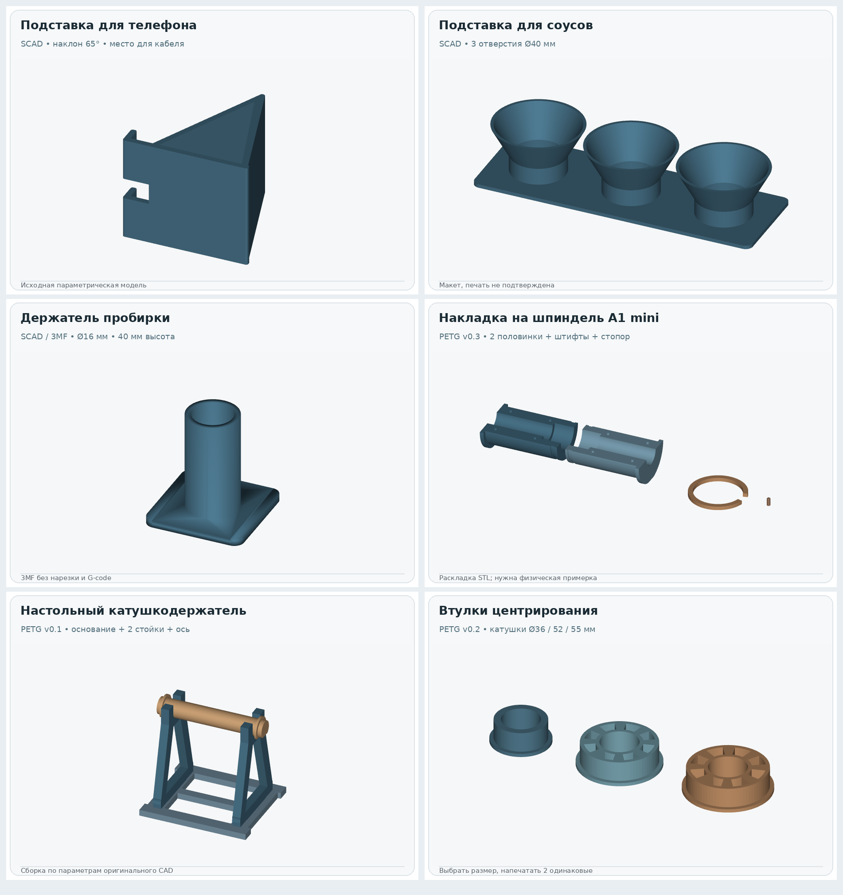
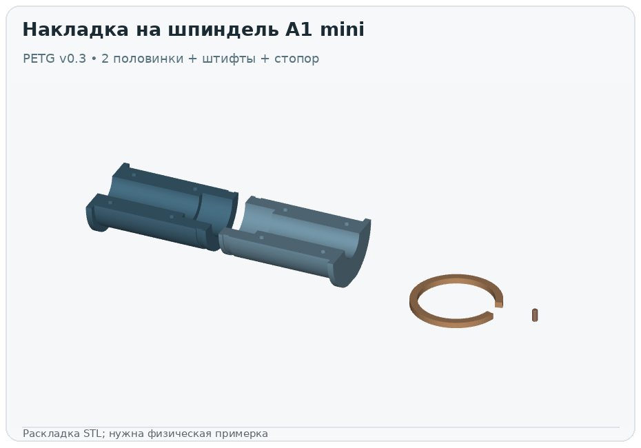
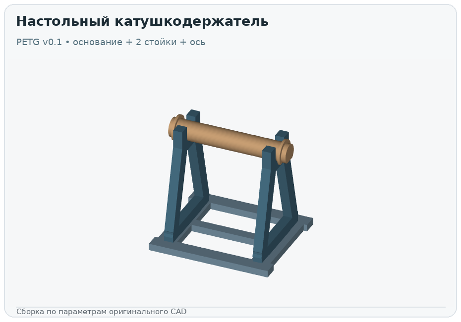
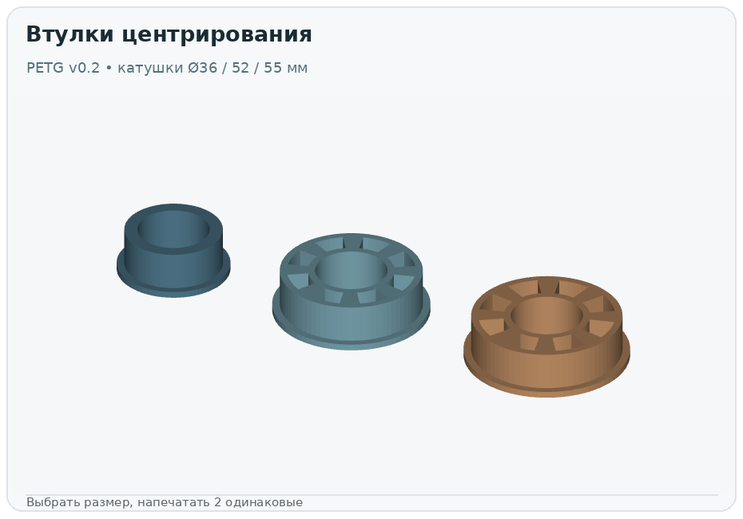
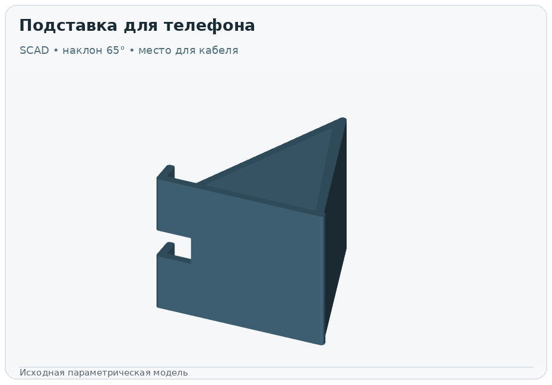
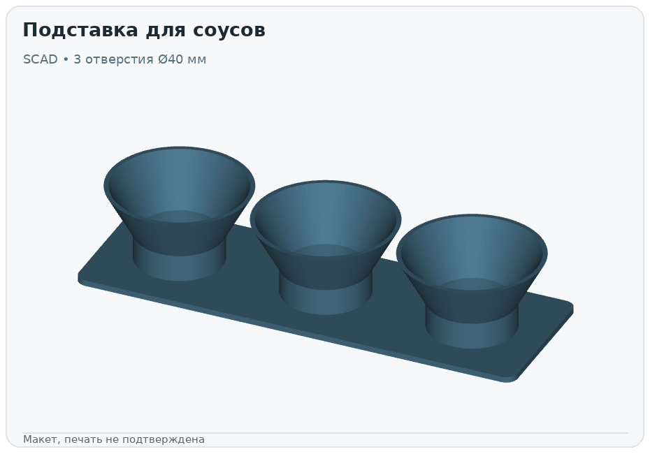
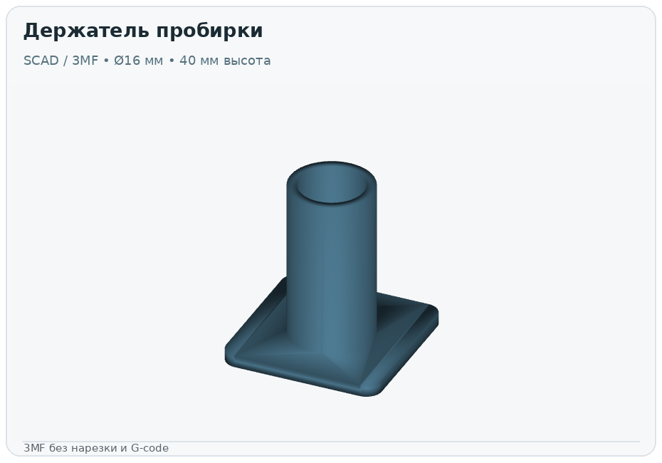

# Logos Pro · 3D-модели и исходники

> **Галерея реальной геометрии**, созданная из сохранённых STL/3MF и исходных SCAD (не AI-картинки). [Issue #1112](https://github.com/maksimp6/Chat/issues/1112). **Пока только CAD-прототипы.**

Каждая модель ниже имеет отдельное превью и ссылку на исходники. Используй каталог `models_manifest.json` для проверенных SHA-256 и учёта количества деталей. Исходные CAD-файлы из архивов сохранены без изменения байтов; файлы генераторов хранятся как `.py.txt`, чтобы Ruff не переформатировал оригинал. Для воспроизведения вне каталога скопируй и переименуй их обратно в `.py` в доверенном изолированном окружении. **Не запускай чужой CAD-код автоматически.**

## 1. Накладка на штатный держатель A1 mini · OEM v0.3

Это **не замена крепления принтера**. Печатный вал собирается из двух половинок, четырёх штифтов и внешнего стопора вокруг существующего штока. Номинал отверстия катушки 52,5 мм, контактный диаметр оси 51,7 мм, условный диаметр штатного штока 22 мм. **Все три значения требуют физического измерения перед печатью.**

[Исходный генератор](oem_spindle_v03/source/logos_stock_spool_replacement_v03.py.txt) · [STEP CAD](oem_spindle_v03/cad/half_shell_A.step) · [STL-половинки](oem_spindle_v03/parts/a1mini_oem_wide_hub_HALF_A.stl) · [все детали](oem_spindle_v03/parts) · [калибры 18–24 мм](oem_spindle_v03/gauges) · [Инструкция](oem_spindle_v03/README_RU.md).

**Не путать:** существующий [PR #1110](https://github.com/maksimp6/Chat/pull/1110) содержит его отдельную неслайсенную сборку `.3mf`; бинарник не продублирован здесь. Тестирование фиксатора и нагрузки катушки **BLOCKED**.

## 2. Настольный катушкодержатель · PETG v0.1

Это **отдельная настольная стойка**, а не накладка A1 mini. Нужны: основание ×1, А-образная опора ×2, ось ×1. Изображена сборка геометрии по исходным преобразованиям CAD. Корректность посадки и работа с полной катушкой до сих пор не проверены.

[Исходник](desk_spool_v01/source/logos_pro_spool_holder_petg.py.txt) · [основание STL](desk_spool_v01/parts/base_frame.stl) · [опора STL](desk_spool_v01/parts/upright_A_print_twice.stl) · [ось STL](desk_spool_v01/parts/axle_D_section.stl) · [Инструкция](desk_spool_v01/README_RU.txt).

## 3. Центрирующие втулки для стойки · PETG v0.2

Дополнение к v0.1. Подбирается **ровно один** размер фактического отверстия катушки: **36, 52 или 55 мм**. Напечатать две одинаковые втулки выбранного размера. Базовые три компонента стойки v0.1 не дублируются в репозитории: в оригинальных ZIP они побайтово идентичны.

[Генератор](desk_spool_v02/source/spool_centering_adapters_v02.py.txt) · [Ø36 STL](desk_spool_v02/adapters/ring_for_spool_bore_36mm_PRINT_2.stl) · [Ø52 STL](desk_spool_v02/adapters/ring_for_spool_bore_52mm_PRINT_2.stl) · [Ø55 STL](desk_spool_v02/adapters/ring_for_spool_bore_55mm_PRINT_2.stl) · [Инструкция](desk_spool_v02/README_RU.md).

## 4. Подставка для телефона

[Исходник OpenSCAD](parametric/phone_stand.scad). Ширина 70 мм; задняя стенка 65°; вырез для зарядного кабеля.

## 5. Подставка для трёх соусов

[Исходник OpenSCAD](parametric/sauce_stand.scad). Три воронкообразных гнезда, внутренний диаметр 40 мм.

## 6. Держатель пробирки

[Параметрический исходник](parametric/test_tube_holder.scad) · [неслайсенная 3MF](parametric/test_tube_holder.3mf). Под пробирку номинально 16 мм; никакого печатного G-code в 3MF нет.

## Остальные 3D-наработки

- **Ember Spirit / Dota 2:** экспериментальные STL, GLB и Blender-скульпт. Есть в пользовательской Library и в [PR #1094](https://github.com/maksimp6/Chat/pull/1094) (инструмент импорта). **Не публикуем производные Valve-ассеты** в открытом репозитории до проверки прав. Физическая пригодность не подтверждена.
- **Тестовый куб A1 mini:** нарезанный `.gcode.3mf` существует вне репозитория как артефакт [PR #1101](https://github.com/maksimp6/Chat/pull/1101). Не считать готовым разрешением запуска печати.
- **Применение на принтере:** [#1096](https://github.com/maksimp6/Chat/issues/1096) — отдельная реализация слайсинга, проверки и отправки. [#1108](https://github.com/maksimp6/Chat/issues/1108) — preflight и наблюдение. Ни одно действие в этом каталоге не запускает принтер.

## Версии, проверка и границы

- [catalog.json](catalog.json) — общий перечень 3D-наработок Logos Pro, расположение и дубли.
- [models_manifest.json](models_manifest.json) — каждое сохранённое исходное имя, SHA-256, исходный архив, размеры STL и реальные превью.
- Проверка: `python -m pytest -q tests/test_printing3d_asset_catalog.py tests/test_printing3d_asset_sources.py`.
- `.scad`, `.step`, `.py.txt`, `.stl` и обычный `.3mf` — **не команды на печать**. Для принтера после слайсера нужен один проверенный `.gcode.3mf`, а запуск — только по отдельному явному разрешению.
- `watertight=True` и попадание модели в стол A1 mini доказывают только часть геометрических свойств, не безопасную посадку, прочность или проверку физической модели.
- Артефакты и исходники пользовательские; файлы Valve не переносились в публичные каталоги. Секреты принтера и IP-адрес не сохранялись.

**Этот PR предназначен для проверки; merge в `develop` или `master` не выполняется автоматически.**
